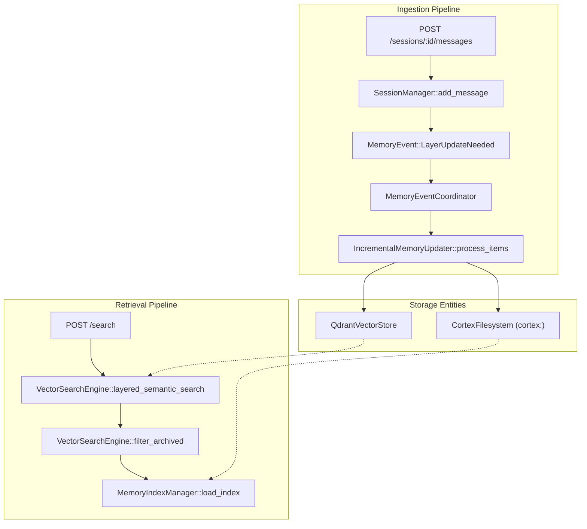
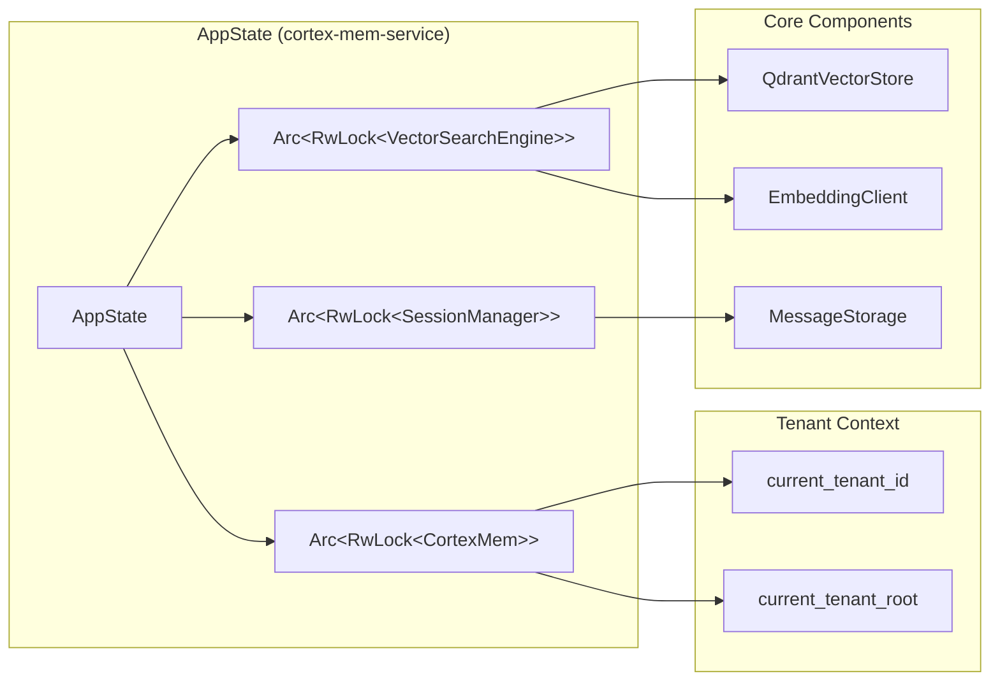

<!-- source: DeepWiki mcp.deepwiki.com · repo sopaco/cortex-mem · page 9.2 Production Considerations · fetched 2026-10-27 -->

# Production Considerations

Relevant source files

The following files were used as context for generating this wiki page:

- [README.md](README.md)
- [README_zh.md](README_zh.md)
- [cortex-mem-core/src/incremental_memory_updater.rs](cortex-mem-core/src/incremental_memory_updater.rs)
- [cortex-mem-core/src/llm/prompts.rs](cortex-mem-core/src/llm/prompts.rs)
- [cortex-mem-core/src/memory_cleanup.rs](cortex-mem-core/src/memory_cleanup.rs)
- [cortex-mem-core/src/memory_index_manager.rs](cortex-mem-core/src/memory_index_manager.rs)
- [cortex-mem-core/src/search/vector_engine.rs](cortex-mem-core/src/search/vector_engine.rs)
- [cortex-mem-service/src/handlers/automation.rs](cortex-mem-service/src/handlers/automation.rs)
- [cortex-mem-service/src/handlers/search.rs](cortex-mem-service/src/handlers/search.rs)
- [cortex-mem-service/src/handlers/sessions.rs](cortex-mem-service/src/handlers/sessions.rs)
- [cortex-mem-service/src/routes/automation.rs](cortex-mem-service/src/routes/automation.rs)
- [cortex-mem-service/src/state.rs](cortex-mem-service/src/state.rs)
- [examples/@memclaw/bin-darwin-arm64/bin/README.md](examples/@memclaw/bin-darwin-arm64/bin/README.md)
- [examples/locomo-evaluation/eval.py](examples/locomo-evaluation/eval.py)

This document provides technical guidance for deploying and operating Cortex Memory in production environments. It covers security hardening, resource planning, monitoring strategies, and the implementation of automated memory management services like the Ebbinghaus-based forgetting mechanism and multi-tenant isolation.

---

## 1. System State & Initialization

The production runtime is centered around the `AppState` struct in `cortex-mem-service`, which orchestrates the `CortexMem` core, `SessionManager`, and `VectorSearchEngine`.

### Tenant Isolation Implementation
In production, multi-tenancy is handled by rebuilding the runtime atomically on tenant switches to avoid split-brain states [cortex-mem-service/src/state.rs:15-17](). The system ensures that vector collections exist for each tenant by probing dimensions during bootstrap [cortex-mem-service/src/state.rs:66-68]().

### Component Lifecycle
The `AppState::new` function initializes the following pipeline:
1. **Config Loading**: Loads `llm`, `embedding`, and `qdrant` sections [cortex-mem-service/src/state.rs:50-54]().
2. **Runtime Building**: Constructing `CortexMem` via `CortexMemBuilder` [cortex-mem-service/src/state.rs:138-152]().
3. **Engine Wiring**: Connecting the `MemoryEventCoordinator` to the `VectorSearchEngine` to enable automated indexing and layer updates [cortex-mem-service/src/state.rs:107-122]().

**Sources:** [cortex-mem-service/src/state.rs:15-126](), [cortex-mem-service/src/state.rs:138-166]()

---

## 2. Search & Retrieval Optimization

Production search performance is a balance between latency and recall accuracy.

### Intent Analysis vs. Latency
The `VectorSearchEngine` supports an `enable_intent_analysis` flag. 
- **Enabled (Default)**: Uses LLM to rewrite queries and tune thresholds. Latency: ~15-25s [cortex-mem-core/src/search/vector_engine.rs:67-71]().
- **Disabled**: Skips LLM round-trip, using raw queries directly. Latency: <500ms [cortex-mem-core/src/search/vector_engine.rs:109-115]().

### Layered Search Logic
The `search_layered` function in the service layer implements a multi-stage retrieval strategy to ensure high recall for production AI agents:
1. **Layered Vector Search**: Queries L0/L1/L2 tiers [cortex-mem-service/src/handlers/search.rs:81-84]().
2. **Expanded Semantic Search**: If intent analysis provides an expanded query, a second vector pass is performed [cortex-mem-service/src/handlers/search.rs:91-98]().
3. **User-Scope Supplement**: If results are insufficient, a targeted search in `cortex://user` is triggered to catch personal facts [cortex-mem-service/src/handlers/search.rs:150-168]().
4. **Lexical Fallback**: A final grep-based search acts as a safety net if vector search returns <3 results [cortex-mem-service/src/handlers/search.rs:172-182]().

**Sources:** [cortex-mem-core/src/search/vector_engine.rs:56-132](), [cortex-mem-service/src/handlers/search.rs:39-207]()

---

## 3. Automated Memory Management

### Incremental Updates
Production environments use the `IncrementalMemoryUpdater` to handle memory extraction without full re-indexing. It uses the `MemoryItem` trait to unify different memory types (Preferences, Entities, Events, etc.) into a single processing flow: `find_existing → format_content → hash → should_update? → create/update` [cortex-mem-core/src/incremental_memory_updater.rs:8-11]().

### The Forgetting Mechanism
To prevent storage bloat in long-running agents, the `MemoryCleanupService` implements a mechanism based on the Ebbinghaus forgetting curve [README.md:115-116]().
- **Archiving**: Low-strength memories are marked as `archived: true` in the `MemoryMetadata` [cortex-mem-core/src/search/vector_engine.rs:124-128]().
- **Search Filtering**: The `VectorSearchEngine` filters out these archived memories during retrieval to prevent stale information from surfacing [cortex-mem-core/src/search/vector_engine.rs:139-199]().

### Event-Driven Architecture
Production reliability relies on the `MemoryEventCoordinator`.
- **Session Closure**: Triggering `/extract/:thread_id` sends a `SessionClosed` event [cortex-mem-service/src/handlers/automation.rs:36-40]().
- **Async Processing**: The coordinator handles extraction, L0/L1 generation, and vector sync asynchronously to avoid blocking the API response [cortex-mem-service/src/handlers/automation.rs:42-47]().

**Sources:** [cortex-mem-core/src/incremental_memory_updater.rs:1-53](), [cortex-mem-core/src/search/vector_engine.rs:139-199](), [cortex-mem-service/src/handlers/automation.rs:13-50]()

---

## 4. Production Entity Mapping

The following diagram bridges the high-level production concepts to specific code entities.

### Logic Flow: Memory Ingestion to Retrieval

**Sources:** [cortex-mem-service/src/handlers/sessions.rs:152-192](), [cortex-mem-core/src/incremental_memory_updater.rs:31-53](), [cortex-mem-core/src/search/vector_engine.rs:139-150]()

### Multi-Tenant State Management

**Sources:** [cortex-mem-service/src/state.rs:15-41](), [cortex-mem-service/src/state.rs:99-126]()

---

## 5. Operations & Maintenance

### Reindexing
If vector sync fails (e.g., due to 429 rate limits), the `/reindex` endpoint triggers a `VectorSyncManager::sync_all()` job in the background [cortex-mem-service/src/handlers/automation.rs:56-91]().

### Evaluation (LoCoMo)
Production deployments should be validated using the `locomo-evaluation` framework. The `CortexEvalClient` in `eval.py` automates the `ingest → close-and-wait → qa` workflow to measure recall and precision [examples/locomo-evaluation/eval.py:137-198]().

### Key Prompt Templates
Production LLM performance depends on the templates in `Prompts`:
- **L0 Abstract**: Max 100 tokens for quick filtering [cortex-mem-core/src/llm/prompts.rs:8-32]().
- **L1 Overview**: Structured markdown (Summary, Entities, Timeline) [cortex-mem-core/src/llm/prompts.rs:38-87]().
- **Unified Intent**: Single-pass JSON extraction for rewritten queries and time constraints [cortex-mem-core/src/llm/prompts.rs:136-160]().

**Sources:** [cortex-mem-service/src/handlers/automation.rs:56-98](), [examples/locomo-evaluation/eval.py:137-198](), [cortex-mem-core/src/llm/prompts.rs:1-160]()

---

