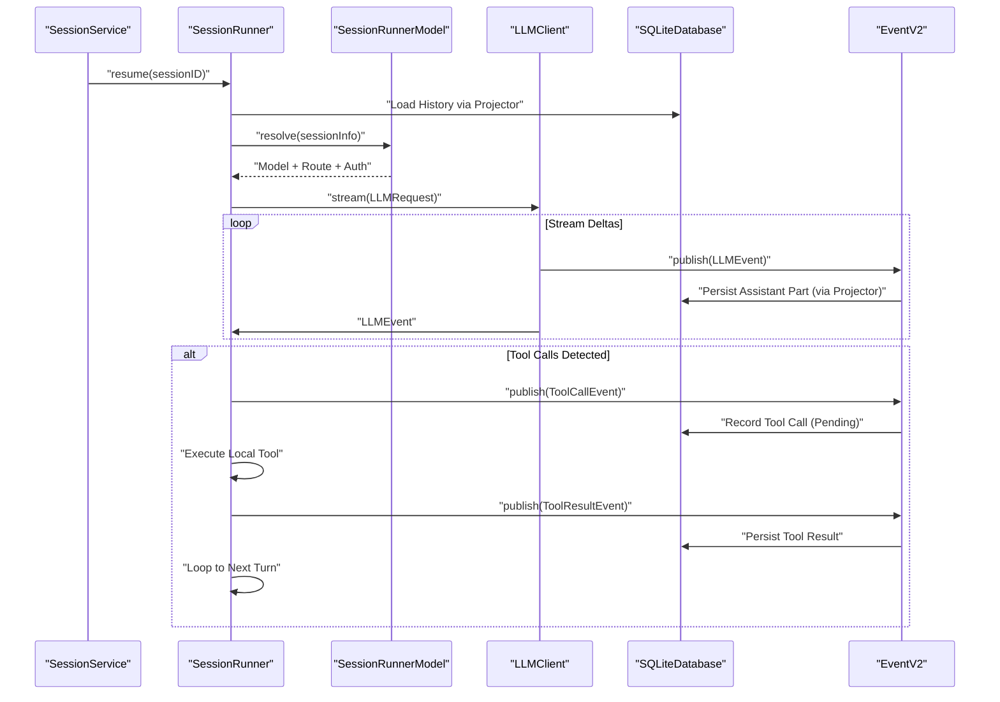

<!-- source: DeepWiki mcp.deepwiki.com · repo sst/opencode · page 4.7 Core V2 Architecture · fetched 2026-10-27 -->

# Core V2 Architecture

Relevant source files

The following files were used as context for generating this wiki page:

- [CONTEXT.md](CONTEXT.md)
- [packages/core/src/catalog.ts](packages/core/src/catalog.ts)
- [packages/core/src/config.ts](packages/core/src/config.ts)
- [packages/core/src/config/mcp.ts](packages/core/src/config/mcp.ts)
- [packages/core/src/config/plugin/agent.ts](packages/core/src/config/plugin/agent.ts)
- [packages/core/src/config/plugin/provider.ts](packages/core/src/config/plugin/provider.ts)
- [packages/core/src/filesystem.ts](packages/core/src/filesystem.ts)
- [packages/core/src/filesystem/search.ts](packages/core/src/filesystem/search.ts)
- [packages/core/src/model.ts](packages/core/src/model.ts)
- [packages/core/src/plugin/models-dev.ts](packages/core/src/plugin/models-dev.ts)
- [packages/core/src/ripgrep.ts](packages/core/src/ripgrep.ts)
- [packages/core/src/ripgrep/binary.ts](packages/core/src/ripgrep/binary.ts)
- [packages/core/src/session.ts](packages/core/src/session.ts)
- [packages/core/src/session/compaction.ts](packages/core/src/session/compaction.ts)
- [packages/core/src/session/event.ts](packages/core/src/session/event.ts)
- [packages/core/src/session/execution.ts](packages/core/src/session/execution.ts)
- [packages/core/src/session/execution/local.ts](packages/core/src/session/execution/local.ts)
- [packages/core/src/session/message-updater.ts](packages/core/src/session/message-updater.ts)
- [packages/core/src/session/projector.ts](packages/core/src/session/projector.ts)
- [packages/core/src/session/run-coordinator.ts](packages/core/src/session/run-coordinator.ts)
- [packages/core/src/session/runner/llm.ts](packages/core/src/session/runner/llm.ts)
- [packages/core/src/session/runner/model.ts](packages/core/src/session/runner/model.ts)
- [packages/core/src/v1/config/config.ts](packages/core/src/v1/config/config.ts)
- [packages/core/src/v1/config/mcp.ts](packages/core/src/v1/config/mcp.ts)
- [packages/core/src/v1/config/migrate.ts](packages/core/src/v1/config/migrate.ts)
- [packages/core/test/catalog.test.ts](packages/core/test/catalog.test.ts)
- [packages/core/test/config/agent.test.ts](packages/core/test/config/agent.test.ts)
- [packages/core/test/config/config.test.ts](packages/core/test/config/config.test.ts)
- [packages/core/test/config/plugin.test.ts](packages/core/test/config/plugin.test.ts)
- [packages/core/test/config/provider.test.ts](packages/core/test/config/provider.test.ts)
- [packages/core/test/effect/cross-spawn-spawner.test.ts](packages/core/test/effect/cross-spawn-spawner.test.ts)
- [packages/core/test/filesystem/search.test.ts](packages/core/test/filesystem/search.test.ts)
- [packages/core/test/location-filesystem.test.ts](packages/core/test/location-filesystem.test.ts)
- [packages/core/test/location-mutation.test.ts](packages/core/test/location-mutation.test.ts)
- [packages/core/test/plugin/skill.test.ts](packages/core/test/plugin/skill.test.ts)
- [packages/core/test/ripgrep.test.ts](packages/core/test/ripgrep.test.ts)
- [packages/core/test/session-compaction.test.ts](packages/core/test/session-compaction.test.ts)
- [packages/core/test/session-create.test.ts](packages/core/test/session-create.test.ts)
- [packages/core/test/session-projector.test.ts](packages/core/test/session-projector.test.ts)
- [packages/core/test/session-prompt.test.ts](packages/core/test/session-prompt.test.ts)
- [packages/core/test/session-run-coordinator.test.ts](packages/core/test/session-run-coordinator.test.ts)
- [packages/core/test/session-runner-model.test.ts](packages/core/test/session-runner-model.test.ts)
- [packages/core/test/session-runner-recorded.test.ts](packages/core/test/session-runner-recorded.test.ts)
- [packages/core/test/session-runner.test.ts](packages/core/test/session-runner.test.ts)
- [packages/core/test/session-todo.test.ts](packages/core/test/session-todo.test.ts)
- [packages/core/test/skill.test.ts](packages/core/test/skill.test.ts)
- [packages/core/test/system-context/builtins.test.ts](packages/core/test/system-context/builtins.test.ts)
- [packages/opencode/script/bench-search.ts](packages/opencode/script/bench-search.ts)
- [packages/opencode/src/agent/prompt/compaction.txt](packages/opencode/src/agent/prompt/compaction.txt)
- [specs/v2/config.md](specs/v2/config.md)
- [specs/v2/schema-changelog.md](specs/v2/schema-changelog.md)
- [specs/v2/session.md](specs/v2/session.md)
- [specs/v2/todo.md](specs/v2/todo.md)

The Core V2 architecture represents a modernization of the OpenCode domain layer, transitioning from legacy service patterns to a functional, type-safe architecture powered by the [Effect](https://effect.website) ecosystem. This architecture centralizes provider discovery, credential management, plugin extension hooks, and session execution into a cohesive set of services located across monorepo packages like `packages/core`, `packages/server`, `packages/protocol`, `packages/schema`, `packages/codemode`, and `packages/cli`.

## Purpose and Scope

This document details the packages/core v2 domain layer and its accompanying ecosystem packages. It defines how OpenCode handles stateful catalogs, multi-tenant/account structures, security integrations, event-sourced messaging, and the `SessionRunner` execution loop, while outlining the migration strategy from legacy `packages/opencode`.

## Architectural Philosophy

The V2 architecture is built on the following principles:
- **Functional Orchestration**: Moving away from monolithic classes (like the legacy `SessionPrompt`) to small, reviewed collaborators coordinated by a `SessionRunner` [packages/core/src/session/runner/llm.ts:46-48]().
- **Durable State**: Utilizing SQLite with Drizzle ORM for all domain entities, ensuring session history and tool executions are persisted before side effects begin [packages/core/src/session/runner/llm.ts:70-71]().
- **Layered Configuration**: A multi-document configuration system that supports migration from V1 and merges global, project, and inline settings [packages/core/src/config.ts:135-162]().
- **Type-Safe Search**: Integration of specialized search services like `Ripgrep` and `Fff` (Fast File Finder) for efficient repository context gathering [packages/core/src/filesystem/search.ts:23-28]().

Sources: [packages/core/src/session/runner/llm.ts:46-71](), [packages/core/src/config.ts:135-162](), [packages/core/src/filesystem/search.ts:23-28]()

---

## Core Domain Services

### 1. Catalog Service (Discovery)
The `Catalog` service is the source of truth for available providers and models. It provides a reactive state that plugins and configuration layers can transform [packages/core/src/catalog.ts:47-60]().

- **Implementation**: It maintains a map of `ProviderRecord` entities, each containing provider info and a map of associated models [packages/core/src/catalog.ts:13-16]().
- **Normalization**: Automatically normalizes provider-specific fields, such as moving `baseURL` from request bodies to the API URL [packages/core/src/catalog.ts:99-104]().
- **Policy Enforcement**: Filters available providers based on security policies (e.g., `provider.use` actions) [packages/core/src/catalog.ts:161-167]().

Sources: [packages/core/src/catalog.ts:13-16](), [packages/core/src/catalog.ts:47-60](), [packages/core/src/catalog.ts:99-104](), [packages/core/src/catalog.ts:161-167]()

### 2. PluginV2, AgentV2, and AccountV2
- **PluginV2 Hooks**: Extends core runtime behaviors by intercepting actions such as authentication loaders (`auth.loader`), chat parameter transformations (`chat.params`), and tool executions (`tool.execute`). The `ConfigAgentPlugin` is an example of a plugin that transforms agent configurations based on discovered markdown files and permissions [packages/core/src/config/plugin/agent.ts:47-115]().
- **AgentV2**: Manages built-in and custom agent definitions (e.g., build, plan, general), determining their behavior, assigned models, and tool scopes. Agents can have permissions expanded based on global or agent-specific rules [packages/core/src/config/plugin/agent.ts:119-124]().
- **AccountV2**: Handles multi-tenant identity states, workspace associations, and credential bindings within the core context.

Sources: [packages/core/src/catalog.ts:1-70](), [packages/core/src/config/plugin/agent.ts:47-115](), [packages/core/src/config/plugin/agent.ts:119-124]()

### 3. Integration Auth and EventV2
- **Integration Auth**: Manages OAuth flows, API key storage, and well-known service authenticators, mapping third-party tokens to secure integration connections.
- **EventV2**: Provides the global event bus and messaging primitives for publishing and subscribing to reactive state changes across the application. Events are durably stored and projected into the database by `SessionProjector` [packages/core/src/session/projector.ts:111-112]().

Sources: [packages/core/src/event/sql.ts:1-25](), [packages/core/src/session/projector.ts:111-112]()

---

## Ecosystem Packages

The V2 architecture distributes responsibilities across dedicated workspace packages:

- **`packages/cli`**: Houses the command-line interface logic, terminal entry points, and footer/stream runtimes.
- **`packages/protocol`**: Defines shared wire formats, transport protocols, and communication contracts between clients and servers.
- **`packages/server`**: Implements the Hono/Effect HTTP server, Server-Sent Events (SSE) streaming handlers, and workspace isolation middleware.
- **`packages/schema`**: Contains Effect Schema definitions and validation rules for domain models, configuration entries, and session structures. For example, `Entry` and `Match` for filesystem search results are defined here [packages/core/src/filesystem/search.ts:8-8]().
- **`packages/codemode`**: Implements specialized code transformation and editing modes for agent-driven refactoring.

Sources: [packages/core/package.json:1-132](), [packages/core/src/filesystem/search.ts:8-8]()

---

## SessionExecution and SessionRunner Orchestration

The `SessionRunner` and `SessionExecution` components manage the lifecycle of a coding agent session.

- **Model Resolution**: Uses `SessionRunnerModel` to resolve the specific model for a session, accounting for overrides, variants, and credentials [packages/core/src/session/runner/model.ts:188-195]().
- **Tool Settlement**: Durably records tool calls before execution and ensures all local calls (like `bash` or `read`) settle before the next provider turn [packages/core/src/session/runner/llm.ts:70-76]().
- **Interruption Handling**: Supports explicit interruption of active sessions, which marks pending tools as failed to maintain state consistency [packages/core/src/session/runner/llm.ts:119-139]().
- **Compaction**: The `SessionCompaction` service manages context window overflow by summarizing older messages, using a configurable buffer and token limits [packages/core/src/session/compaction.ts:123-134](). It constructs prompts for LLMs to generate summaries [packages/core/src/session/compaction.ts:160-166]().

Sources: [packages/core/src/session/runner/llm.ts:70-139](), [packages/core/src/session/runner/model.ts:188-195](), [packages/core/src/session/compaction.ts:123-134](), [packages/core/src/session/compaction.ts:160-166]()

---

## Data Flow: Session Execution V2

This diagram illustrates the flow from a session resume/prompt to the completion of an agent turn.

**V2 Session Execution Flow**

Sources: [packages/core/src/session/runner/llm.ts:93-140](), [packages/core/src/session/runner/model.ts:172-173](), [packages/core/src/session/projector.ts:112-132](), [packages/core/src/session/runner/llm.ts:125-137]()

---

## Domain Mapping: Language Space to Code Space

Mapping conceptual agent entities to the V2 implementation classes.

**V2 Domain Entity Mapping**

```mermaid
graph TD
    subgraph "NaturalLanguageSpace"
        A["ModelDiscovery"]
        B["AgentDefinition"]
        C["SessionLoop"]
        D["ToolAuth"]
        E["FileSearch"]
        F["ContextCompaction"]
    end

    subgraph "CodeEntitySpace"
        A1["Catalog.Service"]
        A2["ModelV2.Info"]
        B1["AgentV2.Service"]
        B2["ConfigAgent.Info"]
        C1["SessionRunner.Service"]
        C2["SessionProjector"]
        D1["PermissionV2.Service"]
        D2["Integration.Service"]
        E1["FileSystemSearch.Service"]
        E2["Ripgrep.Service"]
        F1["SessionCompaction"]
        F2["Token.estimate"]
    end

    A --- A1
    A --- A2
    B --- B1
    B --- B2
    C --- C1
    C --- C2
    D --- D1
    D --- D2
    E --- E1
    E --- E2
    F --- F1
    F --- F2

    style A1 stroke-dasharray: 5 5
    style B1 stroke-dasharray: 5 5
    style C1 stroke-dasharray: 5 5
    style D1 stroke-dasharray: 5 5
    style E1 stroke-dasharray: 5 5
    style F1 stroke-dasharray: 5 5
```

Sources: [packages/core/src/catalog.ts:62](), [packages/core/src/agent.ts:1](), [packages/core/src/session/runner/index.ts:1](), [packages/core/src/permission.ts:1](), [packages/core/src/filesystem/search.ts:21](), [packages/core/src/session/compaction.ts:1](), [packages/core/src/integration.ts:1](), [packages/core/src/util/token.ts:1]()

---

## Migration Path

The migration from V1 to V2 focuses on replacing the `packages/opencode` legacy services with the `@opencode-ai/core` V2 domain layer.

### Key Differences

| Feature | Legacy (packages/opencode) | Modern (packages/core V2) |
| :--- | :--- | :--- |
| **Model Config** | `Provider.getModel()` (Dynamic) | `Catalog.Service` (State-based) [packages/core/src/catalog.ts:47-60]() |
| **Session Loop** | `SessionPrompt.loop` (Monolith) | `SessionRunner` (Orchestrator) [packages/core/src/session/runner/llm.ts:46-55]() |
| **Tool Execution** | In-process side effects | Durable recording + Authorize hook [packages/core/src/session/runner/llm.ts:70-74]() |
| **Persistence** | JSON files / Memory | SQLite + Drizzle ORM [packages/core/src/session/projector.ts:5-16]() |
| **File Access** | Direct `fs` calls | `FileSystem` Service with Location isolation [packages/core/src/filesystem.ts:59-73]() |
| **Compaction** | Implicit in Prompt loop | Explicit `SessionCompaction` service [packages/core/src/session/compaction.ts:123-134]() |

### Current Migration Status
1. **Config Migration**: V1 `opencode.json` structures are fully supported via the `ConfigMigrateV1` utility [packages/core/src/v1/config/migrate.ts:35-40](). This includes migrating provider setup options into AISDK settings and command configurations [packages/core/test/config/config.test.ts:90-142]().
2. **Database Evolution**: Comprehensive Drizzle migrations handle the schema transition, including complex types stored as JSON in SQLite [packages/core/src/session/sql.ts:1-50]().
3. **Session Projection**: Legacy V1 session events can be projected into the V2 SQL schema via `SessionProjector`, which also updates session-level metadata like total cost [packages/core/src/session/projector.ts:90-110](). The projector handles various session events, including moves and reverts [packages/core/test/session-projector.test.ts:48-130]().
4. **Search Performance**: The search layer supports `Ripgrep` for regex search and `Fff` for high-speed indexing [packages/core/src/filesystem/search.ts:23-28](). The `ripgrepLayer` and `fffLayer` provide implementations for `FileSystemSearch.Service` [packages/core/src/filesystem/search.ts:24-120](), [packages/core/src/filesystem/search.ts:123-240]().

Sources: [packages/core/src/session/runner/llm.ts:1-91](), [packages/core/src/catalog.ts:1-70](), [packages/core/src/config.ts:1-133](), [packages/core/src/filesystem/search.ts:1-120](), [packages/core/src/session/compaction.ts:1-174](), [packages/core/src/v1/config/migrate.ts:35-40](), [packages/core/test/config/config.test.ts:90-142](), [packages/core/test/session-projector.test.ts:48-130](), [packages/core/src/filesystem/search.ts:24-120](), [packages/core/src/filesystem/search.ts:123-240]()

---

