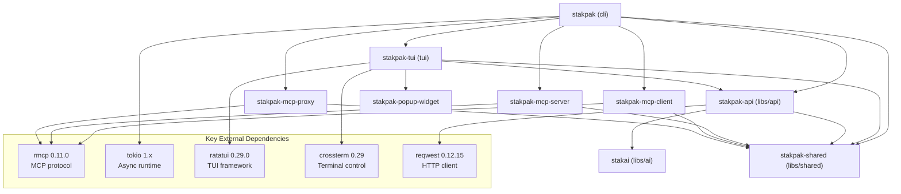
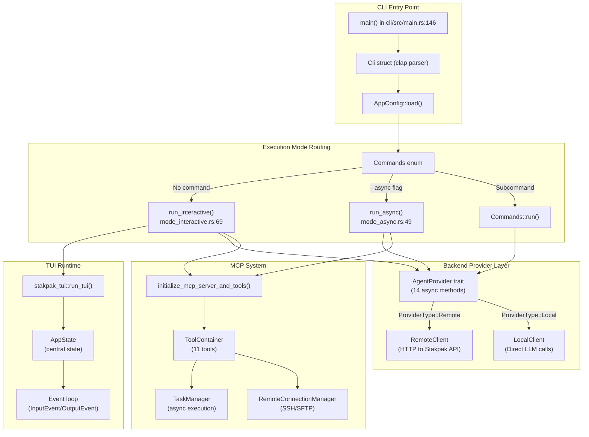
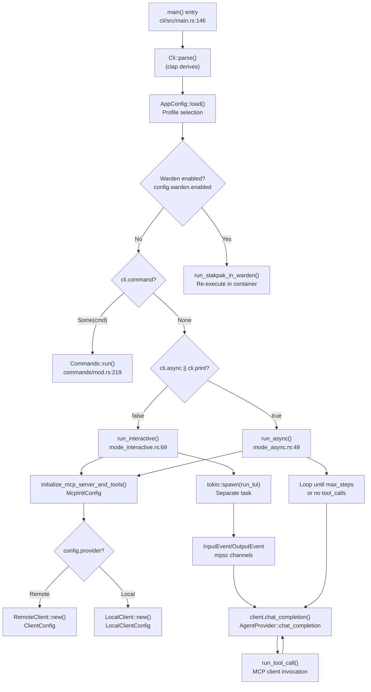
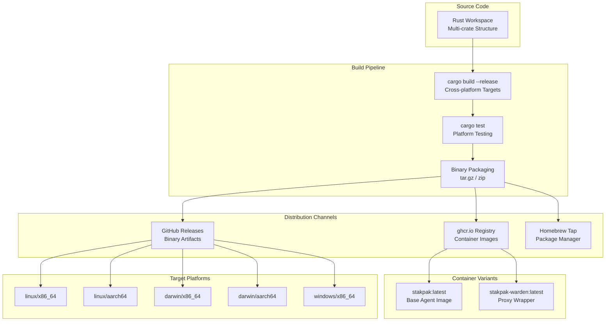

<!-- source: DeepWiki mcp.deepwiki.com · repo stakpak/agent · page 1.1 System Architecture · fetched 2026-10-27 -->

# System Architecture

Relevant source files

The following files were used as context for generating this wiki page:

- [Cargo.lock](Cargo.lock)
- [Cargo.toml](Cargo.toml)
- [README.md](README.md)
- [assets/stakpak-dark.png](assets/stakpak-dark.png)
- [assets/stakpak-light.png](assets/stakpak-light.png)
- [cli/Cargo.toml](cli/Cargo.toml)
- [cli/src/commands/agent/run/helpers.rs](cli/src/commands/agent/run/helpers.rs)
- [cli/src/commands/agent/run/mode_async.rs](cli/src/commands/agent/run/mode_async.rs)
- [cli/src/commands/agent/run/mode_interactive.rs](cli/src/commands/agent/run/mode_interactive.rs)
- [cli/src/commands/mod.rs](cli/src/commands/mod.rs)
- [cli/src/main.rs](cli/src/main.rs)
- [tui/Cargo.toml](tui/Cargo.toml)

This document explains the overall system architecture of Stakpak, detailing how the CLI, TUI, MCP components, and API layer interact to provide an AI-powered DevOps agent. The architecture is organized as a Rust workspace with clear separation between user interface (CLI/TUI), business logic (API abstraction), and tool execution (MCP system).

The system supports two primary execution modes: **interactive mode** (TUI-based) and **async mode** (batch processing). Both modes share the same backend services through the `AgentProvider` trait abstraction, which supports both remote (Stakpak hosted API) and local (direct LLM) implementations.

For CLI commands and usage, see [CLI Interface](#2). For TUI internals, see [Terminal User Interface (TUI)](#3). For tool execution details, see [MCP System](#5).

## Workspace Structure and Crate Dependencies

The Stakpak agent is organized as a Cargo workspace with 11 crates, defined in the root [Cargo.toml:1-13](). The workspace uses resolver version 2 and shares common dependencies across all members.

| Crate | Path | Purpose |
|-------|------|---------|
| `stakpak` | `cli/` | Main CLI executable, entry point at [cli/src/main.rs:146-512]() |
| `stakpak-tui` | `tui/` | Terminal UI library, entry point `run_tui()` |
| `stakpak-api` | `libs/api/` | `AgentProvider` trait and implementations (`RemoteClient`, `LocalClient`) |
| `stakai` | `libs/ai/` | LLM client integrations (OpenAI, Anthropic, Google, AWS Bedrock) |
| `stakpak-shared` | `libs/shared/` | Common models and utilities shared across all crates |
| `stakpak-mcp-client` | `libs/mcp/client/` | MCP client for tool discovery and invocation |
| `stakpak-mcp-server` | `libs/mcp/server/` | MCP server exposing Stakpak tools (`ToolContainer` with 11 tools) |
| `stakpak-mcp-proxy` | `libs/mcp/proxy/` | MCP proxy for multiplexing upstream servers |
| `stakpak-popup-widget` | `libs/popup-widget/` | Ratatui popup widget for TUI |

**Workspace Dependency Graph**

The workspace uses shared version management through `[workspace.dependencies]` at [Cargo.toml:25-88](). Critical shared dependencies include `rmcp` (0.11.0) for MCP protocol, `tokio` for async runtime, `ratatui` (0.29.0) for TUI, and `reqwest` (0.12.15) for HTTP clients.

**Sources:** [Cargo.toml:1-94](), [cli/Cargo.toml:1-61](), [tui/Cargo.toml:1-51]()

## Core Components and Runtime Architecture

The system uses a layered architecture with the CLI as the orchestrator, dispatching to execution modes that share backend services through the `AgentProvider` abstraction.

**Component Interaction with Code Entities**

The CLI at [cli/src/main.rs:146]() parses arguments using `clap` and determines execution mode. The `AppConfig` type (from `cli/src/config.rs`) manages configuration and credentials. The `AgentProvider` trait (from `libs/api/`) abstracts backend differences, with `RemoteClient` for hosted API and `LocalClient` for local LLM execution.

In interactive mode, `run_interactive()` at [cli/src/commands/agent/run/mode_interactive.rs:69]() spawns the TUI subprocess and establishes bidirectional channels (`InputEvent`/`OutputEvent`). In async mode, `run_async()` at [cli/src/commands/agent/run/mode_async.rs:49]() executes the agent in a loop without UI.

Both modes call `initialize_mcp_server_and_tools()` to set up the MCP system, which instantiates the `ToolContainer` with 11 tools, a `TaskManager` for async operations, and `RemoteConnectionManager` for SSH/SFTP.

**Sources:** [cli/src/main.rs:1-513](), [cli/src/commands/agent/run/mode_interactive.rs:1-100](), [cli/src/commands/agent/run/mode_async.rs:1-50](), [cli/src/commands/mod.rs:1-203]()

## Execution Flow with Code References

The CLI orchestrates different execution paths based on parsed arguments. All paths share the same backend abstraction through `AgentProvider`, ensuring consistent behavior.

**Detailed Execution Flow**

**Key Control Flow Points:**

1. **Entry**: [cli/src/main.rs:146]() initializes the async runtime and parses CLI arguments
2. **Config**: [cli/src/config.rs]() loads profile-based configuration from `~/.stakpak/config.toml`
3. **Warden Check**: If `config.warden.enabled`, re-executes inside Docker container via [cli/src/commands/warden.rs:206]()
4. **Mode Selection**: Based on `cli.command`, `cli.async`, and `cli.print` flags
5. **Provider Selection**: Instantiates either `RemoteClient` or `LocalClient` based on `config.provider`
6. **MCP Initialization**: `initialize_mcp_server_and_tools()` starts MCP server, proxy, and client
7. **Interactive Mode**: Spawns TUI in separate task with mpsc channels for communication
8. **Async Mode**: Executes agent loop directly in main task until completion

The system uses `tokio::spawn` to run the TUI concurrently with the backend agent logic. Communication happens through typed channels: `InputEvent` (UI → Backend) and `OutputEvent` (Backend → UI).

**Sources:** [cli/src/main.rs:146-512](), [cli/src/commands/agent/run/mode_interactive.rs:69-150](), [cli/src/commands/agent/run/mode_async.rs:49-110](), [cli/src/commands/mod.rs:219-468]()

## Deployment and Distribution Architecture

The system supports multiple deployment strategies including native binaries, Docker containers, and package managers. The build pipeline produces cross-platform artifacts with specialized container variants for different use cases.

**Deployment Architecture**

The deployment strategy ensures broad platform compatibility while providing specialized container images for different operational requirements. The warden container variant adds transparent proxy capabilities for enhanced security in containerized environments.

**Sources:** [.github/workflows/build-and-release.yml:1-233](), [Cargo.toml:14-16]()

---

