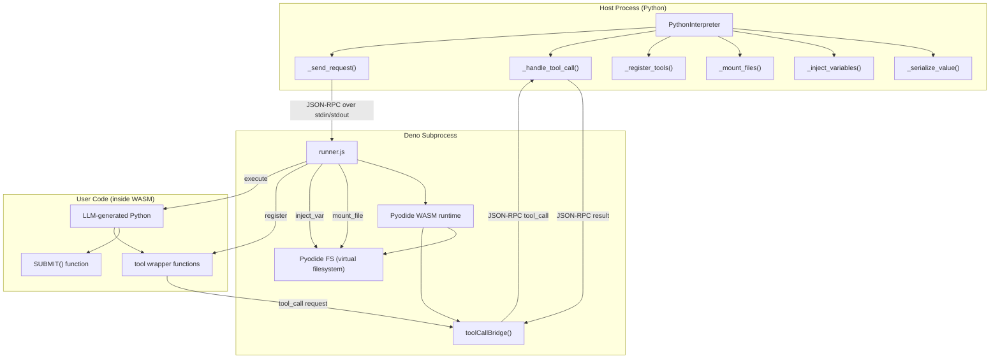
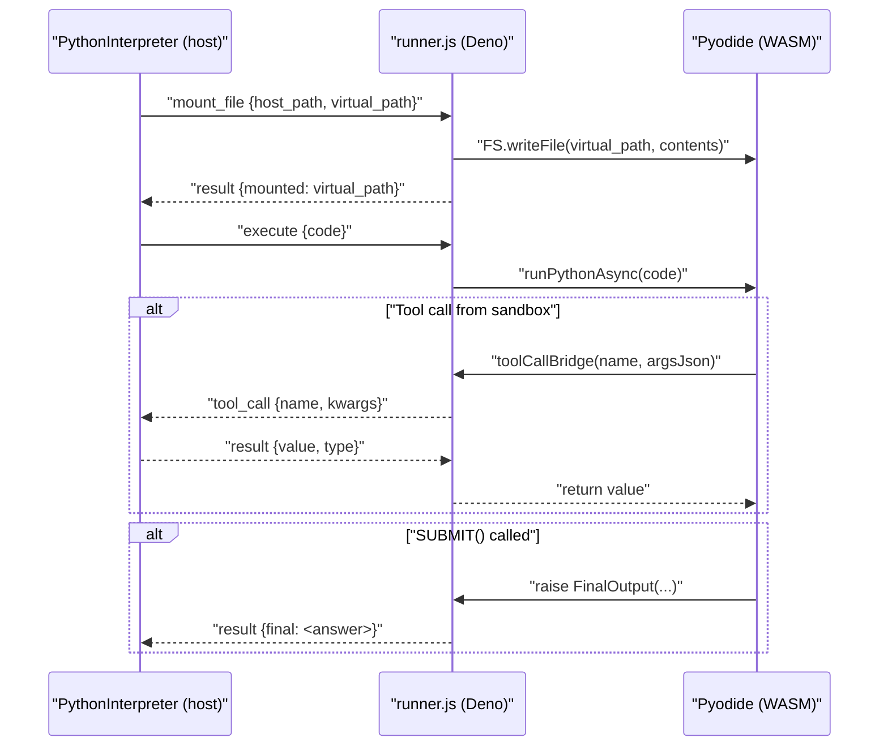
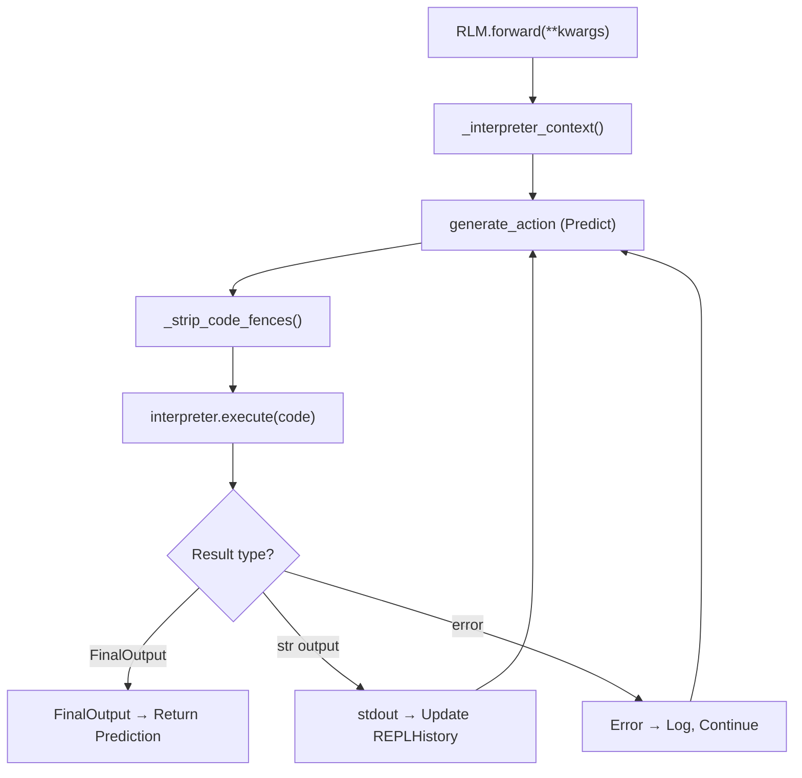
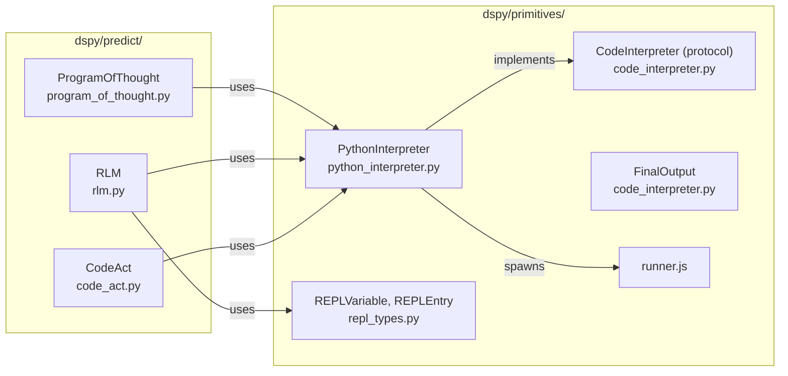

<!-- source: DeepWiki mcp.deepwiki.com · repo stanfordnlp/dspy · page 5.6 Code Execution & Sandboxing · fetched 2026-10-27 -->

# Code Execution & Sandboxing

Relevant source files

The following files were used as context for generating this wiki page:

- [docs/docs/api/modules/CodeAct.md](docs/docs/api/modules/CodeAct.md)
- [docs/docs/api/modules/ProgramOfThought.md](docs/docs/api/modules/ProgramOfThought.md)
- [docs/docs/api/modules/RLM.md](docs/docs/api/modules/RLM.md)
- [docs/docs/api/tools/PythonInterpreter.md](docs/docs/api/tools/PythonInterpreter.md)
- [docs/docs/diving-deeper/built-in-module-variants.md](docs/docs/diving-deeper/built-in-module-variants.md)
- [docs/docs/diving-deeper/flex.md](docs/docs/diving-deeper/flex.md)
- [docs/docs/diving-deeper/rlm.md](docs/docs/diving-deeper/rlm.md)
- [dspy/predict/code_act.py](dspy/predict/code_act.py)
- [dspy/predict/program_of_thought.py](dspy/predict/program_of_thought.py)
- [dspy/predict/rlm.py](dspy/predict/rlm.py)
- [dspy/primitives/__init__.py](dspy/primitives/__init__.py)
- [dspy/primitives/code_interpreter.py](dspy/primitives/code_interpreter.py)
- [dspy/primitives/python_interpreter.py](dspy/primitives/python_interpreter.py)
- [dspy/primitives/repl_types.py](dspy/primitives/repl_types.py)
- [dspy/primitives/runner.js](dspy/primitives/runner.js)
- [tests/mock_interpreter.py](tests/mock_interpreter.py)
- [tests/predict/test_code_act.py](tests/predict/test_code_act.py)
- [tests/predict/test_program_of_thought.py](tests/predict/test_program_of_thought.py)
- [tests/predict/test_rlm.py](tests/predict/test_rlm.py)
- [tests/primitives/test_python_interpreter.py](tests/primitives/test_python_interpreter.py)

This page documents DSPy's sandboxed Python code execution system: the `CodeInterpreter` protocol, the `PythonInterpreter` implementation (backed by Deno and Pyodide/WASM), the JSON-RPC communication protocol between host and sandbox, the security permission model, and the higher-level modules (`ProgramOfThought`, `RLM`, `CodeAct`) that use the sandbox.

For tool registration at the DSPy adapter level, see [Tool Integration & Function Calling](3.3). For the reasoning modules that drive code generation, see [Reasoning Strategies](3.2).

---

## Overview

DSPy provides sandboxed Python code execution for modules that need to run LLM-generated code safely. The key design decision is that user code runs inside a **WebAssembly (WASM) sandbox** via [Pyodide](https://pyodide.org) hosted by the [Deno](https://deno.com) runtime, not in the host Python process. This isolates generated code from the host filesystem, network, and environment by default.

**Architecture layers:**

| Layer | Component | Role |
|---|---|---|
| Protocol | `CodeInterpreter` (protocol) | Abstract interface for execution environments |
| Sandbox host | `PythonInterpreter` | Manages Deno subprocess, serializes variables |
| Sandbox runtime | `runner.js` | Deno-side: loads Pyodide, dispatches JSON-RPC |
| Communication | JSON-RPC 2.0 | stdin/stdout protocol between host and sandbox |
| Modules | `RLM`, `ProgramOfThought`, `CodeAct` | DSPy modules that drive code generation & execution |
| Testing | `MockInterpreter` | Scriptable responses, no Deno required |

Sources: [dspy/primitives/code_interpreter.py:1-10](), [dspy/primitives/python_interpreter.py:1-8](), [dspy/primitives/runner.js:1-6]()

---

## Core Abstractions

### `CodeInterpreter` Protocol

[dspy/primitives/code_interpreter.py:52-148]() defines `CodeInterpreter` as a `runtime_checkable` `Protocol`. Any class implementing the interface can be used as a code execution backend.

| Method / Property | Signature | Description |
|---|---|---|
| `tools` | `dict[str, Callable[..., Any]]` | Host-side functions callable from sandbox code |
| `start()` | `-> None` | Pre-warm the interpreter (idempotent, lazy if not called) |
| `execute(code, variables)` | `-> Any` | Run code, return result or `FinalOutput` |
| `shutdown()` | `-> None` | Release resources, end session |

State **persists across `execute()` calls** within a single session [dspy/primitives/code_interpreter.py:134-136](). Variables defined in one call are visible in the next.

### `FinalOutput`

[dspy/primitives/code_interpreter.py:32-49]() defines `FinalOutput`, a simple wrapper returned by `execute()` when the sandbox code calls `SUBMIT()`. It signals that the execution loop should terminate and propagate the contained value to the caller.

### `CodeInterpreterError` & `CodeExecutionError`

- **`CodeInterpreterError`**: Base class for failures that submitted code cannot repair, such as invalid host-side setup or a process/protocol failure [dspy/primitives/code_interpreter.py:18-26]().
- **`CodeExecutionError`**: Recoverable error raised by code running in a healthy interpreter (e.g., `ZeroDivisionError`) [dspy/primitives/code_interpreter.py:28-30]().

Sources: [dspy/primitives/code_interpreter.py:1-180]()

---

## `PythonInterpreter`

`PythonInterpreter` ([dspy/primitives/python_interpreter.py:97-596]()) is the primary implementation. It launches a Deno subprocess that runs `runner.js`, communicates over stdin/stdout via JSON-RPC 2.0, and isolates user code in a Pyodide/WASM environment.

### Architecture Diagram

**`PythonInterpreter` component relationships**

Sources: [dspy/primitives/python_interpreter.py:97-596](), [dspy/primitives/runner.js:141-210]()

### Lifecycle

The interpreter follows a lazy initialization model:

1. **Construction** (`__init__`): Builds the `deno_command` argument list [dspy/primitives/python_interpreter.py:122-173]().
2. **First `execute()`**: Calls `_ensure_deno_process()` [dspy/primitives/python_interpreter.py:316-341](), spawning the Deno subprocess.
3. **`_mount_files()`**: Copies host files into the Pyodide virtual filesystem (`/sandbox/<name>`) [dspy/primitives/python_interpreter.py:217-237]().
4. **`_register_tools()`**: Sends a `register` JSON-RPC request with tool signatures and output field definitions [dspy/primitives/python_interpreter.py:239-276]().
5. **`execute()` loop**: Sends `execute` request; handles `tool_call` requests until a `result` or `error` arrives [dspy/primitives/python_interpreter.py:484-596]().
6. **`shutdown()`**: Sends `shutdown` notification, terminates process [dspy/primitives/python_interpreter.py:355-367]().

Sources: [dspy/primitives/python_interpreter.py:316-596]()

---

## Security Model

The security model is based on Deno's permission flags. All permissions default to **deny**.

**Opt-in grants:**

| Grant | Constructor parameter | Deno flag |
|---|---|---|
| Read paths | `enable_read_paths` | `--allow-read=<paths>` |
| Write paths | `enable_write_paths` | `--allow-write=<paths>` |
| Env vars | `enable_env_vars` | `--allow-env=<vars>` |
| Network | `enable_network_access` | `--allow-net=<hosts>` |

File access inside the sandbox uses **virtual paths**: `enable_read_paths=["/host/data.txt"]` mounts to `/sandbox/data.txt` inside the WASM environment [dspy/primitives/python_interpreter.py:228-231]().

Sources: [dspy/primitives/python_interpreter.py:122-173](), [dspy/primitives/python_interpreter.py:217-237]()

---

## JSON-RPC 2.0 Communication Protocol

Host and sandbox communicate over stdin/stdout using JSON-RPC 2.0 messages.

**Message flow diagram**

Sources: [dspy/primitives/python_interpreter.py:60-83](), [dspy/primitives/runner.js:116-132](), [dspy/primitives/runner.js:327-385]()

---

## Recursive Language Model (RLM)

`RLM` ([dspy/predict/rlm.py:117-550]()) is the preferred inference strategy for large contexts. It treats long contexts as part of an external environment rather than feeding them directly to the prompt [dspy/predict/rlm.py:4-9]().

**`RLM` execution flow:**

Sources: [dspy/predict/rlm.py:127-550]()

### Built-in RLM Tools

Inside the RLM REPL, the LLM has access to:
- `llm_query(prompt)`: Query a sub-LLM for semantic analysis [dspy/predict/rlm.py:225-248]().
- `llm_query_batched(prompts)`: Query multiple prompts concurrently [dspy/predict/rlm.py:250-276]().
- `SUBMIT()`: Submit final output and end execution [dspy/predict/rlm.py:75]().

Sources: [dspy/predict/rlm.py:55-77](), [dspy/predict/rlm.py:225-276]()

---

## Component Map

**Code entities and their file locations**

Sources: [dspy/primitives/__init__.py:1-20](), [dspy/primitives/code_interpreter.py:1-149](), [dspy/primitives/python_interpreter.py:1-23](), [dspy/predict/rlm.py:117](), [dspy/predict/program_of_thought.py:25](), [dspy/predict/code_act.py:17]()

---

