# Page: Overview

# Overview

<details>
<summary>Relevant source files</summary>

The following files were used as context for generating this wiki page:

- [README.md](README.md)
- [docs/docs/index.md](docs/docs/index.md)
- [docs/docs/static/img/logos/microsoft-ai.svg](docs/docs/static/img/logos/microsoft-ai.svg)
- [docs/docs/stylesheets/extra.css](docs/docs/stylesheets/extra.css)
- [dspy/__init__.py](dspy/__init__.py)
- [dspy/adapters/__init__.py](dspy/adapters/__init__.py)
- [dspy/adapters/types/__init__.py](dspy/adapters/types/__init__.py)

</details>


## Purpose and Scope

This page provides a high-level introduction to DSPy, a framework for programming—rather than prompting—language models. It covers the core philosophy, architectural layers, and high-level capabilities of the system. For detailed information on specific topics, see:

- Core concepts and programming model: [Introduction & Core Concepts](#1.1)
- Practical examples and patterns: [Use Cases & Applications](#1.2)
- Getting started guide: [Installation & Quick Start](#1.3)
- Deep dive into architecture: [Core Architecture](#2)
- Building programs: [Building DSPy Programs](#3)
- Optimization details: [Program Optimization](#4)

**Sources:** [README.md:1-89](), [dspy/__init__.py:1-65]()

---

## What is DSPy?

DSPy (Declarative Self-improving Python) is a framework that enables **programming language models through compositional code** rather than manual prompt engineering [README.md:16-18](). The core philosophy distinguishes it from traditional prompting approaches:

| Traditional Prompting | DSPy Programming |
|----------------------|-----------------|
| Hand-crafted string templates | Declarative `Signature` definitions |
| Brittle, model-specific prompts | Portable, model-agnostic modules |
| Manual few-shot example curation | Automatic example synthesis via optimizers |
| Trial-and-error iteration | Metric-driven compilation |

The framework is named for its declarative nature—users specify *what* the LM should do (via signatures) rather than *how* to prompt it [README.md:18](). The "self-improving" aspect refers to DSPy's **optimizers** (formerly called "teleprompters"), which automatically tune prompts and weights to maximize user-defined metrics [README.md:16-18]().

Title: DSPy Compile-Then-Run Philosophy
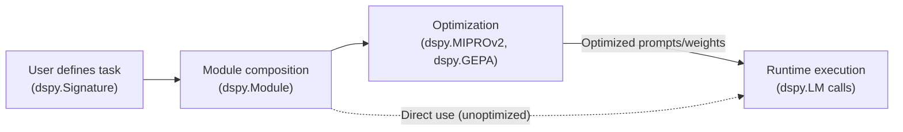

**Sources:** [README.md:7-18](), [dspy/__init__.py:1-5]()

---

## System Architecture

DSPy is organized into layers responsible for distinct concerns, from high-level user APIs to low-level LM interaction.

Title: Architectural Layers of DSPy
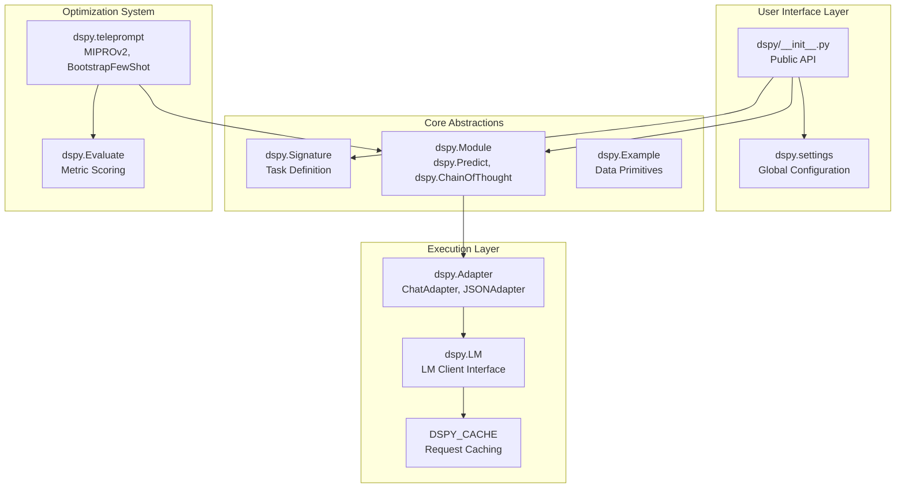

### Layer Descriptions

| Layer | Primary Components | Responsibility |
|-------|-------------------|----------------|
| **User Interface** | `dspy/__init__.py`, `dspy.settings` | Public API aggregation and global configuration management [dspy/__init__.py:1-53](), [dspy/__init__.py:58-60](). |
| **Core Abstractions** | `Signature`, `Module`, `Example` | Programming model: task definitions and modular composition [dspy/__init__.py:2-4](). |
| **Execution** | `Adapter`, `LM`, `DSPY_CACHE` | LM interaction, prompt formatting via adapters, and automatic request caching [dspy/adapters/__init__.py:1-24](), [dspy/__init__.py:52-64](). |
| **Optimization** | `Evaluate`, `teleprompt` | Automatic prompt and weight tuning based on metrics [dspy/__init__.py:5-7](). |

**Sources:** [dspy/__init__.py:1-65](), [dspy/adapters/__init__.py:1-24]()

---

## Core Programming Model

DSPy programs are built from three fundamental abstractions:

### Signatures: Task Specification
A `Signature` defines the input/output schema for a task. It decouples the *intent* of the task from the *implementation* of the prompt [dspy/__init__.py:4]().

### Modules: Composable Components
`dspy.Module` is the base class for all DSPy programs [dspy/__init__.py:2](). The framework provides built-in modules for different reasoning strategies:
- `dspy.Predict`: Basic signature-to-output mapping [dspy/__init__.py:1]().
- `dspy.Reasoning`: A type used to support both native and prompt-based reasoning steps [dspy/adapters/types/reasoning.py:7-10]().
- `dspy.Tool`: Wraps Python functions for agentic interaction [dspy/adapters/types/tool.py:8-9]().

### Optimizers: Automatic Improvement
Optimizers (aliased from `teleprompt`) tune the parameters of a DSPy program (prompts or weights) to maximize a metric [dspy/__init__.py:5]().
- **Prompt Optimizers**: `MIPROv2`, `GEPA`, `BootstrapFewShotWithRandomSearch` (aliased as `BootstrapRS`) [dspy/__init__.py:62]().
- **Evaluation**: The `Evaluate` class provides the infrastructure for metric scoring [dspy/__init__.py:8]().

**Sources:** [dspy/__init__.py:1-65](), [dspy/adapters/types/reasoning.py:7-10](), [dspy/adapters/types/tool.py:8-9]()

---

## Data Flow Through the System

The following diagram illustrates how data flows from user code through the compilation (optimization) phase to runtime execution, specifically highlighting how `dspy.Adapter` bridges the signature to the LM.

Title: Data Flow from Definition to Execution
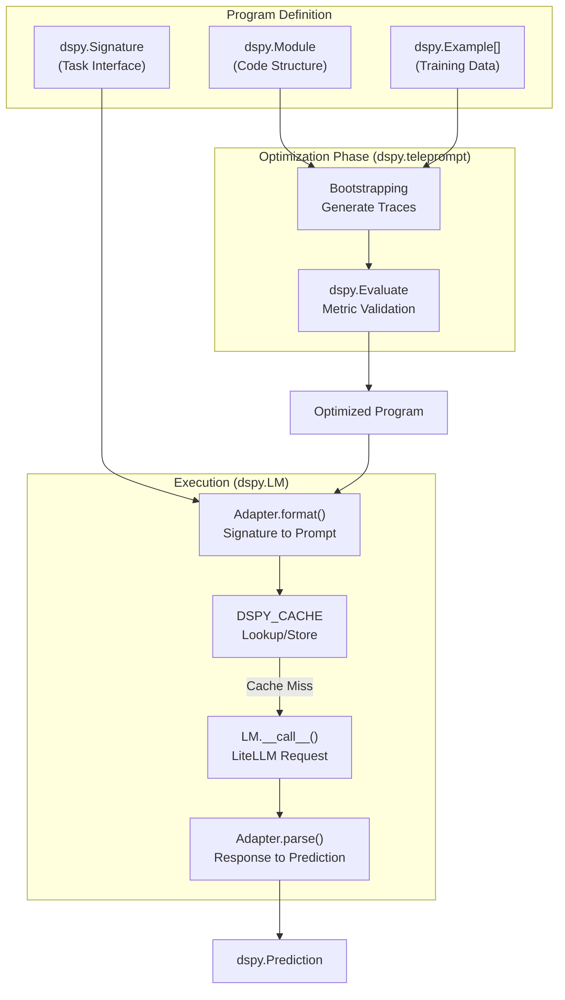

**Sources:** [dspy/__init__.py:1-10](), [dspy/adapters/base.py:1-6](), [dspy/adapters/types/tool.py:8-9]()

---

## High-Level Capabilities

| Capability | Description |
|------------|-------------|
| **Multi-Model Support** | Unified interface for various providers via `dspy.clients` and LiteLLM integration [dspy/__init__.py:9](). |
| **Reasoning Strategies** | Native support for `Reasoning` types that adapt to model-specific features [dspy/adapters/types/reasoning.py:7-10](). |
| **Tool Integration** | Automatic inference of tool schemas from Python functions using `dspy.Tool` [dspy/adapters/types/tool.py:8-9](). |
| **Typed Interaction** | Support for complex types including `Image`, `Audio`, `File`, `Code`, and `ToolCalls` [dspy/adapters/__init__.py:5-6](). |
| **Async & Streaming** | Native utilities like `asyncify`, `syncify`, and `streamify` for high-performance execution [dspy/__init__.py:45-48](). |

**Sources:** [dspy/__init__.py:1-65](), [dspy/adapters/types/reasoning.py:7-10](), [dspy/adapters/types/tool.py:8-9]()

---

## Getting Started

To begin using DSPy, proceed to:

1. **[Installation & Quick Start](#1.3)** — Set up the library via `pip install dspy` and configure your first LM [README.md:27-32]().
2. **[Introduction & Core Concepts](#1.1)** — Learn about Signatures, Modules, and the declarative programming model.
3. **[Use Cases & Applications](#1.2)** — Explore patterns for RAG, Agents, and classification.
4. **[Program Optimization](#4)** — Understand how to use `MIPROv2`, `GEPA`, and other optimizers to improve your programs.

**Sources:** [README.md:27-38](), [dspy/__init__.py:1-65]()

---

# Page: Introduction & Core Concepts

# Introduction & Core Concepts

<details>
<summary>Relevant source files</summary>

The following files were used as context for generating this wiki page:

- [README.md](README.md)
- [docs/docs/learn/index.md](docs/docs/learn/index.md)
- [docs/docs/learn/programming/modules.md](docs/docs/learn/programming/modules.md)
- [docs/docs/learn/programming/overview.md](docs/docs/learn/programming/overview.md)
- [docs/docs/tutorials/build_ai_program/index.md](docs/docs/tutorials/build_ai_program/index.md)
- [docs/docs/tutorials/conversation_history/index.md](docs/docs/tutorials/conversation_history/index.md)
- [docs/docs/tutorials/core_development/index.md](docs/docs/tutorials/core_development/index.md)
- [docs/docs/tutorials/index.md](docs/docs/tutorials/index.md)
- [docs/docs/tutorials/optimize_ai_program/index.md](docs/docs/tutorials/optimize_ai_program/index.md)
- [docs/docs/tutorials/program_of_thought/index.ipynb](docs/docs/tutorials/program_of_thought/index.ipynb)
- [docs/docs/tutorials/rl_ai_program/index.md](docs/docs/tutorials/rl_ai_program/index.md)
- [docs/mkdocs.yml](docs/mkdocs.yml)
- [docs/overrides/partials/tabs.html](docs/overrides/partials/tabs.html)

</details>


This page introduces DSPy's core philosophy and fundamental abstractions. It explains the framework's declarative programming paradigm for language models and presents the three key concepts—Signatures, Modules, and Optimizers—that enable systematic development of AI systems.

---

## Core Philosophy: Programming, Not Prompting

DSPy reframes language model interaction from **brittle prompt engineering** to **systematic program development**. Instead of manually crafting and tweaking prompts, developers write compositional Python code that declares what the system should accomplish. DSPy then automatically generates and optimizes the prompts and model weights needed to achieve high-quality outputs [README.md:16-18]().

### The Compile-Then-Run Model

DSPy introduces a **compilation paradigm** for LM programs, analogous to traditional programming languages:

1.  **Write declarative code:** Define program structure using `dspy.Signature` [docs/docs/learn/programming/modules.md:18-18]() and `dspy.Module` [docs/docs/learn/programming/modules.md:7-13]().
2.  **Compile with optimizer:** Use algorithms to improve the program by tuning prompts or fine-tuning weights based on a metric [docs/docs/learn/index.md:13-14]().
3.  **Deploy optimized artifact:** Run the compiled program in production. The DSPy compiler handles the mapping of your declarative logic to the specific LM's optimal prompt format [docs/docs/learn/programming/overview.md:16-19]().

This separates the **declarative logic** (what to do) from the **optimized implementation** (how to prompt the specific LM) [docs/docs/learn/programming/overview.md:16-19]().

**Compile-Then-Run Workflow Diagram**

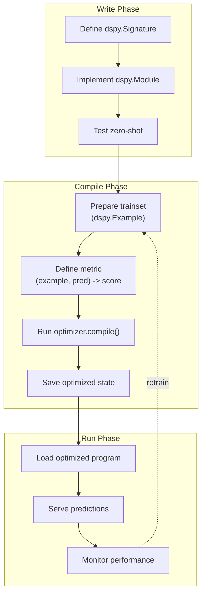

**Sources:** [docs/docs/learn/index.md:7-15](), [docs/docs/learn/programming/overview.md:16-19](), [README.md:16-18]()

---

## The Three Core Abstractions

DSPy's architecture centers on three complementary abstractions that separate concerns and enable systematic development.

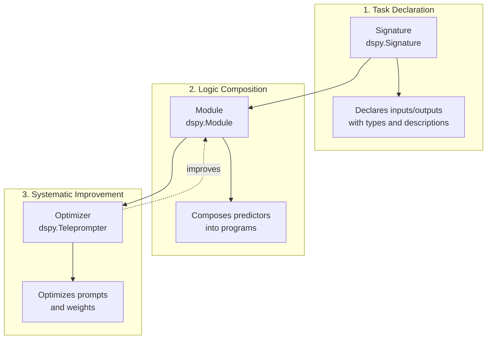

**Sources:** [README.md:16-18](), [docs/docs/learn/programming/overview.md:16-19](), [docs/docs/learn/programming/modules.md:7-13]()

---

## Abstraction 1: Signatures

A **Signature** is a declarative specification of a task's input and output structure. It defines what fields the LM receives and what it should produce, along with optional descriptions and constraints [docs/docs/learn/programming/modules.md:18-18]().

### Defining Signatures

Signatures can be created in two ways:

**String notation** for simple cases [docs/docs/learn/programming/modules.md:23-26]():
```python
# Format: "input1, input2 -> output1, output2"
classify = dspy.Predict("sentence -> sentiment: bool")
```

**Class notation** for structured definitions with metadata [docs/docs/learn/programming/modules.md:142-148]():
```python
class Classify(dspy.Signature):
    """Classify sentiment of a given sentence.""" # Task description
    
    sentence: str = dspy.InputField()
    sentiment: Literal['positive', 'negative', 'neutral'] = dspy.OutputField()
```

### Key Components

| Component | Purpose | File Reference |
| :--- | :--- | :--- |
| `dspy.InputField` | Declares input parameters and descriptions | [docs/docs/learn/programming/modules.md:145-145]() |
| `dspy.OutputField` | Declares expected outputs and constraints | [docs/docs/learn/programming/modules.md:146-147]() |
| `dspy.History` | Manages conversation turns as an input field | [docs/docs/tutorials/conversation_history/index.md:17-20]() |
| Type Hints | Enforce output structure (e.g., `float`, `list[str]`) | [docs/docs/learn/programming/modules.md:103-103]() |

**Signature System Architecture**

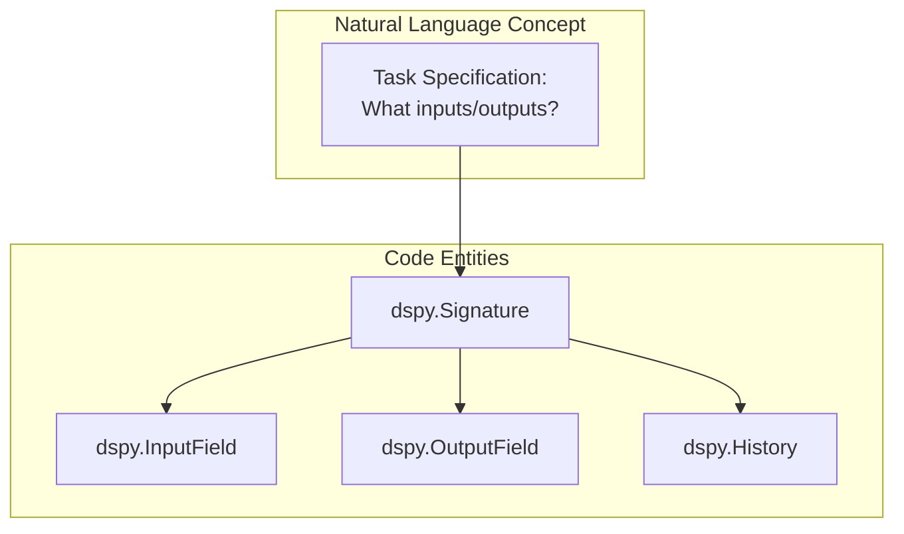

**Sources:** [docs/docs/learn/programming/modules.md:18-160](), [docs/docs/tutorials/conversation_history/index.md:3-23]()

---

## Abstraction 2: Modules

A **Module** is a building block for programs that use LMs. Each built-in module abstracts a specific prompting technique (like Chain of Thought) and is generalized to handle any signature [docs/docs/learn/programming/modules.md:7-13]().

### Core Module Types [docs/docs/learn/programming/modules.md:80-95]()

| Module Type | Purpose |
| :--- | :--- |
| `dspy.Predict` | Basic predictor; handles instructions and demonstrations. |
| `dspy.ChainOfThought` | Teaches the LM to think step-by-step (adds `reasoning` field). |
| `dspy.ProgramOfThought` | Teaches the LM to output code for execution via a sandbox. |
| `dspy.ReAct` | An agent loop that can use tools to implement a signature. |
| `dspy.RLM` | Recursive Language Model for exploring large contexts. |

**Module Hierarchy**

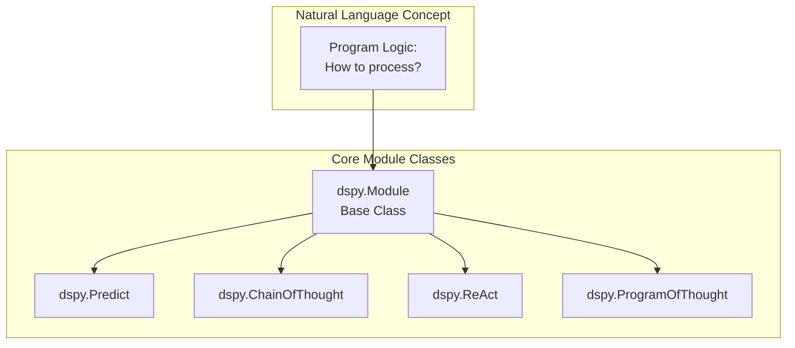

**Sources:** [docs/docs/learn/programming/modules.md:7-95](), [docs/docs/tutorials/program_of_thought/index.ipynb:9-31]()

---

## Abstraction 3: Optimizers

An **Optimizer** tunes the parameters of a DSPy program—specifically the prompts (instructions/demonstrations) and/or the LM weights—to maximize a given metric [docs/docs/learn/index.md:13-14]().

### Optimization Strategies

*   **Few-Shot Bootstrapping:** Algorithms like `BootstrapFewShot` generate self-consistent demonstrations by running the program and filtering successful traces [README.md:50-51]().
*   **Instruction Optimization:** Algorithms like `MIPROv2` search the space of natural language instructions using Bayesian optimization [README.md:50-50]().
*   **Reflective Prompt Evolution:** `GEPA` uses reflection-based evolution to iteratively improve prompts [README.md:49-49]().

**Optimizer Compilation Process**

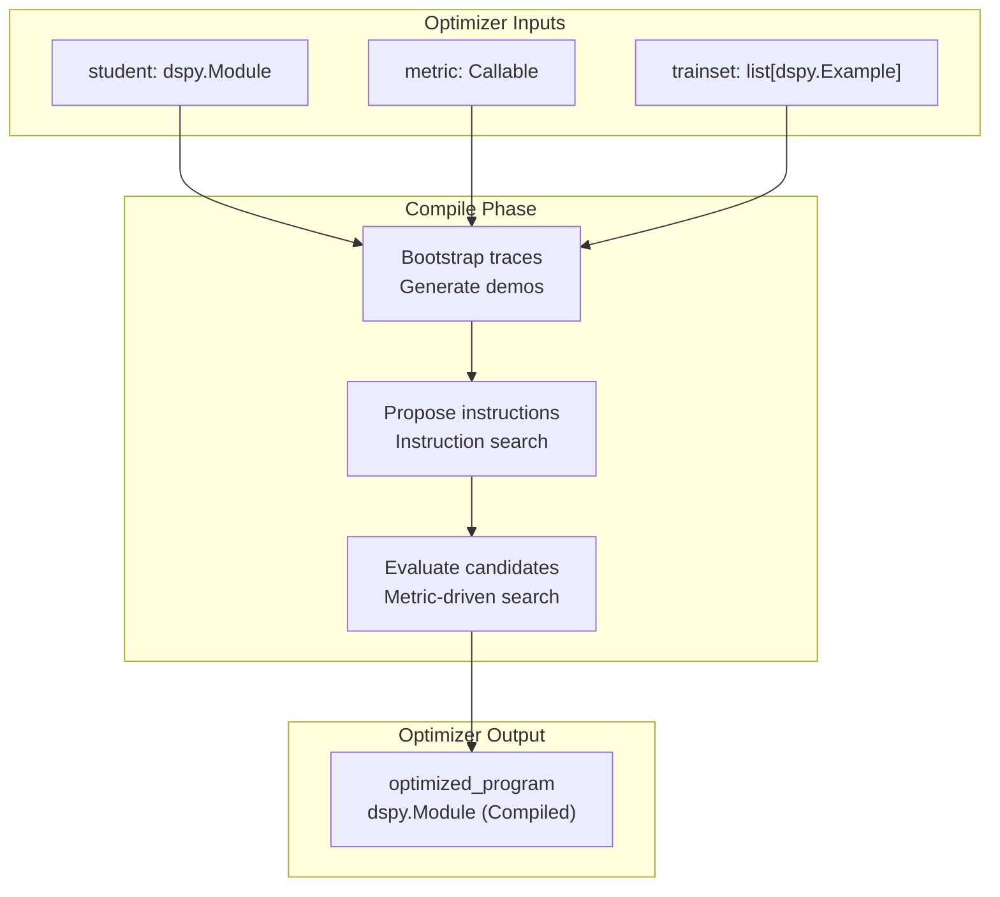

**Sources:** [docs/docs/learn/index.md:7-15](), [README.md:49-57](), [docs/docs/learn/programming/overview.md:16-19]()

---

# Page: Use Cases & Applications

# Use Cases & Applications

<details>
<summary>Relevant source files</summary>

The following files were used as context for generating this wiki page:

- [docs/docs/community/built-with-dspy.md](docs/docs/community/built-with-dspy.md)
- [docs/docs/community/community-resources.md](docs/docs/community/community-resources.md)
- [docs/docs/community/use-cases.md](docs/docs/community/use-cases.md)
- [docs/docs/production/index.md](docs/docs/production/index.md)
- [docs/docs/static/img/logos/aws.svg](docs/docs/static/img/logos/aws.svg)
- [docs/docs/static/img/logos/databricks-wordmark.svg](docs/docs/static/img/logos/databricks-wordmark.svg)
- [docs/docs/static/img/logos/databricks.svg](docs/docs/static/img/logos/databricks.svg)
- [docs/docs/static/img/logos/dropbox-wordmark.svg](docs/docs/static/img/logos/dropbox-wordmark.svg)
- [docs/docs/static/img/logos/dropbox.svg](docs/docs/static/img/logos/dropbox.svg)
- [docs/docs/tutorials/agents/index.ipynb](docs/docs/tutorials/agents/index.ipynb)
- [docs/docs/tutorials/classification_finetuning/index.ipynb](docs/docs/tutorials/classification_finetuning/index.ipynb)
- [docs/docs/tutorials/custom_module/index.ipynb](docs/docs/tutorials/custom_module/index.ipynb)
- [docs/docs/tutorials/custom_module/mlflow-tracing-custom-module.png](docs/docs/tutorials/custom_module/mlflow-tracing-custom-module.png)
- [docs/docs/tutorials/customer_service_agent/index.ipynb](docs/docs/tutorials/customer_service_agent/index.ipynb)
- [docs/docs/tutorials/customer_service_agent/mlflow-tracing-customer-service-agent.png](docs/docs/tutorials/customer_service_agent/mlflow-tracing-customer-service-agent.png)
- [docs/docs/tutorials/deployment/index.md](docs/docs/tutorials/deployment/index.md)
- [docs/docs/tutorials/email_extraction/index.md](docs/docs/tutorials/email_extraction/index.md)
- [docs/docs/tutorials/email_extraction/mlflow-tracing-email-extraction.png](docs/docs/tutorials/email_extraction/mlflow-tracing-email-extraction.png)
- [docs/docs/tutorials/entity_extraction/index.ipynb](docs/docs/tutorials/entity_extraction/index.ipynb)
- [docs/docs/tutorials/games/index.ipynb](docs/docs/tutorials/games/index.ipynb)
- [docs/docs/tutorials/gepa_aime/mlflow-tracing-gepa-aime.png](docs/docs/tutorials/gepa_aime/mlflow-tracing-gepa-aime.png)
- [docs/docs/tutorials/gepa_aime/mlflow-tracking-gepa-aime-optimization.png](docs/docs/tutorials/gepa_aime/mlflow-tracking-gepa-aime-optimization.png)
- [docs/docs/tutorials/gepa_facilitysupportanalyzer/mlflow-tracing-gepa-support.png](docs/docs/tutorials/gepa_facilitysupportanalyzer/mlflow-tracing-gepa-support.png)
- [docs/docs/tutorials/math/index.ipynb](docs/docs/tutorials/math/index.ipynb)
- [docs/docs/tutorials/multihop_search/index.ipynb](docs/docs/tutorials/multihop_search/index.ipynb)
- [docs/docs/tutorials/rag/index.ipynb](docs/docs/tutorials/rag/index.ipynb)
- [docs/docs/tutorials/tool_use/index.ipynb](docs/docs/tutorials/tool_use/index.ipynb)

</details>


This page showcases common use cases and application patterns in DSPy, demonstrating how the framework's core abstractions (Signatures, Modules, and Optimizers) apply to real-world AI tasks. Each use case includes architectural patterns, relevant modules, and code references from the documentation.

---

## Overview of DSPy Applications

DSPy supports a wide range of AI applications through its modular, composable architecture. The framework is in production at companies like **Shopify, Databricks, Dropbox, and AWS** [docs/docs/community/use-cases.md:1-14](). It excels at tasks that benefit from systematic prompt optimization and structured workflows, particularly:

- **Multi-step reasoning** (e.g., Multi-hop search) [docs/docs/tutorials/multihop_search/index.ipynb:7-11]().
- **Tool-augmented workflows** (e.g., ReAct agents) [docs/docs/tutorials/agents/index.ipynb:7-11]().
- **Structured metadata extraction** (e.g., Shopify's 550x cost reduction via GEPA) [docs/docs/community/use-cases.md:20-25]().
- **Domain-specific reasoning** (e.g., Math, Law, Medical reports) [docs/docs/community/use-cases.md:56-57]().

**Sources:** [docs/docs/community/use-cases.md:1-71](), [docs/docs/tutorials/rag/index.ipynb:7-11]()

---

## Mathematical Reasoning

### Overview
Mathematical reasoning involves solving quantitative problems through step-by-step logic. DSPy's `dspy.ChainOfThought` module is the standard for these tasks, as it forces the LM to produce a `reasoning` trace before the final `answer` [docs/docs/tutorials/math/index.ipynb:159-161]().

### Architecture Pattern
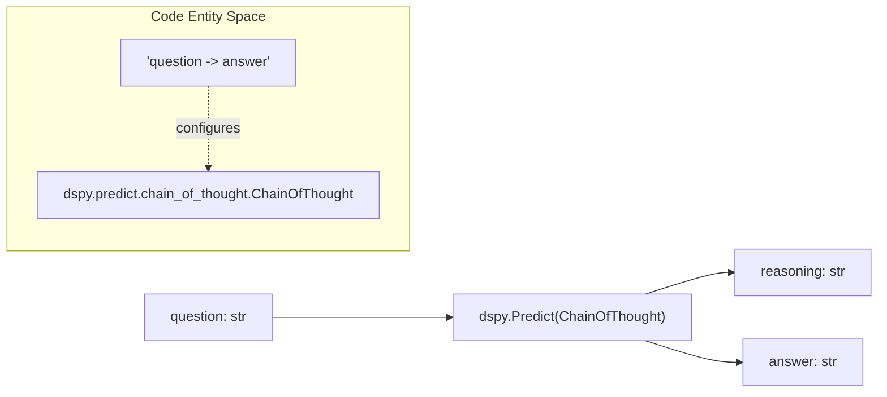
**Diagram: Mathematical Reasoning Flow**

### Example Implementation
The documentation demonstrates solving algebra questions from the MATH benchmark [docs/docs/tutorials/math/index.ipynb:101-131](). For high precision, `dspy.ChainOfThought` is initialized with a signature string or class to define the task structure [docs/docs/tutorials/math/index.ipynb:159-160]().

```python
module = dspy.ChainOfThought("question -> answer")
response = module(question="If x + y = 10 and x - y = 2, what is x?")
```

**Sources:** [docs/docs/tutorials/math/index.ipynb:1-162](), [docs/docs/tutorials/deployment/index.md:11-12]()

---

## Retrieval-Augmented Generation (RAG)

### Overview
RAG systems enhance LM responses by retrieving relevant context from external knowledge bases. DSPy provides native integration for retrievers like `dspy.ColBERTv2` and `dspy.retrievers.Embeddings` [docs/docs/tutorials/rag/index.ipynb:11-12](), [docs/docs/tutorials/multihop_search/index.ipynb:153-162]().

### Architecture Pattern
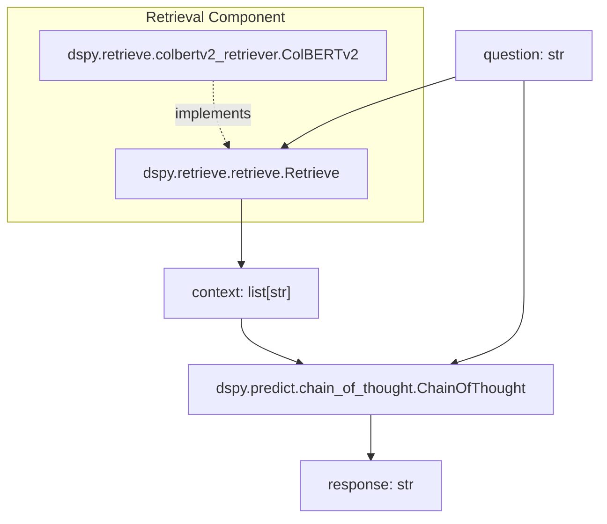
**Diagram: RAG System Architecture**

### Implementation
A basic RAG module typically includes a retrieval step followed by a generation step using a signature like `context, question -> response` [docs/docs/tutorials/rag/index.ipynb:205-220]().

```python
import dspy
lm = dspy.LM('openai/gpt-4o-mini')
dspy.configure(lm=lm)
retriever = dspy.ColBERTv2(url='http://20.102.90.50:2017/wiki17_abstracts')
```

**Sources:** [docs/docs/tutorials/rag/index.ipynb:1-220](), [docs/docs/tutorials/multihop_search/index.ipynb:153-162]()

---

## Agent Systems & Fine-tuning

### Overview
Agents use tools and reasoning loops to solve complex tasks. DSPy's `dspy.ReAct` module implements this by consuming a signature and a list of tool functions [docs/docs/tutorials/agents/index.ipynb:192-205](), [docs/docs/tutorials/customer_service_agent/index.ipynb:13-21]().

### Architecture Pattern
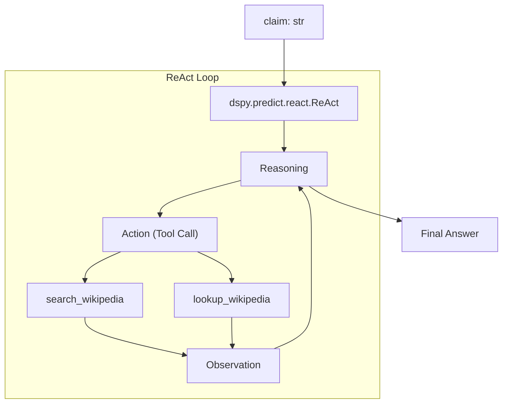
**Diagram: ReAct Agent Architecture**

### Fine-tuning Agents
DSPy allows optimizing the *language model weights* (fine-tuning) within a module. For example, an agent can be taught to play games by fine-tuning a small model like `gpt-4o-mini` using trajectories from a larger teacher model like `gpt-4o` [docs/docs/tutorials/games/index.ipynb:9-13](), [docs/docs/tutorials/games/index.ipynb:73-74](). This is often implemented via `dspy.BootstrapFinetune`.

**Sources:** [docs/docs/tutorials/agents/index.ipynb:1-205](), [docs/docs/tutorials/games/index.ipynb:7-200](), [docs/docs/tutorials/customer_service_agent/index.ipynb:9-21]()

---

## Information & Entity Extraction

### Overview
Extraction tasks involve structuring unstructured text into specific fields. DSPy signatures can define multiple output fields or specific types to enforce structure, including `pydantic.BaseModel` for complex schemas [docs/docs/tutorials/entity_extraction/index.ipynb:143-146](), [docs/docs/tutorials/email_extraction/index.md:91-95]().

### Implementation Example
In email extraction, signatures are used to classify intent and extract entities like financial amounts or dates [docs/docs/tutorials/email_extraction/index.md:102-123]().

```python
class ClassifyEmail(dspy.Signature):
    """Classify the type and urgency of an email."""
    email_subject: str = dspy.InputField()
    email_body: str = dspy.InputField()
    email_type: EmailType = dspy.OutputField()
    urgency: UrgencyLevel = dspy.OutputField()
```

**Sources:** [docs/docs/tutorials/entity_extraction/index.ipynb:1-156](), [docs/docs/tutorials/email_extraction/index.md:64-145]()

---

## Multi-Hop Reasoning

### Overview
Multi-hop reasoning requires sequential steps where the output of one step informs the next, such as generating new search queries based on previously retrieved context [docs/docs/tutorials/multihop_search/index.ipynb:7-11]().

### Architecture Pattern
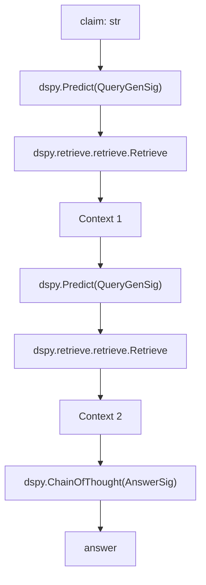
**Diagram: Multi-Hop Retrieval Flow**

**Sources:** [docs/docs/tutorials/multihop_search/index.ipynb:1-230](), [docs/docs/tutorials/agents/index.ipynb:84-107]()

---

## Production Deployment

### Lightweight & Production-Grade Options
DSPy programs can be deployed as REST APIs using **FastAPI** or managed through **MLflow** for versioning and tracking [docs/docs/tutorials/deployment/index.md:1-5]().

- **FastAPI:** Uses `dspy.asyncify` to convert programs for high-throughput async execution [docs/docs/tutorials/deployment/index.md:41-45](). `dspy.streamify` is used for streaming intermediate outputs [docs/docs/tutorials/deployment/index.md:70-76]().
- **MLflow:** Provides native integration for visualizing traces, logging models via `mlflow.dspy.log_model()`, and autologging [docs/docs/tutorials/deployment/index.md:149-151](), [docs/docs/tutorials/rag/index.ipynb:58-63]().

### Serialization
Programs can be saved as state-only (JSON/Pickle) or as whole programs using `dspy.Module.save` and `dspy.Module.load` mechanisms [docs/docs/tutorials/deployment/index.md:134-158]().

**Sources:** [docs/docs/tutorials/deployment/index.md:1-186](), [docs/docs/tutorials/rag/index.ipynb:28-65]()

---

# Page: Installation & Quick Start

# Installation & Quick Start

<details>
<summary>Relevant source files</summary>

The following files were used as context for generating this wiki page:

- [.github/.internal_dspyai/pyproject.toml](.github/.internal_dspyai/pyproject.toml)
- [.github/.tmp/.generated-actions/run-pypi-publish-in-docker-container/action.yml](.github/.tmp/.generated-actions/run-pypi-publish-in-docker-container/action.yml)
- [.github/workflows/dependency-range.yml](.github/workflows/dependency-range.yml)
- [docs/docs/getting-started/metrics.md](docs/docs/getting-started/metrics.md)
- [docs/docs/index.md](docs/docs/index.md)
- [docs/docs/static/img/logos/microsoft-ai.svg](docs/docs/static/img/logos/microsoft-ai.svg)
- [docs/docs/stylesheets/extra.css](docs/docs/stylesheets/extra.css)
- [dspy/__metadata__.py](dspy/__metadata__.py)
- [pyproject.toml](pyproject.toml)
- [uv.lock](uv.lock)

</details>


This page guides you through installing DSPy, configuring a language model, and writing your first DSPy program. DSPy (Declarative Self-improving Python) shifts the focus from manual prompt engineering to programming with structured natural-language modules.

## Prerequisites

DSPy requires:
- **Python 3.10 or higher** (up to 3.14). [pyproject.toml:16-16]()
- An API key for a language model provider (OpenAI, Anthropic, etc.) or a local LM server like Ollama or SGLang.

---

## Installation

### Basic Installation

Install the latest version of DSPy from PyPI:

```bash
pip install -U dspy
```

This installs core dependencies including `litellm` for provider abstraction, `pydantic` for schema validation, `orjson` for fast serialization, `diskcache` for automatic request caching, and `gepa` for reflective optimization. [pyproject.toml:23-38]()

### Optional Dependencies

DSPy uses optional extras for specific integrations:

| Feature | Installation Command | Purpose |
|---------|---------------------|---------|
| Anthropic | `pip install dspy[anthropic]` | Native Anthropic client support. [pyproject.toml:41-41]() |
| Weaviate | `pip install dspy[weaviate]` | Integration with Weaviate vector database. [pyproject.toml:42-42]() |
| MCP | `pip install dspy[mcp]` | Model Context Protocol for tool use. [pyproject.toml:43-43]() |
| Deno | `pip install dspy[deno]` | Sandboxed JavaScript/TypeScript execution for tools. [pyproject.toml:44-44]() |
| LangChain | `pip install dspy[langchain]` | Compatibility with LangChain Core. [pyproject.toml:45-45]() |
| Optuna | `pip install dspy[optuna]` | Required for Bayesian optimization in `MIPROv2`. [pyproject.toml:46-46]() |
| Dev Tools | `pip install dspy[dev]` | Includes `pytest`, `ruff`, and `pre-commit`. [pyproject.toml:49-64]() |

**Sources:** [pyproject.toml:40-72]()

---

## Configuration

### Configuration Architecture

DSPy uses a global `settings` object to manage the default language model (`LM`) and adapter. The configuration flow bridges high-level user code to low-level provider APIs.

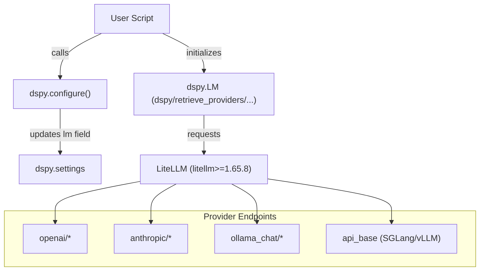

**Configuration Flow from Code to Provider**  
**Sources:** [pyproject.toml:30-30](), [dspy/__init__.py:188-192]() (Note: `dspy.settings` is the central configuration store).

### Setting Up Your Language Model

The `dspy.LM` class is the primary interface for language models. Once initialized, it should be passed to `dspy.configure`.

#### Cloud Providers (OpenAI, Anthropic)
```python
import dspy

# OpenAI (requires openai>=1.66.2)
lm = dspy.LM("openai/gpt-4o-mini", api_key="YOUR_KEY")
# Anthropic
# lm = dspy.LM("anthropic/claude-3-5-sonnet-latest", api_key="YOUR_KEY")

dspy.configure(lm=lm)
```
**Sources:** [dspy/__metadata__.py:1-8](), [pyproject.toml:24-30]()

#### Local Models (Ollama)
```python
import dspy
lm = dspy.LM('ollama_chat/llama3.2', api_base='http://localhost:11434', api_key='')
dspy.configure(lm=lm)
```

---

## Quick Start: Your First Program

### Execution Flow: Natural Language to Code

DSPy translates declarative **Signatures** into optimized prompts using **Modules**. Data is encapsulated in `dspy.Example` objects and returned as `dspy.Prediction`.

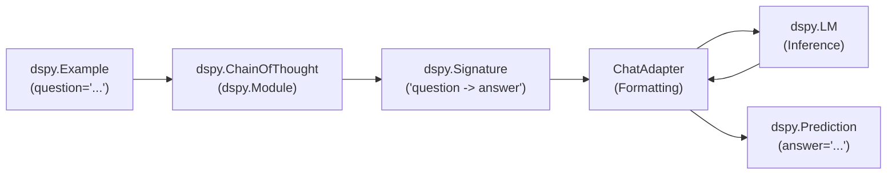

**Data Flow through DSPy Primitives**  
**Sources:** [docs/docs/getting-started/metrics.md:39-44](), [dspy/__init__.py:1-192]()

### Example: Basic QA with Chain of Thought

```python
import dspy

# 1. Setup
dspy.configure(lm=dspy.LM("openai/gpt-4o-mini"))

# 2. Define Module with inline Signature
# "question -> answer" defines the input and output fields
qa = dspy.ChainOfThought("question -> answer")

# 3. Execute
response = qa(question="How many floors are in the castle David Gregory inherited?")

print(f"Reasoning: {response.reasoning}")
print(f"Answer: {response.answer}")
```

### Example: Typed Signature

You can define complex signatures using Python classes for better structure and validation.

```python
class BasicQA(dspy.Signature):
    """Answer questions with short factoid answers."""

    question: str = dspy.InputField()
    answer: str = dspy.OutputField(desc="often between 1 and 5 words")

generate_answer = dspy.ChainOfThought(BasicQA)
pred = generate_answer(question="What is the color of the sky?")
print(pred.answer)
```

---

## Advanced Quick Start: Optimization

A unique feature of DSPy is the ability to **compile** programs. Optimizers tune your prompts or weights based on a metric. [docs/docs/getting-started/metrics.md:9-13]()

### Simple Optimization Flow
```python
import dspy
from dspy.teleprompt import LabeledFewShot

# 1. Define data using dspy.Example
# .with_inputs() marks which fields the program receives
trainset = [
    dspy.Example(question="1+1", answer="2").with_inputs("question")
]

# 2. Define program
program = dspy.Predict("question -> answer")

# 3. Optimize (Labeled Few-Shot)
optimizer = LabeledFewShot(k=1)
compiled_program = optimizer.compile(student=program, trainset=trainset)

# 4. Save
compiled_program.save("math_bot.json")
```
**Sources:** [docs/docs/getting-started/metrics.md:39-52]()

### Building a Metric
To decide what “better” means, an optimizer needs a **metric**: a Python function that scores a single prediction. [docs/docs/getting-started/metrics.md:11-13]()

```python
def simple_metric(example, prediction) -> float:
    # Return 1.0 for correct, 0.0 for incorrect
    return 1.0 if example.answer == prediction.answer else 0.0

# Evaluate a program
evaluate = dspy.Evaluate(devset=trainset, metric=simple_metric)
score = evaluate(program)
```
**Sources:** [docs/docs/getting-started/metrics.md:56-61](), [docs/docs/getting-started/metrics.md:76-78]()

---

## Testing Your Installation

To verify that DSPy is correctly communicating with your LM and utilizing the internal caching systems (powered by `diskcache` and `cachetools`):

```python
import dspy

lm = dspy.LM("openai/gpt-4o-mini")
dspy.configure(lm=lm)

# Test 1: Direct Call (Uses automatic request_cache)
# Uses diskcache>=5.6.0 and cachetools>=5.5.0 internally
print(lm("Say this is a test!")) 

# Test 2: Check version metadata
from dspy.__metadata__ import __version__
print(f"DSPy Version: {__version__}")
```
**Sources:** [dspy/__metadata__.py:4-4](), [pyproject.toml:31-35]()

---

# Page: Community & Resources

# Community & Resources

<details>
<summary>Relevant source files</summary>

The following files were used as context for generating this wiki page:

- [docs/README.md](docs/README.md)
- [docs/docs/community/built-with-dspy.md](docs/docs/community/built-with-dspy.md)
- [docs/docs/community/community-resources.md](docs/docs/community/community-resources.md)
- [docs/docs/community/use-cases.md](docs/docs/community/use-cases.md)
- [docs/docs/production/index.md](docs/docs/production/index.md)
- [docs/docs/roadmap.md](docs/docs/roadmap.md)
- [docs/docs/static/img/logos/aws.svg](docs/docs/static/img/logos/aws.svg)
- [docs/docs/static/img/logos/databricks-wordmark.svg](docs/docs/static/img/logos/databricks-wordmark.svg)
- [docs/docs/static/img/logos/databricks.svg](docs/docs/static/img/logos/databricks.svg)
- [docs/docs/static/img/logos/dropbox-wordmark.svg](docs/docs/static/img/logos/dropbox-wordmark.svg)
- [docs/docs/static/img/logos/dropbox.svg](docs/docs/static/img/logos/dropbox.svg)
- [docs/requirements.txt](docs/requirements.txt)
- [docs/vercel.json](docs/vercel.json)

</details>


This page provides links to DSPy's official community channels, details the documentation system architecture, and catalogues the extensive ecosystem of production use cases, research, and community-maintained tools.

## Official Channels

DSPy maintains several primary hubs for development, support, and documentation. The project is led by Omar Khattab at Stanford and Databricks [docs/docs/roadmap.md:36-36]().

| Channel | Purpose | Location |
|---------|---------|----------|
| **GitHub Repository** | Source code, issues, and PRs | [stanfordnlp/dspy](https://github.com/stanfordnlp/dspy) |
| **Discord Server** | Real-time support and research discussion | [Join Discord](https://discord.gg/XCGy2WDCQB) |
| **Documentation Site** | Official guides and API reference | [dspy.ai](https://dspy.ai) |

**Community Interaction Flow**

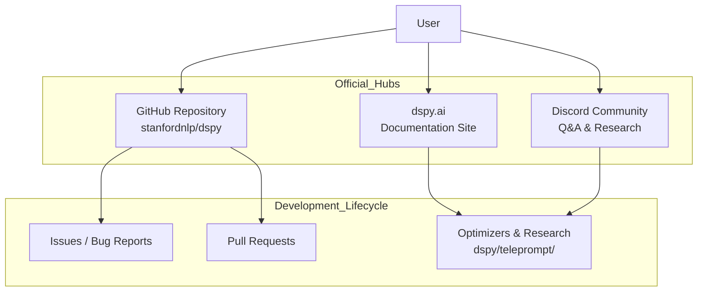

Sources: [docs/docs/roadmap.md:11-13](), [docs/README.md:1-1]()

## Documentation System Architecture

The DSPy documentation is built using `MkDocs` with the `Material` theme [docs/README.md:16-16](). It is designed for both human consumption and LLM-based development via a specialized `/llms.txt` file generated by `mkdocs-llmstxt` [docs/README.md:77-79]().

### Build Configuration & Dependencies
The documentation pipeline relies on several technical components to bridge the gap between code and documentation:
- **mkdocstrings-python**: Extracts documentation directly from Python source code [docs/requirements.txt:6-7]().
- **mkdocs-jupyter**: Renders `.ipynb` files, allowing tutorials to function as executable notebooks [docs/requirements.txt:3-3]().
- **Static Generation**: The site is built into the `site` directory using `mkdocs build` [docs/README.md:46-49]().
- **API Automation**: Two internal scripts, `generate_api_docs.py` and `generate_api_summary.py`, are used to index the codebase before the MkDocs build [docs/README.md:32-35]().

### Documentation Source to Entity Mapping

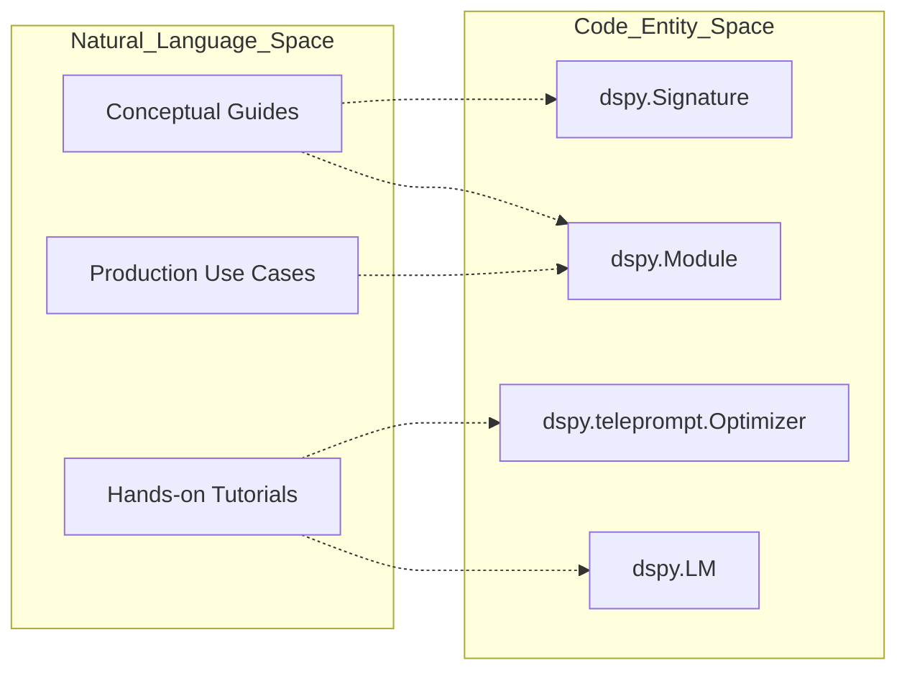

Sources: [docs/requirements.txt:1-10](), [docs/README.md:16-55](), [docs/vercel.json:1-18]()

## Ecosystem & Learning Resources

DSPy has a rapidly growing ecosystem of research papers, production implementations, and community-maintained tools.

### Production Implementations
DSPy is utilized in production by high-scale organizations to optimize LM pipelines [docs/docs/community/use-cases.md:1-14]().
- **Shopify**: Scaled DSPy + `GEPA` for structured metadata extraction, reducing costs by ~550x [docs/docs/community/use-cases.md:20-25]().
- **Dropbox**: Optimized the "Dash" relevance judge for ranking and offline evaluation [docs/docs/community/use-cases.md:27-32]().
- **Microsoft AI**: Curated pretraining data for MAI-Thinking-1 using DSPy + `GEPA` [docs/docs/community/use-cases.md:44-44]().
- **AWS**: Migrates prompts from larger to smaller models on Amazon Nova while maintaining performance [docs/docs/community/use-cases.md:45-45]().
- **Moody's**: Leverages DSPy to optimize RAG systems and agentic workflows [docs/docs/community/use-cases.md:60-60]().

### Research & Community Ports
The framework is propelled by academic research from the Stanford NLP group and industry collaborators [docs/docs/roadmap.md:32-35]().
- **Research Papers**: Notable works include **STORM** for Wikipedia-like article generation and **MIPRO** for prompt optimization [docs/docs/community/built-with-dspy.md:9-14]().
- **Language Ports**: The community has created native implementations in languages including **Rust** (`DSRs`), **Go** (`dspy-go`), **TypeScript** (`dspy.ts`), and **Elixir** (`dspy.ex`) [docs/docs/community/built-with-dspy.md:60-70]().

**Research to Code Mapping**

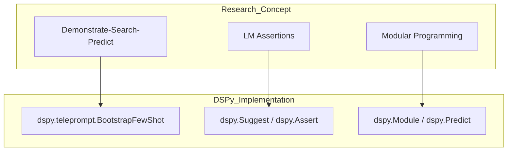

Sources: [docs/docs/community/use-cases.md:1-71](), [docs/docs/roadmap.md:9-49](), [docs/docs/community/built-with-dspy.md:1-72]()

## Deployment & Production Tooling
DSPy provides native integrations for productionizing LM programs [docs/docs/production/index.md:1-4]():
- **Observability**: Integration with **MLflow Tracing** based on OpenTelemetry [docs/docs/production/index.md:11-17]().
- **Reproducibility**: Logging of programs, metrics, and environments via MLflow [docs/docs/production/index.md:19-25]().
- **Scalability**: Native support for thread-safety and asynchronous execution using `asyncify` utilities [docs/docs/production/index.md:35-41]().

Sources: [docs/docs/production/index.md:1-43]()

---

# Page: Core Architecture

# Core Architecture

<details>
<summary>Relevant source files</summary>

The following files were used as context for generating this wiki page:

- [docs/docs/community/normalized-lm-api-migration.md](docs/docs/community/normalized-lm-api-migration.md)
- [docs/overrides/main.html](docs/overrides/main.html)
- [dspy/__init__.py](dspy/__init__.py)
- [dspy/adapters/__init__.py](dspy/adapters/__init__.py)
- [dspy/adapters/types/__init__.py](dspy/adapters/types/__init__.py)
- [dspy/clients/openai_format.py](dspy/clients/openai_format.py)
- [dspy/core/__init__.py](dspy/core/__init__.py)
- [dspy/core/types.py](dspy/core/types.py)
- [tests/clients/test_lm_direct_live.py](tests/clients/test_lm_direct_live.py)
- [tests/core/test_types.py](tests/core/test_types.py)

</details>


This document provides a technical overview of DSPy's architecture, explaining how the framework's major subsystems—Signatures, Modules, Language Model Clients, Adapters, and Optimizers—fit together to enable declarative programming over foundation models.

**Scope**: This page covers the architectural patterns and component interactions that form DSPy's core. For implementation details of specific subsystems, see:
- Package organization and API surface: [Package Structure & Public API](#2.1)
- Language model integration mechanics: [Language Model Integration](#2.2)
- Signature system internals: [Signatures & Task Definition](#2.3)
- Adapter implementation details: [Adapter System](#2.4)
- Module system and base classes: [Module System & Base Classes](#2.5)
- Data primitives and example handling: [Example & Data Primitives](#2.6)

## Three-Layer Architecture

DSPy is organized into three distinct layers that separate concerns between task definition, execution, and infrastructure/optimization:

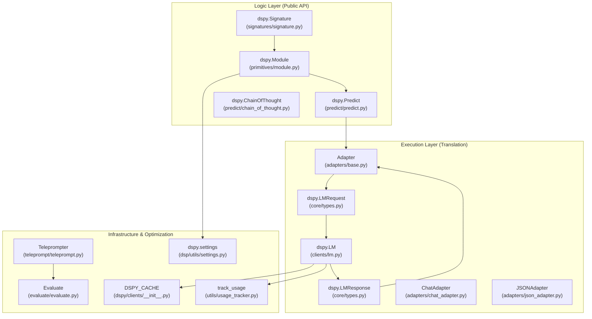

**Sources**: [dspy/__init__.py:1-40](), [dspy/core/types.py:17-47](), [dspy/adapters/__init__.py:1-23](), [dspy/utils/usage_tracker.py:49-49]()

### User-Facing Layer
The top layer exposes declarative abstractions for defining tasks. Users interact with `Signature` objects to define the "what" and `Module` objects to define the "how" [dspy/primitives/module.py:40-67]().

### Execution Layer
The middle layer handles the transition from Python objects to model-specific formats. This is powered by the **Typed LM API**, which uses standardized `LMRequest` and `LMResponse` objects to ensure provider-neutral communication [dspy/core/types.py:33-43](). Adapters like `ChatAdapter` and `JSONAdapter` bridge the gap between `Signatures` and these typed requests [dspy/adapters/__init__.py:1-7]().

### Infrastructure & Optimization
The bottom layer provides global services. `dspy.settings` manages the active LM and adapter [dspy/dsp/utils/settings.py:51-51](), while `DSPY_CACHE` provides persistence for model outputs [dspy/__init__.py:53]().

## Request Lifecycle: Code to Model Space

The following diagram traces a prediction request through the architecture, showing how Python entities map to the internal typed communication system.

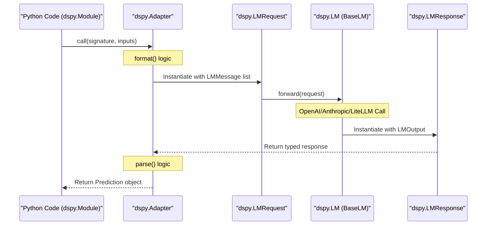

**Key Code Entities**:
- `LMRequest`: The canonical container for `messages`, `tools`, and `config` sent to an LM [dspy/core/types.py:33-33]().
- `LMResponse`: The canonical container for model `outputs`, `usage`, and `provider_data` [dspy/core/types.py:34-34]().
- `LMMessage`: Represents a single turn (System, User, Assistant, or Tool) in the request [dspy/core/types.py:247-247]().

**Sources**: [dspy/core/types.py:17-47](), [dspy/clients/openai_format.py:77-85](), [docs/docs/community/normalized-lm-api-migration.md:59-62]()

## Core Subsystems

### Signature & Task Definition
Signatures define the interface of a module. They specify `InputField` and `OutputField` requirements, which the `Adapter` uses to construct prompts or JSON schemas.
*For details, see [Signatures & Task Definition](#2.3).*

### Adapter System
Adapters are the translation layer. They take a `Signature` and input data and produce an `LMRequest`. DSPy supports multiple formats, including `JSONAdapter` for structured data and `ChatAdapter` for conversational flows [dspy/adapters/__init__.py:1-7]().
*For details, see [Adapter System](#2.4).*

### Language Model Integration
DSPy uses a three-tier LM selection hierarchy (context-local, module-local, or global). The `BaseLM` class defines the `forward(request: LMRequest) -> LMResponse` contract that all new model clients must implement [docs/docs/community/normalized-lm-api-migration.md:171-179]().
*For details, see [Language Model Integration](#2.2).*

### Module System
`dspy.Module` is the base class for all programs. It manages state, including the `history` of interactions and the `named_predictors` used for optimization.
*For details, see [Module System & Base Classes](#2.5).*

### Data & Primitives
The `Example` class is the primary data structure for inputs and training data, while `Prediction` (often aliased as `Prediction`) handles the structured output from modules.
*For details, see [Example & Data Primitives](#2.6).*

## Summary of Infrastructure

- **Caching**: Controlled via `dspy.settings.cache` and the `DSPY_CACHE` singleton [dspy/__init__.py:53-65]().
- **Usage Tracking**: The `track_usage` utility monitors token consumption across nested module calls [dspy/__init__.py:49]().
- **Logging**: Managed by `configure_dspy_loggers` to provide visibility into the internal execution flow [dspy/__init__.py:56]().

**Sources**: [dspy/__init__.py:44-66](), [dspy/utils/usage_tracker.py:49-49]()

---

# Page: Package Structure & Public API

# Package Structure & Public API

<details>
<summary>Relevant source files</summary>

The following files were used as context for generating this wiki page:

- [dspy/__init__.py](dspy/__init__.py)
- [dspy/adapters/__init__.py](dspy/adapters/__init__.py)
- [dspy/adapters/types/__init__.py](dspy/adapters/types/__init__.py)
- [dspy/utils/__init__.py](dspy/utils/__init__.py)
- [dspy/utils/annotation.py](dspy/utils/annotation.py)
- [tests/utils/test_annotation.py](tests/utils/test_annotation.py)

</details>


## Purpose and Scope

This document describes the structural organization of the `dspy` package, including its directory layout, module hierarchy, and the public API surface exposed through `dspy/__init__.py`. It explains how the package aggregates functionality from multiple submodules into a unified interface, the data types supported, and the singleton-based configuration system.

For information about specific subsystems (Signatures, Modules, LM Clients, Adapters), see their dedicated pages under [Core Architecture]().

---

## Package Directory Structure

The `dspy` package follows a modular architecture with clear separation of concerns across functional domains:

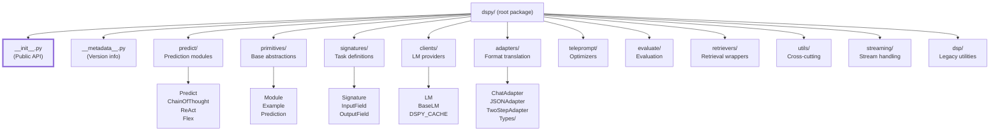

**Sources:** [dspy/__init__.py:1-21](), [dspy/adapters/__init__.py:1-23]()

---

## Public API Aggregation

The `dspy/__init__.py` file serves as the primary entry point for the public API, importing and re-exporting symbols from submodules to provide a flat, user-friendly namespace.

### Natural Language Space to Code Entity Space Mapping

This diagram associates high-level system concepts with the specific code entities exposed in the public API.

```mermaid
graph LR
    subgraph NL_Space["Natural Language Space (Concepts)"]
        Task["'Define a Task'"]
        Logic["'Reasoning Logic'"]
        Data["'Input/Output Data'"]
        Format["'Output Structure'"]
        Opt["'Program Optimization'"]
    end

    subgraph Code_Space["Code Entity Space (dspy/.*)"]
        Sig["dspy.Signature"]
        CoT["dspy.ChainOfThought"]
        Ex["dspy.Example"]
        Adap["dspy.JSONAdapter"]
        Tele["dspy.BootstrapFewShot"]
    end

    Task -.-> Sig
    Logic -.-> CoT
    Data -.-> Ex
    Format -.-> Adap
    Opt -.-> Tele
```

**Sources:** [dspy/__init__.py:1-9](), [dspy/adapters/__init__.py:1-6]()

### Wildcard and Explicit Imports

The `__init__.py` uses wildcard imports for major subsystems, allowing them to control their public surface via `__all__`.

[dspy/__init__.py:1-5]()
```python
from dspy.predict import *
from dspy.primitives import *
from dspy.retrievers import *
from dspy.signatures import *
from dspy.teleprompt import *
```

Core infrastructure, utilities, and the adapter system are imported explicitly to ensure type safety and visibility:

[dspy/__init__.py:7-22]()
```python
from dspy.evaluate import Evaluate
from dspy.clients import *
from dspy.adapters import Adapter, ChatAdapter, JSONAdapter, XMLAdapter, TwoStepAdapter, Image, Audio, File, History, Type, Tool, ToolCalls, ToolCallResults, Code, Reasoning
from dspy.core import (
    Assistant, Developer, LMConfig, LMMessage, LMRequest, LMResponse, System, ToolCall, ToolResult, User,
)
```

The package also exposes specialized serialization and error handling primitives:

[dspy/__init__.py:23-43]()
```python
from dspy.primitives.sandbox_serializable import SandboxSerializable
from dspy.utils.exceptions import (
    AdapterParseError, ContextWindowExceededError, DSPyError, LMAuthError, LMBillingError,
    LMConfigurationError, LMError, LMInvalidRequestError, LMNotConfiguredError, LMProviderError,
    LMRateLimitError, LMServerError, LMTimeoutError, LMTransportError, LMUnexpectedError,
    LMUnsupportedFeatureError, LMUnsupportedModelError, is_retryable_lm_error,
)
```

**Sources:** [dspy/__init__.py:1-43]()

### Utility Functions and Singletons

The module exposes global settings and creates convenient aliases for optimization and usage tracking:

[dspy/__init__.py:44-66]()

| Category | Symbols | Purpose |
|----------|---------|---------|
| **Settings** | `configure`, `context`, `load_settings` | Manage global state via `dspy.dsp.utils.settings` |
| **Async/Sync** | `asyncify`, `syncify` | Utilities for execution mode conversion |
| **Optimization** | `BootstrapRS` | Alias for `BootstrapFewShotWithRandomSearch` |
| **Caching** | `cache` | Alias for `DSPY_CACHE` from `dspy.clients` |
| **Observability**| `track_usage`, `enable_logging`, `disable_logging` | Monitor token usage and framework logs |
| **Persistence** | `load` | Utility to load saved modules/states |
| **Streaming** | `streamify` | Utility for handling LM response streams |

**Sources:** [dspy/__init__.py:44-66](), [dspy/dsp/utils/settings.py:1-20]()

---

## Module Categorization

The package organizes functionality into distinct layers that facilitate the flow from task definition to LM execution.

### Data and Logic Flow Diagram

```mermaid
graph TD
    User["User Code"] --> Sig["dspy.Signature<br/>(dspy/signatures)"]
    Sig --> Mod["dspy.Module<br/>(dspy/primitives/module.py)"]
    Mod --> Pred["dspy.Predict<br/>(dspy/predict)"]
    
    subgraph Execution_Layer["Execution & Adaptation"]
        Pred --> Adap["dspy.Adapter<br/>(dspy/adapters/base.py)"]
        Adap --> LM["dspy.LM<br/>(dspy/clients)"]
    end
    
    LM --> Resp["LM Response"]
    Resp --> Adap
    Adap --> Pred
    Pred --> User
```

**Sources:** [dspy/__init__.py:1-12](), [dspy/primitives/module.py:40-49]()

### Core Subsystems

- **`dspy.predict`**: Contains functional modules like `Predict`, `ChainOfThought`, `ReAct`, and the `Flex` module [dspy/__init__.py:1,6]().
- **`dspy.primitives`**: Defines foundational classes like `Module`, `Example`, and `Prediction` [dspy/__init__.py:2]().
- **`dspy.adapters`**: Manages the translation between DSPy's structured signatures and the raw strings/JSON expected by LMs.
    - `dspy.Type`: The base class for custom types like `Image`, `Audio`, and `Tool` [dspy/adapters/types/__init__.py:2,10]().
    - `dspy.Tool`: Wraps Python functions for tool calling, allowing `ToolCalls` and `ToolCallResults` handling [dspy/adapters/types/__init__.py:8,10]().
    - `dspy.Reasoning`: A specialized type for handling chain-of-thought or model-internal reasoning [dspy/adapters/types/__init__.py:7,10]().
    - `dspy.History`: Manages conversational context across turns [dspy/adapters/types/__init__.py:5,10]().
- **`dspy.utils`**: Provides cross-cutting concerns like the `@experimental` decorator for marking APIs that may change in future releases [dspy/utils/annotation.py:16-30](), and debugging tools like `pretty_print_history` [dspy/utils/__init__.py:10,37]().

**Sources:** [dspy/__init__.py:1-12](), [dspy/adapters/__init__.py:1-23](), [dspy/utils/annotation.py:16-30](), [dspy/utils/__init__.py:1-38]()

---

## Package Metadata and Initialization

The package performs automatic initialization upon import:
1. Configures default loggers using `configure_dspy_loggers(__name__)` [dspy/__init__.py:56]().
2. Exposes metadata like `__version__`, `__author__`, and `__url__` from `dspy.__metadata__` [dspy/__init__.py:54]().
3. Maps singleton settings from `dspy.dsp.utils.settings` to the top-level `dspy` namespace for easy access (e.g., `dspy.configure`, `dspy.context`, `dspy.load_settings`) [dspy/__init__.py:59-61]().
4. Initializes the usage tracking system via `track_usage` [dspy/__init__.py:49]().

**Sources:** [dspy/__init__.py:49-61](), [dspy/dsp/utils/settings.py:1-20]()

---

# Page: Language Model Integration

# Language Model Integration

<details>
<summary>Relevant source files</summary>

The following files were used as context for generating this wiki page:

- [docs/docs/api/utils/Errors.md](docs/docs/api/utils/Errors.md)
- [docs/docs/faqs.md](docs/docs/faqs.md)
- [docs/docs/learn/programming/language_models.md](docs/docs/learn/programming/language_models.md)
- [dspy/clients/__init__.py](dspy/clients/__init__.py)
- [dspy/clients/base_lm.py](dspy/clients/base_lm.py)
- [dspy/clients/cache.py](dspy/clients/cache.py)
- [dspy/clients/databricks.py](dspy/clients/databricks.py)
- [dspy/clients/embedding.py](dspy/clients/embedding.py)
- [dspy/clients/lm.py](dspy/clients/lm.py)
- [dspy/clients/lm_local.py](dspy/clients/lm_local.py)
- [dspy/clients/openai.py](dspy/clients/openai.py)
- [dspy/clients/provider.py](dspy/clients/provider.py)
- [dspy/clients/utils_finetune.py](dspy/clients/utils_finetune.py)
- [dspy/utils/dummies.py](dspy/utils/dummies.py)
- [tests/clients/test_cache.py](tests/clients/test_cache.py)
- [tests/clients/test_embedding.py](tests/clients/test_embedding.py)
- [tests/clients/test_lm.py](tests/clients/test_lm.py)
- [tests/clients/test_lm_local.py](tests/clients/test_lm_local.py)

</details>


This document describes DSPy's language model (LM) integration layer, which provides a unified interface for interacting with 40+ LM providers through LiteLLM. This layer handles prompt formatting, response parsing, caching, retry logic, and history tracking.

**Scope**: This page covers the `dspy.LM` client, `BaseLM` interface, LiteLLM backend integration, caching system, and provider abstraction.

## LM Client Architecture

The language model integration is built around two primary classes: `BaseLM` and `LM`.

### BaseLM Interface

`BaseLM` is the base class that defines the interface for all language model interactions. It implements the core lifecycle of a request:

- **History tracking**: Maintains a local `self.history` list of interactions [dspy/clients/base_lm.py:130-130]().
- **Callback support**: Uses the `@with_callbacks` decorator on `__call__` and `acall` to allow observability hooks [dspy/clients/base_lm.py:191-191](), [dspy/clients/base_lm.py:203-203]().
- **Response processing**: Implements `_process_lm_response` to extract text, reasoning, and usage data from standardized provider responses and updates the usage tracker [dspy/clients/base_lm.py:156-189]().
- **Abstract Forwarding**: Defines `forward` and `aforward` which subclasses must implement to perform the actual network request [dspy/clients/base_lm.py:223-223](), [dspy/clients/base_lm.py:230-230]().
- **Typed API Migration**: DSPy is migrating to a typed contract where `forward` accepts `dspy.LMRequest` and returns `dspy.LMResponse`. Subclasses declare their support via `forward_contract` [dspy/clients/base_lm.py:65-92]().

**Sources**: [dspy/clients/base_lm.py:57-231]()

### LM Class (The LiteLLM Implementation)

`LM` is the primary class users interact with. It extends `BaseLM` and leverages LiteLLM for multi-provider support. Key responsibilities include:

- **Provider Specialization**: Handles specific logic for OpenAI reasoning models (o1, o3, gpt-5) which require `temperature=1.0` and `max_completion_tokens` instead of `max_tokens` [dspy/clients/lm.py:124-132]().
- **Retry Logic**: Configures `num_retries` for transient failures using exponential backoff [dspy/clients/lm.py:70-71](), [dspy/clients/lm.py:109-110]().
- **Caching Integration**: Wraps the completion function with `request_cache` to prevent redundant API calls [dspy/clients/lm.py:172-182]().
- **Feature Detection**: Exposes properties to check for model capabilities like `supports_function_calling`, `supports_reasoning`, and `supports_response_schema` via LiteLLM [dspy/clients/lm.py:148-157]().

**Sources**: [dspy/clients/lm.py:55-182]()

### LM Client Entity Mapping

The following diagram bridges the high-level concepts to the specific classes and methods in the codebase.

```mermaid
graph TD
    subgraph "Natural Language Space"
        UserPrompt["User Prompt/Question"]
        SystemInstr["System Instructions"]
        History["Conversation History"]
    end

    subgraph "Code Entity Space (dspy/clients)"
        BaseLM["BaseLM (base_lm.py)"]
        LM["LM (lm.py)"]
        
        subgraph "Execution Methods"
            Call["__call__ (base_lm.py)"]
            Forward["forward (lm.py)"]
            AForward["aforward (lm.py)"]
            ProcessResponse["_process_lm_response (base_lm.py)"]
        end
        
        subgraph "State & Data"
            HistList["self.history (base_lm.py)"]
            Usage["track_usage (dspy/utils/usage_tracker.py)"]
            CacheObj["Cache (cache.py)"]
        end
    end

    UserPrompt --> Call
    SystemInstr --> Forward
    History --> HistList
    Call --> Forward
    Forward --> ProcessResponse
    ProcessResponse --> CacheObj
    ProcessResponse --> Usage
    LM -- "inherits" --> BaseLM
```

**Diagram: LM Integration Entity Bridge**  
**Sources**: [dspy/clients/base_lm.py:57-191](), [dspy/clients/lm.py:55-245]()

## Provider Support via LiteLLM

DSPy delegates provider-specific API formatting to **LiteLLM**. This allows a single `dspy.LM` instance to support OpenAI, Anthropic, Gemini, Vertex AI, Databricks, and local models (Ollama/SGLang).

### Model Selection Hierarchy

When a request is made, DSPy follows a hierarchy to determine how to execute the call:

1.  **Model Type Dispatch**: The `model_type` attribute determines if the call uses `chat`, `text`, or the "responses" API [dspy/clients/lm.py:65-67](), [dspy/clients/lm.py:184-192]().
2.  **Provider Inference**: If not explicitly provided, the system extracts the provider from the model string (e.g., "openai" from "openai/gpt-4o") [dspy/clients/lm.py:114-115](), [dspy/clients/lm.py:141-145]().
3.  **Parameter Mapping**: DSPy maps standard parameters like `temperature` and `max_tokens` to provider-specific keys, notably handling OpenAI's reasoning model constraints [dspy/clients/lm.py:124-138]().

### LiteLLM Execution Flow

```mermaid
graph LR
    subgraph "DSPy LM Client"
        LM_Forward["LM.forward() (lm.py)"]
        LM_AForward["LM.aforward() (lm.py)"]
    end

    subgraph "LiteLLM Backend"
        L_Comp["litellm.completion"]
        L_AComp["litellm.acompletion"]
        L_Resp["litellm.responses"]
    end

    subgraph "External Providers"
        OpenAI["OpenAI API"]
        Anthropic["Anthropic API"]
        Local["Local (SGLang/Ollama)"]
    end

    LM_Forward --> L_Comp
    LM_Forward --> L_Resp
    LM_AForward --> L_AComp
    L_Comp --> OpenAI
    L_Comp --> Anthropic
    L_Comp --> Local
```

**Diagram: Provider Execution Flow**  
**Sources**: [dspy/clients/lm.py:183-245](), [dspy/clients/_litellm.py:1-20]()

## Caching System

DSPy implements a two-tier caching system to reduce latency and costs.

### Cache Tiers
1.  **In-Memory Cache**: Implemented with `cachetools.LRUCache` for fast access [dspy/clients/cache.py:44-44](), [dspy/clients/cache.py:78-78]().
2.  **On-Disk Cache**: Implemented with `diskcache.FanoutCache` for persistent storage, defaulting to `~/.dspy_cache` [dspy/clients/cache.py:45-45](), [dspy/clients/cache.py:81-94](), [dspy/clients/__init__.py:15-15]().

### Cache Key Logic
The cache key is a SHA-256 hash of the request dictionary. Arguments like `api_key`, `api_base`, and `base_url` are ignored to ensure that changing credentials doesn't invalidate the cache [dspy/clients/cache.py:104-113](), [dspy/clients/lm.py:173-174]().

### Security and Serialization
DSPy provides a `restrict_pickle` mode to limit deserialization to known-safe types like LiteLLM/OpenAI response models and NumPy helpers [dspy/clients/cache.py:88-93](), [dspy/clients/__init__.py:25-26]().

**Sources**: [dspy/clients/cache.py:40-155](), [dspy/clients/__init__.py:19-55](), [dspy/clients/lm.py:172-182]()

## Three-Tier LM Selection Hierarchy

DSPy resolves the LM to use in the following order of priority:

| Tier | Mechanism | Scope |
| :--- | :--- | :--- |
| **1. Local Context** | `with dspy.context(lm=my_lm):` | Block-level override for specific modules or operations. |
| **2. Module-Specific** | `module.set_lm(my_lm)` | Overrides the LM for a specific module instance. |
| **3. Global Default** | `dspy.configure(lm=my_lm)` | The fallback LM used by all modules if no specific LM is set [dspy/dsp/utils/settings.py:19-19](). |

**Sources**: [dspy/dsp/utils/settings.py:8-25](), [dspy/clients/base_lm.py:158-160]()

## Embedding Integration

The `Embedder` class provides a unified interface for computing text embeddings via LiteLLM or custom callables [dspy/clients/embedding.py:16-84]().

- **Hosted Models**: Uses `litellm.embedding` with optional caching [dspy/clients/embedding.py:158-161]().
- **Custom Functions**: Accepts any callable that takes a list of strings and returns a 2D array [dspy/clients/embedding.py:162-163]().
- **Caching**: Leverages `request_cache` to store embedding results [dspy/clients/embedding.py:168-170]().

**Sources**: [dspy/clients/embedding.py:16-170]()

---

# Page: Signatures & Task Definition

# Signatures & Task Definition

<details>
<summary>Relevant source files</summary>

The following files were used as context for generating this wiki page:

- [docs/docs/api/primitives/Prediction.md](docs/docs/api/primitives/Prediction.md)
- [docs/docs/api/signatures/Signature.md](docs/docs/api/signatures/Signature.md)
- [docs/docs/diving-deeper/signatures-in-depth.md](docs/docs/diving-deeper/signatures-in-depth.md)
- [dspy/dsp/utils/__init__.py](dspy/dsp/utils/__init__.py)
- [dspy/evaluate/__init__.py](dspy/evaluate/__init__.py)
- [dspy/evaluate/auto_evaluation.py](dspy/evaluate/auto_evaluation.py)
- [dspy/evaluate/metrics.py](dspy/evaluate/metrics.py)
- [dspy/signatures/__init__.py](dspy/signatures/__init__.py)
- [dspy/signatures/field.py](dspy/signatures/field.py)
- [dspy/signatures/signature.py](dspy/signatures/signature.py)
- [tests/evaluate/test_auto_evaluation.py](tests/evaluate/test_auto_evaluation.py)
- [tests/signatures/test_signature.py](tests/signatures/test_signature.py)

</details>


## Purpose and Scope

This document explains DSPy's **Signature** system, which provides a declarative way to define the input/output schema for language model tasks. Signatures specify what fields a task expects as inputs and what fields it should produce as outputs, along with instructions and metadata. They serve as the interface between user code and DSPy modules.

For information about how Signatures are executed through modules, see [Module System & Base Classes](2.5). For information about how Signatures are formatted into prompts, see [Adapter System](2.4). For information about how to use Signatures in programs, see [Predict Module](3.1).

---

## Overview

A **Signature** defines a task's input/output behavior using typed fields and natural language instructions. DSPy uses Signatures to automatically generate prompts, parse outputs, and validate types without manual prompt engineering [dspy/signatures/signature.py:1-16]().

### Natural Language to Code Entity Mapping

The following diagram bridges the gap between high-level task descriptions and the specific code entities in `dspy/signatures/`.

**Signature Architecture Map**
```mermaid
graph TD
    subgraph "Natural Language Space"
        TaskDesc["Task Instructions (Docstrings)"]
        SemanticRole["Semantic Roles (Field Names)"]
        Hints["Field Hints (desc)"]
    end

    subgraph "Code Entity Space (dspy/signatures)"
        SigClass["dspy.Signature (Base Class)"]
        Meta["SignatureMeta (Metaclass)"]
        InField["InputField (Function)"]
        OutField["OutputField (Function)"]
        MakeSig["make_signature (Factory)"]
    end

    TaskDesc -.->|Extracted by| SigClass
    SemanticRole -.->|Defines| InField
    SemanticRole -.->|Defines| OutField
    Hints -.->|Stored in| InField
    Hints -.->|Stored in| OutField
    
    SigClass --- Meta
    MakeSig -->|Constructs| SigClass
```
**Sources:** [dspy/signatures/signature.py:1-16](), [dspy/signatures/field.py:79-86]()

---

## Creating Signatures

DSPy supports three ways to create Signatures: string-based, class-based, and dictionary-based.

### String-Based Signatures

The simplest way to create a Signature is with a string in the format `"input1, input2 -> output1, output2"` [dspy/signatures/signature.py:8-9](). String-based signatures are parsed to extract field names and types [dspy/signatures/signature.py:519-603]().

```python
# Basic signature
sig = dspy.Signature("question -> answer")

# With type annotations
sig = dspy.Signature("question: str, context: list[str] -> answer: str")

# With instructions
sig = dspy.Signature("question -> answer", "Answer the question concisely")
```

The `SignatureMeta.__call__` method [dspy/signatures/signature.py:42-51]() intercepts Signature instantiation and routes it to `make_signature`.

**Sources:** [dspy/signatures/signature.py:41-51](), [dspy/signatures/signature.py:519-603](), [tests/signatures/test_signature.py:53-58]()

### Class-Based Signatures

For more control, subclass `Signature` and define fields as class attributes. The class docstring becomes the task instructions [dspy/signatures/signature.py:213-219]().

```python
class QASignature(dspy.Signature):
    """Answer questions with short factoid answers."""
    
    question: str = dspy.InputField()
    context: list[str] = dspy.InputField(desc="background information")
    answer: str = dspy.OutputField(desc="often between 1 and 5 words")
```

**Sources:** [dspy/signatures/signature.py:138-201](), [tests/signatures/test_signature.py:14-28]()

### Dictionary-Based Signatures

Signatures can also be created from dictionaries mapping field names to `InputField` or `OutputField` objects [tests/signatures/test_signature.py:135-142](). This is handled by the `make_signature` function [dspy/signatures/signature.py:565-602]().

**Sources:** [dspy/signatures/signature.py:565-602](), [tests/signatures/test_signature.py:135-142]()

---

## Field Definitions

Every field in a Signature must be declared with either `InputField()` or `OutputField()`. These are wrappers around `pydantic.Field` [dspy/signatures/field.py:79-86]().

### Metadata and Constraints

Each field has metadata stored in `json_schema_extra` via the `move_kwargs` utility [dspy/signatures/field.py:39-60]().

| Attribute | Description | Code Pointer |
|-----------|-------------|--------------|
| `prefix` | Label displayed before the field in prompts (Deprecated). | [dspy/signatures/field.py:12-16]() |
| `desc` | Description of the field's purpose. | [dspy/signatures/field.py:52-54]() |
| `format` | Optional function to transform field values (Deprecated). | [dspy/signatures/field.py:17-20]() |
| `constraints` | Pydantic constraints (gt, le, min_length) translated to text. | [dspy/signatures/field.py:62-70]() |

**Sources:** [dspy/signatures/field.py:10-70](), [tests/signatures/test_signature.py:44-51]()

### Type Annotations and Custom Types

Signatures support rich type annotations. If no type is specified, fields default to `str` [dspy/signatures/signature.py:168](), and the field is marked with `IS_TYPE_UNDEFINED` [dspy/signatures/signature.py:169]().

For custom types in string signatures, `SignatureMeta._detect_custom_types_from_caller` [dspy/signatures/signature.py:54-136]() attempts to resolve types from the caller's stack frames by walking up to 100 frames [dspy/signatures/signature.py:97-100]().

**Type Resolution Logic**
```mermaid
graph TD
    subgraph "Resolution Flow"
        Start["Parse Signature String"] --> Detect["_detect_custom_types_from_caller"]
        Detect --> FrameWalk["Walk sys._getframe(1) stack (max 100)"]
        FrameWalk --> CheckLocals["Check f_locals & f_globals"]
        CheckLocals --> Found["Resolve type reference"]
    end

    subgraph "Code Entities"
        Parser["_parse_type_node"]
        MetaCls["SignatureMeta"]
        PydanticBase["pydantic.BaseModel"]
    end

    Found --> Parser
    Parser -->|Validates| PydanticBase
    MetaCls --> Start
```
**Sources:** [dspy/signatures/signature.py:54-136](), [dspy/signatures/signature.py:634-767]()

---

## Data Containers: Example & Prediction

Signatures define the schema, while `Example` and `Prediction` objects hold the data that conforms to these schemas.

### Example Class
`dspy.Example` is the primary data container for training and evaluation data. It behaves like a dictionary but allows dot-access. Users mark which fields are inputs using `with_inputs()`.

### Prediction Class
`dspy.Prediction` represents the output of a module [dspy/primitives/prediction.py:4-16](). It includes additional metadata like `_lm_usage` [dspy/primitives/prediction.py:25-31]() and supports N-best completions via the `Completions` class.

**Data Flow Diagram**
```mermaid
graph LR
    subgraph "Input Processing"
        RawData["Dict/Record"] --> Ex["dspy.Example"]
        Ex -->|with_inputs| InputEx["Input Example"]
    end

    subgraph "Execution"
        InputEx --> Mod["dspy.Module"]
        Mod --> Pred["dspy.Prediction"]
    end

    subgraph "Aggregation"
        Pred --> Maj["majority()"]
        Maj --> FinalPred["Aggregated Prediction"]
    end
```
**Sources:** [dspy/primitives/prediction.py:4-39](), [dspy/evaluate/auto_evaluation.py:58-62]()

---

## Signature Modification

Signatures are immutable. Modification methods return a new Signature class [tests/signatures/test_signature.py:65-70]().

| Method | Role | Implementation |
|--------|------|----------------|
| `with_instructions()` | Updates the task description. | [dspy/signatures/signature.py:268-294]() |
| `with_updated_fields()` | Modifies existing field metadata. | [dspy/signatures/signature.py:297-320]() |
| `prepend()` | Adds an InputField at the beginning. | [dspy/signatures/signature.py:323-347]() |
| `append()` | Adds a field at the end. | [dspy/signatures/signature.py:350-374]() |
| `insert()` | Adds a field at a specific index. | [dspy/signatures/signature.py:412-468]() |
| `delete()` | Removes a specific field. | [dspy/signatures/signature.py:377-409]() |
| `append_instructions()` | Chains new instructions to existing ones. | [dspy/signatures/signature.py:241-266]() |

**Sources:** [dspy/signatures/signature.py:241-468](), [tests/signatures/test_signature.py:65-112]()

---

## Implementation Details

### SignatureMeta Metaclass
The `SignatureMeta` metaclass [dspy/signatures/signature.py:41-259]() is responsible for:
1. **Field Ordering**: Ensuring `input_fields` and `output_fields` maintain the order defined in code [dspy/signatures/signature.py:139-172]().
2. **Prefix Inference**: Automatically converting field names (e.g., `question_text`) into human-readable prefixes (e.g., `Question Text:`) via `infer_prefix` [dspy/signatures/signature.py:770-814]().
3. **Instruction Generation**: Providing default instructions if a docstring is missing, e.g., "Given the fields `inputs`, produce the fields `outputs`." [dspy/signatures/signature.py:35-38]().

### State Management
Signatures support `dump_state()` and `load_state()` for serialization [dspy/signatures/signature.py:485-506](). This allows saving optimized instructions and field descriptions generated during the optimization process.

**Sources:** [dspy/signatures/signature.py:41-259](), [dspy/signatures/signature.py:485-506](), [dspy/signatures/signature.py:770-814]()

---

# Page: Adapter System

# Adapter System

<details>
<summary>Relevant source files</summary>

The following files were used as context for generating this wiki page:

- [docs/docs/api/adapters/Adapter.md](docs/docs/api/adapters/Adapter.md)
- [docs/docs/api/adapters/ChatAdapter.md](docs/docs/api/adapters/ChatAdapter.md)
- [docs/docs/api/adapters/JSONAdapter.md](docs/docs/api/adapters/JSONAdapter.md)
- [docs/docs/api/adapters/TwoStepAdapter.md](docs/docs/api/adapters/TwoStepAdapter.md)
- [docs/docs/api/tools/Embeddings.md](docs/docs/api/tools/Embeddings.md)
- [docs/docs/api/utils/StreamListener.md](docs/docs/api/utils/StreamListener.md)
- [docs/docs/learn/programming/signatures.md](docs/docs/learn/programming/signatures.md)
- [dspy/adapters/baml_adapter.py](dspy/adapters/baml_adapter.py)
- [dspy/adapters/base.py](dspy/adapters/base.py)
- [dspy/adapters/chat_adapter.py](dspy/adapters/chat_adapter.py)
- [dspy/adapters/json_adapter.py](dspy/adapters/json_adapter.py)
- [dspy/adapters/two_step_adapter.py](dspy/adapters/two_step_adapter.py)
- [dspy/adapters/utils.py](dspy/adapters/utils.py)
- [dspy/adapters/xml_adapter.py](dspy/adapters/xml_adapter.py)
- [dspy/predict/flex/bridge.py](dspy/predict/flex/bridge.py)
- [tests/adapters/conftest.py](tests/adapters/conftest.py)
- [tests/adapters/test_baml_adapter.py](tests/adapters/test_baml_adapter.py)
- [tests/adapters/test_chat_adapter.py](tests/adapters/test_chat_adapter.py)
- [tests/adapters/test_json_adapter.py](tests/adapters/test_json_adapter.py)
- [tests/adapters/test_two_step_adapter.py](tests/adapters/test_two_step_adapter.py)
- [tests/adapters/test_xml_adapter.py](tests/adapters/test_xml_adapter.py)

</details>


The Adapter System serves as the interface layer between DSPy's programming abstractions (signatures, modules) and Language Models. Adapters transform DSPy signatures and inputs into LM-specific prompt formats, then parse LM responses back into structured dictionaries matching the signature's output fields. This layer enables DSPy to work consistently across different LM providers and prompt formats while maintaining a uniform programming model.

## Architecture Overview

The adapter system follows a hierarchy with `Adapter` as the base class and specialized implementations for different prompt formats.

Title: Adapter Class Hierarchy and Data Flow
```mermaid
graph TB
    subgraph "Core Classes"
    Adapter["Adapter<br/>(dspy/adapters/base.py)"]
    ChatAdapter["ChatAdapter<br/>(dspy/adapters/chat_adapter.py)"]
    JSONAdapter["JSONAdapter<br/>(dspy/adapters/json_adapter.py)"]
    XMLAdapter["XMLAdapter<br/>(dspy/adapters/xml_adapter.py)"]
    TwoStepAdapter["TwoStepAdapter<br/>(dspy/adapters/two_step_adapter.py)"]
    BAMLAdapter["BAMLAdapter<br/>(dspy/adapters/baml_adapter.py)"]
    end

    subgraph "Utilities & Types"
    Utils["dspy/adapters/utils.py<br/>format_field_value()<br/>parse_value()<br/>translate_field_type()"]
    BaseType["dspy/adapters/types/base_type.py<br/>Type base class"]
    end

    Adapter -->|"extends"| ChatAdapter
    ChatAdapter -->|"extends"| JSONAdapter
    ChatAdapter -->|"extends"| XMLAdapter
    Adapter -->|"extends"| TwoStepAdapter
    JSONAdapter -->|"extends"| BAMLAdapter
    
    Adapter -.->|"uses"| Utils
    Adapter -.->|"manages"| BaseType
```
**Sources:** [dspy/adapters/base.py:34-49](), [dspy/adapters/chat_adapter.py:29-39](), [dspy/adapters/json_adapter.py:40-43](), [dspy/adapters/xml_adapter.py:11-12](), [dspy/adapters/two_step_adapter.py:22-41](), [dspy/adapters/baml_adapter.py:10-10]()

## Adapter Execution Flow

When a DSPy module (like `dspy.Predict`) makes an LM call, the adapter orchestrates the transformation pipeline, handling the transition from structured Python entities to natural language prompts and back.

Title: Signature to LM Message Transformation
```mermaid
sequenceDiagram
    participant Module as "dspy.Module"
    participant Adapter as "Adapter.acall()"
    participant Pre as "_call_preprocess()"
    participant Format as "format()"
    participant LM as "BaseLM.acall()"
    participant Post as "_call_postprocess()"
    
    Module->>Adapter: Invoke with signature & inputs
    Adapter->>Pre: Handle native features (Tools, Reasoning)
    Pre-->>Adapter: Return modified signature
    Adapter->>Format: Generate messages list
    Adapter->>LM: Call LM with formatted messages
    LM-->>Adapter: Return raw completion
    Adapter->>Post: Parse & validate output fields
    Post-->>Module: Return structured dictionary
```
**Sources:** [dspy/adapters/base.py:83-135](), [dspy/adapters/base.py:137-176](), [dspy/adapters/base.py:520-533]()

## Base Adapter Class

The `Adapter` class [dspy/adapters/base.py:34-49]() defines the core interface for all implementations. It manages the lifecycle of an LM request, including preprocessing for native features and postprocessing for output validation.

### Constructor Configuration
The `Adapter.__init__` [dspy/adapters/base.py:51-74]() accepts:
* `callbacks`: Hooks for logging or monitoring.
* `use_native_function_calling`: Enables `dspy.Tool` integration with provider APIs.
* `native_response_types`: Types like `Citations` or `Reasoning` that use built-in LM capabilities. Defaults to `[Citations, Reasoning]` [dspy/adapters/base.py:30]().

### Native Feature Handling
* **Preprocessing**: `_call_preprocess` [dspy/adapters/base.py:83-135]() detects if a signature contains `dspy.Tool` or `dspy.Reasoning`. If the LM supports these natively (e.g., via `lm.supports_function_calling`), it modifies `lm_kwargs` to include `tools` [dspy/adapters/base.py:116]() and strips these fields from the text prompt.
* **Postprocessing**: `_call_postprocess` [dspy/adapters/base.py:137-176]() re-assembles the final dictionary, extracting `tool_calls` [dspy/adapters/base.py:162]() or reasoning blocks from LM response metadata and placing them back into the expected signature fields.

**Sources:** [dspy/adapters/base.py:34-176]()

## Core Adapter Implementations

### ChatAdapter
The default adapter for most models. It uses text-based delimiters to delineate fields within chat messages.
* **Format**: Uses `[[ ## field_name ## ]]` headers [dspy/adapters/chat_adapter.py:21-22]().
* **Fallback**: Automatically retries with `JSONAdapter` if an error occurs, unless it is a `LMError` or fallback is disabled [dspy/adapters/chat_adapter.py:85-95]().
* **Structure**: Appends a `[[ ## completed ## ]]` marker to indicate the end of expected output [dspy/adapters/chat_adapter.py:141-142]().

### JSONAdapter
Extends `ChatAdapter` to enforce JSON structures, ideal for programmatic data extraction.
* **Structured Outputs**: If the LM supports response schemas, it generates a strict Pydantic model from the signature via `_get_structured_outputs_response_format` to use OpenAI-style "Structured Output" mode [dspy/adapters/json_adapter.py:81-85]().
* **Parsing**: Uses `json_repair` [dspy/adapters/json_adapter.py:171]() to handle trailing commas or minor syntax errors in LM output.

### XMLAdapter
Formats inputs and outputs within XML tags (e.g., `<answer>...</answer>`).
* **Regex Parsing**: Uses `re.compile(r"<(?P<name>\w+)>((?P<content>.*?))</\1>", re.DOTALL)` to extract field values [dspy/adapters/xml_adapter.py:12]().
* **Type Casting**: Raw XML string content is passed to `parse_value` [dspy/adapters/xml_adapter.py:111]() to convert it to the signature's annotated type (int, bool, etc.).

### TwoStepAdapter
A specialized adapter for reasoning models (like OpenAI o1/o3) that struggle with strict formatting.
1. **Step 1**: Sends a natural language prompt to the main LM to get a detailed response [dspy/adapters/two_step_adapter.py:49-76]().
2. **Step 2**: Uses a secondary `extraction_model` [dspy/adapters/two_step_adapter.py:43-47]() to parse the first LM's output into the structured signature fields via `ChatAdapter` [dspy/adapters/two_step_adapter.py:95-102]().

### BAMLAdapter
Generates simplified schemas for complex Pydantic models to improve LM adherence.
* **Schema Generation**: Converts Pydantic models into a concise string representation via `_build_simplified_schema` [dspy/adapters/baml_adapter.py:89-160]() with comments and "or null" syntax for optional fields.
* **Indentation**: Uses configurable `INDENTATION` (default 2 spaces) for schema readability [dspy/adapters/baml_adapter.py:10]().

**Sources:** [dspy/adapters/chat_adapter.py:29-115](), [dspy/adapters/json_adapter.py:40-121](), [dspy/adapters/xml_adapter.py:11-120](), [dspy/adapters/two_step_adapter.py:22-176](), [dspy/adapters/baml_adapter.py:10-160]()

## Data Formatting and Parsing Utilities

The system relies on `dspy/adapters/utils.py` to bridge the gap between Python objects and LM strings.

| Function | Role |
| :--- | :--- |
| `format_field_value` | Serializes Python types. Lists are converted to numbered strings; dicts/lists to JSON [dspy/adapters/utils.py:83-112](). |
| `translate_field_type` | Generates instructions for the LM based on types (e.g., "must be True or False" for `bool`) [dspy/adapters/utils.py:131-156](). |
| `parse_value` | The inverse of formatting. It attempts `json_repair`, then Pydantic validation [dspy/adapters/utils.py:187-250](). |
| `serialize_for_json` | Uses Pydantic's `TypeAdapter` to dump objects into JSON-compatible primitives [dspy/adapters/utils.py:65-81](). |

**Sources:** [dspy/adapters/utils.py:65-250]()

## Multimodal and Native Feature Handling

The adapter system manages the transition from high-level DSPy types to provider-specific formats.

Title: Multimodal Data and Native Feature Mapping
```mermaid
graph LR
    subgraph "Natural Language Space (LM)"
    Prompt["Text Prompt / Messages"]
    TC["Tool Call Metadata"]
    RC["Reasoning Content Block"]
    end

    subgraph "Code Entity Space (DSPy)"
    Sig["dspy.Signature"]
    Tool["dspy.Tool (list[dspy.Tool])"]
    Res["dspy.Reasoning"]
    Img["dspy.Image"]
    end

    Sig -- "format()" --> Prompt
    Tool -- "adapt_to_native_lm_feature()" --> TC
    Res -- "adapt_to_native_lm_feature()" --> RC
    Img -- "format_field_value()" --> Prompt
    
    Prompt -- "parse()" --> Sig
    TC -- "_call_postprocess()" --> Tool
    RC -- "_call_postprocess()" --> Res
```

* **Custom Type Identification**: Adapters use identifiers to wrap multimodal data. For example, `dspy.Image` values are formatted for inclusion in message content [dspy/adapters/utils.py:83-112]().
* **Reasoning Type**: The `Reasoning` type allows the adapter to handle reasoning content as a native LM feature while still exposing it to the DSPy program as a structured field [dspy/adapters/base.py:74]().
* **Legacy Support**: Internal utilities ensure backward compatibility during the transition to new multimodal formats [dspy/adapters/base.py:7-10]().

**Sources:** [dspy/adapters/base.py:7-10](), [dspy/adapters/utils.py:83-112](), [dspy/adapters/base.py:74]()

---

# Page: Module System & Base Classes

# Module System & Base Classes

<details>
<summary>Relevant source files</summary>

The following files were used as context for generating this wiki page:

- [docs/docs/learn/index.md](docs/docs/learn/index.md)
- [docs/docs/learn/programming/modules.md](docs/docs/learn/programming/modules.md)
- [docs/docs/learn/programming/overview.md](docs/docs/learn/programming/overview.md)
- [dspy/predict/predict.py](dspy/predict/predict.py)
- [dspy/primitives/base_module.py](dspy/primitives/base_module.py)
- [dspy/primitives/module.py](dspy/primitives/module.py)
- [dspy/utils/saving.py](dspy/utils/saving.py)
- [dspy/utils/usage_tracker.py](dspy/utils/usage_tracker.py)
- [tests/metadata/test_metadata.py](tests/metadata/test_metadata.py)
- [tests/predict/test_predict.py](tests/predict/test_predict.py)
- [tests/primitives/test_base_module.py](tests/primitives/test_base_module.py)
- [tests/primitives/test_module.py](tests/primitives/test_module.py)
- [tests/utils/test_saving.py](tests/utils/test_saving.py)
- [tests/utils/test_usage_tracker.py](tests/utils/test_usage_tracker.py)

</details>


## Purpose and Scope

This document describes DSPy's module system, which provides the foundational abstractions for building composable, optimizable programs. The module system implements a **define-by-run** paradigm where programs are constructed by composing reusable modules that can be systematically optimized.

This page covers the `dspy.Module` base class, the initialization lifecycle managed by `ProgramMeta`, the execution flow (forward/aforward), and patterns for module composition and state serialization.

---

## Core Abstractions

### Module Base Class

The `dspy.Module` class is the fundamental building block of DSPy programs. All components that perform computation—whether simple predictors or complex multi-stage pipelines—inherit from `Module`. It inherits from `BaseModule` to provide parameter traversal and state management utilities. [dspy/primitives/module.py:40-41]().

**Key Responsibilities:**
- **Define-by-run**: Define the computation graph through standard Python code in `__init__` and `forward`. [dspy/primitives/module.py:47-48]().
- **Execution**: Provide `forward()` and `aforward()` methods for synchronous and asynchronous logic. [dspy/primitives/module.py:93-130]().
- **Introspection**: Enable discovery of sub-components via `named_predictors()` and `named_sub_modules()`. [dspy/primitives/module.py:131-158](), [dspy/primitives/base_module.py:69-75]().
- **Composition**: Support nesting of modules (e.g., a RAG module containing a `Predict` module). [tests/primitives/test_module.py:13-22]().

**Core Methods:**

| Method | Purpose | Source |
|--------|---------|--------|
| `forward(*args, **kwargs)` | Defines the synchronous program logic. | [dspy/primitives/module.py:47-48]() |
| `aforward(*args, **kwargs)` | Defines the asynchronous program logic. | [dspy/primitives/module.py:123]() |
| `__call__(*args, **kwargs)` | Entry point; handles usage tracking and context. | [dspy/primitives/module.py:94-110]() |
| `acall(*args, **kwargs)` | Async entry point; handles usage tracking and context. | [dspy/primitives/module.py:113-129]() |
| `named_predictors()` | Returns all `dspy.Predict` instances in the module tree. | [dspy/primitives/module.py:131-158]() |
| `save(path, ...)` | Saves state or the whole program (via cloudpickle). | [dspy/primitives/base_module.py:171-181]() |

Sources: [dspy/primitives/module.py:40-158](), [dspy/primitives/base_module.py:19-106](), [tests/primitives/test_module.py:13-22]()

### Lifecycle & ProgramMeta

DSPy uses a metaclass, `ProgramMeta`, to ensure that every `dspy.Module` instance is properly initialized, even if a user forgets to call `super().__init__()`. [dspy/primitives/module.py:18-19]().

```mermaid
sequenceDiagram
    participant U as "User Code"
    participant PM as "ProgramMeta.__call__"
    participant M as "Module Instance"
    
    U->>PM: "MyModule(args)"
    PM->>M: "__new__(MyModule)"
    PM->>M: "_base_init()"
    Note over M: "Sets _compiled=False, history=[], callbacks=[]"
    PM->>M: "__init__(args)"
    Note over M: "User-defined initialization"
    PM->>PM: "Guarantee callbacks/history exist"
    PM-->>U: "Return obj"
```
**Diagram: Module Initialization Lifecycle**

`ProgramMeta` intercepts the class call to invoke `_base_init` before the user's `__init__`. [dspy/primitives/module.py:21-29](). This ensures critical attributes like `history` (for LM call tracking) and `callbacks` (for instrumentation) are always present. [dspy/primitives/module.py:31-37]().

Sources: [dspy/primitives/module.py:18-39]()

---

## Execution Flow

The `__call__` method wraps the user's `forward` implementation. It manages the execution context, including tracking which modules are currently active in the stack (`caller_modules`) and recording token usage. [dspy/primitives/module.py:94-110]().

```mermaid
graph TD
    User["User: module(question='...')"]
    Call["Module.__call__"]
    Context["settings.context(caller_modules)"]
    Track["track_usage() Context"]
    Forward["module.forward(...)"]
    Usage["_set_lm_usage(tokens, output)"]
    Result["Return Prediction"]

    User --> Call
    Call --> Context
    Context --> Track
    Track --> Forward
    Forward --> Usage
    Usage --> Result

    subgraph "Natural Language to Code Entity Mapping"
        ProgramLogic["'Program Logic'"] --- ForwardEntity["forward() / aforward()"]
        UsageMonitor["'Usage Monitor'"] --- TrackEntity["track_usage()"]
        LMHistory["'LM History'"] --- HistoryAttr["self.history"]
    end
```
**Diagram: Module Execution and Context Management**

If `settings.track_usage` is enabled, the module wraps the `forward` call in a `track_usage` context manager to aggregate token counts from all underlying LM calls. [dspy/primitives/module.py:102-108](). The token data is extracted via `usage_tracker.get_total_tokens()` and recorded in the module state. [dspy/primitives/module.py:105-106](), [dspy/utils/usage_tracker.py:57-65]().

Sources: [dspy/primitives/module.py:94-129](), [dspy/primitives/base_module.py:23-67](), [dspy/utils/usage_tracker.py:12-65]()

---

## Module Composition and Introspection

Modules are designed to be nested. A top-level program typically contains several sub-modules, which may in turn contain `dspy.Predict` instances (the "parameters" of the program). [tests/primitives/test_module.py:59-70]().

### Parameter Traversal

The `named_parameters()` method (and its wrapper `named_predictors()`) performs a recursive search through the module's `__dict__`. [dspy/primitives/base_module.py:23-67]().

- It traverses lists, tuples, and dictionaries to find nested modules. [dspy/primitives/base_module.py:59-65]().
- It avoids infinite recursion by maintaining a `visited` set of object IDs. [dspy/primitives/base_module.py:31-37]().
- **Frozen Modules**: If a sub-module has `_compiled=True`, the traversal stops at that module, effectively "freezing" its internal parameters from further optimization. [dspy/primitives/base_module.py:42-44]().

### Example Composition (Sequential)

```python
class HopModule(dspy.Module):
    def __init__(self):
        super().__init__()
        self.predict1 = dspy.Predict("question -> query")
        self.predict2 = dspy.Predict("query -> answer")

    def forward(self, question):
        query = self.predict1(question=question).query
        return self.predict2(query=query)
```
[tests/primitives/test_module.py:13-21]().

In this example, `named_predictors()` would return both `predict1` and `predict2`. If `HopModule` were nested inside another module, they would be identified by paths like `hop.predict1`. [tests/primitives/test_module.py:59-70]().

Sources: [dspy/primitives/base_module.py:23-106](), [tests/primitives/test_module.py:13-70]()

---

## State Management and Serialization

DSPy modules support two primary modes of serialization: **State-only** (JSON/Pickle) and **Whole Program** (Cloudpickle). [dspy/primitives/base_module.py:171-181]().

### Serialization Modes

| Mode | Implementation | Content | Security |
|------|----------------|---------|----------|
| **State-only (JSON)** | `dump_state()` | Parameters (demos, signatures, instructions) | Safe |
| **State-only (Pickle)** | `save(..., allow_pickle=True)` | Parameters (handles non-serializable types) | **Unsafe** [tests/utils/test_saving.py:150-164]() |
| **Whole Program** | `cloudpickle` | Architecture (code) + State (parameters) | **Unsafe** [dspy/utils/saving.py:39-40]() |

Sources: [dspy/primitives/base_module.py:156-181](), [tests/utils/test_saving.py:136-176]()

### Deep Copying

The `deepcopy()` implementation in `BaseModule` is specialized. It attempts a standard `copy.deepcopy(self)`, but if it encounters non-copyable objects (like thread locks), it falls back to creating a new instance via `__new__` and copying attributes individually. [dspy/primitives/base_module.py:110-145](). This is critical for modules that hold system resources. [tests/primitives/test_base_module.py:26-40]().

### Whole Program Saving

Using `save(path, save_program=True)` stores the entire module structure using `cloudpickle`. [dspy/primitives/base_module.py:174-176]().
- It saves a `metadata.json` containing dependency versions (Python, DSPy, cloudpickle). [dspy/utils/saving.py:15-24]().
- Upon loading via `dspy.load(path)`, it validates these versions and issues warnings if a mismatch is detected. [dspy/utils/saving.py:46-58]().
- Users can register additional modules to be serialized by value using `modules_to_serialize`. [dspy/primitives/base_module.py:177-181]().

Sources: [dspy/primitives/base_module.py:110-181](), [dspy/utils/saving.py:27-62]()

---

## Data Primitives: Example and Prediction

Modules interact with two primary data containers: `dspy.Example` and `dspy.Prediction`.

- **Example**: A flexible dict-like container used for training data. It supports tagging fields as inputs via `with_inputs()`. [dspy/primitives/example.py:8]().
- **Prediction**: The return type of module execution. It inherits from `Example` and is often created from LM completions. [dspy/primitives/prediction.py:9]().

```mermaid
graph LR
    subgraph "Data Space"
        Ex["dspy.Example"]
        Pred["dspy.Prediction"]
    end
    
    subgraph "Code Entity Space"
        Store["_store (dict)"]
        InKeys["_input_keys (set)"]
        PredClass["Prediction (Class)"]
    end

    Ex --- Store
    Ex --- InKeys
    Pred --- PredClass
```
**Diagram: Data Primitives and Code Entities**

Sources: [dspy/primitives/example.py:1-10](), [dspy/primitives/prediction.py:1-15]()

---

# Page: Example & Data Primitives

# Example & Data Primitives

<details>
<summary>Relevant source files</summary>

The following files were used as context for generating this wiki page:

- [dspy/datasets/__init__.py](dspy/datasets/__init__.py)
- [dspy/datasets/alfworld/__init__.py](dspy/datasets/alfworld/__init__.py)
- [dspy/datasets/alfworld/alfworld.py](dspy/datasets/alfworld/alfworld.py)
- [dspy/datasets/alfworld/base_config.yml](dspy/datasets/alfworld/base_config.yml)
- [dspy/datasets/colors.py](dspy/datasets/colors.py)
- [dspy/datasets/dataloader.py](dspy/datasets/dataloader.py)
- [dspy/datasets/dataset.py](dspy/datasets/dataset.py)
- [dspy/datasets/gsm8k.py](dspy/datasets/gsm8k.py)
- [dspy/datasets/hotpotqa.py](dspy/datasets/hotpotqa.py)
- [dspy/datasets/math.py](dspy/datasets/math.py)
- [dspy/predict/aggregation.py](dspy/predict/aggregation.py)
- [dspy/predict/parameter.py](dspy/predict/parameter.py)
- [dspy/primitives/example.py](dspy/primitives/example.py)
- [dspy/primitives/prediction.py](dspy/primitives/prediction.py)
- [tests/evaluate/test_metrics.py](tests/evaluate/test_metrics.py)
- [tests/predict/test_aggregation.py](tests/predict/test_aggregation.py)
- [tests/primitives/test_example.py](tests/primitives/test_example.py)

</details>


This page documents DSPy's core data primitives: `dspy.Example` for handling training/evaluation data, `dspy.Prediction` for representing module outputs, and the `DataLoader` system for ingesting external data. These classes form the foundation of DSPy's data handling model, providing flexible containers with dictionary-like access patterns, input/output separation, and serialization support.

## Overview

DSPy's data primitives serve distinct roles in the framework:

- **`Example`**: A flexible container for training and evaluation data with support for input/output field separation. [dspy/primitives/example.py:4-21]()
- **`Prediction`**: The output type returned by DSPy modules, inheriting from `Example` but optimized for model outputs and scores. [dspy/primitives/prediction.py:4-16]()
- **`Completions`**: A container for multiple candidate outputs from a language model, often found inside a `Prediction`. [dspy/primitives/prediction.py:119-122]()
- **`DataLoader`**: A utility for loading data from various formats (HuggingFace, CSV, JSON, Pandas) into `dspy.Example` objects. [dspy/datasets/dataloader.py:12-23]()

### Data Flow and Entity Mapping

The following diagram maps the flow from external data sources to DSPy internal entities.

**Data Source to DSPy Primitive Mapping**
```mermaid
graph TD
    subgraph "Natural Language Space"
        HF_DS["HuggingFace Dataset Hub"]
        FILES["Local CSV/JSON/Parquet Files"]
        PANDAS["Pandas DataFrames"]
    end
    
    subgraph "Code Entity Space (dspy.datasets)"
        DL["dspy.datasets.dataloader.DataLoader"]
        DS["dspy.datasets.dataset.Dataset"]
        HP["dspy.datasets.hotpotqa.HotPotQA"]
        GSM["dspy.datasets.gsm8k.GSM8K"]
    end
    
    subgraph "Primitive Space (dspy.primitives)"
        EX["dspy.primitives.example.Example"]
        PRED["dspy.primitives.prediction.Prediction"]
        COMP["dspy.primitives.prediction.Completions"]
    end

    HF_DS --> DL
    FILES --> DL
    PANDAS --> DL
    DL -- "returns list of" --> EX
    HP -- "contains" --> EX
    GSM -- "contains" --> EX
    
    EX -- "inputs()" --> Module["dspy.Module"]
    Module -- "forward()" --> PRED
    PRED -- "contains" --> COMP
```

**Sources:**
- [dspy/datasets/dataloader.py:12-23]()
- [dspy/primitives/example.py:4-21]()
- [dspy/primitives/prediction.py:4-16]()
- [dspy/datasets/hotpotqa.py:6-67]()
- [dspy/datasets/gsm8k.py:6-60]()

---

## The Example Class

### Class Structure and Design

The `Example` class provides a dictionary-like container with attribute access patterns. It stores data in an internal `_store` dictionary while providing multiple access interfaces. [dspy/primitives/example.py:107-110]()

**Example and Prediction Class Relationship**
```mermaid
classDiagram
    class Example {
        -dict _store
        -list _demos
        -set _input_keys
        +__init__(base, **kwargs)
        +__getattr__(key)
        +__getitem__(key)
        +with_inputs(*keys) Example
        +inputs() Example
        +labels() Example
        +copy(**kwargs) Example
        +without(*keys) Example
        +toDict() dict
    }
    
    class Prediction {
        -list _completions
        -dict _lm_usage
        +from_completions(data)
        +get_lm_usage()
        +set_lm_usage(value)
    }
    
    Example <|-- Prediction
```

**Sources:**
- [dspy/primitives/example.py:4-121]()
- [dspy/primitives/prediction.py:4-33]()

### Initialization Patterns

`Example` supports three initialization patterns for flexibility: [dspy/primitives/example.py:91-105]()

| Pattern | Usage | Implementation Detail |
|---------|-------|---------|
| **Keyword arguments** | Direct field specification | `self._store.update(kwargs)` [dspy/primitives/example.py:120-120]() |
| **Dictionary base** | Initialize from dict | `self._store = base.copy()` [dspy/primitives/example.py:116-117]() |
| **Example base** | Copy another Example | `self._store = base._store.copy()` [dspy/primitives/example.py:112-113]() |

**Sources:**
- [dspy/primitives/example.py:91-120]()
- [tests/primitives/test_example.py:7-27]()

### Dictionary-Like Interface

`Example` implements the full dictionary protocol, supporting both item access (`example["key"]`) and attribute access (`example.key`). [dspy/primitives/example.py:122-143]()

- **Attribute access**: Uses `__getattr__` to look up in `_store`. [dspy/primitives/example.py:122-127]()
- **Item access**: Uses `__getitem__` for standard dict syntax. [dspy/primitives/example.py:135-136]()
- **Length**: `__len__` filters out internal `dspy_` prefixed fields. [dspy/primitives/example.py:147-148]()
- **Equality**: Based on the equality of the underlying `_store`. [dspy/primitives/example.py:158-159]()

**Sources:**
- [dspy/primitives/example.py:122-162]()
- [tests/primitives/test_example.py:29-97]()

---

## Input/Output Separation

A core concept in DSPy is marking which fields are "inputs" to a module versus "labels" (outputs) for evaluation or optimization.

### The with_inputs() Method

The `with_inputs()` method marks specific fields as inputs, returning a new `Example` instance with `_input_keys` set. [dspy/primitives/example.py:205-209]()

```python
# Usage example
example = dspy.Example(question="What is 2+2?", answer="4").with_inputs("question")
```

### Input and Label Extraction

Once inputs are defined, `inputs()` and `labels()` allow subsetting the data: [dspy/primitives/example.py:211-226]()

- **`inputs()`**: Returns a new `Example` containing only fields present in `_input_keys`. [dspy/primitives/example.py:211-218]()
- **`labels()`**: Returns a new `Example` containing all fields *not* in `_input_keys`. [dspy/primitives/example.py:220-226]()

**Sources:**
- [dspy/primitives/example.py:205-226]()
- [tests/primitives/test_example.py:100-111]()

---

## Prediction & Completions

The `Prediction` class extends `Example` to represent module outputs. It adds support for multi-candidate outputs and usage tracking. [dspy/primitives/prediction.py:4-16]()

### Multi-Completion Handling

Modules often generate multiple candidate responses. These are managed via the `Completions` class. [dspy/primitives/prediction.py:119-122]()

- **`from_completions`**: Factory method to create a `Prediction` from a list of dicts. The first completion is used to populate the main `_store`. [dspy/primitives/prediction.py:34-39]()
- **Score Arithmetic**: If a `Prediction` has a `score` field, it supports comparison (`<`, `>`, `==`) and arithmetic (`+`, `/`) directly on the score value. [dspy/primitives/prediction.py:53-112]()
- **Majority Voting**: The `majority` utility can aggregate multiple completions from a `Prediction` or `Completions` object, returning the most common response based on a specific field. [dspy/predict/aggregation.py:9-54]()

### Majority Voting Logic

The `majority` function performs aggregation across multiple candidate outputs: [dspy/predict/aggregation.py:9-54]()

1. **Extraction**: It identifies the target field to aggregate, defaulting to the last field in the signature if not specified. [dspy/predict/aggregation.py:30-35]()
2. **Normalization**: Applies a normalization function (defaulting to `normalize_text`) to field values. [dspy/predict/aggregation.py:37-39]()
3. **Counting**: Counts occurrences of normalized values. [dspy/predict/aggregation.py:42-44]()
4. **Selection**: Returns a new `Prediction` containing the first original completion that matches the majority normalized value. [dspy/predict/aggregation.py:46-54]()

**Sources:**
- [dspy/primitives/prediction.py:4-174]()
- [dspy/predict/aggregation.py:9-54]()
- [tests/predict/test_aggregation.py:6-43]()

---

## Data Loading (DataLoader)

The `DataLoader` class simplifies the conversion of external datasets into `dspy.Example` lists. [dspy/datasets/dataloader.py:12-14]()

### Supported Formats

| Method | Source | Implementation |
|--------|--------|----------------|
| `from_huggingface` | HuggingFace Hub | Uses `datasets.load_dataset` [dspy/datasets/dataloader.py:16-32]() |
| `from_csv` | Local CSV file | Loads as HF dataset "csv" [dspy/datasets/dataloader.py:63-71]() |
| `from_json` | Local JSON file | Loads as HF dataset "json" [dspy/datasets/dataloader.py:91-99]() |
| `from_parquet` | Local Parquet file | Loads as HF dataset "parquet" [dspy/datasets/dataloader.py:106-114]() |
| `from_pandas` | DataFrame object | Iterates via `df.iterrows()` [dspy/datasets/dataloader.py:78-89]() |
| `from_rm` | Retrieval Module | Calls `rm.get_objects` [dspy/datasets/dataloader.py:121-128]() |

### Splitting and Sampling

`DataLoader` and the base `Dataset` class provide utilities for preparing data: [dspy/datasets/dataloader.py:138-190]()

- **`sample`**: Randomly samples `n` examples from a list. [dspy/datasets/dataloader.py:138-150]()
- **`train_test_split`**: Splits a dataset into training and testing sets based on size or proportion. [dspy/datasets/dataloader.py:152-190]()
- **`_shuffle_and_sample`**: Internal method in `Dataset` that assigns unique `dspy_uuid` and `dspy_split` metadata to examples. [dspy/datasets/dataset.py:79-103]()

**Sources:**
- [dspy/datasets/dataloader.py:12-190]()
- [dspy/datasets/dataset.py:12-103]()

---

## Serialization

The `toDict()` method provides deep serialization of `Example` objects, ensuring they are JSON-compatible for logging or persistence. [dspy/primitives/example.py:240-258]()

**Serialization Logic Flow**
```mermaid
graph LR
    EX["dspy.primitives.example.Example"] --> ToDict["toDict()"]
    ToDict --> Logic{Type Check}
    Logic -- "BaseModel" --> Pydantic["model_dump()"]
    Logic -- "Nested Example" --> Recurse["value.toDict()"]
    Logic -- "List/Dict" --> Deep["Recursive Map"]
    Logic -- "Primitive" --> Final["Plain Value"]
```

This serialization is critical for handling complex types like `dspy.History` (which is a `pydantic.BaseModel`) or nested `Example` objects within a single data record. [tests/primitives/test_example.py:128-157]()

**Sources:**
- [dspy/primitives/example.py:240-258]()
- [tests/primitives/test_example.py:123-157]()

---

# Page: Building DSPy Programs

# Building DSPy Programs

<details>
<summary>Relevant source files</summary>

The following files were used as context for generating this wiki page:

- [docs/docs/api/optimizers/SIMBA.md](docs/docs/api/optimizers/SIMBA.md)
- [docs/docs/cheatsheet.md](docs/docs/cheatsheet.md)
- [dspy/predict/best_of_n.py](dspy/predict/best_of_n.py)
- [dspy/predict/predict.py](dspy/predict/predict.py)
- [dspy/predict/refine.py](dspy/predict/refine.py)
- [dspy/primitives/base_module.py](dspy/primitives/base_module.py)
- [dspy/teleprompt/infer_rules.py](dspy/teleprompt/infer_rules.py)
- [dspy/teleprompt/simba.py](dspy/teleprompt/simba.py)
- [dspy/teleprompt/simba_utils.py](dspy/teleprompt/simba_utils.py)
- [tests/predict/test_predict.py](tests/predict/test_predict.py)

</details>


DSPy programs are built by composing reusable modules that define how language models should process inputs to produce outputs. This page demonstrates how to construct programs from basic predictors to complex multi-stage pipelines.

**Key concepts covered:**
- Using `dspy.Predict` and signatures to define tasks
- Composing modules with `dspy.Module` for multi-step logic
- Common program patterns (sequential, conditional, iterative)
- Configuration and state management
- Integration with specialized modules

For detailed documentation on specific features, see the subpages: [Predict Module](#3.1), [Reasoning Strategies](#3.2), [Tool Integration & Function Calling](#3.3), [Custom Types & Multimodal Support](#3.4), [Module Composition & Refinement](#3.5), and [History & Conversation Management](#3.6).

## Getting Started: Basic Program Structure

A minimal DSPy program consists of three elements:

1. **Signature**: Defines input/output fields [dspy/signatures/signature.py:1-20]()
2. **Module**: Wraps the signature with execution logic (`dspy.Predict` or custom `dspy.Module`) [dspy/predict/predict.py:42-55]()
3. **LM Configuration**: Specifies which language model to use via `dspy.configure` [dspy/dsp/utils/settings.py:11-15]()

```python
import dspy

# 1. Configure the language model
dspy.configure(lm=dspy.LM('openai/gpt-4o-mini'))

# 2. Define a signature (input -> output)
signature = "question -> answer"

# 3. Create a module that uses this signature
predict = dspy.Predict(signature)

# 4. Execute the module
result = predict(question="What is the capital of France?")
print(result.answer)  # "Paris"
```

**Sources:** [dspy/predict/predict.py:42-64](), [dspy/dsp/utils/settings.py:11-15]()

## Core Building Blocks

DSPy programs are constructed from primary abstractions that work together to define, execute, and optimize language model interactions.

### Program Building Blocks Diagram

```mermaid
graph TB
    subgraph "1_Define_Task"
        StringSig["String Signature<br/>'question -> answer'"]
        ClassSig["Class Signature<br/>class QA(dspy.Signature)"]
        
        StringSig -.or.-> ClassSig
    end
    
    subgraph "2_Create_Module"
        Predict["dspy.Predict(signature)"]
        ChainOfThought["dspy.ChainOfThought(signature)"]
        CustomModule["Custom dspy.Module"]
        
        Predict -.or.-> ChainOfThought
        ChainOfThought -.or.-> CustomModule
    end
    
    subgraph "3_Compose_Program"
        SingleStep["Single Module<br/>predict(question='...')"]
        MultiStep["Multi-Stage Pipeline<br/>class MyProgram(dspy.Module)"]
        
        SingleStep -.or.-> MultiStep
    end
    
    subgraph "4_Execute"
        Call["module(**inputs)"]
        Result["dspy.Prediction"]
        
        Call --> Result
    end
    
    StringSig --> Predict
    ClassSig --> ChainOfThought
    Predict --> SingleStep
    ChainOfThought --> MultiStep
    CustomModule --> MultiStep
    SingleStep --> Call
    MultiStep --> Call
```

**Sources:** [dspy/predict/predict.py:42-64](), [dspy/primitives/module.py:1-50](), [docs/docs/cheatsheet.md:25-35]()

### Signature: Task Specification

A `Signature` declares the input and output fields for a task. Signatures define what the language model should do, separating task specification from implementation details.

**String Notation (Simple):**
```python
# Single input, single output
"question -> answer"

# Multiple inputs/outputs
"context, question -> answer, confidence"
```

**Class Notation (Structured):**
```python
class Classify(dspy.Signature):
    """Classify sentiment of a given sentence."""
    
    sentence: str = dspy.InputField()
    sentiment: Literal["positive", "negative", "neutral"] = dspy.OutputField()
    confidence: float = dspy.OutputField()
```

Class-based signatures support type annotations for structured outputs (lists, dicts, Pydantic models) and field descriptions [tests/predict/test_predict.py:188-200]().

See [Signatures & Task Definition](#2.3) for complete details.

**Sources:** [dspy/signatures/signature.py:1-100](), [tests/predict/test_predict.py:45-51](), [docs/docs/cheatsheet.md:25-30]()

### Predict: The Fundamental Module

`Predict` is the basic building block for DSPy programs. It takes a signature and invokes the language model to produce outputs.

```python
predict = dspy.Predict("question -> answer")
result = predict(question="What is the capital of France?")
print(result.answer)  # "Paris"
```

The `Predict` class inherits from both `Module` and `Parameter`, making it both composable and optimizable [dspy/predict/predict.py:43](). Key responsibilities include:

- **Signature management**: Stores the task specification [dspy/predict/predict.py:61]()
- **State management**: Maintains demonstrations (`demos`), LM reference (`lm`), and traces [dspy/predict/predict.py:65-69]()
- **Execution orchestration**: Coordinates preprocessing and adapter invocation [dspy/predict/predict.py:142-200]()
- **Serialization**: Supports saving/loading via `dump_state()`/`load_state()` [dspy/predict/predict.py:71-120]()

**Sources:** [dspy/predict/predict.py:43-200](), [tests/predict/test_predict.py:66-93]()

### Module: Composition and Subclassing

The `Module` base class enables composition of multiple `Predict` instances and other modules. Custom modules inherit from `dspy.Module` and define their logic in the `forward()` method [dspy/primitives/module.py:1-50]().

```python
class RAG(dspy.Module):
    def __init__(self, num_passages=3):
        super().__init__()
        self.retrieve = dspy.Retrieve(k=num_passages)
        self.generate = dspy.Predict("context, question -> answer")
    
    def forward(self, question):
        context = self.retrieve(question).passages
        return self.generate(context=context, question=question)
```

Modules provide automatic parameter discovery and optimization support via `named_parameters()` [dspy/primitives/base_module.py:23-67]().

See [Module System & Base Classes](#2.5) for architectural details.

**Sources:** [dspy/primitives/module.py:1-50](), [dspy/primitives/base_module.py:23-67]()

## Basic Module Usage

### dspy.Predict: The Foundation

`dspy.Predict` is the fundamental module for invoking language models. It wraps a signature and handles execution.

```python
# Create a predictor
predict = dspy.Predict("question -> answer")

# Execute with keyword arguments
result = predict(question="What is 2+2?")

# Access output fields
print(result.answer)  # "4"
```

Key characteristics of `dspy.Predict`:
- Only accepts **keyword arguments** matching signature input fields [dspy/predict/predict.py:130-134]()
- Returns a `dspy.Prediction` object [dspy/predict/predict.py:15]()
- Maintains state (demonstrations, traces) for optimization [dspy/predict/predict.py:65-69]()

**Sources:** [dspy/predict/predict.py:43-64](), [tests/predict/test_predict.py:140-146](), [dspy/predict/predict.py:130-134]()

### Program Execution Flow

```mermaid
graph LR
    subgraph "User_Code"
        Call["predict(question='...')"]
    end
    
    subgraph "dspy_Predict"
        Forward["forward()"]
        Preprocess["_forward_preprocess()"]
        Adapter["ChatAdapter.format_user_message_content()"]
        Postprocess["_forward_postprocess()"]
    end
    
    subgraph "LM_Layer"
        LMCall["dspy.BaseLM.__call__()"]
        LiteLLM["litellm.completion()"]
    end
    
    subgraph "Result"
        Prediction["dspy.Prediction"]
    end
    
    Call --> Forward
    Forward --> Preprocess
    Preprocess --> Adapter
    Adapter --> LMCall
    LMCall --> LiteLLM
    LiteLLM --> Postprocess
    Postprocess --> Prediction
    Prediction --> Call
```

The execution flow involves:
1. **Preprocessing**: Resolves LM, merges configs, validates inputs [dspy/predict/predict.py:142-167]()
2. **Adapter formatting**: Converts signature + inputs to LM messages [dspy/predict/predict.py:189-192]()
3. **LM invocation**: Calls language model via the configured LM client [dspy/predict/predict.py:192]()
4. **Postprocessing**: Parses outputs into structured `Prediction` [dspy/predict/predict.py:194-200]()

For detailed lifecycle documentation, see [Predict Module](#3.1).

**Sources:** [dspy/predict/predict.py:142-200](), [dspy/adapters/chat_adapter.py:9-9]()

## Configuration

DSPy provides multiple configuration levels that cascade from global to call-time scope.

### Configuration Hierarchy

| Level | Method | Scope | Example |
|-------|--------|-------|---------|
| **Global** | `dspy.configure()` | All modules | `dspy.configure(lm=dspy.LM('openai/gpt-4o'))` |
| **Instance** | Constructor kwargs | Single module | `dspy.Predict("q -> a", temperature=0.9)` |
| **Call-time** | `config={}` parameter | Single call | `predict(q="...", config={"temperature": 0.5})` |

**Resolution order:** Call-time > Instance > Global [dspy/predict/predict.py:147-150]()

**Sources:** [dspy/predict/predict.py:147-150](), [dspy/dsp/utils/settings.py:12-12]()

## Program Composition

DSPy programs are built by composing multiple modules.

### Sequential Composition

One module's output feeds into another's input within a custom `dspy.Module`.

```python
class MultiStepRAG(dspy.Module):
    def __init__(self):
        super().__init__()
        self.retrieve = dspy.Retrieve(k=5)
        self.answer = dspy.Predict("passages, question -> answer")
    
    def forward(self, question):
        context = self.retrieve(question).passages
        return self.answer(passages=context, question=question)
```

**Sources:** [dspy/primitives/module.py:1-50]()

### Iterative Refinement and Best-of-N

Programs can iteratively improve outputs through multiple passes. 
- `dspy.BestOfN`: Runs a module $N$ times with different rollout IDs at `temperature=1.0` and returns the highest-scoring prediction based on a reward function [dspy/predict/best_of_n.py:7-34]().
- `dspy.Refine`: Similar to `BestOfN`, but automatically generates feedback/hints to improve future predictions if the threshold is not met [dspy/predict/refine.py:41-86]().

See [Module Composition & Refinement](#3.5) for details.

**Sources:** [dspy/predict/best_of_n.py:7-34](), [dspy/predict/refine.py:41-86]()

## State Management and Persistence

DSPy modules maintain state that can be saved and reloaded using `dump_state()` and `load_state()` [dspy/predict/predict.py:71-120]().

### Saving and Loading Programs

```python
# Save state
state = predict.dump_state()

# Load state
predict.load_state(state)
```

**Security note:** By default, `load_state()` blocks potentially unsafe LM configuration keys (`api_base`, `base_url`, `model_list`) defined in `UNSAFE_LM_STATE_KEYS` [dspy/predict/predict.py:22-40](). Use `allow_unsafe_lm_state=True` only for trusted sources [dspy/predict/predict.py:92-99]().

**Sources:** [dspy/predict/predict.py:71-120](), [tests/predict/test_predict.py:66-93](), [dspy/predict/predict.py:22-40]()

## Specialized Modules

Beyond basic `Predict`, DSPy provides specialized modules for common patterns.

### Reasoning Modules
For step-by-step reasoning, see [Reasoning Strategies](#3.2):
- `ChainOfThought`: Adds a `rationale` field for intermediate steps [docs/docs/cheatsheet.md:32-35]().
- `ProgramOfThought`: Generates and executes code to produce answers [docs/docs/cheatsheet.md:42-45]().
- `ReAct`: Agent-based reasoning that interleaves thoughts and tool calls [docs/docs/cheatsheet.md:54-57]().

### Tool Integration
For external tool use, see [Tool Integration & Function Calling](#3.3). `CodeAct` natively support tool registration via the `tools` argument [docs/docs/cheatsheet.md:84-98]().

### Optimization via Teleprompters
Programs can be optimized using teleprompters like `SIMBA` (Stochastic Introspective Mini-Batch Ascent), which generates improvement rules based on performance analysis [dspy/teleprompt/simba.py:17-27](), or `InferRules` which induces natural language rules from examples [dspy/teleprompt/infer_rules.py:12-22]().

**Sources:** [dspy/teleprompt/simba.py:17-27](), [dspy/teleprompt/infer_rules.py:12-22](), [docs/docs/cheatsheet.md:32-60]()

## Next Steps

For deeper understanding of specific topics:

- **[Predict Module](#3.1)**: Detailed API reference for `Predict` class
- **[Reasoning Strategies](#3.2)**: Chain-of-thought, ReAct, and other reasoning patterns
- **[Tool Integration & Function Calling](#3.3)**: Function calling and external tool use
- **[Custom Types & Multimodal Support](#3.4)**: Multimodal and specialized data types
- **[Module Composition & Refinement](#3.5)**: Advanced composition patterns and refinement
- **[History & Conversation Management](#3.6)**: Conversation state and context management
- **[Program Optimization](#4)**: Using optimizers to improve program performance

---

# Page: Predict Module

# Predict Module

<details>
<summary>Relevant source files</summary>

The following files were used as context for generating this wiki page:

- [docs/docs/api/evaluation/CompleteAndGrounded.md](docs/docs/api/evaluation/CompleteAndGrounded.md)
- [docs/docs/api/evaluation/SemanticF1.md](docs/docs/api/evaluation/SemanticF1.md)
- [docs/docs/api/modules/BestOfN.md](docs/docs/api/modules/BestOfN.md)
- [docs/docs/api/modules/ChainOfThought.md](docs/docs/api/modules/ChainOfThought.md)
- [docs/docs/api/modules/Module.md](docs/docs/api/modules/Module.md)
- [docs/docs/api/modules/MultiChainComparison.md](docs/docs/api/modules/MultiChainComparison.md)
- [docs/docs/api/modules/Predict.md](docs/docs/api/modules/Predict.md)
- [docs/docs/api/modules/Refine.md](docs/docs/api/modules/Refine.md)
- [dspy/predict/predict.py](dspy/predict/predict.py)
- [dspy/primitives/base_module.py](dspy/primitives/base_module.py)
- [tests/predict/test_predict.py](tests/predict/test_predict.py)

</details>


## Purpose and Scope

This document covers the `dspy.Predict` module, the foundational building block for making language model calls in DSPy. It explains how to initialize `Predict` instances, configure their behavior, execute forward passes, and manage state (demonstrations, traces, and serialization).

For information about:
- The base `Module` class that `Predict` inherits from, see [Module System & Base Classes](2.5)
- Signature definitions that `Predict` uses, see [Signatures & Task Definition](2.3)
- Advanced reasoning modules built on top of `Predict` (ChainOfThought, ReAct), see [Reasoning Strategies](3.2)
- The adapter system that formats prompts, see [Adapter System](2.4)

---

## Overview

`dspy.Predict` is the core module for mapping inputs to outputs using a language model. It takes a `Signature` (defining input/output fields) and produces structured `Prediction` objects by calling an LM through an adapter.

**Key characteristics:**
- Inherits from both `dspy.Module` and `dspy.Parameter` (making it optimizable) [[dspy/predict/predict.py:43]()]
- Manages demonstrations (few-shot examples) for in-context learning [[dspy/predict/predict.py:69]()]
- Supports both synchronous (`forward`) and asynchronous (`aforward`) execution [[dspy/predict/predict.py:189-214]()]
- Handles configuration at multiple levels (initialization, call-time, global settings) [[dspy/predict/predict.py:58-62]()]
- Maintains execution traces for debugging and optimization [[dspy/predict/predict.py:67]()]

### System Flow: Natural Language to Code Entities

The following diagram bridges the conceptual task (Natural Language Space) to the specific code entities in the `dspy` package.

**Data Flow from Signature to Prediction**
```mermaid
graph TB
    User["User Code"]
    Predict["dspy.Predict<br/>(dspy/predict/predict.py)"]
    Signature["dspy.Signature<br/>(dspy/signatures/signature.py)"]
    Adapter["dspy.ChatAdapter<br/>(dspy/adapters/chat_adapter.py)"]
    LM["dspy.LM<br/>(dspy/clients/lm.py)"]
    Prediction["dspy.Prediction<br/>(dspy/primitives/prediction.py)"]
    
    User -->|"instantiate(signature, **config)"| Predict
    Predict -->|"ensure_signature()"| Signature
    User -->|"__call__(**kwargs)"| Predict
    Predict -->|"_forward_preprocess()"| Signature
    Predict -->|"adapter.call()"| Adapter
    Adapter -->|"format(signature, demos, inputs)"| LM
    LM -->|"BaseLM.request()"| Adapter
    Adapter -->|"parse(signature, completions)"| Prediction
    Predict -->|"_forward_postprocess()"| Prediction
    Prediction -->|"return"| User
```

**Sources:** [dspy/predict/predict.py:43-214](), [dspy/signatures/signature.py:1-20](), [dspy/primitives/prediction.py:1-15]()

---

## Class Structure and Inheritance

The `Predict` class has a dual inheritance structure that serves distinct purposes:

**Predict Inheritance and Core Methods**
```mermaid
classDiagram
    class Module {
        +forward(**kwargs)
        +__call__(**kwargs)
        +named_predictors()
        +callbacks: list
    }
    
    class Parameter {
        +dump_state()
        +load_state()
    }
    
    class Predict {
        +signature: Signature
        +config: dict
        +demos: list
        +lm: LM
        +traces: list
        +train: list
        +stage: str
        +__init__(signature, **config)
        +forward(**kwargs)
        +aforward(**kwargs)
        +reset()
    }
    
    Module <|-- Predict
    Parameter <|-- Predict
```

| Inherited From | Purpose |
|----------------|---------|
| `dspy.Module` | Provides execution interface (`forward`, `__call__`, `acall`) and module composition capabilities [[dspy/primitives/module.py:19-21]()] |
| `dspy.Parameter` | Marks this as an optimizable component; enables state serialization for saving/loading trained programs [[dspy/predict/parameter.py:1-5]()] |

**Sources:** [dspy/predict/predict.py:43](), [dspy/primitives/module.py:19-21](), [dspy/predict/parameter.py:1-5]()

---

## Initialization

### Constructor Signature

```python
def __init__(self, signature: str | type[Signature], callbacks: list[BaseCallback] | None = None, **config)
```
[[dspy/predict/predict.py:58]()]

### Parameters

| Parameter | Type | Description |
|-----------|------|-------------|
| `signature` | `str` or `type[Signature]` | Input/output specification. Can be shorthand string or a `Signature` class [[dspy/predict/predict.py:61]()] |
| `callbacks` | `list[BaseCallback]` | Optional callbacks for instrumentation and monitoring [[dspy/predict/predict.py:58]()] |
| `**config` | `dict` | Default LM configuration (e.g., `temperature`, `n`). These can be overridden per call [[dspy/predict/predict.py:62]()] |

### Initialization Process

1. **Signature normalization:** Converts string or class to `Signature` instance via `ensure_signature()` [[dspy/predict/predict.py:61]()]
2. **Stage assignment:** Generates unique 16-character hex identifier for tracking this predictor instance [[dspy/predict/predict.py:60]()]
3. **Config storage:** Stores default configuration that applies to all calls unless overridden [[dspy/predict/predict.py:62]()]
4. **State reset:** Initializes `lm`, `traces`, `train`, and `demos` to empty/None via `self.reset()` [[dspy/predict/predict.py:63-69]()]

**Sources:** [dspy/predict/predict.py:58-70]()

---

## Execution Flow

### Forward Method Entry Points

`Predict` provides three execution interfaces:

| Method | Async? | Description |
|--------|--------|-------------|
| `__call__(**kwargs)` | No | Synchronous execution via `Module.__call__` → `forward` [[dspy/predict/predict.py:130-134]()] |
| `forward(**kwargs)` | No | Core synchronous implementation [[dspy/predict/predict.py:189-201]()] |
| `acall(**kwargs)` | Yes | Asynchronous execution via `Module.acall` → `aforward` [[dspy/predict/predict.py:136-140]()] |

**Positional arguments are explicitly disallowed** to ensure clarity with signature fields [[dspy/predict/predict.py:131-132]()] [[dspy/predict/predict.py:137-138]()].

### Preprocessing Stage

The `_forward_preprocess` method performs critical setup:

1.  **Argument Extraction:** Pulls `signature`, `demos`, `config`, and `lm` from keyword arguments [[dspy/predict/predict.py:145-150]()].
2.  **LM Validation:** Ensures an LM is configured via `dspy.configure` or passed as an argument. It rejects strings or non-`BaseLM` types [[dspy/predict/predict.py:152-166]()].
3.  **Temperature Adjustment:** If `n > 1` (multiple generations) and temperature is low/unset, it defaults to `0.7` to ensure variety [[dspy/predict/predict.py:169-173]()].

**Sources:** [dspy/predict/predict.py:142-173]()

### Postprocessing Stage

The `_forward_postprocess` method handles:

1.  **Prediction creation:** Converts raw completions into a structured `Prediction` object using `Prediction.from_completions()` [[dspy/predict/predict.py:174]()].
2.  **Trace recording:** If tracing is enabled in `dspy.settings.trace`, the call (module, inputs, and prediction) is recorded for optimization or debugging [[dspy/predict/predict.py:176-178]()].

**Sources:** [dspy/predict/predict.py:172-179]()

---

## Configuration Management

Configuration follows a hierarchy where call-time settings override instance settings, which override global settings.

| Priority | Level | Method |
|----------|-------|--------|
| 1 (High) | Call-time | `predict(..., config={"temperature": 0.5})` [[dspy/predict/predict.py:147]()] |
| 2 | Instance | `predict = dspy.Predict(..., temperature=0.7)` [[dspy/predict/predict.py:62]()] |
| 3 (Low) | Global | `dspy.configure(lm=...)` [[dspy/predict/predict.py:150]()] |

**Sources:** [dspy/predict/predict.py:58-62](), [dspy/predict/predict.py:142-150]()

---

## State Management

### Serialization: dump_state and load_state

`Predict` supports full state serialization, which is essential for saving optimized programs.

-   **`dump_state(json_mode=True)`**: Returns a dictionary containing `traces`, `train`, `demos`, the `signature` state, and the `lm` configuration [[dspy/predict/predict.py:71-90]()]. It uses `serialize_object` to handle complex types like Pydantic models within demonstrations [[dspy/predict/predict.py:81]()] [[dspy/predict/predict.py:226-242]()].
-   **`load_state(state)`**: Restores the predictor from a dictionary. It handles signature reconstruction and LM instantiation [[dspy/predict/predict.py:92-120]()]. It includes a safety check `_sanitize_lm_state` to prevent loading unsafe keys like `api_base`, `base_url`, and `model_list` from untrusted files unless explicitly allowed [[dspy/predict/predict.py:25-40]()] [[dspy/predict/predict.py:110-115]()].

**Sources:** [dspy/predict/predict.py:71-120](), [dspy/predict/predict.py:25-40](), [dspy/predict/predict.py:226-242]()

### Demonstrations (Few-Shot)

The `demos` list is the primary mechanism for few-shot learning. Optimizers (teleprompters) populate this list with `dspy.Example` objects that match the module's signature [[dspy/predict/predict.py:69]()] [[dspy/predict/predict.py:75-87]()]. During serialization, `Predict` ensures these examples are properly formatted for JSON storage [[dspy/predict/predict.py:76-86]()].

---

## Advanced Features

### Asynchronous Execution

The `aforward` method enables concurrent LM calls. It uses `adapter.acall` to handle the underlying asynchronous request to the LM provider [[dspy/predict/predict.py:203-214]()].

### Streaming Support

`Predict` checks `settings.send_stream` and `settings.stream_listeners` to determine if output should be streamed [[dspy/predict/predict.py:181-187]()]. If enabled, it executes within a context that tracks the `caller_predict` instance to allow downstream listeners to associate chunks with specific predictor stages [[dspy/predict/predict.py:195]()] [[dspy/predict/predict.py:207]()].

**Sources:** [dspy/predict/predict.py:181-214]()

---

## Summary of Key Functions

| Function/Method | File:Lines | Role |
|-----------------|------------|------|
| `__init__` | [dspy/predict/predict.py:58-64]() | Initializes signature, hex stage, and config. |
| `_forward_preprocess` | [dspy/predict/predict.py:142-173]() | Merges configs, validates LM, and prepares inputs. |
| `_forward_postprocess` | [dspy/predict/predict.py:172-179]() | Wraps output in `Prediction` and records traces. |
| `dump_state` | [dspy/predict/predict.py:71-90]() | Serializes module state including demos and LM config. |
| `load_state` | [dspy/predict/predict.py:92-120]() | Restores state with safety checks for LM parameters. |
| `serialize_object` | [dspy/predict/predict.py:226-242]() | Utility to recursively serialize complex objects (Pydantic models, enums) for JSON. |

**Sources:** [dspy/predict/predict.py:1-242]()

---

# Page: Reasoning Strategies

# Reasoning Strategies

<details>
<summary>Relevant source files</summary>

The following files were used as context for generating this wiki page:

- [docs/docs/api/tools/PythonInterpreter.md](docs/docs/api/tools/PythonInterpreter.md)
- [docs/docs/diving-deeper/built-in-module-variants.md](docs/docs/diving-deeper/built-in-module-variants.md)
- [docs/docs/diving-deeper/rlm.md](docs/docs/diving-deeper/rlm.md)
- [dspy/predict/__init__.py](dspy/predict/__init__.py)
- [dspy/predict/chain_of_thought.py](dspy/predict/chain_of_thought.py)
- [dspy/predict/program_of_thought.py](dspy/predict/program_of_thought.py)
- [dspy/predict/react.py](dspy/predict/react.py)
- [dspy/predict/react_v2.py](dspy/predict/react_v2.py)
- [dspy/predict/retry.py](dspy/predict/retry.py)
- [dspy/primitives/code_interpreter.py](dspy/primitives/code_interpreter.py)
- [dspy/primitives/python_interpreter.py](dspy/primitives/python_interpreter.py)
- [dspy/primitives/runner.js](dspy/primitives/runner.js)
- [dspy/utils/exceptions.py](dspy/utils/exceptions.py)
- [tests/adapters/test_reasoning.py](tests/adapters/test_reasoning.py)
- [tests/mock_interpreter.py](tests/mock_interpreter.py)
- [tests/predict/test_chain_of_thought.py](tests/predict/test_chain_of_thought.py)
- [tests/predict/test_multi_chain_comparison.py](tests/predict/test_multi_chain_comparison.py)
- [tests/predict/test_program_of_thought.py](tests/predict/test_program_of_thought.py)
- [tests/predict/test_react.py](tests/predict/test_react.py)
- [tests/predict/test_react_v2.py](tests/predict/test_react_v2.py)
- [tests/predict/test_retry.py](tests/predict/test_retry.py)
- [tests/primitives/test_python_interpreter.py](tests/primitives/test_python_interpreter.py)
- [tests/teleprompt/test_bootstrap.py](tests/teleprompt/test_bootstrap.py)
- [tests/teleprompt/test_copro_optimizer.py](tests/teleprompt/test_copro_optimizer.py)
- [tests/utils/test_exceptions.py](tests/utils/test_exceptions.py)

</details>


## Purpose and Scope

This document describes reasoning modules in DSPy that extend basic prediction with intermediate reasoning steps. These modules enhance the language model's ability to solve complex tasks by explicitly structuring how the model thinks through problems.

For basic prediction without reasoning, see [Predict Module](3.1). For tool integration with reasoning, see [Tool Integration & Function Calling](3.3). For code execution internals, see [Code Execution & Sandboxing](5.6).

## Overview

DSPy provides several reasoning modules that augment basic prediction with structured intermediate steps. All reasoning modules extend the base prediction mechanism by modifying the [Signature](2.3) to include additional output fields that capture reasoning traces.

The primary reasoning strategies available in DSPy are:

| Module | Strategy | Use Case |
|--------|----------|----------|
| `dspy.ChainOfThought` | Step-by-step reasoning before answering | General reasoning tasks requiring explanation |
| `dspy.ReAct` | Reasoning interleaved with tool actions | Agent tasks requiring external information and tool use |
| `dspy.ProgramOfThought` | Program generation for computation | Mathematical or algorithmic problems requiring precision (Deprecated in 3.4) |
| `dspy.RLM` | Recursive Language Model for code | Modern replacement for PoT, using recursive code generation |
| `dspy.CodeAct` | Actions expressed as code blocks | Agents that use a REPL or code execution environment |

Sources: [dspy/predict/__init__.py:1-31](), [dspy/predict/chain_of_thought.py:12-28](), [dspy/predict/react.py:16-39](), [dspy/predict/program_of_thought.py:25-42]()

## Module Architecture

```mermaid
graph TB
    subgraph "Reasoning Module Hierarchy"
        BaseModule["dspy.Module<br/>dspy/primitives/module.py"]
        Predict["dspy.Predict<br/>dspy/predict/predict.py"]
        
        subgraph "Reasoning Extensions"
            CoT["dspy.ChainOfThought<br/>dspy/predict/chain_of_thought.py"]
            ReAct["dspy.ReAct<br/>dspy/predict/react.py"]
            PoT["dspy.ProgramOfThought<br/>dspy/predict/program_of_thought.py"]
            CodeAct["dspy.CodeAct<br/>dspy/predict/code_act.py"]
            RLM["dspy.RLM<br/>dspy/predict/rlm.py"]
        end
    end
    
    BaseModule --> Predict
    Predict --> CoT
    Predict --> ReAct
    Predict --> PoT
    Predict --> CodeAct
    Predict --> RLM
    
    subgraph "Signature Transformation"
        OrigSig["Original Signature<br/>dspy.Signature"]
        ExtSig["Extended Signature<br/>signature.prepend('reasoning')"]
    end
    
    OrigSig --> ExtSig
    ExtSig --> CoT
```

**Signature Extension Pattern**: Reasoning modules work by prepending or appending intermediate output fields to the user's signature. The language model is then prompted to generate these fields in sequence, creating a reasoning trace before producing the final output.

Sources: [dspy/predict/chain_of_thought.py:12-49](), [dspy/predict/react.py:73-85](), [dspy/predict/program_of_thought.py:64-87]()

## ChainOfThought

`dspy.ChainOfThought` is the most common reasoning module. It adds a `reasoning` field to the signature, prompting the model to think step-by-step.

### Implementation

The implementation transforms the user's signature by prepending a `reasoning` output field:

```mermaid
graph LR
    subgraph "ChainOfThought Initialization"
        UserSig["User Signature<br/>'question -> answer'"]
        Transform["signature.prepend()<br/>name='reasoning'"]
        ExtSig["Extended Signature<br/>'question -> reasoning, answer'"]
        PredictModule["dspy.Predict<br/>with extended signature"]
    end
    
    UserSig --> Transform
    Transform --> ExtSig
    ExtSig --> PredictModule
```

| Component | Implementation |
|-----------|----------------|
| Signature Extension | [dspy/predict/chain_of_thought.py:48]() uses `signature.prepend()` to add the field |
| Field Name | Defaults to `reasoning` with description `${reasoning}` [dspy/predict/chain_of_thought.py:45-48]() |
| Forward Method | [dspy/predict/chain_of_thought.py:51-52]() delegates directly to `self.predict` |
| Async Support | [dspy/predict/chain_of_thought.py:54-55]() provides `aforward()` calling `acall()` |

Sources: [dspy/predict/chain_of_thought.py:12-56]()

## ReAct (Reasoning + Acting)

`dspy.ReAct` implements an agentic loop where the model interleaves reasoning with tool calls. It generalizes the ReAct paradigm to work over any DSPy signature [dspy/predict/react.py:19-23]().

### The Agent Loop

ReAct constructs a specialized signature that includes a `trajectory` (input) and three output fields: `next_thought`, `next_tool_name`, and `next_tool_args` [dspy/predict/react.py:73-79]().

1.  **Initialization**: Tools are wrapped in `dspy.Tool` objects [dspy/predict/react.py:44-45]().
2.  **Trajectory Management**: The module maintains a `trajectory` dictionary of thoughts, tool names, arguments, and observations [dspy/predict/react.py:96-113]().
3.  **Truncation**: If the context window is exceeded, ReAct attempts to truncate the trajectory and retry [dspy/predict/react.py:101-103]().
4.  **Extraction**: Once the "finish" tool is called or `max_iters` is reached, a final `ChainOfThought` pass extracts the output fields defined in the original signature [dspy/predict/react.py:117-121]().

### Implementation Details

| Function/Class | Role |
|----------------|------|
| `ReAct.__init__` | Constructs the agent signature and toolset [dspy/predict/react.py:17-89]() |
| `forward` | The main loop managing iterations and tool execution [dspy/predict/react.py:95-121]() |
| `_format_trajectory` | Uses `ChatAdapter` to format history into the prompt [dspy/predict/react.py:90-93]() |
| `finish` Tool | A built-in tool that signals task completion [dspy/predict/react.py:62-67]() |

Sources: [dspy/predict/react.py:16-121]()

## ProgramOfThought (PoT)

`dspy.ProgramOfThought` generates and executes Python code to solve tasks. **Note**: As of DSPy 3.4, PoT is deprecated in favor of `RLM` (Recursive Language Model) [dspy/predict/program_of_thought.py:27-28]().

### Execution Flow

```mermaid
graph TD
    subgraph "PoT Lifecycle"
        Gen["code_generate<br/>ChainOfThought"]
        Parse["_parse_code<br/>Extracts block"]
        Exec["_execute_code<br/>PythonInterpreter"]
        
        Error{Error?}
        Regen["code_regenerate<br/>Fixes code"]
        Ans["generate_output<br/>Final Answer"]
    end
    
    Gen --> Parse
    Parse --> Exec
    Exec --> Error
    Error -->|Yes| Regen
    Regen --> Parse
    Error -->|No| Ans
```

1.  **Generation**: Uses `ChainOfThought` to generate Python code [dspy/predict/program_of_thought.py:70-75]().
2.  **Execution**: Code is run using a `CodeInterpreter` (defaulting to `PythonInterpreter`), which utilizes a Deno-based WASM sandbox [dspy/predict/program_of_thought.py:48](), [dspy/primitives/python_interpreter.py:2-7]().
3.  **Submission**: The generated code must call `SUBMIT()` to return results [dspy/predict/program_of_thought.py:150-152]().
4.  **Self-Correction**: If execution fails, PoT uses a `code_regenerate` module that takes the previous code and error message as inputs to produce a fix [dspy/predict/program_of_thought.py:76-81]().

Sources: [dspy/predict/program_of_thought.py:25-163](), [dspy/primitives/python_interpreter.py:2-7]()

## PythonInterpreter and Sandbox

The `PythonInterpreter` provides a secure environment for executing code generated by reasoning modules.

```mermaid
graph LR
    subgraph "Code Entity Space"
        PI["PythonInterpreter<br/>dspy/primitives/python_interpreter.py"]
        RJ["runner.js<br/>dspy/primitives/runner.js"]
        Deno["Deno Process"]
        Pyodide["Pyodide (WASM)"]
    end

    PI -- "subprocess.Popen" --> Deno
    Deno -- "load" --> RJ
    RJ -- "load" --> Pyodide
    PI -- "JSON-RPC" --> RJ
```

- **Sandbox Security**: Code runs in an isolated Pyodide environment. Permissions like `enable_read_paths` or `enable_env_vars` must be explicitly configured [dspy/primitives/python_interpreter.py:237-250]().
- **Communication**: Uses JSON-RPC 2.0 for messaging between the Python host and the Deno runner [dspy/primitives/python_interpreter.py:47-65](), [dspy/primitives/runner.js:95-132]().
- **Tool Bridge**: Allows Python code inside the sandbox to call host-side tools via `toolCallBridge` [dspy/primitives/runner.js:153-204]().

Sources: [dspy/primitives/python_interpreter.py:2-65](), [dspy/primitives/runner.js:1-207]()

## Native Reasoning Support

Modern LMs (e.g., OpenAI o1, DeepSeek R1, Claude 3.7) have native reasoning capabilities. DSPy handles this through its module and adapter systems.

### Reasoning Type and Adapters

In `ChainOfThought`, even if a model supports native reasoning, DSPy can still use manual fields (like `[[ ## reasoning ## ]]`) to ensure consistent extraction and observability across different model providers [tests/predict/test_chain_of_thought.py:31-86]().

When models provide native reasoning fields in their API response (e.g., `litellm` returning a `reasoning` field), DSPy's `ChainOfThought` can extract this into the module's reasoning output [tests/predict/test_chain_of_thought.py:61-86]().

Sources: [tests/predict/test_chain_of_thought.py:31-86](), [dspy/predict/chain_of_thought.py:12-41]()

---

# Page: Tool Integration & Function Calling

# Tool Integration & Function Calling

<details>
<summary>Relevant source files</summary>

The following files were used as context for generating this wiki page:

- [docs/docs/api/modules/CodeAct.md](docs/docs/api/modules/CodeAct.md)
- [docs/docs/api/modules/ProgramOfThought.md](docs/docs/api/modules/ProgramOfThought.md)
- [docs/docs/diving-deeper/bootstrap-fewshot-family.md](docs/docs/diving-deeper/bootstrap-fewshot-family.md)
- [docs/docs/diving-deeper/choosing-an-optimizer.md](docs/docs/diving-deeper/choosing-an-optimizer.md)
- [docs/docs/diving-deeper/flex.md](docs/docs/diving-deeper/flex.md)
- [docs/docs/diving-deeper/gepa-in-depth.md](docs/docs/diving-deeper/gepa-in-depth.md)
- [docs/docs/diving-deeper/metrics-and-evaluation.md](docs/docs/diving-deeper/metrics-and-evaluation.md)
- [docs/docs/diving-deeper/modules.md](docs/docs/diving-deeper/modules.md)
- [docs/docs/diving-deeper/saving-and-loading.md](docs/docs/diving-deeper/saving-and-loading.md)
- [docs/docs/diving-deeper/settings-and-context.md](docs/docs/diving-deeper/settings-and-context.md)
- [docs/docs/diving-deeper/tools-react-and-mcp.md](docs/docs/diving-deeper/tools-react-and-mcp.md)
- [docs/docs/learn/figures/native_tool_call.png](docs/docs/learn/figures/native_tool_call.png)
- [docs/docs/learn/programming/tools.md](docs/docs/learn/programming/tools.md)
- [dspy/adapters/types/base_type.py](dspy/adapters/types/base_type.py)
- [dspy/adapters/types/reasoning.py](dspy/adapters/types/reasoning.py)
- [dspy/adapters/types/tool.py](dspy/adapters/types/tool.py)
- [dspy/predict/code_act.py](dspy/predict/code_act.py)
- [tests/adapters/test_tool.py](tests/adapters/test_tool.py)
- [tests/predict/test_code_act.py](tests/predict/test_code_act.py)

</details>


## Purpose and Scope

This document explains how to integrate external tools and enable function calling in DSPy programs. It covers the `dspy.Tool` and `dspy.ToolCalls` types, the orchestration of tools via the `dspy.ReAct` and `dspy.CodeAct` modules, and the underlying adapter system that maps Python functions to language model (LM) function-calling schemas.

---

## Overview of Tool Integration

DSPy treats tools as first-class citizens through a type-based system. Any Python callable can be transformed into a tool that a language model can reason about and invoke.

**Core Components:**
- **`dspy.Tool`**: A wrapper class that inspects Python functions to extract metadata (name, docstring, arguments, and type hints) for the LM [dspy/adapters/types/tool.py:21-34]().
- **`dspy.ToolCalls`**: A container for one or more tool invocations generated by an LM [dspy/adapters/types/tool.py:8]().
- **`dspy.ReAct`**: A module implementing the "Reasoning and Acting" paradigm, interleaving thought, tool selection, and observation [docs/docs/learn/programming/tools.md:14-16]().
- **`dspy.CodeAct`**: An agentic module that generates and executes Python code snippets to interact with tools. Note: `CodeAct` is deprecated in favor of `RLM` [dspy/predict/code_act.py:17-23](), [docs/docs/api/modules/CodeAct.md:3-5]().
- **`dspy.Flex`**: An experimental module where the program structure itself (including tool usage) is an optimizable parameter [docs/docs/diving-deeper/flex.md:1-5]().

### Tool Registration Workflow

When a function is passed to a tool-using module, DSPy performs the following "Natural Language Space" to "Code Entity Space" mapping:

1. **Introspection**: `dspy.Tool` uses `inspect.signature` and `get_type_hints` to build a JSON schema of the function [dspy/adapters/types/tool.py:89-93]().
2. **Execution**: When the LM selects a tool, the module invokes the underlying Python function, handles errors, and appends the result to the trajectory [docs/docs/learn/programming/tools.md:110-118]().

Sources: [dspy/adapters/types/tool.py:21-118](), [docs/docs/learn/programming/tools.md:14-45](), [dspy/predict/code_act.py:17-23]()

---

## The `dspy.Tool` Type System

The `dspy.Tool` class is the primary bridge between standard Python code and LM-accessible functions. It inherits from `dspy.Type` [dspy/adapters/types/tool.py:21]().

### Metadata Extraction
`dspy.Tool` automatically extracts:
- **Name**: From the function's `__name__` or the class name if a callable object is used [dspy/adapters/types/tool.py:83]().
- **Description**: From the function's docstring (`__doc__`) [dspy/adapters/types/tool.py:84]().
- **Parameters**: A JSON schema generated from type hints and default values [dspy/adapters/types/tool.py:96-112]().

### Complex Type Support
DSPy supports complex nested types in tool arguments using Pydantic. If an argument is a `BaseModel`, `dspy.Tool` resolves its JSON schema (including nested references) and handles validation/parsing during invocation [dspy/adapters/types/tool.py:101-105](), [dspy/adapters/types/tool.py:137-146]().

**Diagram: Tool Introspection and Validation**

```mermaid
graph TD
    subgraph "Code Entity Space"
        Func["Python Function<br/>(def my_tool)"]
        PydanticModel["Pydantic BaseModel<br/>(Argument Type)"]
    end

    subgraph "dspy.Tool Logic"
        Introspect["_parse_function()"]
        Schema["JSON Schema Generator"]
        Validate["_validate_and_parse_args()"]
    end

    subgraph "Natural Language Space"
        LM_Desc["Tool Description<br/>(Docstring)"]
        LM_Args["Argument Schema<br/>(JSON)"]
    end

    Func --> Introspect
    PydanticModel --> Introspect
    Introspect --> Schema
    Schema --> LM_Desc
    Schema --> LM_Args
    
    LM_Args -.->|"LM Output"| Validate
    Validate -->|"Parsed Args"| Func
```
Sources: [dspy/adapters/types/tool.py:76-118](), [dspy/adapters/types/tool.py:120-147](), [dspy/adapters/types/base_type.py:19-34]()

---

## ReAct: Reasoning and Acting

The `dspy.ReAct` module implements the Reasoning and Acting pattern, where the model iteratively reasons about the situation and decides which tools to call [docs/docs/learn/programming/tools.md:14-16]().

### ReAct Loop Mechanics
1. **Thought**: The LM produces a `next_thought` field [docs/docs/diving-deeper/tools-react-and-mcp.md:28-29]().
2. **Action**: The LM selects a tool name and provides arguments [docs/docs/diving-deeper/tools-react-and-mcp.md:29]().
3. **Observation**: The tool is executed, and the result (or error) is added to the trajectory [docs/docs/diving-deeper/tools-react-and-mcp.md:39-42]().
4. **Termination**: The loop ends when the LM calls the auto-added `finish` tool or hits `max_iters` [docs/docs/diving-deeper/tools-react-and-mcp.md:31-34]().

### Trajectory Management
ReAct uses a separate extractor module (typically `dspy.ChainOfThought`) to read the final trajectory and produce the typed outputs defined in the signature [docs/docs/diving-deeper/tools-react-and-mcp.md:43-46]().

Sources: [docs/docs/learn/programming/tools.md:14-63](), [docs/docs/diving-deeper/tools-react-and-mcp.md:24-46]()

---

## CodeAct: Code-Based Tool Usage

`dspy.CodeAct` combines code generation with tool execution. It generates Python code snippets that use provided tools and the Python standard library to accomplish tasks [docs/docs/api/modules/CodeAct.md:37-38]().

### Execution Flow
1. **Initialization**: Takes input parameters and available tools [dspy/predict/code_act.py:25-66]().
2. **Code Generation**: The LM generates Python code snippets [dspy/predict/code_act.py:134]().
3. **Sandboxed Execution**: Code is executed using a `CodeInterpreter` (e.g., `PythonInterpreter`) [dspy/predict/code_act.py:126-143]().
4. **Extraction**: After iterations, an extractor produces the final answer from the trajectory [dspy/predict/code_act.py:153-154]().

### Limitations & Deprecation
- **Pure Functions Only**: Does not accept callable objects as tools [docs/docs/api/modules/CodeAct.md:74-84]().
- **Dependency Isolation**: All dependent functions must be passed explicitly [docs/docs/api/modules/CodeAct.md:101-137]().
- **Replacement**: `CodeAct` is deprecated and will be removed in 3.5; `RLM` is the preferred replacement [dspy/predict/code_act.py:53-57]().

**Diagram: CodeAct Data Flow**

```mermaid
flowchart LR
    subgraph "DSPy Module"
        CA["CodeAct.forward()"]
    end

    subgraph "Sandbox Space"
        PI["PythonInterpreter"]
        Tools["Tool Source Code"]
    end

    subgraph "LM Space"
        CodeOutput["generated_code"]
    end

    CA -->|"inject tool source"| PI
    CA -->|"request code"| CodeOutput
    CodeOutput -->|"execute"| PI
    PI -->|"observation"| CA
    CA -->|"Final Answer"| User
```
Sources: [dspy/predict/code_act.py:17-154](), [docs/docs/api/modules/CodeAct.md:37-137]()

---

## Native Function Calling Support

DSPy adapters support native function calling, leveraging the underlying model's built-in capabilities instead of text-based parsing [docs/docs/learn/programming/tools.md:172-174]().

### Adapter Behavior
- **`ChatAdapter`**: Uses `use_native_function_calling=False` by default (relies on text parsing) [docs/docs/learn/programming/tools.md:184]().
- **`JSONAdapter`**: Uses `use_native_function_calling=True` by default [docs/docs/learn/programming/tools.md:185]().

### External Tool Conversions
- **Model Context Protocol (MCP)**: Tools from MCP servers can be bridged into DSPy using `Tool.from_mcp_tool` [docs/docs/diving-deeper/tools-react-and-mcp.md:5-6]().
- **Native Formatting**: Tools can be formatted for specific providers using `format_as_litellm_function_call` [dspy/adapters/types/tool.py:152-163]().

Sources: [docs/docs/learn/programming/tools.md:170-188](), [dspy/adapters/types/tool.py:152-163](), [docs/docs/diving-deeper/tools-react-and-mcp.md:51-58]()

---

## Practical Examples

### Basic ReAct Usage
```python
def get_weather(city: str) -> str:
    """Get the current weather for a city."""
    return f"The weather in {city} is sunny"

react_agent = dspy.ReAct(
    signature="question -> answer",
    tools=[get_weather]
)
result = react_agent(question="What's the weather in Tokyo?")
```
[docs/docs/learn/programming/tools.md:24-43]()

### Manual Tool Handling with ToolCalls
```python
class ToolSignature(dspy.Signature):
    question: str = dspy.InputField()
    tools: list[dspy.Tool] = dspy.InputField()
    outputs: dspy.ToolCalls = dspy.OutputField()

predictor = dspy.Predict(ToolSignature)
response = predictor(question="...", tools=[dspy.Tool(weather)])

# Execute the tool calls manually
for call in response.outputs.tool_calls:
    result = call.execute() # Automatically finds functions by name
```
[docs/docs/learn/programming/tools.md:77-113](), [docs/docs/learn/programming/tools.md:155]()

Sources: [docs/docs/learn/programming/tools.md:20-45](), [docs/docs/learn/programming/tools.md:74-118](), [docs/docs/learn/programming/tools.md:148-168]()

---

# Page: Custom Types & Multimodal Support

# Custom Types & Multimodal Support

<details>
<summary>Relevant source files</summary>

The following files were used as context for generating this wiki page:

- [docs/docs/api/evaluation/EvaluationResult.md](docs/docs/api/evaluation/EvaluationResult.md)
- [docs/docs/api/experimental/Citations.md](docs/docs/api/experimental/Citations.md)
- [docs/docs/api/experimental/Document.md](docs/docs/api/experimental/Document.md)
- [docs/docs/api/primitives/Audio.md](docs/docs/api/primitives/Audio.md)
- [docs/docs/api/primitives/Code.md](docs/docs/api/primitives/Code.md)
- [docs/docs/api/primitives/Image.md](docs/docs/api/primitives/Image.md)
- [docs/docs/api/primitives/ToolCalls.md](docs/docs/api/primitives/ToolCalls.md)
- [docs/docs/diving-deeper/adapters.md](docs/docs/diving-deeper/adapters.md)
- [docs/docs/tutorials/audio/index.ipynb](docs/docs/tutorials/audio/index.ipynb)
- [docs/docs/tutorials/image_generation_prompting/index.ipynb](docs/docs/tutorials/image_generation_prompting/index.ipynb)
- [dspy/adapters/types/audio.py](dspy/adapters/types/audio.py)
- [dspy/adapters/types/code.py](dspy/adapters/types/code.py)
- [dspy/adapters/types/file.py](dspy/adapters/types/file.py)
- [dspy/adapters/types/image.py](dspy/adapters/types/image.py)
- [tests/adapters/test_code.py](tests/adapters/test_code.py)
- [tests/adapters/test_resource_loading.py](tests/adapters/test_resource_loading.py)
- [tests/signatures/test_adapter_file.py](tests/signatures/test_adapter_file.py)
- [tests/signatures/test_adapter_image.py](tests/signatures/test_adapter_image.py)

</details>


This page documents DSPy's custom type system, which allows signatures to carry structured, non-text data (images, audio, files, code) and semantic annotations (reasoning, tool calls, citations) through the adapter pipeline. The type system determines how field values are serialized into LM messages and how LM responses are parsed back into typed Python objects.

---

## The `Type` Extension System

All custom DSPy types descend from a single base class, `Type`, defined in `dspy/adapters/types/base_type.py` [dspy/adapters/types/base_type.py:13](). Subclasses of `Type` can hook into the adapter lifecycle to handle multimodal formatting, native feature activation, and streaming.

| Class Method | Purpose |
|---|---|
| `description()` | Returns a string injected into the system prompt to describe the type to the LM [dspy/adapters/types/base_type.py:39-42](). |
| `adapt_to_native_lm_feature(signature, name, lm, lm_kwargs)` | Modifies the signature and LM kwargs before the call to activate native LM features (e.g., enabling reasoning or citation APIs) [dspy/adapters/types/base_type.py:79-102](). |
| `parse_lm_response(response)` | Extracts the field value from the raw LM response dict when native features are in use [dspy/adapters/types/base_type.py:123-132](). |
| `format()` | Defines how the type instance is converted into a structured message content block (e.g., `image_url` or `input_audio`) [dspy/adapters/types/base_type.py:36-37](). |
| `is_streamable()` | Boolean indicating if the type supports incremental parsing during streaming [dspy/adapters/types/base_type.py:104-107](). |
| `parse_stream_chunk(chunk)` | Logic to extract partial data from a `ModelResponseStream` chunk [dspy/adapters/types/base_type.py:109-121](). |

The function `split_message_content_for_custom_types` is called during the adapter's message preparation. It scans every message's content for embedded custom type instances and transforms string content into a mixed list of content blocks [dspy/adapters/types/base_type.py:135-195]().

**Sources:** `dspy/adapters/types/base_type.py` [dspy/adapters/types/base_type.py:13-195]()

---

## Built-in Custom Types

DSPy provides several built-in types to handle multimodal and semantic tasks.

**Type class hierarchy:**

```mermaid
classDiagram
    class Type["Type\ndspy/adapters/types/base_type.py"] {
        +description() str
        +adapt_to_native_lm_feature(sig, name, lm, kwargs) Signature
        +parse_lm_response(output) Any
        +format() Any
        +is_streamable() bool
        +parse_stream_chunk(chunk) Any
    }

    class Image["Image\ndspy/adapters/types/image.py"] {
        +url: str
        +from_url(url) Image
        +from_path(path) Image
        +from_PIL(img) Image
    }

    class Audio["Audio\ndspy/adapters/types/audio.py"] {
        +data: str
        +audio_format: str
        +from_url(url) Audio
        +from_array(arr, rate) Audio
    }

    class File["File\ndspy/adapters/types/file.py"] {
        +file_data: str
        +file_id: str
        +filename: str
        +from_path(path) File
        +from_bytes(bytes) File
    }

    class Code["Code\ndspy/adapters/types/code.py"] {
        +code: str
        +language: ClassVar[str]
    }

    Type <|-- Image
    Type <|-- Audio
    Type <|-- File
    Type <|-- Code
```

**Sources:** `dspy/adapters/types/base_type.py` [dspy/adapters/types/base_type.py:19-37](), `dspy/adapters/types/image.py` [dspy/adapters/types/image.py:27-105](), `dspy/adapters/types/audio.py` [dspy/adapters/types/audio.py:27-63](), `dspy/adapters/types/file.py` [dspy/adapters/types/file.py:11-59](), `dspy/adapters/types/code.py` [dspy/adapters/types/code.py:10-84]()

---

## Multimodal Types: Image, Audio, and File

### Image
`dspy.Image` supports automatic normalization of various inputs (URLs, local paths, bytes, PIL images) into base64 data URIs or plain URLs [dspy/adapters/types/image.py:37-61](). The `format()` method generates an OpenAI-compatible `image_url` block [dspy/adapters/types/image.py:107-113]().

### Audio
`dspy.Audio` captures base64-encoded audio data and its format (e.g., `wav`, `mp3`) [dspy/adapters/types/audio.py:37-38](). It provides a `from_array` helper that uses `soundfile` to encode numpy arrays into bytes [dspy/adapters/types/audio.py:145-161](). Its `format()` method produces a block with `type: "input_audio"` [dspy/adapters/types/audio.py:65-70]().

### File
`dspy.File` handles generic file inputs, supporting `file_data` (Data URIs), `file_id` (pre-uploaded IDs), and `filename` [dspy/adapters/types/file.py:36-38](). It provides `from_path` to read local files and `from_bytes` for raw binary data [dspy/adapters/types/file.py:115-155](). The `format()` method outputs a `type: "file"` block [dspy/adapters/types/file.py:78-88]().

**Sources:** `dspy/adapters/types/image.py` [dspy/adapters/types/image.py:27-113](), `dspy/adapters/types/audio.py` [dspy/adapters/types/audio.py:27-161](), `dspy/adapters/types/file.py` [dspy/adapters/types/file.py:11-88]()

---

## Code Type

`dspy.Code` is used for fields containing source code. It supports dynamic language tagging using `dspy.Code["python"]` syntax via `__class_getitem__` [dspy/adapters/types/code.py:125-131]().

Key features include:
- **Markdown Filtering:** The `_filter_code` utility automatically extracts code from markdown code blocks (e.g., ` ```python ... ``` `) in LM responses [dspy/adapters/types/code.py:105-121]().
- **Serialization:** It overrides `serialize_model()` to return the raw code string, bypassing the standard `<<CUSTOM-TYPE-START-IDENTIFIER>>` tags used by other custom types [dspy/adapters/types/code.py:73-76]().

**Sources:** `dspy/adapters/types/code.py` [dspy/adapters/types/code.py:10-131]()

---

## Multimodal Data Flow: From Signature to LM

The diagram below illustrates how a `dspy.Image` entity in a signature is processed into the raw format expected by model providers.

```mermaid
sequenceDiagram
    participant User as "User Code"
    participant Sig as "dspy.Signature"
    participant Adp as "dspy.Adapter (ChatAdapter)"
    participant Base as "dspy/adapters/types/base_type.py"
    participant LM as "dspy.LM"

    User->>Sig: predictor(image=dspy.Image.from_path("dog.jpg"))
    Sig->>Adp: format(signature, inputs)
    Note over Adp: Formats user message content
    Adp->>Base: split_message_content_for_custom_types(messages)
    Note over Base: Detects Image instance\nCalls Image.format()
    Base-->>Adp: returns List[Dict] (text + image_url blocks)
    Adp->>LM: lm(messages=[{"role": "user", "content": [...] }])
```

**Sources:** `dspy/adapters/types/base_type.py` [dspy/adapters/types/base_type.py:135-160](), `dspy/adapters/types/image.py` [dspy/adapters/types/image.py:107-113](), `tests/signatures/test_adapter_image.py` [tests/signatures/test_adapter_image.py:113-128]()

---

## Type Coercion and Parsing

Adapters rely on `dspy/adapters/utils.py::parse_value` to handle type conversion, but custom types can provide their own parsing logic.

- **Input Validation:** Types use Pydantic `model_validator` or custom `__init__` logic to normalize inputs (e.g., converting a raw string to a `dspy.Code` object) [dspy/adapters/types/code.py:86-102]().
- **LM Response Parsing:** The `parse_lm_response` hook allows types to extract data from provider-specific response fields rather than just the text body [dspy/adapters/types/base_type.py:123-132]().

**Sources:** `dspy/adapters/types/base_type.py` [dspy/adapters/types/base_type.py:123-132](), `dspy/adapters/types/code.py` [dspy/adapters/types/code.py:86-102](), `dspy/diving-deeper/adapters.md` [docs/docs/diving-deeper/adapters.md:23-29]()

---

## Optimization and Persistence

Custom types ensure that structured data remains intact during optimization and serialization.

- **Example Data:** `dspy.Example` can store `Image`, `Audio`, or `File` objects, which are preserved by optimizers like `LabeledFewShot` during bootstrapping [tests/signatures/test_adapter_image.py:165-175](), [tests/signatures/test_adapter_file.py:193-202]().
- **Serialization:** Types use `serialize_model()` to ensure they can be saved/loaded within compiled programs. By default, this wraps the formatted value in `<<CUSTOM-TYPE-START-IDENTIFIER>>` tags [dspy/adapters/types/base_type.py:70-77]().

**Sources:** `dspy/adapters/types/base_type.py` [dspy/adapters/types/base_type.py:70-77](), `tests/signatures/test_adapter_image.py` [tests/signatures/test_adapter_image.py:165-184](), `tests/signatures/test_adapter_file.py` [tests/signatures/test_adapter_file.py:193-202]()

---

# Page: Module Composition & Refinement

# Module Composition & Refinement

<details>
<summary>Relevant source files</summary>

The following files were used as context for generating this wiki page:

- [docs/docs/api/optimizers/SIMBA.md](docs/docs/api/optimizers/SIMBA.md)
- [docs/docs/cheatsheet.md](docs/docs/cheatsheet.md)
- [docs/docs/tutorials/output_refinement/best-of-n-and-refine.md](docs/docs/tutorials/output_refinement/best-of-n-and-refine.md)
- [dspy/predict/avatar/__init__.py](dspy/predict/avatar/__init__.py)
- [dspy/predict/avatar/avatar.py](dspy/predict/avatar/avatar.py)
- [dspy/predict/avatar/models.py](dspy/predict/avatar/models.py)
- [dspy/predict/avatar/signatures.py](dspy/predict/avatar/signatures.py)
- [dspy/predict/best_of_n.py](dspy/predict/best_of_n.py)
- [dspy/predict/parallel.py](dspy/predict/parallel.py)
- [dspy/predict/refine.py](dspy/predict/refine.py)
- [dspy/teleprompt/avatar_optimizer.py](dspy/teleprompt/avatar_optimizer.py)
- [dspy/teleprompt/infer_rules.py](dspy/teleprompt/infer_rules.py)
- [dspy/teleprompt/simba.py](dspy/teleprompt/simba.py)
- [dspy/teleprompt/simba_utils.py](dspy/teleprompt/simba_utils.py)
- [dspy/utils/parallelizer.py](dspy/utils/parallelizer.py)
- [tests/evaluate/test_evaluate.py](tests/evaluate/test_evaluate.py)
- [tests/predict/test_parallel.py](tests/predict/test_parallel.py)
- [tests/utils/test_parallelizer.py](tests/utils/test_parallelizer.py)

</details>


## Purpose and Scope

This page documents DSPy's module composition patterns for building complex programs from simpler components. It covers the `Parallel`, `BestOfN`, and `Refine` modules that enable concurrent execution, output selection, and iterative refinement. It also details the `ReAct` and `Avatar` agentic modules, which compose reasoning and tool-use cycles, and the `Retry` mechanism for error handling.

For basic prediction modules like `Predict`, see [3.1 Predict Module](). For reasoning strategies like `ChainOfThought`, see [3.2 Reasoning Strategies](). For tool integration, see [3.3 Tool Integration & Function Calling]().

---

## Composition Architecture

DSPy modules follow a composable architecture where modules can wrap, coordinate, or chain other modules. This design enables both simple and complex composition patterns.

### Module Wrapping and Coordination

DSPy provides two distinct approaches to combining modules:

| Pattern | Description | Examples | Use Case |
|---------|-------------|----------|----------|
| **Wrapping** | One module internally uses another to extend its behavior. | `ChainOfThought` wraps `Predict` [dspy/predict/chain_of_thought.py:12-35]() | Adding reasoning or structure to a single step. |
| **Coordination** | A module manages the execution flow of multiple sub-modules. | `ReAct`, `Parallel`, `BestOfN`, `Avatar` | Multi-step reasoning, tool use, or concurrent exploration. |

**Sources:** [dspy/predict/chain_of_thought.py:12-35](), [dspy/predict/avatar/avatar.py:22-54]()

---

## Parallel Execution

The `Parallel` module provides a utility for multi-threaded execution of `(module, example)` pairs [dspy/predict/parallel.py:9-22](). It abstracts the complexity of thread management and isolation of global settings across tasks.

### Implementation Details
- **ParallelExecutor**: `Parallel` utilizes `ParallelExecutor` [dspy/utils/parallelizer.py:21-31]() to manage the `ThreadPoolExecutor`.
- **Context Isolation**: Each thread receives a copy of the parent's `thread_local_overrides` to ensure that settings like `lm` or `usage_tracker` do not leak between concurrent tasks [dspy/utils/parallelizer.py:125-131]().
- **Batch Method**: Most `dspy.Module` instances support a `.batch()` method which internally uses `Parallel` to execute inputs concurrently [tests/predict/test_parallel.py:100-115]().
- **Error Handling**: The executor tracks `failed_indices` and an `exceptions_map` to provide robust error reporting [dspy/utils/parallelizer.py:47-48]().

**Sources:** [dspy/predict/parallel.py:9-125](), [dspy/utils/parallelizer.py:21-156](), [tests/predict/test_parallel.py:100-115]()

---

## Agentic Composition: ReAct and Avatar

Agentic modules compose reasoning steps with external tool execution in a loop.

### ReAct (Reasoning and Acting)
`ReAct` implements an iterative loop where the model selects a tool, receives an observation, and updates its trajectory [dspy/predict/react.py:16-23]().
- **Polymorphism**: The DSPy version is generalized to work over any `Signature` [dspy/predict/react.py:22-23]().
- **Internal Modules**: It uses a `Predict` module for the `react_signature` (deciding thoughts/tools) and a `ChainOfThought` module for the `fallback_signature` (final extraction) [dspy/predict/react.py:87-88]().

### Avatar
`Avatar` is a dynamic agentic module that uses `TypedPredictor` and signature modification to handle multi-turn tool use [dspy/predict/avatar/avatar.py:22-52]().
- **Dynamic Signatures**: Unlike fixed reasoning chains, `Avatar` updates its signature at each iteration using `_update_signature` [dspy/predict/avatar/avatar.py:68-100]().
- **State Progression**: It appends `action_{idx}` and `result_{idx}` fields to the `Actor` signature to maintain a structured history of tool interactions [dspy/predict/avatar/avatar.py:73-80]().
- **Tool Handling**: It uses a `finish_tool` to signal task completion and extract the final `Prediction` [dspy/predict/avatar/avatar.py:34-40]().

### Code Entity Space: Agentic Flow

```mermaid
graph TB
    subgraph "dspy/predict/avatar/avatar.py"
        Avatar["class Avatar"]
        UpdateSig["_update_signature"]
        ActorPred["self.actor (TypedPredictor)"]
        CallTool["_call_tool"]
    end

    subgraph "dspy/predict/avatar/signatures.py"
        ActorSig["class Actor (Signature)"]
    end

    subgraph "dspy/predict/avatar/models.py"
        Action["class Action"]
        ActionOutput["class ActionOutput"]
    end

    Avatar -- "initializes with" --> ActorSig
    Avatar -- "loops via" --> ActorPred
    ActorPred -- "returns" --> Action
    Avatar -- "executes" --> CallTool
    CallTool -- "records" --> ActionOutput
    Avatar -- "calls" --> UpdateSig
    UpdateSig -- "appends fields to" --> ActorSig
```
**Diagram: Avatar Implementation Entities**

**Sources:** [dspy/predict/avatar/avatar.py:22-163](), [dspy/predict/avatar/signatures.py:5-21](), [dspy/predict/avatar/models.py:1-10](), [dspy/predict/react.py:16-118]()

---

## Error Handling: The Retry Mechanism

The `Retry` module provides a way to handle validation failures by passing errors back to the model for correction. It wraps an existing module and modifies its signature to accept feedback.

1. **Signature Expansion**: It creates a `new_signature` by adding `past_[field]` input fields for every output field in the original signature, plus a `feedback` field [dspy/predict/retry.py:16-32]().
2. **Backtracking Integration**: In the `__call__` method, it checks `dspy.settings.backtrack_to` to determine if it should trigger the retry logic using `past_outputs` and feedback instructions [dspy/predict/retry.py:52-74]().

**Sources:** [dspy/predict/retry.py:8-74]()

---

## Selection and Refinement Patterns

### BestOfN
The `BestOfN` module executes a sub-module up to `N` times with different `rollout_id` values and `temperature=1.0` [dspy/predict/best_of_n.py:7-19](). It selects the first prediction that meets a `threshold` defined by a `reward_fn`, or returns the highest-scoring prediction after `N` attempts [dspy/predict/best_of_n.py:53-74]().

### Refine
`Refine` extends the `BestOfN` concept by providing feedback to subsequent attempts. If a prediction fails to meet the `threshold`, it uses an `OfferFeedback` signature to analyze the program code, trajectory, and reward to generate `advice` [dspy/predict/refine.py:15-40](). This advice is passed as a `hint_` field to the module's signature in the next rollout via a `WrapperAdapter` [dspy/predict/refine.py:121-130]().

**Sources:** [dspy/predict/best_of_n.py:7-84](), [dspy/predict/refine.py:41-160]()

---

## Optimization of Composed Modules

Composed programs can be optimized using specialized teleprompters like `AvatarOptimizer` or `SIMBA`.

### Avatar Optimization Logic
1. **Evaluation**: Runs the agent on a training set and scores results using a provided `metric` [dspy/teleprompt/avatar_optimizer.py:93-112]().
2. **Comparison**: Uses a `Comparator` signature to contrast patterns in successful (`pos_input_with_metrics`) vs. failed (`neg_input_with_metrics`) inputs [dspy/teleprompt/avatar_optimizer.py:22-44]().
3. **Refinement**: Incorporates feedback into a `FeedbackBasedInstruction` signature to generate a `new_instruction` for the agent [dspy/teleprompt/avatar_optimizer.py:47-64]().

### SIMBA (Stochastic Introspective Mini-Batch Ascent)
`SIMBA` is an introspective optimizer that uses an LLM to generate improvement rules [dspy/teleprompt/simba.py:17-27](). It identifies challenging examples with high output variability and uses strategies like `append_a_rule` or `append_a_demo` to create self-reflective instructions or add successful examples as demonstrations [dspy/teleprompt/simba.py:81-84]().

### Natural Language to Code Entity Mapping

```mermaid
graph LR
    subgraph "Natural Language Space"
        Reasoning["Reasoning Cycle"]
        Tools["Tool Definition"]
        Feedback["Optimization Feedback"]
    end

    subgraph "Code Entity Space"
        CoT["dspy.ChainOfThought"]
        AvatarClass["dspy.Avatar"]
        Opt["dspy.teleprompt.avatar_optimizer.AvatarOptimizer"]
        CompSig["dspy.teleprompt.avatar_optimizer.Comparator"]
        FeedSig["dspy.teleprompt.avatar_optimizer.FeedbackBasedInstruction"]
    end

    Reasoning -- "implemented by" --> CoT
    Reasoning -- "orchestrated by" --> AvatarClass
    Feedback -- "generated by" --> CompSig
    Feedback -- "refined into prompt by" --> FeedSig
    Feedback -- "applied by" --> Opt
```
**Diagram: Mapping Agentic Concepts to DSPy Classes**

**Sources:** [dspy/teleprompt/avatar_optimizer.py:22-91](), [dspy/predict/avatar/avatar.py:22-54](), [dspy/predict/chain_of_thought.py:12-35](), [dspy/teleprompt/simba.py:17-85]()

---

## Summary of Composition Modules

| Module | Implementation Class | Core Logic | File Reference |
|--------|----------------------|------------|----------------|
| **Parallel** | `dspy.Parallel` | Concurrent execution of multiple module calls via `ParallelExecutor` | [dspy/predict/parallel.py:9]() |
| **Avatar** | `dspy.Avatar` | Dynamic signature modification for multi-turn tool-using agents | [dspy/predict/avatar/avatar.py:22]() |
| **BestOfN** | `dspy.BestOfN` | Generates multiple candidates and selects the best based on a metric | [dspy/predict/best_of_n.py:7]() |
| **Refine** | `dspy.Refine` | Iteratively improves an initial output by providing previous attempts as context | [dspy/predict/refine.py:41]() |
| **ReAct** | `dspy.ReAct` | Iterative reasoning and tool-calling loop over any signature | [dspy/predict/react.py:16]() |
| **ChainOfThought** | `dspy.ChainOfThought` | Prepends a reasoning field to a signature and wraps it in `Predict` | [dspy/predict/chain_of_thought.py:12]() |

**Sources:** [dspy/predict/parallel.py:9-20](), [dspy/predict/avatar/avatar.py:22-30](), [dspy/predict/chain_of_thought.py:12-35](), [dspy/predict/react.py:16-41](), [dspy/predict/best_of_n.py:7-15](), [dspy/predict/refine.py:41-49]()

---

# Page: History & Conversation Management

# History & Conversation Management

<details>
<summary>Relevant source files</summary>

The following files were used as context for generating this wiki page:

- [docs/docs/tutorials/build_ai_program/index.md](docs/docs/tutorials/build_ai_program/index.md)
- [docs/docs/tutorials/conversation_history/index.md](docs/docs/tutorials/conversation_history/index.md)
- [docs/docs/tutorials/core_development/index.md](docs/docs/tutorials/core_development/index.md)
- [docs/docs/tutorials/index.md](docs/docs/tutorials/index.md)
- [docs/docs/tutorials/optimize_ai_program/index.md](docs/docs/tutorials/optimize_ai_program/index.md)
- [docs/docs/tutorials/program_of_thought/index.ipynb](docs/docs/tutorials/program_of_thought/index.ipynb)
- [docs/docs/tutorials/rl_ai_program/index.md](docs/docs/tutorials/rl_ai_program/index.md)
- [docs/mkdocs.yml](docs/mkdocs.yml)
- [docs/overrides/partials/tabs.html](docs/overrides/partials/tabs.html)
- [dspy/adapters/types/history.py](dspy/adapters/types/history.py)
- [dspy/predict/knn.py](dspy/predict/knn.py)
- [dspy/teleprompt/ensemble.py](dspy/teleprompt/ensemble.py)
- [dspy/teleprompt/knn_fewshot.py](dspy/teleprompt/knn_fewshot.py)
- [dspy/teleprompt/vanilla.py](dspy/teleprompt/vanilla.py)
- [tests/predict/test_knn.py](tests/predict/test_knn.py)
- [tests/teleprompt/test_knn_fewshot.py](tests/teleprompt/test_knn_fewshot.py)

</details>


This page documents DSPy's conversation history management capabilities through the `dspy.History` primitive. It covers how to maintain conversational context across multiple turns in DSPy programs, how history is formatted into multi-turn messages for language models, and how history integrates with signatures, modules, and adapters.

## Overview

DSPy does not provide automatic conversation history management within `dspy.Module`. Instead, it provides the `dspy.History` primitive as a tool that developers can use to explicitly manage conversational context. This design gives developers full control over when and how conversation history is maintained, allowing for flexible patterns in multi-turn interactions such as chatbots, iterative agents, and dialogue systems. [docs/docs/tutorials/conversation_history/index.md:1-4]()

The `dspy.History` class serves as a structured container for conversation turns and integrates with DSPy's signature system and adapter layer. When used as an input field in a signature, the adapter layer handles the transformation of this structured data into the format required by the underlying Language Model (LM). [dspy/adapters/types/history.py:6-61]()

## The History Class

### Structure and Implementation

The `dspy.History` class is defined as a Pydantic model to ensure data validation and consistent structure. It is located in the adapter type system. [dspy/adapters/types/history.py:6-6]()

| Attribute | Type | Description |
|-----------|------|-------------|
| `messages` | `list[dict[str, Any]]` | List of conversation turns, where each entry is a dictionary with keys corresponding to signature fields |

The class is configured with `frozen=True` and `extra="forbid"` to maintain strict schema adherence during the conversation lifecycle. [dspy/adapters/types/history.py:63-69]()

### History as a Signature Field

To use history in a DSPy program, it must be declared as an `InputField` within a `dspy.Signature`. The type hint `dspy.History` signals to the system how to process this field. [dspy/adapters/types/history.py:13-17](), [docs/docs/tutorials/conversation_history/index.md:17-20]()

```python
class QA(dspy.Signature):
    question: str = dspy.InputField()
    history: dspy.History = dspy.InputField()
    answer: str = dspy.OutputField()
```

Sources: [dspy/adapters/types/history.py:6-69](), [docs/docs/tutorials/conversation_history/index.md:17-20]()

## Usage Patterns

### Multi-Turn Workflow

The standard pattern for managing history involves initializing a `History` object and manually appending results after each module execution. [docs/docs/tutorials/conversation_history/index.md:22-31]()

1.  **Initialization**: Create an empty history instance: `history = dspy.History(messages=[])`. [docs/docs/tutorials/conversation_history/index.md:23-23]()
2.  **Execution**: Pass the history object to a module (e.g., `dspy.Predict`). [docs/docs/tutorials/conversation_history/index.md:29-29]()
3.  **Update**: Append the previous turn's inputs and the module's outputs to the `messages` list. [docs/docs/tutorials/conversation_history/index.md:31-31]()

Sources: [docs/docs/tutorials/conversation_history/index.md:22-31](), [dspy/adapters/types/history.py:49-58]()

### Code Entity Space to Natural Language Space

The following diagram illustrates how the code-level `dspy.History` entity is transformed by the `Adapter` system into the natural language prompt structure sent to an LM.

**History Transformation Flow**
```mermaid
graph TD
    subgraph "Code_Entity_Space_(Python)"
        A["dspy.History"] -->|contains| B["messages: list[dict]"]
        C["dspy.Signature"] -->|defines| D["history: dspy.History"]
        E["dspy.Predict"] -->|uses| C
    end

    subgraph "Adapter_Processing_(Logic)"
        F["ChatAdapter.format()"] -->|iterates| B
        F -->|maps_keys_to| G["[[ ## field ## ]] markers"]
    end

    subgraph "Natural_Language_Space_(Prompt)"
        H["User message: [[ ## question ## ]] ..."]
        I["Assistant message: [[ ## answer ## ]] ..."]
        J["Current User message: [[ ## question ## ]] ..."]
    end

    E --> F
    F --> H
    H --> I
    I --> J
```
Sources: [dspy/adapters/types/history.py:6-61](), [docs/docs/tutorials/conversation_history/index.md:55-114]()

## History in Demonstrations (Few-Shot)

### JSON Serialization in Examples

When `dspy.History` is used within `dspy.Example` objects (demonstrations), DSPy does not expand the history into multiple chat turns. Instead, it serializes the history into a JSON string within a single turn. This ensures that few-shot examples remain self-contained units compatible with standard message formats. [docs/docs/tutorials/conversation_history/index.md:115-120]()

**Demonstration Formatting**
```mermaid
graph LR
    subgraph "dspy.Example_Entity"
        Ex["Example Object"]
        Ex --> Q["question: 'What is X?'"]
        Ex --> H["history: History(messages=[...])"]
    end

    subgraph "Serialized_Prompt_Fragment"
        P["[[ ## question ## ]]\nWhat is X?\n\n[[ ## history ## ]]\n{'messages': [...]}"]
    end

    Ex -->|Adapter Serialization| P
```
Sources: [docs/docs/tutorials/conversation_history/index.md:115-120](), [docs/docs/tutorials/conversation_history/index.md:183-184]()

## Integration with Retrieval (KNN)

Conversation history can be used in conjunction with retrieval-based optimizers like `KNNFewShot`. While `KNNFewShot` typically operates on simple input strings, the underlying `KNN` retriever can vectorize complex inputs. [dspy/teleprompt/knn_fewshot.py:11-52]()

The `KNN` class vectorizes training examples by joining input keys using a `" | "` separator. [dspy/predict/knn.py:43-47]() If `history` is an input key, its string representation (JSON) will be included in the vector embedding calculation, allowing the system to retrieve similar past conversations based on historical context. [dspy/predict/knn.py:49-53]()

**Retrieval with History Context**
```mermaid
graph TD
    subgraph "Code_Entity_Space"
        K["dspy.predict.knn.KNN"]
        KF["dspy.teleprompt.knn_fewshot.KNNFewShot"]
        E["dspy.clients.Embedder"]
    end

    subgraph "Data_Flow"
        In["Input: question + history"] -->|__call__| K
        K -->|join_keys| V["Vectorized String: 'question: ... | history: ...'"]
        V -->|E| Emb["Embedding Vector"]
        Emb -->|search| TS["trainset_vectors"]
    end

    KF -->|uses| K
```
Sources: [dspy/predict/knn.py:43-53](), [dspy/teleprompt/knn_fewshot.py:11-52]()

## Debugging and Inspection

To verify how history is being managed and formatted, developers use `dspy.inspect_history()`. This function reveals the underlying multi-turn structure created by the adapter, showing exactly how the `messages` list was expanded into `User message` and `Assistant message` blocks in the prompt. [docs/docs/tutorials/conversation_history/index.md:33-34](), [docs/docs/tutorials/conversation_history/index.md:55-114]()

### Key Implementation Files

| Component | File Path | Description |
|-----------|-----------|-------------|
| `History` Class | [dspy/adapters/types/history.py:6-69]() | Definition of the Pydantic-based history container. |
| `KNN` Retriever | [dspy/predict/knn.py:7-52]() | Logic for retrieving similar examples, potentially including history. |
| `KNNFewShot` | [dspy/teleprompt/knn_fewshot.py:11-70]() | Optimizer that uses KNN to find demonstrations. |
| Tutorial | [docs/docs/tutorials/conversation_history/index.md:1-220]() | Comprehensive guide on manual history management. |

Sources: [dspy/adapters/types/history.py:1-69](), [dspy/predict/knn.py:1-53](), [dspy/teleprompt/knn_fewshot.py:1-70]()

---

# Page: Program Optimization

# Program Optimization

<details>
<summary>Relevant source files</summary>

The following files were used as context for generating this wiki page:

- [docs/docs/api/optimizers/BetterTogether.md](docs/docs/api/optimizers/BetterTogether.md)
- [docs/docs/learn/optimization/optimizers.md](docs/docs/learn/optimization/optimizers.md)
- [docs/docs/learn/optimization/overview.md](docs/docs/learn/optimization/overview.md)
- [dspy/evaluate/evaluate.py](dspy/evaluate/evaluate.py)
- [dspy/teleprompt/__init__.py](dspy/teleprompt/__init__.py)
- [dspy/teleprompt/bootstrap.py](dspy/teleprompt/bootstrap.py)
- [dspy/teleprompt/copro_optimizer.py](dspy/teleprompt/copro_optimizer.py)
- [dspy/teleprompt/random_search.py](dspy/teleprompt/random_search.py)
- [dspy/teleprompt/signature_opt.py](dspy/teleprompt/signature_opt.py)
- [dspy/teleprompt/teleprompt_optuna.py](dspy/teleprompt/teleprompt_optuna.py)
- [tests/teleprompt/test_bettertogether.py](tests/teleprompt/test_bettertogether.py)
- [tests/teleprompt/test_random_search.py](tests/teleprompt/test_random_search.py)

</details>


## Purpose and Scope

This page provides a high-level technical guide to DSPy's optimization system, referred to in the codebase as the **Teleprompter** system. A DSPy optimizer is an algorithm that tunes the parameters of a DSPy program—specifically the natural language prompts (instructions and demonstrations) and/or the LM weights—to maximize a specified metric [docs/docs/learn/optimization/optimizers.md:8-9]().

The system follows a "compile-then-run" philosophy where a declarative program is passed through an optimizer to produce an executable, high-performing artifact. Optimizers typically require three inputs: the program (`student`), a metric function, and a training set (`trainset`) [dspy/teleprompt/bootstrap.py:84-85]().

For detailed information on specific subsystems, see the child pages:
- **[Optimization Overview](#4.1)** — Philosophy, the compile-then-run model, and the selection logic for different optimizers [docs/docs/learn/optimization/overview.md:6-12]().
- **[Evaluation Framework](#4.2)** — `dspy.Evaluate`, parallel execution, and `EvaluationResult` handling [dspy/evaluate/evaluate.py:48-64]().
- **[Few-Shot Optimizers](#4.3)** — `BootstrapFewShot`, `LabeledFewShot`, `KNNFewShot`, and `BootstrapFewShotWithRandomSearch` [dspy/teleprompt/bootstrap.py:36](), [dspy/teleprompt/vanilla.py:15](), [dspy/teleprompt/random_search.py:27]().
- **[MIPROv2: Instruction & Parameter Optimization](#4.4)** — Bayesian optimization of instructions and demonstrations [dspy/teleprompt/mipro_optimizer_v2.py:60]().
- **[GEPA & SIMBA: Reflective and Stochastic Optimization](#4.5)** — Evolution, self-reflective improvement rules, and trajectory reflection [dspy/teleprompt/simba.py:12](), [dspy/teleprompt/__init__.py:17]().
- **[Fine-tuning & Weight Optimization](#4.6)** — `BootstrapFinetune` and reinforcement learning workflows like `GRPO` for distilling programs into weight updates [dspy/teleprompt/bootstrap_finetune.py:10]().

## Optimization System Architecture

DSPy's optimization system transforms unoptimized programs into high-performing systems by automatically generating demonstrations, instructions, and weight updates. The system operates on three required inputs: a `dspy.Module` program, a metric function, and training examples stored as `dspy.Example` objects.

**System Architecture: Optimization Pipeline**

```mermaid
graph TB
    subgraph "Inputs [Code Entity Space]"
        Program["dspy.Module<br/>(student)"]
        Metric["metric: Callable<br/>(example, pred, trace) -> float"]
        Trainset["trainset: list[dspy.Example]"]
    end
    
    subgraph "Teleprompter Base Class [dspy.teleprompt.teleprompt]"
        TP["Teleprompter"]
        CompileMethod["compile(student, trainset, teacher, valset)<br/>[dspy/teleprompt/teleprompt.py:10-23]"]
    end
    
    subgraph "Optimizer Implementations"
        BootstrapFS["BootstrapFewShot<br/>[dspy/teleprompt/bootstrap.py]"]
        MIPRO["MIPROv2<br/>[dspy/teleprompt/mipro_optimizer_v2.py]"]
        RandomSearch["BootstrapFewShotWithRandomSearch<br/>[dspy/teleprompt/random_search.py]"]
        Ensemble["Ensemble<br/>[dspy/teleprompt/ensemble.py]"]
    end
    
    subgraph "Evaluation System [dspy.evaluate.evaluate]"
        Evaluate["Evaluate class<br/>[dspy/evaluate/evaluate.py:64]"]
        EvalResult["EvaluationResult<br/>[dspy/evaluate/evaluate.py:48]"]
    end
    
    subgraph "Output"
        OptProgram["Optimized dspy.Module<br/>(compiled=True)"]
    end
    
    Program --> CompileMethod
    Metric --> CompileMethod
    Trainset --> CompileMethod
    
    CompileMethod --> BootstrapFS
    CompileMethod --> MIPRO
    CompileMethod --> RandomSearch
    CompileMethod --> Ensemble
    
    BootstrapFS --> Evaluate
    MIPRO --> Evaluate
    RandomSearch --> Evaluate
    
    Evaluate --> EvalResult
    Metric --> Evaluate
    
    BootstrapFS --> OptProgram
    MIPRO --> OptProgram
    RandomSearch --> OptProgram
```

Sources: [dspy/teleprompt/teleprompt.py:6-23](), [dspy/evaluate/evaluate.py:48-64](), [dspy/teleprompt/bootstrap.py:36-46](), [dspy/teleprompt/random_search.py:27-40]()

## Core Components

### Teleprompter Base Class
The `Teleprompter` class at [dspy/teleprompt/teleprompt.py:6-33]() is the abstract base class. It defines the `compile` method signature which all optimizers must implement. Most optimizers take a `student` program and an optional `teacher` program to generate traces [dspy/teleprompt/bootstrap.py:84-100]().

### Evaluation Framework (`dspy.Evaluate`)
The `Evaluate` class [dspy/evaluate/evaluate.py:64-111]() is the primary engine for measuring program performance. It handles parallel execution via `ParallelExecutor` [dspy/evaluate/evaluate.py:162]() and returns `EvaluationResult` objects containing aggregate scores and individual results [dspy/evaluate/evaluate.py:48-62]().

### Metric Functions
Metrics are the "loss functions" of DSPy. A metric is a `Callable` that accepts an `Example`, a `Prediction`, and an optional `trace` [dspy/evaluate/evaluate.py:149-153](). Metrics return a numeric score where higher is better. During optimization (specifically bootstrapping), the `trace` is used to determine if a specific execution path was successful enough to be used as a few-shot demonstration [dspy/teleprompt/bootstrap.py:152-160]().

## Optimizer Categories

### Few-Shot Optimizers
These optimizers extend signatures by automatically generating and including optimized examples (demos) within the prompt [docs/docs/learn/optimization/optimizers.md:40-43]().
- **`LabeledFewShot`**: Constructs demos from provided labeled data points [dspy/teleprompt/vanilla.py:15]().
- **`BootstrapFewShot`**: Uses a teacher module to generate complete demonstrations for every stage of a program by tracing successful executions [dspy/teleprompt/bootstrap.py:36-46]().
- **`BootstrapFewShotWithRandomSearch`**: Runs `BootstrapFewShot` multiple times with randomized example sets and selects the best candidate [dspy/teleprompt/random_search.py:27-40]().
- **`KNNFewShot`**: Uses k-Nearest Neighbors to find the most relevant training examples for a given input [dspy/teleprompt/__init__.py:9]().

### Instruction & Parameter Optimizers
- **`MIPROv2`**: Jointly optimizes instructions and few-shot examples using Bayesian Optimization (via `optuna`) to search the space of potential prompts [dspy/teleprompt/mipro_optimizer_v2.py:60-79]().
- **`COPRO`**: Generates and refines instructions using coordinate ascent (hill-climbing) [dspy/teleprompt/copro_optimizer.py:60-68]().
- **`SIMBA`**: Uses stochastic mini-batch sampling to identify challenging examples and generates self-reflective improvement rules [dspy/teleprompt/simba.py:12]().
- **`GEPA`**: Uses LMs to reflect on program trajectories to identify gaps and propose prompt improvements [dspy/teleprompt/__init__.py:17]().

### Weight Optimization & Meta-Optimizers
- **`BootstrapFinetune`**: Distills prompt-based programs into weight updates for the underlying LLM [dspy/teleprompt/bootstrap_finetune.py:10]().
- **`BetterTogether`**: A meta-optimizer that chains prompt and weight optimization (e.g., `"p -> w -> p"`) to leverage their complementary strengths [docs/docs/api/optimizers/BetterTogether.md:31-51]().

## Optimization Workflow

**Natural Language to Code Entity Mapping**

```mermaid
graph LR
    subgraph "Natural Language Space"
        Task["'Answer physics questions'"]
        Success["'Metric: Exact Match'"]
        Refinement["'Instruction Proposals'"]
    end

    subgraph "Code Entity Space"
        Module["dspy.Module<br/>(The Program)"]
        Sig["dspy.Signature<br/>(The Interface)"]
        MetricFunc["def metric(example, pred): ..."]
        Optimizer["dspy.teleprompt.MIPROv2"]
        Evaluate["dspy.evaluate.Evaluate"]
    end

    Task -.-> Sig
    Success -.-> MetricFunc
    Refinement -.-> Optimizer
    Module -- "Optimized by" --> Optimizer
    Optimizer -- "Evaluated by" --> Evaluate
    Optimizer -- "Produces" --> OptimizedModule["Optimized dspy.Module<br/>(with .demos and updated .signature)"]
```

Sources: [dspy/teleprompt/mipro_optimizer_v2.py:60-79](), [dspy/evaluate/evaluate.py:118-128](), [docs/docs/learn/optimization/optimizers.md:24-32]()

1.  **Define Program**: Create a `dspy.Module` with defined `Signatures`.
2.  **Define Metric**: Create a function to evaluate output quality [dspy/evaluate/evaluate.py:149]().
3.  **Select Optimizer**: Choose a `Teleprompter` based on whether you need few-shot demos, instruction optimization, or fine-tuning [dspy/teleprompt/__init__.py:1-17]().
4.  **Compile**: Call `optimizer.compile(student, trainset=...)` which triggers the optimization loop [dspy/teleprompt/bootstrap.py:84]().
5.  **Iterate**: Use `dspy.Evaluate` to verify the performance of the compiled program against a validation set [dspy/evaluate/evaluate.py:117]().

Sources: [dspy/teleprompt/teleprompt.py:6-23](), [dspy/evaluate/evaluate.py:64-111](), [dspy/teleprompt/bootstrap.py:84-94](), [docs/docs/api/optimizers/BetterTogether.md:42-51]()

---

# Page: Optimization Overview

# Optimization Overview

<details>
<summary>Relevant source files</summary>

The following files were used as context for generating this wiki page:

- [docs/docs/api/models/BaseLM.md](docs/docs/api/models/BaseLM.md)
- [docs/docs/api/models/LM.md](docs/docs/api/models/LM.md)
- [docs/docs/api/modules/ReAct.md](docs/docs/api/modules/ReAct.md)
- [docs/docs/api/optimizers/BetterTogether.md](docs/docs/api/optimizers/BetterTogether.md)
- [docs/docs/api/optimizers/BootstrapFewShot.md](docs/docs/api/optimizers/BootstrapFewShot.md)
- [docs/docs/api/optimizers/BootstrapFewShotWithRandomSearch.md](docs/docs/api/optimizers/BootstrapFewShotWithRandomSearch.md)
- [docs/docs/api/optimizers/BootstrapFinetune.md](docs/docs/api/optimizers/BootstrapFinetune.md)
- [docs/docs/api/optimizers/BootstrapRS.md](docs/docs/api/optimizers/BootstrapRS.md)
- [docs/docs/api/optimizers/COPRO.md](docs/docs/api/optimizers/COPRO.md)
- [docs/docs/api/optimizers/Ensemble.md](docs/docs/api/optimizers/Ensemble.md)
- [docs/docs/api/optimizers/InferRules.md](docs/docs/api/optimizers/InferRules.md)
- [docs/docs/api/optimizers/KNNFewShot.md](docs/docs/api/optimizers/KNNFewShot.md)
- [docs/docs/api/optimizers/MIPROv2.md](docs/docs/api/optimizers/MIPROv2.md)
- [docs/docs/api/primitives/Tool.md](docs/docs/api/primitives/Tool.md)
- [docs/docs/learn/optimization/optimizers.md](docs/docs/learn/optimization/optimizers.md)
- [docs/docs/learn/optimization/overview.md](docs/docs/learn/optimization/overview.md)
- [tests/teleprompt/test_bettertogether.py](tests/teleprompt/test_bettertogether.py)

</details>


DSPy **optimizers** (formerly called **teleprompters**) automatically improve your programs by tuning prompts, few-shot demonstrations, or model weights. Instead of manually engineering prompts, you define a metric and provide training examples, and the optimizer searches for better configurations.

This page introduces the optimization philosophy, workflow, and provides guidance on choosing the right optimizer for your task. For implementation details, see [Evaluation Framework](page://4.2), [Few-Shot Optimizers](page://4.3), [MIPROv2](page://4.4), [GEPA](page://4.5), and [Fine-tuning & Weight Optimization](page://4.6).

## Why Optimize?

Traditional prompt engineering is brittle and doesn't scale:
- **Manual prompt tuning** requires extensive trial-and-error for each model and task.
- **Prompts break** when you change models, add pipeline stages, or modify requirements.
- **Few-shot examples** need careful curation and don't automatically adapt to your data.

DSPy optimization addresses these problems by:
1. **Separating interface from implementation**: You define what modules should do (signatures), not how to prompt them.
2. **Learning from data**: Optimizers discover effective prompts and demonstrations from your training examples [docs/docs/learn/optimization/optimizers.md:24-26]().
3. **Adapting to changes**: Re-compile when you change models or task requirements.

**Result**: Programs that are more reliable, maintainable, and portable across models.

**Sources:** [docs/docs/learn/optimization/overview.md:1-12](), [docs/docs/learn/optimization/optimizers.md:24-26]()

## The Three Inputs

Every optimizer takes three core inputs as defined in the `Teleprompter.compile` interface:

| Input | Description | Typical Size |
|-------|-------------|--------------|
| **Student Program** | The `dspy.Module` to optimize [docs/docs/learn/optimization/optimizers.md:13-13]() | Single program |
| **Training Set** | `list[dspy.Example]` with inputs marked via `.with_inputs()` [docs/docs/learn/optimization/optimizers.md:17-17]() | 10-500+ examples |
| **Metric Function** | `Callable` that scores outputs (higher = better) [docs/docs/learn/optimization/optimizers.md:15-15]() | Single function |

If you have a lot of data, DSPy can leverage it, but substantial value can often be gained from as few as 30 examples [docs/docs/learn/optimization/overview.md:8-9]().

**Sources:** [docs/docs/learn/optimization/optimizers.md:11-20](), [docs/docs/learn/optimization/overview.md:8-9]()

## The Development Workflow

Optimization is part of an iterative development cycle. The recommended workflow follows these phases:

```mermaid
flowchart TB
    subgraph "1. Define"
        define_sig["Define Signature<br/>'question -> answer'"]
        build_mod["Build dspy.Module<br/>Predict/ChainOfThought/ReAct"]
    end
    
    subgraph "2. Evaluate"
        collect["Collect training examples<br/>dspy.Example"]
        define_metric["Define metric function<br/>Scoring logic"]
        test_manual["Test manually<br/>module(example)"]
    end
    
    subgraph "3. Optimize"
        choose_opt["Choose optimizer<br/>BootstrapFewShot/MIPROv2/GEPA"]
        compile["optimizer.compile()<br/>student, trainset, metric"]
        evaluate["Evaluate on validation set<br/>dspy.Evaluate"]
    end
    
    subgraph "4. Iterate"
        satisfactory{"Performance<br/>good enough?"}
        adjust["Adjust:<br/>- Program structure<br/>- Metric<br/>- Data<br/>- Optimizer"]
    end
    
    subgraph "5. Deploy"
        save["program.save()"]
        load["program.load()"]
        serve["Serve in production"]
    end
    
    define_sig --> build_mod
    build_mod --> collect
    collect --> define_metric
    define_metric --> test_manual
    test_manual --> choose_opt
    choose_opt --> compile
    compile --> evaluate
    evaluate --> satisfactory
    satisfactory -->|No| adjust
    adjust --> define_sig
    satisfactory -->|Yes| save
    save --> load
    load --> serve
```

**Title:** DSPy Development Workflow with Optimization

**Key Phases:**
1. **Define**: Create your program using signatures and modules.
2. **Evaluate**: Collect examples and define a metric. For prompt optimizers, a reverse split (20% train, 80% validation) is often recommended to avoid overfitting [docs/docs/learn/optimization/overview.md:8-9]().
3. **Optimize**: Run an optimizer to improve prompts, demos, or weights [docs/docs/learn/optimization/optimizers.md:24-26]().
4. **Iterate**: Refine your program, metric, or data based on results [docs/docs/learn/optimization/overview.md:10-12]().

**Sources:** [docs/docs/learn/optimization/overview.md:1-12](), [docs/docs/learn/optimization/optimizers.md:11-20]()

## How Optimizers Work

All optimizers follow a similar internal workflow, though they differ in how they generate improvements:

```mermaid
flowchart LR
    subgraph "Input"
        student["student:<br/>dspy.Module"]
        trainset["trainset:<br/>list[Example]"]
        metric_fn["metric:<br/>Callable"]
    end
    
    subgraph "Trace Capture"
        execute["Execute on trainset<br/>(Bootstrapping)"]
        traces["Collect traces:<br/>(predictor, inputs, outputs)"]
    end
    
    subgraph "Proposal"
        analyze["Analyze traces<br/>Filter by metric"]
        generate["Generate candidates:<br/>- Instructions<br/>- Demonstrations<br/>- Weight updates"]
    end
    
    subgraph "Evaluation"
        score["Score candidates<br/>dspy.Evaluate"]
        select["Select best<br/>configuration"]
    end
    
    subgraph "Output"
        optimized["optimized:<br/>dspy.Module"]
    end
    
    student --> execute
    trainset --> execute
    execute --> traces
    traces --> analyze
    metric_fn --> analyze
    analyze --> generate
    generate --> score
    metric_fn --> score
    trainset --> score
    score --> select
    select --> optimized
```

**Title:** Internal Optimization Workflow

**Implementation Phases:**
1. **Bootstrapping**: The optimizer runs the program many times across different inputs to collect traces of input/output behavior for every module [docs/docs/learn/optimization/optimizers.md:30-31]().
2. **Grounded Proposal**: For instruction optimizers like `MIPROv2`, the system previews code, data, and traces to draft potential instructions for every prompt [docs/docs/learn/optimization/optimizers.md:30-31]().
3. **Discrete Search**: Candidates are evaluated on mini-batches of the training set. Scores update a surrogate model (e.g., in Bayesian Optimization) to improve future proposals [docs/docs/learn/optimization/optimizers.md:30-31]().

**Sources:** [docs/docs/learn/optimization/optimizers.md:30-31](), [docs/docs/api/optimizers/MIPROv2.md:55-65]()

## Optimizer Categories

DSPy provides four categories of optimizers, each targeting different aspects of program optimization:

### 1. Few-Shot Learning Optimizers
These extend signatures by automatically generating and including optimized examples within the prompt [docs/docs/learn/optimization/optimizers.md:40-42]().

| Optimizer | Strategy | Best For |
|-----------|----------|----------|
| `LabeledFewShot` | Constructs demos from provided labeled data [docs/docs/learn/optimization/optimizers.md:44-44]() | Pre-labeled data available |
| `BootstrapFewShot` | Uses a teacher module to generate demonstrations validated by a metric [docs/docs/learn/optimization/optimizers.md:46-47]() | Basic optimization with small data |
| `BootstrapFewShotWithRandomSearch` | Applies `BootstrapFewShot` multiple times with random search over demo sets [docs/docs/learn/optimization/optimizers.md:48-49]() | Searching for the best subset of demos |
| `KNNFewShot` | Uses k-Nearest Neighbors to find similar training examples for a given input [docs/docs/learn/optimization/optimizers.md:50-51]() | Dynamic demo selection |

### 2. Instruction & Parameter Optimizers
These produce optimal instructions and can also optimize few-shot demonstrations [docs/docs/learn/optimization/optimizers.md:53-55]().

| Optimizer | Strategy | Best For |
|-----------|----------|----------|
| `COPRO` | Coordinate ascent (hill-climbing) to refine instructions [docs/docs/learn/optimization/optimizers.md:57-58]() | Iterative prompt improvement |
| `MIPROv2` | Bayesian Optimization over instructions and demonstrations [docs/docs/learn/optimization/optimizers.md:59-60]() | Data-aware and demo-aware instruction tuning |
| `SIMBA` | Stochastic mini-batch sampling to identify challenging examples and introspect failures [docs/docs/learn/optimization/optimizers.md:61-62]() | Self-reflective improvement rules |
| `GEPA` | Reflective analysis of trajectories to identify gaps and propose prompts [docs/docs/learn/optimization/optimizers.md:63-64]() | Rapid improvement via domain feedback |

### 3. Fine-tuning Optimizers
These tune the underlying LLM weights [docs/docs/learn/optimization/optimizers.md:65-67]().

| Optimizer | Strategy | Best For |
|-----------|----------|----------|
| `BootstrapFinetune` | Distills a prompt-based program into weight updates for each step [docs/docs/learn/optimization/optimizers.md:69-70]() | Moving from prompting to fine-tuned specialized models |

### 4. Meta-Optimizers
These allow composing or ensembling multiple optimization strategies.

| Optimizer | Strategy | Best For |
|-----------|----------|----------|
| `BetterTogether` | Combines prompt and weight optimization in configurable sequences (e.g., `p -> w`) [docs/docs/api/optimizers/BetterTogether.md:3-4]() | Compounding gains from prompts and weights |
| `Ensemble` | Combines multiple programs (e.g., top-5 candidates) into one program [docs/docs/learn/optimization/optimizers.md:32-33]() | Scaling inference-time compute |

**Sources:** [docs/docs/learn/optimization/optimizers.md:26-75](), [docs/docs/api/optimizers/BetterTogether.md:1-20]()

## Choosing an Optimizer

The right optimizer depends on your data size and optimization goals:

```mermaid
flowchart TD
    Start["Choose an Optimizer"] --> DataSize{"How much<br/>training data?"}
    
    DataSize -->|"Minimal (5-10)"| BFS["BootstrapFewShot<br/>Quick bootstrapping"]
    DataSize -->|"Small (10-50)"| Search["BootstrapFewShotWithRandomSearch<br/>Best demo selection"]
    DataSize -->|"Moderate (50-200+)"| Advanced{"Optimization Goal?"}
    
    Advanced -->|"Instruction Tuning"| MIPRO["MIPROv2<br/>Bayesian search"]
    Advanced -->|"Reflective Tuning"| GEPA["GEPA<br/>Textual feedback reflection"]
    Advanced -->|"Model Specialization"| Finetune["BootstrapFinetune<br/>Distill to weights"]
    
    Finetune --> BT["BetterTogether<br/>Chain Prompt + Weight Optimization"]
```

**Title:** Optimizer Selection Guide

### Chaining and Ensembling
DSPy provides mechanisms to combine multiple optimized results or optimize in sequence:

- **BetterTogether**: Executes optimizers in a configurable sequence using a strategy string like `"p -> w -> p"`. This is particularly powerful for combining prompt optimization (which discovers reasoning strategies) with weight optimization (which specializes the model) [docs/docs/api/optimizers/BetterTogether.md:3-4](). It manages the validation and program selection by evaluating each intermediate program and returning the best performer [docs/docs/api/optimizers/BetterTogether.md:82-105]().
- **Ensemble**: Combines multiple programs into one. You can run an optimizer, extract the top-5 candidate programs, and build an ensemble of them to scale inference-time compute [docs/docs/learn/optimization/optimizers.md:32-33]().

**Sources:** [docs/docs/api/optimizers/BetterTogether.md:22-108](), [docs/docs/learn/optimization/optimizers.md:28-33]()

---

# Page: Evaluation Framework

# Evaluation Framework

<details>
<summary>Relevant source files</summary>

The following files were used as context for generating this wiki page:

- [docs/docs/learn/evaluation/overview.md](docs/docs/learn/evaluation/overview.md)
- [docs/docs/tutorials/optimizer_tracking/child_run.png](docs/docs/tutorials/optimizer_tracking/child_run.png)
- [docs/docs/tutorials/optimizer_tracking/experiment.png](docs/docs/tutorials/optimizer_tracking/experiment.png)
- [docs/docs/tutorials/optimizer_tracking/index.md](docs/docs/tutorials/optimizer_tracking/index.md)
- [docs/docs/tutorials/optimizer_tracking/parent_run.png](docs/docs/tutorials/optimizer_tracking/parent_run.png)
- [dspy/dsp/utils/__init__.py](dspy/dsp/utils/__init__.py)
- [dspy/evaluate/__init__.py](dspy/evaluate/__init__.py)
- [dspy/evaluate/auto_evaluation.py](dspy/evaluate/auto_evaluation.py)
- [dspy/evaluate/evaluate.py](dspy/evaluate/evaluate.py)
- [dspy/evaluate/metrics.py](dspy/evaluate/metrics.py)
- [dspy/predict/parallel.py](dspy/predict/parallel.py)
- [dspy/signatures/__init__.py](dspy/signatures/__init__.py)
- [dspy/signatures/field.py](dspy/signatures/field.py)
- [dspy/teleprompt/__init__.py](dspy/teleprompt/__init__.py)
- [dspy/teleprompt/bootstrap.py](dspy/teleprompt/bootstrap.py)
- [dspy/teleprompt/copro_optimizer.py](dspy/teleprompt/copro_optimizer.py)
- [dspy/teleprompt/random_search.py](dspy/teleprompt/random_search.py)
- [dspy/teleprompt/signature_opt.py](dspy/teleprompt/signature_opt.py)
- [dspy/teleprompt/teleprompt_optuna.py](dspy/teleprompt/teleprompt_optuna.py)
- [dspy/utils/parallelizer.py](dspy/utils/parallelizer.py)
- [tests/evaluate/test_auto_evaluation.py](tests/evaluate/test_auto_evaluation.py)
- [tests/evaluate/test_evaluate.py](tests/evaluate/test_evaluate.py)
- [tests/predict/test_parallel.py](tests/predict/test_parallel.py)
- [tests/teleprompt/test_random_search.py](tests/teleprompt/test_random_search.py)
- [tests/utils/test_parallelizer.py](tests/utils/test_parallelizer.py)

</details>


This page documents `dspy.Evaluate`, the `EvaluationResult` type, metric function conventions, parallel evaluation, and result handling. Evaluation in DSPy is used to assess program performance and to score candidate programs during optimization.

---

## Overview

The evaluation framework is implemented in [dspy/evaluate/evaluate.py](). The primary interface is the `Evaluate` class, which runs a `dspy.Module` against a dataset (`devset`) and aggregates metric scores into a summary result.

Title: Evaluation Logic Flow
```mermaid
flowchart TD
    User["User / Optimizer"] -->|"Evaluate(devset, metric)"| EV["Evaluate.__call__(program)"]
    EV --> PE["ParallelExecutor.execute(process_item, devset)"]
    PE --> PI["process_item(example)\nprogram(**example.inputs())\nmetric(example, prediction)"]
    PI --> RES["list[(example, prediction, score)]"]
    RES --> AGG["ncorrect / ntotal → score (%)"]
    AGG --> ER["EvaluationResult(score, results)"]
    ER -->|"optional"| TBL["_display_result_table"]
    ER -->|"optional"| CSV["save_as_csv"]
    ER -->|"optional"| JSON["save_as_json"]
```

Sources: [dspy/evaluate/evaluate.py:64-128](), [dspy/evaluate/evaluate.py:162-226]()

---

## Core Classes

### `EvaluationResult`

`EvaluationResult` ([dspy/evaluate/evaluate.py:48-61]()) is a subclass of `dspy.Prediction` that stores the outcome of an evaluation run.

| Attribute | Type | Description |
|-----------|------|-------------|
| `score` | `float` | Overall performance score (e.g., `67.30`) |
| `results` | `list[tuple[Example, Example, Any]]` | List of `(example, prediction, score)` triples |

Sources: [dspy/evaluate/evaluate.py:48-61]()

### `Evaluate`

The `Evaluate` class ([dspy/evaluate/evaluate.py:64-111]()) provides the configuration and execution logic for running benchmarks.

**Constructor parameters:**

| Parameter | Type | Default | Description |
|-----------|------|---------|-------------|
| `devset` | `list[dspy.Example]` | required | The evaluation dataset |
| `metric` | `Callable \| None` | `None` | The scoring function |
| `num_threads` | `int \| None` | `None` | Threads for parallel evaluation |
| `display_progress` | `bool` | `False` | Show `tqdm` progress bar |
| `display_table` | `bool \| int` | `False` | Display results in a table (int limits rows) |
| `max_errors` | `int \| None` | `None` | Max errors before stopping (falls back to `dspy.settings.max_errors`) |
| `failure_score` | `float` | `0.0` | Default score if an exception occurs |
| `save_as_csv` | `str \| None` | `None` | Filename for CSV export |
| `save_as_json` | `str \| None` | `None` | Filename for JSON export |

Sources: [dspy/evaluate/evaluate.py:71-111]()

---

## Execution Flow

When an `Evaluate` instance is called, it triggers the following sequence:

Title: Evaluation Sequence Diagram
```mermaid
sequenceDiagram
    participant Caller as "Caller"
    participant EV as "Evaluate.__call__"
    participant PE as "ParallelExecutor"
    participant Prog as "dspy.Module"
    participant Metric as "metric(example, prediction)"
    participant ER as "EvaluationResult"

    Caller->>EV: "evaluate(program)"
    EV->>PE: "ParallelExecutor(num_threads, max_errors, ...)"
    PE->>Prog: "program(**example.inputs())"
    Prog-->>PE: "Prediction"
    PE->>Metric: "metric(example, prediction)"
    Metric-->>PE: "score"
    PE-->>EV: "list[(prediction, score)]"
    EV->>EV: "zip(devset, results) → (example, prediction, score)"
    EV->>EV: "sum(scores) / len(devset)"
    EV->>ER: "EvaluationResult(score, results)"
    ER-->>Caller: "EvaluationResult"
```

1. **Setup**: Parameters are resolved, favoring `__call__` arguments over constructor defaults [dspy/evaluate/evaluate.py:149-155]().
2. **Parallelization**: `ParallelExecutor` ([dspy/utils/parallelizer.py]()) manages the distribution of examples across threads [dspy/evaluate/evaluate.py:162-175]().
3. **Execution**: For each example, the program is executed with `example.inputs()` [dspy/evaluate/evaluate.py:171]().
4. **Scoring**: The `metric` function compares the `example` and `prediction` [dspy/evaluate/evaluate.py:173]().
5. **Aggregation**: Scores are averaged and rounded to 2 decimal places [dspy/evaluate/evaluate.py:221-224]().

Sources: [dspy/evaluate/evaluate.py:116-226](), [dspy/utils/parallelizer.py:16-46]()

---

## Metric Functions

A metric is a callable that defines "good" vs "bad" outputs.

### Function Signature
Metrics must follow this signature:
`metric(example: dspy.Example, prediction: dspy.Prediction, trace=None) -> Any`

While `Evaluate` calls metrics with two arguments, optimizers like `BootstrapFewShot` ([dspy/teleprompt/bootstrap.py:73]()) provide a `trace` for intermediate step validation during the bootstrapping process.

### Standard Metrics
DSPy provides several built-in metrics in [dspy/evaluate/metrics.py]():
- `answer_exact_match`: Normalizes text and checks for equality [dspy/evaluate/metrics.py:87-123]().
- `answer_passage_match`: Checks if the answer is contained within retrieved passages [dspy/evaluate/metrics.py:126-150]().

### Auto-Evaluation (LLM-as-a-Judge)
The framework supports metrics that are themselves DSPy programs in [dspy/evaluate/auto_evaluation.py]():
- `SemanticF1`: Uses a `ChainOfThought` module with the `SemanticRecallPrecision` signature to compute precision/recall based on semantic meaning [dspy/evaluate/auto_evaluation.py:42-62]().
- `CompleteAndGrounded`: Scores responses based on completeness (against ground truth) and groundedness (against context) using specialized signatures like `AnswerCompleteness` and `AnswerGroundedness` [dspy/evaluate/auto_evaluation.py:102-123]().

Sources: [dspy/evaluate/metrics.py:87-150](), [dspy/evaluate/auto_evaluation.py:1-124](), [dspy/teleprompt/bootstrap.py:73-83]()

---

## Parallel Execution and Threading

The framework utilizes `ParallelExecutor` to manage concurrent execution across examples.

Title: Evaluation Code Entity Mapping
```mermaid
graph LR
    subgraph "Natural Language Space"
        Input["Example Inputs"]
        Pred["Model Output"]
        Score["Metric Score"]
    end

    subgraph "Code Entity Space"
        EX["dspy.Example"]
        MD["dspy.Module"]
        MT["Metric Function"]
        PE["ParallelExecutor"]
        EV["Evaluate"]
    end

    EX -- "provides" --> Input
    Input -- "unpacked by" --> PE
    PE -- "calls" --> MD
    MD -- "returns" --> Pred
    Pred -- "passed to" --> MT
    MT -- "produces" --> Score
    Score -- "aggregated by" --> EV
```
Sources: [dspy/evaluate/evaluate.py:162-175](), [dspy/utils/parallelizer.py:16-46]()

### Concurrency Details
- **Single-Threaded**: If `num_threads=1`, evaluation runs in the main thread [dspy/utils/parallelizer.py:53-54](), [tests/evaluate/test_evaluate.py:59-83]().
- **Multi-Threaded**: Spawns worker threads via `ThreadPoolExecutor` [dspy/utils/parallelizer.py:108-157]().
- **Error Handling**: The `max_errors` setting limits the number of failures before execution stops [dspy/utils/parallelizer.py:66-67]().
- **Failure Handling**: If an example fails, the `failure_score` (default `0.0`) is assigned [dspy/evaluate/evaluate.py:109]().

Sources: [dspy/evaluate/evaluate.py:162-175](), [dspy/utils/parallelizer.py:50-108](), [tests/evaluate/test_evaluate.py:117-130]()

---

## Result Display and Persistence

### Table Display
If `display_table` is enabled, `Evaluate` constructs a `pandas.DataFrame` via `_construct_result_table` [dspy/evaluate/evaluate.py:231]().
- In Jupyter environments, it renders as a stylized HTML table using `IPython.display` [dspy/evaluate/evaluate.py:19-20]().
- If `display_table` is an integer, the table is truncated to that number of rows [dspy/evaluate/evaluate.py:138-140]().

### File Export
Results can be persisted to disk:
- **CSV**: Saves the evaluation results to a CSV file [dspy/evaluate/evaluate.py:110]().
- **JSON**: Saves the evaluation results to a JSON file [dspy/evaluate/evaluate.py:111]().

Sources: [dspy/evaluate/evaluate.py:110-111](), [dspy/evaluate/evaluate.py:154-155](), [dspy/evaluate/evaluate.py:231-250]()

---

## Integration with Optimizers

The evaluation framework is a core component of program optimization. Optimizers use `Evaluate` to rank candidate programs.

Title: Optimizer to Evaluation Mapping
```mermaid
graph TD
    subgraph "Natural Language Space"
        Train["Training Set"]
        Val["Validation Set"]
        Metric["Success Metric"]
    end

    subgraph "Code Entity Space"
        BS["BootstrapFewShot"]
        RS["BootstrapFewShotWithRandomSearch"]
        EV_CODE["dspy.Evaluate"]
        PROG["dspy.Module"]
    end

    Train -- "bootstraps" --> BS
    BS -- "compiles" --> PROG
    Val -- "passed to" --> EV_CODE
    Metric -- "used by" --> EV_CODE
    PROG -- "scored by" --> EV_CODE
    EV_CODE -- "returns score to" --> RS
```
Sources: [dspy/teleprompt/random_search.py:113-122](), [dspy/teleprompt/bootstrap.py:73-83]()

### Optimization Workflow
1. **Looping**: Optimizers like `BootstrapFewShotWithRandomSearch` iterate through multiple seeds [dspy/teleprompt/random_search.py:75]().
2. **Validation**: The candidate program is passed to an `Evaluate` instance using the `valset` [dspy/teleprompt/random_search.py:121-130]().
3. **Ranking**: Candidates are sorted by their `score` to select the best program [dspy/teleprompt/random_search.py:150-153]().

Sources: [dspy/teleprompt/random_search.py:27-150](), [dspy/teleprompt/copro_optimizer.py:137-148]()

---

# Page: Few-Shot Optimizers

# Few-Shot Optimizers

<details>
<summary>Relevant source files</summary>

The following files were used as context for generating this wiki page:

- [dspy/adapters/types/history.py](dspy/adapters/types/history.py)
- [dspy/evaluate/evaluate.py](dspy/evaluate/evaluate.py)
- [dspy/predict/chain_of_thought.py](dspy/predict/chain_of_thought.py)
- [dspy/predict/knn.py](dspy/predict/knn.py)
- [dspy/teleprompt/__init__.py](dspy/teleprompt/__init__.py)
- [dspy/teleprompt/bootstrap.py](dspy/teleprompt/bootstrap.py)
- [dspy/teleprompt/copro_optimizer.py](dspy/teleprompt/copro_optimizer.py)
- [dspy/teleprompt/ensemble.py](dspy/teleprompt/ensemble.py)
- [dspy/teleprompt/knn_fewshot.py](dspy/teleprompt/knn_fewshot.py)
- [dspy/teleprompt/random_search.py](dspy/teleprompt/random_search.py)
- [dspy/teleprompt/signature_opt.py](dspy/teleprompt/signature_opt.py)
- [dspy/teleprompt/teleprompt_optuna.py](dspy/teleprompt/teleprompt_optuna.py)
- [dspy/teleprompt/vanilla.py](dspy/teleprompt/vanilla.py)
- [tests/adapters/test_reasoning.py](tests/adapters/test_reasoning.py)
- [tests/predict/test_chain_of_thought.py](tests/predict/test_chain_of_thought.py)
- [tests/predict/test_knn.py](tests/predict/test_knn.py)
- [tests/predict/test_multi_chain_comparison.py](tests/predict/test_multi_chain_comparison.py)
- [tests/predict/test_retry.py](tests/predict/test_retry.py)
- [tests/teleprompt/test_bootstrap.py](tests/teleprompt/test_bootstrap.py)
- [tests/teleprompt/test_copro_optimizer.py](tests/teleprompt/test_copro_optimizer.py)
- [tests/teleprompt/test_knn_fewshot.py](tests/teleprompt/test_knn_fewshot.py)
- [tests/teleprompt/test_random_search.py](tests/teleprompt/test_random_search.py)

</details>


## Purpose and Scope

This page documents DSPy optimizers that improve program performance by automatically generating or selecting **few-shot demonstrations** (examples) to include in prompts. These optimizers focus on enhancing the in-context learning capabilities of language models by providing high-quality examples that illustrate the desired input-output behavior.

For instruction optimization (tuning the natural-language instructions in prompts), see page 4.4 (MIPROv2: Instruction & Parameter Optimization). For weight-based optimization through fine-tuning, see page 4.6 (Fine-tuning & Weight Optimization). For the general optimization framework and evaluation, see page 4.1 (Optimization Overview) and page 4.2 (Evaluation Framework).

Sources: `[dspy/teleprompt/bootstrap.py:36-72]()`, `[dspy/teleprompt/random_search.py:27-56]()`

---

## Overview of Few-Shot Optimization

Few-shot optimizers in DSPy extend module signatures by automatically generating and including optimized demonstrations within prompts sent to the language model. Rather than manually crafting examples or using random samples from training data, these optimizers intelligently select or generate demonstrations that maximize the program's performance on a given metric.

The key distinction among few-shot optimizers is their **demo generation strategy**:

| Optimizer | Demo Source | Selection Strategy | Use Case |
|-----------|-------------|-------------------|----------|
| `LabeledFewShot` | Labeled training data | Random sampling | Simple baseline with labeled data |
| `BootstrapFewShot` | Generated via teacher execution | Metric-based filtering | Self-improving with partial data |
| `BootstrapFewShotWithRandomSearch` | Multiple bootstrap runs | Random search over candidates | Finding optimal demo combinations |
| `KNNFewShot` | Training data via similarity | K-nearest neighbors | Task-adaptive demo selection |

All few-shot optimizers produce a compiled program where each `dspy.Predict` module (or subclass) has its `demos` attribute populated with demonstration examples.

---

**Class Hierarchy: Few-Shot Optimizer Implementations**

```mermaid
graph TB
    subgraph "dspy/teleprompt/"
        TP["Teleprompter<br/>teleprompt.py<br/>.compile() [abstract]"]
        LFS["LabeledFewShot<br/>vanilla.py<br/>param: k"]
        BFS["BootstrapFewShot<br/>bootstrap.py<br/>params: metric, max_bootstrapped_demos,<br/>max_labeled_demos, max_rounds"]
        BFSRS["BootstrapFewShotWithRandomSearch<br/>random_search.py<br/>params: metric, num_candidate_programs"]
        KNN["KNNFewShot<br/>knn_fewshot.py<br/>param: k"]
    end

    TP --> LFS
    TP --> BFS
    TP --> BFSRS
    TP --> KNN
    BFS -.uses.-> LFS
    BFSRS -.uses.-> BFS
    BFSRS -.uses.-> LFS
```

Sources: `[dspy/teleprompt/bootstrap.py:1-10]()`, `[dspy/teleprompt/random_search.py:1-9]()`, `[dspy/teleprompt/knn_fewshot.py:11-22]()`

---

## The Bootstrapping Process

### Conceptual Overview

**Bootstrapping** is the core mechanism used by `BootstrapFewShot` and related optimizers. It involves using a "teacher" program (which may be the same program being optimized) to generate complete input-output traces that serve as demonstrations for the "student" program.

```mermaid
graph TB
    subgraph Input["Optimization Inputs"]
        Trainset["trainset<br/>(list of dspy.Example)"]
        Metric["metric<br/>(validation function)"]
        Student["student<br/>(uncompiled program)"]
        Teacher["teacher<br/>(optional program)"]
    end
    
    subgraph Bootstrap["Bootstrapping Stage"]
        Execute["Execute teacher on<br/>training examples"]
        Trace["Collect execution traces<br/>(inputs/outputs per module)"]
        Validate["Validate with metric"]
        Filter["Filter successful traces"]
    end
    
    subgraph Compilation["Demo Assignment"]
        Extract["Extract demos per<br/>predictor module"]
        Sample["Sample/shuffle demos"]
        Assign["Assign to student.demos"]
    end
    
    Trainset --> Execute
    Student --> Teacher
    Teacher --> Execute
    Metric --> Validate
    
    Execute --> Trace
    Trace --> Validate
    Validate --> Filter
    Filter --> Extract
    Extract --> Sample
    Sample --> Assign
    
    Assign --> Compiled["Compiled Student<br/>with optimized demos"]
```

**Diagram: Bootstrapping Pipeline Overview**

The process consists of three phases:
1. **Execution**: Run the teacher program on training examples to generate candidate demonstrations.
2. **Validation**: Filter demonstrations using the provided metric function.
3. **Assignment**: Distribute validated demonstrations to corresponding modules in the student program.

Sources: `[dspy/teleprompt/bootstrap.py:148-272]()`

### Detailed Bootstrapping Mechanism

The `_bootstrap_one_example()` method in `BootstrapFewShot` implements the per-example bootstrapping logic:

```mermaid
sequenceDiagram
    participant BS as BootstrapFewShot
    participant Teacher as teacher program
    participant LM as Language Model
    participant Metric as metric function
    
    Note over BS: For each training example
    
    BS->>Teacher: Remove example from demos
    BS->>Teacher: Execute with context tracing
    Teacher->>LM: Multiple predictor calls
    LM-->>Teacher: Responses
    Teacher-->>BS: Full execution trace
    
    BS->>Metric: metric(example, prediction, trace)
    Metric-->>BS: success (bool/float)
    
    alt success
        BS->>BS: Extract demos from trace
        BS->>BS: Map demos to predictor names
        Note over BS: Store in name2traces[predictor_name]
    else failure
        Note over BS: Discard trace
    end
```

**Diagram: Single Example Bootstrapping Sequence**

Key implementation details:

1. **Temperature Bypass**: For multiple rounds (`round_idx > 0`), the LM is copied with `temperature=1.0` and a fresh `rollout_id` to bypass caches and generate diverse traces `[dspy/teleprompt/bootstrap.py:188-190]()`.

2. **Demo Exclusion**: The current example is temporarily removed from the teacher's demos to prevent leakage during self-bootstrapping `[dspy/teleprompt/bootstrap.py:194-195]()`.

3. **Trace Collection**: DSPy's context tracing captures each predictor's inputs and outputs during the teacher's forward pass `[dspy/teleprompt/bootstrap.py:185-186]()`.

4. **Metric Validation**: Traces are only kept if they satisfy the metric. If `metric_threshold` is provided, numeric scores are compared; otherwise, the metric's boolean result is used `[dspy/teleprompt/bootstrap.py:202-209]()`.

5. **Multi-Step Handling**: When a single example generates multiple traces for the same predictor (e.g., in multi-hop pipelines), the optimizer randomly samples either from the intermediate traces or the final trace with 50/50 probability `[dspy/teleprompt/bootstrap.py:247-251]()`.

Sources: `[dspy/teleprompt/bootstrap.py:179-254]()`

---

## Individual Optimizers

### LabeledFewShot

**Class**: `dspy.teleprompt.LabeledFewShot`

The simplest few-shot optimizer that constructs demonstrations directly from labeled training data without any bootstrapping. It randomly samples `k` complete examples from the `trainset` and assigns them as demos to each predictor.

Sources: `[dspy/teleprompt/vanilla.py:1-16]()` (referenced via `[dspy/teleprompt/bootstrap.py:10]()`)

---

### BootstrapFewShot

**Class**: `dspy.teleprompt.BootstrapFewShot`

The core bootstrapping optimizer that generates demonstrations by executing a teacher program on training examples and validating the results with a metric function.

**BootstrapFewShot: Internal Method Structure**

```mermaid
graph TD
    C["BootstrapFewShot.compile()<br/>bootstrap.py:84-94"]
    PST["_prepare_student_and_teacher()<br/>bootstrap.py:96-106"]
    PPM["_prepare_predictor_mappings()<br/>bootstrap.py:108-146"]
    B["_bootstrap()<br/>bootstrap.py:148-176"]
    BOE["_bootstrap_one_example()<br/>bootstrap.py:182-257"]
    T["_train()<br/>bootstrap.py:259-272"]
    LFS["LabeledFewShot.compile()<br/>vanilla.py"]
    CTX["dspy.context(trace=[])<br/>per-example tracing"]

    C --> PST
    C --> PPM
    C --> B
    C --> T
    B --> BOE
    PST -.if teacher uncompiled.-> LFS
    BOE -.captures.-> CTX
```

Sources: `[dspy/teleprompt/bootstrap.py:84-272]()`

**Key Parameters**:
- `metric` (Callable): Function that evaluates `(example, prediction, trace)` `[dspy/teleprompt/bootstrap.py:54-56]()`.
- `metric_threshold` (float, optional): Minimum metric score for accepting a trace `[dspy/teleprompt/bootstrap.py:57-59]()`.
- `max_bootstrapped_demos` (int): Maximum bootstrapped demonstrations per predictor (default: 4) `[dspy/teleprompt/bootstrap.py:61-62]()`.
- `max_labeled_demos` (int): Maximum labeled demonstrations per predictor (default: 16) `[dspy/teleprompt/bootstrap.py:63-64]()`.
- `max_rounds` (int): Number of bootstrap attempts per example (default: 1) `[dspy/teleprompt/bootstrap.py:65-69]()`.

**Teacher Preparation**:
- If `teacher` is None, a `deepcopy()` of the student is used as teacher `[dspy/teleprompt/bootstrap.py:100]()`.
- If the teacher is uncompiled, it's first compiled with `LabeledFewShot` using `max_labeled_demos` `[dspy/teleprompt/bootstrap.py:104-106]()`.

---

### BootstrapFewShotWithRandomSearch

**Class**: `dspy.teleprompt.BootstrapFewShotWithRandomSearch` (also known as **BootstrapRS**)

Extends `BootstrapFewShot` by performing random search over multiple candidate programs with different demo configurations, then selecting the best performer on a validation set.

**Candidate Generation Strategy**:
The optimizer generates `num_candidate_programs + 3` candidates with special seeds `[dspy/teleprompt/random_search.py:75-120]()`:
1. **Seed -3**: Zero-shot baseline `[dspy/teleprompt/random_search.py:81-83]()`.
2. **Seed -2**: `LabeledFewShot` only `[dspy/teleprompt/random_search.py:85-88]()`.
3. **Seed -1**: Standard `BootstrapFewShot` with unshuffled trainset `[dspy/teleprompt/random_search.py:90-101]()`.
4. **Seeds 0+**: Multiple `BootstrapFewShot` runs with shuffled trainsets and randomized demo counts `[dspy/teleprompt/random_search.py:103-119]()`.

**Evaluation and Selection**:
Each candidate is evaluated on `valset` (or `trainset` if `valset` is not provided) using `dspy.Evaluate` `[dspy/teleprompt/random_search.py:121-130]()`. The best program is returned, and all evaluated candidates are attached to the `candidate_programs` attribute sorted by score `[dspy/teleprompt/random_search.py:151-154]()`.

Sources: `[dspy/teleprompt/random_search.py:27-158]()`

---

### KNNFewShot

**Class**: `dspy.teleprompt.KNNFewShot`

Uses k-Nearest Neighbors (KNN) algorithm to dynamically select demonstrations at inference time based on similarity to the current input.

**Mechanism**:
1. At initialization, it creates a `KNN` retriever instance with the training set and an `Embedder` `[dspy/teleprompt/knn_fewshot.py:52]()`.
2. The `KNN` class computes embeddings for all training examples by concatenating input keys `[dspy/predict/knn.py:43-47]()`.
3. During the forward pass of the compiled program, it retrieves the `k` most similar examples for the specific input `[dspy/teleprompt/knn_fewshot.py:59]()`.
4. It then dynamically compiles a temporary `BootstrapFewShot` program using those specific neighbors as the training set for that specific call `[dspy/teleprompt/knn_fewshot.py:60-66]()`.

Sources: `[dspy/teleprompt/knn_fewshot.py:11-70]()`, `[dspy/predict/knn.py:8-53]()`

---

### BootstrapFewShotWithOptuna

**Class**: `dspy.teleprompt.BootstrapFewShotWithOptuna`

An advanced optimizer that uses Bayesian optimization via the `optuna` library to select the best combination of demonstrations.

**Workflow**:
1. It first runs `BootstrapFewShot` to gather a pool of candidate demonstrations for each predictor `[dspy/teleprompt/teleprompt_optuna.py:74-83]()`.
2. It defines an `objective` function for Optuna that samples a `demo_index` for each predictor and evaluates the resulting program on the validation set `[dspy/teleprompt/teleprompt_optuna.py:48-66]()`.
3. It creates an Optuna study to maximize the metric over `num_candidate_programs` trials `[dspy/teleprompt/teleprompt_optuna.py:84-85]()`.

Sources: `[dspy/teleprompt/teleprompt_optuna.py:20-90]()`

---

## Interaction with Evaluation Framework

Few-shot optimizers rely on `dspy.Evaluate` for validation and selection. The evaluation framework provides parallel execution and metric aggregation.

```mermaid
graph LR
    subgraph "Evaluate Class (dspy/evaluate/evaluate.py)"
        EV["Evaluate.__call__"]
        PE["ParallelExecutor"]
        ER["EvaluationResult"]
    end

    subgraph "Optimizer Call Site"
        RS["BootstrapFewShotWithRandomSearch"]
    end

    RS -- "calls" --> EV
    EV -- "spawns" --> PE
    PE -- "returns scores" --> EV
    EV -- "wraps" --> ER
    ER -- "score & results" --> RS
```

**Implementation Details**:
- `Evaluate` supports `num_threads` for parallel processing `[dspy/evaluate/evaluate.py:90]()`.
- The `metric` function is expected to return a boolean or float representing the quality of a prediction `[dspy/teleprompt/bootstrap.py:54-56]()`.
- `BootstrapFewShotWithRandomSearch` utilizes `Evaluate` to score each candidate program `[dspy/teleprompt/random_search.py:121-132]()`.

Sources: `[dspy/evaluate/evaluate.py:64-161]()`, `[dspy/teleprompt/random_search.py:121-132]()`, `[dspy/teleprompt/bootstrap.py:73-74]()`

---

## Error Handling during Optimization

The bootstrapping process tracks errors with thread-safe counting to ensure robustness during long optimization runs:

- **Error Lock**: A `threading.Lock` is used to increment the error count across multiple threads `[dspy/teleprompt/bootstrap.py:81-82]()`.
- **Threshold**: If `error_count` exceeds `max_errors`, the optimizer terminates and raises the exception `[dspy/teleprompt/bootstrap.py:210-218]()`.
- **Defaulting**: If not explicitly provided, `max_errors` inherits from global `dspy.settings.max_errors` `[dspy/teleprompt/bootstrap.py:71]()`.

Sources: `[dspy/teleprompt/bootstrap.py:36-82]()`, `[dspy/teleprompt/bootstrap.py:210-218]()`

---

# Page: MIPROv2: Instruction & Parameter Optimization

# MIPROv2: Instruction & Parameter Optimization

<details>
<summary>Relevant source files</summary>

The following files were used as context for generating this wiki page:

- [docs/docs/api/models/BaseLM.md](docs/docs/api/models/BaseLM.md)
- [docs/docs/api/models/LM.md](docs/docs/api/models/LM.md)
- [docs/docs/api/modules/ReAct.md](docs/docs/api/modules/ReAct.md)
- [docs/docs/api/optimizers/InferRules.md](docs/docs/api/optimizers/InferRules.md)
- [docs/docs/api/optimizers/MIPROv2.md](docs/docs/api/optimizers/MIPROv2.md)
- [docs/docs/api/primitives/Tool.md](docs/docs/api/primitives/Tool.md)
- [dspy/propose/__init__.py](dspy/propose/__init__.py)
- [dspy/propose/dataset_summary_generator.py](dspy/propose/dataset_summary_generator.py)
- [dspy/propose/grounded_proposer.py](dspy/propose/grounded_proposer.py)
- [dspy/propose/propose_base.py](dspy/propose/propose_base.py)
- [dspy/propose/utils.py](dspy/propose/utils.py)
- [dspy/teleprompt/mipro_optimizer_v2.py](dspy/teleprompt/mipro_optimizer_v2.py)
- [dspy/teleprompt/utils.py](dspy/teleprompt/utils.py)
- [tests/propose/test_grounded_proposer.py](tests/propose/test_grounded_proposer.py)
- [tests/teleprompt/test_utils.py](tests/teleprompt/test_utils.py)

</details>


MIPROv2 (Multi-prompt Instruction PRoposal Optimizer, version 2) is DSPy's primary optimizer for jointly tuning both the instruction text and few-shot demonstration sets of every predictor in a program [docs/docs/api/optimizers/MIPROv2.md:1-3](). It treats prompt optimization as a search problem over discrete categorical parameters, using Bayesian Optimization to find the highest-performing combination [docs/docs/api/optimizers/MIPROv2.md:55-67]().

---

## How MIPROv2 Works

MIPROv2 optimizes a DSPy program by running three sequential phases:

1. **Bootstrap** — Generate multiple candidate few-shot demonstration sets from the training data [dspy/teleprompt/mipro_optimizer_v2.py:403-454]().
2. **Propose** — Use a `GroundedProposer` (itself an LM-powered module) to generate candidate instruction strings for each predictor [dspy/teleprompt/mipro_optimizer_v2.py:456-507]().
3. **Search** — Use Bayesian optimization (via Optuna's TPE sampler) to find the best combination of instructions and demo sets across all predictors [dspy/teleprompt/mipro_optimizer_v2.py:509-694]().

**Optimization Phases Diagram**

```mermaid
flowchart TD
    A["compile(student, trainset, ...)"] --> B["Phase 1: _bootstrap_fewshot_examples()"]
    B --> C["create_n_fewshot_demo_sets()"]
    C --> D["demo_candidates\n{predictor_i: [list_of_demo_sets]}"]
    D --> E["Phase 2: _propose_instructions()"]
    E --> F["GroundedProposer.propose_instructions_for_program()"]
    F --> G["instruction_candidates\n{predictor_i: [list_of_str]}"]
    G --> H["Phase 3: _optimize_prompt_parameters()"]
    H --> I["optuna.create_study(TPESampler)"]
    I --> J["objective(trial):\n_select_and_insert_instructions_and_demos()"]
    J --> K["eval_candidate_program()"]
    K --> L["score → optuna feedback"]
    L --> J
    J --> M["best_program"]
```

Sources: [dspy/teleprompt/mipro_optimizer_v2.py:110-276](), [dspy/teleprompt/mipro_optimizer_v2.py:403-454](), [dspy/teleprompt/mipro_optimizer_v2.py:456-507](), [dspy/teleprompt/mipro_optimizer_v2.py:509-694]()

---

## Class Overview

**MIPROv2 Class Hierarchy and Key Components**

```mermaid
classDiagram
    class Teleprompter {
        <<abstract>>
    }
    class MIPROv2 {
        +metric: Callable
        +prompt_model
        +task_model
        +auto: str
        +num_candidates: int
        +max_bootstrapped_demos: int
        +max_labeled_demos: int
        +seed: int
        +init_temperature: float
        +compile(student, trainset, ...) Any
        -_bootstrap_fewshot_examples(...)
        -_propose_instructions(...)
        -_optimize_prompt_parameters(...)
        -_set_hyperparams_from_run_mode(...)
        -_select_and_insert_instructions_and_demos(...)
        -_perform_full_evaluation(...)
    }
    class GroundedProposer {
        +prompt_model
        +program_code_string: str
        +data_summary: str
        +propose_instructions_for_program(...) dict
        +propose_instruction_for_predictor(...) str
    }
    class GenerateModuleInstruction {
        +describe_program: Predict
        +describe_module: Predict
        +generate_module_instruction: Predict
        +forward(...)
    }
    class Proposer {
        <<abstract>>
        +propose_instructions_for_program()
    }
    Teleprompter <|-- MIPROv2
    Proposer <|-- GroundedProposer
    GroundedProposer --> GenerateModuleInstruction
    MIPROv2 --> GroundedProposer
```

Sources: [dspy/teleprompt/mipro_optimizer_v2.py:61-109](), [dspy/propose/grounded_proposer.py:114-246](), [dspy/propose/propose_base.py:1-13]()

---

## Constructor Parameters

`MIPROv2.__init__` accepts the following parameters:

| Parameter | Type | Default | Description |
|---|---|---|---|
| `metric` | `Callable` | required | Scoring function `(example, prediction, trace) -> float` [dspy/teleprompt/mipro_optimizer_v2.py:88]() |
| `prompt_model` | LM or `None` | `dspy.settings.lm` | LM used to generate instructions [dspy/teleprompt/mipro_optimizer_v2.py:91]() |
| `task_model` | LM or `None` | `dspy.settings.lm` | LM used to evaluate programs [dspy/teleprompt/mipro_optimizer_v2.py:90]() |
| `auto` | `"light"`, `"medium"`, `"heavy"`, or `None` | `"light"` | Auto-configure hyperparameters [dspy/teleprompt/mipro_optimizer_v2.py:84]() |
| `num_candidates` | `int` or `None` | `None` | Candidate count when `auto=None` [dspy/teleprompt/mipro_optimizer_v2.py:87]() |
| `max_bootstrapped_demos` | `int` | `4` | Max bootstrapped demos per predictor [dspy/teleprompt/mipro_optimizer_v2.py:92]() |
| `max_labeled_demos` | `int` | `4` | Max labeled demos per predictor [dspy/teleprompt/mipro_optimizer_v2.py:93]() |
| `seed` | `int` | `9` | Random seed for reproducibility [dspy/teleprompt/mipro_optimizer_v2.py:103]() |
| `init_temperature` | `float` | `1.0` | Temperature used when generating instructions [dspy/teleprompt/mipro_optimizer_v2.py:89]() |
| `metric_threshold` | `float` or `None` | `None` | Minimum metric score for bootstrap acceptance [dspy/teleprompt/mipro_optimizer_v2.py:102]() |

When `auto` is set, `num_candidates` and `num_trials` (in `compile`) must not be set—they are derived automatically [dspy/teleprompt/mipro_optimizer_v2.py:164-167]().

Sources: [dspy/teleprompt/mipro_optimizer_v2.py:62-109](), [dspy/teleprompt/mipro_optimizer_v2.py:154-169]()

---

## Auto-Run Modes

MIPROv2 provides three preset modes defined in `AUTO_RUN_SETTINGS` [dspy/teleprompt/mipro_optimizer_v2.py:46-50]():

| Mode | `n` (candidates) | `val_size` | Use case |
|---|---|---|---|
| `"light"` | 6 | 100 | Fast iteration [dspy/teleprompt/mipro_optimizer_v2.py:47]() |
| `"medium"` | 12 | 300 | Balanced cost/quality [dspy/teleprompt/mipro_optimizer_v2.py:48]() |
| `"heavy"` | 18 | 1000 | Maximum quality [dspy/teleprompt/mipro_optimizer_v2.py:49]() |

Sources: [dspy/teleprompt/mipro_optimizer_v2.py:47-51](), [dspy/teleprompt/mipro_optimizer_v2.py:291-319]()

---

## Phase 1: Bootstrapping Few-Shot Examples

`_bootstrap_fewshot_examples` delegates to `create_n_fewshot_demo_sets` in `dspy/teleprompt/utils.py` [dspy/teleprompt/mipro_optimizer_v2.py:441-452](). This function generates `num_fewshot_candidates` distinct demo sets per predictor.

Each set is produced by a different strategy based on `seed` [dspy/teleprompt/utils.py:328-418]():
- **Seed -3**: Zero-shot (empty)
- **Seed -2**: Labeled-only via `LabeledFewShot`
- **Seed -1**: Unshuffled via `BootstrapFewShot`
- **Seed ≥ 0**: Shuffled random bootstrapped sets

Sources: [dspy/teleprompt/mipro_optimizer_v2.py:403-454](), [dspy/teleprompt/utils.py:328-418]()

---

## Phase 2: Instruction Proposal via GroundedProposer

The `GroundedProposer` generates instruction candidates grounded in program code, dataset summaries, and existing demonstrations [dspy/propose/grounded_proposer.py:249-260]().

### GroundedProposer Context Signals

| Flag | Component | Source Code Reference |
|---|---|---|
| `program_aware_proposer` | `DescribeProgram` & `DescribeModule` | [dspy/propose/grounded_proposer.py:270-278]() |
| `data_aware_proposer` | `create_dataset_summary()` | [dspy/propose/grounded_proposer.py:262-268]() |
| `tip_aware_proposer` | `TIPS` dictionary selection | [dspy/propose/grounded_proposer.py:394-395]() |
| `fewshot_aware_proposer` | Bootstrapped demo context | [dspy/propose/grounded_proposer.py:171-180]() |

**GroundedProposer Data Flow**

```mermaid
flowchart LR
    subgraph "GroundedProposer.init"
        PA["get_dspy_source_code(program)\nprogram_code_string"]
        DA["create_dataset_summary(trainset)\ndata_summary"]
    end
    subgraph "propose_instruction_for_predictor()"
        TIP["TIPS[random_key]\nselected_tip"]
        HIST["create_predictor_level_history_string()\ninstruction_history"]
        GMI["GenerateModuleInstruction.forward()"]
        DP["DescribeProgram(program_code, example)\nprogram_description"]
        DM["DescribeModule(program_code, module)\nmodule_description"]
        GSI["generate_module_instruction\nGenerateSingleModuleInstruction"]
    end
    PA --> GMI
    DA --> GMI
    TIP --> GMI
    HIST --> GMI
    GMI --> DP
    DP --> DM
    DM --> GSI
    GSI --> OUT["proposed_instruction: str"]
```

Sources: [dspy/propose/grounded_proposer.py:249-417](), [dspy/propose/dataset_summary_generator.py:48-99](), [dspy/propose/utils.py:146-183]()

---

## Phase 3: Bayesian Optimization via Optuna

MIPROv2 uses `optuna` to search the joint space of instructions and demo sets [dspy/teleprompt/mipro_optimizer_v2.py:509-694]().

### Search Execution Flow

1. **Parameter Space**: Each predictor's instruction and demo set indices are defined as categorical parameters [dspy/teleprompt/mipro_optimizer_v2.py:754-785]().
2. **Objective Function**: The `objective(trial)` function suggests a combination, inserts it into the program, and evaluates it [dspy/teleprompt/mipro_optimizer_v2.py:754-785]().
3. **Minibatching**: Programs are evaluated on small batches (`minibatch_size`) to save costs, with full evaluations every `minibatch_full_eval_steps` [dspy/teleprompt/mipro_optimizer_v2.py:802-868]().
4. **Pruning**: Optuna can prune underperforming trials early based on intermediate scores [dspy/teleprompt/utils.py:99-105]().

**Search sequence diagram**

```mermaid
sequenceDiagram
    participant "study.optimize()" as Study
    participant "objective(trial)" as Obj
    participant "_select_and_insert_instructions_and_demos()" as Select
    participant "eval_candidate_program()" as Eval
    participant "Evaluate" as Evaluator

    Study->>Obj: "trial (TPE suggestion)"
    Obj->>Select: "trial.suggest_categorical(...)"
    Select-->>Obj: "chosen_params"
    Obj->>Eval: "candidate_program, batch_size"
    Eval->>Evaluator: "devset subset"
    Evaluator-->>Eval: "score"
    Eval-->>Obj: "score"
    Obj-->>Study: "return score"
```

Sources: [dspy/teleprompt/mipro_optimizer_v2.py:509-694](), [dspy/teleprompt/utils.py:47-64](), [dspy/teleprompt/utils.py:74-113]()

---

## Implementation Details

### Instruction Set History
MIPROv2 tracks the performance of instructions over time using `create_predictor_level_history_string`, which aggregates scores for specific instruction strings across different trials to provide feedback to the proposer [dspy/propose/utils.py:78-127]().

### Dataset Summary Generation
The `create_dataset_summary` function uses `DatasetDescriptor` and `ObservationSummarizer` signatures to generate a 2-3 sentence overview of the training data [dspy/propose/dataset_summary_generator.py:7-19](), [dspy/propose/dataset_summary_generator.py:48-99]().

### Optuna Integration
The `_import_optuna` helper ensures the dependency is present before starting optimization [dspy/teleprompt/mipro_optimizer_v2.py:28-39](). The optimizer uses `optuna.samplers.TPESampler` for its search strategy [dspy/teleprompt/mipro_optimizer_v2.py:660-674]().

Sources: [dspy/propose/utils.py:78-127](), [dspy/propose/dataset_summary_generator.py:7-19](), [dspy/teleprompt/mipro_optimizer_v2.py:28-39]()

---

# Page: GEPA & SIMBA: Reflective and Stochastic Optimization

# GEPA & SIMBA: Reflective and Stochastic Optimization

<details>
<summary>Relevant source files</summary>

The following files were used as context for generating this wiki page:

- [docs/docs/api/optimizers/GEPA/GEPA_Advanced.md](docs/docs/api/optimizers/GEPA/GEPA_Advanced.md)
- [docs/docs/api/optimizers/GEPA/overview.md](docs/docs/api/optimizers/GEPA/overview.md)
- [docs/docs/api/optimizers/SIMBA.md](docs/docs/api/optimizers/SIMBA.md)
- [docs/docs/cheatsheet.md](docs/docs/cheatsheet.md)
- [docs/docs/tutorials/gepa_aime/index.ipynb](docs/docs/tutorials/gepa_aime/index.ipynb)
- [docs/docs/tutorials/gepa_facilitysupportanalyzer/index.ipynb](docs/docs/tutorials/gepa_facilitysupportanalyzer/index.ipynb)
- [docs/docs/tutorials/gepa_papillon/index.ipynb](docs/docs/tutorials/gepa_papillon/index.ipynb)
- [dspy/predict/best_of_n.py](dspy/predict/best_of_n.py)
- [dspy/predict/refine.py](dspy/predict/refine.py)
- [dspy/teleprompt/bootstrap_trace.py](dspy/teleprompt/bootstrap_trace.py)
- [dspy/teleprompt/gepa/gepa.py](dspy/teleprompt/gepa/gepa.py)
- [dspy/teleprompt/gepa/gepa_utils.py](dspy/teleprompt/gepa/gepa_utils.py)
- [dspy/teleprompt/gepa/instruction_proposal.py](dspy/teleprompt/gepa/instruction_proposal.py)
- [dspy/teleprompt/infer_rules.py](dspy/teleprompt/infer_rules.py)
- [dspy/teleprompt/simba.py](dspy/teleprompt/simba.py)
- [dspy/teleprompt/simba_utils.py](dspy/teleprompt/simba_utils.py)
- [tests/teleprompt/test_bootstrap_trace.py](tests/teleprompt/test_bootstrap_trace.py)
- [tests/teleprompt/test_gepa.py](tests/teleprompt/test_gepa.py)
- [tests/teleprompt/test_gepa_instruction_proposer.py](tests/teleprompt/test_gepa_instruction_proposer.py)

</details>


## Purpose and Scope

This page documents two advanced optimization strategies in DSPy: **GEPA** (Genetic Evolution of Prompts through Adaptation) and **SIMBA** (Stochastic Introspective Mini-Batch Ascent). While both aim to improve program performance through automated prompt refinement, they employ fundamentally different philosophies: GEPA uses a **reflective, tree-based evolution** driven by textual feedback, while SIMBA uses a **stochastic, mini-batch ascent** approach that alternates between adding successful demonstrations and introspective rule generation.

Sources: [dspy/teleprompt/gepa/gepa.py:155-165](), [dspy/teleprompt/simba.py:18-26]()

## GEPA: Reflective Prompt Evolution

GEPA is an evolutionary optimizer that uses reflection to evolve text components of complex systems. It captures full execution traces of a DSPy module, identifies predictor-specific segments, and reflects on their behavior to propose new instructions. A unique capability of GEPA is its support for `dspy.Flex` modules, where it can optimize raw Python code alongside natural language instructions [dspy/teleprompt/gepa/gepa.py:121-129]().

### System Architecture & Data Flow

GEPA's optimization loop is managed by the `GEPA` class [dspy/teleprompt/gepa/gepa.py:155](), which coordinates with a `DspyAdapter` [dspy/teleprompt/gepa/gepa_utils.py:86]() to interface between the DSPy module and the underlying GEPA evolutionary engine.

```mermaid
graph TD
    subgraph "Code Entity Space: dspy.teleprompt.gepa"
        GEPA_Class["GEPA (Teleprompter)"]
        Adapter["DspyAdapter"]
        Result["DspyGEPAResult"]
        Proposal["InstructionProposalSignature"]
        MultiModal["MultiModalInstructionProposer"]
        FlexUtils["gepa_flex_utils"]
    end

    subgraph "Natural Language Space: Optimization Loop"
        Trace["Execution Trace (DSPyTrace)"]
        Feedback["Textual Feedback (ScoreWithFeedback)"]
        Reflect["Reflection LM Analysis"]
        NewInst["Proposed Instruction"]
        NewCode["Proposed Flex Code"]
    end

    GEPA_Class -->|evaluates| Adapter
    Adapter -->|captures| Trace
    Trace -->|analyzed by| Reflect
    Reflect -->|calls| Proposal
    Reflect -->|can use| MultiModal
    Reflect -->|uses| FlexUtils
    Proposal -->|outputs| NewInst
    FlexUtils -->|outputs| NewCode
    NewInst -->|updates| Adapter
    NewCode -->|updates| Adapter
    Adapter -->|builds| NewProg["Optimized dspy.Module"]
    GEPA_Class -->|returns| Result
```
Sources: [dspy/teleprompt/gepa/gepa.py:155-165](), [dspy/teleprompt/gepa/gepa_utils.py:86-134](), [dspy/teleprompt/gepa/gepa.py:60-80](), [dspy/teleprompt/gepa/instruction_proposal.py:13-88](), [dspy/teleprompt/gepa/gepa_utils.py:114-117]()

### Key Classes and Functions

*   **`GEPA` Class**: The main entry point. It accepts a `metric` (which should return `ScoreWithFeedback`), and optional `reflection_lm` [dspy/teleprompt/gepa/gepa.py:155-200](). It maintains a Pareto frontier of candidates [docs/docs/api/optimizers/GEPA/overview.md:80-83]().
*   **`DspyAdapter`**: Manages the program lifecycle. It implements `build_program` [dspy/teleprompt/gepa/gepa_utils.py:175]() to apply new instructions to predictors and `propose_new_texts` [dspy/teleprompt/gepa/gepa_utils.py:119]() to coordinate between the instruction proposer and the `dspy.Flex` code proposer.
*   **`ScoreWithFeedback`**: A specialized `Prediction` type that includes both a numeric `score` and a string `feedback` [dspy/teleprompt/gepa/gepa_utils.py:55-57]().
*   **`InstructionProposalSignature`**: An internal signature used by the reflection LM to generate `new_instruction` based on `current_instruction_doc` and `dataset_with_feedback` [dspy/teleprompt/gepa/gepa_utils.py:165-171]().
*   **`MultiModalInstructionProposer`**: An advanced proposer that handles `dspy.Image` inputs by analyzing visual patterns alongside textual feedback [dspy/teleprompt/gepa/instruction_proposal.py:13-49]().

Sources: [dspy/teleprompt/gepa/gepa.py:155-200](), [dspy/teleprompt/gepa/gepa_utils.py:55-171](), [dspy/teleprompt/gepa/instruction_proposal.py:13-88](), [docs/docs/api/optimizers/GEPA/overview.md:80-83]()

## SIMBA: Stochastic Introspective Mini-Batch Ascent

SIMBA optimizes DSPy programs by analyzing performance across mini-batches. It identifies "challenging" examples (high variability) and applies two strategies: appending successful demonstrations or generating self-reflective rules.

### Optimization Strategy

SIMBA maintains a pool of candidate programs and iteratively improves them over `max_steps` [dspy/teleprompt/simba.py:35](). In each step, it samples a mini-batch of size `bsize` [dspy/teleprompt/simba.py:33]() and selects trajectories for improvement using softmax sampling based on average scores [dspy/teleprompt/simba.py:131-145]().

```mermaid
graph LR
    subgraph "SIMBA Core (dspy/teleprompt/simba.py)"
        SIMBA_Compile["SIMBA.compile()"]
        BatchLoop["Batch Iteration Loop"]
        Softmax["softmax_sample()"]
    end

    subgraph "Strategies (dspy/teleprompt/simba_utils.py)"
        DemoStrat["append_a_demo"]
        RuleStrat["append_a_rule"]
        Feedback["OfferFeedback (Signature)"]
    end

    SIMBA_Compile --> BatchLoop
    BatchLoop -->|selects program| Softmax
    BatchLoop -->|strategy 1| DemoStrat
    BatchLoop -->|strategy 2| RuleStrat
    RuleStrat -->|calls| Feedback
    Feedback -->|updates| Predictor["dspy.Predictor.signature"]
```
Sources: [dspy/teleprompt/simba.py:86-184](), [dspy/teleprompt/simba_utils.py:73-168]()

### Key Components

*   **`append_a_demo`**: Identifies a "good" trajectory from the batch and adds the execution steps as `dspy.Example` objects to the predictor's `demos` list [dspy/teleprompt/simba_utils.py:73-101]().
*   **`append_a_rule`**: Compares a "good" trajectory against a "bad" one. It uses the `OfferFeedback` signature to generate advice, which is then appended to the predictor's signature instructions [dspy/teleprompt/simba_utils.py:108-172]().
*   **`OfferFeedback`**: A signature that analyzes `better_program_trajectory` and `worse_program_trajectory` to prescribe concrete advice for specific modules [dspy/teleprompt/simba_utils.py:174-182]().
*   **`prepare_models_for_resampling`**: A utility that creates copies of the LM with different `rollout_id` values to enable stochastic sampling [dspy/teleprompt/simba_utils.py:14-32]().

Sources: [dspy/teleprompt/simba_utils.py:14-182]()

## InferRules: Iterative Rule Induction

The `InferRules` optimizer extends `BootstrapFewShot` by adding a rule induction phase [dspy/teleprompt/infer_rules.py:12](). It uses a `RulesInductionProgram` [dspy/teleprompt/infer_rules.py:126]() to extract natural language rules from training examples.

### Data Flow in InferRules

```mermaid
graph TD
    subgraph "dspy.teleprompt.infer_rules"
        InferRules_Compile["InferRules.compile()"]
        RulesProg["RulesInductionProgram"]
        CustomRules["CustomRulesInduction (Signature)"]
    end

    subgraph "Execution Flow"
        Bootstrap["BootstrapFewShot.compile()"]
        Induce["induce_natural_language_rules()"]
        Update["update_program_instructions()"]
    end

    InferRules_Compile --> Bootstrap
    InferRules_Compile --> Induce
    Induce --> RulesProg
    RulesProg --> CustomRules
    InferRules_Compile --> Update
```
Sources: [dspy/teleprompt/infer_rules.py:12-59](), [dspy/teleprompt/infer_rules.py:126-152]()

### Key Classes
*   **`InferRules`**: Inherits from `BootstrapFewShot`. It iterates through `num_candidates` to find the best set of instructions and induced rules [dspy/teleprompt/infer_rules.py:12-59]().
*   **`RulesInductionProgram`**: A `dspy.Module` that uses `ChainOfThought` with a dynamically defined `CustomRulesInduction` signature to generate concise, actionable rules [dspy/teleprompt/infer_rules.py:126-152]().

Sources: [dspy/teleprompt/infer_rules.py:12-152]()

## Comparative Metrics and Iterative Refinement

Both optimizers rely on iterative refinement, but they handle the "feedback" loop differently.

| Feature | GEPA | SIMBA |
| :--- | :--- | :--- |
| **Primary Mechanism** | Pareto-based Genetic Evolution | Mini-batch Stochastic Ascent |
| **Refinement Type** | Instruction mutation via reflection | Demos + Rule-based instructions |
| **Metric Input** | `ScoreWithFeedback` (Direct textual) | Scalar `metric` (Implicit contrast) |
| **Trace Usage** | Full trace reflection [dspy/teleprompt/gepa/gepa.py:161-163]() | Trajectory contrast (Good vs Bad) [dspy/teleprompt/simba_utils.py:132-151]() |
| **Parallelism** | Supported via `num_threads` [dspy/teleprompt/gepa/gepa_utils.py:105]() | Supported via `dspy.Parallel` [dspy/teleprompt/simba.py:169]() |
| **Multimodal** | Supported via `MultiModalInstructionProposer` | Primarily text-based rules |
| **Code Optimization** | Supports `dspy.Flex` code mutation | Focuses on prompts and demos |

### Implementation Details: Trace Capture

Both GEPA and SIMBA rely on capturing execution traces to understand internal module behavior. This is typically achieved via `bootstrap_trace_data` [dspy/teleprompt/bootstrap_trace.py:30](), which collects `dspy.settings.trace`.

The trace data structure (`TraceData`) includes:
1.  **`example`**: The input data [dspy/teleprompt/bootstrap_trace.py:24]().
2.  **`prediction`**: The final output [dspy/teleprompt/bootstrap_trace.py:25]().
3.  **`trace`**: A list of tuples `(Predictor, Inputs, Prediction)` representing each step [dspy/teleprompt/bootstrap_trace.py:26]().

Sources: [dspy/teleprompt/bootstrap_trace.py:22-41](), [dspy/teleprompt/gepa/gepa_utils.py:37-68](), [dspy/teleprompt/simba_utils.py:34-69]()

---

# Page: Fine-tuning & Weight Optimization

# Fine-tuning & Weight Optimization

<details>
<summary>Relevant source files</summary>

The following files were used as context for generating this wiki page:

- [docs/docs/api/optimizers/BetterTogether.md](docs/docs/api/optimizers/BetterTogether.md)
- [docs/docs/learn/optimization/optimizers.md](docs/docs/learn/optimization/optimizers.md)
- [docs/docs/learn/optimization/overview.md](docs/docs/learn/optimization/overview.md)
- [docs/docs/tutorials/rl_multihop/index.ipynb](docs/docs/tutorials/rl_multihop/index.ipynb)
- [docs/docs/tutorials/rl_papillon/index.ipynb](docs/docs/tutorials/rl_papillon/index.ipynb)
- [dspy/teleprompt/bettertogether.py](dspy/teleprompt/bettertogether.py)
- [dspy/teleprompt/bootstrap_finetune.py](dspy/teleprompt/bootstrap_finetune.py)
- [dspy/teleprompt/grpo.py](dspy/teleprompt/grpo.py)
- [tests/teleprompt/test_bettertogether.py](tests/teleprompt/test_bettertogether.py)
- [tests/teleprompt/test_bootstrap_finetune.py](tests/teleprompt/test_bootstrap_finetune.py)

</details>


This page documents DSPy's weight optimization capabilities, which distill program knowledge into model weights through supervised fine-tuning and reinforcement learning. Weight optimization complements prompt optimization (see [Few-Shot Optimizers](#4.3) and [MIPROv2: Instruction & Parameter Optimization](#4.4)) by creating specialized model checkpoints rather than updating in-context demonstrations or instructions.

For general optimization concepts and the `Teleprompter` base class, see [Optimization Overview](#4.1). For evaluation infrastructure used during optimization, see [Evaluation Framework](#4.2).

---

## Weight Optimization vs Prompt Optimization

DSPy provides two optimization strategies:

**Prompt Optimization** (covered in sections [Few-Shot Optimizers](#4.3), [MIPROv2: Instruction & Parameter Optimization](#4.4), [GEPA & SIMBA: Reflective and Stochastic Optimization](#4.5)):
- Modifies `Predict.demos` and `Predict.signature.instructions`.
- No model retraining required.
- Fast iteration cycles.
- Works with any LM provider.
- Results in larger prompts (token cost).

**Weight Optimization** (this page):
- Updates model parameters through fine-tuning or RL.
- Requires training infrastructure.
- Slower iteration cycles.
- Provider-dependent (must support fine-tuning interfaces).
- Results in specialized model checkpoints.
- Can distill larger models into smaller ones [docs/docs/learn/optimization/optimizers.md:65-69]().

```mermaid
graph TB
    subgraph "Prompt Optimization Path"
        P1["Student Program<br/>(unoptimized)"]
        P2["Generate Examples<br/>via Teacher"]
        P3["Select demos & instructions<br/>BootstrapFewShot/MIPROv2"]
        P4["Optimized Program<br/>(new demos/instructions)"]
        P1 --> P2
        P2 --> P3
        P3 --> P4
    end
    
    subgraph "Weight Optimization Path"
        W1["Student Program<br/>(unoptimized)"]
        W2["Bootstrap Training Data<br/>via Teacher"]
        W3["Fine-tune Model<br/>BootstrapFinetune/GRPO"]
        W4["Optimized Program<br/>(new LM checkpoint)"]
        W1 --> W2
        W2 --> W3
        W3 --> W4
    end
    
    P4 -.larger prompts.-> Cost1["Higher inference cost"]
    W4 -.smaller model.-> Cost2["Lower inference cost"]
```

**Diagram: Prompt vs Weight Optimization Paths**

**Sources:** [dspy/teleprompt/bootstrap_finetune.py:36-134](), [docs/docs/learn/optimization/optimizers.md:24-33]()

---

## BootstrapFinetune: Supervised Fine-Tuning

`BootstrapFinetune` is the primary teleprompter for supervised weight optimization. It generates training data by executing a teacher program, then fine-tunes the student's LM on successful traces [dspy/teleprompt/bootstrap_finetune.py:36-45]().

### Basic Usage

```python
import dspy

# Configure student with a finetunable LM
student = MyModule()
student.set_lm(dspy.LM("openai/local:Qwen/Qwen2.5-1.5B-Instruct"))

# Define metric for filtering training data
def metric(example, pred, trace=None):
    return example.answer == pred.answer

# Create optimizer
optimizer = dspy.BootstrapFinetune(
    metric=metric,
    multitask=True,  # Train all predictors with same data
    train_kwargs={
        "num_train_epochs": 3,
        "per_device_train_batch_size": 4,
    },
)

# Compile (starts fine-tuning)
compiled_student = optimizer.compile(
    student=student,
    trainset=trainset,
    teacher=teacher,  # Optional; uses student if None
)
```

**Sources:** [dspy/teleprompt/bootstrap_finetune.py:36-134]()

### Compilation Pipeline

The `compile` method orchestrates the full transition from a prompted program to a weight-optimized one [dspy/teleprompt/bootstrap_finetune.py:60-134]().

```mermaid
graph TB
    Input["compile(student, trainset, teacher)"]
    
    subgraph "Phase 1: Data Collection"
        Val1["Validate Inputs<br/>all_predictors_have_lms()"]
        Boot["Bootstrap Training Data<br/>bootstrap_trace_data()"]
        Val1 --> Boot
    end
    
    subgraph "Phase 2: Data Preparation"
        Prep["Prepare Fine-tune Data<br/>_prepare_finetune_data()"]
        Filter["Filter by Metric<br/>if metric is not None"]
        Format["Format via Adapter<br/>infer_data_format()"]
        Prep --> Filter
        Filter --> Format
    end
    
    subgraph "Phase 3: Fine-tuning"
        Jobs["Create Training Jobs<br/>per (LM, data_key)"]
        FT["Start Fine-tuning<br/>finetune_lms()"]
        Wait["Wait for Completion<br/>job.result()"]
        Jobs --> FT
        FT --> Wait
    end
    
    subgraph "Phase 4: Update Program"
        Update["Update Predictor LMs<br/>pred.lm = finetuned_lm"]
        Demos["Clear/Keep Demos<br/>based on exclude_demos"]
        Update --> Demos
    end
    
    Input --> Val1
    Boot --> Prep
    Format --> Jobs
    Wait --> Update
    Demos --> Output["Compiled Student<br/>(with fine-tuned LM)"]
```

**Diagram: BootstrapFinetune Compilation Pipeline**

**Sources:** [dspy/teleprompt/bootstrap_finetune.py:60-134](), [dspy/teleprompt/bootstrap_trace.py:14-15]()

### Key Parameters

| Parameter | Type | Default | Description |
|-----------|------|---------|-------------|
| `metric` | `Callable` | `None` | Filters training data; only examples where `metric(example, pred, trace)` is truthy are used [dspy/teleprompt/bootstrap_finetune.py:39-39](). |
| `multitask` | `bool` | `True` | If `True`, all predictors train on the same data; if `False`, each predictor gets separate data [dspy/teleprompt/bootstrap_finetune.py:40-40](). |
| `train_kwargs` | `dict` | `None` | Passed to the fine-tuning backend [dspy/teleprompt/bootstrap_finetune.py:41-41](). |
| `adapter` | `Adapter` | `None` | Formats training data for the LM [dspy/teleprompt/bootstrap_finetune.py:42-42](). |
| `exclude_demos` | `bool` | `False` | If `True`, clears `Predict.demos` after fine-tuning to rely solely on weights [dspy/teleprompt/bootstrap_finetune.py:43-43](). |

**Sources:** [dspy/teleprompt/bootstrap_finetune.py:36-59]()

---

## BetterTogether: Meta-Optimization

`BetterTogether` is a meta-optimizer that combines prompt optimization and weight optimization in configurable sequences [dspy/teleprompt/bettertogether.py:32-39](). It is based on the insight that prompt optimization can discover reasoning strategies while weight optimization specializes the model to execute them [dspy/teleprompt/bettertogether.py:41-43]().

### Common Strategies
- **`"p -> w"`**: Optimize prompts first, then fine-tune [dspy/teleprompt/bettertogether.py:138-140]().
- **`"p -> w -> p"`**: Optimize prompts, fine-tune, then refine prompts on the new model weights [dspy/teleprompt/bettertogether.py:127-128]().
- **`"mipro -> gepa -> mipro"`**: Chaining different prompt optimizers before weight updates [dspy/teleprompt/bettertogether.py:109-122]().

**Sources:** [dspy/teleprompt/bettertogether.py:32-140](), [docs/docs/api/optimizers/BetterTogether.md:1-80]()

---

## GRPO: Online Reinforcement Learning

`GRPO` (Group Relative Policy Optimization) enables online reinforcement learning over DSPy programs [dspy/teleprompt/grpo.py:26-46](). It is specifically designed for multi-module programs where individual steps need to be optimized against a global reward [docs/docs/tutorials/rl_papillon/index.ipynb:11-13]().

### Arbor Integration

GRPO in DSPy utilizes the **Arbor** framework for serving and RL execution [docs/docs/tutorials/rl_papillon/index.ipynb:15-18](). This allows optimizing a student program's weights using relative rewards calculated across a group of rollouts [dspy/teleprompt/grpo.py:38-38]().

```python
import arbor
from arbor import ArborGRPO, ArborProvider

# Initialize Arbor server
arbor_server_info = arbor.init()

# Configure DSPy to use Arbor provider
local_lm = dspy.LM(
    model=f"openai/arbor:{local_lm_name}",
    provider=ArborProvider(),
    api_base=arbor_server_info["base_url"],
)
dspy.configure(lm=local_lm)
```

**Sources:** [docs/docs/tutorials/rl_papillon/index.ipynb:31-51](), [dspy/teleprompt/grpo.py:26-46]()

### RL Workflow Architecture

The `GRPO` optimizer bridges the gap between DSPy's high-level module structure and low-level RL backends like Arbor.

```mermaid
graph TB
    subgraph "DSPy Program Space"
        Module["dspy.Module"]
        Predictor1["dspy.predict.Predict (P1)"]
        Predictor2["dspy.predict.Predict (P2)"]
        Module --> Predictor1
        Module --> Predictor2
    end

    subgraph "GRPO Optimization Engine"
        ArborGRPO["dspy.teleprompt.grpo.GRPO"]
        Rollout["dspy.teleprompt.bootstrap_trace.bootstrap_trace_data"]
        Group["dspy.clients.utils_finetune.GRPOGroup"]
        Backend["Arbor RL Backend"]
        
        ArborGRPO --> Rollout
        Rollout --> Group
        Group --> Backend
    end

    Predictor1 -. "samples rollouts" .-> Rollout
    Predictor2 -. "samples rollouts" .-> Rollout
    Backend -. "weight updates" .-> Predictor1
    Backend -. "weight updates" .-> Predictor2
```

**Diagram: GRPO Multi-Module RL Architecture**

**Sources:** [dspy/teleprompt/grpo.py:26-111](), [docs/docs/tutorials/rl_papillon/index.ipynb:11-13](), [dspy/teleprompt/bootstrap_trace.py:14-21]()

### Key GRPO Parameters

| Parameter | Type | Description |
|-----------|------|-------------|
| `num_rollouts_per_grpo_step` | `int` | Number of samples per input to compute relative advantage [dspy/teleprompt/grpo.py:38-38](). |
| `num_train_steps` | `int` | Total RL iterations [dspy/teleprompt/grpo.py:35-35](). |
| `failure_score` | `float` | Reward assigned when a trace fails to complete [dspy/teleprompt/grpo.py:42-42](). |
| `format_failure_score` | `float` | Reward for traces that violate formatting constraints [dspy/teleprompt/grpo.py:43-43](). |

**Sources:** [dspy/teleprompt/grpo.py:26-64]()

---

## Infrastructure and Providers

Weight optimization requires integration with specific model providers that support fine-tuning or reinforcement learning interfaces.

### Provider Capabilities

Providers implement specific methods to handle the weight update process, often involving background jobs or local training loops.

- **OpenAI**: Supports supervised fine-tuning through the `TrainingJobOpenAI` abstraction [dspy/teleprompt/bootstrap_finetune.py:150-155]().
- **Local**: Uses the `LocalProvider` to trigger local fine-tuning sessions via backends like `SGLang` or `TRL` [dspy/teleprompt/bettertogether.py:133-137]().
- **Arbor**: Specialized for online RL (GRPO) workflows, providing the `ArborProvider` for communicating with the Arbor RL server [docs/docs/tutorials/rl_papillon/index.ipynb:34-41]().

### Data Flow for Fine-Tuning

The following diagram bridges the DSPy program logic with the underlying provider infrastructure, specifically focusing on how `BootstrapFinetune` interacts with model backends.

```mermaid
graph LR
    subgraph "DSPy Code Space"
        BF["dspy.teleprompt.bootstrap_finetune.BootstrapFinetune"]
        LM["dspy.clients.lm.LM"]
        AD["dspy.adapters.chat_adapter.ChatAdapter"]
    end

    subgraph "Provider Space"
        OP["dspy.clients.openai.OpenAIProvider"]
        LP["dspy.clients.lm_local.LocalProvider"]
        AP["arbor.ArborProvider"]
    end

    subgraph "Infrastructure"
        OAI_API["OpenAI Fine-tuning API"]
        SGL["SGLang Server"]
        TRL["TRL SFTTrainer"]
    end

    BF -->|calls finetune_lms| LM
    LM -->|delegates to| OP
    LM -->|delegates to| LP
    LM -->|delegates to| AP
    
    OP -->|uploads data| OAI_API
    LP -->|launches| SGL
    LP -->|executes| TRL
    
    AD -->|defines| FMT["dspy.clients.utils_finetune.TrainDataFormat.CHAT"]
    FMT -.-> OP
    FMT -.-> LP
```

**Diagram: Fine-tuning Data Flow and Provider Mapping**

**Sources:** [dspy/teleprompt/bootstrap_finetune.py:137-150](), [dspy/clients/utils_finetune.py:58-61](), [docs/docs/tutorials/rl_papillon/index.ipynb:31-51]()

---

## Comparison of Weight-Based Optimizers

| Optimizer | Method | Primary Use Case |
|-----------|--------|------------------|
| `BootstrapFinetune` | Supervised Learning | Distilling teacher behavior into smaller model weights [dspy/teleprompt/bootstrap_finetune.py:36-45](). |
| `BetterTogether` | Hybrid | Iteratively improving both prompts and weights for maximum performance [dspy/teleprompt/bettertogether.py:32-43](). |
| `GRPO` | Reinforcement Learning | Optimizing complex multi-step reasoning against sparse rewards [dspy/teleprompt/grpo.py:26-46](). |

**Sources:** [dspy/teleprompt/bootstrap_finetune.py](), [dspy/teleprompt/bettertogether.py](), [dspy/teleprompt/grpo.py]()

---

# Page: Advanced Features

# Advanced Features

<details>
<summary>Relevant source files</summary>

The following files were used as context for generating this wiki page:

- [dspy/adapters/types/citation.py](dspy/adapters/types/citation.py)
- [dspy/adapters/types/document.py](dspy/adapters/types/document.py)
- [dspy/clients/__init__.py](dspy/clients/__init__.py)
- [dspy/clients/cache.py](dspy/clients/cache.py)
- [dspy/clients/embedding.py](dspy/clients/embedding.py)
- [dspy/streaming/__init__.py](dspy/streaming/__init__.py)
- [dspy/streaming/messages.py](dspy/streaming/messages.py)
- [dspy/streaming/streamify.py](dspy/streaming/streamify.py)
- [dspy/streaming/streaming_listener.py](dspy/streaming/streaming_listener.py)
- [dspy/utils/asyncify.py](dspy/utils/asyncify.py)
- [tests/adapters/test_citation.py](tests/adapters/test_citation.py)
- [tests/adapters/test_document.py](tests/adapters/test_document.py)
- [tests/clients/test_cache.py](tests/clients/test_cache.py)
- [tests/clients/test_embedding.py](tests/clients/test_embedding.py)
- [tests/streaming/test_streaming.py](tests/streaming/test_streaming.py)

</details>


This page provides a unified overview of DSPy's advanced runtime capabilities: caching, asynchronous and parallel execution, streaming responses, program state serialization, output validation, and sandboxed code execution. These features are layered on top of the core `LM`, `Predict`, and `Module` abstractions and apply across most program patterns.

For foundational module construction, see [Building DSPy Programs](#3). For configuration of LM providers, see [Language Model Integration](#2.2). Each section below has a dedicated sub-page with full implementation details.

---

## Feature Areas at a Glance

| Feature | Primary Code Entities | Sub-Page |
|---|---|---|
| Caching | `request_cache`, `DSPY_CACHE`, `configure_cache`, `Cache` | [Caching & Performance Optimization](#5.1) |
| Async Execution | `LM.aforward`, `BaseLM.acall`, `asyncify`, `syncify` | [Parallel & Async Execution](#5.2) |
| Streaming Output | `streamify`, `StreamListener`, `StatusMessageProvider`, `StreamResponse` | [Streaming Output](#5.3) |
| State Management | `Predict.dump_state`, `Predict.load_state`, `Module.save`, `dspy.load` | [State Management & Serialization](#5.4) |
| Assertions & Validation | `dspy.Assert`, `dspy.Suggest`, `Retry` | [Assertions & Output Validation](#5.5) |
| Code Execution | `PythonInterpreter`, `ProgramOfThought`, `JSON-RPC` | [Code Execution & Sandboxing](#5.6) |

---

## Caching & Performance Optimization

By default, every `LM` instance caches its responses. The cache is a two-tier system—memory first (LRU), then disk (Fanout)—implemented in `dspy/clients/cache.py` and exposed as `dspy.cache` (`DSPY_CACHE`).

### How Caching Fits Into the LM Call

**Diagram: LM Call with Cache Layers**

```mermaid
flowchart TD
    A["LM.forward / LM.aforward"] --> B["request_cache wrapper"]
    B --> C{"cache=True?"}
    C -- "Yes" --> D["DSPY_CACHE.get(request)"]
    C -- "No" --> E["Direct Provider Call"]
    D --> F{"Hit?"}
    F -- "Yes" --> G["Return cached response\n(cache_hit=True, usage={})"]
    F -- "No" --> E
    E --> H["litellm.completion / acompletion"]
    H --> I["DSPY_CACHE.put(request, response)"]
    I --> J["Return response"]
    G --> K["Skip usage_tracker"]
```
Sources: [dspy/clients/cache.py:40-46](), [dspy/clients/cache.py:115-147](), [dspy/clients/lm.py:133-169]()

### Cache Configuration

The cache is configured via `dspy.clients.configure_cache`. It supports `disk_cache_dir` (defaulting to `~/.dspy_cache`) and `disk_size_limit_bytes` (default 30GB).

```python
dspy.clients.configure_cache(
    enable_disk_cache=True,
    enable_memory_cache=True,
    disk_cache_dir=".dspy_cache",
)
```
Sources: [dspy/clients/__init__.py:15-17](), [dspy/clients/__init__.py:19-51](), [dspy/clients/cache.py:48-57]()

### Cache Key Computation

Cache keys are generated by hashing a JSON representation of the request via `sha256`. The `Cache.cache_key` method handles JSON-incompatible types by transforming Pydantic models and capturing source code for callables via `inspect.getsource`.

Sources: [dspy/clients/cache.py:24-37](), [dspy/clients/cache.py:104-113](), [tests/clients/test_cache.py:115-138]()

---

## Parallel & Async Execution

Every entry point in DSPy has a sync and an async variant. Async variants use Python `asyncio` and delegate to the corresponding `litellm.acompletion` / `litellm.aembedding` functions.

### Code Entity Map

**Diagram: Sync vs Async Execution Paths**

```mermaid
graph LR
    subgraph "User-Facing"
        A1["Module.__call__"]
        A2["Module.acall"]
    end
    subgraph "Predict Layer"
        B1["Predict.forward"]
        B2["Predict.aforward"]
    end
    subgraph "LM/Embedder Layer"
        C1["LM.forward / Embedder.__call__"]
        C2["LM.aforward / Embedder.acall"]
    end
    subgraph "LiteLLM"
        D1["litellm.completion\nlitellm.embedding"]
        D2["litellm.acompletion\nlitellm.aembedding"]
    end

    A1 --> B1 --> C1 --> D1
    A2 --> B2 --> C2 --> D2
```
Sources: [dspy/clients/lm.py:133-207](), [dspy/clients/embedding.py:113-147](), [dspy/predict/predict.py:211-236]()

### `asyncify` Utility

`asyncify` wraps a synchronous `dspy.Module` to run in a worker thread using `anyio.to_thread.run_sync`. It propagates `thread_local_overrides` to ensure settings are preserved across threads.

Sources: [dspy/utils/asyncify.py:31-65](), [dspy/streaming/streamify.py:165-166]()

---

## Streaming Output

Streaming allows partial tokens and status updates to be emitted while the program is running. DSPy uses a `streamify` wrapper to turn any module into an async generator.

### Streaming Architecture

**Diagram: Streaming and Status Flow**

```mermaid
sequenceDiagram
    participant "User" as "User Code"
    participant "Streamify" as "streamify(Module)"
    participant "Listener" as "StreamListener"
    participant "Callback" as "StatusStreamingCallback"
    participant "LM" as "LM (litellm)"

    User->>Streamify: async for value in program(...)
    Streamify->>Callback: on_module_start / on_tool_start
    Callback-->>User: StatusMessage("Calling tool...")
    Streamify->>LM: stream=True
    LM-->>Listener: Receive(chunk)
    Listener-->>User: StreamResponse(chunk, field_name)
    LM-->>Streamify: Final Prediction
    Streamify-->>User: Prediction Object
```
Sources: [dspy/streaming/streamify.py:31-63](), [dspy/streaming/streaming_listener.py:26-50](), [dspy/streaming/messages.py:98-129]()

### Key Streaming Components

| Component | Location | Role |
|---|---|---|
| `streamify` | `dspy/streaming/streamify.py` | Wraps a module to return an async generator of `StatusMessage`, `StreamResponse`, and `Prediction`. |
| `StreamListener` | `dspy/streaming/streaming_listener.py` | Listens to specific signature fields (e.g., "answer") and parses chunks using regex for `ChatAdapter`, `XMLAdapter`, or `JSONAdapter`. |
| `StatusMessageProvider` | `dspy/streaming/messages.py` | Interface for customizing messages emitted during tool calls or module execution. |

Sources: [dspy/streaming/streamify.py:31-63](), [dspy/streaming/streaming_listener.py:59-81](), [dspy/streaming/messages.py:53-73]()

---

## State Management & Serialization

DSPy programs can be serialized to JSON and restored. The state captures signature fields, few-shot demos, and LM configuration.

### Security: Unsafe LM State Keys

`UNSAFE_LM_STATE_KEYS` (e.g., `api_base`, `base_url`, `api_key`) are stripped from deserialized state by default to prevent loading malicious redirects or sensitive credentials from untrusted files. Loading them requires explicit opt-in.

Sources: [dspy/predict/predict.py:19-37](), [dspy/predict/predict.py:89-113]()

---

## Code Execution & Sandboxing

DSPy provides a secure environment for executing LLM-generated Python code, primarily used in `ProgramOfThought`.

### Architecture: PythonInterpreter

The `PythonInterpreter` uses a WASM-based sandbox (Pyodide) running on Deno. Communication between the host Python process and the sandbox occurs via JSON-RPC 2.0 over standard I/O.

**Diagram: Sandboxed Execution Flow**

```mermaid
graph LR
    subgraph "Host Python"
        A["ProgramOfThought"]
        B["PythonInterpreter"]
    end
    subgraph "Deno Sandbox (WASM)"
        C["runner.js"]
        D["Pyodide Instance"]
    end
    
    A -- "execute(code)" --> B
    B -- "JSON-RPC Request" --> C
    C -- "pyodide.runPython()" --> D
    D -- "SUBMIT(result)" --> C
    C -- "JSON-RPC Result" --> B
    B -- "FinalOutput" --> A
```
Sources: [dspy/primitives/python_interpreter.py:97-120](), [dspy/primitives/runner.js:141-151](), [dspy/predict/program_of_thought.py:140-156]()

### Key Security Features
- **Filesystem Isolation**: Restricted access to host paths via `--allow-read` and `--allow-write` flags passed to Deno.
- **Network Control**: Network access is disabled by default unless domains are explicitly whitelisted via `enable_network_access`.
- **Tool Bridge**: Allows sandboxed code to call host-side tools safely via `toolCallBridge` in `runner.js`.

Sources: [dspy/primitives/python_interpreter.py:151-183](), [dspy/primitives/runner.js:151-202](), [tests/primitives/test_python_interpreter.py:95-119]()

For details, see [Code Execution & Sandboxing](#5.6).

---

## Observability

### Usage and History

- **Usage Tracking**: Managed via `dspy.settings.usage_tracker`. Cache hits are explicitly excluded from usage counts via `_prepare_cached_response`.
- **History**: `BaseLM` maintains a `history` list for inspection.

Sources: [dspy/clients/cache.py:149-155](), [dspy/clients/base_lm.py:7-10](), [dspy/clients/base_lm.py:166-190]()

---

# Page: Caching & Performance Optimization

# Caching & Performance Optimization

<details>
<summary>Relevant source files</summary>

The following files were used as context for generating this wiki page:

- [docs/docs/tutorials/cache/index.md](docs/docs/tutorials/cache/index.md)
- [dspy/clients/__init__.py](dspy/clients/__init__.py)
- [dspy/clients/cache.py](dspy/clients/cache.py)
- [dspy/clients/disk_serialization.py](dspy/clients/disk_serialization.py)
- [dspy/clients/embedding.py](dspy/clients/embedding.py)
- [dspy/utils/hasher.py](dspy/utils/hasher.py)
- [tests/clients/test_cache.py](tests/clients/test_cache.py)
- [tests/clients/test_disk_serialization.py](tests/clients/test_disk_serialization.py)
- [tests/clients/test_embedding.py](tests/clients/test_embedding.py)

</details>


This page documents DSPy's sophisticated caching architecture, including the `request_cache` system, memory and disk-based persistence, cache key computation, and the `rollout_id` mechanism for experimental control. Caching is a core performance feature in DSPy that minimizes API costs and reduces latency by reusing previous language model and embedding responses.

---

## Caching Architecture Overview

DSPy implements a tiered caching strategy that sits between the high-level `dspy.Module` and the low-level LM providers. The system is designed to be transparent to the user while providing deep hooks for customization and performance tuning.

### The Two-Tier Cache System
The `Cache` class provides two levels of storage:
1.  **In-Memory Cache**: Implemented using `cachetools.LRUCache`. It offers O(1) access for frequently used data within a single process lifetime [dspy/clients/cache.py:43-46](), [dspy/clients/cache.py:78]().
2.  **On-Disk Cache**: Powered by `diskcache.FanoutCache`. This provides persistent storage across process restarts and can be shared across multiple runs [dspy/clients/cache.py:45-46](), [dspy/clients/cache.py:94]().

**Data Flow: Request to Cache Lookup**

```mermaid
graph TD
    subgraph "Execution Layer"
        Module["dspy.Module"]
        LMCall["LM.__call__ / LM.acall"]
        EmbedCall["Embedder.__call__ / Embedder.acall"]
    end

    subgraph "Caching Layer (dspy.clients.cache)"
        Decorator["@request_cache"]
        CacheObj["dspy.cache (Cache instance)"]
        KeyGen["cache_key() Generation"]
        MemCache["LRUCache (Memory)"]
        DiskCache["FanoutCache (Disk) / _RestrictedDisk"]
    end

    subgraph "Infrastructure"
        LiteLLM["litellm.completion / litellm.embedding"]
        Provider["Model Provider API"]
    end

    Module --> LMCall
    Module --> EmbedCall
    LMCall --> Decorator
    EmbedCall --> Decorator
    Decorator --> KeyGen
    KeyGen --> MemCache
    MemCache -- "Miss" --> DiskCache
    DiskCache -- "Miss" --> LiteLLM
    LiteLLM --> Provider
    Provider --> LiteLLM
    LiteLLM -- "Store" --> CacheObj
    MemCache -- "Hit" --> LMCall
    DiskCache -- "Hit" --> MemCache
```
Sources: [dspy/clients/cache.py:40-46](), [dspy/clients/lm.py:155-165](), [dspy/clients/embedding.py:136-144](), [docs/docs/tutorials/cache/index.md:7-13]()

---

## Cache Key Computation

The uniqueness of a cache entry is determined by its cache key. DSPy computes this key by hashing the request parameters, ensuring that identical semantic requests retrieve the same result.

### Computation Logic
The `Cache.cache_key` method performs the following steps:
1.  **Filtering**: Removes sensitive or transient arguments like `api_key`, `api_base`, and `base_url` to ensure the key only depends on model logic [dspy/clients/lm.py:156-161](), [dspy/clients/cache.py:111-112]().
2.  **Transformation**: The `_transform_value` function converts complex types (Pydantic models, callables, source code) into JSON-serializable strings [dspy/clients/cache.py:24-37]().
3.  **Hashing**: Uses `orjson` to dump parameters with `OPT_SORT_KEYS` enabled and computes a `sha256` hex digest [dspy/clients/cache.py:111-113]().

**Entity Mapping: Natural Language to Code Space**

| Concept | Code Entity | File Path |
| :--- | :--- | :--- |
| **Key Generator** | `Cache.cache_key()` | [dspy/clients/cache.py:104-113]() |
| **Ignored Args** | `ignored_args_for_cache_key` | [dspy/clients/lm.py:156]() |
| **Hashing Engine** | `sha256` / `orjson` | [dspy/clients/cache.py:7-11]() |
| **Type Transformer** | `_transform_value()` | [dspy/clients/cache.py:24-37]() |
| **Cache Decorator** | `@request_cache` | [dspy/clients/cache.py:192-205]() |

Sources: [dspy/clients/cache.py:24-113](), [dspy/clients/lm.py:155-165]()

---

## Cache Control with Rollout ID

The `rollout_id` is an optional integer parameter used to differentiate cache entries for otherwise identical requests. It is primarily used for experiments where the same prompt might need to generate different samples (e.g., during optimization or bootstrapping).

### Rollout ID Mechanics
- **Cache Isolation**: When a `rollout_id` is provided in `kwargs`, it is included in the dictionary passed to `cache_key`, effectively creating a unique namespace for that specific rollout [dspy/clients/lm.py:71-76]().
- **Stripping**: Before the request is sent to the provider via `litellm`, the `rollout_id` is stripped from the parameters passed to the completion function [dspy/clients/lm.py:119-121]().
- **Temperature Constraint**: `rollout_id` only affects caching when `temperature > 0`. If `temperature=0`, DSPy issues a warning because the model output is deterministic, making rollout-based isolation redundant [dspy/clients/lm.py:147-153]().

**Sequence: Rollout ID Cache Isolation**

```mermaid
sequenceDiagram
    participant User as "dspy.LM('gpt-4', rollout_id=1)"
    participant Cache as "dspy.cache"
    participant Provider as "LiteLLM / API"

    User->>Cache: get(request + rollout_id=1)
    Cache-->>User: Cache Miss
    User->>Provider: forward(request) [rollout_id stripped]
    Provider-->>User: Response "A"
    User->>Cache: put(request + rollout_id=1, "A")

    Note over User, Provider: Subsequent call with rollout_id=2
    User->>Cache: get(request + rollout_id=2)
    Cache-->>User: Cache Miss (Key differs due to rollout_id)
    User->>Provider: forward(request)
    Provider-->>User: Response "B"
```
Sources: [dspy/clients/lm.py:71-121](), [tests/clients/test_lm.py:134-180]()

---

## Security & Restricted Deserialization

By default, DSPy's on-disk cache uses Python's `pickle`. To mitigate security risks associated with arbitrary code execution during deserialization, DSPy provides a restricted mode.

### Restricted Pickle Mode
The `restrict_pickle` option in `configure_cache` swaps the standard disk implementation for `_RestrictedDisk` [dspy/clients/cache.py:88-93]().
- **Trusted Prefixes**: Automatically allows `litellm.types.*` and `openai.types.*` [dspy/clients/disk_serialization.py:23-26]().
- **NumPy Support**: Includes a hardcoded allowlist for `numpy.ndarray` reconstruction helpers like `_frombuffer` and `_reconstruct` [dspy/clients/disk_serialization.py:28-36]().
- **User Allowlist**: Users can register custom types via the `safe_types` argument [dspy/clients/cache.py:67-68](), [dspy/clients/disk_serialization.py:49-54]().

Sources: [dspy/clients/disk_serialization.py:1-88](), [dspy/clients/cache.py:88-94]()

---

## Global Configuration & Management

DSPy provides global utilities to configure the behavior of the caching system.

### Configuration Function
The `configure_cache` function allows developers to toggle tiers and set limits:
- `enable_disk_cache`: (bool) Whether to enable on-disk storage [dspy/clients/__init__.py:20]().
- `enable_memory_cache`: (bool) Whether to enable in-memory storage [dspy/clients/__init__.py:21]().
- `disk_cache_dir`: The directory to store the on-disk cache [dspy/clients/__init__.py:22]().
- `memory_max_entries`: The maximum number of entries in the in-memory cache [dspy/clients/__init__.py:24]().

### Cache Persistence & Reset
The `Cache` class supports programmatic management:
- **Reset**: `reset_memory_cache()` clears the LRU cache but preserves disk storage [dspy/clients/cache.py:186-188]().
- **Serialization**: `save_memory_cache(filepath)` and `load_memory_cache(filepath)` allow moving in-memory states between environments using `cloudpickle` [dspy/clients/cache.py:214-232]().

Sources: [dspy/clients/__init__.py:19-51](), [dspy/clients/cache.py:186-232]()

---

## Performance Metrics & Tracking

When a cache hit occurs, DSPy modifies the response metadata to assist in performance monitoring and cost accounting.

### Cache Hit Indicators
- **Execution Time**: Cached calls return significantly faster than remote API calls [docs/docs/tutorials/cache/index.md:44-49]().
- **Usage Data**: On a cache hit, the `usage` field in the response is cleared (set to `{}`), and `cache_hit` is set to `True` [dspy/clients/cache.py:151-154]().
- **Cost Tracking**: The `usage_tracker` will not increment costs for responses where `cache_hit` is True [dspy/clients/base_lm.py:164-165]().

### Provider-Side Caching
For high-performance applications, DSPy supports **Provider-Side Prompt Caching** (e.g., Anthropic, OpenAI) by passing `cache_control_injection_points` to the `LM` constructor [docs/docs/tutorials/cache/index.md:62-70](). This allows the framework to leverage server-side optimizations for long system prompts or repeated prefixes [docs/docs/tutorials/cache/index.md:78-83]().

Sources: [dspy/clients/cache.py:149-155](), [dspy/clients/base_lm.py:164-165](), [docs/docs/tutorials/cache/index.md:15-83]()

---

# Page: Parallel & Async Execution

# Parallel & Async Execution

<details>
<summary>Relevant source files</summary>

The following files were used as context for generating this wiki page:

- [docs/docs/tutorials/async/index.md](docs/docs/tutorials/async/index.md)
- [docs/docs/tutorials/yahoo_finance_react/index.md](docs/docs/tutorials/yahoo_finance_react/index.md)
- [dspy/adapters/types/citation.py](dspy/adapters/types/citation.py)
- [dspy/adapters/types/document.py](dspy/adapters/types/document.py)
- [dspy/predict/parallel.py](dspy/predict/parallel.py)
- [dspy/streaming/__init__.py](dspy/streaming/__init__.py)
- [dspy/streaming/messages.py](dspy/streaming/messages.py)
- [dspy/streaming/streamify.py](dspy/streaming/streamify.py)
- [dspy/streaming/streaming_listener.py](dspy/streaming/streaming_listener.py)
- [dspy/utils/asyncify.py](dspy/utils/asyncify.py)
- [dspy/utils/parallelizer.py](dspy/utils/parallelizer.py)
- [tests/adapters/test_citation.py](tests/adapters/test_citation.py)
- [tests/adapters/test_document.py](tests/adapters/test_document.py)
- [tests/evaluate/test_evaluate.py](tests/evaluate/test_evaluate.py)
- [tests/predict/test_parallel.py](tests/predict/test_parallel.py)
- [tests/streaming/test_streaming.py](tests/streaming/test_streaming.py)
- [tests/utils/test_parallelizer.py](tests/utils/test_parallelizer.py)

</details>


This page covers DSPy's asynchronous and parallel execution capabilities: the `aforward`/`acall` method pair on modules, the `asyncify` utility wrapper, the `streamify` infrastructure, and the `Parallel` module for multi-threaded execution.

---

## Overview

DSPy provides two primary execution paths: a synchronous path and an asynchronous path. Both paths share the same prompt-formatting and response-parsing logic; they differ in how they manage concurrency and I/O. The async path is built on `asyncio` and is supported natively by the `LM` and `Adapter` classes. For high-throughput synchronous workflows, the `Parallel` module provides a thread-pool based executor that maintains strict context isolation.

The main code entities involved are:

| Class / Function | File | Role |
|---|---|---|
| `Settings` | [dspy/dsp/utils/settings.py:51]() | Manages thread-local and async-task-local configuration |
| `Parallel` | [dspy/predict/parallel.py:9]() | High-level module for parallel (module, example) execution |
| `ParallelExecutor` | [dspy/utils/parallelizer.py:21]() | Internal engine for thread-based isolation and execution |
| `asyncify` | [dspy/utils/asyncify.py:31]() | Wraps a DSPy program for execution in a worker thread |
| `streamify` | [dspy/streaming/streamify.py:31]() | Wraps a program to yield incremental outputs and status messages |
| `StreamListener` | [dspy/streaming/streaming_listener.py:26]() | Captures streaming of specific output fields from a predictor |

---

## Configuration & Context Isolation

DSPy uses `contextvars.ContextVar` to manage settings like the current language model (`lm`) or adapter across different execution contexts [dspy/dsp/utils/settings.py:48](). 

### Settings Management
The `Settings` class is a singleton that ensures thread-safe global configuration [dspy/dsp/utils/settings.py:53-72](). 
- `dspy.configure()`: Sets global state in `main_thread_config` [dspy/dsp/utils/settings.py:82](). It can only be called by the "owner" thread/task that initialized it [dspy/dsp/utils/settings.py:117-163]().
- `dspy.context()`: Creates temporary overrides. These overrides are stored in `thread_local_overrides` and propagate to child threads or async tasks created via DSPy primitives like `Parallel` or `asyncify` [dspy/dsp/utils/settings.py:57-64]().

### Context Propagation
When spawning new threads or tasks, DSPy explicitly copies the current context to ensure consistency:
- **Parallel Threads**: `ParallelExecutor` captures `parent_overrides` and sets them in the worker thread [dspy/utils/parallelizer.py:125-131](). It specifically performs a `copy.deepcopy()` on the `usage_tracker` so each thread tracks its own usage [dspy/utils/parallelizer.py:129-130]().
- **Async Tasks**: `asyncify` captures `parent_overrides` and restores them within the worker thread using `thread_local_overrides.set()` [dspy/utils/asyncify.py:48-56]().
- **Streaming**: `streamify` uses `settings.context` to inject `send_stream`, `callbacks`, and `stream_listeners` into the execution context of the program [dspy/streaming/streamify.py:173-175]().

**Diagram: Context Propagation across Execution Boundaries**

```mermaid
graph TD
    subgraph "Main_Thread_or_Task"
        Global["main_thread_config"]
        Local["thread_local_overrides"]
    end

    subgraph "Parallel_Worker_Thread"
        WLocal["Worker thread_local_overrides"]
    end

    subgraph "Asyncify_Worker"
        ALocal["Async thread_local_overrides"]
    end

    subgraph "Streamify_Context"
        SLocal["Stream settings.context"]
    end

    Local -- "copy.deepcopy()" --> WLocal
    Local -- "copy.deepcopy()" --> ALocal
    Local -- "settings.context()" --> SLocal

    WLocal -- "Usage Tracking" --> UT["usage_tracker"]
    ALocal -- "Settings" --> LM["dspy.settings.lm"]
    SLocal -- "Messaging" --> SS["send_stream"]
```
Sources: [dspy/dsp/utils/settings.py:48-65](), [dspy/utils/parallelizer.py:125-131](), [dspy/utils/asyncify.py:48-56](), [dspy/streaming/streamify.py:173-175]()

---

## Parallel Execution with `dspy.Parallel`

The `dspy.Parallel` module is a utility for multi-threaded execution of `(module, example)` pairs [dspy/predict/parallel.py:9-20](). It is commonly used for batch processing or evaluation.

### Implementation Details
- **Execution Engine**: It uses `ParallelExecutor`, which wraps a `concurrent.futures.ThreadPoolExecutor` [dspy/utils/parallelizer.py:157]().
- **Data Flow**: The `forward` method accepts a list of execution pairs. It unpacks `dspy.Example` objects using `.inputs()` before passing them to the module [dspy/predict/parallel.py:93-97]().
- **Error Handling**: It tracks `error_count` and can halt execution if `max_errors` is reached [dspy/utils/parallelizer.py:64-67](). It can optionally return failed examples and their exceptions [dspy/predict/parallel.py:114-124]().
- **Straggler Handling**: It includes logic for `timeout` (default 120s) and `straggler_limit` (default 3) to prevent slow calls from blocking the entire batch [dspy/utils/parallelizer.py:41-42]().

**Diagram: Parallel Execution Data Flow**

```mermaid
sequenceDiagram
    participant User as "User Code"
    participant P as "dspy.Parallel"
    participant PE as "ParallelExecutor"
    participant W as "Worker Thread"
    participant M as "dspy.Module"

    User->>P: forward(exec_pairs)
    P->>PE: execute(process_pair, exec_pairs)
    PE->>W: submit(worker, context, index, item)
    W->>W: Apply thread_local_overrides
    W->>M: module(**example.inputs())
    M-->>W: Prediction
    W-->>PE: (index, result)
    PE-->>P: list[results]
    P-->>User: list[results]
```
Sources: [dspy/predict/parallel.py:9-124](), [dspy/utils/parallelizer.py:21-157]()

---

## Async & Streaming Infrastructure

DSPy provides utilities to bridge synchronous programs into async environments and enable real-time output.

### `asyncify` Utility
The `asyncify` function wraps a standard `dspy.Module` to make it awaitable [dspy/utils/asyncify.py:31-44]().
- **Limiter**: It uses `anyio.CapacityLimiter` to control the number of concurrent worker threads, governed by `dspy.settings.async_max_workers` [dspy/utils/asyncify.py:19-28]().
- **Thread Management**: It executes the wrapped program using `anyio.to_thread.run_sync` [dspy/utils/asyncify.py:63]().

### `streamify` Infrastructure
`streamify` transforms a module into an async generator that yields `StatusMessage` and `StreamResponse` objects [dspy/streaming/streamify.py:31-63]().
- **Status Callbacks**: It attaches a `StatusStreamingCallback` to `settings.callbacks` to capture lifecycle events like `on_tool_start` or `on_module_end` [dspy/streaming/streamify.py:168-171](), [dspy/streaming/messages.py:98]().
- **Stream Listeners**: `StreamListener` objects can be attached to specific signature fields (e.g., "answer"). They use regex-based identifiers for `ChatAdapter`, `JSONAdapter`, and `XMLAdapter` to detect when specific fields begin and end in the LM's token stream [dspy/streaming/streaming_listener.py:59-81]().
- **Custom Types**: Types like `Citations` can implement `is_streamable()` and `parse_stream_chunk()` to support native provider streaming features [dspy/adapters/types/citation.py:177-182](), [dspy/streaming/streaming_listener.py:142-154]().
- **Concurrency**: It uses `anyio.create_memory_object_stream` and `anyio.create_task_group` to manage the producer-consumer relationship between the running module and the yielding generator [dspy/streaming/streamify.py:180-181]().

**Diagram: Streaming Execution Logic**

```mermaid
graph TD
    User["User Code"] -- "program(input)" --> AS["async_streamer"]
    AS -- "tg.start_soon" --> Gen["generator task"]
    Gen -- "program(*args)" --> Mod["dspy.Module"]
    Mod -- "callback: on_tool_start" --> SSC["StatusStreamingCallback"]
    SSC -- "sync_send_to_stream" --> Mem["MemoryObjectStream"]
    Mod -- "LM call" --> SL["StreamListener"]
    SL -- "capture field" --> Mem
    Mem -- "yield" --> AS
    AS -- "async for" --> User
```
Sources: [dspy/streaming/streamify.py:31-181](), [dspy/streaming/streaming_listener.py:26-81](), [dspy/streaming/messages.py:98-185](), [dspy/adapters/types/citation.py:177-191]()

---

## Summary of Execution Primitives

| Primitive | Mechanism | Primary File | Key Configuration |
|---|---|---|---|
| `dspy.Parallel` | `ThreadPoolExecutor` | [dspy/predict/parallel.py]() | `num_threads`, `max_errors` |
| `asyncify` | Worker Threads + `anyio` | [dspy/utils/asyncify.py]() | `async_max_workers` |
| `streamify` | `anyio` Memory Streams | [dspy/streaming/streamify.py]() | `status_message_provider`, `stream_listeners` |
| `ParallelExecutor` | Thread Management | [dspy/utils/parallelizer.py]() | `timeout`, `straggler_limit` |

Sources: [dspy/predict/parallel.py:9-20](), [dspy/utils/asyncify.py:31-65](), [dspy/utils/parallelizer.py:21-42](), [dspy/streaming/streamify.py:31-63]()

---

# Page: Streaming Output

# Streaming Output

<details>
<summary>Relevant source files</summary>

The following files were used as context for generating this wiki page:

- [docs/docs/tutorials/streaming/index.md](docs/docs/tutorials/streaming/index.md)
- [dspy/adapters/types/citation.py](dspy/adapters/types/citation.py)
- [dspy/adapters/types/document.py](dspy/adapters/types/document.py)
- [dspy/streaming/__init__.py](dspy/streaming/__init__.py)
- [dspy/streaming/messages.py](dspy/streaming/messages.py)
- [dspy/streaming/streamify.py](dspy/streaming/streamify.py)
- [dspy/streaming/streaming_listener.py](dspy/streaming/streaming_listener.py)
- [dspy/utils/asyncify.py](dspy/utils/asyncify.py)
- [tests/adapters/test_citation.py](tests/adapters/test_citation.py)
- [tests/adapters/test_document.py](tests/adapters/test_document.py)
- [tests/streaming/test_streaming.py](tests/streaming/test_streaming.py)

</details>


This page documents how DSPy enables streaming of LM responses token-by-token as they are generated, covering the internal machinery in the LM client, the `streamify` utility, and the `StreamListener` system for structured output streaming. Streaming in DSPy supports both **Output Token Streaming** (yielding partial field values) and **Intermediate Status Streaming** (providing updates on program execution state).

---

## Overview

By default, DSPy collects the complete LM response before handing it to the adapter for parsing. Streaming mode changes this: the LM response is forwarded chunk-by-chunk through an in-process channel as it arrives. DSPy supports two levels of streaming:

1.  **Low-level LM Streaming**: Forwarding raw chunks from the model provider (via LiteLLM).
2.  **High-level Module Streaming**: Using `streamify` and `StreamListener` to yield structured `StreamResponse` objects for specific signature fields and `StatusMessage` objects for execution progress.

Streaming is activated by wrapping a program with `dspy.streamify`, which configures `dspy.settings.send_stream` and attaches necessary callbacks [dspy/streaming/streamify.py:168-174]().

---

## Internal Architecture

**Diagram: Streaming Data Flow Through Code Entities**

```mermaid
sequenceDiagram
    participant C as "Caller (streamify)"
    participant S as "dspy.settings.send_stream"
    participant SL as "StreamListener"
    participant LM as "LM.forward / LM.aforward"
    participant F as "_get_stream_completion_fn"
    participant L as "litellm.acompletion(stream=True)"
    participant B as "litellm.stream_chunk_builder"
    participant R as "MemoryObjectReceiveStream"

    C->>S: "set send_stream = MemoryObjectSendStream"
    C->>LM: "call module (forward/aforward)"
    LM->>F: "_get_stream_completion_fn(request, cache_kwargs)"
    F->>S: "read dspy.settings.send_stream"
    F-->>LM: "return stream_completion fn"
    LM->>L: "acompletion(stream=True, **request)"
    loop "for each chunk"
        L-->>LM: "chunk"
        LM->>LM: "chunk.predict_id = id(caller_predict)"
        LM->>S: "await stream.send(chunk)"
        S->>SL: "receive(chunk)"
        alt "Field Match Found"
            SL->>S: "send(StreamResponse)"
        end
        S-->>R: "chunk available"
        R-->>C: "yield StreamResponse / StatusMessage"
    end
    LM->>B: "stream_chunk_builder(chunks)"
    B-->>LM: "reconstructed ModelResponse"
    LM-->>C: "final Prediction"
```

Sources: [dspy/streaming/streamify.py:168-185](), [dspy/streaming/streaming_listener.py:118-154](), [dspy/streaming/messages.py:27-50]()

---

## Key Components

### `streamify`
Defined at [dspy/streaming/streamify.py:31-38]().

`streamify` wraps a DSPy module to enable incremental outputs. It sets up an `anyio` memory channel and configures `dspy.settings` with the `send_stream` and `StatusStreamingCallback` [dspy/streaming/streamify.py:168-174](). It can wrap both sync and async programs, utilizing `asyncify` for sync modules [dspy/streaming/streamify.py:165-166]().

**Arguments:**
* `program`: The `dspy.Module` to wrap.
* `status_message_provider`: Optional custom provider for execution updates [dspy/streaming/streamify.py:33]().
* `stream_listeners`: List of `StreamListener` instances to target specific fields [dspy/streaming/streamify.py:34]().
* `include_final_prediction_in_output_stream`: If `True`, yields the final `Prediction` object at the end of the stream [dspy/streaming/streamify.py:35]().

### `StreamListener`
Defined at [dspy/streaming/streaming_listener.py:26-35]().

A listener captures streaming output for a specific field in a signature. It uses regex-based identifiers tailored to the active adapter (`ChatAdapter`, `JSONAdapter`, or `XMLAdapter`) to detect when a field starts and ends in the raw token stream [dspy/streaming/streaming_listener.py:59-81]().

| Adapter | Start Identifier | End Identifier Pattern |
|---|---|---|
| `ChatAdapter` | `[[ ## field_name ## ]]` | `\[\[ ## (\w+) ## \]\]` |
| `JSONAdapter` | `"field_name":` | `\w*\"(,\|\s*})` |
| `XMLAdapter` | `<field_name>` | `</field_name>` |

Sources: [dspy/streaming/streaming_listener.py:59-81]()

### `StatusStreamingCallback`
Defined at [dspy/streaming/messages.py:98-100]().

This callback hooks into the DSPy lifecycle (`on_module_start`, `on_tool_start`, `on_lm_start`, etc.) to send `StatusMessage` objects to the stream. It uses a `StatusMessageProvider` to generate the text for these messages [dspy/streaming/messages.py:102-185]().

---

## Structured Output Streaming

DSPy supports streaming custom types that implement the `is_streamable` interface. For example, the `Citations` type can parse stream chunks directly if the model provider (like Anthropic) supports native citation streaming [dspy/adapters/types/citation.py:177-182]().

**Diagram: Structured Field Extraction**

```mermaid
graph TD
    Chunk["Raw Stream Chunk"] --> Match{"Match Start Identifier?"}
    Match -->|"Yes"| Buffer["Buffer Content"]
    Buffer --> EndMatch{"Match End Identifier?"}
    EndMatch -->|"Yes"| Yield["Yield StreamResponse"]
    Yield --> Final["Final Prediction"]
    
    subgraph "StreamListener.receive Logic"
        Match["StreamListener.receive"]
        Buffer["StreamListener.field_start_queue"]
        EndMatch["StreamListener._could_form_end_identifier"]
    end
```

Sources: [dspy/streaming/streaming_listener.py:118-163](), [dspy/adapters/types/citation.py:182-200](), [dspy/streaming/streaming_listener.py:89-102]()

---

## Settings and Configuration

Streaming relies on global settings to propagate the stream channel across nested module calls.

| Setting | Type | Purpose |
|---|---|---|
| `dspy.settings.send_stream` | `MemoryObjectSendStream` | The channel where chunks and messages are published [dspy/streaming/streamify.py:174](). |
| `dspy.settings.callbacks` | `list` | Includes `StatusStreamingCallback` to track execution [dspy/streaming/streamify.py:169-171](). |
| `dspy.settings.stream_listeners` | `list` | Registered listeners for the current context [dspy/streaming/streamify.py:174](). |

### Caching Behavior
If a result is found in the cache, the individual token stream is bypassed. The system immediately yields the final `dspy.Prediction` to the stream, as there are no incremental chunks to provide [tests/streaming/test_streaming.py:42-47]().

---

## Usage Example

```python
import dspy
from dspy.streaming import StreamListener

# 1. Define Signature and Module
predict = dspy.Predict("question -> answer")

# 2. Setup Listener for specific field
listeners = [StreamListener(signature_field_name="answer")]

# 3. Wrap with streamify
stream_predict = dspy.streamify(predict, stream_listeners=listeners)

# 4. Consume stream
async def run():
    async for chunk in stream_predict(question="What is DSPy?"):
        if isinstance(chunk, dspy.streaming.StreamResponse):
            print(f"Token: {chunk.chunk}")
        elif isinstance(chunk, dspy.Prediction):
            print(f"Final: {chunk.answer}")
```

Sources: [dspy/streaming/streamify.py:65-88](), [docs/docs/tutorials/streaming/index.md:27-34](), [dspy/streaming/messages.py:12-17]()

---

# Page: State Management & Serialization

# State Management & Serialization

<details>
<summary>Relevant source files</summary>

The following files were used as context for generating this wiki page:

- [docs/docs/tutorials/saving/index.md](docs/docs/tutorials/saving/index.md)
- [dspy/predict/predict.py](dspy/predict/predict.py)
- [dspy/primitives/base_module.py](dspy/primitives/base_module.py)
- [dspy/primitives/module.py](dspy/primitives/module.py)
- [dspy/utils/saving.py](dspy/utils/saving.py)
- [dspy/utils/usage_tracker.py](dspy/utils/usage_tracker.py)
- [tests/metadata/test_metadata.py](tests/metadata/test_metadata.py)
- [tests/predict/test_predict.py](tests/predict/test_predict.py)
- [tests/primitives/test_base_module.py](tests/primitives/test_base_module.py)
- [tests/primitives/test_module.py](tests/primitives/test_module.py)
- [tests/utils/test_saving.py](tests/utils/test_saving.py)
- [tests/utils/test_usage_tracker.py](tests/utils/test_usage_tracker.py)

</details>


This document covers DSPy's state management and serialization system, which enables saving and loading optimized programs, preserving demonstration examples, and deploying trained models. This system is essential for persisting the results of optimization workflows and sharing DSPy programs across environments.

## Overview

DSPy provides state management capabilities at three levels of granularity:

1.  **Module State** (`Predict`, `ChainOfThought`, etc.) - Includes demonstrations, traces, signature configuration, and LM settings [dspy/predict/predict.py:71-90]().
2.  **Signature State** - Instructions and field metadata (prefixes, descriptions) [dspy/signatures/signature.py:236-248]().
3.  **LM State** - Model configuration parameters and model class identifiers [dspy/clients/base_lm.py:126-140]().

Each component implements `dump_state()` and `load_state()` methods that serialize to JSON-compatible dictionaries. The system supports both JSON and pickle formats for persistence to disk, as well as whole-program serialization using `cloudpickle` [dspy/primitives/base_module.py:171-183]().

## State Management Architecture

The following diagram illustrates the flow of data during serialization and the relationship between different stateful entities.

### State Persistence Flow
```mermaid
graph TB
    subgraph "Natural Language Space (Metadata)"
        Instructions["Instructions String"]
        FieldDesc["Field Descriptions"]
    end

    subgraph "Code Entity Space (Stateful Components)"
        Predict["Predict Module<br/>(dspy.predict.predict.Predict)"]
        Signature["Signature Object<br/>(dspy.signatures.signature.Signature)"]
        LM["LM Client<br/>(dspy.clients.base_lm.BaseLM)"]
        Example["Example Object<br/>(dspy.primitives.example.Example)"]
    end
    
    subgraph "Core Logic"
        DumpState["dump_state()"]
        LoadState["load_state()"]
        SerializeObj["serialize_object()"]
        SanitizeLM["_sanitize_lm_state()"]
    end
    
    subgraph "Persistence Methods"
        Save["Module.save()"]
        Load["dspy.load() / Module.load()"]
    end
    
    Predict --> DumpState
    Signature --> DumpState
    LM --> DumpState
    Example --> SerializeObj
    
    DumpState --> Save
    Save --> JSON[".json File"]
    Save --> PKL[".pkl File"]
    Save --> Dir["Program Directory<br/>(Metadata + Pickle)"]
    
    Dir --> Load
    JSON --> Load
    PKL --> Load
    Load --> LoadState
    LoadState --> SanitizeLM
    SanitizeLM --> Predict
    
    Instructions -.-> Signature
    FieldDesc -.-> Signature
```
**Sources:** [dspy/predict/predict.py:71-120](), [dspy/primitives/base_module.py:156-181](), [dspy/utils/saving.py:27-61]()

## Module State Management

The `Predict` class (and its subclasses like `ChainOfThought`, `ReAct`) implement comprehensive state management. The base `Module` class also provides mechanisms for recursive state handling across nested sub-modules [dspy/primitives/module.py:131-158](), [dspy/primitives/base_module.py:156-167]().

### State Components

| Component | Type | Description |
|-----------|------|-------------|
| `demos` | `list[Example]` | Few-shot demonstration examples, typically populated by optimizers [dspy/predict/predict.py:75-86](). |
| `traces` | `list` | Execution traces captured during program runs [dspy/predict/predict.py:72-73](). |
| `train` | `list` | Training data used during optimization [dspy/predict/predict.py:72-73](). |
| `signature` | `dict` | Serialized signature state (instructions and field metadata) [dspy/predict/predict.py:88](). |
| `lm` | `dict` or `None` | Serialized LM configuration, including the class path [dspy/predict/predict.py:89](). |

### Security and Unsafe LM State
When loading an LM state, DSPy protects against potentially malicious configurations by filtering "unsafe" keys unless explicitly allowed.

| Unsafe Key | Description |
|------------|-------------|
| `api_base` | The base URL for the API endpoint [dspy/predict/predict.py:22](). |
| `base_url` | Alternative key for the API endpoint [dspy/predict/predict.py:22](). |
| `model_list` | List of models available to the client [dspy/predict/predict.py:22](). |

The `_sanitize_lm_state` function handles this filtering [dspy/predict/predict.py:25-40](). Users must pass `allow_unsafe_lm_state=True` to `load_state` or `load` to preserve these keys or to allow importing custom LM classes from serialized states [dspy/predict/predict.py:92-120]().

**Sources:** [dspy/predict/predict.py:22-40](), [dspy/predict/predict.py:92-120]()

### Implementation: Dump and Load
The `Predict.dump_state` method iterates through `traces`, `train`, and `demos`, applying `serialize_object` to ensure JSON compatibility [dspy/predict/predict.py:71-90]().

The `Predict.load_state` method reconstructs the signature and LM. Notably, it raises a `NotImplementedError` if it encounters the legacy `extended_signature` key from DSPy versions <= 2.5 [dspy/predict/predict.py:117-118]().

**Sources:** [dspy/predict/predict.py:71-120]()

## Program Persistence (Whole Program Saving)

Starting from DSPy 2.6.0, the framework supports saving the entire program architecture along with its state using `cloudpickle` [dspy/primitives/base_module.py:171-183]().

### Save and Load Mechanism
When `save(path, save_program=True)` is called on a `Module`, DSPy creates a directory containing:
1.  `program.pkl`: The serialized Python object via `cloudpickle` [dspy/utils/saving.py:60-61]().
2.  `metadata.json`: Dependency versions (Python, dspy, cloudpickle) to detect environment mismatches [dspy/utils/saving.py:15-24]().

### Serializing Imported Modules
If a program depends on custom modules not present in the standard environment, they can be registered for serialization by value using the `modules_to_serialize` parameter [dspy/primitives/base_module.py:171-183](). This uses `cloudpickle.register_pickle_by_value` internally to ensure dependencies are bundled.

### Environment Validation
The `dspy.load` utility checks the current environment against the saved metadata. If versions of `python`, `dspy`, or `cloudpickle` differ, it issues a warning regarding potential performance downgrades or errors [dspy/utils/saving.py:49-58]().

**Sources:** [dspy/primitives/base_module.py:171-183](), [dspy/utils/saving.py:15-61]()

## Serialization Utilities

### Object Serialization
The `serialize_object` function recursively converts complex Python objects into JSON-compatible formats [dspy/predict/predict.py:1020-1037]().

| Input Type | Strategy |
|------------|----------|
| `pydantic.BaseModel` | `model_dump(mode="json")` [dspy/predict/predict.py:1026-1028]() |
| `list` / `tuple` | Recursive call on each element [dspy/predict/predict.py:1029-1032]() |
| `dict` | Recursive call on each value [dspy/predict/predict.py:1033-1034]() |

### Dependency Tracking
The system tracks the specific versions of the stack used during serialization to ensure reproducibility.

```python
# From dspy/utils/saving.py:15-24
def get_dependency_versions():
    import dspy
    cloudpickle_version = ".".join(cloudpickle.__version__.split(".")[:2])
    return {
        "python": f"{sys.version_info.major}.{sys.version_info.minor}",
        "dspy": dspy.__version__,
        "cloudpickle": cloudpickle_version,
    }
```

**Sources:** [dspy/predict/predict.py:1020-1037](), [dspy/utils/saving.py:15-24]()

## Security Considerations

Serialization involves significant security risks, particularly when using Pickle or CloudPickle.

1.  **Arbitrary Code Execution**: Loading `.pkl` files can execute arbitrary code. DSPy requires an explicit `allow_pickle=True` flag in `dspy.load` and `Module.load` to prevent accidental loading of untrusted data [dspy/utils/saving.py:39-40](), [dspy/primitives/base_module.py:126]().
2.  **LM Configuration**: Sensitive LM keys like `api_base` and `base_url` are sanitized by default to prevent redirection of LM calls to malicious endpoints [dspy/predict/predict.py:22-39]().

### Component Interaction Diagram
```mermaid
graph LR
    User["User Code"] -- "save(path, save_program=True)" --> Module["dspy.Module"]
    Module -- "collects" --> Meta["metadata.json"]
    Module -- "cloudpickle" --> Program["program.pkl"]
    
    User -- "dspy.load(path, allow_pickle=True)" --> Loader["dspy.utils.saving.load"]
    Loader -- "checks" --> Meta
    Loader -- "deserializes" --> Program
    Program -- "returns" --> NewModule["Restored Module"]
```
**Sources:** [dspy/utils/saving.py:27-61](), [dspy/primitives/base_module.py:171-183]()

## Comparison of Persistence Methods

| Feature | State-Only (JSON) | State-Only (Pickle) | Whole Program (CloudPickle) |
| :--- | :--- | :--- | :--- |
| **File Extension** | `.json` | `.pkl` | Directory |
| **Architecture** | Must recreate manually | Must recreate manually | Automatically restored |
| **Readability** | High (Text) | Low (Binary) | Low (Binary) |
| **Security** | Safe | Dangerous (`allow_pickle`) | Dangerous (`allow_pickle`) |
| **Use Case** | Production deployment | Complex local state | Research sharing / Export |

**Sources:** [dspy/primitives/base_module.py:171-183](), [dspy/utils/saving.py:27-61]()

---

# Page: Assertions & Output Validation

# Assertions & Output Validation

<details>
<summary>Relevant source files</summary>

The following files were used as context for generating this wiki page:

- [dspy/predict/__init__.py](dspy/predict/__init__.py)
- [dspy/predict/react.py](dspy/predict/react.py)
- [dspy/predict/react_v2.py](dspy/predict/react_v2.py)
- [dspy/predict/retry.py](dspy/predict/retry.py)
- [dspy/utils/exceptions.py](dspy/utils/exceptions.py)
- [tests/predict/test_react.py](tests/predict/test_react.py)
- [tests/predict/test_react_v2.py](tests/predict/test_react_v2.py)
- [tests/reliability/README.md](tests/reliability/README.md)
- [tests/reliability/__init__.py](tests/reliability/__init__.py)
- [tests/reliability/conftest.py](tests/reliability/conftest.py)
- [tests/reliability/generate/__init__.py](tests/reliability/generate/__init__.py)
- [tests/reliability/generate/__main__.py](tests/reliability/generate/__main__.py)
- [tests/reliability/generate/utils.py](tests/reliability/generate/utils.py)
- [tests/reliability/reliability_conf.yaml](tests/reliability/reliability_conf.yaml)
- [tests/reliability/test_generated.py](tests/reliability/test_generated.py)
- [tests/reliability/test_pydantic_models.py](tests/reliability/test_pydantic_models.py)
- [tests/reliability/utils.py](tests/reliability/utils.py)
- [tests/utils/test_exceptions.py](tests/utils/test_exceptions.py)

</details>


This page documents DSPy's mechanisms for validating LM outputs, enforcing constraints, and recovering from errors through retry logic. DSPy provides several layers of validation, from structural type-checking to semantic judging and agentic self-correction.

---

## Architecture Overview

Validation in DSPy occurs across three primary layers: the **Signature/Adapter** layer (structural), the **Module** layer (procedural/agentic), and the **Error/Exception** layer (recovery).

| Layer | Component | Role | Implementation |
|---|---|---|---|
| **Structural** | `Adapter` & `Pydantic` | Enforces JSON/Type schemas | [dspy/signatures/signature.py:28-31]() |
| **Procedural** | `Retry` | Signature augmentation for error recovery | [dspy/predict/retry.py:8-50]() |
| **Recovery** | `Exception Handling` | Categorizes retryable vs fatal errors | [dspy/utils/exceptions.py:208-222]() |

---

## Structural Validation: Signatures & Types

DSPy uses `Signatures` to define the contract between the program and the LM. The framework leverages Python type hints and Pydantic to enforce these contracts.

### Type Enforcement
Signatures define `OutputField` types using Python type hints, `Pydantic` classes, or `Literal`. For instance, `ReAct` uses `Literal` to constrain tool selection [dspy/predict/react.py:77-77](). During signature construction, `ensure_signature` processes these definitions to ensure fields are correctly mapped to `InputField` and `OutputField` objects [dspy/signatures/signature.py:12-12]().

**Diagram: Signature-Level Validation Flow**

```mermaid
graph TD
    subgraph "Natural Language Space (LM)"
        Raw["'next_thought: I should add... \nnext_tool_name: foo'"]
    end

    subgraph "Code Entity Space (DSPy)"
        Adapter["dspy.adapters.base.Adapter"]
        Sig["dspy.signatures.signature.Signature"]
        Pydantic["pydantic.BaseModel"]
        ToolType["dspy.adapters.types.tool.Tool"]

        Raw --> Adapter
        Adapter -->|"validates against"| Sig
        Sig -->|"field types"| Pydantic
        Sig -->|"tool constraints"| ToolType
        Adapter -->|"success"| Pred["dspy.primitives.prediction.Prediction"]
        Adapter -->|"failure"| Err["dspy.utils.exceptions.AdapterParseError"]
    end
```
Sources: [dspy/signatures/signature.py:41-51](), [dspy/predict/react.py:73-79](), [dspy/utils/exceptions.py:14-14](), [dspy/adapters/types/tool.py:9-9]()

---

## Procedural Validation: The Retry Mechanism

The `dspy.Retry` module (currently implemented as a template for backtracking) is designed to handle failures by feeding "past" incorrect outputs and feedback back into the LM prompt.

### Signature Augmentation
When a module is wrapped in `Retry`, DSPy dynamically generates a `new_signature`. This signature includes:
1.  **Original Fields**: All original input fields from the base signature.
2.  **Past Outputs**: `past_{key}` fields for each output field that failed validation, providing the previous erroneous output to the LM [dspy/predict/retry.py:18-24]().
3.  **Feedback Field**: A `feedback` field containing instructions or error messages to help the LM correct its mistake [dspy/predict/retry.py:26-30]().

### Integration with Predictors
The `Retry` module overrides the `forward` pass to inject these historical fields into the keyword arguments (`kwargs`) before calling the underlying predictor [dspy/predict/retry.py:34-50]().

**Diagram: Retry Logic and Backtracking**

```mermaid
graph TD
    subgraph "Execution Loop"
        Input["Program Input"] --> Mod["dspy.predict.retry.Retry"]
        Mod --> Out["dspy.primitives.prediction.Prediction"]
        Out --> Check{"Constraint Check"}
        Check -->|"Pass"| Final["Result"]
        Check -->|"Fail"| Feedback["Generate Feedback"]
        Feedback -->|"past_outputs + feedback"| Mod
    end
```
Sources: [dspy/predict/retry.py:8-50](), [dspy/predict/retry.py:18-32]()

---

## Error Recovery and Exception Handling

DSPy categorizes errors to distinguish between transient failures (retryable) and structural failures (fatal).

### Retryable vs. Fatal Errors
The utility function `is_retryable_lm_error` identifies exceptions that are generally safe to retry, such as rate limits or server timeouts [dspy/utils/exceptions.py:211-223]().

*   **Retryable Errors**: `LMRateLimitError`, `LMTimeoutError`, `LMServerError`, `LMTransportError` [dspy/utils/exceptions.py:208-208]().
*   **Fatal Errors**: `LMAuthError`, `LMBillingError`, `LMInvalidRequestError` [dspy/utils/exceptions.py:135-161]().

### Context Window Management
The `ContextWindowExceededError` is a specialized `LMInvalidRequestError` used to signal that the input is too long for the model [dspy/utils/exceptions.py:163-179](). Modules like `ReAct` catch this specifically to terminate loops or truncate trajectories [dspy/predict/react.py:101-103]().

---

## Validation in Agentic Loops (ReAct)

Agentic modules like `ReAct` and `ReActV2` implement internal validation loops to handle tool execution errors and malformed tool calls.

1.  **Tool Execution Validation**: If a tool call fails, the error is captured via `format_error_for_lm` and appended to the `trajectory` as an observation, allowing the model to reason about the failure in the next iteration [dspy/predict/react.py:112-115]().
2.  **Trajectory Truncation**: To prevent context window overflows during long validation loops, `ReAct` includes logic to catch `ContextWindowExceededError` and break the loop [dspy/predict/react.py:99-103]().
3.  **Final Output Submission**: `ReActV2` uses a reserved `submit` tool to validate that all required output fields from the original signature are present before terminating [dspy/predict/react_v2.py:37-58]().

**Diagram: ReAct Validation Loop**

```mermaid
graph TD
    subgraph "ReAct Agent Loop"
        State["dspy.predict.react.ReAct"]
        LM["LM Call (dspy.predict.predict.Predict)"]
        Tool["dspy.adapters.types.tool.Tool"]
        Error["dspy.utils.exceptions.ContextWindowExceededError"]

        State --> LM
        LM -->|"next_tool_args"| Tool
        Tool -->|"Success/Error Observation"| State
        State -->|"If Input Too Long"| Error
        Error -->|"Break/Truncate"| State
    end
```
Sources: [dspy/predict/react.py:95-121](), [dspy/predict/react_v2.py:128-149](), [dspy/utils/exceptions.py:8-9]()

---

## Summary of Validation Patterns

| Pattern | Module/Utility | Best Use Case |
|---|---|---|
| **Structural Check** | `Signature` + `Pydantic` | Ensuring field presence and basic type safety [dspy/signatures/signature.py:12-12](). |
| **Feedback Loop** | `dspy.Retry` | Dynamically updating prompts with error context [dspy/predict/retry.py:18-32](). |
| **Error Classification** | `is_retryable_lm_error` | Orchestrating network-level retries [dspy/utils/exceptions.py:211-223](). |
| **Agentic Recovery** | `ReAct` / `ReActV2` | Handling tool execution errors and iterative reasoning [dspy/predict/react.py:112-115](). |
| **Judge-Based Validation**| `assert_program_output_correct` | Using an LLM "Judge" to validate semantic correctness [tests/reliability/utils.py:15-41](). |

Sources: [dspy/signatures/signature.py:12-12](), [dspy/predict/retry.py:8-50](), [dspy/utils/exceptions.py:208-223](), [dspy/predict/react.py:16-43](), [tests/reliability/utils.py:15-41]()

---

# Page: Code Execution & Sandboxing

# Code Execution & Sandboxing

<details>
<summary>Relevant source files</summary>

The following files were used as context for generating this wiki page:

- [docs/docs/api/modules/CodeAct.md](docs/docs/api/modules/CodeAct.md)
- [docs/docs/api/modules/ProgramOfThought.md](docs/docs/api/modules/ProgramOfThought.md)
- [docs/docs/api/modules/RLM.md](docs/docs/api/modules/RLM.md)
- [docs/docs/api/tools/PythonInterpreter.md](docs/docs/api/tools/PythonInterpreter.md)
- [docs/docs/diving-deeper/built-in-module-variants.md](docs/docs/diving-deeper/built-in-module-variants.md)
- [docs/docs/diving-deeper/flex.md](docs/docs/diving-deeper/flex.md)
- [docs/docs/diving-deeper/rlm.md](docs/docs/diving-deeper/rlm.md)
- [dspy/predict/code_act.py](dspy/predict/code_act.py)
- [dspy/predict/program_of_thought.py](dspy/predict/program_of_thought.py)
- [dspy/predict/rlm.py](dspy/predict/rlm.py)
- [dspy/primitives/__init__.py](dspy/primitives/__init__.py)
- [dspy/primitives/code_interpreter.py](dspy/primitives/code_interpreter.py)
- [dspy/primitives/python_interpreter.py](dspy/primitives/python_interpreter.py)
- [dspy/primitives/repl_types.py](dspy/primitives/repl_types.py)
- [dspy/primitives/runner.js](dspy/primitives/runner.js)
- [tests/mock_interpreter.py](tests/mock_interpreter.py)
- [tests/predict/test_code_act.py](tests/predict/test_code_act.py)
- [tests/predict/test_program_of_thought.py](tests/predict/test_program_of_thought.py)
- [tests/predict/test_rlm.py](tests/predict/test_rlm.py)
- [tests/primitives/test_python_interpreter.py](tests/primitives/test_python_interpreter.py)

</details>


This page documents DSPy's sandboxed Python code execution system: the `CodeInterpreter` protocol, the `PythonInterpreter` implementation (backed by Deno and Pyodide/WASM), the JSON-RPC communication protocol between host and sandbox, the security permission model, and the higher-level modules (`ProgramOfThought`, `RLM`, `CodeAct`) that use the sandbox.

For tool registration at the DSPy adapter level, see [Tool Integration & Function Calling](3.3). For the reasoning modules that drive code generation, see [Reasoning Strategies](3.2).

---

## Overview

DSPy provides sandboxed Python code execution for modules that need to run LLM-generated code safely. The key design decision is that user code runs inside a **WebAssembly (WASM) sandbox** via [Pyodide](https://pyodide.org) hosted by the [Deno](https://deno.com) runtime, not in the host Python process. This isolates generated code from the host filesystem, network, and environment by default.

**Architecture layers:**

| Layer | Component | Role |
|---|---|---|
| Protocol | `CodeInterpreter` (protocol) | Abstract interface for execution environments |
| Sandbox host | `PythonInterpreter` | Manages Deno subprocess, serializes variables |
| Sandbox runtime | `runner.js` | Deno-side: loads Pyodide, dispatches JSON-RPC |
| Communication | JSON-RPC 2.0 | stdin/stdout protocol between host and sandbox |
| Modules | `RLM`, `ProgramOfThought`, `CodeAct` | DSPy modules that drive code generation & execution |
| Testing | `MockInterpreter` | Scriptable responses, no Deno required |

Sources: [dspy/primitives/code_interpreter.py:1-10](), [dspy/primitives/python_interpreter.py:1-8](), [dspy/primitives/runner.js:1-6]()

---

## Core Abstractions

### `CodeInterpreter` Protocol

[dspy/primitives/code_interpreter.py:52-148]() defines `CodeInterpreter` as a `runtime_checkable` `Protocol`. Any class implementing the interface can be used as a code execution backend.

| Method / Property | Signature | Description |
|---|---|---|
| `tools` | `dict[str, Callable[..., Any]]` | Host-side functions callable from sandbox code |
| `start()` | `-> None` | Pre-warm the interpreter (idempotent, lazy if not called) |
| `execute(code, variables)` | `-> Any` | Run code, return result or `FinalOutput` |
| `shutdown()` | `-> None` | Release resources, end session |

State **persists across `execute()` calls** within a single session [dspy/primitives/code_interpreter.py:134-136](). Variables defined in one call are visible in the next.

### `FinalOutput`

[dspy/primitives/code_interpreter.py:32-49]() defines `FinalOutput`, a simple wrapper returned by `execute()` when the sandbox code calls `SUBMIT()`. It signals that the execution loop should terminate and propagate the contained value to the caller.

### `CodeInterpreterError` & `CodeExecutionError`

- **`CodeInterpreterError`**: Base class for failures that submitted code cannot repair, such as invalid host-side setup or a process/protocol failure [dspy/primitives/code_interpreter.py:18-26]().
- **`CodeExecutionError`**: Recoverable error raised by code running in a healthy interpreter (e.g., `ZeroDivisionError`) [dspy/primitives/code_interpreter.py:28-30]().

Sources: [dspy/primitives/code_interpreter.py:1-180]()

---

## `PythonInterpreter`

`PythonInterpreter` ([dspy/primitives/python_interpreter.py:97-596]()) is the primary implementation. It launches a Deno subprocess that runs `runner.js`, communicates over stdin/stdout via JSON-RPC 2.0, and isolates user code in a Pyodide/WASM environment.

### Architecture Diagram

**`PythonInterpreter` component relationships**

```mermaid
graph TB
  subgraph "Host Process (Python)"
    PI["PythonInterpreter"]
    SerVal["_serialize_value()"]
    InjectVar["_inject_variables()"]
    MountFiles["_mount_files()"]
    RegTools["_register_tools()"]
    HandleTool["_handle_tool_call()"]
    SendReq["_send_request()"]
  end

  subgraph "Deno Subprocess"
    Runner["runner.js"]
    Pyodide["Pyodide WASM runtime"]
    FSBridge["Pyodide FS (virtual filesystem)"]
    ToolBridge["toolCallBridge()"]
  end

  subgraph "User Code (inside WASM)"
    UserCode["LLM-generated Python"]
    SUBMIT["SUBMIT() function"]
    ToolFns["tool wrapper functions"]
  end

  PI --> SerVal
  PI --> InjectVar
  PI --> MountFiles
  PI --> RegTools
  PI --> HandleTool
  PI --> SendReq

  SendReq -- "JSON-RPC over stdin/stdout" --> Runner
  Runner --> Pyodide
  Pyodide --> FSBridge
  Pyodide --> ToolBridge

  Runner -- "mount_file" --> FSBridge
  Runner -- "inject_var" --> FSBridge
  Runner -- "register" --> ToolFns
  Runner -- "execute" --> UserCode

  UserCode --> SUBMIT
  UserCode --> ToolFns
  ToolFns -- "tool_call request" --> ToolBridge
  ToolBridge -- "JSON-RPC tool_call" --> HandleTool
  HandleTool -- "JSON-RPC result" --> ToolBridge
```

Sources: [dspy/primitives/python_interpreter.py:97-596](), [dspy/primitives/runner.js:141-210]()

### Lifecycle

The interpreter follows a lazy initialization model:

1. **Construction** (`__init__`): Builds the `deno_command` argument list [dspy/primitives/python_interpreter.py:122-173]().
2. **First `execute()`**: Calls `_ensure_deno_process()` [dspy/primitives/python_interpreter.py:316-341](), spawning the Deno subprocess.
3. **`_mount_files()`**: Copies host files into the Pyodide virtual filesystem (`/sandbox/<name>`) [dspy/primitives/python_interpreter.py:217-237]().
4. **`_register_tools()`**: Sends a `register` JSON-RPC request with tool signatures and output field definitions [dspy/primitives/python_interpreter.py:239-276]().
5. **`execute()` loop**: Sends `execute` request; handles `tool_call` requests until a `result` or `error` arrives [dspy/primitives/python_interpreter.py:484-596]().
6. **`shutdown()`**: Sends `shutdown` notification, terminates process [dspy/primitives/python_interpreter.py:355-367]().

Sources: [dspy/primitives/python_interpreter.py:316-596]()

---

## Security Model

The security model is based on Deno's permission flags. All permissions default to **deny**.

**Opt-in grants:**

| Grant | Constructor parameter | Deno flag |
|---|---|---|
| Read paths | `enable_read_paths` | `--allow-read=<paths>` |
| Write paths | `enable_write_paths` | `--allow-write=<paths>` |
| Env vars | `enable_env_vars` | `--allow-env=<vars>` |
| Network | `enable_network_access` | `--allow-net=<hosts>` |

File access inside the sandbox uses **virtual paths**: `enable_read_paths=["/host/data.txt"]` mounts to `/sandbox/data.txt` inside the WASM environment [dspy/primitives/python_interpreter.py:228-231]().

Sources: [dspy/primitives/python_interpreter.py:122-173](), [dspy/primitives/python_interpreter.py:217-237]()

---

## JSON-RPC 2.0 Communication Protocol

Host and sandbox communicate over stdin/stdout using JSON-RPC 2.0 messages.

**Message flow diagram**

```mermaid
sequenceDiagram
  participant H as "PythonInterpreter (host)"
  participant D as "runner.js (Deno)"
  participant P as "Pyodide (WASM)"

  H ->> D: "mount_file {host_path, virtual_path}"
  D ->> P: "FS.writeFile(virtual_path, contents)"
  D -->> H: "result {mounted: virtual_path}"

  H ->> D: "execute {code}"
  D ->> P: "runPythonAsync(code)"

  alt "Tool call from sandbox"
    P ->> D: "toolCallBridge(name, argsJson)"
    D -->> H: "tool_call {name, kwargs}"
    H -->> D: "result {value, type}"
    D -->> P: "return value"
  end

  alt "SUBMIT() called"
    P ->> D: "raise FinalOutput(...)"
    D -->> H: "result {final: <answer>}"
  end
```

Sources: [dspy/primitives/python_interpreter.py:60-83](), [dspy/primitives/runner.js:116-132](), [dspy/primitives/runner.js:327-385]()

---

## Recursive Language Model (RLM)

`RLM` ([dspy/predict/rlm.py:117-550]()) is the preferred inference strategy for large contexts. It treats long contexts as part of an external environment rather than feeding them directly to the prompt [dspy/predict/rlm.py:4-9]().

**`RLM` execution flow:**

```mermaid
flowchart TD
  A["RLM.forward(**kwargs)"]
  B["_interpreter_context()"]
  C["generate_action (Predict)"]
  D["_strip_code_fences()"]
  E["interpreter.execute(code)"]
  F{"Result type?"}
  G["FinalOutput → Return Prediction"]
  H["stdout → Update REPLHistory"]
  I["Error → Log, Continue"]

  A --> B --> C --> D --> E --> F
  F -- "FinalOutput" --> G
  F -- "str output" --> H --> C
  F -- "error" --> I --> C
```

Sources: [dspy/predict/rlm.py:127-550]()

### Built-in RLM Tools

Inside the RLM REPL, the LLM has access to:
- `llm_query(prompt)`: Query a sub-LLM for semantic analysis [dspy/predict/rlm.py:225-248]().
- `llm_query_batched(prompts)`: Query multiple prompts concurrently [dspy/predict/rlm.py:250-276]().
- `SUBMIT()`: Submit final output and end execution [dspy/predict/rlm.py:75]().

Sources: [dspy/predict/rlm.py:55-77](), [dspy/predict/rlm.py:225-276]()

---

## Component Map

**Code entities and their file locations**

```mermaid
graph LR
  subgraph "dspy/primitives/"
    CI["CodeInterpreter (protocol)\ncode_interpreter.py"]
    FO["FinalOutput\ncode_interpreter.py"]
    PI["PythonInterpreter\npython_interpreter.py"]
    RUNNER["runner.js"]
    RT["REPLVariable, REPLEntry\nrepl_types.py"]
  end

  subgraph "dspy/predict/"
    POT["ProgramOfThought\nprogram_of_thought.py"]
    RLM["RLM\nrlm.py"]
    CA["CodeAct\ncode_act.py"]
  end

  PI -- "implements" --> CI
  PI -- "spawns" --> RUNNER
  POT -- "uses" --> PI
  RLM -- "uses" --> PI
  RLM -- "uses" --> RT
  CA -- "uses" --> PI
```

Sources: [dspy/primitives/__init__.py:1-20](), [dspy/primitives/code_interpreter.py:1-149](), [dspy/primitives/python_interpreter.py:1-23](), [dspy/predict/rlm.py:117](), [dspy/predict/program_of_thought.py:25](), [dspy/predict/code_act.py:17]()

---

# Page: Configuration & Integration

# Configuration & Integration

<details>
<summary>Relevant source files</summary>

The following files were used as context for generating this wiki page:

- [docs/docs/api/utils/configure.md](docs/docs/api/utils/configure.md)
- [docs/docs/api/utils/context.md](docs/docs/api/utils/context.md)
- [dspy/clients/databricks.py](dspy/clients/databricks.py)
- [dspy/clients/lm_local.py](dspy/clients/lm_local.py)
- [dspy/clients/openai.py](dspy/clients/openai.py)
- [dspy/clients/provider.py](dspy/clients/provider.py)
- [dspy/clients/utils_finetune.py](dspy/clients/utils_finetune.py)
- [dspy/dsp/utils/settings.py](dspy/dsp/utils/settings.py)
- [tests/clients/test_lm_local.py](tests/clients/test_lm_local.py)
- [tests/utils/test_settings.py](tests/utils/test_settings.py)

</details>


This page provides an overview of how DSPy is configured at runtime and how it integrates with external systems. It covers the settings system, model providers, retrieval backends, observability tools, and optional third-party framework integrations.

For detailed treatment of each topic, see the sub-pages: [Settings & Configuration Management](#6.1), [Model Providers & LiteLLM Integration](#6.2), [Vector Databases & Retrieval](#6.3), [Observability & Monitoring](#6.4), [External Framework Integration](#6.5), and [Model Context Protocol (MCP)](#6.6).

---

## Configuration & Integration Landscape

DSPy exposes its configuration surface primarily through the `Settings` singleton and global cache management functions. These are exposed in the top-level `dspy` namespace.

| Public Name | Underlying Binding | Purpose |
|---|---|---|
| `dspy.settings` | `dspy.dsp.utils.settings.Settings` | Singleton holding global configuration state |
| `dspy.configure` | `Settings.configure` | Set global options (LM, RM, callbacks, etc.) |
| `dspy.context` | `Settings.context` | Thread-safe temporary configuration override |
| `dspy.cache` | `DSPY_CACHE` | Access to the `Cache` object (disk/memory) |

[dspy/dsp/utils/settings.py:51-65](), [dspy/dsp/utils/settings.py:165-182]()

Integrations are managed via core dependencies (like `litellm` and `diskcache`) and optional extras. The system is designed to be thread-safe, using `contextvars` to isolate state across concurrent execution blocks.

Sources: [dspy/dsp/utils/settings.py:51-116](), [dspy/dsp/utils/settings.py:15-38]()

---

## Configuration Architecture

**Diagram: Configuration Architecture and State Management**

```mermaid
graph TD
    subgraph "dspy Public API"
        configure["dspy.configure()"]
        context["dspy.context()"]
    end

    subgraph "dspy.dsp.utils.settings"
        SettingsClass["class Settings"]
        main_thread_config["main_thread_config (dotdict)"]
        thread_local_overrides["thread_local_overrides (ContextVar)"]
        DEFAULT_CONFIG["DEFAULT_CONFIG"]
    end

    subgraph "Execution Layer"
        Parallel["dspy.Parallel"]
        asyncify["asyncify/syncify"]
    end

    configure --> SettingsClass
    context --> SettingsClass
    SettingsClass --> main_thread_config
    SettingsClass --> thread_local_overrides
    DEFAULT_CONFIG -.-> main_thread_config
    
    thread_local_overrides --> Parallel
    thread_local_overrides --> asyncify
```

Sources: [dspy/dsp/utils/settings.py:15-48](), [dspy/dsp/utils/settings.py:51-65](), [dspy/dsp/utils/settings.py:117-145]()

---

## Global Settings Object

The `Settings` object is a thread-safe singleton defined in `dspy/dsp/utils/settings.py`. It uses `contextvars.ContextVar` to manage `thread_local_overrides`, ensuring that temporary changes made within a `dspy.context` block do not leak into other threads or async tasks [dspy/dsp/utils/settings.py:48-65]().

| Setting Key | Default | Description |
|---|---|---|
| `lm` | `None` | Default language model instance [dspy/dsp/utils/settings.py:16]() |
| `adapter` | `None` | Default adapter for formatting (e.g., `ChatAdapter`) [dspy/dsp/utils/settings.py:17]() |
| `rm` | `None` | Default retrieval model [dspy/dsp/utils/settings.py:18]() |
| `async_max_workers` | `8` | Max concurrency for async operations [dspy/dsp/utils/settings.py:22]() |
| `num_threads` | `8` | Max threads for parallel processing [dspy/dsp/utils/settings.py:31]() |
| `track_usage` | `False` | Whether to record token usage globally [dspy/dsp/utils/settings.py:25]() |
| `max_errors` | `10` | Maximum errors before halting parallel operations [dspy/dsp/utils/settings.py:32]() |

Ownership of `dspy.configure` is restricted to the thread that first initialized the configuration to prevent race conditions [dspy/dsp/utils/settings.py:117-128](). In async environments, only the initial task may call `configure`; other tasks must use `dspy.context` [dspy/dsp/utils/settings.py:159-163]().

Sources: [dspy/dsp/utils/settings.py:15-38](), [dspy/dsp/utils/settings.py:51-116](), [dspy/dsp/utils/settings.py:165-182](), [tests/utils/test_settings.py:20-29]()

---

## Model Providers & Training Integration

DSPy integrates with various model providers through the `Provider` base class [dspy/clients/provider.py:180-192](). This allows for unified handling of standard inference, local serving, and fine-tuning.

*   **OpenAI**: Managed via `OpenAIProvider`, supporting remote fine-tuning jobs [dspy/clients/openai.py:42-55]().
*   **Local Models**: Supported via `LocalProvider`, which uses `sglang` for launching local servers and `trl` for local SFT (Supervised Fine-Tuning) [dspy/clients/lm_local.py:22-36](), [dspy/clients/lm_local.py:200-205]().
*   **Databricks**: Supported via `DatabricksProvider`, enabling deployment to provisioned throughput endpoints [dspy/clients/databricks.py:41-57]().

**Diagram: Provider and Training Job Flow**

```mermaid
graph LR
    subgraph "Provider Interface"
        BaseProvider["class Provider"]
        BaseJob["class TrainingJob"]
    end

    subgraph "Implementations"
        OAI["OpenAIProvider"]
        Local["LocalProvider"]
        DB["DatabricksProvider"]
    end

    subgraph "External Systems"
        SGLang["sglang.launch_server"]
        OAI_API["OpenAI API"]
        DB_Serv["Databricks Serving"]
    end

    BaseProvider --> OAI
    BaseProvider --> Local
    BaseProvider --> DB
    
    OAI --> OAI_API
    Local --> SGLang
    DB --> DB_Serv
```

Sources: [dspy/clients/provider.py:12-80](), [dspy/clients/openai.py:42-55](), [dspy/clients/lm_local.py:22-69](), [dspy/clients/databricks.py:41-57]()

---

## Model Context Protocol (MCP)

DSPy integrates with the Model Context Protocol (MCP) to enable seamless tool usage from MCP-compliant servers. The `convert_mcp_tool` utility bridges the gap between `mcp.types.Tool` and DSPy's internal `Tool` representation [dspy/utils/mcp.py:30-47]().

*   **Session Management**: Requires an active `mcp.ClientSession` for communication [dspy/utils/mcp.py:30-34]().
*   **Schema Conversion**: Automatically converts MCP input schemas to DSPy tool arguments [dspy/utils/mcp.py:40]().
*   **Error Handling**: Validates `CallToolResult` and handles server-side errors [dspy/utils/mcp.py:9-27]().

Sources: [dspy/utils/mcp.py:9-47](), [tests/utils/test_mcp.py:14-46]()

---

## Sub-page Reference

| Sub-page | Topic |
|---|---|
| [Settings & Configuration Management](#6.1) | Deep dive into `dspy.settings`, `dspy.configure`, and thread-safe context management. |
| [Model Providers & LiteLLM Integration](#6.2) | Configuration for OpenAI, Anthropic, Databricks, and local models via SGLang. |
| [Vector Databases & Retrieval](#6.3) | Integration with ColBERTv2 and other retrieval backends via the `rm` setting. |
| [Observability & Monitoring](#6.4) | Tracing LM calls, usage tracking, and history management using `callbacks`. |
| [External Framework Integration](#6.5) | Optional integrations with LangChain and optimization libraries like Optuna. |
| [Model Context Protocol (MCP)](#6.6) | Using MCP for tool discovery and enhanced context management. |

---

# Page: Settings & Configuration Management

# Settings & Configuration Management

<details>
<summary>Relevant source files</summary>

The following files were used as context for generating this wiki page:

- [docs/docs/api/utils/configure.md](docs/docs/api/utils/configure.md)
- [docs/docs/api/utils/context.md](docs/docs/api/utils/context.md)
- [dspy/__init__.py](dspy/__init__.py)
- [dspy/adapters/__init__.py](dspy/adapters/__init__.py)
- [dspy/adapters/types/__init__.py](dspy/adapters/types/__init__.py)
- [dspy/dsp/utils/settings.py](dspy/dsp/utils/settings.py)
- [tests/utils/test_settings.py](tests/utils/test_settings.py)

</details>


This page documents `dspy.settings`, the global configuration singleton, and the methods used to read and write configuration (`dspy.configure`, `dspy.context`). It covers the available configuration keys, their effects on program behavior, and the thread-safe context management mechanism including async task propagation.

For documentation on configuring specific language model providers, see [Model Providers & LiteLLM Integration](6.2). For tracing and observability settings, see [Observability & Monitoring](6.4).

---

## Settings Architecture

The DSPy settings system centers on a single module-level singleton, `settings`, instantiated from the `Settings` class in `dspy/dsp/utils/settings.py` [dspy/dsp/utils/settings.py:51-72](). This singleton is imported into the public namespace and several aliases are created at module load time [dspy/__init__.py:59-61]().

**Diagram: Settings Singleton and Public API Aliases**

```mermaid
graph TD
    subgraph "dspy/dsp/utils/settings.py"
        SC["Settings (class)"]
        SI["settings (singleton instance)"]
        MTC["main_thread_config (dotdict)"]
        TLO["thread_local_overrides (ContextVar)"]
        SC -->|"instantiated as"| SI
        SI -->|"reads from"| MTC
        SI -->|"reads from"| TLO
    end

    subgraph "dspy/__init__.py"
        IMP["from dspy.dsp.utils.settings import settings"]
        A1["configure = settings.configure"]
        A2["load_settings = settings.load"]
        A3["context = settings.context"]
        IMP --> A1
        IMP --> A2
        IMP --> A3
    end

    SI --> IMP

    subgraph "Public API (dspy.*)"
        P1["dspy.settings"]
        P2["dspy.configure(...)"]
        P3["dspy.load_settings(...)"]
        P4["dspy.context(...)"]
    end

    A1 --> P2
    A2 --> P3
    A3 --> P4
    SI --> P1
```

Sources: [dspy/dsp/utils/settings.py:51-72](), [dspy/dsp/utils/settings.py:15-38](), [dspy/__init__.py:51-61]()

---

## The `settings` Singleton

`dspy.settings` is the live configuration object. Accessing `dspy.settings.<key>` returns the current effective value, resolving first from thread-local overrides and falling back to global defaults.

The `Settings` class utilizes `contextvars.ContextVar` via `thread_local_overrides` to ensure that context-scoped overrides are isolated per-thread and per-async task [dspy/dsp/utils/settings.py:48-49]().

### Configuration Resolution Logic
When a setting is accessed via `__getattr__`, the following priority is applied:
1. **Thread-Local/Async-Local Overrides**: Values set within a `dspy.context` block [dspy/dsp/utils/settings.py:79-81]().
2. **Main Thread Config**: Global values set via `dspy.configure` [dspy/dsp/utils/settings.py:82-83]().
3. **AttributeError**: If the key does not exist in either [dspy/dsp/utils/settings.py:85]().

---

## Configuration Methods

### `dspy.configure(**kwargs)`
Sets global configuration keys. This method enforces **Owner Thread** restrictions: only the thread (or async task) that first calls `configure` is permitted to call it again [dspy/dsp/utils/settings.py:117-127](). This prevents race conditions in concurrent environments where global state might be accidentally mutated by worker threads.

In async environments, `configure` can only be called from the same async task that called it first, unless running in an IPython environment [dspy/dsp/utils/settings.py:142-163]().

```python
import dspy
# Initial configuration sets the 'owner'
dspy.configure(lm=dspy.LM("openai/gpt-4o"), num_threads=10)
```

### `dspy.context(**kwargs)`
A context manager for temporary, thread-local overrides. It captures the current state, merges the new `kwargs`, and restores the previous state upon exit [dspy/dsp/utils/settings.py:204-219](). Unlike `configure`, `context` can be called from any thread or async task [dspy/dsp/utils/settings.py:64-65]().

```python
with dspy.context(lm=dspy.LM("openai/gpt-4o-mini")):
    # Overrides are active here
    result = module(input="...") 
```

Sources: [dspy/dsp/utils/settings.py:165-219](), [docs/docs/api/utils/configure.md:1-94](), [docs/docs/api/utils/context.md:1-102]()

---

## Context Propagation in Parallelism

DSPy ensures that `dspy.context` settings propagate correctly from a parent thread/task to spawned workers using `ContextVar` propagation and manual copying in parallel executors.

**Diagram: Context Propagation Flow**

```mermaid
sequenceDiagram
    participant P as "Parent Thread"
    participant TLO as "thread_local_overrides (ContextVar)"
    participant W as "Worker (Parallel/Asyncify)"

    Note over P: with dspy.context(lm=GPT4):
    P->>TLO: set({lm: GPT4})
    
    Note over P, W: Spawning Worker...
    P->>W: Capture context overrides
    
    W->>TLO: Apply captured overrides
    Note over W: Execute Module Logic
    W->>TLO: reset()
    
    Note over P: Exit context
    P->>TLO: reset()
```

### Parallel Propagation
When using `dspy.Parallel`, the parent's configuration context is maintained across worker threads [tests/utils/test_settings.py:57-98](). The `Settings` class provides a `copy()` method that merges `main_thread_config` with `thread_local_overrides` to facilitate this state transfer [dspy/dsp/utils/settings.py:109-112]().

### Async Propagation
In async tasks, `dspy.context` uses `asyncio` task-local storage (via `ContextVar`) to ensure that `await` calls within the block see the correct settings, even when interleaved with other tasks [tests/utils/test_settings.py:100-156]().

Sources: [dspy/dsp/utils/settings.py:57-65](), [dspy/dsp/utils/settings.py:109-112](), [tests/utils/test_settings.py:31-98]()

---

## Available Configuration Keys

The following keys are defined in `DEFAULT_CONFIG` [dspy/dsp/utils/settings.py:15-38]():

| Key | Default | Description |
|-----|---------|-------------|
| `lm` | `None` | Default `dspy.LM` instance for all modules [docs/docs/api/utils/configure.md:22](). |
| `adapter` | `None` | Default `Adapter`. If `None`, modules default to `ChatAdapter` [docs/docs/api/utils/configure.md:23](). |
| `num_threads` | `8` | Thread count for parallel processing [dspy/dsp/utils/settings.py:31](). |
| `async_max_workers` | `8` | Maximum concurrent workers for async operations [dspy/dsp/utils/settings.py:22](). |
| `max_errors` | `10` | Error threshold before halting parallel operations [dspy/dsp/utils/settings.py:32](). |
| `track_usage` | `False` | Enables token usage tracking [dspy/dsp/utils/settings.py:25](). |
| `max_history_size` | `10000` | Maximum number of history entries to maintain [dspy/dsp/utils/settings.py:35](). |
| `provide_traceback` | `False` | Includes Python tracebacks in error logs [dspy/dsp/utils/settings.py:30](). |
| `warn_on_type_mismatch`| `True` | Logs warnings for Signature type mismatches [dspy/dsp/utils/settings.py:37](). |
| `allow_tool_async_sync_conversion` | `False` | Allows async tools to be converted to sync for synchronous modules [dspy/dsp/utils/settings.py:34](). |
| `disable_history` | `False` | If True, disables the global history tracking of LM calls [dspy/dsp/utils/settings.py:24](). |
| `trace` | `[]` | List used to store execution traces for optimization and debugging [dspy/dsp/utils/settings.py:20](). |

---

## Configuration Resolution Hierarchy

**Diagram: Code Entity Space Resolution**

```mermaid
flowchart TB
    subgraph "Resolution Order"
        M["Module Local Overrides\n(e.g. Predict(lm=...))"]
        C["dspy.context\n(thread_local_overrides)"]
        G["dspy.configure\n(main_thread_config)"]
        D["DEFAULT_CONFIG\n(dspy/dsp/utils/settings.py)"]
    end

    subgraph "Implementation Entities"
        P_CALL["Predict.forward / acall"]
        S_GET["Settings.__getattr__"]
        S_INIT["Settings.__new__"]
    end

    P_CALL -.->|"checks local state"| M
    P_CALL -.->|"accesses dspy.settings"| S_GET
    S_GET -->|"Priority 1: thread_local_overrides.get()"| C
    S_GET -->|"Priority 2: main_thread_config"| G
    S_INIT -->|"Initializes"| D
```

Sources: [dspy/dsp/utils/settings.py:15-38](), [dspy/dsp/utils/settings.py:78-85]()

---

## Typical Usage Patterns

### Global Initialization
```python
import dspy
lm = dspy.LM("openai/gpt-4o")
dspy.configure(lm=lm, track_usage=True, adapter=dspy.JSONAdapter())
```
Sources: [docs/docs/api/utils/configure.md:49-58](), [tests/utils/test_settings.py:13-18]()

### Nested Context Overrides
Inner blocks override outer ones, and settings are restored cleanly on exit [docs/docs/api/utils/context.md:68-84]().
```python
with dspy.context(lm=dspy.LM("anthropic/claude-3-5-sonnet")):
    # Uses Claude
    with dspy.context(track_usage=True):
        # Uses Claude + Usage Tracking
        pass
    # Uses Claude (Usage Tracking restored to False)
# Restored to global default (e.g. GPT-4o)
```
Sources: [docs/docs/api/utils/context.md:72-83](), [tests/utils/test_settings.py:31-39]()

### Async Task Isolation
When using `asyncio.gather`, `dspy.context` prevents settings from "leaking" between concurrent tasks [tests/utils/test_settings.py:100-156]().
```python
async def run_task(question, model_name):
    with dspy.context(lm=dspy.LM(model_name)):
        # predictor uses the LM from the current context
        return await predictor.acall(question=question)

# Each task uses its own LM independently without interference
results = await asyncio.gather(
    run_task("Q1", "openai/gpt-4o"),
    run_task("Q2", "anthropic/claude-3-opus")
)
```
Sources: [tests/utils/test_settings.py:100-156]()

---

# Page: Model Providers & LiteLLM Integration

# Model Providers & LiteLLM Integration

<details>
<summary>Relevant source files</summary>

The following files were used as context for generating this wiki page:

- [docs/docs/api/utils/Errors.md](docs/docs/api/utils/Errors.md)
- [docs/docs/faqs.md](docs/docs/faqs.md)
- [docs/docs/learn/programming/language_models.md](docs/docs/learn/programming/language_models.md)
- [dspy/clients/_litellm.py](dspy/clients/_litellm.py)
- [dspy/clients/base_lm.py](dspy/clients/base_lm.py)
- [dspy/clients/databricks.py](dspy/clients/databricks.py)
- [dspy/clients/lm.py](dspy/clients/lm.py)
- [dspy/clients/lm_local.py](dspy/clients/lm_local.py)
- [dspy/clients/openai.py](dspy/clients/openai.py)
- [dspy/clients/provider.py](dspy/clients/provider.py)
- [dspy/clients/utils_finetune.py](dspy/clients/utils_finetune.py)
- [dspy/utils/dummies.py](dspy/utils/dummies.py)
- [dspy/utils/lazy_import.py](dspy/utils/lazy_import.py)
- [tests/clients/test_lazy_litellm_import.py](tests/clients/test_lazy_litellm_import.py)
- [tests/clients/test_lm.py](tests/clients/test_lm.py)
- [tests/clients/test_lm_local.py](tests/clients/test_lm_local.py)
- [tests/utils/test_lazy_import.py](tests/utils/test_lazy_import.py)

</details>


This document describes how DSPy integrates with language model providers through the LiteLLM abstraction layer. It covers the `dspy.LM` client, supported providers (OpenAI, Anthropic, Databricks, local models via SGLang), and provider-specific features like fine-tuning and reasoning models.

---

## Purpose and Architecture

DSPy uses [LiteLLM](https://github.com/BerriAI/litellm) as its primary abstraction layer for language model providers. This design allows DSPy to support 100+ LM providers through a single unified interface while providing consistent caching, retry logic, and history tracking across all providers.

The `dspy.LM` class [dspy/clients/lm.py:56-78]() serves as the primary interface between DSPy modules and language models, handling:
- Provider abstraction via LiteLLM [dspy/clients/lm.py:142-146]().
- Request formatting and response parsing [dspy/clients/lm.py:123-139]().
- Caching (memory and disk) [dspy/clients/lm.py:173-185]().
- Retry logic with exponential backoff [dspy/clients/lm.py:92-94]().
- History tracking [dspy/clients/base_lm.py:207-220]().
- Provider-specific features (function calling, reasoning modes, fine-tuning).

### System-to-Code Mapping: LM Execution Flow

The following diagram bridges the natural language concepts of "Request Processing" to the specific code entities in the `dspy` client layer.

```mermaid
graph TB
    subgraph "DSPy_Module_Space"
        Module["dspy.Module<br/>(Predict, ChainOfThought)"]
        Adapter["dspy.Adapter<br/>(ChatAdapter, JSONAdapter)"]
    end
    
    subgraph "Code_Entity_Space_(dspy.clients)"
        LM["class LM (dspy/clients/lm.py)"]
        BaseLM["class BaseLM (dspy/clients/base_lm.py)"]
        Cache["request_cache (dspy/clients/cache.py)"]
        Provider["class Provider (dspy/clients/provider.py)"]
    end
    
    subgraph "External_Integration_Space"
        LiteLLM["litellm.completion<br/>litellm.responses"]
        OpenAIAPI["OpenAI API / o1 / gpt-4o"]
        AnthropicAPI["Anthropic API / Claude"]
        LocalServer["SGLang / subprocess.Popen"]
    end
    
    Module -- "calls" --> Adapter
    Adapter -- "calls __call__" --> LM
    LM -- "inherits from" --> BaseLM
    LM -- "wraps with" --> Cache
    LM -- "uses" --> Provider
    
    LM -- "executes" --> LiteLLM
    LiteLLM -- "routes to" --> OpenAIAPI
    LiteLLM -- "routes to" --> AnthropicAPI
    LiteLLM -- "routes to" --> LocalServer
```

**Sources:** [dspy/clients/lm.py:56-113](), [dspy/clients/base_lm.py:57-114](), [dspy/clients/provider.py:180-210](), [dspy/clients/lm_local.py:71-76]()

---

## The dspy.LM Class

### Basic Construction

The `dspy.LM` class is initialized with a model string, typically in the format `"provider/model_name"`. It automatically infers the provider if not explicitly passed [dspy/clients/lm.py:115]().

```python
import dspy

# OpenAI GPT-4o
lm = dspy.LM(model="openai/gpt-4o", temperature=0.7, max_tokens=1000)

# Local SGLang (using LocalProvider logic)
lm = dspy.LM("openai/meta-llama/Meta-Llama-3-8B-Instruct")
```

**Sources:** [dspy/clients/lm.py:63-113](), [dspy/clients/lm.py:115-119]()

### Model Types and API Formats

DSPy supports three `model_type` values corresponding to different execution paths [dspy/clients/lm.py:66]():

1.  **Chat API** (`model_type="chat"`): Default for most modern models. Uses `litellm.completion()`.
2.  **Text Completion API** (`model_type="text"`): For legacy models.
3.  **Responses API** (`model_type="responses"`): Specialized for reasoning models (o1, o3, gpt-5).

**Sources:** [dspy/clients/lm.py:66](), [dspy/clients/base_lm.py:186-187](), [dspy/clients/lm.py:85-86]()

---

## Provider Support and Specialization

### Major Provider Integration Patterns

| Provider | Model Prefix | Auth / Config |
|----------|--------------|---------------|
| **OpenAI** | `openai/` | `OPENAI_API_KEY` env var [docs/docs/learn/programming/language_models.md:10]() |
| **Databricks** | `databricks/` | `DATABRICKS_API_KEY` and `DATABRICKS_API_BASE` [docs/docs/learn/programming/language_models.md:83-84]() |
| **Local (SGLang)** | `local:` or `huggingface/` | Handled by `LocalProvider.launch` [dspy/clients/lm_local.py:47-52]() |
| **Vertex AI** | `vertex_ai/` | `GOOGLE_APPLICATION_CREDENTIALS` [docs/docs/learn/programming/language_models.md:44-67]() |

**Sources:** [dspy/clients/lm.py:142-146](), [dspy/clients/openai.py:49-55](), [dspy/clients/lm_local.py:47-52](), [dspy/clients/databricks.py:54-55]()

### OpenAI Reasoning Models (o1, o3, gpt-5)

DSPy includes specialized handling for OpenAI's reasoning family [dspy/clients/lm.py:48-53](). It uses a regex pattern to detect these models and enforces strict parameter constraints:
- `temperature` must be `1.0` or `None` [dspy/clients/lm.py:126-132]().
- `max_tokens` must be `>= 16000` or `None` [dspy/clients/lm.py:126-132]().
- It maps `max_tokens` to `max_completion_tokens` internally [dspy/clients/lm.py:133]().

**Sources:** [dspy/clients/lm.py:48-53](), [dspy/clients/lm.py:125-139](), [tests/clients/test_lm.py:205-212]()

### Local Models via SGLang
The `LocalProvider` supports launching local inference servers using `sglang` [dspy/clients/lm_local.py:31-36]().
- **Launch**: Uses `subprocess.Popen` to start `sglang.launch_server` on a free port [dspy/clients/lm_local.py:56-76]().
- **Lifecycle**: Provides `launch()` and `kill()` methods to manage the server process [dspy/clients/lm_local.py:29, 131]().
- **Logs**: Streams and buffers server logs, accessible via `lm.get_logs()` [dspy/clients/lm_local.py:117-126]().

**Sources:** [dspy/clients/lm_local.py:22-143](), [tests/clients/test_lm_local.py:7-40]()

---

## Fine-tuning and Training Jobs

DSPy provides a `Provider` abstraction for models that support fine-tuning (e.g., OpenAI, Databricks, or Local).

### Code Entity Space: Provider and Training Architecture

```mermaid
graph TD
    subgraph "Training_Infrastructure_(dspy.clients.provider)"
        Provider["class Provider"]
        TrainingJob["class TrainingJob<br/>(Future-based)"]
        ReinforceJob["class ReinforceJob"]
    end
    
    subgraph "Implementation_(dspy.clients.openai)"
        OAIProvider["class OpenAIProvider"]
        OAITrainingJob["class TrainingJobOpenAI"]
    end
    
    subgraph "Implementation_(dspy.clients.databricks)"
        DBProvider["class DatabricksProvider"]
        DBTrainingJob["class TrainingJobDatabricks"]
    end
    
    Provider <|-- OAIProvider
    Provider <|-- DBProvider
    TrainingJob <|-- OAITrainingJob
    TrainingJob <|-- DBTrainingJob
    
    OAIProvider -- "interacts with" --> OAIApi["openai.fine_tuning.jobs"]
    DBProvider -- "interacts with" --> DBApi["databricks.model_training"]
```

**Sources:** [dspy/clients/provider.py:12-180](), [dspy/clients/openai.py:11-100](), [dspy/clients/databricks.py:19-43]()

### Fine-tuning Workflow
The fine-tuning process is initiated via the `Provider.finetune` method.
1.  **Format**: Convert traces into `TrainDataFormat.CHAT` or `COMPLETION` [dspy/clients/utils_finetune.py:23-26]().
2.  **Submit**: Call the provider's `finetune` method. 
    - For OpenAI, this uploads data via `openai.files.create` and starts a job via `openai.fine_tuning.jobs.create` [dspy/clients/openai.py:167-183]().
    - For Databricks, it uses `foundation_model.create` and handles endpoint deployment via `deploy_finetuned_model` [dspy/clients/databricks.py:51-165]().

**Sources:** [dspy/clients/openai.py:63-100](), [dspy/clients/databricks.py:168-200](), [dspy/clients/utils_finetune.py:58-61]()

---

## Caching and Performance

DSPy implements a caching system via the `request_cache` decorator [dspy/clients/lm.py:175-178]().

### Cache Control: rollout_id
To bypass the cache for optimization, users can provide a `rollout_id` [dspy/clients/lm.py:98-102](). 
- If `temperature > 0`, changing the `rollout_id` generates a new cache entry even for identical prompts [tests/clients/test_lm.py:134-179]().
- If `temperature == 0`, `rollout_id` has no effect, and DSPy issues a warning [dspy/clients/lm.py:165-171]().

**Sources:** [dspy/clients/lm.py:165-178](), [tests/clients/test_lm.py:134-180]()

---

## History and Usage Tracking

The `BaseLM` class manages request history and usage data [dspy/clients/base_lm.py:207-220]().
- **Entry Structure**: Includes prompt, messages, kwargs, response, usage, and cost [dspy/clients/base_lm.py:17-18]().
- **Usage Tracking**: Token usage is captured and added to the `usage_tracker` if configured [tests/clients/test_lm.py:87-98]().
- **Cost Tracking**: Costs are calculated from the response metadata using provider-specific logic [dspy/clients/base_lm.py:11]().

**Sources:** [dspy/clients/base_lm.py:17-18](), [dspy/clients/base_lm.py:207-220](), [tests/clients/test_lm.py:87-98]()

---

# Page: Vector Databases & Retrieval

# Vector Databases & Retrieval

<details>
<summary>Relevant source files</summary>

The following files were used as context for generating this wiki page:

- [docs/docs/api/evaluation/Evaluate.md](docs/docs/api/evaluation/Evaluate.md)
- [docs/docs/api/evaluation/answer_exact_match.md](docs/docs/api/evaluation/answer_exact_match.md)
- [docs/docs/api/evaluation/answer_passage_match.md](docs/docs/api/evaluation/answer_passage_match.md)
- [docs/docs/api/models/Embedder.md](docs/docs/api/models/Embedder.md)
- [docs/docs/api/optimizers/KNN.md](docs/docs/api/optimizers/KNN.md)
- [dspy/dsp/colbertv2.py](dspy/dsp/colbertv2.py)
- [dspy/dsp/utils/dpr.py](dspy/dsp/utils/dpr.py)
- [dspy/dsp/utils/utils.py](dspy/dsp/utils/utils.py)
- [dspy/retrievers/__init__.py](dspy/retrievers/__init__.py)
- [dspy/retrievers/embeddings.py](dspy/retrievers/embeddings.py)
- [dspy/utils/caching.py](dspy/utils/caching.py)
- [dspy/utils/unbatchify.py](dspy/utils/unbatchify.py)
- [tests/retrievers/test_colbertv2.py](tests/retrievers/test_colbertv2.py)
- [tests/retrievers/test_embeddings.py](tests/retrievers/test_embeddings.py)
- [tests/teleprompt/test_ensemble.py](tests/teleprompt/test_ensemble.py)
- [tests/teleprompt/test_finetune.py](tests/teleprompt/test_finetune.py)
- [tests/teleprompt/test_grpo.py](tests/teleprompt/test_grpo.py)

</details>


This page documents DSPy's retrieval architecture, focusing on the `Embedder` class, the `ColBERTv2` client, and the `dspy.retrievers` system. It covers how DSPy bridges the gap between natural language queries and vector-based search through hosted and local embedding models.

---

## Role of Retrieval in DSPy

Retrieval components in DSPy serve as data sources that programs query to fetch relevant context. The core abstraction involves taking a string query, converting it to a vector representation (via an `Embedder`), and searching a corpus (via a retriever like `Embeddings`).

DSPy does not treat retrieval as a special construct—retrievers are ordinary Python callables or `dspy.Module` subclasses that can be embedded in any `forward` method. The `Retrieve` module serves as the primary interface for these operations [dspy/retrievers/retrieve.py:1-10]().

Sources: [dspy/retrievers/embeddings.py:13-19](), [dspy/retrievers/retrieve.py:1-10]()

---

## The Embedder Class

The `Embedder` class provides a unified interface for computing text embeddings. It supports both hosted models (via `litellm`) and local functions (e.g., `sentence-transformers`).

### Key Features
- **Batching**: Automatically splits large input lists into smaller chunks based on `batch_size` (default 200).
- **Caching**: Integrates with the DSPy global cache to avoid redundant API calls.
- **Async Support**: Provides `acall` for asynchronous embedding generation.
- **Serialization Safety**: Supports `restrict_pickle` mode in the cache to safely deserialize `numpy.ndarray` and other trusted types.

### Implementation Flow

```mermaid
graph TD
    User["User Input (str or list[str])"]
    EmbedderCall["Embedder.__call__"]
    Preprocess["_preprocess: Batching & Kwargs"]
    CacheCheck{"Caching Enabled?"}
    CachedCompute["_cached_compute_embeddings"]
    DirectCompute["_compute_embeddings"]
    LiteLLM["litellm.embedding (Hosted)"]
    Callable["Custom Function (Local)"]
    Postprocess["_postprocess: Array formatting"]

    User --> EmbedderCall
    EmbedderCall --> Preprocess
    Preprocess --> CacheCheck
    CacheCheck -->|Yes| CachedCompute
    CacheCheck -->|No| DirectCompute
    CachedCompute --> DirectCompute
    DirectCompute -->|String Model| LiteLLM
    DirectCompute -->|Callable| Callable
    LiteLLM --> Postprocess
    Callable --> Postprocess
```
Sources: [docs/docs/api/models/Embedder.md:1-21](), [dspy/retrievers/embeddings.py:33-38]()

---

## ColBERTv2 Integrations

DSPy provides specialized support for **ColBERTv2**, a multi-vector ranking model. It supports both remote (HTTP) and local (indexed) execution.

### Remote Client (`ColBERTv2`)
The `ColBERTv2` class acts as a client for a hosted server. It supports both `GET` and `POST` requests and includes automatic caching via the `@request_cache` decorator [dspy/dsp/colbertv2.py:40-41](), [dspy/dsp/colbertv2.py:68-69](). It defaults to `http://0.0.0.0` [dspy/dsp/colbertv2.py:16]().

### Local Retriever (`ColBERTv2RetrieverLocal`)
For local use, this class manages the index lifecycle:
1. **Build**: Uses `colbert.Indexer` to create a searchable representation of a passage collection [dspy/dsp/colbertv2.py:130-144]().
2. **Search**: Uses `colbert.Searcher` to perform retrieval, supporting GPU acceleration and PID filtering via a `filter_fn` [dspy/dsp/colbertv2.py:165-186]().

### Local Reranker (`ColBERTv2RerankerLocal`)
DSPy also includes a local reranker that uses a ColBERT checkpoint to score pairs of queries and passages [dspy/dsp/colbertv2.py:189-200]().

Sources: [dspy/dsp/colbertv2.py:11-37](), [dspy/dsp/colbertv2.py:93-128](), [dspy/dsp/colbertv2.py:165-186](), [dspy/dsp/colbertv2.py:189-200]()

---

## Vector Store & Embedding Retrieval

The `dspy.retrievers.Embeddings` class implements a standard vector search workflow. It handles small corpora with brute-force search and transitions to **FAISS** for larger datasets.

### Search Strategy Selection
- **Brute Force**: Used if `len(corpus) < brute_force_threshold` (default 20,000) [dspy/retrievers/embeddings.py:28-41]().
- **FAISS Index**: For larger corpora, it builds an `IndexIVFPQ` (Inverted File with Product Quantization) to enable fast approximate search [dspy/retrievers/embeddings.py:70-91]().

### Unbatching and Efficiency
To handle high-throughput scenarios, the `Embeddings` class utilizes the `Unbatchify` utility [dspy/retrievers/embeddings.py:42](). This allows single-query calls to be transparently batched together for more efficient GPU/API utilization [dspy/retrievers/embeddings.py:61-68](). The `Unbatchify` class manages a background worker thread and an input queue to process these batches [dspy/utils/unbatchify.py:8-31]().

### Data Flow: Query to Prediction

```mermaid
sequenceDiagram
    participant P as "DSPy Program"
    participant E as "dspy.retrievers.Embeddings"
    participant M as "Embedder Instance"
    participant U as "Unbatchify Utility"
    participant F as "FAISS Index / Numpy"

    P->>E: forward(query)
    E->>U: __call__(query)
    U->>E: _batch_forward(queries)
    E->>M: self.embedder(queries)
    M-->>E: q_embeds
    alt is large corpus
        E->>F: _faiss_search(q_embeds)
        F-->>E: pids
    else is small corpus
        E->>E: Use all corpus pids
    end
    E->>E: _rerank_and_predict (Exact Dot Product)
    E-->>P: dspy.Prediction(passages, indices)
```
Sources: [dspy/retrievers/embeddings.py:44-68](), [dspy/retrievers/embeddings.py:93-108](), [dspy/utils/unbatchify.py:33-49]()

---

## Persistence and Serialization

The `Embeddings` class supports saving and loading indices to avoid recomputing embeddings for static corpora.

- **`save(path)`**: Writes a `config.json` (metadata), `corpus_embeddings.npy` (raw vectors), and `faiss_index.bin` (if applicable) to the specified directory [dspy/retrievers/embeddings.py:114-149]().
- **`load(path, embedder)`**: Restores the state from disk. It requires the original `embedder` to be passed back in to handle future queries [dspy/retrievers/embeddings.py:150-194]().
- **`from_saved(path, embedder)`**: A convenience class method to instantiate and load a retriever in one call [dspy/retrievers/embeddings.py:202-206]().

### Scoring Support
The `EmbeddingsWithScores` subclass extends the base retrieval to return similarity scores alongside passages and indices [dspy/retrievers/embeddings.py:209-223]().

Sources: [dspy/retrievers/embeddings.py:114-206](), [dspy/retrievers/embeddings.py:209-223](), [tests/retrievers/test_embeddings.py:78-112]()

---

## Summary of Retrieval Components

| Code Entity | File Path | Role | Key Dependencies |
|:---|:---|:---|:---|
| `Embedder` | `dspy/clients/embedding.py` | Vectorizes text | `litellm`, `numpy` |
| `ColBERTv2` | `dspy/dsp/colbertv2.py` | Remote ColBERT client | `requests` |
| `ColBERTv2RetrieverLocal` | `dspy/dsp/colbertv2.py` | Local ColBERT search | `colbert-ai`, `torch` |
| `Embeddings` | `dspy/retrievers/embeddings.py` | Vector DB abstraction | `faiss-cpu`, `numpy` |
| `Unbatchify` | `dspy/utils/unbatchify.py` | Thread-safe batching | `queue`, `threading` |
| `Retrieve` | `dspy/retrievers/retrieve.py` | High-level RAG module | `dspy.Module` |

Sources: [dspy/dsp/colbertv2.py:11](), [dspy/dsp/colbertv2.py:93](), [dspy/retrievers/embeddings.py:13](), [dspy/retrievers/retrieve.py:1](), [dspy/utils/unbatchify.py:8]()

---

# Page: Observability & Monitoring

# Observability & Monitoring

<details>
<summary>Relevant source files</summary>

The following files were used as context for generating this wiki page:

- [docs/docs/tutorials/observability/index.md](docs/docs/tutorials/observability/index.md)
- [dspy/primitives/module.py](dspy/primitives/module.py)
- [dspy/teleprompt/teleprompt.py](dspy/teleprompt/teleprompt.py)
- [dspy/utils/callback.py](dspy/utils/callback.py)
- [dspy/utils/callback_context.py](dspy/utils/callback_context.py)
- [dspy/utils/inspect_history.py](dspy/utils/inspect_history.py)
- [dspy/utils/saving.py](dspy/utils/saving.py)
- [dspy/utils/usage_tracker.py](dspy/utils/usage_tracker.py)
- [tests/callback/test_callback.py](tests/callback/test_callback.py)
- [tests/callback/test_interpreter_callback.py](tests/callback/test_interpreter_callback.py)
- [tests/callback/test_optimizer_callback.py](tests/callback/test_optimizer_callback.py)
- [tests/clients/test_databricks.py](tests/clients/test_databricks.py)
- [tests/clients/test_inspect_global_history.py](tests/clients/test_inspect_global_history.py)
- [tests/docs/test_mkdocs_links.py](tests/docs/test_mkdocs_links.py)
- [tests/metadata/test_metadata.py](tests/metadata/test_metadata.py)
- [tests/primitives/test_base_module.py](tests/primitives/test_base_module.py)
- [tests/primitives/test_module.py](tests/primitives/test_module.py)
- [tests/teleprompt/test_teleprompt.py](tests/teleprompt/test_teleprompt.py)
- [tests/utils/test_saving.py](tests/utils/test_saving.py)
- [tests/utils/test_usage_tracker.py](tests/utils/test_usage_tracker.py)

</details>


## Purpose and Scope

This document covers DSPy's integration with observability and monitoring platforms for tracking optimization runs, monitoring production predictions, and debugging failures. DSPy supports multiple third-party observability providers that enable real-time visibility into program execution, trace analysis, and performance metrics. Additionally, this page details DSPy's built-in mechanisms for history tracking, usage tracking, and callback-based logging.

For information about caching and performance optimization, see [Caching & Performance Optimization](5.1). For deployment infrastructure, see [External Framework Integration](6.5). For the evaluation framework itself, see [Evaluation Framework](4.2).

Sources: [docs/docs/tutorials/observability/index.md:1-7](), [dspy/utils/callback.py:22-70]()

---

## Supported Observability Platforms

DSPy integrates with several observability platforms, each providing complementary capabilities for tracking LM program execution and optimization:

| **Platform** | **Primary Focus** | **Key Capabilities** |
|---|---|---|
| **MLflow** | End-to-end LLMOps | Automatic tracing via `autolog`, trace visualization, experiment tracking |
| **Weights & Biases Weave** | Experiment tracking | Trace visualization, prompt comparisons, optimization tracking |
| **Arize Phoenix** | Production monitoring | Real-time trace analysis, performance monitoring, failure detection |
| **LangWatch** | DSPy-specific visualization | Visualizer for optimization runs, prompt evolution tracking |
| **Langtrace** | Distributed tracing | End-to-end trace collection, latency analysis, cost tracking |
| **Langfuse** | Production analytics | Usage analytics, prompt versioning, cost monitoring |
| **OpenLIT** | OpenTelemetry standards | Standards-based observability, custom instrumentation |

These platforms provide visibility into critical phases:
1. **Development**: Debugging intermediate steps in `dspy.Predict` or `dspy.ReAct` modules.
2. **Optimization**: Tracking optimizer trials (e.g., MIPROv2) and evaluation scores.
3. **Production**: Monitoring deployed programs for latency and token usage.

Sources: [docs/docs/tutorials/observability/index.md:89-95]()

---

## Architecture Overview

The following diagram associates DSPy code entities with the observability data flow:

### Data Flow: Execution to Trace
```mermaid
graph TB
    subgraph "Natural Language Space"
        Prompt["Prompt String"]
        Output["LM Response"]
    end

    subgraph "Code Entity Space (DSPy Core)"
        LM["dspy.LM"]
        Predict["dspy.Predict"]
        Adapter["dspy.Adapter"]
        Settings["dspy.settings"]
        Module["dspy.Module"]
        Usage["dspy.utils.usage_tracker.UsageTracker"]
    end
    
    subgraph "Observability Layer"
        History["dspy.utils.inspect_history.pretty_print_history"]
        Callback["dspy.utils.callback.BaseCallback"]
        MLflow["mlflow.dspy.autolog"]
    end

    Predict -- "calls" --> LM
    Module -- "wraps with" --> Usage
    LM -- "logs to" --> History
    Module -- "triggers" --> Callback
    Predict -- "instrumented by" --> MLflow
```
Sources: [dspy/utils/inspect_history.py:27-36](), [dspy/utils/callback.py:22-30](), [docs/docs/tutorials/observability/index.md:105-110](), [dspy/primitives/module.py:102-108](), [dspy/utils/usage_tracker.py:12-13]()

---

## Built-in Observability Features

DSPy provides several built-in features for basic observability and debugging without external integrations.

### History Tracking (`dspy.inspect_history`)

The `dspy.inspect_history()` utility allows you to view the history of LLM invocations. It is a wrapper around `pretty_print_history` defined in `dspy/utils/inspect_history.py`. [dspy/utils/inspect_history.py:27-36]()

The utility prints:
- **Timestamps**: When the call occurred, extracted from the history entry. [dspy/utils/inspect_history.py:53-56]()
- **Message Roles**: System, User, Assistant, and Tool messages. [dspy/utils/inspect_history.py:58-61]()
- **Multimodal Content**: Handles `image_url`, `input_audio`, and `file` types by displaying metadata (e.g., base64 length, filename) to keep logs readable. [dspy/utils/inspect_history.py:63-89]()
- **Tool Calls**: Displays the function name and arguments for tool-enabled models, including automatic JSON decoding of arguments. [dspy/utils/inspect_history.py:40-49]()

Sources: [dspy/utils/inspect_history.py:1-108](), [docs/docs/tutorials/observability/index.md:48-55]()

### Usage Tracking (`UsageTracker`)

DSPy includes a native usage tracking system to monitor token consumption across models. This is managed via the `track_usage` context manager. [dspy/utils/usage_tracker.py:69-75]()

- **`UsageTracker` Class**: Maintains a mapping of LM names to lists of usage entries. [dspy/utils/usage_tracker.py:12-23]()
- **Token Aggregation**: The `get_total_tokens()` method merges usage data across multiple calls, handling nested structures like `prompt_tokens_details` (e.g., cached tokens, reasoning tokens). [dspy/utils/usage_tracker.py:57-65](), [tests/utils/test_usage_tracker.py:32-90]()
- **Integration**: `dspy.Module` automatically triggers usage tracking during its `__call__` or `acall` if `settings.track_usage` is enabled. [dspy/primitives/module.py:102-108](), [dspy/primitives/module.py:121-127]()

Sources: [dspy/utils/usage_tracker.py:1-75](), [dspy/primitives/module.py:102-127]()

### Callback System (`BaseCallback`)

DSPy includes a callback system for fine-grained monitoring of internal operations. Users can subclass `BaseCallback` to intercept events at various stages of the program lifecycle. [dspy/utils/callback.py:22-70]()

| **Handler Method** | **Trigger Point** |
|---|---|
| `on_module_start` / `on_module_end` | Execution of `dspy.Module.forward()`. [dspy/utils/callback.py:72-102]() |
| `on_lm_start` / `on_lm_end` | Invocations of the `dspy.LM` instance. [dspy/utils/callback.py:104-134]() |
| `on_adapter_format_start` / `on_adapter_format_end` | When an adapter formats inputs into a prompt. [dspy/utils/callback.py:136-166]() |
| `on_adapter_parse_start` / `on_adapter_parse_end` | When an adapter parses LM output into fields. [dspy/utils/callback.py:168-198]() |
| `on_tool_start` / `on_tool_end` | Execution of tools (e.g., in `ReAct`). [dspy/utils/callback.py:200-230]() |

Callbacks can be set globally via `dspy.configure(callbacks=[...])` or locally in a module constructor. [dspy/utils/callback.py:32-48](), [dspy/primitives/module.py:74-75]()

Sources: [dspy/utils/callback.py:22-230](), [tests/callback/test_callback.py:23-58]()

---

## MLflow Integration

MLflow serves as the primary recommended external observability tool. It provides automatic instrumentation for DSPy modules and language model calls.

### Configuration Flow
```mermaid
graph LR
    subgraph "Setup"
        A["mlflow.set_tracking_uri"] --> B["mlflow.set_experiment"]
        B --> C["mlflow.dspy.autolog"]
    end
    
    subgraph "Execution"
        D["dspy.Module"] --> E["dspy.LM"]
        E --> F["Trace Span Generated"]
    end
    
    subgraph "Storage"
        F --> G["SQLite/MLflow Server"]
    end

    C -. "instruments" .-> D
```
Sources: [docs/docs/tutorials/observability/index.md:119-126]()

### Trace Inspection
MLflow generates a **trace** for each prediction. Each trace contains multiple **spans**:
- **Module Spans**: The input/output of a `dspy.Predict` or `dspy.ChainOfThought` call.
- **Tool Spans**: Inputs and outputs for functions passed to `dspy.ReAct`. [docs/docs/tutorials/observability/index.md:149-150]()
- **LM Spans**: The raw prompt sent to the provider and the completion received.

Sources: [docs/docs/tutorials/observability/index.md:89-150]()

---

## Logging & Trace Configuration

Tracing and logging behavior is controlled via `dspy.settings` and context variables.

- **`dspy.settings.trace`**: A list that captures internal execution steps when active.
- **`ACTIVE_CALL_ID`**: A `ContextVar` used to uniquely identify and link start/end events in callbacks across asynchronous or concurrent calls. [dspy/utils/callback.py:10]()
- **Context Management**: Use `dspy.context(callbacks=...)` or `dspy.configure(callbacks=...)` to manage how telemetry is collected. [tests/callback/test_callback.py:14-21]()

### Multimodal and File Handling in Logs
For modules handling complex types, `pretty_print_history` formats these objects to avoid flooding the console:
- **Images**: Displays `<IMAGE BASE 64 ENCODED(length)>` or the URL. [dspy/utils/inspect_history.py:70-76]()
- **Audio**: Displays format and data length. [dspy/utils/inspect_history.py:78-82]()
- **Files**: Displays `filename`, `file_id`, and `data_length`. [dspy/utils/inspect_history.py:83-89]()

Sources: [dspy/utils/inspect_history.py:63-89](), [dspy/utils/callback.py:10]()

---

# Page: External Framework Integration

# External Framework Integration

<details>
<summary>Relevant source files</summary>

The following files were used as context for generating this wiki page:

- [.github/.internal_dspyai/pyproject.toml](.github/.internal_dspyai/pyproject.toml)
- [.github/.tmp/.generated-actions/run-pypi-publish-in-docker-container/action.yml](.github/.tmp/.generated-actions/run-pypi-publish-in-docker-container/action.yml)
- [.github/workflows/dependency-range.yml](.github/workflows/dependency-range.yml)
- [dspy/__metadata__.py](dspy/__metadata__.py)
- [dspy/utils/langchain_tool.py](dspy/utils/langchain_tool.py)
- [dspy/utils/mcp.py](dspy/utils/mcp.py)
- [pyproject.toml](pyproject.toml)
- [tests/utils/resources/mcp_server.py](tests/utils/resources/mcp_server.py)
- [tests/utils/test_langchain_tool.py](tests/utils/test_langchain_tool.py)
- [tests/utils/test_mcp.py](tests/utils/test_mcp.py)
- [uv.lock](uv.lock)

</details>


## Purpose and Scope

This document explains how DSPy integrates with external LLM frameworks including LangChain, Optuna, and the Model Context Protocol (MCP). DSPy is designed to **complement** these frameworks, offering specialized optimization capabilities and tool conversion utilities. This page covers the technical implementation of these integrations via optional dependencies and specific utility classes that map external schemas to internal DSPy primitives.

For information about integrating with vector databases (ColBERT, Pinecone), see [Vector Databases & Retrieval (6.3)](). For observability integrations, see [Observability & Monitoring (6.4)]().

## Integration Philosophy

DSPy treats external frameworks as providers of either **Infrastructure** (retrievers, tools) or **Optimization Engines** (Bayesian search). The integration architecture relies on "Adapters" and "Converters" that map external schemas to internal DSPy primitives like `dspy.Signature` and `dspy.adapters.types.tool.Tool` [dspy/adapters/types/tool.py:3-47]().

### Bridging External Entities to DSPy Core
The following diagram illustrates how external code entities are mapped into the DSPy `Module` and `Tool` ecosystem.

```mermaid
graph TD
    subgraph "DSPy_Core_Space"
        Module["dspy.Module"]
        Predict["dspy.Predict"]
        Tool["dspy.adapters.types.tool.Tool"]
        MIPRO["dspy.teleprompt.MIPROv2"]
    end

    subgraph "External_Framework_Entities"
        LC["langchain_core.tools.BaseTool"]
        MCP_Session["mcp.ClientSession"]
        Optuna_Study["optuna.study.Study"]
    end

    LC -- "convert_langchain_tool" --> Tool
    MCP_Session -- "convert_mcp_tool" --> Tool
    Optuna_Study -- "study.optimize" --> MIPRO
```

Sources: [dspy/utils/mcp.py:30-47](), [dspy/utils/langchain_tool.py:10-47](), [pyproject.toml:40-47]()

## Package Dependencies

DSPy uses optional dependencies to keep the core installation lightweight. These are defined in `pyproject.toml` [pyproject.toml:40-47]().

| Framework | Optional Dependency | Role |
| :--- | :--- | :--- |
| **LangChain** | `langchain` | Tool conversion and integration with LangChain's ecosystem [pyproject.toml:45]() |
| **Optuna** | `optuna` | Bayesian optimization for prompt and demo search [pyproject.toml:46]() |
| **MCP** | `mcp` | Standardized tool access via Model Context Protocol [pyproject.toml:43]() |
| **Anthropic** | `anthropic` | Native Anthropic client support [pyproject.toml:41]() |
| **Weaviate** | `weaviate` | Vector store integration [pyproject.toml:42]() |

Sources: [pyproject.toml:40-47](), [uv.lock:1-58]()

## LangChain Integration

DSPy integrates with LangChain primarily through tool conversion, allowing LangChain's extensive ecosystem of tools to be used directly within DSPy modules like `ReAct` or `Predict`.

### Tool Conversion Implementation
The `convert_langchain_tool` function transforms a `langchain_core.tools.BaseTool` into a `dspy.adapters.types.tool.Tool` [dspy/utils/langchain_tool.py:10-21]().

1.  **Schema Extraction**: It accesses `tool.args_schema` and calls `model_json_schema()` to extract the input requirements [dspy/utils/langchain_tool.py:31-32]().
2.  **Type Mapping**: It maps LangChain's Pydantic-based argument schemas to Python type hints using `field.annotation` [dspy/utils/langchain_tool.py:35-38]().
3.  **Async Wrapping**: It wraps the tool's `ainvoke` method into an async function that handles dictionary-based keyword arguments [dspy/utils/langchain_tool.py:22-27]().

Sources: [dspy/utils/langchain_tool.py:10-47](), [tests/utils/test_langchain_tool.py:15-52]()

## Model Context Protocol (MCP) Integration

DSPy supports the Model Context Protocol to interface with standardized MCP servers. This is handled by `convert_mcp_tool` [dspy/utils/mcp.py:30]().

### Technical Workflow
- **Session Management**: The converter requires an active `mcp.ClientSession` to communicate with the MCP server [dspy/utils/mcp.py:30-34]().
- **Dynamic Argument Parsing**: It uses `convert_input_schema_to_tool_args` [dspy/utils/mcp.py:40]() to parse the MCP `inputSchema` into DSPy-readable arguments and descriptions.
- **Result Handling**: The `_convert_mcp_tool_result` helper processes `TextContent` vs. non-text contents and raises `RuntimeError` if the MCP server returns an error flag [dspy/utils/mcp.py:9-27]().
- **Tool Creation**: It returns a `dspy.adapters.types.tool.Tool` instance wrapping the async call to `session.call_tool` [dspy/utils/mcp.py:43-47]().

### MCP Data Flow
```mermaid
sequenceDiagram
    participant DSPy as "dspy.Predict"
    participant T as "dspy.adapters.types.tool.Tool"
    participant MCP as "mcp.ClientSession"
    participant Srv as "MCP Server"

    DSPy->>T: acall(args)
    T->>MCP: call_tool(name, arguments)
    MCP->>Srv: JSON-RPC request
    Srv-->>MCP: CallToolResult
    MCP-->>T: _convert_mcp_tool_result(result)
    T-->>DSPy: str | list[Any]
```

Sources: [dspy/utils/mcp.py:9-47](), [tests/utils/test_mcp.py:14-99]()

## Optuna Integration

Optuna serves as the primary engine for Bayesian optimization in DSPy's advanced teleprompters, specifically for instruction and few-shot example selection.

### Bayesian Search Backends
- **MIPROv2**: Uses Optuna to navigate the high-dimensional search space of instruction proposals and example sets. The integration is guarded by version checks, requiring `optuna>=3.4.0` [pyproject.toml:46]().
- **Resource Management**: During optimization, DSPy uses Optuna's `Study` object to track trials and objective values (metrics) across parallel execution threads.

Sources: [pyproject.toml:46](), [pyproject.toml:69]()

## Integration Summary Table

| Feature | Code Entity | Dependency | Purpose |
| :--- | :--- | :--- | :--- |
| **LangChain Tooling** | `convert_langchain_tool` | `langchain_core` | Use LangChain tools in DSPy modules [dspy/utils/langchain_tool.py:10]() |
| **MCP Support** | `convert_mcp_tool` | `mcp` | Interface with MCP servers for standardized tools [dspy/utils/mcp.py:30]() |
| **Bayesian Search** | `MIPROv2` | `optuna` | High-dimensional search for instructions and examples [pyproject.toml:46]() |
| **Local JS/TS** | `deno` | `deno` | Secure execution of code generated by ProgramOfThought [pyproject.toml:44]() |
| **Multi-modal** | `pillow` | `pillow` | Image processing for multimodal Signatures [pyproject.toml:56]() |

Sources: [dspy/utils/mcp.py:30](), [dspy/utils/langchain_tool.py:10](), [pyproject.toml:40-72]()

---

# Page: Model Context Protocol (MCP)

# Model Context Protocol (MCP)

<details>
<summary>Relevant source files</summary>

The following files were used as context for generating this wiki page:

- [docs/docs/tutorials/mcp/index.md](docs/docs/tutorials/mcp/index.md)
- [dspy/utils/langchain_tool.py](dspy/utils/langchain_tool.py)
- [dspy/utils/mcp.py](dspy/utils/mcp.py)
- [tests/utils/resources/mcp_server.py](tests/utils/resources/mcp_server.py)
- [tests/utils/test_langchain_tool.py](tests/utils/test_langchain_tool.py)
- [tests/utils/test_mcp.py](tests/utils/test_mcp.py)

</details>


This page documents DSPy's integration with the Model Context Protocol (MCP), covering how MCP servers are connected, how their tools are converted to DSPy-compatible `Tool` objects via `convert_mcp_tool`, and how those tools are used within DSPy modules.

## Overview

The **Model Context Protocol** (MCP) is an open protocol that standardizes how applications expose tools, resources, and prompts to language models. DSPy supports MCP by bridging this protocol with its own `Tool` primitive, allowing tools defined on any MCP server to be used inside DSPy modules as if they were locally defined Python functions [docs/docs/tutorials/mcp/index.md:3-11]().

### Key Capabilities
- **Standardized Tooling**: Connect to any MCP-compatible server (local or remote) to share tools across different technical stacks [docs/docs/tutorials/mcp/index.md:3-11]().
- **One-line Conversion**: Transform MCP tool definitions into `dspy.Tool` objects using `convert_mcp_tool` [dspy/utils/mcp.py:30-47]().
- **Async Session Handling**: Supports full asynchronous execution for tool calling via `acall`. The underlying wrapper uses the `mcp.ClientSession` to communicate with the server [dspy/utils/mcp.py:43-45]().
- **Complex Schema Support**: Handles nested Pydantic models and complex JSON schemas during conversion, extracting titles, types, and descriptions for each argument [tests/utils/test_mcp.py:57-89](), [dspy/utils/mcp.py:40]().

Sources: [docs/docs/tutorials/mcp/index.md:3-11](), [dspy/utils/mcp.py:30-47](), [tests/utils/test_mcp.py:57-89](), [dspy/utils/mcp.py:40-45]()

---

## Technical Architecture

The MCP integration sits within the utility layer of DSPy, acting as a factory for the `dspy.Tool` primitive. It relies on the official `mcp` Python SDK for session management and transport.

### Data Flow: MCP to DSPy
The conversion process involves mapping JSON Schema definitions from the MCP server to DSPy's internal argument tracking system.

**Diagram: MCP Tool Transformation & Execution**

```mermaid
graph TD
    subgraph "External_MCP_Environment"
        MCPSrv["MCP_Server_Process\n(FastMCP)"]
        JSONSchema["JSON_Schema\n(inputSchema)"]
    end

    subgraph "dspy_utils_mcp [dspy/utils/mcp.py]"
        ConvFn["convert_mcp_tool()"]
        ResultFn["_convert_mcp_tool_result()"]
        AsyncWrap["Internal_async_func\n(session.call_tool)"]
    end

    subgraph "dspy_adapters_types_tool [dspy/adapters/types/tool.py]"
        ToolObj["Tool_Class"]
        SchemaUtil["convert_input_schema_to_tool_args()"]
    end

    subgraph "dspy_predict [dspy/predict/react.py]"
        ReAct["dspy.ReAct"]
    end

    MCPSrv --> JSONSchema
    JSONSchema --> ConvFn
    ConvFn --> SchemaUtil
    SchemaUtil --> ToolObj
    ConvFn --> AsyncWrap
    AsyncWrap --> ToolObj
    ToolObj --> ReAct
    ReAct -- "acall()" --> AsyncWrap
    AsyncWrap -- "session.call_tool()" --> MCPSrv
    MCPSrv -- "CallToolResult" --> ResultFn
    ResultFn -- "str_or_list" --> ReAct
```
Sources: [dspy/utils/mcp.py:9-47](), [dspy/utils/mcp.py:40](), [dspy/adapters/types/tool.py:3]()

---

## Implementation Details

### Tool Conversion (`convert_mcp_tool`)
The primary entry point for integration is `convert_mcp_tool`. It takes an active `mcp.ClientSession` and an `mcp.types.Tool` definition to produce a `dspy.Tool` [dspy/utils/mcp.py:30-39]().

1. **Schema Mapping**: It uses `convert_input_schema_to_tool_args` to parse the MCP `inputSchema` into DSPy-compatible `args`, `arg_types`, and `arg_desc` [dspy/utils/mcp.py:40]().
2. **Async Wrapper**: It creates a closure `func(*args, **kwargs)` that encapsulates the `session.call_tool` logic, mapping the `kwargs` directly to the MCP `arguments` parameter [dspy/utils/mcp.py:43-45]().
3. **Result Parsing**: The internal `_convert_mcp_tool_result` handles the `mcp.types.CallToolResult` object. It iterates through `call_tool_result.content`, prioritizing `TextContent` and raising a `RuntimeError` if `isError` is true [dspy/utils/mcp.py:9-27]().

### Integration with `dspy.Tool`
The converted MCP tool inherits all capabilities of the standard `dspy.Tool` class.

- **Metadata Extraction**: The tool's name and description are pulled directly from the MCP tool definition (`tool.name`, `tool.description`) [dspy/utils/mcp.py:47]().
- **Pydantic Support**: For tools using Pydantic models (e.g., in a `FastMCP` server), the schema is correctly unrolled into nested dictionaries for the DSPy `Tool` object [tests/utils/test_mcp.py:57-89](), [tests/utils/resources/mcp_server.py:7-15]().

Sources: [dspy/utils/mcp.py:9-47](), [tests/utils/test_mcp.py:57-89](), [tests/utils/resources/mcp_server.py:7-15]()

---

## Integration with Code Entities

The following diagram maps the relationship between MCP-specific utilities and the core DSPy module system.

**Diagram: MCP Code Entity Relationship**

```mermaid
classDiagram
    class ClientSession {
        <<mcp library>>
        +call_tool()
        +list_tools()
        +initialize()
    }

    class convert_mcp_tool {
        <<dspy.utils.mcp>>
        +convert_mcp_tool(session, tool)
    }

    class Tool {
        <<dspy.adapters.types.tool>>
        +name: str
        +func: callable
        +acall(**kwargs)
    }

    class ReAct {
        <<dspy.predict.react>>
        +tools: list[Tool]
        +forward()
    }

    class CallToolResult {
        <<mcp.types>>
        +content: list
        +isError: bool
    }

    ClientSession ..> convert_mcp_tool : "Passed_to"
    convert_mcp_tool --> Tool : "Creates"
    Tool --o ReAct : "Injected_into"
    ClientSession --> CallToolResult : "Returns"
    CallToolResult ..> convert_mcp_tool : "Processed_by"
```
Sources: [dspy/utils/mcp.py:9-47](), [tests/utils/test_mcp.py:14-47](), [dspy/adapters/types/tool.py:3]()

---

## Usage Patterns

### 1. Initialization and Conversion
To use MCP tools, you must initialize an MCP session (typically using `stdio_client`) and then convert the tools using the `convert_mcp_tool` utility.

```python
from mcp import ClientSession, StdioServerParameters
from mcp.client.stdio import stdio_client
from dspy.utils.mcp import convert_mcp_tool

async def setup_mcp_tools():
    # Define server parameters (e.g., local python script)
    server_params = StdioServerParameters(
        command="python",
        args=["tests/utils/resources/mcp_server.py"]
    )
    
    async with stdio_client(server_params) as (read, write):
        async with ClientSession(read, write) as session:
            await session.initialize()
            response = await session.list_tools()
            
            # Convert first MCP tool to a DSPy tool
            dspy_tool = convert_mcp_tool(session, response.tools[0])
            return dspy_tool
```
Sources: [tests/utils/test_mcp.py:17-28](), [dspy/utils/mcp.py:30-47]()

### 2. Error Handling
The integration includes built-in error checking. If an MCP tool returns an error (`isError=True`), DSPy raises a `RuntimeError` containing the tool's output content [dspy/utils/mcp.py:24-25](). This is verified in tests where tools designed to fail are correctly caught [tests/utils/test_mcp.py:48-55]().

### 3. Comparison with Other Tool Integrations
DSPy provides similar conversion utilities for other ecosystems, ensuring a consistent interface across different tool sources.

| Feature | MCP (`convert_mcp_tool`) | LangChain (`convert_langchain_tool`) |
|---------|-------------------------|--------------------------------------|
| **Source Entity** | `mcp.ClientSession` [dspy/utils/mcp.py:30]() | `langchain.tools.BaseTool` [dspy/utils/langchain_tool.py:10]() |
| **Schema Source** | `tool.inputSchema` [dspy/utils/mcp.py:40]() | `tool.args_schema` [dspy/utils/langchain_tool.py:31]() |
| **Execution Logic** | `session.call_tool` [dspy/utils/mcp.py:44]() | `tool.ainvoke` [dspy/utils/langchain_tool.py:24]() |
| **Module Path** | `dspy/utils/mcp.py` | `dspy/utils/langchain_tool.py` |

Sources: [dspy/utils/mcp.py:30-47](), [dspy/utils/langchain_tool.py:10-47]()

---

# Page: Development & Contributing

# Development & Contributing

<details>
<summary>Relevant source files</summary>

The following files were used as context for generating this wiki page:

- [.github/.internal_dspyai/pyproject.toml](.github/.internal_dspyai/pyproject.toml)
- [.github/.tmp/.generated-actions/run-pypi-publish-in-docker-container/action.yml](.github/.tmp/.generated-actions/run-pypi-publish-in-docker-container/action.yml)
- [.github/workflows/build_and_release.yml](.github/workflows/build_and_release.yml)
- [.github/workflows/dependency-range.yml](.github/workflows/dependency-range.yml)
- [.github/workflows/docs-push.yml](.github/workflows/docs-push.yml)
- [.github/workflows/precommits_check.yml](.github/workflows/precommits_check.yml)
- [.github/workflows/run_tests.yml](.github/workflows/run_tests.yml)
- [.pre-commit-config.yaml](.pre-commit-config.yaml)
- [CONTRIBUTING.md](CONTRIBUTING.md)
- [dspy/__metadata__.py](dspy/__metadata__.py)
- [pyproject.toml](pyproject.toml)
- [uv.lock](uv.lock)

</details>


This document provides technical information for contributors to the DSPy project. It covers the build system, testing infrastructure, documentation generation, and release workflows. For tutorials on building and optimizing DSPy programs, see [Building DSPy Programs](#3) and [Program Optimization](#4).

## Development Environment Setup

DSPy uses `uv` as its package manager and build tool, along with `ruff` for code formatting and linting. The development environment is configured through [pyproject.toml:1-193]().

The following diagram maps each `pyproject.toml` section to its role in the development system:

**pyproject.toml Section Roles**
```mermaid
graph LR
    subgraph "pyproject.toml"
        BS["[build-system]"]
        P["[project]"]
        OD["[project.optional-dependencies]"]
        PF["[tool.setuptools.packages.find]"]
        PT["[tool.pytest.ini_options]"]
        R["[tool.ruff]"]
        CV["[tool.coverage.run]"]
    end
    BS --> BLD["setuptools.build_meta"]
    P --> PKG["name, version, requires-python, dependencies"]
    OD --> EXT["dev / test_extras / anthropic / mcp / optuna / weaviate / langchain"]
    PF --> DISC["include: dspy, dspy.*"]
    PT --> PCT["filterwarnings (litellm pydantic warnings)"]
    R --> LINT["lint.select, format, per-file-ignores"]
    CV --> COV["omit patterns, branch=true"]
```

Sources: [pyproject.toml:1-193]()

### Package Manager: uv

The project recommends [uv](https://github.com/astral-sh/uv) for fast, reliable dependency management [CONTRIBUTING.md:105-109]().

**Key Configuration:**
- Minimum Python version: `>=3.10, <3.15` [pyproject.toml:16]()
- Build backend: `setuptools` [pyproject.toml:3]()
- Package discovery: Includes `dspy` and `dspy.*` subpackages [pyproject.toml:74-77]()

For details on dependency management and CI integration, see [Build System & CI/CD](#7.1).

### Code Quality Tools

**Ruff** is configured for linting and formatting [pyproject.toml:124-193](). DSPy follows the Google Python Style Guide [CONTRIBUTING.md:40]().

```mermaid
graph LR
    Developer["Developer"] --> PreCommit["pre-commit hooks"]
    PreCommit --> RuffCheck["ruff check --fix"]
    PreCommit --> RuffFormat["ruff format"]
    RuffCheck --> Rules["Enabled Rules:<br/>pycodestyle, pyflakes,<br/>isort, flake8"]
    RuffFormat --> Style["Code Style:<br/>120 char line length<br/>double quotes"]
```

**Configuration Highlights:**
- Line length: 120 characters [pyproject.toml:132]()
- Target version: Python 3.10 [pyproject.toml:134]()
- Enabled rule sets: E, W, F, I, C, B, UP, N, RUF, Q [pyproject.toml:137-148]()
- Automatic fixes available for all rules [pyproject.toml:165]()

### Pre-commit Hooks

Pre-commit hooks enforce code quality before commits. Install them with `pre-commit install` [CONTRIBUTING.md:45]().

The pre-commit configuration runs `ruff` and standard hooks like `check-yaml` and `check-added-large-files` [.pre-commit-config.yaml:1-25]().

Sources: [pyproject.toml:1-193](), [CONTRIBUTING.md:40-74](), [.pre-commit-config.yaml:1-25]()

## Continuous Integration Pipeline

The CI/CD pipeline runs on every push to `main` and on pull requests through GitHub Actions defined in [.github/workflows/run_tests.yml:1-135]().

### CI/CD Architecture

```mermaid
graph TB
    subgraph "Triggers"
        Push["Push to main"]
        PR["Pull Request"]
    end
    
    subgraph "Jobs"
        Fix["fix:<br/>Check Ruff Fix"]
        Test["test:<br/>Run Tests<br/>Python 3.10-3.14"]
        LLMTest["llm_call_test:<br/>Real LM Tests"]
        ExtraTest["extra_test:<br/>Run Extra and Deno Tests"]
    end
    
    subgraph "Fix Job Steps"
        UVInstall1["Install uv"]
        RuffCheckStep["ruff check --fix-only"]
    end
    
    subgraph "Test Job Steps"
        UVInstall2["Install uv + dependencies"]
        Pytest["pytest tests/ -m 'not extra and not deno'"]
    end
    
    subgraph "Extra Test Job Steps"
        UVInstall3["Install uv + test_extras"]
        DenoInstall["Install Deno"]
        ExtraPytest["pytest -m 'extra or deno'"]
    end
    
    subgraph "LLM Test Job Steps"
        OllamaCache["Cache Ollama models"]
        OllamaStart["Start Ollama Docker"]
        LLMPytest["pytest -m llm_call"]
    end
    
    Push --> Fix
    Push --> Test
    Push --> LLMTest
    Push --> ExtraTest
    PR --> Fix
    PR --> Test
    PR --> LLMTest
    PR --> ExtraTest
    
    Fix --> UVInstall1 --> RuffCheckStep
    Test --> UVInstall2 --> Pytest
    ExtraTest --> UVInstall3 --> DenoInstall --> ExtraPytest
    LLMTest --> OllamaCache --> OllamaStart --> LLMPytest
```

For a deep dive into the CI/CD stages and configuration, see [Build System & CI/CD](#7.1).

Sources: [.github/workflows/run_tests.yml:1-141](), [.github/workflows/dependency-range.yml:1-111]()

## Testing Framework

DSPy uses `pytest` with custom markers to manage different testing environments, such as local execution vs. remote LLM calls.

### Test Categories

- **Core Tests**: Standard unit tests run on every CI pass [.github/workflows/run_tests.yml:101]().
- **Extra Tests**: Tests requiring optional dependencies like `mcp` or `langchain_core`, triggered by the `extra` marker [.github/workflows/run_tests.yml:134]().
- **Deno Tests**: Tests requiring the Deno JavaScript runtime, used for sandboxed code execution [.github/workflows/run_tests.yml:132-134]().
- **LLM Call Tests**: Integration tests that communicate with real language models, typically using a local Ollama instance running `ollama/ollama:0.31.2` in CI [.github/workflows/run_tests.yml:148-192]().

For details on test structure and best practices, see [Testing Framework](#7.2).

Sources: [.github/workflows/run_tests.yml:101-192](), [pyproject.toml:116-122]()

## Documentation System

The documentation is built using MkDocs and hosted at [dspy.ai](https://dspy.ai). 

- **MkDocs**: The primary engine for rendering Markdown to HTML.
- **Update Workflow**: Documentation changes are validated on pull requests and pushed to a separate repository on main branch updates [.github/workflows/docs-push.yml:16-52]().

For details on contributing to documentation, see [Documentation System](#7.3).

Sources: [.github/workflows/docs-push.yml:1-52]()

## Package Metadata and Release Process

DSPy maintains versioning through a coordinated update of `pyproject.toml` and `dspy/__metadata__.py`.

### Release Workflow

1. **Tagging**: A release is triggered by pushing a git tag [.github/workflows/build_and_release.yml:3-6]().
2. **TestPyPI Validation**: The package is first built as `dspy-ai-test-isaac` and published to TestPyPI for verification [.github/workflows/build_and_release.yml:50-80]().
3. **PyPI Publication**: Upon successful validation, the workflow publishes the official `dspy` package and a compatibility alias `dspy-ai` [.github/workflows/build_and_release.yml:137-158]().

For the complete release checklist and version management details, see [Package Metadata & Release Process](#7.4).

Sources: [.github/workflows/build_and_release.yml:1-158](), [dspy/__metadata__.py:1-8](), [.github/.internal_dspyai/pyproject.toml:1-14]()

## Contributing Guidelines

### Finding an Issue
Contributors can look for issues labeled `good first issue` or `help wanted` on the GitHub repository [CONTRIBUTING.md:9-12]().

### AI-Generated Contributions
DSPy is pro-AI assisted coding but requires contributors to understand every line submitted [CONTRIBUTING.md:156-158]().
- Fully autonomous agent contributions are prohibited [CONTRIBUTING.md:159-160]().
- AI-assisted PRs must disclose the tool used and share prompts [CONTRIBUTING.md:167-168]().

### Pull Request Process
1. **Open an Issue**: Discuss major changes before implementation [CONTRIBUTING.md:23-26]().
2. **Fork & Setup**: Create a local dev environment using `uv` [CONTRIBUTING.md:105-122]().
3. **Lint & Format**: Ensure all pre-commit hooks pass [CONTRIBUTING.md:40-57]().
4. **Submit**: Open a PR to the `main` branch [CONTRIBUTING.md:75-78]().

Sources: [CONTRIBUTING.md:1-179]()

---

# Page: Build System & CI/CD

# Build System & CI/CD

<details>
<summary>Relevant source files</summary>

The following files were used as context for generating this wiki page:

- [.github/.internal_dspyai/pyproject.toml](.github/.internal_dspyai/pyproject.toml)
- [.github/.tmp/.generated-actions/run-pypi-publish-in-docker-container/action.yml](.github/.tmp/.generated-actions/run-pypi-publish-in-docker-container/action.yml)
- [.github/workflows/build_and_release.yml](.github/workflows/build_and_release.yml)
- [.github/workflows/dependency-range.yml](.github/workflows/dependency-range.yml)
- [.github/workflows/docs-push.yml](.github/workflows/docs-push.yml)
- [.github/workflows/precommits_check.yml](.github/workflows/precommits_check.yml)
- [.github/workflows/run_tests.yml](.github/workflows/run_tests.yml)
- [.pre-commit-config.yaml](.pre-commit-config.yaml)
- [CONTRIBUTING.md](CONTRIBUTING.md)
- [dspy/__metadata__.py](dspy/__metadata__.py)
- [pyproject.toml](pyproject.toml)
- [uv.lock](uv.lock)

</details>


This page documents the DSPy build system configuration, dependency management via `uv`, and the GitHub Actions CI/CD pipelines. It explains how the package is assembled, validated, and published.

---

## Build System

DSPy uses `setuptools` as its build backend, as defined in the `[build-system]` table of `pyproject.toml`.

[pyproject.toml:1-3]()

```toml
[build-system]
requires = ["setuptools>=77.0.1"]
build-backend = "setuptools.build_meta"
```

### Package Discovery & Assets
The build system is configured to include the core `dspy` package while excluding test suites from the final distribution. It also explicitly bundles JavaScript primitives required for the `PythonInterpreter`.

[pyproject.toml:74-80]()

| Configuration | Value |
| :--- | :--- |
| **Packages** | `dspy`, `dspy.*` |
| **Exclusions** | `tests`, `tests.*` |
| **Data Assets** | `dspy/primitives/*.js` |

---

## Dependency Management

DSPy utilizes a tiered dependency structure to balance core functionality with optional integrations.

### Core Dependencies
These are required for the fundamental operation of DSPy modules and optimizers.

[pyproject.toml:23-38]()

| Dependency | Version | Role |
| :--- | :--- | :--- |
| `litellm` | `>=1.65.8` | Primary LM provider abstraction |
| `openai` | `>=1.66.2` | Native OpenAI client support |
| `pydantic` | `>=2.0` | Data validation and Signature schemas |
| `diskcache` | `>=5.6.0` | Persistent LM response caching |
| `gepa[dspy]` | `==0.1.1` | Reflective optimization support |
| `json-repair` | `>=0.54.2` | Handling malformed LM outputs |

### Optional Extras
Optional features are grouped into "extras" to minimize the install footprint.

[pyproject.toml:40-72]()

*   **Integrations**: `anthropic`, `weaviate`, `langchain`, `optuna`, `numpy`.
*   **Protocol Support**: `mcp` (Model Context Protocol).
*   **Runtimes**: `deno` (required for sandboxed code execution).
*   **Development**: `dev` (includes `pytest`, `ruff`, `pre-commit`, `build`).
*   **Testing**: `test_extras` (includes `datasets`, `pandas`, `numpy`).

---

## Development Tooling

### uv & Virtual Environments
The project recommends [uv](https://github.com/astral-sh/uv) for environment management. The `uv.lock` file ensures reproducible builds across development and CI environments.

[uv.lock:1-14](), [CONTRIBUTING.md:105-122]()

### Linting & Formatting
DSPy uses `ruff` for both linting and code formatting. The configuration enforces a line length of 120 characters and target Python 3.10 compatibility.

[pyproject.toml:124-135]()

**Diagram: Linting Rules & Constraints**
```mermaid
graph TD
    subgraph "Ruff Linting [tool.ruff.lint]"
        Rules["select: E, W, F, I, C, B, UP, N, RUF, Q"]
        Ignore["ignore: B027, FBT003, C901, E501, UP035"]
    end

    subgraph "File Specific Policies"
        Tests["tests/**/*.py: Allow S101 (assert), TID252 (relative imports)"]
        Init["dspy/__init__.py: Allow I001 (unsorted imports), F405 (wildcard)"]
    end

    Rules --> Tests
    Rules --> Init
```
Sources: [pyproject.toml:136-192]()

---

## CI/CD Pipeline

The primary CI workflow is defined in `.github/workflows/run_tests.yml`. It triggers on pushes to `main` and all pull requests.

[.github/workflows/run_tests.yml:3-8]()

### Automated Test Suites
The CI environment executes three distinct test categories to ensure framework reliability.

| Job Name | Focus | Key Commands |
| :--- | :--- | :--- |
| `test` | Core logic across Python 3.10-3.14 | `uv run pytest -m 'not extra and not deno'` |
| `extra_test` | Optional deps and Deno runtime | `uv sync --extra deno --extra test_extras` |
| `llm_call_test` | Real LM integration via Ollama | `docker run -d --name ollama ...` |

Sources: [.github/workflows/run_tests.yml:70-135]()

### Dependency Range Validation
A dedicated workflow `dependency-range.yml` runs weekly to test compatibility with both the minimum declared versions and the latest available versions of dependencies.

[.github/workflows/dependency-range.yml:4-34]()

---

## Release Process

The `build_and_release.yml` workflow automates the publication to PyPI and TestPyPI. It uses "Trusted Publishing" (OIDC) for secure uploads.

[.github/workflows/build_and_release.yml:30, 93]()

**Diagram: Build & Release Data Flow**
```mermaid
sequenceDiagram
    participant Git as "Git Tag (*)"
    participant CI as "GitHub Actions"
    participant Meta as "dspy/__metadata__.py"
    participant PyPI as "PyPI / TestPyPI"

    Git->>CI: "Trigger Release"
    CI->>Meta: "Update __version__ and __name__"
    CI->>CI: "python -m build"
    Note over CI: "Generates dist/*.whl and dist/*.tar.gz"
    CI->>CI: "twine check --strict dist/*"
    CI->>PyPI: "pypa/gh-action-pypi-publish"
```
Sources: [.github/workflows/build_and_release.yml:1-138](), [dspy/__metadata__.py:1-8]()

### Compatibility Alias
The release process also builds and publishes `dspy-ai`, which acts as a compatibility alias that depends on the main `dspy` package.

[.github/.internal_dspyai/pyproject.toml:1-15](), [.github/workflows/build_and_release.yml:141-156]()

---

# Page: Testing Framework

# Testing Framework

<details>
<summary>Relevant source files</summary>

The following files were used as context for generating this wiki page:

- [.github/workflows/build_and_release.yml](.github/workflows/build_and_release.yml)
- [.github/workflows/docs-push.yml](.github/workflows/docs-push.yml)
- [.github/workflows/precommits_check.yml](.github/workflows/precommits_check.yml)
- [.github/workflows/run_tests.yml](.github/workflows/run_tests.yml)
- [.pre-commit-config.yaml](.pre-commit-config.yaml)
- [CONTRIBUTING.md](CONTRIBUTING.md)
- [tests/conftest.py](tests/conftest.py)
- [tests/reliability/README.md](tests/reliability/README.md)
- [tests/reliability/__init__.py](tests/reliability/__init__.py)
- [tests/reliability/conftest.py](tests/reliability/conftest.py)
- [tests/reliability/generate/__init__.py](tests/reliability/generate/__init__.py)
- [tests/reliability/generate/__main__.py](tests/reliability/generate/__main__.py)
- [tests/reliability/generate/utils.py](tests/reliability/generate/utils.py)
- [tests/reliability/reliability_conf.yaml](tests/reliability/reliability_conf.yaml)
- [tests/reliability/test_generated.py](tests/reliability/test_generated.py)
- [tests/reliability/test_pydantic_models.py](tests/reliability/test_pydantic_models.py)
- [tests/reliability/utils.py](tests/reliability/utils.py)
- [tests/test_utils/__init__.py](tests/test_utils/__init__.py)
- [tests/test_utils/server/__init__.py](tests/test_utils/server/__init__.py)
- [tests/test_utils/server/litellm_server.py](tests/test_utils/server/litellm_server.py)
- [tests/test_utils/server/litellm_server_config.yaml](tests/test_utils/server/litellm_server_config.yaml)

</details>


## Purpose and Scope

This document describes DSPy's testing infrastructure, including test organization, pytest configuration, test execution strategies, and the CI/CD pipeline. It covers how tests are categorized, how to run them locally, and the unique infrastructure for testing against real language models. For information about the build system and release process, see [Build System & CI/CD](7.1). For documentation practices, see [Documentation System](7.3).

**Sources:** [.github/workflows/run_tests.yml:1-171](), [CONTRIBUTING.md:124-128]()

---

## Test Organization

DSPy tests are organized in the `tests/` directory and use `pytest` as the testing framework. Tests are categorized using pytest markers to enable selective execution of different test suites.

### Test Directory Structure

```mermaid
graph TB
    TestsRoot["tests/"]
    TestsInit["tests/__init__.py"]
    UtilsDir["tests/utils/"]
    UtilsInit["tests/utils/__init__.py"]
    PredictTests["tests/predict/"]
    ReliabilityTests["tests/reliability/"]
    TestUtilsServer["tests/test_utils/server/"]
    
    TestsRoot --> TestsInit
    TestsRoot --> UtilsDir
    TestsRoot --> PredictTests
    TestsRoot --> ReliabilityTests
    TestsRoot --> TestUtilsServer
    
    UtilsDir --> UtilsInit
    
    note1["tests/reliability/*.py<br/>Excluded from ruff checks"]
    ReliabilityTests -.-> note1
```

**Sources:** [tests/conftest.py:8-12](), [CONTRIBUTING.md:124-128](), [.github/workflows/run_tests.yml:100-101](), [.pre-commit-config.yaml:12-12]()

---

## Pytest Configuration

DSPy's pytest configuration is customized via `tests/conftest.py`. The framework manages environment-specific flags and global settings cleanup to ensure test isolation.

### Configuration and Hooks

| Hook / Setting | File | Purpose |
|---------|-------|---------|
| `clear_settings` | [tests/conftest.py:23-42]() | Autouse fixture that resets `dspy.settings` and isolates the disk cache using `_close_cache` to prevent cross-test contamination. |
| `pytest_addoption` | [tests/conftest.py:50-58]() | Adds CLI flags for specialized test suites defined in `SKIP_DEFAULT_FLAGS`: `--reliability`, `--extra`, `--llm_call`, and `--deno`. |
| `pytest_configure` | [tests/conftest.py:60-63]() | Registers the custom markers from `SKIP_DEFAULT_FLAGS` into the pytest configuration. |
| `pytest_collection_modifyitems` | [tests/conftest.py:65-74]() | Automatically skips tests marked with specific flags unless the corresponding CLI option is provided. |
| `anyio_backend` | [tests/conftest.py:44-46]() | Sets the default async backend to `asyncio` for async tests. |
| `lm_for_test` | [tests/conftest.py:76-81]() | Fixture that retrieves the model string from the `LM_FOR_TEST` environment variable. |
| `pooled_interpreter` | [tests/conftest.py:111-142]() | A shared `PythonInterpreter` fixture for Deno tests that uses `_POOL_SETUP_CODE` and `_pool_reset()` to restore the global namespace between tests. |

**Sources:** [tests/conftest.py:14-142](), [.github/workflows/run_tests.yml:100-101]()

---

## Test Dependencies

DSPy separates test dependencies into development and optional test extras, managed through `pyproject.toml` and synchronized via `uv`.

### Core Testing Dependencies
The `dev` extra includes essential tools for linting and unit testing:
- `pytest`: Core framework.
- `ruff`: Linting and formatting [CONTRIBUTING.md:40-41]().
- `pre-commit`: Hook management [CONTRIBUTING.md:42-45]().

### Extended Testing Dependencies
Specialized tests require additional extras:
- `test_extras`: Installed for general extended tests [.github/workflows/run_tests.yml:131-131]().
- `deno`: Installed for code execution tests [.github/workflows/run_tests.yml:131-131]().

**Sources:** [.github/workflows/run_tests.yml:98-131](), [CONTRIBUTING.md:118-120]()

---

## Test Categories and Markers

DSPy uses pytest markers to categorize tests into different execution groups.

```mermaid
graph LR
    AllTests["All Tests"]
    StandardTests["Standard Tests<br/>(no markers)"]
    ExtraTests["Extra Tests<br/>(-m extra)"]
    DenoTests["Deno Tests<br/>(-m deno)"]
    LLMTests["LLM Tests<br/>(-m llm_call)"]
    ReliabilityTests["Reliability Tests<br/>(-m reliability)"]
    
    AllTests --> StandardTests
    AllTests --> ExtraTests
    AllTests --> DenoTests
    AllTests --> LLMTests
    AllTests --> ReliabilityTests
    
    StandardTests --> CoreFunc["Core functionality<br/>No extra deps"]
    ExtraTests --> ExtraDeps["Requires test_extras"]
    DenoTests --> DenoRuntime["Requires Deno<br/>CodeAct/POT tests"]
    LLMTests --> RealLM["Requires real LM<br/>(Ollama in CI)"]
    ReliabilityTests --> Consistency["Multi-model validation<br/>Judge-based grading"]
    
    note1["Run with:<br/>pytest tests/ -m 'not extra and not deno'"]
    note2["Run with:<br/>pytest tests/ -m 'extra or deno' --extra --deno"]
    note3["Run with:<br/>pytest -m llm_call --llm_call"]
    
    StandardTests -.-> note1
    ExtraTests -.-> note2
    DenoTests -.-> note2
    LLMTests -.-> note3
```

### Specialized Markers
- **`extra`**: Tests requiring `test_extras` [tests/conftest.py:14]().
- **`deno`**: Tests requiring the Deno runtime, specifically for `PythonInterpreter` execution [tests/conftest.py:84-90]().
- **`llm_call`**: Integration tests performing actual network requests to a language model [.github/workflows/run_tests.yml:136-137]().
- **`reliability`**: Tests for model consistency using complex Pydantic models and Enums [tests/reliability/test_pydantic_models.py:10]().

**Sources:** [tests/conftest.py:14-14](), [.github/workflows/run_tests.yml:101-134](), [tests/reliability/test_pydantic_models.py:10-10]()

---

## Reliability and Judge Infrastructure

DSPy includes a reliability testing framework that uses LLMs to judge the output of other LLMs, ensuring high-quality responses for complex schemas.

### Natural Language to Code Entity Mapping: Reliability

```mermaid
graph TD
    subgraph "Natural Language Space"
        Guideline["'The answer should be Paris'"]
        Result["'The capital is Paris'"]
        Verdict["'Correct: True'"]
    end

    subgraph "Code Entity Space (tests/reliability/utils.py)"
        JudgeProg["_get_judge_program()"]
        JudgeSig["JudgeSignature class"]
        AssertOutput["assert_program_output_correct()"]
        JudgeConf["judge_dspy_configuration()"]
    end

    Guideline --> JudgeSig
    Result --> JudgeSig
    JudgeSig --> JudgeProg
    JudgeProg --> Verdict
    AssertOutput --> JudgeProg
```

### Key Reliability Components
- **`assert_program_output_correct`**: Uses an LLM judge to validate program outputs against natural language guidelines [tests/reliability/utils.py:15-41]().
- **`JudgeSignature`**: A `dspy.Signature` that evaluates `program_input`, `program_output`, and `guidelines` to produce a `JudgeResponse` [tests/reliability/utils.py:92-111]().
- **`known_failing_models`**: A decorator used to mark test cases that are known to fail for specific models, allowing them to be reported as passed with an `xfail` note [tests/reliability/utils.py:43-62](), [tests/reliability/conftest.py:77-81]().
- **`judge_dspy_configuration`**: A context manager that configures DSPy to use the specific "judge" model defined in `reliability_conf.yaml` [tests/reliability/utils.py:65-85]().

**Sources:** [tests/reliability/utils.py:12-113](), [tests/reliability/test_pydantic_models.py:29-40](), [tests/reliability/conftest.py:69-82]()

---

## Integration Testing with LiteLLM Server

For tests requiring a simulated or proxied LM environment, DSPy provides a LiteLLM test server fixture.

### LM Simulation Flow

```mermaid
graph TD
    Test["pytest case"]
    ServerFix["litellm_test_server fixture"]
    Proxy["LiteLLM Proxy Process"]
    Model["DSPyTestModel (CustomLLM)"]
    Logs["request_logs.jsonl"]

    Test --> ServerFix
    ServerFix --> Proxy
    Proxy --> Model
    Model --> Logs
    Test -->|Read| Logs
```

- **`litellm_test_server`**: A fixture that starts a LiteLLM proxy server on a random port and provides the URL and log file path [tests/test_utils/server/__init__.py:16-58]().
- **`DSPyTestModel`**: A `CustomLLM` implementation that mocks responses and logs requests to a file for assertion [tests/test_utils/server/litellm_server.py:12-42]().
- **`read_litellm_test_server_request_logs`**: Utility to parse the JSONL logs generated during a test run [tests/test_utils/server/__init__.py:60-74]().

**Sources:** [tests/test_utils/server/__init__.py:1-74](), [tests/test_utils/server/litellm_server.py:12-90]()

---

## Running Tests Locally

### Basic Test Execution
Developers should use `uv` to ensure dependencies are correctly managed within the virtual environment.

```bash
# Set up environment
uv venv --python 3.10
uv sync --extra dev

# Run standard unit tests
uv run pytest tests/predict
```

### Running Specialized Tests
Specialized tests require explicit flags to enable the markers and install necessary binaries.

```bash
# Run Deno-based tests (requires Deno installed)
uv run pytest tests/ -m deno --deno

# Run Reliability tests
uv run pytest tests/reliability/ --reliability
```

**Sources:** [CONTRIBUTING.md:105-132](), [.github/workflows/run_tests.yml:92-101](), [tests/conftest.py:50-58]()

---

## CI/CD Pipeline

The CI/CD pipeline in `.github/workflows/run_tests.yml` executes the test suite across multiple Python versions [77]().

### LLM Call Test Job Infrastructure
This job uses **Ollama** in a Docker container to provide a local LM (llama3.2:3b) for integration testing [.github/workflows/run_tests.yml:178-192]().

```mermaid
graph TB
    CacheCheck{{"Cache Hit?<br/>ollama-llama3.2-3b"}}
    StartDocker["Start Ollama Docker<br/>Port 11434<br/>Volume: ollama-data"]
    WaitReady["Wait for Ready<br/>curl health check"]
    PullModel["Pull llama3.2:3b<br/>(if cache miss)"]
    SetEnv["Set LM_FOR_TEST env<br/>ollama/llama3.2:3b"]
    RunTests["Run pytest<br/>-m llm_call --llm_call"]
    
    CacheCheck -->|Hit| StartDocker
    CacheCheck -->|Miss| StartDocker
    StartDocker --> WaitReady
    WaitReady --> PullModel
    PullModel --> SetEnv
    SetEnv --> RunTests
```

**Sources:** [.github/workflows/run_tests.yml:136-200](), [tests/conftest.py:76-81]()

---

## Testing Best Practices

1. **Global State Cleanup**: Always rely on the `clear_settings` fixture. It ensures each test gets fresh DSPy settings and an isolated cache [tests/conftest.py:23-42]().
2. **Interpreter Pooling**: When testing code execution, use the `pooled_interpreter` fixture to avoid the ~2.5s overhead of booting a new Deno process for every test [tests/conftest.py:84-119]().
3. **Pydantic Validation**: When testing output formatting, use `assert_program_output_correct` to verify that complex fields are correctly populated by the model according to natural language guidelines [tests/reliability/test_pydantic_models.py:29-40]().
4. **Environment Isolation**: Integration tests requiring an LM should check for the `LM_FOR_TEST` environment variable and skip if not present [tests/conftest.py:76-81]().

**Sources:** [tests/conftest.py:23-142](), [tests/reliability/utils.py:15-41](), [tests/reliability/test_pydantic_models.py:29-40]()

---

# Page: Documentation System

# Documentation System

<details>
<summary>Relevant source files</summary>

The following files were used as context for generating this wiki page:

- [docs/README.md](docs/README.md)
- [docs/docs/api/index.md](docs/docs/api/index.md)
- [docs/docs/tutorials/build_ai_program/index.md](docs/docs/tutorials/build_ai_program/index.md)
- [docs/docs/tutorials/conversation_history/index.md](docs/docs/tutorials/conversation_history/index.md)
- [docs/docs/tutorials/core_development/index.md](docs/docs/tutorials/core_development/index.md)
- [docs/docs/tutorials/index.md](docs/docs/tutorials/index.md)
- [docs/docs/tutorials/optimize_ai_program/index.md](docs/docs/tutorials/optimize_ai_program/index.md)
- [docs/docs/tutorials/program_of_thought/index.ipynb](docs/docs/tutorials/program_of_thought/index.ipynb)
- [docs/docs/tutorials/rl_ai_program/index.md](docs/docs/tutorials/rl_ai_program/index.md)
- [docs/mkdocs.yml](docs/mkdocs.yml)
- [docs/overrides/partials/tabs.html](docs/overrides/partials/tabs.html)
- [docs/requirements.txt](docs/requirements.txt)
- [docs/scripts/generate_api_docs.py](docs/scripts/generate_api_docs.py)
- [docs/scripts/generate_api_summary.py](docs/scripts/generate_api_summary.py)
- [docs/vercel.json](docs/vercel.json)

</details>


This page documents DSPy's MkDocs-based documentation infrastructure, including the site structure, tutorial organization by learning path, API reference generation via `mkdocstrings`, plugin configuration, and contribution guidelines.

## Overview

DSPy uses **MkDocs** with the **Material** theme to generate documentation hosted at [dspy.ai](https://dspy.ai). The documentation system consists of:

- **Hand-written guides** in `docs/docs/` covering concepts, tutorials, and production patterns. [docs/mkdocs.yml:9]()
- **Auto-generated API reference** from source code docstrings using `mkdocstrings`. [docs/requirements.txt:6-7]()
- **Jupyter notebook tutorials** rendered with `mkdocs-jupyter`. [docs/requirements.txt:3]()
- **Navigation structure** defined in `docs/mkdocs.yml`. [docs/mkdocs.yml:11-134]()
- **Build scripts** for automating API documentation and indexing. [docs/README.md:32-36]()

**Sources:** [docs/mkdocs.yml:1-11](), [docs/requirements.txt:1-11](), [docs/README.md:13-37]()

## Documentation Architecture

The documentation system is configured via `docs/mkdocs.yml`, which defines site metadata, navigation structure, theme settings, and plugins.

### Data Flow Diagram
Title: "Documentation Generation Pipeline"
```mermaid
graph TB
    subgraph "Documentation_Source_Space"
        MD["Markdown Files<br/>docs/docs/*.md"]
        NB["Jupyter Notebooks<br/>docs/docs/*.ipynb"]
        SRC["Python Source Code<br/>dspy/*.py"]
    end
    
    subgraph "Processing_Logic"
        GenAPI["generate_api_docs.py"]
        GenSum["generate_api_summary.py"]
        MkDocstrings["mkdocstrings-python"]
        MkJupyter["mkdocs-jupyter"]
    end
    
    subgraph "Build_System"
        MkDocs["mkdocs build"]
        Vercel["vercel.json"]
    end
    
    subgraph "Output_Space"
        Site["Static Site<br/>dspy.ai"]
        LLMs["llms.txt"]
    end
    
    MD --> MkDocs
    NB --> MkJupyter
    SRC --> GenAPI
    GenAPI --> MD
    MD --> MkDocstrings
    MkDocstrings --> MkDocs
    MkDocs --> Site
    MkDocs --> LLMs
    Vercel --> Site
```

**Sources:** [docs/mkdocs.yml:1-10](), [docs/scripts/generate_api_docs.py:1-91](), [docs/scripts/generate_api_summary.py:1-111](), [docs/vercel.json:1-15]()

## API Reference Generation

The API reference is a hybrid system combining manual structure and automated extraction.

### Automated Documentation Scripts
The build process utilizes two primary scripts located in `docs/scripts/`:

1.  **`generate_api_docs.py`**: Iterates through the `API_MAPPING` dictionary to generate Markdown files for core classes and functions. [docs/scripts/generate_api_docs.py:9-91]()
    *   It uses `get_module_contents` to find public members from the `dspy` module via `inspect.getmembers`. [docs/scripts/generate_api_docs.py:109-126]()
    *   It filters out private/dunder methods (except `__call__`) using `should_document_method`. [docs/scripts/generate_api_docs.py:97-106]()
    *   It generates `mkdocstrings` blocks (e.g., `::: dspy.Predict`) with specific options like `show_source: true` and `docstring_style: google`. [docs/scripts/generate_api_docs.py:139-165]()
2.  **`generate_api_summary.py`**: Dynamically updates the `nav` section of `mkdocs.yml` based on the generated files in `docs/api/`. [docs/scripts/generate_api_summary.py:98-108]()
    *   It uses `INDEX_NAME` to map directory names to navigation labels. [docs/scripts/generate_api_summary.py:3-14]()
    *   It parses `mkdocs.yml` to locate the `API Reference` section and replaces it with the structure returned by `build_nav_structure`. [docs/scripts/generate_api_summary.py:17-34](), [docs/scripts/generate_api_summary.py:61-95]()

### Code Entity to Documentation Mapping

| Category | Source Entities (dspy.*) | Target Documentation Path |
| :--- | :--- | :--- |
| **Models** | `LM`, `Embedder` | `api/models/` |
| **Modules** | `Predict`, `ChainOfThought`, `ReAct`, `ProgramOfThought` | `api/modules/` |
| **Optimizers** | `MIPROv2`, `BootstrapFewShot`, `GEPA`, `COPRO` | `api/optimizers/` |
| **Primitives** | `Example`, `History`, `Prediction`, `Tool` | `api/primitives/` |
| **Signatures** | `Signature`, `InputField`, `OutputField` | `api/signatures/` |

**Sources:** [docs/scripts/generate_api_docs.py:9-91](), [docs/scripts/generate_api_summary.py:3-14](), [docs/mkdocs.yml:100-134]()

## Tutorial Organization

Tutorials are categorized into functional learning paths within the `nav` structure and cross-referenced in index pages.

### Learning Path Mapping
Title: "Tutorial Content Association"
```mermaid
graph LR
    subgraph "Learning_Paths"
        Build["Build AI Programs"]
        Optimize["Optimize AI Programs"]
        Reflect["Reflective Evolution (GEPA)"]
        ExpRL["Experimental RL"]
        CoreDev["Tools & Deployment"]
    end

    subgraph "Code_&_File_Entities"
        RAG["tutorials/rag/index.ipynb"]
        Agent["tutorials/customer_service_agent/index.ipynb"]
        Math["tutorials/math/index.ipynb"]
        GEPA_AIME["tutorials/gepa_aime/index.ipynb"]
        RL_PAPILLON["tutorials/rl_papillon/index.ipynb"]
        Streaming["tutorials/streaming/index.md"]
    end

    Build --> RAG
    Build --> Agent
    Optimize --> Math
    Reflect --> GEPA_AIME
    ExpRL --> RL_PAPILLON
    CoreDev --> Streaming
```

### Key Tutorial Sections
*   **Build AI Programs**: Focuses on production-ready applications like RAG and Agents. [docs/docs/tutorials/index.md:3-5](), [docs/docs/tutorials/build_ai_program/index.md:1-50]()
*   **Optimize AI Programs**: Focuses on using DSPy optimizers to improve quality automatically. [docs/docs/tutorials/index.md:7-9]()
*   **DSPy Core Development**: Covers infrastructure features like streaming, caching, and deployment. [docs/docs/tutorials/index.md:11-12](), [docs/docs/tutorials/core_development/index.md:1-39]()
*   **Real-World Examples**: Showcases specialized implementations like `llms.txt` generation and financial analysis. [docs/docs/tutorials/index.md:63-70]()

**Sources:** [docs/mkdocs.yml:40-89](), [docs/docs/tutorials/index.md:1-73](), [docs/docs/tutorials/build_ai_program/index.md:1-50](), [docs/docs/tutorials/core_development/index.md:1-39]()

## Contribution Workflow

To modify or add documentation, contributors must follow a specific local build process.

### Build Steps
1.  **Dependency Installation**: Install requirements from `docs/requirements.txt` or use `uv`. [docs/README.md:27-30](), [docs/vercel.json:3]()
2.  **API Generation**: Run the Python scripts to synchronize source code changes with the documentation site.
    *   `python scripts/generate_api_docs.py` [docs/README.md:34]()
    *   `python scripts/generate_api_summary.py` [docs/README.md:35]()
3.  **Local Preview**: Use `mkdocs serve` to view changes. [docs/README.md:52]()

### Deployment Configuration
*   **Vercel Configuration**: The site is configured for Vercel deployment with `trailingSlash: true` and specific headers for Markdown files to ensure proper content-type handling. [docs/vercel.json:1-18]()
*   **AI Consumption (LLMs.txt)**: The system automatically generates an `/llms.txt` file for LLM consumption using the `mkdocs-llmstxt` plugin. This is configured in `mkdocs.yml` to provide context for AI assistants. [docs/README.md:77-79](), [docs/requirements.txt:8]()

**Sources:** [docs/README.md:18-79](), [docs/mkdocs.yml:1-11](), [docs/vercel.json:1-19](), [docs/requirements.txt:1-11]()

---

# Page: Package Metadata & Release Process

# Package Metadata & Release Process

<details>
<summary>Relevant source files</summary>

The following files were used as context for generating this wiki page:

- [.github/.internal_dspyai/internals/build-and-release.md](.github/.internal_dspyai/internals/build-and-release.md)
- [.github/.internal_dspyai/internals/release-checklist.md](.github/.internal_dspyai/internals/release-checklist.md)
- [.github/.internal_dspyai/pyproject.toml](.github/.internal_dspyai/pyproject.toml)
- [.github/.tmp/.generated-actions/run-pypi-publish-in-docker-container/action.yml](.github/.tmp/.generated-actions/run-pypi-publish-in-docker-container/action.yml)
- [.github/workflows/build_and_release.yml](.github/workflows/build_and_release.yml)
- [.github/workflows/dependency-range.yml](.github/workflows/dependency-range.yml)
- [.github/workflows/docs-push.yml](.github/workflows/docs-push.yml)
- [.github/workflows/precommits_check.yml](.github/workflows/precommits_check.yml)
- [.github/workflows/run_tests.yml](.github/workflows/run_tests.yml)
- [.pre-commit-config.yaml](.pre-commit-config.yaml)
- [CONTRIBUTING.md](CONTRIBUTING.md)
- [dspy/__metadata__.py](dspy/__metadata__.py)
- [pyproject.toml](pyproject.toml)
- [uv.lock](uv.lock)

</details>


This page covers DSPy's package metadata structure, version management, and the automated release pipeline that publishes to PyPI. It focuses on the artifact-production side of the development workflow — how a git tag becomes a published package.

For information about the broader CI/CD pipeline (linting, unit tests, integration tests), see [Build System & CI/CD](7.1). For the test suite itself, see [Testing Framework](7.2).

---

## Package Metadata

DSPy stores canonical package metadata in two locations that are kept in sync during the release process:

| Field | `dspy/__metadata__.py` | `pyproject.toml` |
|---|---|---|
| Package name | `__name__` | `name=` |
| Version | `__version__` | `version=` |
| Description | `__description__` | `description` |
| Homepage URL | `__url__` | `homepage` |
| Author | `__author__` | `authors[0].name` |
| Author email | `__author_email__` | `authors[0].email` |

**`dspy/__metadata__.py`** [dspy/__metadata__.py:1-8]() is the authoritative runtime source. It is imported by `dspy/__init__.py` and exposes these fields directly on the `dspy` module, allowing code like `dspy.__version__` to work.

**`pyproject.toml`** [pyproject.toml:5-22]() contains the same values for the build system. The two files are only guaranteed to match after a release workflow run; during development they may be updated independently.

### Metadata Validation

A dedicated test validates that the runtime metadata is correct and well-formed. This test is located at `tests/metadata/test_metadata.py`. This test is explicitly invoked as a pre-publish validation step in the release workflow [.github/workflows/build_and_release.yml:73]().

Sources: [dspy/__metadata__.py:1-8](), [pyproject.toml:5-22](), [.github/workflows/build_and_release.yml:73]()

---

## Published Packages

DSPy publishes under three distinct package names:

| Package Name | Registry | Purpose |
|---|---|---|
| `dspy` | PyPI | Main installable package [pyproject.toml:9]() |
| `dspy-ai` | PyPI | Thin compatibility shim; depends on `dspy>=X.Y.Z` [.github/.internal_dspyai/pyproject.toml:3-14]() |
| `dspy-ai-test-isaac` | TestPyPI | Pre-release validation; not for production use [.github/workflows/build_and_release.yml:50]() |

The `dspy-ai` package exists for users who originally installed DSPy via `pip install dspy-ai`. It is defined in a separate `pyproject.toml` at [.github/.internal_dspyai/pyproject.toml:1-23]() and has a single runtime dependency: `dspy>=<current_version>` [.github/.internal_dspyai/pyproject.toml:14]().

Sources: [pyproject.toml:9](), [.github/workflows/build_and_release.yml:50](), [.github/.internal_dspyai/pyproject.toml:3-14]()

---

## Version & Name Marker System

Both `pyproject.toml` and `dspy/__metadata__.py` use specially formatted comment markers that allow the release workflow to substitute the package name and version with `sed` commands without parsing the files as TOML or Python:

**Marker comments in `pyproject.toml`** [pyproject.toml:8-11]():
```toml
#replace_package_name_marker
name="dspy"
#replace_package_version_marker
version="3.3.0"
```

**Marker comments in `dspy/__metadata__.py`** [dspy/__metadata__.py:1-4]():
```python
#replace_package_name_marker
__name__="dspy"
#replace_package_version_marker
__version__="3.3.0"
```

The workflow uses `sed` to replace the line immediately following each marker [.github/workflows/build_and_release.yml:58-60](). The `pyproject.toml` documentation comment [pyproject.toml:6-7]() explicitly warns: *"Do not add spaces around the '=' sign for any of the fields preceded by a marker comment as it affects the publish workflow."*

**Diagram: Marker-based substitution flow**

```mermaid
flowchart LR
  subgraph "SourceFiles"
    PM["pyproject.toml\n#replace_package_name_marker\nname=\"dspy\"\n#replace_package_version_marker\nversion=\"3.3.0\""]
    MD["dspy/__metadata__.py\n#replace_package_name_marker\n__name__=\"dspy\"\n#replace_package_version_marker\n__version__=\"3.3.0\""]
  end

  subgraph "WorkflowSedCommands"
    SED1["sed: replace name field"]
    SED2["sed: replace version field"]
  end

  subgraph "BuildTargets"
    T1["dspy-ai-test-isaac (TestPyPI)"]
    T2["dspy (PyPI)"]
    T3["dspy-ai (PyPI)"]
  end

  PM --> SED1
  PM --> SED2
  MD --> SED2
  SED1 --> T1
  SED1 --> T2
  SED1 --> T3
  SED2 --> T1
  SED2 --> T2
  SED2 --> T3
```

Sources: [pyproject.toml:6-11](), [dspy/__metadata__.py:1-4](), [.github/workflows/build_and_release.yml:58-60]()

---

## Release Workflow

The release is fully automated via `.github/workflows/build_and_release.yml`. It is triggered by pushing any git tag to the repository [.github/workflows/build_and_release.yml:3-6]().

### Jobs Overview

**Diagram: Release workflow job sequence**

```mermaid
flowchart TD
  TAG["git push origin * (tag)"]
  J1["Job: extract-tag\nOutputs: version string"]
  J2["Job: build-and-publish-test-pypi\nPackage: dspy-ai-test-isaac\nRegistry: test.pypi.org"]
  J3["Job: build-and-publish-pypi\nPackage: dspy + dspy-ai\nRegistry: pypi.org"]
  J4["Job: open-main-version-bump-pr\nUpdates main branch metadata"]

  TAG --> J1
  J1 --> J2
  J2 --> J3
  J3 --> J4
```

Sources: [.github/workflows/build_and_release.yml:1-161]()

---

### Job: `extract-tag`

[.github/workflows/build_and_release.yml:9-21]()

Extracts the version string from the git ref using:
```bash
run: echo "tag=${GITHUB_REF_NAME}" >> "$GITHUB_OUTPUT"
```

The extracted version is passed as `needs.extract-tag.outputs.version` to subsequent jobs [.github/workflows/build_and_release.yml:14]().

---

### Job: `build-and-publish-test-pypi`

[.github/workflows/build_and_release.yml:23-79]()

This job handles TestPyPI publication and pre-publish validation:

1. **Version calculation** — runs `.github/workflows/build_utils/test_version.py` to determine the correct version for TestPyPI, incrementing pre-release identifiers if the version already exists [.github/workflows/build_and_release.yml:52]().
2. **Substitution** — replaces `name=` with `dspy-ai-test-isaac` and updates `version=` in `pyproject.toml` [.github/workflows/build_and_release.yml:58-60]().
3. **Build** — runs `python3 -m build` to produce the distribution [.github/workflows/build_and_release.yml:62]().
4. **Validation** — uses `twine check --strict` [.github/workflows/build_and_release.yml:64]() and runs tests from `tests/metadata/test_metadata.py` and `tests/predict` in a fresh virtual environment [.github/workflows/build_and_release.yml:67-74]().
5. **Publish** — uses `pypa/gh-action-pypi-publish` with OIDC trusted publishing to `https://test.pypi.org/legacy/` [.github/workflows/build_and_release.yml:76-79]().

---

### Job: `build-and-publish-pypi`

[.github/workflows/build_and_release.yml:83-158]()

This job runs only on the `stanfordnlp` organization repository [.github/workflows/build_and_release.yml:86]().

**Publishing `dspy`:**
1. Substitutes the release tag version into `pyproject.toml` [.github/workflows/build_and_release.yml:110]() and `dspy/__metadata__.py` [.github/workflows/build_and_release.yml:114]().
2. Updates `name="dspy"` in both metadata files [.github/workflows/build_and_release.yml:117-119]().
3. Builds the wheel and runs local validation tests [.github/workflows/build_and_release.yml:121-133]().
4. Publishes to PyPI [.github/workflows/build_and_release.yml:135-138]().

**Publishing `dspy-ai`:**
1. Updates `name="dspy-ai"` and the version in `.github/.internal_dspyai/pyproject.toml` [.github/workflows/build_and_release.yml:141-145]().
2. Updates the `dspy>=<version>` dependency pin [.github/workflows/build_and_release.yml:149]().
3. Builds from the `.github/.internal_dspyai/` directory and publishes [.github/workflows/build_and_release.yml:151-158]().

Sources: [.github/workflows/build_and_release.yml:83-158]()

---

## `pyproject.toml` Configuration

The main `pyproject.toml` configures the build system, dependencies, and tooling.

### Build System
[pyproject.toml:1-3]()
```toml
[build-system]
requires = ["setuptools>=77.0.1"]
build-backend = "setuptools.build_meta"
```

### Core Dependencies
[pyproject.toml:23-38]()
Key dependencies include:
- `litellm>=1.65.8` [pyproject.toml:30]()
- `pydantic>=2.0` [pyproject.toml:29]()
- `gepa[dspy]==0.1.1` [pyproject.toml:37]()
- `anyio` [pyproject.toml:34]()
- `diskcache>=5.6.0` [pyproject.toml:31]()
- `openai>=1.66.2` [pyproject.toml:24]()

### Optional Dependency Groups
[pyproject.toml:40-72]()
- `mcp`: `mcp; python_version >= '3.10'` [pyproject.toml:43]()
- `deno`: `deno>=2.4.5,<3.0.0` [pyproject.toml:44]()
- `dev`: Includes `pytest`, `ruff`, `pre-commit`, and `build` [pyproject.toml:49-64]().
- `test_extras`: Includes `datasets`, `pandas`, and `optuna` [pyproject.toml:65-72]().

Sources: [pyproject.toml:1-72]()

---

## Code Entity Map

**Diagram: Files and their roles in the release pipeline**

```mermaid
graph LR
  subgraph "VersionAuthority"
    META["dspy/__metadata__.py\n__name__, __version__"]
    PYPROJ["pyproject.toml\nname=, version="]
  end

  subgraph "BuildConfiguration"
    INTPYPROJ[".github/.internal_dspyai/pyproject.toml\nname=dspy-ai\ndeps=[dspy>=X.Y.Z]"]
  end

  subgraph "Automation"
    RELEASE[".github/workflows/build_and_release.yml\njobs: extract-tag, build-and-publish-pypi"]
  end

  subgraph "PublishedArtifacts"
    PKG1["dspy on pypi.org"]
    PKG2["dspy-ai on pypi.org"]
    PKG3["dspy-ai-test-isaac on test.pypi.org"]
  end

  RELEASE --"sed replace markers"--> META
  RELEASE --"sed replace markers"--> PYPROJ
  RELEASE --"sed replace markers"--> INTPYPROJ
  PYPROJ --"python3 -m build"--> PKG1
  INTPYPROJ --"python3 -m build"--> PKG2
  PYPROJ --"python3 -m build"--> PKG3
  META --"runtime import"--> PKG1
```

Sources: [dspy/__metadata__.py:1-8](), [pyproject.toml:1-22](), [.github/workflows/build_and_release.yml:1-161](), [.github/.internal_dspyai/pyproject.toml:1-23]()

---

# Page: Glossary

# Glossary

<details>
<summary>Relevant source files</summary>

The following files were used as context for generating this wiki page:

- [README.md](README.md)
- [docs/docs/api/tools/PythonInterpreter.md](docs/docs/api/tools/PythonInterpreter.md)
- [docs/docs/api/utils/Errors.md](docs/docs/api/utils/Errors.md)
- [docs/docs/faqs.md](docs/docs/faqs.md)
- [docs/docs/learn/programming/language_models.md](docs/docs/learn/programming/language_models.md)
- [docs/docs/learn/programming/signatures.md](docs/docs/learn/programming/signatures.md)
- [dspy/__init__.py](dspy/__init__.py)
- [dspy/adapters/__init__.py](dspy/adapters/__init__.py)
- [dspy/adapters/base.py](dspy/adapters/base.py)
- [dspy/adapters/chat_adapter.py](dspy/adapters/chat_adapter.py)
- [dspy/adapters/json_adapter.py](dspy/adapters/json_adapter.py)
- [dspy/adapters/types/__init__.py](dspy/adapters/types/__init__.py)
- [dspy/adapters/utils.py](dspy/adapters/utils.py)
- [dspy/adapters/xml_adapter.py](dspy/adapters/xml_adapter.py)
- [dspy/clients/base_lm.py](dspy/clients/base_lm.py)
- [dspy/clients/lm.py](dspy/clients/lm.py)
- [dspy/evaluate/evaluate.py](dspy/evaluate/evaluate.py)
- [dspy/predict/flex/bridge.py](dspy/predict/flex/bridge.py)
- [dspy/predict/program_of_thought.py](dspy/predict/program_of_thought.py)
- [dspy/primitives/code_interpreter.py](dspy/primitives/code_interpreter.py)
- [dspy/primitives/python_interpreter.py](dspy/primitives/python_interpreter.py)
- [dspy/primitives/runner.js](dspy/primitives/runner.js)
- [dspy/propose/__init__.py](dspy/propose/__init__.py)
- [dspy/propose/dataset_summary_generator.py](dspy/propose/dataset_summary_generator.py)
- [dspy/propose/grounded_proposer.py](dspy/propose/grounded_proposer.py)
- [dspy/propose/propose_base.py](dspy/propose/propose_base.py)
- [dspy/propose/utils.py](dspy/propose/utils.py)
- [dspy/teleprompt/__init__.py](dspy/teleprompt/__init__.py)
- [dspy/teleprompt/bootstrap.py](dspy/teleprompt/bootstrap.py)
- [dspy/teleprompt/copro_optimizer.py](dspy/teleprompt/copro_optimizer.py)
- [dspy/teleprompt/mipro_optimizer_v2.py](dspy/teleprompt/mipro_optimizer_v2.py)
- [dspy/teleprompt/random_search.py](dspy/teleprompt/random_search.py)
- [dspy/teleprompt/signature_opt.py](dspy/teleprompt/signature_opt.py)
- [dspy/teleprompt/teleprompt_optuna.py](dspy/teleprompt/teleprompt_optuna.py)
- [dspy/teleprompt/utils.py](dspy/teleprompt/utils.py)
- [dspy/utils/dummies.py](dspy/utils/dummies.py)
- [tests/adapters/test_chat_adapter.py](tests/adapters/test_chat_adapter.py)
- [tests/adapters/test_json_adapter.py](tests/adapters/test_json_adapter.py)
- [tests/adapters/test_xml_adapter.py](tests/adapters/test_xml_adapter.py)
- [tests/clients/test_lm.py](tests/clients/test_lm.py)
- [tests/mock_interpreter.py](tests/mock_interpreter.py)
- [tests/predict/test_program_of_thought.py](tests/predict/test_program_of_thought.py)
- [tests/primitives/test_python_interpreter.py](tests/primitives/test_python_interpreter.py)
- [tests/propose/test_grounded_proposer.py](tests/propose/test_grounded_proposer.py)
- [tests/teleprompt/test_random_search.py](tests/teleprompt/test_random_search.py)
- [tests/teleprompt/test_utils.py](tests/teleprompt/test_utils.py)

</details>


This glossary defines the core technical terms, implementation patterns, and domain-specific jargon used within the DSPy codebase. It is intended to help onboarding engineers navigate the transition from "natural language prompting" to "declarative AI programming."

## Core Concepts & Data Primitives

### Signature
A declarative specification of the input/output behavior for an LM call. Unlike a prompt, a signature defines *what* the task is, not *how* to prompt for it.
*   **Implementation**: Defined as a class inheriting from `dspy.Signature` [dspy/signatures/signature.py:1-7](). It uses `InputField` and `OutputField` to define the schema [dspy/signatures/field.py:1-10]().
*   **Key Logic**: The `SignatureMeta` metaclass handles the parsing of short-hand string signatures (e.g., `"question -> answer"`) into class representations via `make_signature` [dspy/signatures/signature.py:41-51]().
*   **Code Pointers**: `dspy/signatures/signature.py`, `dspy/signatures/field.py`.

### Module
A functional unit that processes inputs into outputs based on a `Signature`. Modules are the building blocks of DSPy programs and can contain internal state (like prompts or learned weights).
*   **Implementation**: Inherits from `dspy.Module`.
*   **Lifecycle**: Modules typically implement a `forward` or `aforward` method to process data.
*   **Code Pointers**: `dspy/predict/predict.py` (for the base `Predict` module), `dspy/propose/grounded_proposer.py` (for `GenerateModuleInstruction` [dspy/propose/grounded_proposer.py:114-124]()).

### Example
The fundamental data unit in DSPy, used for training, evaluation, and few-shot demonstrations.
*   **Implementation**: `dspy.Example`. It distinguishes between `inputs` and `labels`.
*   **Code Pointers**: `dspy/primitives/example.py`.

**Sources**: [dspy/signatures/signature.py:1-51](), [dspy/signatures/field.py:1-10](), [dspy/propose/grounded_proposer.py:114-124]().

---

## The Adapter System

The **Adapter** acts as the translation layer between the high-level DSPy `Module` and the raw `BaseLM`. It handles the transformation pipeline from DSPy inputs to LM calls and back to structured outputs [dspy/adapters/base.py:34-49]().

### ChatAdapter
The default adapter for most modern chat-based LMs. It structures interactions using section headers like `[[ ## field_name ## ]]` to delineate input and output fields [dspy/adapters/chat_adapter.py:29-39]().
*   **Implementation**: `dspy.ChatAdapter`.
*   **Fallback**: Provides automatic fallback to `JSONAdapter` if the chat format fails during parsing or execution [dspy/adapters/chat_adapter.py:84-94]().
*   **Code Pointers**: `dspy/adapters/chat_adapter.py`.

### JSONAdapter
An adapter that enforces JSON formatting, leveraging "Structured Outputs" or "JSON Mode" from providers like OpenAI.
*   **Implementation**: `dspy.JSONAdapter`.
*   **Logic**: It checks if the LM supports `response_format` and `response_schema` before attempting structured output [dspy/adapters/json_adapter.py:56-66](). It uses `json_repair` to handle malformed LM outputs [dspy/adapters/json_adapter.py:167-168]().
*   **Code Pointers**: `dspy/adapters/json_adapter.py`.

### Adapter Flow Diagram
This diagram illustrates how a DSPy Module uses an Adapter to communicate with an LM.

**Bridge: Module to LM via Adapter**
```mermaid
graph TD
    subgraph "Code Entity Space"
        MOD["dspy.Module (e.g., Predict)"]
        ADPT["dspy.ChatAdapter"]
        LM["dspy.LM (LiteLLM Wrapper)"]
        SIG["dspy.Signature"]
    end

    subgraph "Data Transformation"
        INP["Input Dict"]
        PRMPT["Formatted Prompt String"]
        RAW["Raw LM Response Object"]
        OUT["Parsed Prediction Dict"]
    end

    MOD -- "1. Calls" --> ADPT
    ADPT -- "2. format(SIG, INP)" --> PRMPT
    PRMPT -- "3. forward()" --> LM
    LM -- "4. response" --> RAW
    RAW -- "5. parse(SIG, RAW)" --> ADPT
    ADPT -- "6. Return Dict" --> MOD
    MOD -- "7. Wrap" --> OUT
```
**Sources**: [dspy/adapters/base.py:34-49](), [dspy/adapters/chat_adapter.py:29-39](), [dspy/adapters/json_adapter.py:56-66](), [dspy/clients/lm.py:55-102]().

---

## Optimization (Teleprompters)

**Teleprompters** (Optimizers) are algorithms that take a DSPy program and a `trainset` to produce an optimized version of the program by updating instructions or demonstrations [dspy/teleprompt/teleprompt.py:1-10]().

### Bootstrapping
The process of using a "Teacher" model to generate synthetic "traces" (intermediate steps) for a program. If the trace leads to a correct output (based on a `metric`), it is saved as a demonstration for the "Student" model [dspy/teleprompt/bootstrap.py:47-52]().
*   **Code Pointers**: `dspy/teleprompt/bootstrap.py`.
*   **Key Function**: `BootstrapFewShot._bootstrap()` [dspy/teleprompt/bootstrap.py:148-160]().

### MIPROv2 (Multi-stage Instruction Proposal and Response Optimization)
A sophisticated optimizer that proposes multiple instruction candidates and few-shot sets, then uses Bayesian Optimization (via `optuna`) to find the best combination [dspy/teleprompt/mipro_optimizer_v2.py:60-79]().
*   **Implementation**: `dspy.MIPROv2`.
*   **Components**: Uses `GroundedProposer` to generate instructions based on data and code [dspy/teleprompt/mipro_optimizer_v2.py:9-10]().
*   **Code Pointers**: `dspy/teleprompt/mipro_optimizer_v2.py`.

### GEPA (Reflective Prompt Evolution)
An evolutionary optimizer that uses reflection to evolve text components of complex systems [dspy/teleprompt/gepa/gepa.py:156-160](). It identifies parts of a trace corresponding to a predictor and reflects on behavior to propose new instructions [dspy/teleprompt/gepa/gepa.py:162-166]().
*   **Code Pointers**: `dspy/teleprompt/gepa/gepa.py`.

### GroundedProposer
A component used by MIPROv2 to propose instructions that are "grounded" in the program's code, dataset summaries, and execution history [dspy/propose/grounded_proposer.py:114-142]().
*   **Signatures**: Uses internal signatures like `DescribeProgram` and `DescribeModule` to understand the task before proposing instructions [dspy/propose/grounded_proposer.py:28-62]().
*   **Code Pointers**: `dspy/propose/grounded_proposer.py`.

---

## Execution & Sandboxing

### PythonInterpreter
A secure execution environment for running Python code generated by LMs (e.g., in `ProgramOfThought`).
*   **Implementation**: `dspy.PythonInterpreter`.
*   **Technology**: Uses **Deno** and **Pyodide** (WASM) to sandbox the code, preventing access to the host filesystem or network unless explicitly allowed [dspy/primitives/python_interpreter.py:97-103]().
*   **Communication**: Communicates with the WASM worker via **JSON-RPC 2.0** [dspy/primitives/python_interpreter.py:60-85]().
*   **Code Pointers**: `dspy/primitives/python_interpreter.py`.

**Bridge: Code Execution Architecture**
```mermaid
graph LR
    subgraph "Host Environment (Python)"
        POT["dspy.ProgramOfThought"]
        INTERP["dspy.PythonInterpreter"]
        SUBP["subprocess.Popen"]
    end

    subgraph "Sandbox (Deno/WASM)"
        RUNNER["runner.js"]
        PYODIDE["Pyodide (WASM)"]
        VENV["Isolated Python Scope"]
    end

    POT -- "1. execute(code)" --> INTERP
    INTERP -- "2. JSON-RPC (stdin)" --> SUBP
    SUBP -- "3. Spawn" --> RUNNER
    RUNNER -- "4. load" --> PYODIDE
    PYODIDE -- "5. run" --> VENV
    VENV -- "6. Result" --> PYODIDE
    PYODIDE -- "7. JSON-RPC (stdout)" --> INTERP
```
**Sources**: [dspy/primitives/python_interpreter.py:97-120](), [dspy/primitives/python_interpreter.py:161-185](), [dspy/predict/program_of_thought.py:1-20]().

---

## Evaluation Framework

### Evaluate
A utility class for running a DSPy program over a dataset and computing a score.
*   **Implementation**: `dspy.Evaluate`.
*   **Features**: Supports multi-threading and generates detailed results containing scores and individual (example, prediction, score) tuples [dspy/evaluate/evaluate.py:64-69]().
*   **Code Pointers**: `dspy/evaluate/evaluate.py`.

### Metric
A user-defined function that takes `(gold_example, prediction)` and returns a `float` or `bool`. It is the primary signal for all DSPy optimizers [dspy/teleprompt/mipro_optimizer_v2.py:63-88]().

---

## Technical Abbreviations & Jargon

| Term | Definition | Code Pointer |
| :--- | :--- | :--- |
| **LM** | Language Model. The base interface for calling LLMs via LiteLLM. | [dspy/clients/lm.py:55-61]() |
| **RM** | Retrieval Model. Used in RAG pipelines. | `dspy/retrievers/__init__.py` |
| **COT** | Chain of Thought. A reasoning strategy. | `dspy/predict/chain_of_thought.py` |
| **GRPO** | Group Relative Policy Optimization. Used in weight optimization. | `dspy/teleprompt/grpo_optimizer.py` |
| **Trace** | A recording of the inputs and outputs of every module call during a program's execution. | `dspy/teleprompt/bootstrap.py` |
| **rollout_id** | An integer used to differentiate cache entries for identical requests, forcing a bypass of the cache when temperature > 0. | [dspy/clients/lm.py:97-101]() |
| **request_cache** | The internal system for caching LM responses to reduce cost and latency. | [dspy/clients/lm.py:14-14]() |

**Sources**: [dspy/clients/lm.py:15-101](), [dspy/teleprompt/mipro_optimizer_v2.py:60-88](), [dspy/adapters/base.py:34-49](), [dspy/evaluate/evaluate.py:64-128]().