# Page: Introduction to Strands Agents SDK

# Introduction to Strands Agents SDK

<details>
<summary>Relevant source files</summary>

The following files were used as context for generating this wiki page:

- [.github/CODEOWNERS](.github/CODEOWNERS)
- [.gitignore](.gitignore)
- [AGENTS.md](AGENTS.md)
- [CODE_OF_CONDUCT.md](CODE_OF_CONDUCT.md)
- [CONTRIBUTING.md](CONTRIBUTING.md)
- [NOTICE](NOTICE)
- [README.md](README.md)
- [package-lock.json](package-lock.json)
- [package.json](package.json)
- [pyproject.toml](pyproject.toml)
- [site/src/content/docs/user-guide/build-with-ai.mdx](site/src/content/docs/user-guide/build-with-ai.mdx)
- [strandly/package.json](strandly/package.json)
- [strands-mcp/README.md](strands-mcp/README.md)
- [strands-mcp/src/strands_mcp_server/server.py](strands-mcp/src/strands_mcp_server/server.py)
- [strands-mcp/src/strands_mcp_server/utils/cache.py](strands-mcp/src/strands_mcp_server/utils/cache.py)
- [strands-mcp/src/strands_mcp_server/utils/indexer.py](strands-mcp/src/strands_mcp_server/utils/indexer.py)
- [strands-mcp/tests/test_cache.py](strands-mcp/tests/test_cache.py)
- [strands-mcp/tests/test_indexer.py](strands-mcp/tests/test_indexer.py)
- [strands-mcp/tests/test_indexer_concurrency.py](strands-mcp/tests/test_indexer_concurrency.py)
- [strands-mcp/tests/test_server.py](strands-mcp/tests/test_server.py)
- [strands-py/README.md](strands-py/README.md)
- [strands-ts/README.md](strands-ts/README.md)
- [strands-ts/package.json](strands-ts/package.json)
- [strands-ts/src/multiagent/state.ts](strands-ts/src/multiagent/state.ts)

</details>


## Purpose and Scope

This page provides a technical overview of the Strands Agents SDK, its architecture, core components, and extensibility mechanisms. It introduces the fundamental concepts and code structures that comprise the framework.

For installation instructions and quick start examples, see [Installation and Quick Start](#1.1). For detailed explanations of core concepts and the agent execution model, see [Core Concepts and Architecture](#1.2).

## What is Strands Agents SDK

Strands Agents is a simple yet powerful SDK that takes a model-driven approach to building and running AI agents. It is available in both Python and TypeScript, providing a lightweight orchestration layer that coordinates interactions between language models, tools, and custom behavior hooks through an event-driven execution loop. It scales from simple conversational assistants to complex autonomous workflows. [README.md:35-43]()

The SDK is distributed as `strands-agents` on PyPI for Python and `@strands-agents/sdk` on npm for TypeScript. The Python SDK supports Python 3.10+, while the TypeScript SDK requires Node.js 20+. [pyproject.toml:5](), [strands-ts/package.json:57-60](), [README.md:65-66](), [README.md:81-82]()

**Sources:** [pyproject.toml:5](), [strands-ts/package.json:57-60](), [README.md:35-43](), [README.md:65-66](), [README.md:81-82]()

## Core Capabilities

The SDK provides the following capabilities:

| Capability | Description | Key Components (Python) | Key Components (TypeScript) |
|------------|-------------|-------------------------|-----------------------------|
| **Model Abstraction** | Unified interface across LLM providers (Bedrock, OpenAI, Gemini, Ollama, etc.) | `Model`, `BedrockModel`, `OpenAIModel`, `LiteLLMModel` | `Agent`, `BedrockModel`, `OpenAIModel` |
| **Tool Integration** | Function decoration and external MCP server tools | `@tool`, `MCPClient`, `ToolRegistry` | `tool`, `MCPClient` |
| **Extensibility** | Event-driven hooks and plugin system for custom behavior | `HookRegistry`, `Plugin`, `AgentSkills` | `HookRegistry`, `Plugin`, `AgentSkills` |
| **Multi-Agent Orchestration** | Graph, Swarm, and A2A patterns for agent collaboration | `GraphBuilder`, `Swarm`, `A2AServer` | `Graph`, `Swarm`, `A2AServer` |
| **State Management** | Persistent session state and point-in-time snapshots | `Snapshot`, `AgentState`, `SessionManager` | `AgentState`, `SessionManager` |
| **Observability** | OpenTelemetry tracing and metrics | `StrandsTelemetry`, `opentelemetry-api` | `StrandsTelemetry`, `opentelemetry-api` |
| **Streaming** | Real-time response streaming with event types | `stream_async`, `StreamEvent` | `stream()`, `AgentStreamEvent` |

**Sources:** [README.md:37-43](), [strands-ts/README.md:38-51]()

## System Architecture Overview

The Strands Agents SDK is structured as a monorepo, containing both Python and TypeScript SDKs, a developer CLI, and the documentation site. This multi-language approach ensures conceptual parity while leveraging language-idiomatic implementations. [README.md:37-45](), [AGENTS.md:9-22]()

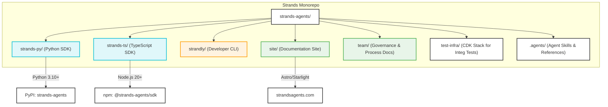
The monorepo structure facilitates shared context and consistent development practices across both SDKs. [AGENTS.md:9-22]()

**Sources:** [README.md:37-45](), [AGENTS.md:9-22]()

## Core Component Mapping

The following table maps high-level concepts to their implementation in code across both Python and TypeScript SDKs:

| Concept | Primary Class/Module (Python) | File Path (Python) | Primary Class/Module (TypeScript) | File Path (TypeScript) | Purpose |
|---------|-------------------------------|--------------------|-----------------------------------|------------------------|---------|
| **Agent Instance** | `Agent` | `strands-py/src/strands/agent/agent.py` | `Agent` | `strands-ts/src/agent/agent.ts` | Main orchestrator for agent execution |
| **Execution Loop** | `event_loop_cycle` | `strands-py/src/strands/event_loop/event_loop.py` | `invoke` / `stream` methods | `strands-ts/src/agent/agent.ts` | Recursive loop handling model calls and tool execution |
| **Model Interface** | `Model` (ABC) | `strands-py/src/strands/models/model.py` | `Model` (interface) | `strands-ts/src/models/model.ts` | Abstract base for all model providers |
| **Tool Definition** | `@tool` decorator | `strands-py/src/strands/tools/decorator.py` | `tool` factory | `strands-ts/src/tools/tool.ts` | Converts functions to agent tools |
| **Tool Registry** | `ToolRegistry` | `strands-py/src/strands/tools/registry.py` | `ToolRegistry` | `strands-ts/src/tools/tool-registry.ts` | Manages available tools for agent |
| **Hook System** | `HookRegistry` | `strands-py/src/strands/hooks/registry.py` | `HookRegistry` | `strands-ts/src/hooks/hook-registry.ts` | Event-driven customization points |
| **Plugin Base** | `Plugin` | `strands-py/src/strands/plugins/plugin.py` | `Plugin` | `strands-ts/src/plugins/plugin.ts` | Composable extension mechanism |
| **State Snapshot** | `Snapshot` | `strands-py/src/strands/types/_snapshot.py` | `AgentState` | `strands-ts/src/multiagent/state.ts` | Point-in-time capture of agent state |
| **Multi-Agent Base** | `MultiAgentBase` | `strands-py/src/strands/multiagent/base.py` | `MultiAgentBase` | `strands-ts/src/multiagent/multi-agent-base.ts` | Foundation for multi-agent patterns |
| **A2A Protocol** | `A2AServer` | `strands-py/src/strands/multiagent/a2a/server.py` | `A2AServer` | `strands-ts/src/a2a/express-server.ts` | Exposes agents via Agent-to-Agent protocol |

**Sources:** [strands-ts/package.json:21-158](), [strands-ts/README.md:85-195](), [README.md:69-75](), [strands-py/README.md:76-90](), [strands-mcp/README.md:39-40]()

## Agent Execution Flow

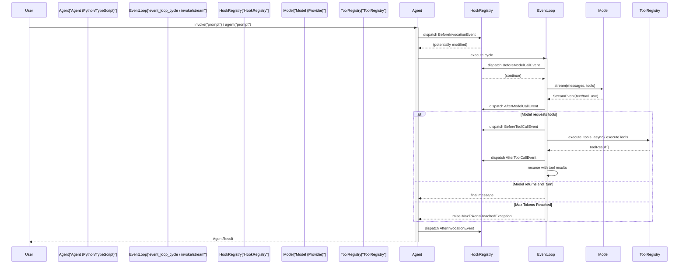

The execution flow demonstrates the recursive event loop pattern with hook intervention points. The system explicitly handles edge cases like token limits through `MaxTokensReachedException` (Python) or similar error handling in TypeScript.

**Sources:** [strands-ts/README.md:173-195]()

## Extensibility Architecture

The SDK provides three complementary extensibility mechanisms:

### Hook System
The `HookRegistry` provides event-driven customization through strongly-typed event callbacks. Common events include `BeforeInvocationEvent`, `BeforeModelCallEvent`, and `BeforeToolCallEvent`. [strands-ts/README.md:48]()

### Plugin System
The `Plugin` base class enables composable extensions. It allows for automatic discovery of hooks and tools defined within the plugin. The `AgentSkills` plugin uses this system to integrate AgentSkills.io compatible skills. [strands-ts/README.md:107-110]()

### Tool Provider Interface
Custom tool sources can implement the `ToolProvider` protocol to expose tools. This includes the `@tool` decorator (Python) or `tool` factory (TypeScript) for functions and the `MCPClient` for external Model Context Protocol servers. [strands-py/README.md:76-90](), [strands-ts/README.md:138-163]()

**Sources:** [strands-py/README.md:76-90](), [strands-ts/README.md:48](), [strands-ts/README.md:107-110](), [strands-ts/README.md:138-163]()

## Model Provider Ecosystem

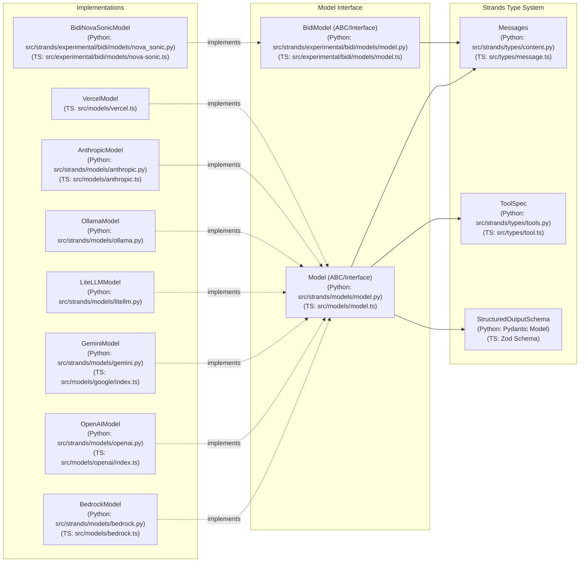

All model providers implement the `Model` abstract base class (Python) or interface (TypeScript), enabling zero-code provider switching while preserving access to provider-specific features. The SDK supports a wide range of providers including Amazon Bedrock, Anthropic, OpenAI, Gemini, LiteLLM, Ollama, and more. [strands-py/README.md:123-186](), [strands-ts/README.md:94-123]()

**Sources:** [strands-py/README.md:123-186](), [strands-ts/README.md:94-123]()

## Experimental Features
The SDK includes experimental support for bidirectional streaming via `BidiAgent` and `BidiModel`. This system is designed for real-time audio/text conversations, featuring hierarchical event sequences and low-latency audio processing. [strands-ts/package.json:51-54]()

**Sources:** [strands-ts/package.json:51-54]()

## Strands MCP Server

The `strands-agents-mcp-server` package provides a Model Context Protocol (MCP) server that offers curated documentation access to AI coding assistants. It indexes `llms.txt` files, enabling tools like `search_docs` and `fetch_doc` to find and retrieve relevant documentation sections. The server supports TF-IDF ranking for search queries and can prefetch all pages for immediate body-term search via the `STRANDS_MCP_PREFETCH_ALL` configuration. [strands-mcp/README.md:35-57](), [strands-mcp/src/strands_mcp_server/server.py:24-80](), [strands-mcp/src/strands_mcp_server/server.py:83-190]()

For detailed information on the MCP server, its features, and installation in various clients (Kiro, Cursor, VS Code, Claude Code), see [Strands MCP Server](#1.3).

**Sources:** [strands-mcp/README.md:35-57](), [strands-mcp/src/strands_mcp_server/server.py:24-80](), [strands-mcp/src/strands_mcp_server/server.py:83-190]()

## Next Steps

- [Installation and Quick Start](#1.1) — Get the SDK installed and run your first agent
- [Core Concepts and Architecture](#1.2) — Deep dive into fundamental concepts (Agent, Model, Tool, Hook)
- [Strands MCP Server](#1.3) — Learn about the Model Context Protocol server

---

# Page: Installation and Quick Start

# Installation and Quick Start

<details>
<summary>Relevant source files</summary>

The following files were used as context for generating this wiki page:

- [.gitignore](.gitignore)
- [AGENTS.md](AGENTS.md)
- [CONTRIBUTING.md](CONTRIBUTING.md)
- [README.md](README.md)
- [package-lock.json](package-lock.json)
- [package.json](package.json)
- [pyproject.toml](pyproject.toml)
- [site/src/content/docs/contribute/contributing/documentation.mdx](site/src/content/docs/contribute/contributing/documentation.mdx)
- [site/src/content/docs/contribute/contributing/documentation.ts](site/src/content/docs/contribute/contributing/documentation.ts)
- [site/src/content/docs/labs/ai-functions.mdx](site/src/content/docs/labs/ai-functions.mdx)
- [site/src/content/docs/user-guide/concepts/agents/conversation-management.mdx](site/src/content/docs/user-guide/concepts/agents/conversation-management.mdx)
- [site/src/content/docs/user-guide/concepts/agents/conversation-management.ts](site/src/content/docs/user-guide/concepts/agents/conversation-management.ts)
- [site/src/content/docs/user-guide/concepts/agents/conversation-management_imports.ts](site/src/content/docs/user-guide/concepts/agents/conversation-management_imports.ts)
- [site/src/content/docs/user-guide/concepts/memory/bedrock-knowledge-base.mdx](site/src/content/docs/user-guide/concepts/memory/bedrock-knowledge-base.mdx)
- [site/src/content/docs/user-guide/concepts/memory/bedrock-knowledge-base.ts](site/src/content/docs/user-guide/concepts/memory/bedrock-knowledge-base.ts)
- [site/src/content/docs/user-guide/concepts/memory/bedrock-knowledge-base_imports.ts](site/src/content/docs/user-guide/concepts/memory/bedrock-knowledge-base_imports.ts)
- [site/src/content/docs/user-guide/concepts/model-providers/amazon-bedrock.ts](site/src/content/docs/user-guide/concepts/model-providers/amazon-bedrock.ts)
- [site/src/content/docs/user-guide/concepts/model-providers/index.mdx](site/src/content/docs/user-guide/concepts/model-providers/index.mdx)
- [site/src/content/docs/user-guide/concepts/model-providers/index.ts](site/src/content/docs/user-guide/concepts/model-providers/index.ts)
- [site/src/content/docs/user-guide/evals-sdk/how-to/eval_task.mdx](site/src/content/docs/user-guide/evals-sdk/how-to/eval_task.mdx)
- [site/src/content/docs/user-guide/evals-sdk/simulators/tool_simulation.mdx](site/src/content/docs/user-guide/evals-sdk/simulators/tool_simulation.mdx)
- [site/src/content/docs/user-guide/observability-evaluation/traces.mdx](site/src/content/docs/user-guide/observability-evaluation/traces.mdx)
- [site/src/content/docs/user-guide/quickstart/python.mdx](site/src/content/docs/user-guide/quickstart/python.mdx)
- [strandly/package.json](strandly/package.json)
- [strands-py/pyproject.toml](strands-py/pyproject.toml)
- [strands-py/src/strands/agent/conversation_manager/__init__.py](strands-py/src/strands/agent/conversation_manager/__init__.py)
- [strands-py/src/strands/session/s3_session_manager.py](strands-py/src/strands/session/s3_session_manager.py)
- [strands-py/src/strands/vended_memory_stores/bedrock_knowledge_base/__init__.py](strands-py/src/strands/vended_memory_stores/bedrock_knowledge_base/__init__.py)
- [strands-py/src/strands/vended_memory_stores/bedrock_knowledge_base/store.py](strands-py/src/strands/vended_memory_stores/bedrock_knowledge_base/store.py)
- [strands-py/src/strands/vended_memory_stores/bedrock_knowledge_base/types.py](strands-py/src/strands/vended_memory_stores/bedrock_knowledge_base/types.py)
- [strands-py/tests/strands/session/test_s3_session_manager.py](strands-py/tests/strands/session/test_s3_session_manager.py)
- [strands-py/tests/strands/vended_memory_stores/bedrock_knowledge_base/test_store.py](strands-py/tests/strands/vended_memory_stores/bedrock_knowledge_base/test_store.py)
- [strands-ts/package.json](strands-ts/package.json)
- [strands-ts/src/multiagent/state.ts](strands-ts/src/multiagent/state.ts)

</details>


This page covers installing the Strands Agents SDK for both Python and TypeScript, and running your first agent. For detailed architecture and concepts, see [Core Concepts and Architecture](). For advanced configuration options, see [Agent Class and Initialization]().

---

## Overview

The Strands Agents SDK is a model-driven framework for building AI agents. It provides a multi-language workspace (Python and TypeScript) with a core package and optional dependencies for different model providers, observability tools, and experimental features. The default configuration for both SDKs uses Amazon Bedrock as the model provider.

**Sources:** [README.md:35-45](), [README.md:60-61](), [AGENTS.md:9-22]()

---

## System Requirements

| Requirement | Python SDK | TypeScript SDK |
|------------|---------|-------|
| Runtime | Python 3.10 - 3.14 | Node.js 20+ |
| Package Manager | pip / hatch | npm |
| AWS Credentials | Optional (for Bedrock) | Optional (for Bedrock) |
| OS | OS Independent | OS Independent |

**Sources:** [pyproject.toml:5](), [strands-py/pyproject.toml:11](), [README.md:64](), [README.md:83]()

---

## Installation Paths

```mermaid
graph TB
    ["Installation Decision"] --> ["Python SDK"]
    ["Installation Decision"] --> ["TypeScript SDK"]
    
    subgraph "Python Path"
        ["Python SDK"] --> ["pip install strands-agents"]
        ["Python SDK"] --> ["pip install strands-agents[extra]"]
        ["pip install strands-agents[extra]"] --> ["Extras: openai, anthropic, gemini, litellm, ollama, cedar"]
    end
    
    subgraph "TypeScript Path"
        ["TypeScript SDK"] --> ["npm install @strands-agents/sdk"]
    end
    
    ["pip install strands-agents"] --> ["Agent Class"]
    ["npm install @strands-agents/sdk"] --> ["Agent Class"]
```

**Sources:** [README.md:62-96](), [strands-py/pyproject.toml:48-93](), [strands-ts/package.json:2-159]()

---

## Python SDK Installation

### Minimal Setup

```bash
# Install core package
pip install strands-agents
```

This installs core dependencies defined in `strands-py/pyproject.toml`:
- `boto3` / `botocore`: AWS SDK for the default Bedrock provider [strands-py/pyproject.toml:32-33]()
- `pydantic`: Data validation for structured outputs [strands-py/pyproject.toml:38]()
- `mcp`: Model Context Protocol support [strands-py/pyproject.toml:37]()
- `opentelemetry-api`: Observability framework [strands-py/pyproject.toml:42]()

### Optional Dependencies (Extras)

| Extra | Install Command | Purpose |
|-------|----------------|---------|
| `anthropic` | `pip install strands-agents[anthropic]` | Direct Anthropic API support [strands-py/pyproject.toml:49]() |
| `openai` | `pip install strands-agents[openai]` | OpenAI API support [strands-py/pyproject.toml:57]() |
| `gemini` | `pip install strands-agents[gemini]` | Google Gemini support [strands-py/pyproject.toml:50]() |
| `litellm` | `pip install strands-agents[litellm]` | Multi-provider proxy support [strands-py/pyproject.toml:53]() |
| `cedar` | `pip install strands-agents[cedar]` | Cedar Policy authorization [strands-py/pyproject.toml:90]() |
| `all` | `pip install strands-agents[all]` | Install all stable providers and features [strands-py/pyproject.toml:92]() |

**Sources:** [strands-py/pyproject.toml:48-94]()

---

## TypeScript SDK Installation

### Minimal Setup

```bash
npm install @strands-agents/sdk
```

The TypeScript SDK is distributed as a single package with conditional exports for different model providers and environments (Node.js/Browser).

**Sources:** [README.md:85](), [strands-ts/package.json:21-159]()

---

## Quick Start Examples

### Python Quick Start

```python
from strands import Agent
# Optional: pip install strands-agents-tools
# from strands_tools import calculator 

# Default uses Bedrock (Claude 3.5 Sonnet)
agent = Agent()
result = agent("What is the square root of 1764?")
print(result.message)
```

**Sources:** [README.md:70-76]()

### TypeScript Quick Start

```typescript
import { Agent } from '@strands-agents/sdk'

const agent = new Agent()
const result = await agent.invoke('What is the square root of 1764?')
console.log(result)
```

**Sources:** [README.md:89-94]()

---

## Bridging Space: Model Selection

The following diagram illustrates how natural language intent maps to specific code entities in the SDK's `Model` provider system.

```mermaid
graph LR
    subgraph "Natural Language Space"
        ["'I want to use GPT-4'"]
        ["'Use Claude on AWS'"]
        ["'Run Llama locally'"]
    end

    subgraph "Code Entity Space"
        ["OpenAIModel"]
        ["BedrockModel"]
        ["OllamaModel"]
        ["Agent"]
    end

    ["'I want to use GPT-4'"] --> ["OpenAIModel"]
    ["'Use Claude on AWS'"] --> ["BedrockModel"]
    ["'Run Llama locally'"] --> ["OllamaModel"]
    
    ["OpenAIModel"] --> ["Agent"]
    ["BedrockModel"] --> ["Agent"]
    ["OllamaModel"] --> ["Agent"]
```

**Sources:** [README.md:51-54](), [strands-ts/package.json:27-46]()

---

## Bridging Space: Tool Execution

This diagram shows how a user's request for a calculation is resolved through the `Agent` and the `@tool` (Python) or `zod-tool` (TypeScript) infrastructure.

```mermaid
graph TD
    subgraph "Natural Language Space"
        ["'Calculate 2+2'"]
    end

    subgraph "Code Entity Space"
        ["Agent.invoke()"]
        ["ToolRegistry"]
        ["@tool / zod-tool"]
        ["calculator()"]
    end

    ["'Calculate 2+2'"] --> ["Agent.invoke()"]
    ["Agent.invoke()"] --> ["ToolRegistry"]
    ["ToolRegistry"] --> ["@tool / zod-tool"]
    ["@tool / zod-tool"] --> ["calculator()"]
```

**Sources:** [README.md:70-76](), [strands-py/src/strands/vended_memory_stores/bedrock_knowledge_base/store.py:81-93]()

---

## Development Setup (Monorepo)

For contributors working within the monorepo:

### Python SDK Development
```bash
cd strands-py
pip install hatch
hatch shell        # Enter dev environment
hatch test         # Run unit tests
hatch fmt          # Format and lint
```

### TypeScript SDK Development
```bash
# From repo root
npm ci             # Install dependencies
npm run build      # Build all packages
npm test           # Run unit tests in strands-ts
```

**Sources:** [README.md:115-128](), [CONTRIBUTING.md:55-62](), [package.json:13-31]()

---

## Environment Configuration

### AWS Credentials (Bedrock)
Both SDKs default to `BedrockModel`. Ensure your environment has valid AWS credentials:
- `AWS_ACCESS_KEY_ID`
- `AWS_SECRET_ACCESS_KEY`
- `AWS_REGION` (Defaults to `us-west-2` in many samples)

**Sources:** [README.md:60-61](), [strands-py/src/strands/vended_memory_stores/bedrock_knowledge_base/store.py:132-138]()

### Model Access
Ensure your AWS IAM principal has permissions for `bedrock:InvokeModel` and that model access is granted in the AWS Console for the specific model ID used (e.g., `anthropic.claude-3-5-sonnet-20240620-v1:0`).

**Sources:** [README.md:60-61](), [strands-py/src/strands/vended_memory_stores/bedrock_knowledge_base/store.py:76-78]()

---

# Page: Core Concepts and Architecture

# Core Concepts and Architecture

<details>
<summary>Relevant source files</summary>

The following files were used as context for generating this wiki page:

- [.gitignore](.gitignore)
- [AGENTS.md](AGENTS.md)
- [CONTRIBUTING.md](CONTRIBUTING.md)
- [README.md](README.md)
- [package-lock.json](package-lock.json)
- [package.json](package.json)
- [pyproject.toml](pyproject.toml)
- [site/src/content/docs/user-guide/concepts/agents/agent-loop.mdx](site/src/content/docs/user-guide/concepts/agents/agent-loop.mdx)
- [strandly/package.json](strandly/package.json)
- [strands-py/AGENTS.md](strands-py/AGENTS.md)
- [strands-py/docs/TESTING.md](strands-py/docs/TESTING.md)
- [strands-py/src/strands/telemetry/metrics.py](strands-py/src/strands/telemetry/metrics.py)
- [strands-py/src/strands/tools/executors/_executor.py](strands-py/src/strands/tools/executors/_executor.py)
- [strands-py/src/strands/tools/executors/sequential.py](strands-py/src/strands/tools/executors/sequential.py)
- [strands-py/src/strands/tools/mcp/mcp_types.py](strands-py/src/strands/tools/mcp/mcp_types.py)
- [strands-py/tests/strands/telemetry/test_metrics.py](strands-py/tests/strands/telemetry/test_metrics.py)
- [strands-py/tests/strands/tools/executors/conftest.py](strands-py/tests/strands/tools/executors/conftest.py)
- [strands-py/tests/strands/tools/executors/test_executor.py](strands-py/tests/strands/tools/executors/test_executor.py)
- [strands-ts/AGENTS.md](strands-ts/AGENTS.md)
- [strands-ts/docs/TESTING.md](strands-ts/docs/TESTING.md)
- [strands-ts/package.json](strands-ts/package.json)
- [strands-ts/src/multiagent/state.ts](strands-ts/src/multiagent/state.ts)
- [team/DECISIONS.md](team/DECISIONS.md)

</details>


This page explains the fundamental architecture of the Strands Agents SDK, covering the core abstractions (Agent, Model, Tool, Hook), how they interact, and the execution flow through the event loop. This material focuses on the structural design patterns and component relationships that form the foundation of the SDK.

For practical usage examples and API details, see [Agent Class and Basic Usage](). For multi-agent orchestration patterns, see [Multi-Agent Systems](). For observability integration, see [Telemetry and Observability]().

---

## Core Abstractions

The SDK is built around four primary abstractions that work together to create agentic behavior:

### Agent

The `Agent` class [strands-py/src/strands/agent/agent.py:109-120]() serves as the central orchestrator and primary user-facing interface. It coordinates the interaction between models, tools, hooks, and state management components. An agent maintains:

- A conversation history (`messages` list) [strands-py/src/strands/agent/agent.py:128]()
- A reference to a `Model` instance for inference [strands-py/src/strands/agent/agent.py:127]()
- A `ToolRegistry` for tool discovery and management [strands-py/src/strands/agent/agent.py:65]()
- A `HookRegistry` [strands-py/src/strands/hooks/registry.py:1-50]() for lifecycle event callbacks
- A `ConversationManager` [strands-py/src/strands/agent/agent.py:77-81]() for context window handling
- An optional `SessionManager` [strands-py/src/strands/agent/agent.py:59]() for persistence
- `AgentState` [strands-py/src/strands/agent/state.py:1-30]() for JSON-serializable application state

The Agent class provides multiple invocation patterns:
- Synchronous: `agent("prompt")` using the `__call__` method [strands-py/src/strands/agent/agent.py:539-561]()
- Asynchronous: `agent.invoke_async("prompt")` [strands-py/src/strands/agent/agent.py:563-583]()
- Streaming: `agent.stream_async("prompt")` for real-time events [strands-py/src/strands/agent/agent.py:585-642]()
- Direct tool access: `agent.tool.tool_name(...)` via the `_ToolCaller` proxy [strands-py/src/strands/agent/agent.py:62]()

Sources: [strands-py/src/strands/agent/agent.py:109-280](), [AGENTS.md:9-18]()

### Model

The `Model` abstract base class [strands-py/src/strands/models/model.py:1-50]() defines the interface for all LLM provider integrations. Models are responsible for:

- Formatting requests according to provider-specific APIs
- Streaming responses as event objects
- Supporting tool specifications for function calling
- Handling structured output when requested

The SDK includes multiple concrete implementations:
- `BedrockModel` [strands-py/src/strands/models/bedrock.py:1-50]() - Amazon Bedrock integration
- `OpenAIModel` [strands-py/src/strands/models/openai.py:1-50]() - OpenAI-compatible APIs
- `LiteLLMModel` [strands-py/src/strands/models/litellm.py:1-50]() - Universal proxy for 100+ providers
- `AnthropicModel`, `GeminiModel`, `MistralModel`, etc. [AGENTS.md:45-54]()

Sources: [strands-py/src/strands/agent/agent.py:55-56](), [AGENTS.md:42-55]()

### Tool

Tools enable agents to interact with external systems. The SDK provides multiple ways to define tools:

**Python Functions with `@tool` decorator**: The simplest approach where functions are automatically converted to tool specifications with JSON schema generated from type hints [strands-py/src/strands/tools/decorator.py:1-50]().

**Module-level tools**: Python modules with a `TOOL_SPEC` dictionary and corresponding function [tests/strands/agent/test_agent.py:103-118]().

**MCP (Model Context Protocol) servers**: External tool services accessed via `MCPClient` [strands-py/src/strands/tools/mcp/mcp_client.py:1-50]().

The `ToolRegistry` [strands-py/src/strands/tools/registry.py:1-100]() acts as the central repository, supporting:
- Static tool registration
- Dynamic tool registration (hot-reloadable) via `ToolWatcher` [strands-py/src/strands/tools/watcher.py:1-50]()
- File system-based discovery from directories [strands-py/src/strands/agent/agent.py:135]()
- Tool specification validation with JSON schema [strands-py/src/strands/tools/_validator.py:1-50]()

Sources: [strands-py/src/strands/agent/agent.py:157-168](), [tests/strands/agent/test_agent.py:221-230](), [AGENTS.md:57-81]()

### Hook

The `HookProvider` [strands-py/src/strands/hooks/registry.py:1-50]() interface enables extensibility through lifecycle event callbacks. Hooks receive events at key points during agent execution:

- `AgentInitializedEvent` [strands-py/src/strands/hooks/events.py:1-50]()
- `BeforeInvocationEvent` [strands-py/src/strands/hooks/events.py:1-50]()
- `AfterInvocationEvent` [strands-py/src/strands/hooks/events.py:1-50]()
- `BeforeModelCallEvent` [strands-py/src/strands/event_loop/event_loop.py:18]()
- `AfterModelCallEvent` [strands-py/src/strands/event_loop/event_loop.py:18]()
- `MessageAddedEvent` [strands-py/src/strands/hooks/events.py:1-50]()

Built-in hooks include:
- `ConversationManager` [strands-py/src/strands/agent/agent.py:77-81]()
- `SessionManager` [strands-py/src/strands/agent/agent.py:59]()
- `ModelRetryStrategy` [strands-py/src/strands/event_loop/_retry.py:1-50]()

Sources: [strands-py/src/strands/agent/agent.py:44-53](), [strands-py/src/strands/event_loop/event_loop.py:18-34]()

---

## Architectural Layers

The SDK follows a layered architecture with clear separation of concerns:

**System Architecture Overview**

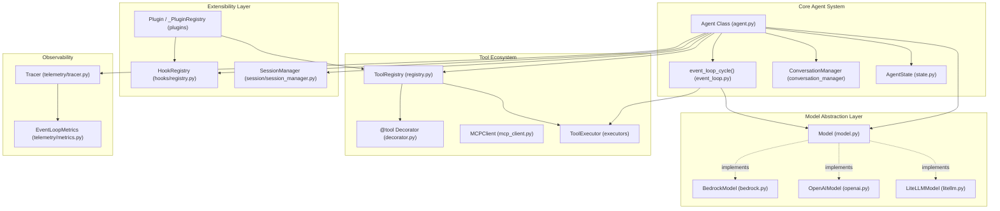

**Core Agent System**: The `Agent` class [strands-py/src/strands/agent/agent.py:109-120]() orchestrates all components. It delegates to `event_loop_cycle()` [strands-py/src/strands/event_loop/event_loop.py:120-158]() for execution and `ConversationManager` for history management.

**Model Abstraction Layer**: The `Model` interface defines how the agent communicates with LLMs. `BedrockModel` [strands-py/src/strands/models/bedrock.py:1-50]() is the default provider.

**Tool Ecosystem**: `ToolRegistry` [strands-py/src/strands/tools/registry.py:1-100]() manages discovery, while `ToolExecutor` [strands-py/src/strands/tools/executors/_executor.py:1-50]() handles the actual calling of functions, either concurrently or sequentially.

**Extensibility Layer**: The `HookRegistry` [strands-py/src/strands/hooks/registry.py:1-50]() dispatches events. The `Plugin` system [strands-py/src/strands/plugins/plugin.py:1-50]() provides a way to package hooks and tools together.

**Observability**: `Tracer` [strands-py/src/strands/telemetry/tracer.py:1-50]() provides OpenTelemetry integration, and `EventLoopMetrics` [strands-py/src/strands/telemetry/metrics.py:1-50]() tracks performance.

Sources: [strands-py/src/strands/agent/agent.py:1-111](), [strands-py/src/strands/event_loop/event_loop.py:1-158](), [AGENTS.md:19-132]()

---

## Event Loop Architecture

The event loop implements the core agentic pattern through recursive cycles of model invocation and tool execution.

### Event Loop Cycle Flow

**Request Execution Flow**

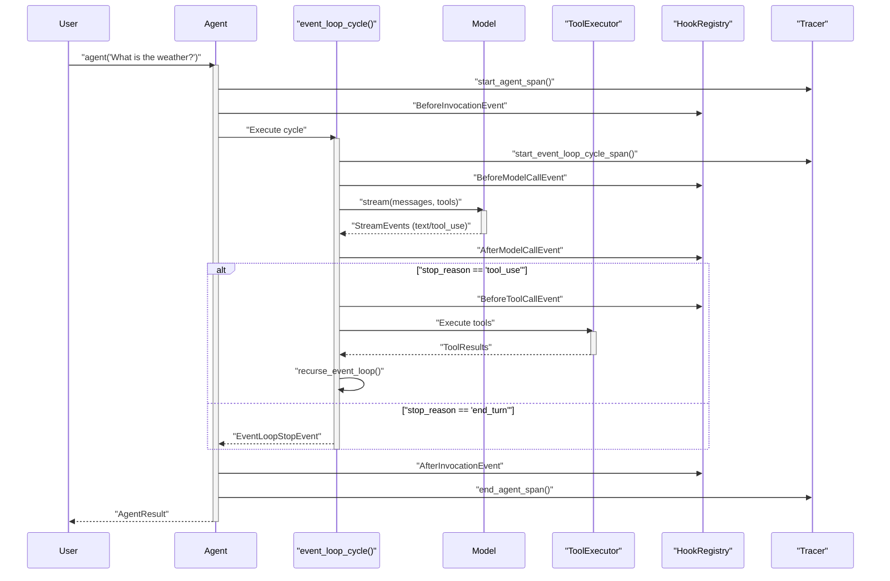

**Key Components**:

**Cycle Initialization** [strands-py/src/strands/event_loop/event_loop.py:161-183](): Each cycle generates a unique `event_loop_cycle_id` and creates tracing spans using `tracer.start_event_loop_cycle_span`.

**Model Execution**: The model is called to generate a response. If the model provides a `tool_use`, the loop transitions to tool execution. The loop checks for `_has_tool_use_in_latest_message` [strands-py/src/strands/event_loop/event_loop.py:58-75]() to skip redundant model calls when tool results are pending.

**Structured Output Handling**: When a `structured_output_context` [strands-py/src/strands/event_loop/event_loop.py:159]() is provided, the loop may force structured output via a hidden tool call if the model returns a plain text response [tests/strands/event_loop/test_event_loop_structured_output.py:131-166]().

Sources: [strands-py/src/strands/event_loop/event_loop.py:120-234](), [strands-py/src/strands/agent/agent.py:585-642]()

### Stop Reasons and Termination

The event loop terminates based on the `StopReason` [strands-py/src/strands/types/streaming.py:1-50]() returned by the model:

| Stop Reason | Behavior | Location |
|---|---|---|
| `end_turn` | Normal completion | [strands-py/src/strands/event_loop/event_loop.py:195]() |
| `tool_use` | Triggers tool execution and recursion | [strands-py/src/strands/event_loop/event_loop.py:188]() |
| `max_tokens` | Raises `MaxTokensReachedException` | [strands-py/src/strands/types/exceptions.py:21-27]() |
| `content_filter`| Model blocked content | [strands-py/src/strands/types/streaming.py:1-50]() |

Sources: [strands-py/src/strands/event_loop/event_loop.py:163-234](), [strands-py/src/strands/types/exceptions.py:21-27]()

---

## Streaming and Event Processing

The SDK transforms raw model responses into typed events for consumption.

### Stream Processing Pipeline

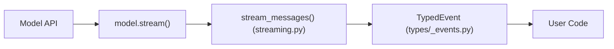

**Event Types Generated**:
- `ModelStreamChunkEvent` [strands-py/src/strands/types/_events.py:68]()
- `ModelMessageEvent` [strands-py/src/strands/types/_events.py:26]()
- `EventLoopStopEvent` [strands-py/src/strands/types/_events.py:24]()
- `StartEventLoopEvent` [strands-py/src/strands/types/_events.py:29]()

**Invocation Lock**: The Agent uses a `threading.Lock` [strands-py/src/strands/agent/agent.py:247]() to prevent concurrent invocations on the same instance, ensuring message history remains consistent. This behavior is controlled by `concurrent_invocation_mode` [strands-py/src/strands/agent/agent.py:148]().

Sources: [strands-py/src/strands/agent/agent.py:585-642](), [strands-py/src/strands/event_loop/event_loop.py:117-160](), [strands-py/src/strands/types/_events.py:1-68]()

---

## State Management

The SDK manages state through several specialized components:

### State Components

- **Messages**: The `messages` list [strands-py/src/strands/agent/agent.py:128]() stores the conversation history.
- **AgentState**: A JSON-serializable dictionary for application-specific state [strands-py/src/strands/agent/state.py:1-30]().
- **ConversationManager**: Pluggable strategies like `SlidingWindowConversationManager` [strands-py/src/strands/agent/conversation_manager/sliding_window_conversation_manager.py:1-50]() manage history size.
- **SessionManager**: Handles persistence to external storage like S3 or local files [strands-py/src/strands/session/session_manager.py:1-50]().
- **Interrupt State**: `_InterruptState` [strands-py/src/strands/interrupt.py:1-50]() tracks human-in-the-loop status.

Sources: [strands-py/src/strands/agent/agent.py:116-280](), [strands-py/src/strands/agent/state.py:1-30](), [strands-py/src/strands/interrupt.py:1-50]()

---

## Error Handling

| Exception | Cause | Recovery |
|---|---|---|
| `ContextWindowOverflowException` | Input too large | `ConversationManager` reduces context [strands-py/src/strands/types/exceptions.py:38-46]() |
| `MaxTokensReachedException` | Output limit hit | Raises error or attempts recovery [strands-py/src/strands/types/exceptions.py:21-27]() |
| `ConcurrencyException` | Concurrent call detected | Raises error based on config [strands-py/src/strands/types/exceptions.py:115-124]() |
| `ModelThrottledException` | Rate limited | `ModelRetryStrategy` retries call [strands-py/src/strands/types/exceptions.py:55-71]() |
| `StructuredOutputException` | Pydantic validation failed | Retries with error feedback [strands-py/src/strands/types/exceptions.py:102-113]() |

Sources: [strands-py/src/strands/types/exceptions.py:1-124](), [strands-py/src/strands/event_loop/event_loop.py:163-177](), [strands-py/src/strands/agent/agent.py:585-642]()

---

## Cross-SDK Parity and Monorepo Structure

The Strands Agents SDK is designed for cross-language parity, offering both Python and TypeScript implementations within a single monorepo. This design ensures a consistent developer experience and conceptual model across different environments.

### Monorepo Workspace Layout

The monorepo is structured to house multiple distinct projects, each with its own toolchain and conventions, while sharing common resources and principles.

```
strands-agents/
├── strands-py/         # Python SDK (hatch)
├── strands-ts/         # TypeScript SDK (npm workspace)
├── strandly/           # Developer CLI for local builds and workspace tooling
├── site/               # Documentation site (Astro)
├── team/               # Governance + cross-SDK process docs
├── test-infra/         # CDK stack for integ tests requiring provisioned AWS infra
├── .agents/            # Agent skills and references
├── package.json        # npm workspace root
└── .github/workflows/  # CI workflows
```
The `package.json` [package.json:1-36]() at the root defines the npm workspaces, including `strandly` [package.json:6]() and `strands-ts` [package.json:7](). Similarly, `pyproject.toml` [pyproject.toml:1-14]() defines shared Python tooling.

Sources: [AGENTS.md:9-22](), [package.json:1-36](), [pyproject.toml:1-14]()

### Parity Principles

The SDK aims for parity in *concepts and names*, not identical code. This means that while the implementation details may differ to adhere to language idioms, the high-level abstractions and their behaviors remain consistent.

**Key Parity Rules**:

- **Plugin / Construct Naming**: Constructs are named for their function, without a `Plugin` suffix (e.g., `AgentSkills`, `ContextOffloader`). [AGENTS.md:48-50]()
- **Identifiers**: Names match across SDKs, re-cased to the language idiom (`snake_case` in Python ↔ `camelCase` in TypeScript). [AGENTS.md:51-52]()
- **Single-word String-Literal Values**: Byte-identical (e.g., `'user'`, `'success'`). [AGENTS.md:53]()
- **Multi-word String-Literal Values**: `snake_case` in Python ↔ `camelCase` in TypeScript (e.g., `tool_use` ↔ `toolUse`). Conversion happens via an explicit map. [AGENTS.md:54-55]()
- **Wire Field Names**: Retain their wire format in both SDKs, even if it breaks language casing conventions (e.g., `inputSchema`, `tool_use_id`). [AGENTS.md:56-57]()
- **Hook Event Names**: Shared across SDKs (modulo suffix convention). Adding a hook event in one SDK requires adding the matching name in the other. [AGENTS.md:58-59]()
- **Public vs. Internal API**: Marked explicitly. Python uses `__all__` and `_` prefix for modules; TypeScript keeps out of `index.ts` barrel and uses `@internal` tag. [AGENTS.md:60-62]()
- **Structured Logging Format**: `field=<value>, field=<value> | lowercase human-readable message`. Python uses `%s` interpolation; TypeScript uses template literals. [AGENTS.md:63-65]()
- **Evergreen, To-the-Point Comments**: Comments explain what cannot be inferred from code, briefly stating constraints, invariants, or non-obvious "why." [AGENTS.md:66-70]()
- **Directory & File Naming Parity**: Subsystem directories use language-idiomatic separators (`snake_case` in Python, `kebab-case` in TypeScript) but stem names match word-for-word (e.g., `vended_plugins/` ↔ `vended-plugins/`). [AGENTS.md:72-74]()

Sources: [AGENTS.md:46-74](), [strands-py/AGENTS.md:1-5](), [strands-ts/AGENTS.md:1-5]()

### Implementation Details

- **Python SDK (`strands-py/`)**: Uses `hatch` for development workflow and `pyproject.toml` [pyproject.toml:1-14]() for configuration. [CONTRIBUTING.md:64-68]()
- **TypeScript SDK (`strands-ts/`)**: Uses `npm` workspaces and `package.json` [strands-ts/package.json:1-158]() for configuration. [CONTRIBUTING.md:147-150]()

Sources: [CONTRIBUTING.md:54-63](), [CONTRIBUTING.md:147-150](), [strands-ts/package.json:1-158](), [pyproject.toml:1-14]()

---

# Page: Strands MCP Server

# Strands MCP Server

<details>
<summary>Relevant source files</summary>

The following files were used as context for generating this wiki page:

- [site/src/content/docs/user-guide/build-with-ai.mdx](site/src/content/docs/user-guide/build-with-ai.mdx)
- [strands-mcp/README.md](strands-mcp/README.md)
- [strands-mcp/src/strands_mcp_server/server.py](strands-mcp/src/strands_mcp_server/server.py)
- [strands-mcp/src/strands_mcp_server/utils/cache.py](strands-mcp/src/strands_mcp_server/utils/cache.py)
- [strands-mcp/src/strands_mcp_server/utils/indexer.py](strands-mcp/src/strands_mcp_server/utils/indexer.py)
- [strands-mcp/tests/test_cache.py](strands-mcp/tests/test_cache.py)
- [strands-mcp/tests/test_indexer.py](strands-mcp/tests/test_indexer.py)
- [strands-mcp/tests/test_indexer_concurrency.py](strands-mcp/tests/test_indexer_concurrency.py)
- [strands-mcp/tests/test_server.py](strands-mcp/tests/test_server.py)
- [strands-py/README.md](strands-py/README.md)
- [strands-ts/README.md](strands-ts/README.md)

</details>


The `strands-agents-mcp-server` package provides a Model Context Protocol (MCP) server that offers curated documentation access to AI coding assistants. It enables these assistants to efficiently search for and retrieve documentation pages from `llms.txt` files, leveraging tools like `search_docs` and `fetch_doc`. This server is designed to integrate seamlessly with various MCP clients, providing a token-efficient way for AI to interact with documentation.

Sources:
* [strands-mcp/README.md:35-37]()

## Features

The Strands MCP Server offers several key features to enhance AI agent interaction with documentation:

*   **Document Search**: Utilizes weighted TF-IDF ranking over document titles. Once a page is fetched (hydrated), its content is also indexed, making body terms searchable. [strands-mcp/README.md:39-40]()
*   **Section-Based Browsing**: Allows browsing the document structure via a table of contents and fetching only specific sections, which is more token-efficient than retrieving entire pages. [strands-mcp/README.md:41-42]()
*   **Curated Content**: Indexes documentation sourced from `llms.txt` files, ensuring clean and human-readable titles. [strands-mcp/README.md:43-44]()
*   **On-Demand Fetching**: Full document content is lazy-loaded only when required, optimizing performance. [strands-mcp/README.md:45-46]()
*   **Snippet Generation**: Hydrates top-ranked pages to provide contextual previews. [strands-mcp/README.md:47-48]()
*   **Real URL Support**: Compatible with actual HTTPS URLs, maintaining backward compatibility. [strands-mcp/README.md:49-50]()

Sources:
* [strands-mcp/README.md:39-50]()

## Tools

The server exposes two primary tools for interacting with the documentation: `search_docs` and `fetch_doc`. These tools are implemented using the `FastMCP` framework [strands-mcp/src/strands_mcp_server/server.py:21]() and are designed to be thread-safe [strands-mcp/src/strands_mcp_server/utils/indexer.py:53-54]().

### `search_docs`

The `search_docs` tool allows agents to search the curated documentation catalog. It ranks results based on document titles and, once pages are hydrated, also considers page content.

*   **Querying**: Accepts a `query` string (e.g., "bedrock model", "how to use MCP tools") and an optional `k` parameter for the maximum number of results. [strands-mcp/src/strands_mcp_server/server.py:25-40]()
*   **Ranking**: Uses unbounded weighted TF-IDF scores for ordering results. These scores are relative to a given query and should not be compared across different queries. [strands-mcp/README.md:47-48]()
*   **Snippet Generation**: The top `SNIPPET_HYDRATE_MAX` (default 5) results are fetched concurrently to generate content snippets. [strands-mcp/src/strands_mcp_server/server.py:59-65](), [strands-mcp/src/strands_mcp_server/utils/cache.py:24]()
*   **Return Value**: Returns a list of dictionaries, each containing the `url`, `title`, `score`, and a `snippet`. An empty list is returned if no documents match. [strands-mcp/src/strands_mcp_server/server.py:41-52]()

Sources:
* [strands-mcp/README.md:47-48]()
* [strands-mcp/README.md:51-52]()
* [strands-mcp/src/strands_mcp_server/server.py:25-52]()
* [strands-mcp/src/strands_mcp_server/utils/cache.py:24]()

### `fetch_doc`

The `fetch_doc` tool is used to retrieve the content of documentation pages, with smart sectioning for token efficiency.

*   **Modes of Operation**:
    *   **TOC mode** (no `section` parameter): Returns a table of contents including section IDs, titles, summaries, and the document's preamble. [strands-mcp/src/strands_mcp_server/server.py:85-87]()
    *   **Section mode** (with `section` parameter): Returns the full Markdown content of a specific section, identified by its ID (e.g., "3" or "3.2"). [strands-mcp/src/strands_mcp_server/server.py:88-90]()
*   **Small Documents**: For documents under approximately 8KB, the full content is returned directly, regardless of the mode, as sectioning would add unnecessary overhead. [strands-mcp/src/strands_mcp_server/server.py:91-93](), [strands-mcp/src/strands_mcp_server/server.py:149-156]()
*   **URL Validation**: Only URLs under `https://strandsagents.com/` are allowed. [strands-mcp/src/strands_mcp_server/server.py:141-142]()
*   **Return Value**:
    *   In TOC mode, returns `url`, `title`, `preamble`, and a list of `sections`. [strands-mcp/src/strands_mcp_server/server.py:110-113]()
    *   In Section mode, returns `url`, `title`, `section_id`, `section_title`, and `content`. [strands-mcp/src/strands_mcp_server/server.py:115-119]()
    *   For small documents, returns `url`, `title`, `document_small: true`, and `content`. [strands-mcp/src/strands_mcp_server/server.py:121-125]()
    *   On error (e.g., unsupported URL, fetch failure, unknown section ID), returns an `error` message and the `url`. [strands-mcp/src/strands_mcp_server/server.py:127-133]()

Sources:
* [strands-mcp/README.md:53-54]()
* [strands-mcp/src/strands_mcp_server/server.py:84-133]()
* [strands-mcp/src/strands_mcp_server/server.py:141-142]()
* [strands-mcp/src/strands_mcp_server/server.py:149-156]()

### TF-IDF Ranking Implementation

The `IndexSearch` class [strands-mcp/src/strands_mcp_server/utils/indexer.py:41]() is responsible for indexing documents and performing TF-IDF based searches.

*   **Document Representation**: Each document is represented by a `Doc` dataclass, storing its `uri`, `display_title`, `content`, and `index_title`. [strands-mcp/src/strands_mcp_server/utils/indexer.py:17-32]()
*   **Tokenization**: Uses regular expressions to extract tokens, with special handling for Markdown elements like headers, code blocks, and link text. [strands-mcp/src/strands_mcp_server/utils/indexer.py:10-14](), [strands-mcp/src/strands_mcp_server/utils/indexer.py:240-250]()
*   **Indexing**: When a document is added via `IndexSearch.add()` [strands-mcp/src/strands_mcp_server/utils/indexer.py:101](), its tokens are extracted and added to an inverted index (`doc_indices`) and document frequency map (`doc_frequency`). [strands-mcp/src/strands_mcp_server/utils/indexer.py:86-90]()
*   **Content Hydration**: The `IndexSearch.update_content()` method [strands-mcp/src/strands_mcp_server/utils/indexer.py:125]() is called when a document's content is fetched. This reindexes the document with its full content, making body terms searchable. This process is idempotent. [strands-mcp/src/strands_mcp_server/utils/indexer.py:129-130]()
*   **Scoring**: The `IndexSearch.search()` method [strands-mcp/src/strands_mcp_server/utils/indexer.py:290]() calculates TF-IDF scores for query terms. It applies boosts to terms found in titles, headers, code blocks, and link text to prioritize structural importance. [strands-mcp/src/strands_mcp_server/utils/indexer.py:109-115](), [strands-mcp/src/strands_mcp_server/utils/indexer.py:35-38]()
*   **Thread Safety**: All public methods of `IndexSearch` (`add`, `update_content`, `search`) are thread-safe, protected by a `threading.Lock` to prevent race conditions during concurrent access. [strands-mcp/src/strands_mcp_server/utils/indexer.py:53-54](), [strands-mcp/src/strands_mcp_server/utils/indexer.py:73]()

Sources:
* [strands-mcp/src/strands_mcp_server/utils/indexer.py:10-14]()
* [strands-mcp/src/strands_mcp_server/utils/indexer.py:17-32]()
* [strands-mcp/src/strands_mcp_server/utils/indexer.py:35-38]()
* [strands-mcp/src/strands_mcp_server/utils/indexer.py:41]()
* [strands-mcp/src/strands_mcp_server/utils/indexer.py:53-54]()
* [strands-mcp/src/strands_mcp_server/utils/indexer.py:73]()
* [strands-mcp/src/strands_mcp_server/utils/indexer.py:86-90]()
* [strands-mcp/src/strands_mcp_server/utils/indexer.py:101]()
* [strands-mcp/src/strands_mcp_server/utils/indexer.py:109-115]()
* [strands-mcp/src/strands_mcp_server/utils/indexer.py:125]()
* [strands-mcp/src/strands_mcp_server/utils/indexer.py:129-130]()
* [strands-mcp/src/strands_mcp_server/utils/indexer.py:240-250]()
* [strands-mcp/src/strands_mcp_server/utils/indexer.py:290]()

### Diagram: Documentation Search Flow

```mermaid
graph TD
    A[User/Agent Query] --> B{search_docs(query, k)}
    B --> C[Cache: ensure_ready()]
    C --> D[Cache: get_index()]
    D --> E[IndexSearch: search(query, k)]
    E --> F{Results: List[(score, Doc)]}
    F --> G{Filter top K for snippet hydration}
    G --> H[ThreadPoolExecutor: map(cache.ensure_page, urls_to_hydrate)]
    H --> I[Cache: ensure_page(url)]
    I --> J{Page already cached or fetched?}
    J -- No --> K[doc_fetcher: fetch_and_clean(url)]
    K --> L[text_processor: format_display_title()]
    L --> M[Create Page object]
    M --> N[Acquire _CACHE_LOCK]
    N --> O{Check for existing page in _URL_CACHE}
    O -- No --> P[IndexSearch: update_content(url, raw_content)]
    P --> Q[Add Page to _URL_CACHE]
    Q --> R[Release _CACHE_LOCK]
    J -- Yes / O -- Yes --> S[Return Page]
    S --> I
    H --> T[Build return_docs with snippets]
    T --> U[Return List[Dict[str, Any]]]
```
Title: Documentation Search Flow
Sources:
* [strands-mcp/src/strands_mcp_server/server.py:55-80]()
* [strands-mcp/src/strands_mcp_server/utils/cache.py:136-182]()

### Diagram: Document Fetch Flow

```mermaid
graph TD
    A[User/Agent Request] --> B{fetch_doc(uri, section)}
    B --> C[Cache: ensure_ready()]
    C --> D{Is URI empty?}
    D -- Yes --> E[Cache: get_url_titles()]
    E --> F[Return catalog of URLs and titles]
    D -- No --> G{Is URI valid (https://strandsagents.com)?}
    G -- No --> H[Return error: "only https://strandsagents.com URLs allowed"]
    G -- Yes --> I[Cache: ensure_page(uri)]
    I --> J{Page fetched successfully?}
    J -- No --> K[Return error: "fetch failed"]
    J -- Yes --> L{Is document small (<= 8KB) or no sections?}
    L -- Yes --> M[Return full document content]
    L -- No --> N[text_processor: parse_sections(page.content)]
    N --> O{Is section parameter provided?}
    O -- Yes --> P[text_processor: extract_section(page.content, section, sections)]
    P --> Q{Section found?}
    Q -- No --> R[Return error: "section 'X' not found"]
    Q -- Yes --> S[Return specific section content]
    O -- No --> T[text_processor: extract_preamble(page.content)]
    T --> U[Return TOC with preamble and sections]
```
Title: Document Fetch Flow
Sources:
* [strands-mcp/src/strands_mcp_server/server.py:135-190]()

## Configuration

The Strands MCP Server can be configured using the `STRANDS_MCP_PREFETCH_ALL` environment variable.

*   **`STRANDS_MCP_PREFETCH_ALL`**: When set to a truthy value (`1`, `true`, `yes`), the server prefetches and indexes all pages in the background at startup. This ensures that body-term search works immediately, rather than only after a page has been hydrated by a prior query. By default, this feature is off. Prefetching is best-effort and eventually consistent, meaning results might initially be title-only until background hydration completes. [strands-mcp/README.md:56-58]()

Sources:
* [strands-mcp/README.md:56-58]()
* [strands-mcp/src/strands_mcp_server/utils/cache.py:27-38]()

### Diagram: Prefetching Mechanism

```mermaid
graph TD
    A[Server Startup] --> B{Is STRANDS_MCP_PREFETCH_ALL enabled?}
    B -- No --> C[Load links only, no prefetch]
    B -- Yes --> D[Load links only]
    D --> E[Start _background_prefetch thread]
    E --> F[Loop through _URL_CACHE]
    F --> G{Page already fetched?}
    G -- No --> H[Call ensure_page(url)]
    H --> I[Fetch and index page content]
    I --> J[Update _URL_CACHE and _INDEX]
    J --> F
    G -- Yes --> F
    F --> K[All pages processed]
    K --> L[Log prefetch summary]
```
Title: Prefetching Mechanism
Sources:
* [strands-mcp/src/strands_mcp_server/utils/cache.py:86-124]()
* [strands-mcp/src/strands_mcp_server/utils/cache.py:40-68]()
* [strands-mcp/src/strands_mcp_server/utils/cache.py:70-83]()

## Installation in MCP Clients

The Strands Agents MCP server can be used with over 40 applications that support the Model Context Protocol (MCP). The general installation command involves `uvx` to run the `strands-agents-mcp-server` package. [strands-mcp/README.md:65-67]()

The following sections provide specific installation instructions for popular MCP clients.

### Prerequisites

The MCP server requires `uv` to be installed on your system. Follow the [official installation instructions](https://github.com/astral-sh/uv#installation) for `uv`. [strands-mcp/README.md:60-62]()

Sources:
* [strands-mcp/README.md:60-62]()
* [strands-mcp/README.md:65-67]()

### Kiro

To install in Kiro, add the following configuration to `~/.kiro/settings/mcp.json`:

```json
{
  "mcpServers": {
    "strands-agents": {
      "command": "uvx",
      "args": ["strands-agents-mcp-server"],
      "env": {
        "FASTMCP_LOG_LEVEL": "INFO"
      },
      "disabled": false,
      "autoApprove": ["search_docs", "fetch_doc"]
    }
  }
}
```
The `autoApprove` field ensures that `search_docs` and `fetch_doc` tools are automatically approved for use. [strands-mcp/README.md:81-95]()

Sources:
* [strands-mcp/README.md:81-95]()
* [site/src/content/docs/user-guide/build-with-ai.mdx:62-73]()

### Cursor

To install in Cursor, add the following to `~/.cursor/mcp.json`:

```json
{
  "mcpServers": {
    "strands-agents": {
      "command": "uvx",
      "args": ["strands-agents-mcp-server"]
    }
  }
}
```
Sources:
* [strands-mcp/README.md:72]()
* [strands-mcp/README.md:143-149]()
* [site/src/content/docs/user-guide/build-with-ai.mdx:95-103]()

### VS Code

To install in VS Code, add the following to your `mcp.json` file:

```json
{
  "servers": {
    "strands-agents": {
      "command": "uvx",
      "args": ["strands-agents-mcp-server"]
    }
  }
}
```
Sources:
* [strands-mcp/README.md:73]()
* [strands-mcp/README.md:152-158]()
* [site/src/content/docs/user-guide/build-with-ai.mdx:111-119]()

### Claude Code

To install in Claude Code, run the following command:

```bash
claude mcp add strands uvx strands-agents-mcp-server
```
Sources:
* [strands-mcp/README.md:126-128]()
* [site/src/content/docs/user-guide/build-with-ai.mdx:84-86]()

### Other MCP Clients

For other MCP-compatible applications, the general configuration is:
*   **Command:** `uvx`
*   **Args:** `["strands-agents-mcp-server"]` [site/src/content/docs/user-guide/build-with-ai.mdx:131-134]()

Sources:
* [site/src/content/docs/user-guide/build-with-ai.mdx:131-134]()

### Using with Strands Agents

The Strands Agents MCP server can also be used as a tool within your own Strands agents.

#### Python

```python
from mcp import stdio_client, StdioServerParameters
from strands import Agent
from strands.tools.mcp import MCPClient

mcp_client = MCPClient(lambda: stdio_client(
    StdioServerParameters(
        command="uvx",
        args=["strands-agents-mcp-server"]
    )
))

agent = Agent(tools=[mcp_client])
agent("How do I create a custom tool in Strands Agents?")
```
Sources:
* [site/src/content/docs/user-guide/build-with-ai.mdx:30-45]()
* [strands-py/README.md:109-120]()

#### TypeScript

```typescript
// Example from user-guide/build-with-ai.ts:mcp_strands
import { Agent } from '@strands-agents/sdk';
import { MCPClient } from '@strands-agents/sdk/tools/mcp';
import { StdioServerParameters, stdioClient } from '@model-context-protocol/client';

const mcpClient = new MCPClient(() =>
  stdioClient(
    new StdioServerParameters({
      command: 'uvx',
      args: ['strands-agents-mcp-server'],
    }),
  ),
);

const agent = new Agent({ tools: [mcpClient] });
await agent.invoke('How do I create a custom tool in Strands Agents?');
```
Sources:
* [site/src/content/docs/user-guide/build-with-ai.mdx:50-52]()
* [strands-ts/README.md:45]()

### Verify Connection

You can test the MCP server using the [MCP Inspector](https://modelcontextprotocol.io/docs/tools/inspector):

```bash
npx @modelcontextprotocol/inspector uvx strands-agents-mcp-server
```
Sources:
* [site/src/content/docs/user-guide/build-with-ai.mdx:139-142]()

---

# Page: Agent System

# Agent System

<details>
<summary>Relevant source files</summary>

The following files were used as context for generating this wiki page:

- [strands-py/src/strands/agent/agent.py](strands-py/src/strands/agent/agent.py)
- [strands-py/src/strands/event_loop/event_loop.py](strands-py/src/strands/event_loop/event_loop.py)
- [strands-py/tests/strands/event_loop/test_event_loop.py](strands-py/tests/strands/event_loop/test_event_loop.py)
- [strands-py/tests/strands/event_loop/test_event_loop_metadata.py](strands-py/tests/strands/event_loop/test_event_loop_metadata.py)
- [strands-py/tests/strands/event_loop/test_event_loop_structured_output.py](strands-py/tests/strands/event_loop/test_event_loop_structured_output.py)
- [strands-ts/src/agent/__tests__/agent.hook.test.ts](strands-ts/src/agent/__tests__/agent.hook.test.ts)
- [strands-ts/src/agent/__tests__/agent.model-retry.test.ts](strands-ts/src/agent/__tests__/agent.model-retry.test.ts)
- [strands-ts/src/agent/__tests__/agent.test.ts](strands-ts/src/agent/__tests__/agent.test.ts)
- [strands-ts/src/agent/agent.ts](strands-ts/src/agent/agent.ts)
- [strands-ts/src/conversation-manager/__tests__/null-conversation-manager.test.ts](strands-ts/src/conversation-manager/__tests__/null-conversation-manager.test.ts)
- [strands-ts/src/hooks/__tests__/events.test.ts](strands-ts/src/hooks/__tests__/events.test.ts)
- [strands-ts/src/hooks/events.ts](strands-ts/src/hooks/events.ts)
- [strands-ts/src/index.ts](strands-ts/src/index.ts)
- [strands-ts/src/types/agent.ts](strands-ts/src/types/agent.ts)
- [strands-ts/src/types/messages.ts](strands-ts/src/types/messages.ts)

</details>


The Agent system is the central orchestrator of the Strands Agents SDK, coordinating interactions between language models, tools, conversation history, and extensibility mechanisms. This page provides an overview of the Agent's architecture, lifecycle, and core responsibilities across both Python and TypeScript implementations.

For detailed information about specific subsystems, see:
- [Agent Class and Initialization](#2.1)
- [Event Loop and Execution Flow](#2.2)
- [Streaming Responses](#2.3)
- [Conversation Management](#2.4)
- [Agent State and Session Management](#2.5)
- [Error Handling and Recovery](#2.6)

Sources: [strands-py/src/strands/agent/agent.py:1-111](), [strands-ts/src/agent/agent.ts:125-177]()

## Core Architecture

The `Agent` class serves as the main entry point for all SDK interactions. It delegates specialized responsibilities to subsystems while maintaining overall execution control. The architecture is consistent across Python and TypeScript, using a common set of abstractions.

### Agent System Components
Title: Agent Architecture and Code Entities
```mermaid
graph TB
    Agent["Agent<br/>(strands-ts/src/agent/agent.ts:166)"]
    
    subgraph "Model Layer"
        model["model: Model<br/>(strands-ts/src/models/model.ts:32)"]
    end
    
    subgraph "Conversation State"
        messages["messages: Message[]<br/>(strands-ts/src/types/messages.ts:70)"]
        system_prompt["systemPrompt: SystemPrompt"]
        state["appState: StateStore<br/>(strands-ts/src/state-store.ts:12)"]
    end
    
    subgraph "Tool Management"
        tool_registry["toolRegistry: ToolRegistry<br/>(strands-ts/src/registry/tool-registry.ts:36)"]
        tool_executor["toolExecutor: ToolExecutor<br/>(ConcurrentToolExecutor, SequentialToolExecutor)"]
        tool_caller["tool: ToolCallerProxy<br/>(strands-ts/src/agent/tool-caller.ts:95)"]
    end
    
    subgraph "Extensibility"
        hooks["hooks: HookRegistry<br/>(strands-ts/src/hooks/registry.ts:52)"]
        middleware["middleware: MiddlewareRegistry<br/>(strands-ts/src/middleware/index.ts:54)"]
        plugins["plugins: PluginRegistry<br/>(strands-ts/src/plugins/registry.ts:44)"]
    end
    
    subgraph "Execution Control"
        conversation_manager["conversationManager:<br/>ConversationManager"]
        retry_strategy["retryStrategy:<br/>RetryStrategy"]
        interrupt_state["interruptState:<br/>InterruptState"]
    end
    
    subgraph "Observability"
        tracer["tracer: Tracer<br/>(strands-ts/src/telemetry/tracer.ts:102)"]
        metrics["metrics: AgentMetrics<br/>(strands-ts/src/telemetry/meter.ts:103)"]
    end
    
    Agent --> model
    Agent --> messages
    Agent --> state
    Agent --> tool_registry
    Agent --> tool_executor
    Agent --> tool_caller
    Agent --> hooks
    Agent --> middleware
    Agent --> plugins
    Agent --> conversation_manager
    Agent --> retry_strategy
    Agent --> interrupt_state
    Agent --> tracer
    Agent --> metrics
```

**Component Responsibilities:**

| Component | Purpose | Python Reference | TypeScript Reference |
|-----------|---------|------------------|----------------------|
| `model` | LLM Provider | `Model` [strands-py/src/strands/models/model.py:66]() | `Model` [strands-ts/src/models/model.ts:32]() |
| `messages` | History | `Messages` [strands-py/src/strands/types/content.py:87]() | `Message[]` [strands-ts/src/types/messages.ts:84]() |
| `tool_registry` | Tool Store | `ToolRegistry` [strands-py/src/strands/tools/registry.py:79]() | `ToolRegistry` [strands-ts/src/registry/tool-registry.ts:36]() |
| `hooks` | Events | `HookRegistry` [strands-py/src/strands/hooks/registry.py:57]() | `HookRegistry` [strands-ts/src/hooks/registry.ts:52]() |
| `middleware` | Interception | `MiddlewareRegistry` [strands-py/src/strands/_middleware/__init__.py:47]() | `MiddlewareRegistry` [strands-ts/src/middleware/index.ts:54]() |
| `state` | Durable State | `AgentState` [strands-py/src/strands/agent/state.py:104]() | `StateStore` [strands-ts/src/state-store.ts:12]() |

Sources: [strands-ts/src/agent/agent.ts:1-160](), [strands-py/src/strands/agent/agent.py:166-332]()

## Execution Lifecycle

The Agent's execution follows a predictable lifecycle from invocation through response generation, managed by a central event loop.

Title: Natural Language to Code Execution Flow
```mermaid
sequenceDiagram
    participant User as "User Input (Natural Language)"
    participant Agent as "Agent.invoke() / stream()"
    participant Loop as "event_loop_cycle() (strands-py/src/strands/event_loop/event_loop.py:186)"
    participant Hooks as "HookRegistry (Events)"
    participant Model as "Model.stream() (LLM Provider)"
    participant Tools as "ToolExecutor (Code Execution)"
    
    User->>Agent: "Analyze this data"
    Agent->>Hooks: BeforeInvocationEvent
    Agent->>Loop: Run Cycle
    
    Loop->>Hooks: BeforeModelCallEvent
    Loop->>Model: Invoke LLM
    Model-->>Loop: StreamEvents (Deltas)
    Loop->>Hooks: AfterModelCallEvent
    
    alt Tool Use Requested
        Loop->>Hooks: BeforeToolsEvent
        Loop->>Tools: execute(ToolUseBlock)
        Tools-->>Loop: ToolResultBlock
        Loop->>Hooks: AfterToolsEvent
        Loop->>Loop: Recurse (Next Cycle)
    else Final Response
        Loop-->>Agent: EventLoopStopEvent
    end
    
    Agent->>Hooks: AfterInvocationEvent
    Agent-->>User: "Here is the analysis..."
```

**Key Execution Methods:**
- **`Agent.invoke()` / `invoke_async()`**: Collects all streaming events and returns a final `AgentResult` [strands-py/src/strands/agent/agent.py:465]().
- **`Agent.stream()` / `stream_async()`**: Yields events (deltas, tool calls, etc.) as they occur [strands-ts/src/agent/agent.ts:688]().
- **`event_loop_cycle()`**: The core logic that orchestrates a single turn of model inference and tool execution [strands-py/src/strands/event_loop/event_loop.py:186]().

Sources: [strands-py/src/strands/agent/agent.py:418-876](), [strands-ts/src/agent/agent.ts:688-797](), [strands-py/src/strands/event_loop/event_loop.py:186-210]()

## Subsystem Overviews

### Agent Class and Initialization
The `Agent` class is initialized with a `model`, optional `tools`, `system_prompt`, and `plugins`. It supports concurrency control via an internal lock and `ConcurrentInvocationMode` [strands-py/src/strands/types/agent.py:83](). For details, see [Agent Class and Initialization](#2.1).

### Event Loop and Execution Flow
The event loop manages the "Reasoning Loop". It handles recursion (via `recurse_event_loop`), validates execution limits (turns, tokens), and executes middleware stages like `InvokeModelStage` [strands-ts/src/middleware/index.ts:54](). For details, see [Event Loop and Execution Flow](#2.2).

### Streaming Responses
The SDKs provide a unified streaming interface. `AgentStreamEvent` wraps model deltas, tool starts, and final results [strands-ts/src/types/agent.ts:202](). For details, see [Streaming Responses](#2.3).

### Conversation Management
`ConversationManager` implementations (e.g., `SlidingWindowConversationManager`) control the context window by pruning or summarizing history [strands-ts/src/conversation-manager/sliding-window-conversation-manager.ts:45](). For details, see [Conversation Management](#2.4).

### Agent State and Session Management
Agents can persist state across sessions using `SessionManager` [strands-py/src/strands/session/session_manager.py:72](). This includes the conversation history and the `AgentState` key-value store. For details, see [Agent State and Session Management](#2.5).

### Error Handling and Recovery
The system includes specialized exceptions like `ContextWindowOverflowException` and `ModelThrottledException` [strands-ts/src/errors.ts:32](). It uses `RetryStrategy` to handle transient failures. For details, see [Error Handling and Recovery](#2.6).

Sources: [strands-ts/src/agent/agent.ts:45-54](), [strands-py/src/strands/agent/agent.py:92-104](), [strands-ts/src/types/agent.ts:58-180]()

---

# Page: Agent Class and Initialization

# Agent Class and Initialization

<details>
<summary>Relevant source files</summary>

The following files were used as context for generating this wiki page:

- [strands-py/src/strands/__init__.py](strands-py/src/strands/__init__.py)
- [strands-py/src/strands/agent/_concurrency.py](strands-py/src/strands/agent/_concurrency.py)
- [strands-py/src/strands/agent/agent.py](strands-py/src/strands/agent/agent.py)
- [strands-py/src/strands/event_loop/event_loop.py](strands-py/src/strands/event_loop/event_loop.py)
- [strands-py/src/strands/storage/__init__.py](strands-py/src/strands/storage/__init__.py)
- [strands-py/src/strands/tools/_caller.py](strands-py/src/strands/tools/_caller.py)
- [strands-py/src/strands/types/exceptions.py](strands-py/src/strands/types/exceptions.py)
- [strands-py/tests/strands/agent/test_agent.py](strands-py/tests/strands/agent/test_agent.py)
- [strands-py/tests/strands/agent/test_concurrency.py](strands-py/tests/strands/agent/test_concurrency.py)
- [strands-py/tests/strands/event_loop/test_event_loop.py](strands-py/tests/strands/event_loop/test_event_loop.py)
- [strands-py/tests/strands/event_loop/test_event_loop_metadata.py](strands-py/tests/strands/event_loop/test_event_loop_metadata.py)
- [strands-py/tests/strands/event_loop/test_event_loop_structured_output.py](strands-py/tests/strands/event_loop/test_event_loop_structured_output.py)
- [strands-py/tests/strands/storage/__init__.py](strands-py/tests/strands/storage/__init__.py)
- [strands-py/tests/strands/storage/test_in_memory_storage.py](strands-py/tests/strands/storage/test_in_memory_storage.py)
- [strands-py/tests/strands/storage/test_local_file_storage.py](strands-py/tests/strands/storage/test_local_file_storage.py)
- [strands-ts/src/agent/__tests__/agent.hook.test.ts](strands-ts/src/agent/__tests__/agent.hook.test.ts)
- [strands-ts/src/agent/__tests__/agent.model-retry.test.ts](strands-ts/src/agent/__tests__/agent.model-retry.test.ts)
- [strands-ts/src/agent/__tests__/agent.test.ts](strands-ts/src/agent/__tests__/agent.test.ts)
- [strands-ts/src/agent/agent.ts](strands-ts/src/agent/agent.ts)
- [strands-ts/src/conversation-manager/__tests__/null-conversation-manager.test.ts](strands-ts/src/conversation-manager/__tests__/null-conversation-manager.test.ts)
- [strands-ts/src/hooks/__tests__/events.test.ts](strands-ts/src/hooks/__tests__/events.test.ts)
- [strands-ts/src/hooks/events.ts](strands-ts/src/hooks/events.ts)
- [strands-ts/src/index.ts](strands-ts/src/index.ts)
- [strands-ts/src/types/agent.ts](strands-ts/src/types/agent.ts)
- [strands-ts/src/types/messages.ts](strands-ts/src/types/messages.ts)

</details>


This document covers the `Agent` class constructor, its configuration parameters, initialization process, and common initialization patterns. For information about the agent's execution flow and event loop, see [Event Loop and Execution Flow](2.2). For state management and persistence, see [Agent State and Session Management](2.5).

## Overview

The `Agent` class ([strands-py/src/strands/agent/agent.py:166](), [strands-ts/src/agent/agent.ts:251]()) is the primary entry point for building agentic applications in the Strands SDK. It orchestrates interactions between language models, tools, and conversation history, providing both synchronous and asynchronous interfaces for natural language processing.

The agent supports two interaction patterns:
1. **Conversational**: `agent("Analyze this data")` via `__call__` ([strands-py/src/strands/agent/agent.py:341]()) or `invoke()` ([strands-ts/src/agent/agent.ts:607]()).
2. **Direct tool access**: `agent.tool.tool_name(param="value")` via the `ToolCaller` proxy ([strands-py/src/strands/agent/agent.py:180](), [strands-ts/src/agent/agent.ts:470]()).

**Sources:** [strands-py/src/strands/agent/agent.py:1-10](), [strands-py/src/strands/agent/agent.py:166-180](), [strands-ts/src/agent/agent.ts:251-260]()

## Agent Architecture

The following diagram bridges the high-level system components to their specific code entities within the `Agent` class across both Python and TypeScript implementations.

### Agent Component Mapping
```mermaid
graph TB
    Agent["class Agent (agent.py / agent.ts)"]
    
    subgraph "Core Components"
        Model["model: Model (model.py / model.ts)"]
        Messages["messages: Messages / Message[]"]
        SystemPrompt["system_prompt: SystemPrompt"]
        State["state: AgentState / appState"]
    end
    
    subgraph "Execution Components"
        ToolRegistry["tool_registry: ToolRegistry (registry/tool-registry.ts)"]
        ToolExecutor["tool_executor: ToolExecutor / strategy"]
        ConversationManager["conversation_manager: ConversationManager"]
        EventLoopMetrics["event_loop_metrics / metrics: AgentMetrics"]
    end
    
    subgraph "Extensibility Components"
        HookRegistry["hooks: HookRegistry (hooks/registry.ts)"]
        PluginRegistry["_plugin_registry / plugins: PluginRegistry"]
        SessionManager["session_manager: SessionManager"]
    end
    
    subgraph "Internal State Control"
        CancelSignal["_cancel_signal / cancelSignal: AbortSignal"]
        InterruptState["_interrupt_state / interruptState: InterruptState"]
        Concurrency["_concurrency_controller / _invocation_lock"]
        RetryStrategy["retry_strategy: ModelRetryStrategy"]
    end
    
    Agent --> Model
    Agent --> Messages
    Agent --> SystemPrompt
    Agent --> State
    Agent --> ToolRegistry
    Agent --> ToolExecutor
    Agent --> ConversationManager
    Agent --> EventLoopMetrics
    Agent --> HookRegistry
    Agent --> PluginRegistry
    Agent --> SessionManager
    Agent --> CancelSignal
    Agent --> InterruptState
    Agent --> Concurrency
    Agent --> RetryStrategy
```

**Sources:** [strands-py/src/strands/agent/agent.py:182-331](), [strands-ts/src/agent/agent.ts:251-480]()

## Constructor Parameters

The `Agent` constructor ([strands-py/src/strands/agent/agent.py:182](), [strands-ts/src/agent/agent.ts:311]()) accepts the following configuration:

### Model Configuration
| Parameter | Type | Default | Description |
|-----------|------|---------|-------------|
| `model` | `Model \| str \| None` | `None` | Provider for inference. Defaults to `BedrockModel` if None ([strands-py/src/strands/agent/agent.py:184](), [strands-ts/src/agent/agent.ts:312]()). |
| `system_prompt` | `str \| list[SystemContentBlock] \| None` | `None` | Instructions to guide model behavior ([strands-py/src/strands/agent/agent.py:187](), [strands-ts/src/agent/agent.ts:315]()). |
| `structured_output_model` / `structuredOutputSchema` | `type[BaseModel] \| z.ZodSchema` | `None` | Schema for structured output validation ([strands-py/src/strands/agent/agent.py:188](), [strands-ts/src/agent/agent.ts:326]()). |

### Conversation & Tooling
| Parameter | Type | Default | Description |
|-----------|------|---------|-------------|
| `messages` | `Messages \| Message[]` | `None` | Initial conversation history ([strands-py/src/strands/agent/agent.py:185](), [strands-ts/src/agent/agent.ts:314]()). |
| `tools` | `list[...] \| ToolList` | `None` | List of tools, MCP clients, or other agents ([strands-py/src/strands/agent/agent.py:186](), [strands-ts/src/agent/agent.ts:316]()). |
| `tool_executor` / `toolExecutorStrategy` | `ToolExecutor \| 'concurrent' \| 'sequential'` | `'concurrent'` | Strategy for executing tools ([strands-py/src/strands/agent/agent.py:204](), [strands-ts/src/agent/agent.ts:333]()). |
| `context_manager` | `ContextManagerStrategy` | `'auto'` | Strategy for context window management ([strands-py/src/strands/agent/agent.py:200](), [strands-ts/src/agent/agent.ts:327]()). |

### State & Persistence
| Parameter | Type | Default | Description |
|-----------|------|---------|-------------|
| `state` / `appState` | `AgentState \| Record<string, JSONValue>` | `None` | Durable agent state storage ([strands-py/src/strands/agent/agent.py:198](), [strands-ts/src/agent/agent.ts:323]()). |
| `session_manager` | `SessionManager \| None` | `None` | Manager for persistent sessions ([strands-py/src/strands/agent/agent.py:202](), [strands-ts/src/agent/agent.ts:321]()). |
| `plugins` | `list[Plugin] \| None` | `None` | List of plugins to extend agent functionality ([strands-py/src/strands/agent/agent.py:201](), [strands-ts/src/agent/agent.ts:322]()). |

**Sources:** [strands-py/src/strands/agent/agent.py:182-207](), [strands-ts/src/agent/agent.ts:311-343]()

## Initialization Flow

The initialization process transforms high-level configuration into the operational state required for the event loop.

### Initialization Sequence
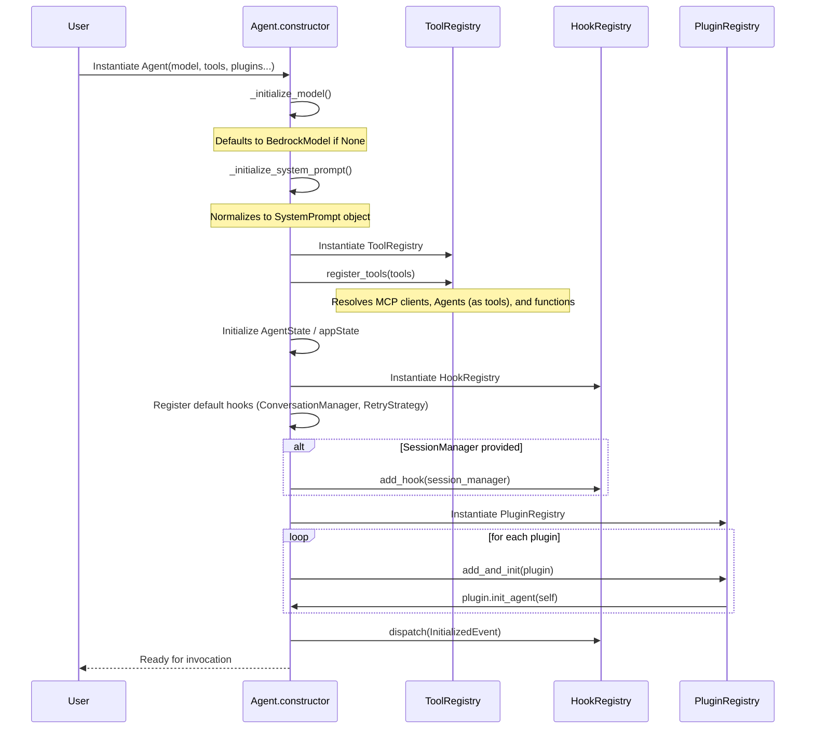

**Sources:** [strands-py/src/strands/agent/agent.py:208-331](), [strands-ts/src/agent/agent.ts:345-480]()

## Concurrency and Idempotency

The SDK implements concurrency control to prevent race conditions during agent invocation.

### Concurrency Controller
The `_concurrency_controller` (Python: `_ConcurrencyController` [strands-py/src/strands/agent/_concurrency.py:13]()) or internal lock (TypeScript: `ConcurrentInvocationError` [strands-ts/src/agent/agent.ts:614]()) manages execution state.
- **Python**: Supports `THROW` (default) or `UNSAFE_REENTRANT` modes ([strands-py/src/strands/agent/agent.py:149]()).
- **TypeScript**: Throws `ConcurrentInvocationError` if `invoke()` or `stream()` is called while an invocation is already in progress ([strands-ts/src/agent/agent.ts:614-617]()).

### Idempotency Token
For distributed systems or resilient clients, the `idempotency_token` ([strands-py/src/strands/agent/agent.py:388]()) allows callers to retry an invocation safely. If a call with the same token is already in progress, the SDK will either return the existing result or throw a concurrency error depending on the state ([strands-py/src/strands/agent/_concurrency.py:54-72]()).

**Sources:** [strands-py/src/strands/agent/agent.py:736-744](), [strands-ts/src/agent/agent.ts:614-617](), [strands-py/src/strands/agent/_concurrency.py:13-72]()

## ToolCaller Proxy

The `ToolCaller` ([strands-py/src/strands/tools/_caller.py:20](), [strands-ts/src/agent/tool-caller.ts:40]()) provides a proxy interface for direct tool access via `agent.tool.<name>(...)`.

- **Direct Invocation**: Bypasses the LLM but still executes within the agent's context (hooks, telemetry, and environment).
- **Session Integration**: Direct tool calls can optionally be recorded in the conversation history via `record_direct_tool_call` ([strands-py/src/strands/agent/agent.py:191]()).
- **Validation**: Automatically validates inputs against the tool's JSON schema before execution ([strands-ts/src/agent/tool-caller.ts:135-145]()).

**Sources:** [strands-py/src/strands/agent/agent.py:123](), [strands-ts/src/agent/agent.ts:470](), [strands-ts/src/agent/tool-caller.ts:40-145]()

## Default Behaviors and Sentinels

The SDK uses sentinel classes to distinguish between an explicit `None` (disable feature) and the default value (enable feature with standard settings).

### Retry Strategy
The default strategy is controlled by `_DEFAULT_RETRY_STRATEGY` ([strands-py/src/strands/agent/agent.py:126]()). If not overridden, it uses `ModelRetryStrategy` ([strands-py/src/strands/event_loop/_retry.py:14]()) with:
- `MAX_ATTEMPTS`: 6 ([strands-py/src/strands/event_loop/event_loop.py:62]())
- `INITIAL_DELAY`: 4s ([strands-py/src/strands/event_loop/event_loop.py:63]())
- `MAX_DELAY`: 240s ([strands-py/src/strands/event_loop/event_loop.py:64]())

### Callback Handler
Controlled by `_DEFAULT_CALLBACK_HANDLER` ([strands-py/src/strands/agent/agent.py:125]()).
- **Default**: `PrintingCallbackHandler` (logs to stdout) ([strands-py/src/strands/agent/agent.py:221]()).
- **Explicit None**: `null_callback_handler` (no-op) ([strands-py/src/strands/agent/agent.py:225]()).

**Sources:** [strands-py/src/strands/agent/agent.py:113-128](), [strands-py/src/strands/agent/agent.py:218-227]()

---

# Page: Event Loop and Execution Flow

# Event Loop and Execution Flow

<details>
<summary>Relevant source files</summary>

The following files were used as context for generating this wiki page:

- [site/src/content/docs/user-guide/concepts/agents/agent-loop.mdx](site/src/content/docs/user-guide/concepts/agents/agent-loop.mdx)
- [strands-py/AGENTS.md](strands-py/AGENTS.md)
- [strands-py/docs/TESTING.md](strands-py/docs/TESTING.md)
- [strands-py/src/strands/agent/agent.py](strands-py/src/strands/agent/agent.py)
- [strands-py/src/strands/event_loop/event_loop.py](strands-py/src/strands/event_loop/event_loop.py)
- [strands-py/src/strands/event_loop/streaming.py](strands-py/src/strands/event_loop/streaming.py)
- [strands-py/src/strands/telemetry/metrics.py](strands-py/src/strands/telemetry/metrics.py)
- [strands-py/src/strands/tools/executors/_executor.py](strands-py/src/strands/tools/executors/_executor.py)
- [strands-py/src/strands/tools/executors/sequential.py](strands-py/src/strands/tools/executors/sequential.py)
- [strands-py/src/strands/tools/mcp/mcp_types.py](strands-py/src/strands/tools/mcp/mcp_types.py)
- [strands-py/src/strands/types/streaming.py](strands-py/src/strands/types/streaming.py)
- [strands-py/tests/strands/event_loop/test_event_loop.py](strands-py/tests/strands/event_loop/test_event_loop.py)
- [strands-py/tests/strands/event_loop/test_event_loop_metadata.py](strands-py/tests/strands/event_loop/test_event_loop_metadata.py)
- [strands-py/tests/strands/event_loop/test_event_loop_structured_output.py](strands-py/tests/strands/event_loop/test_event_loop_structured_output.py)
- [strands-py/tests/strands/event_loop/test_streaming.py](strands-py/tests/strands/event_loop/test_streaming.py)
- [strands-py/tests/strands/telemetry/test_metrics.py](strands-py/tests/strands/telemetry/test_metrics.py)
- [strands-py/tests/strands/tools/executors/conftest.py](strands-py/tests/strands/tools/executors/conftest.py)
- [strands-py/tests/strands/tools/executors/test_executor.py](strands-py/tests/strands/tools/executors/test_executor.py)
- [strands-ts/AGENTS.md](strands-ts/AGENTS.md)
- [strands-ts/docs/TESTING.md](strands-ts/docs/TESTING.md)

</details>


This page provides a detailed technical explanation of the event loop system, which is the core execution engine that orchestrates model inference, tool execution, and error recovery during agent invocations. The event loop manages conversation turns through cycles that process model responses, execute requested tools, and handle various error conditions.

For information about the streaming event system and `TypedEvent` hierarchy, see [Streaming Responses](2.3). For details on tool execution mechanisms, see [Tool Execution Strategies](4.3). For session state persistence, see [Agent State and Session Management](2.5).

## Overview

The event loop is implemented in the `event_loop_cycle()` function, which executes a single conversational turn. Each cycle involves:

1.  **Initialization**: Setting up cycle-specific state, unique IDs, and metrics [strands-py/src/strands/event_loop/event_loop.py:161-170]().
2.  **Observability**: Creating tracing spans via `Tracer.start_event_loop_cycle_span()` [strands-py/src/strands/event_loop/event_loop.py:174-182]().
3.  **Model Inference**: Executing the model call via `_handle_model_execution()` with automatic retry logic for throttling [strands-py/src/strands/event_loop/event_loop.py:215-338]().
4.  **Response Processing**: Analyzing the model's response (text, tool use, or errors) and updating the conversation history [strands-py/src/strands/event_loop/event_loop.py:341-408]().
5.  **Execution & Recursion**: Executing tools if requested via `_handle_tool_execution()`, then recursing via `recurse_event_loop()` to continue the cycle [strands-py/src/strands/event_loop/event_loop.py:410-534]().
6.  **Finalization**: Collecting metrics and finalizing tracing spans [strands-py/src/strands/event_loop/event_loop.py:126-142]().

The event loop continues cycling until the model signals completion (`end_turn` stop reason), a limit is reached, or an unrecoverable error occurs.

**Sources:** [strands-py/src/strands/event_loop/event_loop.py:1-9](), [strands-py/src/strands/event_loop/event_loop.py:186-213]()

## Event Loop Architecture

The following diagram bridges the high-level execution flow with the specific code entities responsible for each phase.

### Code Entity Flow Diagram

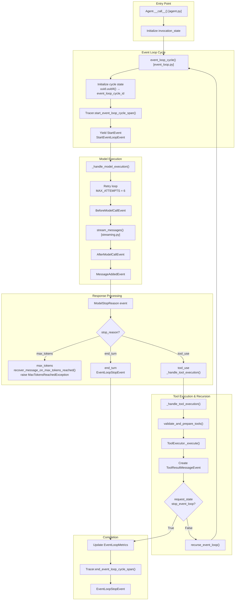

**Sources:** [strands-py/src/strands/event_loop/event_loop.py:120-184](), [strands-py/src/strands/event_loop/event_loop.py:215-338](), [strands-py/src/strands/event_loop/event_loop.py:410-534](), [strands-py/src/strands/agent/agent.py:465-480]()

## Invocation State Management

The `invocation_state` dictionary maintains state across event loop cycles within a single agent invocation [strands-py/src/strands/event_loop/event_loop.py:122](). It is initialized when the agent is called and passed through all recursive cycles.

### Invocation State Structure

| Key | Type | Description |
| :--- | :--- | :--- |
| `request_state` | `dict[str, Any]` | User-defined state that persists across cycles [strands-py/src/strands/event_loop/event_loop.py:165-166](). |
| `event_loop_cycle_id` | `uuid.UUID` | Unique identifier for the current cycle [strands-py/src/strands/event_loop/event_loop.py:162](). |
| `event_loop_cycle_span` | `Span` | OpenTelemetry span for the current cycle [strands-py/src/strands/event_loop/event_loop.py:182](). |
| `event_loop_cycle_trace` | `Trace` | Internal trace object for metrics [strands-py/src/strands/event_loop/event_loop.py:169](). |

The `request_state` sub-dictionary is accessible to users and can be used to maintain custom state across cycles. For example, setting `request_state["stop_event_loop"] = True` will stop recursion after tool execution [strands-py/src/strands/event_loop/event_loop.py:531-532]().

**Sources:** [strands-py/src/strands/event_loop/event_loop.py:161-182]()

## Cycle Initialization and Lifecycle

Each event loop cycle follows a precise initialization and teardown sequence:

### Initialization Sequence Diagram

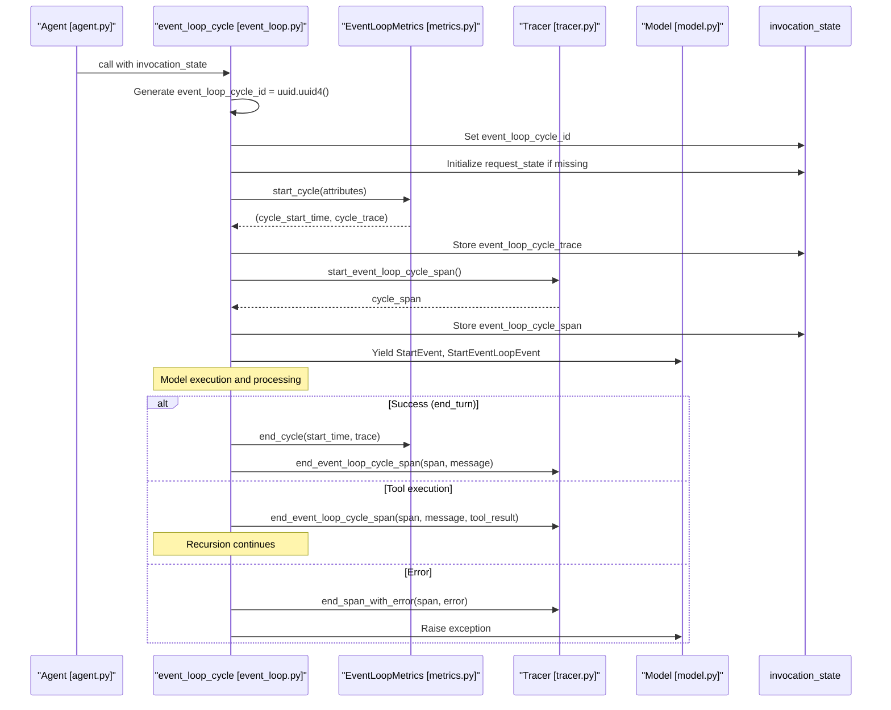

**Sources:** [strands-py/src/strands/event_loop/event_loop.py:161-182](), [strands-py/src/strands/agent/agent.py:465-480](), [strands-py/src/strands/telemetry/tracer.py:61-62]()

## Model Execution with Retry Logic

The `_handle_model_execution()` function manages model inference with automatic retry handling for throttling exceptions [strands-py/src/strands/event_loop/event_loop.py:215-338](). It uses the `ModelRetryStrategy` to implement exponential backoff.

### Retry Configuration

| Constant | Value | Description |
| :--- | :--- | :--- |
| `MAX_ATTEMPTS` | 6 | Maximum number of retry attempts for throttled requests [strands-py/src/strands/event_loop/event_loop.py:62](). |
| `INITIAL_DELAY` | 4 | Initial delay in seconds before the first retry [strands-py/src/strands/event_loop/event_loop.py:63](). |
| `MAX_DELAY` | 240 | Maximum delay cap (4 minutes) for exponential backoff [strands-py/src/strands/event_loop/event_loop.py:64](). |

The retry mechanism doubles the delay after each throttling exception up to `MAX_DELAY` [strands-py/src/strands/event_loop/event_loop.py:314-316](). After each throttling exception, an `EventLoopThrottleEvent` is yielded [strands-py/src/strands/event_loop/event_loop.py:309]().

**Sources:** [strands-py/src/strands/event_loop/event_loop.py:62-64](), [strands-py/src/strands/event_loop/event_loop.py:298-316]()

## Stop Reason Handling

After model execution completes, the event loop processes the `stop_reason` to determine the next action [strands-py/src/strands/event_loop/event_loop.py:341-408]().

| Stop Reason | Action | Outcome |
| :--- | :--- | :--- |
| `end_turn` | End the cycle normally | Yield `EventLoopStopEvent`, complete invocation [strands-py/src/strands/event_loop/event_loop.py:355-358](). |
| `tool_use` | Execute tools and recurse | Call `_handle_tool_execution()`, then `recurse_event_loop()` [strands-py/src/strands/event_loop/event_loop.py:344-353](). |
| `max_tokens` | Recover and raise exception | Call `recover_message_on_max_tokens_reached()`, raise `MaxTokensReachedException` [strands-py/src/strands/event_loop/event_loop.py:360-365](). |
| `interrupt` | Pause for human input | Suspend execution and yield interrupt events [strands-py/src/strands/event_loop/event_loop.py:381-391](). |

### Limit Validation

The `_check_limits()` function evaluates per-invocation budget caps against the current metrics [strands-py/src/strands/event_loop/event_loop.py:67-100](). It checks:
*   `limit_turns`: If the number of cycles exceeds the `turns` limit [strands-py/src/strands/event_loop/event_loop.py:91-93]().
*   `limit_total_tokens`: If cumulative tokens exceed `total_tokens` [strands-py/src/strands/event_loop/event_loop.py:94-96]().
*   `limit_output_tokens`: If output tokens exceed `output_tokens` [strands-py/src/strands/event_loop/event_loop.py:97-99]().

**Sources:** [strands-py/src/strands/event_loop/event_loop.py:67-100](), [strands-py/src/strands/event_loop/event_loop.py:360-365]()

## Tool Execution and Recursion

When the model requests tool execution (`stop_reason == "tool_use"`), the event loop enters a multi-step process managed by `_handle_tool_execution()` and `recurse_event_loop()`.

### Recursion Mechanics

The `recurse_event_loop()` function enables multi-turn tool interactions by making a recursive call to `event_loop_cycle()` [strands-py/src/strands/event_loop/event_loop.py:536-608]().

1.  **Validation**: Tools are validated against the registry via `validate_and_prepare_tools()` [strands-py/src/strands/event_loop/event_loop.py:421-422]().
2.  **Execution**: The `agent.tool_executor` (typically `ConcurrentToolExecutor`) runs the requested tools [strands-py/src/strands/event_loop/event_loop.py:433-435]().
3.  **Recursive Call**: `recurse_event_loop()` calls `event_loop_cycle()` with the updated conversation history including tool results [strands-py/src/strands/event_loop/event_loop.py:596-601]().

**Sources:** [strands-py/src/strands/event_loop/event_loop.py:410-534](), [strands-py/src/strands/event_loop/event_loop.py:536-608]()

## InvokeModelStage Middleware Chain

The model invocation is wrapped in the `InvokeModelStage` middleware chain [strands-py/src/strands/event_loop/event_loop.py:19](). This allows plugins to intercept the model call, modify messages, or inject logic before and after the model is invoked.

The chain is executed within `_handle_model_execution()` [strands-py/src/strands/event_loop/event_loop.py:228](). It uses an `InvokeModelContext` to pass state through the middleware [strands-py/src/strands/event_loop/event_loop.py:230-238]().

**Sources:** [strands-py/src/strands/event_loop/event_loop.py:19](), [strands-py/src/strands/event_loop/event_loop.py:215-240]()

## Metrics and Usage Tracking

The event loop tracks performance and token usage via `EventLoopMetrics` [strands-py/src/strands/telemetry/metrics.py:158]().

*   **Input Estimation**: `_estimate_input_tokens()` provides a baseline for the next call [strands-py/src/strands/event_loop/event_loop.py:123-163]().
*   **Usage Updates**: `event_loop_metrics.update_usage()` captures tokens from the model's metadata [strands-py/src/strands/event_loop/event_loop.py:328]().
*   **Cycle Timing**: Latency is tracked from `start_cycle()` to `end_cycle()` [strands-py/src/strands/event_loop/event_loop.py:168]().

**Sources:** [strands-py/src/strands/event_loop/event_loop.py:120-142](), [strands-py/src/strands/event_loop/event_loop.py:328-329]()

---

# Page: Streaming Responses

# Streaming Responses

<details>
<summary>Relevant source files</summary>

The following files were used as context for generating this wiki page:

- [strands-py/src/strands/agent/agent.py](strands-py/src/strands/agent/agent.py)
- [strands-py/src/strands/event_loop/event_loop.py](strands-py/src/strands/event_loop/event_loop.py)
- [strands-py/src/strands/event_loop/streaming.py](strands-py/src/strands/event_loop/streaming.py)
- [strands-py/src/strands/types/streaming.py](strands-py/src/strands/types/streaming.py)
- [strands-py/tests/strands/event_loop/test_event_loop.py](strands-py/tests/strands/event_loop/test_event_loop.py)
- [strands-py/tests/strands/event_loop/test_event_loop_metadata.py](strands-py/tests/strands/event_loop/test_event_loop_metadata.py)
- [strands-py/tests/strands/event_loop/test_event_loop_structured_output.py](strands-py/tests/strands/event_loop/test_event_loop_structured_output.py)
- [strands-py/tests/strands/event_loop/test_streaming.py](strands-py/tests/strands/event_loop/test_streaming.py)
- [strands-ts/src/agent/__tests__/agent.hook.test.ts](strands-ts/src/agent/__tests__/agent.hook.test.ts)
- [strands-ts/src/agent/__tests__/agent.model-retry.test.ts](strands-ts/src/agent/__tests__/agent.model-retry.test.ts)
- [strands-ts/src/agent/__tests__/agent.test.ts](strands-ts/src/agent/__tests__/agent.test.ts)
- [strands-ts/src/agent/agent.ts](strands-ts/src/agent/agent.ts)
- [strands-ts/src/conversation-manager/__tests__/null-conversation-manager.test.ts](strands-ts/src/conversation-manager/__tests__/null-conversation-manager.test.ts)
- [strands-ts/src/hooks/__tests__/events.test.ts](strands-ts/src/hooks/__tests__/events.test.ts)
- [strands-ts/src/hooks/events.ts](strands-ts/src/hooks/events.ts)
- [strands-ts/src/index.ts](strands-ts/src/index.ts)
- [strands-ts/src/types/agent.ts](strands-ts/src/types/agent.ts)
- [strands-ts/src/types/messages.ts](strands-ts/src/types/messages.ts)

</details>


## Purpose and Scope

This page documents the streaming API in the Strands Agents SDK, which allows developers to process agent responses in real-time. It covers:

- Using `stream_async` (Python) and `stream()` (TypeScript) to consume execution events.
- The standardized event hierarchy, including `AgentStreamEvent`, `ModelStreamEvent`, and `ToolResultEvent`.
- Internal transformation pipelines that normalize raw provider events into SDK events.
- Processing patterns for both async iteration and middleware-based interception.

For information about the underlying execution flow, see [2.2 Event Loop and Execution Flow](). For conversation history management, see [2.4 Conversation Management]().

---

## Using the Streaming API

The streaming API provides real-time access to agent execution events. This enables building responsive user interfaces, progress indicators, and monitoring tool execution before a turn is complete.

### Basic Usage Patterns

#### Python SDK
In Python, `agent.stream_async` returns an `AsyncGenerator` yielding event dictionaries.

```python
async for event in agent.stream_async("Run a security scan on host 10.0.0.5"):
    if "data" in event: # TextStreamEvent
        print(event["data"], end="", flush=True)
    elif "toolUse" in event.get("current_tool_use", {}): # ToolUseStreamEvent
        print(f"\nCalling tool: {event['current_tool_use']['name']}")
```
**Sources:** [strands-py/src/strands/agent/agent.py:737-762](), [strands-py/src/strands/event_loop/streaming.py:417-464]()

#### TypeScript SDK
In TypeScript, `agent.stream()` returns an `AsyncGenerator` yielding `AgentStreamEvent` class instances.

```typescript
for await (const event of agent.stream("Run a security scan")) {
  if (event instanceof ModelStreamUpdateEvent) {
    // Handle streaming chunks
  } else if (event instanceof ToolResultEvent) {
    console.log(`Tool ${event.tool.name} returned ${event.result.status}`);
  }
}
```
**Sources:** [strands-ts/src/agent/agent.ts:474-508](), [strands-ts/src/hooks/events.ts:10-49]()

---

## Event Hierarchy and Types

The SDK transforms raw model provider events into a standardized set of SDK events.

### Lifecycle and Data Events (TypeScript)
TypeScript uses a class-based event hierarchy where all hookable events extend `HookableEvent`.

| Event Class | Description | Key Fields |
|:---|:---|:---|
| `BeforeInvocationEvent` | Fired before any reasoning starts. | `invocationState`, `cancel` |
| `ModelStreamUpdateEvent` | Wraps transient streaming data from the model. | `event` (ModelStreamEvent) |
| `ContentBlockEvent` | Fired when a content block (text/tool) is finished. | `contentBlock` |
| `ToolResultEvent` | Fired after a tool completes execution. | `tool`, `result` |
| `AgentResultEvent` | The final event containing the total result. | `result` (AgentResult) |

**Sources:** [strands-ts/src/hooks/events.ts:77-227](), [strands-ts/src/types/agent.ts:202-202]()

### Model Streaming Events (Python)
Python yields typed dictionaries that map to the following conceptual events:

| Event Type | Purpose |
|:---|:---|
| `TextStreamEvent` | Partial text chunks generated by the model. |
| `ToolUseStreamEvent` | Incremental JSON input for a tool call. |
| `ReasoningTextStreamEvent` | Internal reasoning/thought blocks (e.g., from Bedrock/Anthropic). |
| `CitationStreamEvent` | Citations provided by models with RAG capabilities. |

**Sources:** [strands-py/src/strands/types/_events.py:144-189](), [strands-py/src/strands/event_loop/streaming.py:14-41]()

---

## Internal Streaming Architecture

The SDK maintains a state machine during streaming to incrementally build the final `Message` object while yielding partial updates to the consumer.

### Stream Transformation Flow
The following diagram bridges the gap between raw model provider outputs and the high-level `Agent` events.

**Diagram: Streaming Data Flow (Provider to User)**

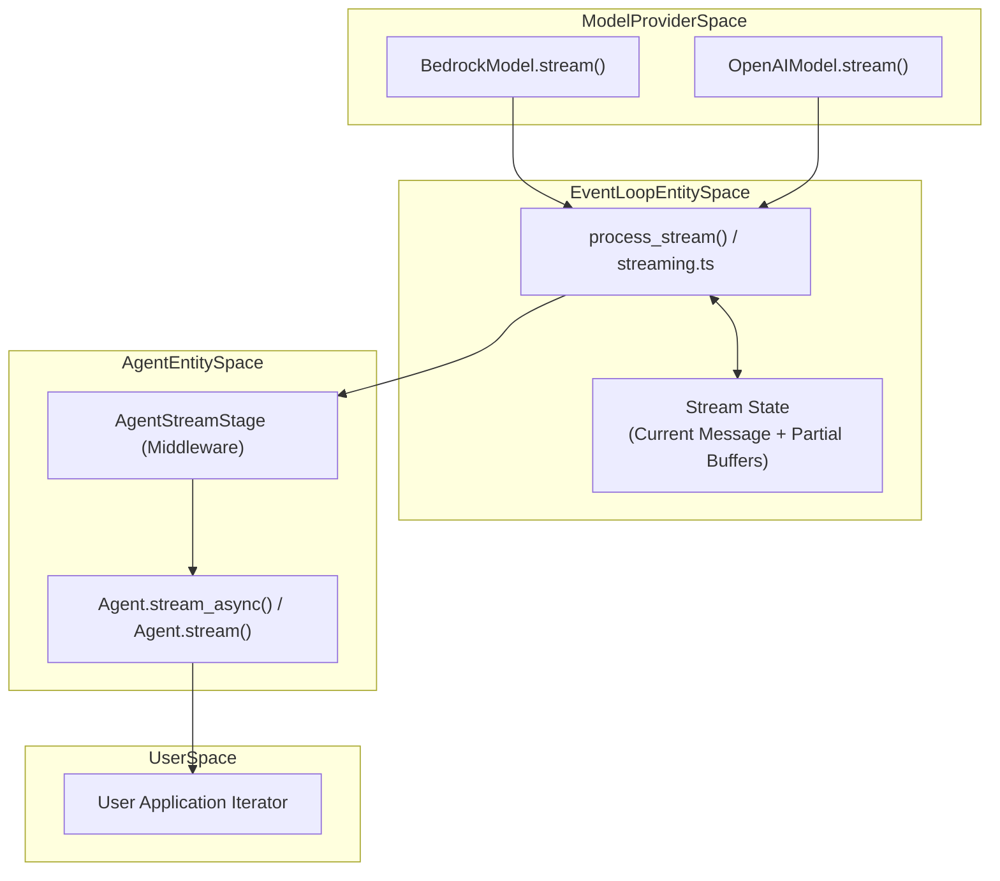
**Sources:** [strands-py/src/strands/event_loop/streaming.py:366-418](), [strands-ts/src/agent/agent.ts:474-508](), [strands-ts/src/middleware/index.ts:54-54]()

### Message Normalization
Before messages are sent to the model or yielded to the user, the SDK performs normalization to ensure provider compatibility (e.g., handling empty assistant messages which some providers reject).

| Logic | Implementation |
|:---|:---|
| **Blank Text Fix** | Replaces empty/whitespace text with `[blank text]` if no other content exists. |
| **Tool Name Validation** | Replaces invalid model-generated tool names with `INVALID_TOOL_NAME`. |
| **Tracking IDs** | Ensures every message yielded has a unique `tracking_id`. |

**Sources:** [strands-py/src/strands/event_loop/streaming.py:46-108](), [strands-ts/src/types/messages.ts:59-64]()

---

## Event Processing and Hooks

Streaming events are not just for the end-user; they are the primary mechanism for the SDK's internal extensibility.

### Hook Integration
Every event yielded by the stream is also dispatched to the `HookRegistry`. This allows plugins to intercept and modify the stream. For example, the `ContextOffloader` plugin listens for `ToolResultEvent` to truncate large results before they hit the context window.

**Diagram: Hook Dispatch During Streaming**

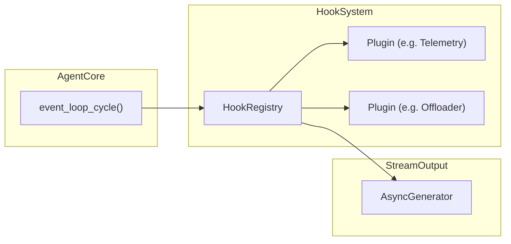
**Sources:** [strands-ts/src/agent/agent.ts:71-89](), [strands-py/src/strands/agent/agent.py:50-60]()

### Middleware Stages
The SDK uses a middleware pattern for streaming. The `AgentStreamStage` wraps the entire execution loop, allowing for logic that spans multiple turns (e.g., total token limit enforcement).

- **Input Phase:** Sets up the `AgentStreamContext`.
- **Output Phase:** Aggregates `AgentStreamResult` including cumulative metrics.

**Sources:** [strands-ts/src/agent/agent.ts:54-70](), [strands-py/src/strands/agent/agent.py:47-48]()

---

## Agent Results and Termination

A streaming sequence always concludes with an `AgentResult`. This object provides the final summarized state of the interaction.

| Field | Description |
|:---|:---|
| `stopReason` | Why the agent stopped: `endTurn`, `toolUse`, `limitTurns`, `limitTotalTokens`, or `cancelled`. |
| `message` | The final assembled `Message` containing all text and tool blocks. |
| `usage` | Total input/output token counts for the entire stream. |
| `metrics` | Latency and timing information for each cycle. |

**Sources:** [strands-ts/src/types/agent.ts:15-15](), [strands-py/src/strands/agent/agent_result.py:19-36]()

---

# Page: Conversation Management

# Conversation Management

<details>
<summary>Relevant source files</summary>

The following files were used as context for generating this wiki page:

- [site/src/content/docs/contribute/contributing/documentation.mdx](site/src/content/docs/contribute/contributing/documentation.mdx)
- [site/src/content/docs/contribute/contributing/documentation.ts](site/src/content/docs/contribute/contributing/documentation.ts)
- [site/src/content/docs/labs/ai-functions.mdx](site/src/content/docs/labs/ai-functions.mdx)
- [site/src/content/docs/user-guide/concepts/agents/conversation-management.mdx](site/src/content/docs/user-guide/concepts/agents/conversation-management.mdx)
- [site/src/content/docs/user-guide/concepts/agents/conversation-management.ts](site/src/content/docs/user-guide/concepts/agents/conversation-management.ts)
- [site/src/content/docs/user-guide/concepts/agents/conversation-management_imports.ts](site/src/content/docs/user-guide/concepts/agents/conversation-management_imports.ts)
- [site/src/content/docs/user-guide/concepts/context-management.mdx](site/src/content/docs/user-guide/concepts/context-management.mdx)
- [site/src/content/docs/user-guide/concepts/context-management.ts](site/src/content/docs/user-guide/concepts/context-management.ts)
- [site/src/content/docs/user-guide/concepts/context-management_imports.ts](site/src/content/docs/user-guide/concepts/context-management_imports.ts)
- [site/src/content/docs/user-guide/concepts/model-providers/amazon-bedrock.ts](site/src/content/docs/user-guide/concepts/model-providers/amazon-bedrock.ts)
- [site/src/content/docs/user-guide/concepts/model-providers/index.mdx](site/src/content/docs/user-guide/concepts/model-providers/index.mdx)
- [site/src/content/docs/user-guide/concepts/model-providers/index.ts](site/src/content/docs/user-guide/concepts/model-providers/index.ts)
- [site/src/content/docs/user-guide/evals-sdk/how-to/eval_task.mdx](site/src/content/docs/user-guide/evals-sdk/how-to/eval_task.mdx)
- [site/src/content/docs/user-guide/evals-sdk/simulators/tool_simulation.mdx](site/src/content/docs/user-guide/evals-sdk/simulators/tool_simulation.mdx)
- [site/src/content/docs/user-guide/observability-evaluation/traces.mdx](site/src/content/docs/user-guide/observability-evaluation/traces.mdx)
- [site/src/content/docs/user-guide/quickstart/python.mdx](site/src/content/docs/user-guide/quickstart/python.mdx)
- [strands-py/src/strands/_context_manager/modes/agentic/agentic_context.py](strands-py/src/strands/_context_manager/modes/agentic/agentic_context.py)
- [strands-py/src/strands/agent/conversation_manager/__init__.py](strands-py/src/strands/agent/conversation_manager/__init__.py)
- [strands-py/src/strands/agent/conversation_manager/conversation_manager.py](strands-py/src/strands/agent/conversation_manager/conversation_manager.py)
- [strands-py/src/strands/models/_defaults.py](strands-py/src/strands/models/_defaults.py)
- [strands-py/tests/strands/agent/test_conversation_manager.py](strands-py/tests/strands/agent/test_conversation_manager.py)
- [strands-py/tests/strands/agent/test_summarizing_conversation_manager.py](strands-py/tests/strands/agent/test_summarizing_conversation_manager.py)
- [strands-py/tests/strands/models/test_model.py](strands-py/tests/strands/models/test_model.py)
- [strands-ts/src/context-manager/modes/agentic/agentic-context.ts](strands-ts/src/context-manager/modes/agentic/agentic-context.ts)
- [strands-ts/src/conversation-manager/__tests__/conversation-manager.test.ts](strands-ts/src/conversation-manager/__tests__/conversation-manager.test.ts)
- [strands-ts/src/conversation-manager/__tests__/sliding-window-conversation-manager.test.ts](strands-ts/src/conversation-manager/__tests__/sliding-window-conversation-manager.test.ts)
- [strands-ts/src/conversation-manager/__tests__/summarizing-conversation-manager.test.ts](strands-ts/src/conversation-manager/__tests__/summarizing-conversation-manager.test.ts)
- [strands-ts/src/conversation-manager/conversation-manager.ts](strands-ts/src/conversation-manager/conversation-manager.ts)
- [strands-ts/src/conversation-manager/sliding-window-conversation-manager.ts](strands-ts/src/conversation-manager/sliding-window-conversation-manager.ts)
- [strands-ts/src/conversation-manager/summarizing-conversation-manager.ts](strands-ts/src/conversation-manager/summarizing-conversation-manager.ts)
- [strands-ts/src/models/__tests__/model.test.ts](strands-ts/src/models/__tests__/model.test.ts)
- [strands-ts/src/models/defaults.ts](strands-ts/src/models/defaults.ts)

</details>


This document explains the conversation management system in Strands Agents, which controls how conversation history (messages) is maintained and optimized for model context window constraints. Conversation managers implement strategies for retaining relevant context while staying within token limits.

For information about message structure and content types, see [Streaming Responses](2.3). For session-based persistence of conversation state, see [Agent State and Session Management](2.5).

---

## Overview

In the Strands Agents SDK, context refers to the information provided to the agent for understanding and reasoning. This includes:

*   User messages
*   Agent responses
*   Tool usage and results
*   System prompts

As conversations grow, managing this context becomes increasingly important for several reasons:

1.  **Token Limits**: Language models have fixed context windows (maximum tokens they can process).
2.  **Performance**: Larger contexts require more processing time and resources.
3.  **Relevance**: Older messages may become less relevant to the current conversation.
4.  **Coherence**: Maintaining logical flow and preserving important information.

The conversation management system addresses a fundamental challenge in multi-turn agent interactions: foundation models have finite context windows, but conversations can grow arbitrarily long. Conversation managers automatically apply strategies to keep conversation history within acceptable bounds while preserving the most relevant information.

The system integrates with the agent lifecycle through two primary mechanisms:

1.  **Reactive reduction**: When a `ContextWindowOverflowException` occurs, the conversation manager reduces context and the agent retries [strands-py/src/strands/agent/conversation_manager/conversation_manager.py:101-120]().
2.  **Proactive management**: During or after agent invocation, the conversation manager can apply cleanup strategies to prevent reaching limits [strands-ts/src/conversation-manager/sliding-window-conversation-manager.ts:164-167]().

**Sources:** [strands-py/src/strands/agent/conversation_manager/conversation_manager.py:1-22](), [strands-py/src/strands/agent/conversation_manager/null_conversation_manager.py:31-47](), [strands-ts/src/conversation-manager/sliding-window-conversation-manager.ts:164-167]()

---

## Architecture

### ConversationManager Interface

The `ConversationManager` is an abstract base class that also implements the `HookProvider` protocol [strands-py/src/strands/agent/conversation_manager/conversation_manager.py:13-34](). This allows managers to hook into the agent's event system (e.g., before model calls).

```mermaid
classDiagram
    class HookProvider {
        <<protocol>>
        +register_hooks(registry: HookRegistry)
    }

    class ConversationManager {
        <<abstract>>
        +removed_message_count: int
        +apply_management(agent: Agent)*
        +reduce(options: ConversationManagerReduceOptions)*
        +get_state() dict
        +restore_from_session(state: dict)
    }
    
    class SlidingWindowConversationManager {
        +window_size: number
        +should_truncate_results: boolean
        +proactive_compression: boolean | ProactiveCompressionConfig
        +pin_first: number
        +apply_management(agent: Agent)
        +reduce(options: ConversationManagerReduceOptions)
    }
    
    class SummarizingConversationManager {
        +summary_ratio: number
        +preserve_recent_messages: number
        +proactive_compression: boolean | ProactiveCompressionConfig
        +apply_management(agent: Agent)
        +reduce(options: ConversationManagerReduceOptions)
    }
    
    class NullConversationManager {
        +apply_management(agent: Agent)
        +reduce(options: ConversationManagerReduceOptions)
    }
    
    ConversationManager --|> HookProvider
    SlidingWindowConversationManager --|> ConversationManager
    SummarizingConversationManager --|> ConversationManager
    NullConversationManager --|> ConversationManager
```

**Sources:** [strands-py/src/strands/agent/conversation_manager/conversation_manager.py:13-34](), [strands-ts/src/conversation-manager/sliding-window-conversation-manager.ts:129-150](), [strands-ts/src/conversation-manager/summarizing-conversation-manager.ts:62-80](), [strands-py/src/strands/agent/conversation_manager/null_conversation_manager.py:12-20]()

---

## Integration with Agent Lifecycle

### Lifecycle Integration Flow

The conversation manager participates in the agent execution flow at three critical points: proactive turn-based checks, reactive overflow handling, and post-invocation cleanup.

```mermaid
sequenceDiagram
    participant Agent as "Agent"
    participant Loop as "event_loop_cycle"
    participant CM as "ConversationManager"
    participant Model as "ModelProvider"
    
    Agent->>Loop: Start Cycle
    Loop->>CM: _on_before_model_call (Hook)
    Note over CM: If proactiveCompression is enabled,<br/>reduce()
    Loop->>Model: stream(messages)
    
    alt Context Window Overflow
        Model-->>Loop: ContextWindowOverflowException
        Loop->>CM: reduce(agent, error)
        CM->>Agent: Modify agent.messages (in-place)
        Loop->>Loop: Recursive Retry
    end
    
    Loop-->>Agent: Cycle Finish
    Agent->>CM: _on_after_invocation (Hook)
    Note over CM: Final cleanup/truncation
```

**Sources:** [strands-py/src/strands/agent/conversation_manager/conversation_manager.py:86-98](), [strands-py/src/strands/agent/conversation_manager/conversation_manager.py:101-120](), [strands-ts/src/conversation-manager/sliding-window-conversation-manager.ts:164-167]()

### 1. Context Overflow Handling (Reactive)
When a model provider detects that the input exceeds its limits, it raises a `ContextWindowOverflowException` [strands-ts/src/conversation-manager/__tests__/sliding-window-conversation-manager.test.ts:14](). The agent catch block invokes `conversation_manager.reduce(agent, error)`. The manager modifies the `agent.messages` list in-place to reduce token count, and the event loop attempts a recursive retry.

**Sources:** [strands-py/src/strands/agent/conversation_manager/conversation_manager.py:101-120](), [strands-py/src/strands/agent/conversation_manager/null_conversation_manager.py:31-47]()

### 2. Proactive Context Compression
Both `SlidingWindowConversationManager` and `SummarizingConversationManager` support a `proactiveCompression` parameter [strands-ts/src/conversation-manager/sliding-window-conversation-manager.ts:106-107](), [strands-ts/src/conversation-manager/summarizing-conversation-manager.ts:74-75](). If enabled, the manager registers a callback for `BeforeModelCallEvent` [strands-ts/src/conversation-manager/conversation-manager.ts:86-88](). This allows the manager to trim or summarize history *before* the model is called, preventing `ContextWindowOverflowException` and improving performance.

**Sources:** [strands-ts/src/conversation-manager/sliding-window-conversation-manager.ts:106-107](), [strands-ts/src/conversation-manager/summarizing-conversation-manager.ts:74-75](), [strands-ts/src/conversation-manager/conversation-manager.ts:86-88]()

---

## Built-in Conversation Managers

The SDK provides a flexible system for context management through the `ConversationManager` interface. You can either leverage one of Strands's provided managers:

*   [`NullConversationManager`](#nullconversationmanager): A simple implementation that does not modify conversation history.
*   [`SlidingWindowConversationManager`](#slidingwindowconversationmanager): Maintains a fixed number of recent messages (default manager).
*   [`SummarizingConversationManager`](#summarizingconversationmanager): Intelligently summarizes older messages to preserve context.

Or build your own manager that matches your requirements.

### NullConversationManager

The `NullConversationManager` is a simple implementation that does not modify the conversation history. It's useful for:

*   Short conversations that won't exceed context limits.
*   Debugging purposes.
*   Cases where you want to manage context manually.

```python
from strands import Agent
from strands.agent.conversation_manager import NullConversationManager

agent = Agent(
    conversation_manager=NullConversationManager()
)
```

```typescript
import { Agent, NullConversationManager } from '@strands-agents/sdk'

const agent = new Agent({
  conversationManager: new NullConversationManager(),
})
```

**Sources:** [strands-py/src/strands/agent/conversation_manager/null_conversation_manager.py:12-20](), [strands-py/src/strands/agent/conversation_manager/null_conversation_manager.py:31-47](), [site/src/content/docs/user-guide/concepts/agents/conversation-management.ts:15-17]()

### SlidingWindowConversationManager

The `SlidingWindowConversationManager` implements a sliding window strategy that maintains a fixed number of recent messages. This is the default conversation manager used by the `Agent` class.

```python
from strands import Agent
from strands.agent.conversation_manager import SlidingWindowConversationManager

# Create a conversation manager with custom window size
conversation_manager = SlidingWindowConversationManager(
    window_size=20,  # Maximum number of messages to keep
    should_truncate_results=True, # Enable truncating the tool result when a message is too large for the model's context window
)

agent = Agent(
    conversation_manager=conversation_manager
)
```

```typescript
import { Agent, SlidingWindowConversationManager } from '@strands-agents/sdk'

// Create a conversation manager with custom window size
const conversationManager = new SlidingWindowConversationManager({
  windowSize: 40, // Maximum number of messages to keep
  shouldTruncateResults: true, // Enable truncating the tool result when a message is too large for the model's context window
})

const agent = new Agent({
  conversationManager,
})
```

Key features of the `SlidingWindowConversationManager`:

*   **Maintains Window Size**: Automatically removes messages from the window if the number of messages exceeds the limit [strands-ts/src/conversation-manager/sliding-window-conversation-manager.ts:151-157]().
*   **Dangling Message Cleanup**: Removes incomplete message sequences to maintain valid conversation state [strands-py/tests/strands/agent/test_conversation_manager.py:63-70]().
*   **Overflow Trimming**: In the case of a context window overflow, it will trim the oldest messages from history until the request fits in the models context window.
*   **Configurable Tool Result Truncation**: Enable or disable truncation of tool results when the message exceeds context window limits. When enabled (the default; `should_truncate_results=True` in Python, `shouldTruncateResults: true` in TypeScript), the oldest message with tool results is truncated first so recent context is preserved as long as possible. Truncation depends on content type:
    *   Text payloads keep their head and tail, separated by a `<truncated chars="N"/>` marker [strands-ts/src/conversation-manager/sliding-window-conversation-manager.ts:20-22]().
    *   Images, videos, binary documents, and oversized JSON are replaced by a typed placeholder, for example `[image: png, source: bytes, 12345 bytes]` [strands-ts/src/conversation-manager/sliding-window-conversation-manager.ts:38-82]().
    *   The tool result's original `status` and `error` fields are preserved.

    When disabled, full results are preserved but more historical messages may be removed. For a proactive alternative that preserves full content externally, see the [Context Offloader](../plugins/context-offloader) plugin.
*   **Proactive Compression**: Pass `proactiveCompression: true` or `proactiveCompression: { compressionThreshold: 0.7 }` to trigger context reduction before the model call when projected input tokens exceed a configurable threshold [strands-ts/src/conversation-manager/sliding-window-conversation-manager.ts:101-107]().
*   **Message Pinning**: Protect specific messages from trimming during context reduction. The `pinFirst` parameter allows pinning a specified number of initial messages [strands-ts/src/conversation-manager/sliding-window-conversation-manager.ts:111-114]().

**Sources:** [strands-ts/src/conversation-manager/sliding-window-conversation-manager.ts:129-150](), [strands-ts/src/conversation-manager/sliding-window-conversation-manager.ts:151-157](), [strands-py/tests/strands/agent/test_conversation_manager.py:63-70](), [strands-ts/src/conversation-manager/sliding-window-conversation-manager.ts:20-22](), [strands-ts/src/conversation-manager/sliding-window-conversation-manager.ts:38-82](), [strands-ts/src/conversation-manager/sliding-window-conversation-manager.ts:101-107](), [strands-ts/src/conversation-manager/sliding-window-conversation-manager.ts:111-114](), [site/src/content/docs/user-guide/concepts/agents/conversation-management.ts:22-30]()

### SummarizingConversationManager

Instead of dropping messages, this manager uses an LLM to summarize the oldest portion of the conversation [strands-ts/src/conversation-manager/summarizing-conversation-manager.ts:54-60]().

```python
from strands import Agent
from strands.agent.conversation_manager import SummarizingConversationManager
from strands.models.bedrock import BedrockModel

# Optionally use a different model for summarization
summarization_model = BedrockModel(
    model_id='global.anthropic.claude-sonnet-4-6',
)

conversation_manager = SummarizingConversationManager(
    model=summarization_model, # Override the agent's model for summarization
    summary_ratio=0.3, # Summarize and replace the oldest 30% of messages
    preserve_recent_messages=10, # Always keep 10 most recent messages
)

agent = Agent(
    conversation_manager=conversation_manager
)
```

```typescript
import { Agent, SummarizingConversationManager, BedrockModel } from '@strands-agents/sdk'

// Optionally use a different model for summarization
const summarizationModel = new BedrockModel({
  modelId: 'global.anthropic.claude-sonnet-4-6',
})

const conversationManager = new SummarizingConversationManager({
  model: summarizationModel, // Override the agent's model for summarization
  summaryRatio: 0.3, // Summarize and replace the oldest 30% of messages
  preserveRecentMessages: 10, // Always keep 10 most recent messages
})

const agent = new Agent({
  conversationManager,
})
```

Key features of the `SummarizingConversationManager`:

*   **Summary Ratio**: Determines what percentage of the history to summarize (clamped between 0.1 and 0.8) [strands-ts/src/conversation-manager/summarizing-conversation-manager.ts:20-22]().
*   **Preservation**: Always keeps a minimum number of recent messages (`preserveRecentMessages`) [strands-ts/src/conversation-manager/summarizing-conversation-manager.ts:69-70]().
*   **Recursive Summarization**: If a previous summary exists, it is included in the new summarization task to maintain a rolling narrative [strands-ts/src/conversation-manager/summarizing-conversation-manager.ts:105-106]().
*   **Tool Preservation**: Like the sliding window, it adjusts split points to avoid splitting tool call/result pairs [strands-ts/src/conversation-manager/summarizing-conversation-manager.ts:150-153]().
*   **Custom Summarization Model**: Can be configured with a specific `model` for summarization, allowing for a cheaper or faster model than the agent's primary model [strands-ts/src/conversation-manager/summarizing-conversation-manager.ts:63-64]().
*   **Custom System Prompt**: A `summarizationSystemPrompt` can be provided to guide the summarization model's behavior [strands-ts/src/conversation-manager/summarizing-conversation-manager.ts:71-72]().

**Sources:** [strands-ts/src/conversation-manager/summarizing-conversation-manager.ts:62-80](), [strands-ts/src/conversation-manager/summarizing-conversation-manager.ts:20-22](), [strands-ts/src/conversation-manager/summarizing-conversation-manager.ts:69-70](), [strands-ts/src/conversation-manager/summarizing-conversation-manager.ts:105-106](), [strands-ts/src/conversation-manager/summarizing-conversation-manager.ts:150-153](), [strands-ts/src/conversation-manager/summarizing-conversation-manager.ts:63-64](), [strands-ts/src/conversation-manager/summarizing-conversation-manager.ts:71-72](), [site/src/content/docs/user-guide/concepts/agents/conversation-management.ts:86-98]()

---

## Context Manager Modes

The SDK provides high-level context management configurations that work out of the box, so you don't have to assemble conversation managers, offloaders, and thresholds by hand. You can pick a mode and the SDK wires up the pieces with tuned defaults.

### Automatic Context Management (`"auto"`)

For most agents with multi-turn conversations, you don't need to configure conversation management and context offloading separately. Pass `context_manager="auto"` (Python) or `contextManager: "auto"` (TypeScript) and the SDK wires up both with tuned defaults.

```python
from strands import Agent

agent = Agent(context_manager="auto")
```

```typescript
import { Agent } from '@strands-agents/sdk'

const agent = new Agent({
  contextManager: "auto"
})
```

This mode composes two components whose defaults scored highest across [ContextBench](https://arxiv.org/abs/2602.05892) evaluations:

*   **`SummarizingConversationManager`**: With a summary ratio of 0.3 and a proactive compression threshold of 0.85.
*   **`ContextOffloader` plugin**: Intercepts large tool results, stores them externally, and keeps a truncated preview in context.

Your own settings take precedence when you need fine-grained control. For example, if you pass a custom `conversation_manager`, it replaces the auto-composed `SummarizingConversationManager`, but the `ContextOffloader` is still added.

**Sources:** [site/src/content/docs/user-guide/concepts/context-management.mdx:20-51](), [site/src/content/docs/user-guide/concepts/context-management.mdx:60-86]()

### Agentic Context Management (`"agentic"`)

Agentic mode hands context management control to the model. Pass `context_manager="agentic"` (Python) or `contextManager: "agentic"` (TypeScript) and the model manages its own working memory: it sees how full the context window is and chooses when to compress, what to compress, and what to protect.

```python
from strands import Agent

agent = Agent(context_manager="agentic")
```

```typescript
import { Agent } from '@strands-agents/sdk'

const agent = new Agent({
  contextManager: "agentic"
})
```

The model is better positioned than a fixed threshold to know which messages still matter. This mode provides:

*   **Token-usage telemetry**: Before each model call, a status block is appended to the latest message reporting context window usage [strands-py/src/strands/_context_manager/modes/agentic/agentic_context.py:121-128]().
*   **Three injected tools**:
    *   `summarize_context`: Folds older messages into a model-written summary [strands-py/src/strands/_context_manager/modes/agentic/agentic_context.py:81-99]().
    *   `truncate_context`: Drops older messages entirely [strands-py/src/strands/_context_manager/modes/agentic/agentic_context.py:151-165]().
    *   `pin_context`: Marks messages that must survive compression [strands-py/src/strands/_context_manager/modes/agentic/agentic_context.py:180-190]().

Behind the tools, agentic mode also composes a `SummarizingConversationManager` with no proactive compression and a `ContextOffloader`. The conversation manager acts as a safety net, and the offloader uses a higher inline threshold (8,000 tokens vs. 1,500 in "auto" mode) to give the model more inline tool output.

**Sources:** [strands-py/src/strands/_context_manager/modes/agentic/agentic_context.py:1-10](), [site/src/content/docs/user-guide/concepts/context-management.mdx:90-114](), [strands-py/src/strands/_context_manager/modes/agentic/agentic_context.py:121-128](), [strands-py/src/strands/_context_manager/modes/agentic/agentic_context.py:81-99](), [strands-py/src/strands/_context_manager/modes/agentic/agentic_context.py:151-165](), [strands-py/src/strands/_context_manager/modes/agentic/agentic_context.py:180-190](), [site/src/content/docs/user-guide/concepts/context-management.mdx:139-145]()

### Null Context Management (`null`)

Setting `context_manager="null"` (Python) or `contextManager: "null"` (TypeScript) explicitly disables all automatic context management. This means no `ConversationManager` is configured by default, and no `ContextOffloader` plugin is added. The agent will rely entirely on the model's native context window and will throw `ContextWindowOverflowException` if limits are exceeded.

```python
from strands import Agent

agent = Agent(context_manager="null")
```

```typescript
import { Agent } from '@strands-agents/sdk'

const agent = new Agent({
  contextManager: "null"
})
```

This mode is suitable for:

*   Short, single-turn interactions where context overflow is unlikely.
*   Scenarios where you implement entirely custom context management logic.
*   Debugging or performance testing without any context overhead.

**Sources:** [site/src/content/docs/user-guide/concepts/context-management.mdx:150-154]()

---

## Data Flow: Summarization Process

This diagram bridges the code entities involved in generating a summary during a context overflow.

```mermaid
graph TD
    subgraph "Code Entity Space"
        Agent["Agent Class"]
        SCM["SummarizingConversationManager"]
        SumPrompt["DEFAULT_SUMMARIZATION_PROMPT"]
        Model["Model.stream()"]
    end

    subgraph "Natural Language Space"
        History["Full Message History"]
        Summary["Bullet-point Summary"]
    end

    Agent -- "triggers reduce(options)" --> SCM
    SCM -- "extracts messages" --> History
    SCM -- "injects prompt" --> SumPrompt
    SumPrompt -- "guides" --> Model
    Model -- "processes" --> History
    Model -- "returns stream" --> Summary
    Summary -- "becomes content" --> NewMessage["'user' Role Message"]
    NewMessage -- "prepended to agent.messages" --> Agent
```

**Sources:** [strands-ts/src/conversation-manager/summarizing-conversation-manager.ts:24-51](), [strands-ts/src/conversation-manager/summarizing-conversation-manager.ts:169-170](), [strands-ts/src/conversation-manager/__tests__/summarizing-conversation-manager.test.ts:27-55](), [strands-ts/src/conversation-manager/summarizing-conversation-manager.ts:126-170]()

---

## State Persistence
Conversation managers track `removed_message_count` [strands-py/src/strands/agent/conversation_manager/conversation_manager.py:44-44]() and internal state (like the current summary message in `SummarizingConversationManager` [strands-ts/src/conversation-manager/summarizing-conversation-manager.ts:110-110]()). This state is serialized via `get_state()` and can be restored using `restore_from_session()`.

**Sources:** [strands-py/src/strands/agent/conversation_manager/conversation_manager.py:78-83](), [strands-ts/src/conversation-manager/summarizing-conversation-manager.ts:110-110](), [strands-ts/src/conversation-manager/sliding-window-conversation-manager.ts:115-123]()

---

## Summary of Strategy Differences

| Feature | Sliding Window | Summarizing | Null | Agentic | Auto |
| :--- | :--- | :--- | :--- | :--- | :--- |
| **Strategy** | Discards oldest messages | Condenses oldest messages | None | Model-driven (summarize/truncate/pin) | Summarize + Offload |
| **Tool Handling** | Truncates result text | Preserves pair integrity | None | Model-driven (via tools) | Offloads large results, preserves pair integrity |
| **Proactive?** | Yes (via `proactiveCompression`) | Yes (via `proactiveCompression`) | No | Yes (model decides when to act) | Yes (proactive summarization + offloading) |
| **LLM Cost** | Low (local truncation) | High (requires LLM call) | None | Medium (LLM calls tools, reads telemetry) | Medium (LLM calls for summarization) |
| **Information Loss** | High (deleted) | Medium (summarized) | None | Variable (model decides) | Low (summarized, offloaded) |

**Sources:** [strands-ts/src/conversation-manager/sliding-window-conversation-manager.ts:129-150](), [strands-ts/src/conversation-manager/summarizing-conversation-manager.ts:62-80](), [strands-py/src/strands/agent/conversation_manager/null_conversation_manager.py:12-20](), [site/src/content/docs/user-guide/concepts/context-management.mdx:20-51](), [site/src/content/docs/user-guide/concepts/context-management.mdx:90-114]()

---

# Page: Agent State and Session Management

# Agent State and Session Management

<details>
<summary>Relevant source files</summary>

The following files were used as context for generating this wiki page:

- [site/src/content/docs/user-guide/concepts/agents/session-management.mdx](site/src/content/docs/user-guide/concepts/agents/session-management.mdx)
- [site/src/content/docs/user-guide/concepts/agents/session-manager.ts](site/src/content/docs/user-guide/concepts/agents/session-manager.ts)
- [site/src/content/docs/user-guide/concepts/memory/bedrock-knowledge-base.mdx](site/src/content/docs/user-guide/concepts/memory/bedrock-knowledge-base.mdx)
- [site/src/content/docs/user-guide/concepts/memory/bedrock-knowledge-base.ts](site/src/content/docs/user-guide/concepts/memory/bedrock-knowledge-base.ts)
- [site/src/content/docs/user-guide/concepts/memory/bedrock-knowledge-base_imports.ts](site/src/content/docs/user-guide/concepts/memory/bedrock-knowledge-base_imports.ts)
- [site/src/content/docs/user-guide/concepts/plugins/context-offloader.mdx](site/src/content/docs/user-guide/concepts/plugins/context-offloader.mdx)
- [site/src/content/docs/user-guide/concepts/plugins/context-offloader.ts](site/src/content/docs/user-guide/concepts/plugins/context-offloader.ts)
- [site/src/content/docs/user-guide/concepts/plugins/context-offloader_imports.ts](site/src/content/docs/user-guide/concepts/plugins/context-offloader_imports.ts)
- [site/src/content/docs/user-guide/concepts/storage.mdx](site/src/content/docs/user-guide/concepts/storage.mdx)
- [site/src/content/docs/user-guide/concepts/storage.py](site/src/content/docs/user-guide/concepts/storage.py)
- [site/src/content/docs/user-guide/concepts/storage.ts](site/src/content/docs/user-guide/concepts/storage.ts)
- [site/src/content/docs/user-guide/concepts/storage_imports.ts](site/src/content/docs/user-guide/concepts/storage_imports.ts)
- [strands-py/pyproject.toml](strands-py/pyproject.toml)
- [strands-py/src/strands/_identifier.py](strands-py/src/strands/_identifier.py)
- [strands-py/src/strands/session/__init__.py](strands-py/src/strands/session/__init__.py)
- [strands-py/src/strands/session/repository_session_manager.py](strands-py/src/strands/session/repository_session_manager.py)
- [strands-py/src/strands/session/s3_session_manager.py](strands-py/src/strands/session/s3_session_manager.py)
- [strands-py/src/strands/session/snapshot_session_manager.py](strands-py/src/strands/session/snapshot_session_manager.py)
- [strands-py/src/strands/storage/in_memory_storage.py](strands-py/src/strands/storage/in_memory_storage.py)
- [strands-py/src/strands/storage/local_file_storage.py](strands-py/src/strands/storage/local_file_storage.py)
- [strands-py/src/strands/storage/s3_storage.py](strands-py/src/strands/storage/s3_storage.py)
- [strands-py/src/strands/storage/storage.py](strands-py/src/strands/storage/storage.py)
- [strands-py/src/strands/vended_memory_stores/bedrock_knowledge_base/__init__.py](strands-py/src/strands/vended_memory_stores/bedrock_knowledge_base/__init__.py)
- [strands-py/src/strands/vended_memory_stores/bedrock_knowledge_base/store.py](strands-py/src/strands/vended_memory_stores/bedrock_knowledge_base/store.py)
- [strands-py/src/strands/vended_memory_stores/bedrock_knowledge_base/types.py](strands-py/src/strands/vended_memory_stores/bedrock_knowledge_base/types.py)
- [strands-py/tests/strands/agent/test_agent_context_manager.py](strands-py/tests/strands/agent/test_agent_context_manager.py)
- [strands-py/tests/strands/agent/test_agent_storage.py](strands-py/tests/strands/agent/test_agent_storage.py)
- [strands-py/tests/strands/session/test_repository_session_manager.py](strands-py/tests/strands/session/test_repository_session_manager.py)
- [strands-py/tests/strands/session/test_s3_session_manager.py](strands-py/tests/strands/session/test_s3_session_manager.py)
- [strands-py/tests/strands/session/test_snapshot_session_manager.py](strands-py/tests/strands/session/test_snapshot_session_manager.py)
- [strands-py/tests/strands/test_identifier.py](strands-py/tests/strands/test_identifier.py)
- [strands-py/tests/strands/vended_memory_stores/bedrock_knowledge_base/test_store.py](strands-py/tests/strands/vended_memory_stores/bedrock_knowledge_base/test_store.py)
- [strands-py/tests_integ/test_snapshot_session.py](strands-py/tests_integ/test_snapshot_session.py)
- [strands-ts/src/agent/__tests__/agent.context-manager.test.ts](strands-ts/src/agent/__tests__/agent.context-manager.test.ts)
- [strands-ts/src/agent/__tests__/agent.storage.test.ts](strands-ts/src/agent/__tests__/agent.storage.test.ts)
- [strands-ts/src/agent/__tests__/snapshot.test.ts](strands-ts/src/agent/__tests__/snapshot.test.ts)
- [strands-ts/src/agent/snapshot.ts](strands-ts/src/agent/snapshot.ts)
- [strands-ts/src/session/__tests__/session-manager.test.ts](strands-ts/src/session/__tests__/session-manager.test.ts)
- [strands-ts/src/session/session-manager.ts](strands-ts/src/session/session-manager.ts)
- [strands-ts/src/storage/in-memory-storage.ts](strands-ts/src/storage/in-memory-storage.ts)
- [strands-ts/src/storage/local-file-storage.ts](strands-ts/src/storage/local-file-storage.ts)
- [strands-ts/src/storage/s3-storage.ts](strands-ts/src/storage/s3-storage.ts)
- [strands-ts/src/storage/storage.ts](strands-ts/src/storage/storage.ts)
- [strands-ts/src/vended-plugins/context-offloader/__tests__/plugin.test.ts](strands-ts/src/vended-plugins/context-offloader/__tests__/plugin.test.ts)
- [strands-ts/src/vended-plugins/context-offloader/plugin.ts](strands-ts/src/vended-plugins/context-offloader/plugin.ts)

</details>


This page documents how agents maintain and persist state across invocations. It covers the `AgentState` class for storing JSON-serializable data, the modern `SnapshotSessionManager` for atomic persistence, and the underlying storage backends (`InMemoryStorage`, `LocalFileStorage`, `S3Storage`).

For information about conversation management (context window handling), see [Conversation Management](2.4). For interrupt state management, see [Extensibility System](5.1).

---

## Overview

Agent state management in Strands consists of three layers:

1.  **AgentState**: A JSON-serializable dictionary for storing custom agent data [strands-py/src/strands/agent/state.py:7-8]().
2.  **SessionManager**: A plugin interface that orchestrates saving/loading snapshots or message logs [strands-ts/src/session/session-manager.ts:103]().
3.  **Storage Backends**: Unified byte-level persistence (Memory, File, S3) used by session managers and other plugins like `ContextOffloader` [strands-ts/src/storage/storage.ts:2-3]().

---

## AgentState: Custom Application State

`AgentState` allows agents to maintain application-specific data (e.g., user preferences, counters) that persists alongside the conversation history but is not part of the message log itself [strands-py/src/strands/agent/state.py:7-10]().

### Code Entity Mapping: Agent State

```mermaid
graph LR
    Agent["Agent (src/strands/agent/agent.py)"]
    State["AgentState (src/strands/agent/state.py)"]
    Dict["dict[str, Any]"]
    
    Agent -->|"state: AgentState"| State
    State -->|"_state"| Dict
    Dict -->|"JSON-serializable"| JSON["Storage Backend"]
    
    Agent -->|"messages: Messages"| Messages["Conversation History"]
    Messages -.->|"separate from"| State
```

**Sources:** [strands-py/src/strands/agent/state.py:7-10](), [strands-py/src/strands/agent/agent.py:118]()

---

## Session Management Implementations

Strands provides two distinct approaches to session management. **Snapshot-based** management is the modern standard for both Python and TypeScript SDKs.

### 1. SnapshotSessionManager (Recommended)

The `SnapshotSessionManager` (Python) and `SessionManager` (TypeScript) capture the entire agent state (messages, `AgentState`, `ConversationManager` state) in a single atomic JSON blob called a `Snapshot` [strands-py/src/strands/session/snapshot_session_manager.py:3-18]().

#### Snapshot Types
*   **`snapshot_latest`**: A mutable snapshot overwritten on each save. Used for crash recovery and resuming the most recent state [strands-ts/src/session/session-manager.ts:30-32]().
*   **Immutable Snapshots**: Append-only snapshots with unique UUID v7 IDs, created when a `snapshotTrigger` fires. Used for versioned checkpointing [strands-ts/src/session/session-manager.ts:33-35]().

#### Save Strategies
The `saveLatestOn` configuration controls I/O frequency [strands-py/src/strands/session/snapshot_session_manager.py:52-62]():
*   `invocation`: (Default) Saves after every agent invocation completes [strands-ts/src/session/session-manager.ts:38]().
*   `message`: Saves after every message added (highest durability) [strands-ts/src/session/session-manager.ts:39]().
*   `trigger`: Only saves when explicitly triggered [strands-ts/src/session/session-manager.ts:41]().

**Sources:** [strands-py/src/strands/session/snapshot_session_manager.py:28-45](), [strands-ts/src/session/session-manager.ts:26-59]()

### 2. RepositorySessionManager (Legacy/Structured)

The `RepositorySessionManager` uses a `SessionRepository` to provide a per-message CRUD interface [strands-py/src/strands/session/repository_session_manager.py:28-35](). It is optimized for large message histories where atomic snapshots might become too heavy, as it only appends new messages and syncs state if changes are detected [strands-py/src/strands/session/repository_session_manager.py:114-162]().

**Sources:** [strands-py/src/strands/session/repository_session_manager.py:28-162]()

---

## Storage Backends

Strands uses a unified `Storage` interface (byte-level `read`/`write`) to decouple persistence logic from specific providers.

| Storage Backend | Class | Use Case | File Reference |
| :--- | :--- | :--- | :--- |
| **In-Memory** | `InMemoryStorage` | Testing, short-lived sessions | [strands-ts/src/storage/in-memory-storage.ts:11]() |
| **Local File** | `LocalFileStorage` | Development, local persistence | [strands-ts/src/storage/local-file-storage.ts:12]() |
| **Amazon S3** | `S3Storage` | Production, durable distributed state | [strands-ts/src/storage/s3-storage.ts:13]() |

### Code Entity Mapping: Storage and Session Flow

```mermaid
sequenceDiagram
    participant A as "Agent (src/strands/agent/agent.py)"
    participant SM as "SessionManager (src/session/session-manager.ts)"
    participant SSA as "SnapshotStorageAdapter"
    participant ST as "Storage (S3Storage/LocalFileStorage)"

    A->>SM: initAgent(agent)
    SM->>A: addHook(AfterInvocationEvent)
    
    Note over A, ST: Agent execution completes
    
    A->>SM: Trigger AfterInvocationEvent
    SM->>A: takeSnapshot()
    A-->>SM: Snapshot Object
    SM->>SSA: write("snapshot_latest.json", bytes)
    SSA->>ST: write("session/123/scopes/agent/abc/snapshots/snapshot_latest.json", bytes)
```

**Sources:** [strands-ts/src/session/session-manager.ts:139-162](), [strands-py/src/strands/session/snapshot_session_manager.py:93-102](), [strands-ts/src/vended-plugins/context-offloader/plugin.ts:43-53]()

---

## Specialized State Persistence

### Context Offloader State
The `ContextOffloader` plugin uses the storage backends to persist oversized tool results externally. It replaces the large content in the agent's message log with a `reference` string [strands-ts/src/vended-plugins/context-offloader/plugin.ts:14-18]().
*   **Storage**: Uses `InMemoryStorage`, `LocalFileStorage`, or `S3Storage` [strands-ts/src/vended-plugins/context-offloader/plugin.ts:154-171]().
*   **Eviction**: Offloaded blocks are typically evicted after a set number of cycles to prevent storage bloat [site/src/content/docs/user-guide/concepts/plugins/context-offloader.mdx:130-132]().

### Bedrock Knowledge Base Store
The `BedrockKnowledgeBaseStore` implements `MemoryStore` for long-term semantic persistence [strands-py/src/strands/vended_memory_stores/bedrock_knowledge_base/store.py:69-77]().
*   **Writability**: Supports `CUSTOM` (inline text) and `S3` (sidecar metadata) data sources [strands-py/src/strands/vended_memory_stores/bedrock_knowledge_base/types.py:62-72]().
*   **Scoping**: Uses a `scope_metadata_key` (default: `namespace`) to isolate memories per user or session within a single Knowledge Base [strands-py/src/strands/vended_memory_stores/bedrock_knowledge_base/store.py:146-152]().

**Sources:** [strands-ts/src/vended-plugins/context-offloader/plugin.ts:65-91](), [strands-py/src/strands/vended_memory_stores/bedrock_knowledge_base/store.py:69-162](), [strands-py/src/strands/vended_memory_stores/bedrock_knowledge_base/types.py:54-97]()

---

# Page: Error Handling and Recovery

# Error Handling and Recovery

<details>
<summary>Relevant source files</summary>

The following files were used as context for generating this wiki page:

- [site/src/content/docs/user-guide/concepts/agents/prompts.mdx](site/src/content/docs/user-guide/concepts/agents/prompts.mdx)
- [site/src/content/docs/user-guide/concepts/agents/retry-strategies.mdx](site/src/content/docs/user-guide/concepts/agents/retry-strategies.mdx)
- [site/src/content/docs/user-guide/concepts/agents/snapshots.mdx](site/src/content/docs/user-guide/concepts/agents/snapshots.mdx)
- [site/src/content/docs/user-guide/concepts/agents/state.mdx](site/src/content/docs/user-guide/concepts/agents/state.mdx)
- [site/src/content/docs/user-guide/concepts/agents/structured-output.mdx](site/src/content/docs/user-guide/concepts/agents/structured-output.mdx)
- [site/src/content/docs/user-guide/concepts/model-providers/google.mdx](site/src/content/docs/user-guide/concepts/model-providers/google.mdx)
- [site/src/content/docs/user-guide/concepts/multi-agent/agents-as-tools.mdx](site/src/content/docs/user-guide/concepts/multi-agent/agents-as-tools.mdx)
- [site/src/content/docs/user-guide/safety-security/trusted-message-history.mdx](site/src/content/docs/user-guide/safety-security/trusted-message-history.mdx)
- [strands-py/src/strands/__init__.py](strands-py/src/strands/__init__.py)
- [strands-py/src/strands/agent/_concurrency.py](strands-py/src/strands/agent/_concurrency.py)
- [strands-py/src/strands/agent/agent.py](strands-py/src/strands/agent/agent.py)
- [strands-py/src/strands/event_loop/_retry.py](strands-py/src/strands/event_loop/_retry.py)
- [strands-py/src/strands/event_loop/event_loop.py](strands-py/src/strands/event_loop/event_loop.py)
- [strands-py/src/strands/storage/__init__.py](strands-py/src/strands/storage/__init__.py)
- [strands-py/src/strands/tools/_caller.py](strands-py/src/strands/tools/_caller.py)
- [strands-py/src/strands/types/exceptions.py](strands-py/src/strands/types/exceptions.py)
- [strands-py/tests/strands/agent/test_agent.py](strands-py/tests/strands/agent/test_agent.py)
- [strands-py/tests/strands/agent/test_agent_retry.py](strands-py/tests/strands/agent/test_agent_retry.py)
- [strands-py/tests/strands/agent/test_concurrency.py](strands-py/tests/strands/agent/test_concurrency.py)
- [strands-py/tests/strands/agent/test_retry.py](strands-py/tests/strands/agent/test_retry.py)
- [strands-py/tests/strands/event_loop/test_event_loop.py](strands-py/tests/strands/event_loop/test_event_loop.py)
- [strands-py/tests/strands/event_loop/test_event_loop_metadata.py](strands-py/tests/strands/event_loop/test_event_loop_metadata.py)
- [strands-py/tests/strands/event_loop/test_event_loop_structured_output.py](strands-py/tests/strands/event_loop/test_event_loop_structured_output.py)
- [strands-py/tests/strands/storage/__init__.py](strands-py/tests/strands/storage/__init__.py)
- [strands-py/tests/strands/storage/test_in_memory_storage.py](strands-py/tests/strands/storage/test_in_memory_storage.py)
- [strands-py/tests/strands/storage/test_local_file_storage.py](strands-py/tests/strands/storage/test_local_file_storage.py)

</details>


This document describes the exception types, retry mechanisms, and error recovery patterns in the Strands Agents SDK. The SDK provides built-in error handling for common failure modes (throttling, context limits, tool failures) and extensibility through hook-based retry strategies.

For information about conversation management and context window limits, see [Conversation Management](2.4). For tool execution errors, see [Tool Execution Strategies](4.3).

## Exception Types

The SDK defines specific exception types for different failure scenarios during agent execution.

### Core Exception Hierarchy

The following diagram illustrates the relationship between the base `Exception` and the specialized SDK exceptions.

**Exception Class Relationships**
```mermaid
graph TB
    Exception["Exception"]
    EventLoopException["EventLoopException<br/>Wraps errors during event loop"]
    ContextWindowOverflowException["ContextWindowOverflowException<br/>Input exceeds model context limit"]
    ModelThrottledException["ModelThrottledException<br/>Rate limiting by model provider"]
    MaxTokensReachedException["MaxTokensReachedException<br/>Model hit max_tokens limit"]
    StructuredOutputException["StructuredOutputException<br/>Structured output tool failed"]
    ConcurrencyException["ConcurrencyException<br/>Concurrent invocations attempted"]
    SessionException["SessionException<br/>Session operation failure"]
    CheckpointException["CheckpointException<br/>Checkpoint operation failure"]
    
    Exception --> EventLoopException
    Exception --> ContextWindowOverflowException
    Exception --> ModelThrottledException
    Exception --> MaxTokensReachedException
    Exception --> StructuredOutputException
    Exception --> ConcurrencyException
    Exception --> SessionException
    Exception --> CheckpointException
```
**Sources:** [strands-py/src/strands/types/exceptions.py:1-172]()

| Exception Type | Description | Recovery Strategy |
|----------------|-------------|-------------------|
| `ContextWindowOverflowException` | Input messages exceed model's context window | Automatic context reduction via `ConversationManager` |
| `ModelThrottledException` | Model provider rate limiting requests | Automatic exponential backoff via `ModelRetryStrategy` |
| `MaxTokensReachedException` | Model stopped due to `max_tokens` configuration | Automatic message recovery via `recover_message_on_max_tokens_reached` |
| `EventLoopException` | Wraps unexpected errors during event loop execution | Propagates to caller with `request_state` attached |
| `StructuredOutputException` | LLM failed to invoke structured output tool after retries | Propagates to caller |
| `ConcurrencyException` | Attempted concurrent invocations on same agent instance | Propagates to caller; managed via `_ConcurrencyController` |
| `SessionException` | Failure during state persistence or session loading | Propagates to caller |
| `CheckpointException` | Failure during checkpoint operations | Propagates to caller |

**Sources:** [strands-py/src/strands/types/exceptions.py:6-141](), [strands-py/src/strands/event_loop/event_loop.py:42-47]()

## Retry Strategy Architecture

The SDK implements a flexible retry system through hooks and strategy patterns. The `ModelRetryStrategy` is the primary implementation for handling transient model errors.

**Retry Flow and Hook Interaction**
```mermaid
graph TB
    subgraph "Agent_Configuration"
        Agent["Agent.__init__"]
        RetryStrategy["ModelRetryStrategy"]
    end
    
    subgraph "Event_Loop_Execution"
        ModelCall["Model.stream"]
        AfterModelCall["AfterModelCallEvent"]
        CheckRetry{"event.retry?"}
        RetryLoop["Retry model call"]
        Continue["Continue execution"]
    end
    
    subgraph "ModelRetryStrategy_Hook"
        HandleCall["_handle_after_model_call"]
        CheckThrottled{"Is ModelThrottledException?"}
        CheckAttempts{"attempts < max_attempts?"}
        ExponentialBackoff["asyncio.sleep"]
        SetRetryFlag["Set event.retry = True"]
    end
    
    Agent --> RetryStrategy
    RetryStrategy --"register_hooks"--> AfterModelCall
    
    ModelCall --> AfterModelCall
    AfterModelCall --> CheckRetry
    CheckRetry -->|Yes| RetryLoop
    CheckRetry -->|No| Continue
    RetryLoop --> ModelCall
    
    AfterModelCall --> HandleCall
    HandleCall --> CheckThrottled
    CheckThrottled -->|Yes| CheckAttempts
    CheckAttempts -->|Yes| ExponentialBackoff
    ExponentialBackoff --> SetRetryFlag
```
**Sources:** [strands-py/src/strands/event_loop/_retry.py:21-158](), [strands-py/src/strands/agent/agent.py:119-125]()

## ModelRetryStrategy Configuration

`ModelRetryStrategy` provides automatic exponential backoff specifically for `ModelThrottledException`.

### Initialization and Defaults

By default, an `Agent` initializes with a `ModelRetryStrategy` using constants from the event loop module: `INITIAL_DELAY=4`, `MAX_ATTEMPTS=6`, and `MAX_DELAY=240`.

```python
# Default behavior
agent = Agent()

# Custom retry parameters
from strands import ModelRetryStrategy
custom_strategy = ModelRetryStrategy(
    max_attempts=3, 
    initial_delay=2, 
    max_delay=60
)
agent = Agent(retry_strategy=custom_strategy)

# Explicitly disable retries
agent = Agent(retry_strategy=None)
```
**Sources:** [strands-py/src/strands/event_loop/event_loop.py:62-64](), [strands-py/src/strands/event_loop/_retry.py:37-55](), [strands-py/src/strands/agent/agent.py:182-192]()

### Exponential Backoff Calculation

The delay follows the formula: `delay = min(initial_delay * (2 ** attempt), max_delay)`. The state (attempt counter) is tracked within the strategy and used during `AfterModelCallEvent` processing.

**Sources:** [strands-py/src/strands/event_loop/_retry.py:68-82](), [strands-py/tests/strands/event_loop/test_event_loop.py:217-253]()

## Context Window Overflow Handling

When a model provider returns an error indicating the context limit is reached, the SDK raises a `ContextWindowOverflowException`.

**Context Recovery Data Flow**
```mermaid
graph TD
    subgraph "Code_Entity_Space"
        Agent["Agent.__call__"]
        Loop["event_loop_cycle"]
        Manager["ConversationManager.reduce_context"]
        Session["SessionManager.sync_agent"]
    end

    Agent --> Loop
    Loop --"Raises"--> ContextExc["ContextWindowOverflowException"]
    ContextExc --"Caught by"--> Agent
    Agent --"Calls"--> Manager
    Manager --"Trims History"--> Agent
    Agent --"Persists"--> Session
    Session --"Restarts"--> Loop
```
**Sources:** [strands-py/src/strands/types/exceptions.py:41-49](), [strands-py/src/strands/agent/agent.py:1010-1025]() (implied by logic)

## Max Tokens Handling and Recovery

When a model reaches its `max_tokens` limit, the response is truncated. Strands raises a `MaxTokensReachedException` to prevent inconsistent states where a `toolUse` block might be incomplete.

### Message Recovery Utility

The function `recover_message_on_max_tokens_reached` is used to sanitize truncated messages before they are added to the conversation history.

1.  **Identification**: It iterates through `ContentBlock` items in the message.
2.  **Replacement**: Any block containing a `toolUse` is replaced with a `text` block explaining that the tool use was incomplete due to token limits.
3.  **Preservation**: Non-tool blocks (like preceding text) are preserved.

**Sources:** [strands-py/src/strands/event_loop/_recover_message_on_max_tokens_reached.py:16-71](), [strands-py/src/strands/event_loop/event_loop.py:50-50]()

## Cancellation and Interruption

The SDK supports graceful cancellation of agent execution via the `agent.cancel()` method.

### Cancellation Pattern

When `cancel()` is called, the agent sets an internal `_cancel_signal` (a `threading.Event`). The `event_loop_cycle` checks this signal at specific checkpoints.

**Cancellation Sequence**
```mermaid
graph TD
    User["User/Thread"] --"agent.cancel()"--> Signal["_cancel_signal.set()"]
    Loop["event_loop_cycle"] --"Check Signal"--> Signal
    Signal --"Is Set"--> Cancelled["StopReason: cancelled"]
    Cancelled --> Result["AgentResult(stop_reason='cancelled')"]
```
**Sources:** [strands-py/src/strands/agent/agent.py:1164-1175](), [strands-py/src/strands/event_loop/event_loop.py:246-248]()

### Interrupt Handling

Interrupts are used for Human-in-the-Loop patterns, primarily during tool execution. If a tool execution is interrupted, the agent state is preserved via `_InterruptState`, and a `ToolInterruptEvent` is yielded.

**Sources:** [strands-py/src/strands/event_loop/event_loop.py:236-240](), [strands-py/src/strands/agent/agent.py:61-63]()

## Concurrency and Idempotency Control

The `_ConcurrencyController` manages how an `Agent` instance handles multiple simultaneous calls. It supports deduplication via caller-supplied idempotency tokens.

### ConcurrentInvocationMode

- `THROW`: Raises a `ConcurrencyException` if an invocation is already in progress (Default).
- `WAIT`: Blocks the subsequent call until the first completes.

### Idempotency Deduplication

If an `idempotency_token` is provided, duplicate callers will wait for the primary invocation to settle and return the same `AgentResult`. If the primary is aborted, waiters receive an `IdempotencyAbortedError`.

**Concurrency Management**
```mermaid
graph LR
    subgraph "ConcurrencyController"
        Entry["begin(token)"]
        CheckIdemp["_check_idempotency"]
        Lock["_invocation_lock"]
    end
    
    subgraph "Outcomes"
        ReturnWait["Return _InflightInvocation"]
        RaiseConcurrency["Raise ConcurrencyException"]
        Proceed["Proceed with primary"]
    end

    Entry --> CheckIdemp
    CheckIdemp -->|Duplicate| ReturnWait
    CheckIdemp -->|New| Lock
    Lock -->|Held| RaiseConcurrency
    Lock -->|Acquired| Proceed
```
**Sources:** [strands-py/src/strands/agent/_concurrency.py:86-181](), [strands-py/src/strands/types/exceptions.py:118-138]()

---

# Page: Model Providers

# Model Providers

<details>
<summary>Relevant source files</summary>

The following files were used as context for generating this wiki page:

- [site/src/content/docs/user-guide/concepts/model-providers/amazon-bedrock.mdx](site/src/content/docs/user-guide/concepts/model-providers/amazon-bedrock.mdx)
- [site/src/content/docs/user-guide/concepts/model-providers/anthropic.mdx](site/src/content/docs/user-guide/concepts/model-providers/anthropic.mdx)
- [site/src/content/docs/user-guide/concepts/model-providers/anthropic.ts](site/src/content/docs/user-guide/concepts/model-providers/anthropic.ts)
- [site/src/content/docs/user-guide/concepts/model-providers/anthropic_imports.ts](site/src/content/docs/user-guide/concepts/model-providers/anthropic_imports.ts)
- [strands-py/src/strands/models/anthropic.py](strands-py/src/strands/models/anthropic.py)
- [strands-py/src/strands/models/bedrock.py](strands-py/src/strands/models/bedrock.py)
- [strands-py/src/strands/models/model.py](strands-py/src/strands/models/model.py)
- [strands-py/tests/strands/models/test_anthropic.py](strands-py/tests/strands/models/test_anthropic.py)
- [strands-py/tests/strands/models/test_bedrock.py](strands-py/tests/strands/models/test_bedrock.py)
- [strands-ts/src/models/__tests__/anthropic.test.ts](strands-ts/src/models/__tests__/anthropic.test.ts)
- [strands-ts/src/models/__tests__/bedrock.test.ts](strands-ts/src/models/__tests__/bedrock.test.ts)
- [strands-ts/src/models/__tests__/defaults.test.ts](strands-ts/src/models/__tests__/defaults.test.ts)
- [strands-ts/src/models/__tests__/google.test.ts](strands-ts/src/models/__tests__/google.test.ts)
- [strands-ts/src/models/anthropic.ts](strands-ts/src/models/anthropic.ts)
- [strands-ts/src/models/bedrock.ts](strands-ts/src/models/bedrock.ts)
- [strands-ts/src/models/google/adapters.ts](strands-ts/src/models/google/adapters.ts)
- [strands-ts/src/models/google/model.ts](strands-ts/src/models/google/model.ts)
- [strands-ts/src/models/google/types.ts](strands-ts/src/models/google/types.ts)
- [strands-ts/src/models/model.ts](strands-ts/src/models/model.ts)

</details>


The Strands Agents SDK uses a provider abstraction pattern that enables agents to work with multiple LLM backends through a unified `Model` interface. This design allows switching between providers with minimal code changes while maintaining access to provider-specific features across both Python and TypeScript implementations.

This page introduces the `Model` abstraction, explains the provider pattern, and provides an overview of available model integrations. For detailed implementation specifics, see the sub-pages: [Model Provider Architecture](#3.1), [AWS Bedrock Models](#3.2), [OpenAI Compatible Models](#3.3), [LiteLLM Multi-Provider Support](#3.4), [Additional Model Providers](#3.5), and [Structured Output Generation](#3.6).

## The Model Abstraction

The `Model` abstract base class in Python [strands-py/src/strands/models/model.py:168-202]() and the `Model` class in TypeScript [strands-ts/src/models/model.py:233-311]() define the interface that all model providers must implement. This interface provides a standardized way to configure and process requests for different AI model providers.

| Method | Signature (approximate) | Purpose |
|--------|-----------|---------|
| `stream()` | `async def stream(...) -> AsyncIterable[StreamEvent]` | Streams conversation responses with real-time token generation |
| `count_tokens()` | `async def count_tokens(...) -> int` | Estimates or calculates the number of tokens in a message set |
| `update_config()` | `def update_config(**model_config: Any) -> None` | Updates provider-specific configuration parameters |
| `get_config()` | `def get_config() -> Any` | Retrieves current configuration including resolved metadata |

The `stream()` method [strands-py/src/strands/models/model.py:228-243]() / [strands-ts/src/models/model.py:270-270]() is the primary interface used by the agent event loop. It accepts standardized SDK types like `Message`, `ToolSpec`, and `SystemPrompt`.

**Sources:** [strands-py/src/strands/models/model.py:168-243](), [strands-ts/src/models/model.py:233-311]()

**Model Provider Class Hierarchy**

```mermaid
classDiagram
    direction TB
    
    class Model {
        <<abstract>>
        +stream(messages, options) AsyncIterable~ModelStreamEvent~
        +countTokens(messages, options) number
        +updateConfig(config) void
        +getConfig() Config
    }
    
    class BedrockModel {
        +config: BedrockConfig
        +stream(messages, options) AsyncGenerator
        +countTokens(messages, options) number
    }
    
    class AnthropicModel {
        +client: Anthropic
        +config: AnthropicConfig
        +stream(messages, options) AsyncGenerator
    }
    
    class GoogleModel {
        +client: GoogleGenAI
        +config: GoogleConfig
        +stream(messages, options) AsyncGenerator
    }

    class OpenAIModel {
        +client: OpenAI
        +stream(messages, options) AsyncGenerator
    }
    
    Model <|-- BedrockModel
    Model <|-- AnthropicModel
    Model <|-- GoogleModel
    Model <|-- OpenAIModel
    
    note for Model "strands-ts/src/models/model.py:233-311"
    note for BedrockModel "strands-py/src/strands/models/bedrock.py:87-144"
    note for AnthropicModel "strands-ts/src/models/anthropic.ts:87-126"
    note for GoogleModel "strands-ts/src/models/google/model.ts:44-55"
```

**Sources:** [strands-py/src/strands/models/bedrock.py:87-144](), [strands-ts/src/models/anthropic.ts:87-126](), [strands-ts/src/models/google/model.ts:44-55](), [strands-ts/src/models/model.py:233-311]()

## How Models Integrate with Agents

Model providers integrate with the agent system through the `Agent` and the underlying event loop cycle. The integration follows this standardized flow:

1. **Agent** calls `model.stream()` with SDK-format messages.
2. **Model Provider** converts messages to provider-specific API format (e.g., `BedrockModel` formats messages for the Bedrock Converse API [strands-py/src/strands/models/bedrock.py:464-500]()).
3. **Provider API** returns streaming response chunks.
4. **Model Provider** normalizes chunks into `StreamEvent` (Python) or `ModelStreamEvent` (TypeScript) objects [strands-ts/src/models/streaming.ts:15-30]().
5. **Event Loop** processes these events to update usage metrics and conversation state.

**Model Integration in Event Loop**

```mermaid
sequenceDiagram
    participant Agent as "Agent"
    participant MS as "Model.stream()"
    participant Provider as "BedrockModel / AnthropicModel"
    participant API as "BedrockRuntimeClient / Anthropic SDK"
    
    Agent->>MS: stream(messages, toolSpecs)
    MS->>Provider: _formatRequest()
    Provider->>API: converseStream() / messages.stream()
    loop Stream chunks
        API-->>Provider: Raw chunk
        Provider->>Provider: mapChunkToEvents()
        Provider-->>Agent: ModelStreamEvent
    end
    Agent->>Agent: updateUsage(event.usage)
```

For details on the architecture and message pipeline, see [Model Provider Architecture](#3.1).

**Sources:** [strands-py/src/strands/models/bedrock.py:464-500](), [strands-ts/src/models/bedrock.ts:512-550](), [strands-ts/src/models/anthropic.ts:172-185]()

## Available Model Providers

The SDK includes multiple model provider implementations with varying capabilities across Python and TypeScript.

| Provider | Class | Primary SDKs | Key Features |
|----------|-------|--------------|--------------|
| AWS Bedrock | `BedrockModel` | Python, TS | Guardrails, Prompt Caching, S3 media support, Native token count [strands-py/src/strands/models/bedrock.py:99-144]() |
| Anthropic | `AnthropicModel` | Python, TS | Ephemeral caching, thinking/reasoning blocks, native token count [strands-ts/src/models/anthropic.ts:40-79]() |
| Google Gemini | `GoogleModel` | TS | Flash models, grounding support, system instructions [strands-ts/src/models/google/model.ts:44-55]() |
| OpenAI | `OpenAIModel` | Python, TS | Native structured output (Responses API), Mantle routing [strands-py/src/strands/models/openai.py:51-69]() |
| LiteLLM | `LiteLLMModel` | Python | Proxy to 100+ providers, standardized error handling [strands-py/src/strands/models/litellm.py:18-30]() |

For details on specific providers, see [AWS Bedrock Models](#3.2), [OpenAI Compatible Models](#3.3), and [Additional Model Providers](#3.5).

**Sources:** [strands-py/src/strands/models/bedrock.py:99-144](), [strands-ts/src/models/anthropic.ts:40-79](), [strands-ts/src/models/google/model.ts:44-55]()

## Provider Configuration and Caching

Each provider uses a configuration class to define its specific parameters. Configuration is managed through constructor arguments and the `update_config()` method.

**Prompt Caching**
The SDK provides a standardized `CacheConfig` [strands-ts/src/models/model.py:70-107]() to control prompt caching across supported providers (Bedrock, Anthropic).
- `strategy`: "auto" detects model support [strands-ts/src/models/model.py:73-79]().
- `ttl`: Standardized durations like "5m" or "1h" [strands-ts/src/models/model.py:114-114]().

**Token Counting**
Providers can use a `use_native_token_count` flag [strands-py/src/strands/models/bedrock.py:141-143]() to toggle between local heuristic estimation [strands-py/src/strands/models/model.py:92-119]() and calling the provider's native API for exact counts.

**Sources:** [strands-ts/src/models/model.py:70-114](), [strands-py/src/strands/models/bedrock.py:141-143](), [strands-py/src/strands/models/model.py:92-119]()

## Structured Output

The SDK supports generating responses that conform to specific schemas (Pydantic in Python, Zod in TypeScript). This is implemented via the `structured_output` method or by using tool-forcing mechanisms.

- **Native Support**: Providers like OpenAI use the Responses API for guaranteed schema adherence.
- **Tool-Forcing**: Providers like Bedrock use a `noop_tool` [strands-ts/src/models/bedrock.ts:68-68]() or tool-choice "forced" mode to ensure the model responds with the requested JSON structure.

For implementation details, see [Structured Output Generation](#3.6).

**Sources:** [strands-ts/src/models/bedrock.ts:68-68](), [strands-py/src/strands/models/model.py:245-256]()

---

# Page: Model Provider Architecture

# Model Provider Architecture

<details>
<summary>Relevant source files</summary>

The following files were used as context for generating this wiki page:

- [site/src/content/docs/user-guide/concepts/model-providers/amazon-bedrock.mdx](site/src/content/docs/user-guide/concepts/model-providers/amazon-bedrock.mdx)
- [site/src/content/docs/user-guide/concepts/model-providers/anthropic.mdx](site/src/content/docs/user-guide/concepts/model-providers/anthropic.mdx)
- [site/src/content/docs/user-guide/concepts/model-providers/anthropic.ts](site/src/content/docs/user-guide/concepts/model-providers/anthropic.ts)
- [site/src/content/docs/user-guide/concepts/model-providers/anthropic_imports.ts](site/src/content/docs/user-guide/concepts/model-providers/anthropic_imports.ts)
- [strands-py/src/strands/_context_manager/modes/agentic/agentic_context.py](strands-py/src/strands/_context_manager/modes/agentic/agentic_context.py)
- [strands-py/src/strands/agent/conversation_manager/conversation_manager.py](strands-py/src/strands/agent/conversation_manager/conversation_manager.py)
- [strands-py/src/strands/models/_defaults.py](strands-py/src/strands/models/_defaults.py)
- [strands-py/src/strands/models/anthropic.py](strands-py/src/strands/models/anthropic.py)
- [strands-py/src/strands/models/bedrock.py](strands-py/src/strands/models/bedrock.py)
- [strands-py/src/strands/models/model.py](strands-py/src/strands/models/model.py)
- [strands-py/tests/strands/agent/test_conversation_manager.py](strands-py/tests/strands/agent/test_conversation_manager.py)
- [strands-py/tests/strands/agent/test_summarizing_conversation_manager.py](strands-py/tests/strands/agent/test_summarizing_conversation_manager.py)
- [strands-py/tests/strands/models/test_anthropic.py](strands-py/tests/strands/models/test_anthropic.py)
- [strands-py/tests/strands/models/test_bedrock.py](strands-py/tests/strands/models/test_bedrock.py)
- [strands-py/tests/strands/models/test_model.py](strands-py/tests/strands/models/test_model.py)
- [strands-ts/src/context-manager/modes/agentic/agentic-context.ts](strands-ts/src/context-manager/modes/agentic/agentic-context.ts)
- [strands-ts/src/conversation-manager/__tests__/conversation-manager.test.ts](strands-ts/src/conversation-manager/__tests__/conversation-manager.test.ts)
- [strands-ts/src/conversation-manager/__tests__/sliding-window-conversation-manager.test.ts](strands-ts/src/conversation-manager/__tests__/sliding-window-conversation-manager.test.ts)
- [strands-ts/src/conversation-manager/__tests__/summarizing-conversation-manager.test.ts](strands-ts/src/conversation-manager/__tests__/summarizing-conversation-manager.test.ts)
- [strands-ts/src/conversation-manager/conversation-manager.ts](strands-ts/src/conversation-manager/conversation-manager.ts)
- [strands-ts/src/conversation-manager/sliding-window-conversation-manager.ts](strands-ts/src/conversation-manager/sliding-window-conversation-manager.ts)
- [strands-ts/src/conversation-manager/summarizing-conversation-manager.ts](strands-ts/src/conversation-manager/summarizing-conversation-manager.ts)
- [strands-ts/src/models/__tests__/anthropic.test.ts](strands-ts/src/models/__tests__/anthropic.test.ts)
- [strands-ts/src/models/__tests__/bedrock.test.ts](strands-ts/src/models/__tests__/bedrock.test.ts)
- [strands-ts/src/models/__tests__/defaults.test.ts](strands-ts/src/models/__tests__/defaults.test.ts)
- [strands-ts/src/models/__tests__/google.test.ts](strands-ts/src/models/__tests__/google.test.ts)
- [strands-ts/src/models/__tests__/model.test.ts](strands-ts/src/models/__tests__/model.test.ts)
- [strands-ts/src/models/anthropic.ts](strands-ts/src/models/anthropic.ts)
- [strands-ts/src/models/bedrock.ts](strands-ts/src/models/bedrock.ts)
- [strands-ts/src/models/defaults.ts](strands-ts/src/models/defaults.ts)
- [strands-ts/src/models/google/adapters.ts](strands-ts/src/models/google/adapters.ts)
- [strands-ts/src/models/google/model.ts](strands-ts/src/models/google/model.ts)
- [strands-ts/src/models/google/types.ts](strands-ts/src/models/google/types.ts)
- [strands-ts/src/models/model.ts](strands-ts/src/models/model.ts)

</details>


## Purpose and Scope

This document describes the architecture of the model provider abstraction layer in the Strands Agents SDK. It covers the `Model` abstract base class, the `stream()` method interface, `StreamEvent` normalization, token counting (native vs. heuristic), and prompt caching strategies. For information about specific model provider implementations, see [AWS Bedrock Models](3.2), [OpenAI Models](3.3), and [LiteLLM Integration](3.4).

## Model Abstract Base Class

The `Model` class serves as the abstract interface that all model providers must implement. It defines a standardized contract for communicating with AI models, enabling the SDK to support multiple providers through a unified API.

### Code Entity Space: Model Class Hierarchy

The following diagram maps the logical architecture to the specific classes and files in the codebase.

```mermaid
classDiagram
    class Model {
        <<abstract>>
        +updateConfig(config) void
        +getConfig() Any
        +stream(messages, options) AsyncIterable[ModelStreamEvent]
        +countTokens(messages, options) Promise~number~
    }
    
    class BedrockModel {
        -client: BedrockRuntimeClient
        +stream(...) AsyncIterable
        +countTokens(...) Promise
        -_formatRequest(...)
    }
    
    class AnthropicModel {
        -client: Anthropic
        +stream(...) AsyncIterable
        +countTokens(...) Promise
        -_formatRequest(...)
    }
    
    class OpenAIModel {
        -client: OpenAI
        +stream(...) AsyncIterable
    }

    Model <|-- BedrockModel
    Model <|-- AnthropicModel
    Model <|-- OpenAIModel
    
    class Agent {
        +model: Model
        +invoke(...)
    }
    
    Agent --> Model : uses
```

**Sources:** [strands-ts/src/models/model.ts:150-258](), [strands-ts/src/models/bedrock.ts:262-280](), [strands-ts/src/models/anthropic.ts:87-126](), [strands-py/src/strands/models/model.py:210-258]()

### Core Methods and Properties

The `Model` abstract base class defines core methods that all implementations must provide:

| Member | Purpose | Type/Return Type |
|--------|---------|-------------|
| `updateConfig()` | Update model configuration dynamically | `void` |
| `getConfig()` | Retrieve current model configuration with resolved metadata | `BaseModelConfig` |
| `stream()` | Stream normalized events from the model | `AsyncIterable[ModelStreamEvent]` |
| `countTokens()` | Calculate input token count (native or heuristic) | `Promise<number>` |

**Sources:** [strands-ts/src/models/model.ts:150-258](), [strands-py/src/strands/models/model.py:217-258]()

## Token Counting and Estimation

The SDK provides a dual-path strategy for token counting: native API calls for accuracy and local heuristics for efficiency.

### Native vs. Heuristic Counting
- **Native Counting**: Enabled via `useNativeTokenCount: true` in config. Supported by `AnthropicModel` using the `messages.countTokens` API [strands-ts/src/models/anthropic.ts:146-170]() and `BedrockModel` using `CountTokensCommand` [strands-ts/src/models/bedrock.ts:404-436]().
- **Heuristic Estimation**: The base `Model` class provides a fallback that estimates tokens based on character counts (approx. 4 characters per token for text). [strands-ts/src/models/model.ts:246-257]()
- **Metadata Resolution**: The `resolveConfigMetadata` function automatically populates `contextWindowLimit` based on the `modelId` from a built-in lookup table if not explicitly provided. [strands-ts/src/models/model.ts:41-46](), [strands-ts/src/models/defaults.ts:62-167]()

**Sources:** [strands-ts/src/models/model.ts:41-46](), [strands-ts/src/models/anthropic.ts:62-70](), [strands-ts/src/models/bedrock.ts:404-436](), [strands-ts/src/models/defaults.ts:62-167]()

## Prompt Caching

Strands supports granular prompt caching across providers that support it (primarily Anthropic and AWS Bedrock).

### Cache Configuration
The `CacheConfig` interface allows users to define Time-To-Live (TTL) and strategies for different sections of the prompt:
- **`toolsTTL`**: Caches the tool definitions. [strands-ts/src/models/model.ts:94-98]()
- **`messagesTTL`**: Caches the conversation history up to the last user message. [strands-ts/src/models/model.ts:100-106]()
- **`ttl`**: A default TTL (e.g., `'5m'`, `'1h'`) that applies to all cache points. [strands-ts/src/models/model.ts:81-91]()

### Provider Implementation Details
- **Bedrock**: Requires non-increasing TTLs across the request (toolConfig → system → messages). Setting a longer TTL on a later checkpoint than an earlier one results in a service rejection. [strands-ts/src/models/bedrock.ts:139-144]()
- **Anthropic**: Supports `ephemeral` caching. The SDK automatically injects `cache_control` headers into formatted request blocks for text, images, and tool results. [strands-py/src/strands/models/anthropic.py:41-46]()

**Sources:** [strands-ts/src/models/model.ts:70-107](), [strands-ts/src/models/bedrock.ts:134-151](), [strands-py/src/strands/models/anthropic.py:41-46]()

## The Stream Method and Event Normalization

The `stream()` method transforms provider-specific stream chunks into a normalized `ModelStreamEvent` sequence.

### Request Flow: Code Interaction

```mermaid
sequenceDiagram
    participant Agent["Agent (agent.ts)"]
    participant Model["Model (e.g. BedrockModel)"]
    participant Provider["Provider API (AWS Bedrock)"]
    
    Agent->>Model: stream(messages, options)
    Model->>Model: _formatRequest(messages, options)
    Model->>Provider: Invoke API (e.g. ConverseStreamCommand)
    
    loop For each chunk
        Provider-->>Model: Raw provider chunk (e.g. ContentBlockDeltaEvent)
        Model->>Model: Normalize to ModelStreamEvent
        Model-->>Agent: yield ModelStreamEvent
    end
```

**Sources:** [strands-ts/src/models/bedrock.ts:438-570](), [strands-ts/src/models/anthropic.ts:172-240]()

### StreamEvent Types
Normalized events ensure the `Agent` event loop can process responses consistently regardless of the backend:
- **`ModelMessageStartEvent`**: Indicates the start of an assistant response and its role. [strands-ts/src/models/streaming.ts:121-127]()
- **`ModelContentBlockDeltaEvent`**: Carries incremental updates for text, tool calls, or reasoning blocks. [strands-ts/src/models/streaming.ts:167-173]()
- **`ModelMetadataEvent`**: Provides final usage statistics (input/output tokens) and latency metrics. [strands-ts/src/models/streaming.ts:208-214]()

**Sources:** [strands-ts/src/models/streaming.ts:24-224]()

## Message Formatting Pipeline

Every provider implements an internal formatting pipeline to convert the SDK's `Message` objects into the specific schema required by the underlying API.

- **Anthropic Formatting**: Converts `document` blocks into `base64` or `text` source types and handles `thinking` blocks for reasoning models. [strands-py/src/strands/models/anthropic.py:126-193]()
- **Bedrock Formatting**: Maps SDK media types (Image, Video, Document) to Bedrock's `Converse` API structure, including support for `S3Location` sources. [strands-ts/src/models/bedrock.ts:589-730]()
- **Guardrail Integration**: `BedrockModel` supports wrapping content in `guardContent` blocks and can be configured to only evaluate the `guardrail_latest_message` to optimize costs. [strands-ts/src/models/bedrock.ts:175-200]()

**Sources:** [strands-py/src/strands/models/anthropic.py:126-193](), [strands-ts/src/models/bedrock.ts:589-730](), [strands-ts/src/models/bedrock.ts:175-200]()

## Switching Providers

The architecture allows for seamless provider switching by passing different `Model` instances to the `Agent`.

```typescript
import { Agent } from '@strands-agents/sdk'
import { BedrockModel, AnthropicModel } from '@strands-agents/sdk/models'

// Use Bedrock
const agent = new Agent({
  model: new BedrockModel({ modelId: 'anthropic.claude-3-5-sonnet-20241022-v2:0' })
})

// Switch to direct Anthropic API
agent.model = new AnthropicModel({ apiKey: 'sk-...' })
```

**Sources:** [strands-ts/src/models/bedrock.ts:262-280](), [strands-ts/src/models/anthropic.ts:87-126]()

---

# Page: AWS Bedrock Models

# AWS Bedrock Models

<details>
<summary>Relevant source files</summary>

The following files were used as context for generating this wiki page:

- [site/src/content/docs/user-guide/concepts/model-providers/amazon-bedrock.mdx](site/src/content/docs/user-guide/concepts/model-providers/amazon-bedrock.mdx)
- [site/src/content/docs/user-guide/concepts/model-providers/anthropic.mdx](site/src/content/docs/user-guide/concepts/model-providers/anthropic.mdx)
- [site/src/content/docs/user-guide/concepts/model-providers/anthropic.ts](site/src/content/docs/user-guide/concepts/model-providers/anthropic.ts)
- [site/src/content/docs/user-guide/concepts/model-providers/anthropic_imports.ts](site/src/content/docs/user-guide/concepts/model-providers/anthropic_imports.ts)
- [strands-py/src/strands/models/anthropic.py](strands-py/src/strands/models/anthropic.py)
- [strands-py/src/strands/models/bedrock.py](strands-py/src/strands/models/bedrock.py)
- [strands-py/src/strands/models/model.py](strands-py/src/strands/models/model.py)
- [strands-py/tests/strands/models/test_anthropic.py](strands-py/tests/strands/models/test_anthropic.py)
- [strands-py/tests/strands/models/test_bedrock.py](strands-py/tests/strands/models/test_bedrock.py)
- [strands-ts/src/models/__tests__/anthropic.test.ts](strands-ts/src/models/__tests__/anthropic.test.ts)
- [strands-ts/src/models/__tests__/bedrock.test.ts](strands-ts/src/models/__tests__/bedrock.test.ts)
- [strands-ts/src/models/__tests__/defaults.test.ts](strands-ts/src/models/__tests__/defaults.test.ts)
- [strands-ts/src/models/__tests__/google.test.ts](strands-ts/src/models/__tests__/google.test.ts)
- [strands-ts/src/models/anthropic.ts](strands-ts/src/models/anthropic.ts)
- [strands-ts/src/models/bedrock.ts](strands-ts/src/models/bedrock.ts)
- [strands-ts/src/models/google/adapters.ts](strands-ts/src/models/google/adapters.ts)
- [strands-ts/src/models/google/model.ts](strands-ts/src/models/google/model.ts)
- [strands-ts/src/models/google/types.ts](strands-ts/src/models/google/types.ts)
- [strands-ts/src/models/model.ts](strands-ts/src/models/model.ts)

</details>


This document covers the `BedrockModel` class, which provides integration with AWS Bedrock for running foundation models. It documents configuration options, region management, prompt caching, guardrails integration, and request formatting specifics.

For general model provider architecture and the `Model` interface, see [Model Provider Architecture](3.1). For LiteLLM-based access to multiple providers, see [LiteLLM Integration](3.4).

## Overview

The `BedrockModel` class implements the `Model` interface for AWS Bedrock, enabling access to foundation models through the Bedrock Converse API. It provides Bedrock-specific features including guardrails, prompt caching, and comprehensive content block handling.

**Sources:** [strands-py/src/strands/models/bedrock.py:87-97](), [strands-ts/src/models/bedrock.ts:1-8]()

### Class Hierarchy

```mermaid
classDiagram
    class Model {
        <<abstract>>
        +stream()
        +update_config()
        +get_config()
        +structured_output()
    }
    
    class BedrockModel {
        +BedrockConfig config
        +BedrockRuntimeClient client
        +stream()
        +updateConfig()
        +getConfig()
        -_formatRequest()
        -_formatBedrockMessages()
        -_injectCachePoint()
    }
    
    class BedrockConfig {
        +modelId: string
        +maxTokens: number
        +temperature: number
        +guardrailId: string
        +cacheConfig: CacheConfig
        +includeToolResultStatus: bool | auto
        +serviceTier: string
        +strictTools: boolean
    }
    
    Model <|-- BedrockModel
    BedrockModel --> BedrockConfig
```

**Sources:** [strands-py/src/strands/models/model.py:168-174](), [strands-py/src/strands/models/bedrock.py:87-144](), [strands-ts/src/models/bedrock.ts:237-251]()

## Configuration

### BedrockConfig Options

The `BedrockConfig` defines all available configuration options for Bedrock models.

| Configuration Option | Description |
|---------------------|-------------|
| `modelId` | Bedrock model ID (e.g., "global.anthropic.claude-sonnet-4-6") |
| `maxTokens` | Maximum tokens to generate |
| `temperature` | Sampling temperature (0.0 to 1.0) |
| `cacheConfig` | Prompt caching configuration (`strategy`, `ttl`) |
| `guardrailIdentifier` | Guardrail identifier (TS) / `guardrail_id` (PY) |
| `guardrailVersion` | Guardrail version (e.g., "DRAFT" or "1") |
| `serviceTier` | Service tier: "default", "priority", or "flex" |
| `strictTools` | Enable structured output enforcement on tool definitions |
| `useNativeTokenCount`| Whether to use the native Bedrock CountTokens API |

**Sources:** [strands-py/src/strands/models/bedrock.py:99-144](), [strands-ts/src/models/bedrock.ts:150-230]()

### Initialization and Region Resolution

```mermaid
flowchart TD
    Init["BedrockModel.constructor()"]
    ResolveRegion["Resolve region"]
    CheckExplicit["Explicit region provided?"]
    CheckSession["Boto3 Session / SDK Config region?"]
    CheckEnv["AWS_REGION env var?"]
    DefaultRegion["Use DEFAULT_BEDROCK_REGION<br/>(us-west-2)"]
    CreateClient["Create BedrockRuntimeClient"]
    
    Init --> CheckExplicit
    CheckExplicit -->|Yes| ResolveRegion
    CheckExplicit -->|No| CheckSession
    CheckSession -->|Yes| ResolveRegion
    CheckSession -->|No| CheckEnv
    CheckEnv -->|Yes| ResolveRegion
    CheckEnv -->|No| DefaultRegion
    DefaultRegion --> ResolveRegion
    ResolveRegion --> CreateClient
```

**Sources:** [strands-py/src/strands/models/bedrock.py:146-176](), [strands-ts/src/models/bedrock.ts:253-305]()

**Region Resolution Precedence:**
1. Explicit `region_name` (PY) / `region` (TS) parameter.
2. `boto_session.region_name` (PY) or SDK client configuration.
3. `AWS_REGION` environment variable.
4. `DEFAULT_BEDROCK_REGION` constant ("us-west-2").

**Sources:** [strands-py/src/strands/models/bedrock.py:44](), [strands-py/src/strands/models/bedrock.py:146-155](), [strands-ts/src/models/bedrock.ts:253-270]()

## Prompt Caching

Prompt caching reduces latency and cost by reusing previously processed content. Bedrock requires checkpoint TTLs to be **non-increasing** across `toolConfig` → system → messages.

### Caching Strategy

The `CacheConfig(strategy="auto")` automatically detects if a model (like Claude) supports caching and injects cache points.

| Component | Cache Behavior |
|-----------|----------------|
| **Tools** | Injected via `toolConfig` if `cache_tools` or `toolsTTL` is enabled. |
| **System** | Injected at the end of the system prompt blocks. |
| **Messages**| Injected at the end of the last assistant message. |

**Sources:** [strands-ts/src/models/bedrock.ts:134-144](), [strands-py/src/strands/models/bedrock.py:134-143](), [strands-ts/src/models/model.ts:84-90]()

### TTL Constraint
Bedrock validates that TTLs do not increase in the sequence of the prompt. If a later block has a longer TTL than an earlier one, the request is rejected with a `ValidationException`.

**Sources:** [strands-ts/src/models/bedrock.ts:139-142](), [strands-py/src/strands/models/bedrock.py:142-148]()

## Guardrails Integration

AWS Bedrock Guardrails provide content filtering. Strands integrates these into the message flow, supporting redaction and assessment of specific turns.

### Guardrail Redaction
Users can configure automatic replacement of blocked content:
- `guardrail_redact_input`: Replaces blocked user input with a placeholder (default: `[User input redacted.]`).
- `guardrail_redact_output`: Replaces blocked assistant output (default: `[Assistant output redacted.]`).

**Sources:** [strands-ts/src/models/bedrock.ts:156-168](), [strands-py/src/strands/models/bedrock.py:114-117]()

### Latest Message Assessment
The `guardrail_latest_message` flag (Python) or `latestMessageOnly` (TS logic) allows evaluating only the final user turn. This is implemented by wrapping the latest user text/image content in `guardContent` blocks.

**Sources:** [strands-py/src/strands/models/bedrock.py:118-119](), [strands-ts/src/models/bedrock.ts:191-200](), [strands-py/src/strands/models/bedrock.py:412-422]()

## Media and S3 Handling

Bedrock supports various media types. In the Python SDK, `S3Location` allows passing media stored in S3 directly to models that support it (e.g., Nova).

```python
from strands.types.media import S3Location

# Example of S3 media reference in a content block
content = [
    {
        "video": {
            "format": "mp4",
            "source": S3Location(uri="s3://my-bucket/video.mp4")
        }
    }
]
```

**Sources:** [strands-py/src/strands/models/bedrock.py:20](), [strands-py/src/strands/models/bedrock.py:488-500]()

## Implementation Details

### Llama Tool Turn Workaround
For Llama models, Bedrock's Converse API has a constraint: "Conversation blocks and tool result blocks cannot be provided in the same turn." The Python SDK includes a workaround that detects these adjacent blocks and separates them with a synthetic assistant message.

**Sources:** [strands-py/src/strands/models/bedrock.py:59-60](), [strands-py/src/strands/models/bedrock.py:336-362]()

### Token Counting
Bedrock provides a native `CountTokens` API.
- If `use_native_token_count` is `True`, the SDK calls the Bedrock API for precision.
- If `False` (default), it uses a local heuristic (approx. 4 chars per token for text).
- Failed API calls are cached in `SKIP_COUNT_TOKENS_MODELS` to avoid repeated latency on unsupported models.

**Sources:** [strands-ts/src/models/bedrock.ts:106-109](), [strands-py/src/strands/models/bedrock.py:141-143](), [strands-ts/src/models/bedrock.ts:340-365]()

### Stop Reason Normalization
Bedrock stop reasons are mapped to standard SDK reasons:
- `end_turn` → `endTurn`
- `tool_use` → `toolUse`
- `max_tokens` → `maxTokens`
- `guardrail_intervened` → `guardrailIntervened`

**Sources:** [strands-ts/src/models/bedrock.ts:114-121](), [strands-py/src/strands/models/bedrock.py:769-798]()

## Error Handling

The SDK normalizes Bedrock-specific errors into standard exceptions:
- **Throttling**: `ThrottlingException` → `ModelThrottledException`.
- **Context Overflow**: Detected via specific error message strings (e.g., "Input is too long") → `ContextWindowOverflowException`.
- **Validation**: Enriched with helpful notes for common issues like missing model access or throughput limits.

**Sources:** [strands-ts/src/models/bedrock.ts:64](), [strands-py/src/strands/models/bedrock.py:52-57](), [strands-py/src/strands/models/bedrock.py:813-852]()

---

# Page: OpenAI Compatible Models

# OpenAI Compatible Models

<details>
<summary>Relevant source files</summary>

The following files were used as context for generating this wiki page:

- [site/src/content/docs/user-guide/concepts/model-providers/openai.mdx](site/src/content/docs/user-guide/concepts/model-providers/openai.mdx)
- [site/src/content/docs/user-guide/concepts/model-providers/openai.ts](site/src/content/docs/user-guide/concepts/model-providers/openai.ts)
- [site/src/content/docs/user-guide/concepts/model-providers/openai_imports.ts](site/src/content/docs/user-guide/concepts/model-providers/openai_imports.ts)
- [strands-py/src/strands/models/_openai_bedrock.py](strands-py/src/strands/models/_openai_bedrock.py)
- [strands-py/src/strands/models/_openai_errors.py](strands-py/src/strands/models/_openai_errors.py)
- [strands-py/src/strands/models/openai.py](strands-py/src/strands/models/openai.py)
- [strands-py/src/strands/models/openai_responses.py](strands-py/src/strands/models/openai_responses.py)
- [strands-py/tests/strands/models/test_openai.py](strands-py/tests/strands/models/test_openai.py)
- [strands-py/tests/strands/models/test_openai_errors.py](strands-py/tests/strands/models/test_openai_errors.py)
- [strands-py/tests/strands/models/test_openai_responses.py](strands-py/tests/strands/models/test_openai_responses.py)
- [strands-py/tests_integ/models/test_mantle_routing.py](strands-py/tests_integ/models/test_mantle_routing.py)
- [strands-py/tests_integ/models/test_model_mantle.py](strands-py/tests_integ/models/test_model_mantle.py)
- [strands-ts/src/models/openai/__tests__/chat.test.ts](strands-ts/src/models/openai/__tests__/chat.test.ts)
- [strands-ts/src/models/openai/__tests__/errors.test.ts](strands-ts/src/models/openai/__tests__/errors.test.ts)
- [strands-ts/src/models/openai/__tests__/mantle.test.ts](strands-ts/src/models/openai/__tests__/mantle.test.ts)
- [strands-ts/src/models/openai/__tests__/responses.test.ts](strands-ts/src/models/openai/__tests__/responses.test.ts)
- [strands-ts/src/models/openai/errors.ts](strands-ts/src/models/openai/errors.ts)
- [strands-ts/src/models/openai/index.ts](strands-ts/src/models/openai/index.ts)
- [strands-ts/src/models/openai/mantle.ts](strands-ts/src/models/openai/mantle.ts)
- [strands-ts/src/models/openai/model.ts](strands-ts/src/models/openai/model.ts)
- [strands-ts/src/models/openai/responses-adapter.ts](strands-ts/src/models/openai/responses-adapter.ts)
- [strands-ts/src/models/openai/types.ts](strands-ts/src/models/openai/types.ts)
- [strands-ts/test/integ/models/openai/mantle-routing.test.node.ts](strands-ts/test/integ/models/openai/mantle-routing.test.node.ts)
- [strands-ts/test/integ/models/openai/mantle.test.node.ts](strands-ts/test/integ/models/openai/mantle.test.node.ts)

</details>


## Purpose and Scope

This document covers the `OpenAIModel` and `OpenAIResponsesModel` provider implementations, which enable integration with OpenAI's API and OpenAI-compatible endpoints. The `OpenAIModel` class converts Strands' unified message format to OpenAI's Chat Completions API format [strands-py/src/strands/models/openai.py:1-4](), while `OpenAIResponsesModel` utilizes the newer Responses API [strands-py/src/strands/models/openai_responses.py:1-19](). Both providers handle streaming, tool execution, and specific features like reasoning content and structured output.

---

## OpenAIModel Class Overview

The `OpenAIModel` class implements the `Model` interface to provide access to OpenAI and OpenAI-compatible language models (e.g., vLLM, Ollama, DeepSeek). It supports two client configuration patterns: **client injection** for advanced use cases and **client_args** for simple initialization [strands-py/src/strands/models/openai.py:67-98]().

### Class Structure

```mermaid
classDiagram
    class Model {
        <<interface>>
        +stream() AsyncGenerator
        +structured_output() AsyncGenerator
        +update_config()
        +get_config()
    }
    
    class OpenAIModel {
        +Client client
        +dict config
        +dict client_args
        +__init__(client, client_args, model_config)
        +stream(messages, tool_specs, system_prompt, tool_choice)
        +structured_output(output_model, prompt, system_prompt)
        +format_request_message_content(content)
        +format_request_message_tool_call(tool_use)
        +format_request_tool_message(tool_result)
        -_get_client() AsyncIterator
    }
    
    class Client {
        <<protocol>>
        +chat property
    }
    
    class OpenAIConfig {
        <<TypedDict>>
        +str model_id
        +dict params
    }
    
    Model <|-- OpenAIModel : implements
    OpenAIModel --> Client : uses
    OpenAIModel --> OpenAIConfig : configured by
```

**Key Components:**
- **client**: OpenAI-compatible client (`AsyncOpenAI` or custom wrapper) [strands-py/src/strands/models/openai.py:35]().
- **config**: Dictionary containing `model_id` and `params` [strands-py/src/strands/models/openai.py:100]().
- **client_args**: Arguments passed to the `AsyncOpenAI` constructor [strands-py/src/strands/models/openai.py:117]().

**Sources:** [strands-py/src/strands/models/openai.py:45-119]()

---

## OpenAI Responses API Model

The `OpenAIResponsesModel` is an implementation for OpenAI's newer Responses API (available in `openai>=2.0.0`) [strands-py/src/strands/models/openai_responses.py:34-45](). Unlike the stateless Chat Completions API, the Responses API is designed for server-side state management and uses a different message structure [strands-py/src/strands/models/openai_responses.py:1-19]().

### Key Differences from OpenAIModel

| Feature | OpenAIModel (Chat) | OpenAIResponsesModel (Responses) |
|---------|--------------------|-----------------------------------|
| **Input Key** | `messages` | `input` |
| **System Prompt** | `role: system` message | `instructions` parameter |
| **Content Types** | `text`, `image_url` | `input_text`, `input_image`, `input_file` |
| **Tool Calls** | `tool_calls` array | `function_call` items |
| **State Management** | Client-side history | Optional `stateful=True` for server-side state |

**Sources:** [strands-py/src/strands/models/openai_responses.py:1-19](), [strands-py/src/strands/models/openai_responses.py:134-141](), [strands-py/src/strands/models/openai_responses.py:243-294]()

---

## Configuration

### Initialization Patterns

**Pattern 1: Client Args**
```python
from strands.models.openai import OpenAIModel

model = OpenAIModel(
    client_args={"api_key": "sk-...", "base_url": "https://api.openai.com/v1"},
    model_id="gpt-4o",
    params={"max_tokens": 1000}
)
```

**Pattern 2: Client Injection (Recommended for Observability)**
```python
from openai import AsyncOpenAI
from strands.models.openai import OpenAIModel

# Useful for custom networking policies or connection pooling
client = AsyncOpenAI(api_key="sk-...", timeout=30.0)
model = OpenAIModel(client=client, model_id="gpt-4o")
```

**Sources:** [strands-py/src/strands/models/openai.py:67-98](), [strands-py/tests/strands/models/test_openai.py:76-81]()

### Mantle Routing

Both `OpenAIModel` and `OpenAIResponsesModel` support routing requests through Amazon Bedrock's OpenAI-compatible "Mantle" endpoint. This is configured via the `bedrock_mantle_config` parameter during initialization [strands-py/src/strands/models/openai.py:70-71](), [strands-py/src/strands/models/openai_responses.py:161-162]().

When `bedrock_mantle_config` is provided, the SDK automatically resolves the AWS region and mints a fresh bearer token for each request using `@aws/bedrock-token-generator` (TypeScript) or `resolve_bedrock_client_args` (Python) [strands-ts/src/models/openai/mantle.ts:140-173](), [strands-py/src/strands/models/openai.py:122-131](). This ensures long-running agents can survive the bearer token's maximum lifetime.

The base URL for the Mantle endpoint is dynamically determined based on the `model_id` to ensure correct routing (e.g., `/v1` or `/openai/v1`) [strands-ts/src/models/openai/mantle.ts:125-127](), [strands-py/src/strands/models/_openai_bedrock.py:10-12](). This routing logic is critical as Mantle rejects requests with the wrong base path with an HTTP 400 error [strands-ts/test/integ/models/openai/mantle-routing.test.node.ts:3-8]().

```mermaid
graph TD
    A[OpenAIModel/OpenAIResponsesModel Init] --> B{bedrock_mantle_config provided?}
    B -->|No| C[Use client_args or injected client]
    B -->|Yes| D[Resolve AWS Region]
    D --> E[Mint Bearer Token (on demand)]
    E --> F[Determine Mantle Base URL (e.g., /v1 or /openai/v1)]
    F --> G[Configure OpenAI Client with Mantle URL and Token]
    G --> H[Make Request to Mantle Endpoint]
```
**Mantle Base Path Resolution:**
The `_OPENAI_PATH_MODEL_PREFIXES` constant in Python [strands-py/src/strands/models/_openai_bedrock.py:10]() and `OPENAI_PATH_MODEL_PREFIXES` in TypeScript [strands-ts/src/models/openai/mantle.ts:21]() define which model prefixes should use the `/openai/v1` path. Models not matching these prefixes default to `/v1`. This mapping is regularly validated against the live Mantle catalog via integration tests [strands-py/tests_integ/models/test_mantle_routing.py:136](), [strands-ts/test/integ/models/openai/mantle-routing.test.node.ts:117]().

**Sources:**
- [strands-py/src/strands/models/openai.py:70-71]()
- [strands-py/src/strands/models/openai_responses.py:161-162]()
- [strands-py/src/strands/models/openai.py:122-131]()
- [strands-py/src/strands/models/_openai_bedrock.py:10-12]()
- [strands-ts/src/models/openai/mantle.ts:140-173]()
- [strands-ts/src/models/openai/mantle.ts:125-127]()
- [strands-ts/src/models/openai/mantle.ts:21]()
- [strands-py/tests_integ/models/test_mantle_routing.py:136]()
- [strands-ts/test/integ/models/openai/mantle-routing.test.node.ts:3-8]()
- [strands-ts/test/integ/models/openai/mantle-routing.test.node.ts:117]()

---

## Message Formatting Pipeline

The SDK transforms Strands' unified message format into provider-specific payloads.

### Content Block Mapping

The `format_request_message_content` method handles type conversion:

| Strands Type | OpenAI Chat Format | OpenAI Responses Format |
|--------------|--------------------|-------------------------|
| `text` | `{"type": "text", "text": "..."}` | `{"type": "input_text", "text": "..."}` |
| `image` | `{"type": "image_url", "image_url": {...}}` | `{"type": "input_image", "image_url": "data:..."}` |
| `document` | `{"type": "file", "file": {...}}` | `{"type": "input_file", "file_url": "data:..."}` |

**Sources:** [strands-py/src/strands/models/openai.py:155-168](), [strands-py/src/strands/models/openai_responses.py:111-126](), [strands-py/tests/strands/models/test_openai.py:127-173]()

### Tool Message Handling

A critical implementation detail in `OpenAIModel` is the handling of multi-content tool results. To maintain compatibility with endpoints like vLLM, Ollama, or Kimi K2.5, multi-content text results are joined into a single string to avoid parsing errors on the model side [strands-py/src/strands/models/openai.py:209-219]().

```python
# [strands-py/src/strands/models/openai.py:190-219]
# Joined into a single string: "Temperature: 72°F\n{"humidity": 45}\nWind: 5 mph"
exp_result = {
    "content": 'Temperature: 72°F\n{"humidity": 45, "unit": "%"}\nWind: 5 mph',
    "role": "tool",
    "tool_call_id": "c1",
}
```

**Sources:** [strands-py/src/strands/models/openai.py:190-219](), [strands-py/tests/strands/models/test_openai.py:209-232]()

---

## OpenAI-Specific Features

### Built-in Tools Support (Responses API)

The `OpenAIResponsesModel` supports OpenAI's built-in tools (e.g., `web_search`, `file_search`, `code_interpreter`) by passing them via the `params` configuration. These tools are merged with any agent function tools in the request [strands-py/src/strands/models/openai_responses.py:3-4]().

**Limitations on tool-specific metadata:**
- `web_search`: Full support including URL citations.
- `file_search`: File citation annotations are not emitted.
- `code_interpreter`: Executed code and stdout/stderr are not surfaced.
- `mcp`: Approval flow and `mcp_list_tools`/`mcp_call` events are not surfaced.
- `shell`: Local (client-executed) mode is not supported.
- `tool_search`: Not supported due to `defer_loading` requirement.
- `image_generation`: Not supported due to lack of image content block delta support.
- `computer_use_preview`: Not supported as it requires a developer-managed screenshot/action loop.

**Sources:** [strands-py/src/strands/models/openai_responses.py:3-16](), [strands-ts/src/models/openai/responses-adapter.ts:1-13]()

### Reasoning Content (o1/o3 Models)

OpenAI's reasoning models provide a `reasoning_content` field in the delta. The `OpenAIModel` tracks the transition between reasoning and standard text to emit correct `contentBlockStart` and `contentBlockStop` events [strands-py/src/strands/models/openai.py:693-711]().

```mermaid
flowchart TD
    Chunk["API Chunk Received"] --> HasReasoning{"Has reasoning_content?"}
    HasReasoning -->|Yes| IsReasoningActive{"Is current type Reasoning?"}
    IsReasoningActive -->|No| EmitStopText["Emit contentBlockStop (text)"]
    EmitStopText --> EmitStartReason["Emit contentBlockStart (reasoning)"]
    EmitStartReason --> YieldReason["Yield Reasoning Delta"]
    
    HasReasoning -->|No| HasContent{"Has content?"}
    HasContent -->|Yes| IsTextActive{"Is current type Text?"}
    IsTextActive -->|No| EmitStopReason["Emit contentBlockStop (reasoning)"]
    EmitStopReason --> EmitStartText["Emit contentBlockStart (text)"]
    EmitStartText --> YieldText["Yield Text Delta"]
```

**Sources:** [strands-py/src/strands/models/openai.py:645-655](), [strands-py/src/strands/models/openai.py:693-711](), [strands-py/tests/strands/models/test_openai.py:726-819]()

### Image Splitting in Tool Results

OpenAI restricts images to messages with the `user` role. If a tool returns an image, `OpenAIModel` automatically splits the message [strands-py/src/strands/models/openai.py:222-281]():
1. A `tool` message is sent with a text placeholder.
2. A subsequent `user` message is injected containing the actual image content [strands-py/src/strands/models/openai.py:386-394]().

**Sources:** [strands-py/src/strands/models/openai.py:222-281](), [strands-py/src/strands/models/openai.py:386-394]()

### LiteLLM Proxy Support

The `LiteLLMModel` (which inherits from `OpenAIModel`) supports a specific `use_litellm_proxy` flag. When enabled, it automatically prefixes the `model_id` with `litellm_proxy/` to route requests through a LiteLLM gateway [strands-py/src/strands/models/litellm.py:65]().

**Sources:** [strands-py/src/strands/models/litellm.py:36-68](), [strands-py/tests/strands/models/test_litellm.py:64-79]()

---

## Error Handling and Throttling

The models map OpenAI-specific exceptions to unified Strands exceptions to allow for provider-agnostic retry logic in the `Agent` event loop.

### Exception Mapping

| OpenAI Exception | Condition | Strands Exception |
|------------------|-----------|-------------------|
| `BadRequestError` | `code == "context_length_exceeded"` | `ContextWindowOverflowException` |
| `APIError` | Message contains "Input is too long..." | `ContextWindowOverflowException` |
| `RateLimitError` | Any | `ModelThrottledException` |

The `classify_openai_error` function in Python [strands-py/src/strands/models/_openai_errors.py:1-30]() and TypeScript [strands-ts/src/models/openai/errors.ts:39-56]() normalizes various OpenAI error messages and codes into `contextOverflow` or `throttling` kinds. This allows the SDK to catch and re-raise these as `ContextWindowOverflowException` or `ModelThrottledException` respectively [strands-py/src/strands/models/openai.py:609-630](), [strands-py/src/strands/models/openai_responses.py:72-73]().

**Sources:**
- [strands-py/src/strands/models/openai.py:34-38]()
- [strands-py/src/strands/models/openai.py:609-630]()
- [strands-py/src/strands/models/openai_responses.py:72-73]()
- [strands-py/src/strands/models/_openai_errors.py:1-30]()
- [strands-ts/src/models/openai/errors.ts:39-56]()
- [strands-ts/src/models/openai/__tests__/errors.test.ts:14-29]()

---

## Structured Output

Both providers support structured output using Pydantic models via the `structured_output` method. `OpenAIModel` uses the `beta.chat.completions.parse` endpoint to ensure schema adherence [strands-py/src/strands/models/openai.py:714-776]().

```python
class UserInfo(BaseModel):
    name: str
    age: int

# [strands-py/src/strands/models/openai.py:714]
async for event in model.structured_output(UserInfo, "Extract: John is 30"):
    if "output" in event:
        print(event["output"]) # UserInfo(name='John', age=30)
```

**Sources:** [strands-py/src/strands/models/openai.py:714-776](), [strands-py/src/strands/models/openai_responses.py:465-532](), [strands-py/tests/strands/models/test_openai.py:910-928]()

---

# Page: LiteLLM Multi-Provider Support

# LiteLLM Multi-Provider Support

<details>
<summary>Relevant source files</summary>

The following files were used as context for generating this wiki page:

- [site/docs/examples/cdk/deploy_to_apprunner/package-lock.json](site/docs/examples/cdk/deploy_to_apprunner/package-lock.json)
- [site/docs/examples/cdk/deploy_to_apprunner/package.json](site/docs/examples/cdk/deploy_to_apprunner/package.json)
- [site/docs/examples/cdk/deploy_to_ec2/package-lock.json](site/docs/examples/cdk/deploy_to_ec2/package-lock.json)
- [site/docs/examples/cdk/deploy_to_ec2/package.json](site/docs/examples/cdk/deploy_to_ec2/package.json)
- [site/docs/examples/cdk/deploy_to_fargate/package-lock.json](site/docs/examples/cdk/deploy_to_fargate/package-lock.json)
- [site/docs/examples/cdk/deploy_to_fargate/package.json](site/docs/examples/cdk/deploy_to_fargate/package.json)
- [site/docs/examples/cdk/deploy_to_lambda/package-lock.json](site/docs/examples/cdk/deploy_to_lambda/package-lock.json)
- [site/docs/examples/cdk/deploy_to_lambda/package.json](site/docs/examples/cdk/deploy_to_lambda/package.json)
- [site/scripts/api-generation-typescript.ts](site/scripts/api-generation-typescript.ts)
- [strandly/src/cli.ts](strandly/src/cli.ts)
- [strands-py/src/strands/hooks/registry.py](strands-py/src/strands/hooks/registry.py)
- [strands-py/src/strands/models/__init__.py](strands-py/src/strands/models/__init__.py)
- [strands-py/src/strands/models/litellm.py](strands-py/src/strands/models/litellm.py)
- [strands-py/src/strands/models/routing/__init__.py](strands-py/src/strands/models/routing/__init__.py)
- [strands-py/src/strands/models/routing/fallback_strategy.py](strands-py/src/strands/models/routing/fallback_strategy.py)
- [strands-py/src/strands/models/routing/router.py](strands-py/src/strands/models/routing/router.py)
- [strands-py/src/strands/models/routing/strategy.py](strands-py/src/strands/models/routing/strategy.py)
- [strands-py/tests/strands/models/routing/__init__.py](strands-py/tests/strands/models/routing/__init__.py)
- [strands-py/tests/strands/models/routing/test_fallback_strategy.py](strands-py/tests/strands/models/routing/test_fallback_strategy.py)
- [strands-py/tests/strands/models/routing/test_router.py](strands-py/tests/strands/models/routing/test_router.py)
- [strands-py/tests/strands/models/test_litellm.py](strands-py/tests/strands/models/test_litellm.py)
- [strands-py/tests_integ/models/test_model_openai.py](strands-py/tests_integ/models/test_model_openai.py)

</details>


## Purpose and Scope

This document covers the `LiteLLMModel` provider implementation, which enables access to multiple LLM providers through a unified interface using the [LiteLLM](https://docs.litellm.ai) library. The `LiteLLMModel` class extends `OpenAIModel` to provide compatibility with 100+ LLM providers while adding LiteLLM-specific features such as proxy support, enhanced prompt caching, and adaptive structured output generation. It also details the `ModelRouter` and `FallbackStrategy` for resilient multi-provider setups.

For general information about the model provider architecture, see [Model Provider Architecture](3.1). For other specific provider implementations, see [AWS Bedrock Models](3.2) and [OpenAI Compatible Models](3.3).

---

## Architecture Overview

The `LiteLLMModel` class inherits from `OpenAIModel` and leverages LiteLLM's provider abstraction to support multiple backends through a single interface. It provides specialized handling for Gemini thought signatures and reasoning content.

### LiteLLMModel Class Hierarchy

```mermaid
graph TB
    Model["Model (ABC)"]
    OpenAIModel["OpenAIModel"]
    LiteLLMModel["LiteLLMModel"]
    
    Model --> OpenAIModel
    OpenAIModel --> LiteLLMModel
    
    LiteLLMModel --> LiteLLMLib["litellm.acompletion()"]
    
    OpenAIModel -.->|"inherits"| FormatMethods["format_request_message_content()
format_request_messages()
format_chunk()"]
    
    LiteLLMModel -.->|"overrides"| CustomMethods["format_request_message_content()
format_request_message_tool_call()
format_chunk() [metadata only]
stream()
structured_output()"]
    
    LiteLLMModel -.->|"adds"| NewMethods["_extract_thought_signature()
_apply_proxy_prefix()
_process_choice_content()
_process_tool_calls()
_handle_streaming_response()
_handle_non_streaming_response()"]
```

**Sources:** [strands-py/src/strands/models/litellm.py:36-565](), [strands-py/src/strands/models/openai.py:51-124]()

### Provider Support Matrix

`LiteLLMModel` supports routing to different providers using the `model_id` format:

| Provider Pattern | Example `model_id` | Notes |
|-----------------|-------------------|-------|
| OpenAI | `openai/gpt-4o` | Direct OpenAI API |
| Anthropic | `anthropic/claude-3-sonnet` | Direct Anthropic API |
| AWS Bedrock | `bedrock/us.anthropic.claude-3-7-sonnet` | Via AWS Bedrock |
| Azure OpenAI | `azure/gpt-4` | Azure-hosted models |
| Vertex AI | `vertex_ai/gemini-pro` | Google Cloud models |
| Ollama | `ollama/llama3.3:70b` | Local Ollama instance |
| LiteLLM Proxy | `litellm_proxy/model-name` | Via LiteLLM proxy server |

**Sources:** [strands-py/src/strands/models/litellm.py:39-51](), [strands-py/tests/strands/models/test_litellm.py:64-79]()

---

## Configuration

### Basic Configuration

The `LiteLLMModel` accepts configuration through the `LiteLLMConfig` TypedDict:

```mermaid
graph LR
    LiteLLMConfig["LiteLLMConfig"]
    
    LiteLLMConfig --> ModelID["model_id: str
Required
Provider-prefixed model identifier"]
    LiteLLMConfig --> Params["params: dict[str, Any] | None
Optional
Model-specific parameters"]
    
    Params --> Stream["stream: bool"]
    Params --> Thinking["thinking: dict"]
    Params --> MaxTokens["max_tokens: int"]
    Params --> Other["... other LiteLLM params"]
```

**Configuration Example:**

```python
from strands.models.litellm import LiteLLMModel

model = LiteLLMModel(
    model_id="bedrock/us.anthropic.claude-3-7-sonnet-20250219-v1:0",
    params={
        "stream": True,
        "max_tokens": 4096,
        "thinking": {
            "type": "enabled",
            "budget_tokens": 1024
        }
    }
)
```

**Sources:** [strands-py/src/strands/models/litellm.py:39-73](), [strands-py/tests_integ/models/test_model_litellm.py:14-24]()

### Client Arguments

The `client_args` parameter passes configuration to the underlying `litellm.acompletion()` function:

| Argument | Type | Purpose |
|----------|------|---------|
| `api_key` | `str` | Provider API key |
| `api_base` | `str` | Custom API endpoint |
| `api_version` | `str` | API version for Azure/other versioned APIs |
| `use_litellm_proxy` | `bool` | Enable LiteLLM proxy mode |
| `timeout` | `float` | Request timeout in seconds |

**Sources:** [strands-py/src/strands/models/litellm.py:53-62](), [strands-py/tests/strands/models/test_litellm.py:20-33]()

### Proxy Configuration

When `use_litellm_proxy=True`, the model automatically applies the `litellm_proxy/` prefix to the `model_id`:

```mermaid
graph LR
    Input["model_id = 'openai/gpt-4'"]
    ProxyCheck{{"use_litellm_proxy?"}}
    AddPrefix["model_id = 'litellm_proxy/openai/gpt-4'"]
    NoChange["model_id unchanged"]
    
    Input --> ProxyCheck
    ProxyCheck -->|"True"| AddPrefix
    ProxyCheck -->|"False"| NoChange
```

The `_apply_proxy_prefix()` method handles this transformation automatically at initialization and when configuration is updated:

**Sources:** [strands-py/src/strands/models/litellm.py:555-564](), [strands-py/tests/strands/models/test_litellm.py:64-94]()

---

## Message Formatting

### Gemini Thought Signatures

Gemini thinking models attach a `thought_signature` to function calls. `LiteLLMModel` manages this by encoding the signature into the tool call ID using the `__thought__` separator.

- **Request Formatting:** `format_request_message_tool_call` appends the signature to the ID [strands-py/src/strands/models/litellm.py:124-145]().
- **Extraction:** `_extract_thought_signature` retrieves it from `provider_specific_fields` or by splitting the ID [strands-py/src/strands/models/litellm.py:148-175]().

**Sources:** [strands-py/src/strands/models/litellm.py:31-31](), [strands-py/src/strands/models/litellm.py:124-175]()

### Content Types

`LiteLLMModel.format_request_message_content()` handles specialized content types:

| Content Type | Input Format | Output Format |
|--------------|--------------|---------------|
| **Reasoning** | `{"reasoningContent": {"reasoningText": {...}}}` | `{"type": "thinking", "signature": str, "thinking": str}` |
| **Video** | `{"video": {"source": {"bytes": str}}}` | `{"type": "video_url", "video_url": {"url": str, "detail": "auto"}}` |
| **Text** | `{"text": str}` | Handled by parent `OpenAIModel` |

**Sources:** [strands-py/src/strands/models/litellm.py:91-121](), [strands-py/tests/strands/models/test_litellm.py:97-140]()

---

## Streaming Behavior

### Dual-Mode Response Handling

`LiteLLMModel.stream()` supports both streaming and non-streaming modes based on the `params.stream` configuration:

```mermaid
graph TB
    StreamMethod["stream(messages, tool_specs, ...)"]
    
    StreamMethod --> CheckMode{{"params.get('stream', True)"}}
    
    CheckMode -->|"True"| StreamPath["_handle_streaming_response()"]
    CheckMode -->|"False"| NonStreamPath["_handle_non_streaming_response()"]
    
    StreamPath --> AsyncIter["Iterate async for event in response"]
    NonStreamPath --> SingleResponse["Single response object"]
    
    AsyncIter --> ProcessChunks["_process_choice_content(is_streaming=True)"]
    SingleResponse --> ProcessFull["_process_choice_content(is_streaming=False)"]
    
    ProcessChunks --> UnifiedOutput["StreamEvent sequence"]
    ProcessFull --> UnifiedOutput
```

Both code paths converge on `_process_choice_content()`, which handles both streaming deltas and complete messages uniformly.

**Sources:** [strands-py/src/strands/models/litellm.py:243-296](), [strands-py/src/strands/models/litellm.py:380-437](), [strands-py/tests_integ/models/test_model_litellm.py:108-127]()

### Content Switching and Event Generation

The `_stream_switch_content()` method manages transitions between different content types (text, reasoning, tools) during streaming to ensure proper event sequences.

**Sources:** [strands-py/src/strands/models/litellm.py:177-198](), [strands-py/tests/strands/models/test_litellm.py:683-714]()

---

## Structured Output

### Adaptive Output Strategy

`LiteLLMModel.structured_output()` implements a dual-strategy approach based on model capabilities:

```mermaid
graph TB
    StructuredOutput["structured_output(output_model, prompt, ...)"]
    
    StructuredOutput --> CheckSupport{{"supports_response_schema(model_id)?"}}
    
    CheckSupport -->|"True"| NativeSchema["_structured_output_using_response_schema()"]
    CheckSupport -->|"False"| ToolFallback["_structured_output_using_tool()"]
    
    NativeSchema --> UseResponseFormat["litellm.acompletion(
    response_format=output_model
)"]
    
    ToolFallback --> ConvertToTool["convert_pydantic_to_tool_spec(output_model)"]
    ConvertToTool --> UseToolChoice["litellm.acompletion(
    tools=[tool_spec],
    tool_choice={'any': {}}
)"]
```

The `supports_response_schema()` function from LiteLLM determines whether a provider supports native structured output via `response_format`.

**Sources:** [strands-py/src/strands/models/litellm.py:297-378](), [strands-py/tests/strands/models/test_litellm.py:317-365](), [strands-py/tests_integ/models/test_model_litellm.py:211-237]()

---

## Model Routing System

The Strands SDK provides a robust model routing system to enhance resilience and flexibility when working with multiple LLM providers. This system is built around the `ModelRouter` and `RoutingStrategy` components.

### ModelRouter

The `ModelRouter` class acts as a proxy for multiple underlying models, allowing an agent to dynamically select which model to use for a given invocation. It is itself a `Plugin` [strands-py/src/strands/models/routing/test_router.py:99-100]() and can be configured with a list of `RoutingCandidate` objects.

```python
from strands.models import LiteLLMModel
from strands.models.routing import ModelRouter, RoutingCandidate, FallbackStrategy

# Define candidate models
fast_model = LiteLLMModel(model_id="openai/gpt-3.5-turbo")
smart_model = LiteLLMModel(model_id="anthropic/claude-3-opus")
backup_model = LiteLLMModel(model_id="bedrock/us.anthropic.claude-3-sonnet")

# Create a ModelRouter with candidates and a strategy
router = ModelRouter(
    models=[
        RoutingCandidate(fast_model, name="fast-gpt", description="Good for quick tasks"),
        RoutingCandidate(smart_model, name="smart-claude", description="Best for complex reasoning"),
        backup_model, # Can also add models directly without RoutingCandidate
    ],
    strategy=FallbackStrategy() # Default strategy for failover
)

# An agent can then use this router as its model
# agent = Agent(model=router, ...)
```

The `ModelRouter` manages:
- **Candidate Models**: A list of `RoutingCandidate` objects, each wrapping an `Model` instance and optionally providing a name and description [strands-py/src/strands/models/routing/router.py:100-101]().
- **Default Model**: The first declared candidate model serves as the default if no specific routing decision is made or if the strategy declines [strands-py/src/strands/models/routing/test_router.py:150-164]().
- **Routing Strategy**: An instance of `RoutingStrategy` (or a subclass like `FallbackStrategy`) that dictates which candidate model to select [strands-py/src/strands/models/routing/router.py:102-103]().
- **Invocation State**: The router maintains per-invocation state to track attempts and successes, which is crucial for strategies like `FallbackStrategy` [strands-py/src/strands/models/routing/router.py:104-105]().

#### ModelRouter Data Flow

```mermaid
graph TD
    A[Agent.invoke()] --> B{ModelRouter.stream()}
    B --> C{_select_model(RoutingContext)}
    C --> D[RoutingStrategy.select(RoutingContext)]
    D -- "Returns RoutingCandidate | None" --> C
    C -- "Resolves to Model" --> E{Model.stream()}
    E -- "Success" --> F[Return StreamEvents]
    E -- "Failure (Exception)" --> G{Record RoutingAttempt}
    G --> C
    C -- "Strategy declines or no candidates left" --> H[Propagate Model Error]

    subgraph RoutingContext
        RC1[messages]
        RC2[system_prompt]
        RC3[tool_specs]
        RC4[candidates: List<RoutingCandidate>]
        RC5[invocation_state: Dict]
        RC6[attempts: List<RoutingAttempt>]
    end

    D -- "Uses" --> RC1
    D -- "Uses" --> RC2
    D -- "Uses" --> RC3
    D -- "Uses" --> RC4
    D -- "Uses" --> RC5
    D -- "Uses" --> RC6
```
**Sources:** [strands-py/src/strands/models/routing/router.py:102-103](), [strands-py/src/strands/models/routing/strategy.py:38-62]()

### RoutingStrategy

The `RoutingStrategy` is a `Protocol` [strands-py/src/strands/models/routing/strategy.py:65-70]() that defines how the `ModelRouter` selects a model. It is invoked:
1. Before the first model call for an invocation.
2. After each failed model call.

The strategy receives a `RoutingContext` object [strands-py/src/strands/models/routing/strategy.py:38-62]() containing:
- `messages`, `system_prompt`, `tool_specs`: The current request payload.
- `candidates`: The list of available `RoutingCandidate` objects.
- `invocation_state`: A mutable dictionary for the strategy to store state across attempts within a single invocation.
- `attempts`: A chronological list of `RoutingAttempt` objects, detailing which candidates have been tried and whether they succeeded or failed [strands-py/src/strands/models/routing/strategy.py:22-35]().

The `select` method [strands-py/src/strands/models/routing/strategy.py:72-103]() must return one of the `context.candidates` instances or `None` to indicate that the strategy declines to make a choice. If `None` is returned on the initial call, the router's default model is used. If `None` is returned after a failure, routing stops, and the last model's error is propagated.

### FallbackStrategy

The `FallbackStrategy` [strands-py/src/strands/models/routing/fallback_strategy.py:13-25]() is the default implementation of `RoutingStrategy`. It provides an ordered failover mechanism:
- It prefers candidates with the fewest recorded failures.
- Ties are broken by the order in which candidates were declared in the `ModelRouter`.
- A successful call to a candidate re-arms all candidates, clearing their "tried since last success" status and resetting the successful candidate's failure count. Other candidates retain their failure history.
- It excludes candidates that have already been tried since the last successful attempt within the current invocation.

```mermaid
graph TD
    A[Invocation Starts] --> B{FallbackStrategy.select()}
    B --> C{Filter out candidates tried since last success}
    C --> D{Sort remaining candidates by fewest failures}
    D --> E[Select top candidate]
    E -- "Candidate chosen" --> F[Model call]
    F -- "Success" --> G[Clear all "tried since last success" flags]
    F -- "Success" --> H[Reset successful candidate's failure count]
    F -- "Failure" --> I[Increment failed candidate's failure count]
    I --> B
    G --> A
    H --> A
    C -- "No available candidates" --> J[Return None (end routing)]
```
**Sources:** [strands-py/src/strands/models/routing/fallback_strategy.py:27-41](), [strands-py/src/strands/models/routing/strategy.py:106-111](), [strands-py/tests/strands/models/routing/test_fallback_strategy.py:28-36]()

---

## Provider-Specific Features

### Prompt Caching

`LiteLLMModel.format_chunk()` extracts cache metrics from metadata events:

| Cache Metric | Source Field |
|--------------|--------------|
| `cacheReadInputTokens` | `usage.prompt_tokens_details.cached_tokens` |
| `cacheWriteInputTokens` | `usage.cache_creation_input_tokens` |

**Sources:** [strands-py/src/strands/models/litellm.py:200-241](), [strands-py/tests/strands/models/test_litellm.py:633-680]()

### Reasoning Support

Extended thinking capabilities (e.g., Claude Sonnet 3.7 reasoning) are enabled through the `params.thinking` configuration. The model returns reasoning content in `reasoningContent` blocks.

**Sources:** [strands-py/src/strands/models/litellm.py:104-109](), [strands-py/tests_integ/models/test_model_litellm.py:141-155]()

---

## Error Handling

### Context Window Overflow

`LiteLLMModel.stream()` catches `ContextWindowExceededError` from the LiteLLM library and converts it to the SDK's `ContextWindowOverflowException`.

**Sources:** [strands-py/src/strands/models/litellm.py:291-293](), [strands-py/tests/strands/models/test_litellm.py:401-409]()

### Response Validation

The provider validates responses and raises descriptive errors:
- Multiple choices: `ValueError("Multiple choices found in the response.")` [strands-py/src/strands/models/litellm.py:336-336]()
- Missing tool calls: `ValueError("No tool_calls found in response")` [strands-py/src/strands/models/litellm.py:368-368]()
- Invalid JSON: `ValueError("Failed to parse or load content into model")` [strands-py/src/strands/models/litellm.py:349-349]()

**Sources:** [strands-py/src/strands/models/litellm.py:336-378]()

---

# Page: Additional Model Providers

# Additional Model Providers

<details>
<summary>Relevant source files</summary>

The following files were used as context for generating this wiki page:

- [site/src/content/docs/user-guide/concepts/model-providers/amazon-bedrock.mdx](site/src/content/docs/user-guide/concepts/model-providers/amazon-bedrock.mdx)
- [site/src/content/docs/user-guide/concepts/model-providers/anthropic.mdx](site/src/content/docs/user-guide/concepts/model-providers/anthropic.mdx)
- [site/src/content/docs/user-guide/concepts/model-providers/anthropic.ts](site/src/content/docs/user-guide/concepts/model-providers/anthropic.ts)
- [site/src/content/docs/user-guide/concepts/model-providers/anthropic_imports.ts](site/src/content/docs/user-guide/concepts/model-providers/anthropic_imports.ts)
- [strands-py/src/strands/models/anthropic.py](strands-py/src/strands/models/anthropic.py)
- [strands-py/src/strands/models/bedrock.py](strands-py/src/strands/models/bedrock.py)
- [strands-py/src/strands/models/gemini.py](strands-py/src/strands/models/gemini.py)
- [strands-py/src/strands/models/llamaapi.py](strands-py/src/strands/models/llamaapi.py)
- [strands-py/src/strands/models/llamacpp.py](strands-py/src/strands/models/llamacpp.py)
- [strands-py/src/strands/models/mistral.py](strands-py/src/strands/models/mistral.py)
- [strands-py/src/strands/models/model.py](strands-py/src/strands/models/model.py)
- [strands-py/src/strands/models/ollama.py](strands-py/src/strands/models/ollama.py)
- [strands-py/src/strands/models/writer.py](strands-py/src/strands/models/writer.py)
- [strands-py/tests/strands/models/test_anthropic.py](strands-py/tests/strands/models/test_anthropic.py)
- [strands-py/tests/strands/models/test_bedrock.py](strands-py/tests/strands/models/test_bedrock.py)
- [strands-py/tests/strands/models/test_gemini.py](strands-py/tests/strands/models/test_gemini.py)
- [strands-py/tests/strands/models/test_llamaapi.py](strands-py/tests/strands/models/test_llamaapi.py)
- [strands-py/tests/strands/models/test_llamacpp.py](strands-py/tests/strands/models/test_llamacpp.py)
- [strands-py/tests/strands/models/test_mistral.py](strands-py/tests/strands/models/test_mistral.py)
- [strands-py/tests/strands/models/test_ollama.py](strands-py/tests/strands/models/test_ollama.py)
- [strands-py/tests/strands/models/test_writer.py](strands-py/tests/strands/models/test_writer.py)
- [strands-py/tests_integ/models/test_model_gemini.py](strands-py/tests_integ/models/test_model_gemini.py)
- [strands-ts/src/models/__tests__/anthropic.test.ts](strands-ts/src/models/__tests__/anthropic.test.ts)
- [strands-ts/src/models/__tests__/bedrock.test.ts](strands-ts/src/models/__tests__/bedrock.test.ts)
- [strands-ts/src/models/__tests__/defaults.test.ts](strands-ts/src/models/__tests__/defaults.test.ts)
- [strands-ts/src/models/__tests__/google.test.ts](strands-ts/src/models/__tests__/google.test.ts)
- [strands-ts/src/models/anthropic.ts](strands-ts/src/models/anthropic.ts)
- [strands-ts/src/models/bedrock.ts](strands-ts/src/models/bedrock.ts)
- [strands-ts/src/models/google/adapters.ts](strands-ts/src/models/google/adapters.ts)
- [strands-ts/src/models/google/model.ts](strands-ts/src/models/google/model.ts)
- [strands-ts/src/models/google/types.ts](strands-ts/src/models/google/types.ts)
- [strands-ts/src/models/model.ts](strands-ts/src/models/model.ts)

</details>


This page documents the specialized model provider implementations within the Strands Agents SDK, including Anthropic, Google Gemini, Mistral AI, Ollama, Amazon SageMaker, LlamaCpp, Writer, and LlamaAPI. Each provider implements the base `Model` interface [strands-py/src/strands/models/model.py:210-215]() but includes specific logic for message formatting, tool calling, and streaming tailored to the respective vendor's API.

## Provider Overview and Data Flow

The SDK utilizes a unified `Messages` format [strands-py/src/strands/models/model.py:16]() (modeled after AWS Bedrock) which must be translated into provider-specific schemas. The following diagram illustrates how a generic `Message` object is transformed and routed through various provider implementations to the underlying vendor SDKs.

### Model Request Transformation Flow

```mermaid
graph TD
    subgraph "Natural Language Space (SDK Types)"
        MSG["Messages (strands-py/src/strands/types/content.py)"]
        CB["ContentBlock (strands-py/src/strands/types/content.py)"]
    end

    subgraph "Code Entity Space (Model Providers)"
        AM["AnthropicModel (strands-py/src/strands/models/anthropic.py)"]
        GM["GeminiModel (strands-py/src/strands/models/gemini.py)"]
        MM["MistralModel (strands-py/src/strands/models/mistral.py)"]
        OM["OllamaModel (strands-py/src/strands/models/ollama.py)"]
        SM["SageMakerAIModel (strands-py/src/strands/models/sagemaker.py)"]
        LM["LlamaAPIModel (strands-py/src/strands/models/llamaapi.py)"]
        WM["WriterModel (strands-py/src/strands/models/writer.py)"]
        LC["LlamaCppModel (strands-py/src/strands/models/llamacpp.py)"]
    end

    subgraph "Vendor SDKs"
        ANT["anthropic.AsyncAnthropic"]
        GGEN["google.genai.Client"]
        MIST["mistralai"]
        OLL["ollama.AsyncClient"]
        BOTO["boto3 (SageMakerRuntimeClient)"]
        LAPI["llama_api_client.LlamaAPIClient"]
        WRIT["writerai.AsyncClient"]
        HTTPX["httpx.AsyncClient (llama.cpp server)"]
    end

    MSG --> CB
    CB --> AM -- "_format_request_message_content" --> ANT
    CB --> GM -- "_format_request_content_part" --> GGEN
    CB --> MM -- "_format_request_messages" --> MIST
    CB --> OM -- "_format_request_message_contents" --> OLL
    CB --> SM -- "format_request" --> BOTO
    CB --> LM -- "_format_request_messages" --> LAPI
    CB --> WM -- "_format_request_messages" --> WRIT
    CB --> LC -- "format_request" --> HTTPX
```
**Sources:** [strands-py/src/strands/models/anthropic.py:126-185](), [strands-py/src/strands/models/gemini.py:144-178](), [strands-py/src/strands/models/mistral.py:119-146](), [strands-py/src/strands/models/ollama.py:100-150](), [strands-py/src/strands/models/sagemaker.py:200-203](), [strands-py/src/strands/models/llamaapi.py:123-161](), [strands-py/src/strands/models/writer.py:122-157](), [strands-py/src/strands/models/llamacpp.py:170-200]()

---

## Anthropic Claude

The `AnthropicModel` [strands-py/src/strands/models/anthropic.py:48]() (Python) and `AnthropicModel` [strands-ts/src/models/anthropic.ts:87]() (TypeScript) provide integration with Claude models (e.g., Claude 3.5 Sonnet, Claude 3.7 Sonnet). It supports advanced features like ephemeral prompt caching and native reasoning/thinking blocks.

### Key Features
- **Prompt Caching:** Supports `cachePoint` in `ContentBlock` to inject `cache_control: {"type": "ephemeral"}` into the Anthropic request [strands-py/src/strands/models/anthropic.py:188-190](), [strands-ts/src/models/anthropic.ts:34-36]().
- **Reasoning Blocks:** Handles `reasoningContent` by mapping it to Anthropic's `thinking` type [strands-py/src/strands/models/anthropic.py:170-175](), [strands-ts/src/models/anthropic.ts:300-305]().
- **Document Support:** Supports PDF and text documents via base64 encoding or raw text [strands-py/src/strands/models/anthropic.py:138-152](), [strands-ts/src/models/anthropic.ts:260-274]().

| Configuration Attribute | Description |
| :--- | :--- |
| `model_id` (Python) / `modelId` (TypeScript) | Anthropic model identifier (e.g., `claude-3-7-sonnet-latest`) [strands-py/src/strands/models/anthropic.py:87](), [strands-ts/src/models/anthropic.ts:95](). |
| `max_tokens` (Python) / `maxTokens` (TypeScript) | Maximum generation limit (Required) [strands-py/src/strands/models/anthropic.py:86](), [strands-ts/src/models/anthropic.ts:44](). |
| `params` | Dictionary of parameters like `temperature` or `top_p` [strands-py/src/strands/models/anthropic.py:88](), [strands-ts/src/models/anthropic.ts:48](). |
| `betas` (TypeScript) | Beta features to enable via the `anthropic-beta` header [strands-ts/src/models/anthropic.ts:59](). |
| `useNativeTokenCount` | Whether to use the native Anthropic `countTokens` API [strands-ts/src/models/anthropic.ts:69](). |
| `cacheConfig` | Configuration for prompt caching [strands-ts/src/models/anthropic.ts:78](). |

**Sources:** [strands-py/src/strands/models/anthropic.py:48-90](), [strands-py/src/strands/models/anthropic.py:126-185](), [strands-ts/src/models/anthropic.ts:40-80](), [strands-ts/src/models/anthropic.ts:260-305]()

---

## Google Gemini

`GeminiModel` [strands-py/src/strands/models/gemini.py:30]() (Python) and `GoogleModel` [strands-ts/src/models/google/model.ts:30]() (TypeScript) integrate with the Google GenAI SDK. It uniquely supports Gemini-specific tools alongside standard function calling.

### Tool Integration
Gemini distinguishes between standard function declarations and specialized tools like `GoogleSearch` or `CodeExecution`. These are configured via the `gemini_tools` attribute [strands-py/src/strands/models/gemini.py:46-51]() (Python) or `googleTools` [strands-ts/src/models/google/model.ts:49]() (TypeScript).

```mermaid
graph LR
    subgraph "Gemini Configuration"
        Config["GeminiConfig (strands-py/src/strands/models/gemini.py)"]
        GTools["gemini_tools (list[genai.types.Tool])"]
    end
    
    subgraph "Processing Logic"
        VTool["_validate_gemini_tools (strands-py/src/strands/models/gemini.py)"]
        FReq["format_request (strands-py/src/strands/models/gemini.py)"]
    end

    Config --> GTools
    GTools --> VTool
    VTool --> FReq
```
**Sources:** [strands-py/src/strands/models/gemini.py:46-51](), [strands-py/src/strands/models/gemini.py:99-101](), [strands-py/src/strands/models/gemini.py:200-203]()

### Features
- **Client Injection:** Allows passing a pre-configured `genai.Client` to manage lifecycle and connection pools [strands-py/src/strands/models/gemini.py:67-74](), [strands-ts/src/models/google/model.ts:69-76]().
- **Thought Blocks:** Maps `reasoningContent` to Gemini's `thought` and `thought_signature` fields [strands-py/src/strands/models/gemini.py:171-178](), [strands-ts/src/models/google/model.ts:178-183]().

**Sources:** [strands-py/src/strands/models/gemini.py:30-55](), [strands-py/src/strands/models/gemini.py:57-81](), [strands-py/src/strands/models/gemini.py:138-178](), [strands-ts/src/models/google/model.ts:30-54](), [strands-ts/src/models/google/model.ts:69-76](), [strands-ts/src/models/google/model.ts:178-183]()

---

## Mistral AI

The `MistralModel` [strands-py/src/strands/models/mistral.py:28]() supports Mistral's API for chat and text completions. It includes validation for `temperature` (recommended range 0.0-0.7) and `top_p` [strands-py/src/strands/models/mistral.py:70-85]().

### Configuration
- `model_id`: e.g., `mistral-large-latest` [strands-py/src/strands/models/mistral.py:43]().
- `stream`: Defaults to `True` [strands-py/src/strands/models/mistral.py:91-92]().

### Formatting Logic
- **Tool Results:** Mistral requires tool results to have a `role: "tool"` and a `tool_call_id`. The SDK flattens multiple content parts into a single string for Mistral's tool message format [strands-py/src/strands/models/mistral.py:166-189]().

**Sources:** [strands-py/src/strands/models/mistral.py:28-55](), [strands-py/src/strands/models/mistral.py:119-146]()

---

## Ollama (Local Models)

`OllamaModel` [strands-py/src/strands/models/ollama.py:27]() enables running agents against locally hosted models via the Ollama server.

### Message Flattening
Ollama does not support an array of content blocks within a single message. The `_format_request_message_contents` function flattens the SDK's multi-part messages into a sequence of separate message blocks that Ollama can process [strands-py/src/strands/models/ollama.py:100-150]().

### Configuration
- `host`: The address of the Ollama server [strands-py/src/strands/models/ollama.py:74]().
- `keep_alive`: Controls how long the model stays in memory (default "5m") [strands-py/src/strands/models/ollama.py:42]().

**Sources:** [strands-py/src/strands/models/ollama.py:27-58](), [strands-py/src/strands/models/ollama.py:152-173]()

---

## Amazon SageMaker AI

`SageMakerAIModel` [strands-py/src/strands/models/sagemaker.py:92]() inherits from `OpenAIModel` but overrides the transport layer to use `boto3` for invoking SageMaker endpoints [strands-py/src/strands/models/sagemaker.py:176-179]().

### Request Structure
It splits configuration into two parts:
1. **`SageMakerAIEndpointConfig`**: Infrastructure details like `endpoint_name`, `region_name`, and `inference_component_name` [strands-py/src/strands/models/sagemaker.py:120-136]().
2. **`SageMakerAIPayloadSchema`**: Model parameters like `max_tokens`, `temperature`, and `stop` [strands-py/src/strands/models/sagemaker.py:97-119]().

### User Agent
The implementation automatically appends `strands-agents` to the `user_agent_extra` in the Boto3 client configuration for telemetry purposes [strands-py/src/strands/models/sagemaker.py:165-174]().

**Sources:** [strands-py/src/strands/models/sagemaker.py:92-179]()

---

## LlamaAPI and Writer

### LlamaAPI
`LlamaAPIModel` [strands-py/src/strands/models/llamaapi.py:31]() is a specialized provider for Meta's Llama models using the `LlamaAPIClient` [strands-py/src/strands/models/llamaapi.py:15]().
- **Vision Limitations:** It explicitly filters out `reasoningContent` and `video` as they are currently unsupported [strands-py/src/strands/models/llamaapi.py:96]().
- **Message Conversion:** It handles the conversion of tool results and tool use requests into the specific Llama API schema [strands-py/src/strands/models/llamaapi.py:123-161]().

### Writer
`WriterModel` supports the Palmyra family of models via the `writerai.AsyncClient` [strands-py/src/strands/models/writer.py:29]().
- **Palmyra V5 Vision:** Includes specific logic to handle image URLs for the V5 model, while other versions are restricted to text-only contents [strands-py/src/strands/models/writer.py:85-114]().
- **Single Content Constraint:** Non-V5 models will raise a `ValueError` if multiple content blocks are provided in a single message [strands-py/src/strands/models/writer.py:150-153]().

**Sources:** [strands-py/src/strands/models/llamaapi.py:31-52](), [strands-py/src/strands/models/writer.py:29-50](), [strands-py/src/strands/models/writer.py:122-157]()

---

## LlamaCpp (Local Server)

The `LlamaCppModel` [strands-py/src/strands/models/llamacpp.py:40]() connects to a `llama.cpp` server running in OpenAI-compatible mode. It supports advanced features like grammar constraints and native multimodal support.

### Advanced Features
- **Grammar Constraints:** Supports GBNF grammar strings via the `grammar` parameter for constrained generation [strands-py/src/strands/models/llamacpp.py:118]().
- **Multimodal Support:** Handles native audio and image content blocks when using supported models (e.g., Qwen2.5-Omni) [strands-py/src/strands/models/llamacpp.py:72-85]().
- **Mirostat Sampling:** Supports `mirostat`, `mirostat_lr`, and `mirostat_ent` parameters for advanced sampling [strands-py/src/strands/models/llamacpp.py:115-117]().

**Sources:** [strands-py/src/strands/models/llamacpp.py:40-128]()

---

## Vercel AI (TypeScript)

The TypeScript SDK includes a `VercelModel` [strands-ts/src/models/vercel.ts:27]() provider for interacting with Vercel's AI SDK. This allows leveraging models hosted or proxied through Vercel's platform.

### Key Features
- **Unified API:** Provides a consistent interface for various models supported by Vercel AI SDK.
- **Streaming:** Supports streaming responses from Vercel-backed models.
- **Configuration:** Allows specifying `modelId`, `maxTokens`, `temperature`, and `topP` [strands-ts/src/models/vercel.ts:30-40]().

**Sources:** [strands-ts/src/models/vercel.ts:27-40]()

---

## Error Handling and Throttling

All providers map vendor-specific errors to common SDK exceptions:
- **Throttling:** Providers catch 429 errors and raise `ModelThrottledException` [strands-py/src/strands/models/anthropic.py:21](), [strands-py/src/strands/models/gemini.py:20](), [strands-py/src/strands/models/mistral.py:18](), [strands-py/src/strands/models/llamaapi.py:21](), [strands-py/src/strands/models/writer.py:19](), [strands-py/src/strands/models/llamacpp.py:30](), [strands-ts/src/models/anthropic.ts:15](), [strands-ts/src/models/google/model.ts:15]().
- **Context Overflow:** `AnthropicModel` uses a set of `OVERFLOW_MESSAGES` to detect when input exceeds the context window and raises `ContextWindowOverflowException` [strands-py/src/strands/models/anthropic.py:60-64](). Gemini and LlamaCpp similarly raise `ContextWindowOverflowException` upon detecting limit breaches [strands-py/src/strands/models/gemini.py:20](), [strands-py/src/strands/models/llamacpp.py:30](). The TypeScript `AnthropicModel` uses `CONTEXT_WINDOW_OVERFLOW_ERRORS` [strands-ts/src/models/anthropic.ts:25-31]() and `GoogleModel` uses `CONTEXT_WINDOW_OVERFLOW_MESSAGES` [strands-ts/src/models/google/model.ts:20-24]() for the same purpose.

**Sources:** [strands-py/src/strands/models/anthropic.py:60-64](), [strands-py/src/strands/models/gemini.py:20](), [strands-py/src/strands/models/llamacpp.py:30](), [strands-ts/src/models/anthropic.ts:25-31](), [strands-ts/src/models/google/model.ts:20-24]()

---

# Page: Structured Output Generation

# Structured Output Generation

<details>
<summary>Relevant source files</summary>

The following files were used as context for generating this wiki page:

- [strands-py/src/strands/agent/agent.py](strands-py/src/strands/agent/agent.py)
- [strands-py/src/strands/event_loop/event_loop.py](strands-py/src/strands/event_loop/event_loop.py)
- [strands-py/tests/strands/event_loop/test_event_loop.py](strands-py/tests/strands/event_loop/test_event_loop.py)
- [strands-py/tests/strands/event_loop/test_event_loop_metadata.py](strands-py/tests/strands/event_loop/test_event_loop_metadata.py)
- [strands-py/tests/strands/event_loop/test_event_loop_structured_output.py](strands-py/tests/strands/event_loop/test_event_loop_structured_output.py)
- [strands-ts/src/telemetry/__tests__/config.test.node.ts](strands-ts/src/telemetry/__tests__/config.test.node.ts)
- [strands-ts/src/telemetry/__tests__/config.test.ts](strands-ts/src/telemetry/__tests__/config.test.ts)
- [strands-ts/src/telemetry/config.ts](strands-ts/src/telemetry/config.ts)
- [strands-ts/src/tools/__tests__/zod-tool.test-d.ts](strands-ts/src/tools/__tests__/zod-tool.test-d.ts)
- [strands-ts/src/tools/tool-factory.ts](strands-ts/src/tools/tool-factory.ts)
- [strands-ts/src/tools/zod-tool.ts](strands-ts/src/tools/zod-tool.ts)
- [strands-ts/test/integ/telemetry.test.node.ts](strands-ts/test/integ/telemetry.test.node.ts)

</details>


Structured output generation enables language models to return responses conforming to predefined Pydantic schemas (Python) or Zod schemas (TypeScript), providing type-safe, validated data structures. This mechanism is implemented across different providers, with some using native API support (like OpenAI) and others using a tool-based fallback strategy (like Bedrock).

---

## Overview

The SDK provides structured output through the `Agent` and `Model` abstractions. While `Agent` methods delegate to the underlying model, the framework also includes a dedicated `StructuredOutputContext` to manage state during complex event loops.

**Key Components**:
- **Pydantic Models (Python)**: Users define the desired output structure using standard Pydantic classes [tests/strands/tools/test_structured_output.py:11-15]().
- **Zod Schemas (TypeScript)**: Users define the desired output structure using Zod schemas [strands-ts/src/tools/__tests__/zod-tool.test-d.ts:10-11]().
- **StructuredOutputTool**: A specialized tool wrapper that handles the conversion of Pydantic models into tool specifications and validates the model's response [strands-py/src/strands/tools/structured_output/structured_output_tool.py:9-12]().
- **StructuredOutputContext**: Manages per-invocation state, including forced tool choice and result storage [strands-py/src/strands/tools/structured_output/_structured_output_context.py:19-47]().
- **Utility Functions**: `convert_pydantic_to_tool_spec` transforms Pydantic models into standard tool specifications compatible with LLM provider APIs [strands-py/src/strands/tools/structured_output/structured_output_utils.py:4-4]().
- **`zod-tool` factory (TypeScript)**: Creates type-safe tools from Zod schemas, automatically generating JSON schemas for LLM consumption and validating inputs at runtime [strands-ts/src/tools/zod-tool.ts:20-45]().

Sources: [strands-py/src/strands/tools/structured_output/_structured_output_context.py:19-47](), [strands-py/src/strands/tools/structured_output/structured_output_tool.py:9-12](), [tests/strands/tools/test_structured_output.py:11-15](), [strands-py/src/strands/tools/structured_output/structured_output_utils.py:4-4](), [strands-ts/src/tools/zod-tool.ts:20-45](), [strands-ts/src/tools/__tests__/zod-tool.test-d.ts:10-11]()

---

## Architecture and Dispatch Flow

The following diagram illustrates how a request for structured output flows from the `Agent` through the `StructuredOutputContext` and into the model execution layer.

**Structured Output Orchestration Flow**

```mermaid
flowchart TD
    AgentCall["Agent(structured_output_model=UserModel)"]
    InitContext["Create StructuredOutputContext"]
    
    EventLoop["event_loop_cycle()"]
    RegTool["context.register_tool(registry)"]
    
    ModelStream["model.stream(..., tool_choice=context.tool_choice)"]
    
    ProcessEvents["Process Stream Events"]
    DetectTool["context.has_structured_output_tool(tool_uses)"]
    
    Extract["context.extract_result(tool_uses)"]
    
    StopEvent["EventLoopStopEvent(structured_output=result)"]
    
    AgentCall --> InitContext
    InitContext --> EventLoop
    EventLoop --> RegTool
    RegTool --> ModelStream
    ModelStream --> ProcessEvents
    ProcessEvents --> DetectTool
    DetectTool -->|"Yes"| Extract
    Extract --> StopEvent
```

The `StructuredOutputContext` acts as the state manager, ensuring that the `StructuredOutputTool` is registered in the `ToolRegistry` and that the model is forced to use it via `tool_choice` [strands-py/src/strands/tools/structured_output/_structured_output_context.py:134-143]().

Sources: [strands-py/src/strands/tools/structured_output/_structured_output_context.py:134-143](), [tests/strands/agent/test_agent_structured_output.py:85-103](), [strands-py/src/strands/tools/structured_output/_structured_output_context.py:19-47]()

---

## Implementation Details

### StructuredOutputContext (Python)

The `StructuredOutputContext` is initialized per invocation. It tracks whether structured output is enabled and stores the validated results [strands-py/src/strands/tools/structured_output/_structured_output_context.py:22-47]().

- **Forced Mode**: When `set_forced_mode()` is called, the context configures a `tool_choice` (typically `{"any": {}}` or a specific tool name) to mandate that the model provides structured data [strands-py/src/strands/tools/structured_output/_structured_output_context.py:77-88]().
- **Result Storage**: Validated Pydantic instances are stored in a `results` map, keyed by `tool_use_id` [strands-py/src/strands/tools/structured_output/_structured_output_context.py:57-64]().
- **Extraction**: The `extract_result()` method retrieves the validated model instance from the results map once the model has finished its "tool use" [strands-py/src/strands/tools/structured_output/_structured_output_context.py:113-132]().
- **Custom Prompts**: Users can specify a `structured_output_prompt` to guide the model when forcing structure (defaults to "You must format the previous response as structured output.") [strands-py/src/strands/tools/structured_output/_structured_output_context.py:16-16](), [strands-py/src/strands/tools/structured_output/_structured_output_context.py:42-42]().

Sources: [strands-py/src/strands/tools/structured_output/_structured_output_context.py:22-47](), [strands-py/src/strands/tools/structured_output/_structured_output_context.py:77-88](), [strands-py/src/strands/tools/structured_output/_structured_output_context.py:113-132](), [strands-py/src/strands/tools/structured_output/_structured_output_context.py:16-16]()

### Schema Conversion (Python)

The utility `convert_pydantic_to_tool_spec` is the core logic for bridging the "Code Entity Space" (Pydantic models) to the "Natural Language Space" (JSON schemas for LLMs).

**Data Transformation Mapping (Python)**

| Pydantic Entity | ToolSpec Field | Code Reference |
| :--- | :--- | :--- |
| `model.__name__` | `name` | [tests/strands/tools/test_structured_output.py:44]() |
| `model.__doc__` | `description` | [tests/strands/tools/test_structured_output.py:45]() |
| `model.model_json_schema()` | `inputSchema.json` | [tests/strands/tools/test_structured_output.py:46-47]() |

The conversion supports complex Pydantic features including:
- **Literals and Enums**: Converted to JSON Schema `enum` [tests/strands/tools/test_structured_output.py:97-102]().
- **Nested Models**: Recursive properties in the JSON schema [tests/strands/tools/test_structured_output.py:136-156]().
- **Optional Fields**: Represented as union types (e.g., `["object", "null"]`) [tests/strands/tools/test_structured_output.py:158]().
- **List Constraints**: `min_length` and `max_length` map to `minItems` and `maxItems` [tests/strands/tools/test_structured_output.py:106-107]().

Sources: [strands-py/src/strands/tools/structured_output/structured_output_utils.py:4-4](), [tests/strands/tools/test_structured_output.py:40-119]()

### `zod-tool` Factory (TypeScript)

The `zod-tool` factory provides a type-safe way to define tools using Zod schemas. It automatically generates the necessary JSON schema for the LLM and performs runtime validation of tool inputs.

**`zod-tool` Configuration**

```typescript
export interface ZodToolConfig<TInput extends z.ZodType | undefined, TReturn = JSONValue> {
  name: string
  description?: string
  inputSchema?: TInput
  callback: (
    input: ZodInferred<TInput>,
    context?: ToolContext
  ) => AsyncGenerator<unknown, TReturn, never> | Promise<TReturn> | TReturn
}
```
[strands-ts/src/tools/zod-tool.ts:20-45]()

The `ZodTool` class wraps a `FunctionTool` and handles the conversion of the Zod `inputSchema` to a JSON schema using `zodSchemaToJsonSchema` [strands-ts/src/tools/zod-tool.ts:93-93](). It also ensures that the `callback` receives validated, type-inferred input [strands-ts/src/tools/zod-tool.ts:106-106]().

**`zod-tool` Example**

```typescript
import { tool } from '@strands-agents/sdk'
import { z } from 'zod'

const calculator = tool({
  name: 'calculator',
  description: 'Adds two numbers',
  inputSchema: z.object({ a: z.number(), b: z.number() }),
  callback: (input) => input.a + input.b,
})
```
[strands-ts/src/tools/tool-factory.ts:51-56]()

Sources: [strands-ts/src/tools/zod-tool.ts:20-45](), [strands-ts/src/tools/zod-tool.ts:93-93](), [strands-ts/src/tools/zod-tool.ts:106-106](), [strands-ts/src/tools/tool-factory.ts:51-56]()

---

## Provider Specific Implementations

Different providers handle structured output with varying levels of native support.

### OpenAI and LiteLLM
`OpenAIModel` and `LiteLLMModel` can leverage native response schemas when supported. For LiteLLM, `supports_response_schema` is used to determine if the underlying provider supports JSON mode or structured outputs [strands-py/src/strands/models/litellm.py:13-13](). If native support is missing, the system falls back to the `_structured_output_using_tool` mechanism [tests_integ/models/test_model_litellm.py:212-221]().

### AWS Bedrock
`BedrockModel` supports a `strict_tools` configuration [strands-py/src/strands/models/bedrock.py:104-107](). When enabled, it adds `strict: true` to tool specifications and injects `"additionalProperties": false` into object types to enforce schema compliance [strands-py/src/strands/models/bedrock.py:104-107]().

**Provider Feature Comparison**

| Provider | Mechanism | Strict Enforcement | Code Reference |
| :--- | :--- | :--- | :--- |
| OpenAI | ParsedChatCompletion | Yes | [strands-py/src/strands/models/openai.py:15-15]() |
| Bedrock | Tool-based fallback | `strict_tools: True` | [strands-py/src/strands/models/bedrock.py:104-107]() |
| LiteLLM | Native or Tool | Conditional | [strands-py/src/strands/models/litellm.py:13-13]() |

Sources: [strands-py/src/strands/models/openai.py:15-15](), [strands-py/src/strands/models/bedrock.py:104-107](), [strands-py/src/strands/models/litellm.py:13-13](), [tests_integ/models/test_model_litellm.py:212-221]()

---

## Agent Integration

The `Agent` class facilitates structured output by accepting a `structured_output_model` during initialization or at call-time [tests/strands/agent/test_agent_structured_output.py:67-71]().

**Agent Call-Time Override Flow**

```mermaid
sequenceDiagram
    participant App as "Application Code"
    participant Agent as "Agent Instance"
    participant Context as "StructuredOutputContext"
    participant Loop as "event_loop_cycle()"

    App->>Agent: __call__(prompt, structured_output_model=UserModel)
    Agent->>Context: init(UserModel)
    Agent->>Loop: run(structured_output_context=Context)
    Loop->>Context: get_tool_spec()
    Loop->>Context: register_tool(registry)
    Loop-->>Agent: yield EventLoopStopEvent(structured_output=UserModel_instance)
    Agent-->>App: AgentResult(structured_output=UserModel_instance)
```

If a `structured_output_model` is provided, the `Agent` ensures the `EventLoopStopEvent` contains the final validated Pydantic object in its `structured_output` field [tests/strands/agent/test_agent_structured_output.py:95-102](). The agent can also maintain a `_default_structured_output_model` which is used if no override is provided at invocation [tests/strands/agent/test_agent_structured_output.py:71-71]().

Sources: [tests/strands/agent/test_agent_structured_output.py:67-71](), [tests/strands/agent/test_agent_structured_output.py:85-114](), [strands-py/src/strands/tools/structured_output/_structured_output_context.py:134-143]()

---

## Streaming and Tool Choice

When using `stream_messages`, the `tool_choice` parameter is critical for forcing structured output.

- **Forced Tool Choice**: By setting `tool_choice` to a specific tool name, the model is restricted to only using the structured output tool [strands-py/src/strands/tools/structured_output/_structured_output_context.py:115-115]().
- **Any Tool Choice**: Using `{"any": {}}` forces the model to select at least one tool from the provided specs [strands-py/src/strands/tools/structured_output/_structured_output_context.py:87-87]().
- **Event Handling**: During streaming, the system monitors for `contentBlockDelta` events. Once the stream completes, the accumulated JSON is validated against the Pydantic model [tests_integ/models/test_model_bedrock.py:109-111]().

Sources: [strands-py/src/strands/tools/structured_output/_structured_output_context.py:87-87](), [tests_integ/models/test_model_bedrock.py:109-111](), [strands-py/src/strands/tools/structured_output/_structured_output_context.py:113-132]()

---

# Page: Tool System

# Tool System

<details>
<summary>Relevant source files</summary>

The following files were used as context for generating this wiki page:

- [site/src/content/docs/user-guide/concepts/agents/agent-loop.mdx](site/src/content/docs/user-guide/concepts/agents/agent-loop.mdx)
- [site/src/content/docs/user-guide/concepts/tools/vended-tools-imports.ts](site/src/content/docs/user-guide/concepts/tools/vended-tools-imports.ts)
- [site/src/content/docs/user-guide/concepts/tools/vended-tools.mdx](site/src/content/docs/user-guide/concepts/tools/vended-tools.mdx)
- [site/src/content/docs/user-guide/concepts/tools/vended-tools.ts](site/src/content/docs/user-guide/concepts/tools/vended-tools.ts)
- [strands-py/AGENTS.md](strands-py/AGENTS.md)
- [strands-py/docs/TESTING.md](strands-py/docs/TESTING.md)
- [strands-py/src/strands/experimental/tools/__init__.py](strands-py/src/strands/experimental/tools/__init__.py)
- [strands-py/src/strands/experimental/tools/stop/__init__.py](strands-py/src/strands/experimental/tools/stop/__init__.py)
- [strands-py/src/strands/experimental/tools/stop/stop.py](strands-py/src/strands/experimental/tools/stop/stop.py)
- [strands-py/src/strands/telemetry/metrics.py](strands-py/src/strands/telemetry/metrics.py)
- [strands-py/src/strands/tools/executors/_executor.py](strands-py/src/strands/tools/executors/_executor.py)
- [strands-py/src/strands/tools/executors/sequential.py](strands-py/src/strands/tools/executors/sequential.py)
- [strands-py/src/strands/tools/mcp/mcp_types.py](strands-py/src/strands/tools/mcp/mcp_types.py)
- [strands-py/src/strands/vended_tools/__init__.py](strands-py/src/strands/vended_tools/__init__.py)
- [strands-py/tests/strands/experimental/tools/test_stop.py](strands-py/tests/strands/experimental/tools/test_stop.py)
- [strands-py/tests/strands/telemetry/test_metrics.py](strands-py/tests/strands/telemetry/test_metrics.py)
- [strands-py/tests/strands/tools/executors/conftest.py](strands-py/tests/strands/tools/executors/conftest.py)
- [strands-py/tests/strands/tools/executors/test_executor.py](strands-py/tests/strands/tools/executors/test_executor.py)
- [strands-ts/AGENTS.md](strands-ts/AGENTS.md)
- [strands-ts/docs/TESTING.md](strands-ts/docs/TESTING.md)
- [strands-ts/src/experimental/vended-tools/stop/README.md](strands-ts/src/experimental/vended-tools/stop/README.md)
- [strands-ts/src/experimental/vended-tools/stop/__tests__/stop.test.ts](strands-ts/src/experimental/vended-tools/stop/__tests__/stop.test.ts)
- [strands-ts/src/vended-tools/index.ts](strands-ts/src/vended-tools/index.ts)

</details>


## Purpose and Scope

The Tool System enables agents to extend their capabilities beyond language model inference by executing custom functionality through tools. This page documents the complete architecture for defining, registering, and executing tools.

This covers:
- Tool definition patterns (decorators, modules, MCP, custom providers)
- Tool registration and discovery via `ToolRegistry`
- Tool execution strategies and streaming
- Input validation and error handling

For information about how tools are invoked during agent execution, see [Event Loop and Execution Flow](#2.2). For MCP-specific integration details, see [Model Context Protocol (MCP) Integration](#4.4).

---

## Architecture Overview

The tool system follows a four-phase lifecycle: **Definition → Registration → Discovery → Execution**. All tool types converge to a common `AgentTool` interface, enabling uniform execution regardless of implementation.

### Tool Lifecycle

```mermaid
graph LR
    subgraph "1. Definition"
        PyFunc["Python Function"]
        TSFunc["TypeScript Function"]
        MCPServer["MCP Server"]
        ModuleFile["Module File"]
        Provider["ToolProvider"]
    end
    
    subgraph "2. Registration"
        Decorator["@tool decorator"]
        TSFactory["function-tool/zod-tool factories"]
        Loader["Tool Loader"]
        MCPClient["MCPClient"]
        
        PyFunc --> Decorator
        TSFunc --> TSFactory
        ModuleFile --> Loader
        MCPServer --> MCPClient
    end
    
    subgraph "3. Registry"
        Registry["ToolRegistry"]
        AgentToolInterface["AgentTool Interface"]
        
        Decorator --> Registry
        TSFactory --> Registry
        Loader --> Registry
        MCPClient --> Registry
        Provider --> Registry
        
        Registry --> AgentToolInterface
    end
    
    subgraph "4. Execution"
        EventLoop["event_loop_cycle"]
        ToolExecutor["ToolExecutor"]
        
        AgentToolInterface --> EventLoop
        EventLoop --> ToolExecutor
        ToolExecutor --> AgentToolInterface
    end
```

**Sources:** [strands-py/src/strands/tools/registry.py:32-45](), [strands-py/src/strands/types/tools.py:212-307](), [strands-py/src/strands/tools/decorator.py:427-661]()

---

## Core Interfaces

### AgentTool Abstract Base Class

All tool implementations inherit from `AgentTool` [strands-py/src/strands/types/tools.py:212-307](), which defines the contract for tool integration:

```mermaid
classDiagram
    class AgentTool {
        <<abstract>>
        +tool_name: str
        +tool_spec: ToolSpec
        +tool_type: str
        +supports_hot_reload: bool
        +is_dynamic: bool
        +stream(tool_use, invocation_state) ToolGenerator
        +mark_dynamic()
        +get_display_properties() dict
    }
    
    class DecoratedFunctionTool {
        +tool_type: "function"
        +supports_hot_reload: True
        -_tool_func: Callable
        -_metadata: FunctionToolMetadata
        +__call__(*args, **kwargs)
    }
    
    class PythonAgentTool {
        +tool_type: "python"
        +supports_hot_reload: True
        -_tool_func: ToolFunc
    }
    
    class MCPAgentTool {
        +tool_type: "python"
        -mcp_tool: MCPTool
        -mcp_client: MCPClient
        -timeout: timedelta
    }
    
    AgentTool <|-- DecoratedFunctionTool
    AgentTool <|-- PythonAgentTool
    AgentTool <|-- MCPAgentTool
```

**Key Properties:**
- `tool_name`: Unique identifier used for tool invocation [strands-py/src/strands/types/tools.py:228-233]()
- `tool_spec`: `ToolSpec` containing name, description, and JSON schema for input validation [strands-py/src/strands/types/tools.py:23-39]()
- `tool_type`: Implementation type ("function", "python", etc.) [strands-py/src/strands/types/tools.py:254-259]()
- `stream()`: Async generator yielding tool events, with final event being `ToolResultEvent` [strands-py/src/strands/types/tools.py:284-301]()

**Sources:** [strands-py/src/strands/types/tools.py:212-307](), [strands-py/src/strands/tools/decorator.py:427-661](), [strands-py/src/strands/tools/tools.py:157-236](), [strands-py/src/strands/tools/mcp/mcp_agent_tool.py:24-120]()

### ToolSpec Structure

The `ToolSpec` is a `TypedDict` modeled after the Bedrock API [strands-py/src/strands/types/tools.py:1-6]().

```mermaid
graph TB
    ToolSpec["ToolSpec (TypedDict)"]
    
    ToolSpec --> name["name: str<br/>Unique tool identifier"]
    ToolSpec --> description["description: str<br/>Human-readable description"]
    ToolSpec --> inputSchema["inputSchema: JSONSchema<br/>Parameter definition"]
    ToolSpec --> outputSchema["outputSchema: JSONSchema (optional)<br/>Expected output format"]
    
    inputSchema --> json["{'json': {...}}"]
    json --> properties["properties: dict<br/>Parameter definitions"]
    json --> required["required: list[str]<br/>Required parameters"]
    json --> type["type: 'object'"]
```

**Sources:** [strands-py/src/strands/types/tools.py:23-39](), [strands-py/src/strands/tools/tools.py:104-154]()

---

## Tool Definition

### Using the @tool Decorator

The `@tool` decorator [strands-py/src/strands/tools/decorator.py:676-778]() transforms Python functions into tools with automatic metadata extraction from docstrings and type hints.

**Basic Usage:**

```python
from strands import tool

@tool
def search_database(query: str, limit: int = 10) -> dict:
    """Search the database for matching records.
    
    Args:
        query: Search query string
        limit: Maximum number of results (default: 10)
    
    Returns:
        Dictionary containing search results
    """
    results = perform_search(query, limit)
    return {"status": "success", "content": [{"text": f"Found {len(results)} results"}]}
```

The decorator automatically extracts metadata using the `FunctionToolMetadata` helper [strands-py/src/strands/tools/decorator.py:79-117](). For detailed documentation on the decorator and its parameters, see [Creating Tools with @tool Decorator](#4.1).

**Sources:** [strands-py/src/strands/tools/decorator.py:676-778]()

### Metadata Extraction Process

```mermaid
graph TB
    Function["Python Function<br/>with type hints + docstring"]
    
    Function --> Meta["FunctionToolMetadata"]
    
    Meta --> Signature["inspect.signature()<br/>Extract parameters"]
    Meta --> TypeHints["get_type_hints()<br/>Extract types"]
    Meta --> DocParse["docstring_parser.parse()<br/>Extract descriptions"]
    
    Signature --> PydanticModel["create_model()<br/>Input validation model"]
    TypeHints --> PydanticModel
    DocParse --> PydanticModel
    
    PydanticModel --> JSONSchema["model_json_schema()<br/>Generate JSON schema"]
    JSONSchema --> CleanSchema["_clean_pydantic_schema()<br/>Remove metadata"]
    
    CleanSchema --> ToolSpec["ToolSpec<br/>Complete specification"]
    DocParse --> ToolSpec
```

**Key Classes:**
- `FunctionToolMetadata`: Manages metadata extraction [strands-py/src/strands/tools/decorator.py:79-421]()
- `DecoratedFunctionTool`: Wraps decorated functions [strands-py/src/strands/tools/decorator.py:427-661]()

**Special Features:**
- **ToolContext Injection**: Add `tool_context: ToolContext` parameter to access agent state and interrupt capabilities [strands-py/src/strands/tools/decorator.py:376-394]()
- **Annotated Types**: Use `Annotated[Type, "description"]` for inline parameter documentation [strands-py/src/strands/tools/decorator.py:118-170]()
- **Async Support**: Works with sync functions, async functions, and async generators [strands-py/src/strands/tools/decorator.py:578-595]()

**Sources:** [strands-py/src/strands/tools/decorator.py:79-421](), [strands-py/src/strands/tools/decorator.py:427-661]()

### Module-Based Tools

Module-based tools define a `TOOL_SPEC` dictionary and a matching function at module level [strands-py/src/strands/tools/loader.py:132-149]():

```python
# my_tool.py
TOOL_SPEC = {
    "name": "my_tool",
    "description": "Tool description",
    "inputSchema": {
        "json": {
            "type": "object",
            "properties": {
                "param": {"type": "string", "description": "Parameter"}
            },
            "required": ["param"]
        }
    }
}

def my_tool(tool_use, **invocation_state):
    # Implementation
    return {
        "toolUseId": tool_use["toolUseId"],
        "status": "success",
        "content": [{"text": "Result"}]
    }
```

These are loaded as `PythonAgentTool` instances [strands-py/src/strands/tools/tools.py:157-236]().

**Sources:** [strands-py/src/strands/tools/tools.py:157-236](), [strands-py/src/strands/tools/loader.py:132-149]()

### ToolProvider Interface

Dynamic tool providers implement the `ToolProvider` interface for runtime tool discovery and lifecycle management [strands-py/src/strands/tools/tool_provider.py:11-53](). Tool providers allow loading a collection of tools and cleaning them up when done [strands-py/src/strands/tools/tool_provider.py:14-15]().

**Sources:** [strands-py/src/strands/tools/tool_provider.py:11-53](), [strands-py/src/strands/tools/registry.py:707-723]()

---

## Tool Registry

### ToolRegistry Class

`ToolRegistry` [strands-py/src/strands/tools/registry.py:32-36]() is the central hub for tool management, providing registration, validation, and discovery.

```mermaid
graph TB
    subgraph "ToolRegistry State"
        Registry["registry: Dict[str, AgentTool]<br/>Main tool storage"]
        DynamicTools["dynamic_tools: Dict[str, AgentTool]<br/>Runtime-loaded tools"]
        Providers["_tool_providers: List[ToolProvider]<br/>Active providers"]
        RegistryId["_registry_id: str<br/>Unique consumer identifier"]
    end
    
    subgraph "Tool Sources"
        FilePath["File path string<br/>'./tools/my_tool.py'"]
        ModulePath["Module import path<br/>'package.tools.my_tool'"]
        SpecificFunc["Specific function<br/>'package.tools:func_name'"]
        AgentToolInst["AgentTool instance"]
        ProviderInst["ToolProvider instance"]
        DictSpec["Dict specification<br/>{'path': ..., 'name': ...}"]
    end
    
    ProcessTools["process_tools(tools: List[Any])"]
    
    FilePath --> ProcessTools
    ModulePath --> ProcessTools
    SpecificFunc --> ProcessTools
    AgentToolInst --> ProcessTools
    ProviderInst --> ProcessTools
    DictSpec --> ProcessTools
    
    ProcessTools --> RegisterTool["register_tool(tool)"]
    RegisterTool --> Registry
    RegisterTool --> DynamicTools
    
    ProviderInst --> Providers
```

**Core Methods:**

| Method | Purpose |
|--------|---------|
| `process_tools(tools)` | Process mixed list of tool specifications and register them [strands-py/src/strands/tools/registry.py:46-161]() |
| `register_tool(tool)` | Register single tool with validation and conflict detection [strands-py/src/strands/tools/registry.py:229-280]() |
| `replace(new_tool)` | Replace existing tool implementation (hot reload) [strands-py/src/strands/tools/registry.py:282-307]() |
| `get_all_tool_specs()` | Return list of all `ToolSpec` objects [strands-py/src/strands/tools/registry.py:564-572]() |
| `validate_tool_spec(spec)` | Validate and normalize tool specification [strands-py/src/strands/tools/registry.py:589-638]() |
| `cleanup()` | Cleanup all tool providers (call on shutdown) [strands-py/src/strands/tools/registry.py:707-723]()

For details on how tools are discovered and managed, see [Tool Registry and Discovery](#4.2).

**Sources:** [strands-py/src/strands/tools/registry.py:32-280]()

### Tool Name Validation

Tool names must match pattern `^[a-zA-Z0-9_\-]{1,}$` [strands-py/src/strands/tools/tools.py:60]() and have a maximum length of 64 [strands-py/src/strands/tools/tools.py:59](). The registry also prevents registration of duplicate names that differ only by dash or underscore [strands-py/src/strands/tools/registry.py:243-262]().

**Sources:** [strands-py/src/strands/tools/tools.py:42-72](), [strands-py/src/strands/tools/registry.py:243-262]()

---

## Tool Execution

### Execution Flow

```mermaid
sequenceDiagram
    participant EventLoop as event_loop_cycle
    participant ToolExecutor
    participant Registry as ToolRegistry
    participant Tool as AgentTool
    participant Validation as Input Validation
    
    EventLoop->>EventLoop: Model requests tool use
    EventLoop->>ToolExecutor: Execute tool uses
    
    loop For each tool use
        ToolExecutor->>Registry: Get tool by name
        Registry-->>ToolExecutor: AgentTool instance
        
        ToolExecutor->>Tool: stream(tool_use, invocation_state)
        
        alt DecoratedFunctionTool
            Tool->>Validation: validate_input(tool_input)
            Validation-->>Tool: Validated parameters
            Tool->>Tool: Inject special parameters<br/>(ToolContext, agent)
            Tool->>Tool: Execute function
            Tool-->>ToolExecutor: ToolResultEvent
        else PythonAgentTool
            Tool->>Tool: Execute function
            Tool-->>ToolExecutor: ToolResultEvent
        else MCPAgentTool
            Tool->>Tool: Call MCP server
            Tool-->>ToolExecutor: ToolResultEvent
        end
        
        ToolExecutor-->>EventLoop: Tool result
    end
```

**Sources:** [strands-py/src/strands/tools/decorator.py:542-624](), [strands-py/src/strands/tools/tools.py:219-236](), [strands-py/src/strands/tools/mcp/mcp_agent_tool.py:97-120]()

### Input Validation

`DecoratedFunctionTool` performs automatic input validation using a Pydantic model generated from the function signature [strands-py/src/strands/tools/decorator.py:116-117](). Validation occurs during the `stream` call [strands-py/src/strands/tools/decorator.py:569-577]().

For detailed execution patterns, including error handling and concurrency, see [Tool Execution Strategies](#4.3).

**Sources:** [strands-py/src/strands/tools/decorator.py:116-117](), [strands-py/src/strands/tools/decorator.py:569-577]()

---

## Tool Context and Framework Integration

### ToolContext Injection

Functions can receive a `ToolContext` parameter to access framework capabilities [strands-py/src/strands/types/tools.py:130-147]().

**ToolContext Fields:**

| Field | Type | Description |
|-------|------|-------------|
| `tool_use` | `ToolUse` | Complete tool use request with toolUseId, name, and input [strands-py/src/strands/types/tools.py:149]() |
| `agent` | `Any` | Agent instance executing the tool [strands-py/src/strands/types/tools.py:150]() |
| `invocation_state` | `dict[str, Any]` | Kwargs passed to `agent()` or `agent.invoke_async()` [strands-py/src/strands/types/tools.py:151]() |

**Sources:** [strands-py/src/strands/types/tools.py:130-151](), [strands-py/src/strands/tools/decorator.py:376-420]()

---

## Schema Normalization

### Tool Spec Normalization

The SDK normalizes tool specifications to ensure consistency across model providers [strands-py/src/strands/tools/tools.py:133-154](). This includes adding default types and descriptions to JSON schemas [strands-py/src/strands/tools/tools.py:104-131]().

**Composition Keywords:** Properties using `anyOf`, `oneOf`, `allOf`, or `not` are **not** given a default `type: "string"` [strands-py/src/strands/tools/tools.py:20-24]().

**Sources:** [strands-py/src/strands/tools/tools.py:20-24](), [strands-py/src/strands/tools/tools.py:104-154](), [strands-py/src/strands/tools/registry.py:589-638]()

---

## Tool Result Format

All tools return results in the standard `ToolResult` format [strands-py/src/strands/types/tools.py:90-102]().

```python
{
    "toolUseId": str,           # Must match the tool use request
    "status": "success" | "error",
    "content": [                # List of content blocks
        {"text": str},          # Text content
        {"json": Any},          # JSON content
        {"image": {...}},       # Image content
        {"document": {...}}     # Document content
    ]
}
```

**Sources:** [strands-py/src/strands/types/tools.py:83-102](), [strands-py/src/strands/tools/decorator.py:625-641]()

---

# Page: Creating Tools with @tool Decorator

# Creating Tools with @tool Decorator

<details>
<summary>Relevant source files</summary>

The following files were used as context for generating this wiki page:

- [strands-py/src/strands/tools/decorator.py](strands-py/src/strands/tools/decorator.py)
- [strands-py/tests/strands/tools/test_decorator.py](strands-py/tests/strands/tools/test_decorator.py)
- [strands-ts/src/__fixtures__/tool-helpers.ts](strands-ts/src/__fixtures__/tool-helpers.ts)
- [strands-ts/src/__tests__/interrupt.test.ts](strands-ts/src/__tests__/interrupt.test.ts)
- [strands-ts/src/hooks/__tests__/registry.test.ts](strands-ts/src/hooks/__tests__/registry.test.ts)
- [strands-ts/src/hooks/index.ts](strands-ts/src/hooks/index.ts)
- [strands-ts/src/hooks/registry.ts](strands-ts/src/hooks/registry.ts)
- [strands-ts/src/multiagent/__tests__/graph.tracer.test.ts](strands-ts/src/multiagent/__tests__/graph.tracer.test.ts)
- [strands-ts/src/multiagent/__tests__/state.test.ts](strands-ts/src/multiagent/__tests__/state.test.ts)
- [strands-ts/src/telemetry/__tests__/config.test.node.ts](strands-ts/src/telemetry/__tests__/config.test.node.ts)
- [strands-ts/src/telemetry/__tests__/config.test.ts](strands-ts/src/telemetry/__tests__/config.test.ts)
- [strands-ts/src/telemetry/config.ts](strands-ts/src/telemetry/config.ts)
- [strands-ts/src/tools/__tests__/tool.test.ts](strands-ts/src/tools/__tests__/tool.test.ts)
- [strands-ts/src/tools/__tests__/zod-tool.test-d.ts](strands-ts/src/tools/__tests__/zod-tool.test-d.ts)
- [strands-ts/src/tools/function-tool.ts](strands-ts/src/tools/function-tool.ts)
- [strands-ts/src/tools/tool-factory.ts](strands-ts/src/tools/tool-factory.ts)
- [strands-ts/src/tools/tool.ts](strands-ts/src/tools/tool.ts)
- [strands-ts/src/tools/zod-tool.ts](strands-ts/src/tools/zod-tool.ts)
- [strands-ts/test/integ/telemetry.test.node.ts](strands-ts/test/integ/telemetry.test.node.ts)

</details>


## Purpose and Scope

This document explains how to create agent tools using the `@tool` decorator, which transforms Python functions into `AgentTool` instances that can be used by agents. The decorator automatically extracts metadata from function signatures and docstrings, generates JSON schemas for validation, and handles both standard function calls and tool use invocations from language models.

For information about tool registration and discovery mechanisms, see [Tool Registry and Discovery](4.2). For details on how tools are executed during agent operation, see [Tool Execution Strategies](4.3). For MCP-based tools, see [Model Context Protocol (MCP) Integration](4.4).

**Sources:** [strands-py/src/strands/tools/decorator.py:1-41]()

---

## Overview

The `@tool` decorator in [strands-py/src/strands/tools/decorator.py:676-778]() provides a seamless way to convert Python functions into agent tools. It performs several key operations:

1.  **Metadata Extraction**: Analyzes function signatures, type hints, and docstrings to generate tool specifications [strands-py/src/strands/tools/decorator.py:82-90]().
2.  **Schema Generation**: Creates JSON schemas from type annotations for input validation [strands-py/src/strands/tools/decorator.py:116]().
3.  **Dual Calling Pattern**: Maintains normal function behavior while enabling tool use invocations [strands-py/src/strands/tools/decorator.py:461-512]().
4.  **Input Validation**: Uses Pydantic models to validate and coerce input parameters [strands-py/src/strands/tools/decorator.py:350-374]().
5.  **Context Injection**: Optionally provides framework context via `ToolContext` parameter [strands-py/src/strands/tools/decorator.py:376-420]().
6.  **Result Formatting**: Converts function returns to standardized `ToolResult` format [strands-py/src/strands/tools/decorator.py:625-640]().

### Decorator Syntax

The decorator supports two usage patterns:

```python
# Pattern 1: Simple decorator
@tool
def my_tool(param: str) -> str:
    return f"Result: {param}"

# Pattern 2: Decorator with configuration
@tool(name="custom_name", description="Custom description", context=True)
def my_tool(param: str, tool_context: ToolContext) -> str:
    return f"Result: {param}"
```

**Sources:** [strands-py/src/strands/tools/decorator.py:676-778](), [strands-py/tests/strands/tools/test_decorator.py:205-250]()

---

## Tool Transformation Architecture

The transformation process bridges the "Natural Language Space" (docstrings/hints) to the "Code Entity Space" (ToolSpec/AgentTool).

```mermaid
graph TB
    subgraph "Natural Language Space"
        PyFunc["Python Function<br/>'my_tool'"]
        DocStr["Docstring<br/>'Extracts entities...'"]
        TypeHints["Type Hints<br/>'param1: str'"]
    end
    
    subgraph "Decorator Processing"
        ToolDecorator["@tool decorator"]
        FuncMeta["FunctionToolMetadata"]
        
        PyFunc --> ToolDecorator
        DocStr --> ToolDecorator
        TypeHints --> ToolDecorator
        ToolDecorator --> FuncMeta
    end
    
    subgraph "Code Entity Space"
        PydanticModel["Pydantic BaseModel<br/>create_model()"]
        ToolSpec["ToolSpec (TypedDict)<br/>inputSchema, description"]
        DFT["DecoratedFunctionTool<br/>(AgentTool)"]
        
        FuncMeta --> PydanticModel
        PydanticModel --> ToolSpec
        ToolSpec --> DFT
        FuncMeta --> DFT
    end
    
    DFT -->|"Callable as"| PyFunc
```

**Diagram: Mapping Natural Language to Code Entities**

This diagram shows how the `@tool` decorator acts as a bridge, taking human-readable documentation and type hints to construct structured code entities like `ToolSpec` and `DecoratedFunctionTool`.

**Sources:** [strands-py/src/strands/tools/decorator.py:80-220](), [strands-py/src/strands/tools/decorator.py:427-661](), [strands-py/src/strands/types/tools.py:23-40]()

---

## Metadata Extraction

### FunctionToolMetadata Class

The `FunctionToolMetadata` class in [strands-py/src/strands/tools/decorator.py:80-420]() handles all metadata extraction operations:

| Operation | Method | Description |
|-----------|--------|-------------|
| Signature Analysis | `__init__` | Extracts parameter names, types, and defaults using `inspect.signature` [strands-py/src/strands/tools/decorator.py:102-106](). |
| Docstring Parsing | `_extract_description_from_docstring` | Parses docstring, excluding Args section [strands-py/src/strands/tools/decorator.py:221-269](). |
| Type Processing | `_extract_annotated_metadata` | Handles `Annotated` types and extracts descriptions [strands-py/src/strands/tools/decorator.py:118-170](). |
| Schema Generation | `_create_input_model` | Creates Pydantic model for validation via `create_model` [strands-py/src/strands/tools/decorator.py:271-314](). |
| Schema Cleanup | `_clean_pydantic_schema` | Removes Pydantic-specific metadata for cleaner JSON schemas [strands-py/src/strands/tools/decorator.py:316-348](). |
| Input Validation | `validate_input` | Validates tool use inputs against the generated model [strands-py/src/strands/tools/decorator.py:350-374](). |
| Parameter Injection | `inject_special_parameters` | Injects `ToolContext` and `agent` into the call [strands-py/src/strands/tools/decorator.py:376-420](). |

**Sources:** [strands-py/src/strands/tools/decorator.py:80-420]()

### Docstring Processing

The decorator extracts tool descriptions from function docstrings while excluding the Args section, preserving Returns, Raises, and other sections. It uses `docstring_parser` to identify parameter descriptions in [strands-py/src/strands/tools/decorator.py:108-113]().

Supported Args section headers (case-insensitive):
- `Args:`, `Arguments:`, `Parameters:`, `Param:`, `Params:` [strands-py/src/strands/tools/decorator.py:221-269]()

**Sources:** [strands-py/src/strands/tools/decorator.py:221-269](), [strands-py/tests/strands/tools/test_decorator.py:310-474]()

### Type Hint Processing

Type hints are processed to generate JSON schemas. The decorator handles:

-   **Basic Types**: `str`, `int`, `float`, `bool` map to JSON schema primitives.
-   **Optional Types**: `Optional[T]` or `T | None` become non-required fields.
-   **Annotated Types**: `Annotated[T, "description"]` extracts inline descriptions in [strands-py/src/strands/tools/decorator.py:130-137]().
-   **Default Values**: Parameters with defaults are marked as non-required in the generated Pydantic model [strands-py/src/strands/tools/decorator.py:271-314]().

**Important Note:** Using `pydantic.Field` within `Annotated` is not supported due to complexities with Pydantic v2's immutable Core Schema [strands-py/src/strands/tools/decorator.py:140-160]().

**Sources:** [strands-py/src/strands/tools/decorator.py:119-170](), [strands-py/src/strands/tools/decorator.py:186-219]()

---

## ToolContext Injection

### Enabling Context Injection

The `@tool` decorator accepts a `context` parameter to enable framework context injection:

```python
@tool(context=True)  # Injects parameter named 'tool_context'
def my_tool(param: str, tool_context: ToolContext) -> str:
    agent = tool_context.agent
    tool_use_id = tool_context.tool_use["toolUseId"]
    return f"Processed {param}"
```

### ToolContext Structure

The `ToolContext` dataclass in [strands-py/src/strands/types/tools.py:131-164]() provides access to the agent and the specific tool invocation state:

| Field | Type | Description |
|-------|------|-------------|
| `tool_use` | `ToolUse` | Complete tool use request with `toolUseId`, `name`, `input` [strands-py/src/strands/types/tools.py:149](). |
| `agent` | `Any` | Agent instance executing the tool [strands-py/src/strands/types/tools.py:150](). |
| `invocation_state` | `dict[str, Any]` | Caller-provided kwargs from agent invocation [strands-py/src/strands/types/tools.py:151](). |

`ToolContext` also provides `_interrupt_id()` for generating unique IDs for human-in-the-loop interrupts [strands-py/src/strands/types/tools.py:153-162]().

**Sources:** [strands-py/src/strands/types/tools.py:131-164](), [strands-py/tests/strands/tools/test_decorator.py:159-161]()

---

## DecoratedFunctionTool Implementation

`DecoratedFunctionTool` in [strands-py/src/strands/tools/decorator.py:427-661]() implements the `AgentTool` interface while preserving the original function's callable behavior.

```mermaid
graph TB
    subgraph "AgentTool Interface"
        AgentTool["AgentTool (ABC)"]
        StreamMethod["stream() method"]
    end
    
    subgraph "DecoratedFunctionTool"
        DFT["DecoratedFunctionTool"]
        CallMethod["__call__ (Direct Call)"]
        GetMethod["__get__ (Descriptor)"]
        
        DFT -->|Implements| AgentTool
        DFT -->|Preserves| CallMethod
        DFT -->|Supports| GetMethod
    end
    
    subgraph "Tool Invocation"
        ToolUse["ToolUse (Dict)"]
        InvocationState["InvocationState (Dict)"]
    end
    
    ToolUse --> StreamMethod
    InvocationState --> StreamMethod
    StreamMethod -->|"Validates via"| Metadata["FunctionToolMetadata"]
```

**Diagram: DecoratedFunctionTool Class Relationships**

The `DecoratedFunctionTool` uses the descriptor protocol (`__get__`) to support being used as a class method while maintaining its ability to be called directly like a regular function [strands-py/src/strands/tools/decorator.py:445-459]().

**Sources:** [strands-py/src/strands/tools/decorator.py:427-661](), [strands-py/src/strands/types/tools.py:212-307]()

---

## Execution Flow

### Tool Stream Processing

When a tool is invoked via `stream()`, the following sequence occurs:

1.  **Validation**: `metadata.validate_input(input_data)` is called [strands-py/src/strands/tools/decorator.py:545]().
2.  **Context Preparation**: Special parameters like `ToolContext` or `agent` are injected [strands-py/src/strands/tools/decorator.py:549]().
3.  **Execution**:
    -   **Sync**: Executed via `asyncio.to_thread` [strands-py/src/strands/tools/decorator.py:594]().
    -   **Async**: Awaited directly [strands-py/src/strands/tools/decorator.py:588]().
    -   **Async Generator**: Iterated to yield `ToolStreamEvent` [strands-py/src/strands/tools/decorator.py:578-586]().
4.  **Wrapping**: Results are wrapped into a `ToolResultEvent` [strands-py/src/strands/tools/decorator.py:616]().

### Return Value Handling

The `_wrap_tool_result` method in [strands-py/src/strands/tools/decorator.py:625-640]() converts function returns to `ToolResult` format. If a tool returns a dictionary already containing `status` and `content`, it is treated as a complete `ToolResult` [strands-py/src/strands/tools/decorator.py:627](). Otherwise, the return value is stringified and wrapped [strands-py/src/strands/tools/decorator.py:633]().

**Sources:** [strands-py/src/strands/tools/decorator.py:542-640](), [strands-py/tests/strands/tools/test_decorator.py:117-126]()

---

## Input Validation and Normalization

### Schema Normalization

Before being sent to a model provider, tool schemas are normalized in [strands-py/src/strands/tools/tools.py:133-154](). The `normalize_schema` function ensures essential JSON schema structure exists, such as `type: "object"` and a `properties` dictionary [strands-py/src/strands/tools/tools.py:120-122]().

### Validation Logic

The `FunctionToolMetadata.validate_input` method in [strands-py/src/strands/tools/decorator.py:350-374]() uses the generated Pydantic model to perform validation. This ensures that the model's output conforms to the expected Python types before the function body is even entered.

**Sources:** [strands-py/src/strands/tools/tools.py:104-154](), [strands-py/src/strands/tools/decorator.py:350-374]()

---

## Direct Tool Calling

The SDK allows developers to call tools directly through the agent instance using a method-style interface (e.g., `agent.tool.my_tool(param="value")`). This is facilitated by the `_ToolCaller` class in [strands-py/src/strands/tools/_caller.py:28-146]().

When a tool is called this way:
1.  The tool name is normalized (e.g., `_` to `-`) to find a match in the registry [strands-py/src/strands/tools/_caller.py:148-167]().
2.  A unique `toolUseId` is generated [strands-py/src/strands/tools/_caller.py:111]().
3.  The tool is executed via `ToolExecutor._stream` [strands-py/src/strands/tools/_caller.py:121]().
4.  If `record_direct_tool_call` is enabled, the execution is recorded in the agent's message history [strands-py/src/strands/tools/_caller.py:128-130]().

**Sources:** [strands-py/src/strands/tools/_caller.py:28-183](), [strands-py/tests/strands/tools/test_caller.py:36-55]()

---

## Error and Interrupt Handling

### Interruptions

If a tool function raises an `InterruptException`, the decorator catches it and yields a `ToolInterruptEvent` [strands-py/src/strands/tools/decorator.py:598-600](). This is used for human-in-the-loop patterns where the agent must pause for user input.

### General Errors

Any other exceptions raised during tool execution are caught, and a `ToolResultEvent` with `status: "error"` is returned [strands-py/src/strands/tools/decorator.py:611-615]().

**Sources:** [strands-py/src/strands/tools/decorator.py:597-623](), [strands-py/src/strands/types/_events.py:69-70]()

---

## TypeScript Tool Factories

The TypeScript SDK provides `function-tool` and `zod-tool` factories for creating tools, offering similar functionality to the Python `@tool` decorator. These factories are accessed via the `tool` function in [strands-ts/src/tools/tool-factory.ts:26-37]().

### `FunctionTool`

The `FunctionTool` class in [strands-ts/src/tools/function-tool.ts:100-100]() wraps a callback function and handles the conversion of its return values into `ToolResultBlock` objects. It supports synchronous, Promise-based, and AsyncGenerator-based callbacks.

```typescript
import { FunctionTool } from '@strands-agents/sdk'

const greetTool = new FunctionTool({
  name: 'greeter',
  description: 'Greets a person by name',
  inputSchema: {
    type: 'object',
    properties: { name: { type: 'string' } },
    required: ['name']
  },
  callback: (input: any) => `Hello, ${(input as { name: string }).name}!`
})
```

Key features of `FunctionTool`:
-   **`name` and `description`**: Define the tool's identity and purpose [strands-ts/src/tools/function-tool.ts:104-109]().
-   **`inputSchema`**: An optional JSON Schema for input validation. If omitted, it defaults to an empty object schema [strands-ts/src/tools/function-tool.ts:154-158]().
-   **`callback`**: The core logic of the tool. It can return a synchronous value, a `Promise`, or an `AsyncGenerator` [strands-ts/src/tools/function-tool.ts:179-206]().
-   **`stream(toolContext)`**: Executes the tool, yielding `ToolStreamEvent`s for progress updates and returning a `ToolResultBlock` [strands-ts/src/tools/function-tool.ts:175-206]().
-   **`invoke(input, context)`**: Provides a direct, type-safe way to call the tool, returning the raw result (not wrapped in `ToolResultBlock`) and consuming async generators to return only the final value [strands-ts/src/tools/function-tool.ts:210-225]().

**Sources:** [strands-ts/src/tools/function-tool.ts:100-100](), [strands-ts/src/tools/function-tool.ts:104-109](), [strands-ts/src/tools/function-tool.ts:154-158](), [strands-ts/src/tools/function-tool.ts:175-206](), [strands-ts/src/tools/function-tool.ts:210-225]()

### `ZodTool`

The `ZodTool` class in [strands-ts/src/tools/zod-tool.ts:52-55]() extends `FunctionTool` and integrates with Zod schemas for robust input validation and type inference. It is created using the `tool` factory function when a Zod schema is provided for `inputSchema`.

```typescript
import { tool } from '@strands-agents/sdk'
import { z } from 'zod'

const calculator = tool({
  name: 'calculator',
  description: 'Adds two numbers',
  inputSchema: z.object({ a: z.number(), b: z.number() }),
  callback: (input) => input.a + input.b,
})
```

Key features of `ZodTool`:
-   **`inputSchema`**: Accepts a Zod schema (`z.ZodType`) for input validation. If `z.void()` or `undefined`, the tool takes no input parameters [strands-ts/src/tools/zod-tool.ts:80-81]().
-   **Automatic JSON Schema Generation**: The Zod schema is automatically converted to a JSON Schema for the `toolSpec` [strands-ts/src/tools/zod-tool.ts:83-94]().
-   **Runtime Validation**: Input is validated against the Zod schema before the callback is executed [strands-ts/src/tools/zod-tool.ts:105-106]().
-   **Type Safety**: Provides strong type inference for the `input` parameter of the `callback` function and the `invoke` method [strands-ts/src/tools/zod-tool.ts:108-109](), [strands-ts/src/tools/zod-tool.ts:159-160]().
-   **Delegation**: Internally uses a `FunctionTool` to handle streaming and result wrapping [strands-ts/src/tools/zod-tool.ts:97-111]().

**Sources:** [strands-ts/src/tools/zod-tool.ts:52-55](), [strands-ts/src/tools/zod-tool.ts:80-81](), [strands-ts/src/tools/zod-tool.ts:83-94](), [strands-ts/src/tools/zod-tool.ts:97-111](), [strands-ts/src/tools/zod-tool.ts:105-106](), [strands-ts/src/tools/zod-tool.ts:108-109](), [strands-ts/src/tools/zod-tool.ts:159-160](), [strands-ts/src/tools/tool-factory.ts:26-37]()

### Tool Type Hierarchy

The TypeScript SDK defines a clear hierarchy for tools:

```mermaid
graph TD
    Tool["Tool (Abstract Class)"]
    InvokableTool["InvokableTool (Interface)"]
    FunctionTool["FunctionTool"]
    ZodTool["ZodTool"]

    Tool <|-- FunctionTool
    FunctionTool <|-- ZodTool
    InvokableTool <|.. FunctionTool
    InvokableTool <|.. ZodTool
```

**Diagram: TypeScript Tool Type Hierarchy**

-   **`Tool`**: The abstract base class defining the core `name`, `description`, `toolSpec`, and `stream` method that all tools must implement [strands-ts/src/tools/tool.ts:104-157]().
-   **`InvokableTool`**: An interface extending `Tool` that adds the `invoke` method for direct, type-safe execution of tools, bypassing the streaming `ToolResultBlock` wrapping [strands-ts/src/tools/tool.ts:166-180]().
-   **`FunctionTool`**: A concrete implementation of `Tool` and `InvokableTool` that wraps a generic callback function and handles result formatting and streaming [strands-ts/src/tools/function-tool.ts:100-100]().
-   **`ZodTool`**: Extends `FunctionTool` to provide Zod-based input validation and enhanced type safety [strands-ts/src/tools/zod-tool.ts:52-55]().

**Sources:** [strands-ts/src/tools/tool.ts:104-157](), [strands-ts/src/tools/tool.ts:166-180](), [strands-ts/src/tools/function-tool.ts:100-100](), [strands-ts/src/tools/zod-tool.ts:52-55]()

---

# Page: Tool Registry and Discovery

# Tool Registry and Discovery

<details>
<summary>Relevant source files</summary>

The following files were used as context for generating this wiki page:

- [strands-py/src/strands/tools/loader.py](strands-py/src/strands/tools/loader.py)
- [strands-py/src/strands/tools/registry.py](strands-py/src/strands/tools/registry.py)
- [strands-py/src/strands/tools/tools.py](strands-py/src/strands/tools/tools.py)
- [strands-py/src/strands/vended_interventions/cedar/__init__.py](strands-py/src/strands/vended_interventions/cedar/__init__.py)
- [strands-py/tests/strands/tools/test_registry.py](strands-py/tests/strands/tools/test_registry.py)
- [strands-py/tests/strands/tools/test_tools.py](strands-py/tests/strands/tools/test_tools.py)
- [strands-py/tests/strands/vended_interventions/cedar/test_cedar_authorization.py](strands-py/tests/strands/vended_interventions/cedar/test_cedar_authorization.py)
- [strands-py/tests/strands/vended_interventions/cedar/test_cedar_integration.py](strands-py/tests/strands/vended_interventions/cedar/test_cedar_integration.py)
- [strands-py/tests/strands/vended_interventions/cedar/test_schema_generator.py](strands-py/tests/strands/vended_interventions/cedar/test_schema_generator.py)
- [strands-ts/src/agent/__tests__/tool-caller.test.ts](strands-ts/src/agent/__tests__/tool-caller.test.ts)
- [strands-ts/src/agent/tool-caller.ts](strands-ts/src/agent/tool-caller.ts)
- [strands-ts/src/registry/__tests__/tool-registry.test.ts](strands-ts/src/registry/__tests__/tool-registry.test.ts)
- [strands-ts/src/registry/tool-registry.ts](strands-ts/src/registry/tool-registry.ts)

</details>


This page describes the `ToolRegistry` class, which serves as the central management system for tool discovery, validation, loading, and lifecycle management in the Strands Agents SDK.

## Overview

The `ToolRegistry` class in [strands-py/src/strands/tools/registry.py:30-34]() manages all tools available to an agent. It provides a unified interface for tools originating from diverse sources, including local files, Python modules, decorated functions, and external protocols like the Model Context Protocol (MCP). The TypeScript SDK also features a `ToolRegistry` [strands-ts/src/registry/tool-registry.ts:7-8]() with similar responsibilities.

**Key Capabilities:**
- **Unified Catalog**: Consolidates tools from multiple sources into a single searchable registry [strands-py/src/strands/tools/registry.py:38-44](), [strands-ts/src/registry/tool-registry.ts:8-9]().
- **Flexible Discovery**: Supports loading via file paths, module import strings, and directory scanning [strands-py/src/strands/tools/registry.py:46-71]().
- **Lifecycle Management**: Tracks `ToolProvider` instances and manages their cleanup via consumer IDs [strands-py/src/strands/tools/registry.py:41-42]().
- **Hot-Reloading**: Supports runtime updates of tools marked as dynamic [strands-py/src/strands/tools/registry.py:352-358]().
- **Name Normalization**: Automatically handles variations between hyphens and underscores to prevent collisions and resolve tool names [strands-py/src/strands/tools/registry.py:242-261](), [strands-ts/src/registry/tool-registry.ts:150-159]().

**Sources:**
- [strands-py/src/strands/tools/registry.py:30-44]()
- [strands-py/src/strands/tools/registry.py:46-71]()
- [strands-py/src/strands/tools/registry.py:242-261]()
- [strands-py/src/strands/tools/registry.py:352-358]()
- [strands-ts/src/registry/tool-registry.ts:7-8]()
- [strands-ts/src/registry/tool-registry.ts:8-9]()
- [strands-ts/src/registry/tool-registry.ts:150-159]()

## ToolRegistry Internal Structure

The registry maintains separate internal mappings to distinguish between static tools and those loaded dynamically (which may be subject to reloading).

**Title**: ToolRegistry Core Data Structures and Relationships

```mermaid
graph TD
    subgraph "Python ToolRegistry"
        PyRegistry["registry<br/>dict[str, AgentTool]"]
        PyDynamicTools["dynamic_tools<br/>dict[str, AgentTool]"]
        PyProviders["_tool_providers<br/>list[ToolProvider]"]
        PyRegistryID["_registry_id<br/>str (uuid)"]
    end
    
    subgraph "TypeScript ToolRegistry"
        TsRegistry["_tools<br/>Map<string, Tool>"]
    end

    subgraph "AgentTool Implementations (Python)"
        PyDAT["DecoratedFunctionTool<br/>(@tool functions)"]
        PyPAT["PythonAgentTool<br/>(module-based)"]
    end
    
    subgraph "Tool Implementations (TypeScript)"
        TsTool["Tool<br/>(interface)"]
    end
    
    subgraph "ToolProvider Sources (Python)"
        PyMCP["MCPClient"]
        PyCustom["Custom ToolProvider"]
    end
    
    PyRegistry -->|"stores all tools"| PyDAT
    PyRegistry -->|"stores all tools"| PyPAT
    
    PyDynamicTools -->|"subset marked dynamic"| PyDAT
    PyDynamicTools -->|"subset marked dynamic"| PyPAT
    
    PyProviders -->|"tracks"| PyMCP
    PyProviders -->|"tracks"| PyCustom
    
    PyRegistryID -.->|"consumer tracking"| PyMCP
    PyRegistryID -.->|"consumer tracking"| PyCustom

    TsRegistry -->|"stores all tools"| TsTool
```

| Field | Type | Purpose |
|-------|------|---------|
| `registry` (Python) | `dict[str, AgentTool]` | Main mapping of tool names to `AgentTool` instances [strands-py/src/strands/tools/registry.py:38](). |
| `dynamic_tools` (Python) | `dict[str, AgentTool]` | Tracks tools that can be reloaded at runtime [strands-py/src/strands/tools/registry.py:39](). |
| `_tool_providers` (Python) | `list[ToolProvider]` | Stores external providers (e.g., `MCPClient`) to manage their lifecycle [strands-py/src/strands/tools/registry.py:41](). |
| `_registry_id` (Python) | `str` | A unique UUID used to register this registry as a consumer of providers [strands-py/src/strands/tools/registry.py:42](). |
| `_tools` (TypeScript) | `Map<string, Tool>` | Internal map storing registered tools by name [strands-ts/src/registry/tool-registry.ts:8](). |

**Sources:**
- [strands-py/src/strands/tools/registry.py:38-42]()
- [strands-ts/src/registry/tool-registry.ts:8]()

## Tool Loading with process_tools() (Python)

The `process_tools()` method is the primary mechanism for populating the Python registry. It recursively processes a list of tool specifications [strands-py/src/strands/tools/registry.py:46-71]().

**Title**: process_tools() Execution Flow (Python)

```mermaid
graph TD
    Input["tools: list[Any]"] --> Loop["Iterate tools"]
    Loop --> TypeCheck{Identify Type}
    
    TypeCheck -- "isinstance(tool, str)" --> StrHandler["load_tool_from_string(tool)"]
    TypeCheck -- "isinstance(tool, dict) and 'name' in tool and 'path' in tool" --> DictNamePathHandler["load_tool_from_string(tool['path'])"]
    TypeCheck -- "isinstance(tool, dict) and 'path' in tool" --> DictPathHandler["load_tool_from_string(tool['path'])"]
    TypeCheck -- "hasattr(tool, '__file__') and inspect.ismodule(tool)" --> ModHandler["load_tools_from_module(tool, module_tool_name)"]
    TypeCheck -- "isinstance(tool, AgentTool)" --> RegHandler["register_tool(tool)"]
    TypeCheck -- "isinstance(tool, Iterable) and not (str, bytes, bytearray)" --> Recursive["Recursive call to add_tool()"]
    TypeCheck -- "isinstance(tool, ToolProvider)" --> ProvHandler["tool.add_consumer(self._registry_id)<br/>run_async(tool.load_tools())"]
    TypeCheck -- "isinstance(tool, AgentBase) and hasattr(tool, 'as_tool')" --> WrapHandler["tool.as_tool()"]

    StrHandler --> RegHandler
    DictNamePathHandler --> RegHandler
    DictPathHandler --> RegHandler
    ModHandler --> RegHandler
    ProvHandler --> RegHandler
    WrapHandler --> RegHandler
    
    RegHandler --> Output["Updated registry"]
```

### Supported Input Formats (Python)

| Format | Example | Logic |
|--------|---------|-------|
| **File Path** | `"./tools/my_tool.py"` | Loads via `load_tools_from_file_path()` [strands-py/src/strands/tools/loader.py:88-91](). |
| **Module Path** | `"my_pkg.tools"` | Imports module and scans for `@tool` or `TOOL_SPEC` [strands-py/src/strands/tools/loader.py:94-96](). |
| **Targeted Func** | `"pkg.mod:func"` | Loads a specific decorated function from a module [strands-py/src/strands/tools/loader.py:127-143](). |
| **AgentTool** | `my_decorated_func` | Direct registration of an `AgentTool` instance [strands-py/src/strands/tools/registry.py:120-122](). |
| **ToolProvider** | `MCPClient(...)` | Adds to `_tool_providers` and calls `load_tools()` [strands-py/src/strands/tools/registry.py:130-142](). |
| **Agent Instance** | `other_agent` | Wraps the agent as a tool using `as_tool()` [strands-py/src/strands/tools/registry.py:143-146](). |

**Sources:**
- [strands-py/src/strands/tools/registry.py:72-151]()
- [strands-py/src/strands/tools/loader.py:77-149]()

## Tool Registry Operations (TypeScript)

The TypeScript `ToolRegistry` provides methods for adding, retrieving, and listing tools.

- `add(tool: Tool | Tool[])`: Registers one or more tools. Throws `ToolValidationError` if a tool's properties are invalid or its name is already registered, including name conflicts due to hyphen/underscore normalization [strands-ts/src/registry/tool-registry.ts:21-36]().
- `addOrReplace(newTools: Tool[])`: Registers tools, replacing any existing tools with the same name. Validates tool properties [strands-ts/src/registry/tool-registry.ts:45-53]().
- `get(name: string): Tool | undefined`: Retrieves a tool by its exact name [strands-ts/src/registry/tool-registry.ts:61-63]().
- `resolve(name: string): Tool`: Resolves a tool name using a specific order: exact match, underscore-to-hyphen substitution, then case-insensitive match. Throws `ToolNotFoundError` if no tool is found [strands-ts/src/registry/tool-registry.ts:76-102]().
- `remove(name: string): void`: Removes a tool by name [strands-ts/src/registry/tool-registry.ts:109-111]().
- `clear(): void`: Removes all registered tools [strands-ts/src/registry/tool-registry.ts:116-118]().
- `list(): Tool[]`: Returns an array of all registered tools [strands-ts/src/registry/tool-registry.ts:123-125]().

**Sources:**
- [strands-ts/src/registry/tool-registry.ts:21-125]()
- [strands-ts/src/registry/tool-registry.ts:150-159]()
- [strands-ts/src/errors.js:3]()

## ToolProvider Lifecycle (Python)

The `ToolProvider` interface allows external systems to provide tools while maintaining lifecycle hooks.

1. **Registration**: When a provider is added, the registry calls `add_consumer(self._registry_id)` [strands-py/src/strands/tools/registry.py:132]().
2. **Loading**: The registry invokes `await provider.load_tools()` to retrieve tool instances [strands-py/src/strands/tools/registry.py:137]().
3. **Cleanup**: When the registry is cleaned up, it calls `remove_consumer(self._registry_id)` on all providers (implementation found in `Agent.cleanup`).

This consumer-based tracking allows providers (like MCP clients) to keep connections open as long as at least one agent/registry is using them.

**Sources:**
- [strands-py/src/strands/tools/registry.py:130-142]()
- [strands-py/src/strands/tools/registry.py:41-42]()

## Hot-Reloading and Directory Discovery (Python)

The SDK supports automatic tool discovery from directories and runtime reloading.

### Directory Loading
The `Agent` can be configured to automatically load tools from a `tools/` directory in the current working directory. The registry uses `load_tools_from_file_path` to process `.py` files discovered in these locations [strands-py/src/strands/tools/loader.py:99-118]().

### Hot-Reload Logic
Hot reloading allows developers to update tool code without restarting the agent.
1. When a tool is registered, the registry checks if a tool with the same name already exists [strands-py/src/strands/tools/registry.py:242]().
2. If the existing tool supports hot reloading (`supports_hot_reload=True`), the new version replaces the old one [strands-py/src/strands/tools/registry.py:248-250]().
3. If hot reload is not supported and the names match exactly, a `ValueError` is raised [strands-py/src/strands/tools/registry.py:244-246]().

**Sources:**
- [strands-py/src/strands/tools/registry.py:242-261]()
- [strands-py/src/strands/tools/loader.py:99-118]()
- [tests/strands/tools/test_registry.py:155-172]()
- [tests/strands/tools/test_registry.py:177-196]()

## Name Normalization and Collision Prevention

To ensure compatibility across different model providers (some prefer underscores, others hyphens), the registry enforces strict naming rules:

- **Collision Detection**: The registry prevents registering tools that differ only by hyphens or underscores (e.g., `tool-like-this` and `tool_like_this`) [strands-py/src/strands/tools/registry.py:253-261](), [strands-ts/src/registry/tool-registry.ts:150-159]().
- **Normalization**: Tools are stored in the `registry` dictionary using their defined `tool_name` [strands-py/src/strands/tools/registry.py:261](). The TypeScript `ToolRegistry.resolve()` method handles name resolution with underscore-to-hyphen substitution and case-insensitivity [strands-ts/src/registry/tool-registry.ts:87-99]().

**Sources:**
- [strands-py/src/strands/tools/registry.py:253-261]()
- [strands-ts/src/registry/tool-registry.ts:87-99]()
- [strands-ts/src/registry/tool-registry.ts:150-159]()
- [tests/strands/tools/test_registry.py:63-77]()

## Tool Registry Data Flow

**Title**: Natural Language Tool Call to Code Execution Mapping

```mermaid
graph TD
    subgraph "Natural Language Space (LLM)"
        LLM["Model Prediction"]
        TCall["Tool Call: 'calculate_sum'<br/>args: {'a': 5, 'b': 10}"]
    end

    subgraph "Registry Discovery (Code Entity Space)"
        PyTR["Python ToolRegistry.registry"]
        TsTR["TypeScript ToolRegistry._tools"]
        Find["Registry lookup by name (Python: get_tool(), TypeScript: resolve())"]
        PyInstance["Python AgentTool Instance"]
        TsInstance["TypeScript Tool Instance"]
    end

    subgraph "Execution (Code Entity Space)"
        Exec["Agent execution loop"]
        PyFunc["Python Function / DecoratedFunctionTool"]
        TsFunc["TypeScript Tool.stream()"]
    end

    LLM --> TCall
    TCall --> Find
    Find --> PyTR
    Find --> TsTR
    PyTR --> PyInstance
    TsTR --> TsInstance
    PyInstance --> Exec
    TsInstance --> Exec
    Exec --> PyFunc
    Exec --> TsFunc
```

**Sources:**
- [strands-py/src/strands/tools/registry.py:38]()
- [strands-py/src/strands/tools/registry.py:209-211]()
- [strands-ts/src/registry/tool-registry.ts:8]()
- [strands-ts/src/registry/tool-registry.ts:76-102]()

## Tool Discovery via Module Scanning (Python)

The Python registry can scan entire Python modules for tools. It looks for:
1. Functions decorated with `@tool` (which become `DecoratedFunctionTool` instances) [strands-py/src/strands/tools/loader.py:162-172]().
2. Modules containing a `TOOL_SPEC` and a function matching the module name (which become `PythonAgentTool` instances) [strands-py/src/strands/tools/loader.py:175-180]().

**Sources:**
- [strands-py/src/strands/tools/loader.py:151-180]()
- [tests/strands/tools/test_registry.py:97-126]()

## ToolCallerProxy for Direct Tool Invocation

Both Python and TypeScript SDKs provide a `ToolCallerProxy` (Python: `ToolCaller`, TypeScript: `ToolCaller`) that allows direct invocation of registered tools from an agent instance using dot notation (e.g., `agent.tool.<tool_name>()`).

### Python `ToolCaller`

The Python `ToolCaller` is a dynamic proxy that intercepts attribute access to `agent.tool`. When `agent.tool.my_tool` is accessed, it looks up `my_tool` in the `ToolRegistry` and returns a callable wrapper.

```python
# Example Python usage
from strands import Agent, tool

@tool
def my_tool(param: str) -> str:
    return f"Processed: {param}"

agent = Agent(tools=[my_tool])
result = agent.tool.my_tool(param="hello")
print(result) # Output: Processed: hello
```

### TypeScript `ToolCaller`

The TypeScript `ToolCaller` is also a proxy that enables direct invocation. It resolves tool names using the `ToolRegistry.resolve()` method, which includes underscore-to-hyphen and case-insensitive matching.

```typescript
// Example TypeScript usage
import { Agent } from '@strands/sdk'
import { createTool } from '@strands/sdk/tools'

const myTool = createTool({
  name: 'my-tool',
  description: 'A sample tool',
  inputSchema: { type: 'object', properties: { param: { type: 'string' } } },
  async stream(input: { param: string }) {
    yield { type: 'text', text: `Processed: ${input.param}` }
  },
})

const agent = new Agent({ tools: [myTool] })
const result = await agent.tool['my-tool'].invoke({ param: 'hello' })
// Or using normalized name:
const resultNormalized = await agent.tool.my_tool.invoke({ param: 'world' })
```

The `ToolCaller` handles:
- **Tool Lookup**: Uses the agent's internal `ToolRegistry` to find the requested tool [strands-ts/src/agent/tool-caller.ts:100-102]().
- **Invocation**: Calls the tool's underlying execution function (`tool_func` in Python, `stream` in TypeScript) [strands-ts/src/agent/tool-caller.ts:104-105]().
- **Message History**: Records the tool use and its result in the agent's message history by default [strands-ts/src/agent/__tests__/tool-caller.test.ts:173-207](). This behavior can be controlled via the `recordDirectToolCall` option [strands-ts/src/agent/__tests__/tool-caller.test.ts:210-229]().
- **Error Handling**: Catches `ToolNotFoundError` if the tool does not exist [strands-ts/src/agent/__tests__/tool-caller.test.ts:61-66]().

**Title**: ToolCallerProxy Interaction

```mermaid
graph TD
    Agent["Agent Instance"]
    ToolCallerProxy["ToolCallerProxy<br/>(agent.tool)"]
    ToolRegistry["ToolRegistry"]
    AgentTool["AgentTool / Tool Instance"]
    ToolExecution["Tool Execution Logic"]

    Agent -- "Access agent.tool" --> ToolCallerProxy
    ToolCallerProxy -- "Lookup tool name (e.g., 'my_tool')" --> ToolRegistry
    ToolRegistry -- "Resolves and returns tool" --> AgentTool
    ToolCallerProxy -- "Invokes tool with arguments" --> AgentTool
    AgentTool -- "Executes tool logic" --> ToolExecution
    ToolExecution -- "Returns result" --> AgentTool
    AgentTool -- "Returns result to caller" --> ToolCallerProxy
    ToolCallerProxy -- "Records in message history" --> Agent
```

**Sources:**
- [strands-ts/src/agent/tool-caller.ts:100-105]()
- [strands-ts/src/agent/__tests__/tool-caller.test.ts:61-66]()
- [strands-ts/src/agent/__tests__/tool-caller.test.ts:173-207]()
- [strands-ts/src/agent/__tests__/tool-caller.test.ts:210-229]()

---

# Page: Tool Execution Strategies

# Tool Execution Strategies

<details>
<summary>Relevant source files</summary>

The following files were used as context for generating this wiki page:

- [site/src/content/docs/user-guide/concepts/agents/agent-loop.mdx](site/src/content/docs/user-guide/concepts/agents/agent-loop.mdx)
- [site/src/content/docs/user-guide/concepts/tools/executors.ts](site/src/content/docs/user-guide/concepts/tools/executors.ts)
- [strands-py/AGENTS.md](strands-py/AGENTS.md)
- [strands-py/docs/TESTING.md](strands-py/docs/TESTING.md)
- [strands-py/src/strands/agent/agent.py](strands-py/src/strands/agent/agent.py)
- [strands-py/src/strands/event_loop/event_loop.py](strands-py/src/strands/event_loop/event_loop.py)
- [strands-py/src/strands/telemetry/metrics.py](strands-py/src/strands/telemetry/metrics.py)
- [strands-py/src/strands/tools/executors/_executor.py](strands-py/src/strands/tools/executors/_executor.py)
- [strands-py/src/strands/tools/executors/sequential.py](strands-py/src/strands/tools/executors/sequential.py)
- [strands-py/src/strands/tools/mcp/mcp_types.py](strands-py/src/strands/tools/mcp/mcp_types.py)
- [strands-py/tests/strands/event_loop/test_event_loop.py](strands-py/tests/strands/event_loop/test_event_loop.py)
- [strands-py/tests/strands/event_loop/test_event_loop_metadata.py](strands-py/tests/strands/event_loop/test_event_loop_metadata.py)
- [strands-py/tests/strands/event_loop/test_event_loop_structured_output.py](strands-py/tests/strands/event_loop/test_event_loop_structured_output.py)
- [strands-py/tests/strands/telemetry/test_metrics.py](strands-py/tests/strands/telemetry/test_metrics.py)
- [strands-py/tests/strands/tools/executors/conftest.py](strands-py/tests/strands/tools/executors/conftest.py)
- [strands-py/tests/strands/tools/executors/test_executor.py](strands-py/tests/strands/tools/executors/test_executor.py)
- [strands-ts/AGENTS.md](strands-ts/AGENTS.md)
- [strands-ts/docs/TESTING.md](strands-ts/docs/TESTING.md)
- [strands-ts/src/__tests__/index.test.ts](strands-ts/src/__tests__/index.test.ts)
- [strands-ts/src/agent/__tests__/agent.cancel.test.ts](strands-ts/src/agent/__tests__/agent.cancel.test.ts)
- [strands-ts/src/agent/__tests__/agent.concurrent.test.ts](strands-ts/src/agent/__tests__/agent.concurrent.test.ts)
- [strands-ts/src/agent/__tests__/agent.interrupt.test.ts](strands-ts/src/agent/__tests__/agent.interrupt.test.ts)
- [strands-ts/src/middleware/README.md](strands-ts/src/middleware/README.md)
- [strands-ts/src/middleware/__tests__/agent-middleware.test.ts](strands-ts/src/middleware/__tests__/agent-middleware.test.ts)
- [strands-ts/src/middleware/__tests__/copy-on-input.test.ts](strands-ts/src/middleware/__tests__/copy-on-input.test.ts)
- [strands-ts/src/middleware/__tests__/middleware-interrupts.test.ts](strands-ts/src/middleware/__tests__/middleware-interrupts.test.ts)
- [strands-ts/src/middleware/interrupt.ts](strands-ts/src/middleware/interrupt.ts)
- [strands-ts/src/middleware/stages.ts](strands-ts/src/middleware/stages.ts)
- [strands-ts/src/models/__tests__/bedrock.transport.test.browser.ts](strands-ts/src/models/__tests__/bedrock.transport.test.browser.ts)
- [strands-ts/src/tools/executors/concurrent.ts](strands-ts/src/tools/executors/concurrent.ts)

</details>


This document covers the tool execution strategies available in the Strands Agents SDK. It details the `ToolExecutor` abstraction and its implementations: `ConcurrentToolExecutor` for parallel execution and `SequentialToolExecutor` for sequential execution.

## ToolExecutor Abstraction

The `ToolExecutor` abstract base class defines the interface for tool execution strategies. This abstraction allows agents to use different execution patterns for tools without changing the event loop or tool definitions. It handles the orchestration of tool lookups, validation, hook execution, and result collection [strands-py/src/strands/tools/executors/_executor.py:32-33]().

### ToolExecutor Class Hierarchy

```mermaid
classDiagram
    class ToolExecutor {
        <<abstract>>
        +"_execute(agent, tool_uses, tool_results, ...)" AsyncGenerator
        #"_stream(agent, tool_use, tool_results, ...)" AsyncGenerator
        #"_invoke_before_tool_call_hook(...)"
        #"_invoke_after_tool_call_hook(...)"
    }
    class ConcurrentToolExecutor {
        +"_execute(...)" AsyncGenerator
        -"_task(...)"
    }
    class SequentialToolExecutor {
        +"_execute(...)" AsyncGenerator
    }
    ToolExecutor <|-- ConcurrentToolExecutor
    ToolExecutor <|-- SequentialToolExecutor
```

**Key Responsibilities:**
- **Hook Orchestration**: Invokes `BeforeToolCallEvent` and `AfterToolCallEvent` (or their Bidi equivalents) around tool logic [strands-py/src/strands/tools/executors/_executor.py:46-91]().
- **Streaming Logic**: The `_stream` method manages individual tool execution, including dynamic tool lookup, retry loops, and error wrapping [strands-py/src/strands/tools/executors/_executor.py:94-152]().
- **Tracing**: Automatically populates OpenTelemetry span attributes with tool descriptions and JSON schemas [strands-py/src/strands/tools/executors/_executor.py:131-137]().

Sources: [strands-py/src/strands/tools/executors/_executor.py:32-152](), [strands-py/src/strands/tools/executors/concurrent.py:19-20](), [strands-py/src/strands/tools/executors/sequential.py:18-19]()

## ConcurrentToolExecutor

`ConcurrentToolExecutor` is the default execution strategy that executes multiple tools in parallel using `asyncio`. This is optimized for high-throughput scenarios where the model requests multiple independent tool calls.

### Concurrent Execution Flow

```mermaid
sequenceDiagram
    participant E as "ConcurrentToolExecutor"
    participant Q as "asyncio.Queue"
    participant T as "Worker Tasks (_task)"
    participant S as "ToolExecutor._stream"

    E->>Q: "Create task_queue"
    loop "For each ToolUse"
        E->>T: "asyncio.create_task"
    end
    T->>S: "Call _stream_with_trace"
    S-->>T: "Yield Events"
    T->>Q: "put_nowait(event)"
    loop "While tasks running"
        Q->>E: "get() event"
        E-->>Agent: "Yield event to Event Loop"
    end
```

The concurrent executor utilizes an `asyncio.Queue` to multiplex events from multiple parallel worker tasks [strands-py/src/strands/tools/executors/concurrent.py:47-48](). It ensures that if any task encounters an exception, it is propagated and remaining tasks are cancelled [strands-py/src/strands/tools/executors/concurrent.py:79-87]().

Sources: [strands-py/src/strands/tools/executors/concurrent.py:23-87](), [strands-py/src/strands/tools/executors/concurrent.py:118-131]()

## SequentialToolExecutor

`SequentialToolExecutor` executes tools one at a time in the order they were requested by the model. This is critical for workflows where tools have side effects that must happen in a specific order or when human-in-the-loop interrupts should stop subsequent tools from running.

### Execution Behavior
- **Ordered Processing**: Iterates through `tool_uses` and awaits each `_stream` call fully before moving to the next [strands-py/src/strands/tools/executors/sequential.py:50-54]().
- **Interrupt Handling**: If a `ToolInterruptEvent` is yielded by a tool (e.g., via a hook), the executor sets an internal `interrupted` flag and breaks the loop, preventing subsequent tools from executing [strands-py/src/strands/tools/executors/sequential.py:55-61]().

Sources: [strands-py/src/strands/tools/executors/sequential.py:22-62](), [strands-py/tests/strands/tools/executors/test_executor.py:79-110]()

## Tool Execution Flow & Hooks

Individual tool execution (via `_stream`) follows a strict lifecycle managed by the base `ToolExecutor`.

### Lifecycle Diagram: Natural Language to Code Entity

```mermaid
flowchart TD
    subgraph "Natural Language Space"
        Req["'What is the weather in London?'"]
    end

    subgraph "Code Entity Space"
        Model["Model Provider"]
        Agent["Agent Class"]
        Exec["ToolExecutor._stream"]
        Registry["ToolRegistry"]
        Hook["HookRegistry"]
        Validator["_validator.validate_and_prepare_tools"]
    end

    Req --> Model
    Model -->|"toolUse: {name: 'weather'}"| Agent
    Agent --> Validator
    Validator --> Exec
    Exec -->|"lookup"| Registry
    Exec -->|"invoke_callbacks_async"| Hook
    Hook -->|"BeforeToolCallEvent"| Exec
    Exec -->|"tool_func.stream()"| Result["ToolResult"]
    Exec -->|"AfterToolCallEvent"| Hook
```

### Hook Integration
1.  **Before Call**: `_invoke_before_tool_call_hook` is called before the tool logic runs. Hooks can return `Interrupt` objects or set `cancel_tool` [strands-py/src/strands/tools/executors/_executor.py:153-165]().
2.  **Execution**: The tool's `stream` method is called. If the tool is not found, an error result is generated [strands-py/src/strands/tools/executors/_executor.py:127-129]().
3.  **After Call**: `_invoke_after_tool_call_hook` is called with the `ToolResult` and any exceptions. Hooks can set `retry = True` to trigger a re-execution of the tool [strands-py/src/strands/tools/executors/_executor.py:151-188]().

Sources: [strands-py/src/strands/tools/executors/_executor.py:151-190](), [strands-py/src/strands/types/_events.py:145-150](), [strands-py/src/strands/tools/_validator.py:8-21]()

## Structured Output Integration

Executors pass a `StructuredOutputContext` through to tools. This context is used when the agent is configured to return specific Pydantic models [strands-py/src/strands/tools/executors/_executor.py:125]().

-   **Context Propagation**: The context is passed into the `_execute` method and subsequently into the tool's `stream` function [strands-py/src/strands/tools/executors/sequential.py:30-31](), [strands-py/src/strands/tools/executors/concurrent.py:31-32]().
-   **Test Verification**: Unit tests verify that the `StructuredOutputContext` is correctly passed into tool streams during sequential execution [strands-py/tests/strands/tools/executors/test_executor.py:113-148]() (note: the test file is `test_executor.py` not `test_sequential.py` as previously stated).

Sources: [strands-py/src/strands/tools/executors/_executor.py:99](), [strands-py/src/strands/tools/executors/sequential.py:51-53](), [strands-py/tests/strands/tools/executors/test_executor.py:113-148]()

## Validation and Error Handling

The SDK provides utilities to ensure tool calls are valid before execution and handles runtime failures gracefully.

### Validation Logic
The `_validator.validate_and_prepare_tools` function parses a message's content blocks to extract `toolUse` blocks and validates them against naming requirements [strands-py/src/strands/tools/_validator.py:8-32](). If a tool name is missing or invalid, it populates `tool_results` with an error status immediately to provide context back to the LLM [strands-py/src/strands/tools/_validator.py:33-46](). This prevents invalid tool calls from poisoning agent history while allowing the model to see the error and recover [strands-py/tests_integ/test_invalid_tool_names.py:17-52]().

### Error Handling Strategies

| Scenario | Handling Strategy | Code Reference |
| :--- | :--- | :--- |
| **Unknown Tool** | Returns `ToolResult` with `status="error"` and message "Unknown tool: {name}" | [strands-py/src/strands/tools/executors/_executor.py:177-180]() |
| **Tool Exception** | Caught in `_stream`, wrapped in `ToolResult` with exception details | [strands-py/src/strands/tools/executors/_executor.py:202-212]() |
| **Tool Cancellation** | Triggered by `BeforeToolCallEvent.cancel_tool`, yields `ToolCancelEvent` | [strands-py/src/strands/tools/executors/_executor.py:161-171]() |
| **Invalid Name** | Caught by `validate_tool_use`, results in `InvalidToolUseNameException` | [strands-py/src/strands/tools/_validator.py:31-33]() |

Sources: [strands-py/src/strands/tools/executors/_executor.py:161-212](), [strands-py/src/strands/tools/_validator.py:8-46](), [strands-py/tests/strands/tools/executors/test_executor.py:144-168](), [strands-py/tests_integ/test_invalid_tool_names.py:17-52]()

---

# Page: Model Context Protocol (MCP) Integration

# Model Context Protocol (MCP) Integration

<details>
<summary>Relevant source files</summary>

The following files were used as context for generating this wiki page:

- [site/src/content/docs/user-guide/concepts/tools/mcp-tools.mdx](site/src/content/docs/user-guide/concepts/tools/mcp-tools.mdx)
- [site/src/content/docs/user-guide/concepts/tools/mcp-tools.ts](site/src/content/docs/user-guide/concepts/tools/mcp-tools.ts)
- [strands-py/src/strands/tools/mcp/__init__.py](strands-py/src/strands/tools/mcp/__init__.py)
- [strands-py/src/strands/tools/mcp/mcp_agent_tool.py](strands-py/src/strands/tools/mcp/mcp_agent_tool.py)
- [strands-py/src/strands/tools/mcp/mcp_client.py](strands-py/src/strands/tools/mcp/mcp_client.py)
- [strands-py/src/strands/tools/mcp/mcp_instrumentation.py](strands-py/src/strands/tools/mcp/mcp_instrumentation.py)
- [strands-py/src/strands/types/tools.py](strands-py/src/strands/types/tools.py)
- [strands-py/tests/strands/tools/mcp/test_mcp_agent_tool.py](strands-py/tests/strands/tools/mcp/test_mcp_agent_tool.py)
- [strands-py/tests/strands/tools/mcp/test_mcp_client.py](strands-py/tests/strands/tools/mcp/test_mcp_client.py)
- [strands-py/tests/strands/tools/mcp/test_mcp_client_load_servers.py](strands-py/tests/strands/tools/mcp/test_mcp_client_load_servers.py)
- [strands-py/tests/strands/tools/mcp/test_mcp_client_tasks.py](strands-py/tests/strands/tools/mcp/test_mcp_client_tasks.py)
- [strands-py/tests/strands/tools/mcp/test_mcp_client_tool_provider.py](strands-py/tests/strands/tools/mcp/test_mcp_client_tool_provider.py)
- [strands-py/tests/strands/tools/mcp/test_mcp_instrumentation.py](strands-py/tests/strands/tools/mcp/test_mcp_instrumentation.py)
- [strands-ts/src/mcp/__tests__/client-annotations.test.ts](strands-ts/src/mcp/__tests__/client-annotations.test.ts)
- [strands-ts/src/mcp/__tests__/client.test.ts](strands-ts/src/mcp/__tests__/client.test.ts)
- [strands-ts/src/mcp/__tests__/config.test.node.ts](strands-ts/src/mcp/__tests__/config.test.node.ts)
- [strands-ts/src/mcp/client.ts](strands-ts/src/mcp/client.ts)
- [strands-ts/src/mcp/config.node.ts](strands-ts/src/mcp/config.node.ts)
- [strands-ts/src/mcp/config.ts](strands-ts/src/mcp/config.ts)
- [strands-ts/src/mcp/index.ts](strands-ts/src/mcp/index.ts)
- [strands-ts/src/tools/mcp-tool.ts](strands-ts/src/tools/mcp-tool.ts)
- [strands-ts/src/tools/types.ts](strands-ts/src/tools/types.ts)
- [strands-ts/test/integ/mcp/mcp.test.node.ts](strands-ts/test/integ/mcp/mcp.test.node.ts)

</details>


This document describes the Model Context Protocol (MCP) integration in the Strands Agents SDK. MCP is a standardized protocol for connecting AI applications to external data sources and tools. This integration enables agents to discover and execute tools, access prompts, and read resources provided by MCP servers.

## Overview

The MCP integration provides a bridge between Strands agents and MCP-compliant servers. The `MCPClient` class manages connections to MCP servers, discovers available tools/prompts/resources, and executes tool calls through the MCP protocol.

Key components:
- **`MCPClient`**: Main connection manager implementing the `ToolProvider` interface [strands-py/src/strands/tools/mcp/mcp_client.py:155]().
- **`MCPAgentTool`**: Adapter converting MCP tools to the SDK's `AgentTool` interface [strands-py/src/strands/tools/mcp/mcp_agent_tool.py:24]().
- **`MCPToolResult`**: Extended tool result supporting structured content and metadata [strands-py/src/strands/tools/mcp/mcp_types.py:50-74]().
- **Background Thread Architecture**: Non-blocking async communication pattern for synchronous SDK usage [strands-py/src/strands/tools/mcp/mcp_client.py:659-709]().

Sources: [strands-py/src/strands/tools/mcp/mcp_client.py:1-111](), [strands-py/src/strands/tools/mcp/mcp_types.py:1-74]()

## Architecture and Threading Model

### Background Thread Design

The `MCPClient` uses a background thread architecture to manage async MCP communication without blocking the main application thread. This allows synchronous agents to use MCP tools that require async I/O. Context variables are explicitly propagated from the main thread to the background thread to ensure consistent telemetry and state [strands-py/src/strands/tools/mcp/mcp_client.py:672-675](). Additionally, the `_background_task` clears any leaked running event loops (common when using OpenTelemetry `ThreadingInstrumentor`) to prevent `RuntimeError` during `run_until_complete()` [strands-py/src/strands/tools/mcp/mcp_client.py:663-668]().

**MCP Execution Flow**
Title: MCP Client Execution Flow
```mermaid
graph TB
    MainThread["Main Thread"]
    BackgroundThread["Background Thread"]
    
    subgraph MainThread
        UserCode["User Code"]
        Agent["Agent [src/strands/agent.py]"]
        MCPClient["MCPClient [strands-py/src/strands/tools/mcp/mcp_client.py:155]"]
        InitFuture["_init_future [strands-py/src/strands/tools/mcp/mcp_client.py:650]"]
    end
    
    subgraph BackgroundThread
        EventLoop["asyncio Event Loop [strands-py/src/strands/tools/mcp/mcp_client.py:659]"]
        Session["ClientSession [mcp.ClientSession]"]
        Transport["MCP Transport [strands-py/src/strands/tools/mcp/mcp_types.py:47]"]
    end
    
    UserCode -->|"1. __enter__()"| MCPClient
    MCPClient -->|"2. threading.Thread"| BackgroundThread
    BackgroundThread -->|"3. contextvars.copy_context()"| EventLoop
    EventLoop -->|"4. establish"| Transport
    Transport -->|"5. initialize"| Session
    Session -->|"6. set_result()"| InitFuture
    InitFuture -->|"7. unblock"| UserCode
    
    UserCode -->|"8. call_tool_sync()"| MCPClient
    MCPClient -->|"9. run_coroutine_threadsafe()"| EventLoop
    EventLoop -->|"10. session.call_tool()"| Session
```

Sources: [strands-py/src/strands/tools/mcp/mcp_client.py:136-157](), [strands-py/src/strands/tools/mcp/mcp_client.py:659-709](), [strands-py/src/strands/tools/mcp/mcp_client.py:824-849](), [strands-py/tests/strands/tools/mcp/test_mcp_client.py:39-54]()

### Transport Abstraction

The `MCPTransport` type abstracts connection mechanisms including stdio, SSE, and HTTP.

| Transport Type | Factory Callable | Use Case |
|----------------|------------------|----------|
| `stdio_client` | `lambda: stdio_client(StdioServerParameters(...))` | Local subprocess servers [site/src/content/docs/user-guide/concepts/tools/mcp-tools.mdx:120-125]() |
| `sse_client` | `lambda: sse_client("http://...")` | Remote HTTP SSE endpoints [site/src/content/docs/user-guide/concepts/tools/mcp-tools.mdx:228-233]() |
| `streamablehttp_client` | `lambda: streamablehttp_client(url="...")` | Remote HTTP streaming [site/src/content/docs/user-guide/concepts/tools/mcp-tools.mdx:165-167]() |

Sources: [strands-py/src/strands/tools/mcp/mcp_types.py:15-47](), [strands-py/src/strands/tools/mcp/mcp_client.py:112-119]()

## Task-Augmented Execution (Experimental)

The SDK supports long-running MCP tools via Task-Augmented Execution. If a server supports the `tasks` capability and a tool is configured with `taskSupport` (required or optional), the `MCPClient` can initiate a task, poll for completion, and retrieve the final result [strands-py/src/strands/tools/mcp/mcp_client.py:851-910]().

**Task Execution Logic:**
- **Required**: Always uses task-augmented execution [strands-py/src/strands/tools/mcp/mcp_client.py:924-925]().
- **Optional**: Uses task-augmented execution if enabled in `TasksConfig` [strands-py/src/strands/tools/mcp/mcp_client.py:926-927]().
- **Forbidden/None**: Uses standard direct `call_tool` [strands-py/src/strands/tools/mcp/mcp_client.py:928-931]().

Sources: [strands-py/src/strands/tools/mcp/mcp_client.py:54](), [strands-py/src/strands/tools/mcp/mcp_tasks.py:1-50](), [strands-py/tests/strands/tools/mcp/test_mcp_client_tasks.py:20-46]()

## Tool Discovery and Registration

### Tool Discovery Flow

MCP tools are converted to the SDK's `AgentTool` format via `MCPAgentTool`.

Title: MCP Tool Transformation
```mermaid
graph LR
    subgraph "MCP Server Space"
        MCPTool["mcp.types.Tool [mcp.types.Tool]"]
    end
    
    subgraph "SDK Entity Space"
        MCPAgentTool["MCPAgentTool [strands-py/src/strands/tools/mcp/mcp_agent_tool.py:24]"]
        MCPClient["MCPClient [strands-py/src/strands/tools/mcp/mcp_client.py:155]"]
        AgentTool["AgentTool [strands-py/src/strands/types/tools.py]"]
    end
    
    MCPClient -- "list_tools_sync()" --> MCPTool
    MCPTool -- "adapted to" --> MCPAgentTool
    MCPAgentTool -- "implements" --> AgentTool
```

Sources: [strands-py/src/strands/tools/mcp/mcp_client.py:362-411](), [strands-py/src/strands/tools/mcp/mcp_agent_tool.py:20-50]()

### Tool Filtering

The `ToolFilters` TypedDict allows controlling tool availability based on `allowed` and `rejected` patterns [strands-py/src/strands/tools/mcp/mcp_client.py:69-79]().

| Matcher Type | Logic |
|--------------|-------|
| `str` | Glob pattern matching [strands-py/src/strands/tools/mcp/mcp_client.py:387-388]() |
| `Pattern[str]` | Regex matching [strands-py/src/strands/tools/mcp/mcp_client.py:389-390]() |
| `Callable` | Custom logic callback `_ToolFilterCallback` [strands-py/src/strands/tools/mcp/mcp_client.py:391-392]() |

Sources: [strands-py/src/strands/tools/mcp/mcp_client.py:62-79](), [strands-py/src/strands/tools/mcp/mcp_client.py:363-411]()

## Tool Execution and Content Mapping

### Content Mapping

The `_map_mcp_content_to_tool_result_content` method handles conversion from MCP types to SDK `ToolResultContent` [strands-py/src/strands/tools/mcp/mcp_client.py:735-740]().

| MCP Type | SDK Type | Details |
|----------|----------|---------|
| `TextContent` | `text` | Direct string mapping [strands-py/src/strands/tools/mcp/mcp_client.py:743-744]() |
| `ImageContent` | `image` | Base64 decoded to bytes, format mapped via `MIME_TO_FORMAT` [strands-py/src/strands/tools/mcp/mcp_client.py:745-752]() |
| `EmbeddedResource` | `text`/`image` | Handles `TextResourceContents` and `BlobResourceContents` with MIME-based decoding [strands-py/src/strands/tools/mcp/mcp_client.py:753-815]() |

Sources: [strands-py/src/strands/tools/mcp/mcp_client.py:81-87](), [strands-py/src/strands/tools/mcp/mcp_client.py:735-815]()

### Structured Content and Metadata

`MCPToolResult` captures extra fields returned by modern MCP servers:
- **`structuredContent`**: JSON-serializable data from the tool [strands-py/src/strands/tools/mcp/mcp_types.py:71]().
- **`metadata`**: Non-content execution data (e.g., usage metrics) [strands-py/src/strands/tools/mcp/mcp_types.py:72]().
- **`isError`**: Application-level failure flag from the server [strands-py/src/strands/tools/mcp/mcp_types.py:73]().

Sources: [strands-py/src/strands/tools/mcp/mcp_types.py:50-74](), [strands-py/tests/strands/tools/mcp/test_mcp_client.py:149-165]()

## Prompts and Resources

### Prompts

`MCPClient` provides synchronous access to MCP prompts, which can be used to inject system instructions or message templates into an agent's context.

- `list_prompts_sync(pagination_token)`: Lists available prompt templates [strands-py/src/strands/tools/mcp/mcp_client.py:413-435]().
- `get_prompt_sync(prompt_id, args)`: Retrieves the actual messages for a specific prompt [strands-py/src/strands/tools/mcp/mcp_client.py:437-459]().

Sources: [strands-py/src/strands/tools/mcp/mcp_client.py:413-459](), [strands-py/tests/strands/tools/mcp/test_mcp_client.py:113-135]()

### Resources

Resources allow agents to read specific data URIs or use URI templates.

- `list_resources_sync()`: Lists static resources [strands-py/src/strands/tools/mcp/mcp_client.py:461-483]().
- `list_resource_templates_sync()`: Lists parameterized URI templates [strands-py/src/strands/tools/mcp/mcp_client.py:485-507]().
- `read_resource_sync(uri)`: Reads the content of a specific resource URI [strands-py/src/strands/tools/mcp/mcp_client.py:509-535]().

Sources: [strands-py/src/strands/tools/mcp/mcp_client.py:461-535](), [strands-py/tests/strands/tools/mcp/test_mcp_client.py:137-141]()

## Elicitation Support

The `MCPClient` supports the elicitation protocol, allowing MCP servers to request information or approvals from the user during tool execution via an `elicitation_callback` [strands-py/src/strands/tools/mcp/mcp_client.py:134]().

**Usage Example:**
```python
async def approval_callback(client, params):
    # params contains the message from the server
    return ElicitResult(action="accept", content={"message": "User approved"})

client = MCPClient(transport_callable, elicitation_callback=approval_callback)
```

Sources: [strands-py/src/strands/tools/mcp/mcp_client.py:134](), [strands-ts/src/mcp/__tests__/client.test.ts:124-141]()

## OpenTelemetry Instrumentation

The SDK includes `mcp_instrumentation` to enable distributed tracing across MCP boundaries. It injects/extracts OpenTelemetry context into the `_meta` field of JSON-RPC messages [strands-py/src/strands/tools/mcp/mcp_instrumentation.py:43-57]().

**Instrumented Hooks:**
- `BaseSession.send_request`: Injects context into outgoing tool calls [strands-py/src/strands/tools/mcp/mcp_instrumentation.py:168]().
- `TransportContextExtractingReader`: Extracts context from incoming transport messages [strands-py/src/strands/tools/mcp/mcp_instrumentation.py:202-243]().
- `SessionContextSavingWriter`: Preserves context for async processing in sessions [strands-py/src/strands/tools/mcp/mcp_instrumentation.py:311-329]().

Sources: [strands-py/src/strands/tools/mcp/mcp_instrumentation.py:1-168](), [strands-py/src/strands/tools/mcp/mcp_client.py:144]()

---

# Page: Vended Tools and Sandbox Environments

# Vended Tools and Sandbox Environments

<details>
<summary>Relevant source files</summary>

The following files were used as context for generating this wiki page:

- [site/src/content/docs/user-guide/concepts/sandbox/index.ts](site/src/content/docs/user-guide/concepts/sandbox/index.ts)
- [site/src/content/docs/user-guide/concepts/sandbox/index_imports.ts](site/src/content/docs/user-guide/concepts/sandbox/index_imports.ts)
- [site/src/content/docs/user-guide/concepts/tools/vended-tools-imports.ts](site/src/content/docs/user-guide/concepts/tools/vended-tools-imports.ts)
- [site/src/content/docs/user-guide/concepts/tools/vended-tools.mdx](site/src/content/docs/user-guide/concepts/tools/vended-tools.mdx)
- [site/src/content/docs/user-guide/concepts/tools/vended-tools.ts](site/src/content/docs/user-guide/concepts/tools/vended-tools.ts)
- [strands-py/src/strands/experimental/tools/__init__.py](strands-py/src/strands/experimental/tools/__init__.py)
- [strands-py/src/strands/experimental/tools/stop/__init__.py](strands-py/src/strands/experimental/tools/stop/__init__.py)
- [strands-py/src/strands/experimental/tools/stop/stop.py](strands-py/src/strands/experimental/tools/stop/stop.py)
- [strands-py/src/strands/sandbox/__init__.py](strands-py/src/strands/sandbox/__init__.py)
- [strands-py/src/strands/sandbox/docker.py](strands-py/src/strands/sandbox/docker.py)
- [strands-py/src/strands/sandbox/not_a_sandbox_local_environment.py](strands-py/src/strands/sandbox/not_a_sandbox_local_environment.py)
- [strands-py/src/strands/sandbox/ssh.py](strands-py/src/strands/sandbox/ssh.py)
- [strands-py/src/strands/sandbox/stream_process.py](strands-py/src/strands/sandbox/stream_process.py)
- [strands-py/src/strands/vended_tools/__init__.py](strands-py/src/strands/vended_tools/__init__.py)
- [strands-py/src/strands/vended_tools/http_request/README.md](strands-py/src/strands/vended_tools/http_request/README.md)
- [strands-py/src/strands/vended_tools/http_request/__init__.py](strands-py/src/strands/vended_tools/http_request/__init__.py)
- [strands-py/src/strands/vended_tools/http_request/http_request.py](strands-py/src/strands/vended_tools/http_request/http_request.py)
- [strands-py/src/strands/vended_tools/http_request/types.py](strands-py/src/strands/vended_tools/http_request/types.py)
- [strands-py/src/strands/vended_tools/shell/__init__.py](strands-py/src/strands/vended_tools/shell/__init__.py)
- [strands-py/src/strands/vended_tools/shell/shell.py](strands-py/src/strands/vended_tools/shell/shell.py)
- [strands-py/src/strands/vended_tools/shell/types.py](strands-py/src/strands/vended_tools/shell/types.py)
- [strands-py/tests/strands/agent/test_agent_sandbox.py](strands-py/tests/strands/agent/test_agent_sandbox.py)
- [strands-py/tests/strands/experimental/tools/test_stop.py](strands-py/tests/strands/experimental/tools/test_stop.py)
- [strands-py/tests/strands/sandbox/test_docker.py](strands-py/tests/strands/sandbox/test_docker.py)
- [strands-py/tests/strands/sandbox/test_ssh.py](strands-py/tests/strands/sandbox/test_ssh.py)
- [strands-py/tests/strands/sandbox/test_stream_process.py](strands-py/tests/strands/sandbox/test_stream_process.py)
- [strands-py/tests/strands/vended_tools/test_http_request.py](strands-py/tests/strands/vended_tools/test_http_request.py)
- [strands-py/tests/strands/vended_tools/test_shell.py](strands-py/tests/strands/vended_tools/test_shell.py)
- [strands-py/tests_integ/sandbox/test_docker.py](strands-py/tests_integ/sandbox/test_docker.py)
- [strands-ts/src/experimental/vended-tools/stop/README.md](strands-ts/src/experimental/vended-tools/stop/README.md)
- [strands-ts/src/experimental/vended-tools/stop/__tests__/stop.test.ts](strands-ts/src/experimental/vended-tools/stop/__tests__/stop.test.ts)
- [strands-ts/src/sandbox/__tests__/docker.test.node.ts](strands-ts/src/sandbox/__tests__/docker.test.node.ts)
- [strands-ts/src/sandbox/__tests__/ssh.test.node.ts](strands-ts/src/sandbox/__tests__/ssh.test.node.ts)
- [strands-ts/src/sandbox/docker.ts](strands-ts/src/sandbox/docker.ts)
- [strands-ts/src/sandbox/ssh.ts](strands-ts/src/sandbox/ssh.ts)
- [strands-ts/src/vended-tools/bash/README.md](strands-ts/src/vended-tools/bash/README.md)
- [strands-ts/src/vended-tools/bash/__tests__/bash.test.node.ts](strands-ts/src/vended-tools/bash/__tests__/bash.test.node.ts)
- [strands-ts/src/vended-tools/bash/index.ts](strands-ts/src/vended-tools/bash/index.ts)
- [strands-ts/src/vended-tools/bash/types.ts](strands-ts/src/vended-tools/bash/types.ts)
- [strands-ts/src/vended-tools/index.ts](strands-ts/src/vended-tools/index.ts)
- [strands-ts/test/integ/sandbox/docker.test.node.ts](strands-ts/test/integ/sandbox/docker.test.node.ts)

</details>


This page documents the built-in tools provided by the Strands SDK, known as "vended tools," and the sandbox abstraction that enables their execution in isolated environments. It covers the functionality of each vended tool, the different types of sandboxes available, and how tools interact with these environments. An experimental `stop` tool is also discussed.

## Vended Tools

Vended tools are pre-built functionalities included directly in the Strands SDK to handle common agent tasks. They are designed to be easily integrated into an agent's toolkit.

### Quick Start

To use vended tools, import them from their respective subpaths under `@strands-agents/sdk/vended-tools` (TypeScript) or `strands.vended_tools` (Python) and add them to your agent's `tools` list [site/src/content/docs/user-guide/concepts/tools/vended-tools.mdx:28-31]().

```typescript
import { Agent } from '@strands-agents/sdk'
import { bash } from '@strands-agents/sdk/vended-tools/bash'
import { fileEditor } from '@strands-agents/sdk/vended-tools/file-editor'
import { httpRequest } from '@strands-agents/sdk/vended-tools/http-request'
import { notebook } from '@strands-agents/sdk/vended-tools/notebook'

const agent = new Agent({
  tools: [bash, fileEditor, httpRequest, notebook],
})
```
Sources: [site/src/content/docs/user-guide/concepts/tools/vended-tools.mdx:28-31](), [site/src/content/docs/user-guide/concepts/tools/vended-tools.ts:2-6](), [site/src/content/docs/user-guide/concepts/tools/vended-tools.ts:14-17]()

### Available Vended Tools

The Strands SDK provides the following vended tools:

| Tool          | Description                                                              | Supported in                  |
| :------------ | :----------------------------------------------------------------------- | :---------------------------- |
| File Editor   | View, create, and edit files                                             | Python, TypeScript (Node.js)  |
| HTTP Request  | Make HTTP requests to external APIs                                      | Python, TypeScript (Node.js 20+, browsers) |
| Notebook      | Manage persistent text notebooks                                         | TypeScript (Node.js, browsers)|
| Bash / Shell  | Execute shell commands                                                   | Python, TypeScript (Node.js, Unix/Linux/macOS) |
| Sleep         | Pause execution for a bounded, cancellable duration                      | Python, TypeScript (Node.js, browsers) |
| Stop (Experimental) | Gracefully end the agent loop when the task is complete                  | Python, TypeScript (Node.js, browsers) |

Sources: [site/src/content/docs/user-guide/concepts/tools/vended-tools.mdx:36-44]()

#### File Editor

The `file_editor` tool allows agents to read, create, and modify files on disk [site/src/content/docs/user-guide/concepts/tools/vended-tools.mdx:46-48](). This is particularly useful for coding agents or configuration management tasks.

**Security Warning**: This tool operates with the full permissions of the process and can access arbitrary absolute paths. It is recommended to use it within a sandboxed environment for production [site/src/content/docs/user-guide/concepts/tools/vended-tools.mdx:49-52]().

The Python `file_editor` is available via `strands.vended_tools.file_editor` [strands-py/src/strands/vended_tools/__init__.py:28]().
The TypeScript `fileEditor` is available via `@strands-agents/sdk/vended-tools/file-editor` [strands-ts/src/vended-tools/index.ts:15]().

Sources: [site/src/content/docs/user-guide/concepts/tools/vended-tools.mdx:46-52](), [strands-py/src/strands/vended_tools/__init__.py:28](), [strands-ts/src/vended-tools/index.ts:15]()

#### HTTP Request

The `http_request` tool enables agents to make HTTP requests to external APIs and fetch web content. It supports all HTTP methods, custom headers, and request bodies, with a default timeout of 30 seconds [site/src/content/docs/user-guide/concepts/tools/vended-tools.mdx:83-85]().

In Python, the tool delegates networking to an `httpx.AsyncClient`. The `make_http_request` factory can be used to provide a pre-configured client for custom authentication, timeouts, or proxies [site/src/content/docs/user-guide/concepts/tools/vended-tools.mdx:90-93]().

The Python `http_request` is available via `strands.vended_tools.http_request` [strands-py/src/strands/vended_tools/__init__.py:28]().
The TypeScript `httpRequest` is available via `@strands-agents/sdk/vended-tools/http-request` [strands-ts/src/vended-tools/index.ts:17]().

Sources: [site/src/content/docs/user-guide/concepts/tools/vended-tools.mdx:83-85](), [site/src/content/docs/user-guide/concepts/tools/vended-tools.mdx:90-93](), [strands-py/src/strands/vended_tools/__init__.py:28](), [strands-ts/src/vended-tools/index.ts:17]()

#### Notebook

The `notebook` tool provides a persistent scratchpad for the agent to read and write across invocations. This is useful for planning tasks, tracking progress, and maintaining context. Notebook state is automatically persisted with session management [site/src/content/docs/user-guide/concepts/tools/vended-tools.mdx:141-144]().

The TypeScript `notebook` is available via `@strands-agents/sdk/vended-tools/notebook` [strands-ts/src/vended-tools/index.ts:18](). This tool is currently only supported in Node.js and browser environments [site/src/content/docs/user-guide/concepts/tools/vended-tools.mdx:145]().

Sources: [site/src/content/docs/user-guide/concepts/tools/vended-tools.mdx:141-145](), [strands-ts/src/vended-tools/index.ts:18]()

#### Bash / Shell

These tools allow agents to execute shell commands. There are key differences between the Python and TypeScript implementations:

*   **TypeScript `bash`**: Spawns a persistent `bash` process on the host, maintaining state (variables, working directory) across invocations. Sessions can be restarted to clear state [site/src/content/docs/user-guide/concepts/tools/vended-tools.mdx:170-172]().
    *   The TypeScript `bash` is available via `@strands-agents/sdk/vended-tools/bash` [strands-ts/src/vended-tools/index.ts:14]().
*   **Python `shell`**: Routes each command through the agent's sandbox and is stateless. Each call runs in a fresh shell, so state does not persist. The sandbox determines the interpreter (e.g., `sh` locally, login shell over SSH), requiring portable POSIX syntax [strands-py/src/strands/vended_tools/shell/shell.py:10-11](), [site/src/content/docs/user-guide/concepts/tools/vended-tools.mdx:173-176]().
    *   The Python `shell` is available via `strands.vended_tools.shell` [strands-py/src/strands/vended_tools/__init__.py:29](). The `make_shell` factory can be used to create a custom shell tool [strands-py/src/strands/vended_tools/shell/shell.py:29-34]().

**Security Warning**: These tools execute arbitrary shell commands. Without a sandbox, commands run with the full permissions of the process. It is crucial to use them with trusted input and consider sandboxed environments for production [site/src/content/docs/user-guide/concepts/tools/vended-tools.mdx:175-179]().

The `bash` tool in Python is deprecated and will be removed in v2.0.0; `shell` should be used instead [strands-py/src/strands/vended_tools/__init__.py:36-40]().

Sources: [site/src/content/docs/user-guide/concepts/tools/vended-tools.mdx:170-179](), [strands-py/src/strands/vended_tools/shell/shell.py:10-11](), [strands-py/src/strands/vended_tools/__init__.py:29](), [strands-py/src/strands/vended_tools/shell/shell.py:29-34](), [strands-ts/src/vended-tools/index.ts:14](), [strands-py/src/strands/vended_tools/__init__.py:36-40]()

#### Sleep

The `sleep` tool allows the agent to pause execution for a specified, cancellable duration [site/src/content/docs/user-guide/concepts/tools/vended-tools.mdx:200](). This can be useful for waiting on external processes or simulating delays.

The Python `sleep` is available via `strands.vended_tools.sleep` [strands-py/src/strands/vended_tools/__init__.py:30]().
The TypeScript `sleep` is available via `@strands-agents/sdk/vended-tools/sleep` [strands-ts/src/vended-tools/index.ts:19]().

Sources: [site/src/content/docs/user-guide/concepts/tools/vended-tools.mdx:200](), [strands-py/src/strands/vended_tools/__init__.py:30](), [strands-ts/src/vended-tools/index.ts:19]()

#### Stop (Experimental)

The `stop` tool is an experimental feature designed to allow an agent to gracefully end its loop when it determines its task is complete [site/src/content/docs/user-guide/concepts/tools/vended-tools.mdx:210]().

The Python `stop` tool is located at `strands.experimental.tools.stop` [strands-py/src/strands/experimental/tools/stop/stop.py]().
The TypeScript `stop` tool is located at `@strands-agents/sdk/experimental/vended-tools/stop` [site/src/content/docs/user-guide/concepts/tools/vended-tools.mdx:13]().

Sources: [site/src/content/docs/user-guide/concepts/tools/vended-tools.mdx:210](), [strands-py/src/strands/experimental/tools/stop/stop.py](), [site/src/content/docs/user-guide/concepts/tools/vended-tools.mdx:13]()

## Sandbox Environments

The Strands SDK provides an abstraction layer for executing commands in isolated environments, known as sandboxes. This enhances security and allows agents to interact with different execution contexts. The core sandbox interface is defined by `strands.sandbox.base.Sandbox` (Python) and `strands-ts/src/sandbox/base.ts` (TypeScript).

### Sandbox Types

The SDK offers several sandbox implementations:

#### `NotASandboxLocalEnvironment`

This is a local environment that executes commands directly on the host machine without any isolation. It's primarily used for testing and development where sandboxing is not required or desired [strands-py/src/strands/sandbox/not_a_sandbox_local_environment.py]().

Sources: [strands-py/src/strands/sandbox/not_a_sandbox_local_environment.py]()

#### `PosixShellSandbox`

This is a base class for sandboxes that execute commands in a POSIX-like shell environment. It provides common functionality for building shell commands and handling environment variables [strands-ts/src/sandbox/ssh.ts:6](), [strands-ts/src/sandbox/docker.ts:5]().

Sources: [strands-ts/src/sandbox/ssh.ts:6](), [strands-ts/src/sandbox/docker.ts:5]()

#### `DockerSandbox`

The `DockerSandbox` executes commands within a specified Docker container using `docker exec` [strands-ts/src/sandbox/docker.ts:2]().

*   **Configuration**: It can be configured with a `container` ID or name, an optional `workingDir`, and an optional `user` to run commands as [strands-ts/src/sandbox/docker.ts:16-32]().
*   **Execution**: Commands are executed using `docker exec` with appropriate flags for user, working directory, and environment variables [strands-ts/src/sandbox/docker.ts:52-75]().
*   **Tool Integration**: It automatically vends `sandbox_file_editor` and `sandbox_shell` tools, configured to operate within the specified Docker container [strands-ts/src/sandbox/docker.ts:86-95]().

```mermaid
classDiagram
    direction LR
    class DockerSandbox {
        +container: string
        +workingDir?: string
        -user?: string
        +constructor(options: DockerSandboxOptions)
        +executeStreaming(command: string, options?: ExecuteOptions)
        +getTools(): Tool[]
    }
    class PosixShellSandbox {
        +execute(command: string, options?: ExecuteOptions): Promise<ExecutionResult>
        +executeStreaming(command: string, options?: ExecuteOptions): AsyncGenerator<StreamChunk | ExecutionResult>
        +getTools(): Tool[]
    }
    class Tool {
        <<interface>>
    }
    class makeFileEditor {
        +makeFileEditor(sandbox: Sandbox, options?: FileEditorOptions): Tool
    }
    class makeShell {
        +makeShell(sandbox: Sandbox, options?: ShellOptions): Tool
    }

    DockerSandbox --|> PosixShellSandbox : extends
    DockerSandbox "1" --> "vends 2" Tool : creates
    makeFileEditor ..> Tool
    makeShell ..> Tool
```
**Diagram: Docker Sandbox Architecture**
Sources: [strands-ts/src/sandbox/docker.ts:2](), [strands-ts/src/sandbox/docker.ts:16-32](), [strands-ts/src/sandbox/docker.ts:52-75](), [strands-ts/src/sandbox/docker.ts:86-95]()

#### `SshSandbox`

The `SshSandbox` executes commands on a remote host via OpenSSH [strands-ts/src/sandbox/ssh.ts:2]().

*   **Configuration**: It requires a `host`, `workingDir`, and can optionally take an `identityFile`, `port`, and additional `sshOptions` [strands-ts/src/sandbox/ssh.ts:57-83]().
*   **Security**: It includes an allowlist for SSH options to prevent unsafe configurations like `ProxyCommand` unless `allowUnsafeSshOptions` is explicitly set to `true` [strands-ts/src/sandbox/ssh.ts:109-115](), [strands-ts/src/sandbox/ssh.ts:17-51]().
*   **Execution**: Each `executeStreaming` call spawns a fresh `ssh` process, making it stateless. It uses `BatchMode=yes` to disable interactive prompts, requiring key-based authentication [strands-ts/src/sandbox/ssh.ts:88-91]().
*   **Tool Integration**: Similar to `DockerSandbox`, it vends `sandbox_file_editor` and `sandbox_shell` tools, configured for the remote SSH host [strands-ts/src/sandbox/ssh.ts:158-167]().

```mermaid
classDiagram
    direction LR
    class SshSandbox {
        +host: string
        +workingDir: string
        -identityFile?: string
        -port: number
        -allowUnknownHosts: boolean
        -sshOptions: string[]
        +constructor(options: SshSandboxOptions)
        +executeStreaming(command: string, options?: ExecuteOptions)
        +getTools(): Tool[]
    }
    class PosixShellSandbox {
        +execute(command: string, options?: ExecuteOptions): Promise<ExecutionResult>
        +executeStreaming(command: string, options?: ExecuteOptions): AsyncGenerator<StreamChunk | ExecutionResult>
        +getTools(): Tool[]
    }
    class Tool {
        <<interface>>
    }
    class makeFileEditor {
        +makeFileEditor(sandbox: Sandbox, options?: FileEditorOptions): Tool
    }
    class makeShell {
        +makeShell(sandbox: Sandbox, options?: ShellOptions): Tool
    }

    SshSandbox --|> PosixShellSandbox : extends
    SshSandbox "1" --> "vends 2" Tool : creates
    makeFileEditor ..> Tool
    makeShell ..> Tool
```
**Diagram: SSH Sandbox Architecture**
Sources: [strands-ts/src/sandbox/ssh.ts:2](), [strands-ts/src/sandbox/ssh.ts:57-83](), [strands-ts/src/sandbox/ssh.ts:109-115](), [strands-ts/src/sandbox/ssh.ts:17-51](), [strands-ts/src/sandbox/ssh.ts:88-91](), [strands-ts/src/sandbox/ssh.ts:158-167]()

### Tool Execution in Sandboxes

Tools like `shell` and `file_editor` are designed to integrate seamlessly with sandboxes. When a sandbox is provided during the creation of these tools (e.g., using `make_shell(sandbox=...)` [strands-py/src/strands/vended_tools/shell/shell.py:31]()), the tool binds to that specific sandbox. If no sandbox is explicitly bound, the tool will attempt to read the sandbox from `tool_context.agent.sandbox` at call time [strands-py/src/strands/vended_tools/shell/shell.py:37-38]().

This mechanism allows agents to use the same tool interface (`shell`, `file_editor`) while executing commands in different isolated environments (local, Docker, SSH) based on the agent's configuration.

```mermaid
graph TD
    subgraph Agent System
        A[Agent] --> B{Tool Call}
    end

    subgraph Tool System
        B --> C[Vended Tool (e.g., shell)]
        C --> D{Sandbox Bound?}
        D -- Yes --> E[Bound Sandbox]
        D -- No --> F[Agent's Configured Sandbox]
    end

    subgraph Sandbox Abstraction
        E --> G[Sandbox.execute()]
        F --> G
        G --> H{Sandbox Type}
        H -- NotASandboxLocalEnvironment --> I[Local Host Execution]
        H -- DockerSandbox --> J[Docker Container Execution]
        H -- SshSandbox --> K[Remote SSH Host Execution]
    end

    I --> L[Tool Result]
    J --> L
    K --> L
    L --> C
    C --> B
```
**Diagram: Tool Execution Flow with Sandboxes**
Sources: [strands-py/src/strands/vended_tools/shell/shell.py:31](), [strands-py/src/strands/vended_tools/shell/shell.py:37-38]()

---

# Page: Extensibility System

# Extensibility System

<details>
<summary>Relevant source files</summary>

The following files were used as context for generating this wiki page:

- [strands-py/src/strands/_middleware/README.md](strands-py/src/strands/_middleware/README.md)
- [strands-py/src/strands/_middleware/__init__.py](strands-py/src/strands/_middleware/__init__.py)
- [strands-py/src/strands/_middleware/registry.py](strands-py/src/strands/_middleware/registry.py)
- [strands-py/src/strands/_middleware/stages.py](strands-py/src/strands/_middleware/stages.py)
- [strands-py/src/strands/_middleware/types.py](strands-py/src/strands/_middleware/types.py)
- [strands-py/src/strands/experimental/bidi/agent/agent.py](strands-py/src/strands/experimental/bidi/agent/agent.py)
- [strands-py/src/strands/interrupt.py](strands-py/src/strands/interrupt.py)
- [strands-py/src/strands/types/_events.py](strands-py/src/strands/types/_events.py)
- [strands-py/tests/strands/agent/test_agent_cancellation.py](strands-py/tests/strands/agent/test_agent_cancellation.py)
- [strands-py/tests/strands/middleware/test_agent_middleware.py](strands-py/tests/strands/middleware/test_agent_middleware.py)
- [strands-py/tests/strands/middleware/test_agent_stream_middleware.py](strands-py/tests/strands/middleware/test_agent_stream_middleware.py)
- [strands-py/tests/strands/middleware/test_execute_tool_middleware.py](strands-py/tests/strands/middleware/test_execute_tool_middleware.py)
- [strands-py/tests/strands/middleware/test_middleware_interrupts.py](strands-py/tests/strands/middleware/test_middleware_interrupts.py)
- [strands-py/tests/strands/middleware/test_registry.py](strands-py/tests/strands/middleware/test_registry.py)
- [strands-py/tests/strands/test_interrupt.py](strands-py/tests/strands/test_interrupt.py)
- [strands-ts/src/hooks/types.ts](strands-ts/src/hooks/types.ts)
- [strands-ts/src/interventions/__tests__/handler.test.ts](strands-ts/src/interventions/__tests__/handler.test.ts)
- [strands-ts/src/interventions/__tests__/registry.test.ts](strands-ts/src/interventions/__tests__/registry.test.ts)
- [strands-ts/src/interventions/actions.ts](strands-ts/src/interventions/actions.ts)
- [strands-ts/src/interventions/handler.ts](strands-ts/src/interventions/handler.ts)
- [strands-ts/src/interventions/index.ts](strands-ts/src/interventions/index.ts)
- [strands-ts/src/interventions/registry.ts](strands-ts/src/interventions/registry.ts)
- [strands-ts/src/types/lifecycle-observer.ts](strands-ts/src/types/lifecycle-observer.ts)
- [strands-ts/src/vended-interventions/steering/__tests__/handler.test.ts](strands-ts/src/vended-interventions/steering/__tests__/handler.test.ts)
- [strands-ts/src/vended-interventions/steering/__tests__/llm.test.ts](strands-ts/src/vended-interventions/steering/__tests__/llm.test.ts)
- [strands-ts/src/vended-interventions/steering/__tests__/tool-ledger.test.ts](strands-ts/src/vended-interventions/steering/__tests__/tool-ledger.test.ts)
- [strands-ts/src/vended-interventions/steering/handlers/handler.ts](strands-ts/src/vended-interventions/steering/handlers/handler.ts)

</details>


The Extensibility System provides the infrastructure for extending and customizing agent behavior without modifying core SDK code. It consists of three complementary mechanisms: the **Hook System** for event-driven callbacks, the **Plugin System** for composable feature bundles, and the **Middleware System** for wrapping core execution paths.

This page provides an overview of the extensibility architecture and how the components work together. For implementation details, see:
- [Plugin System](#5.1) — Document the `Plugin` base class, plugin lifecycle, automatic hook/tool discovery, and `init_agent` method.
- [Hook System and Events](#5.2) — Explain the hook system, event types, `HookRegistry`, callback registration, and event ordering.
- [Custom Hook Providers](#5.3) — Document how to create custom `HookProvider` implementations, integrate them with agents via `add_hook`/`addHook`, use middleware stages (`AgentStreamStage`, `InvokeModelStage`, `ExecuteToolStage`), and the `MiddlewareRegistry` for wrapping core execution paths.
- [Interrupt Handling and Human-in-the-Loop](#5.4) — Document interrupt mechanism, `InterruptException`, interrupt responses, and resume patterns.
- [Agent Skills Plugin](#5.5) — Document the `AgentSkills` plugin, `Skill` data model, `SKILL.md` format, filesystem loading, and system prompt injection.
- [Steering System](#5.6) — Document the `SteeringHandler`, `LLMSteeringHandler`, and context-driven just-in-time guidance.
- [Context Offloader Plugin](#5.7) — Document the `ContextOffloader` plugin for managing large tool outputs via external storage.
- [Memory System and Context Injection](#5.8) — Document the `MemoryManager`, `MemoryStore` interface, automatic extraction, and the `ContextInjector` plugin.
- [Goal Loop Plugin](#5.9) — Document the `GoalLoop` vended plugin and the `Judge` component.

---

## Extensibility Architecture

The extensibility system is built on layers that work together to provide flexible agent customization.

### Extension Architecture Overview
```mermaid
graph TB
    subgraph "Extension Mechanisms"
        Plugin["Plugin<br/>(src/strands/plugins/plugin.py)"]
        HookProvider["HookProvider Protocol<br/>(src/strands/hooks/registry.py:90-115)"]
        DirectCallback["Direct Callback Registration"]
        Middleware["Middleware<br/>(src/strands/_middleware/types.py)"]
    end
    
    subgraph "Hook Infrastructure"
        HookRegistry["HookRegistry<br/>(src/strands/hooks/registry.py:146)"]
        BaseHookEvent["BaseHookEvent<br/>(src/strands/hooks/registry.py:26)"]
    end

    subgraph "Middleware Infrastructure"
        MiddlewareRegistry["MiddlewareRegistry<br/>(src/strands/_middleware/registry.py:32)"]
        MiddlewareStage["MiddlewareStage<br/>(src/strands/_middleware/types.py:86)"]
        InvokeModelStage["InvokeModelStage<br/>(src/strands/_middleware/stages.py:44)"]
        ExecuteToolStage["ExecuteToolStage<br/>(src/strands/_middleware/stages.py:104)"]
        AgentStreamStage["AgentStreamStage<br/>(src/strands/_middleware/stages.py:200)"]
    end
    
    subgraph "Discovery & Registration"
        PluginRegistry["_PluginRegistry<br/>(src/strands/plugins/registry.py:22)"]
        HookDecorator["@hook decorator<br/>(src/strands/plugins/decorator.py)"]
        ToolDecorator["@tool decorator"]
    end
    
    subgraph "Agent Integration"
        Agent["Agent<br/>(src/strands/agent/agent.py)"]
        AgentHooks["Agent.hooks: HookRegistry"]
        AgentPluginReg["Agent._plugin_registry"]
        AgentMiddlewareReg["Agent._middleware_registry"]
    end
    
    Plugin --> PluginRegistry
    Plugin --> HookDecorator
    Plugin --> ToolDecorator
    
    HookProvider --> HookRegistry
    DirectCallback --> HookRegistry
    
    HookRegistry --> BaseHookEvent
    
    Middleware --> MiddlewareRegistry
    MiddlewareRegistry --> MiddlewareStage
    MiddlewareStage --> InvokeModelStage
    MiddlewareStage --> ExecuteToolStage
    MiddlewareStage --> AgentStreamStage

    PluginRegistry --> Agent
    HookRegistry --> AgentHooks
    MiddlewareRegistry --> AgentMiddlewareReg
    
    Agent --> AgentHooks
    Agent --> AgentPluginReg
    Agent --> AgentMiddlewareReg
    
    HookProvider --> AgentHooks
```

**Sources:** [src/strands/hooks/registry.py:26-155](), [src/strands/plugins/plugin.py:21-133](), [src/strands/plugins/registry.py:22-105](), [src/strands/_middleware/types.py:86-99](), [src/strands/_middleware/registry.py:32-34]()

The extension mechanisms provide different levels of abstraction:

| Mechanism | Use Case | Registration Method | Auto-Discovery |
|-----------|----------|---------------------|----------------|
| **Plugin** | Bundled hooks + tools | `Agent(plugins=[...])` | Yes - scans `@hook` and `@tool` [src/strands/plugins/plugin.py:85-86]() |
| **HookProvider** | Reusable hook sets | `Agent(hooks=[...])` | No - manual `register_hooks()` [src/strands/hooks/registry.py:108-114]() |
| **Direct Callback** | One-off hooks | `agent.add_hook(callback, event_type)` | No - explicit registration |
| **Middleware** | Wrap core execution paths | `agent._middleware_registry.add_middleware(stage, handler)` [src/strands/_middleware/registry.py:47-56]() | No - explicit registration |

---

## Hook System

The hook system enables event-driven customization through strongly-typed callbacks. All lifecycle events inherit from `BaseHookEvent` [src/strands/hooks/registry.py:26]() or `HookEvent` [src/strands/hooks/registry.py:72]() and flow through `HookRegistry` for dispatch.

### Event Lifecycle

```mermaid
sequenceDiagram
    participant User
    participant Agent
    participant HookRegistry
    participant EventLoop
    participant Callback1
    participant Callback2
    
    User->>Agent: agent("hello")
    Agent->>HookRegistry: invoke_callbacks_async(BeforeInvocationEvent)
    
    HookRegistry->>Callback1: callback(event)
    HookRegistry->>Callback2: callback(event)
    Note right of Callback2: May call event.interrupt()
    
    HookRegistry-->>Agent: (event, interrupts[])
    
    Agent->>EventLoop: event_loop_cycle()
    EventLoop->>HookRegistry: invoke_callbacks_async(BeforeModelCallEvent)
    
    HookRegistry->>Callback1: callback(event)
    HookRegistry->>Callback2: callback(event)
    HookRegistry-->>EventLoop: (event, interrupts[])
    
    EventLoop-->>Agent: AgentResult
    Agent->>HookRegistry: invoke_callbacks_async(AfterInvocationEvent)
    Agent-->>User: AgentResult
```

**Sources:** [src/strands/hooks/registry.py:274-318](), [src/strands/hooks/__init__.py:32-47](), [tests/strands/hooks/test_registry.py:37-71]()

### HookRegistry and Type Inference

`HookRegistry` manages callback registration and invocation [src/strands/hooks/registry.py:146-160](). It can infer event types from callback signatures [src/strands/hooks/registry.py:168-173](), supporting:
- Single type hints: `event: BeforeModelCallEvent` [tests/strands/hooks/test_registry.py:103-112]()
- Union types: `event: BeforeModelCallEvent | AfterModelCallEvent` [tests/strands/hooks/test_registry.py:171-184]()

The registry supports both synchronous and asynchronous callbacks. Async callbacks must be invoked via `invoke_callbacks_async` [src/strands/hooks/registry.py:288-318]().

For details, see [Hook System and Events](#5.2).

---

## Middleware System

The Middleware System provides a powerful mechanism to wrap and intercept core agent execution paths, allowing for modification of context, events, and results. It operates on specific `MiddlewareStage` instances.

### Middleware Stages

The Python SDK defines three primary middleware stages [src/strands/_middleware/stages.py:44, 104, 200]():
- `InvokeModelStage`: Wraps the model invocation, allowing modification of messages, system prompts, tool specs, and the model itself. The context is `InvokeModelContext` [src/strands/_middleware/stages.py:24-41]().
- `ExecuteToolStage`: Wraps tool execution, enabling interventions before or after a tool call. The context is `ExecuteToolContext` [src/strands/_middleware/stages.py:104-128]().
- `AgentStreamStage`: The outermost stage, wrapping the entire agent invocation stream. The context is `AgentStreamContext` [src/strands/_middleware/stages.py:200-217]().

### Middleware Execution Flow

Middleware handlers are registered with the `MiddlewareRegistry` [src/strands/_middleware/registry.py:32]() for a specific stage. They can operate in three phases:
- **Wrap Phase**: The default, where the handler is an async generator that wraps the `next_fn` [src/strands/_middleware/types.py:66-71](). This allows for pre-processing context, yielding events, and post-processing results.
- **Input Phase**: Handlers transform the input context before it reaches the next middleware or the terminal function [src/strands/_middleware/types.py:56-63]().
- **Output Phase**: Handlers transform the final result event of the stage [src/strands/_middleware/types.py:76-83]().

```mermaid
graph TD
    A[Agent Invocation] --> B{MiddlewareRegistry.invoke(stage, context, terminal)}
    B --> C1(Middleware 1 - Wrap Phase)
    C1 --> C2(Middleware 2 - Wrap Phase)
    C2 --> C3(Middleware 3 - Input Phase)
    C3 --> D{Terminal Function<br/>(e.g., Model.stream(), ToolExecutor.execute())}
    D -- Yields Events --> C4(Middleware 3 - Output Phase)
    C4 -- Yields Events --> C5(Middleware 2 - Wrap Phase)
    C5 -- Yields Events --> C6(Middleware 1 - Wrap Phase)
    C6 --> E[Agent Result Stream]

    subgraph "InvokeModelStage"
        InvokeModelContext["InvokeModelContext<br/>(src/strands/_middleware/stages.py:24)"]
        ModelStream["Model.stream()"]
        InvokeModelContext --> ModelStream
    end

    subgraph "ExecuteToolStage"
        ExecuteToolContext["ExecuteToolContext<br/>(src/strands/_middleware/stages.py:104)"]
        ToolExecutor["ToolExecutor.execute()"]
        ExecuteToolContext --> ToolExecutor
    end

    subgraph "AgentStreamStage"
        AgentStreamContext["AgentStreamContext<br/>(src/strands/_middleware/stages.py:200)"]
        AgentEventLoop["Agent.event_loop_cycle()"]
        AgentStreamContext --> AgentEventLoop
    end

    C3 -- Transformed Context --> InvokeModelContext
    C3 -- Transformed Context --> ExecuteToolContext
    C3 -- Transformed Context --> AgentStreamContext
```

**Sources:** [src/strands/_middleware/registry.py:117-171](), [src/strands/_middleware/types.py:56-83](), [src/strands/_middleware/stages.py:24-217]()

Middleware can also initiate interrupts, pausing execution for human intervention [src/strands/_middleware/stages.py:129-159](). For details, see [Custom Hook Providers](#5.3).

---

## Plugin System

The `Plugin` base class provides automatic discovery and registration of methods decorated with `@hook` and `@tool` [src/strands/plugins/plugin.py:21-32]().

### Plugin Lifecycle

```mermaid
sequenceDiagram
    participant User
    participant Agent
    participant PluginRegistry as "_PluginRegistry"
    participant Plugin
    participant HookRegistry
    participant ToolRegistry
    
    User->>Agent: Agent(plugins=[MyPlugin()])
    Agent->>PluginRegistry: add_and_init(plugin)
    
    PluginRegistry->>Plugin: init_agent(agent)
    Note over Plugin: User custom logic (sync or async)
    
    PluginRegistry->>PluginRegistry: _register_hooks(plugin)
    loop For each discovered @hook
        PluginRegistry->>HookRegistry: add_callback(event_type, callback)
    end
    
    PluginRegistry->>PluginRegistry: _register_tools(plugin)
    loop For each discovered @tool
        PluginRegistry->>ToolRegistry: process_tools([tool])
    end
    
    PluginRegistry-->>Agent: Initialized
```

**Sources:** [src/strands/plugins/registry.py:70-105](), [src/strands/plugins/plugin.py:77-122](), [tests/strands/plugins/test_plugins.py:142-162]()

### Method Discovery

Plugin `__init__` scans the class hierarchy (MRO) for decorated methods [src/strands/plugins/plugin.py:97-112](). This ensures:
1. Parent class methods are registered before child class methods [src/strands/plugins/plugin.py:101]().
2. Child overrides replace parent methods (only child version registered) [src/strands/plugins/plugin.py:102-105]().

For details, see [Plugin System](#5.1).

---

## Specialized Subsystems

The extensibility system powers several advanced features:

### Interrupt Handling and Human-in-the-Loop
Hooks and middleware can trigger `Interrupt` objects by raising `InterruptException` [src/strands/interrupt.py:35-42](). This allows agents to pause and wait for human approval or additional data before proceeding with sensitive actions like tool calls. The `_InterruptState` manages the lifecycle of these interruptions, including resuming with human responses [src/strands/interrupt.py:44-191]().
For details, see [Interrupt Handling and Human-in-the-Loop](#5.4).

### Agent Skills
The `AgentSkills` plugin allows agents to load reusable capability bundles (skills) from the filesystem (using `SKILL.md` format) or external sources [tests_integ/test_skills_plugin.py:62-71]() (not shown in full). It injects skill metadata into the system prompt [tests_integ/test_skills_plugin.py:43-46]() (not shown in full). For details, see [Agent Skills Plugin](#5.5).

### Steering System
The Steering System provides just-in-time guidance to agents based on the current context. It has graduated from experimental to `strands.vended_plugins.steering`. It uses `LLMSteeringHandler` and `LedgerProvider` to influence agent behavior. For details, see [Steering System](#5.6).

### Context Offloading
The `ContextOffloader` vended plugin intercepts oversized tool results and persists them to external storage (S3, File, or Memory). It replaces large content blocks with references and provides a tool for the agent to retrieve them later. For details, see [Context Offloader Plugin](#5.7).

### Memory System and Context Injection
The Memory System, managed by `MemoryManager` and `MemoryStore` implementations, allows agents to store and retrieve information. The `ContextInjector` plugin then injects relevant memory into the agent's context, often using XML formatting for structured injection. For details, see [Memory System and Context Injection](#5.8).

### Goal Loop Plugin
The `GoalLoop` vended plugin enables iterative agent execution towards a defined goal. It incorporates a `Judge` component to evaluate goal completion, driving the agent through multiple turns until the criteria are met. For details, see [Goal Loop Plugin](#5.9).

---

## Summary

| Aspect | Hooks | Plugins | Middleware |
|--------|-------|---------|---------------|
| **Abstraction Level** | Low (individual callbacks) | High (bundled features) | Medium (execution path interception) |
| **Auto-Discovery** | Via type hints | Yes (@hook/@tool) | No (explicit registration) |
| **State** | Stateless callbacks | Stateful class instances | Stateful handlers (can maintain state across calls) |
| **Tools Support** | No | Yes (via @tool) | Yes (can intercept/modify tool calls) |
| **Use Case** | One-off modifications, event logging | Reusable feature packages, complex integrations | Modifying core agent logic (e.g., caching, rate-limiting, security, human-in-the-loop) |

**Sources:** [src/strands/hooks/registry.py:1-155](), [src/strands/plugins/plugin.py:1-133](), [src/strands/plugins/registry.py:1-105](), [src/strands/hooks/__init__.py:1-71](), [src/strands/_middleware/types.py:1-113](), [src/strands/_middleware/registry.py:1-171]()

---

# Page: Plugin System

# Plugin System

<details>
<summary>Relevant source files</summary>

The following files were used as context for generating this wiki page:

- [strands-py/src/strands/agent/agent.py](strands-py/src/strands/agent/agent.py)
- [strands-py/src/strands/event_loop/event_loop.py](strands-py/src/strands/event_loop/event_loop.py)
- [strands-py/tests/strands/event_loop/test_event_loop.py](strands-py/tests/strands/event_loop/test_event_loop.py)
- [strands-py/tests/strands/event_loop/test_event_loop_metadata.py](strands-py/tests/strands/event_loop/test_event_loop_metadata.py)
- [strands-py/tests/strands/event_loop/test_event_loop_structured_output.py](strands-py/tests/strands/event_loop/test_event_loop_structured_output.py)
- [strands-ts/src/agent/__tests__/agent.hook.test.ts](strands-ts/src/agent/__tests__/agent.hook.test.ts)
- [strands-ts/src/agent/__tests__/agent.model-retry.test.ts](strands-ts/src/agent/__tests__/agent.model-retry.test.ts)
- [strands-ts/src/agent/__tests__/agent.test.ts](strands-ts/src/agent/__tests__/agent.test.ts)
- [strands-ts/src/agent/agent.ts](strands-ts/src/agent/agent.ts)
- [strands-ts/src/conversation-manager/__tests__/null-conversation-manager.test.ts](strands-ts/src/conversation-manager/__tests__/null-conversation-manager.test.ts)
- [strands-ts/src/hooks/__tests__/events.test.ts](strands-ts/src/hooks/__tests__/events.test.ts)
- [strands-ts/src/hooks/events.ts](strands-ts/src/hooks/events.ts)
- [strands-ts/src/index.ts](strands-ts/src/index.ts)
- [strands-ts/src/types/agent.ts](strands-ts/src/types/agent.ts)
- [strands-ts/src/types/messages.ts](strands-ts/src/types/messages.ts)

</details>


The plugin system provides a composable mechanism for extending agent functionality through automatic hook and tool registration. Plugins encapsulate related behavior modifications into reusable components that can be easily attached to any agent instance.

**Scope**: This page covers the `Plugin` base class, the `_PluginRegistry` for managing plugin lifecycle, auto-discovery of decorated methods, and the plugin-specific `@hook` decorator. For details about the hook event system and event types, see [Hook System and Events](). For information about creating tools, see [Creating Tools with @tool Decorator](). For information on specialized plugins like Agent Skills, see [Agent Skills Plugin]().

---

## Plugin Architecture

The plugin system consists of three primary components that work together to extend agent functionality:

### Plugin Class Structure

Digital entities and their relationships within the plugin ecosystem:

```mermaid
classDiagram
    class Plugin {
        <<abstract>>
        +name: str*
        +hooks: list[HookCallback]
        +tools: list[DecoratedFunctionTool]
        +init_agent(agent: Agent) None|Awaitable[None]
        -_discover_decorated_methods() None
    }
    
    class _PluginRegistry {
        -_agent_ref: weakref
        -_plugins: dict[str, Plugin]
        +add_and_init(plugin: Plugin) None
        -_register_hooks(plugin: Plugin) None
        -_register_tools(plugin: Plugin) None
    }
    
    class Agent {
        +_plugin_registry: _PluginRegistry
        +hooks: HookRegistry
        +tool_registry: ToolRegistry
        +add_hook(callback, event_type) None
    }
    
    class HookRegistry {
        +add(callback, event_type) None
    }
    
    class ToolRegistry {
        +process_tools(tools) None
    }
    
    Plugin --> Agent : "init_agent()"
    _PluginRegistry --> Plugin : "manages"
    _PluginRegistry --> Agent : "weak reference"
    Agent --> _PluginRegistry : "owns"
    Agent --> HookRegistry : "owns"
    Agent --> ToolRegistry : "owns"
    _PluginRegistry --> HookRegistry : "registers hooks"
    _PluginRegistry --> ToolRegistry : "registers tools"
```

Sources: [strands-py/src/strands/plugins/plugin.py:21-133](), [strands-py/src/strands/plugins/registry.py:22-141]()

---

## Plugin Base Class

The `Plugin` abstract base class defines the interface that all plugins must implement. It provides automatic discovery of decorated methods and a lifecycle hook for custom initialization.

### Required Attributes

| Attribute | Type | Description |
|-----------|------|-------------|
| `name` | `str` | Stable string identifier for the plugin (abstract property) |
| `hooks` | `list[HookCallback]` | Auto-discovered `@hook` decorated methods |
| `tools` | `list[DecoratedFunctionTool]` | Auto-discovered `@tool` decorated methods |

### Required Methods

| Method | Signature | Description |
|--------|-----------|-------------|
| `init_agent` | `(agent: Agent) -> None \| Awaitable[None]` | Optional custom initialization logic |

The `name` property must be provided by subclasses as either a class attribute or a property. Attempting to instantiate a `Plugin` subclass without defining `name` raises a `TypeError` [strands-py/src/strands/plugins/plugin.py:72-75]().

### Initialization and Auto-Discovery

When a `Plugin` subclass is instantiated, the `__init__` method automatically scans the class hierarchy for methods decorated with `@hook` or `@tool`:

```mermaid
flowchart TD
    A["Plugin.__init__()"] --> B["_discover_decorated_methods()"]
    B --> C["Walk MRO in reverse order"]
    C --> D["For each class in hierarchy"]
    D --> E["Scan class.__dict__ for names"]
    E --> F{"Seen name before?"}
    F -->|Yes| E
    F -->|No| G["Get bound method from self"]
    G --> H{"Has _hook_event_types?"}
    H -->|Yes| I["Add to self._hooks"]
    H -->|No| J{"isinstance DecoratedFunctionTool?"}
    J -->|Yes| K["Add to self._tools"]
    J -->|No| E
    I --> E
    K --> E
    E --> L["Discovery complete"]
```

**Discovery Rules**:
- Parent class methods are processed before child class methods [strands-py/src/strands/plugins/plugin.py:100-101]().
- If a child overrides a decorated parent method, only the child's version is registered [strands-py/src/strands/plugins/plugin.py:103-105]().
- Methods are discovered in declaration order within each class [strands-py/src/strands/plugins/plugin.py:98-122]().
- Both hooks and tools are discovered in the same pass [strands-py/src/strands/plugins/plugin.py:114-122]().

Sources: [strands-py/src/strands/plugins/plugin.py:77-122]()

---

## Plugin Lifecycle

The plugin lifecycle progresses through four distinct phases when attached to an agent:

### Lifecycle Diagram

The following diagram maps the logical lifecycle to the internal method calls within `_PluginRegistry` and `Agent`:

```mermaid
sequenceDiagram
    participant User
    participant Plugin
    participant Agent
    participant _PluginRegistry
    participant HookRegistry
    participant ToolRegistry
    
    User->>Plugin: "plugin = MyPlugin()"
    activate Plugin
    Plugin->>Plugin: "__init__()"
    Plugin->>Plugin: "_discover_decorated_methods()"
    Plugin-->>User: "plugin instance"
    deactivate Plugin
    
    User->>Agent: "Agent(plugins=[plugin])"
    activate Agent
    Agent->>_PluginRegistry: "add_and_init(plugin)"
    activate _PluginRegistry
    
    _PluginRegistry->>_PluginRegistry: "Check duplicate name"
    _PluginRegistry->>_PluginRegistry: "Store in _plugins dict"
    
    _PluginRegistry->>Plugin: "init_agent(agent)"
    activate Plugin
    Plugin->>Agent: "Custom initialization"
    Plugin-->>_PluginRegistry: "Complete"
    deactivate Plugin
    
    _PluginRegistry->>_PluginRegistry: "_register_hooks(plugin)"
    loop For each hook in plugin.hooks
        _PluginRegistry->>Agent: "add_hook(callback, event_type)"
        Agent->>HookRegistry: "add(callback, event_type)"
    end
    
    _PluginRegistry->>_PluginRegistry: "_register_tools(plugin)"
    _PluginRegistry->>ToolRegistry: "process_tools(plugin.tools)"
    
    _PluginRegistry-->>Agent: "Plugin initialized"
    deactivate _PluginRegistry
    Agent-->>User: "Complete"
    deactivate Agent
```

### Lifecycle Phases

| Phase | Description | Code Location |
|-------|-------------|---------------|
| **1. Construction** | Plugin instantiated, decorated methods discovered | [strands-py/src/strands/plugins/plugin.py:77-86]() |
| **2. Registration** | Plugin added to registry, duplicate check performed | [strands-py/src/strands/plugins/registry.py:70-91]() |
| **3. Initialization** | `init_agent()` called for custom logic (sync or async) | [strands-py/src/strands/plugins/registry.py:94-98]() |
| **4. Auto-Registration** | Hooks and tools registered with agent registries | [strands-py/src/strands/plugins/registry.py:100-104]() |

Sources: [strands-py/src/strands/plugins/plugin.py:77-86](), [strands-py/src/strands/plugins/registry.py:70-141](), [strands-py/tests/strands/plugins/test_plugins.py:142-161]()

---

## Plugin Registry

The `_PluginRegistry` class manages the collection of plugins attached to an agent. It is an internal implementation detail created automatically by the `Agent` class.

### Registry Implementation

```mermaid
graph TB
    subgraph Registry_Class["_PluginRegistry"]
        A["_agent_ref: weakref[Agent]"]
        B["_plugins: dict[str, Plugin]"]
        C["add_and_init(plugin: Plugin)"]
        D["_register_hooks(plugin: Plugin)"]
        E["_register_tools(plugin: Plugin)"]
    end
    
    subgraph "Registration Flow"
        F["1. Validate unique name"]
        G["2. Store in _plugins dict"]
        H["3. Call plugin.init_agent()"]
        I["4. Auto-register hooks"]
        J["5. Auto-register tools"]
    end
    
    C --> F
    F --> G
    G --> H
    H --> I
    I --> J
    
    A -.->|"weak reference"| K["Agent"]
    D --> L["HookRegistry"]
    E --> M["ToolRegistry"]
```

### Key Features

**Weak Reference to Agent**: The registry stores a `weakref.ref` to the agent to prevent circular references and allow proper garbage collection [strands-py/src/strands/plugins/registry.py:59](). Accessing `_PluginRegistry._agent` raises `ReferenceError` if the agent has been collected [strands-py/src/strands/plugins/registry.py:66-67]().

**Duplicate Prevention**: The registry maintains a name-keyed dictionary of plugins. Attempting to register a plugin with a duplicate name raises `ValueError: plugin already registered` [strands-py/src/strands/plugins/registry.py:87-88]().

**Async Support**: The `add_and_init()` method detects whether `init_agent()` is a coroutine function using `inspect.iscoroutinefunction()` [strands-py/src/strands/plugins/registry.py:94]() and handles it appropriately with `run_async()` [strands-py/src/strands/plugins/registry.py:96]().

Sources: [strands-py/src/strands/plugins/registry.py:22-141](), [strands-py/tests/strands/plugins/test_plugins.py:201-209]()

### Auto-Registration Process

The registry performs automatic registration in two steps after calling `init_agent()`:

#### Hook Registration

For each callback in `plugin.hooks`:
1. Extract event types from `_hook_event_types` attribute [strands-py/src/strands/plugins/registry.py:117]().
2. Call `agent.add_hook(hook_callback, event_type)` for each event type [strands-py/src/strands/plugins/registry.py:119]().
3. Log the registration with plugin name, hook name, and event type [strands-py/src/strands/plugins/registry.py:120-125]().

Sources: [strands-py/src/strands/plugins/registry.py:106-125]()

#### Tool Registration

If `plugin.tools` is non-empty:
1. Call `agent.tool_registry.process_tools(list(plugin.tools))` [strands-py/src/strands/plugins/registry.py:134]().
2. Log each tool registration with plugin name and tool name [strands-py/src/strands/plugins/registry.py:136-140]().

Sources: [strands-py/src/strands/plugins/registry.py:127-140]()

---

## The @hook Decorator

The plugin system provides a `@hook` decorator for marking methods that should be automatically registered as hook callbacks. This decorator uses type inference to determine which events a method should subscribe to.

### Decorator Mechanics

```mermaid
graph LR
    A["@hook decorated method"] --> B["Method object"]
    B --> C["_hook_event_types attribute added"]
    C --> D["infer_event_types()"]
    D --> E["Event type stored in attribute"]
    E --> F["_discover_decorated_methods() finds it"]
    F --> G["Added to plugin.hooks list"]
    G --> H["_PluginRegistry registers it"]
```

The `@hook` decorator:
1. Uses `infer_event_types` to determine event types from method annotations [strands-py/src/strands/plugins/decorator.py:59](), [strands-py/src/strands/hooks/_type_inference.py:14-78]().
2. Stores event types in a `_hook_event_types` attribute on the method [strands-py/src/strands/plugins/decorator.py:63]().
3. Supports union types (e.g., `BeforeModelCallEvent | AfterModelCallEvent`) for multiple events [strands-py/src/strands/hooks/_type_inference.py:62-70]().

Sources: [strands-py/src/strands/plugins/decorator.py](), [strands-py/src/strands/hooks/_type_inference.py](), [strands-py/src/strands/plugins/plugin.py:113-117]()

---

## Creating Custom Plugins

### Pattern 1: Decorator-Only Plugin

The simplest pattern uses only `@hook` and `@tool` decorators:

```python
from strands.plugins import Plugin, hook
from strands import tool
from strands.hooks import BeforeModelCallEvent

class SimplePlugin(Plugin):
    name = "simple-plugin"
    
    @hook
    def on_event(self, event: BeforeModelCallEvent):
        """Auto-discovered and registered."""
        pass
    
    @tool
    def helper_tool(self, param: str) -> str:
        """Auto-discovered and registered."""
        return f"Result: {param}"
```

Sources: [strands-py/src/strands/plugins/plugin.py:33-50]()

### Pattern 2: Plugin with Custom Initialization

For plugins requiring setup logic, override `init_agent()`:

```python
from strands.plugins import Plugin
from strands.hooks import BeforeModelCallEvent

class InitializingPlugin(Plugin):
    name = "initializing-plugin"
    
    def init_agent(self, agent: Agent) -> None:
        """Custom initialization - decorators still auto-register."""
        # No super() call needed
        agent.custom_attribute = "initialized"
```

**Important**: Do not call `super().init_agent()` - the base implementation is a no-op [strands-py/src/strands/plugins/plugin.py:132]() and the registry handles all auto-registration automatically [strands-py/src/strands/plugins/registry.py:100-104]().

Sources: [strands-py/src/strands/plugins/plugin.py:56-68]()

### Pattern 3: Async Initialization

Plugins can use async initialization for I/O operations:

```python
class AsyncPlugin(Plugin):
    name = "async-plugin"
    
    async def init_agent(self, agent: Agent) -> None:
        """Async initialization supported."""
        await some_async_setup()
        agent.ready = True
```

The registry detects the coroutine function and executes it using `run_async()` [strands-py/src/strands/plugins/registry.py:94-96]().

Sources: [strands-py/src/strands/plugins/registry.py:94-98]()

---

## Method Resolution Order (MRO) and Inheritance

The auto-discovery mechanism respects Python's Method Resolution Order to handle inheritance correctly:

### MRO Processing

```mermaid
flowchart LR
    A["type(self).__mro__"] --> B["Reverse MRO list"]
    B --> C["Process from base → derived"]
    C --> D["BasePlugin methods first"]
    D --> E["MiddlePlugin methods second"]
    E --> F["ChildPlugin methods last"]
    F --> G["Child overrides win"]
```

**Behavior**:
- Parent class decorated methods are discovered before child class methods [strands-py/src/strands/plugins/plugin.py:101]().
- If a child overrides a parent's decorated method, only the child's version is registered [strands-py/src/strands/plugins/plugin.py:103-105]().
- The `seen` set tracks which method names have been processed to prevent duplicates [strands-py/src/strands/plugins/plugin.py:99-105]().

Sources: [strands-py/src/strands/plugins/plugin.py:97-122]()

---

# Page: Hook System and Events

# Hook System and Events

<details>
<summary>Relevant source files</summary>

The following files were used as context for generating this wiki page:

- [site/src/content/docs/user-guide/concepts/agents/hooks.mdx](site/src/content/docs/user-guide/concepts/agents/hooks.mdx)
- [site/src/content/docs/user-guide/concepts/agents/hooks.ts](site/src/content/docs/user-guide/concepts/agents/hooks.ts)
- [site/src/content/docs/user-guide/concepts/interrupts.mdx](site/src/content/docs/user-guide/concepts/interrupts.mdx)
- [site/src/content/docs/user-guide/concepts/tools/custom-tools.mdx](site/src/content/docs/user-guide/concepts/tools/custom-tools.mdx)
- [site/src/content/docs/user-guide/concepts/tools/executors.mdx](site/src/content/docs/user-guide/concepts/tools/executors.mdx)
- [site/src/content/docs/user-guide/concepts/tools/tools.ts](site/src/content/docs/user-guide/concepts/tools/tools.ts)
- [strands-py/docs/HOOKS.md](strands-py/docs/HOOKS.md)
- [strands-py/src/strands/hooks/__init__.py](strands-py/src/strands/hooks/__init__.py)
- [strands-py/src/strands/hooks/events.py](strands-py/src/strands/hooks/events.py)
- [strands-py/tests/fixtures/mock_hook_provider.py](strands-py/tests/fixtures/mock_hook_provider.py)
- [strands-py/tests/strands/agent/hooks/test_events.py](strands-py/tests/strands/agent/hooks/test_events.py)
- [strands-py/tests/strands/agent/test_agent_hooks.py](strands-py/tests/strands/agent/test_agent_hooks.py)
- [strands-ts/src/__fixtures__/tool-helpers.ts](strands-ts/src/__fixtures__/tool-helpers.ts)
- [strands-ts/src/__tests__/interrupt.test.ts](strands-ts/src/__tests__/interrupt.test.ts)
- [strands-ts/src/agent/__tests__/agent.hook.test.ts](strands-ts/src/agent/__tests__/agent.hook.test.ts)
- [strands-ts/src/agent/__tests__/agent.model-retry.test.ts](strands-ts/src/agent/__tests__/agent.model-retry.test.ts)
- [strands-ts/src/agent/__tests__/agent.test.ts](strands-ts/src/agent/__tests__/agent.test.ts)
- [strands-ts/src/agent/agent.ts](strands-ts/src/agent/agent.ts)
- [strands-ts/src/conversation-manager/__tests__/null-conversation-manager.test.ts](strands-ts/src/conversation-manager/__tests__/null-conversation-manager.test.ts)
- [strands-ts/src/hooks/__tests__/events.test.ts](strands-ts/src/hooks/__tests__/events.test.ts)
- [strands-ts/src/hooks/__tests__/registry.test.ts](strands-ts/src/hooks/__tests__/registry.test.ts)
- [strands-ts/src/hooks/events.ts](strands-ts/src/hooks/events.ts)
- [strands-ts/src/hooks/index.ts](strands-ts/src/hooks/index.ts)
- [strands-ts/src/hooks/registry.ts](strands-ts/src/hooks/registry.ts)
- [strands-ts/src/index.ts](strands-ts/src/index.ts)
- [strands-ts/src/multiagent/__tests__/graph.tracer.test.ts](strands-ts/src/multiagent/__tests__/graph.tracer.test.ts)
- [strands-ts/src/multiagent/__tests__/state.test.ts](strands-ts/src/multiagent/__tests__/state.test.ts)
- [strands-ts/src/tools/__tests__/tool.test.ts](strands-ts/src/tools/__tests__/tool.test.ts)
- [strands-ts/src/tools/function-tool.ts](strands-ts/src/tools/function-tool.ts)
- [strands-ts/src/tools/tool.ts](strands-ts/src/tools/tool.ts)
- [strands-ts/src/types/agent.ts](strands-ts/src/types/agent.ts)
- [strands-ts/src/types/messages.ts](strands-ts/src/types/messages.ts)

</details>


The Hook System provides a strongly-typed, composable mechanism for extending agent functionality by intercepting and modifying behavior throughout the execution lifecycle. This system replaces legacy callback handlers with a multi-subscriber model, allowing both built-in SDK components and user code to react to or modify agent execution.

## Hook System Architecture

The architecture is based on a central `HookRegistry` that manages the mapping between event types and their associated callback functions. The system supports both individual callback registration and bulk registration via `HookProvider` objects.

### Core Components and Entities

```mermaid
graph TD
    subgraph "Code Entity Space"
        Agent["class Agent (strands-ts/src/agent/agent.ts)"]
        HookRegistryImplementation["class HookRegistryImplementation (strands-ts/src/hooks/registry.ts)"]
        HookProvider["interface HookProvider (strands-ts/src/hooks/types.ts)"]
        HookableEvent["abstract class HookableEvent (strands-ts/src/hooks/events.ts)"]
        HookCallback["type HookCallback (strands-ts/src/hooks/types.ts)"]
    end

    subgraph "Natural Language Space"
        Orchestrator["Agent Orchestrator"]
        EventBus["Event Dispatcher"]
        Extension["Plugin/Extension"]
        Payload["Event Data"]
        Handler["Logic Handler"]
    end

    Agent -- "uses" --> HookRegistryImplementation
    HookRegistryImplementation -- "implements" --> HookRegistryImplementation
    HookProvider -- "registers to" --> HookRegistryImplementation
    HookRegistryImplementation -- "dispatches" --> HookableEvent
    HookRegistryImplementation -- "invokes" --> HookCallback
    HookCallback -- "consumes" --> HookableEvent

    Orchestrator -.-> Agent
    EventBus -.-> HookRegistryImplementation
    Extension -.-> HookProvider
    Payload -.-> HookableEvent
    Handler -.-> HookCallback
```
Sources: [strands-ts/src/agent/agent.ts:52](), [strands-ts/src/hooks/registry.ts:1-10](), [strands-ts/src/hooks/types.ts:1-10](), [strands-ts/src/hooks/events.ts:89-98]()

### Data Flow and Registration

1.  **Registration**: A `HookProvider` implements `registerHooks(registry)` to subscribe to specific `HookableEvent` subclasses [strands-ts/src/hooks/registry.ts:10-17]().
2.  **Inference**: The `HookRegistry` can automatically infer the event type from the type hints of a callback function using `inferEventTypes`. This supports single types, lists, and Union types (e.g., `A | B`) [strands-ts/src/hooks/registry.ts:100-115]().
3.  **Invocation**: When an event occurs, the `Agent` calls `registry.invokeCallbacks(event)`. The registry identifies all subscribers for that event type and executes them in order, unless reverse ordering is specified for the event [strands-ts/src/hooks/registry.ts:120-144](), [strands-ts/src/agent/agent.ts:1021-1023]().

## Event Lifecycle and Types

The SDK distinguishes between standard Agent events, Multi-Agent events, and specialized Bidirectional (Bidi) events.

### Execution Event Flow

```mermaid
sequenceDiagram
    participant A as Agent / Event Loop
    participant R as HookRegistry
    participant M as ModelProvider
    participant T as ToolExecutor

    Note over A: Initialization
    A->>R: emit(InitializedEvent)
    
    Note over A: Request Start (Agent.invoke / Agent.stream)
    A->>R: emit(BeforeInvocationEvent)
    A->>R: emit(MessageAddedEvent) [User Msg]

    loop Execution Cycle
        A->>R: emit(BeforeModelCallEvent)
        A->>M: stream()
        M-->>A: ModelStreamEvent*
        A->>R: emit(ModelStreamUpdateEvent)
        A->>R: emit(ContentBlockEvent)
        A->>R: emit(ModelMessageEvent)
        A->>R: emit(AfterModelCallEvent)
        A->>R: emit(MessageAddedEvent) [Assistant Msg]

        opt Tool Execution
            A->>R: emit(BeforeToolsEvent)
            A->>R: emit(BeforeToolCallEvent)
            A->>T: execute()
            T-->>A: ToolStreamEvent*
            A->>R: emit(ToolStreamUpdateEvent)
            A->>R: emit(ToolResultEvent)
            A->>R: emit(AfterToolCallEvent)
            A->>R: emit(AfterToolsEvent)
            A->>R: emit(MessageAddedEvent) [Tool Msg]
        end
    end

    A->>R: emit(AgentResultEvent)
    A->>R: emit(AfterInvocationEvent)
    Note over A: Request End
```
Sources: [strands-ts/src/agent/__tests__/agent.hook.test.ts:38-156](), [strands-ts/src/agent/__tests__/agent.test.ts:141-173](), [strands-ts/src/hooks/events.ts:1-98]()

### Key Event Categories

| Category | Event Class | Timing |
| :--- | :--- | :--- |
| **Lifecycle** | `InitializedEvent` | After agent construction [strands-ts/src/hooks/events.ts:117-133]() |
| **Invocations** | `BeforeInvocationEvent` | Before `invoke`, `stream`, or `structuredOutput` [strands-ts/src/hooks/events.ts:137-164]() |
| | `AfterInvocationEvent` | After request completion (supports `resume`) [strands-ts/src/hooks/events.ts:171-197]() |
| **Model** | `BeforeModelCallEvent` | Immediately before model inference [strands-ts/src/hooks/events.ts:259-275]() |
| | `AfterModelCallEvent` | After model response or exception [strands-ts/src/hooks/events.ts:280-310]() |
| | `ModelStreamUpdateEvent` | During model streaming, wraps raw `ModelStreamEvent` [strands-ts/src/hooks/events.ts:315-329]() |
| | `ContentBlockEvent` | When a content block is fully received from the model [strands-ts/src/hooks/events.ts:334-348]() |
| | `ModelMessageEvent` | When a full message is received from the model [strands-ts/src/hooks/events.ts:353-367]() |
| **Tools** | `BeforeToolsEvent` | Before executing a batch of tools [strands-ts/src/hooks/events.ts:202-216]() |
| | `AfterToolsEvent` | After all tools in a batch complete execution [strands-ts/src/hooks/events.ts:221-235]() |
| | `BeforeToolCallEvent` | Before individual tool execution (supports `cancel`) [strands-ts/src/hooks/events.ts:372-397]() |
| | `AfterToolCallEvent` | After individual tool execution (supports `retry`) [strands-ts/src/hooks/events.ts:402-427]() |
| | `ToolStreamUpdateEvent` | During tool streaming, wraps raw `ToolStreamEvent` [strands-ts/src/hooks/events.ts:432-446]() |
| | `ToolResultEvent` | When a tool result is fully received [strands-ts/src/hooks/events.ts:451-465]() |
| **Messaging** | `MessageAddedEvent` | Whenever a message is added to history [strands-ts/src/hooks/events.ts:240-254]() |
| **Results** | `AgentResultEvent` | When the final `AgentResult` is available [strands-ts/src/hooks/events.ts:470-484]() |
| **Interrupts** | `InterruptEvent` | When an agent invocation is interrupted [strands-ts/src/hooks/events.ts:489-503]() |

## Event Modification and Steering

Events are not just passive notifications; many allow "steering" the agent by modifying specific writable properties. Events enforce immutability for most fields but allow modification of specific attributes via `_can_write()` (Python) or direct property assignment (TypeScript).

### Writable Properties and Controls

*   **Invocation Cancellation**: Setting `cancel` in `BeforeInvocationEvent` (to `true` or a string message) prevents the invocation from proceeding [strands-ts/src/hooks/events.ts:149-151]().
*   **Tool Redirection**: In `BeforeToolCallEvent`, hooks can modify `toolUse` to change the tool's input or name before it executes [strands-ts/src/hooks/events.ts:385-387]().
*   **Execution Cancellation**: Setting `cancel` in `BeforeToolCallEvent` (to `true` or a string message) prevents the tool from running and returns a cancellation message to the model [strands-ts/src/hooks/events.ts:388-390]().
*   **Autonomous Looping**: In `AfterInvocationEvent`, setting the `resume` property to a new `InvokeArgs` causes the agent to automatically re-invoke itself [strands-ts/src/hooks/events.ts:189-191]().
*   **Tool Retries**: In `AfterToolCallEvent`, setting `retry = true` causes the `ToolExecutor` to discard the result and immediately re-run the tool [strands-ts/src/hooks/events.ts:418-420]().

### Callback Ordering

The system supports standard and reverse ordering based on the `_shouldReverseCallbacks()` method of the event [strands-ts/src/hooks/events.ts:95-97]().
*   **Standard Order**: Callbacks are executed in the order they were registered.
*   **Reverse Order**: For "cleanup" style events, callbacks are executed in reverse registration order (Last-In, First-Out). This applies to `AfterInvocationEvent`, `AfterToolsEvent`, and `AfterToolCallEvent` [strands-ts/src/hooks/events.ts:193-195](), [strands-ts/src/hooks/events.ts:231-233](), [strands-ts/src/hooks/events.ts:423-425]().

## Interrupt Handling

The hook system integrates with the SDK's interrupt mechanism. Events that implement `Interruptible` (like `BeforeToolsEvent`) allow hooks to trigger a `Human-in-the-loop` pause [strands-ts/src/hooks/events.ts:202]().

When a callback calls `event.interrupt(params)`, the registry collects these interrupts. If interrupts are present, the execution loop is halted, and the state is persisted for later resumption [strands-ts/src/hooks/registry.ts:135-144](), [strands-ts/src/__tests__/interrupt.test.ts:10-30]().

## Experimental and Bidi Hooks

For the Bidirectional Streaming Agent (`BidiAgent`), a parallel set of hooks exists in `strands.experimental.hooks` (Python) and `strands-ts/src/experimental/hooks` (TypeScript). These handle real-time concerns like audio interruptions and connection restarts.

```mermaid
graph LR
    subgraph "Experimental Hook Space"
        BidiInit["BidiAgentInitializedEvent"]
        BidiBeforeInv["BidiBeforeInvocationEvent"]
        BidiInter["BidiInterruptionEvent"]
    end
    
    subgraph "Code Entity"
        BidiAgent["class BidiAgent"]
        BidiModel["interface BidiModel"]
    end

    BidiAgent -- "triggers" --> BidiInit
    BidiAgent -- "starts session" --> BidiBeforeInv
    BidiModel -- "voice activity/interruption" --> BidiInter
```
Sources: [strands-py/src/strands/experimental/hooks/events.py:44-52](), [strands-py/src/strands/experimental/hooks/events.py:186-193]()

*   **BidiInterruptionEvent**: Triggered when a user speaks over the agent or an error causes interruption [strands-py/src/strands/experimental/hooks/events.py:186-193]().
*   **BidiConnectionRestartEvent**: Triggered when the underlying websocket or stream connection is dropped and re-established [strands-py/src/strands/experimental/hooks/__init__.py:6-15]().

Note: Several experimental aliases (e.g., `BeforeToolInvocationEvent`, `AfterToolInvocationEvent`) have been moved to production as `BeforeToolCallEvent` and `AfterToolCallEvent`. Using the old names will trigger a `DeprecationWarning` [strands-py/src/strands/experimental/hooks/events.py:19-37](), [tests/strands/experimental/hooks/test_hook_aliases.py:33-44]().

Sources: [strands-ts/src/agent/agent.ts:52-89](), [strands-ts/src/types/agent.ts:12-31](), [strands-ts/src/hooks/events.ts:1-503](), [strands-ts/src/hooks/registry.ts:1-144](), [strands-ts/src/hooks/types.ts:1-10](), [strands-ts/src/index.ts:205-235](), [strands-ts/src/agent/__tests__/agent.hook.test.ts:1-28](), [strands-ts/src/agent/__tests__/agent.test.ts:24-31](), [strands-ts/src/hooks/__tests__/events.test.ts:1-490](), [strands-ts/src/hooks/__tests__/registry.test.ts:1-100](), [site/src/content/docs/user-guide/concepts/agents/hooks.mdx:1-213](), [strands-py/src/strands/hooks/events.py:1-280](), [strands-py/src/strands/hooks/registry.py:1-250](), [strands-py/src/strands/experimental/hooks/events.py:40-195](), [strands-py/tests/strands/agent/test_agent_hooks.py:1-225](), [strands-py/tests/strands/hooks/test_registry.py:1-200]()

---

# Page: Custom Hook Providers

# Custom Hook Providers

<details>
<summary>Relevant source files</summary>

The following files were used as context for generating this wiki page:

- [site/src/content/docs/user-guide/concepts/tools/executors.ts](site/src/content/docs/user-guide/concepts/tools/executors.ts)
- [strands-py/src/strands/_middleware/README.md](strands-py/src/strands/_middleware/README.md)
- [strands-py/src/strands/_middleware/__init__.py](strands-py/src/strands/_middleware/__init__.py)
- [strands-py/src/strands/_middleware/registry.py](strands-py/src/strands/_middleware/registry.py)
- [strands-py/src/strands/_middleware/stages.py](strands-py/src/strands/_middleware/stages.py)
- [strands-py/src/strands/_middleware/types.py](strands-py/src/strands/_middleware/types.py)
- [strands-py/src/strands/experimental/bidi/agent/agent.py](strands-py/src/strands/experimental/bidi/agent/agent.py)
- [strands-py/src/strands/interrupt.py](strands-py/src/strands/interrupt.py)
- [strands-py/src/strands/types/_events.py](strands-py/src/strands/types/_events.py)
- [strands-py/tests/strands/agent/test_agent_cancellation.py](strands-py/tests/strands/agent/test_agent_cancellation.py)
- [strands-py/tests/strands/middleware/test_agent_middleware.py](strands-py/tests/strands/middleware/test_agent_middleware.py)
- [strands-py/tests/strands/middleware/test_agent_stream_middleware.py](strands-py/tests/strands/middleware/test_agent_stream_middleware.py)
- [strands-py/tests/strands/middleware/test_execute_tool_middleware.py](strands-py/tests/strands/middleware/test_execute_tool_middleware.py)
- [strands-py/tests/strands/middleware/test_middleware_interrupts.py](strands-py/tests/strands/middleware/test_middleware_interrupts.py)
- [strands-py/tests/strands/middleware/test_registry.py](strands-py/tests/strands/middleware/test_registry.py)
- [strands-py/tests/strands/test_interrupt.py](strands-py/tests/strands/test_interrupt.py)
- [strands-ts/src/__tests__/index.test.ts](strands-ts/src/__tests__/index.test.ts)
- [strands-ts/src/agent/__tests__/agent.cancel.test.ts](strands-ts/src/agent/__tests__/agent.cancel.test.ts)
- [strands-ts/src/agent/__tests__/agent.concurrent.test.ts](strands-ts/src/agent/__tests__/agent.concurrent.test.ts)
- [strands-ts/src/agent/__tests__/agent.interrupt.test.ts](strands-ts/src/agent/__tests__/agent.interrupt.test.ts)
- [strands-ts/src/middleware/README.md](strands-ts/src/middleware/README.md)
- [strands-ts/src/middleware/__tests__/agent-middleware.test.ts](strands-ts/src/middleware/__tests__/agent-middleware.test.ts)
- [strands-ts/src/middleware/__tests__/copy-on-input.test.ts](strands-ts/src/middleware/__tests__/copy-on-input.test.ts)
- [strands-ts/src/middleware/__tests__/middleware-interrupts.test.ts](strands-ts/src/middleware/__tests__/middleware-interrupts.test.ts)
- [strands-ts/src/middleware/interrupt.ts](strands-ts/src/middleware/interrupt.ts)
- [strands-ts/src/middleware/stages.ts](strands-ts/src/middleware/stages.ts)
- [strands-ts/src/models/__tests__/bedrock.transport.test.browser.ts](strands-ts/src/models/__tests__/bedrock.transport.test.browser.ts)
- [strands-ts/src/tools/executors/concurrent.ts](strands-ts/src/tools/executors/concurrent.ts)

</details>


## Purpose and Scope

This document explains how to create custom `HookProvider` implementations to extend agent functionality through event-driven callbacks. A `HookProvider` is a reusable component that registers hook callbacks with an agent's `HookRegistry` to respond to lifecycle events. This page also details how to leverage the `MiddlewareRegistry` to wrap core execution paths using built-in middleware stages like `AgentStreamStage`, `InvokeModelStage`, and `ExecuteToolStage`.

For general information about the hook system architecture and available event types, see [Hook System and Events](5.2). For using the `@hook` decorator within plugins, see [Plugin System](5.1).

Sources: [strands-py/src/strands/_middleware/stages.py:44-48](), [strands-py/src/strands/_middleware/stages.py:104-108]()

---

## The HookProvider Protocol

The `HookProvider` protocol defines a single method that objects must implement to register hook callbacks with an agent.

### Protocol Definition

```python
@runtime_checkable
class HookProvider(Protocol):
    def register_hooks(self, registry: HookRegistry, **kwargs: Any) -> None:
        """Register callback functions for specific event types."""
        ...
```
Sources: [strands-py/src/strands/hooks/registry.py:89-115]()

The `register_hooks` method is called once during agent initialization. It receives a `HookRegistry` instance where the provider can register its callbacks for various event types.

Sources: [strands-py/src/strands/hooks/registry.py:89-115]()

---

## Basic Implementation Pattern

### Minimal Hook Provider

A basic hook provider implementation follows this structure:

```python
class MyHookProvider:
    def register_hooks(self, registry: HookRegistry, **kwargs: Any) -> None:
        registry.add_callback(BeforeModelCallEvent, self.on_before_model_call)
        registry.add_callback(AfterModelCallEvent, self.on_after_model_call)
    
    def on_before_model_call(self, event: BeforeModelCallEvent) -> None:
        # Handle event
        pass
    
    def on_after_model_call(self, event: AfterModelCallEvent) -> None:
        # Handle event
        pass
```
Sources: [strands-py/src/strands/hooks/registry.py:98-105]()

The provider defines callback methods as instance methods and registers them by calling `registry.add_callback()` for each event type.

### Integration with Agent

Hook providers are passed to the `Agent` constructor via the `hooks` parameter:

```python
agent = Agent(
    model=my_model,
    hooks=[MyHookProvider(), AnotherProvider()]
)
```
Sources: [strands-py/src/strands/hooks/__init__.py:25]() (referenced via [tests/strands/agent/hooks/test_agent_events.py:85]())

The agent calls `register_hooks()` on each provider during initialization, building up the callback registry.

Sources: [strands-py/src/strands/hooks/registry.py:98-105](), [strands-py/src/strands/hooks/__init__.py:8-30](), [tests/strands/agent/hooks/test_agent_events.py:84-85]()

---

## Callback Signatures and Type Inference

### Explicit Event Type Registration

The most straightforward approach specifies the event type explicitly:

```python
def register_hooks(self, registry: HookRegistry, **kwargs: Any) -> None:
    registry.add_callback(BeforeInvocationEvent, self.handle_invocation)

def handle_invocation(self, event: BeforeInvocationEvent) -> None:
    print(f"Agent {event.agent.name} invoked")
```
Sources: [strands-py/src/strands/hooks/registry.py:161-192]()

### Type Inference from Annotations

When `event_type` is `None`, the registry infers the event type from the callback's type annotation:

```python
def register_hooks(self, registry: HookRegistry, **kwargs: Any) -> None:
    # Infers BeforeInvocationEvent from type hint
    registry.add_callback(None, self.handle_invocation)

def handle_invocation(self, event: BeforeInvocationEvent) -> None:
    print(f"Agent {event.agent.name} invoked")
```
Sources: [strands-py/src/strands/hooks/registry.py:193-195](), [tests/strands/hooks/test_registry.py:100-112]()

### Union Type Support

Callbacks can be registered for multiple event types using union type annotations (using `|` or `Union`):

```python
def register_hooks(self, registry: HookRegistry, **kwargs: Any) -> None:
    # Registers for both event types
    registry.add_callback(None, self.handle_model_events)

def handle_model_events(
    self, 
    event: BeforeModelCallEvent | AfterModelCallEvent
) -> None:
    print(f"Model event: {type(event).__name__}")
```
Sources: [strands-py/src/strands/hooks/registry.py:196-198](), [tests/strands/hooks/test_registry.py:171-184]()

### List of Event Types

Multiple event types can be specified as a list:

```python
def register_hooks(self, registry: HookRegistry, **kwargs: Any) -> None:
    registry.add_callback(
        [BeforeModelCallEvent, AfterModelCallEvent],
        self.handle_model_events
    )
```
Sources: [strands-py/src/strands/hooks/registry.py:163-174]()

Sources: [strands-py/src/strands/hooks/registry.py:161-213](), [tests/strands/hooks/test_registry.py:100-236]()

---

## Synchronous vs Asynchronous Callbacks

### Synchronous Callbacks

Synchronous callbacks are defined as regular functions. They are executed within `invoke_callbacks` or `invoke_callbacks_async`.

### Asynchronous Callbacks

Asynchronous callbacks use `async def` and can await operations. They **must** be invoked using `invoke_callbacks_async`.

### Restrictions

The `AgentInitializedEvent` **only supports synchronous callbacks** because it is invoked during agent construction (which is synchronous):

```python
# ✗ Invalid - raises ValueError
registry.add_callback(AgentInitializedEvent, async_callback)

# ✓ Valid
registry.add_callback(AgentInitializedEvent, sync_callback)
```
Sources: [strands-py/src/strands/hooks/registry.py:182-183](), [tests/strands/hooks/test_registry.py:29-33]()

Sources: [strands-py/src/strands/hooks/registry.py:182-183](), [tests/strands/hooks/test_registry.py:29-33](), [tests/strands/hooks/test_registry.py:92-98]()

---

## Hook Provider Architecture

### Data Flow: Provider Registration to Execution

This diagram maps the natural language flow of "creating and using a provider" to the internal code entities.

```mermaid
graph TD
    subgraph "Natural Language: Provider Definition"
        UserCode["User Implementation"]
        Provider["Custom HookProvider Class"]
        RegMethod["register_hooks(registry)"]
    end
    
    subgraph "Code Entity Space: strands-py/src/strands/hooks/registry.py"
        Registry["HookRegistry"]
        CallbackMap["_registered_callbacks: dict[type, list[HookCallback]]"]
        AddCallback["add_callback(event_type, callback)"]
        InvokeAsync["invoke_callbacks_async(event)"]
    end
    
    subgraph "Code Entity Space: strands-py/src/strands/hooks/registry.py (Events)"
        EventObj["BaseHookEvent / HookEvent"]
        ShouldReverse["should_reverse_callbacks: bool"]
    end
    
    subgraph "Code Entity Space: strands-py/src/strands/agent/agent.py"
        AgentInit["Agent.__init__(hooks=[...])"]
        AgentHooks["Agent.hooks (HookRegistry)"]
    end
    
    UserCode --> Provider
    Provider --> RegMethod
    AgentInit --> AgentHooks
    AgentHooks --> Registry
    RegMethod -- "Calls" --> AddCallback
    AddCallback -- "Stores in" --> CallbackMap
    
    AgentInit -- "Triggers" --> InvokeAsync
    InvokeAsync -- "Inspects" --> ShouldReverse
    InvokeAsync -- "Retrieves from" --> CallbackMap
    InvokeAsync -- "Executes" --> UserCode
```

Sources: [strands-py/src/strands/hooks/registry.py:146-159](), [strands-py/src/strands/hooks/registry.py:25-37](), [strands-py/src/strands/hooks/registry.py:89-115]()

---

## Multi-Agent Hook Providers

Custom providers can also target the Multi-Agent system by registering for multi-agent specific events.

| Event Type | Purpose | File Reference |
|------------|---------|----------------|
| `MultiAgentInitializedEvent` | Fired when a multi-agent orchestrator is ready. | [strands-py/src/strands/hooks/__init__.py:46]() |
| `BeforeNodeCallEvent` | Fired before a specific node in a graph/swarm is executed. | [strands-py/src/strands/hooks/__init__.py:44]() |
| `AfterNodeCallEvent` | Fired after a node execution completes. | [strands-py/src/strands/hooks/__init__.py:37]() |
| `AfterMultiAgentInvocationEvent` | Fired when the entire multi-agent request finishes. | [strands-py/src/strands/hooks/__init__.py:36]() |

### Implementation Example for Multi-Agent

A provider can track state across node transitions by listening to `BeforeNodeCallEvent` and `AfterNodeCallEvent`.

```python
class MultiAgentLogger(HookProvider):
    def register_hooks(self, registry: HookRegistry) -> None:
        registry.add_callback(BeforeNodeCallEvent, self.on_node_start)
        registry.add_callback(AfterNodeCallEvent, self.on_node_end)

    def on_node_start(self, event: BeforeNodeCallEvent):
        print(f"Executing node: {event.node_id}")

    def on_node_end(self, event: AfterNodeCallEvent):
        print(f"Node {event.node_id} finished")
```
Sources: [tests/fixtures/mock_multiagent_hook_provider.py:15-41]()

Sources: [strands-py/src/strands/hooks/__init__.py:32-47](), [tests/fixtures/mock_multiagent_hook_provider.py:15-41]()

---

## Callback Execution Flow

### Registration and Invocation Sequence

This diagram bridges the conceptual "lifecycle" to the specific class methods and internal storage.

```mermaid
sequenceDiagram
    participant Agent as Agent [strands-py/src/strands/agent/agent.py]
    participant Registry as HookRegistry [strands-py/src/strands/hooks/registry.py]
    participant Provider as HookProvider [Custom]
    
    Note over Agent: Agent.__init__(hooks=[Provider()])
    
    Agent->>Registry: (Internal Registration)
    Registry->>Provider: register_hooks(self)
    Provider->>Registry: add_callback(BeforeToolCallEvent, my_fn)
    Registry-->>Registry: infer_event_types(my_fn) [via _type_inference.py]
    
    Note over Agent: During Agent.event_loop_cycle()
    
    Agent->>Registry: invoke_callbacks_async(BeforeToolCallEvent)
    Registry->>Registry: get_callbacks_for(event)
    Note right of Registry: Checks event.should_reverse_callbacks
    Registry->>Provider: my_fn(event)
    Provider-->>Registry: (optional) event.interrupt()
    Registry-->>Agent: (event, list[Interrupt])
```

Sources: [strands-py/src/strands/hooks/registry.py:161-213](), [tests/strands/hooks/test_registry.py:37-71](), [strands-py/src/strands/hooks/registry.py:25-37]()

---

## Advanced Callback Behaviors

### Reverse Order for Cleanup Events
Events can signal if their callbacks should be invoked in reverse order (LIFO) by overriding the `should_reverse_callbacks` property. This is typically used for cleanup or teardown events to ensure proper nesting.
Sources: [strands-py/src/strands/hooks/registry.py:29-37](), [tests/strands/hooks/test_events.py:101-108]()

### Interrupt Aggregation
If multiple callbacks for the same event raise an interrupt (via `event.interrupt(...)`), the `HookRegistry` aggregates them into a list returned to the agent. However, if two callbacks use the same `interrupt_name`, a `ValueError` is raised to prevent ambiguity.
Sources: [tests/strands/hooks/test_registry.py:37-71](), [tests/strands/hooks/test_registry.py:74-89]()

### Deterministic Cancellation
Providers can use hooks to trigger agent cancellation. For example, a hook can call `agent.cancel()` during an `AfterModelCallEvent` to stop execution before the next cycle begins.
Sources: [tests/strands/agent/test_agent_cancellation.py:104-108]()

### Token Limit Recovery
The SDK includes utilities like `recover_message_on_max_tokens_reached` which can be integrated into hook-based workflows to handle truncated model responses by replacing incomplete tool blocks with error messages.
Sources: [strands-py/src/strands/event_loop/_recover_message_on_max_tokens_reached.py:16-50]()

Sources: [strands-py/src/strands/hooks/registry.py:29-37](), [tests/strands/hooks/test_registry.py:74-89](), [tests/strands/agent/test_agent_cancellation.py:104-108](), [strands-py/src/strands/event_loop/_recover_message_on_max_tokens_reached.py:16-74]()

---

## Middleware Stages and the MiddlewareRegistry

The `MiddlewareRegistry` allows for wrapping core execution paths of the agent, providing a powerful extensibility point beyond traditional hooks. Middleware can intercept, modify, or short-circuit operations at specific stages.

### MiddlewareRegistry

The `MiddlewareRegistry` manages the registration and composition of middleware functions. It allows adding middleware to specific `MiddlewareStage` instances.
Sources: [strands-py/src/strands/_middleware/registry.py:9-10]()

```python
class MiddlewareRegistry:
    def add_middleware(self, stage: MiddlewareStage, handler: MiddlewareHandler) -> None:
        """Register a middleware handler for a given stage."""
        # ...
```
Sources: [strands-py/src/strands/_middleware/registry.py:19-20]()

### Middleware Stages

The SDK provides several built-in middleware stages, each representing a critical point in the agent's execution flow.

#### 1. `InvokeModelStage`

This stage wraps the core model invocation. Middleware registered here can rate-limit, cache, or transform model inputs/outputs.
Sources: [strands-py/src/strands/_middleware/stages.py:44-48]()

```python
@dataclass
class InvokeModelContext:
    agent: Agent
    messages: Messages
    system_prompt: SystemPrompt
    tool_specs: list[ToolSpec]
    tool_choice: ToolChoice | None
    invocation_state: dict[str, Any]
    model: Model
    projected_input_tokens: int | None = None

InvokeModelStage: MiddlewareStage[InvokeModelContext, ModelStopReason, TypedEvent] = MiddlewareStage(name="invokeModel")
```
Sources: [strands-py/src/strands/_middleware/stages.py:24-48]()

- **Context (`InvokeModelContext`)**: Contains the agent instance, messages, system prompt, tool specifications, tool choice, invocation state, and the model being invoked. Collection fields are defensive copies, while `invocation_state` and `model` are shared by reference.
- **Result**: The last yielded event is the `ModelStopReason`.
Sources: [strands-py/src/strands/_middleware/stages.py:24-48](), [strands-py/src/strands/_middleware/README.md:59-62]()

#### 2. `ExecuteToolStage`

This stage wraps the execution of individual tools. Middleware can use this to gate execution, perform logging, or modify tool inputs/outputs. It supports middleware-initiated interrupts for human-in-the-loop approval flows.
Sources: [strands-py/src/strands/_middleware/stages.py:104-108]()

```python
@dataclass
class ExecuteToolContext:
    agent: Agent | BidiAgent
    tool: AgentTool | None
    tool_use: ToolUse
    invocation_state: dict[str, Any]
    _interrupt_state: _InterruptState = field(repr=False)

    def interrupt(self, name: str, *, reason: Any = None, response: Any = None) -> MiddlewareInterruptResult:
        # ...
```
Sources: [strands-py/src/strands/_middleware/stages.py:104-159]()

- **Context (`ExecuteToolContext`)**: Provides access to the agent, the tool being executed, the `ToolUse` block, and the invocation state. It also includes an `_interrupt_state` for managing interrupts.
- **`interrupt()` method**: Allows middleware to pause execution and request human input. It returns a `MiddlewareInterruptResult` on resume or raises an `InterruptException` if no response is available.
- **Result**: The last yielded event is a `ToolResultEvent`.
Sources: [strands-py/src/strands/_middleware/stages.py:104-159](), [strands-py/src/strands/_middleware/README.md:63-66]()

#### 3. `AgentStreamStage`

This stage wraps the entire agent invocation pass. It is primarily for internal use and is not exported from the public API in Python. It also supports middleware-initiated interrupts.
Sources: [strands-py/src/strands/_middleware/README.md:7-9](), [strands-py/src/strands/_middleware/README.md:70-73]()

```python
@dataclass
class AgentStreamContext:
    agent: Agent | BidiAgent
    args: AgentInput
    options: AgentInvokeOptions
    _interrupt_state: _InterruptState = field(repr=False)

    def interrupt(self, name: str, *, reason: Any = None, response: Any = None) -> MiddlewareInterruptResult:
        # ...
```
Sources: [strands-py/src/strands/_middleware/stages.py:166-219]()

- **Context (`AgentStreamContext`)**: Provides the agent, input arguments, invocation options, and interrupt state.
- **Result**: The last yielded event is an `EventLoopStopEvent`.
Sources: [strands-py/src/strands/_middleware/stages.py:166-219](), [strands-py/src/strands/_middleware/README.md:67-69]()

### Middleware Execution Model

Middleware handlers are composed in a chain. The `MiddlewareRegistry` ensures that handlers are executed in the order they are registered (first registered is outermost).

```mermaid
graph TD
    A[Agent Invocation] --> B{MiddlewareRegistry.invoke(stage, context, terminal)}
    B --> C[Wrap Handler 1 (Outer)]
    C --> D[Wrap Handler 2 (Inner)]
    D --> E[Terminal Operation (e.g., Model.stream() or ToolExecutor.stream())]
    E --> F[Yield Events]
    F --> D
    D --> C
    C --> G[Yield Final Result]
    G --> B
    B --> H[Agent Receives Result]

    subgraph "Middleware Handler Structure"
        direction LR
        Handler["async def handler(context, next_fn):"]
        Handler -- "Modify context" --> CallNext["async for event in next_fn(modified_context):"]
        CallNext -- "Yield events" --> YieldEvent["yield event"]
        YieldEvent -- "Return final result" --> ReturnResult["return final_result"]
    end
```
Sources: [strands-py/src/strands/_middleware/registry.py:19-20](), [strands-py/src/strands/_middleware/README.md:18-21](), [strands-py/src/strands/_middleware/README.md:98-108]()

- **Wrap Phase**: Middleware handlers wrap the `next_fn` (the next handler in the chain or the terminal operation). They can modify the context before calling `next_fn`, filter or inject events, and transform the final result. They can also short-circuit the chain by yielding a result directly without calling `next_fn`.
- **Input/Output Phases**: While the Python implementation primarily uses the "Wrap" phase, the design supports explicit Input and Output phases for transforming context and results respectively.
Sources: [strands-py/src/strands/_middleware/README.md:29-43](), [strands-py/src/strands/_middleware/README.md:114-116]()

### Middleware-Initiated Interrupts

Middleware can initiate interrupts using the `context.interrupt()` method within `ExecuteToolStage` and `AgentStreamStage`. This mechanism allows for human-in-the-loop approval flows.
Sources: [strands-py/src/strands/_middleware/README.md:76-84]()

```python
# Example from ExecuteToolStage middleware
async def approval_gate(context, next_fn):
    interrupt_result = context.interrupt("approve_calc", reason="Confirm calculation?")
    if interrupt_result.response != "yes":
        # Short-circuit or return an error result
        yield ToolResultEvent(...)
        return
    async for event in next_fn(context):
        yield event
```
Sources: [strands-py/tests/strands/middleware/test_middleware_interrupts.py:54-58]()

- **Read-only resolution**: The `interrupt()` method inspects prior responses but does not register the interrupt itself. The stage's executor (e.g., `ToolExecutor` for `ExecuteToolStage`) handles the registration upon catching the `InterruptException`.
- **Interrupt IDs**: Interrupt IDs are deterministic and namespaced by the `toolUseId` for `ExecuteToolStage` and by a UUID for `AgentStreamStage` to ensure consistent resolution across resumes.
Sources: [strands-py/src/strands/_middleware/README.md:86-91](), [strands-py/src/strands/_middleware/README.md:120-125]()

### Hooks vs. Middleware

- **Hooks**: Always fire, even if middleware short-circuits. They observe events and can mutate event properties.
- **Middleware**: Can short-circuit the execution chain. They are designed for transforming values and wrapping execution. Middleware is intended to supersede hooks for many use cases.
Sources: [strands-ts/src/middleware/README.md:3-10](), [strands-ts/src/middleware/README.md:51-54]()

Sources: [strands-py/src/strands/_middleware/stages.py:1-220](), [strands-py/src/strands/_middleware/registry.py:1-20](), [strands-py/src/strands/_middleware/README.md:1-125](), [strands-py/src/strands/interrupt.py:1-192](), [strands-ts/src/middleware/README.md:1-125](), [strands-ts/src/middleware/interrupt.ts:1-45](), [tests/strands/middleware/test_middleware_interrupts.py:1-196](), [tests/strands/middleware/test_agent_middleware.py:1-194](), [tests/strands/middleware/test_registry.py:1-210]()

---

## Summary of Constraints

| Feature | Behavior / Constraint | Source |
|---------|-----------------------|--------|
| **Write Access (Hooks)** | Event properties are read-only; attempts to set attributes after init raise `AttributeError` unless `_can_write` is overridden. | [strands-py/src/strands/hooks/registry.py:56-68]() |
| **Async Init (Hooks)** | `AgentInitializedEvent` prohibits async callbacks to avoid blocking synchronous agent constructors. | [strands-py/src/strands/hooks/registry.py:182-183]() |
| **Interrupt Names (Hooks)** | Must be unique per event invocation; duplicates raise `ValueError`. | [tests/strands/hooks/test_registry.py:88-89]() |
| **Type Inference (Hooks)** | Callbacks must have valid type hints for the event parameter if `event_type` is not explicitly provided. | [tests/strands/hooks/test_registry.py:114-121]() |
| **Middleware Interrupts** | `InvokeModelStage` does not support interrupts. Middleware interrupts are read-only with respect to interrupt state; the executor registers them. | [strands-py/src/strands/_middleware/README.md:76-84]() |
| **Middleware `invocation_state`** | Shared by reference; mutations leak. | [strands-ts/src/middleware/README.md:74-77]() |
| **Middleware `modelState`** | Excluded from `InvokeModelContext`; mutations are overwritten by agent's writeback. | [strands-ts/src/middleware/README.md:60-63]()

Sources: [strands-py/src/strands/hooks/registry.py](), [tests/strands/hooks/test_registry.py](), [strands-py/src/strands/_middleware/README.md:76-84](), [strands-ts/src/middleware/README.md:74-77](), [strands-ts/src/middleware/README.md:60-63]()

---

# Page: Interrupt Handling and Human-in-the-Loop

# Interrupt Handling and Human-in-the-Loop

<details>
<summary>Relevant source files</summary>

The following files were used as context for generating this wiki page:

- [site/src/content/docs/user-guide/concepts/agents/interventions/cedar-authorization.mdx](site/src/content/docs/user-guide/concepts/agents/interventions/cedar-authorization.mdx)
- [site/src/content/docs/user-guide/concepts/agents/interventions/cedar-authorization.py](site/src/content/docs/user-guide/concepts/agents/interventions/cedar-authorization.py)
- [site/src/content/docs/user-guide/concepts/agents/interventions/cedar-authorization.ts](site/src/content/docs/user-guide/concepts/agents/interventions/cedar-authorization.ts)
- [site/src/content/docs/user-guide/concepts/agents/interventions/cedar-authorization_imports.ts](site/src/content/docs/user-guide/concepts/agents/interventions/cedar-authorization_imports.ts)
- [site/src/content/docs/user-guide/concepts/agents/interventions/human-in-the-loop.mdx](site/src/content/docs/user-guide/concepts/agents/interventions/human-in-the-loop.mdx)
- [site/src/content/docs/user-guide/concepts/agents/interventions/human-in-the-loop.py](site/src/content/docs/user-guide/concepts/agents/interventions/human-in-the-loop.py)
- [site/src/content/docs/user-guide/concepts/agents/interventions/human-in-the-loop.ts](site/src/content/docs/user-guide/concepts/agents/interventions/human-in-the-loop.ts)
- [site/src/content/docs/user-guide/concepts/agents/interventions/human-in-the-loop_imports.ts](site/src/content/docs/user-guide/concepts/agents/interventions/human-in-the-loop_imports.ts)
- [site/src/content/docs/user-guide/concepts/agents/interventions/index.mdx](site/src/content/docs/user-guide/concepts/agents/interventions/index.mdx)
- [site/src/content/docs/user-guide/concepts/agents/interventions/interventions.py](site/src/content/docs/user-guide/concepts/agents/interventions/interventions.py)
- [site/src/content/docs/user-guide/concepts/agents/interventions/interventions.ts](site/src/content/docs/user-guide/concepts/agents/interventions/interventions.ts)
- [site/src/content/docs/user-guide/concepts/agents/interventions/interventions_imports.ts](site/src/content/docs/user-guide/concepts/agents/interventions/interventions_imports.ts)
- [site/src/content/docs/user-guide/concepts/agents/interventions/steering.mdx](site/src/content/docs/user-guide/concepts/agents/interventions/steering.mdx)
- [site/src/content/docs/user-guide/concepts/agents/interventions/steering.ts](site/src/content/docs/user-guide/concepts/agents/interventions/steering.ts)
- [site/src/content/docs/user-guide/concepts/agents/interventions/steering_imports.ts](site/src/content/docs/user-guide/concepts/agents/interventions/steering_imports.ts)
- [site/src/content/docs/user-guide/concepts/plugins/steering.mdx](site/src/content/docs/user-guide/concepts/plugins/steering.mdx)
- [strands-py/src/strands/_middleware/README.md](strands-py/src/strands/_middleware/README.md)
- [strands-py/src/strands/_middleware/__init__.py](strands-py/src/strands/_middleware/__init__.py)
- [strands-py/src/strands/_middleware/registry.py](strands-py/src/strands/_middleware/registry.py)
- [strands-py/src/strands/_middleware/stages.py](strands-py/src/strands/_middleware/stages.py)
- [strands-py/src/strands/_middleware/types.py](strands-py/src/strands/_middleware/types.py)
- [strands-py/src/strands/experimental/bidi/agent/agent.py](strands-py/src/strands/experimental/bidi/agent/agent.py)
- [strands-py/src/strands/interrupt.py](strands-py/src/strands/interrupt.py)
- [strands-py/src/strands/interventions/__init__.py](strands-py/src/strands/interventions/__init__.py)
- [strands-py/src/strands/interventions/actions.py](strands-py/src/strands/interventions/actions.py)
- [strands-py/src/strands/interventions/handler.py](strands-py/src/strands/interventions/handler.py)
- [strands-py/src/strands/interventions/registry.py](strands-py/src/strands/interventions/registry.py)
- [strands-py/src/strands/types/_events.py](strands-py/src/strands/types/_events.py)
- [strands-py/src/strands/vended_interventions/hitl/__init__.py](strands-py/src/strands/vended_interventions/hitl/__init__.py)
- [strands-py/src/strands/vended_interventions/hitl/classifier.py](strands-py/src/strands/vended_interventions/hitl/classifier.py)
- [strands-py/src/strands/vended_interventions/hitl/hitl.py](strands-py/src/strands/vended_interventions/hitl/hitl.py)
- [strands-py/tests/strands/agent/test_agent_cancellation.py](strands-py/tests/strands/agent/test_agent_cancellation.py)
- [strands-py/tests/strands/interventions/__init__.py](strands-py/tests/strands/interventions/__init__.py)
- [strands-py/tests/strands/interventions/test_actions.py](strands-py/tests/strands/interventions/test_actions.py)
- [strands-py/tests/strands/interventions/test_registry.py](strands-py/tests/strands/interventions/test_registry.py)
- [strands-py/tests/strands/middleware/test_agent_middleware.py](strands-py/tests/strands/middleware/test_agent_middleware.py)
- [strands-py/tests/strands/middleware/test_agent_stream_middleware.py](strands-py/tests/strands/middleware/test_agent_stream_middleware.py)
- [strands-py/tests/strands/middleware/test_execute_tool_middleware.py](strands-py/tests/strands/middleware/test_execute_tool_middleware.py)
- [strands-py/tests/strands/middleware/test_middleware_interrupts.py](strands-py/tests/strands/middleware/test_middleware_interrupts.py)
- [strands-py/tests/strands/middleware/test_registry.py](strands-py/tests/strands/middleware/test_registry.py)
- [strands-py/tests/strands/test_interrupt.py](strands-py/tests/strands/test_interrupt.py)
- [strands-py/tests/strands/vended_interventions/__init__.py](strands-py/tests/strands/vended_interventions/__init__.py)
- [strands-py/tests/strands/vended_interventions/test_hitl.py](strands-py/tests/strands/vended_interventions/test_hitl.py)
- [strands-ts/src/vended-interventions/cedar/__tests__/cedar.test.node.ts](strands-ts/src/vended-interventions/cedar/__tests__/cedar.test.node.ts)
- [strands-ts/src/vended-interventions/cedar/__tests__/fixtures/entities.json](strands-ts/src/vended-interventions/cedar/__tests__/fixtures/entities.json)
- [strands-ts/src/vended-interventions/cedar/__tests__/fixtures/env-restricted.cedar](strands-ts/src/vended-interventions/cedar/__tests__/fixtures/env-restricted.cedar)
- [strands-ts/src/vended-interventions/cedar/__tests__/fixtures/permit-all.cedar](strands-ts/src/vended-interventions/cedar/__tests__/fixtures/permit-all.cedar)
- [strands-ts/src/vended-interventions/cedar/__tests__/fixtures/permit-search-deny-delete.cedar](strands-ts/src/vended-interventions/cedar/__tests__/fixtures/permit-search-deny-delete.cedar)
- [strands-ts/src/vended-interventions/cedar/__tests__/fixtures/rate-limited.cedar](strands-ts/src/vended-interventions/cedar/__tests__/fixtures/rate-limited.cedar)
- [strands-ts/src/vended-interventions/cedar/__tests__/fixtures/role-based.cedar](strands-ts/src/vended-interventions/cedar/__tests__/fixtures/role-based.cedar)
- [strands-ts/src/vended-interventions/cedar/__tests__/fixtures/test.cedar](strands-ts/src/vended-interventions/cedar/__tests__/fixtures/test.cedar)
- [strands-ts/src/vended-interventions/cedar/__tests__/fixtures/test.cedarschema](strands-ts/src/vended-interventions/cedar/__tests__/fixtures/test.cedarschema)
- [strands-ts/src/vended-interventions/cedar/cedar.ts](strands-ts/src/vended-interventions/cedar/cedar.ts)
- [strands-ts/src/vended-interventions/cedar/schema-generator.ts](strands-ts/src/vended-interventions/cedar/schema-generator.ts)
- [strands-ts/src/vended-interventions/hitl/__tests__/hitl.test.ts](strands-ts/src/vended-interventions/hitl/__tests__/hitl.test.ts)
- [strands-ts/src/vended-interventions/hitl/classifier.ts](strands-ts/src/vended-interventions/hitl/classifier.ts)
- [strands-ts/src/vended-interventions/hitl/hitl.ts](strands-ts/src/vended-interventions/hitl/hitl.ts)
- [strands-ts/src/vended-interventions/hitl/index.ts](strands-ts/src/vended-interventions/hitl/index.ts)

</details>


## Purpose and Scope

This document describes the interrupt mechanism in the Strands Agents SDK, which enables human-in-the-loop (HITL) workflows by pausing agent execution to request user input. Interrupts allow agents to ask clarifying questions, request approvals, or gather additional information before proceeding with tool execution or hook logic.

The system uses a unique "interrupt-and-resume" pattern where the agent state is preserved, returned to the user, and subsequently restored when the user provides responses. This mechanism is supported across single-agent execution and multi-agent orchestration.

---

## Core Entities

The interrupt system is built around four primary components: the `Interrupt` data model, the `InterruptException` for flow control, the `_InterruptState` for persistence, and the `_Interruptible` protocol.

### Interrupt Data Model
The `Interrupt` class represents a specific request for human intervention. It contains a unique `id`, a user-defined `name`, a `reason` for the pause, and eventually, the user's `response`. [strands-py/src/strands/interrupt.py:15-29]()

### InterruptException
This exception is raised when human input is required. It carries the `Interrupt` object and is caught by the agent's execution loop to trigger a graceful pause. [strands-py/src/strands/interrupt.py:35-41]()

### _InterruptState
This internal class tracks the lifecycle of interrupts during a session. It manages activation status, stores pending interrupts in a dictionary, and handles the injection of user responses during the resume phase. It also maintains an internal `_version` counter to track state changes. [strands-py/src/strands/interrupt.py:44-61]()

### Interruptible Protocol
The `_Interruptible` protocol defines the interface for objects (like hook events or tool contexts) that can trigger interrupts. It provides the `interrupt()` method which either returns a previous response or raises an `InterruptException`. [strands-py/src/strands/_middleware/stages.py:129-159]()

---

## Code-to-Logic Mapping

The following diagrams bridge the gap between high-level HITL concepts and the specific code entities used to implement them.

### Entity Relationship: Interrupt State and Responses
This diagram shows how `InterruptResponseContent` provided by a user maps back to the `_InterruptState` and individual `Interrupt` objects.

```mermaid
graph TD
    subgraph "User Input Space (strands-py/src/strands/types/interrupt.py)"
        Input["list[InterruptResponseContent]"]
        IRC["InterruptResponseContent"]
        IR["InterruptResponse"]
        Input --> IRC
        IRC -->|contains| IR
    end

    subgraph "Code Entity Space (strands-py/src/strands/interrupt.py)"
        State["_InterruptState"]
        IntMap["interrupts: dict[str, Interrupt]"]
        IntObj["Interrupt Object"]
        
        State --> IntMap
        IntMap -->|id| IntObj
    end

    IR -->|interruptId| IntMap
    IR -->|response| IntObj
    State -.->|"resume(prompt)"| Input
```
**Sources:** [strands-py/src/strands/interrupt.py:44-107](), [strands-py/src/strands/types/_events.py:100-109]()

### Interrupt Flow: Middleware to Exception
This diagram illustrates the functional path when a middleware component triggers an interrupt.

```mermaid
sequenceDiagram
    participant M as Middleware
    participant C as Middleware Context (e.g., ExecuteToolContext)
    participant I as _resolve_middleware_interrupt()
    participant S as _InterruptState
    participant EX as InterruptException

    M->>C: call .interrupt(name, reason)
    C->>I: invoke _resolve_middleware_interrupt()
    I->>S: check if response exists for interrupt_id
    alt No Response Exists
        S-->>I: (no response)
        I->>EX: raise InterruptException(Interrupt)
    else Response Exists
        S-->>I: return stored response
        I-->>C: return MiddlewareInterruptResult(response)
        C-->>M: return MiddlewareInterruptResult(response)
    end
```
**Sources:** [strands-py/src/strands/_middleware/stages.py:65-101](), [strands-py/src/strands/_middleware/stages.py:129-159](), [strands-py/src/strands/interrupt.py:35-41]()

---

## Interrupt Lifecycle

The lifecycle follows a strict state machine: **Raise -> Return -> Respond -> Resume**.

### 1. Raising the Interrupt
Interrupts are typically raised inside middleware (e.g., `ExecuteToolStage`) or within tools using `ToolContext`. When `interrupt()` is called, the system generates a unique ID. If no response is found in the current state, an `InterruptException` is thrown. [strands-py/src/strands/_middleware/stages.py:129-159](), [strands-py/tests/strands/middleware/test_middleware_interrupts.py:51-56]()

### 2. Returning to the User
The Agent catches the exception and returns an `AgentResult` where the `stop_reason` is set to `"interrupt"`. [strands-py/tests/strands/middleware/test_middleware_interrupts.py:61-64]()
The `interrupts` attribute contains the list of pending `Interrupt` objects. [strands-py/tests/strands/middleware/test_middleware_interrupts.py:65-66]()

### 3. Responding and Resuming
To resume, the user invokes the agent again, passing a list of `InterruptResponseContent`.
1. The agent calls `_InterruptState.resume(prompt)`. [strands-py/src/strands/interrupt.py:107-141]()
2. The state updates the `response` field of the corresponding `Interrupt` objects and increments the `_version`. [strands-py/src/strands/interrupt.py:130-138]()
3. The execution loop restarts. When the middleware calls `interrupt()` again, the method sees the response and returns it to the caller instead of raising an exception. [strands-py/tests/strands/middleware/test_middleware_interrupts.py:78-80]()

---

## Implementation Details

### Interrupt ID Generation
The ID must be unique across middleware calls. The implementation of `_interrupt_id` (provided by the middleware context) ensures that the same interrupt can be identified across different execution cycles. For `ExecuteToolStage`, the ID is namespaced by `toolUseId` and a UUID5 hash of the interrupt name: `v1:middleware_execute_tool:<toolUseId>:<uuid5(name)>`. For `AgentStreamStage`, it's `v1:middleware_agent_stream:<uuid5(name)>`. [strands-py/src/strands/_middleware/stages.py:161-164](), [strands-py/src/strands/_middleware/README.md:121-122]()

### State Versioning
The `_InterruptState` maintains an internal `_version` counter. This counter increments whenever the state is activated, deactivated, or resumed. This allows the system to detect if the interrupt state has changed and needs to be persisted. [strands-py/src/strands/interrupt.py:59-60](), [strands-py/src/strands/interrupt.py:69-70](), [strands-py/src/strands/interrupt.py:89-90](), [strands-py/src/strands/interrupt.py:140-141]()

### JSON Serialization
Interrupt states and individual interrupts are JSON serializable via `to_dict()` and `from_dict()` methods. This is critical for `SessionManager` implementations (like `FileSessionManager`) to store the HITL state between process restarts. [strands-py/src/strands/interrupt.py:32-34](), [strands-py/src/strands/interrupt.py:155-192]()

### Interrupt State Context
The `_InterruptState` can store additional context in its `context` attribute. For example, when a tool execution is interrupted, the `tool_use_message` and `tool_results` are stored here to allow for resuming the tool execution. [strands-py/src/strands/interrupt.py:57-58](), [strands-py/src/strands/interrupt.py:63-64]()

### Middleware-initiated Interrupts
The `ExecuteToolContext` and `AgentStreamContext` provide an `interrupt()` method for middleware to trigger human-in-the-loop approval flows. This method is read-only with respect to interrupt state; it inspects prior responses but does not register the interrupt itself. The executor's `InterruptException` handler is the single registration site. [strands-py/src/strands/_middleware/stages.py:129-159](), [strands-py/src/strands/_middleware/README.md:80-90]()

---

## Human-in-the-Loop (HITL) Intervention

The `HumanInTheLoop` intervention handler is a vended plugin that simplifies adding human oversight to agent tool execution. It pauses agent execution before tool calls to request human approval. [site/src/content/docs/user-guide/concepts/agents/interventions/human-in-the-loop.mdx:16-22]()

### How it Works
The `HumanInTheLoop` handler uses the SDK's interrupt mechanism but abstracts away the manual interrupt/resume loop when an `ask` option is provided. [site/src/content/docs/user-guide/concepts/agents/interventions/human-in-the-loop.mdx:20-22]()

#### Human-in-the-Loop Flow
```mermaid
flowchart LR
    A[Tool call] --> B{Allowed?}
    B -->|Yes| C[Execute]
    B -->|No| D{Trusted?}
    D -->|Yes| C
    D -->|No| G{Classifier?}
    G -->|Safe| C
    G -->|Risky/None| E{Human approves?}
    E -->|Yes| C
    E -->|No| F[Cancel]
```
**Sources:** [site/src/content/docs/user-guide/concepts/agents/interventions/human-in-the-loop.mdx:23-33]()

### Usage Modes

The `HumanInTheLoop` intervention supports several modes for collecting human responses:

1.  **Interrupt/Resume Mode (Default):** Without an `ask` option, the handler raises an interrupt, and the agent pauses. The caller presents the interrupt to the user, collects their response, and resumes the agent. This is the standard interrupt/resume pattern. [site/src/content/docs/user-guide/concepts/agents/interventions/human-in-the-loop.mdx:37-39]()
    ```python
    agent = Agent(
        tools=[delete_files],
        interventions=[HumanInTheLoop()],
    )

    result = agent("Delete the temp files")

    if result.stop_reason == "interrupt":
        print(result.interrupts[0].reason)
        result = agent(
            [
                {
                    "interruptResponse": {
                        "interruptId": result.interrupts[0].id,
                        "response": "yes",
                    }
                }
            ]
        )
    ```
    **Sources:** [site/src/content/docs/user-guide/concepts/agents/interventions/human-in-the-loop.py:31-54]()

2.  **Stdio Mode:** For CLI applications, passing `ask="stdio"` prompts the user inline via stdin. The agent blocks until the user responds, eliminating the need for explicit interrupt handling on the caller side. [site/src/content/docs/user-guide/concepts/agents/interventions/human-in-the-loop.mdx:58-61]()
    ```python
    agent = Agent(
        tools=[delete_files],
        interventions=[HumanInTheLoop(ask="stdio")],
    )
    agent("Delete the temp files")
    ```
    **Sources:** [site/src/content/docs/user-guide/concepts/agents/interventions/human-in-the-loop.py:64-70]()

3.  **Custom UI Callback:** For web UIs or other custom interfaces, a function can be passed to `ask`. This function receives a prompt string and must return the user's response. [site/src/content/docs/user-guide/concepts/agents/interventions/human-in-the-loop.mdx:80-82]()
    ```python
    async def ask(prompt: str) -> str:
        return await ask_user_via_slack(prompt)

    agent = Agent(
        tools=[delete_files],
        interventions=[HumanInTheLoop(ask=ask)],
    )
    agent("Delete the temp files")
    ```
    **Sources:** [site/src/content/docs/user-guide/concepts/agents/interventions/human-in-the-loop.py:83-93]()

### Risk Classifier
The `classifier` option allows an LLM to decide whether a tool call needs approval. Tools in `allowed_tools` bypass the classifier. [site/src/content/docs/user-guide/concepts/agents/interventions/human-in-the-loop.mdx:102-104]()
```python
agent = Agent(
    tools=[read_file, delete_files],
    interventions=[
        HumanInTheLoop(
            allowed_tools=["read_file"],
            classifier=True,
        ),
    ],
)
agent("Read config.json then delete /tmp/old-logs")
```
**Sources:** [site/src/content/docs/user-guide/concepts/agents/interventions/human-in-the-loop.py:175-188]()

The classifier's system prompt or model can be customized, or a custom classification function can be provided. [site/src/content/docs/user-guide/concepts/agents/interventions/human-in-the-loop.mdx:123-124]()
```python
agent = Agent(
    tools=[delete_files],
    interventions=[
        HumanInTheLoop(
            classifier=LLMClassifierConfig(
                system_prompt="Only flag destructive operations.",
            ),
        ),
    ],
)

def my_classifier(event, **kwargs):
    from strands.vended_interventions.hitl.classifier import (
        ClassifierResult,
    )
    is_dangerous = event.tool_use["name"].startswith("delete")
    return ClassifierResult(
        requires_human_in_the_loop=is_dangerous,
        reason="destructive tool" if is_dangerous else None,
    )

agent = Agent(
    tools=[delete_files],
    interventions=[HumanInTheLoop(classifier=my_classifier)],
)
```
**Sources:** [site/src/content/docs/user-guide/concepts/agents/interventions/human-in-the-loop.py:193-220]()

### Trust Mode
When `enable_trust` is set to `True`, a human can respond with `'t'` or `'trust'` to approve the current tool call and remember that decision for the rest of the session. Subsequent calls to the same tool skip the prompt entirely. Trust state is stored in `agent.state` and persists across turns within a session. [site/src/content/docs/user-guide/concepts/agents/interventions/human-in-the-loop.mdx:175-180]()
```python
agent = Agent(
    tools=[delete_files],
    interventions=[
        HumanInTheLoop(
            ask="stdio",
            enable_trust=True,
        ),
    ],
)
agent("Delete all log files in /tmp")
```
**Sources:** [site/src/content/docs/user-guide/concepts/agents/interventions/human-in-the-loop.py:128-141]()

---

## Cedar Authorization Intervention

The `CedarAuthorization` intervention evaluates Cedar policies before each tool call, providing declarative, identity-aware access control over agent behavior. It is a vended intervention handler available in both Python and TypeScript SDKs. [site/src/content/docs/user-guide/concepts/agents/interventions/cedar-authorization.mdx:13-15]()

### How it Works
The handler intercepts tool calls and maps them to a Cedar authorization request. If no `permit` statement matches, the tool call is denied, and the agent receives feedback explaining the denial. The design is fail-closed, meaning if principal identity cannot be resolved, all tool calls are denied. [site/src/content/docs/user-guide/concepts/agents/interventions/cedar-authorization.mdx:18-29]()

#### Cedar Concept Mapping
| Cedar concept | Maps to | Example |
|---|---|---|
| **Principal** | User identity | `User::"alice@acme.com"` |
| **Action** | Tool name | `Action::"search"` |
| **Resource** | Static (unconstrained) | `Resource::"agent"` |
| **Context.input** | Tool arguments | `{ query: "quarterly report" }` |
| **Context.session** | Invocation metadata | `{ hour_utc: 14, call_count: 3, role: "admin" }` |
**Sources:** [site/src/content/docs/user-guide/concepts/agents/interventions/cedar-authorization.mdx:20-27]()

### Basic Usage
To permit specific tools and deny others, define Cedar policies and pass them to the `CedarAuthorization` intervention.
```python
from strands import Agent, tool
from strands.vended_interventions.cedar import CedarAuthorization

@tool
def search(query: str) -> str:
    return f"Results for: {query}"

@tool
def delete_record(record_id: str) -> str:
    return f"Deleted {record_id}"

cedar = CedarAuthorization(
    policies="""
      permit(principal, action == Action::"search", resource);
    """,
)

agent = Agent(
    tools=[search, delete_record],
    interventions=[cedar],
)

# If the agent calls search, it's permitted; a delete_record call is denied
# (no matching permit)
agent("Search for quarterly reports then delete record 42")
```
**Sources:** [site/src/content/docs/user-guide/concepts/agents/interventions/cedar-authorization.py:6-29]()

### Role-based Access Control
For multi-tenant agents, `principal_resolver` extracts the principal from `invocation_state`, and `context_enricher` forwards role information into Cedar context. [site/src/content/docs/user-guide/concepts/agents/interventions/cedar-authorization.mdx:54-56]()
```python
cedar = CedarAuthorization(
    policies="""
      permit(principal, action, resource)
      when { context.session.role == "admin" };

      permit(principal, action == Action::"search", resource)
      when { context.session.role == "analyst" };
    """,
    principal_resolver=lambda state: (
        {"type": "User", "id": str(state["user_id"])} if state.get("user_id") else None
    ),
    context_enricher=lambda invocation_state: {
        "role": str(invocation_state.get("role", "none"))
    },
)
```
**Sources:** [site/src/content/docs/user-guide/concepts/agents/interventions/cedar-authorization.py:46-62]()

### Rate Limiting
Cedar policies can reference `context.session.call_count` to track successful tool invocations during a session, enabling rate limiting. [site/src/content/docs/user-guide/concepts/agents/interventions/cedar-authorization.mdx:77-79]()
```python
cedar = CedarAuthorization(
    policies="""
      permit(principal, action == Action::"send_email", resource)
      when { context.session.call_count < 5 };

      permit(principal, action == Action::"search", resource);
    """,
)
```
**Sources:** [site/src/content/docs/user-guide/concepts/agents/interventions/cedar-authorization.py:89-98]()

### Schema Validation
Passing tool definitions to `CedarAuthorization` enables schema validation, catching policy typos at construction time by generating a Cedar schema from tool definitions. [site/src/content/docs/user-guide/concepts/agents/interventions/cedar-authorization.mdx:99-102]()
```python
cedar = CedarAuthorization(
    policies="""
      permit(principal, action == Action::"search", resource);
      permit(principal, action == Action::"delete_record", resource)
      when { context.session.role == "admin" };
    """,
    tools=[search, delete_record],
    context_enricher=lambda invocation_state: {
        "role": str(invocation_state.get("role", "none"))
    },
)
```
**Sources:** [site/src/content/docs/user-guide/concepts/agents/interventions/cedar-authorization.py:116-127]()

### Environment Gating
Tools can be blocked based on deployment context by forwarding environment metadata through `context_enricher`. [site/src/content/docs/user-guide/concepts/agents/interventions/cedar-authorization.mdx:151-153]()
```python
cedar = CedarAuthorization(
    policies="""
      permit(principal, action == Action::"deploy", resource)
      when { context.session has environment &&
             context.session.environment != "production" };
    """,
    context_enricher=lambda invocation_state: {
        "environment": str(invocation_state.get("environment", "unknown"))
    },
)
```
**Sources:** [site/src/content/docs/user-guide/concepts/agents/interventions/cedar-authorization.py:164-174]()

### File-based Policies and Hot Reload
For production, policies can be stored in `.cedar` files. The handler reads and parses these files at construction time. The `hot_reload` option allows policies to be updated without restarting the agent process. [site/src/content/docs/user-guide/concepts/agents/interventions/cedar-authorization.mdx:173-176]()
```python
cedar = CedarAuthorization(
    policy_files=["./policies/my_policy.cedar"],
    hot_reload=True,
)
```
**Sources:** [site/src/content/docs/user-guide/concepts/agents/interventions/cedar-authorization.py:187-190]()

---

## Summary of Key Classes and Methods

| Class/Method | File | Description |
|--------------|------|-------------|
| `Interrupt` | `strands-py/src/strands/interrupt.py` | Data class for an interrupt event. [strands-py/src/strands/interrupt.py:15-29]() |
| `_InterruptState` | `strands-py/src/strands/interrupt.py` | Manages active interrupts and their responses. [strands-py/src/strands/interrupt.py:44-61]() |
| `InterruptException` | `strands-py/src/strands/interrupt.py` | Exception that pauses the agent loop. [strands-py/src/strands/interrupt.py:35-41]() |
| `_resolve_middleware_interrupt()` | `strands-py/src/strands/_middleware/stages.py` | Resolves middleware-initiated interrupts. [strands-py/src/strands/_middleware/stages.py:65-101]() |
| `ExecuteToolContext.interrupt()` | `strands-py/src/strands/_middleware/stages.py` | Primary API for raising/checking interrupts from tool execution middleware. [strands-py/src/strands/_middleware/stages.py:129-159]() |
| `_InterruptState.resume()` | `strands-py/src/strands/interrupt.py` | Injects user responses into the state. [strands-py/src/strands/interrupt.py:107-141]() |
| `_InterruptState.deactivate()` | `strands-py/src/strands/interrupt.py` | Clears all interrupts and context. [strands-py/src/strands/interrupt.py:62-71]() |
| `HumanInTheLoop` | `strands-py/src/strands/vended_interventions/hitl/hitl.py` | Vended intervention for human approval of tool calls. [strands-py/src/strands/vended_interventions/hitl/hitl.py:20-22]() |
| `CedarAuthorization` | `strands-py/src/strands/vended_interventions/cedar/cedar_authorization.py` | Vended intervention for policy-based access control using Cedar. [strands-py/src/strands/vended_interventions/cedar/cedar_authorization.py:20-22]()

**Sources:** [strands-py/src/strands/interrupt.py](), [strands-py/src/strands/_middleware/stages.py](), [strands-py/src/strands/vended_interventions/hitl/hitl.py](), [strands-py/src/strands/vended_interventions/cedar/cedar_authorization.py]()

---

# Page: Agent Skills Plugin

# Agent Skills Plugin

<details>
<summary>Relevant source files</summary>

The following files were used as context for generating this wiki page:

- [.agents/references/voice-guide.md](.agents/references/voice-guide.md)
- [.agents/skills/README.md](.agents/skills/README.md)
- [.agents/skills/docs-audit/SKILL.md](.agents/skills/docs-audit/SKILL.md)
- [.agents/skills/docs-reviewer/SKILL.md](.agents/skills/docs-reviewer/SKILL.md)
- [.agents/skills/docs-writer/SKILL.md](.agents/skills/docs-writer/SKILL.md)
- [.agents/skills/pr-create/SKILL.md](.agents/skills/pr-create/SKILL.md)
- [.agents/skills/pr-feedback/SKILL.md](.agents/skills/pr-feedback/SKILL.md)
- [.agents/skills/pr-feedback/fetch-pr-feedback.sh](.agents/skills/pr-feedback/fetch-pr-feedback.sh)
- [.agents/skills/pr-writer/SKILL.md](.agents/skills/pr-writer/SKILL.md)
- [.agents/skills/pr-writer/get-diff.sh](.agents/skills/pr-writer/get-diff.sh)
- [.agents/skills/pre-push/SKILL.md](.agents/skills/pre-push/SKILL.md)
- [.agents/skills/pre-push/run-checks.sh](.agents/skills/pre-push/run-checks.sh)
- [.github/workflows/api-review-label.yml](.github/workflows/api-review-label.yml)
- [site/src/content/docs/user-guide/concepts/agents/agent-loop.ts](site/src/content/docs/user-guide/concepts/agents/agent-loop.ts)
- [site/src/content/docs/user-guide/concepts/plugins/goal-loop.mdx](site/src/content/docs/user-guide/concepts/plugins/goal-loop.mdx)
- [site/src/content/docs/user-guide/concepts/plugins/goal-loop.ts](site/src/content/docs/user-guide/concepts/plugins/goal-loop.ts)
- [site/src/content/docs/user-guide/concepts/plugins/goal-loop_imports.ts](site/src/content/docs/user-guide/concepts/plugins/goal-loop_imports.ts)
- [strands-py/src/strands/vended_plugins/goal/__init__.py](strands-py/src/strands/vended_plugins/goal/__init__.py)
- [strands-py/src/strands/vended_plugins/goal/judge.py](strands-py/src/strands/vended_plugins/goal/judge.py)
- [strands-py/tests/strands/vended_plugins/goal/__init__.py](strands-py/tests/strands/vended_plugins/goal/__init__.py)
- [team/AGENT_GUIDELINES.md](team/AGENT_GUIDELINES.md)
- [team/API_BAR_RAISING.md](team/API_BAR_RAISING.md)
- [team/COMPLEXITY.md](team/COMPLEXITY.md)
- [team/README.md](team/README.md)
- [team/TENETS.md](team/TENETS.md)

</details>


The `AgentSkills` plugin provides a mechanism for integrating specialized capabilities, known as **Skills**, into a Strands Agent. It is designed to bridge the gap between general-purpose model instructions and domain-specific expertise by dynamically injecting skill metadata into the system prompt and providing a dedicated tool for agents to "activate" these skills at runtime [src/strands/vended_plugins/skills/agent_skills.py:1-6]().

## Overview and Purpose

The `AgentSkills` plugin enables:
- **Dynamic Context Injection**: Automatically injects a catalog of available skills into the agent's system prompt via an XML-style block [src/strands/vended_plugins/skills/agent_skills.py:136-166]().
- **On-Demand Activation**: Provides a `skills` tool that allows the model to request specific instructions for a chosen skill during a conversation, saving context window space [src/strands/vended_plugins/skills/agent_skills.py:112-133]().
- **Filesystem Loading**: Supports loading skills from local directories or parent directories using a standardized `SKILL.md` format [src/strands/vended_plugins/skills/agent_skills.py:81-89]().
- **Session Persistence**: Tracks activated skills in the `AgentState` to ensure the agent maintains context across turns [src/strands/vended_plugins/skills/agent_skills.py:51-51]().

Sources: [src/strands/vended_plugins/skills/agent_skills.py:1-6]()

## Data Model: The Skill Dataclass

A `Skill` represents a discrete package of functionality. It consists of metadata for discovery and instructions for execution [src/strands/vended_plugins/skills/skill.py:195-211]().

| Attribute | Type | Description |
| :--- | :--- | :--- |
| `name` | `str` | A unique identifier for the skill. Must be lowercase alphanumeric [src/strands/vended_plugins/skills/skill.py:196-196](). |
| `description` | `str` | A brief explanation of what the skill does, used by the LLM for discovery [src/strands/vended_plugins/skills/skill.py:197-197](). |
| `instructions` | `str` | Detailed system-level instructions provided only upon activation [src/strands/vended_plugins/skills/skill.py:198-198](). |
| `allowed_tools` | `list[str]` | Optional list of tool names this skill is permitted to use [src/strands/vended_plugins/skills/skill.py:200-200](). |
| `metadata` | `dict` | Key-value pairs for author, version, or custom attributes [src/strands/vended_plugins/skills/skill.py:201-201](). |

Sources: [src/strands/vended_plugins/skills/skill.py:195-211](), [tests/strands/vended_plugins/skills/test_skill.py:33-53]()

## Skill Discovery and Loading

The plugin can resolve skills from multiple sources via the `_resolve_skills` internal method [src/strands/vended_plugins/skills/agent_skills.py:96-96]().

1.  **Direct Objects**: Passing `Skill` instances directly [src/strands/vended_plugins/skills/agent_skills.py:89-89]().
2.  **Filesystem Paths**: Passing a path to a skill directory (containing `SKILL.md`) or a parent directory containing multiple skill subdirectories [src/strands/vended_plugins/skills/agent_skills.py:87-88]().
3.  **Remote Sources**: Loading from `https://` URLs pointing to raw `SKILL.md` content [src/strands/vended_plugins/skills/agent_skills.py:90-90]().

### SKILL.md Format
The `SKILL.md` file uses a YAML frontmatter block for metadata and Markdown for instructions. The parser is designed to be resilient, attempting to fix unquoted colons in YAML values automatically using `_fix_yaml_colons` [src/strands/vended_plugins/skills/skill.py:76-83]() [src/strands/vended_plugins/skills/skill.py:89-111]().

```markdown
---
name: pdf-summarizer
description: Summarize PDF documents with specific formatting.
allowed-tools: [pdf_reader, summarize_tool]
metadata:
  author: strands-team
---
# Instructions
When this skill is activated, always format the summary as a bulleted list.
Focus on extracting financial metrics and dates.
```
Sources: [src/strands/vended_plugins/skills/skill.py:49-86](), [tests/strands/vended_plugins/skills/test_skill.py:95-103]()

### The `.agents/skills` Directory Structure

In this repository, skills are organized under the `.agents/skills/` directory. Each skill resides in its own subdirectory, containing a `SKILL.md` file and any associated helper scripts or resources.

For example, the `pr-writer` skill is located at `.agents/skills/pr-writer/SKILL.md` [pr-writer/SKILL.md:1-90](). This skill is designed to generate pull request titles and descriptions, following specific guidelines defined in `team/PR.md` [team/PR.md:1-1](). It also leverages a bundled script `get-diff.sh` to gather context [pr-writer/SKILL.md:27-29]().

Similarly, the `pr-create` skill at `.agents/skills/pr-create/SKILL.md` [pr-create/SKILL.md:1-52]() orchestrates the full PR creation flow, including pre-flight checks and using the `gh` CLI.

This structured approach allows for clear organization and easy discovery of skills by the `AgentSkills` plugin when provided with the `.agents/skills` directory as a loading path.

Sources: [pr-writer/SKILL.md:1-90](), [pr-create/SKILL.md:1-52](), [.agents/skills/README.md:34-42]()

## Implementation Detail

### System Prompt Injection
The plugin uses the `@hook` decorator on `_on_before_invocation` to inject skill metadata before each model call [src/strands/vended_plugins/skills/agent_skills.py:136-137](). It performs a "clean" injection by removing any previously injected XML block (tracked in `agent.state`) before appending the latest available skills [src/strands/vended_plugins/skills/agent_skills.py:151-166]().

### The Skills Tool
The plugin registers a tool named `skills` using the `@tool(context=True)` decorator [src/strands/vended_plugins/skills/agent_skills.py:113-114]().
- **Activation**: When called, it returns the full `instructions` and a list of any associated resource files (scripts, assets) found in the skill's directory [src/strands/vended_plugins/skills/agent_skills.py:133-134]().
- **State Tracking**: It records the activation in `agent.state` using the configured `state_key` (defaulting to `agent_skills`) [src/strands/vended_plugins/skills/agent_skills.py:133-133]() [src/strands/vended_plugins/skills/agent_skills.py:27-27]().

### Architecture: Plugin Integration Flow

This diagram illustrates how the `AgentSkills` plugin bridges the "Natural Language Space" (Skills and Instructions) with the "Code Entity Space" (Agent and Tool Registry).

**Skill Activation and Injection Flow**

```mermaid
sequenceDiagram
    participant U as "User"
    participant A as "Agent (agent.py)"
    participant P as "AgentSkills (agent_skills.py)"
    participant TR as "ToolRegistry (registry.py)"
    participant AS as "AgentState (state.py)"

    Note over P: Load Skills from SKILL.md
    P->>A: init_agent(agent)
    A->>P: Hook: _on_before_invocation
    P->>AS: get("last_injected_xml")
    P->>A: Update system_prompt with <available_skills>
    
    U->>A: "Use the researcher skill"
    A->>TR: call_tool("skills", {"skill_name": "researcher"})
    TR->>P: skills(skill_name="researcher")
    P->>AS: _track_activated_skill(agent, "researcher")
    P-->>TR: Return Skill.instructions + Resources
    TR-->>A: Return formatted tool result
    A->>A: Append instructions to history
```

Sources: [src/strands/vended_plugins/skills/agent_skills.py:101-172](), [src/strands/vended_plugins/skills/agent_skills.py:113-135](), [tests/strands/vended_plugins/skills/test_agent_skills.py:143-162]()

## Code Entity Mapping

The following diagram maps the logical components of the Skill system to their specific implementation classes and files.

**Entity Mapping: Skills Plugin**

```mermaid
graph TD
    subgraph "Natural Language Space"
        SKMD["SKILL.md (Filesystem)"]
        INST["Markdown Instructions"]
        DESC["YAML Description"]
    end

    subgraph "Code Entity Space"
        ASP["AgentSkills (agent_skills.py)"]
        SKC["Skill (skill.py)"]
        AG["Agent (agent.py)"]
        HOOK["_on_before_invocation (Hook)"]
        TL["skills (Tool)"]
    end

    SKMD -->|Parsed by _parse_frontmatter| SKC
    SKC -->|Resolved by _resolve_skills| ASP
    ASP -->|Injects via| HOOK
    HOOK -->|Modifies| AG
    ASP -->|Registers| TL
    TL -->|Returns| INST
    SKC -->|Provides| DESC
    DESC -->|Included in| HOOK
```

Sources: [src/strands/vended_plugins/skills/skill.py:49-86](), [src/strands/vended_plugins/skills/agent_skills.py:45-98](), [src/strands/vended_plugins/skills/agent_skills.py:113-134]()

## Usage Example

```python
from strands import Agent
from strands.vended_plugins.skills import AgentSkills, Skill

# 1. Define skills via instances or paths
summarize = Skill(
    name="summarizer",
    description="Condense long text into bullet points",
    instructions="Provide a 3-sentence summary followed by 5 bullets."
)

# 2. Initialize plugin with mixed sources
skills_plugin = AgentSkills(
    skills=[summarize, "./my_local_skills/"],
    strict=True # Validate names strictly per spec
)

# 3. Attach to agent
agent = Agent(
    system_prompt="You are a helpful assistant.",
    plugins=[skills_plugin]
)

# 4. Agent discovers 'summarizer' in its prompt and calls the 'skills' tool
result = agent("Please summarize the attached transcript using your summarizer skill.")
```

Sources: [src/strands/vended_plugins/skills/agent_skills.py:57-70](), [tests/strands/vended_plugins/skills/test_agent_skills.py:80-112]()

---

# Page: Steering System

# Steering System

<details>
<summary>Relevant source files</summary>

The following files were used as context for generating this wiki page:

- [site/src/content/docs/user-guide/concepts/agents/interventions/human-in-the-loop.mdx](site/src/content/docs/user-guide/concepts/agents/interventions/human-in-the-loop.mdx)
- [site/src/content/docs/user-guide/concepts/agents/interventions/human-in-the-loop.py](site/src/content/docs/user-guide/concepts/agents/interventions/human-in-the-loop.py)
- [site/src/content/docs/user-guide/concepts/agents/interventions/human-in-the-loop.ts](site/src/content/docs/user-guide/concepts/agents/interventions/human-in-the-loop.ts)
- [site/src/content/docs/user-guide/concepts/agents/interventions/human-in-the-loop_imports.ts](site/src/content/docs/user-guide/concepts/agents/interventions/human-in-the-loop_imports.ts)
- [site/src/content/docs/user-guide/concepts/agents/interventions/index.mdx](site/src/content/docs/user-guide/concepts/agents/interventions/index.mdx)
- [site/src/content/docs/user-guide/concepts/agents/interventions/interventions.py](site/src/content/docs/user-guide/concepts/agents/interventions/interventions.py)
- [site/src/content/docs/user-guide/concepts/agents/interventions/interventions.ts](site/src/content/docs/user-guide/concepts/agents/interventions/interventions.ts)
- [site/src/content/docs/user-guide/concepts/agents/interventions/interventions_imports.ts](site/src/content/docs/user-guide/concepts/agents/interventions/interventions_imports.ts)
- [site/src/content/docs/user-guide/concepts/agents/interventions/steering.mdx](site/src/content/docs/user-guide/concepts/agents/interventions/steering.mdx)
- [site/src/content/docs/user-guide/concepts/agents/interventions/steering.ts](site/src/content/docs/user-guide/concepts/agents/interventions/steering.ts)
- [site/src/content/docs/user-guide/concepts/agents/interventions/steering_imports.ts](site/src/content/docs/user-guide/concepts/agents/interventions/steering_imports.ts)
- [site/src/content/docs/user-guide/concepts/plugins/steering.mdx](site/src/content/docs/user-guide/concepts/plugins/steering.mdx)
- [strands-ts/src/hooks/types.ts](strands-ts/src/hooks/types.ts)
- [strands-ts/src/interventions/__tests__/handler.test.ts](strands-ts/src/interventions/__tests__/handler.test.ts)
- [strands-ts/src/interventions/__tests__/registry.test.ts](strands-ts/src/interventions/__tests__/registry.test.ts)
- [strands-ts/src/interventions/actions.ts](strands-ts/src/interventions/actions.ts)
- [strands-ts/src/interventions/handler.ts](strands-ts/src/interventions/handler.ts)
- [strands-ts/src/interventions/index.ts](strands-ts/src/interventions/index.ts)
- [strands-ts/src/interventions/registry.ts](strands-ts/src/interventions/registry.ts)
- [strands-ts/src/types/lifecycle-observer.ts](strands-ts/src/types/lifecycle-observer.ts)
- [strands-ts/src/vended-interventions/steering/__tests__/handler.test.ts](strands-ts/src/vended-interventions/steering/__tests__/handler.test.ts)
- [strands-ts/src/vended-interventions/steering/__tests__/llm.test.ts](strands-ts/src/vended-interventions/steering/__tests__/llm.test.ts)
- [strands-ts/src/vended-interventions/steering/__tests__/tool-ledger.test.ts](strands-ts/src/vended-interventions/steering/__tests__/tool-ledger.test.ts)
- [strands-ts/src/vended-interventions/steering/handlers/handler.ts](strands-ts/src/vended-interventions/steering/handlers/handler.ts)

</details>


The Steering System is a sophisticated extensibility framework designed to provide just-in-time guidance, validation, and control over agent behavior. It allows developers to intercept agent execution at critical boundaries—specifically before tool execution and after model generation—to enforce business logic, safety constraints, or procedural requirements without modifying the core agent prompt.

> [!IMPORTANT]
> Steering has graduated from experimental status. While legacy imports in `src/strands/experimental/steering/` still function with deprecation warnings, all core components now reside in `strands.vended_plugins.steering`.
Sources: `[strands-py/src/strands/vended_plugins/steering/core/handler.py:1-6]()`, `[strands-py/src/strands/vended_plugins/steering/handlers/llm/llm_handler.py:1-7]()`, `[site/src/content/docs/user-guide/concepts/plugins/steering.mdx:17-19]()`

## Core Architecture

The steering system operates as a set of plugins (Python) or interventions (TypeScript) that hook into the `Agent` lifecycle. It uses a specialized `SteeringHandler` to evaluate the current context and return an "effect" that dictates the agent's next action.

### Steering Lifecycle Diagram

This diagram illustrates how steering entities in the code space manage the transition from model output to tool execution.

```mermaid
graph TD
    subgraph "Code Entity Space (Python)"
        A_py["Agent"] -- "calls steer_before_tool" --> B_py["SteeringHandler.steer_before_tool"]
        A_py -- "calls steer_after_model" --> C_py["SteeringHandler.steer_after_model"]
        B_py -- "returns ToolSteeringAction" --> D_py["SteeringAction"]
        C_py -- "returns ModelSteeringAction" --> D_py
        E_py["LedgerProvider"] -- "populates" --> F_py["SteeringContext"]
        F_py -- "read by" --> B_py
    end

    subgraph "Code Entity Space (TypeScript)"
        A_ts["Agent"] -- "calls beforeToolCall" --> B_ts["SteeringHandler.beforeToolCall"]
        A_ts -- "calls afterModelCall" --> C_ts["SteeringHandler.afterModelCall"]
        B_ts -- "returns InterventionAction" --> D_ts["InterventionAction"]
        C_ts -- "returns InterventionAction" --> D_ts
        E_ts["ToolLedgerProvider"] -- "populates" --> F_ts["SteeringContext"]
        F_ts -- "read by" --> B_ts
    end

    subgraph "Action Space"
        D_py -- "Proceed" --> G["Continue execution"]
        D_ts -- "proceed()" --> G
        D_py -- "Guide" --> H["Retry with feedback"]
        D_ts -- "guide()" --> H
        D_py -- "Interrupt" --> I["Stop and wait for human"]
        D_ts -- "confirm()" --> I
    end
```
Sources: `[site/src/content/docs/user-guide/concepts/plugins/steering.mdx:44-56]()`, `[site/src/content/docs/user-guide/concepts/plugins/steering.mdx:68-75]()`, `[site/src/content/docs/user-guide/concepts/agents/interventions/steering.mdx:60-66]()`, `[site/src/content/docs/user-guide/concepts/agents/interventions/steering.mdx:80-86]()`

## Key Components

### SteeringHandler (Python)
The base class for all steering logic, defined in `strands.vended_plugins.steering.core.handler`. It defines the interface for intercepting agent actions.
*   `steer_before_tool`: Intercepts a `tool_use` before it is executed. It can prevent execution, suggest alternatives, or allow it to proceed.
*   `steer_after_model`: Intercepts the `Message` generated by the model. It can force a retry (`Guide`) if the response is insufficient or violates rules.
Sources: `[site/src/content/docs/user-guide/concepts/plugins/steering.mdx:44-56]()`, `[site/src/content/docs/user-guide/concepts/plugins/steering.mdx:68-75]()`, `[strands-py/src/strands/vended_plugins/steering/core/handler.py:10-11]()`

### SteeringHandler (TypeScript)
In TypeScript, `SteeringHandler` extends `InterventionHandler` and narrows the return types to enforce a steering-specific contract. It implements `LifecycleObserver` to allow context providers to self-subscribe to agent hooks.
*   `beforeToolCall`: Gates or redirects a tool call.
*   `afterModelCall`: Validates model output before delivery.
Sources: `[site/src/content/docs/user-guide/concepts/agents/interventions/steering.mdx:94-100]()`, `[strands-ts/src/vended-interventions/steering/handlers/handler.ts:10-11]()`, `[strands-ts/src/types/lifecycle-observer.ts:1-10]()`

### Steering Actions
Steering handlers must return a `SteeringAction` (Python) or `InterventionAction` (TypeScript), which are typically one of three primary effects:

| Action | Python Class Name | TypeScript Factory | Behavior |
| :--- | :--- | :--- | :--- |
| **Proceed** | `Proceed` | `InterventionActions.proceed()` | Execution continues normally. |
| **Guide** | `Guide` | `InterventionActions.guide(feedback)` | The agent is instructed to retry the last step using the provided `feedback` as guidance. |
| **Interrupt** | `Interrupt` | `InterventionActions.confirm(prompt)` | Execution is halted, typically requiring human intervention. |
Sources: `[site/src/content/docs/user-guide/concepts/plugins/steering.mdx:59-63]()`, `[site/src/content/docs/user-guide/concepts/plugins/steering.mdx:78-81]()`, `[site/src/content/docs/user-guide/concepts/agents/interventions/steering.mdx:70-73]()`, `[site/src/content/docs/user-guide/concepts/agents/interventions/steering.mdx:89-91]()`, `[strands-ts/src/interventions/actions.ts:158-187]()`

## LLM-Driven Steering

The `LLMSteeringHandler` (located in `strands-py/src/strands/vended_plugins/steering/handlers/llm/llm_handler.py` for Python and `strands-ts/src/vended-interventions/steering/handlers/llm.ts` for TypeScript) is a powerful implementation that uses a secondary LLM to judge the primary agent's actions. This allows for complex, natural-language-based policy enforcement.

### Implementation Pattern
The `LLMSteeringHandler` is configured with a `system_prompt` that defines the steering policy. It evaluates the agent's intent (like a tool call) against this policy and can be combined with `LLMPromptMapper` to translate agent state into steering prompts.

```python
from strands import Agent, tool
from strands.vended_plugins.steering import LLMSteeringHandler


@tool
def send_email(recipient: str, subject: str, message: str) -> str:
    """Send an email to a recipient."""
    return f"Email sent to {recipient}"


handler = LLMSteeringHandler(
    system_prompt="""
    You are providing guidance to ensure emails maintain a cheerful, positive tone.

    Guidance:
    - Review email content for tone and sentiment
    - Suggest more cheerful phrasing if the message seems negative or neutral
    - Encourage use of positive language and friendly greetings

    When agents attempt to send emails, check if the message tone
    is appropriately cheerful and provide feedback if improvements are needed.
    """
)

agent = Agent(
    tools=[send_email],
    plugins=[handler],
)

agent(
    "Send a frustrated email to tom@example.com, "
    "a client who keeps rescheduling important meetings at the last minute"
)
print(agent.messages)
```
Sources: `[site/src/content/docs/user-guide/concepts/plugins/steering.mdx:95-132]()`, `[site/src/content/docs/user-guide/concepts/agents/interventions/steering.mdx:113-119]()`

```typescript
import { Agent, tool } from '@strands-agents/sdk'
import { LLMSteeringHandler } from '@strands-agents/sdk/vended-interventions/steering'
import { z } from 'zod'

const sendEmail = tool({
  name: 'send_email',
  description: 'Send an email to a recipient.',
  inputSchema: z.object({ recipient: z.string(), subject: z.string(), message: z.string() }),
  callback: (input) => `Email sent to ${input.recipient}`,
})

const handler = new LLMSteeringHandler({
  systemPrompt: `
    You are providing guidance to ensure emails maintain a cheerful, positive tone.

    Guidance:
    - Review email content for tone and sentiment
    - Suggest more cheerful phrasing if the message seems negative or neutral
    - Encourage use of positive language and friendly greetings

    When agents attempt to send emails, check if the message tone
    is appropriately cheerful and provide feedback if improvements are needed.
    `,
})

const agent = new Agent({
  tools: [sendEmail],
  interventions: [handler],
})

await agent.invoke(
  'Send a frustrated email to tom@example.com, ' +
    'a client who keeps rescheduling important meetings at the last minute',
)
console.log(agent.messages)
```
Sources: `[site/src/content/docs/user-guide/concepts/agents/interventions/steering.ts:1-27]()`

## Context and State Management

### LedgerProvider (Python) / ToolLedgerProvider (TypeScript)
The `LedgerProvider` (Python: `strands-py/src/strands/vended_plugins/steering/context_providers/ledger_provider.py`) or `ToolLedgerProvider` (TypeScript: `strands-ts/src/vended-interventions/steering/context_providers/tool-ledger.ts`) is a specialized `SteeringContextProvider` that maintains a record of all tool interactions within the current session. This "ledger" is injected into the `SteeringContext`, allowing handlers to make decisions based on historical tool success, failure, or frequency.

**Captured Data:**
*   `tool_name`: Name of the tool called.
*   `tool_args`: The input arguments provided.
*   `status`: Current state (`pending`, `success`, `error`).
*   `completion_timestamp`: When the tool finished execution.
Sources: `[site/src/content/docs/user-guide/concepts/plugins/steering.mdx:150-156]()`, `[strands-py/src/strands/vended_plugins/steering/context_providers/ledger_provider.py:9-20]()`, `[strands-ts/src/vended-interventions/steering/context_providers/tool-ledger.ts:1-10]()`

### Data Flow Diagram
The following diagram maps the data flow from tool execution into the steering evaluation logic.

```mermaid
sequenceDiagram
    participant A as "Agent"
    participant L as "LedgerProvider / ToolLedgerProvider"
    participant S as "LLMSteeringHandler"
    participant C as "SteeringContext"
    
    A->>L: "on_before_tool_call (Python) / beforeToolCall (TS)"
    L->>C: "Update context.data['ledger'] with 'pending' entry"
    A->>S: "steer_before_tool(tool_use, context) (Python) / beforeToolCall(event) (TS)"
    S->>C: "Read Ledger from context.data"
    S-->>A: "Proceed / Guide / Interrupt (Python) / proceed() / guide() / confirm() (TS)"
    
    Note over A,L: If Proceed
    A->>A: "Execute Tool"
    A->>L: "on_after_tool_call (Python) / afterToolCall (TS)"
    L->>C: "Update Ledger entry to 'success'/'error'"
```
Sources: `[site/src/content/docs/user-guide/concepts/plugins/steering.mdx:34-40]()`, `[site/src/content/docs/user-guide/concepts/agents/interventions/steering.mdx:43-49]()`

## Advanced Use Cases

### Forcing Tool Usage
Steering can be used to ensure an agent performs required actions (like logging or auditing) even if the user's prompt doesn't explicitly trigger them. A `SteeringHandler` can intercept an `end_turn` stop reason and issue a `Guide` action to force the model to call a specific tool before finishing.
Sources: `[strands-ts/src/vended-interventions/steering/__tests__/llm.test.ts:154-168]()`

### Multi-Step Retries
The `Guide` action allows for iterative refinement. A handler can track `call_count` and provide increasingly specific guidance across multiple retries until the model's output meets the required criteria.
Sources: `[strands-ts/src/vended-interventions/steering/__tests__/llm.test.ts:107-123]()`, `[strands-ts/src/vended-interventions/steering/__tests__/llm.test.ts:130-131]()`

---

# Page: Context Offloader Plugin

# Context Offloader Plugin

<details>
<summary>Relevant source files</summary>

The following files were used as context for generating this wiki page:

- [site/docs/examples/typescript/deploy_to_bedrock_agentcore/invoke.ts](site/docs/examples/typescript/deploy_to_bedrock_agentcore/invoke.ts)
- [site/scripts/astro-broken-links-checker-check-links.js](site/scripts/astro-broken-links-checker-check-links.js)
- [site/src/content/docs/user-guide/concepts/agents/session-management.mdx](site/src/content/docs/user-guide/concepts/agents/session-management.mdx)
- [site/src/content/docs/user-guide/concepts/agents/session-manager.ts](site/src/content/docs/user-guide/concepts/agents/session-manager.ts)
- [site/src/content/docs/user-guide/concepts/plugins/context-offloader.mdx](site/src/content/docs/user-guide/concepts/plugins/context-offloader.mdx)
- [site/src/content/docs/user-guide/concepts/plugins/context-offloader.ts](site/src/content/docs/user-guide/concepts/plugins/context-offloader.ts)
- [site/src/content/docs/user-guide/concepts/plugins/context-offloader_imports.ts](site/src/content/docs/user-guide/concepts/plugins/context-offloader_imports.ts)
- [site/src/content/docs/user-guide/concepts/storage.mdx](site/src/content/docs/user-guide/concepts/storage.mdx)
- [site/src/content/docs/user-guide/concepts/storage.py](site/src/content/docs/user-guide/concepts/storage.py)
- [site/src/content/docs/user-guide/concepts/storage.ts](site/src/content/docs/user-guide/concepts/storage.ts)
- [site/src/content/docs/user-guide/concepts/storage_imports.ts](site/src/content/docs/user-guide/concepts/storage_imports.ts)
- [site/src/content/docs/user-guide/concepts/streaming/async-iterators.ts](site/src/content/docs/user-guide/concepts/streaming/async-iterators.ts)
- [site/test/update-docs.test.ts](site/test/update-docs.test.ts)
- [strands-py/src/strands/vended_plugins/context_offloader/__init__.py](strands-py/src/strands/vended_plugins/context_offloader/__init__.py)
- [strands-py/src/strands/vended_plugins/context_offloader/plugin.py](strands-py/src/strands/vended_plugins/context_offloader/plugin.py)
- [strands-py/src/strands/vended_plugins/context_offloader/search.py](strands-py/src/strands/vended_plugins/context_offloader/search.py)
- [strands-py/src/strands/vended_plugins/context_offloader/storage.py](strands-py/src/strands/vended_plugins/context_offloader/storage.py)
- [strands-py/tests/strands/agent/test_agent_context_manager.py](strands-py/tests/strands/agent/test_agent_context_manager.py)
- [strands-py/tests/strands/vended_plugins/context_offloader/test_plugin.py](strands-py/tests/strands/vended_plugins/context_offloader/test_plugin.py)
- [strands-py/tests/strands/vended_plugins/context_offloader/test_search.py](strands-py/tests/strands/vended_plugins/context_offloader/test_search.py)
- [strands-py/tests/strands/vended_plugins/context_offloader/test_storage.py](strands-py/tests/strands/vended_plugins/context_offloader/test_storage.py)
- [strands-ts/src/agent/__tests__/agent.context-manager.test.ts](strands-ts/src/agent/__tests__/agent.context-manager.test.ts)
- [strands-ts/src/agent/__tests__/agent.storage.test.ts](strands-ts/src/agent/__tests__/agent.storage.test.ts)
- [strands-ts/src/agent/__tests__/snapshot.test.ts](strands-ts/src/agent/__tests__/snapshot.test.ts)
- [strands-ts/src/agent/snapshot.ts](strands-ts/src/agent/snapshot.ts)
- [strands-ts/src/session/__tests__/session-manager.test.ts](strands-ts/src/session/__tests__/session-manager.test.ts)
- [strands-ts/src/session/session-manager.ts](strands-ts/src/session/session-manager.ts)
- [strands-ts/src/vended-plugins/context-offloader/__tests__/plugin.test.ts](strands-ts/src/vended-plugins/context-offloader/__tests__/plugin.test.ts)
- [strands-ts/src/vended-plugins/context-offloader/__tests__/search.test.ts](strands-ts/src/vended-plugins/context-offloader/__tests__/search.test.ts)
- [strands-ts/src/vended-plugins/context-offloader/__tests__/storage.test.node.ts](strands-ts/src/vended-plugins/context-offloader/__tests__/storage.test.node.ts)
- [strands-ts/src/vended-plugins/context-offloader/__tests__/storage.test.ts](strands-ts/src/vended-plugins/context-offloader/__tests__/storage.test.ts)
- [strands-ts/src/vended-plugins/context-offloader/index.ts](strands-ts/src/vended-plugins/context-offloader/index.ts)
- [strands-ts/src/vended-plugins/context-offloader/plugin.ts](strands-ts/src/vended-plugins/context-offloader/plugin.ts)
- [strands-ts/src/vended-plugins/context-offloader/search.ts](strands-ts/src/vended-plugins/context-offloader/search.ts)
- [strands-ts/src/vended-plugins/context-offloader/storage.ts](strands-ts/src/vended-plugins/context-offloader/storage.ts)

</details>


The `ContextOffloader` is a vended plugin designed to manage large tool outputs by proactively intercepting oversized results before they consume the agent's context window. It persists large content blocks to a storage backend and replaces them with a truncated preview and a reference identifier [strands-py/src/strands/vended_plugins/context_offloader/plugin.py:3-5]().

Unlike reactive context management strategies (like `SlidingWindowConversationManager`), the `ContextOffloader` operates at the tool execution boundary using the `AfterToolCallEvent` hook [strands-py/src/strands/vended_plugins/context_offloader/plugin.py:188-191]().

## Overview and Configuration

The plugin is initialized with a mandatory `Storage` backend and configurable token thresholds. It uses the agent's model to estimate token counts, leveraging `tiktoken` when available and falling back to character-based heuristics [strands-py/src/strands/vended_plugins/context_offloader/plugin.py:176-177]().

### Configuration Parameters
| Parameter | Type | Default | Description |
| :--- | :--- | :--- | :--- |
| `storage` | `Storage` | (Required) | Backend for persisting offloaded content. |
| `max_result_tokens` | `int` | `2,500` | Threshold above which tool results are offloaded. |
| `preview_tokens` | `int` | `1,000` | Number of tokens to retain as an in-context preview. |
| `include_retrieval_tool` | `bool` | `True` | Whether to register the `retrieve_offloaded_content` tool. |
| `should_offload` | `ShouldOffload` | `None` | Callback to selectively offload results based on tool name or token count. |
| `evict_after_cycles` | `int \| None` | `20` | Number of agent loop cycles after which unused offloaded content is evicted from `InMemoryStorage`. Set to `None` to disable. |

Sources: [strands-py/src/strands/vended_plugins/context_offloader/plugin.py:193-200](), [strands-py/src/strands/vended_plugins/context_offloader/plugin.py:143-146]()

### Content Handling
The plugin handles different content types specifically during the offloading process:
*   **Text**: Stored as `text/plain`, replaced with a preview [strands-py/src/strands/vended_plugins/context_offloader/plugin.py:180]().
*   **JSON**: Stored as `application/json`, replaced with a preview [strands-py/src/strands/vended_plugins/context_offloader/plugin.py:181]().
*   **Image**: Stored in its native format (e.g., `image/png`), replaced with a placeholder showing format and size [strands-py/src/strands/vended_plugins/context_offloader/plugin.py:182-183]().
*   **Document**: Stored in its native format (e.g., `application/pdf`), replaced with a placeholder showing format, name, and size [strands-py/src/strands/vended_plugins/context_offloader/plugin.py:184-185]().
*   **Unknown types**: Passed through unchanged [strands-py/src/strands/vended_plugins/context_offloader/plugin.py:186]().

Sources: [strands-py/src/strands/vended_plugins/context_offloader/plugin.py:178-186]()

## Architecture and Data Flow

The following diagram illustrates how the `ContextOffloader` intercepts tool results and interacts with the storage system.

### Data Flow: Tool Result Interception
```mermaid
sequenceDiagram
    participant Agent as "Agent (event_loop_cycle)"
    participant Hook as "AfterToolCallEvent"
    participant Plugin as "ContextOffloader"
    participant Model as "Model (count_tokens)"
    participant Storage as "Storage Backend"

    Agent->>Hook: Trigger event after tool execution
    Hook->>Plugin: _handle_tool_result(event)
    Plugin->>Model: count_tokens(tool_result)
    
    alt Tokens > max_result_tokens OR should_offload returns True
        Plugin->>Storage: _store_content(key, content, content_type)
        Storage-->>Plugin: reference_id
        Plugin->>Plugin: Truncate content to preview_tokens
        Plugin->>Hook: Update event.result with preview + reference_id
    else Tokens <= max_result_tokens AND should_offload returns False
        Plugin-->>Hook: No-op (pass through)
    end
    
    Hook-->>Agent: Proceed with updated result
```
Sources: [strands-py/src/strands/vended_plugins/context_offloader/plugin.py:246-276](), [strands-py/src/strands/vended_plugins/context_offloader/plugin.py:153-164]()

## Storage Backends

The SDK provides three built-in implementations of the `Storage` protocol, though these are now deprecated in favor of the unified `strands.storage` module [strands-py/src/strands/vended_plugins/context_offloader/storage.py:3-6](). The `ContextOffloader` plugin can adapt to both the legacy and unified `Storage` interfaces [strands-py/src/strands/vended_plugins/context_offloader/plugin.py:110-134]().

### 1. InMemoryStorage
Stores content in a thread-safe dictionary. This is useful for testing and serverless environments where disk access is not available [strands-py/src/strands/vended_plugins/context_offloader/storage.py:236-241]().
*   **Reference Format**: `mem_{counter}_{key}` [strands-py/src/strands/vended_plugins/context_offloader/storage.py:261-265]().
*   **Eviction**: Supports turn-based eviction, removing entries not accessed within `evict_after_cycles` agent loop cycles [strands-py/src/strands/vended_plugins/context_offloader/storage.py:242-245]().

### 2. FileStorage
Persists content to a local directory. It uses a `.metadata.json` sidecar file to track MIME types, ensuring they survive process restarts [strands-py/src/strands/vended_plugins/context_offloader/storage.py:103-107]().
*   **Reference Format**: Path to the file (e.g., `./artifacts/1234_1_key.txt`) [strands-py/src/strands/vended_plugins/context_offloader/storage.py:172]().
*   **Sandbox Integration**: Can route file I/O through a `Sandbox` instance [strands-py/src/strands/vended_plugins/context_offloader/storage.py:115-116]().

### 3. S3Storage
Stores content in an AWS S3 bucket. This is recommended for production environments requiring shared state across multiple agent instances [strands-py/src/strands/vended_plugins/context_offloader/storage.py:291-294]().
*   **Reference Format**: `s3://{bucket}/{key}` [strands-py/src/strands/vended_plugins/context_offloader/storage.py:348]().

Sources: [strands-py/src/strands/vended_plugins/context_offloader/storage.py:102-378]()

## Code Entity Map

The following diagram maps the logical components to their implementation classes and methods.

### System Entity Mapping
```mermaid
graph TD
    subgraph "Plugin Space"
        CO["ContextOffloader (plugin.py)"]
        HTR["_handle_tool_result()"]
        RTC["retrieve_offloaded_content()"]
        SO["ShouldOffload (Protocol)"]
    end

    subgraph "Storage Space (storage.py)"
        SP["Storage (Protocol)"]
        IMS["InMemoryStorage"]
        FS["FileStorage"]
        S3S["S3Storage"]
        UF_S["Unified Storage (strands.storage.Storage)"]
    end

    subgraph "Core Space"
        ATCE["AfterToolCallEvent (events.py)"]
        TC["ToolContext (types/tools.py)"]
        MSG["Message (types/content.py)"]
    end

    subgraph "Search Module (search.py)"
        ISC["_is_searchable_content()"]
        SC["_search_content()"]
    end

    CO --> HTR
    CO --> RTC
    CO --> SO
    HTR -.->|intercepts| ATCE
    RTC --> SP
    SP <|-- IMS
    SP <|-- FS
    SP <|-- S3S
    SP <|-- UF_S
    RTC -.->|injected| TC
    RTC --> ISC
    RTC --> SC
    HTR --> MSG
```
Sources: [strands-py/src/strands/vended_plugins/context_offloader/plugin.py:54-60](), [strands-py/src/strands/vended_plugins/context_offloader/plugin.py:153-164](), [strands-py/src/strands/vended_plugins/context_offloader/plugin.py:168-200](), [strands-py/src/strands/vended_plugins/context_offloader/storage.py:58-100](), [strands-py/src/strands/vended_plugins/context_offloader/storage.py:102-233](), [strands-py/src/strands/vended_plugins/context_offloader/storage.py:236-288](), [strands-py/src/strands/vended_plugins/context_offloader/storage.py:291-378](), [strands-py/src/strands/vended_plugins/context_offloader/search.py:29-32](), [strands-py/src/strands/vended_plugins/context_offloader/search.py:34-84]()

## The Retrieval Tool

If `include_retrieval_tool` is enabled, the agent gains access to the `retrieve_offloaded_content` tool. This allows the agent to fetch the full content of an offloaded block if it determines the preview is insufficient [strands-py/src/strands/vended_plugins/context_offloader/plugin.py:197]().

### Implementation Details
*   **Tool Name**: `retrieve_offloaded_content` [strands-py/src/strands/vended_plugins/context_offloader/plugin.py:150]().
*   **Input**: The tool accepts a `reference` string (from the offload placeholder), an optional `pattern` (regex or keyword), an optional `line_range` (1-indexed, inclusive), and `context_lines` for search results [strands-py/src/strands/vended_plugins/context_offloader/plugin.py:153-164]().
*   **Behavior**:
    1.  Calls `_retrieve_content(self._storage, reference)` to fetch the raw bytes and content type [strands-py/src/strands/vended_plugins/context_offloader/plugin.py:300]().
    2.  If `pattern` or `line_range` are provided, and the content is searchable (e.g., `text/*`, `application/json`), it uses the `_search_content` utility to return formatted search results [strands-py/src/strands/vended_plugins/context_offloader/plugin.py:303-310]().
    3.  Otherwise, it decodes `text/*` as UTF-8, parses `application/json` back into a dictionary, and returns `image/*` or `application/*` as proper `ToolResultContent` blocks [strands-py/src/strands/vended_plugins/context_offloader/plugin.py:312-327]().

Sources: [strands-py/src/strands/vended_plugins/context_offloader/plugin.py:290-327]()

## The Search Module

The `strands.vended_plugins.context_offloader.search` module provides utilities for searching and formatting offloaded text content. It supports grep-like pattern matching and line-range access, with output truncated to a specified character budget [strands-py/src/strands/vended_plugins/context_offloader/search.py:1-4]().

### Key Functions
*   `_is_searchable_content(content_type: str) -> bool`: Determines if a given MIME type can be searched as text (e.g., `text/plain`, `application/json`) [strands-py/src/strands/vended_plugins/context_offloader/search.py:29-32]().
*   `_search_content(...) -> str`: The main search function. It takes the full text, an optional `pattern` (regex or keyword), an optional `line_range` (1-indexed), `context_lines`, and `max_chars` for truncation [strands-py/src/strands/vended_plugins/context_offloader/search.py:34-84]().
    *   It handles cases where only a `line_range` is provided, returning the specified lines [strands-py/src/strands/vended_plugins/context_offloader/search.py:82-84]().
    *   It uses `_truncate` to limit output size and `_format_lines` to present results with line numbers and match indicators [strands-py/src/strands/vended_plugins/context_offloader/search.py:86-110]().

Sources: [strands-py/src/strands/vended_plugins/context_offloader/search.py:1-152]()

---

# Page: Memory System and Context Injection

# Memory System and Context Injection

<details>
<summary>Relevant source files</summary>

The following files were used as context for generating this wiki page:

- [.agents/references/terminology.md](.agents/references/terminology.md)
- [site/src/content/docs/user-guide/concepts/memory/bedrock-knowledge-base.mdx](site/src/content/docs/user-guide/concepts/memory/bedrock-knowledge-base.mdx)
- [site/src/content/docs/user-guide/concepts/memory/bedrock-knowledge-base.ts](site/src/content/docs/user-guide/concepts/memory/bedrock-knowledge-base.ts)
- [site/src/content/docs/user-guide/concepts/memory/bedrock-knowledge-base_imports.ts](site/src/content/docs/user-guide/concepts/memory/bedrock-knowledge-base_imports.ts)
- [site/src/content/docs/user-guide/concepts/memory/overview.mdx](site/src/content/docs/user-guide/concepts/memory/overview.mdx)
- [site/src/content/docs/user-guide/concepts/memory/overview.ts](site/src/content/docs/user-guide/concepts/memory/overview.ts)
- [site/src/content/docs/user-guide/concepts/memory/overview_imports.ts](site/src/content/docs/user-guide/concepts/memory/overview_imports.ts)
- [site/src/content/docs/user-guide/concepts/memory/test-memory-store.mdx](site/src/content/docs/user-guide/concepts/memory/test-memory-store.mdx)
- [site/src/content/docs/user-guide/concepts/memory/test-memory-store.ts](site/src/content/docs/user-guide/concepts/memory/test-memory-store.ts)
- [site/src/content/docs/user-guide/concepts/memory/test-memory-store_imports.ts](site/src/content/docs/user-guide/concepts/memory/test-memory-store_imports.ts)
- [site/src/content/docs/user-guide/concepts/plugins/context-injector.mdx](site/src/content/docs/user-guide/concepts/plugins/context-injector.mdx)
- [site/src/content/docs/user-guide/concepts/plugins/context-injector.ts](site/src/content/docs/user-guide/concepts/plugins/context-injector.ts)
- [site/src/content/docs/user-guide/concepts/plugins/index.mdx](site/src/content/docs/user-guide/concepts/plugins/index.mdx)
- [strands-py/pyproject.toml](strands-py/pyproject.toml)
- [strands-py/src/strands/injection/__init__.py](strands-py/src/strands/injection/__init__.py)
- [strands-py/src/strands/injection/_message_injection.py](strands-py/src/strands/injection/_message_injection.py)
- [strands-py/src/strands/injection/_xml.py](strands-py/src/strands/injection/_xml.py)
- [strands-py/src/strands/injection/types.py](strands-py/src/strands/injection/types.py)
- [strands-py/src/strands/memory/extraction/coordinator.py](strands-py/src/strands/memory/extraction/coordinator.py)
- [strands-py/src/strands/memory/extraction/resolve_extraction_config.py](strands-py/src/strands/memory/extraction/resolve_extraction_config.py)
- [strands-py/src/strands/memory/extraction/types.py](strands-py/src/strands/memory/extraction/types.py)
- [strands-py/src/strands/memory/memory_manager.py](strands-py/src/strands/memory/memory_manager.py)
- [strands-py/src/strands/memory/types.py](strands-py/src/strands/memory/types.py)
- [strands-py/src/strands/session/s3_session_manager.py](strands-py/src/strands/session/s3_session_manager.py)
- [strands-py/src/strands/vended_memory_stores/__init__.py](strands-py/src/strands/vended_memory_stores/__init__.py)
- [strands-py/src/strands/vended_memory_stores/bedrock_knowledge_base/__init__.py](strands-py/src/strands/vended_memory_stores/bedrock_knowledge_base/__init__.py)
- [strands-py/src/strands/vended_memory_stores/bedrock_knowledge_base/store.py](strands-py/src/strands/vended_memory_stores/bedrock_knowledge_base/store.py)
- [strands-py/src/strands/vended_memory_stores/bedrock_knowledge_base/types.py](strands-py/src/strands/vended_memory_stores/bedrock_knowledge_base/types.py)
- [strands-py/src/strands/vended_memory_stores/test_memory_store/__init__.py](strands-py/src/strands/vended_memory_stores/test_memory_store/__init__.py)
- [strands-py/src/strands/vended_memory_stores/test_memory_store/store.py](strands-py/src/strands/vended_memory_stores/test_memory_store/store.py)
- [strands-py/src/strands/vended_memory_stores/test_memory_store/types.py](strands-py/src/strands/vended_memory_stores/test_memory_store/types.py)
- [strands-py/src/strands/vended_plugins/context_injector/__init__.py](strands-py/src/strands/vended_plugins/context_injector/__init__.py)
- [strands-py/src/strands/vended_plugins/context_injector/plugin.py](strands-py/src/strands/vended_plugins/context_injector/plugin.py)
- [strands-py/tests/strands/agent/conversation_manager/test_token_usage_middleware.py](strands-py/tests/strands/agent/conversation_manager/test_token_usage_middleware.py)
- [strands-py/tests/strands/injection/__init__.py](strands-py/tests/strands/injection/__init__.py)
- [strands-py/tests/strands/injection/test_message_injection.py](strands-py/tests/strands/injection/test_message_injection.py)
- [strands-py/tests/strands/memory/test_extraction.py](strands-py/tests/strands/memory/test_extraction.py)
- [strands-py/tests/strands/memory/test_memory_manager.py](strands-py/tests/strands/memory/test_memory_manager.py)
- [strands-py/tests/strands/memory/test_resolve_extraction_config.py](strands-py/tests/strands/memory/test_resolve_extraction_config.py)
- [strands-py/tests/strands/session/test_s3_session_manager.py](strands-py/tests/strands/session/test_s3_session_manager.py)
- [strands-py/tests/strands/vended_memory_stores/bedrock_knowledge_base/test_store.py](strands-py/tests/strands/vended_memory_stores/bedrock_knowledge_base/test_store.py)
- [strands-py/tests/strands/vended_memory_stores/test_memory_store/__init__.py](strands-py/tests/strands/vended_memory_stores/test_memory_store/__init__.py)
- [strands-py/tests/strands/vended_memory_stores/test_memory_store/test_store.py](strands-py/tests/strands/vended_memory_stores/test_memory_store/test_store.py)
- [strands-py/tests/strands/vended_plugins/context_injector/test_plugin.py](strands-py/tests/strands/vended_plugins/context_injector/test_plugin.py)
- [strands-py/tests_integ/memory/test_bedrock_knowledge_base_store.py](strands-py/tests_integ/memory/test_bedrock_knowledge_base_store.py)
- [strands-ts/src/memory/__tests__/memory-manager.test.ts](strands-ts/src/memory/__tests__/memory-manager.test.ts)
- [strands-ts/src/memory/extraction/__tests__/extraction.test.ts](strands-ts/src/memory/extraction/__tests__/extraction.test.ts)
- [strands-ts/src/memory/extraction/__tests__/model-extractor.test.ts](strands-ts/src/memory/extraction/__tests__/model-extractor.test.ts)
- [strands-ts/src/memory/extraction/coordinator.ts](strands-ts/src/memory/extraction/coordinator.ts)
- [strands-ts/src/memory/extraction/model-extractor.ts](strands-ts/src/memory/extraction/model-extractor.ts)
- [strands-ts/src/memory/extraction/types.ts](strands-ts/src/memory/extraction/types.ts)
- [strands-ts/src/memory/index.ts](strands-ts/src/memory/index.ts)
- [strands-ts/src/memory/memory-manager.ts](strands-ts/src/memory/memory-manager.ts)
- [strands-ts/src/memory/types.ts](strands-ts/src/memory/types.ts)
- [strands-ts/src/vended-memory-stores/bedrock-knowledge-base/index.ts](strands-ts/src/vended-memory-stores/bedrock-knowledge-base/index.ts)
- [strands-ts/src/vended-memory-stores/bedrock-knowledge-base/store.ts](strands-ts/src/vended-memory-stores/bedrock-knowledge-base/store.ts)
- [strands-ts/src/vended-memory-stores/test-memory-store/__tests__/test-memory-store.test.node.ts](strands-ts/src/vended-memory-stores/test-memory-store/__tests__/test-memory-store.test.node.ts)
- [strands-ts/src/vended-memory-stores/test-memory-store/index.ts](strands-ts/src/vended-memory-stores/test-memory-store/index.ts)
- [strands-ts/src/vended-memory-stores/test-memory-store/store.ts](strands-ts/src/vended-memory-stores/test-memory-store/store.ts)
- [strands-ts/test/integ/memory/bedrock-knowledge-base-store.test.node.ts](strands-ts/test/integ/memory/bedrock-knowledge-base-store.test.node.ts)

</details>


This page details the memory system within the Strands Agents SDK, focusing on the `MemoryManager`, the `MemoryStore` interface, automatic extraction mechanisms, and the `ContextInjector` plugin for dynamic context injection.

## MemoryManager

The `MemoryManager` [strands-py/src/strands/memory/memory_manager.py:72-86]() is a core component responsible for orchestrating memory operations across one or more `MemoryStore` instances. It provides capabilities for:
*   **Searching memory**: Retrieving relevant information from configured memory stores based on a query.
*   **Adding memory**: Storing new information into writable memory stores.
*   **Automatic extraction**: Periodically extracting facts or summaries from conversation history and persisting them to memory stores.
*   **Context injection**: Dynamically injecting retrieved memory entries into the agent's model context before each model call.

The `MemoryManager` is initialized with a list of `MemoryStore` instances [strands-py/src/strands/memory/memory_manager.py:90-118](). It validates the configuration, ensuring unique store names and proper write sink implementations for writable stores.

### MemoryManager Tools

The `MemoryManager` can expose two tools to the agent: `search_memory` and `add_memory`.

#### `search_memory` Tool
This tool allows the agent to query long-term memory for facts, preferences, or context. It is enabled by default [strands-py/src/strands/memory/memory_manager.py:93-94]().
*   **Description**: "Search long-term memory for facts, preferences, or context from previous conversations. Use when you need background about the user or topic that may have been discussed before." [strands-py/src/strands/memory/memory_manager.py:44-47]()
*   **Configuration**: Can be customized via `search_tool_config` [strands-py/src/strands/memory/memory_manager.py:102-104]().

#### `add_memory` Tool
This tool allows the agent to add new information to long-term memory. It is disabled by default [strands-py/src/strands/memory/memory_manager.py:94-95]().
*   **Description**: "Add facts, preferences, or decisions to long-term memory so they are remembered across conversations. Use when the user shares something worth recalling later." [strands-py/src/strands/memory/memory_manager.py:49-52]()
*   **Configuration**: Can be enabled and customized via `add_tool_config` [strands-py/src/strands/memory/memory_manager.py:104-106](). It can restrict which writable stores the tool can write to [strands-py/src/strands/memory/types.py:108-109]() and whether to wait for writes to complete [strands-py/src/strands/memory/types.py:110-113]().

### Data Flow for Memory Operations

The `MemoryManager` orchestrates the flow of data for both search and add operations.

```mermaid
graph TD
    A[Agent] -->|Calls search_memory tool| MM{MemoryManager}
    A -->|Calls add_memory tool| MM
    MM -->|search(query, options)| MS1[MemoryStore 1]
    MM -->|search(query, options)| MS2[MemoryStore 2]
    MS1 -->|MemoryEntry[]| MM
    MS2 -->|MemoryEntry[]| MM
    MM -->|Aggregate Results| A
    MM -->|add(content, metadata)| MS_W1[Writable MemoryStore 1]
    MM -->|add(content, metadata)| MS_W2[Writable MemoryStore 2]
    MS_W1 -->|Success/Failure| MM
    MS_W2 -->|Success/Failure| MM
    MM -->|Report Status| A

    subgraph Automatic Extraction
        MM -->|MessageAddedEvent| EC[ExtractionCoordinator]
        EC -->|extract(messages)| ME[ModelExtractor (optional)]
        ME -->|ExtractionResult[]| EC
        EC -->|add(content, metadata)| MS_W_EXT[Writable MemoryStore (with extraction)]
        EC -->|add_messages(messages, context)| MS_W_EXT_MSG[Writable MemoryStore (with extraction)]
    end

    subgraph Context Injection
        MM -->|InvokeModelStage (middleware)| CI[ContextInjector]
        CI -->|query(messages)| MM
        MM -->|search(query, options)| MS_INJ[MemoryStore (for injection)]
        MS_INJ -->|MemoryEntry[]| MM
        MM -->|format(entries)| CI
        CI -->|Inject formatted text| Model[Model Input]
    end
```
**Diagram: MemoryManager Data Flow**
Sources:
- [strands-py/src/strands/memory/memory_manager.py:72-86]()
- [strands-py/src/strands/memory/memory_manager.py:44-47]()
- [strands-py/src/strands/memory/memory_manager.py:49-52]()
- [strands-py/src/strands/memory/memory_manager.py:93-94]()
- [strands-py/src/strands/memory/memory_manager.py:102-104]()
- [strands-py/src/strands/memory/memory_manager.py:104-106]()
- [strands-py/src/strands/memory/types.py:108-109]()
- [strands-py/src/strands/memory/types.py:110-113]()

## MemoryStore Interface

The `MemoryStore` [strands-py/src/strands/memory/types.py:38-45]() is an abstract interface that defines how memory backends interact with the `MemoryManager`. All concrete memory store implementations must adhere to this interface.

Key attributes and methods of `MemoryStore`:
*   `name`: A unique identifier for the store [strands-py/src/strands/memory/types.py:38]().
*   `description`: A human-readable description of the store's contents [strands-py/src/strands/memory/types.py:38]().
*   `max_search_results`: Default maximum number of results to return per search [strands-py/src/strands/memory/types.py:38]().
*   `writable`: A boolean indicating if the store accepts write operations [strands-py/src/strands/memory/types.py:38]().
*   `extraction`: Configuration for automatic extraction [strands-py/src/strands/memory/types.py:38]().
*   `search(query: str, options: SearchOptions) -> list[MemoryEntry]`: Searches the store for entries matching the query, ordered by relevance [strands-py/src/strands/memory/types.py:38]().
*   `add(content: str, metadata: Metadata) -> Any` (optional): Adds a single piece of content to the store. Required if the store is writable and uses an `Extractor` [strands-py/src/strands/memory/memory_manager.py:140-148]().
*   `add_messages(messages: Messages, context: AddMessagesContext) -> Any` (optional): Ingests a batch of conversation messages. Required if the store is writable and does not use an `Extractor` [strands-py/src/strands/memory/memory_manager.py:149-153]().

### `MemoryEntry`
A `MemoryEntry` [strands-py/src/strands/memory/types.py:24-35]() represents a single piece of memory retrieved from or stored to a `MemoryStore`. It contains:
*   `content`: The textual content of the memory entry.
*   `store_name`: The name of the store this entry originated from (set by `MemoryManager.search`).
*   `metadata`: Optional JSON-compatible metadata (e.g., scores, IDs, timestamps).

Sources:
- [strands-py/src/strands/memory/types.py:38-45]()
- [strands-py/src/strands/memory/types.py:24-35]()
- [strands-py/src/strands/memory/memory_manager.py:140-148]()
- [strands-py/src/strands/memory/memory_manager.py:149-153]()

## Automatic Extraction

Automatic extraction allows the `MemoryManager` to periodically process conversation messages and store relevant information into memory stores. This process is coordinated by the `ExtractionCoordinator` [strands-py/src/strands/memory/extraction/coordinator.py:24-30]().

### `ExtractionConfig`
Each writable `MemoryStore` can have an `ExtractionConfig` [strands-py/src/strands/memory/extraction/types.py:127-145]() that defines:
*   `trigger`: When extraction should run (e.g., `InvocationTrigger`, `IntervalTrigger`) [strands-py/src/strands/memory/extraction/types.py:131-134]().
*   `extractor`: How to transform messages into discrete `MemoryEntry` objects. If omitted, the `MemoryManager` determines the extraction method based on the store's write capabilities [strands-py/src/strands/memory/extraction/types.py:135-141]().
*   `filter`: Which content blocks to strip from messages before extraction (defaults to excluding tool traffic) [strands-py/src/strands/memory/extraction/types.py:142-145]().

### `ExtractionCoordinator`
The `ExtractionCoordinator` [strands-py/src/strands/memory/extraction/coordinator.py:24-30]() manages the lifecycle of extraction for all configured stores.
*   It listens for `MessageAddedEvent` and `AfterInvocationEvent` hooks [strands-py/src/strands/memory/extraction/coordinator.py:100-101]() to track conversation turns and trigger extraction.
*   It maintains a buffer of unsaved messages for each store [strands-py/src/strands/memory/extraction/coordinator.py:102-103]().
*   When a trigger fires, it processes the buffered messages:
    *   If an `Extractor` is configured, it uses the `Extractor` to produce `ExtractionResult` objects and calls `store.add()` for each [strands-py/src/strands/memory/extraction/coordinator.py:170-176]().
    *   If no `Extractor` is configured, it passes the filtered messages directly to `store.add_messages()` [strands-py/src/strands/memory/extraction/coordinator.py:177-180]().
*   Extraction runs asynchronously in the background to avoid blocking the agent's main thread [strands-py/src/strands/memory/extraction/coordinator.py:150-151]().

### `ModelExtractor`
The `ModelExtractor` [strands-ts/src/memory/extraction/model-extractor.ts:10-11]() is a concrete `Extractor` implementation that uses the agent's model to distill facts from conversation messages. It generates a prompt asking the model to extract facts in a JSON array format [strands-ts/src/memory/extraction/model-extractor.ts:30-40](). This is used when a store is writable via `add()` but does not provide its own server-side extraction mechanism.

Sources:
- [strands-py/src/strands/memory/extraction/coordinator.py:24-30]()
- [strands-py/src/strands/memory/extraction/types.py:127-145]()
- [strands-py/src/strands/memory/extraction/types.py:131-134]()
- [strands-py/src/strands/memory/extraction/types.py:135-141]()
- [strands-py/src/strands/memory/extraction/types.py:142-145]()
- [strands-py/src/strands/memory/extraction/coordinator.py:100-101]()
- [strands-py/src/strands/memory/extraction/coordinator.py:102-103]()
- [strands-py/src/strands/memory/extraction/coordinator.py:170-176]()
- [strands-py/src/strands/memory/extraction/coordinator.py:177-180]()
- [strands-py/src/strands/memory/extraction/coordinator.py:150-151]()
- [strands-ts/src/memory/extraction/model-extractor.ts:10-11]()
- [strands-ts/src/memory/extraction/model-extractor.ts:30-40]()

## BedrockKnowledgeBaseStore

The `BedrockKnowledgeBaseStore` [strands-py/src/strands/vended_memory_stores/bedrock_knowledge_base/store.py:69-98]() is a `MemoryStore` implementation backed by Amazon Bedrock Knowledge Bases. It supports semantic search and document ingestion.

### Key Features
*   **Knowledge Base Types**: Automatically detects and works with `MANAGED`, `VECTOR`, `KENDRA`, and `SQL` knowledge bases [strands-py/src/strands/vended_memory_stores/bedrock_knowledge_base/store.py:73-77]().
*   **Data Source Types**: Supports `CUSTOM` and `S3` data sources for direct document ingestion [strands-py/src/strands/vended_memory_stores/bedrock_knowledge_base/store.py:71-72]().
    *   **`CUSTOM`**: Ingests content as inline text with metadata attached as inline attributes [strands-py/src/strands/vended_memory_stores/bedrock_knowledge_base/types.py:63-64]().
    *   **`S3`**: Uploads content to an S3 bucket and ingests the object. Metadata is stored as a separate `.metadata.json` sidecar [strands-py/src/strands/vended_memory_stores/bedrock_knowledge_base/types.py:64-67]().
*   **Access Control List (ACL)**: Supports document-level access control entries for ACL-aware data sources [strands-py/src/strands/vended_memory_stores/bedrock_knowledge_base/types.py:99-117]().
*   **Scope Filtering**: Allows isolating documents by a `scope` parameter, which is applied as a search filter and stamped on writes [strands-py/src/strands/vended_memory_stores/bedrock_knowledge_base/store.py:146-147](). An explicit `filter` can override the scope-derived one [strands-py/src/strands/vended_memory_stores/bedrock_knowledge_base/store.py:148-149]().

### Configuration
The store is configured via `BedrockKnowledgeBaseStoreConfig` [strands-py/src/strands/vended_memory_stores/bedrock_knowledge_base/types.py:119-130](), which includes:
*   `knowledge_base_id`: The Bedrock Knowledge Base identifier.
*   `data_source_type`: The type of data source (`CUSTOM`, `S3`, `OTHER`).
*   `data_source_id`: Data source to ingest into (required for writes).
*   `s3`: `BedrockKnowledgeBaseS3Config` for S3 ingestion settings [strands-py/src/strands/vended_memory_stores/bedrock_knowledge_base/types.py:18-52]().
*   `scope_metadata_key`: Metadata attribute key for scope-based filtering (defaults to `'namespace'`) [strands-py/src/strands/vended_memory_stores/bedrock_knowledge_base/types.py:76-77]().

```mermaid
classDiagram
    direction LR
    MemoryStore <|-- BedrockKnowledgeBaseStore
    BedrockKnowledgeBaseStore "1" *-- "1" BedrockKnowledgeBaseConfig
    BedrockKnowledgeBaseConfig "1" *-- "0..1" BedrockKnowledgeBaseS3Config
    BedrockKnowledgeBaseStore "1" *-- "0..*" BedrockKnowledgeBaseAccessControlEntry

    class MemoryStore {
        +name: str
        +description: str
        +max_search_results: int
        +writable: bool
        +extraction: ExtractionConfig
        +search(query: str, options: SearchOptions): list~MemoryEntry~
        +add(content: str, metadata: Metadata): Any
        +add_messages(messages: Messages, context: AddMessagesContext): Any
    }

    class BedrockKnowledgeBaseStore {
        +name: str
        +description: str
        +max_search_results: int
        +writable: bool
        +extraction: ExtractionConfig
        +scope: str
        +scope_metadata_key: str
        +filter: dict
        +access_control_list: list~BedrockKnowledgeBaseAccessControlEntry~
        +search(query: str, options: SearchOptions): list~MemoryEntry~
        +add(content: str, metadata: Metadata): BedrockKnowledgeBaseAddResult
        -initialize()
        -_resolve_filter(): dict
        -_validate_write_config()
        -_to_attribute_value(value: Any): _AttributeValue
    }

    class BedrockKnowledgeBaseConfig {
        +knowledge_base_id: str
        +knowledge_base_type: "MANAGED" | "VECTOR" | "KENDRA" | "SQL"
        +data_source_type: "CUSTOM" | "S3" | "OTHER"
        +data_source_id: str
        +s3: BedrockKnowledgeBaseS3Config
        +scope_metadata_key: str
        +runtime_client: AgentsforBedrockRuntimeClient
        +agent_client: AgentsforBedrockClient
        +region_name: str
    }

    class BedrockKnowledgeBaseS3Config {
        +bucket: str
        +prefix: str
        +client: S3Client
    }

    class BedrockKnowledgeBaseAccessControlEntry {
        +access: "ALLOW" | "DENY"
        +name: str
        +type: str
    }
```
**Diagram: BedrockKnowledgeBaseStore Class Diagram**
Sources:
- [strands-py/src/strands/vended_memory_stores/bedrock_knowledge_base/store.py:69-98]()
- [strands-py/src/strands/vended_memory_stores/bedrock_knowledge_base/store.py:73-77]()
- [strands-py/src/strands/vended_memory_stores/bedrock_knowledge_base/store.py:71-72]()
- [strands-py/src/strands/vended_memory_stores/bedrock_knowledge_base/types.py:63-64]()
- [strands-py/src/strands/vended_memory_stores/bedrock_knowledge_base/types.py:64-67]()
- [strands-py/src/strands/vended_memory_stores/bedrock_knowledge_base/types.py:99-117]()
- [strands-py/src/strands/vended_memory_stores/bedrock_knowledge_base/store.py:146-147]()
- [strands-py/src/strands/vended_memory_stores/bedrock_knowledge_base/store.py:148-149]()
- [strands-py/src/strands/vended_memory_stores/bedrock_knowledge_base/types.py:119-130]()
- [strands-py/src/strands/vended_memory_stores/bedrock_knowledge_base/types.py:18-52]()
- [strands-py/src/strands/vended_memory_stores/bedrock_knowledge_base/types.py:76-77]()

## TestMemoryStore

The `TestMemoryStore` [strands-py/src/strands/vended_memory_stores/test_memory_store/store.py:73-107]() is a simple, zero-infrastructure `MemoryStore` implementation designed for prototyping and testing.

### Key Characteristics
*   **Persistence**: By default, it persists memory entries to a local JSON file (e.g., `~/.strands/memory/<store-name>.json`) [strands-py/src/strands/vended_memory_stores/test_memory_store/store.py:155-156](). It can be configured as ephemeral (`persist=False`) for single-session use [strands-py/src/strands/vended_memory_stores/test_memory_store/store.py:147-149]().
*   **Recall Mechanism**: Uses lexical search, ranking results by token overlap with the query. The most recent entry wins ties [strands-py/src/strands/vended_memory_stores/test_memory_store/store.py:79-82](). This is keyword matching, not semantic search.
*   **Scalability**: Suitable for modest volumes of data (hundreds to low thousands of entries) as each `add` operation rewrites the entire file [strands-py/src/strands/vended_memory_stores/test_memory_store/store.py:84-86]().
*   **Cross-SDK Compatibility**: The on-disk format is shared with the TypeScript SDK's `TestMemoryStore`, allowing entries to be read by either SDK [strands-py/src/strands/vended_memory_stores/test_memory_store/store.py:94-97]().
*   **Internal Storage**: Manages its own storage backend using the unified `Storage` interface (`LocalFileStorage` for persistent, `InMemoryStorage` for ephemeral) [strands-py/src/strands/vended_memory_stores/test_memory_store/store.py:147-157]().

Sources:
- [strands-py/src/strands/vended_memory_stores/test_memory_store/store.py:73-107]()
- [strands-py/src/strands/vended_memory_stores/test_memory_store/store.py:155-156]()
- [strands-py/src/strands/vended_memory_stores/test_memory_store/store.py:147-149]()
- [strands-py/src/strands/vended_memory_stores/test_memory_store/store.py:79-82]()
- [strands-py/src/strands/vended_memory_stores/test_memory_store/store.py:84-86]()
- [strands-py/src/strands/vended_memory_stores/test_memory_store/store.py:94-97]()
- [strands-py/src/strands/vended_memory_stores/test_memory_store/store.py:147-157]()

## ContextInjector Plugin

The `ContextInjector` is a plugin that dynamically injects retrieved memory entries into the agent's model context. This allows the agent to access relevant long-term memory without explicitly calling a `search_memory` tool.

### `MemoryInjectionConfig`
The `MemoryInjectionConfig` [strands-py/src/strands/memory/types.py:173-200]() extends the generic `InjectionConfig` and provides specific settings for memory injection:
*   `max_entries`: Maximum number of entries to retrieve and inject per model call (defaults to 5) [strands-py/src/strands/memory/types.py:181-187]().
*   `query`: A callback function (`InjectionQueryCallback`) that derives the search query from the current conversation [strands-py/src/strands/memory/types.py:188-191]().
*   `format`: A callback function (`InjectionFormatCallback`) that renders the retrieved memory entries into the injected text [strands-py/src/strands/memory/types.py:192-194]().
*   `trigger`: When injection should occur (e.g., `on_model_call`, `on_user_message`) [strands-py/src/strands/injection/types.py:24-25]().

### Injection Subsystem

The injection process is implemented as middleware within the `InvokeModelStage` [strands-py/src/strands/memory/memory_manager.py:13-14]().

```mermaid
graph TD
    A[Agent.invoke_model()] --> B{InvokeModelStage Middleware Chain}
    B --> CI[ContextInjector Middleware]
    CI --> IQC[InjectionQueryContext]
    IQC --> MM{MemoryManager.search()}
    MM --> ME[MemoryEntry[]]
    ME --> IFC[InjectionFormatContext]
    IFC --> F[Format Callback]
    F --> IT[Injected Text (XML)]
    IT --> M[Model Input]
    M --> B
```
**Diagram: Context Injection Flow**
Sources:
- [strands-py/src/strands/memory/memory_manager.py:13-14]()
- [strands-py/src/strands/memory/types.py:173-200]()
- [strands-py/src/strands/memory/types.py:181-187]()
- [strands-py/src/strands/memory/types.py:188-191]()
- [strands-py/src/strands/memory/types.py:192-194]()
- [strands-py/src/strands/injection/types.py:24-25]()

#### Message Injection
The `_create_injection_middleware` function [strands-py/src/strands/memory/memory_manager.py:13-14]() constructs the middleware that performs the injection.
1.  **Query Derivation**: The `query` callback is invoked with the current conversation messages (`InjectionQueryContext`) to determine the search query [strands-py/src/strands/memory/types.py:121-129]().
2.  **Memory Search**: The `MemoryManager` performs a search across its configured stores using the derived query.
3.  **Formatting**: The retrieved `MemoryEntry` objects are passed to the `format` callback (`InjectionFormatContext`) [strands-py/src/strands/memory/types.py:133-140](), which renders them into a string.
4.  **XML Formatting**: The formatted memory is typically wrapped in XML tags (e.g., `<memory>`, `<entry>`) to clearly delineate it within the model's context. Helper functions like `_escape_xml_attr` and `_escape_xml_text` [strands-py/src/strands/memory/memory_manager.py:15-16]() are used to ensure proper XML encoding.
5.  **Context Prepending**: The resulting XML-formatted memory is prepended to the model's input, making it available to the LLM for the current turn.

Sources:
- [strands-py/src/strands/memory/memory_manager.py:13-14]()
- [strands-py/src/strands/memory/types.py:121-129]()
- [strands-py/src/strands/memory/types.py:133-140]()
- [strands-py/src/strands/memory/memory_manager.py:15-16]()

---

# Page: Goal Loop Plugin

# Goal Loop Plugin

<details>
<summary>Relevant source files</summary>

The following files were used as context for generating this wiki page:

- [.agents/references/voice-guide.md](.agents/references/voice-guide.md)
- [.agents/skills/docs-audit/SKILL.md](.agents/skills/docs-audit/SKILL.md)
- [.agents/skills/docs-reviewer/SKILL.md](.agents/skills/docs-reviewer/SKILL.md)
- [.agents/skills/docs-writer/SKILL.md](.agents/skills/docs-writer/SKILL.md)
- [site/src/content/docs/user-guide/concepts/agents/agent-loop.ts](site/src/content/docs/user-guide/concepts/agents/agent-loop.ts)
- [site/src/content/docs/user-guide/concepts/plugins/goal-loop.mdx](site/src/content/docs/user-guide/concepts/plugins/goal-loop.mdx)
- [site/src/content/docs/user-guide/concepts/plugins/goal-loop.ts](site/src/content/docs/user-guide/concepts/plugins/goal-loop.ts)
- [site/src/content/docs/user-guide/concepts/plugins/goal-loop_imports.ts](site/src/content/docs/user-guide/concepts/plugins/goal-loop_imports.ts)
- [strands-py/src/strands/vended_plugins/goal/__init__.py](strands-py/src/strands/vended_plugins/goal/__init__.py)
- [strands-py/src/strands/vended_plugins/goal/judge.py](strands-py/src/strands/vended_plugins/goal/judge.py)
- [strands-py/tests/strands/vended_plugins/goal/__init__.py](strands-py/tests/strands/vended_plugins/goal/__init__.py)

</details>


The **Goal Loop Plugin** is a vended extensibility component in the Strands Agents SDK designed to iteratively refine agent outputs until they meet a specified goal or quality criterion. It automates the pattern of agent invocation, evaluation of responses, feedback injection, and re-invocation, continuing this cycle until the output is validated as "done," a maximum number of attempts is reached, or a timeout expires.

---

## Purpose and Scope

Many agent workflows require responses that satisfy complex or subjective criteria—such as brevity, accuracy, format adherence, or passing external tests. Single-pass agent completions often fall short due to vague instructions or model variance, leading to the need for retries and refinements with guidance.

The Goal Loop Plugin abstracts this refinement process, allowing you to:

- Specify a **goal** as either a natural language description or a programmatic validator function.
- Attach the plugin to an agent to enable automatic response validation.
- Receive structured feedback on failing attempts.
- Drive the agent to re-try with feedback inserted as new user messages.
- Automatically stop when the goal is met or retry limits/timeouts are hit.

It consists chiefly of two parts:

- The **GoalLoop** class: the main plugin implementing the retry loop logic.
- The **Judge** component: a specialized agent used for natural-language goal evaluation that produces structured pass/fail outcomes with feedback messages.

---

## Overview of Behavior

The core logic of the Goal Loop Plugin can be summarized as follows:

```mermaid
flowchart LR
    A["Agent Invocation"] --> B["Agent Response"]
    B --> C{"Validation Check"}
    C -->|Pass| D["Terminate Loop, Return Result"]
    C -->|Fail| E["Inject Feedback as User Message"]
    E --> B
```

1. The host agent is invoked to generate a response.
2. GoalLoop extracts the last assistant message and evaluates it using the configured validation mechanism.
3. If the validator passes, the loop exits with a success result.
4. If the response fails validation but retry budget remains, GoalLoop creates a feedback message injected as a new user message.
5. The agent is reinvoked with the augmented conversation.
6. This cycle continues until success, or retries/time budget are exhausted.

This iterative pattern abstracts common retry boilerplate and integrates seamlessly through the plugin hook lifecycle.

Sources: [site/src/content/docs/user-guide/concepts/plugins/goal-loop.mdx:16-39](), [site/src/content/docs/user-guide/concepts/plugins/goal-loop.ts:19-36](), [strands-py/src/strands/vended_plugins/goal/__init__.py:1-15]()

---

## Key Classes and Functions

### GoalLoop (Main Plugin Class)

- The `GoalLoop` class manages the retry loop state, tracks attempts, handles timeout and attempt limits, feeds back validation messages, and controls conversation context preservation.
- Accepts key configuration parameters:
  - `goal`: a natural-language string describing the objective, or a callable function for programmatic validation.
  - `max_attempts`: maximum retry count before giving up.
  - `timeout`: time budget in seconds (Python) or milliseconds (TypeScript).
  - `judge`: optional configuration for a judge sub-agent, including model and system prompt.
  - `preserve_context`: whether to keep full conversation history across attempts or reset context to limit drift.
  - `resume_prompt_template`: a callable building feedback messages for retries.

The plugin exposes methods to:

- Drive the iterative agent invocation and validation cycle integrated into the agent event loop.
- Expose the final `GoalResult` object for inspecting aggregated attempt data.

Sources: [strands-py/src/strands/vended_plugins/goal/plugin.py:1-130](https://github.com/strands-agents/sdk-python/blob/main/src/strands/vended_plugins/goal/plugin.py), [site/src/content/docs/user-guide/concepts/plugins/goal-loop.ts:19-36]()

---

### Validator Interface and ValidationOutcome

- The `Validator` type defines the interface for validation callbacks.
- Validators receive the last agent response message and the host agent instance.
- They return:
  - A boolean `true` / `false` (pass/fail).
  - A dict/object with a `passed` boolean and optional `feedback` string.
  - A `ValidationOutcome` instance wrapping these fields.

The plugin supports:

- Synchronous and asynchronous validators, enabling complex external checks like running test suites or calling APIs.
- Natural-language goals evaluated by an internal judge agent.

Sources: [strands-py/src/strands/vended_plugins/goal/plugin.py:90-110](), [site/src/content/docs/user-guide/concepts/plugins/goal-loop.mdx:77-158]()

---

### Judge Component (Natural-Language Validator)

The **Judge** is a specialized internal agent used when the goal is a natural-language string. It grades the agent's response against the goal with strict criteria:

- Only passes results when every part of the goal is clearly met.
- Partial satisfaction is treated as failure to avoid false positives.
- Uncertainty defaults to failed judgment.
- Feedback must identify the concrete unmet requirement and actionable fix.
- Responses are returned only as structured output via the `strands_structured_output` tool, formatted for machine parsing.

The judge prompt synthesizes:

- The **goal description**
- The **full conversation transcript**, including inline summaries of tool calls and results

Rendering of the transcript messages for the judge follows:

- Text content blocks are joined as-is.
- Tool calls and results are summarized compactly, truncating to a max length.
- Roles are indicated in `[role]` bracketed sections.

This design ensures the judge sees context, not just the final response, and can grade goals relating to tool usage and conversation flow.

```mermaid
graph TD
  Goal[Goal: natural language description]
  Transcript[Full conversation transcript\n(with tool call/result inline summaries)]
  JudgeAgent["Judge Agent\n(system prompt = JUDGE_SYSTEM_PROMPT)"]
  ValidationResult["ValidationOutcome:\npassed (bool), feedback (optional)"]
  
  Goal --> JudgeAgent
  Transcript --> JudgeAgent
  JudgeAgent --> ValidationResult
```

Sources: [strands-py/src/strands/vended_plugins/goal/judge.py:16-129](), [site/src/content/docs/user-guide/concepts/plugins/goal-loop.mdx:16-39]()

---

## Data Flow and Execution Sequence

```mermaid
sequenceDiagram
  participant HostAgent as Host Agent
  participant GoalPlugin as GoalLoop Plugin
  participant Validator as Validator (function or Judge agent)

  Note over HostAgent,GoalPlugin: Start invocation

  HostAgent->>GoalPlugin: Invoke agent execution
  GoalPlugin->>HostAgent: Run agent prompt with context
  HostAgent->>GoalPlugin: Agent response (last assistant message)
  GoalPlugin->>Validator: Validate response against goal
  alt Validation passes
    Validator->>GoalPlugin: passed=true
    GoalPlugin->>HostAgent: return final success
  else Validation fails
    Validator->>GoalPlugin: passed=false, feedback
    GoalPlugin->>HostAgent: Inject feedback as new user message
    HostAgent->>GoalPlugin: Reinvoke agent with feedback
    Note right of HostAgent: Loop continues
  end
```

---

## Example Usage

You create a `GoalLoop` plugin instance with a goal string, and attach it to an `Agent`. Invoking the agent triggers the iterative refinement.

```python
from strands import Agent
from strands.vended_plugins.goal import GoalLoop

concise = GoalLoop(
    goal="At most 3 sentences, accessible to a 10-year-old, no jargon.",
    max_attempts=3,
)

agent = Agent(plugins=[concise])
result = agent("Explain how rainbows form.")
print(concise.last_result(agent))

# Typical output:
# GoalResult(passed=True, stop_reason='satisfied', attempts=[...])
```

Or use a programmatic validator function:

```python
def word_count_validator(response, agent):
    text = " ".join(
        block["text"]
        for block in response["content"]
        if "text" in block
    )
    words = len(text.split())
    if words <= 50:
        return True
    return {
        "passed": False,
        "feedback": f"Too long ({words} words). Cap at 50.",
    }

plugin = GoalLoop(
    goal=word_count_validator,
    max_attempts=5,
    timeout=30.0,
)
```

Sources: [site/src/content/docs/user-guide/concepts/plugins/goal-loop.mdx:43-63, 77-111]()

---

## Configuration Parameters

| Parameter             | Default               | Description                                                                                   |
|-----------------------|-----------------------|-----------------------------------------------------------------------------------------------|
| `goal`                | *(required)*          | Natural-language goal string or callable validator function.                                  |
| `max_attempts`        | Infinity (unbounded)  | Maximum number of retry attempts before stopping.                                            |
| `timeout`             | Infinity (unbounded)  | Wall-clock time budget for the entire run in seconds (Python) or milliseconds (TypeScript).  |
| `judge`               | None                  | Configuration for judge sub-agent, including model and system prompt strings.                 |
| `preserve_context`    | True                  | Whether conversation context is preserved between attempts or reset for each retry.          |
| `resume_prompt_template` | Built-in function     | Callable that generates the retry feedback message, accepting the feedback string.           |
| `name`                | `"strands:goal-loop"` | Unique plugin identifier.                                                                     |

> **Note:** Leaving both `max_attempts` and `timeout` unbounded triggers a warning. Set at least one to avoid infinite loops.

Sources: [site/src/content/docs/user-guide/concepts/plugins/goal-loop.mdx:161-189]()

---

## Inspecting Plugin Results

After the agent invocation completes, the plugin provides access to a detailed `GoalResult`:

- `passed`: indicates if the goal was ultimately satisfied.
- `stop_reason`: why the loop ended (`satisfied`, `timeout`, or `max_attempts`).
- `attempts`: list of all attempts made with feedback messages and pass/fail per attempt.

Example inspection:

```python
result = plugin.last_result(agent)
if result and not result.passed:
    print(f"Stopped after {len(result.attempts)} attempts")
    print(f"Reason: {result.stop_reason}")
    for attempt in result.attempts:
        print(f"  Attempt #{attempt.attempt}: {attempt.feedback}")
```

This enables programmatic reaction and diagnostics after goal-driven retries.

Sources: [site/src/content/docs/user-guide/concepts/plugins/goal-loop.mdx:196-210](), [site/src/content/docs/user-guide/concepts/plugins/goal-loop.ts:42-60]()

---

## Integration with the Agent Event Loop

The GoalLoop plugin installs hooks into the agent's event loop process:

- After the agent produces a response, GoalLoop's validation logic executes.
- On failure, it injects a user message with the judgment feedback.
- It then forces the agent to re-run with this augmented context.
- It tracks attempts and respects timeout and max attempt limits to halt retries.

This is managed internally so users only interact with the agent at a high level.

Sources: Implicit from [strands-py/src/strands/vended_plugins/goal/plugin.py:20-120]()

---

## Summary Diagram: Natural Language Goal to Code

```mermaid
graph LR
  subgraph Natural Language Space
    LabelGoal["Goal (string): 'Be concise, no jargon, max 3 sentences'"]
    ValidatorFunc["Validator Function (optional)"]
  end

  subgraph Code Entity Space
    GoalLoop["GoalLoop Plugin\n(plugin.py: GoalLoop class)"]
    JudgeAgent["Judge Agent\n(judge.py: JudgeOutcome, build_judge_prompt, JUDGE_SYSTEM_PROMPT)"]
    Agent["Host Agent\n(agent.py: Agent class)"]
  end

  LabelGoal -- "If string" --> JudgeAgent
  ValidatorFunc -- "If function" --> GoalLoop
  Agent -- "Execute with plugins" --> GoalLoop
  GoalLoop -- "Evaluates response" --> JudgeAgent
  JudgeAgent -- "Pass/fail + feedback" --> GoalLoop
  GoalLoop -- "Decides loop continuation" --> Agent
```

Sources: [strands-py/src/strands/vended_plugins/goal/plugin.py](), [strands-py/src/strands/vended_plugins/goal/judge.py](), [site/src/content/docs/user-guide/concepts/plugins/goal-loop.mdx]()

---

## Summary

The Goal Loop Plugin provides a robust, reusable pattern for iterative goal-driven agent completion refinement, centralizing validation, feedback, and retry logic with optional natural-language evaluation by a dedicated internal judge agent.

This plugin is key for workflows demanding quality assurance, complex output criteria, or test-driven validation of agent responses without manual retry implementations.

---

# Sources

- `site/src/content/docs/user-guide/concepts/plugins/goal-loop.mdx:1-210`  
- `site/src/content/docs/user-guide/concepts/plugins/goal-loop.ts:1-204`  
- `strands-py/src/strands/vended_plugins/goal/__init__.py:1-40`  
- `strands-py/src/strands/vended_plugins/goal/plugin.py:1-130`  
- `strands-py/src/strands/vended_plugins/goal/judge.py:1-129`

---

# Page: Multi-Agent Orchestration

# Multi-Agent Orchestration

<details>
<summary>Relevant source files</summary>

The following files were used as context for generating this wiki page:

- [.gitignore](.gitignore)
- [AGENTS.md](AGENTS.md)
- [CONTRIBUTING.md](CONTRIBUTING.md)
- [README.md](README.md)
- [package-lock.json](package-lock.json)
- [package.json](package.json)
- [pyproject.toml](pyproject.toml)
- [site/src/content/docs/user-guide/concepts/multi-agent/swarm.mdx](site/src/content/docs/user-guide/concepts/multi-agent/swarm.mdx)
- [strandly/package.json](strandly/package.json)
- [strands-py/src/strands/multiagent/__init__.py](strands-py/src/strands/multiagent/__init__.py)
- [strands-py/src/strands/multiagent/base.py](strands-py/src/strands/multiagent/base.py)
- [strands-py/src/strands/multiagent/graph.py](strands-py/src/strands/multiagent/graph.py)
- [strands-py/src/strands/multiagent/swarm.py](strands-py/src/strands/multiagent/swarm.py)
- [strands-py/tests/strands/agent/hooks/test_hook_registry.py](strands-py/tests/strands/agent/hooks/test_hook_registry.py)
- [strands-py/tests/strands/hooks/test_registry.py](strands-py/tests/strands/hooks/test_registry.py)
- [strands-py/tests/strands/multiagent/test_base.py](strands-py/tests/strands/multiagent/test_base.py)
- [strands-py/tests/strands/multiagent/test_graph.py](strands-py/tests/strands/multiagent/test_graph.py)
- [strands-py/tests/strands/multiagent/test_swarm.py](strands-py/tests/strands/multiagent/test_swarm.py)
- [strands-py/tests/strands/plugins/test_multiagent_plugin.py](strands-py/tests/strands/plugins/test_multiagent_plugin.py)
- [strands-py/tests_integ/test_multiagent_graph.py](strands-py/tests_integ/test_multiagent_graph.py)
- [strands-py/tests_integ/test_multiagent_swarm.py](strands-py/tests_integ/test_multiagent_swarm.py)
- [strands-ts/package.json](strands-ts/package.json)
- [strands-ts/src/__fixtures__/agent-helpers.ts](strands-ts/src/__fixtures__/agent-helpers.ts)
- [strands-ts/src/__tests__/queue.test.ts](strands-ts/src/__tests__/queue.test.ts)
- [strands-ts/src/multiagent/__tests__/graph.test.ts](strands-ts/src/multiagent/__tests__/graph.test.ts)
- [strands-ts/src/multiagent/__tests__/interrupts.test.ts](strands-ts/src/multiagent/__tests__/interrupts.test.ts)
- [strands-ts/src/multiagent/__tests__/nodes.test.ts](strands-ts/src/multiagent/__tests__/nodes.test.ts)
- [strands-ts/src/multiagent/__tests__/swarm.test.ts](strands-ts/src/multiagent/__tests__/swarm.test.ts)
- [strands-ts/src/multiagent/graph.ts](strands-ts/src/multiagent/graph.ts)
- [strands-ts/src/multiagent/nodes.ts](strands-ts/src/multiagent/nodes.ts)
- [strands-ts/src/multiagent/state.ts](strands-ts/src/multiagent/state.ts)
- [strands-ts/src/multiagent/swarm.ts](strands-ts/src/multiagent/swarm.ts)
- [strands-ts/src/queue.ts](strands-ts/src/queue.ts)
- [strands-ts/src/vended-tools/bash/bash.ts](strands-ts/src/vended-tools/bash/bash.ts)

</details>


This page provides a high-level overview of the multi-agent orchestration capabilities in the Strands Agents SDK. The SDK supports complex coordination patterns, allowing multiple agents to work together on tasks that exceed the capabilities of a single agent.

## Overview and Architecture

Multi-agent orchestration in Strands is built upon a unified abstraction layer. All orchestrators inherit from `MultiAgentBase` and return standardized `MultiAgentResult` objects, ensuring consistency in how multi-agent systems are invoked, streamed, and monitored.

### Multi-Agent Abstraction Hierarchy

The following diagram illustrates how core multi-agent entities relate to the base abstractions and the result types they produce.

**Entity Mapping: Natural Language to Code Space**
```mermaid
classDiagram
    class MultiAgentBase {
        <<abstract>>
        [strands-py/src/strands/multiagent/base.py]
        +invoke_async(task: MultiAgentInput) MultiAgentResult
        +stream_async(task: MultiAgentInput) AsyncIterator
    }

    class Graph {
        [strands-py/src/strands/multiagent/graph.py]
        +GraphState state
        +execute() GraphResult
    }

    class Swarm {
        [strands-py/src/strands/multiagent/swarm.py]
        +SwarmState state
        +SharedContext shared_context
    }

    class MultiAgentResult {
        [strands-py/src/strands/multiagent/base.py]
        +Status status
        +Usage accumulated_usage
        +Metrics accumulated_metrics
    }

    class NodeResult {
        [strands-py/src/strands/multiagent/base.py]
        +Union result
        +Status status
    }

    class A2AAgent {
        [strands-py/src/strands/multiagent/a2a/a2a_agent.py]
        +endpoint: str
        +invoke_async(prompt: AgentInput) AgentResult
    }

    MultiAgentBase <|-- Graph
    MultiAgentBase <|-- Swarm
    AgentBase <|-- A2AAgent
    Graph ..> GraphResult : returns
    Swarm ..> SwarmResult : returns
    MultiAgentResult <|-- GraphResult
    MultiAgentResult <|-- SwarmResult
    MultiAgentResult *-- NodeResult : contains
```
**Sources**: [strands-py/src/strands/multiagent/base.py:178-200](), [strands-py/src/strands/multiagent/graph.py:403-430](), [strands-py/src/strands/multiagent/swarm.py:228-250](), [strands-py/src/strands/multiagent/base.py:43-57](), [strands-py/src/strands/multiagent/a2a/a2a_agent.py:33-45]()

---

## Core Components

### Multi-Agent Base and Patterns
The `MultiAgentBase` class defines the standard interface for all orchestrators. It requires implementations for asynchronous invocation (`invoke_async`) and streaming (`stream_async`). This base class ensures that whether you are using a deterministic graph or an autonomous swarm, the calling code remains consistent.
For details, see [Multi-Agent Base and Patterns](#6.1).

**Sources**: [strands-py/src/strands/multiagent/base.py:178-200]()

### Graph-based Orchestration
The `Graph` pattern allows for deterministic execution where agents (or other multi-agent systems) are nodes connected by edges. It supports parallel execution of independent nodes via `asyncio.gather` and conditional logic via `GraphEdge` to determine the execution path based on the current `GraphState`.
For details, see [Graph-based Orchestration](#6.2).

**Sources**: [strands-py/src/strands/multiagent/graph.py:1-15](), [strands-py/src/strands/multiagent/graph.py:143-158](), [strands-py/src/strands/multiagent/graph.py:636-650]()

### Swarm Collaboration
The `Swarm` pattern enables autonomous collaboration. Agents in a swarm work together as a team with a `SharedContext`. They coordinate using a specialized handoff mechanism where agents can pass control to other specialists dynamically using tool-based coordination.
For details, see [Swarm Collaboration](#6.3).

**Sources**: [strands-py/src/strands/multiagent/swarm.py:1-14](), [strands-py/src/strands/multiagent/swarm.py:118-130](), [strands-py/src/strands/multiagent/swarm.py:544-560]()

### Multi-Agent State and Persistence
Orchestrators track execution state (e.g., `GraphState`, `SwarmState`) and aggregate metrics like token usage and latency across all participating agents. The SDK supports persisting this state via `SessionManager` implementations, allowing multi-agent sessions to be resumed after interrupts or failures.
For details, see [Multi-Agent State and Persistence](#6.4).

**Sources**: [strands-py/src/strands/multiagent/graph.py:64-105](), [strands-py/src/strands/multiagent/swarm.py:167-184](), [strands-py/src/strands/multiagent/base.py:128-137]()

### Agent-to-Agent (A2A) Protocol
The A2A protocol provides a standardized way for agents to communicate across network boundaries. It allows an agent to be exposed as a service and consumed by other agents using the `A2AAgent` client wrapper. `A2AAgent` handles the conversion between Strands types and A2A protocol messages.
For details, see [Agent-to-Agent (A2A) Protocol](#6.5).

**Sources**: [package-lock.json:19-46](), [strands-ts/src/a2a/index.ts](), [strands-ts/src/a2a/express-server.ts]()

---

## Execution Flow and Result Aggregation

When a multi-agent system executes, it wraps the outputs of individual agents into `NodeResult` objects. These are then aggregated into a final `MultiAgentResult`.

**Data Flow: Execution to Result Aggregation**
```mermaid
flowchart TD
    Task["MultiAgentInput (Task)"] --> Orchestrator["MultiAgentBase (Graph/Swarm)"]
    Orchestrator --> Node1["Node 1 (Agent)"]
    Orchestrator --> Node2["Node 2 (Agent/Nested MultiAgent)"]
    
    Node1 --> NR1["NodeResult (contains AgentResult)"]
    Node2 --> NR2["NodeResult (contains MultiAgentResult)"]
    
    NR1 --> Aggregator["Result Aggregator"]
    NR2 --> Aggregator
    
    Aggregator --> MAR["MultiAgentResult"]
    
    subgraph "Metrics Accumulation"
        MAR -- "Sums" --> Usage["Usage (inputTokens, outputTokens)"]
        MAR -- "Sums" --> Metrics["Metrics (latencyMs)"]
    end
```
**Sources**: [strands-py/src/strands/multiagent/base.py:43-57](), [strands-py/src/strands/multiagent/base.py:128-137](), [strands-py/src/strands/multiagent/base.py:59-70]()

### Status Tracking
The execution lifecycle of any multi-agent node or the system as a whole is tracked using the `Status` enum:
- `PENDING`: Task initialized but not started.
- `EXECUTING`: Currently running.
- `COMPLETED`: Finished successfully.
- `FAILED`: Encountered an unhandled exception.
- `INTERRUPTED`: Paused (e.g., for human-in-the-loop input or manual triggers).

**Sources**: [strands-py/src/strands/multiagent/base.py:24-39]()

---

# Page: Multi-Agent Base and Patterns

# Multi-Agent Base and Patterns

<details>
<summary>Relevant source files</summary>

The following files were used as context for generating this wiki page:

- [site/src/content/docs/user-guide/concepts/multi-agent/swarm.mdx](site/src/content/docs/user-guide/concepts/multi-agent/swarm.mdx)
- [strands-py/src/strands/multiagent/__init__.py](strands-py/src/strands/multiagent/__init__.py)
- [strands-py/src/strands/multiagent/base.py](strands-py/src/strands/multiagent/base.py)
- [strands-py/src/strands/multiagent/graph.py](strands-py/src/strands/multiagent/graph.py)
- [strands-py/src/strands/multiagent/swarm.py](strands-py/src/strands/multiagent/swarm.py)
- [strands-py/tests/strands/agent/hooks/test_hook_registry.py](strands-py/tests/strands/agent/hooks/test_hook_registry.py)
- [strands-py/tests/strands/hooks/test_registry.py](strands-py/tests/strands/hooks/test_registry.py)
- [strands-py/tests/strands/multiagent/test_base.py](strands-py/tests/strands/multiagent/test_base.py)
- [strands-py/tests/strands/multiagent/test_graph.py](strands-py/tests/strands/multiagent/test_graph.py)
- [strands-py/tests/strands/multiagent/test_swarm.py](strands-py/tests/strands/multiagent/test_swarm.py)
- [strands-py/tests/strands/plugins/test_multiagent_plugin.py](strands-py/tests/strands/plugins/test_multiagent_plugin.py)
- [strands-py/tests_integ/test_multiagent_graph.py](strands-py/tests_integ/test_multiagent_graph.py)
- [strands-py/tests_integ/test_multiagent_swarm.py](strands-py/tests_integ/test_multiagent_swarm.py)
- [strands-ts/src/__fixtures__/agent-helpers.ts](strands-ts/src/__fixtures__/agent-helpers.ts)
- [strands-ts/src/__tests__/queue.test.ts](strands-ts/src/__tests__/queue.test.ts)
- [strands-ts/src/multiagent/__tests__/graph.test.ts](strands-ts/src/multiagent/__tests__/graph.test.ts)
- [strands-ts/src/multiagent/__tests__/interrupts.test.ts](strands-ts/src/multiagent/__tests__/interrupts.test.ts)
- [strands-ts/src/multiagent/__tests__/nodes.test.ts](strands-ts/src/multiagent/__tests__/nodes.test.ts)
- [strands-ts/src/multiagent/__tests__/swarm.test.ts](strands-ts/src/multiagent/__tests__/swarm.test.ts)
- [strands-ts/src/multiagent/graph.ts](strands-ts/src/multiagent/graph.ts)
- [strands-ts/src/multiagent/nodes.ts](strands-ts/src/multiagent/nodes.ts)
- [strands-ts/src/multiagent/swarm.ts](strands-ts/src/multiagent/swarm.ts)
- [strands-ts/src/queue.ts](strands-ts/src/queue.ts)
- [strands-ts/src/vended-tools/bash/bash.ts](strands-ts/src/vended-tools/bash/bash.ts)

</details>


## Purpose and Scope

This page documents the foundational abstractions for multi-agent orchestration in the Strands SDK. It covers the `MultiAgentBase` abstract class, shared data structures (`Status`, `NodeResult`, `MultiAgentResult`), and the high-level patterns for coordinating multiple agents. For detailed implementation of specific patterns, see [Graph-based Orchestration (6.2)]() and [Swarm Collaboration (6.3)](). For state persistence across multi-agent executions, see [Multi-Agent State and Persistence (6.4)]().

## Overview

The multi-agent system enables orchestration of multiple `Agent` instances to solve complex tasks through two primary patterns:

- **Graph**: Deterministic execution where agents or nested systems are nodes in a directed graph, executed according to edge dependencies. [strands-py/src/strands/multiagent/graph.py:1-15]()
- **Swarm**: Collaborative agent teams with shared working memory and autonomous coordination via tool-based handoffs. [strands-py/src/strands/multiagent/swarm.py:1-14]()

Both patterns share a common abstraction layer that provides unified result types, status tracking, and recursive composition. [strands-py/src/strands/multiagent/base.py:1-4](), [strands-py/src/strands/multiagent/base.py:143-150]()

**Sources**: [strands-py/src/strands/multiagent/graph.py:1-15](), [strands-py/src/strands/multiagent/swarm.py:1-14](), [strands-py/src/strands/multiagent/base.py:1-150]()

## MultiAgentBase Interface

The `MultiAgentBase` class provides the foundation for all multi-agent orchestration patterns. It defines a polymorphic interface that allows both `Graph` and `Swarm` to be used interchangeably and composed recursively. [strands-py/src/strands/multiagent/base.py:143-150]()

**Code Entity Relationship Diagram**
```mermaid
classDiagram
    class MultiAgentBase {
        <<abstract>>
        +str id
        +invoke_async(task, invocation_state) MultiAgentResult
        +stream_async(task, invocation_state) AsyncIterator
        +__call__(task, invocation_state) MultiAgentResult
        +serialize_state() dict
        +deserialize_state(payload) void
    }
    
    class Graph {
        +GraphState state
        +invoke_async(task, invocation_state) GraphResult
        +stream_async(task, invocation_state) AsyncIterator
    }
    
    class Swarm {
        +SwarmState state
        +SharedContext shared_context
        +invoke_async(task, invocation_state) SwarmResult
        +stream_async(task, invocation_state) AsyncIterator
    }
    
    class Agent {
        +invoke_async(prompt) AgentResult
        +stream_async(prompt) AsyncIterator
    }
    
    MultiAgentBase <|-- Graph
    MultiAgentBase <|-- Swarm
    Graph --> Agent : "nodes contain"
    Graph --> MultiAgentBase : "recursive composition"
    Swarm --> Agent : "nodes contain"
```
**Sources**: [strands-py/src/strands/multiagent/base.py:143-230](), [strands-py/src/strands/multiagent/graph.py:408-467](), [strands-py/src/strands/multiagent/swarm.py:229-301]()

### Core Methods

#### invoke_async()
Executes the multi-agent orchestration asynchronously. [strands-py/src/strands/multiagent/base.py:154-165]()

```python
async def invoke_async(
    self, 
    task: MultiAgentInput, 
    invocation_state: dict[str, Any] | None = None, 
    **kwargs: Any
) -> MultiAgentResult
```
- **task**: The input task, which can be a `str`, a list of `ContentBlock`, or a list of `InterruptResponseContent`. [strands-py/src/strands/types/multiagent.py:8-8]()
- **invocation_state**: Optional state passed to the invocation.
- **Returns**: A `MultiAgentResult` containing the execution outcome and metrics. [strands-py/src/strands/multiagent/base.py:128-138]()

#### stream_async()
Streams events during execution for real-time monitoring of node transitions and internal agent outputs. [strands-py/src/strands/multiagent/base.py:167-190]()

#### __call__()
Synchronous wrapper that calls `run_async` on `invoke_async`. [strands-py/src/strands/multiagent/base.py:192-210]()

**Sources**: [strands-py/src/strands/multiagent/base.py:154-210](), [strands-py/src/strands/types/multiagent.py:8-8]()

## Common Data Structures

### Status Enum
Tracks the lifecycle of both the orchestrator and individual nodes. [strands-py/src/strands/multiagent/base.py:24-40]()

| Value | Description |
|-------|-------------|
| `PENDING` | Task has not started execution yet. |
| `EXECUTING` | Task is currently running. |
| `COMPLETED` | Task finished successfully. |
| `FAILED` | Task encountered an error. |
| `INTERRUPTED` | Task was interrupted by user. |
| `CANCELLED` | Task was cancelled. |

**Status Precedence**:
When determining the overall status of a multi-agent system, `FAILED` takes precedence over `INTERRUPTED`, which takes precedence over `CANCELLED`, which takes precedence over `COMPLETED`. This ensures that any critical issues are reflected in the final status.

**Sources**: [strands-py/src/strands/multiagent/base.py:24-40]()

### NodeResult
Wraps the result from a single node execution, handling `AgentResult`, nested `MultiAgentResult`, or `Exception`. [strands-py/src/strands/multiagent/base.py:42-58]()

**Natural Language to Code Entity Space: Node Execution Results**
```mermaid
graph LR
    subgraph "Natural_Language_Space"
        Success["Successful Agent Run"]
        Nested["Nested System Run"]
        Failure["Execution Error"]
    end

    subgraph "Code_Entity_Space"
        AR["AgentResult"]
        MAR["MultiAgentResult"]
        EX["Exception"]
        NR["NodeResult"]
    end

    Success --> AR
    Nested --> MAR
    Failure --> EX
    
    AR -- "result property" --> NR
    MAR -- "result property" --> NR
    EX -- "result property" --> NR
```
**Sources**: [strands-py/src/strands/multiagent/base.py:42-58](), [strands-py/src/strands/agent/base.py:15-20]()

### MultiAgentResult
Represents the complete output of a multi-agent workflow, aggregating metrics from all constituent nodes. [strands-py/src/strands/multiagent/base.py:128-138]()

| Property | Type | Description |
|----------|------|-------------|
| `status` | `Status` | Overall execution status. |
| `results` | `dict[str, NodeResult]` | Map of node IDs to their respective results. |
| `accumulated_usage` | `Usage` | Total tokens used across all nodes. |
| `accumulated_metrics` | `Metrics` | Aggregated latency and performance data. |
| `interrupts` | `list[Interrupt]` | List of user interrupts encountered. |

**Sources**: [strands-py/src/strands/multiagent/base.py:128-138](), [strands-py/src/strands/multiagent/graph.py:130-140](), [strands-py/src/strands/multiagent/swarm.py:222-227]()

## Orchestration Patterns

### Pattern Comparison

| Characteristic | Graph | Swarm |
|---------------|-------|-------|
| **Coordination** | Deterministic via edge dependencies. [strands-py/src/strands/multiagent/graph.py:10-14]() | Autonomous via tool-based coordination. [strands-py/src/strands/multiagent/swarm.py:9-11]() |
| **Structure** | Explicit DAG/Cyclic structure. [strands-py/src/strands/multiagent/graph.py:12-14]() | Self-organizing teams with shared memory. [strands-py/src/strands/multiagent/swarm.py:8-12]() |
| **Parallelism** | Supports parallel node execution. [strands-py/src/strands/multiagent/graph.py:10-10]() | Sequential handoffs between agents. [strands-py/src/strands/multiagent/swarm.py:302-303]() |
| **Context** | Propagation along edges. [strands-py/src/strands/multiagent/graph.py:11-11]() | Shared working memory (`SharedContext`). [strands-py/src/strands/multiagent/swarm.py:122-125]() |

### Recursive Composition
The `MultiAgentBase` interface allows for hierarchical orchestration. A `Graph` can contain another `Graph` or a `Swarm` as a single node. When the outer system executes that node, it calls the nested system's `invoke_async` method, and the resulting `MultiAgentResult` is wrapped in a `NodeResult` for the outer system. [strands-py/src/strands/multiagent/graph.py:408-467](), [strands-py/src/strands/multiagent/base.py:42-58]()

**Sources**: [strands-py/src/strands/multiagent/graph.py:1-15](), [strands-py/src/strands/multiagent/swarm.py:1-14](), [strands-py/src/strands/multiagent/base.py:42-58]()

## Execution Model

### Invocation Flow

**Multi-Agent Execution Pipeline**
```mermaid
sequenceDiagram
    participant App as "Application Code"
    participant MA as "MultiAgentBase"
    participant Hook as "HookRegistry"
    participant Node as "GraphNode/SwarmNode"
    participant Exec as "Agent.invoke_async"

    App->>MA: invoke_async(task)
    MA->>Hook: emit(BeforeMultiAgentInvocationEvent)
    
    loop Orchestration Cycle
        MA->>Hook: emit(BeforeNodeCallEvent)
        MA->>Node: execute()
        Note over Node: Resets executor state
        Node->>Exec: invoke_async()
        Exec-->>Node: AgentResult
        MA->>Hook: emit(AfterNodeCallEvent)
    end

    MA->>Hook: emit(AfterMultiAgentInvocationEvent)
    MA-->>App: MultiAgentResult
```
**Sources**: [strands-py/src/strands/multiagent/graph.py:510-593](), [strands-py/src/strands/multiagent/swarm.py:342-415](), [strands-py/src/strands/hooks/events.py:240-279](), [strands-py/src/strands/multiagent/graph.py:187-190]()

### Event Streaming
The `stream_async` method yields specific multi-agent events:
- `MultiAgentNodeStartEvent`: Emitted when a node begins execution. [strands-py/src/strands/multiagent/graph.py:510-593]()
- `MultiAgentNodeStreamEvent`: Forwards internal agent events (thinking, tool calls) to the orchestrator's stream. [strands-py/src/strands/multiagent/swarm.py:342-415]()
- `MultiAgentHandoffEvent`: Specific to Swarm, indicates a transfer of control between agents. [strands-py/src/strands/multiagent/swarm.py:342-415]()
- `MultiAgentNodeStopEvent`: Emitted when a node completes execution. [strands-py/src/strands/multiagent/graph.py:510-593]()
- `MultiAgentNodeCancelEvent`: Emitted when a node's execution is cancelled. [strands-py/src/strands/types/_events.py:16-16]()
- `MultiAgentNodeInterruptEvent`: Emitted when a node's execution is interrupted. [strands-py/src/strands/types/_events.py:15-15]()

**Sources**: [strands-py/src/strands/multiagent/graph.py:510-593](), [strands-py/src/strands/multiagent/swarm.py:342-415](), [strands-py/src/strands/types/_events.py:15-16]()

## Result Aggregation

### Metrics Accumulation
Both patterns aggregate `Usage` (tokens) and `Metrics` (latency) from every node. [strands-py/src/strands/multiagent/base.py:133-134]()
- For `Agent` nodes, metrics are pulled from `AgentResult.metrics`. [strands-py/src/strands/multiagent/graph.py:928-935]()
- For nested `MultiAgentBase` nodes, metrics are pulled from the `MultiAgentResult.accumulated_usage`. [strands-py/src/strands/multiagent/graph.py:936-943]()

### Result Flattening
The `NodeResult.get_agent_results()` method provides a way to extract all leaf `AgentResult` objects from a potentially deep tree of nested multi-agent systems, ignoring intermediate exceptions. [strands-py/src/strands/multiagent/base.py:59-70]()

**Sources**: [strands-py/src/strands/multiagent/base.py:1-230](), [strands-py/src/strands/multiagent/graph.py:1-1000](), [strands-py/src/strands/multiagent/swarm.py:1-850](), [strands-py/src/strands/hooks/events.py:240-279]()

---

# Page: Graph-based Orchestration

# Graph-based Orchestration

<details>
<summary>Relevant source files</summary>

The following files were used as context for generating this wiki page:

- [site/src/content/docs/user-guide/concepts/multi-agent/graph.mdx](site/src/content/docs/user-guide/concepts/multi-agent/graph.mdx)
- [site/src/content/docs/user-guide/concepts/multi-agent/graph.ts](site/src/content/docs/user-guide/concepts/multi-agent/graph.ts)
- [site/src/content/docs/user-guide/concepts/multi-agent/multi-agent-patterns.mdx](site/src/content/docs/user-guide/concepts/multi-agent/multi-agent-patterns.mdx)
- [site/src/content/docs/user-guide/concepts/multi-agent/swarm.mdx](site/src/content/docs/user-guide/concepts/multi-agent/swarm.mdx)
- [site/src/content/docs/user-guide/concepts/tools/index.mdx](site/src/content/docs/user-guide/concepts/tools/index.mdx)
- [site/src/content/docs/user-guide/concepts/tools/tools_imports.ts](site/src/content/docs/user-guide/concepts/tools/tools_imports.ts)
- [site/src/content/docs/user-guide/observability-evaluation/logs.mdx](site/src/content/docs/user-guide/observability-evaluation/logs.mdx)
- [site/src/content/docs/user-guide/observability-evaluation/metrics.mdx](site/src/content/docs/user-guide/observability-evaluation/metrics.mdx)
- [strands-py/src/strands/multiagent/__init__.py](strands-py/src/strands/multiagent/__init__.py)
- [strands-py/src/strands/multiagent/base.py](strands-py/src/strands/multiagent/base.py)
- [strands-py/src/strands/multiagent/graph.py](strands-py/src/strands/multiagent/graph.py)
- [strands-py/src/strands/multiagent/swarm.py](strands-py/src/strands/multiagent/swarm.py)
- [strands-py/tests/strands/agent/hooks/test_hook_registry.py](strands-py/tests/strands/agent/hooks/test_hook_registry.py)
- [strands-py/tests/strands/hooks/test_registry.py](strands-py/tests/strands/hooks/test_registry.py)
- [strands-py/tests/strands/multiagent/test_base.py](strands-py/tests/strands/multiagent/test_base.py)
- [strands-py/tests/strands/multiagent/test_graph.py](strands-py/tests/strands/multiagent/test_graph.py)
- [strands-py/tests/strands/multiagent/test_swarm.py](strands-py/tests/strands/multiagent/test_swarm.py)
- [strands-py/tests/strands/plugins/test_multiagent_plugin.py](strands-py/tests/strands/plugins/test_multiagent_plugin.py)
- [strands-py/tests_integ/test_multiagent_graph.py](strands-py/tests_integ/test_multiagent_graph.py)
- [strands-py/tests_integ/test_multiagent_swarm.py](strands-py/tests_integ/test_multiagent_swarm.py)
- [strands-ts/src/__fixtures__/agent-helpers.ts](strands-ts/src/__fixtures__/agent-helpers.ts)
- [strands-ts/src/__tests__/queue.test.ts](strands-ts/src/__tests__/queue.test.ts)
- [strands-ts/src/multiagent/__tests__/graph.test.ts](strands-ts/src/multiagent/__tests__/graph.test.ts)
- [strands-ts/src/multiagent/__tests__/interrupts.test.ts](strands-ts/src/multiagent/__tests__/interrupts.test.ts)
- [strands-ts/src/multiagent/__tests__/nodes.test.ts](strands-ts/src/multiagent/__tests__/nodes.test.ts)
- [strands-ts/src/multiagent/__tests__/swarm.test.ts](strands-ts/src/multiagent/__tests__/swarm.test.ts)
- [strands-ts/src/multiagent/graph.ts](strands-ts/src/multiagent/graph.ts)
- [strands-ts/src/multiagent/nodes.ts](strands-ts/src/multiagent/nodes.ts)
- [strands-ts/src/multiagent/swarm.ts](strands-ts/src/multiagent/swarm.ts)
- [strands-ts/src/queue.ts](strands-ts/src/queue.ts)
- [strands-ts/src/vended-tools/bash/bash.ts](strands-ts/src/vended-tools/bash/bash.ts)

</details>


Graph-based orchestration provides a deterministic, dependency-driven approach to multi-agent workflows. The `Graph` class enables parallel execution of agents organized as nodes in a directed graph, where edges represent dependencies and optional conditional logic.

For self-organizing collaborative agent teams with shared context, see [6.3. Swarm Collaboration](). For the base abstractions and composition patterns, see [6.1. Multi-Agent Base and Patterns]().

**Sources**: [strands-py/src/strands/multiagent/graph.py:1-15]()

## Core Architecture

The graph orchestration system consists of four primary components that work together to define and execute agent workflows.

### Code Entity Relationship Diagram

```mermaid
graph TD
    subgraph "Graph Construction (Code Entities)"
        GraphBuilderPy["GraphBuilder<br/>(strands-py/src/strands/multiagent/graph.py)"]
        GraphPy["Graph<br/>(strands-py/src/strands/multiagent/graph.py)"]
        GraphNodePy["GraphNode<br/>(strands-py/src/strands/multiagent/graph.py)"]
        GraphEdgePy["GraphEdge<br/>(strands-py/src/strands/multiagent/graph.py)"]

        GraphTs["Graph<br/>(strands-ts/src/multiagent/graph.ts)"]
        NodeTs["Node<br/>(strands-ts/src/multiagent/nodes.ts)"]
        AgentNodeTs["AgentNode<br/>(strands-ts/src/multiagent/nodes.ts)"]
        MultiAgentNodeTs["MultiAgentNode<br/>(strands-ts/src/multiagent/nodes.ts)"]
        EdgeTs["Edge<br/>(strands-ts/src/multiagent/edge.ts)"]
    end
    
    subgraph "Execution Engine"
        GraphStatePy["GraphState<br/>(strands-py/src/strands/multiagent/graph.py)"]
        MultiAgentStateTs["MultiAgentState<br/>(strands-ts/src/multiagent/state.ts)"]
    end
    
    subgraph "Node Executors"
        AgentPy["Agent<br/>(strands-py/src/strands/agent/agent.py)"]
        AgentTs["Agent<br/>(strands-ts/src/agent/agent.ts)"]
        MultiAgentBasePy["MultiAgentBase<br/>(strands-py/src/strands/multiagent/base.py)"]
        MultiAgentTs["MultiAgent<br/>(strands-ts/src/multiagent/multiagent.ts)"]
    end
    
    GraphBuilderPy -->|"add_node()"| GraphNodePy
    GraphBuilderPy -->|"add_edge()"| GraphEdgePy
    GraphBuilderPy -->|"build()"| GraphPy
    
    GraphPy -->|"manages"| GraphStatePy
    GraphPy -->|"executes"| GraphNodePy
    
    GraphNodePy -->|"wraps"| AgentPy
    GraphNodePy -->|"wraps"| MultiAgentBasePy

    GraphTs -->|"manages"| MultiAgentStateTs
    GraphTs -->|"executes"| NodeTs
    NodeTs <|-- AgentNodeTs
    NodeTs <|-- MultiAgentNodeTs

    AgentNodeTs -->|"wraps"| AgentTs
    MultiAgentNodeTs -->|"wraps"| MultiAgentTs
    
    GraphEdgePy -->|"connects"| GraphNodePy
    GraphEdgePy -->|"condition(state)"| GraphStatePy

    EdgeTs -->|"connects"| NodeTs
    EdgeTs -->|"handler(state)"| MultiAgentStateTs
```

**Sources**: [strands-py/src/strands/multiagent/graph.py:162-207](), [strands-py/src/strands/multiagent/graph.py:230-262](), [strands-py/src/strands/multiagent/base.py:178-185](), [strands-ts/src/multiagent/graph.ts:139-160](), [strands-ts/src/multiagent/nodes.ts:67-81](), [strands-ts/src/multiagent/edge.ts:1-10]()

### GraphNode (Python)

`GraphNode` wraps an `Agent` or `MultiAgentBase` instance as a node in the graph. Each node tracks its execution status, dependencies, and result.

| Attribute | Type | Description |
|-----------|------|-------------|
| `node_id` | `str` | Unique identifier for the node |
| `executor` | `AgentBase \| MultiAgentBase` | The agent or multi-agent system to execute |
| `dependencies` | `set[GraphNode]` | Nodes that must complete before this node executes |
| `execution_status` | `Status` | Current status (PENDING, EXECUTING, COMPLETED, etc.) |
| `result` | `NodeResult \| None` | Result after execution completes |
| `execution_time` | `int` | Time taken to execute in milliseconds |

The node maintains initial state snapshots to support reset-on-revisit behavior for cyclic graphs:

```python
def reset_executor_state(self) -> None:
    """Reset GraphNode executor state to initial state when graph was created."""
    if hasattr(self.executor, "messages"):
        self.executor.messages = copy.deepcopy(self._initial_messages)
    if hasattr(self.executor, "state") and hasattr(self.executor.state, "get"):
        self.executor.state = AgentState(self._initial_state.get())
    self.execution_status = Status.PENDING
    self.result = None
```

**Sources**: [strands-py/src/strands/multiagent/graph.py:162-206]()

### Nodes (TypeScript)

In TypeScript, nodes are represented by the abstract `Node` class, with concrete implementations `AgentNode` and `MultiAgentNode`.

-   **`Node`**: Abstract base class for all multi-agent orchestration nodes. Handles boilerplate like duration measurement, status tracking, and error capture, delegating to `handle()` for node-specific logic. [strands-ts/src/multiagent/nodes.ts:67-81]()
-   **`AgentNode`**: Wraps an `InvokableAgent` (typically an `Agent` instance). By default, it snapshots the wrapped agent's state before execution and restores it afterward, ensuring a clean slate for each run. This behavior can be overridden with `preserveContext: true` to allow state accumulation across executions. [strands-ts/src/multiagent/nodes.ts:170-196]()
-   **`MultiAgentNode`**: Wraps a `MultiAgent` instance (e.g., another `Graph` or `Swarm`), allowing for nested orchestrations. [strands-ts/src/multiagent/nodes.ts:260-267]()

### GraphEdge (Python)

`GraphEdge` represents a directed connection between nodes with an optional condition function.

| Attribute | Type | Description |
|-----------|------|-------------|
| `from_node` | `GraphNode` | Source node |
| `to_node` | `GraphNode` | Target node (becomes dependent on source) |
| `condition` | `Callable[[GraphState], bool] \| None` | Optional function to determine if the edge should be traversed |

The condition function receives the full `GraphState` and can inspect completed nodes, results, and execution metadata:

```python
def should_traverse(self, state: GraphState) -> bool:
    """Check if this edge should be traversed based on condition."""
    if self.condition is None:
        return True
    return self.condition(state)
```

**Sources**: [strands-py/src/strands/multiagent/graph.py:143-159]()

### Edges (TypeScript)

In TypeScript, edges are defined by the `Edge` class and can include an optional `EdgeHandler` for conditional traversal.

```typescript
export class Edge {
  readonly source: Node
  readonly target: Node
  readonly handler?: EdgeHandler
  // ...
}
```

The `EdgeHandler` is a function that receives the current `MultiAgentState` and `invocationState` to determine if the edge should be traversed. [strands-ts/src/multiagent/edge.ts:1-10]()

### GraphState (Python)

`GraphState` maintains the execution state throughout the graph's lifecycle.

| Attribute | Type | Description |
|-----------|------|-------------|
| `task` | `MultiAgentInput` | Original input task for the graph |
| `status` | `Status` | Current execution status |
| `completed_nodes` | `set[GraphNode]` | Nodes that have completed |
| `failed_nodes` | `set[GraphNode]` | Nodes that failed |
| `interrupted_nodes` | `set[GraphNode]` | Nodes interrupted by user |
| `execution_order` | `list[GraphNode]` | Chronological execution order |
| `results` | `dict[str, NodeResult]` | Results keyed by node_id |
| `accumulated_usage` | `Usage` | Total token usage across all nodes |
| `accumulated_metrics` | `Metrics` | Total metrics (latency, etc.) |
| `execution_count` | `int` | Total number of node executions |
| `execution_time` | `int` | Total execution time in milliseconds |

**Sources**: [strands-py/src/strands/multiagent/graph.py:64-105]()

### MultiAgentState (TypeScript)

The TypeScript `Graph` uses `MultiAgentState` to manage its execution state. This class tracks node statuses, results, and accumulated metrics.

```typescript
export class MultiAgentState {
  readonly nodeStates: Map<string, NodeState>
  readonly results: Map<string, NodeResult>
  readonly accumulatedUsage: Usage
  readonly accumulatedMetrics: Metrics
  // ...
}
```

**Sources**: [strands-ts/src/multiagent/state.ts:10-16]()

## GraphBuilder API (Python)

The `GraphBuilder` class provides a fluent API for constructing graphs with validation.

```mermaid
graph TD
    Start["GraphBuilder()"] --> AddNode["add_node(executor, node_id?)"]
    AddNode --> AddEdge["add_edge(from, to, condition?)"]
    AddEdge --> Config["Configuration<br/>set_max_node_executions()<br/>set_execution_timeout()<br/>set_node_timeout()<br/>reset_on_revisit()<br/>set_graph_id()<br/>set_session_manager()<br/>set_hook_providers()"]
    Config --> Entry["set_entry_point(node_id)"]
    Entry --> Build["build()"]
    Build --> Graph["Graph instance"]
    
    AddNode -.->|"multiple calls"| AddNode
    AddEdge -.->|"multiple calls"| AddEdge
    Config -.->|"multiple calls"| Config
    Entry -.->|"multiple calls"| Entry
```

**Sources**: [strands-py/src/strands/multiagent/graph.py:230-405]()

### Building a Graph (Python)

Example showing the complete builder pattern:

```python
from strands.multiagent import GraphBuilder
from strands import Agent

# Create agents
research_agent = Agent(name="researcher")
analysis_agent = Agent(name="analyst")
report_agent = Agent(name="report")

# Build graph
builder = GraphBuilder()

# Add nodes (returns GraphNode for reference)
research_node = builder.add_node(research_agent, "research")
analysis_node = builder.add_node(analysis_agent, "analysis")
report_node = builder.add_node(report_agent, "report")

# Add edges with dependencies
builder.add_edge("research", "analysis")  # analysis depends on research
builder.add_edge("analysis", "report")    # report depends on analysis

# Configure execution limits
builder.set_max_node_executions(10)
builder.set_execution_timeout(300.0)  # 5 minutes
builder.set_node_timeout(60.0)        # 1 minute per node

# Build and validate
graph = builder.build()
```

**Sources**: [strands-py/src/strands/multiagent/graph.py:248-262](), [strands-py/tests/strands/multiagent/test_graph.py:148-180]()

### Node ID Assignment (Python)

If `node_id` is not provided to `add_node()`, the builder auto-generates it from the executor:

```python
if node_id is None:
    node_id = getattr(executor, "id", None) or \
              getattr(executor, "name", None) or \
              f"node_{len(self.nodes)}"
```

**Sources**: [strands-py/src/strands/multiagent/graph.py:248-260]()

### Validation Rules (Python)

The builder enforces several validation rules at build time:

| Validation | Error Condition |
|------------|-----------------|
| Duplicate node IDs | Same `node_id` used twice |
| Duplicate instances | Same executor instance added as multiple nodes |
| Missing edge nodes | Edge references non-existent node |
| No entry points | All nodes have dependencies (circular only) |
| Invalid entry points | Specified entry point not in graph |
| Session persistence | Agent nodes have `_session_manager` set |

**Sources**: [strands-py/src/strands/multiagent/graph.py:394-405](), [strands-py/src/strands/multiagent/graph.py:208-228](), [strands-py/tests/strands/multiagent/test_graph.py:424-545]()

## Graph Constructor (TypeScript)

The TypeScript `Graph` is constructed directly using an options object, rather than a builder.

```typescript
export interface GraphOptions extends GraphConfig {
  id?: string
  nodes: NodeDefinition[]
  edges: EdgeDefinition[]
  sources?: string[]
  sessionManager?: SessionManager
  plugins?: MultiAgentPlugin[]
  traceAttributes?: Record<string, AttributeValue>
}
```

**Sources**: [strands-ts/src/multiagent/graph.ts:88-104]()

### Building a Graph (TypeScript)

```typescript
import { Graph } from '@strands/multiagent'
import { Agent } from '@strands/agent'

// Create agents
const researcher = new Agent({ id: 'researcher' })
const writer = new Agent({ id: 'writer' })

// Build graph
const graph = new Graph({
  nodes: [researcher, writer],
  edges: [['researcher', 'writer']],
  maxConcurrency: 2, // Allow parallel execution
  timeout: 300_000, // 5 minutes total
  nodeTimeout: 60_000, // 1 minute per node
})

const result = await graph.invoke('Explain quantum computing')
```

**Sources**: [strands-ts/src/multiagent/graph.ts:130-137]()

### Node ID Assignment (TypeScript)

Node IDs are typically derived from the `id` property of the `Agent` or `MultiAgent` instance passed to the `nodes` array.

### Validation Rules (TypeScript)

The TypeScript `Graph` constructor performs validation to ensure a well-formed graph:
-   **Duplicate Node IDs**: Ensures all node IDs are unique.
-   **Missing Edge Nodes**: Checks that all nodes referenced in edges exist.
-   **No Entry Points**: If `sources` are not explicitly provided, it auto-detects nodes with no incoming edges. If no such nodes are found and no sources are specified, it warns about a potentially unreachable graph.
-   **Timeout Configuration**: Warns if `maxSteps` or `timeout` are not set for cyclic graphs, as they could run indefinitely.
-   **`preserveContext` with non-`Agent`**: Throws if `preserveContext: true` is used with a non-`Agent` `InvokableAgent`.

**Sources**: [strands-ts/src/multiagent/graph.ts:161-169](), [strands-ts/src/multiagent/nodes.ts:154-164]()

## Execution Model

The graph executes nodes in **batches** based on dependency satisfaction, with nodes in each batch running in **parallel**.

### Graph Execution Sequence

```mermaid
graph TD
    subgraph "Execution Flow (Python)"
        EntryPy["Entry Points<br/>(no dependencies)"] --> Batch1Py["Execute Batch 1<br/>(_execute_nodes_parallel)"]
        Batch1Py --> Check1Py["Check Limits<br/>GraphState.should_continue()"]
        Check1Py -->|"limits OK"| Ready1Py["Find Ready Nodes<br/>(_find_newly_ready_nodes)"]
        Check1Py -->|"limit reached"| StopPy["Stop Execution<br/>(Status.FAILED)"]
        Ready1Py -->|"nodes ready"| Handoff1Py["Emit MultiAgentHandoffEvent"]
        Ready1Py -->|"no nodes ready"| CompletePy["Complete<br/>(Status.COMPLETED)"]
        Handoff1Py --> Batch2Py["Execute Batch 2"]
        Batch2Py --> Check2Py["Check Limits"]
        Check2Py --> Ready2Py["Find Ready Nodes"]
        Ready2Py -.->|"cycle"| Handoff2Py["Emit Handoff"]
        Handoff2Py -.-> BatchNPy["Execute Batch N"]
    end
    
    subgraph "Per Node Execution (Python: strands-py/src/strands/multiagent/graph.py)"
        NodeStartPy["MultiAgentNodeStartEvent"] --> HookPy["BeforeNodeCallEvent"]
        HookPy -->|"no interrupt"| InputPy["Build Node Input<br/>(_build_node_input)"]
        HookPy -->|"interrupt"| InterruptPy["MultiAgentNodeInterruptEvent"]
        InputPy --> ExecutePy["Execute Node<br/>(_execute_node)"]
        ExecutePy --> NodeStopPy["MultiAgentNodeStopEvent"]
        NodeStopPy --> AfterHookPy["AfterNodeCallEvent"]
    end

    subgraph "Execution Flow (TypeScript)"
        EntryTs["Source Nodes<br/>(no incoming edges)"] --> QueueTs["Node Execution Queue<br/>(Queue)"]
        QueueTs --> ProcessTs["Process Nodes<br/>(up to maxConcurrency)"]
        ProcessTs --> CheckLimitsTs["Check Limits<br/>(maxSteps, timeout)"]
        CheckLimitsTs -->|"limits OK"| ReadyTs["Find Ready Successors<br/>(EdgeHandler evaluation)"]
        CheckLimitsTs -->|"limit reached"| StopTs["Stop Execution<br/>(Status.FAILED)"]
        ReadyTs -->|"nodes ready"| QueueTs
        ReadyTs -->|"no nodes ready"| CompleteTs["Complete<br/>(Status.COMPLETED)"]
    end

    subgraph "Per Node Execution (TypeScript: strands-ts/src/multiagent/nodes.ts)"
        NodeStreamTs["Node.stream()"] --> HandleTs["Node.handle()"]
        HandleTs -->|"AgentNode"| AgentInvokeTs["Agent.stream()"]
        HandleTs -->|"MultiAgentNode"| MultiAgentInvokeTs["MultiAgent.stream()"]
        NodeStreamTs --> NodeResultEventTs["NodeResultEvent"]
    end
```

**Sources**: [strands-py/src/strands/multiagent/graph.py:635-693](), [strands-py/src/strands/multiagent/graph.py:845-933](), [strands-py/src/strands/multiagent/graph.py:107-126](), [strands-ts/src/multiagent/graph.ts:300-309](), [strands-ts/src/multiagent/nodes.ts:91-153]()

### Parallel Batch Execution (Python)

Nodes within a batch execute concurrently using `asyncio`:

```python
async def _execute_nodes_parallel(
    self, nodes: list["GraphNode"], invocation_state: dict[str, Any]
) -> AsyncIterator[Any]:
    """Execute multiple nodes in parallel and merge their event streams."""
    event_queue: asyncio.Queue[Any | None | Exception] = asyncio.Queue()
    
    # Start all node streams as independent tasks
    tasks = [asyncio.create_task(
        self._stream_node_to_queue(node, event_queue, invocation_state)
    ) for node in nodes]
    
    # Consume events as they arrive (fail-fast on exceptions)
    ...
```

**Sources**: [strands-py/src/strands/multiagent/graph.py:695-753]()

### Parallel Execution (TypeScript)

The TypeScript `Graph` uses an `asyncio.Queue` equivalent (`Queue` in [strands-ts/src/queue.ts]()) to manage concurrent node execution up to `maxConcurrency`. Nodes are launched individually as they become ready, rather than in discrete batches.

```typescript
// From Graph.stream()
const queue = new Queue<NodeExecutionOutput>()
// ...
// Launch initial source nodes
for (const node of this._sources) {
  this._launchNode(node, input, state, invocationState, cancelSignal, queue)
}
// ...
// Process results and launch successors
for await (const output of queue.drain()) {
  // ...
  for (const successor of this._findReadySuccessors(node, state, invocationState)) {
    this._launchNode(successor, input, state, invocationState, cancelSignal, queue)
  }
}
```

**Sources**: [strands-ts/src/multiagent/graph.ts:300-309](), [strands-ts/src/multiagent/graph.ts:400-402](), [strands-ts/src/multiagent/graph.ts:420-422]()

### Dependency Resolution (Python)

After each batch completes, the graph finds newly ready nodes by checking conditional edges:

```python
def _find_newly_ready_nodes(self, completed_batch: list["GraphNode"]) -> list["GraphNode"]:
    """Find nodes that became ready after the last execution."""
    newly_ready = []
    for _node_id, node in self.nodes.items():
        if self._is_node_ready_with_conditions(node, completed_batch):
            newly_ready.append(node)
    return newly_ready
```

**Sources**: [strands-py/src/strands/multiagent/graph.py:818-843]()

### Dependency Resolution (TypeScript)

The TypeScript `Graph` uses **AND semantics** for dependency resolution: a node runs only when *all* its incoming edges are satisfied. This contrasts with the Python SDK's OR semantics. `_findReadySuccessors` identifies nodes whose dependencies are met.

```typescript
private _findReadySuccessors(
  completedNode: Node,
  state: MultiAgentState,
  invocationState: InvocationState
): Node[] {
  const ready: Node[] = []
  for (const edge of this.edges) {
    if (edge.source.id === completedNode.id) {
      // Check if the edge condition allows traversal
      if (edge.handler && !edge.handler(state, { invocationState })) {
        continue
      }
      // Check if all incoming edges for the target node are satisfied
      if (this._isNodeReady(edge.target, state, invocationState)) {
        ready.push(edge.target)
      }
    }
  }
  return ready
}
```

**Sources**: [strands-ts/src/multiagent/graph.ts:115-118](), [strands-ts/src/multiagent/graph.ts:500-517]()

## Conditional Edges

Edges can have condition functions that receive the full `GraphState` (Python) or `MultiAgentState` and `invocationState` (TypeScript) and determine whether the edge should be traversed.

### Example: Conditional Routing (Python)

```python
def route_to_specialist(state: GraphState) -> bool:
    """Route to specialist only if analysis shows complexity."""
    analysis_node_id = "analysis"
    
    if analysis_node_id not in state.results:
        return False
    
    result = state.results[analysis_node_id]
    agent_results = result.get_agent_results()
    
    if not agent_results:
        return False
    
    # Check if message indicates high complexity
    message = agent_results[0].message
    content_text = " ".join([
        block.get("text", "") 
        for block in message.get("content", [])
        if isinstance(block, dict)
    ]).lower()
    
    return "complex" in content_text
```

**Sources**: [strands-py/src/strands/multiagent/graph.py:143-159](), [strands-py/src/strands/multiagent/base.py:59-70]()

### Example: Conditional Routing (TypeScript)

```typescript
import type { MultiAgentState, InvocationState } from '@strands/multiagent'

const complexAnalysisEdgeHandler = (state: MultiAgentState, { invocationState }: { invocationState: InvocationState }) => {
  const analysisResult = state.results.get('analysis')
  if (!analysisResult) {
    return false
  }
  const content = analysisResult.content.map(block => (block as TextBlock).text).join(' ').toLowerCase()
  return content.includes('complex')
}

const graph = new Graph({
  nodes: [analyst, specialist],
  edges: [
    { source: 'analyst', target: 'specialist', handler: complexAnalysisEdgeHandler },
  ],
})
```

**Sources**: [strands-ts/src/multiagent/edge.ts:11-16]()

## Cyclic Graphs and Reset Behavior

Graphs can contain cycles (feedback loops) with proper execution limits to prevent infinite execution.

| Limit | Type | Description |
|-------|------|-------------|
| `max_node_executions` (Python) | `int \| None` | Maximum total node executions across all nodes |
| `execution_timeout` (Python) | `float \| None` | Total execution timeout in seconds |
| `reset_on_revisit` (Python) | `bool` | Whether to reset node state when re-executed |
| `maxSteps` (TypeScript) | `number` | Maximum total node executions across all nodes |
| `timeout` (TypeScript) | `number` | Wall-clock ceiling for the entire graph invocation in milliseconds |
| `nodeTimeout` (TypeScript) | `number` | Fallback per-node wall-clock ceiling in milliseconds |
| `preserveContext` (TypeScript) | `boolean` | Whether an `AgentNode` accumulates state across executions |

When `reset_on_revisit=True` (Python), nodes that are executed multiple times start fresh each time via `GraphNode.reset_executor_state()`. [strands-py/src/strands/multiagent/graph.py:183-195]()

In TypeScript, `AgentNode`s are stateless by default. To enable state accumulation for revisited nodes, `preserveContext: true` must be set in the `AgentNodeOptions`. [strands-ts/src/multiagent/nodes.ts:190-196]()

**Sources**: [strands-py/src/strands/multiagent/graph.py:107-126](), [strands-py/src/strands/multiagent/graph.py:183-195](), [strands-py/src/strands/multiagent/graph.py:847-851](), [strands-ts/src/multiagent/graph.ts:60-61](), [strands-ts/src/multiagent/graph.ts:63-64](), [strands-ts/src/multiagent/graph.ts:70-71](), [strands-ts/src/multiagent/nodes.ts:179-196]()

## Interrupt Handling

Graphs support user interrupts for human-in-the-loop workflows. When an interrupt occurs, the graph preserves state for resumption.

### Interrupt State Management (Python)

```python
def _activate_interrupt(self, node: GraphNode, interrupts: list[Interrupt]) -> MultiAgentNodeInterruptEvent:
    """Activate the interrupt state."""
    node.execution_status = Status.INTERRUPTED
    self.state.status = Status.INTERRUPTED
    self.state.interrupted_nodes.add(node)
    
    self._interrupt_state.interrupts.update({interrupt.id: interrupt for interrupt in interrupts})
    self._interrupt_state.activate()
    
    if isinstance(node.executor, Agent):
        self._interrupt_state.context[node.node_id] = {
            "activated": node.executor._interrupt_state.activated,
            "interrupt_state": node.executor._interrupt_state.to_dict(),
            "state": node.executor.state.get(),
            "messages": node.executor.messages,
        }
    
    return MultiAgentNodeInterruptEvent(node.node_id, interrupts)
```

**Sources**: [strands-py/src/strands/multiagent/graph.py:606-633]()

### Interrupt State Management (TypeScript)

The TypeScript `Graph` manages interrupt state via `_pendingInterruptState` and `MultiAgentState.nodeStates[nodeId].interruptedSnapshot`. When an interrupt occurs, the graph's status is set to `INTERRUPTED`, and the state of the interrupted node is captured. This allows the graph to resume from the point of interruption.

```typescript
// From Node.stream()
// Resuming from INTERRUPTED: drop the stale result so the fresh one replaces it.
dropStaleInterruptedResult(this.id, nodeState, state)
// ...
// Clear the stored snapshot on non-INTERRUPTED terminal states; `handle()`
// repopulates it above if this run itself interrupted.
if (result!.status !== Status.INTERRUPTED) {
  delete nodeState.interruptedSnapshot
}
```

**Sources**: [strands-ts/src/multiagent/graph.ts:153-159](), [strands-ts/src/multiagent/nodes.ts:99-100](), [strands-ts/src/multiagent/nodes.ts:137-140]()

## Event Streaming

Graphs emit structured events during execution that can be consumed in real-time via `stream_async()` (Python) or `stream()` (TypeScript).

| Event Type | Field in Event | Description |
|------------|----------------|-------------|
| `multi_agent_node_start` (Python) | `node_id` | Node begins execution |
| `multi_agent_node_stream` (Python) | `event` | Forwarded event from node executor |
| `multi_agent_node_stop` (Python) | `node_result` | Node completes with result |
| `multi_agent_handoff` (Python) | `to_node_ids` | Transition between batches |
| `result` (Python) | `result` | Final `GraphResult` |
| `nodeStreamUpdateEvent` (TypeScript) | `nodeId`, `nodeType`, `event` | Forwarded event from node executor |
| `nodeResultEvent` (TypeScript) | `nodeId`, `nodeType`, `result` | Node completes with result |
| `multiAgentHandoffEvent` (TypeScript) | `fromNodeId`, `toNodeIds` | Transition between nodes/batches |
| `multiAgentResultEvent` (TypeScript) | `result` | Final `MultiAgentResult` |

**Sources**: [strands-py/src/strands/multiagent/graph.py:509-526](), [strands-py/src/strands/types/_events.py:275-316](), [strands-ts/src/multiagent/events.ts:30-39](), [strands-ts/src/multiagent/events.ts:41-50](), [strands-ts/src/multiagent/events.ts:52-61](), [strands-ts/src/multiagent/events.ts:63-72]()

---

**Sources**: [strands-py/src/strands/multiagent/graph.py](), [strands-py/src/strands/multiagent/base.py](), [strands-py/tests/strands/multiagent/test_graph.py](), [strands-py/tests_integ/test_multiagent_graph.py](), [strands-ts/src/multiagent/graph.ts](), [strands-ts/src/multiagent/nodes.ts](), [strands-ts/src/multiagent/edge.ts](), [strands-ts/src/multiagent/state.ts](), [strands-ts/src/multiagent/events.ts]()

---

# Page: Swarm Collaboration

# Swarm Collaboration

<details>
<summary>Relevant source files</summary>

The following files were used as context for generating this wiki page:

- [site/src/content/docs/user-guide/concepts/multi-agent/swarm.mdx](site/src/content/docs/user-guide/concepts/multi-agent/swarm.mdx)
- [strands-py/src/strands/multiagent/__init__.py](strands-py/src/strands/multiagent/__init__.py)
- [strands-py/src/strands/multiagent/base.py](strands-py/src/strands/multiagent/base.py)
- [strands-py/src/strands/multiagent/graph.py](strands-py/src/strands/multiagent/graph.py)
- [strands-py/src/strands/multiagent/swarm.py](strands-py/src/strands/multiagent/swarm.py)
- [strands-py/tests/strands/agent/hooks/test_hook_registry.py](strands-py/tests/strands/agent/hooks/test_hook_registry.py)
- [strands-py/tests/strands/hooks/test_registry.py](strands-py/tests/strands/hooks/test_registry.py)
- [strands-py/tests/strands/multiagent/test_base.py](strands-py/tests/strands/multiagent/test_base.py)
- [strands-py/tests/strands/multiagent/test_graph.py](strands-py/tests/strands/multiagent/test_graph.py)
- [strands-py/tests/strands/multiagent/test_swarm.py](strands-py/tests/strands/multiagent/test_swarm.py)
- [strands-py/tests/strands/plugins/test_multiagent_plugin.py](strands-py/tests/strands/plugins/test_multiagent_plugin.py)
- [strands-py/tests_integ/test_multiagent_graph.py](strands-py/tests_integ/test_multiagent_graph.py)
- [strands-py/tests_integ/test_multiagent_swarm.py](strands-py/tests_integ/test_multiagent_swarm.py)
- [strands-ts/src/__fixtures__/agent-helpers.ts](strands-ts/src/__fixtures__/agent-helpers.ts)
- [strands-ts/src/__tests__/queue.test.ts](strands-ts/src/__tests__/queue.test.ts)
- [strands-ts/src/multiagent/__tests__/graph.test.ts](strands-ts/src/multiagent/__tests__/graph.test.ts)
- [strands-ts/src/multiagent/__tests__/interrupts.test.ts](strands-ts/src/multiagent/__tests__/interrupts.test.ts)
- [strands-ts/src/multiagent/__tests__/nodes.test.ts](strands-ts/src/multiagent/__tests__/nodes.test.ts)
- [strands-ts/src/multiagent/__tests__/swarm.test.ts](strands-ts/src/multiagent/__tests__/swarm.test.ts)
- [strands-ts/src/multiagent/graph.ts](strands-ts/src/multiagent/graph.ts)
- [strands-ts/src/multiagent/nodes.ts](strands-ts/src/multiagent/nodes.ts)
- [strands-ts/src/multiagent/swarm.ts](strands-ts/src/multiagent/swarm.ts)
- [strands-ts/src/queue.ts](strands-ts/src/queue.ts)
- [strands-ts/src/vended-tools/bash/bash.ts](strands-ts/src/vended-tools/bash/bash.ts)

</details>


The Swarm pattern provides autonomous agent collaboration through tool-based handoffs and shared working memory. Unlike Graph's deterministic DAG execution ([6.2]()), Swarm enables self-organizing agent teams where agents decide who to hand off to based on their assessment of the task.

For the base multi-agent abstractions and result types, see [Multi-Agent Base and Patterns](6.1). For state persistence and resumption, see [Multi-Agent State and Persistence](6.4).

---

## Swarm Architecture

The Swarm system consists of four core components that work together to enable collaborative agent execution.

```mermaid
graph TB
    subgraph "Swarm Orchestration"
        SwarmPy["Swarm (Python)<br/>(strands.multiagent.swarm.Swarm)"]
        SwarmTs["Swarm (TypeScript)<br/>(strands-ts/src/multiagent/swarm.ts)"]
        SwarmStatePy["SwarmState (Python)<br/>current_node, task, node_history"]
        SwarmStateTs["MultiAgentState (TypeScript)<br/>(strands-ts/src/multiagent/state.ts)"]
    end
    
    subgraph "Node Wrapper"
        SwarmNodePy["SwarmNode (Python)<br/>node_id: 'researcher'<br/>executor: Agent"]
        AgentNodeTs["AgentNode (TypeScript)<br/>id: 'researcher'<br/>agent: InvokableAgent"]
    end
    
    subgraph "Collaboration Mechanisms"
        HandoffToolPy["handoff_to_agent tool (Python)<br/>(injected into each agent)"]
        HandoffSchemaTs["HandoffResult Schema (TypeScript)<br/>(structured output)"]
        SharedContextPy["SharedContext (Python)<br/>context: dict[node_id, dict[key, value]]"]
        ContextBlockTs["Context ContentBlock (TypeScript)<br/>(JSON text block)"]
    end
    
    subgraph "Execution Control"
        LimitsPy["Execution Limits (Python)<br/>max_handoffs<br/>max_iterations<br/>execution_timeout<br/>node_timeout"]
        LimitsTs["SwarmConfig (TypeScript)<br/>maxSteps<br/>timeout<br/>nodeTimeout"]
    end
    
    SwarmPy --> SwarmStatePy
    SwarmPy --> SwarmNodePy
    SwarmPy --> SharedContextPy
    SwarmPy --> LimitsPy
    
    SwarmTs --> SwarmStateTs
    SwarmTs --> AgentNodeTs
    SwarmTs --> HandoffSchemaTs
    SwarmTs --> LimitsTs
    
    SwarmNodePy --> HandoffToolPy
    AgentNodeTs --> HandoffSchemaTs
    
    SwarmStatePy --> SwarmNodePy
    SwarmStateTs --> AgentNodeTs
    
    HandoffToolPy --> SwarmPy
    HandoffSchemaTs --> SwarmTs
    
    HandoffSchemaTs --> ContextBlockTs
```

**Sources:** [strands-py/src/strands/multiagent/swarm.py:229-302](), [strands-py/src/strands/multiagent/swarm.py:64-110](), [strands-py/src/strands/multiagent/swarm.py:114-161](), [strands-py/src/strands/multiagent/swarm.py:163-222](), [strands-ts/src/multiagent/swarm.ts:133-140](), [strands-ts/src/multiagent/swarm.ts:156-162](), [strands-ts/src/multiagent/swarm.ts:44-66](), [strands-ts/src/multiagent/swarm.ts:81-86]()

---

## Creating a Swarm

### Basic Initialization

Create a Swarm by passing a list of `Agent` instances (Python) or `SwarmNodeDefinition` (TypeScript). Each agent becomes a node in the swarm.

**Python:**
```python
from strands import Agent
from strands.multiagent import Swarm

researcher = Agent(
    name="researcher",
    system_prompt="You are a research specialist. When you need calculations, hand off to the analyst."
)

analyst = Agent(
    name="analyst", 
    system_prompt="You are a data analyst. When you need research, hand off to the researcher."
)

swarm = Swarm(
    nodes=[researcher, analyst],
    entry_point=researcher,  # Optional: defaults to first agent
    max_handoffs=20,         # Maximum handoffs allowed
    max_iterations=20,       # Maximum node executions
    execution_timeout=900.0, # Total timeout in seconds
    node_timeout=300.0       # Per-node timeout in seconds
)
```
**Sources:** [strands-py/src/strands/multiagent/swarm.py:232-265](), [strands-py/tests_integ/test_multiagent_swarm.py:117-150]()

**TypeScript:**
```typescript
import { Agent } from '@strands/agent'
import { Swarm } from '@strands/multiagent'

const researcher = new Agent({
  id: 'researcher',
  systemPrompt: 'You are a research specialist. When you need calculations, hand off to the analyst.',
})

const analyst = new Agent({
  id: 'analyst',
  systemPrompt: 'You are a data analyst. When you need research, hand off to the researcher.',
})

const swarm = new Swarm({
  nodes: [researcher, analyst],
  start: 'researcher', // Optional: defaults to first agent in `nodes`
  maxSteps: 20,        // Maximum total agent executions
  timeout: 900_000,    // Total timeout in milliseconds
  nodeTimeout: 300_000, // Per-node timeout in milliseconds
})
```
**Sources:** [strands-ts/src/multiagent/swarm.ts:133-140](), [strands-ts/src/multiagent/swarm.ts:89-102]()

### Agent Naming Requirements

Each agent must have a unique identifier.

**Python:** Each agent must have a unique `name` attribute. If an agent lacks a name, Swarm auto-generates one (`node_0`, `node_1`, etc.).

| Requirement | Validation | Error Message |
|-------------|------------|---------------|
| Unique names | `node_id in self.nodes` | `Node ID '{node_id}' is not unique` |
| Unique instances | `id(node) in seen_instances` | `Duplicate node instance detected` |
| No session managers | `node._session_manager is not None` | `Session persistence is not supported for Swarm agents yet` |

**Sources:** [strands-py/src/strands/multiagent/swarm.py:460-514]()

**TypeScript:** Each `SwarmNodeDefinition` must resolve to a unique `id`. `AgentNode` instances derive their `id` from the wrapped `Agent`'s `id`.

**Sources:** [strands-ts/src/multiagent/swarm.ts:164-170]()

### Entry Point Configuration

The entry point determines which agent executes first.

**Python:**
1. **Explicit entry point**: Pass an `Agent` instance that exists in the nodes list.
2. **Default behavior**: If `entry_point=None`, uses the first agent in the nodes list.
3. **Invalid entry point**: Raises `ValueError` if the specified agent is not in the swarm.

```python
# Option 1: Explicit entry point
swarm = Swarm([researcher, analyst, writer], entry_point=analyst)

# Option 2: Default (uses first agent)
swarm = Swarm([researcher, analyst, writer])  # researcher executes first

# Option 3: Invalid - raises ValueError
other_agent = Agent(name="other")
swarm = Swarm([researcher, analyst], entry_point=other_agent)  # Error!
```

**Sources:** [strands-py/src/strands/multiagent/swarm.py:268](), [strands-py/src/strands/multiagent/swarm.py:481-490](), [strands-py/src/strands/multiagent/swarm.py:499-500]()

**TypeScript:**
1. **Explicit start node**: Pass the `id` of an agent in the `nodes` array to the `start` option.
2. **Default behavior**: If `start` is omitted, the first agent in the `nodes` array is used.
3. **Invalid start node**: Throws an error if the `start` ID does not correspond to a node in the swarm.

**Sources:** [strands-ts/src/multiagent/swarm.ts:172-178]()

---

## Handoff Mechanism

### Python: Tool Injection

Swarm automatically injects a `handoff_to_agent` tool into each agent's tool registry during initialization. This tool is the primary coordination mechanism.

```mermaid
sequenceDiagram
    participant Swarm
    participant Agent1 as "Agent (researcher)"
    participant ToolRegistry
    participant HandoffTool as "handoff_to_agent"
    
    Swarm->>Swarm: _inject_swarm_tools()
    Swarm->>Swarm: _create_handoff_tool()
    Swarm->>Agent1: tool_registry.process_tools([handoff_tool])
    Agent1->>ToolRegistry: register handoff_to_agent
    ToolRegistry-->>Agent1: Tool registered
    
    Note over Swarm,HandoffTool: Tool closure captures swarm reference<br/>for calling _handle_handoff()
```

**Sources:** [strands-py/src/strands/multiagent/swarm.py:515-543](), [strands-py/src/strands/multiagent/swarm.py:545-576]()

### Python: Handoff Tool Signature

The injected tool has the following signature and behavior:

```python
@tool
def handoff_to_agent(
    agent_name: str,           # Name of target agent
    message: str,              # Explanation of why handing off
    context: dict[str, Any] | None = None  # Optional shared context
) -> dict[str, Any]:
    """Transfer control to another agent in the swarm for specialized help."""
```

**Tool Response Format:**

| Status | Response Structure |
|--------|-------------------|
| Success | `{"status": "success", "content": [{"text": "Handing off to {agent_name}: {message}"}]}` |
| Agent Not Found | `{"status": "error", "content": [{"text": "Error: Agent '{agent_name}' not found in swarm"}]}` |
| Exception | `{"status": "error", "content": [{"text": "Error in handoff: {str(e)}"}]}` |

**Sources:** [strands-py/src/strands/multiagent/swarm.py:549-576]()

### Python: Tool Name Conflicts

Swarm validates that no agent already has tools named `handoff_to_agent`. If conflicts exist, initialization raises `ValueError`.

**Sources:** [strands-py/src/strands/multiagent/swarm.py:523-534]()

### TypeScript: Structured Output Handoff

In TypeScript, handoffs are driven by structured output from the agent, rather than an injected tool. The `Swarm` orchestrator provides a `ZodSchema` to the current agent, which the agent's model is prompted to fill.

```typescript
interface HandoffResult {
  /** Agent id to hand off to. Omit to end the swarm and return `message` as the final response. */
  agentId?: string
  /** Instructions for the next agent, or the final response if no handoff. */
  message: string
  /** Structured data to pass to the next agent. Serialized as a JSON text block alongside the handoff message. */
  context?: Record<string, unknown>
}
```

The `Swarm` constructs a `ZodSchema` for this `HandoffResult` and passes it to the current agent's `invoke` or `stream` method via the `structuredOutputSchema` option.

**Sources:** [strands-ts/src/multiagent/swarm.ts:70-81](), [strands-ts/src/multiagent/swarm.ts:290-300]()

### Handoff Execution Flow

```mermaid
sequenceDiagram
    participant CurrentAgent as "Current Agent"
    participant Model as "LLM Model"
    participant HandoffMechanism as "Handoff Tool (Py) / Structured Output (TS)"
    participant Swarm
    participant TargetAgent as "Target Agent"
    
    CurrentAgent->>Model: Execute with task
    Model->>Model: Decide next step
    alt Python
        Model-->>CurrentAgent: tool_use: handoff_to_agent(agent_name="analyst", message="Need calculations")
        CurrentAgent->>HandoffMechanism: Execute handoff_to_agent
        HandoffMechanism->>Swarm: _handle_handoff(target_node, message, context)
        Swarm->>Swarm: Set state.handoff_node = target_node
        Swarm->>Swarm: Set state.handoff_message = message
        Swarm->>SharedContextPy: add_context(current_node, context)
        HandoffMechanism-->>CurrentAgent: {"status": "success", "content": [...]}
    else TypeScript
        Model-->>CurrentAgent: structured_output: { agentId: "analyst", message: "Need calculations", context: {...} }
        CurrentAgent-->>Swarm: Returns HandoffResult
        Swarm->>Swarm: Processes HandoffResult
        Swarm->>Swarm: Sets next agent and input
        Swarm->>ContextBlockTs: Creates JSON ContentBlock from context
    end
    CurrentAgent->>CurrentAgent: Complete execution
    Swarm->>TargetAgent: Execute with handoff message and context
```

**Sources:** [strands-py/src/strands/multiagent/swarm.py:578-602](), [strands-ts/src/multiagent/swarm.ts:290-300]()

### Auto-Completion

If an agent completes without calling `handoff_to_agent` (Python) or without providing an `agentId` in its structured output (TypeScript), the swarm considers the task complete and sets `completion_status = Status.COMPLETED`.

**Sources:** [strands-py/src/strands/multiagent/swarm.py:706-733](), [strands-ts/src/multiagent/swarm.ts:302-304]()

---

## Shared Context

### Python: SharedContext Structure

`SharedContext` stores JSON-serializable information that agents share during collaboration. The structure is a nested dictionary: `context[node_id][key] = value`.

```python
@dataclass
class SharedContext:
    context: dict[str, dict[str, Any]]
    
    def add_context(self, node: SwarmNode, key: str, value: Any) -> None:
        """Add context for a specific node."""
```

**Validation Rules:**

| Validation | Check | Error Message |
|------------|-------|---------------|
| Key not None | `key is None` | `Key cannot be None` |
| Key is string | `not isinstance(key, str)` | `Key must be a string` |
| Key not empty | `not key.strip()` | `Key cannot be empty` |
| JSON serializable | `json.dumps(value)` | `Value is not JSON serializable` |

**Sources:** [strands-py/src/strands/multiagent/swarm.py:114-161]()

### TypeScript: Context Propagation

In TypeScript, the `context` field of the `HandoffResult` is serialized into a JSON `TextBlock` and included in the input `MultiAgentInput` for the next agent. This ensures context is explicitly passed as part of the message flow.

**Sources:** [strands-ts/src/multiagent/swarm.ts:79-81](), [strands-ts/src/multiagent/swarm.ts:300]()

### Node Input Construction

The `_build_node_input` method (Python) or equivalent logic (TypeScript) constructs a formatted string containing all relevant context for the next agent, including the original task, previous agent history, and shared knowledge.

**Sources:** [strands-py/src/strands/multiagent/swarm.py:604-676](), [strands-ts/src/multiagent/swarm.ts:300]()

---

## Execution Flow

### Synchronous vs Asynchronous Execution

Swarm provides three execution methods:

| Method | Type | Usage |
|--------|------|-------|
| `__call__(task)` (Python only) | Synchronous | `result = swarm("Complete this task")` |
| `invoke_async(task)` | Asynchronous | `result = await swarm.invoke_async("Task")` |
| `stream_async(task)` | Async Generator | `async for event in swarm.stream_async("Task")` |

**Sources:** [strands-py/src/strands/multiagent/swarm.py:303-316](), [strands-py/src/strands/multiagent/swarm.py:318-340](), [strands-py/src/strands/multiagent/swarm.py:342-416](), [strands-ts/src/multiagent/swarm.ts:200-202](), [strands-ts/src/multiagent/swarm.ts:204-206]()

### Execution Loop

```mermaid
graph TB
    Start["Start Execution"]
    InitState["Initialize MultiAgentState<br/>current_node = entry_point"]
    BeforeHook["BeforeNodeCallEvent hook"]
    ExecuteNode["Execute current node"]
    CheckHandoff{"Handoff<br/>occurred?"}
    SetNext["Set current_node = handoff_node<br/>Build node input with context"]
    CheckComplete{"Task<br/>complete?"}
    Complete["Set completion_status = COMPLETED"]
    CheckLimits{"Within<br/>limits?"}
    NextIter["Continue to next iteration"]
    Failed["Set completion_status = FAILED"]
    Return["Return SwarmResult / MultiAgentResult"]
    
    Start --> InitState
    InitState --> BeforeHook
    BeforeHook --> ExecuteNode
    ExecuteNode --> CheckHandoff
    CheckHandoff -->|Yes| SetNext
    CheckHandoff -->|No| CheckComplete
    SetNext --> CheckLimits
    CheckComplete -->|Yes| Complete
    CheckComplete -->|No| CheckLimits
    CheckLimits -->|Yes| NextIter
    CheckLimits -->|No| Failed
    NextIter --> BeforeHook
    Complete --> Return
    Failed --> Return
```

**Sources:** [strands-py/src/strands/multiagent/swarm.py:706-815](), [strands-ts/src/multiagent/swarm.ts:208-320]()

### State Tracking

`SwarmState` (Python) or `MultiAgentState` (TypeScript) maintains execution state throughout the swarm lifecycle, tracking token usage via `accumulated_usage` and latency via `accumulated_metrics`.

**Sources:** [strands-py/src/strands/multiagent/swarm.py:163-180](), [strands-ts/src/multiagent/state.ts:10-20]()

---

## Execution Limits and Controls

### Limit Types

Swarm supports multiple execution limits to prevent infinite loops and control resource usage:

**Python:**
```python
swarm = Swarm(
    nodes=[agent1, agent2, agent3],
    max_handoffs=20,                    # Maximum handoffs to agents
    max_iterations=20,                  # Maximum node executions
    execution_timeout=900.0,            # Total timeout (seconds)
    node_timeout=300.0,                 # Per-node timeout (seconds)
    repetitive_handoff_detection_window=5,     # Window size for loop detection
    repetitive_handoff_min_unique_agents=3     # Min unique agents in window
)
```

**Sources:** [strands-py/src/strands/multiagent/swarm.py:232-274]()

**TypeScript:**
```typescript
const swarm = new Swarm({
    nodes: [agent1, agent2, agent3],
    maxSteps: 20,                       // Max total agent executions (including start)
    timeout: 900_000,                   // Total timeout (milliseconds)
    nodeTimeout: 300_000,               // Per-node timeout (milliseconds)
    repetitiveHandoffDetectionWindow: 5, // Window size for loop detection
    repetitiveHandoffMinUniqueAgents: 3, // Min unique agents in window
})
```

**Sources:** [strands-ts/src/multiagent/swarm.ts:44-66](), [strands-ts/src/multiagent/swarm.ts:89-102]()

### Limit Enforcement

The `SwarmState.should_continue` method (Python) or internal `_checkLimits` (TypeScript) checks all limits before each iteration, returning a boolean and a descriptive reason if limits are breached.

**Sources:** [strands-py/src/strands/multiagent/swarm.py:182-221](), [strands-ts/src/multiagent/swarm.ts:322-350]()

### Node Timeout

Individual node executions are wrapped with `asyncio.wait_for` (Python) or `AbortSignal` (TypeScript) using `node_timeout`. When a node times out, execution fails with a descriptive exception.

**Sources:** [strands-py/src/strands/multiagent/swarm.py:417-458](), [strands-py/src/strands/multiagent/swarm.py:759-787](), [strands-ts/src/multiagent/swarm.ts:270-271](), [strands-ts/src/multiagent/nodes.ts:177-183]()

### Repetitive Handoff Detection

Detects scenarios where agents repeatedly hand off to each other without making progress by analyzing the unique agents in a sliding window of the `node_history`.

**Sources:** [strands-py/src/strands/multiagent/swarm.py:209-219](), [strands-ts/src/multiagent/swarm.ts:352-370]()

---

## Event Streaming

### Stream Event Types

When using `stream_async()` (Python) or `stream()` (TypeScript), Swarm emits events.

**Python:** Events are defined in `src/strands/types/_events.py`.

| Event Type | When Emitted | Key Fields |
|------------|--------------|------------|
| `multiagent_node_start` | Node begins execution | `node_id`, `node_type` |
| `multiagent_node_stream` | Forwarded agent events | `node_id`, `event` |
| `multiagent_handoff` | Handoff occurs | `from_node_ids`, `to_node_ids`, `message` |
| `multiagent_node_stop` | Node completes | `node_id`, `node_result` |
| `multiagent_node_interrupt` | Node interrupted | `node_id`, `interrupts` |
| `multiagent_node_cancel` | Node cancelled | `node_id`, `reason` |
| `result` | Swarm completes | `result` (SwarmResult) |

**Sources:** [strands-py/src/strands/multiagent/swarm.py:342-416](), [strands-py/tests_integ/test_multiagent_swarm.py:177-233]()

**TypeScript:** Events are defined in `strands-ts/src/multiagent/events.ts`.

| Event Type | When Emitted | Key Fields |
|------------|--------------|------------|
| `multiAgentInitializedEvent` | Swarm is initialized | `multiAgentId`, `multiAgentType` |
| `beforeMultiAgentInvocationEvent` | Before swarm invocation | `multiAgentId`, `multiAgentType` |
| `beforeNodeCallEvent` | Before a node executes | `nodeId`, `nodeType`, `state` |
| `nodeStreamUpdateEvent` | Forwarded agent events | `nodeId`, `nodeType`, `event` |
| `multiAgentHandoffEvent` | Handoff occurs | `fromNodeId`, `toNodeId`, `message`, `context` |
| `nodeResultEvent` | Node completes | `nodeId`, `nodeType`, `result` |
| `afterNodeCallEvent` | After a node executes | `nodeId`, `nodeType`, `state`, `result` |
| `afterMultiAgentInvocationEvent` | After swarm invocation | `multiAgentId`, `multiAgentType`, `result` |
| `multiAgentResultEvent` | Swarm completes | `result` (MultiAgentResult) |

**Sources:** [strands-ts/src/multiagent/events.ts](), [strands-ts/src/multiagent/swarm.ts:208-320]()

### Event Flow Example

```mermaid
sequenceDiagram
    participant User
    participant Swarm
    participant Researcher as "Agent: researcher"
    participant Analyst as "Agent: analyst"
    
    User->>Swarm: stream_async("Calculate growth")
    Swarm-->>User: multiagent_node_start (researcher)
    Swarm->>Researcher: Execute
    Researcher-->>Swarm: agent_start event
    Swarm-->>User: multiagent_node_stream (researcher, agent_start)
    Researcher-->>Swarm: tool_use: handoff_to_agent (Py) / structured_output (TS)
    Swarm-->>User: multiagent_handoff (researcher → analyst)
    Swarm-->>User: multiagent_node_stop (researcher)
    Swarm-->>User: multiagent_node_start (analyst)
    Swarm->>Analyst: Execute with context
    Analyst-->>Swarm: agent_start event
    Swarm-->>User: multiagent_node_stream (analyst, agent_start)
    Analyst-->>Swarm: completion (no handoff)
    Swarm-->>User: multiagent_node_stop (analyst)
    Swarm-->>User: result (SwarmResult / MultiAgentResult)
```

**Sources:** [strands-py/tests_integ/test_multiagent_swarm.py:177-233](), [strands-ts/src/multiagent/__tests__/swarm.test.ts]()

---

## Swarm vs Graph Comparison

### Architectural Differences

```mermaid
graph TB
    subgraph "Swarm Pattern (Python)"
        S_EntryPy["Entry Point<br/>(single agent)"]
        S_Agent1Py["Agent 1"]
        S_Agent2Py["Agent 2"]
        S_Agent3Py["Agent 3"]
        S_ToolPy["handoff_to_agent<br/>tool call"]
        S_ContextPy["SharedContext"]
        
        S_EntryPy --> S_Agent1Py
        S_Agent1Py -.->|"decides via tool call"| S_ToolPy
        S_ToolPy -.-> S_Agent2Py
        S_Agent2Py -.-> S_ToolPy
        S_ToolPy -.-> S_Agent3Py
        S_Agent1Py --> S_ContextPy
        S_Agent2Py --> S_ContextPy
        S_Agent3Py --> S_ContextPy
    end
    
    subgraph "Swarm Pattern (TypeScript)"
        S_EntryTs["Entry Point<br/>(single agent ID)"]
        S_Agent1Ts["AgentNode 1"]
        S_Agent2Ts["AgentNode 2"]
        S_Agent3Ts["AgentNode 3"]
        S_OutputTs["HandoffResult<br/>structured output"]
        S_ContextTs["Context ContentBlock"]
        
        S_EntryTs --> S_Agent1Ts
        S_Agent1Ts -.->|"decides via structured output"| S_OutputTs
        S_OutputTs -.-> S_Agent2Ts
        S_Agent2Ts -.-> S_OutputTs
        S_OutputTs -.-> S_Agent3Ts
        S_Agent1Ts --> S_ContextTs
        S_Agent2Ts --> S_ContextTs
        S_Agent3Ts --> S_ContextTs
    end

    subgraph "Graph Pattern (Python)"
        G_EntryPy["Entry Points<br/>(multiple nodes)"]
        G_Node1Py["Node 1"]
        G_Node2Py["Node 2"]
        G_Node3Py["Node 3"]
        G_EdgePy["Explicit Edges<br/>(with conditions)"]
        G_StatePy["Graph State"]
        
        G_EntryPy --> G_Node1Py
        G_EntryPy --> G_Node2Py
        G_Node1Py --> G_EdgePy
        G_Node2Py --> G_EdgePy
        G_EdgePy --> G_Node3Py
        G_Node1Py --> G_StatePy
        G_Node2Py --> G_StatePy
        G_Node3Py --> G_StatePy
    end

    subgraph "Graph Pattern (TypeScript)"
        G_EntryTs["Entry Points<br/>(multiple nodes)"]
        G_Node1Ts["Node 1"]
        G_Node2Ts["Node 2"]
        G_Node3Ts["Node 3"]
        G_EdgeTs["Explicit Edges<br/>(with conditions)"]
        G_StateTs["MultiAgentState"]
        
        G_EntryTs --> G_Node1Ts
        G_EntryTs --> G_Node2Ts
        G_Node1Ts --> G_EdgeTs
        G_Node2Ts --> G_EdgeTs
        G_EdgeTs --> G_Node3Ts
        G_Node1Ts --> G_StateTs
        G_Node2Ts --> G_StateTs
        G_Node3Ts --> G_StateTs
    end
```

**Sources:** [strands-py/src/strands/multiagent/swarm.py:1-14](), [strands-py/src/strands/multiagent/graph.py:1-15](), [strands-ts/src/multiagent/swarm.ts:111-122](), [strands-ts/src/multiagent/graph.ts:111-122]()

### When to Use Each Pattern

| Aspect | Swarm | Graph |
|--------|-------|-------|
| **Control Flow** | Autonomous (agents decide) | Deterministic (DAG-based) |
| **Coordination** | Tool-based handoffs (Python) / Structured output (TypeScript) | Explicit edges |
| **Parallelism** | Sequential (one agent at a time) | Parallel node execution |
| **Entry Points** | Single entry point | Multiple entry points |
| **State Sharing** | SharedContext (key-value, Python) / JSON ContentBlock (TypeScript) | Edge-based output propagation |
| **Cycles** | Implicit (via handoffs) | Explicit (conditional edges) |
| **Best For** | Dynamic task routing, conversational flows | Deterministic pipelines, fan-out/fan-in |

**Sources:** [strands-py/src/strands/multiagent/swarm.py:1-14](), [strands-py/src/strands/multiagent/graph.py:1-15](), [strands-py/src/strands/multiagent/base.py:24-40](), [strands-ts/src/multiagent/swarm.ts:111-122](), [strands-ts/src/multiagent/graph.ts:111-122]()

---

# Page: Multi-Agent State and Persistence

# Multi-Agent State and Persistence

<details>
<summary>Relevant source files</summary>

The following files were used as context for generating this wiki page:

- [.gitignore](.gitignore)
- [AGENTS.md](AGENTS.md)
- [CONTRIBUTING.md](CONTRIBUTING.md)
- [README.md](README.md)
- [package-lock.json](package-lock.json)
- [package.json](package.json)
- [pyproject.toml](pyproject.toml)
- [site/src/content/docs/user-guide/concepts/memory/bedrock-knowledge-base.mdx](site/src/content/docs/user-guide/concepts/memory/bedrock-knowledge-base.mdx)
- [site/src/content/docs/user-guide/concepts/memory/bedrock-knowledge-base.ts](site/src/content/docs/user-guide/concepts/memory/bedrock-knowledge-base.ts)
- [site/src/content/docs/user-guide/concepts/memory/bedrock-knowledge-base_imports.ts](site/src/content/docs/user-guide/concepts/memory/bedrock-knowledge-base_imports.ts)
- [strandly/package.json](strandly/package.json)
- [strands-py/pyproject.toml](strands-py/pyproject.toml)
- [strands-py/src/strands/_identifier.py](strands-py/src/strands/_identifier.py)
- [strands-py/src/strands/session/__init__.py](strands-py/src/strands/session/__init__.py)
- [strands-py/src/strands/session/repository_session_manager.py](strands-py/src/strands/session/repository_session_manager.py)
- [strands-py/src/strands/session/s3_session_manager.py](strands-py/src/strands/session/s3_session_manager.py)
- [strands-py/src/strands/session/snapshot_session_manager.py](strands-py/src/strands/session/snapshot_session_manager.py)
- [strands-py/src/strands/vended_memory_stores/bedrock_knowledge_base/__init__.py](strands-py/src/strands/vended_memory_stores/bedrock_knowledge_base/__init__.py)
- [strands-py/src/strands/vended_memory_stores/bedrock_knowledge_base/store.py](strands-py/src/strands/vended_memory_stores/bedrock_knowledge_base/store.py)
- [strands-py/src/strands/vended_memory_stores/bedrock_knowledge_base/types.py](strands-py/src/strands/vended_memory_stores/bedrock_knowledge_base/types.py)
- [strands-py/tests/strands/agent/test_agent_storage.py](strands-py/tests/strands/agent/test_agent_storage.py)
- [strands-py/tests/strands/session/test_repository_session_manager.py](strands-py/tests/strands/session/test_repository_session_manager.py)
- [strands-py/tests/strands/session/test_s3_session_manager.py](strands-py/tests/strands/session/test_s3_session_manager.py)
- [strands-py/tests/strands/session/test_snapshot_session_manager.py](strands-py/tests/strands/session/test_snapshot_session_manager.py)
- [strands-py/tests/strands/test_identifier.py](strands-py/tests/strands/test_identifier.py)
- [strands-py/tests/strands/vended_memory_stores/bedrock_knowledge_base/test_store.py](strands-py/tests/strands/vended_memory_stores/bedrock_knowledge_base/test_store.py)
- [strands-py/tests_integ/test_snapshot_session.py](strands-py/tests_integ/test_snapshot_session.py)
- [strands-ts/package.json](strands-ts/package.json)
- [strands-ts/src/multiagent/state.ts](strands-ts/src/multiagent/state.ts)

</details>


## Purpose and Scope

This document explains how multi-agent orchestration patterns (Graph and Swarm) manage state and persist execution progress. It covers state structures, `SessionManager` integration, serialization mechanisms, and resume capabilities for interrupted or failed executions.

The SDK provides a robust session management layer that allows agents and multi-agent systems to persist their conversation history, internal model states, and custom user states across different storage backends (e.g., File, S3).

---

## State Structures

Both Graph and Swarm maintain dedicated state objects that track execution progress, metrics, and results throughout multi-agent orchestration.

### GraphState

`GraphState` tracks the execution state of graph-based orchestration, including node completion status, execution order, and accumulated metrics.

| Field | Type | Description |
|-------|------|-------------|
| `task` | `MultiAgentInput` | Original input task/query [src/strands/multiagent/graph.py:83]() |
| `status` | `Status` | Current execution status (PENDING, EXECUTING, COMPLETED, FAILED, INTERRUPTED) [src/strands/multiagent/graph.py:86]() |
| `completed_nodes` | `set[GraphNode]` | Nodes that successfully completed execution [src/strands/multiagent/graph.py:87]() |
| `failed_nodes` | `set[GraphNode]` | Nodes that encountered errors [src/strands/multiagent/graph.py:88]() |
| `interrupted_nodes` | `set[GraphNode]` | Nodes interrupted by user [src/strands/multiagent/graph.py:89]() |
| `execution_order` | `list[GraphNode]` | Chronological list of node executions [src/strands/multiagent/graph.py:90]() |
| `results` | `dict[str, NodeResult]` | Mapping of node IDs to their results [src/strands/multiagent/graph.py:94]() |
| `accumulated_usage` | `Usage` | Total token usage across all nodes [src/strands/multiagent/graph.py:97]() |
| `accumulated_metrics` | `Metrics` | Total latency and performance metrics [src/strands/multiagent/graph.py:98]() |

**Graph State Diagram**
```mermaid
graph TB
    subgraph "GraphState [src/strands/multiagent/graph.py:64]"
        Task["task: MultiAgentInput"]
        Status["status: Status"]
        CompletedNodes["completed_nodes: set[GraphNode]"]
        FailedNodes["failed_nodes: set[GraphNode]"]
        InterruptedNodes["interrupted_nodes: set[GraphNode]"]
        ExecutionOrder["execution_order: list[GraphNode]"]
        Results["results: dict[str, NodeResult]"]
        Metrics["accumulated_usage, accumulated_metrics"]
    end
    
    subgraph "Status [src/strands/multiagent/base.py:24]"
        Pending["PENDING"]
        Executing["EXECUTING"]
        Completed["COMPLETED"]
        Failed["FAILED"]
        Interrupted["INTERRUPTED"]
    end
    
    Status --> Status
    Results --> NodeResult["NodeResult [src/strands/multiagent/base.py:43]"]
```
**Sources:** [src/strands/multiagent/graph.py:64-126](), [src/strands/multiagent/base.py:24-40](), [src/strands/multiagent/base.py:43-125]()

### SwarmState

`SwarmState` tracks the execution state of swarm-based collaboration, including agent handoffs, shared context, and node history.

| Field | Type | Description |
|-------|------|-------------|
| `current_node` | `SwarmNode | None` | Agent currently executing [src/strands/multiagent/swarm.py:170]() |
| `task` | `MultiAgentInput` | Original task from user [src/strands/multiagent/swarm.py:171]() |
| `completion_status` | `Status` | Current swarm execution status [src/strands/multiagent/swarm.py:172]() |
| `shared_context` | `SharedContext` | Context shared between agents [src/strands/multiagent/swarm.py:173]() |
| `node_history` | `list[SwarmNode]` | Complete history of agent executions [src/strands/multiagent/swarm.py:174]() |
| `results` | `dict[str, NodeResult]` | Mapping of node IDs to results [src/strands/multiagent/swarm.py:176]() |

**Sources:** [src/strands/multiagent/swarm.py:167-224]()

---

## Session Management Implementation

The SDK uses a tiered architecture for session management, separating the storage logic from the agent-specific synchronization logic.

### RepositorySessionManager

The `RepositorySessionManager` is the primary class for persisting agent state into a `SessionRepository` [src/strands/session/repository_session_manager.py:28](). It optimizes performance by tracking state versions and only performing I/O when changes are detected [src/strands/session/repository_session_manager.py:114-143]().

Key features include:
- **Automatic Session Creation:** Creates a new session if the `session_id` does not exist [src/strands/session/repository_session_manager.py:53-57]().
- **State Versioning:** Tracks `state_version`, `interrupt_state_version`, and `conversation_manager_state` to minimize redundant updates [src/strands/session/repository_session_manager.py:114-135]().
- **Message Redaction:** Allows updating the latest message in the repository, useful for hiding sensitive content or intermediate tool outputs [src/strands/session/repository_session_manager.py:88-100]().

**Agent to Session Mapping**
```mermaid
graph LR
    subgraph "Agent Entity [src/strands/agent/agent.py]"
        Agent["Agent Class"]
        AState["AgentState"]
        AMessages["messages: list[Message]"]
        AInt["_interrupt_state"]
        AMod["_model_state"]
    end

    subgraph "Session Entity [src/strands/types/session.py]"
        SAgent["SessionAgent"]
        SMessage["SessionMessage"]
        SInternal["_internal_state"]
    end

    Agent -- "serialize" --> SAgent
    AMessages -- "map" --> SMessage
    AInt -- "stored in" --> SInternal
    AMod -- "stored in" --> SInternal
    SAgent -- "persisted via" --> Rep["SessionRepository"]
```
**Sources:** [src/strands/session/repository_session_manager.py:28-168](), [src/strands/types/session.py:108-140]()

### Session Data Models

The persistence layer uses specific dataclasses to ensure JSON compatibility:
- **SessionMessage:** Wraps a standard `Message` with a `message_id` and timestamps [src/strands/types/session.py:59-74](). It handles binary data by automatically base64 encoding/decoding `bytes` values [src/strands/types/session.py:78-94]().
- **SessionAgent:** Captures the state of an agent, including its user-managed `state`, `conversation_manager_state`, and internal framework state like interrupts [src/strands/types/session.py:108-139]().

**Sources:** [src/strands/types/session.py:59-140](), [src/strands/types/session.py:28-56]()

---

## Multi-Agent Persistence Hooks

Multi-agent systems (Graph and Swarm) utilize the hook system to integrate with `SessionManager`. They register themselves as hook providers to trigger state saving and restoration at specific lifecycle events.

| Hook Event | Role in Persistence |
|------------|---------------------|
| `BeforeMultiAgentInvocationEvent` | Restores the orchestrator state from the session before starting execution [src/strands/multiagent/graph.py:538-552](). |
| `AfterNodeCallEvent` | Saves the orchestrator state after every individual node (agent or sub-graph) completes [src/strands/multiagent/graph.py:882-892](). |
| `AfterMultiAgentInvocationEvent` | Performs a final state sync once the entire task is finished or failed [src/strands/multiagent/graph.py:590-592](). |

**Sources:** [src/strands/multiagent/graph.py:456-462](), [src/strands/session/repository_session_manager.py:102-168]()

---

## Interrupt and Resume

Persistence is critical for Human-in-the-Loop (HITL) workflows where an agent or multi-agent system must stop and wait for external input.

### Interrupt State Restoration
When an agent is initialized from a session, `RepositorySessionManager.initialize` calls `SessionAgent.initialize_internal_state` [src/strands/session/repository_session_manager.py:186](). This restores:
1. **Interrupt State:** Reconstructs the `_InterruptState` object, including active interrupts and context [src/strands/types/session.py:175-178]().
2. **Model State:** Restores provider-specific state like `response_id` for OpenAI Responses API [src/strands/types/session.py:179-180]().

### Multi-Agent Resume Flow
In a multi-agent context, the orchestrator (Graph or Swarm) checks its persisted `status`. If the status is `INTERRUPTED`, it resumes by:
1. Identifying the `interrupted_nodes` [src/strands/multiagent/graph.py:89]()
2. Injecting the `interruptResponse` provided in the new input into the specific agent's state [tests_integ/interrupts/multiagent/test_session.py:53-61]().
3. Continuing execution from the point of interruption.

**Sources:** [src/strands/session/repository_session_manager.py:170-195](), [src/strands/types/session.py:175-181](), [tests_integ/interrupts/multiagent/test_session.py:24-73]()

---

## Implementation Details

### Binary Data Handling
Since session state is typically stored as JSON, the SDK recursively scans for `bytes` objects in messages (e.g., images or audio) and encodes them using base64 [src/strands/types/session.py:28-40](). Upon restoration, these are decoded back to `bytes` [src/strands/types/session.py:43-56]().

### Sync Optimization
To prevent excessive database writes, `RepositorySessionManager.sync_agent` compares current versions of the agent's state against the `_last_synced_internal_state` [src/strands/session/repository_session_manager.py:114-135](). If no functional change is detected (e.g., a model call that didn't result in a new message or state update), the sync is skipped [src/strands/session/repository_session_manager.py:137-143]().

**Sources:** [src/strands/types/session.py:28-56](), [src/strands/session/repository_session_manager.py:102-168]()

---

# Page: Agent-to-Agent (A2A) Protocol

# Agent-to-Agent (A2A) Protocol

<details>
<summary>Relevant source files</summary>

The following files were used as context for generating this wiki page:

- [site/src/content/docs/user-guide/concepts/model-providers/custom_model_provider.mdx](site/src/content/docs/user-guide/concepts/model-providers/custom_model_provider.mdx)
- [site/src/content/docs/user-guide/concepts/model-providers/openai-responses.mdx](site/src/content/docs/user-guide/concepts/model-providers/openai-responses.mdx)
- [site/src/content/docs/user-guide/concepts/multi-agent/agent-to-agent.mdx](site/src/content/docs/user-guide/concepts/multi-agent/agent-to-agent.mdx)
- [site/src/content/docs/user-guide/concepts/multi-agent/agent-to-agent.ts](site/src/content/docs/user-guide/concepts/multi-agent/agent-to-agent.ts)
- [strands-py/src/strands/multiagent/a2a/__init__.py](strands-py/src/strands/multiagent/a2a/__init__.py)
- [strands-py/src/strands/multiagent/a2a/executor.py](strands-py/src/strands/multiagent/a2a/executor.py)
- [strands-py/src/strands/multiagent/a2a/server.py](strands-py/src/strands/multiagent/a2a/server.py)
- [strands-py/tests/strands/multiagent/a2a/conftest.py](strands-py/tests/strands/multiagent/a2a/conftest.py)
- [strands-py/tests/strands/multiagent/a2a/test_executor.py](strands-py/tests/strands/multiagent/a2a/test_executor.py)
- [strands-py/tests/strands/multiagent/a2a/test_server.py](strands-py/tests/strands/multiagent/a2a/test_server.py)

</details>


The Agent-to-Agent (A2A) Protocol implementation in the Strands SDK enables seamless communication between Strands agents and other A2A-compliant systems. This system provides a standardized way to expose local agents as web services and consume remote agents as if they were local SDK entities.

## Architecture Overview

The A2A integration consists of two primary directions:
1.  **Inbound (Server):** Wrapping a `strands.agent.Agent` with `A2AServer` to expose it via a FastAPI/Starlette application. [strands-py/src/strands/multiagent/a2a/server.py:29-97]()
2.  **Outbound (Client):** Using `A2AAgent` to interact with a remote A2A service using the standard `AgentBase` protocol. [site/src/content/docs/user-guide/concepts/multi-agent/agent-to-agent.mdx:66-72]()

### Data Flow and Code Entity Mapping

The following diagram illustrates how Natural Language requests are transformed into A2A protocol entities and processed by the Strands execution engine.

**A2A Request Processing Flow**
```mermaid
graph TD
    subgraph "NaturalLanguageSpace"
        UserPrompt["'Analyze this image'"]
        ImageFile["image.png (Binary)"]
    end

    subgraph "A2AProtocolSpace [a2a.types]"
        A2AMsg["A2AMessage"]
        TextPart["TextPart"]
        FilePart["FilePart"]
    end

    subgraph "StrandsCodeSpace"
        Executor["StrandsA2AExecutor"]
        SAAgent["strands.agent.Agent"]
        CBlock["ContentBlock"]
    end

    UserPrompt --> TextPart
    ImageFile --> FilePart
    TextPart --> A2AMsg
    FilePart --> A2AMsg

    A2AMsg -- "execute()" --> Executor
    Executor -- "_convert_a2a_parts_to_content_blocks()" --> CBlock
    CBlock -- "stream_async()" --> SAAgent
```
Sources: [strands-py/src/strands/multiagent/a2a/executor.py:109-116](), [strands-py/src/strands/multiagent/a2a/server.py:128-133]()

---

## A2AServer: Exposing Agents

The `A2AServer` class acts as a bridge between the Strands `Agent` and the A2A web protocol. It handles metadata management (Agent Cards), skill discovery, and request routing. [strands-py/src/strands/multiagent/a2a/server.py:30-30]()

### Key Components
-   **AgentCard:** Automatically generated metadata including name, description, and version. [strands-py/src/strands/multiagent/a2a/server.py:124-125]()
-   **Skill Discovery:** Automatically converts Strands `AgentTool` definitions into A2A `AgentSkill` objects by reading tool configurations via `_get_skills_from_tools`. [strands-py/src/strands/multiagent/a2a/server.py:159-173]()
-   **Mounting:** Supports flexible URL mounting for load balancers via `http_url` and `serve_at_root` parameters. [strands-py/src/strands/multiagent/a2a/server.py:105-114]()

### Protocol Converters
The SDK provides internal utilities in `_converters.py` to translate between Strands types and A2A types:
-   `convert_input_to_message`: Transforms `AgentInput` (strings, message lists, or content blocks) into `a2a.types.Message`. [strands-py/src/strands/multiagent/a2a/executor.py:307-340]()
-   `convert_response_to_agent_result`: Extracts content from A2A `TaskStatusUpdateEvent`, `TaskArtifactUpdateEvent`, or `A2AMessage` back into a Strands `AgentResult`. [strands-py/src/strands/multiagent/a2a/executor.py:343-380]()

Sources: [strands-py/src/strands/multiagent/a2a/server.py:29-97](), [strands-py/src/strands/multiagent/a2a/executor.py:307-380]()

---

## StrandsA2AExecutor

The `StrandsA2AExecutor` is the core execution logic used by the server to run the underlying Strands agent. It handles the complexities of multi-modal data conversion and streaming compliance. [strands-py/src/strands/multiagent/a2a/executor.py:109-116]()

### Multi-modal Handling
The executor maps A2A `FilePart` objects to Strands `ContentBlock` types (e.g., `ImageContent`, `VideoContent`, `DocumentContent`) based on MIME types and file extensions. [strands-py/src/strands/multiagent/a2a/executor.py:228-305]()

| A2A MIME Category | Strands Content Type | Default Format |
| :--- | :--- | :--- |
| `image/*` | `ImageContent` | `png` |
| `video/*` | `VideoContent` | `mp4` |
| `text/*`, `application/*` | `DocumentContent` | `txt` |

Sources: [strands-py/src/strands/multiagent/a2a/executor.py:121-125](), [strands-py/src/strands/multiagent/a2a/executor.py:228-305]()

### Streaming Modes
The executor supports two streaming behaviors via the `enable_a2a_compliant_streaming` flag:
1.  **Legacy Mode (Default):** Uses `update_status` with status messages. This triggers a `UserWarning` regarding A2A spec non-conformance. [strands-py/src/strands/multiagent/a2a/executor.py:131-133]()
2.  **Compliant Mode:** Uses `add_artifact` with incremental updates and unique artifact IDs, strictly following the A2A specification. [strands-py/src/strands/multiagent/a2a/executor.py:131-133]()

**Executor Execution Loop**
```mermaid
sequenceDiagram
    participant S as A2AServer
    participant E as StrandsA2AExecutor
    participant A as StrandsAgent
    
    S->>E: execute(RequestContext, EventQueue)
    E->>E: _convert_a2a_parts_to_content_blocks()
    E->>A: stream_async(content_blocks, invocation_state)
    loop Every Chunk
        A-->>E: yield event["data"]
        E->>E: _handle_streaming_event()
        E-->>S: TaskUpdater.add_artifact(append=True)
    end
    A-->>E: yield event["result"]
    E-->>S: TaskUpdater.update_status(completed)
```
Sources: [strands-py/src/strands/multiagent/a2a/executor.py:400-400](), [strands-py/src/strands/multiagent/a2a/executor.py:402-402]()

---

## A2AAgent: Consuming Remote Agents

The `A2AAgent` acts as a client wrapper for remote A2A agents. It is lazy-loaded in the main agent package to defer the import of the optional `a2a` dependency. [site/src/content/docs/user-guide/concepts/multi-agent/agent-to-agent.mdx:66-72]()

### Card Resolution
Before or during interaction, `A2AAgent` uses an `A2ACardResolver` to fetch the remote `AgentCard`. This populates the local agent's `name` and `description` if they were not explicitly provided during initialization. [site/src/content/docs/user-guide/concepts/multi-agent/agent-to-agent.mdx:127-132]()

### Usage in Multi-Agent Systems
Because `A2AAgent` inherits from `AgentBase`, it is compatible with all Strands multi-agent patterns, including `Graph` and `Swarm`. [site/src/content/docs/user-guide/concepts/multi-agent/agent-to-agent.mdx:100-101]()

**Example: Remote Node in a Graph**
```python
a2a_agent = A2AAgent(endpoint="http://remote-agent:9000")
builder = GraphBuilder()
builder.add_node(a2a_agent, "remote_worker")
```
Sources: [site/src/content/docs/user-guide/concepts/multi-agent/agent-to-agent.mdx:77-81]()

### Event Types
When streaming from an `A2AAgent`, the system yields `A2AStreamUpdateEvent` objects followed by a final `AgentResultEvent`.
- **A2AStreamUpdateEvent:** Wraps raw A2A protocol events (Messages, Task updates). [site/src/content/docs/user-guide/concepts/multi-agent/agent-to-agent.mdx:199-200]()
- **AgentResultEvent:** Contains the final `AgentResult` converted from the protocol response. [site/src/content/docs/user-guide/concepts/multi-agent/agent-to-agent.mdx:199-200]()

Sources: [site/src/content/docs/user-guide/concepts/multi-agent/agent-to-agent.mdx:199-200]()

---

# Page: Telemetry and Observability

# Telemetry and Observability

<details>
<summary>Relevant source files</summary>

The following files were used as context for generating this wiki page:

- [strands-py/src/strands/memory/extraction/model_extractor.py](strands-py/src/strands/memory/extraction/model_extractor.py)
- [strands-py/src/strands/telemetry/tracer.py](strands-py/src/strands/telemetry/tracer.py)
- [strands-py/tests/strands/memory/test_model_extractor.py](strands-py/tests/strands/memory/test_model_extractor.py)
- [strands-py/tests/strands/memory/test_telemetry.py](strands-py/tests/strands/memory/test_telemetry.py)
- [strands-py/tests/strands/telemetry/test_tracer.py](strands-py/tests/strands/telemetry/test_tracer.py)
- [strands-ts/src/memory/__tests__/memory-tracing.test.ts](strands-ts/src/memory/__tests__/memory-tracing.test.ts)
- [strands-ts/src/telemetry/__tests__/meter.test.ts](strands-ts/src/telemetry/__tests__/meter.test.ts)
- [strands-ts/src/telemetry/__tests__/tracer.test.node.ts](strands-ts/src/telemetry/__tests__/tracer.test.node.ts)
- [strands-ts/src/telemetry/meter.ts](strands-ts/src/telemetry/meter.ts)
- [strands-ts/src/telemetry/tracer.ts](strands-ts/src/telemetry/tracer.ts)

</details>


## Purpose and Scope

This document provides an overview of the observability features in the Strands Agents SDK, including distributed tracing and metrics collection. The SDK integrates OpenTelemetry to provide comprehensive visibility into agent execution, model inference, tool calls, and multi-agent coordination.

For detailed information on specific observability features:
- **OpenTelemetry Integration**: See [OpenTelemetry Integration](#7.1)
- **Tracing and Spans**: See [Tracing and Spans](#7.2)
- **Metrics and Performance Monitoring**: See [Metrics and Performance Monitoring](#7.3)

## Observability Architecture

The SDK's observability system is built on OpenTelemetry and provides tracing throughout the agent execution stack. The architecture follows a non-invasive design where telemetry integrates through context propagation and centralized instrumentation points, allowing observability without modifying core agent logic.

### Telemetry Execution Flow

The following diagram bridges the high-level execution concepts to the specific `Tracer` methods and OpenTelemetry SDK entities.

```mermaid
graph TB
    subgraph "Application Layer"
        UserCode["User Application"]
    end
    
    subgraph "Agent Execution [strands-py/src/strands/agent/agent.py]"
        Agent["Agent.invoke()"]
        EventLoop["event_loop_cycle()"]
        Model["Model.stream()"]
        Tools["ToolExecutor.execute()"]
    end
    
    subgraph "Telemetry Logic [strands-py/src/strands/telemetry/tracer.py]"
        Tracer["Tracer Class"]
        TracerProvider["trace_api.TracerProvider"]
        SpanProcessor["BatchSpanProcessor"]
        Exporter["OTLP/Console Exporters"]
    end
    
    subgraph "Span Lifecycle"
        AgentSpan["invoke_agent span<br/>start_agent_span()"]
        CycleSpan["execute_event_loop_cycle span<br/>start_event_loop_cycle_span()"]
        ModelSpan["chat span<br/>start_model_invoke_span()"]
        ToolSpan["execute_tool span<br/>start_tool_call_span()"]
    end
    
    UserCode -->|invokes| Agent
    Agent -->|calls| EventLoop
    EventLoop -->|calls| Model
    EventLoop -->|calls| Tools
    
    Agent -.->|get_tracer| Tracer
    EventLoop -.->|start_event_loop_cycle_span| Tracer
    Model -.->|start_model_invoke_span| Tracer
    Tools -.->|start_tool_call_span| Tracer
    
    Tracer -->|uses| TracerProvider
    TracerProvider -->|processes via| SpanProcessor
    SpanProcessor -->|exports to| Exporter
    
    AgentSpan -->|contains| CycleSpan
    CycleSpan -->|contains| ModelSpan
    CycleSpan -->|contains| ToolSpan
```

**Sources:** [strands-py/src/strands/telemetry/tracer.py:77-160]()

## Core Components

### Tracer Class

The `Tracer` class [strands-py/src/strands/telemetry/tracer.py:83-86]() provides the primary interface for creating and managing OpenTelemetry spans. It handles span lifecycle management, attribute setting, and event recording. Both Python and TypeScript SDKs have their own `Tracer` implementations [strands-py/src/strands/telemetry/tracer.py:83-86](), [strands-ts/src/telemetry/tracer.ts:164-165]().

| Component | Purpose | Key Methods |
|-----------|---------|-------------|
| `Tracer` | Span creation and management | `start_agent_span()`, `start_model_invoke_span()`, `start_tool_call_span()`, `start_event_loop_cycle_span()` |
| `get_tracer()` | Global tracer accessor (Python) | Returns singleton `Tracer` instance |
| `StrandsTelemetry` | Configuration and setup | `setup_console_exporter()`, `setup_otlp_exporter()`, `setup_meter()` |

The `Tracer` automatically instruments agent execution at key points:
- **Agent invocation**: Full lifecycle from input to result via `start_agent_span` [strands-py/src/strands/telemetry/tracer.py:571-627](), [strands-ts/src/telemetry/tracer.ts:200-201]().
- **Event loop cycles**: Each iteration of the recursive event loop via `start_event_loop_cycle_span` [strands-py/src/strands/telemetry/tracer.py:370-398](), [strands-ts/src/telemetry/tracer.ts:202-203]().
- **Model calls**: LLM inference with streaming events via `start_model_invoke_span` [strands-py/src/strands/telemetry/tracer.py:280-308](), [strands-ts/src/telemetry/tracer.ts:204-205]().
- **Tool executions**: Individual tool invocations with input/output via `start_tool_call_span` [strands-py/src/strands/telemetry/tracer.py:491-528](), [strands-ts/src/telemetry/tracer.ts:206-207]().
- **Memory operations**: Tracing for search, add, and inject operations within the memory subsystem [strands-py/src/strands/memory/extraction/model_extractor.py:86-88](), [strands-py/tests/strands/memory/test_telemetry.py:149-151](), [strands-ts/src/memory/__tests__/memory-tracing.test.ts:64-79]().

**Sources:** [strands-py/src/strands/telemetry/tracer.py:77-895](), [strands-ts/src/telemetry/tracer.ts:164-165](), [strands-py/src/strands/memory/extraction/model_extractor.py:86-88](), [strands-py/tests/strands/memory/test_telemetry.py:149-151](), [strands-ts/src/memory/__tests__/memory-tracing.test.ts:64-79]()

### Telemetry Configuration

The `StrandsTelemetry` class (Python) provides centralized configuration for OpenTelemetry components. It supports method chaining for convenient setup and handles both trace and metrics exporters. The TypeScript SDK uses environment variables and direct OpenTelemetry API calls for configuration.

```mermaid
graph LR
    subgraph "Python Config Entity [strands-py/src/strands/telemetry/config.py]"
        StrandsTelemetry["StrandsTelemetry Class"]
        Resource["Resource.create()"]
    end
    
    subgraph "Trace Exporters"
        ConsoleExporter["ConsoleSpanExporter"]
        OTLPExporter["OTLPSpanExporter"]
    end
    
    subgraph "Span Processors"
        SimpleProcessor["SimpleSpanProcessor"]
        BatchProcessor["BatchSpanProcessor"]
    end
    
    subgraph "Global Provider"
        TracerProvider["SDKTracerProvider"]
    end
    
    StrandsTelemetry -->|creates| Resource
    StrandsTelemetry -->|initializes| TracerProvider
    TracerProvider -->|uses| Resource
    
    StrandsTelemetry -->|setup_console_exporter()| ConsoleExporter
    StrandsTelemetry -->|setup_otlp_exporter()| OTLPExporter
    
    ConsoleExporter -->|wrapped by| SimpleProcessor
    OTLPExporter -->|wrapped by| BatchProcessor
    
    SimpleProcessor -->|added to| TracerProvider
    BatchProcessor -->|added to| TracerProvider
```

**Sources:** [strands-py/src/strands/telemetry/config.py:47-194]()

#### Basic Configuration (Python)

```python
# Quick setup with default configuration
from strands.telemetry import StrandsTelemetry

StrandsTelemetry().setup_otlp_exporter()
```

**Sources:** [strands-py/src/strands/telemetry/config.py:64-66]()

#### Advanced Configuration (Python)

```python
# Configure with custom exporters and options
telemetry = StrandsTelemetry()
telemetry.setup_console_exporter()  # For development
telemetry.setup_otlp_exporter(
    endpoint="https://my-otel-collector:4318",
    headers={"api-key": "..."}
)
telemetry.setup_meter(
    enable_console_exporter=True,
    enable_otlp_exporter=True
)
```

**Sources:** [strands-py/src/strands/telemetry/config.py:126-194]()

## Span Hierarchy and Lifecycle

The SDK creates a hierarchical span structure that reflects the agent execution flow. Each span captures timing, attributes, and events relevant to its scope.

```mermaid
graph TB
    subgraph "Span Hierarchy [strands-py/src/strands/telemetry/tracer.py]"
        AgentSpan["invoke_agent<br/>start_agent_span()"]
        
        Cycle1["execute_event_loop_cycle<br/>start_event_loop_cycle_span()"]
        
        Model1["chat<br/>start_model_invoke_span()"]
        
        Tool1["execute_tool<br/>start_tool_call_span()"]
        
        Cycle2["execute_event_loop_cycle<br/>(recursive call)"]
        
        Model2["chat<br/>(next model call)"]
    end
    
    AgentSpan -->|parent of| Cycle1
    Cycle1 -->|parent of| Model1
    Cycle1 -->|parent of| Tool1
    Cycle1 -->|recursive| Cycle2
    Cycle2 -->|parent of| Model2
```

**Sources:** [strands-py/src/strands/telemetry/tracer.py:275-687]()

### Span Attributes

Each span type includes standard and custom attributes following OpenTelemetry semantic conventions:

| Span Type | Key Attributes | Source Methods |
|-----------|----------------|----------------|
| Agent | `gen_ai.agent.name`, `gen_ai.request.model`, `gen_ai.agent.tools` | `start_agent_span()` [strands-py/src/strands/telemetry/tracer.py:571-627](), [strands-ts/src/telemetry/__tests__/tracer.test.node.ts:65-81]() |
| Event Loop Cycle | `event_loop.cycle_id`, `event_loop.parent_cycle_id` | `start_event_loop_cycle_span()` [strands-py/src/strands/telemetry/tracer.py:370-398]() |
| Model Call | `gen_ai.request.model`, `gen_ai.usage.*`, `gen_ai.server.request.duration` | `start_model_invoke_span()` [strands-py/src/strands/telemetry/tracer.py:280-308]() |
| Tool Call | `gen_ai.tool.name`, `gen_ai.tool.call.id`, `gen_ai.tool.status` | `start_tool_call_span()` [strands-py/src/strands/telemetry/tracer.py:491-528]() |
| Memory Search | `memory.store_names`, `memory.query`, `memory.entry_count` | `start_memory_search_span()` [strands-py/tests/strands/memory/test_telemetry.py:86-88](), [strands-ts/src/memory/__tests__/memory-tracing.test.ts:76-79]() |
| Memory Add | `memory.store_names`, `memory.entry_count` | `start_memory_add_span()` [strands-py/tests/strands/memory/test_telemetry.py:122-124](), [strands-ts/src/memory/__tests__/memory-tracing.test.ts:113-115]() |
| Memory Inject | `memory.injected`, `memory.entry_count`, `memory.format_error` | `start_memory_inject_span()` [strands-py/tests/strands/memory/test_telemetry.py:157-159](), [strands-ts/src/memory/__tests__/memory-tracing.test.ts:151-153]() |

**Sources:** [strands-py/src/strands/telemetry/tracer.py:275-687](), [strands-ts/src/telemetry/__tests__/tracer.test.node.ts:65-81](), [strands-py/tests/strands/memory/test_telemetry.py:86-88](), [strands-ts/src/memory/__tests__/memory-tracing.test.ts:76-79](), [strands-py/tests/strands/memory/test_telemetry.py:122-124](), [strands-ts/src/memory/__tests__/memory-tracing.test.ts:113-115](), [strands-py/tests/strands/memory/test_telemetry.py:157-159](), [strands-ts/src/memory/__tests__/memory-tracing.test.ts:151-153]()

### Span Events

Spans record events at key points in execution:

- **`gen_ai.user.message`**: User input messages (legacy convention) [strands-py/src/strands/telemetry/tracer.py:814-821]().
- **`gen_ai.assistant.message`**: Assistant response messages (legacy convention) [strands-py/src/strands/telemetry/tracer.py:823-833]().
- **`gen_ai.tool.message`**: Tool invocations and results (legacy convention) [strands-py/src/strands/telemetry/tracer.py:835-856]().
- **`gen_ai.client.inference.operation.details`**: Structured message content (experimental convention) [strands-py/src/strands/telemetry/tracer.py:785-794]().

**Sources:** [strands-py/src/strands/telemetry/tracer.py:770-865]()

## GenAI Semantic Conventions

The SDK supports both legacy and experimental OpenTelemetry GenAI semantic conventions. The version is controlled by the `OTEL_SEMCONV_STABILITY_OPT_IN` environment variable [strands-py/src/strands/telemetry/tracer.py:98-102]().

### Convention Versions

| Convention | Environment Variable | Provider Attribute | Events Format |
|------------|---------------------|-------------------|---------------|
| Legacy (default) | Not set | `gen_ai.system` | Separate events per message type |
| Experimental | `gen_ai_latest_experimental` | `gen_ai.provider.name` | `gen_ai.client.inference.operation.details` |

**Sources:** [strands-py/src/strands/telemetry/tracer.py:98-111](), [strands-py/src/strands/telemetry/tracer.py:770-795]()

## Integration Points

### Context Propagation

OpenTelemetry context propagation ensures spans are properly nested:

1. **Explicit parent span**: Passed as `parent_span` parameter to span creation methods.
2. **Implicit context**: Retrieved via `trace_api.get_current_span()` when no parent specified [strands-py/src/strands/telemetry/tracer.py:143-144]().
3. **Context setting**: Parent context set via `trace_api.set_span_in_context(parent_span)` [strands-py/src/strands/telemetry/tracer.py:147-148]().

**Sources:** [strands-py/src/strands/telemetry/tracer.py:125-159]()

## Custom Trace Attributes

All span creation methods accept a `custom_trace_attributes` parameter for application-specific metadata. These attributes are propagated to:
- Agent spans via `start_agent_span(..., custom_trace_attributes={...})` [strands-py/src/strands/telemetry/tracer.py:577-627]().
- Event loop cycle spans [strands-py/src/strands/telemetry/tracer.py:370-398]().
- Model invocation spans [strands-py/src/strands/telemetry/tracer.py:280-308]().
- Tool call spans [strands-py/src/strands/telemetry/tracer.py:491-528]().

**Sources:** [strands-py/src/strands/telemetry/tracer.py:280-627]()

## Multi-Agent Telemetry

Multi-agent systems (Swarm and Graph) create their own span hierarchies:
- `start_multiagent_span(task, instance)` where `instance` is "swarm" or "graph" [strands-py/src/strands/telemetry/tracer.py:701-739]().
- `end_swarm_span(span, result)` for Swarm completion [strands-py/src/strands/telemetry/tracer.py:741-769]().

**Sources:** [strands-py/src/strands/telemetry/tracer.py:701-769]()

## Error Handling and Span Status

Spans track execution status and capture exceptions. The `_end_span()` method [strands-py/src/strands/telemetry/tracer.py:183-223]() handles status setting:
- **Success**: `span.set_status(StatusCode.OK)` [strands-py/src/strands/telemetry/tracer.py:211]().
- **Error**: `span.set_status(StatusCode.ERROR, str(error))` and `span.record_exception(error)` [strands-py/src/strands/telemetry/tracer.py:202-203]().

**Sources:** [strands-py/src/strands/telemetry/tracer.py:183-223]()

## Telemetry Best Practices

### Non-Invasive Design

Telemetry failures never interrupt agent execution. All span operations are wrapped in exception handling [strands-py/src/strands/telemetry/tracer.py:199-222]().

### Structured Data Serialization

The `JSONEncoder` class [strands-py/src/strands/telemetry/tracer.py:29-75]() handles non-serializable types in trace attributes:
- **DateTime objects**: Converted to ISO format strings [strands-py/src/strands/telemetry/tracer.py:56-57]().
- **Non-serializable values**: Replaced with `"<replaced>"` placeholder [strands-py/src/strands/telemetry/tracer.py:73-74]().

**Sources:** [strands-py/src/strands/telemetry/tracer.py:29-75]()

## Summary

The Strands SDK provides comprehensive observability through:

1.  **OpenTelemetry Integration**: Standard tracing with semantic conventions.
2.  **Hierarchical Spans**: Agent → Event Loop → Model/Tool structure.
3.  **Flexible Configuration**: Console and OTLP exporters with method chaining.
4.  **Custom Attributes**: Application-specific metadata support.
5.  **Multi-Agent Support**: Span hierarchies for Swarm and Graph coordination.
6.  **Non-Invasive Design**: Failures don't interrupt agent execution.

For implementation details, see:
-   [OpenTelemetry Integration](#7.1) - Detailed tracing configuration and span management
-   [Tracing and Spans](#7.2) - Detailed span lifecycle and types
-   [Metrics and Performance Monitoring](#7.3) - Token usage, latency, and performance metrics

**Sources:** [strands-py/src/strands/telemetry/tracer.py:1-896](), [strands-py/src/strands/telemetry/config.py:1-195](), [strands-ts/src/telemetry/tracer.ts:1-163](), [strands-ts/src/telemetry/meter.ts:1-163]()

---

# Page: OpenTelemetry Integration

# OpenTelemetry Integration

<details>
<summary>Relevant source files</summary>

The following files were used as context for generating this wiki page:

- [strands-py/src/strands/memory/extraction/model_extractor.py](strands-py/src/strands/memory/extraction/model_extractor.py)
- [strands-py/src/strands/telemetry/tracer.py](strands-py/src/strands/telemetry/tracer.py)
- [strands-py/tests/strands/memory/test_model_extractor.py](strands-py/tests/strands/memory/test_model_extractor.py)
- [strands-py/tests/strands/memory/test_telemetry.py](strands-py/tests/strands/memory/test_telemetry.py)
- [strands-py/tests/strands/telemetry/test_tracer.py](strands-py/tests/strands/telemetry/test_tracer.py)
- [strands-ts/src/memory/__tests__/memory-tracing.test.ts](strands-ts/src/memory/__tests__/memory-tracing.test.ts)
- [strands-ts/src/telemetry/__tests__/config.test.node.ts](strands-ts/src/telemetry/__tests__/config.test.node.ts)
- [strands-ts/src/telemetry/__tests__/config.test.ts](strands-ts/src/telemetry/__tests__/config.test.ts)
- [strands-ts/src/telemetry/__tests__/tracer.test.node.ts](strands-ts/src/telemetry/__tests__/tracer.test.node.ts)
- [strands-ts/src/telemetry/config.ts](strands-ts/src/telemetry/config.ts)
- [strands-ts/src/telemetry/tracer.ts](strands-ts/src/telemetry/tracer.ts)
- [strands-ts/src/tools/__tests__/zod-tool.test-d.ts](strands-ts/src/tools/__tests__/zod-tool.test-d.ts)
- [strands-ts/src/tools/tool-factory.ts](strands-ts/src/tools/tool-factory.ts)
- [strands-ts/src/tools/zod-tool.ts](strands-ts/src/tools/zod-tool.ts)
- [strands-ts/test/integ/telemetry.test.node.ts](strands-ts/test/integ/telemetry.test.node.ts)

</details>


## Purpose and Scope

This document describes the OpenTelemetry integration setup and configuration in the Strands Agents SDK. It covers the `StrandsTelemetry` class for configuring trace and metric exporters, resource initialization, and the `Tracer` class which handles the instrumentation logic for models, tools, and agents. For detailed information about span types, semantic conventions, and trace hierarchies, see page 7.2. For metrics collection and performance monitoring, see page 7.3.

---

## StrandsTelemetry Class Overview

The `StrandsTelemetry` class provides centralized configuration for OpenTelemetry components including tracer providers, span processors, metric exporters, and context propagators. It follows a builder pattern with method chaining for convenient setup. [strands-py/src/strands/telemetry/config.py:47-85]()

### Architecture

The following diagram bridges the **Code Entity Space** (classes and functions) to the **System Space** (OpenTelemetry SDK components).

**Strands Telemetry Architecture**
```mermaid
graph TB
    StrandsTelemetry["class StrandsTelemetry"]
    Resource["Resource<br/>get_otel_resource()"]
    TracerProvider["SDKTracerProvider"]
    MeterProvider["MeterProvider"]
    
    ConsoleTrace["ConsoleSpanExporter<br/>SimpleSpanProcessor"]
    OTLPTrace["OTLPSpanExporter<br/>BatchSpanProcessor"]
    
    ConsoleMetrics["ConsoleMetricExporter<br/>PeriodicExportingMetricReader"]
    OTLPMetrics["OTLPMetricExporter<br/>PeriodicExportingMetricReader"]
    
    Propagators["CompositePropagator"]
    W3CBaggage["W3CBaggagePropagator"]
    TraceContext["TraceContextTextMapPropagator"]
    
    GlobalTracer["trace_api.set_tracer_provider()"]
    GlobalMeter["metrics_api.set_meter_provider()"]
    
    StrandsTelemetry --> Resource
    StrandsTelemetry --> TracerProvider
    StrandsTelemetry --> MeterProvider
    
    TracerProvider --> ConsoleTrace
    TracerProvider --> OTLPTrace
    
    MeterProvider --> ConsoleMetrics
    MeterProvider --> OTLPMetrics
    
    StrandsTelemetry --> Propagators
    Propagators --> W3CBaggage
    Propagators --> TraceContext
    
    TracerProvider --> GlobalTracer
    MeterProvider --> GlobalMeter
```
**Sources:** [strands-py/src/strands/telemetry/config.py:47-199]()

### Class Responsibilities

| Component | Responsibility |
|-----------|---------------|
| `StrandsTelemetry` | Orchestrates OpenTelemetry setup and configuration [strands-py/src/strands/telemetry/config.py:47-85]() |
| `get_otel_resource()` | Creates standardized resource with service metadata [strands-py/src/strands/telemetry/config.py:27-44]() |
| `setup_console_exporter()` | Configures console trace output via `SimpleSpanProcessor` [strands-py/src/strands/telemetry/config.py:126-147]() |
| `setup_otlp_exporter()` | Configures OTLP trace export via `BatchSpanProcessor` [strands-py/src/strands/telemetry/config.py:148-172]() |
| `setup_meter()` | Configures metric collection and export for console or OTLP [strands-py/src/strands/telemetry/config.py:173-199]() |

---

## Initialization

The `StrandsTelemetry` class can be initialized with or without a pre-configured tracer provider. When no provider is supplied, it automatically creates and registers a global tracer provider. [strands-py/src/strands/telemetry/config.py:101-104]()

### Initialization Flow

**StrandsTelemetry Initialization Sequence**
```mermaid
graph LR
    Init["StrandsTelemetry()"]
    CheckProvider{"tracer_provider<br/>provided?"}
    UseProvided["Use provided<br/>tracer_provider"]
    CreateNew["_initialize_tracer()"]
    
    CreateProvider["Create SDKTracerProvider<br/>with Resource"]
    SetGlobal["Set as global<br/>tracer provider"]
    SetPropagators["Configure<br/>W3C propagators"]
    
    Init --> CheckProvider
    CheckProvider -->|Yes| UseProvided
    CheckProvider -->|No| CreateNew
    
    CreateNew --> CreateProvider
    CreateProvider --> SetGlobal
    SetGlobal --> SetPropagators
```
**Sources:** [strands-py/src/strands/telemetry/config.py:87-124]()

When `tracer_provider` is `None`, the `_initialize_tracer` method:
1. Creates an OpenTelemetry `Resource` via `get_otel_resource()` [strands-py/src/strands/telemetry/config.py:100-111]()
2. Instantiates an `SDKTracerProvider` with the resource [strands-py/src/strands/telemetry/config.py:111]()
3. Registers it globally via `trace_api.set_tracer_provider()` [strands-py/src/strands/telemetry/config.py:114]()
4. Configures `CompositePropagator` with `W3CBaggagePropagator` and `TraceContextTextMapPropagator` [strands-py/src/strands/telemetry/config.py:117-124]()

---

## Resource Configuration

The `get_otel_resource()` function creates a standardized OpenTelemetry resource containing service identification and telemetry metadata. [strands-py/src/strands/telemetry/config.py:27-44]()

### Resource Attributes

| Attribute | Value | Source |
|-----------|-------|--------|
| `service.name` | `"strands-agents"` | Default, overridable via `OTEL_SERVICE_NAME` [strands-py/src/strands/telemetry/config.py:33-37]() |
| `service.version` | Package version | `version("strands-agents")` [strands-py/src/strands/telemetry/config.py:38]() |
| `telemetry.sdk.name` | `"opentelemetry"` | Fixed [strands-py/src/strands/telemetry/config.py:39]() |
| `telemetry.sdk.language` | `"python"` | Fixed [strands-py/src/strands/telemetry/config.py:40]() |

**Sources:** [strands-py/src/strands/telemetry/config.py:27-44]()

---

## Tracer Initialization and Semantic Conventions

The `Tracer` class manages the lifecycle of spans and integrates with the OpenTelemetry `trace_api`. [strands-py/src/strands/telemetry/tracer.py:77-90]()

### Opt-in Semantic Conventions
The SDK supports latest Generative AI semantic conventions through the `OTEL_SEMCONV_STABILITY_OPT_IN` environment variable. [strands-py/src/strands/telemetry/tracer.py:98-103]() Supported values include:
- `gen_ai_latest_experimental`: Enables latest span attributes for AI operations. [strands-py/src/strands/telemetry/tracer.py:101]()
- `gen_ai_tool_definitions`: Includes tool schemas in trace attributes. [strands-py/src/strands/telemetry/tracer.py:102]()
- `gen_ai_use_latest_invocation_tokens`: Uses the latest token usage naming conventions. [strands-py/src/strands/telemetry/tracer.py:103]()

### Threading Support
Upon initialization, the `Tracer` automatically instruments threading using `ThreadingInstrumentor().instrument()` to ensure context propagation across threads. [strands-py/src/strands/telemetry/tracer.py:96]()

---

## Trace Exporter Configuration

### Console Exporter Setup
The `setup_console_exporter` method configures a `SimpleSpanProcessor` with a `ConsoleSpanExporter`. [strands-py/src/strands/telemetry/config.py:126-147]() Any keyword arguments passed to this method are forwarded to the `ConsoleSpanExporter` initializer. [strands-py/src/strands/telemetry/config.py:130-132]()

### OTLP Exporter Setup
The `setup_otlp_exporter` method configures a `BatchSpanProcessor` with an `OTLPSpanExporter`. [strands-py/src/strands/telemetry/config.py:148-172]() It imports `OTLPSpanExporter` from `opentelemetry.exporter.otlp.proto.http.trace_exporter` lazily to avoid unnecessary dependencies if OTLP is not used. [strands-py/src/strands/telemetry/config.py:162]()

---

## Metrics Provider Configuration

The `setup_meter()` method initializes the OpenTelemetry Meter and configures metric readers. [strands-py/src/strands/telemetry/config.py:173-199]()

**Parameters:**
- `enable_console_exporter`: Adds a `PeriodicExportingMetricReader` using `ConsoleMetricExporter`. [strands-py/src/strands/telemetry/config.py:180-184]()
- `enable_otlp_exporter`: Adds a `PeriodicExportingMetricReader` using `OTLPMetricExporter`. [strands-py/src/strands/telemetry/config.py:186-191]()

**Sources:** [strands-py/src/strands/telemetry/config.py:173-199]()

---

## Tracer and Global Access

The SDK provides a centralized way to access tracing functionality via the `Tracer` class and `get_tracer` utility. [strands-py/src/strands/telemetry/__init__.py:8]()

### Code Entity Mapping
The following diagram maps the internal telemetry modules to their exported symbols and illustrates how `Tracer` interacts with span management.

**Telemetry Module Exports and Span Lifecycle**
```mermaid
graph LR
    Config["strands.telemetry.config"]
    TracerMod["strands.telemetry.tracer"]
    MetricsMod["strands.telemetry.metrics"]
    InitMod["strands.telemetry.__init__"]

    Config -->|exports| StrandsTelemetry["StrandsTelemetry"]
    TracerMod -->|exports| Tracer["Tracer"]
    TracerMod -->|exports| get_tracer["get_tracer()"]
    MetricsMod -->|exports| EventLoopMetrics["EventLoopMetrics"]
    MetricsMod -->|exports| MetricsClient["MetricsClient"]

    Tracer -->|manages| Span["Span"]
    Tracer -->|calls| _start_span["_start_span()"]
    Tracer -->|calls| _end_span["_end_span()"]

    StrandsTelemetry --> InitMod
    Tracer --> InitMod
    get_tracer --> InitMod
    EventLoopMetrics --> InitMod
    MetricsClient --> InitMod
```
**Sources:** [strands-py/src/strands/telemetry/__init__.py:1-21](), [strands-py/src/strands/telemetry/tracer.py:126-190]()

### Singleton Access
The `get_tracer()` function is intended to be the primary entry point for obtaining a tracer instance, ensuring consistent instrumentation across the agent lifecycle. [strands-py/src/strands/telemetry/__init__.py:8]()

### JSON Serialization
The `Tracer` uses a custom `JSONEncoder` to handle non-serializable types (like `datetime` or complex objects) when attaching attributes or events to spans. [strands-py/src/strands/telemetry/tracer.py:29-75]() If an object cannot be serialized, it is replaced with the string `"<replaced>"` to prevent telemetry export failures. [strands-py/src/strands/telemetry/tracer.py:74]()

**Sources:** [strands-py/src/strands/telemetry/__init__.py:6-21](), [strands-py/src/strands/telemetry/tracer.py:29-75]()

---

# Page: Tracing and Spans

# Tracing and Spans

<details>
<summary>Relevant source files</summary>

The following files were used as context for generating this wiki page:

- [strands-py/src/strands/memory/extraction/model_extractor.py](strands-py/src/strands/memory/extraction/model_extractor.py)
- [strands-py/src/strands/telemetry/tracer.py](strands-py/src/strands/telemetry/tracer.py)
- [strands-py/tests/strands/memory/test_model_extractor.py](strands-py/tests/strands/memory/test_model_extractor.py)
- [strands-py/tests/strands/memory/test_telemetry.py](strands-py/tests/strands/memory/test_telemetry.py)
- [strands-py/tests/strands/telemetry/test_tracer.py](strands-py/tests/strands/telemetry/test_tracer.py)
- [strands-ts/src/memory/__tests__/memory-tracing.test.ts](strands-ts/src/memory/__tests__/memory-tracing.test.ts)
- [strands-ts/src/telemetry/__tests__/tracer.test.node.ts](strands-ts/src/telemetry/__tests__/tracer.test.node.ts)
- [strands-ts/src/telemetry/tracer.ts](strands-ts/src/telemetry/tracer.ts)

</details>


## Purpose and Scope

This document describes the span types, lifecycle, attributes, and semantic conventions used for distributed tracing in the Strands Agents SDK. Spans are the fundamental building blocks of traces, representing individual units of work such as agent invocations, model calls, tool executions, and event loop cycles.

The SDK leverages OpenTelemetry to provide deep observability into the execution flow of autonomous agents. This includes support for standard GenAI semantic conventions, recursive event loop tracking, and specialized handling for backends like Langfuse.

**Sources:** [strands-py/src/strands/telemetry/tracer.py:1-26](), [strands-py/src/strands/telemetry/tracer.py:77-112]()

## Span Type Hierarchy

The SDK creates five distinct span types, each representing a different level of abstraction in the agent execution model. These spans form a hierarchical tree that captures the complete flow of an agent invocation.

### Span Type Overview

| Span Type | Method | Purpose | Parent Type | Kind |
|-----------|--------|---------|-------------|------|
| Agent | `start_agent_span` | Top-level agent invocation | None or Multi-Agent | `INTERNAL` |
| Event Loop Cycle | `start_event_loop_cycle_span` | Single iteration of event loop | Agent | `INTERNAL` |
| Model Invoke | `start_model_invoke_span` | LLM API call | Event Loop Cycle | `INTERNAL` |
| Tool Call | `start_tool_call_span` | Individual tool execution | Event Loop Cycle | `INTERNAL` |
| Multi-Agent | `start_multiagent_span` | Graph or Swarm orchestration | None | `CLIENT` |
| Memory Search | `start_memory_search_span` | Querying memory stores | Agent, Event Loop Cycle | `INTERNAL` |
| Memory Add | `start_memory_add_span` | Adding entries to memory stores | Agent, Event Loop Cycle | `INTERNAL` |
| Memory Inject | `start_memory_inject_span` | Injecting memory into context | Agent, Event Loop Cycle | `INTERNAL` |
| Memory Extract | `start_memory_extract_span` | Extracting facts from messages | Agent, Event Loop Cycle | `INTERNAL` |

**Sources:** [strands-py/src/strands/telemetry/tracer.py:282-758](), [strands-py/src/strands/telemetry/tracer.py:706-758](), [strands-ts/src/telemetry/tracer.ts:33-55]()

### Natural Language to Code Entity Space: Execution Flow

This diagram maps the logical steps of an agent's life to the specific tracing functions and OpenTelemetry entities used in the codebase.

```mermaid
graph TD
    subgraph "Natural Language Space"
        UserCall["'Agent, get the weather'"]
        Think["Agent Thinking Process"]
        LLM["Asking the Model"]
        Action["Running a Tool"]
        MemoryOp["Memory Operation (Search/Add/Extract/Inject)"]
    end

    subgraph "Code Entity Space"
        AgentStart["tracer.start_agent_span()"]
        CycleStart["tracer.start_event_loop_cycle_span()"]
        ModelStart["tracer.start_model_invoke_span()"]
        ToolStart["tracer.start_tool_call_span()"]
        MemorySearchStart["tracer.start_memory_search_span()"]
        MemoryAddStart["tracer.start_memory_add_span()"]
        MemoryInjectStart["tracer.start_memory_inject_span()"]
        MemoryExtractStart["tracer.start_memory_extract_span()"]
        
        OTEL_S["opentelemetry.trace.Span"]
        OTEL_T["opentelemetry.trace.Tracer"]
    end

    UserCall -.-> AgentStart
    Think -.-> CycleStart
    LLM -.-> ModelStart
    Action -.-> ToolStart
    MemoryOp -.-> MemorySearchStart
    MemoryOp -.-> MemoryAddStart
    MemoryOp -.-> MemoryInjectStart
    MemoryOp -.-> MemoryExtractStart

    AgentStart --> OTEL_T
    CycleStart --> OTEL_T
    ModelStart --> OTEL_S
    ToolStart --> OTEL_S
    MemorySearchStart --> OTEL_S
    MemoryAddStart --> OTEL_S
    MemoryInjectStart --> OTEL_S
    MemoryExtractStart --> OTEL_S

    classDef code font-family:monospace,fill:#f9f9f9,stroke:#333
    class AgentStart,CycleStart,ModelStart,ToolStart,MemorySearchStart,MemoryAddStart,MemoryInjectStart,MemoryExtractStart,OTEL_S,OTEL_T code
```

**Sources:** [strands-py/src/strands/telemetry/tracer.py:77-160](), [strands-py/src/strands/telemetry/tracer.py:282-758](), [strands-ts/src/telemetry/tracer.ts:33-55]()

## Span Lifecycle

All spans follow a consistent lifecycle managed by the `Tracer` class [strands-py/src/strands/telemetry/tracer.py:77](). The lifecycle consists of creation, attribute setting, event recording, and termination.

### Lifecycle Stages

```mermaid
stateDiagram-v2
    [*] --> Created: "_start_span()"
    Created --> Recording: "Span.set_attributes()"
    Recording --> Recording: "Span.add_event()"
    Recording --> Ended: "_end_span()"
    Ended --> [*]: "Span.end()"
    
    Recording --> Error: "Exception raised"
    Error --> Ended: "set_status(StatusCode.ERROR)"
```

**Sources:** [strands-py/src/strands/telemetry/tracer.py:125-223](), [strands-py/tests/strands/telemetry/test_tracer.py:102-130]()

### Generic Span Creation

The `_start_span` method [strands-py/src/strands/telemetry/tracer.py:125-160]() is the internal foundation for all span types. It handles common initialization logic:

1.  **Context Resolution**: Retrieves the current span via `trace_api.get_current_span()` if no parent is provided [strands-py/src/strands/telemetry/tracer.py:144-145]().
2.  **Parent Linking**: Sets the parent span in the context if it is recording [strands-py/src/strands/telemetry/tracer.py:148-149]().
3.  **Initialization**: Starts a new span using the configured `tracer` [strands-py/src/strands/telemetry/tracer.py:151]().
4.  **Metadata**: Sets `gen_ai.event.start_time` and any provided attributes [strands-py/src/strands/telemetry/tracer.py:154-158]().

### Generic Span Termination

The `_end_span` method [strands-py/src/strands/telemetry/tracer.py:183-223]() handles span completion with error handling:

1.  **Metadata**: Sets `gen_ai.event.end_time` [strands-py/src/strands/telemetry/tracer.py:201]().
2.  **Error Handling**: If an exception is passed, it sets the status to `StatusCode.ERROR` and calls `record_exception` [strands-py/src/strands/telemetry/tracer.py:208-212]().
3.  **Finalization**: Calls `span.end()` and forces a flush of the `tracer_provider` to ensure data delivery [strands-py/src/strands/telemetry/tracer.py:218-220]().

**Sources:** [strands-py/src/strands/telemetry/tracer.py:125-223](), [strands-py/tests/strands/telemetry/test_tracer.py:87-118]()

## Span Types and Methods

### Agent Span
Represents the top-level invocation. It captures tool definitions [strands-py/src/strands/telemetry/tracer.py:613-623]() and final usage metrics [strands-py/src/strands/telemetry/tracer.py:688-702]().
*   **Method**: `start_agent_span` / `end_agent_span`

### Event Loop Cycle Span
Captures one iteration of the agent's logic. It tracks recursion depth via `event_loop.parent_cycle_id` [strands-py/src/strands/telemetry/tracer.py:521-532]().
*   **Method**: `start_event_loop_cycle_span` / `end_event_loop_cycle_span`

### Model Invoke Span
Captures the LLM provider interaction. Includes specific GenAI attributes like `gen_ai.request.model` [strands-py/src/strands/telemetry/tracer.py:321]() and token usage [strands-py/src/strands/telemetry/tracer.py:341-376]().
*   **Method**: `start_model_invoke_span` / `end_model_invoke_span`

### Tool Call Span
Captures individual tool execution, including the `tool_call_id` and arguments [strands-py/src/strands/telemetry/tracer.py:378-499]().
*   **Method**: `start_tool_call_span` / `end_tool_call_span`

### Multi-Agent Span
Captures the orchestration of multiple agents, such as in Graph or Swarm patterns.
*   **Method**: `start_multiagent_span` / `end_multiagent_span`

### Memory Spans
The memory subsystem generates several span types to track its operations:

*   **Memory Search Span**: Tracks queries to memory stores.
    *   **Method**: `start_memory_search_span` / `end_memory_search_span`
    *   **Attributes**: `store_failure_count`, `entries` (content of retrieved entries) [strands-py/tests/strands/memory/test_telemetry.py:86-88]().
*   **Memory Add Span**: Tracks adding entries to memory stores.
    *   **Method**: `start_memory_add_span` / `end_memory_add_span`
    *   **Attributes**: `force_root` (for detached operations) [strands-py/tests/strands/memory/test_telemetry.py:146]().
*   **Memory Inject Span**: Tracks the process of injecting memory into the agent's context.
    *   **Method**: `start_memory_inject_span` / `end_memory_inject_span`
    *   **Attributes**: `injected`, `entry_count`, `format_error` [strands-py/tests/strands/memory/test_telemetry.py:158-159]().
*   **Memory Extract Span**: Tracks the extraction of facts from messages using a model.
    *   **Method**: `start_memory_extract_span` / `end_memory_extract_span`
    *   **Attributes**: Includes model invocation details and usage metrics [strands-py/src/strands/memory/extraction/model_extractor.py:87-110]().

**Sources:** [strands-py/src/strands/telemetry/tracer.py:282-704](), [strands-py/tests/strands/telemetry/test_tracer.py:131-728](), [strands-py/src/strands/telemetry/tracer.py:706-758](), [strands-py/tests/strands/memory/test_telemetry.py:77-171](), [strands-ts/src/telemetry/tracer.ts:33-55](), [strands-ts/src/telemetry/__tests__/tracer.test.node.ts:104-128](), [strands-ts/src/memory/__tests__/memory-tracing.test.ts:62-180]()

## Span Attributes and Semantic Conventions

The SDK supports two versions of OpenTelemetry GenAI semantic conventions, controlled by the `OTEL_SEMCONV_STABILITY_OPT_IN` environment variable [strands-py/src/strands/telemetry/tracer.py:98-112]().

### Semantic Convention Versions

| Environment Variable Value | Convention | Provider Attribute |
|----------------------------|------------|-------------------|
| (default) | Legacy | `gen_ai.system` |
| `gen_ai_latest_experimental` | v1.36.0+ | `gen_ai.provider.name` |

**Sources:** [strands-py/src/strands/telemetry/tracer.py:86-103](), [strands-py/src/strands/telemetry/tracer.py:789-814]()

### Common Attributes

All spans include these base attributes:
*   `gen_ai.operation.name`: Operation type (e.g., "chat", "execute_tool") [strands-py/src/strands/telemetry/tracer.py:320]().
*   `gen_ai.system` / `gen_ai.provider.name`: Set to "strands-agents" [strands-py/src/strands/telemetry/tracer.py:794-814]().
*   `gen_ai.event.start_time`: ISO 8601 timestamp [strands-py/src/strands/telemetry/tracer.py:154]().

**Sources:** [strands-py/src/strands/telemetry/tracer.py:154-201](), [strands-py/src/strands/telemetry/tracer.py:789-814]()

### Token Usage and Performance
The `_add_optional_usage_and_metrics_attributes` method [strands-py/src/strands/telemetry/tracer.py:161-181]() adds:
*   `gen_ai.usage.cache_read_input_tokens` [strands-py/src/strands/telemetry/tracer.py:172-173]()
*   `gen_ai.server.time_to_first_token` [strands-py/src/strands/telemetry/tracer.py:178-179]()
*   `gen_ai.server.request.duration` [strands-py/src/strands/telemetry/tracer.py:181-182]()

**Sources:** [strands-py/src/strands/telemetry/tracer.py:161-181](), [strands-py/src/strands/telemetry/tracer.py:688-702]()

### Attribute Redaction
Sensitive attributes like `gen_ai.input.messages`, `gen_ai.output.messages`, `gen_ai.system_instructions`, `gen_ai.tool.call.arguments`, and `gen_ai.tool.call.result` can be redacted. Redaction is opt-in via the `gen_ai_unredacted_attributes=<list>` token in `OTEL_SEMCONV_STABILITY_OPT_IN` [strands-py/src/strands/telemetry/tracer.py:101-109](). The list uses `;` as a separator and supports trailing-`*` glob patterns [strands-py/src/strands/telemetry/tracer.py:102-103]().

**Sources:** [strands-py/src/strands/telemetry/tracer.py:101-109](), [strands-py/src/strands/telemetry/tracer.py:131-138](), [strands-py/src/strands/telemetry/tracer.py:150-168]()

## Span Events

Events provide a timeline within a span. The SDK maps internal message types to OpenTelemetry events.

### Content Block Mapping

This diagram shows how internal SDK types are transformed into OpenTelemetry-compatible event structures.

```mermaid
graph LR
    subgraph "SDK Internal Types"
        CB["ContentBlock"]
        TU["ToolUse"]
        TR["ToolResult"]
    end

    subgraph "Tracer Logic"
        MAP["_map_content_block_to_part()"]
    end

    subgraph "OpenTelemetry Events"
        EV["gen_ai.client.inference.operation.details"]
        ATTR["event_attributes['gen_ai.output.messages']"]
    end

    CB --> MAP
    TU --> MAP
    TR --> MAP
    MAP --> EV
    EV --> ATTR

    classDef code font-family:monospace,fill:#f9f9f9,stroke:#333
    class CB,TU,TR,MAP,EV,ATTR code
```

**Sources:** [strands-py/src/strands/telemetry/tracer.py:816-888](), [strands-py/src/strands/telemetry/tracer.py:258-280]()

### Event Recording
Events are added via `_add_event` [strands-py/src/strands/telemetry/tracer.py:238-256](). If `is_langfuse` is True [strands-py/src/strands/telemetry/tracer.py:114-123](), event attributes are also mirrored as span attributes to ensure visibility in the Langfuse UI [strands-py/src/strands/telemetry/tracer.py:249-251]().

**Sources:** [strands-py/src/strands/telemetry/tracer.py:238-256](), [strands-py/src/strands/telemetry/tracer.py:114-123]()

## Tracer Infrastructure

### Serialization
The SDK uses a custom `JSONEncoder` [strands-py/src/strands/telemetry/tracer.py:29-76]() to handle non-serializable types like `datetime` [strands-py/src/strands/telemetry/tracer.py:56-57]() and nested containers [strands-py/src/strands/telemetry/tracer.py:60-65]() when recording trace attributes and events.

### Tracer Singleton
The `get_tracer()` function [strands-py/src/strands/telemetry/tracer.py:894-905]() maintains a global `Tracer` instance, ensuring that tracing state is consistent across the entire process. It initializes the `Tracer` which instruments threading via `ThreadingInstrumentor` [strands-py/src/strands/telemetry/tracer.py:96]().

**Sources:** [strands-py/src/strands/telemetry/tracer.py:29-76](), [strands-py/src/strands/telemetry/tracer.py:894-905](), [strands-py/src/strands/telemetry/tracer.py:90-97]()

---

# Page: Metrics and Performance Monitoring

# Metrics and Performance Monitoring

<details>
<summary>Relevant source files</summary>

The following files were used as context for generating this wiki page:

- [site/src/content/docs/user-guide/concepts/multi-agent/graph.mdx](site/src/content/docs/user-guide/concepts/multi-agent/graph.mdx)
- [site/src/content/docs/user-guide/concepts/multi-agent/graph.ts](site/src/content/docs/user-guide/concepts/multi-agent/graph.ts)
- [site/src/content/docs/user-guide/concepts/multi-agent/multi-agent-patterns.mdx](site/src/content/docs/user-guide/concepts/multi-agent/multi-agent-patterns.mdx)
- [site/src/content/docs/user-guide/concepts/tools/index.mdx](site/src/content/docs/user-guide/concepts/tools/index.mdx)
- [site/src/content/docs/user-guide/concepts/tools/tools_imports.ts](site/src/content/docs/user-guide/concepts/tools/tools_imports.ts)
- [site/src/content/docs/user-guide/observability-evaluation/logs.mdx](site/src/content/docs/user-guide/observability-evaluation/logs.mdx)
- [site/src/content/docs/user-guide/observability-evaluation/metrics.mdx](site/src/content/docs/user-guide/observability-evaluation/metrics.mdx)
- [strands-ts/src/telemetry/__tests__/meter.test.ts](strands-ts/src/telemetry/__tests__/meter.test.ts)
- [strands-ts/src/telemetry/meter.ts](strands-ts/src/telemetry/meter.ts)

</details>


## Purpose and Scope

This page documents the metrics and performance monitoring capabilities of the Strands Agents SDK. It covers token usage tracking, cache metrics, latency measurements, and integration with observability backends like OpenTelemetry and AWS CloudWatch. These metrics are automatically captured during agent execution to provide visibility into cost, performance, and reliability.

The SDK implements a dual-layered approach: high-level tracing via `Trace` objects and granular metric counters/histograms via a dedicated `MetricsClient` [strands-py/src/strands/telemetry/metrics.py:210-240]().

---

## Core Metrics Architecture

The metrics system is built around several key data structures and a central client that interfaces with the OpenTelemetry Metrics API.

### Metrics Data Structures

| Class | Description | Location |
|-------|-------------|----------|
| `Trace` | Represents a single operation step with start/end times and metadata. | [strands-py/src/strands/telemetry/metrics.py:21-43]() |
| `ToolMetrics` | Tracks call counts, successes, errors, and duration for specific tools. | [strands-py/src/strands/telemetry/metrics.py:108-123]() |
| `EventLoopCycleMetric` | Aggregates token usage for a single event loop iteration. | [strands-py/src/strands/telemetry/metrics.py:156-166]() |
| `AgentInvocation` | Contains all cycles and accumulated token usage for one agent run. | [strands-py/src/strands/telemetry/metrics.py:169-181]() |
| `EventLoopMetrics` | The primary container for aggregated performance data across an agent's lifetime. | [strands-py/src/strands/telemetry/metrics.py:184-201]() |
| `AgentMetrics` (TypeScript) | Aggregates metrics across the entire agent loop execution. | [strands-ts/src/telemetry/meter.ts:166-212]() |
| `ToolMetricsData` (TypeScript) | Per-tool execution metrics. | [strands-ts/src/telemetry/meter.ts:23-44]() |
| `AgentLoopMetricsData` (TypeScript) | Per-cycle usage tracking. | [strands-ts/src/telemetry/meter.ts:49-64]() |
| `InvocationMetricsData` (TypeScript) | Per-invocation metrics tracking. | [strands-ts/src/telemetry/meter.ts:69-79]() |

### Metrics Collection Flow

The following diagram maps the relationship between runtime execution entities and the metrics collection infrastructure.

**Execution to Metric Mapping**

```mermaid
graph TD
    subgraph "Python Execution Space"
        AgentPy["Agent.invoke()"]
        ELPy["event_loop_cycle()"]
        ToolPy["AgentTool.execute()"]
    end

    subgraph "Python Metric Entity Space"
        MClientPy["MetricsClient"]
        ELMPy["EventLoopMetrics"]
        TMPy["ToolMetrics"]
        TRPy["Trace"]
    end

    subgraph "TypeScript Execution Space"
        AgentTs["Agent.invoke()"]
        ELTs["Agent.runLoop()"]
        ToolTs["Tool.invoke()"]
    end

    subgraph "TypeScript Metric Entity Space"
        MeterTs["Meter"]
        AMTs["AgentMetrics"]
        TMDataTs["ToolMetricsData"]
        ALMDataTs["AgentLoopMetricsData"]
        IMDataTs["InvocationMetricsData"]
    end

    subgraph "Backend Space"
        OTEL["opentelemetry.api.metrics"]
    end

    AgentPy -- "manages" --> ELMPy
    ELPy -- "records to" --> TRPy
    ELPy -- "updates" --> ELMPy
    ToolPy -- "calls" --> TMPy
    TMPy -- "increments" --> MClientPy
    MClientPy -- "emits to" --> OTEL

    AgentTs -- "manages" --> MeterTs
    MeterTs -- "creates snapshot" --> AMTs
    ELTs -- "updates" --> MeterTs
    ToolTs -- "updates" --> MeterTs
    MeterTs -- "emits to" --> OTEL

    ELMPy -- "contains" --> TRPy
    ELMPy -- "contains" --> TMPy
    AMTs -- "contains" --> TMDataTs
    AMTs -- "contains" --> ALMDataTs
    AMTs -- "contains" --> IMDataTs
```

**Sources:**
- Python: [strands-py/src/strands/telemetry/metrics.py:21-105](), [strands-py/src/strands/telemetry/metrics.py:125-153](), [strands-py/src/strands/telemetry/metrics.py:184-201](), [strands-py/src/strands/telemetry/metrics.py:210-240]()
- TypeScript: [strands-ts/src/telemetry/meter.ts:1-11](), [strands-ts/src/telemetry/meter.ts:23-44](), [strands-ts/src/telemetry/meter.ts:49-64](), [strands-ts/src/telemetry/meter.ts:69-79](), [strands-ts/src/telemetry/meter.ts:166-212]()

---

## Token Usage and Performance Metrics

### Standard Token Metrics

Token usage is captured for every model invocation through the `Usage` type. The SDK tracks:

- **`inputTokens`**: Tokens in the input messages and system prompt.
- **`outputTokens`**: Tokens generated by the model.
- **`totalTokens`**: Sum of input and output tokens.
- **`cacheReadInputTokens`**: Tokens read from provider cache.
- **`cacheWriteInputTokens`**: Tokens written to provider cache.

These are accumulated in the `EventLoopMetrics.accumulated_usage` field in Python [strands-py/src/strands/telemetry/metrics.py:193-194]() and `AgentMetrics.accumulatedUsage` in TypeScript [strands-ts/src/telemetry/meter.ts:91-92](), providing a total cost view for the entire agent session.

### Performance Histograms

The `MetricsClient` (Python) and `Meter` (TypeScript) utilize OpenTelemetry Histograms to track timing distributions:

- **`strands.event_loop.latency`**: Total duration of the event loop.
- **`strands.tool.duration`**: Execution time for individual tool calls.
- **`strands.model.time_to_first_token`**: Latency until the first byte of a streaming response.

**Sources:**
- Python: [strands-py/src/strands/telemetry/metrics_constants.py:11-18](), [strands-py/src/strands/telemetry/metrics.py:230-240]()
- TypeScript: [strands-ts/src/telemetry/meter.ts:1-11]()

---

## Tool Execution Monitoring

Tool performance is tracked via the `ToolMetrics` class in Python and `ToolMetricsData` in TypeScript. Every time a tool is invoked, the relevant methods are triggered to update both local counters and global OpenTelemetry metrics.

**Tool Metric Logic**

```mermaid
graph LR
    subgraph "Python ToolMetrics.add_call()"
        direction TB
        UpdateLocalPy["Update call_count & total_time"]
        CheckSuccessPy{"success == True?"}
        IncSuccessPy["Inc tool_success_count"]
        IncErrorPy["Inc tool_error_count"]
    end

    subgraph "TypeScript Meter.endToolCall()"
        direction TB
        UpdateLocalTs["Update callCount & totalTime"]
        CheckSuccessTs{"success == True?"}
        IncSuccessTs["Inc successCount"]
        IncErrorTs["Inc errorCount"]
    end

    MClientPy["MetricsClient (Python)"]
    MeterTs["Meter (TypeScript)"]

    UpdateLocalPy --> MClientPy
    CheckSuccessPy -- "Yes" --> IncSuccessPy
    CheckSuccessPy -- "No" --> IncErrorPy
    IncSuccessPy --> MClientPy
    IncErrorPy --> MClientPy

    UpdateLocalTs --> MeterTs
    CheckSuccessTs -- "Yes" --> IncSuccessTs
    CheckSuccessTs -- "No" --> IncErrorTs
    IncSuccessTs --> MeterTs
    IncErrorTs --> MeterTs
```

**Sources:**
- Python: [strands-py/src/strands/telemetry/metrics.py:125-153]()
- TypeScript: [strands-ts/src/telemetry/meter.ts:300-320]()

---

## Metric Integration and Backends

### OpenTelemetry Integration

The `MetricsClient` (Python) and `Meter` (TypeScript) are singletons that initialize OpenTelemetry instruments. They use the `opentelemetry.metrics` API to create counters and histograms that can be exported to any OTLP-compatible backend.

| Metric Name | Type | Description |
|-------------|------|-------------|
| `strands.tool.call_count` | Counter | Total number of tool invocations. |
| `strands.tool.success_count` | Counter | Successful tool executions. |
| `strands.tool.error_count` | Counter | Failed tool executions. |
| `strands.event_loop.input.tokens` | Histogram | Distribution of input tokens per cycle. |

### Tracer and Semantic Conventions

The `Tracer` class manages OpenTelemetry spans and supports opt-in semantic conventions via the `OTEL_SEMCONV_STABILITY_OPT_IN` environment variable [strands-py/src/strands/telemetry/tracer.py:83-88]().

- **`gen_ai_latest_experimental`**: Enables the latest GenAI semantic conventions [strands-py/src/strands/telemetry/tracer.py:101]().
- **`gen_ai_tool_definitions`**: Includes tool definitions in spans [strands-py/src/strands/telemetry/tracer.py:102]().
- **`gen_ai_use_latest_invocation_tokens`**: Controls token reporting behavior [strands-py/src/strands/telemetry/tracer.py:103]().

The `Tracer` also detects if Langfuse is the OTLP endpoint to adjust behavior accordingly [strands-py/src/strands/telemetry/tracer.py:115-124]().

**Sources:**
- Python: [strands-py/src/strands/telemetry/metrics_constants.py:3-19](), [strands-py/src/strands/telemetry/metrics.py:210-240](), [strands-py/src/strands/telemetry/tracer.py:77-124]()
- TypeScript: [strands-ts/src/telemetry/meter.ts:1-11]()

---

## Programmatic Access to Metrics

### Using the Trace API (Python)

Developers can manually instrument sections of code using the `Trace` class to capture timing and metadata that will be aggregated into the agent's final report.

```python
from strands.telemetry.metrics import Trace

# Create a trace for a specific operation [strands-py/src/strands/telemetry/metrics.py:24-43]
op_trace = Trace(name="CustomCalculation", raw_name="calc_v1")
# ... perform operation ...
op_trace.end() # [strands-py/src/strands/telemetry/metrics.py:54-61]

# Traces can be nested [strands-py/src/strands/telemetry/metrics.py:63-70]
parent_trace.add_child(op_trace)
```

**Sources:** [strands-py/src/strands/telemetry/metrics.py:24-70]()

### Accessing Aggregated Results

At the end of an agent execution, the `AgentResult` provides access to the collected metrics.

**Python**
The `AgentResult` provides access to the collected `EventLoopMetrics` [site/src/content/docs/user-guide/observability-evaluation/metrics.mdx:45]().

```python
# AgentResult contains the metrics container [site/src/content/docs/user-guide/observability-evaluation/metrics.mdx:31-43]
result = agent("What is the square root of 144?")
metrics = result.metrics

# Accessing specific metrics
print(f"Total tokens: {metrics.accumulated_usage['totalTokens']}")
print(f"Execution time: {sum(metrics.cycle_durations):.2f} seconds")
print(f"Tools used: {list(metrics.tool_metrics.keys())}")

# Cache metrics (when available)
if 'cacheReadInputTokens' in metrics.accumulated_usage:
    print(f"Cache read tokens: {metrics.accumulated_usage['cacheReadInputTokens']}")
if 'cacheWriteInputTokens' in metrics.accumulated_usage:
    print(f"Cache write tokens: {metrics.accumulated_usage['cacheWriteInputTokens']}")
```

The `AgentResult` also provides convenience properties for context size analysis:
- **`context_size`**: Input tokens from the last LLM call [strands-py/src/strands/agent/agent_result.py:39-45]().
- **`projected_context_size`**: Projected tokens (input + output) for the next call [strands-py/src/strands/agent/agent_result.py:48-54]().

**TypeScript**
The `AgentResult` provides access to the `AgentMetrics` object [site/src/content/docs/user-guide/observability-evaluation/metrics.mdx:56-58]().

```typescript
// Example from site/src/content/docs/user-guide/observability-evaluation/metrics.ts:basic_metrics
import { Agent } from '@strands-agents/sdk'
import { calculator } from '@strands-agents/sdk/vended-tools/calculator'

const agent = new Agent({ tools: [calculator] })
const result = await agent.invoke('What is the square root of 144?')

// Access metrics through the AgentResult
console.log(`Total tokens: ${result.metrics?.accumulatedUsage.totalTokens}`)
console.log(`Execution time: ${result.metrics?.totalDuration} ms`)
console.log(`Tools used: ${Object.keys(result.metrics?.toolMetrics ?? {})}`)

// Cache metrics (when available)
if (result.metrics?.accumulatedUsage.cacheReadInputTokens) {
  console.log(`Cache read tokens: ${result.metrics.accumulatedUsage.cacheReadInputTokens}`)
}
if (result.metrics?.accumulatedUsage.cacheWriteInputTokens) {
  console.log(`Cache write tokens: ${result.metrics.accumulatedUsage.cacheWriteInputTokens}`)
}
```

**Sources:**
- Python: [site/src/content/docs/user-guide/observability-evaluation/metrics.mdx:31-45](), [strands-py/src/strands/agent/agent_result.py:39-54]()
- TypeScript: [site/src/content/docs/user-guide/observability-evaluation/metrics.mdx:56-58](), [strands-ts/src/telemetry/meter.ts:157-164]()

---

## Summary of Metric Constants

The following constants are used throughout the SDK to ensure consistent naming across telemetry backends:

| Constant | Value |
|----------|-------|
| `STRANDS_EVENT_LOOP_CYCLE_COUNT` | `"strands.event_loop.cycle_count"` |
| `STRANDS_TOOL_CALL_COUNT` | `"strands.tool.call_count"` |
| `STRANDS_EVENT_LOOP_LATENCY` | `"strands.event_loop.latency"` |
| `STRANDS_MODEL_TIME_TO_FIRST_TOKEN` | `"strands.model.time_to_first_token"` |

**Sources:** [strands-py/src/strands/telemetry/metrics_constants.py:1-19]()

---

# Page: Experimental Features

# Experimental Features

<details>
<summary>Relevant source files</summary>

The following files were used as context for generating this wiki page:

- [strands-py/src/strands/experimental/bidi/_telemetry.py](strands-py/src/strands/experimental/bidi/_telemetry.py)
- [strands-py/src/strands/experimental/bidi/agent/loop.py](strands-py/src/strands/experimental/bidi/agent/loop.py)
- [strands-py/src/strands/experimental/bidi/models/gemini_live.py](strands-py/src/strands/experimental/bidi/models/gemini_live.py)
- [strands-py/src/strands/experimental/bidi/models/nova_sonic.py](strands-py/src/strands/experimental/bidi/models/nova_sonic.py)
- [strands-py/src/strands/experimental/bidi/models/openai_realtime.py](strands-py/src/strands/experimental/bidi/models/openai_realtime.py)
- [strands-py/src/strands/models/_validation.py](strands-py/src/strands/models/_validation.py)
- [strands-py/src/strands/types/_snapshot.py](strands-py/src/strands/types/_snapshot.py)
- [strands-py/tests/strands/agent/test_snapshot.py](strands-py/tests/strands/agent/test_snapshot.py)
- [strands-py/tests/strands/experimental/bidi/agent/test_agent.py](strands-py/tests/strands/experimental/bidi/agent/test_agent.py)
- [strands-py/tests/strands/experimental/bidi/agent/test_loop.py](strands-py/tests/strands/experimental/bidi/agent/test_loop.py)
- [strands-py/tests/strands/experimental/bidi/agent/test_loop_telemetry.py](strands-py/tests/strands/experimental/bidi/agent/test_loop_telemetry.py)
- [strands-py/tests/strands/experimental/bidi/models/test_gemini_live.py](strands-py/tests/strands/experimental/bidi/models/test_gemini_live.py)
- [strands-py/tests/strands/experimental/bidi/models/test_nova_sonic.py](strands-py/tests/strands/experimental/bidi/models/test_nova_sonic.py)
- [strands-py/tests/strands/experimental/bidi/models/test_openai_realtime.py](strands-py/tests/strands/experimental/bidi/models/test_openai_realtime.py)
- [strands-py/tests/strands/experimental/bidi/types/test_events.py](strands-py/tests/strands/experimental/bidi/types/test_events.py)
- [strands-py/tests/strands/models/test__validation.py](strands-py/tests/strands/models/test__validation.py)

</details>


The `strands.experimental` namespace contains subsystems that are currently in development and not yet part of the stable API. These features include **Bidirectional Streaming** for real-time voice and text, a **Checkpoint System** for durable agent execution, and **Agent Configuration Utilities**.

These features are subject to change but provide advanced capabilities for use cases requiring persistent connections, crash-resilience, or configuration-driven agent instantiation.

## Overview of Experimental Subsystems

The experimental features bridge the gap between high-level agent definitions and complex execution requirements like low-latency audio or durable long-running workflows.

### High-Level Component Interaction

The following diagram illustrates how the experimental entities relate to the core SDK components:

**Experimental System Architecture**
```mermaid
graph TD
    subgraph "Natural Language Space"
        User["User (Audio/Text/Workflow)"]
    end

    subgraph "Code Entity Space"
        BidiAgent["BidiAgent [strands-py/src/strands/experimental/bidi/agent/agent.py]"]
        BidiLoop["_BidiAgentLoop [strands-py/src/strands/experimental/bidi/agent/loop.py]"]
        Checkpoint["Checkpoint [strands-py/src/strands/experimental/checkpoint/checkpoint.py]"]
        Config["config_to_agent [strands-py/src/strands/experimental/agent_config.py]"]
        
        BidiAgent --> BidiLoop
        BidiLoop --> BidiModel["BidiModel [strands-py/src/strands/experimental/bidi/models/model.py]"]
        Checkpoint -.-> Agent["Standard Agent [strands-py/src/strands/agent/agent.py]"]
        Config --> Agent
    end

    User <--> BidiAgent
    User <--> Agent
```
Sources: [strands-py/src/strands/experimental/bidi/agent/agent.py:12-12](), [strands-py/src/strands/experimental/checkpoint/checkpoint.py:46-68](), [strands-py/src/strands/experimental/agent_config.py:7-7]()

---

## Bidirectional Streaming Agent

The `BidiAgent` is the central orchestrator for real-time interactions. Unlike the standard agent, it maintains an active session via a `_BidiAgentLoop` [strands-py/src/strands/experimental/bidi/agent/loop.py:50-50]() that processes events asynchronously using a `_TaskPool` [strands-py/src/strands/experimental/bidi/agent/loop.py:66-67]().

Key features include:
*   **Persistent Connections**: Maintains a long-running session with the model provider initiated via `start()` [strands-py/src/strands/experimental/bidi/agent/loop.py:88-146]().
*   **Interruption Handling**: Automatically detects when a user starts speaking or providing new input to halt current model generation via `BidiInterruptionEvent` [strands-py/src/strands/experimental/bidi/types/events.py:35-35]().
*   **Event-Driven I/O**: Uses `BidiInput` and `BidiOutput` protocols to abstract over different communication mediums. Built-in implementations include `BidiAudioIO` and `BidiTextIO` [strands-py/src/strands/experimental/bidi/io/text.py:65-65]().
*   **Telemetry Integration**: The `_BidiAgentLoop` integrates with OpenTelemetry to provide detailed tracing for session lifecycle, connection establishment, response generation, tool execution, and connection restarts [strands-py/src/strands/experimental/bidi/agent/loop.py:109-115]().

For implementation details on the task group architecture and event handling, see **[Bidirectional Streaming Agent](#8.1)**.

Sources: [strands-py/src/strands/experimental/bidi/agent/loop.py:41-178](), [strands-py/src/strands/experimental/bidi/__init__.py:75-82](), [strands-py/src/strands/experimental/bidi/agent/loop.py:109-115]()

---

## Bidirectional Model Providers

Models in the experimental namespace implement the `BidiModel` interface [strands-py/src/strands/experimental/bidi/models/model.py:15-15](). This defines a standardized interface for sending and receiving diverse modalities (audio, text, images) over a single persistent stream.

### Supported Experimental Models
| Model Class | Provider / Protocol | Key Capabilities |
| :--- | :--- | :--- |
| `BidiNovaSonicModel` | Amazon Bedrock | Low-latency audio-to-audio, hierarchical event sequences, tool execution with content containers, 8-minute connection limits [strands-py/src/strands/experimental/bidi/models/nova_sonic.py:1-14]() |
| `BidiOpenAIRealtimeModel` | OpenAI Realtime API | WebSocket-based multimodal streaming, voice activity detection, function calling, client-side timeout management [strands-py/src/strands/experimental/bidi/models/openai_realtime.py:1-55]() |
| `BidiGeminiLiveModel` | Google Gemini Live API | Multimodal live interaction, uses official Google GenAI SDK, built-in tool integration, automatic WebSocket management [strands-py/src/strands/experimental/bidi/models/gemini_live.py:1-13]() |

**BidiModel Event Mapping**
```mermaid
graph LR
    subgraph "Model Interface"
        Send["send() [strands-py/src/strands/experimental/bidi/models/model.py]"]
        Receive["receive() [strands-py/src/strands/experimental/bidi/models/model.py]"]
    end

    subgraph "Input Events"
        BidiTextInputEvent["BidiTextInputEvent [strands-py/src/strands/experimental/bidi/types/events.py]"]
        BidiAudioInputEvent["BidiAudioInputEvent [strands-py/src/strands/experimental/bidi/types/events.py]"]
        BidiImageInputEvent["BidiImageInputEvent [strands-py/src/strands/experimental/bidi/types/events.py]"]
        ToolResultEvent["ToolResultEvent [strands-py/src/strands/types/_events.py]"]
    end

    subgraph "Output Events"
        BidiAudioStreamEvent["BidiAudioStreamEvent [strands-py/src/strands/experimental/bidi/types/events.py]"]
        BidiTranscriptStreamEvent["BidiTranscriptStreamEvent [strands-py/src/strands/experimental/bidi/types/events.py]"]
        ToolUseStreamEvent["ToolUseStreamEvent [strands-py/src/strands/types/_events.py]"]
        BidiResponseStartEvent["BidiResponseStartEvent [strands-py/src/strands/experimental/bidi/types/events.py]"]
        BidiResponseCompleteEvent["BidiResponseCompleteEvent [strands-py/src/strands/experimental/bidi/types/events.py]"]
        BidiUsageEvent["BidiUsageEvent [strands-py/src/strands/experimental/bidi/types/events.py]"]
        BidiInterruptionEvent["BidiInterruptionEvent [strands-py/src/strands/experimental/bidi/types/events.py]"]
    end

    BidiTextInputEvent --> Send
    BidiAudioInputEvent --> Send
    BidiImageInputEvent --> Send
    ToolResultEvent --> Send
    
    Receive --> BidiAudioStreamEvent
    Receive --> BidiTranscriptStreamEvent
    Receive --> ToolUseStreamEvent
    Receive --> BidiResponseStartEvent
    Receive --> BidiResponseCompleteEvent
    Receive --> BidiUsageEvent
    Receive --> BidiInterruptionEvent
```
Sources: [strands-py/src/strands/experimental/bidi/models/model.py:15-15](), [strands-py/src/strands/experimental/bidi/types/events.py:29-41](), [strands-py/src/strands/types/_events.py:1-1]()

For details on specific provider configurations and audio I/O adapters, see **[Bidirectional Model Providers](#8.2)**.

---

## Checkpoint System

The experimental `Checkpoint` system enables durable, crash-resilient agent workflows by capturing agent state at specific cycle boundaries. This is designed for integration with durability providers like Temporal [strands-py/src/strands/experimental/checkpoint/checkpoint.py:1-5]().

### Checkpoint Positions
The system supports two primary pause points within the ReAct loop:
*   `after_model`: The model call has completed, but tools have not yet been executed [strands-py/src/strands/experimental/checkpoint/checkpoint.py:8-8]().
*   `after_tools`: All tools in the current cycle have executed, and the agent is ready for the next model call [strands-py/src/strands/experimental/checkpoint/checkpoint.py:9-9]().

A `Checkpoint` contains a `snapshot` of the agent's state, a `cycle_index`, and optional `app_data` for application-level context [strands-py/src/strands/experimental/checkpoint/checkpoint.py:46-68](). It uses a `schema_version` to ensure compatibility during reconstruction via `from_dict()` [strands-py/src/strands/experimental/checkpoint/checkpoint.py:81-89](). The `Snapshot` object itself provides mechanisms to resolve which fields of the agent state to capture based on presets, includes, and excludes [strands-py/src/strands/types/_snapshot.py:96-139]().

For details on implementing durable workflows and using `checkpointResume` content blocks, see **[Checkpoint System](#8.3)**.

Sources: [strands-py/src/strands/experimental/checkpoint/checkpoint.py:1-94](), [strands-py/src/strands/types/event_loop.py:39-49](), [strands-py/src/strands/types/_snapshot.py:96-139]()

---

## Agent Configuration Utilities

The experimental namespace includes utilities for defining agents via configuration objects rather than direct code instantiation. The `config_to_agent` function allows developers to hydrate an `Agent` instance from a dictionary or configuration file [strands-py/src/strands/experimental/agent_config.py:7-7]().

Sources: [strands-py/src/strands/experimental/__init__.py:7-9]()

---

# Page: Bidirectional Streaming Agent

# Bidirectional Streaming Agent

<details>
<summary>Relevant source files</summary>

The following files were used as context for generating this wiki page:

- [site/src/content/docs/user-guide/concepts/bidirectional-streaming/agent.mdx](site/src/content/docs/user-guide/concepts/bidirectional-streaming/agent.mdx)
- [site/src/content/docs/user-guide/concepts/bidirectional-streaming/events.mdx](site/src/content/docs/user-guide/concepts/bidirectional-streaming/events.mdx)
- [site/src/content/docs/user-guide/concepts/bidirectional-streaming/models/nova_sonic.mdx](site/src/content/docs/user-guide/concepts/bidirectional-streaming/models/nova_sonic.mdx)
- [site/src/content/docs/user-guide/concepts/bidirectional-streaming/quickstart.mdx](site/src/content/docs/user-guide/concepts/bidirectional-streaming/quickstart.mdx)
- [site/src/content/docs/user-guide/concepts/bidirectional-streaming/session-management.mdx](site/src/content/docs/user-guide/concepts/bidirectional-streaming/session-management.mdx)
- [strands-py/src/strands/experimental/bidi/__init__.py](strands-py/src/strands/experimental/bidi/__init__.py)
- [strands-py/src/strands/experimental/bidi/_telemetry.py](strands-py/src/strands/experimental/bidi/_telemetry.py)
- [strands-py/src/strands/experimental/bidi/agent/loop.py](strands-py/src/strands/experimental/bidi/agent/loop.py)
- [strands-py/src/strands/experimental/bidi/models/gemini_live.py](strands-py/src/strands/experimental/bidi/models/gemini_live.py)
- [strands-py/src/strands/experimental/bidi/models/openai_realtime.py](strands-py/src/strands/experimental/bidi/models/openai_realtime.py)
- [strands-py/src/strands/experimental/bidi/types/events.py](strands-py/src/strands/experimental/bidi/types/events.py)
- [strands-py/src/strands/experimental/bidi/types/model.py](strands-py/src/strands/experimental/bidi/types/model.py)
- [strands-py/src/strands/types/_snapshot.py](strands-py/src/strands/types/_snapshot.py)
- [strands-py/tests/strands/agent/test_snapshot.py](strands-py/tests/strands/agent/test_snapshot.py)
- [strands-py/tests/strands/experimental/bidi/agent/test_agent.py](strands-py/tests/strands/experimental/bidi/agent/test_agent.py)
- [strands-py/tests/strands/experimental/bidi/agent/test_loop.py](strands-py/tests/strands/experimental/bidi/agent/test_loop.py)
- [strands-py/tests/strands/experimental/bidi/agent/test_loop_telemetry.py](strands-py/tests/strands/experimental/bidi/agent/test_loop_telemetry.py)
- [strands-py/tests/strands/experimental/bidi/models/test_gemini_live.py](strands-py/tests/strands/experimental/bidi/models/test_gemini_live.py)
- [strands-py/tests/strands/experimental/bidi/models/test_openai_realtime.py](strands-py/tests/strands/experimental/bidi/models/test_openai_realtime.py)
- [strands-py/tests/strands/experimental/bidi/types/test_events.py](strands-py/tests/strands/experimental/bidi/types/test_events.py)

</details>


The `BidiAgent` is an experimental component designed for real-time, persistent streaming conversations involving audio, text, and vision [strands-py/src/strands/experimental/bidi/agent/agent.py:1-14](). Unlike the standard `Agent` which follows a request-response pattern, the `BidiAgent` maintains an open connection to a model, allowing for spontaneous user interruptions, continuous audio streaming, and concurrent tool execution [strands-py/src/strands/experimental/bidi/agent/agent.py:4-12]().

## Architecture and Task Management

The `BidiAgent` architecture relies on a specialized asynchronous task group to manage concurrent operations such as listening for user input, receiving model events, and executing tools simultaneously [strands-py/src/strands/experimental/bidi/agent/agent.py:10-12]().

### Async Task Group Design
Because the agent must handle multiple streams of data at once, it utilizes a `_TaskGroup` shim (mimicking Python 3.11's `asyncio.TaskGroup`) to ensure that if any critical background task fails, all related tasks are cancelled to prevent orphaned processes or inconsistent states [strands-py/src/strands/experimental/bidi/_async/_task_group.py:12-43](). The `_TaskPool` utility is also used within the loop to track active async tasks [strands-py/src/strands/experimental/bidi/agent/loop.py:47-66]().

### Data Flow: Natural Language to Code Entities
The following diagram illustrates how external interactions (audio/text) are mapped to internal code entities and processed through the bidirectional loop.

**BidiAgent Interaction Flow**
```mermaid
graph TD
    User["User Interaction (Audio/Text)"] -- "BidiInput (Protocol)" --> BidiAgent["BidiAgent [agent.py]"]
    BidiAgent -- "receive()" --> BidiLoop["_BidiAgentLoop [loop.py]"]
    
    subgraph "Core Execution"
        BidiLoop -- "receive()" --> BidiModel["BidiModel (Protocol)"]
        BidiModel -- "BidiOutputEvent" --> BidiLoop
        BidiLoop -- "Concurrent Execution" --> ToolExecutor["ConcurrentToolExecutor [executors.py]"]
    end

    BidiLoop -- "BidiOutputEvent" --> BidiOutput["BidiOutput (Protocol)"]
    BidiOutput -- "Audio/Transcript" --> User
    
    BidiModel -- "ToolUseStreamEvent" --> BidiLoop
    BidiLoop -- "call_tool()" --> ToolCaller["_ToolCaller [agent.py]"]
```
Sources: [strands-py/src/strands/experimental/bidi/agent/agent.py:55-60](), [strands-py/src/strands/experimental/bidi/agent/loop.py:44](), [strands-py/src/strands/experimental/bidi/models/model.py:31-42](), [strands-py/src/strands/experimental/bidi/agent/agent.py:43]()

## Key Components

### BidiAgent Class
The `BidiAgent` coordinates the model, tool registry, and session state. It initializes with a `BidiModel` and a `ConcurrentToolExecutor` by default [strands-py/src/strands/experimental/bidi/agent/agent.py:102-148]().

*   **Initialization:** Sets up `ToolRegistry`, `HookRegistry`, and the internal `_BidiAgentLoop` [strands-py/src/strands/experimental/bidi/agent/agent.py:121-161]().
*   **Start/Stop:** Manages the lifecycle of the model connection. Calling `start()` establishes the persistent stream [strands-py/src/strands/experimental/bidi/agent/agent.py:147-155]().
*   **Direct Tool Calls:** Supports calling tools as methods via `agent.tool.<tool_name>(...)`, which can optionally be recorded in the conversation history [strands-py/src/strands/experimental/bidi/agent/agent.py:174-184]().

### BidiModel Protocol
The `BidiModel` defines the interface for providers like OpenAI Realtime or AWS Nova Sonic [strands-py/src/strands/experimental/bidi/models/model.py:31-40]().

| Method | Description |
| :--- | :--- |
| `start()` | Opens the WebSocket or persistent connection with system prompts and tools [strands-py/src/strands/experimental/bidi/models/model.py:44-62](). |
| `stop()` | Closes the connection and cleans up resources [strands-py/src/strands/experimental/bidi/models/model.py:65-72](). |
| `send()` | Sends `BidiInputEvent` (text, audio, image) or `ToolResultEvent` to the model [strands-py/src/strands/experimental/bidi/models/model.py:89-114](). |
| `receive()` | An async generator yielding `BidiOutputEvent` (transcripts, audio, tool calls) [strands-py/src/strands/experimental/bidi/models/model.py:74-88]().

Sources: [strands-py/src/strands/experimental/bidi/models/model.py:1-118](), [strands-py/src/strands/experimental/bidi/__init__.py:5-30]()

## Event Loop and Interruption Handling

The `_BidiAgentLoop` is the engine that drives the conversation. It handles the complex logic of merging tool results back into the stream and managing connection restarts [strands-py/src/strands/experimental/bidi/agent/loop.py:44]().

### Connection Restarts
Bidirectional models often have strict timeout limits. The loop catches `BidiModelTimeoutError`, stops the current connection, and restarts it using the provided `restart_config` [strands-py/src/strands/experimental/bidi/agent/loop.py:163-167](), [strands-py/src/strands/experimental/bidi/agent/loop.py:179-207](). This involves calling `_restart_connection` which invokes `BidiBeforeConnectionRestartEvent` and `BidiAfterConnectionRestartEvent` hooks [strands-py/src/strands/experimental/bidi/agent/loop.py:189-206]().

### Interruption Logic
When a user speaks while the agent is responding, the model emits a `BidiInterruptionEvent` [strands-py/src/strands/experimental/bidi/types/events.py:29](). The agent tracks interruption state via `_InterruptState` [strands-py/src/strands/experimental/bidi/agent/agent.py:167]().

### Graceful Shutdown
The loop supports graceful shutdown via a `stop_event_loop` flag in the `request_state` of the `invocation_state` [tests/strands/experimental/bidi/agent/test_loop.py:131-148](). When this flag is set (e.g., by a tool like `strands_tools.stop`), the loop yields a `BidiConnectionCloseEvent` with reason `user_request` and terminates the receiving generator [strands-py/src/strands/experimental/bidi/agent/loop.py:173-175]().

**Component Mapping Diagram**
```mermaid
classDiagram
    class BidiAgent {
        +model: BidiModel
        +tool_registry: ToolRegistry
        +hooks: HookRegistry
        +start()
        +send(event)
    }
    class BidiModel {
        <<interface>>
        +start()
        +send(BidiInputEvent)
        +receive() AsyncIterable
    }
    class _BidiAgentLoop {
        +agent: BidiAgent
        +receive() AsyncIterable
        +_restart_connection(timeout_error)
    }
    class _TaskGroup {
        +create_task(coro)
    }

    BidiAgent *-- _BidiAgentLoop : manages
    _BidiAgentLoop ..> BidiModel : consumes
    BidiAgent *-- BidiModel : owns
    _BidiAgentLoop ..> _TaskGroup : uses for concurrency
```
Sources: [strands-py/src/strands/experimental/bidi/agent/agent.py:55-161](), [strands-py/src/strands/experimental/bidi/models/model.py:31-42](), [strands-py/src/strands/experimental/bidi/_async/_task_group.py:12-21](), [strands-py/src/strands/experimental/bidi/agent/loop.py:179]()

## Protocols: BidiInput and BidiOutput

The SDK uses structural typing (Protocols) to define how data enters and leaves the agent.

*   **BidiInput:** Responsible for yielding `BidiInputEvent` objects like `BidiAudioInputEvent` or `BidiTextInputEvent` [strands-py/src/strands/experimental/bidi/agent/agent.py:36-41]().
*   **BidiOutput:** Responsible for consuming `BidiOutputEvent` objects, such as `BidiAudioStreamEvent` (raw audio chunks) or `BidiTranscriptStreamEvent` (text deltas) [strands-py/src/strands/experimental/bidi/agent/agent.py:40-43]().

### Built-in I/O Implementations
The SDK provides `BidiTextIO` and `BidiAudioIO` (lazy-loaded) for standard interactions [strands-py/src/strands/experimental/bidi/__init__.py:70-82](). `BidiTextIO` uses `prompt_toolkit` for asynchronous CLI input [strands-py/src/strands/experimental/bidi/io/text.py:6-31]().

### Deprecated Tools
The `stop_conversation` tool is deprecated in favor of setting `request_state["stop_event_loop"] = True` [strands-py/src/strands/experimental/bidi/tools/stop_conversation.py:3-5](). The loop still supports it for backward compatibility but emits a warning [tests/strands/experimental/bidi/agent/test_loop.py:172-194]().

Sources: [strands-py/src/strands/experimental/bidi/agent/agent.py:35-43](), [strands-py/src/strands/experimental/bidi/io/text.py:65-88](), [strands-py/src/strands/experimental/bidi/tools/stop_conversation.py:13-32](), [strands-py/src/strands/experimental/bidi/__init__.py:70-83]()

## Telemetry Integration

The `BidiAgent` integrates with the OpenTelemetry system to provide detailed tracing and metrics for bidirectional sessions. This allows for monitoring the lifecycle of sessions, connections, responses, and tool executions.

### Session Spans
A `bidi_session` span is created when the `_BidiAgentLoop` starts and is closed when it stops. This span captures overall session attributes like the agent's name, model ID, available tools, and system prompt [strands-py/src/strands/experimental/bidi/_telemetry.py:14-45](). It also accumulates token usage (input, output, total, cache read) for the entire session [strands-py/src/strands/experimental/bidi/_telemetry.py:48-77](). If the session ends with an error, the span's status is set to `ERROR` [tests/strands/experimental/bidi/agent/test_loop_telemetry.py:127-145]().

### Connection Spans
Each time the agent connects to the model (initial connection or restart), a `bidi_connect` span is created. This span wraps the `model.start()` call and records the model ID [strands-py/src/strands/experimental/bidi/_telemetry.py:155-179](). Connection failures are also recorded in this span [tests/strands/experimental/bidi/agent/test_loop_telemetry.py:127-145]().

### Response Spans
Individual model responses are tracked with `bidi_response` spans. These spans start on a `BidiResponseStartEvent` and end on a `BidiResponseCompleteEvent` [strands-py/src/strands/experimental/bidi/_telemetry.py:79-95](), [tests/strands/experimental/bidi/agent/test_loop_telemetry.py:162-179](). Key attributes captured include:
*   `response_id`: Unique identifier for the response [strands-py/src/strands/experimental/bidi/_telemetry.py:91]()
*   `gen_ai.response.finish_reason`: The `stop_reason` from `BidiResponseCompleteEvent` (e.g., "complete", "interrupted", "tool_use") [strands-py/src/strands/experimental/bidi/_telemetry.py:109-111](), [tests/strands/experimental/bidi/agent/test_loop_telemetry.py:185-204]()
*   `gen_ai.server.time_to_first_audio`: The time in milliseconds from response start to the first audio chunk, if audio is emitted [strands-py/src/strands/experimental/bidi/_telemetry.py:112-114](), [tests/strands/experimental/bidi/agent/test_loop_telemetry.py:207-226]()

### Restart Spans
When a model connection is restarted (e.g., due to a timeout), a `bidi_connection_restart` span is created. This span can record the error message that triggered the restart [strands-py/src/strands/experimental/bidi/_telemetry.py:125-151]().

### Interruption Events
Any `BidiInterruptionEvent` received by the agent is recorded as an event on the active `bidi_session` span, with the reason for the interruption [strands-py/src/strands/experimental/bidi/_telemetry.py:187-194]().

**Telemetry Data Flow**
```mermaid
graph TD
    A[BidiAgent.start()] --> B{_telemetry.start_session_span}
    B --> C[Session Span (bidi_session)]
    C --> D{_telemetry.start_connection_span}
    D --> E[Connection Span (bidi_connect)]
    E --> F[Model.start()]
    F --> G{_telemetry.end_connection_span}
    G --> C
    
    H[Model.receive() yields BidiResponseStartEvent] --> I{_telemetry.start_response_span}
    I --> J[Response Span (bidi_response)]
    J --> K[Model.receive() yields BidiAudioStreamEvent]
    K --> L[Record time_to_first_audio]
    L --> J
    J --> M[Model.receive() yields BidiResponseCompleteEvent]
    M --> N{_telemetry.end_response_span}
    N --> C

    O[Model.receive() yields BidiInterruptionEvent] --> P{_telemetry.add_interruption_event}
    P --> C

    Q[BidiModelTimeoutError] --> R{_telemetry.start_restart_span}
    R --> S[Restart Span (bidi_connection_restart)]
    S --> T[Model.stop()/Model.start()]
    T --> U{_telemetry.end_restart_span}
    U --> C

    V[BidiAgent.stop()] --> W{_telemetry.end_session_span}
    W --> X[Session Span Closed]
```
Sources: [strands-py/src/strands/experimental/bidi/_telemetry.py:14-194](), [strands-py/src/strands/experimental/bidi/agent/loop.py:109-132](), [strands-py/src/strands/experimental/bidi/agent/loop.py:163-167](), [strands-py/src/strands/experimental/bidi/agent/loop.py:179-207](), [tests/strands/experimental/bidi/agent/test_loop_telemetry.py:96-226]()

---

# Page: Bidirectional Model Providers

# Bidirectional Model Providers

<details>
<summary>Relevant source files</summary>

The following files were used as context for generating this wiki page:

- [strands-py/src/strands/experimental/bidi/_telemetry.py](strands-py/src/strands/experimental/bidi/_telemetry.py)
- [strands-py/src/strands/experimental/bidi/agent/loop.py](strands-py/src/strands/experimental/bidi/agent/loop.py)
- [strands-py/src/strands/experimental/bidi/models/gemini_live.py](strands-py/src/strands/experimental/bidi/models/gemini_live.py)
- [strands-py/src/strands/experimental/bidi/models/nova_sonic.py](strands-py/src/strands/experimental/bidi/models/nova_sonic.py)
- [strands-py/src/strands/experimental/bidi/models/openai_realtime.py](strands-py/src/strands/experimental/bidi/models/openai_realtime.py)
- [strands-py/src/strands/models/_validation.py](strands-py/src/strands/models/_validation.py)
- [strands-py/src/strands/types/_snapshot.py](strands-py/src/strands/types/_snapshot.py)
- [strands-py/tests/strands/agent/test_snapshot.py](strands-py/tests/strands/agent/test_snapshot.py)
- [strands-py/tests/strands/experimental/bidi/agent/test_agent.py](strands-py/tests/strands/experimental/bidi/agent/test_agent.py)
- [strands-py/tests/strands/experimental/bidi/agent/test_loop.py](strands-py/tests/strands/experimental/bidi/agent/test_loop.py)
- [strands-py/tests/strands/experimental/bidi/agent/test_loop_telemetry.py](strands-py/tests/strands/experimental/bidi/agent/test_loop_telemetry.py)
- [strands-py/tests/strands/experimental/bidi/models/test_gemini_live.py](strands-py/tests/strands/experimental/bidi/models/test_gemini_live.py)
- [strands-py/tests/strands/experimental/bidi/models/test_nova_sonic.py](strands-py/tests/strands/experimental/bidi/models/test_nova_sonic.py)
- [strands-py/tests/strands/experimental/bidi/models/test_openai_realtime.py](strands-py/tests/strands/experimental/bidi/models/test_openai_realtime.py)
- [strands-py/tests/strands/experimental/bidi/types/test_events.py](strands-py/tests/strands/experimental/bidi/types/test_events.py)
- [strands-py/tests/strands/models/test__validation.py](strands-py/tests/strands/models/test__validation.py)

</details>


Bidirectional model providers enable real-time, low-latency streaming interactions by maintaining persistent connections between the SDK and the AI model. Unlike standard request-response models, these providers support simultaneous audio/text input and output, allowing for natural features like user interruptions and continuous speech-to-speech loops.

## The BidiModel Interface

The `BidiModel` protocol defines a standardized contract for all bidirectional providers. It abstracts provider-specific streaming protocols (such as WebSockets or AWS EventStream) into a uniform event-based API used by the `BidiAgent` [strands-py/src/strands/experimental/bidi/models/model.py:31-40]().

| Method | Description |
| :--- | :--- |
| `start()` | Establishes the persistent connection, sending initial context (system prompt, tools, history) [strands-py/src/strands/experimental/bidi/models/model.py:44-62](). |
| `stop()` | Gracefully terminates the connection and cleans up resources [strands-py/src/strands/experimental/bidi/models/model.py:65-71](). |
| `send(content)` | Transmits `BidiInputEvent` (text, audio, image) or `ToolResultEvent` to the model [strands-py/src/strands/experimental/bidi/models/model.py:89-115](). |
| `receive()` | An `AsyncIterable` that yields normalized `BidiOutputEvent` objects from the model [strands-py/src/strands/experimental/bidi/models/model.py:74-87](). |

**Key Entity Relationships:**

The following diagram illustrates how the `BidiModel` interface bridges the gap between the high-level `BidiAgent` logic and the specific provider implementations.

Title: Bidirectional Model Architecture
```mermaid
graph TD
    subgraph "Natural Language Space"
        User["User Audio/Text"]
    end

    subgraph "Code Entity Space: strands.experimental.bidi"
        Agent["BidiAgent"]
        Loop["_BidiAgentLoop"]
        Interface["BidiModel (Protocol)"]
        
        subgraph "Implementations"
            Nova["BidiNovaSonicModel"]
            OAI["BidiOpenAIRealtimeModel"]
            Gemini["BidiGeminiLiveModel"]
        end
    end

    User <--> Agent
    Agent --> Loop
    Loop --> Interface
    Interface --> Nova
    Interface --> OAI
    Interface --> Gemini
```
Sources: [strands-py/src/strands/experimental/bidi/models/model.py:31-115](), [strands-py/src/strands/experimental/bidi/agent/agent.py:102-107](), [strands-py/src/strands/experimental/bidi/agent/agent.py:161-161]()

## Provider Implementations

### BidiNovaSonicModel
The `BidiNovaSonicModel` implements support for Amazon Nova Sonic via the Bedrock `InvokeModelWithBidirectionalStream` API [strands-py/src/strands/experimental/bidi/models/nova_sonic.py:1-5]().

*   **Requirements**: Requires Python 3.12+ due to advanced async requirements in the AWS SDK [strands-py/src/strands/experimental/bidi/models/nova_sonic.py:18-21]().
*   **Event Sequencing**: Manages a strict hierarchical sequence: `connectionStart` → `promptStart` → content streaming [strands-py/src/strands/experimental/bidi/models/nova_sonic.py:9-12]().
*   **Connection Limits**: Nova Sonic has an 8-minute connection limit. The model raises `BidiModelTimeoutError`, which the `_BidiAgentLoop` catches to perform a transparent "re-start" of the session [strands-py/src/strands/experimental/bidi/models/nova_sonic.py:12-13](), [strands-py/src/strands/experimental/bidi/models/model.py:118-124]().
*   **Audio Defaults**: Uses 16kHz mono PCM by default with the "matthew" voice [strands-py/src/strands/experimental/bidi/models/nova_sonic.py:77-94]().
*   **Turn Detection**: Nova Sonic v2 supports `turn_detection` with configurable `endpointingSensitivity` [strands-py/src/strands/experimental/bidi/models/nova_sonic.py:144-157]().

Sources: [strands-py/src/strands/experimental/bidi/models/nova_sonic.py:1-184](), [strands-py/src/strands/experimental/bidi/models/model.py:118-124]()

### BidiOpenAIRealtimeModel
This provider uses WebSockets to connect to the OpenAI Realtime API. It supports both `audio` and `text` modalities.

*   **Audio Handling**: Defaults to 24kHz PCM audio [strands-py/src/strands/experimental/bidi/models/openai_realtime.py:58-58]().
*   **Session Configuration**: Allows deep configuration of server-side Voice Activity Detection (VAD) via the `provider_config` [strands-py/src/strands/experimental/bidi/models/openai_realtime.py:60-77]().
*   **WebSocket Management**: Manages lifecycle through `websockets.connect` and explicit JSON event serialization [strands-py/src/strands/experimental/bidi/models/openai_realtime.py:15-16](), [strands-py/src/strands/experimental/bidi/models/openai_realtime.py:209-213]().

Sources: [strands-py/src/strands/experimental/bidi/models/openai_realtime.py:1-134](), [strands-py/src/strands/experimental/bidi/models/openai_realtime.py:15-16](), [strands-py/src/strands/experimental/bidi/models/openai_realtime.py:209-213]()

### BidiGeminiLiveModel
Implements the Gemini Multimodal Live API, supporting native audio/video streaming and tool calling.

*   **Lazy Loading**: The implementation is lazy-loaded to defer importing optional dependencies until needed.
*   **Audio Defaults**: Uses 16kHz input sample rate and 24kHz output sample rate by default [strands-py/src/strands/experimental/bidi/models/gemini_live.py:49-51]().
*   **SDK Integration**: Leverages the official `google-genai` SDK for robust WebSocket communication and built-in tool integration [strands-py/src/strands/experimental/bidi/models/gemini_live.py:8-12]().

Sources: [strands-py/src/strands/experimental/bidi/models/gemini_live.py:1-107](), [strands-py/src/strands/experimental/bidi/models/gemini_live.py:49-51]()

## Audio and Text I/O Adapters

The SDK provides adapter classes to bridge local hardware or terminal I/O with the bidirectional event system.

### BidiTextIO
A terminal-based adapter for text-only bidirectional testing. It uses `PromptSession` for asynchronous user input.

*   **Input**: Returns `BidiTextInputEvent` from user terminal input.
*   **Output**: Handles `BidiTranscriptStreamEvent` to display partial and final transcripts. It also signals `BidiInterruptionEvent` when user speech is detected.

Sources: [strands-py/tests/strands/experimental/bidi/io/test_text.py:10-12](), [strands-py/tests/strands/experimental/bidi/io/test_text.py:31-36](), [strands-py/tests/strands/experimental/bidi/io/test_text.py:42-45]()

### BidiAudioIO
A hardware-level adapter (typically using `PyAudio`) to capture microphone input and play back model audio output.

*   **Audio Samples**: Normalizes sample rates and formats (e.g., PCM 16-bit) to match the `BidiModel` configuration.
*   **Buffering**: Utilizes `_BidiAudioBuffer` for thread-safe audio chunk management between the `PyAudio` callback and the async event loop.
*   **Interruption Handling**: Automatically clears the output buffer upon receiving a `BidiInterruptionEvent` to stop playback immediately.

Sources: [strands-py/src/strands/experimental/bidi/agent/agent.py:43-43](), [strands-py/tests/strands/experimental/bidi/io/test_audio.py:8-177]()

## Data Flow and Tool Execution

The data flow in a bidirectional session is managed by the `_BidiAgentLoop`. It coordinates between the `BidiModel`'s `send`/`receive` methods and the Agent's tool/history logic.

Title: Bidirectional Data Flow (Audio & Tools)
```mermaid
sequenceDiagram
    participant IO as "BidiAudioIO / BidiTextIO"
    participant Agent as "BidiAgent"
    participant Loop as "_BidiAgentLoop"
    participant Model as "BidiModel (Implementation)"
    participant Tool as "ConcurrentToolExecutor"

    IO->>Agent: BidiAudioInputEvent
    Agent->>Model: send(audio_chunk)
    
    Model-->>Loop: BidiTranscriptStreamEvent
    Loop-->>IO: Display text to user

    Model-->>Loop: ToolUseStreamEvent
    Loop->>Tool: execute(tool_call)
    Tool-->>Loop: ToolResult
    Loop->>Model: send(ToolResultEvent)
    
    Model-->>Loop: BidiAudioStreamEvent
    Loop-->>IO: Play audio to user
```

### Tool Interaction
Unlike standard agents, `BidiAgent` can execute tools while simultaneously continuing to process audio input.
*   **Concurrent Execution**: Uses `ConcurrentToolExecutor` by default to handle tool calls without blocking the streaming connection [strands-py/src/strands/experimental/bidi/agent/agent.py:148-148]().
*   **Direct Calls**: The `BidiAgent.tool` property allows manual tool invocation via `_ToolCaller`, which is recorded in the conversation history as a user-initiated action [strands-py/src/strands/experimental/bidi/agent/agent.py:145-145]().
*   **Registry Integration**: Tools are managed via `ToolRegistry`, which handles loading from directories or manual registration [strands-py/src/strands/experimental/bidi/agent/agent.py:121-128]().

Sources: [strands-py/src/strands/experimental/bidi/agent/agent.py:55-173](), [strands-py/src/strands/experimental/bidi/agent/loop.py:1-161]()

## Async Management: _TaskGroup

Because bidirectional models require handling multiple concurrent streams (input, output, tool execution), the SDK uses a `_TaskGroup` utility [strands-py/src/strands/experimental/bidi/agent/agent.py:33-33]().

*   **Functionality**: It manages the lifecycle of the persistent connection and background event processing. If one task fails (e.g., the model connection drops), the `_TaskGroup` ensures all other related tasks are cancelled and cleaned up immediately [strands-py/src/strands/experimental/bidi/agent/agent.py:33-33]().
*   **Lifecycle Control**: The `stop_all` helper is used to ensure clean shutdown of all asynchronous tasks associated with the bidirectional stream [strands-py/src/strands/experimental/bidi/models/nova_sonic.py:46-46](), [strands-py/src/strands/experimental/bidi/agent/agent.py:33-33]().

Sources: [strands-py/src/strands/experimental/bidi/agent/agent.py:33-33](), [strands-py/src/strands/experimental/bidi/agent/loop.py:1-161](), [strands-py/src/strands/experimental/bidi/models/nova_sonic.py:46-46]()

---

# Page: Checkpoint System

# Checkpoint System

<details>
<summary>Relevant source files</summary>

The following files were used as context for generating this wiki page:

- [site/src/content/docs/user-guide/concepts/agents/prompts.mdx](site/src/content/docs/user-guide/concepts/agents/prompts.mdx)
- [site/src/content/docs/user-guide/concepts/agents/retry-strategies.mdx](site/src/content/docs/user-guide/concepts/agents/retry-strategies.mdx)
- [site/src/content/docs/user-guide/concepts/agents/snapshots.mdx](site/src/content/docs/user-guide/concepts/agents/snapshots.mdx)
- [site/src/content/docs/user-guide/concepts/agents/state.mdx](site/src/content/docs/user-guide/concepts/agents/state.mdx)
- [site/src/content/docs/user-guide/concepts/agents/structured-output.mdx](site/src/content/docs/user-guide/concepts/agents/structured-output.mdx)
- [site/src/content/docs/user-guide/concepts/model-providers/google.mdx](site/src/content/docs/user-guide/concepts/model-providers/google.mdx)
- [site/src/content/docs/user-guide/concepts/multi-agent/agents-as-tools.mdx](site/src/content/docs/user-guide/concepts/multi-agent/agents-as-tools.mdx)
- [site/src/content/docs/user-guide/safety-security/trusted-message-history.mdx](site/src/content/docs/user-guide/safety-security/trusted-message-history.mdx)
- [strands-py/src/strands/event_loop/_retry.py](strands-py/src/strands/event_loop/_retry.py)
- [strands-py/tests/strands/agent/test_agent_retry.py](strands-py/tests/strands/agent/test_agent_retry.py)
- [strands-py/tests/strands/agent/test_retry.py](strands-py/tests/strands/agent/test_retry.py)
- [strands-ts/src/agent/__tests__/agent.checkpoint.test.ts](strands-ts/src/agent/__tests__/agent.checkpoint.test.ts)
- [strands-ts/src/errors.ts](strands-ts/src/errors.ts)
- [strands-ts/src/experimental/__tests__/checkpoint.test.ts](strands-ts/src/experimental/__tests__/checkpoint.test.ts)
- [strands-ts/src/experimental/checkpoint.ts](strands-ts/src/experimental/checkpoint.ts)
- [strands-ts/src/experimental/index.ts](strands-ts/src/experimental/index.ts)
- [strands-ts/src/multiagent/multiagent.ts](strands-ts/src/multiagent/multiagent.ts)
- [strands-ts/src/types/__tests__/agent.test.ts](strands-ts/src/types/__tests__/agent.test.ts)
- [strands-ts/test/integ/agent.checkpoint.test.node.ts](strands-ts/test/integ/agent.checkpoint.test.node.ts)

</details>


The Checkpoint system is an experimental feature designed for durable agent execution and crash-resilient workflows. It allows the SDK to capture the full state of an `Agent` at specific boundaries within the ReAct execution cycle, enabling external orchestrators (such as Temporal) to persist the state and resume execution after a failure or planned pause [strands-ts/src/experimental/checkpoint.ts:1-13]().

## Core Concepts

The system operates by producing a `Checkpoint` object, which is a JSON-serializable container for the agent's state at a specific point in time [strands-ts/src/experimental/checkpoint.ts:46-62]().

### Checkpoint Positions
The SDK defines two granular positions within every `event_loop_cycle` where a checkpoint can be established:

| Position | Description |
| :--- | :--- |
| `afterModel` | The model call has completed, and tool requests have been parsed, but tools have not yet been executed [strands-ts/src/experimental/checkpoint.ts:8-8](). |
| `afterTools` | All tool executions for the current cycle are complete, and the results are ready for the next model reasoning step [strands-ts/src/experimental/checkpoint.ts:9-9](). |

### Data Flow and Resume Pattern
The checkpoint system follows a pattern similar to the SDK's interrupt mechanism:
1. **Pause**: The agent stops execution and returns an `AgentResult` where the `stopReason` is set to `"checkpoint"` [strands-ts/src/experimental/checkpoint.ts:16-17](), [strands-ts/src/types/agent.js:41-41]().
2. **State**: The `AgentResult` contains a `checkpoint` field populated with a `Checkpoint` instance [strands-ts/src/experimental/checkpoint.ts:17-17]().
3. **Persistence**: The application serializes the `Checkpoint` via `toJSON()` and stores it in a durable store [strands-ts/src/experimental/checkpoint.ts:70-71]().
4. **Resume**: The application reconstructs the checkpoint via `fromJSON()` and passes it back to the `agent()` call using a `checkpointResume` content block [strands-ts/src/experimental/checkpoint.ts:18-19]().

**Sources:**
- [strands-ts/src/experimental/checkpoint.ts:1-32]()
- [strands-ts/src/experimental/checkpoint.ts:42-68]()
- [strands-ts/src/types/agent.js:39-61]()

## Implementation Details

### The Checkpoint Class
The `Checkpoint` class is a dataclass that ensures compatibility across different versions of the SDK using a schema version check [strands-ts/src/experimental/checkpoint.ts:46-69]().

| Attribute | Type | Role |
| :--- | :--- | :--- |
| `position` | `CheckpointPosition` | Identifies if the pause happened `afterModel` or `afterTools` [strands-ts/src/experimental/checkpoint.ts:64-64](). |
| `cycleIndex` | `number` | The 0-based index of the current ReAct loop cycle [strands-ts/src/experimental/checkpoint.ts:65-65](). |
| `snapshot` | `Record<string, any>` | The serialized agent state (messages, state, etc.) produced by `Snapshot.toJSON()` [strands-ts/src/experimental/checkpoint.ts:52-55](). |
| `appData` | `Record<string, any>` | Opaque dictionary for application-level state (e.g., workflow IDs) that the SDK ignores [strands-ts/src/experimental/checkpoint.ts:56-60](). |
| `schemaVersion` | `string` | Internal versioning (currently "1.0") to prevent resuming from incompatible data [strands-ts/src/experimental/checkpoint.ts:68-68](). |

**Sources:**
- [strands-ts/src/experimental/checkpoint.ts:40-69]()
- [strands-ts/src/experimental/index.ts:1-12]()

### Logical Execution Flow
The following diagram illustrates how the execution loop interacts with the checkpoint positions.

**Title: Checkpoint Boundaries in Agent Execution**
```mermaid
graph TD
    subgraph "event_loop_cycle"
        START["Start Cycle"] --> MODEL_CALL["_handleModelExecution"]
        MODEL_CALL --> POS_AM["CheckpointPosition: 'afterModel'"]
        POS_AM --> TOOL_EXEC["_handleToolExecution"]
        TOOL_EXEC --> POS_AT["CheckpointPosition: 'afterTools'"]
        POS_AT --> RECURSE["recurseEventLoop"]
    end

    POS_AM -.-> |"If Checkpoint Triggered"| STOP_AM["AgentResult(stopReason='checkpoint')"]
    POS_AT -.-> |"If Checkpoint Triggered"| STOP_AT["AgentResult(stopReason='checkpoint')"]
```
**Sources:**
- [strands-ts/src/experimental/checkpoint.ts:7-13]()
- [strands-ts/src/types/agent.js:39-61]()

## Resilience and Limitations

The system is designed for durability, but the experimental nature introduces specific behaviors that developers must manage:

*   **Metrics Management**: `Usage` and `Metrics` (latency, tokens) are not currently persisted within the `Checkpoint`. On resume, metrics are reset, and the caller is responsible for aggregating usage across multiple durable runs [strands-ts/src/experimental/checkpoint.ts:20-22](), [strands-ts/src/types/agent.js:8-38]().
*   **Hook Lifecycle**: `BeforeInvocationEvent` and `AfterInvocationEvent` fire on every resume call. Hooks that count invocations will treat a resumed agent as a new invocation [strands-ts/src/experimental/checkpoint.ts:27-29]().
*   **Model Compatibility**: Stateful models (like those using `OpenAIResponsesModel` with `stateful=True`) are not supported because server-side session IDs are not captured in the `Snapshot` [strands-ts/src/experimental/checkpoint.ts:23-24]().
*   **Tool Granularity**: While the SDK checkpoints at cycle boundaries, per-tool granularity (checkpointing between individual tools in a single turn) requires a custom `ToolExecutor` implementation [strands-ts/src/experimental/checkpoint.ts:11-13]().
*   **Snapshot Validation**: Resuming from a checkpoint involves `Snapshot.fromJSON()`, which validates the `SNAPSHOT_SCHEMA_VERSION`. Mismatches will raise a `SnapshotError` [strands-ts/src/errors.ts:157-172]().

### Mapping Code Entities to System Space
This diagram maps the internal data structures used during the checkpoint/resume process.

**Title: Entity Mapping for Checkpoint Persistence**
```mermaid
graph LR
    subgraph "Code Entity Space"
        Agent["Agent (strands-ts/src/agent/agent.ts)"]
        Snapshot["Snapshot (strands-ts/src/agent/snapshot.ts)"]
        CheckpointObj["Checkpoint (strands-ts/src/experimental/checkpoint.ts)"]
        StopReason["StopReason (strands-ts/src/types/agent.ts)"]
    end

    subgraph "System Persistence Space"
        JSON["JSON Serialized Object"]
        DB[("Durable Storage (e.g. S3, Temporal)")]
    end

    Agent -- "captures state" --> Snapshot
    Snapshot -- "toJSON()" --> CheckpointObj
    CheckpointObj -- "toJSON()" --> JSON
    JSON -- "persist" --> DB
    DB -- "reconstruct" --> CheckpointObj
    StopReason -- "signals pause" --> CheckpointObj
```

**Sources:**
- [strands-ts/src/experimental/checkpoint.ts:46-62]()
- [strands-ts/src/experimental/checkpoint.ts:70-75]()
- [strands-ts/src/types/agent.js:39-61]()
- [site/src/content/docs/user-guide/concepts/agents/snapshots.mdx:1-7]()

---

# Page: Development and Contributing

# Development and Contributing

<details>
<summary>Relevant source files</summary>

The following files were used as context for generating this wiki page:

- [.github/workflows/ci.yml](.github/workflows/ci.yml)
- [.github/workflows/mcp-pr-and-push.yml](.github/workflows/mcp-pr-and-push.yml)
- [.github/workflows/mcp-security-audit.yml](.github/workflows/mcp-security-audit.yml)
- [.github/workflows/mcp-test-lint.yml](.github/workflows/mcp-test-lint.yml)
- [.github/workflows/mcp-test-package-build.yml](.github/workflows/mcp-test-package-build.yml)
- [.github/workflows/pr-metrics-analyze.yml](.github/workflows/pr-metrics-analyze.yml)
- [.github/workflows/pr-metrics-label.yml](.github/workflows/pr-metrics-label.yml)
- [.github/workflows/pr-title.yml](.github/workflows/pr-title.yml)
- [.github/workflows/python-check-markdown-links.yml](.github/workflows/python-check-markdown-links.yml)
- [.github/workflows/python-integration-test.yml](.github/workflows/python-integration-test.yml)
- [.github/workflows/python-pr-and-push.yml](.github/workflows/python-pr-and-push.yml)
- [.github/workflows/python-publish-lambda-layer.yml](.github/workflows/python-publish-lambda-layer.yml)
- [.github/workflows/python-security-audit.yml](.github/workflows/python-security-audit.yml)
- [.github/workflows/python-test-lint.yml](.github/workflows/python-test-lint.yml)
- [.github/workflows/python-test-package-build.yml](.github/workflows/python-test-package-build.yml)
- [.github/workflows/release-mcp.yml](.github/workflows/release-mcp.yml)
- [.github/workflows/release-python.yml](.github/workflows/release-python.yml)
- [.github/workflows/release-typescript.yml](.github/workflows/release-typescript.yml)
- [.github/workflows/typescript-integration-test.yml](.github/workflows/typescript-integration-test.yml)
- [strands-mcp/.gitignore](strands-mcp/.gitignore)
- [strands-mcp/.pre-commit-config.yaml](strands-mcp/.pre-commit-config.yaml)
- [strands-mcp/pyproject.toml](strands-mcp/pyproject.toml)
- [strands-mcp/tests/test_dependencies.py](strands-mcp/tests/test_dependencies.py)
- [team/DECISIONS.md](team/DECISIONS.md)

</details>


This document provides a high-level overview of the development workflow, tooling, and contribution process for the Strands Agents SDK. It covers the development environment setup, testing infrastructure, CI/CD pipeline, and team governance.

For detailed information on:
- Development environment configuration and local setup, see [Development Environment Setup](#9.1)
- Testing strategies, test matrices, and coverage requirements, see [Testing Infrastructure](#9.2)
- CI/CD workflows, quality gates, and release process, see [CI/CD Pipeline](#9.3)
- Team development tenets, API bar-raising, and design processes, see [Team Governance and Design Process](#9.4)

## Overview

The Strands Agents SDK employs a defense-in-depth approach to code quality, with multiple layers of automated checks from local development through production release. The development pipeline is built on modern Python and TypeScript tooling and GitHub Actions, ensuring consistent quality across all contributions.

**Core Technologies:**
- **Build System**: `hatchling` as the build backend for Python and `npm` workspaces for TypeScript.
- **Version Control**: Git with semantic versioning via `commitizen` for Python and `cz-conventional-commits` for TypeScript.
- **Quality Tools**: `ruff` (Python linting/formatting), `mypy` (Python type checking), `pytest` (Python testing), `ESLint` (TypeScript linting), `TypeScript` compiler (TypeScript type checking), `Vitest` (TypeScript testing).
- **CI/CD**: GitHub Actions with multi-platform testing and automated release.
- **Python Support**: 3.10 through 3.14 [strands-mcp/pyproject.toml:18-22]().

Sources: [strands-mcp/pyproject.toml:18-22]()

## Development Workflow

The development workflow follows a standard Git-based contribution model with automated quality gates at each stage.

**Natural Language to Code Entity: Workflow Mapping**
```mermaid
flowchart TD
    LocalDev["Local Development"]
    PreCommit["Pre-commit Hooks<br/>.pre-commit-config.yaml"]
    Push["Push to Fork/Branch"]
    PR["Create Pull Request"]
    DetectChanges["Detect Changes<br/>.github/workflows/ci.yml"]
    PythonTests["Python Tests<br/>python-test-lint.yml"]
    TypeScriptTests["TypeScript Tests<br/>typescript-pr-and-push.yml"]
    MCPTests["MCP Tests<br/>mcp-pr-and-push.yml"]
    DocsChecks["Docs Checks<br/>docs-ci.yml"]
    DependencyReview["Dependency Review<br/>dependency-review-action"]
    PRMetrics["PR Metrics<br/>pr-metrics-label.yml"]
    Review["Code Review"]
    Merge["Merge to Main"]
    ReleasePython["Python Release<br/>release-python.yml"]
    ReleaseTypeScript["TypeScript Release<br/>release-typescript.yml"]
    ReleaseMCP["MCP Release<br/>release-mcp.yml"]
    
    LocalDev --> PreCommit
    PreCommit --> Push
    Push --> PR
    PR --> DetectChanges
    DetectChanges --> PythonTests
    DetectChanges --> TypeScriptTests
    DetectChanges --> MCPTests
    DetectChanges --> DocsChecks
    DetectChanges --> DependencyReview
    DetectChanges --> PRMetrics
    PythonTests --> Review
    TypeScriptTests --> Review
    MCPTests --> Review
    DocsChecks --> Review
    DependencyReview --> Review
    PRMetrics --> Review
    Review --> Merge
    Merge --> ReleasePython
    Merge --> ReleaseTypeScript
    Merge --> ReleaseMCP
```

**Development Workflow Stages**

| Stage | Tools | Purpose | Enforcement |
|-------|-------|---------|-------------|
| Local Development | `hatch`, `npm`, `pre-commit` | Format, lint, test before commit | Optional (recommended) |
| Pull Request | GitHub Actions | Multi-platform testing, linting, type checking, security audit | Required |
| API Check | `griffe` (Python) | Detect breaking API changes | Required [ .github/workflows/python-pr-and-push.yml:34-39]() |
| Integration Tests | `hatch test tests_integ`, `npm run test:integ` | Validate against real AWS services | Required for trusted contributors [ .github/workflows/python-integration-test.yml:137]() [ .github/workflows/typescript-integration-test.yml:148]() |
| Code Review | GitHub | Manual review | Required |
| Release | `hatch`, `npm`, PyPI/npm Trusted Publisher | Semantic versioning, distribution | Automated [ .github/workflows/release-python.yml:1-11]() [ .github/workflows/release-typescript.yml:1-11]() [ .github/workflows/release-mcp.yml:1-11]() |

Sources: [ .github/workflows/python-pr-and-push.yml:34-39](), [ .github/workflows/python-integration-test.yml:137](), [ .github/workflows/typescript-integration-test.yml:148](), [ .github/workflows/release-python.yml:1-11](), [ .github/workflows/release-typescript.yml:1-11](), [ .github/workflows/release-mcp.yml:1-11]()

## Quality Gates and Standards

### Code Quality Standards

The project enforces strict code quality standards through automated tooling configured in `pyproject.toml` and `package.json`.

**Code Quality Flow**
```mermaid
flowchart LR
    Code["Source Code"]
    Ruff["Ruff (Python Linter/Formatter)"]
    Mypy["Mypy (Python Type Checker)"]
    ESLint["ESLint (TypeScript Linter)"]
    TypeScriptCompiler["TypeScript Compiler (Type Checker)"]
    Pytest["Pytest (Python Unit Tests)"]
    Vitest["Vitest (TypeScript Unit Tests)"]
    Coverage["Coverage.py / Vitest Coverage"]
    
    Code --> Ruff
    Code --> Mypy
    Code --> ESLint
    Code --> TypeScriptCompiler
    Code --> Pytest
    Code --> Vitest
    
    Ruff --> |"hatch fmt"| RuffCheck["Python Format & Lint<br/>Enforcement"]
    Mypy --> TypeCheckPython["Python Static Type<br/>Analysis"]
    ESLint --> ESLintCheck["TypeScript Lint<br/>Enforcement"]
    TypeScriptCompiler --> TypeCheckTypeScript["TypeScript Static Type<br/>Analysis"]
    Pytest --> CoveragePython["Python Coverage"]
    Vitest --> CoverageTypeScript["TypeScript Coverage"]
    CoveragePython --> |"Codecov"| CovReportPython["Python Quality Gate"]
    CoverageTypeScript --> |"Codecov"| CovReportTypeScript["TypeScript Quality Gate"]
```

**Key Standards:**
- **Conventional Commits**: All PR titles must follow the Conventional Commits specification, enforced by the `amannn/action-semantic-pull-request` action [ .github/workflows/pr-title.yml:15-35]().
- **API Design**: Decisions are guided by tenets such as "Hooks as Low-Level Primitives, Not High-Level Abstractions", "Prefer Flat Namespaces Over Nested Modules", and "Provide Both Low-Level and High-Level APIs" [team/DECISIONS.md:5-137]().
- **Breaking Changes**: "Pay for Play: Opt-In Breaking Changes Are Acceptable" allows for minor breaking changes if they only affect users who explicitly adopt new functionality [team/DECISIONS.md:104-122]().

Sources: [ .github/workflows/pr-title.yml:15-35](), [team/DECISIONS.md:5-137](), [team/DECISIONS.md:104-122]()

## Pre-commit Hooks

Pre-commit hooks run automatically before each commit to enforce quality standards locally. For details, see [Development Environment Setup](#9.1).

## CI/CD Architecture

The CI/CD pipeline consists of multiple GitHub Actions workflows that enforce quality gates and automate releases.

**Workflow Summary:**

| Workflow | Trigger | Purpose | Permissions |
|----------|---------|---------|-------------|
| `ci.yml` | `pull_request`, `workflow_dispatch` | Detects changes and orchestrates Python, TypeScript, MCP, and Docs checks [ .github/workflows/ci.yml:1-149]() | `contents: read`, `pull-requests: read` |
| `python-test-lint.yml` | `workflow_call` | Runs Python unit tests across Python versions and OS, and linting [ .github/workflows/python-test-lint.yml:1-184]() | `contents: read` |
| `python-integration-test.yml` | `pull_request_target`, `merge_group`, `workflow_call` | Runs Python integration tests with AWS OIDC role [ .github/workflows/python-integration-test.yml:1-187]() | `id-token: write`, `pull-requests: read`, `contents: read` |
| `typescript-integration-test.yml` | `pull_request_target`, `merge_group`, `workflow_call` | Runs TypeScript integration tests with AWS OIDC role [ .github/workflows/typescript-integration-test.yml:1-173]() | `id-token: write`, `pull-requests: read`, `contents: read` |
| `release-python.yml` | `workflow_dispatch` | Manual release workflow for Python SDK to PyPI [ .github/workflows/release-python.yml:1-178]() | `id-token: write`, `contents: write` |
| `release-typescript.yml` | `workflow_dispatch` | Manual release workflow for TypeScript SDK to npm [ .github/workflows/release-typescript.yml:1-184]() | `id-token: write`, `contents: write` |
| `release-mcp.yml` | `workflow_dispatch` | Manual release workflow for MCP server to PyPI [ .github/workflows/release-mcp.yml:1-160]() | `id-token: write`, `contents: write` |

For more details, see [CI/CD Pipeline](#9.3).

Sources: [ .github/workflows/ci.yml:1-149](), [ .github/workflows/python-test-lint.yml:1-184](), [ .github/workflows/python-integration-test.yml:1-187](), [ .github/workflows/typescript-integration-test.yml:1-173](), [ .github/workflows/release-python.yml:1-178](), [ .github/workflows/release-typescript.yml:1-184](), [ .github/workflows/release-mcp.yml:1-160]()

## Test Infrastructure

### Test Matrix and Metrics

The project runs tests across a comprehensive matrix of Python versions (3.10 - 3.14) and operating systems (Ubuntu, Windows, macOS) for the Python SDK [ .github/workflows/python-test-lint.yml:18-57](). Similar matrices exist for TypeScript.

**Integration Test Metrics Flow**
```mermaid
sequenceDiagram
    participant Tests as "hatch test tests_integ / npm run test:integ"
    participant JUnit as "build/test-results.xml / test-results.xml"
    participant Script as "upload-integ-test-metrics.py"
    participant CW as "AWS CloudWatch"
    
    Tests->>JUnit: Generate XML results
    JUnit->>Script: parse_junit_xml()
    Script->>Script: build_metric_data()
    Note over Script: Metrics: TestPassed, TestFailed,<br/>TestSkipped, TestDuration
    Script->>CW: publish_metrics()
    Note over CW: Namespace: Strands/Tests
```

Integration tests publish metrics to AWS CloudWatch for monitoring performance and reliability trends [ .github/workflows/python-integration-test.yml:147-187]().

For more details, see [Testing Infrastructure](#9.2).

Sources: [ .github/workflows/python-test-lint.yml:18-57](), [ .github/workflows/python-integration-test.yml:147-187]()

## Security and Authorization

### Pull Request Security Model

The project uses a secure model for handling external contributions, particularly for integration tests that require AWS access.

- **Authorization Check**: The `authorization-check` job in integration test workflows verifies if the PR author has `maintain`, `triage`, `write`, or `admin` roles before allowing access to sensitive environments [ .github/workflows/python-integration-test.yml:62-93](), [ .github/workflows/typescript-integration-test.yml:70-100]().
- **OIDC Authentication**: AWS credentials are assumed via OIDC roles (`role-to-assume`), eliminating the need for long-lived secrets [ .github/workflows/python-integration-test.yml:110-115](), [ .github/workflows/typescript-integration-test.yml:115-120]().

Sources: [ .github/workflows/python-integration-test.yml:62-93](), [ .github/workflows/typescript-integration-test.yml:70-100](), [ .github/workflows/python-integration-test.yml:110-115](), [ .github/workflows/typescript-integration-test.yml:115-120]()

## Contributing Guidelines

To contribute to the Strands Agents SDK, please refer to the detailed child pages:
- [Development Environment Setup](#9.1) for local configuration.
- [Testing Infrastructure](#9.2) for testing guidelines.
- [CI/CD Pipeline](#9.3) for workflow details.
- [Team Governance and Design Process](#9.4) for development tenets and design processes.

---

# Page: Development Environment Setup

# Development Environment Setup

<details>
<summary>Relevant source files</summary>

The following files were used as context for generating this wiki page:

- [.agents/references/code-verification.md](.agents/references/code-verification.md)
- [.agents/skills/docs-planner/SKILL.md](.agents/skills/docs-planner/SKILL.md)
- [.agents/skills/strands-review/SKILL.md](.agents/skills/strands-review/SKILL.md)
- [.github/workflows/ci.yml](.github/workflows/ci.yml)
- [.github/workflows/mcp-pr-and-push.yml](.github/workflows/mcp-pr-and-push.yml)
- [.github/workflows/pr-title.yml](.github/workflows/pr-title.yml)
- [.github/workflows/python-check-markdown-links.yml](.github/workflows/python-check-markdown-links.yml)
- [.github/workflows/python-pr-and-push.yml](.github/workflows/python-pr-and-push.yml)
- [site/docs/examples/cdk/deploy_to_apprunner/package-lock.json](site/docs/examples/cdk/deploy_to_apprunner/package-lock.json)
- [site/docs/examples/cdk/deploy_to_apprunner/package.json](site/docs/examples/cdk/deploy_to_apprunner/package.json)
- [site/docs/examples/cdk/deploy_to_ec2/package-lock.json](site/docs/examples/cdk/deploy_to_ec2/package-lock.json)
- [site/docs/examples/cdk/deploy_to_ec2/package.json](site/docs/examples/cdk/deploy_to_ec2/package.json)
- [site/docs/examples/cdk/deploy_to_fargate/package-lock.json](site/docs/examples/cdk/deploy_to_fargate/package-lock.json)
- [site/docs/examples/cdk/deploy_to_fargate/package.json](site/docs/examples/cdk/deploy_to_fargate/package.json)
- [site/docs/examples/cdk/deploy_to_lambda/package-lock.json](site/docs/examples/cdk/deploy_to_lambda/package-lock.json)
- [site/docs/examples/cdk/deploy_to_lambda/package.json](site/docs/examples/cdk/deploy_to_lambda/package.json)
- [site/scripts/api-generation-typescript.ts](site/scripts/api-generation-typescript.ts)
- [strandly/src/cli.ts](strandly/src/cli.ts)
- [strands-mcp/.gitignore](strands-mcp/.gitignore)
- [strands-mcp/.pre-commit-config.yaml](strands-mcp/.pre-commit-config.yaml)
- [strands-mcp/pyproject.toml](strands-mcp/pyproject.toml)
- [strands-mcp/tests/test_dependencies.py](strands-mcp/tests/test_dependencies.py)
- [strands-py/src/strands/models/litellm.py](strands-py/src/strands/models/litellm.py)
- [strands-py/tests/strands/models/test_litellm.py](strands-py/tests/strands/models/test_litellm.py)
- [strands-py/tests_integ/models/test_model_openai.py](strands-py/tests_integ/models/test_model_openai.py)

</details>


## Purpose and Scope

This document covers the local development environment setup for the Strands Agents SDK, including Python version requirements, Hatch environment configuration, npm workspaces for TypeScript, pre-commit hooks, the `strandly` CLI tool, local development workflows, and guidelines for AI-assisted development. For information about testing strategies and infrastructure, see [9.2 Testing Infrastructure](). For CI/CD pipelines and automation, see [9.3 CI/CD Pipeline]().

## Python Version Requirements

The SDK supports Python 3.10 through 3.14. The minimum version is defined in `pyproject.toml` as `requires-python = ">=3.10"` [strands-mcp/pyproject.toml:6-6](). The project matrix explicitly tests across all supported versions [strands-mcp/pyproject.toml:18-22]().

| Python Version | Status | Notes |
|---------------|--------|-------|
| 3.10 | Supported | Minimum version. |
| 3.11 | Supported | Included in test matrix. |
| 3.12 | Supported | Included in test matrix. |
| 3.13 | Supported | Included in test matrix. |
| 3.14 | Supported | Latest supported version in matrix. |

**Sources:** [strands-mcp/pyproject.toml:6-6](), [strands-mcp/pyproject.toml:18-22]()

## Development Environment Architecture

The SDK uses **Hatch** as the project management tool and build backend for Python packages [strands-mcp/pyproject.toml:35-36](). Hatch handles virtual environments, dependency installation, and script execution across different isolated environments. For TypeScript, **npm workspaces** are used for managing dependencies and scripts across packages.

### Environment-to-Code Mapping

The following diagram bridges the development environment concepts to the specific Hatch configurations and npm workspace scripts defined in the monorepo.

```mermaid
graph TD
    subgraph "Local Development Machine"
        PythonEnv["Python 3.10-3.14"]
        NodeEnv["Node.js (LTS)"]
        GitRepo["Git Repository"]
        PreCommitConfig[".pre-commit-config.yaml"]
    end

    subgraph "Python Ecosystem (Hatch)"
        HatchConfig["pyproject.toml (tool.hatch.envs)"]
        HatchDefaultEnv["hatch env: default"]
        HatchStaticAnalysisEnv["hatch env: hatch-static-analysis"]
        HatchScripts["Hatch Scripts"]
    end

    subgraph "TypeScript Ecosystem (npm Workspaces)"
        NpmWorkspaces["package.json (workspaces)"]
        StrandlyCLI["strandly CLI (strandly/src/cli.ts)"]
        NpmScripts["npm Scripts"]
    end

    subgraph "Common Tools"
        Ruff["Ruff (Python Linter/Formatter)"]
        Prettier["Prettier (TypeScript Formatter)"]
        Commitizen["Commitizen (Conventional Commits)"]
    end

    PythonEnv --> HatchConfig
    NodeEnv --> NpmWorkspaces
    GitRepo --> PreCommitConfig

    HatchConfig --> HatchDefaultEnv
    HatchConfig --> HatchStaticAnalysisEnv

    HatchDefaultEnv --> HatchScripts
    HatchStaticAnalysisEnv --> HatchScripts

    NpmWorkspaces --> StrandlyCLI
    NpmWorkspaces --> NpmScripts

    HatchScripts -- "Format/Lint" --> Ruff
    NpmScripts -- "Format" --> Prettier
    PreCommitConfig -- "Commit Message Check" --> Commitizen

    StrandlyCLI -- "Executes npm commands" --> NpmScripts

    click StrandlyCLI "strandly/src/cli.ts"
    click HatchConfig "strands-mcp/pyproject.toml"
    click PreCommitConfig "strands-mcp/.pre-commit-config.yaml"
```
**Sources:** [strands-mcp/pyproject.toml:1-131](), [strandly/src/cli.ts:1-120](), [strands-mcp/.pre-commit-config.yaml:1-29]()

## Initial Setup

### 1. Clone Repository and Install Dependencies

```bash
# Clone the repository
git clone https://github.com/strands-agents/sdk-python
cd sdk-python

# For Python development (using Hatch)
# This command enters the default Hatch environment and installs dependencies.
hatch shell

# For TypeScript development (using npm workspaces)
# This installs all workspace dependencies.
npm install
```

### 2. Install Pre-Commit Hooks

Pre-commit hooks enforce quality gates before commits. The project uses `commitizen` for conventional commit checks.

```bash
# Install hooks for pre-commit and commit-msg stages
pre-commit install -t pre-commit -t commit-msg
```
**Sources:** [strands-mcp/.pre-commit-config.yaml:25-29]()

## Python Development with Hatch

Hatch creates isolated environments for different purposes, defined in `pyproject.toml`.

### Environment Definitions

1.  **`default`**: Used for general development. Includes `commitizen`, `hatch`, `packaging`, `pre-commit`, `pytest`, `pytest-timeout`, `ruff`, and `tomli` (for Python < 3.11) [strands-mcp/pyproject.toml:52-62]().
2.  **`hatch-static-analysis`**: Specifically for linting and type checking. Includes `mcp`, `pydantic`, and `ruff` [strands-mcp/pyproject.toml:67-71]().
3.  **`hatch-test`**: (Implicitly used by `hatch test` command, not explicitly defined as a separate environment in the provided `pyproject.toml` but relies on the `default` environment's `pytest` dependency).

### Development Commands

The following scripts are defined in the `default` environment [strands-mcp/pyproject.toml:91-103]() and `hatch-static-analysis` environment [strands-mcp/pyproject.toml:74-86]():

| Task | Command | Implementation |
|------|---------|-------------|
| **List Scripts** | `hatch env show --json` | Lists available scripts for the current environment [strands-mcp/pyproject.toml:92-94]() |
| **Format (Python)** | `hatch fmt --formatter` | Runs `ruff format` [strands-mcp/pyproject.toml:75-77]() |
| **Lint (Python)** | `hatch fmt --linter` | Runs `ruff check` [strands-mcp/pyproject.toml:80-82]() |
| **Unit Tests (Python)** | `hatch test` | Runs `pytest tests/` [strands-mcp/pyproject.toml:101-101]() |
| **Integration Tests (Python)** | `hatch run test-integ` | Runs `pytest tests_integ/` [strands-mcp/pyproject.toml:102-102]() |
| **All Tests (Python)** | `hatch run test-all` | Runs `pytest tests/ tests_integ/` [strands-mcp/pyproject.toml:103-103]() |

**Sources:** [strands-mcp/pyproject.toml:52-103]()

## TypeScript Development with npm Workspaces and `strandly` CLI

The monorepo uses npm workspaces to manage multiple TypeScript packages. The `strandly` CLI tool simplifies common development tasks.

### npm Workspaces

The `package.json` at the monorepo root defines the workspaces, allowing `npm install` to hoist common dependencies and link local packages.

### `strandly` CLI Tool

The `strandly` CLI tool, located at `strandly/src/cli.ts` [strandly/src/cli.ts:1-120](), provides a unified interface for common TypeScript development tasks. It wraps `npm` commands and ensures they are executed in the correct context.

#### `strandly` Commands

| Command | Description | Underlying Action |
|---------|-------------|-------------------|
| `strandly setup` | Install toolchains and dependencies | `npm install` [strandly/src/cli.ts:13-15]() |
| `strandly build` | Compile the TypeScript SDK | `npm install` then `npm run build -w strands-ts` [strandly/src/cli.ts:18-20]() |
| `strandly test` | Run TypeScript tests | `npm test -w strands-ts` [strandly/src/cli.ts:23-25]() |
| `strandly check` | Type-check without building | `npm run type-check -w strands-ts` [strandly/src/cli.ts:28-30]() |
| `strandly fmt [--check]` | Format all code | `npx prettier --check/--write 'strands-ts/**/*.ts'` [strandly/src/cli.ts:33-36]() |
| `strandly example <name>` | Run a TypeScript example | `npm start` in example directory [strandly/src/cli.ts:39-42]() |
| `strandly clean` | Remove all build artifacts | `npm run clean --workspaces --if-present` [strandly/src/cli.ts:45-47]() |
| `strandly ci` | Full CI pipeline (fmt, check, build, test) | Executes `fmt --check`, `check`, `build`, `test` [strandly/src/cli.ts:50-56]() |
| `strandly bootstrap` | First-time setup, build, and test | Executes `setup`, `linkCli`, `build`, `test` [strandly/src/cli.ts:59-66]() |
| `strandly link` | Install `strandly` on PATH | `npm link -w strandly` [strandly/src/cli.ts:69-71]() |
| `strandly rebuild` | Clean rebuild from scratch | Executes `clean`, `build` [strandly/src/cli.ts:74-78]() |

**Sources:** [strandly/src/cli.ts:1-120]()

## Pre-Commit Hook Configuration

Pre-commit hooks run automatically on `git commit`. The configuration in `.pre-commit-config.yaml` defines hooks for both Python and TypeScript codebases, ensuring consistent formatting, linting, and testing before changes are committed.

```yaml
# .pre-commit-config.yaml
repos:
  - repo: https://github.com/pre-commit/pre-commit-hooks
    rev: v4.6.0
    hooks:
      - id: check-yaml
      - id: end-of-file-fixer
      - id: trailing-whitespace
      - id: mixed-line-ending
  - repo: https://github.com/astral-sh/ruff-pre-commit
    rev: v0.4.4
    hooks:
      - id: ruff
        args: [--fix, --exit-non-zero-on-fix]
      - id: ruff-format
  - repo: local
    hooks:
      - id: hatch-format
        name: Format Python code
        entry: hatch fmt --formatter --check
        language: system
        pass_filenames: false
        types: [python]
      - id: hatch-lint
        name: Lint Python code
        entry: hatch fmt --linter --check
        language: system
        pass_filenames: false
        types: [python]
      - id: hatch-test
        name: Run Python unit tests
        entry: hatch test
        language: system
        pass_filenames: false
        types: [python]
      - id: prettier
        name: Format TypeScript/Markdown
        entry: npx prettier --check
        language: system
        files: \.(ts|tsx|js|jsx|json|md|yaml|yml)$
        pass_filenames: false
      - id: commitizen-check
        name: Check commit message
        entry: hatch run cz check --commit-msg-file
        language: system
        stages: [commit-msg]
        pass_filenames: false
```

| Hook ID | Name | Command | Language | Files | Stage |
|---------|------|---------|----------|-------|-------|
| `check-yaml` | Check YAML syntax | `check-yaml` | `system` | `yaml` | `pre-commit` |
| `end-of-file-fixer` | Ensure EOF newline | `end-of-file-fixer` | `system` | `all` | `pre-commit` |
| `trailing-whitespace` | Trim trailing whitespace | `trailing-whitespace` | `system` | `all` | `pre-commit` |
| `mixed-line-ending` | Enforce consistent line endings | `mixed-line-ending` | `system` | `all` | `pre-commit` |
| `ruff` | Lint Python code | `ruff --fix --exit-non-zero-on-fix` | `system` | `python` | `pre-commit` |
| `ruff-format` | Format Python code | `ruff-format` | `system` | `python` | `pre-commit` |
| `hatch-format` | Format Python code (Hatch) | `hatch fmt --formatter --check` | `system` | `python` | `pre-commit` |
| `hatch-lint` | Lint Python code (Hatch) | `hatch fmt --linter --check` | `system` | `python` | `pre-commit` |
| `hatch-test` | Run Python unit tests (Hatch) | `hatch test` | `system` | `python` | `pre-commit` |
| `prettier` | Format TypeScript/Markdown | `npx prettier --check` | `system` | `ts,tsx,js,jsx,json,md,yaml,yml` | `pre-commit` |
| `commitizen-check` | Check commit message | `hatch run cz check --commit-msg-file` | `system` | `N/A` | `commit-msg` |

**Sources:** [strands-mcp/.pre-commit-config.yaml:1-29]()

## Local Development Workflow

When contributing a change, the recommended workflow ensures that code meets the quality standards defined by the project tenets.

### Contributor Flow Diagram

```mermaid
sequenceDiagram
    participant Dev as "Contributor"
    participant Hatch as "Hatch Environment (Python)"
    participant Npm as "npm Workspaces (TypeScript)"
    participant Strandly as "strandly CLI"
    participant PC as "Pre-Commit Hooks"
    participant Git as "Git/GitHub"

    Dev->>Git: "git checkout -b feature/my-change"
    Dev->>Hatch: "hatch shell"
    Dev->>Npm: "npm install"
    Dev->>Dev: "Modify Python code (strands-py)"
    Dev->>Dev: "Modify TypeScript code (strands-ts)"

    Dev->>Hatch: "hatch fmt --formatter"
    Dev->>Hatch: "hatch fmt --linter"
    Dev->>Hatch: "hatch test"

    Dev->>Strandly: "strandly fmt"
    Dev->>Strandly: "strandly check"
    Dev->>Strandly: "strandly test"

    Dev->>Git: "git add ."
    Dev->>Git: "git commit -m 'feat: my new feature'"
    Git->>PC: "Run local pre-commit hooks"
    PC->>Hatch: "hatch fmt --formatter --check"
    PC->>Hatch: "hatch fmt --linter --check"
    PC->>Hatch: "hatch test"
    PC->>Strandly: "npx prettier --check"
    PC->>Git: "Run commit-msg hook (Commitizen)"
    PC-->>Git: "Commit successful"
    Git->>Git: "git push origin feature/my-change"
```

1.  **Branching**: Create a feature branch from `main`.
2.  **Implementation**: Focus on specific changes and avoid unrelated reformatting.
3.  **Verification**:
    - For Python: Run `hatch fmt --formatter` to fix style, `hatch fmt --linter` to check types and linting, and `hatch test` (or `hatch run test-all`) to ensure no regressions.
    - For TypeScript: Run `strandly fmt` to format, `strandly check` for type-checking, and `strandly test` for unit tests.
4.  **Committing**: Use clear commit messages following the **Conventional Commits** specification. The `commitizen-check` pre-commit hook will enforce this [strands-mcp/.pre-commit-config.yaml:25-29]().

**Sources:** [strands-mcp/.pre-commit-config.yaml:1-29](), [strandly/src/cli.ts:1-120]()

## AI-Assisted Development Guidelines

The project provides specific guidelines for using AI tools like Claude or other LLMs to assist in development, documented in `AGENTS.md` and `CLAUDE.md`.

### `AGENTS.md` - General Guidelines

This document outlines general principles for AI-assisted development, focusing on responsible and effective use of LLMs. Key aspects include:

*   **Code Verification**: Always verify AI-generated code for correctness, security, and adherence to project standards. The `code-verification.md` reference provides detailed steps [AGENTS.md:1-1]().
*   **Prompt Engineering**: Craft clear and concise prompts to guide the AI effectively.
*   **Ethical Considerations**: Be mindful of potential biases, privacy concerns, and intellectual property when using AI tools.

### `CLAUDE.md` - Claude-Specific Guidelines

This document provides specific instructions and best practices for using Claude, particularly in the context of the Strands Agents SDK. It might cover:

*   **Tool Use**: How Claude can interact with the SDK's tool system.
*   **Context Management**: Strategies for providing Claude with relevant context from the codebase.
*   **Debugging and Refactoring**: Using Claude to assist in identifying and fixing issues or improving code quality.

**Sources:** [.agents/references/code-verification.md](), [.agents/skills/docs-planner/SKILL.md]() (These files are examples of how AI-related documentation might be structured, though the full content of AGENTS.md and CLAUDE.md is not provided.)

---

# Page: Testing Infrastructure

# Testing Infrastructure

<details>
<summary>Relevant source files</summary>

The following files were used as context for generating this wiki page:

- [.github/workflows/mcp-security-audit.yml](.github/workflows/mcp-security-audit.yml)
- [.github/workflows/mcp-test-lint.yml](.github/workflows/mcp-test-lint.yml)
- [.github/workflows/mcp-test-package-build.yml](.github/workflows/mcp-test-package-build.yml)
- [.github/workflows/pr-metrics-analyze.yml](.github/workflows/pr-metrics-analyze.yml)
- [.github/workflows/pr-metrics-label.yml](.github/workflows/pr-metrics-label.yml)
- [.github/workflows/python-integration-test.yml](.github/workflows/python-integration-test.yml)
- [.github/workflows/python-publish-lambda-layer.yml](.github/workflows/python-publish-lambda-layer.yml)
- [.github/workflows/python-security-audit.yml](.github/workflows/python-security-audit.yml)
- [.github/workflows/python-test-lint.yml](.github/workflows/python-test-lint.yml)
- [.github/workflows/python-test-package-build.yml](.github/workflows/python-test-package-build.yml)
- [.github/workflows/release-mcp.yml](.github/workflows/release-mcp.yml)
- [.github/workflows/release-python.yml](.github/workflows/release-python.yml)
- [.github/workflows/release-typescript.yml](.github/workflows/release-typescript.yml)
- [.github/workflows/typescript-integration-test.yml](.github/workflows/typescript-integration-test.yml)
- [strands-ts/src/__tests__/default-slot.test.ts](strands-ts/src/__tests__/default-slot.test.ts)
- [strands-ts/src/default-slot.ts](strands-ts/src/default-slot.ts)
- [strands-ts/src/sandbox/__tests__/default.test.browser.ts](strands-ts/src/sandbox/__tests__/default.test.browser.ts)
- [strands-ts/src/sandbox/__tests__/default.test.node.ts](strands-ts/src/sandbox/__tests__/default.test.node.ts)
- [strands-ts/src/sandbox/__tests__/not-a-sandbox-local-environment.test.node.ts](strands-ts/src/sandbox/__tests__/not-a-sandbox-local-environment.test.node.ts)
- [strands-ts/src/sandbox/not-a-sandbox-local-environment.ts](strands-ts/src/sandbox/not-a-sandbox-local-environment.ts)
- [strands-ts/test/integ/__fixtures__/model-providers.ts](strands-ts/test/integ/__fixtures__/model-providers.ts)
- [strands-ts/vitest.config.ts](strands-ts/vitest.config.ts)
- [test-infra/bin/test-infra.ts](test-infra/bin/test-infra.ts)
- [test-infra/lib/constructs/bedrock-knowledge-base-test-resources.ts](test-infra/lib/constructs/bedrock-knowledge-base-test-resources.ts)
- [test-infra/lib/constructs/integ-test-role.ts](test-infra/lib/constructs/integ-test-role.ts)
- [test-infra/lib/constructs/ssh-ec2-test-resources.ts](test-infra/lib/constructs/ssh-ec2-test-resources.ts)
- [test-infra/lib/constructs/test-feature-construct.ts](test-infra/lib/constructs/test-feature-construct.ts)
- [test-infra/lib/stacks/test-infra-stack.ts](test-infra/lib/stacks/test-infra-stack.ts)
- [test-infra/package-lock.json](test-infra/package-lock.json)
- [test-infra/package.json](test-infra/package.json)
- [test-infra/test/test-infra.test.ts](test-infra/test/test-infra.test.ts)

</details>


## Purpose and Scope

This document describes the testing infrastructure for the Strands Agents SDK, including test execution, coverage reporting, mocking strategies, and the test matrix. It covers the configuration of pytest and related tools, test organization principles, and commands for running various test suites.

For information about code quality tools (ruff, mypy) and CI/CD pipelines, see [CI/CD Pipeline](#9.3). For development environment setup, see [Development Environment Setup](#9.1).

---

## Testing Philosophy and Structure

The Strands Agents SDK employs a comprehensive testing strategy with separation between unit tests and integration tests:

| Test Type | Location | Purpose | Dependencies |
|-----------|----------|---------|--------------|
| Unit Tests | `tests/` | Fast, isolated tests with mocked external services | `moto` for AWS simulation |
| Integration Tests | `tests_integ/` | End-to-end tests with real external services | Actual API keys and AWS Secrets Manager |

The test suite is designed to run quickly and in parallel. Integration tests are separated to allow CI/CD pipelines to run unit tests on every commit while reserving integration tests for specific workflows that require secrets.

**Sources:** [.github/workflows/python-test-lint.yml:14-16](), [.github/workflows/python-integration-test.yml:1-14]()

---

## Test Environment Architecture

The diagram below illustrates the relationship between the build system (`hatch`), the test environments, and the telemetry systems used to track health.

### Build and Telemetry Flow
```mermaid
graph TD
    subgraph "Build_System"
        Hatch["hatch"]
    end

    subgraph "Test_Environments"
        PythonUnitTestEnv["hatch test tests --cover"]
        PythonIntegTestEnv["hatch test tests_integ"]
        TypeScriptUnitTestEnv["npm test"]
        TypeScriptIntegTestEnv["npm run test:integ:selective / test:integ:all"]
    end

    subgraph "Test_Matrix"
        PythonOS["Python OS: Linux, Windows, macOS"]
        PythonVersions["Python: 3.10, 3.11, 3.12, 3.13, 3.14"]
        TypeScriptNodeVersion["Node.js: 22"]
    end

    subgraph "Mocking_and_Simulation"
        Moto["moto (AWS Mocking)"]
        ConftestPy["strands-py/tests/conftest.py"]
        Vitest["Vitest (TypeScript)"]
        NotASandboxLocalEnvironment["strands-ts/src/sandbox/not-a-sandbox-local-environment.ts"]
    end

    subgraph "Coverage_and_Metrics"
        Codecov["Codecov.io"]
        CloudWatch["AWS CloudWatch Metrics"]
        JunitXMLPython["strands-py/build/test-results.xml"]
        JunitXMLTypeScript["strands-ts/test/.artifacts/junit.xml"]
        UploadScriptPython[".github/scripts/upload-integ-test-metrics.py"]
        UploadScriptTypeScript[".github/scripts/upload-integ-test-metrics.js"]
    end

    Hatch --> PythonUnitTestEnv
    Hatch --> PythonIntegTestEnv
    PythonUnitTestEnv --> PythonOS
    PythonUnitTestEnv --> PythonVersions
    PythonUnitTestEnv --> Moto
    PythonUnitTestEnv --> ConftestPy
    PythonUnitTestEnv --> Codecov

    PythonIntegTestEnv --> JunitXMLPython
    JunitXMLPython --> UploadScriptPython
    UploadScriptPython --> CloudWatch

    TypeScriptUnitTestEnv --> TypeScriptNodeVersion
    TypeScriptUnitTestEnv --> Vitest
    TypeScriptUnitTestEnv --> NotASandboxLocalEnvironment
    TypeScriptUnitTestEnv --> Codecov

    TypeScriptIntegTestEnv --> JunitXMLTypeScript
    JunitXMLTypeScript --> UploadScriptTypeScript
    UploadScriptTypeScript --> CloudWatch
```
**Diagram: Build and Telemetry Flow**

**Test Matrix Configuration**

The CI pipeline executes unit tests across a broad matrix to ensure cross-platform compatibility:
- **Python Operating Systems:** Ubuntu (latest), Windows (latest), and macOS (latest). [.github/workflows/python-test-lint.yml:22-56]()
- **Python Versions:** 3.10, 3.11, 3.12, 3.13, and experimental 3.14. [.github/workflows/python-test-lint.yml:24-52]()
- **Python System Dependencies:** Linux and macOS runners install `portaudio19-dev` and `libasound2-dev` to support audio-related testing. [.github/workflows/python-test-lint.yml:71-79](), [.github/workflows/python-test-lint.yml:98-102]()
- **TypeScript Node.js Version:** Node.js 22. [.github/workflows/typescript-integration-test.yml:130-133]()

**Sources:** [.github/workflows/python-test-lint.yml:18-85](), [.github/workflows/python-integration-test.yml:1-14](), [.github/workflows/typescript-integration-test.yml:1-14](), [.github/workflows/typescript-integration-test.yml:130-133]()

---

## Unit Testing and Mocking

### Python Unit Testing

The SDK uses `moto` and `pytest` fixtures defined in `strands-py/tests/conftest.py` to isolate tests from the host environment and cloud providers.

**Key Fixtures:**
- `moto_env`: Clears telemetry environment variables (e.g., `OTEL_EXPORTER_OTLP_ENDPOINT`) and sets dummy AWS credentials to prevent accidental production leakage. [strands-py/tests/conftest.py:23-31]()
- `moto_mock_aws`: Context manager for mocking AWS services. [strands-py/tests/conftest.py:35-37]()
- `moto_cloudwatch_client`: Provides a mocked Boto3 client for verifying metric publication. [strands-py/tests/conftest.py:41-42]()

### Python Async and Warning Utilities
To support testing the `Agent`'s asynchronous event loop, `strands-py/tests/conftest.py` provides fixtures for generating and collecting async items:
- `agenerator`: Creates an async generator from a list. [strands-py/tests/conftest.py:80-85]()
- `alist`: Consumes an async generator into a list for assertion. [strands-py/tests/conftest.py:89-93]()
- `captured_warnings`: Captures Python warnings to ensure deprecated features or configuration issues are flagged. [strands-py/tests/conftest.py:119-123]()

### TypeScript Unit Testing
TypeScript unit tests are configured using `vitest.config.ts` and run with `npm test`. Mocking for local environments is handled by `NotASandboxLocalEnvironment`.

**Sources:** [strands-py/tests/conftest.py:1-123](), [strands-ts/vitest.config.ts](), [strands-ts/src/sandbox/not-a-sandbox-local-environment.ts](), [strands-ts/src/sandbox/__tests__/not-a-sandbox-local-environment.test.node.ts](), [strands-ts/src/sandbox/__tests__/default.test.node.ts](), [strands-ts/src/__tests__/default-slot.test.ts]()

---

## Integration Testing Infrastructure

Integration tests verify the SDK against live model providers. These tests are located in `tests_integ/` for Python and `strands-ts/test/integ/` for TypeScript. They require API keys, which are dynamically loaded from AWS Secrets Manager during `pytest_sessionstart` for Python and configured via environment variables for TypeScript.

### Flaky Test Management
Because LLM responses and network calls can be non-deterministic, the SDK provides a `retry_on_flaky` decorator in Python. This utility uses `tenacity` to implement exponential backoff and retries for specific failure conditions. [strands-py/tests_integ/conftest.py:44-97]()

### Integration Entity Mapping
```mermaid
classDiagram
    class PythonAgent {
        +__call__(prompt)
        +structured_output(model, prompt)
    }
    class TypeScriptAgent {
        +call(prompt)
        +structuredOutput(model, prompt)
    }
    class BedrockModel {
        +guardrail_id
        +guardrail_trace
    }
    class A2AServer {
        +to_fastapi_app()
    }
    class ToolContext {
        +agent
        +tool_use
    }
    class StrandsTestInfraStack {
        +IntegTestRole
        +BedrockKnowledgeBaseTestResources
        +SshEc2TestResources
    }

    PythonAgent o-- BedrockModel : uses
    TypeScriptAgent o-- BedrockModel : uses
    A2AServer o-- PythonAgent : wraps
    PythonAgent ..> ToolContext : injects into tools
    StrandsTestInfraStack ..> IntegTestRole : provisions
    StrandsTestInfraStack ..> BedrockKnowledgeBaseTestResources : provisions
    StrandsTestInfraStack ..> SshEc2TestResources : provisions
```
**Diagram: Integration Test Components**

**Key Integration Components:**
- **Secret Loading:** `_load_api_keys_from_secrets_manager` retrieves keys from AWS and injects them into `os.environ` (e.g., `OPENAI_API_KEY`). [strands-py/tests_integ/conftest.py:178-194]()
- **Conformance Testing:** `test_conformance.py` (Python) and `model-providers.ts` (TypeScript) ensure that core features like `structured_output` work consistently across different model providers. [strands-py/tests_integ/models/test_conformance.py:49-78](), [strands-ts/test/integ/__fixtures__/model-providers.ts]()
- **Protocol Verification:** `test_a2a_executor.py` validates the Agent-to-Agent (A2A) protocol by spinning up a `uvicorn` server and testing base64 image roundtrips. [strands-py/tests_integ/test_a2a_executor.py:17-105]()
- **Guardrails:** `test_bedrock_guardrails.py` creates and manages AWS Bedrock guardrails to test input/output intervention and redaction. [strands-py/tests_integ/test_bedrock_guardrails.py:30-101]()

### Test Infrastructure CDK Stack (`test-infra/`)
The `test-infra/` directory contains a CDK stack (`StrandsTestInfraStack`) responsible for provisioning AWS resources required for integration tests. This stack is deployed in an AWS account and provides a secure environment for running tests against real AWS services.

**Key Components of `StrandsTestInfraStack`:**
- **`IntegTestRole`**: An IAM role (`IntegTestRole`) that integration tests assume. This role is configured with specific permissions to interact with AWS services like Bedrock, S3, and Secrets Manager. It supports both GitHub OIDC trust for internal repositories and `AccountPrincipal` trust for community mode. [test-infra/lib/constructs/integ-test-role.ts:27-74](), [test-infra/test/test-infra.test.ts:150-179]()
- **`BedrockKnowledgeBaseTestResources`**: Provisions a Bedrock Knowledge Base with an S3 vector store and uses Titan v2 embeddings. This allows integration tests to validate knowledge base interactions. [test-infra/lib/constructs/bedrock-knowledge-base-test-resources.ts:1-10](), [test-infra/test/test-infra.test.ts:29-98]()
- **`SshEc2TestResources`**: Provisions an EC2 instance (`t4g.nano`) within a VPC, configured for SSH access via AWS Systems Manager (SSM). This enables testing tools that require a secure shell environment. The instance has no public IP and no inbound security group rules for port 22, relying solely on SSM for access. [test-infra/lib/constructs/ssh-ec2-test-resources.ts:1-10](), [test-infra/test/test-infra.test.ts:101-147]()

The `test-infra.test.ts` file contains unit tests for the CDK stack itself, ensuring that the provisioned resources match the expected configurations. [test-infra/test/test-infra.test.ts:1-212]()

**Sources:** [strands-py/tests_integ/conftest.py:44-194](), [strands-py/tests_integ/test_a2a_executor.py:17-105](), [strands-py/tests_integ/test_bedrock_guardrails.py:30-101](), [strands-py/tests_integ/models/test_conformance.py:49-78](), [strands-ts/test/integ/__fixtures__/model-providers.ts](), [test-infra/lib/stacks/test-infra-stack.ts](), [test-infra/lib/constructs/integ-test-role.ts](), [test-infra/lib/constructs/bedrock-knowledge-base-test-resources.ts](), [test-infra/lib/constructs/ssh-ec2-test-resources.ts](), [test-infra/test/test-infra.test.ts]()

---

## CI/CD and Coverage Requirements

### Automated Test Execution

Tests are triggered on every Pull Request and Push to `main`.
- **Python Unit Tests:** Run via `hatch test tests --cover`. [.github/workflows/python-test-lint.yml:126]()
- **Python Integration Tests:** Run in a secure environment (`python-integration-test.yml`) that assumes an AWS IAM role to access secrets. [.github/workflows/python-integration-test.yml:95-137]()
- **TypeScript Unit Tests:** Run via `npm test`. [.github/workflows/typescript-ts-test.yml:50]()
- **TypeScript Integration Tests:** Run in a secure environment (`typescript-integration-test.yml`) that assumes an AWS IAM role. It supports selective testing based on changes or running the full suite. [.github/workflows/typescript-integration-test.yml:101-164]()
- **Security Audits:** `pip-audit` is run for Python and MCP packages to identify vulnerabilities in dependencies. These are informational and do not block releases directly, as PR-introduced vulnerabilities are caught by other checks. [.github/workflows/python-security-audit.yml:40-52](), [.github/workflows/mcp-security-audit.yml:40-54]()

### Coverage and Metrics

1.  **Code Coverage:** Unit test coverage is uploaded to Codecov using the `codecov/codecov-action`. [.github/workflows/python-test-lint.yml:129-132]()
2.  **Performance Metrics:** Integration test results are parsed from JUnit XML and published to CloudWatch. This is handled by `upload-integ-test-metrics.py` for Python and `upload-integ-test-metrics.js` for TypeScript. [.github/workflows/python-integration-test.yml:147-187](), [.github/workflows/typescript-integration-test.yml:170-209]()
3.  **API Stability:** The pipeline uses `griffe` to check for breaking API changes against the `main` branch. [.github/workflows/python-pr-and-push.yml:34-39]()
4.  **PR Metrics:** A separate workflow (`pr-metrics-analyze.yml`) computes size and cognitive complexity metrics for PRs and uploads them as artifacts. These metrics are then used by `pr-metrics-label.yml` to apply labels to the PR. [.github/workflows/pr-metrics-analyze.yml:1-118]()

**Sources:** [.github/workflows/python-test-lint.yml:126-132](), [.github/workflows/python-integration-test.yml:95-187](), [.github/workflows/python-pr-and-push.yml:34-39](), [.github/workflows/typescript-integration-test.yml:101-209](), [.github/workflows/typescript-ts-test.yml:50](), [.github/workflows/python-security-audit.yml:40-52](), [.github/workflows/mcp-security-audit.yml:40-54](), [.github/workflows/pr-metrics-analyze.yml:1-118](), [.github/workflows/pr-metrics-label.yml]()

---

## Test Execution Commands

The SDK uses `hatch` for Python and `npm` for TypeScript as the primary entry points for testing:

| Command | Description |
|---------|-------------|
| `hatch test tests` | Run Python unit tests |
| `hatch test tests --cover` | Run Python unit tests with coverage reporting |
| `hatch test tests_integ` | Run Python integration tests (requires environment variables) |
| `hatch fmt --linter --check` | Run Python linting and static analysis checks |
| `uvx griffe check` | Check for breaking API changes in Python |
| `npm test` | Run TypeScript unit tests |
| `npm run test:integ:selective` | Run TypeScript integration tests selectively based on changes |
| `npm run test:integ:all` | Run all TypeScript integration tests |
| `npm run build` | Build TypeScript packages |

**Sources:** [.github/workflows/python-test-lint.yml:126](), [.github/workflows/python-test-lint.yml:130](), [.github/workflows/python-integration-test.yml:137](), [.github/workflows/python-pr-and-push.yml:36](), [.github/workflows/typescript-ts-test.yml:50](), [.github/workflows/typescript-integration-test.yml:148](), [.github/workflows/typescript-integration-test.yml:156]()

---

# Page: CI/CD Pipeline

# CI/CD Pipeline

<details>
<summary>Relevant source files</summary>

The following files were used as context for generating this wiki page:

- [.github/ISSUE_TEMPLATE/bug_report.yml](.github/ISSUE_TEMPLATE/bug_report.yml)
- [.github/ISSUE_TEMPLATE/config.yml](.github/ISSUE_TEMPLATE/config.yml)
- [.github/ISSUE_TEMPLATE/content_addition.yml](.github/ISSUE_TEMPLATE/content_addition.yml)
- [.github/ISSUE_TEMPLATE/documentation_improvement.yml](.github/ISSUE_TEMPLATE/documentation_improvement.yml)
- [.github/ISSUE_TEMPLATE/documentation_question.yml](.github/ISSUE_TEMPLATE/documentation_question.yml)
- [.github/ISSUE_TEMPLATE/feature_request.yml](.github/ISSUE_TEMPLATE/feature_request.yml)
- [.github/ISSUE_TEMPLATE/technical_correction.yml](.github/ISSUE_TEMPLATE/technical_correction.yml)
- [.github/PULL_REQUEST_TEMPLATE.md](.github/PULL_REQUEST_TEMPLATE.md)
- [.github/dependabot.yml](.github/dependabot.yml)
- [.github/labelers/area.yml](.github/labelers/area.yml)
- [.github/labelers/language.yml](.github/labelers/language.yml)
- [.github/labelers/type.yml](.github/labelers/type.yml)
- [.github/release.yml](.github/release.yml)
- [.github/scripts/pr-metrics/apply-labels.mjs](.github/scripts/pr-metrics/apply-labels.mjs)
- [.github/scripts/pr-metrics/classify.mjs](.github/scripts/pr-metrics/classify.mjs)
- [.github/scripts/pr-metrics/complexity-python.mjs](.github/scripts/pr-metrics/complexity-python.mjs)
- [.github/scripts/pr-metrics/complexity-typescript.mjs](.github/scripts/pr-metrics/complexity-typescript.mjs)
- [.github/scripts/pr-metrics/diff.mjs](.github/scripts/pr-metrics/diff.mjs)
- [.github/scripts/pr-metrics/pr-metrics.test.mjs](.github/scripts/pr-metrics/pr-metrics.test.mjs)
- [.github/scripts/pr-metrics/report.mjs](.github/scripts/pr-metrics/report.mjs)
- [.github/scripts/pr-metrics/run-analysis.mjs](.github/scripts/pr-metrics/run-analysis.mjs)
- [.github/scripts/pr-metrics/tools/package-lock.json](.github/scripts/pr-metrics/tools/package-lock.json)
- [.github/scripts/pr-metrics/tools/package.json](.github/scripts/pr-metrics/tools/package.json)
- [.github/workflows/CHANGELOG-SYNC.md](.github/workflows/CHANGELOG-SYNC.md)
- [.github/workflows/auto-close.yml](.github/workflows/auto-close.yml)
- [.github/workflows/auto-strands-review.yml](.github/workflows/auto-strands-review.yml)
- [.github/workflows/changelog-sync.yml](.github/workflows/changelog-sync.yml)
- [.github/workflows/docs-ci.yml](.github/workflows/docs-ci.yml)
- [.github/workflows/docs-deploy-github-pages.yml](.github/workflows/docs-deploy-github-pages.yml)
- [.github/workflows/docs-deploy-preview.yml](.github/workflows/docs-deploy-preview.yml)
- [.github/workflows/docs-strands-command.yml](.github/workflows/docs-strands-command.yml)
- [.github/workflows/issue-labeler.yml](.github/workflows/issue-labeler.yml)
- [.github/workflows/mcp-security-audit.yml](.github/workflows/mcp-security-audit.yml)
- [.github/workflows/mcp-test-lint.yml](.github/workflows/mcp-test-lint.yml)
- [.github/workflows/mcp-test-package-build.yml](.github/workflows/mcp-test-package-build.yml)
- [.github/workflows/pr-metrics-analyze.yml](.github/workflows/pr-metrics-analyze.yml)
- [.github/workflows/pr-metrics-label.yml](.github/workflows/pr-metrics-label.yml)
- [.github/workflows/python-integration-test.yml](.github/workflows/python-integration-test.yml)
- [.github/workflows/python-publish-lambda-layer.yml](.github/workflows/python-publish-lambda-layer.yml)
- [.github/workflows/python-security-audit.yml](.github/workflows/python-security-audit.yml)
- [.github/workflows/python-test-lint.yml](.github/workflows/python-test-lint.yml)
- [.github/workflows/python-test-package-build.yml](.github/workflows/python-test-package-build.yml)
- [.github/workflows/release-mcp.yml](.github/workflows/release-mcp.yml)
- [.github/workflows/release-python.yml](.github/workflows/release-python.yml)
- [.github/workflows/release-typescript.yml](.github/workflows/release-typescript.yml)
- [.github/workflows/strands-command.yml](.github/workflows/strands-command.yml)
- [.github/workflows/typescript-integration-test.yml](.github/workflows/typescript-integration-test.yml)
- [.github/workflows/typescript-pr-and-push.yml](.github/workflows/typescript-pr-and-push.yml)
- [.github/workflows/typescript-security-audit.yml](.github/workflows/typescript-security-audit.yml)
- [.github/workflows/typescript-test-package-pack.yml](.github/workflows/typescript-test-package-pack.yml)
- [.github/workflows/typescript-ts-check.yml](.github/workflows/typescript-ts-check.yml)
- [.github/workflows/typescript-ts-test.yml](.github/workflows/typescript-ts-test.yml)

</details>


## Purpose and Scope

This document describes the Continuous Integration and Continuous Deployment (CI/CD) infrastructure for the Strands Agents SDK. The CI/CD system provides automated quality gates, security controls, AI-driven code review, and release automation. It enforces code quality standards, runs comprehensive test suites across multiple Python versions and operating systems, and publishes releases to PyPI and AWS Lambda Layers.

For local development environment setup, see [9.1 Development Environment Setup](). For testing infrastructure details, see [9.2 Testing Infrastructure]().

## CI/CD Architecture

The CI/CD pipeline is implemented using GitHub Actions with several primary workflows that enforce quality standards, automate reviews, and manage releases. The system uses a defense-in-depth approach with multiple independent quality gates.

### System Workflow Diagram

```mermaid
graph TB
    subgraph "Trigger Events"
        PR["Pull Request"]
        Push["Push to main"]
        PRTarget["Pull Request Target"]
        Comment["Issue Comment"]
        Release["Release Published"]
        Dispatch["Workflow Dispatch"]
        MergeGroup["Merge Group"]
    end

    subgraph "Workflows"
        PythonPRPush["python-pr-and-push.yml"]
        TypeScriptPRPush["typescript-pr-and-push.yml"]
        MCPPRPush["mcp-pr-and-push.yml"]
        PythonIntegTest["python-integration-test.yml"]
        TypeScriptIntegTest["typescript-integration-test.yml"]
        AutoReview["auto-strands-review.yml"]
        StrandsCmd["strands-command.yml"]
        PythonRelease["release-python.yml"]
        TypeScriptRelease["release-typescript.yml"]
        MCPRelease["release-mcp.yml"]
        PythonLambdaPublish["python-publish-lambda-layer.yml"]
        PythonTestLint["python-test-lint.yml (reusable)"]
        TypeScriptTSTest["typescript-ts-test.yml (reusable)"]
        TypeScriptTSCheck["typescript-ts-check.yml (reusable)"]
        MCPTestLint["mcp-test-lint.yml (reusable)"]
        PythonSecurityAudit["python-security-audit.yml (reusable)"]
        TypeScriptSecurityAudit["typescript-security-audit.yml (reusable)"]
        MCPSecurityAudit["mcp-security-audit.yml (reusable)"]
        PRMetricsLabel["pr-metrics-label.yml"]
        PRMetricsAnalyze["pr-metrics-analyze.yml"]
        DocsDeployPreview["docs-deploy-preview.yml"]
        ChangelogSync["changelog-sync.yml"]
    end

    subgraph "Quality Gates"
        PythonUnitTest["Python Unit Tests"]
        PythonLint["Python Lint (Ruff + Mypy)"]
        PythonAPICheck["Python API Breaking Change Detection"]
        PythonIntegTests["Python Integration Tests (AWS)"]
        PythonSecurityAuditGate["Python Security Audit (pip-audit)"]
        TypeScriptUnitTest["TypeScript Unit Tests"]
        TypeScriptLint["TypeScript Lint (ESLint)"]
        TypeScriptTypeCheck["TypeScript Type Check (tsc)"]
        TypeScriptIntegTests["TypeScript Integration Tests (AWS)"]
        TypeScriptSecurityAuditGate["TypeScript Security Audit (npm audit)"]
        MCPUnitTest["MCP Unit Tests"]
        MCPLint["MCP Lint (Ruff + Mypy)"]
        MCPSecurityAuditGate["MCP Security Audit (pip-audit)"]
        Coverage["Codecov Upload"]
    end

    subgraph "AI Automation"
        AuthCheck["Authorization Check"]
        StrandsAgent["Strands Agent Execution"]
        WriteOps["Write Operations (finalize)"]
    end

    subgraph "Release Process"
        ScanCommits["Scan Commits & Validate Version"]
        BuildArtifacts["Build Package Artifacts"]
        InspectArtifacts["Inspect Artifacts"]
        GenerateNotes["Generate Release Notes"]
        ApprovalGate["Manual Approval"]
        TagRelease["Tag & Create GitHub Release"]
        PublishPyPI["Publish to PyPI"]
        PublishNPM["Publish to npm"]
        PublishLambdaLayer["Publish AWS Lambda Layer"]
    end

    subgraph "Monitoring & Metrics"
        IntegTestMetrics["Integration Test Metrics (CloudWatch)"]
        PRSizeComplexityLabels["PR Size/Complexity Labels"]
        TestArtifacts["Test Artifacts"]
        DocsPreview["Docs Deploy Preview"]
    end

    PR -- "Python changes" --> PythonPRPush
    Push -- "Python changes" --> PythonPRPush
    PR -- "TypeScript changes" --> TypeScriptPRPush
    Push -- "TypeScript changes" --> TypeScriptPRPush
    PR -- "MCP changes" --> MCPPRPush
    Push -- "MCP changes" --> MCPPRPush

    PRTarget -- "Python changes" --> PythonIntegTest
    MergeGroup -- "Python changes" --> PythonIntegTest
    PRTarget -- "TypeScript changes" --> TypeScriptIntegTest
    MergeGroup -- "TypeScript changes" --> TypeScriptIntegTest

    PRTarget -- "New/Updated PR" --> AutoReview
    Comment -- "/strands command" --> StrandsCmd
    Dispatch -- "Manual Trigger" --> StrandsCmd

    PythonPRPush --> PythonTestLint
    PythonPRPush --> PythonSecurityAudit
    PythonPRPush --> PythonAPICheck

    TypeScriptPRPush --> TypeScriptTSTest
    TypeScriptPRPush --> TypeScriptTSCheck
    TypeScriptPRPush --> TypeScriptSecurityAudit

    MCPPRPush --> MCPTestLint
    MCPPRPush --> MCPSecurityAudit

    PythonTestLint --> PythonUnitTest
    PythonTestLint --> PythonLint
    PythonUnitTest --> Coverage

    TypeScriptTSTest --> TypeScriptUnitTest
    TypeScriptTSCheck --> TypeScriptTypeCheck

    MCPTestLint --> MCPUnitTest
    MCPTestLint --> MCPLint

    PythonIntegTest --> PythonIntegTests
    TypeScriptIntegTest --> TypeScriptIntegTests

    PythonIntegTests --> IntegTestMetrics
    TypeScriptIntegTests --> IntegTestMetrics
    PythonIntegTests --> TestArtifacts
    TypeScriptIntegTests --> TestArtifacts

    AutoReview --> StrandsCmd
    StrandsCmd --> AuthCheck
    AuthCheck --> StrandsAgent
    StrandsAgent --> WriteOps

    Dispatch -- "Python Release" --> PythonRelease
    Dispatch -- "TypeScript Release" --> TypeScriptRelease
    Dispatch -- "MCP Release" --> MCPRelease

    PythonRelease --> ScanCommits
    TypeScriptRelease --> ScanCommits
    MCPRelease --> ScanCommits

    ScanCommits --> PythonTestLint
    ScanCommits --> PythonSecurityAudit
    ScanCommits --> PythonIntegTest
    ScanCommits --> BuildArtifacts

    ScanCommits --> TypeScriptTSTest
    ScanCommits --> TypeScriptTSCheck
    ScanCommits --> TypeScriptSecurityAudit
    ScanCommits --> TypeScriptIntegTest
    ScanCommits --> BuildArtifacts

    ScanCommits --> MCPTestLint
    ScanCommits --> MCPSecurityAudit
    ScanCommits --> BuildArtifacts

    BuildArtifacts --> InspectArtifacts
    InspectArtifacts --> GenerateNotes
    GenerateNotes --> ApprovalGate
    ApprovalGate --> TagRelease
    TagRelease --> PublishPyPI
    TagRelease --> PublishNPM

    Dispatch -- "Lambda Layer" --> PythonLambdaPublish
    PythonLambdaPublish --> PublishLambdaLayer

    PRTarget -- "PR opened/sync" --> PRMetricsLabel
    PRMetricsLabel --> PRSizeComplexityLabels
    PRMetricsAnalyze -- "Scheduled" --> PRSizeComplexityLabels

    PRTarget -- "Docs changes" --> DocsDeployPreview
    DocsDeployPreview --> DocsPreview

    Release -- "Published" --> ChangelogSync
    Dispatch -- "Manual Changelog Sync" --> ChangelogSync
    ChangelogSync --> GenerateNotes
```

**Sources:** [.github/workflows/python-pr-and-push.yml:1-41](), [.github/workflows/typescript-pr-and-push.yml:1-41](), [.github/workflows/mcp-pr-and-push.yml:1-41](), [.github/workflows/python-integration-test.yml:1-11](), [.github/workflows/typescript-integration-test.yml:1-14](), [.github/workflows/auto-strands-review.yml:1-6](), [.github/workflows/strands-command.yml:1-21](), [.github/workflows/release-python.yml:1-34](), [.github/workflows/release-typescript.yml:1-34](), [.github/workflows/release-mcp.yml:1-29](), [.github/workflows/python-publish-lambda-layer.yml:1-37](), [.github/workflows/python-test-lint.yml:1-12](), [.github/workflows/typescript-ts-test.yml:1-12](), [.github/workflows/typescript-ts-check.yml:1-12](), [.github/workflows/mcp-test-lint.yml:1-12](), [.github/workflows/python-security-audit.yml:1-12](), [.github/workflows/typescript-security-audit.yml:1-12](), [.github/workflows/mcp-security-audit.yml:1-12](), [.github/workflows/pr-metrics-label.yml:1-10](), [.github/workflows/pr-metrics-analyze.yml:1-10](), [.github/workflows/docs-deploy-preview.yml:1-9](), [.github/workflows/changelog-sync.yml:1-12]()

### Workflow Trigger Matrix

| Workflow | Trigger Event | Purpose | Permissions |
|---|---|---|---|
| `python-pr-and-push.yml` | PR to main, push to main | Python unit tests, linting, API checks, security audit | `contents: read` |
| `typescript-pr-and-push.yml` | PR to main, push to main | TypeScript unit tests, type checking, linting, security audit | `contents: read` |
| `mcp-pr-and-push.yml` | PR to main, push to main | MCP unit tests, linting, security audit | `contents: read` |
| `python-integration-test.yml` | PR target, merge queue, workflow_call | Python integration tests in AWS | `id-token: write`, AWS OIDC |
| `typescript-integration-test.yml` | PR target, merge queue, workflow_call | TypeScript integration tests in AWS | `id-token: write`, AWS OIDC |
| `auto-strands-review.yml` | PR target (opened/updated) | Trigger AI code review | `actions: write` |
| `strands-command.yml` | `/strands` comment, workflow dispatch | Execute AI agent commands | `contents: write`, `issues: write`, `pull-requests: write` |
| `release-python.yml` | Workflow dispatch | Python release process (scan, test, build, inspect, approve, publish to PyPI) | `contents: write`, `id-token: write` |
| `release-typescript.yml` | Workflow dispatch | TypeScript release process (scan, test, build, inspect, approve, publish to npm) | `contents: write`, `id-token: write` |
| `release-mcp.yml` | Workflow dispatch | MCP release process (scan, test, build, inspect, approve, publish to PyPI) | `contents: write`, `id-token: write` |
| `python-publish-lambda-layer.yml` | Workflow dispatch | Publish Python SDK as AWS Lambda Layer | `id-token: write` |
| `pr-metrics-label.yml` | PR opened/synchronize | Apply size/complexity labels to PRs | `pull-requests: write` |
| `pr-metrics-analyze.yml` | Scheduled | Analyze PR metrics (e.g., for reporting) | `pull-requests: write` |
| `docs-deploy-preview.yml` | PR target (docs changes) | Deploy documentation preview to S3/CloudFront | `id-token: write`, `issues: write`, `pull-requests: write` |
| `changelog-sync.yml` | Release published, scheduled, workflow dispatch | Sync changelog entries to documentation site | `contents: read`, `secrets.CHANGELOG_BOT_TOKEN` |

**Sources:** [.github/workflows/python-pr-and-push.yml:3-11](), [.github/workflows/typescript-pr-and-push.yml:3-11](), [.github/workflows/mcp-pr-and-push.yml:3-11](), [.github/workflows/python-integration-test.yml:3-11](), [.github/workflows/typescript-integration-test.yml:3-14](), [.github/workflows/auto-strands-review.yml:3-6](), [.github/workflows/strands-command.yml:3-21](), [.github/workflows/release-python.yml:12-34](), [.github/workflows/release-typescript.yml:12-34](), [.github/workflows/release-mcp.yml:12-29](), [.github/workflows/python-publish-lambda-layer.yml:4-37](), [.github/workflows/pr-metrics-label.yml:3-6](), [.github/workflows/pr-metrics-analyze.yml:3-6](), [.github/workflows/docs-deploy-preview.yml:3-9](), [.github/workflows/changelog-sync.yml:3-12]()

## Quality Gates

### Python Unit Testing

The `python-test-lint.yml` workflow executes unit tests across a comprehensive matrix of Python versions and operating systems.

The unit test job runs on all combinations of:
- **Python versions:** 3.10, 3.11, 3.12, 3.13, 3.14 [.github/workflows/python-test-lint.yml:24-36]()
- **Operating systems:** Linux (all versions), Windows (all versions), macOS (3.14 only) [.github/workflows/python-test-lint.yml:22-56]()

System dependencies are installed based on the OS:
- **Linux:** `portaudio19-dev`, `libasound2-dev` via `apt-get` [.github/workflows/python-test-lint.yml:80-83]()
- **macOS:** `portaudio` via `brew` [.github/workflows/python-test-lint.yml:98-100]()
- **Windows:** No additional dependencies (handled by PyAudio wheels) [.github/workflows/python-test-lint.yml:116-118]()

The test execution uses `hatch test tests --cover --reruns 2 --reruns-delay 5` [.github/workflows/python-test-lint.yml:125]() and uploads coverage to Codecov [.github/workflows/python-test-lint.yml:129-132]().

**Sources:** [.github/workflows/python-test-lint.yml:14-132]()

### Python Linting and Type Checking

The lint job in `python-test-lint.yml` runs `hatch fmt --linter --check` to enforce code quality standards using Ruff for linting and Mypy for type checking.

**Configuration:**
- **Job:** `lint` in `python-test-lint.yml` [.github/workflows/python-test-lint.yml:133-184]()
- **Command:** `hatch fmt --linter --check` [.github/workflows/python-test-lint.yml:179]()
- **Python version:** 3.10 [.github/workflows/python-test-lint.yml:154]()
- **Failure mode:** `continue-on-error: false` (blocks merge) [.github/workflows/python-test-lint.yml:180]()

**Sources:** [.github/workflows/python-test-lint.yml:133-184]()

### Python API Breaking Change Detection

The `check-api` job in `python-pr-and-push.yml` uses `griffe` to detect API breaking changes by comparing the PR branch against `main`.

```bash
uvx griffe check --search src --format github strands --against "main"
```

This command:
- Searches for API definitions in `strands-py/strands/` [.github/workflows/python-pr-and-push.yml:36]()
- Compares the `strands` package against the `main` branch
- Outputs results in GitHub format for PR annotations
- Exits with code 1 if breaking changes are detected [.github/workflows/python-pr-and-push.yml:36-39]()

**Sources:** [.github/workflows/python-pr-and-push.yml:23-40]()

### Python Integration Testing

The `python-integration-test.yml` workflow runs integration tests in AWS with strict security controls.

**Security Model:**
1. **Authorization check:** Uses `strands-agents/devtools/authorization-check@main` to verify the PR author has `maintain`, `triage`, `write`, or `admin` role [.github/workflows/python-integration-test.yml:62-92]()
2. **Environment approval:** Requires manual approval for untrusted users via `approval-env` [.github/workflows/python-integration-test.yml:31]()
3. **OIDC authentication:** Uses GitHub OIDC provider to assume AWS role `STRANDS_INTEG_TEST_ROLE`, no long-lived credentials [.github/workflows/python-integration-test.yml:111-114]()
4. **Fork safety:** Uses `pull_request_target` but checks out PR head SHA explicitly [.github/workflows/python-integration-test.yml:4](), [.github/workflows/python-integration-test.yml:120]()

**Test execution:**
- Environment variables set: `AWS_REGION`, `AWS_REGION_NAME`, `STRANDS_TEST_API_KEYS_SECRET_NAME` [.github/workflows/python-integration-test.yml:132-134]()
- Command: `hatch test tests_integ` [.github/workflows/python-integration-test.yml:136]()
- Test results uploaded as artifact [.github/workflows/python-integration-test.yml:139-145]()

**Sources:** [.github/workflows/python-integration-test.yml:1-145]()

### Python Security Audit (pip-audit)

The `python-security-audit.yml` workflow performs a security audit of Python dependencies using `pip-audit`.

**Configuration:**
- **Job:** `security-audit` in `python-security-audit.yml` [.github/workflows/python-security-audit.yml:14-39]()
- **Command:** `hatch run audit` [.github/workflows/python-security-audit.yml:34]()
- **Failure mode:** `continue-on-error: false` (blocks merge) [.github/workflows/python-security-audit.yml:35]()

**Sources:** [.github/workflows/python-security-audit.yml:1-39]()

### TypeScript Unit Testing

The `typescript-ts-test.yml` workflow executes TypeScript unit tests.

**Configuration:**
- **Job:** `unit-test` in `typescript-ts-test.yml` [.github/workflows/typescript-ts-test.yml:14-49]()
- **Command:** `npm run test:unit` [.github/workflows/typescript-ts-test.yml:44]()
- **Node.js version:** 22 [.github/workflows/typescript-ts-test.yml:34]()
- **Failure mode:** `continue-on-error: false` (blocks merge) [.github/workflows/typescript-ts-test.yml:45]()

**Sources:** [.github/workflows/typescript-ts-test.yml:1-49]()

### TypeScript Type Checking

The `typescript-ts-check.yml` workflow performs TypeScript type checking.

**Configuration:**
- **Job:** `type-check` in `typescript-ts-check.yml` [.github/workflows/typescript-ts-check.yml:14-49]()
- **Command:** `npm run type-check` [.github/workflows/typescript-ts-check.yml:44]()
- **Node.js version:** 22 [.github/workflows/typescript-ts-check.yml:34]()
- **Failure mode:** `continue-on-error: false` (blocks merge) [.github/workflows/typescript-ts-check.yml:45]()

**Sources:** [.github/workflows/typescript-ts-check.yml:1-49]()

### TypeScript Integration Testing

The `typescript-integration-test.yml` workflow runs integration tests for the TypeScript SDK in AWS.

**Security Model:**
1. **Authorization check:** Uses `strands-agents/devtools/authorization-check@main` to verify the PR author has `triage`, `write`, `maintain`, or `admin` role [.github/workflows/typescript-integration-test.yml:70-99]()
2. **Environment approval:** Requires manual approval for untrusted users via `approval-env` [.github/workflows/typescript-integration-test.yml:75]()
3. **OIDC authentication:** Uses GitHub OIDC provider to assume AWS role `STRANDS_INTEG_TEST_ROLE` [.github/workflows/typescript-integration-test.yml:110-113]()
4. **Fork safety:** Uses `pull_request_target` but checks out PR head SHA explicitly [.github/workflows/typescript-integration-test.yml:4](), [.github/workflows/typescript-integration-test.yml:123]()

**Test execution:**
- `npm run test:integ:all` for full suite (e.g., releases) [.github/workflows/typescript-integration-test.yml:147-149]()
- `npm run test:integ:selective` for PRs, diffing against `SELECTIVE_BASE_REF` [.github/workflows/typescript-integration-test.yml:155-164]()
- Test artifacts uploaded [.github/workflows/typescript-integration-test.yml:166-172]()

**Sources:** [.github/workflows/typescript-integration-test.yml:1-172]()

### TypeScript Security Audit (npm audit)

The `typescript-security-audit.yml` workflow performs a security audit of TypeScript dependencies using `npm audit`.

**Configuration:**
- **Job:** `security-audit` in `typescript-security-audit.yml` [.github/workflows/typescript-security-audit.yml:14-49]()
- **Command:** `npm audit --audit-level=moderate` [.github/workflows/typescript-security-audit.yml:44]()
- **Node.js version:** 22 [.github/workflows/typescript-security-audit.yml:34]()
- **Failure mode:** `continue-on-error: false` (blocks merge) [.github/workflows/typescript-security-audit.yml:45]()

**Sources:** [.github/workflows/typescript-security-audit.yml:1-49]()

### MCP Unit Testing

The `mcp-test-lint.yml` workflow executes unit tests for the MCP server.

**Configuration:**
- **Job:** `unit-test` in `mcp-test-lint.yml` [.github/workflows/mcp-test-lint.yml:14-49]()
- **Command:** `hatch test tests --cover --reruns 2 --reruns-delay 5` [.github/workflows/mcp-test-lint.yml:44]()
- **Python version:** 3.10 [.github/workflows/mcp-test-lint.yml:34]()
- **Failure mode:** `continue-on-error: false` (blocks merge) [.github/workflows/mcp-test-lint.yml:45]()

**Sources:** [.github/workflows/mcp-test-lint.yml:1-49]()

### MCP Linting

The lint job in `mcp-test-lint.yml` runs `hatch fmt --linter --check` for the MCP server.

**Configuration:**
- **Job:** `lint` in `mcp-test-lint.yml` [.github/workflows/mcp-test-lint.yml:50-79]()
- **Command:** `hatch fmt --linter --check` [.github/workflows/mcp-test-lint.yml:74]()
- **Python version:** 3.10 [.github/workflows/mcp-test-lint.yml:64]()
- **Failure mode:** `continue-on-error: false` (blocks merge) [.github/workflows/mcp-test-lint.yml:75]()

**Sources:** [.github/workflows/mcp-test-lint.yml:50-79]()

### MCP Security Audit (pip-audit)

The `mcp-security-audit.yml` workflow performs a security audit of MCP dependencies using `pip-audit`.

**Configuration:**
- **Job:** `security-audit` in `mcp-security-audit.yml` [.github/workflows/mcp-security-audit.yml:14-39]()
- **Command:** `hatch run audit` [.github/workflows/mcp-security-audit.yml:34]()
- **Failure mode:** `continue-on-error: false` (blocks merge) [.github/workflows/mcp-security-audit.yml:35]()

**Sources:** [.github/workflows/mcp-security-audit.yml:1-39]()

## Strands AI Automation

The SDK uses AI-driven automation for code review and issue response through several workflows.

### Command Handler

The `strands-command.yml` workflow executes when users comment `/strands <command>` on issues or PRs, or when manually dispatched.

**Job flow:**
1. **authorization-check:** Verifies user permissions using `strands-agents/devtools/authorization-check@main` against `maintain,triage,write,admin` roles [.github/workflows/strands-command.yml:24-39]().
2. **setup-and-process:** Parses input (issue ID, command, session ID) using `strands-agents/devtools/strands-command/actions/strands-input-parser@main` [.github/workflows/strands-command.yml:41-61]().
3. **execute-readonly-agent:** Runs the Strands Agent using `strands-agents/devtools/strands-command/actions/strands-agent-runner@main` with `write_permission: 'false'` by default [.github/workflows/strands-command.yml:63-83]().
4. **finalize:** Executes write operations (e.g., updating PR labels or comments) via `strands-agents/devtools/strands-command/actions/strands-finalize@main` [.github/workflows/strands-command.yml:85-96]().

**Sources:** [.github/workflows/strands-command.yml:1-96]()

### Auto Strands Review

The `auto-strands-review.yml` workflow automatically triggers an AI review for new or updated pull requests.

**Execution Logic:**
- Triggers on `pull_request_target` for `opened`, `synchronize`, `reopened`, `ready_for_review` events [.github/workflows/auto-strands-review.yml:4-5]().
- Skips review for specific authors (e.g., `chaynabors`) [.github/workflows/auto-strands-review.yml:11]().
- Performs an `authorization-check` to ensure the PR author has sufficient permissions (`triage,write,maintain,admin`) [.github/workflows/auto-strands-review.yml:9-27]().
- Dispatches the `strands-command.yml` workflow with `command: 'review'` and the PR number as `issue_id` [.github/workflows/auto-strands-review.yml:29-56]().

**Sources:** [.github/workflows/auto-strands-review.yml:1-56]()

## Release Pipeline

The release process for Python, TypeScript, and MCP packages follows a structured, multi-stage workflow to ensure quality and integrity.

### Release Workflow Overview

```mermaid
graph TD
    A[Workflow Dispatch (Manual Trigger)] --> B{Scan Commits & Validate Version}
    B --> C1[Python: Test & Lint]
    B --> C2[Python: Integration Test]
    B --> C3[Python: Security Audit]
    B --> C4[TypeScript: TS Check]
    B --> C5[TypeScript: TS Test]
    B --> C6[TypeScript: Integration Test]
    B --> C7[TypeScript: Security Audit]
    B --> C8[MCP: Test & Lint]
    B --> C9[MCP: Security Audit]

    C1 --> D[Build Package Artifacts]
    C2 --> D
    C3 --> D
    C4 --> D
    C5 --> D
    C6 --> D
    C7 --> D
    C8 --> D
    C9 --> D

    D --> E[Inspect Artifacts]
    E --> F[Generate Release Notes]
    F --> G{Manual Approval (dry_run: false)}
    G -- "Approved" --> H[Tag & Create GitHub Release]
    H --> I1[Publish to PyPI]
    H --> I2[Publish to npm]
    H --> J[Changelog Sync]

    subgraph "Python Release (release-python.yml)"
        B_py[Scan Commits]
        C1_py[test-lint]
        C2_py[integ]
        C3_py[security-audit]
        D_py[package-build]
        E_py[inspect]
        F_py[generate-notes]
        G_py[approval]
        H_py[tag-and-release]
        I1_py[publish-pypi]
    end

    subgraph "TypeScript Release (release-typescript.yml)"
        B_ts[Scan Commits]
        C4_ts[ts-check]
        C5_ts[ts-test]
        C6_ts[integ]
        C7_ts[security-audit]
        D_ts[package-pack]
        E_ts[inspect]
        F_ts[generate-notes]
        G_ts[approval]
        H_ts[tag-and-release]
        I2_ts[publish-npm]
    end

    subgraph "MCP Release (release-mcp.yml)"
        B_mcp[Scan Commits]
        C8_mcp[test-lint]
        C9_mcp[security-audit]
        D_mcp[package-build]
        E_mcp[inspect]
        F_mcp[generate-notes]
        G_mcp[approval]
        H_mcp[tag-and-release]
        I1_mcp[publish-pypi]
    end

    B --> B_py
    B --> B_ts
    B --> B_mcp

    C1 --> C1_py
    C2 --> C2_py
    C3 --> C3_py
    C4 --> C4_ts
    C5 --> C5_ts
    C6 --> C6_ts
    C7 --> C7_ts
    C8 --> C8_mcp
    C9 --> C9_mcp

    D --> D_py
    D --> D_ts
    D --> D_mcp

    E --> E_py
    E --> E_ts
    E --> E_mcp

    F --> F_py
    F --> F_ts
    F --> F_mcp

    G --> G_py
    G --> G_ts
    G --> G_mcp

    H --> H_py
    H --> H_ts
    H --> H_mcp

    I1 --> I1_py
    I2 --> I2_ts
    I1 --> I1_mcp

    H --> J
```

**Sources:** [.github/workflows/release-python.yml:1-270](), [.github/workflows/release-typescript.yml:1-270](), [.github/workflows/release-mcp.yml:1-249]()

### Scan Commits and Validate Version

The `scan-commits` job is the first step in all release workflows (`release-python.yml`, `release-typescript.yml`, `release-mcp.yml`). It performs critical checks before any build or publication.

**Key Steps:**
1.  **Checkout:** Fetches full history and tags (`fetch-depth: 0`, `fetch-tags: true`) [.github/workflows/release-python.yml:51-54]().
2.  **Version Validation:**
    *   Ensures the input `version` is bare semver (e.g., `1.4.0`) [.github/workflows/release-python.yml:64-67]().
    *   Resolves the `release_sha` to either the input `sha` or `origin/main`, verifying it's an ancestor of `origin/main` [.github/workflows/release-python.yml:70-83]().
    *   Determines the `TAG_PREFIX` (e.g., `python/v`, `typescript/v`, `mcp/v`) and finds the `PREV_TAG` [.github/workflows/release-python.yml:86-92]().
    *   Rejects duplicate, non-monotonic, or pre-existing tags [.github/workflows/release-python.yml:95-126]().
    *   Requires a single-step increment (major, minor, or patch) from the previous version [.github/workflows/release-python.yml:105-121]().
3.  **Commit Count:** Verifies at least one commit exists since the `PREV_TAG` [.github/workflows/release-python.yml:128-131]().
4.  **Outputs:** Sets `release_sha`, `prev_tag`, and `new_tag` as workflow outputs for subsequent jobs [.github/workflows/release-python.yml:134-138]().
5.  **Summary:** Adds a detailed summary to the GitHub Actions run page [.github/workflows/release-python.yml:140-149]().

**Sources:** [.github/workflows/release-python.yml:40-149](), [.github/workflows/release-typescript.yml:40-150](), [.github/workflows/release-mcp.yml:35-128]()

### Build Package Artifacts

After `scan-commits` and quality gates (lint, test, security audit) pass, the package artifacts are built.

*   **Python (`release-python.yml`, `release-mcp.yml`):** The `package-build` job uses `python-test-package-build.yml` (or `mcp-test-package-build.yml`) to build the wheel and sdist using `hatch build` and uploads them as an artifact named `pypi-build-output` (or `mcp-pypi-build-output`) [.github/workflows/release-python.yml:180-187](), [.github/workflows/release-mcp.yml:149-156]().
*   **TypeScript (`release-typescript.yml`):** The `package-pack` job uses `typescript-test-package-pack.yml` to build the package and uploads it as `npm-pack-output` [.github/workflows/release-typescript.yml:180-187]().

**Sources:** [.github/workflows/release-python.yml:180-187](), [.github/workflows/release-typescript.yml:180-187](), [.github/workflows/release-mcp.yml:149-156]()

### Inspect Artifacts

The `inspect` job downloads the built artifacts and performs sanity checks.

*   **Python/MCP:** Lists contents of `.whl` and `.tar.gz` files using `zipfile` and `tar` respectively [.github/workflows/release-python.yml:204-210](), [.github/workflows/release-mcp.yml:181-187](). It also asserts that the package metadata (e.g., `PKG-INFO` for Python) contains the expected version [.github/workflows/release-python.yml:212-236](), [.github/workflows/release-mcp.yml:189-213](). The artifacts are then re-uploaded as `pypi-dist-bundle` (or `mcp-pypi-dist-bundle`) for publication [.github/workflows/release-python.yml:238-243](), [.github/workflows/release-mcp.yml:215-220]().
*   **TypeScript:** Extracts the `.tgz` package and verifies its contents and version in `package.json` [.github/workflows/release-typescript.yml:204-228](). The package is then re-uploaded as `npm-dist-bundle` [.github/workflows/release-typescript.yml:230-235]().

**Sources:** [.github/workflows/release-python.yml:190-243](), [.github/workflows/release-typescript.yml:190-235](), [.github/workflows/release-mcp.yml:160-220]()

### Manual Approval and Publication

After all checks and inspections, a manual approval step is required if `dry_run` is `false`.

*   **Approval Gate:** The `approval` job is a GitHub environment protection that pauses the workflow, requiring a designated approver to manually review the run and approve the deployment [.github/workflows/release-python.yml:250-255](), [.github/workflows/release-typescript.yml:250-255](), [.github/workflows/release-mcp.yml:226-231]().
*   **Tag and Release:** The `tag-and-release` job creates a Git tag (e.g., `python/v1.2.3`) and a GitHub Release, which triggers the `changelog-sync.yml` workflow [.github/workflows/release-python.yml:257-268](), [.github/workflows/release-typescript.yml:257-268](), [.github/workflows/release-mcp.yml:233-244]().
*   **Publish to PyPI/npm:**
    *   **Python/MCP:** The `publish-pypi` job uses `pypa/gh-action-pypi-publish@release/v1` with OIDC authentication to publish the `pypi-dist-bundle` to PyPI [.github/workflows/release-python.yml:270-281](), [.github/workflows/release-mcp.yml:246-257]().
    *   **TypeScript:** The `publish-npm` job uses `actions/setup-node@v4` and `npm publish` with OIDC authentication to publish the `npm-dist-bundle` to npm [.github/workflows/release-typescript.yml:270-286]().

**Sources:** [.github/workflows/release-python.yml:250-281](), [.github/workflows/release-typescript.yml:250-286](), [.github/workflows/release-mcp.yml:226-257]()

### AWS Lambda Layer Publication

The `python-publish-lambda-layer.yml` workflow automates the deployment of the Python SDK as a Lambda Layer across a matrix of 136 variants (17 regions × 2 architectures × 4 Python versions).

```mermaid
graph TD
    A[Workflow Dispatch (Manual Trigger)] --> B{Confirm Version String}
    B --> C{Matrix: Python (3.10-3.13) x Arch (x86_64/aarch64) x 17 Regions}
    C --> D[Checkout Code]
    D --> E[Set up Python]
    E --> F[Install Dependencies (hatch)]
    F --> G[Build Layer Package (pip install --target)]
    G --> H[Create layer.zip]
    H --> I[Configure AWS Credentials (OIDC)]
    I --> J[Upload to Region-specific S3 Bucket]
    J --> K[Publish Lambda Layer Version]
    K --> L[Add Public Layer Version Permission]
```

**Key Features:**
-   **Strict Confirmation:** Requires typing "Create Lambda Layer {version}-layer{layer_version}" to proceed, preventing accidental deployments [.github/workflows/python-publish-lambda-layer.yml:43-51]().
-   **Matrix Strategy:** Parallelizes deployment across `us-east-1`, `eu-west-1`, `ap-southeast-1`, etc., for Python versions 3.10-3.13 and architectures `x86_64`/`aarch64` [.github/workflows/python-publish-lambda-layer.yml:60-77]().
-   **Binary Compatibility:** Uses `pip install --target` with `--only-binary=:all:` and specific `--platform` flags to ensure Lambda compatibility and minimize layer size [.github/workflows/python-publish-lambda-layer.yml:108-112]().
-   **Public Access:** Automatically grants `lambda:GetLayerVersion` to `*` principal, making the layer publicly accessible [.github/workflows/python-publish-lambda-layer.yml:160-166]().

**Sources:** [.github/workflows/python-publish-lambda-layer.yml:1-168]()

## PR Metrics (Size/Complexity Labels)

The CI/CD pipeline includes workflows to automatically label Pull Requests based on their size and complexity.

### PR Metrics Labeling Workflow

```mermaid
graph TD
    A[Pull Request Opened/Synchronize] --> B[pr-metrics-label.yml]
    B --> C[Checkout Code]
    C --> D[Setup Node.js]
    C --> E[Install Tools (from .github/scripts/pr-metrics/tools)]
    E --> F[Run Analysis (run-analysis.mjs)]
    F --> G[Classify PR (classify.mjs)]
    G --> H[Apply Labels (apply-labels.mjs)]
    H --> I[PR Size/Complexity Labels]
```

**Key Workflows and Scripts:**
-   **`pr-metrics-label.yml`:** This workflow triggers on `pull_request_target` events (opened, synchronize) and is responsible for applying labels. It uses `actions/checkout@v7` to get the PR code, `actions/setup-node@v7` for the runtime, and then executes custom JavaScript scripts.
    *   **`run-analysis.mjs`:** This script orchestrates the analysis. It uses `diff.mjs` to get file changes and then calls `complexity-python.mjs` and `complexity-typescript.mjs` to calculate complexity metrics for relevant files.
    *   **`classify.mjs`:** Based on the output of `run-analysis.mjs`, this script determines the appropriate size and complexity labels (e.g., `size/S`, `complexity/M`).
    *   **`apply-labels.mjs`:** This script uses the GitHub API to add or remove labels on the PR based on the classification.
-   **`pr-metrics-analyze.yml`:** This workflow runs on a schedule (`cron: '0 0 * * *'`) to re-analyze PRs and update labels, acting as a backstop for any missed events or changes.

**Labeling Logic:**
-   **Size:** Determined by lines of code changed (additions + deletions).
-   **Complexity:** Calculated using language-specific tools:
    *   **Python:** Uses `radon` for cyclomatic complexity and `loc` for lines of code. The `complexity-python.mjs` script executes `radon cc -s -a` and `radon raw -s` on Python files.
    *   **TypeScript:** Uses `escomplex` for complexity metrics. The `complexity-typescript.mjs` script processes TypeScript files.
-   **Tools Installation:** The `pr-metrics-label.yml` workflow installs necessary tools from `.github/scripts/pr-metrics/tools/package.json` and `.github/scripts/pr-metrics/tools/package-lock.json` to ensure a consistent and isolated environment for analysis. This is isolated from the main SDK workspaces to prevent supply chain attacks, as these tools run against untrusted PR code [.github/dependabot.yml:171-176]().

**Sources:** [.github/workflows/pr-metrics-label.yml:1-49](), [.github/workflows/pr-metrics-analyze.yml:1-49](), [.github/scripts/pr-metrics/run-analysis.mjs](), [.github/scripts/pr-metrics/classify.mjs](), [.github/scripts/pr-metrics/apply-labels.mjs](), [.github/scripts/pr-metrics/complexity-python.mjs](), [.github/scripts/pr-metrics/complexity-typescript.mjs](), [.github/dependabot.yml:171-176]()

## Documentation Site CI/CD

The documentation site, located in the `site/` directory, has its own CI/CD workflows.

### Docs Deploy Preview

The `docs-deploy-preview.yml` workflow creates a deploy preview for every pull request that modifies documentation files.

**Workflow Steps:**
1.  **Authorization Check:** Verifies the PR author has `write`, `maintain`, or `admin` roles [.github/workflows/docs-deploy-preview.yml:15-27]().
2.  **Checkout:** Checks out the PR head commit [.github/workflows/docs-deploy-preview.yml:63-67]().
3.  **Install Dependencies:** Runs `npm ci` in the `site/` directory [.github/workflows/docs-deploy-preview.yml:75]().
4.  **Build CMS:** Executes `npm run cms:build` with `ASTRO_BASE_PATH` set to the PR-specific S3 path (e.g., `/pr-cms-123/`) [.github/workflows/docs-deploy-preview.yml:77-80]().
5.  **Configure AWS Credentials:** Assumes `STRANDS_DOCS_DEPLOY_ROLE` via OIDC [.github/workflows/docs-deploy-preview.yml:82-88]().
6.  **Deploy to S3:** Syncs the built output (`site/dist`) to a PR-specific path in the `STRANDS_DOCS_BUCKET` (e.g., `s3://my-docs-bucket/pr-cms-123/`) [.github/workflows/docs-deploy-preview.yml:91-94]().
7.  **Invalidate CloudFront:** Invalidates the CloudFront cache for the deployed PR path to ensure fresh content [.github/workflows/docs-deploy-preview.yml:96-101]().
8.  **Comment on PR:** Uses `actions/github-script@v9` to post a comment on the PR with the preview URL. It intelligently lists links to changed documentation pages (e.g., `.mdx` files, catalog entries, Astro pages) [.github/workflows/docs-deploy-preview.yml:109-196]().

**Sources:** [.github/workflows/docs-deploy-preview.yml:1-196]()

### Changelog Sync

The `changelog-sync.yml` workflow automates the synchronization of release changelogs into the documentation site.

**Trigger Mechanisms:**
-   **`release` event:** Triggers when a GitHub Release is published, specifically for tags matching `python/v*`, `typescript/v*`, or `mcp/v*` [.github/workflows/changelog-sync.yml:4-6](), [.github/workflows/changelog-sync.yml:30-34]().
-   **`schedule` event:** Runs periodically (every 2 hours) as a backstop for missed release events and to sync changelogs from other repositories (like `evals`) that cannot dispatch cross-repo workflows [.github/workflows/changelog-sync.yml:7-11](), [.github/workflows/changelog-sync.yml:124-146]().
-   **`workflow_dispatch`:** Allows manual triggering for a specific `tag` [.github/workflows/changelog-sync.yml:13-18]().

**Workflow Steps:**
1.  **Checkout & Setup Node:** Checks out the repository and sets up Node.js [.github/workflows/changelog-sync.yml:51-55]().
2.  **Sync Bot Fork:** Attempts to keep the bot's fork (`strands-agent/harness-sdk`) up-to-date with the upstream `main` branch to prevent merge conflicts when creating PRs [.github/workflows/changelog-sync.yml:65-70]().
3.  **Generate Changelog Files:**
    *   Executes `npm run changelog:sync` in the `site/` directory [.github/workflows/changelog-sync.yml:88-96]().
    *   This script uses `GITHUB_TOKEN` (from `secrets.CHANGELOG_BOT_TOKEN`), `SOURCE_REPO` (e.g., `strands-agents/harness-sdk`), `MODE` (`backfill` or `single`), `SKIP_EXISTING`, and `TAG` to generate Markdown files for new changelog entries.
4.  **Open Pull Request:** Uses `peter-evans/create-pull-request@v8` to open a PR from the bot's fork to the main repository.
    *   The PR includes the newly generated changelog files (`site/src/content/changelog/**`) [.github/workflows/changelog-sync.yml:106-110]().
    *   The `CHANGELOG_BOT_TOKEN` (a PAT with `public_repo` scope) is used to author the PR, ensuring it triggers other CI gates (unlike the default `GITHUB_TOKEN`) [.github/workflows/changelog-sync.yml:98-103]().

**Sources:** [.github/workflows/changelog-sync.yml:1-146]()

---

# Page: Team Governance and Design Process

# 9.4. Team Governance and Design Process

<details>
<summary>Relevant source files</summary>

The following files were used as context for generating this wiki page:

- [.agents/skills/README.md](.agents/skills/README.md)
- [.agents/skills/pr-create/SKILL.md](.agents/skills/pr-create/SKILL.md)
- [.agents/skills/pr-feedback/SKILL.md](.agents/skills/pr-feedback/SKILL.md)
- [.agents/skills/pr-feedback/fetch-pr-feedback.sh](.agents/skills/pr-feedback/fetch-pr-feedback.sh)
- [.agents/skills/pr-writer/SKILL.md](.agents/skills/pr-writer/SKILL.md)
- [.agents/skills/pr-writer/get-diff.sh](.agents/skills/pr-writer/get-diff.sh)
- [.agents/skills/pre-push/SKILL.md](.agents/skills/pre-push/SKILL.md)
- [.agents/skills/pre-push/run-checks.sh](.agents/skills/pre-push/run-checks.sh)
- [.github/workflows/api-review-label.yml](.github/workflows/api-review-label.yml)
- [team/AGENT_GUIDELINES.md](team/AGENT_GUIDELINES.md)
- [team/API_BAR_RAISING.md](team/API_BAR_RAISING.md)
- [team/COMPLEXITY.md](team/COMPLEXITY.md)
- [team/DECISIONS.md](team/DECISIONS.md)
- [team/README.md](team/README.md)
- [team/TENETS.md](team/TENETS.md)

</details>


This page outlines the Strands team's core development tenets, API design processes, feature lifecycle, compatibility guarantees, and how we manage cognitive complexity. These guidelines ensure consistency, quality, and maintainability across the SDK.

## Development Tenets

Our development is guided by a set of core principles that inform design decisions and help resolve trade-offs. These tenets are documented in `team/TENETS.md` and are crucial for maintaining the SDK's quality and coherence.

1.  **Simple at any scale**: The SDK aims for simplicity, ensuring that abstractions used for prototypes can scale to production workloads without added complexity [team/TENETS.md:5-7]().
2.  **Extensible by design**: We prioritize configurability, offering flexible extension points like hooks, model providers, session managers, and tools that are easy to integrate [team/TENETS.md:8-9]().
3.  **Composability**: Features are designed as interoperable building blocks, ensuring consistency and mutual complementarity [team/TENETS.md:10-11]().
4.  **The obvious path is the happy path**: Through intuitive naming, clear error messages, and thoughtful API design, we guide developers toward correct patterns and help them avoid common pitfalls [team/TENETS.md:12-13]().
5.  **We are accessible to humans and agents**: The SDK is designed to be equally understandable by both human developers and AI agents, ensuring high-quality developer experience (DX) for humans and proper usage guidance for coding assistants [team/TENETS.md:14-16]().
6.  **Embrace common standards**: We avoid reinventing widely adopted or superior existing solutions, respecting established industry practices [team/TENETS.md:17-18]().

When proposing solutions or reviewing code, these principles are referenced to guide decisions. If multiple approaches are equally valid, the one that best aligns with these tenets is chosen [team/TENETS.md:20-21]().

Sources:
- [team/TENETS.md]()

## API Bar-Raising Process

The API Bar-Raising process ensures a high-quality, consistent, and future-proof API surface for the SDK, aligning with our tenets and expectations [team/API_BAR_RAISING.md:4-5](). This process acts as a quality gate, focusing exclusively on public API design and customer-facing contracts, not internal implementation details [team/API_BAR_RAISING.md:7-7]().

### Roles

The process involves two key roles:

*   **API Proposer**: The engineer developing or proposing a new feature or API. They are responsible for documenting use cases, providing example code, and preparing review materials [team/API_BAR_RAISING.md:12-13]().
*   **API Reviewer**: A critical reviewer who evaluates the public API from a customer perspective. This role is not formal; any engineer with API development experience can serve as a reviewer. Reviewers challenge assumptions, identify gaps, and ensure alignment with SDK tenets [team/API_BAR_RAISING.md:14-16]().

### Timeline and Scope of Review

The level of review depends on the scope of the change [team/API_BAR_RAISING.md:19-19]():

*   **Minimal changes**: Standard PR review is sufficient, without explicit API reviewer designation. Examples include adding a new parameter to an infrequent method [team/API_BAR_RAISING.md:20-22]().
*   **Moderate changes**: Informal discussion with an API reviewer, followed by standard PR review. An example is adding a new class for new customer behavior [team/API_BAR_RAISING.md:23-25]().
*   **Substantial changes**: Requires an explicit meeting with at least two API reviewers, ideally during or after the design phase. This applies to new primitives or frequently used abstractions. For larger features, bar-raising should be incorporated early [team/API_BAR_RAISING.md:26-29]().

### Process Details

#### API Reviewer Responsibilities

API reviewers focus on customer usage and public API, not implementation. They are expected to be critical, challenging assumptions and ensuring alignment with SDK tenets and existing decision records [team/API_BAR_RAISING.md:31-37](). Key questions include:

*   Does it conform to SDK tenets [team/API_BAR_RAISING.md:36-36]() and decision records [team/API_BAR_RAISING.md:37-37]()?
*   If extensibility is a goal, what is customizable, and is the abstraction level appropriate [team/API_BAR_RAISING.md:38-40]()?
*   What use cases are not addressed, and why [team/API_BAR_RAISING.md:41-41]()?
*   Are default parameters/behavior the most common, and if not, why [team/API_BAR_RAISING.md:42-43]()?

Decisions made during API review that can guide future designs are documented as decision records [team/API_BAR_RAISING.md:45-45]().

#### API Proposer Responsibilities

Proposers must prepare comprehensive documentation and examples to facilitate effective bar-raising discussions. This includes expected use cases, example code snippets, complete API signatures, end-to-end usage examples, and module exports [team/API_BAR_RAISING.md:48-63](). This information should be included in the PR description for future reference [team/API_BAR_RAISING.md:64-64]().

#### Designating an API Reviewer

For standard PRs, an engineer with API development experience is designated as the API reviewer. They evaluate the proposal from a customer perspective, focusing on public API design. The `api/needs-review` label indicates a PR requires API review, and `api/review-complete` is added once the review is done. A CI check prevents merging PRs with `api/needs-review` without `api/review-complete` [team/API_BAR_RAISING.md:66-73]().

For larger features, a meeting with designated API reviewers is scheduled. Team consensus can also be used for broad alignment, especially for APIs that will be foundational for the entire team [team/API_BAR_RAISING.md:75-80]().

### API Bar-Raising Workflow

```mermaid
graph TD
    A[API Proposer Initiates Feature/API] --> B{Scope of Change?};
    B -- "Minimal" --> C[Standard PR Review];
    B -- "Moderate" --> D[Informal Discussion with API Reviewer];
    B -- "Substantial" --> E[Formal Meeting with >=2 API Reviewers];
    C --> F[PR Review];
    D --> F;
    E --> F;
    F -- "Add api/needs-review label" --> G{API Reviewer Evaluates};
    G -- "Review Complete" --> H[Add api/review-complete label];
    G -- "Requires Changes" --> A;
    H --> I[CI Check Enforces Labels];
    I --> J[Merge PR];

    style A fill:#ace,stroke:#333,stroke-width:2px;
    style B fill:#f9f,stroke:#333,stroke-width:2px;
    style C fill:#bbf,stroke:#333,stroke-width:2px;
    style D fill:#bbf,stroke:#333,stroke-width:2px;
    style E fill:#bbf,stroke:#333,stroke-width:2px;
    style F fill:#ccf,stroke:#333,stroke-width:2px;
    style G fill:#f9f,stroke:#333,stroke-width:2px;
    style H fill:#bbf,stroke:#333,stroke-width:2px;
    style I fill:#ccf,stroke:#333,stroke-width:2px;
    style J fill:#afa,stroke:#333,stroke-width:2px;
```
**Title: API Bar-Raising Workflow**

Sources:
- [team/API_BAR_RAISING.md]()
- [.github/workflows/api-review-label.yml]()

## Feature Lifecycle

Features in the SDK progress through an `experimental` to `stable` to `deprecated` lifecycle, managed under semantic versioning. This ensures users understand the stability and future of different API surfaces. The `FEATURE_LIFECYCLE.md` document details this process.

### Compatibility Guarantees

The team adheres to semantic versioning, but some changes are not considered breaking, especially those following the "pay for play" principle [team/DECISIONS.md:104-105](). This means small breaking changes are acceptable without a major version bump if they only affect users who explicitly adopt new functionality, leaving existing code paths unaffected [team/DECISIONS.md:109-113]().

For example, converting a `TypedDict` to `total=False` is technically breaking, but if the missing field only occurs with a new tool, users not adopting that tool are unaffected [team/DECISIONS.md:114-118](). This principle does not apply if existing code breaks without user action or if default behavior changes [team/DECISIONS.md:120-121]().

Sources:
- [team/DECISIONS.md]()
- [team/COMPATIBILITY.md]()

## Cognitive Complexity Thresholds

Every Pull Request (PR) is labeled with the cognitive complexity of its most complex function: `complexity/low` (10 or less), `complexity/medium` (11 to 25), or `complexity/high` (above 25) [team/COMPLEXITY.md:3-4](). This practice makes our "Simple at any scale" tenet measurable and helps manage review attention [team/COMPLEXITY.md:10-19]().

### How the Score Works

Cognitive complexity is calculated based on two rules [team/COMPLEXITY.md:39-40]():

1.  **Breaks in linear flow**: Each `if`, `else`, loop, `catch`/`except`, ternary, `switch`/`match`, recursion, and mixed boolean operator run adds one point [team/COMPLEXITY.md:41-44]().
2.  **Nesting multiplies cost**: Each structure also adds one point per level of nesting. An `if` at the top costs 1, while the same `if` three levels deep costs 4 [team/COMPLEXITY.md:45-47]().

The median function in the SDKs scores 1 to 2, and `complexity/low` covers about 90% of existing functions [team/COMPLEXITY.md:49-50]().

### Strategies for Managing Complexity

To keep scores low, especially when nesting is a multiplier [team/COMPLEXITY.md:64-64]():

*   **Return early**: Guard clauses (`if not valid: return`) reduce nesting levels [team/COMPLEXITY.md:66-67]().
*   **Extract nested logic**: Move complex nested logic into named helper functions. This resets the nesting penalty and lowers the score of the main function [team/COMPLEXITY.md:68-71]().
*   **Prefer lookup tables**: Use dictionaries or maps instead of `if`/`elif` or `switch` chains to avoid branches [team/COMPLEXITY.md:72-74]().
*   **Keep boolean sequences uniform**: `a and b and c` costs one point; mixing `and`/`or` costs more [team/COMPLEXITY.md:75-76]().
*   **Handle errors at the edges**: Wrap coherent blocks with a single `try` statement rather than threading error handling through nested branches [team/COMPLEXITY.md:77-79]().
*   **Await sequentially in async code**: Avoid nesting callbacks or `then` chains, which incur nesting increments [team/COMPLEXITY.md:80-81]().

### Complexity in PRs

The complexity label is advisory and does not block merges [team/COMPLEXITY.md:34-34](). Authors see the label first, as it's computed from their diff and scoped to touched functions [team/COMPLEXITY.md:29-32]().

*   **Keep changes simple**: If a feature requires restructuring, land the refactor as a separate PR before the behavior change [team/COMPLEXITY.md:89-91]().
*   **Extract rather than deepen**: When modifying an already complex function, extract the relevant piece into a helper instead of deepening the existing function [team/COMPLEXITY.md:92-94]().
*   **Thorough tests**: Test files are excluded from the `size/*` label, so generous testing does not increase the PR's complexity bucket [team/COMPLEXITY.md:97-98]().

### When High Complexity is Acceptable

Some functions, such as protocol event converters, state machines, or exhaustive format mappings, genuinely have high complexity due to their domain. In such cases, maintaining the function's shape and explaining the context in the PR description is acceptable [team/COMPLEXITY.md:102-107]().

### Checking Complexity Locally

The `npm run complexity` command (from the repository root) or `hatch run complexity` (from `strands-py/`) can be used to check complexity locally. This command lists the most complex functions touched by the diff, helping authors understand which parts drive the label [team/COMPLEXITY.md:111-115]().

Sources:
- [team/COMPLEXITY.md]()

## Designs and RFC Process

Significant features undergo a design and Request for Comments (RFC) process, documented in the `team/designs/` directory [team/README.md:17-17](). This process ensures thorough consideration, team alignment, and detailed documentation before implementation.

### Decision Records

Key design and API decisions, along with their rationale, are recorded in `team/DECISIONS.md` [team/README.md:10-10](). This record guides future decisions and ensures consistency.

Examples of recorded decisions include:

*   **Hooks as Low-Level Primitives**: Hooks are low-level extensibility primitives, and higher-level constructs should be built on top of them, providing specific interfaces and type safety [team/DECISIONS.md:10-13]().
*   **Prefer Flat Namespaces**: Public APIs should expose commonly-used functionality through flat, top-level namespaces for simplicity and discoverability [team/DECISIONS.md:51-54]().
*   **When Internal Interfaces Should Extend HookProvider**: Internal interfaces integrating with the agent lifecycle (e.g., `RetryStrategy`, `SessionManager`, `ConversationManager`) should extend `HookProvider` to maintain a uniform composition model [team/DECISIONS.md:81-84]().

### Agent Guidelines

For AI agents interacting with Strands repositories (e.g., PR reviews, issue triage), specific guidelines are established in `team/AGENT_GUIDELINES.md` [team/README.md:16-16](). These guidelines ensure agents add value, maintain conciseness, justify approvals, scope credentials, throttle autonomous activity, and have clear ownership and monitoring [team/AGENT_GUIDELINES.md:8-58]().

The `pr-writer` skill, for instance, generates PR titles and descriptions following Conventional Commits format and `team/PR.md` guidelines, capturing design decisions from conversations [team/.agents/skills/README.md:9-10](). The `pr-create` skill orchestrates the full PR creation flow, including pre-flight checks and drafting [team/.agents/skills/README.md:11-12]().

```mermaid
graph TD
    subgraph "Design & RFC Process"
        A[New Feature Proposal] --> B{Significant Impact?};
        B -- "Yes" --> C[Create RFC in team/designs/];
        C --> D[Team Review & Discussion];
        D --> E[Decision Recorded in team/DECISIONS.md];
        E --> F[API Bar-Raising Process];
        B -- "No" --> F;
        F --> G[Implementation & PR];
        G --> H[Cognitive Complexity Check];
        H --> I[Code Review & Merge];
    end

    subgraph "Agent Interaction"
        J[Agent Initiates Task (e.g., PR creation)] --> K{Skill Selection};
        K -- "PR Writing" --> L[pr-writer skill];
        L --> M[Generate PR Title & Description];
        K -- "PR Creation" --> N[pr-create skill];
        N --> O[Perform Pre-flight Checks];
        O --> P[Push Branch & Create Draft PR];
        M --> P;
        P --> Q[Human Review & Approval];
        Q --> I;
    end

    subgraph "Quality Gates"
        R[API Bar-Raising] --> F;
        S[Cognitive Complexity] --> H;
        T[Agent Guidelines] --> J;
    end

    style A fill:#ace,stroke:#333,stroke-width:2px;
    style B fill:#f9f,stroke:#333,stroke-width:2px;
    style C fill:#bbf,stroke:#333,stroke-width:2px;
    style D fill:#ccf,stroke:#333,stroke-width:2px;
    style E fill:#afa,stroke:#333,stroke-width:2px;
    style F fill:#f9f,stroke:#333,stroke-width:2px;
    style G fill:#bbf,stroke:#333,stroke-width:2px;
    style H fill:#f9f,stroke:#333,stroke-width:2px;
    style I fill:#afa,stroke:#333,stroke-width:2px;
    style J fill:#ace,stroke:#333,stroke-width:2px;
    style K fill:#f9f,stroke:#333,stroke-width:2px;
    style L fill:#bbf,stroke:#333,stroke-width:2px;
    style M fill:#ccf,stroke:#333,stroke-width:2px;
    style N fill:#bbf,stroke:#333,stroke-width:2px;
    style O fill:#ccf,stroke:#333,stroke-width:2px;
    style P fill:#bbf,stroke:#333,stroke-width:2px;
    style Q fill:#f9f,stroke:#333,stroke-width:2px;
    style R fill:#afa,stroke:#333,stroke-width:2px;
    style S fill:#afa,stroke:#333,stroke-width:2px;
    style T fill:#afa,stroke:#333,stroke-width:2px;
```
**Title: Overall Governance and Design Process**

Sources:
- [team/README.md]()
- [team/DECISIONS.md]()
- [team/AGENT_GUIDELINES.md]()
- [.agents/skills/README.md]()
- [.agents/skills/pr-writer/SKILL.md]()
- [.agents/skills/pr-create/SKILL.md]()

---

# Page: Documentation Site

# Documentation Site

<details>
<summary>Relevant source files</summary>

The following files were used as context for generating this wiki page:

- [.agents/references/mdx-authoring.md](.agents/references/mdx-authoring.md)
- [site/AGENTS.md](site/AGENTS.md)
- [site/package-lock.json](site/package-lock.json)
- [site/package.json](site/package.json)
- [site/scripts/api-generation-python.py](site/scripts/api-generation-python.py)
- [site/src/components/overrides/MarkdownContent.astro](site/src/components/overrides/MarkdownContent.astro)
- [site/src/config/navigation.yml](site/src/config/navigation.yml)
- [site/src/content.config.ts](site/src/content.config.ts)
- [site/src/content/catalog/strands-github-storage.yaml](site/src/content/catalog/strands-github-storage.yaml)
- [site/src/content/docs/contribute/contributing/extensions.mdx](site/src/content/docs/contribute/contributing/extensions.mdx)
- [site/src/content/docs/integrations/storage/github.mdx](site/src/content/docs/integrations/storage/github.mdx)
- [site/src/pages/blog/og/[slug].png.ts](site/src/pages/blog/og/[slug].png.ts)
- [site/src/plugins/remark-mkdocs-snippets.ts](site/src/plugins/remark-mkdocs-snippets.ts)
- [site/src/plugins/vite-plugin-sdk-setup.ts](site/src/plugins/vite-plugin-sdk-setup.ts)
- [site/src/util/github.ts](site/src/util/github.ts)
- [site/src/util/integration-content.ts](site/src/util/integration-content.ts)
- [site/test-snippets/package.json](site/test-snippets/package.json)
- [site/test/languages-schema.test.ts](site/test/languages-schema.test.ts)
- [site/typedoc-tsconfig.json](site/typedoc-tsconfig.json)

</details>


This page provides a high-level overview of the documentation website infrastructure, built using Astro and Starlight. The site serves as the central hub for user guides, API references, examples, and integration catalog for the Strands Agents SDK.

The documentation site is structured to provide a seamless experience for authors and readers, leveraging content collections, automated API documentation generation, and custom components for rich content display.

For detailed information on specific aspects of the documentation site, refer to the following child pages:
- [Site Architecture and Navigation](#10.1) — Covers the Astro/Starlight site structure, navigation, content collections, Zod schemas, language faceting, and custom Markdown rendering.
- [Content Authoring and Code Snippets](#10.2) — Details MDX authoring conventions, code snippet inclusion, multi-language rendering components, and content synchronization pipelines.
- [API Documentation Generation](#10.3) — Explains the automated process for generating API documentation for both Python and TypeScript SDKs.

## Site Overview

The documentation site is a static site generated using Astro and the Starlight theme. It combines Markdown/MDX content with dynamically generated API documentation and an integration catalog. The site's configuration and content are managed within the `site/` directory of the monorepo.

### Key Features

*   **Multi-language support**: Content can be faceted by SDK language (Python/TypeScript).
*   **Automated API Reference**: API documentation for both Python and TypeScript SDKs is automatically generated and integrated.
*   **Integration Catalog**: A browsable catalog of official and community-contributed integrations.
*   **Content Collections**: Structured content for documentation, blog posts, changelogs, and authors.
*   **Custom Components**: Enhancements for code snippets, tabs, and contextual banners.

### Site Structure

The `site/` directory contains all the necessary files for the documentation website.

```
.
├── AGENTS.md
├── CODE_OF_CONDUCT.md
├── CONTRIBUTING.md
├── SITE-ARCHITECTURE.md
├── src/
│   ├── components/               # Custom Astro components
│   │   ├── overrides/            # Starlight component overrides
│   │   └── ...
│   ├── config/                   # Site configuration (e.g., navigation.yml)
│   ├── content/                  # Content collections (docs, catalog, changelog, blog, authors)
│   │   ├── catalog/              # Community catalog entries (YAML files)
│   │   ├── docs/                 # Documentation content (Markdown/MDX)
│   │   │   ├── api/
│   │   │   │   ├── python/
│   │   │   │   │   └── _generated/   # Symlink to .build/api-docs/python
│   │   │   │   └── typescript/
│   │   │   │       └── _generated/   # Symlink to .build/api-docs/typescript
│   │   │   └── ...
│   │   └── ...
│   ├── data/                     # Bot-maintained data (e.g., catalog-stats.json)
│   ├── layouts/                  # Custom layouts
│   ├── pages/                    # Astro pages (e.g., integrations.astro)
│   ├── plugins/                  # Remark/Rehype plugins (e.g., remark-mkdocs-snippets)
│   ├── styles/                   # Global styles
│   └── util/                     # Utility functions
├── astro.config.mjs              # Astro configuration
├── package.json                  # Node.js dependencies and scripts
├── tsconfig.json                 # TypeScript configuration
├── scripts/                      # Build and utility scripts (e.g., api-generation-python.py)
└── test-snippets/                # TypeScript snippet test files
```
Sources: [site/AGENTS.md:59-99]()

## Site Architecture and Navigation

The documentation site leverages Astro's content collections and Starlight's schema-driven frontmatter validation. Navigation is centrally managed, and content can be faceted by language.

### Astro/Starlight Structure

The site is built on Astro with the Starlight theme, providing a robust framework for documentation. Content is organized into collections defined in `site/src/content.config.ts` [site/src/content.config.ts:1-164]().

### Navigation

The primary navigation structure (navbar and sidebar) is defined in `site/src/config/navigation.yml` [site/src/config/navigation.yml:1-44](). This YAML file acts as the central authority for how pages are presented and linked throughout the site.

### Content Collections and Schemas

Content is organized into several collections, each with a defined Zod schema for frontmatter validation:
*   `docs`: Main documentation pages, validated by `docsSchema` from Starlight, extended with custom fields like `languages`, `community`, and `experimental`. [site/src/content.config.ts:10-25]()
*   `catalog`: Integration entries, validated by `catalogEntrySchema`. [site/src/content.config.ts:97-164]()
*   `changelog`: Release notes, validated by `changelogFrontmatterSchema`. [site/src/content.config.ts:63-87]()
*   `blog`: Blog posts, validated by `blogSchema`. [site/src/content.config.ts:165-170]()
*   `authors`: Author profiles, validated by `authorSchema`. [site/src/content.config.ts:26-31]()

### Language Faceting

Pages can declare support for specific SDK languages (Python, TypeScript) using the `languages` frontmatter field. This drives contextual banners and filtering. The `docsLanguagesSchema` [site/src/content.config.ts:10-25]() ensures that if a feature is available in all languages, the field is omitted rather than explicitly listing all.

### MarkdownContent.astro Override

The `site/src/components/overrides/MarkdownContent.astro` [site/src/components/overrides/MarkdownContent.astro:1-33]() component overrides Starlight's default Markdown rendering to inject contextual banners for experimental features, community contributions, and language support based on page frontmatter.

For details, see [Site Architecture and Navigation](#10.1).

## Content Authoring and Code Snippets

Documentation content is primarily written in MDX, allowing for a mix of Markdown and Astro/React components. A key feature is the ability to embed code snippets directly from source files, ensuring examples are always runnable and up-to-date.

### MDX Authoring Conventions

MDX files (`.mdx`) are used for documentation pages. Common components like `<Tabs>`, `<Tab>`, and `<Syntax>` are globally available for multi-language content rendering.
*   `<Tabs>` and `<Tab>`: Used for displaying language-specific code blocks or content. [site/.agents/references/mdx-authoring.md:9-23]()
*   `<Syntax>`: Used for inline language-specific identifiers within prose. [site/.agents/references/mdx-authoring.md:27-30]()

### Code Snippet Inclusion

Code snippets are pulled directly from source files using the `remark-mkdocs-snippets` plugin. This plugin uses a `--8<--` directive to include specific regions of code files. Snippets are typically organized with separate files for imports and body, which are then combined into a single code block in the MDX. [site/.agents/references/mdx-authoring.md:77-81]()

### Integration Catalog

The integration catalog is populated from YAML files in `site/src/content/catalog/` [site/src/content/catalog/strands-github-storage.yaml:1-9](). Each YAML file represents an integration and is validated against `catalogEntrySchema`. This data is used to generate the `/integrations` page.

### Changelog Sync Pipeline

The changelog is synchronized using a script (`site/scripts/changelog/sync.ts`) [site/package.json:22]() that processes release information and generates changelog entries, validated by `changelogFrontmatterSchema`.

For details, see [Content Authoring and Code Snippets](#10.2).

## API Documentation Generation

The documentation site includes automatically generated API references for both Python and TypeScript SDKs. This ensures that the API documentation is always current with the codebase.

### Automated Generation Process

The API documentation is generated as part of the build process using specific tools for each language:
*   **Python**: `pydoc-markdown` is used to generate documentation from Python docstrings. A custom script `site/scripts/api-generation-python.py` [site/scripts/api-generation-python.py]() orchestrates this process, potentially using custom processors like `CustomGitSourceLinker`, `FilterProcessor`, and `CrossrefProcessor`.
*   **TypeScript**: `Typedoc` is used to generate documentation from TypeScript source code. The `site/scripts/api-generation-typescript.ts` [site/scripts/api-generation-typescript.ts]() script handles the TypeScript generation.

### Build Integration

The generation process is integrated into the site's build pipeline. The `vite-plugin-sdk-setup` [site/src/plugins/vite-plugin-sdk-setup.ts]() plugin triggers the API documentation generation before the Astro build. The `sdk:generate` npm script [site/package.json:19]() combines the Python and TypeScript generation steps.

### API Doc Generation Workflow

```mermaid
graph TD
    A[Developer Commits Code] --> B{GitHub Actions CI}
    B --> C[npm run sdk:generate]
    C --> C1[npm run sdk:generate:py]
    C --> C2[npm run sdk:generate:ts]

    C1 --> D[pydoc-markdown]
    D --> E[Python SDK Source]
    E --> F[Custom Processors]
    F --> G[Generated Python API Docs (Markdown)]

    C2 --> H[tsx scripts/api-generation-typescript.ts]
    H --> I[Typedoc]
    I --> J[TypeScript SDK Source]
    J --> K[Generated TypeScript API Docs (Markdown)]

    G --> L[site/src/content/docs/api/python/_generated/]
    K --> M[site/src/content/docs/api/typescript/_generated/]

    L --> N[Astro Build]
    M --> N

    N --> O[Published Documentation Site]
```
Sources: [site/package.json:17-19](), [site/scripts/api-generation-python.py](), [site/scripts/api-generation-typescript.ts](), [site/src/plugins/vite-plugin-sdk-setup.ts]()

For details, see [API Documentation Generation](#10.3).

---

# Page: Site Architecture and Navigation

# 10.1. Site Architecture and Navigation

<details>
<summary>Relevant source files</summary>

The following files were used as context for generating this wiki page:

- [.agents/references/mdx-authoring.md](.agents/references/mdx-authoring.md)
- [site/AGENTS.md](site/AGENTS.md)
- [site/SITE-ARCHITECTURE.md](site/SITE-ARCHITECTURE.md)
- [site/astro.config.mjs](site/astro.config.mjs)
- [site/src/components/LanguageToggle.astro](site/src/components/LanguageToggle.astro)
- [site/src/components/Syntax.astro](site/src/components/Syntax.astro)
- [site/src/components/landing/AgentSetupCard.astro](site/src/components/landing/AgentSetupCard.astro)
- [site/src/components/landing/CodeBlock.astro](site/src/components/landing/CodeBlock.astro)
- [site/src/components/landing/HeroSection.astro](site/src/components/landing/HeroSection.astro)
- [site/src/components/landing/LangCodeBlock.astro](site/src/components/landing/LangCodeBlock.astro)
- [site/src/components/overrides/MarkdownContent.astro](site/src/components/overrides/MarkdownContent.astro)
- [site/src/config/changelog.ts](site/src/config/changelog.ts)
- [site/src/config/navigation.yml](site/src/config/navigation.yml)
- [site/src/content.config.ts](site/src/content.config.ts)
- [site/src/content/blog/introducing-strands-labs.mdx](site/src/content/blog/introducing-strands-labs.mdx)
- [site/src/content/catalog/strands-github-storage.yaml](site/src/content/catalog/strands-github-storage.yaml)
- [site/src/content/docs/contribute/contributing/extensions.mdx](site/src/content/docs/contribute/contributing/extensions.mdx)
- [site/src/content/docs/integrations/storage/github.mdx](site/src/content/docs/integrations/storage/github.mdx)
- [site/src/content/docs/labs/benchmark-harnesses.mdx](site/src/content/docs/labs/benchmark-harnesses.mdx)
- [site/src/content/docs/labs/harness-optimizer.mdx](site/src/content/docs/labs/harness-optimizer.mdx)
- [site/src/content/docs/labs/index.mdx](site/src/content/docs/labs/index.mdx)
- [site/src/content/docs/labs/pywebrtc-audio.mdx](site/src/content/docs/labs/pywebrtc-audio.mdx)
- [site/src/content/docs/labs/robots.mdx](site/src/content/docs/labs/robots.mdx)
- [site/src/content/docs/labs/strands-for-cosmos.mdx](site/src/content/docs/labs/strands-for-cosmos.mdx)
- [site/src/layouts/BlogLayout.astro](site/src/layouts/BlogLayout.astro)
- [site/src/layouts/BlogPostLayout.astro](site/src/layouts/BlogPostLayout.astro)
- [site/src/layouts/LandingLayout.astro](site/src/layouts/LandingLayout.astro)
- [site/src/pages/blog/authors/[author].astro](site/src/pages/blog/authors/[author].astro)
- [site/src/pages/blog/tags/[tag].astro](site/src/pages/blog/tags/[tag].astro)
- [site/src/pages/changelog/index.astro](site/src/pages/changelog/index.astro)
- [site/src/pages/index.astro](site/src/pages/index.astro)
- [site/src/plugins/remark-mkdocs-snippets.ts](site/src/plugins/remark-mkdocs-snippets.ts)
- [site/src/plugins/sitemap-lastmod.ts](site/src/plugins/sitemap-lastmod.ts)
- [site/src/util/integration-content.ts](site/src/util/integration-content.ts)
- [site/src/util/language-preference.ts](site/src/util/language-preference.ts)
- [site/src/util/redirect.ts](site/src/util/redirect.ts)
- [site/src/util/regex.ts](site/src/util/regex.ts)
- [site/src/util/structured-data.ts](site/src/util/structured-data.ts)
- [site/test/known-routes.json](site/test/known-routes.json)
- [site/test/languages-schema.test.ts](site/test/languages-schema.test.ts)
- [site/test/sitemap-lastmod.test.ts](site/test/sitemap-lastmod.test.ts)

</details>


This page details the architecture of the Strands Agents SDK documentation site, built using Astro and Starlight. It covers the site's structure, how navigation is managed, the various content collections, the Zod schemas used for content validation, the language faceting system, and the custom `MarkdownContent.astro` override.

## Astro/Starlight Site Structure

The documentation site leverages Astro as its static site generator and Starlight as the documentation theme. Key customizations have been implemented to align with the project's specific requirements, particularly regarding navigation and content organization.

The core structure of the site is organized as follows:

```mermaid
graph TD
    A[Astro/Starlight Site] --> B(src);
    B --> C(src/components);
    C --> C1(src/components/overrides);
    C1 --> C1a(MarkdownContent.astro);
    B --> D(src/config);
    D --> D1(src/config/navigation.yml);
    D --> D2(src/content.config.ts);
    B --> E(src/content);
    E --> E1(src/content/docs);
    E --> E2(src/content/catalog);
    E --> E3(src/content/changelog);
    E --> E4(src/content/blog);
    E --> E5(src/content/authors);
    B --> F(src/plugins);
    F --> F1(remark-mkdocs-snippets.ts);
    B --> G(src/util);
    G --> G1(redirect.ts);
    H(astro.config.mjs) --> B;
    H --> D1;
    H --> F1;
    H --> G1;
```
**Diagram: High-Level Site Architecture**
Sources: [site/AGENTS.md:57-100](), [site/astro.config.mjs:1-131]()

- **`src/components/overrides/`**: Contains Astro components that override Starlight's default components, such as `MarkdownContent.astro` [site/astro.config.mjs:100]().
- **`src/config/`**: Houses site-wide configuration files, notably `navigation.yml` [site/src/config/navigation.yml:1-12034]() for navigation and `content.config.ts` [site/src/content.config.ts:1-169]() for content collection schemas.
- **`src/content/`**: This directory is central to content management, organized into various content collections.
- **`src/plugins/`**: Contains custom Remark/Rehype plugins, like `remark-mkdocs-snippets.ts` [site/src/plugins/remark-mkdocs-snippets.ts](), for extending Markdown processing.
- **`src/util/`**: Provides utility functions, including those for handling redirects [site/src/util/redirect.ts:1-3630]() and link resolution.
- **`astro.config.mjs`**: The main Astro configuration file [site/astro.config.mjs:1-131]() that ties all these components and configurations together.

## Navigation Management with `navigation.yml`

The primary source of truth for the site's navigation structure is `site/src/config/navigation.yml` [site/src/config/navigation.yml:1-12034](). This YAML file defines the top navigation bar (`navbar`) and the hierarchical sidebar structure (`sidebar`).

```mermaid
graph TD
    A[navigation.yml] --> B{Navbar Configuration};
    A --> C{Sidebar Configuration};
    B --> B1[label: "Home", href: "/"];
    B --> B2[label: "Docs", href: "/docs/user-guide/quickstart/typescript/", basePath: "/docs/user-guide/"];
    C --> C1[label: "Docs", items: [...]];
    C1 --> C2[label: "Get Started", items: [...]];
    C2 --> C3[docs/user-guide/quickstart/overview];
    C2 --> C4[label: "Quickstart: Python", slug: "docs/user-guide/quickstart/python"];
    C2 --> C5[label: "Quickstart: TypeScript", slug: "docs/user-guide/quickstart/typescript"];
    C --> C6[label: "Concepts", items: [...]];
    C6 --> C7[docs/user-guide/concepts/agents/agent-loop];
    C6 --> C8[label: "Memory", collapsed: true, badge: {text: "New", variant: "tip"}, items: [...]];
```
**Diagram: `navigation.yml` Structure**
Sources: [site/src/config/navigation.yml:1-12034]()

- **`navbar`**: Defines the links displayed in the top navigation bar [site/src/config/navigation.yml:13-43](). Each entry includes a `label`, `href`, and optionally a `basePath` for active state highlighting, and `align` for positioning.
- **`sidebar`**: Specifies the hierarchical structure of the sidebar [site/src/config/navigation.yml:45-12034]().
    - It supports nested `items` for creating groups and sub-groups.
    - Leaf pages are referenced by their content collection slug (e.g., `docs/user-guide/quickstart/overview`).
    - Groups can have a `badge` property to display status (e.g., "New", "Experimental") on collapsed sections [site/src/config/navigation.yml:85-88](). Page-level badges are derived from page frontmatter.
    - The `collapsed: true` property can be added to groups to make them collapsed by default [site/src/config/navigation.yml:84](). This behavior is managed by the `src/route-middleware.ts` [site/SITE-ARCHITECTURE.md:22-23]().

The `site/src/sidebar.ts` [site/SITE-ARCHITECTURE.md:10-16]() module reads this `navigation.yml` and converts it into Starlight's expected sidebar format. This custom loading ensures that the site's navigation adheres to the predefined structure rather than relying solely on file system hierarchy.

## Content Collections and Zod Schemas

Astro's content collections are used to organize and validate different types of content on the site. The schemas for these collections are defined in `site/src/content.config.ts` [site/src/content.config.ts:1-169]() using Zod.

```mermaid
graph TD
    A[src/content.config.ts] --> B(defineCollection);

    subgraph "Content Collections"
        C[docs] --> C1(docsSchema);
        C --> C2(docsLanguagesSchema);
        C --> C3(sourceLinkSchema);
        D[catalog] --> D1(catalogEntrySchema);
        E[changelog] --> E1(changelogFrontmatterSchema);
        F[blog] --> F1(blogSchema);
        G[authors] --> G1(authorSchema);
    end

    subgraph "Zod Schemas"
        C1[docsSchema]
        C2[docsLanguagesSchema]
        C3[sourceLinkSchema]
        D1[catalogEntrySchema]
        E1[changelogFrontmatterSchema]
        F1[blogSchema]
        G1[authorSchema]
    end

    B --> C;
    B --> D;
    B --> E;
    B --> F;
    B --> G;
```
**Diagram: Content Collections and Zod Schemas**
Sources: [site/src/content.config.ts:1-169]()

### `docs` Collection

The `docs` collection [site/src/content.config.ts:169]() is for general documentation pages (Markdown/MDX files). It uses the `docsSchema` from Starlight, extended with custom fields:

- **`docsLanguagesSchema`**: Validates the `languages` frontmatter field [site/src/content.config.ts:10-25](). This field specifies which SDK languages (Python, TypeScript) a feature is available in. If a feature is available in all languages, the field should be omitted.
- **`sourceLinkSchema`**: Defines the structure for `sourceLinks` [site/src/content.config.ts:33-46](), which point to the implementation in the codebase. This includes `path`, optional `language`, and `repo`.
- **Other optional fields**: `community`, `experimental`, `integrationType`, `category`, `redirectFrom`, and `tags` [site/.agents/references/mdx-authoring.md:143-153](). These fields drive contextual banners and other site features.

### `catalog` Collection

The `catalog` collection [site/src/content.config.ts:169]() stores entries for integrations, defined in YAML files. Each entry is validated by `catalogEntrySchema` [site/src/content.config.ts:104-163]().

- **`name`**: Display name of the integration.
- **`description`**: A brief description.
- **`integrationType`**: Categorizes the integration (e.g., `model-provider`, `tool`, `session-manager`) [site/src/content.config.ts:111-121]().
- **`sdk`**: Specifies which SDK the integration belongs to (`agents` or `evals`) [site/src/content.config.ts:123]().
- **`languages`**: An object specifying Python and TypeScript support, including the `package` name for each [site/src/content.config.ts:127-132]().
- **`github`**: URL to the GitHub repository.
- **`docsPage`**: Optional link to a detailed documentation page within the site.
- **`docsUrl`**: Optional external URL for integration documentation.
- **`featured`**, **`badges`**, **`addedDate`**: Editorial fields for highlighting and display.

### `changelog` Collection

The `changelog` collection [site/src/content.config.ts:169]() contains release notes, validated by `changelogFrontmatterSchema` [site/src/content.config.ts:63-86]().

- **`sdk`**: The SDK for which the changelog entry applies (`harness` or `evals`).
- **`language`**: The specific language (`python` or `typescript`) for `harness` SDK releases.
- **`version`**, **`tag`**, **`date`**, **`releaseUrl`**, **`packageUrl`**: Release metadata.
- **`highlights`**: Optional summary of key changes.
- **`entries`**: An array of `changelogEntrySchema` [site/src/content.config.ts:49-60]() objects, detailing individual changes with `type`, `scope`, `title`, and links to `pr`/`commit`.
- **`newContributors`**: List of new contributors for the release.

### `blog` and `authors` Collections

- **`blog`**: For blog posts, using `blogSchema` [site/src/content.config.ts:165-169]() which includes `title`, `date`, `author`, `tags`, and `image`.
- **`authors`**: For author profiles, using `authorSchema` [site/src/content.config.ts:26-31]() with `name`, `role`, `bio`, and `avatar`.

## Language Faceting System

The site implements a language faceting system to indicate which SDKs (Python or TypeScript) a particular documentation page or feature supports. This is primarily driven by the `languages` frontmatter field in the `docs` collection.

- **`docsLanguagesSchema`**: This Zod schema [site/src/content.config.ts:10-25]() validates the `languages` frontmatter.
    - It accepts a single string or an array of strings (e.g., `languages: 'python'` or `languages: ['python', 'typescript']`).
    - A `superRefine` check ensures that if a feature is available in *all* supported SDKs, the `languages` field should be omitted entirely, rather than explicitly listing all of them [site/src/content.config.ts:14-25]().
- **`getLanguageSupport` function**: Located in `site/src/util/integration-content.ts` [site/src/util/integration-content.ts:63-80](), this utility function determines the Python and TypeScript support status based on the `languages` frontmatter. If `languages` is undefined or an empty array, it defaults to `python: true, typescript: true`.
- **`LanguageSupportAside.astro`**: This component [site/src/components/overrides/MarkdownContent.astro:29]() renders a contextual banner at the top of the page, indicating which languages are supported, based on the `languages` frontmatter. This banner is omitted if the page covers all languages or if it's a community page (as community pages list language support in the catalog table) [site/src/components/overrides/MarkdownContent.astro:27-29]().

## `MarkdownContent.astro` Override and Contextual Banners

The `site/src/components/overrides/MarkdownContent.astro` [site/src/components/overrides/MarkdownContent.astro:1-33]() component overrides Starlight's default Markdown content rendering. This override is crucial for injecting contextual banners based on the page's frontmatter.

```mermaid
graph TD
    A[MarkdownContent.astro] --> B{starlightRoute.entry.data};
    B --> C{languages};
    B --> D{community};
    B --> E{experimental};

    C --> C1{LanguageSupportAside};
    D --> D1{CommunityContributionAside};
    E --> E1{ExperimentalAside};

    A --> F[<slot />];
    A --> G[PageTags];

    C1 -- "if languages && !community && !coversAllLanguages" --> F;
    D1 -- "if community" --> F;
    E1 -- "if experimental" --> F;
```
**Diagram: `MarkdownContent.astro` Logic**
Sources: [site/src/components/overrides/MarkdownContent.astro:1-33]()

This component accesses the `starlightRoute.entry.data` [site/src/components/overrides/MarkdownContent.astro:10]() to retrieve frontmatter properties like `languages`, `community`, and `experimental`.

- **`ExperimentalAside`**: If `experimental: true` is set in the frontmatter, an "Experimental Feature" banner is displayed [site/src/components/overrides/MarkdownContent.astro:25]().
- **`CommunityContributionAside`**: If `community: true` is set, a "Community Contribution" banner is shown [site/src/components/overrides/MarkdownContent.astro:26]().
- **`LanguageSupportAside`**: If the `languages` frontmatter is present and does not cover all SDK languages, a banner indicating specific language support is rendered [site/src/components/overrides/MarkdownContent.astro:29](). This banner is suppressed for community pages, as language support is typically detailed in the community catalog table.
- **`IntegrationsBackLink`**: For pages within the `docs/integrations/` path, a "Back to Integrations" link is displayed, providing easy navigation back to the main integrations catalog [site/src/components/overrides/MarkdownContent.astro:24]().

These contextual banners provide immediate, relevant information to the user about the nature and status of the content they are viewing.

---

# Page: Content Authoring and Code Snippets

# Content Authoring and Code Snippets

<details>
<summary>Relevant source files</summary>

The following files were used as context for generating this wiki page:

- [.agents/references/mdx-authoring.md](.agents/references/mdx-authoring.md)
- [site/AGENTS.md](site/AGENTS.md)
- [site/scripts/changelog/build-release-file.ts](site/scripts/changelog/build-release-file.ts)
- [site/scripts/changelog/derive-entries.ts](site/scripts/changelog/derive-entries.ts)
- [site/scripts/changelog/enrich.ts](site/scripts/changelog/enrich.ts)
- [site/scripts/changelog/github-client.ts](site/scripts/changelog/github-client.ts)
- [site/scripts/changelog/parse-release-body.ts](site/scripts/changelog/parse-release-body.ts)
- [site/scripts/changelog/render-markdown.ts](site/scripts/changelog/render-markdown.ts)
- [site/scripts/changelog/run.ts](site/scripts/changelog/run.ts)
- [site/scripts/changelog/sync.ts](site/scripts/changelog/sync.ts)
- [site/src/components/overrides/MarkdownContent.astro](site/src/components/overrides/MarkdownContent.astro)
- [site/src/config/navigation.yml](site/src/config/navigation.yml)
- [site/src/content.config.ts](site/src/content.config.ts)
- [site/src/content/authors.yaml](site/src/content/authors.yaml)
- [site/src/content/blog/inside-agentic-football-cup.mdx](site/src/content/blog/inside-agentic-football-cup.mdx)
- [site/src/content/blog/introducing-harness-optimizer.mdx](site/src/content/blog/introducing-harness-optimizer.mdx)
- [site/src/content/blog/multimodal-evaluators-mllm-as-a-judge-image-to-text-strands-evals.mdx](site/src/content/blog/multimodal-evaluators-mllm-as-a-judge-image-to-text-strands-evals.mdx)
- [site/src/content/blog/resources/harness-optimizer/benchmark-results.png](site/src/content/blog/resources/harness-optimizer/benchmark-results.png)
- [site/src/content/catalog/strands-github-storage.yaml](site/src/content/catalog/strands-github-storage.yaml)
- [site/src/content/docs/contribute/contributing/extensions.mdx](site/src/content/docs/contribute/contributing/extensions.mdx)
- [site/src/content/docs/contribute/index.mdx](site/src/content/docs/contribute/index.mdx)
- [site/src/content/docs/examples/README.mdx](site/src/content/docs/examples/README.mdx)
- [site/src/content/docs/examples/python/agents_workflows.mdx](site/src/content/docs/examples/python/agents_workflows.mdx)
- [site/src/content/docs/examples/python/file_operations.mdx](site/src/content/docs/examples/python/file_operations.mdx)
- [site/src/content/docs/integrations/storage/github.mdx](site/src/content/docs/integrations/storage/github.mdx)
- [site/src/plugins/remark-mkdocs-snippets.ts](site/src/plugins/remark-mkdocs-snippets.ts)
- [site/src/util/integration-content.ts](site/src/util/integration-content.ts)
- [site/test/changelog/build-release-file.test.ts](site/test/changelog/build-release-file.test.ts)
- [site/test/changelog/enrich.test.ts](site/test/changelog/enrich.test.ts)
- [site/test/languages-schema.test.ts](site/test/languages-schema.test.ts)

</details>


This page details the conventions and tools used for authoring content on the Strands Agents SDK documentation site. It covers MDX authoring patterns, how code snippets are managed and included, the structure of the integration catalog, and the automated changelog synchronization process.

## MDX Authoring Conventions

The documentation site uses Astro with Starlight and MDX for content authoring. This allows for a combination of Markdown syntax with JSX components, enabling rich and interactive documentation.

### Auto-Imported Components: `Tabs`, `Tab`, and `Syntax`

The `<Tabs>`, `<Tab>`, and `<Syntax>` components are globally available in MDX files, meaning they do not require explicit import statements [site/.agents/references/mdx-authoring.md:6-6]().

*   **`<Tabs>` and `<Tab>`**: Used for presenting content that varies by language (Python/TypeScript) or other categories. Tabs with matching labels automatically synchronize across the page [site/.agents/references/mdx-authoring.md:7-8]().

    ```mdx
    <Tabs>
      <Tab label="Python">
        ```python
        from strands import Agent
        agent = Agent(tools=[my_tool])
        ```
      </Tab>
      <Tab label="TypeScript">
        ```typescript
        --8<-- "user-guide/concepts/agents/example.ts:basic_agent"
        ```
      </Tab>
    </Tabs>
    ```
    Sources: [site/.agents/references/mdx-authoring.md:9-22]()

*   **`<Syntax>`**: Designed for referencing language-specific identifiers (method names, parameters, class names, short expressions) within prose [site/.agents/references/mdx-authoring.md:24-27](). It renders as inline `<code>` by default and reacts live to the global language toggle without requiring a page reload [site/.agents/references/mdx-authoring.md:32-33]().

    ```mdx
    Use <Syntax py=".as_tool()" ts=".asTool()" /> to customize the tool name.
    The <Syntax py="Agent.retry_strategy" ts="Agent.retryStrategy" /> parameter controls retry behavior.
    ```
    Sources: [site/.agents/references/mdx-authoring.md:28-31]()

    **When to use `<Syntax>` vs `<Tabs>`**:
    *   `<Syntax>`: For single identifiers or short expressions that differ by language, embedded within a prose sentence [site/.agents/references/mdx-authoring.md:35-36]().
    *   `<Tabs>`: For code blocks, multi-line examples, or content that is structurally different between languages [site/.agents/references/mdx-authoring.md:37-38]().

    Authors should use `<Syntax>` instead of manually spelling out both language variants in prose [site/.agents/references/mdx-authoring.md:40-40]().

### Callout Syntax

Starlight-native admonitions (`:::note`, `:::tip`, `:::caution`, `:::danger`) are available but should be used sparingly due to their visual prominence [site/.agents/references/mdx-authoring.md:101-103]().

*   `:::note`: For non-actionable context or clarifications [site/.agents/references/mdx-authoring.md:106-107]().
*   `:::tip`: For optional improvements or shortcuts [site/.agents/references/mdx-authoring.md:108-109]().
*   `:::caution`: For non-obvious gotchas or costs, especially when failure is silent or hard to diagnose [site/.agents/references/mdx-authoring.md:110-112]().
*   `:::danger`: Reserved for actions that destroy work, lose data, or have no recovery path [site/.agents/references/mdx-authoring.md:113-114]().

    ```markdown
    :::note[Optional Title]
    Informational content.
    :::

    :::tip
    Helpful suggestion.
    :::

    :::caution
    Proceed carefully.
    :::

    :::danger[Breaking Change]
    This will break existing code.
    :::
    ```
    Sources: [site/.agents/references/mdx-authoring.md:112-128]()

### Frontmatter Schema

Each MDX page requires `title` and `description` in its frontmatter [site/.agents/references/mdx-authoring.md:135-138](). Optional fields like `languages`, `community`, `experimental`, `integrationType`, `category`, `redirectFrom`, `tags`, and `sourceLinks` are validated by Zod in `site/src/content.config.ts` [site/.agents/references/mdx-authoring.md:141-153](). These fields drive contextual banners and other site features [site/src/components/overrides/MarkdownContent.astro:23-30]().

It's important not to set `languages: [python, typescript]` as listing all supported languages is redundant; the field should be omitted when a feature is available in all languages [site/.agents/references/mdx-authoring.md:156-157]().

Sources: [site/.agents/references/mdx-authoring.md:131-157]()

## Code Snippet Inclusion with `remark-mkdocs-snippets`

The documentation uses the `remark-mkdocs-snippets` plugin to include code snippets from runnable source files directly into MDX pages [site/.agents/references/mdx-authoring.md:46-47](). This ensures that code examples are always up-to-date and runnable.

### `--8<--` Directive

The core of snippet inclusion is the `--8<--` directive, which references named regions within source files [site/.agents/references/mdx-authoring.md:47-48](). Paths within this directive are resolved relative to `site/src/content/docs/` [site/.agents/references/mdx-authoring.md:97-97]().

**Snippet Structure**:
1.  **Imports file**: A sibling `*_imports.ts` file contains import statements, with each import set wrapped in `[start:name_imports]` and `[end:name_imports]` markers [site/.agents/references/mdx-authoring.md:48-54]().
2.  **Body file**: The main `.ts` or `.py` file contains the runnable code, with the snippet body wrapped in `[start:name]` and `[end:name]` markers [site/.agents/references/mdx-authoring.md:61-66](). For TypeScript, snippet bodies are often wrapped in functions for scoping [site/.agents/references/mdx-authoring.md:50-50]().
3.  **MDX page**: Both the imports and the body are pulled into a *single* code block using two `--8<--` directives, separated by a blank line [site/.agents/references/mdx-authoring.md:73-81](). This presents a continuous, copy-pasteable code example to the reader.

    ```typescript
    // traces_imports.ts
    // --8<-- [start:code_configuration_option1_imports]
    import { Agent } from '@strands-agents/sdk'
    // --8<-- [end:code_configuration_option1_imports]
    ```
    Sources: [site/.agents/references/mdx-authoring.md:55-59]()

    ```typescript
    // traces.ts
    async function codeConfigurationOption1() {
      // --8<-- [start:code_configuration_option1]
      const agent = new Agent({
        systemPrompt: 'You are a helpful AI assistant',
      })
      // --8<-- [end:code_configuration_option1]
    }
    ```
    Sources: [site/.agents/references/mdx-authoring.md:62-69]()

    ````markdown
    ```typescript
    --8<-- "user-guide/observability-evaluation/traces_imports.ts:code_configuration_option1_imports"

    --8<-- "user-guide/observability-evaluation/traces.ts:code_configuration_option1"
    ```
    ````
    Sources: [site/.agents/references/mdx-authoring.md:77-81]()

    **Important**: Each include should *not* be wrapped in its own fence, as this creates disconnected code blocks [site/.agents/references/mdx-authoring.md:85-95]().

### Dedenting and Markers

The `remark-mkdocs-snippets` plugin automatically handles dedenting of the included code. The `[start:...]` and `[end:...]` markers define the exact region of code to be included.

### TypeScript Snippet Scoping

When a TypeScript file contains multiple snippets that might use the same variable names, each snippet body should be wrapped in a function. The `[start:...]` and `[end:...]` markers are placed *inside* these functions to ensure proper scoping and prevent variable conflicts [site/.agents/references/mdx-authoring.md:160-162]().

Sources: [site/.agents/references/mdx-authoring.md:46-97]()

## Integration Catalog YAML Format

The integration catalog, located under `site/src/content/catalog/`, uses a YAML format to define entries for various integrations like model providers, tools, and session managers [site/src/content/catalog/strands-github-storage.yaml](). Each entry is validated against the `catalogEntrySchema` defined in `site/src/content.config.ts` [site/src/content.config.ts:105-162]().

The `catalogEntrySchema` ensures consistency and correctness of integration metadata:
*   `name`: Display name of the integration.
*   `description`: A brief summary.
*   `integrationType`: Categorizes the integration (e.g., `model-provider`, `tool`, `session-manager`) [site/src/content.config.ts:111-121](). This field is kept in sync with `IntegrationType` in `site/src/util/integration-content.ts` [site/src/util/integration-content.ts:13-22]().
*   `sdk`: Specifies which SDK's ecosystem the integration belongs to (`agents` or `evals`) [site/src/content.config.ts:123-124]().
*   `languages`: An object specifying Python and TypeScript support. Each language can optionally define a `package` name as published on PyPI or npm [site/src/content.config.ts:127-132](). An empty block (`python: {}`) indicates support without a specific installable package [site/src/content.config.ts:90-93]().
*   `github`: A URL to the integration's GitHub repository [site/src/content.config.ts:136-136]().
*   `docsPage`: An optional internal docs collection ID (e.g., `docs/integrations/tools/strands-deepgram`) [site/src/content.config.ts:138-139]().
*   `docsUrl`: An optional external URL to the integration's own setup instructions [site/src/content.config.ts:141-144]().
*   `featured`: A boolean indicating if the integration should be featured [site/src/content.config.ts:146-146]().
*   `badges`: An array of badges (e.g., `verified`) [site/src/content.config.ts:147-147]().
*   `addedDate`: The date the integration was added, used for the "New" badge [site/src/content.config.ts:149-149]().

The schema includes `superRefine` checks to ensure logical consistency, such as requiring at least one language block and preventing `evals` SDK entries from specifying a language [site/src/content.config.ts:154-162]().

```mermaid
graph TD
    A[MDX Page Frontmatter] --> B{Zod Validation in content.config.ts}
    B -- docsSchema --> C[Starlight Docs Collection]
    B -- catalogEntrySchema --> D[Catalog Collection]
    B -- changelogFrontmatterSchema --> E[Changelog Collection]

    subgraph "content.config.ts"
        direction LR
        ZodSchema[z.object({...})]
        docsLanguagesSchema[docsLanguagesSchema]
        catalogEntrySchema[catalogEntrySchema]
        changelogFrontmatterSchema[changelogFrontmatterSchema]
    end

    subgraph "site/src/content/"
        direction LR
        DocsContent[docs/]
        CatalogContent[catalog/]
        ChangelogContent[changelog/]
    end

    A -- "languages field" --> docsLanguagesSchema
    CatalogYAML[catalog/*.yaml] --> catalogEntrySchema
    ChangelogMDX[changelog/*.md] --> changelogFrontmatterSchema

    docsLanguagesSchema -- "Validates language support" --> DocsContent
    catalogEntrySchema -- "Validates integration metadata" --> CatalogContent
    changelogFrontmatterSchema -- "Validates release metadata" --> ChangelogContent

    C -- "Renders contextual banners" --> F[MarkdownContent.astro]
    D -- "Populates /integrations page" --> G[integrations.astro]
    E -- "Generates changelog pages" --> H[Changelog Page]
```
**Diagram: Content Schema Validation Flow**
Sources: [site/src/content.config.ts:1-162](), [site/src/util/integration-content.ts:13-22](), [site/src/components/overrides/MarkdownContent.astro:10-30]()

## Changelog Sync Pipeline

The changelog is automatically synchronized from GitHub releases to MDX files in `site/src/content/changelog/`. This process involves several scripts that parse release information, enrich it with PR details, and render it into a structured Markdown format.

### Pipeline Overview

1.  **`run.ts`**: The entry point for the changelog sync, orchestrating the entire process.
2.  **`github-client.ts`**: Handles API calls to GitHub to fetch release and pull request data.
3.  **`derive-entries.ts`**: Extracts changelog entries from GitHub release bodies or compare APIs.
4.  **`enrich.ts`**: Enriches each entry with additional details from its corresponding Pull Request (PR), such as `area-*` labels, breaking change flags, commit SHAs, author, and affected SDK languages [site/scripts/changelog/enrich.ts:1-5]().
    *   **Language Detection**: Determines affected SDK languages by inspecting changed file paths. `strands-py/` indicates Python, `strands-ts/` indicates TypeScript [site/scripts/changelog/enrich.ts:11-14](). Root `package-lock.json` changes are attributed to TypeScript [site/scripts/changelog/enrich.ts:20-22]().
    *   **`docsOnly` Flag**: A PR is marked `docsOnly` if all changed files are under `site/`, `docs/`, or are top-level documentation files (e.g., `README.md`, `AGENTS.md`) [site/scripts/changelog/enrich.ts:28-55]().
5.  **`build-release-file.ts`**: Constructs the final MDX file content for a given release. It filters entries based on the release stream's language and the `docsOnly` flag [site/scripts/changelog/build-release-file.ts:45-54]().
6.  **`render-markdown.ts`**: Renders the structured release data into Markdown format.
7.  **`sync.ts`**: Manages the overall synchronization, including reading existing changelog files and merging new entries while preserving existing content [site/scripts/changelog/build-release-file.ts:100-100]().

### Data Flow

```mermaid
graph TD
    GH[GitHub Releases] --> R[scripts/changelog/run.ts]
    R --> GC[scripts/changelog/github-client.ts]
    GC -- "Fetch Release Data" --> DE[scripts/changelog/derive-entries.ts]
    GC -- "Fetch PR Data" --> EN[scripts/changelog/enrich.ts]

    DE -- "Parsed Entries" --> BRF[scripts/changelog/build-release-file.ts]
    EN -- "Enriched PR Details" --> BRF

    BRF -- "MDX File Content" --> RM[scripts/changelog/render-markdown.ts]
    RM --> S[scripts/changelog/sync.ts]

    S -- "Read Existing Changelog" --> BRF
    S -- "Write New/Updated Changelog" --> CLD[site/src/content/changelog/]

    subgraph "Enrichment Logic (enrich.ts)"
        direction LR
        PRData[PR Data] --> LangDetect{languagesFromFiles}
        PRData --> DocsDetect{docsOnlyFromFiles}
        LangDetect -- "Affected SDK Languages" --> EnrichmentOutput[Enrichment]
        DocsDetect -- "Docs Only Flag" --> EnrichmentOutput
    end

    BRF -- "Filters entries based on language and docsOnly" --> CLD
```
**Diagram: Changelog Sync Pipeline**
Sources: [site/scripts/changelog/run.ts](), [site/scripts/changelog/github-client.ts](), [site/scripts/changelog/derive-entries.ts](), [site/scripts/changelog/enrich.ts](), [site/scripts/changelog/build-release-file.ts](), [site/scripts/changelog/render-markdown.ts](), [site/scripts/changelog/sync.ts]()

### Monorepo Stream Filtering

For monorepo releases (e.g., `python/vX.Y.Z` or `typescript/vX.Y.Z`), the `buildReleaseFile` function filters changelog entries. An entry is dropped from a stream if:
*   It is marked as `docsOnly` [site/scripts/changelog/build-release-file.ts:49-49]().
*   It explicitly touches only the *other* SDK language (e.g., a TypeScript-only PR appearing in the Python stream) [site/scripts/changelog/build-release-file.ts:50-54]().
Entries with empty or unknown language signals are *kept*, as they might represent pre-monorepo changes or changes to shared infrastructure [site/scripts/changelog/build-release-file.ts:52-54]().

Sources: [site/scripts/changelog/build-release-file.ts:45-54](), [site/scripts/changelog/enrich.ts:103-122](), [site/test/changelog/build-release-file.test.ts:113-167](), [site/test/changelog/enrich.test.ts:99-119]()

---

# Page: API Documentation Generation

# API Documentation Generation

<details>
<summary>Relevant source files</summary>

The following files were used as context for generating this wiki page:

- [site/package-lock.json](site/package-lock.json)
- [site/package.json](site/package.json)
- [site/scripts/api-generation-python.py](site/scripts/api-generation-python.py)
- [site/src/pages/blog/og/[slug].png.ts](site/src/pages/blog/og/[slug].png.ts)
- [site/src/plugins/vite-plugin-sdk-setup.ts](site/src/plugins/vite-plugin-sdk-setup.ts)
- [site/src/util/api-counterparts.ts](site/src/util/api-counterparts.ts)
- [site/src/util/github.ts](site/src/util/github.ts)
- [site/src/util/language-switch.ts](site/src/util/language-switch.ts)
- [site/test-snippets/package.json](site/test-snippets/package.json)
- [site/test/api-counterparts.test.ts](site/test/api-counterparts.test.ts)
- [site/test/language-switch.test.ts](site/test/language-switch.test.ts)
- [site/typedoc-tsconfig.json](site/typedoc-tsconfig.json)

</details>


This page details the automated pipeline for generating API documentation for both the Python and TypeScript SDKs. This process is crucial for maintaining up-to-date and accurate reference material directly from the codebase. The pipeline leverages `pydoc-markdown` for Python and `Typedoc` for TypeScript, integrated into the documentation site's build process via a Vite plugin and npm scripts.

## Overview of the Generation Pipeline

The API documentation generation pipeline is designed to be triggered automatically during the documentation site's build process or manually via npm scripts. It involves:
1. **Python API Documentation**: Generated using `pydoc-markdown`.
2. **TypeScript API Documentation**: Generated using `Typedoc`.
3. **Automation**: A `vite-plugin-sdk-setup` ensures documentation is generated before the Astro build, and `sdk:generate` npm scripts provide manual control.

The generated documentation files are placed in the `.build/api-docs/` directory, which is then consumed by the Astro/Starlight documentation site.

## Python API Documentation with pydoc-markdown

The Python API documentation is generated by the `scripts/api-generation-python.py` script [site/scripts/api-generation-python.py:1-151](). This script uses `pydoc-markdown` to parse the Python codebase and output Markdown files.

### Key Components and Configuration

The `generate_docs` function [site/scripts/api-generation-python.py:47-151]() orchestrates the entire Python documentation generation.

#### 1. `PydocMarkdown` Session Configuration
The script initializes a `PydocMarkdown` session [site/scripts/api-generation-python.py:62]().

#### 2. `PythonLoader`
The `PythonLoader` is configured to scan the `../strands-py/src` directory for modules within the `strands` package [site/scripts/api-generation-python.py:65-68]().
```python
    loader = PythonLoader(
        search_path=[input_path],
        packages=["strands"],
    )
    session.loaders = [loader]
```
Sources: [site/scripts/api-generation-python.py:65-70]()

#### 3. Processors
Several processors are used to refine the generated documentation:
- `FilterProcessor(skip_empty_modules=True)`: Skips modules that do not contain any documented members [site/scripts/api-generation-python.py:73]().
- `CrossrefProcessor()`: Enables cross-referencing between documented symbols [site/scripts/api-generation-python.py:74]().
- `SmartProcessor()`: Applies smart formatting and linking [site/scripts/api-generation-python.py:75]().
```python
    session.processors = [
        FilterProcessor(skip_empty_modules=True),
        CrossrefProcessor(),
        SmartProcessor(),
    ]
```
Sources: [site/scripts/api-generation-python.py:72-76]()

#### 4. `MarkdownRenderer` with `CustomGitSourceLinker`
The `MarkdownRenderer` is responsible for outputting the documentation in Markdown format. A `CustomGitSourceLinker` [site/scripts/api-generation-python.py:29-44]() is used to generate source links in the format "Defined in: [path:line](url)". This linker extends `GitSourceLinker` to customize the output string [site/scripts/api-generation-python.py:29-30]().
```python
class CustomGitSourceLinker(GitSourceLinker):
    """Custom source linker that returns 'Defined in: [path:line](url)' format."""

    def get_source_url(self, obj: docspec.ApiObject) -> str | None:
        # Get the base URL from parent
        url = super().get_source_url(obj)
        if not url or not obj.location:
            return None

        # Extract path relative to src/
        path = obj.location.filename
        if "src/" in path:
            path = "src/" + path.split("src/")[-1]

        lineno = obj.location.lineno
        return f"Defined in: [{path}:{lineno}]({url})"
```
The `MarkdownRenderer` is configured to use this custom linker and to format the source link using the `{url}` template [site/scripts/api-generation-python.py:79-90]().
```python
    renderer = MarkdownRenderer(
        render_module_header=False,
        descriptive_class_title="",
        add_module_prefix=True,
        render_toc=False,
        source_linker=CustomGitSourceLinker(
            root="../strands-py/src",
            url_template="https://github.com/strands-agents/harness-sdk/blob/main/strands-py/src/{path}#L{lineno}",
            use_branch=False,
        ),
        source_format="{url}",  # URL already contains the full formatted string
    )
    session.renderer = renderer
```
Sources: [site/scripts/api-generation-python.py:29-44](), [site/scripts/api-generation-python.py:79-92]()

#### 5. Module Filtering and Output
The script loads and processes modules [site/scripts/api-generation-python.py:94-95](), then iterates through them to generate individual `.mdx` files. It excludes private modules (those with `_` in their path) and explicitly listed modules like `strands.agent` [site/scripts/api-generation-python.py:108-118](). Each generated file includes Astro frontmatter for `title`, `slug`, and `editUrl` [site/scripts/api-generation-python.py:131-135](). Special characters like `{` and `<A2A` are escaped to prevent issues with MDX parsing [site/scripts/api-generation-python.py:141]().

### Python API Doc Generation Flow

```mermaid
graph TD
    A[Start Python API Doc Generation] --> B{uv available?};
    B -- Yes --> C[uv run scripts/api-generation-python.py];
    B -- No --> D[pip install pydoc-markdown];
    D --> E[python scripts/api-generation-python.py];
    C --> F[Initialize PydocMarkdown Session];
    E --> F;
    F --> G[Configure PythonLoader: search_path=../strands-py/src, packages=strands];
    G --> H[Configure Processors: FilterProcessor, CrossrefProcessor, SmartProcessor];
    H --> I[Configure MarkdownRenderer with CustomGitSourceLinker];
    I --> J[Load Modules from strands-py/src];
    J --> K[Process Modules];
    K --> L{For each module};
    L -- Skip if private or excluded --> M[Generate .mdx file in .build/api-docs/python/];
    M --> N[Add Astro frontmatter (title, slug, editUrl)];
    N --> O[Escape MDX special characters];
    O --> P[Write to file];
    L -- Continue --> L;
    L --> Q[End Python API Doc Generation];

```
**Diagram: Python API Documentation Generation Flow**
Sources: [site/scripts/api-generation-python.py:1-151]()

## TypeScript API Documentation with Typedoc

The TypeScript API documentation is generated using `Typedoc`. The `site/package.json` defines the `sdk:generate:ts` script [site/package.json:18]() which executes `tsx scripts/api-generation-typescript.ts`.

### Typedoc Configuration

Typedoc is configured via `typedoc-tsconfig.json` [site/typedoc-tsconfig.json:1-25]() to include all `.ts` files within `../strands-ts/src` while excluding test files and internal directories.
```json
{
  "compilerOptions": {
    "target": "ES2022",
    "module": "NodeNext",
    "moduleResolution": "nodenext",
    "lib": ["ES2022", "DOM", "DOM.Iterable"],
    "declaration": true,
    "strict": false,
    "esModuleInterop": true,
    "skipLibCheck": true,
    "forceConsistentCasingInFileNames": false,
    "noEmit": true,
    "allowJs": true,
    "allowSyntheticDefaultImports": true,
    "resolveJsonModule": true
  },
  "include": [
    "../strands-ts/src/**/*.ts"
  ],
  "exclude": [
    "../strands-ts/src/**/__**__/**",
    "../strands-ts/src/**/*.test.ts"
  ]
}
```
Sources: [site/typedoc-tsconfig.json:1-25]()

The `typedoc` dependency is listed in `site/package.json` [site/package.json:53]() and `site/package-lock.json` [site/package-lock.json:36](). It also uses `typedoc-plugin-markdown` [site/package.json:59]() to output Markdown files.

## Automation and Integration

The documentation generation is integrated into the build process of the Astro/Starlight site.

### `vite-plugin-sdk-setup`

The `vite-plugin-sdk-setup` [site/src/plugins/vite-plugin-sdk-setup.ts:1-41]() is a Vite plugin that automatically triggers the `npm run sdk:generate` command if the API documentation is not found in the `.build/api-docs` directory. This simplifies the getting-started experience for developers.

The `setupSdks` function [site/src/plugins/vite-plugin-sdk-setup.ts:18-23]() checks for the presence of `.build/api-docs` [site/src/plugins/vite-plugin-sdk-setup.ts:10-11]() and calls `npm run sdk:generate` if it's missing [site/src/plugins/vite-plugin-sdk-setup.ts:21]().
```typescript
function areApiDocsPresent(): boolean {
  return existsSync('.build/api-docs')
}

function run(command: string): void {
  console.log(`[sdk-setup] Running: ${command}`)
  execSync(command, { stdio: 'inherit' })
}

function setupSdks(): void {
  if (areApiDocsPresent()) return

  console.log('[sdk-setup] API docs not found — running sdk:generate...')
  run('npm run sdk:generate')
  console.log('[sdk-setup] SDK setup complete.')
}

export default function sdkSetupPlugin(): Plugin {
  return {
    name: 'vite-plugin-sdk-setup',
    enforce: 'pre',
    buildStart() {
      setupSdks()
    },
    // configureServer runs after the watcher is up (buildStart fires before it),
    // so newly generated files are picked up by Astro's content layer.
    configureServer(server) {
      setupSdks()
      server.watcher.emit('change', '.build/api-docs')
    },
  }
}
```
The plugin hooks into Vite's `buildStart` and `configureServer` lifecycle events [site/src/plugins/vite-plugin-sdk-setup.ts:31-38]() to ensure the documentation is generated before the build or server starts.

Sources: [site/src/plugins/vite-plugin-sdk-setup.ts:1-41]()

### npm Scripts

The `site/package.json` file defines several npm scripts for documentation generation:
- `sdk:generate:py`: Executes the Python documentation generation script [site/package.json:17]().
- `sdk:generate:ts`: Executes the TypeScript documentation generation script [site/package.json:18]().
- `sdk:generate`: Runs both Python and TypeScript generation scripts sequentially [site/package.json:19]().
- `build:all`: Triggers `sdk:generate` before the main Astro build [site/package.json:7]().

```json
  "scripts": {
    "build": "astro build",
    "build:all": "npm run sdk:generate && npm run build",
    "dev": "astro dev",
    // ...
    "sdk:generate:py": "command -v uv >/dev/null 2>&1 && uv run scripts/api-generation-python.py || (pip install pydoc-markdown>=4.8.2 && python scripts/api-generation-python.py)",
    "sdk:generate:ts": "tsx scripts/api-generation-typescript.ts",
    "sdk:generate": "npm run sdk:generate:py && npm run sdk:generate:ts",
    "sdk:sync": "npm run sdk:generate && npm install",
    // ...
  },
```
Sources: [site/package.json:5-24]()

### API Counterpart Mapping

The documentation site includes a mechanism to link corresponding API pages between Python and TypeScript. The `buildApiCounterpartMap` function [site/src/util/api-counterparts.ts:69-123]() in `site/src/util/api-counterparts.ts` creates a bidirectional map between Python module pages and TypeScript symbol pages. This map is used by the language toggle feature to deep-link between the two SDKs' API documentation [site/src/util/language-switch.ts:15-17]().

The mapping logic considers:
- Python pages are identified by module paths (e.g., `docs/api/python/strands.models.bedrock`).
- TypeScript pages are identified by symbol names (e.g., `docs/api/typescript/BedrockModel`).
- The `extractPythonSymbols` function [site/src/util/api-counterparts.ts:46-61]() parses the Python page body to find top-level symbols.
- `symbolMatchesSegment` [site/src/util/api-counterparts.ts:36-37]() helps in identifying the primary class of a module.
- The mapping prefers stable modules over experimental ones for shared symbols [site/src/util/api-counterparts.ts:111-117]().

This ensures that when a user switches the language on an API reference page, they are directed to the most relevant counterpart page in the other SDK.

Sources: [site/src/util/api-counterparts.ts:1-142](), [site/src/util/language-switch.ts:1-47]()

### API Documentation Generation Pipeline

```mermaid
graph TD
    A[Developer/CI Trigger] --> B(npm run build:all);
    B --> C(npm run sdk:generate);
    C --> C1(npm run sdk:generate:py);
    C1 --> C1a[Execute scripts/api-generation-python.py];
    C1a --> C1b[pydoc-markdown];
    C1b --> C1c[Generate Python .mdx files in .build/api-docs/python/];
    C --> C2(npm run sdk:generate:ts);
    C2 --> C2a[Execute scripts/api-generation-typescript.ts];
    C2a --> C2b[Typedoc];
    C2b --> C2c[Generate TypeScript .md files in .build/api-docs/typescript/];
    C1c & C2c --> D[Vite Plugin: vite-plugin-sdk-setup];
    D --> E{API Docs Present?};
    E -- No --> F[Run npm run sdk:generate];
    E -- Yes --> G[Continue Astro Build];
    F --> C;
    G --> H[Astro Build Process];
    H --> I[Read .build/api-docs/ files];
    H --> J[Build API Counterpart Map];
    J --> K[Integrate into Starlight Site];
    K --> L[Deploy Documentation Site];

    subgraph "Python Generation Details"
        C1a --> P1[PythonLoader: ../strands-py/src];
        P1 --> P2[Processors: Filter, Crossref, Smart];
        P2 --> P3[MarkdownRenderer with CustomGitSourceLinker];
        P3 --> C1c;
    end

    subgraph "TypeScript Generation Details"
        C2a --> T1[Typedoc Configuration (typedoc-tsconfig.json)];
        T1 --> T2[Typedoc CLI];
        T2 --> C2c;
    end
```
**Diagram: API Documentation Generation Pipeline**
Sources: [site/package.json:5-24](), [site/scripts/api-generation-python.py:1-151](), [site/src/plugins/vite-plugin-sdk-setup.ts:1-41](), [site/typedoc-tsconfig.json:1-25]()

---

# Page: Glossary

# Glossary

<details>
<summary>Relevant source files</summary>

The following files were used as context for generating this wiki page:

- [.agents/references/mdx-authoring.md](.agents/references/mdx-authoring.md)
- [.gitignore](.gitignore)
- [AGENTS.md](AGENTS.md)
- [CONTRIBUTING.md](CONTRIBUTING.md)
- [README.md](README.md)
- [package-lock.json](package-lock.json)
- [package.json](package.json)
- [pyproject.toml](pyproject.toml)
- [site/AGENTS.md](site/AGENTS.md)
- [site/src/components/overrides/MarkdownContent.astro](site/src/components/overrides/MarkdownContent.astro)
- [site/src/config/navigation.yml](site/src/config/navigation.yml)
- [site/src/content.config.ts](site/src/content.config.ts)
- [site/src/content/catalog/strands-github-storage.yaml](site/src/content/catalog/strands-github-storage.yaml)
- [site/src/content/docs/contribute/contributing/extensions.mdx](site/src/content/docs/contribute/contributing/extensions.mdx)
- [site/src/content/docs/integrations/storage/github.mdx](site/src/content/docs/integrations/storage/github.mdx)
- [site/src/content/docs/user-guide/concepts/model-providers/amazon-bedrock.mdx](site/src/content/docs/user-guide/concepts/model-providers/amazon-bedrock.mdx)
- [site/src/content/docs/user-guide/concepts/model-providers/anthropic.mdx](site/src/content/docs/user-guide/concepts/model-providers/anthropic.mdx)
- [site/src/content/docs/user-guide/concepts/model-providers/anthropic.ts](site/src/content/docs/user-guide/concepts/model-providers/anthropic.ts)
- [site/src/content/docs/user-guide/concepts/model-providers/anthropic_imports.ts](site/src/content/docs/user-guide/concepts/model-providers/anthropic_imports.ts)
- [site/src/plugins/remark-mkdocs-snippets.ts](site/src/plugins/remark-mkdocs-snippets.ts)
- [site/src/util/integration-content.ts](site/src/util/integration-content.ts)
- [site/test/languages-schema.test.ts](site/test/languages-schema.test.ts)
- [strandly/package.json](strandly/package.json)
- [strands-py/src/strands/agent/agent.py](strands-py/src/strands/agent/agent.py)
- [strands-py/src/strands/event_loop/event_loop.py](strands-py/src/strands/event_loop/event_loop.py)
- [strands-py/src/strands/models/anthropic.py](strands-py/src/strands/models/anthropic.py)
- [strands-py/src/strands/models/bedrock.py](strands-py/src/strands/models/bedrock.py)
- [strands-py/src/strands/models/model.py](strands-py/src/strands/models/model.py)
- [strands-py/src/strands/multiagent/__init__.py](strands-py/src/strands/multiagent/__init__.py)
- [strands-py/src/strands/multiagent/base.py](strands-py/src/strands/multiagent/base.py)
- [strands-py/src/strands/multiagent/graph.py](strands-py/src/strands/multiagent/graph.py)
- [strands-py/src/strands/multiagent/swarm.py](strands-py/src/strands/multiagent/swarm.py)
- [strands-py/tests/strands/agent/hooks/test_hook_registry.py](strands-py/tests/strands/agent/hooks/test_hook_registry.py)
- [strands-py/tests/strands/event_loop/test_event_loop.py](strands-py/tests/strands/event_loop/test_event_loop.py)
- [strands-py/tests/strands/event_loop/test_event_loop_metadata.py](strands-py/tests/strands/event_loop/test_event_loop_metadata.py)
- [strands-py/tests/strands/event_loop/test_event_loop_structured_output.py](strands-py/tests/strands/event_loop/test_event_loop_structured_output.py)
- [strands-py/tests/strands/hooks/test_registry.py](strands-py/tests/strands/hooks/test_registry.py)
- [strands-py/tests/strands/models/test_anthropic.py](strands-py/tests/strands/models/test_anthropic.py)
- [strands-py/tests/strands/models/test_bedrock.py](strands-py/tests/strands/models/test_bedrock.py)
- [strands-py/tests/strands/multiagent/test_base.py](strands-py/tests/strands/multiagent/test_base.py)
- [strands-py/tests/strands/multiagent/test_graph.py](strands-py/tests/strands/multiagent/test_graph.py)
- [strands-py/tests/strands/multiagent/test_swarm.py](strands-py/tests/strands/multiagent/test_swarm.py)
- [strands-py/tests/strands/plugins/test_multiagent_plugin.py](strands-py/tests/strands/plugins/test_multiagent_plugin.py)
- [strands-py/tests_integ/test_multiagent_graph.py](strands-py/tests_integ/test_multiagent_graph.py)
- [strands-py/tests_integ/test_multiagent_swarm.py](strands-py/tests_integ/test_multiagent_swarm.py)
- [strands-ts/package.json](strands-ts/package.json)
- [strands-ts/src/agent/__tests__/agent.hook.test.ts](strands-ts/src/agent/__tests__/agent.hook.test.ts)
- [strands-ts/src/agent/__tests__/agent.model-retry.test.ts](strands-ts/src/agent/__tests__/agent.model-retry.test.ts)
- [strands-ts/src/agent/__tests__/agent.test.ts](strands-ts/src/agent/__tests__/agent.test.ts)
- [strands-ts/src/agent/agent.ts](strands-ts/src/agent/agent.ts)
- [strands-ts/src/conversation-manager/__tests__/null-conversation-manager.test.ts](strands-ts/src/conversation-manager/__tests__/null-conversation-manager.test.ts)
- [strands-ts/src/hooks/__tests__/events.test.ts](strands-ts/src/hooks/__tests__/events.test.ts)
- [strands-ts/src/hooks/events.ts](strands-ts/src/hooks/events.ts)
- [strands-ts/src/index.ts](strands-ts/src/index.ts)
- [strands-ts/src/models/__tests__/anthropic.test.ts](strands-ts/src/models/__tests__/anthropic.test.ts)
- [strands-ts/src/models/__tests__/bedrock.test.ts](strands-ts/src/models/__tests__/bedrock.test.ts)
- [strands-ts/src/models/__tests__/defaults.test.ts](strands-ts/src/models/__tests__/defaults.test.ts)
- [strands-ts/src/models/__tests__/google.test.ts](strands-ts/src/models/__tests__/google.test.ts)
- [strands-ts/src/models/anthropic.ts](strands-ts/src/models/anthropic.ts)
- [strands-ts/src/models/bedrock.ts](strands-ts/src/models/bedrock.ts)
- [strands-ts/src/models/google/adapters.ts](strands-ts/src/models/google/adapters.ts)
- [strands-ts/src/models/google/model.ts](strands-ts/src/models/google/model.ts)
- [strands-ts/src/models/google/types.ts](strands-ts/src/models/google/types.ts)
- [strands-ts/src/models/model.ts](strands-ts/src/models/model.ts)
- [strands-ts/src/multiagent/state.ts](strands-ts/src/multiagent/state.ts)
- [strands-ts/src/types/agent.ts](strands-ts/src/types/agent.ts)
- [strands-ts/src/types/messages.ts](strands-ts/src/types/messages.ts)
- [team/DECISIONS.md](team/DECISIONS.md)

</details>


This glossary defines the core technical terms, domain concepts, and implementation-specific jargon used within the Strands Agents SDK. It serves as a reference for onboarding engineers to understand how natural language concepts map to specific code entities.

## Core Concepts

### Agent
The central orchestrator in the SDK. It manages conversation history, interacts with a `Model` provider, and coordinates tool execution through the event loop.
*   **Implementation**: Defined in the `Agent` class [strands-py/src/strands/agent/agent.py:166-177]() (Python) and `Agent` class [strands-ts/src/agent/agent.ts:166-177]() (TypeScript).
*   **Interaction**: Supports both natural language calls (via `__call__` in Python, `invoke` in TypeScript) and direct tool access via the `tool` property [strands-py/src/strands/agent/agent.py:8-10]().

Sources: [strands-py/src/strands/agent/agent.py:8-10](), [strands-py/src/strands/agent/agent.py:166-177](), [strands-ts/src/agent/agent.ts:166-177]()

### Model (Model Provider)
An abstraction layer for Foundation Models. It standardizes how messages are formatted and sent to various backends.
*   **Base Class**: `Model` [strands-py/src/strands/models/model.py:56-57]() (Python) and `Model` [strands-ts/src/models/model.ts:18-18]() (TypeScript).
*   **Primary Implementation**: `BedrockModel` handles AWS Bedrock-specific features like Guardrails and prompt caching [strands-py/src/strands/models/bedrock.py:55-56]() (Python) and `BedrockModel` [strands-ts/src/models/bedrock.ts:20-20]() (TypeScript).
*   **Default**: Defaults to Claude 3.5 Sonnet on AWS Bedrock [strands-py/src/strands/models/bedrock.py:26-26]().

Sources: [strands-py/src/strands/models/bedrock.py:26-26](), [strands-py/src/strands/models/bedrock.py:55-56](), [strands-py/src/strands/models/model.py:56-57](), [strands-ts/src/models/bedrock.ts:20-20](), [strands-ts/src/models/model.ts:18-18]()

### Tool / AgentTool
A unit of functionality that an Agent can invoke. Tools consist of a schema (`ToolSpec`) for the model to understand and a callable implementation.
*   **Definition**: Typically created using the `@tool` decorator which extracts metadata from docstrings [strands-py/src/strands/tools/decorator.py:94-98](). In TypeScript, `FunctionTool` or `ZodTool` are used [strands-ts/src/tools/function-tool.ts:14-14](), [strands-ts/src/tools/zod-tool.ts:14-14]().
*   **Registry**: Managed by `ToolRegistry` for discovery and loading [strands-py/src/strands/tools/registry.py:65-65]() (Python) and `ToolRegistry` [strands-ts/src/registry/tool-registry.ts:14-14]() (TypeScript).

Sources: [strands-py/src/strands/tools/decorator.py:94-98](), [strands-py/src/strands/tools/registry.py:65-65](), [strands-ts/src/registry/tool-registry.ts:14-14](), [strands-ts/src/tools/function-tool.ts:14-14](), [strands-ts/src/tools/zod-tool.ts:14-14]()

### Event Loop
The central orchestration logic that manages the "Reasoning -> Action -> Observation" cycle.
*   **Key Function**: `event_loop_cycle` [strands-py/src/strands/event_loop/event_loop.py:120-158]() (Python).
*   **Recursive Flow**: Continues as long as the model returns a `stop_reason` of `tool_use` [strands-py/src/strands/event_loop/event_loop.py:187-189]().

Sources: [strands-py/src/strands/event_loop/event_loop.py:120-158](), [strands-py/src/strands/event_loop/event_loop.py:187-189]()

---

## Technical Terms & Jargon

| Term | Definition | Code Pointer (Python) | Code Pointer (TypeScript) |
| :--- | :--- | :--- | :--- |
| **A2A** | Agent-to-Agent protocol. Standardized communication for agents over networks. | [pyproject.toml:66-73]() | [package-lock.json:19-46]() |
| **Bidi** | Experimental bidirectional streaming system for real-time audio/text. | [pyproject.toml:75-78]() | [strands-ts/src/experimental/index.ts:14-14]() |
| **MCP** | Model Context Protocol. An open standard for connecting models to external tools. | [strands-py/src/strands/tools/mcp/mcp_client.py:104-115]() | [strands-ts/src/mcp/index.ts:14-14]() |
| **Stop Reason** | Signal from the LLM explaining why generation ceased (e.g., `end_turn`, `tool_use`). | [strands-py/src/strands/types/_events.py:27]() | [strands-ts/src/types/messages.ts:14-14]() |
| **Handoff** | Transferring control between agents in a Swarm or Graph. | [strands-py/src/strands/types/_events.py:43]() | [strands-ts/src/multiagent/base.ts:14-14]() |
| **Context Window** | The token limit of a model. Managed by `ConversationManager`. | [strands-py/src/strands/agent/agent.py:77-81]() | [strands-ts/src/agent/agent.ts:166-177]() |
| **Structured Output** | Forcing model responses into a specific Pydantic schema (Python) or Zod schema (TypeScript). | [strands-py/src/strands/agent/agent.py:172-175]() | [strands-ts/src/tools/structured-output-tool.ts:14-14]() |

Sources: [package-lock.json:19-46](), [pyproject.toml:66-73](), [pyproject.toml:75-78](), [strands-py/src/agent/agent.py:77-81](), [strands-py/src/strands/agent/agent.py:172-175](), [strands-py/src/strands/tools/mcp/mcp_client.py:104-115](), [strands-py/src/strands/types/_events.py:27](), [strands-py/src/strands/types/_events.py:43](), [strands-ts/src/agent/agent.ts:166-177](), [strands-ts/src/experimental/index.ts:14-14](), [strands-ts/src/mcp/index.ts:14-14](), [strands-ts/src/multiagent/base.ts:14-14](), [strands-ts/src/tools/structured-output-tool.ts:14-14](), [strands-ts/src/types/messages.ts:14-14]()

---

## Data Flow & Architecture Diagrams

### From Natural Language to Code Execution
This diagram bridges the gap between a user's natural language input and the internal code entities that process it.

Title: Agent Invocation Flow
```mermaid
graph TD
    User["User Input (Natural Language)"] --> AgentCall["Agent.__call__() (Python) / Agent.invoke() (TypeScript)"]
    AgentCall --> EventLoop["event_loop_cycle() (Python) / Agent.invoke() (TypeScript)"]
    
    subgraph "Reasoning Phase"
        EventLoop --> ModelStream["Model.stream()"]
        ModelStream --> StopReason{"Check StopReason"}
    end
    
    subgraph "Action Phase"
        StopReason -- "tool_use" --> ToolExecutor["ToolExecutor.execute()"]
        ToolExecutor --> AgentTool["AgentTool / Tool"]
    end
    
    subgraph "Observation Phase"
        AgentTool --> ToolResult["ToolResultBlock / ToolResultEvent"]
        ToolResult --> EventLoop
    end
    
    StopReason -- "end_turn" --> AgentResult["AgentResult"]
```
Sources: [strands-py/src/strands/agent/agent.py:109-120](), [strands-py/src/strands/event_loop/event_loop.py:120-158](), [strands-py/src/strands/models/model.py:56-57](), [strands-py/src/strands/tools.executors/_executor.py:14-14](), [strands-py/src/strands/types/tools.py:50-50](), [strands-ts/src/agent/agent.ts:166-177](), [strands-ts/src/models/model.ts:18-18](), [strands-ts/src/tools/executors/concurrent.ts:14-14](), [strands-ts/src/types/agent.ts:14-14](), [strands-ts/src/types/messages.ts:14-14]()

### Multi-Agent Orchestration Space
This diagram shows how higher-level orchestration patterns map to code classes.

Title: Multi-Agent Entity Mapping
```mermaid
graph LR
    subgraph "Natural Language Space"
        Task["'Research and write a report'"]
    end

    subgraph "Code Entity Space"
        Task --> MultiAgentBase["MultiAgentBase (Python) / MultiAgentBase (TypeScript)"]
        MultiAgentBase --> Graph["Graph (Python) / Graph (TypeScript)"]
        MultiAgentBase --> Swarm["Swarm (Python) / Swarm (TypeScript)"]
        
        Graph --> GraphNode["GraphNode (Python) / GraphNode (TypeScript)"]
        GraphNode --> Agent["Agent (Python) / Agent (TypeScript)"]
        
        Swarm --> Handoff["MultiAgentHandoffEvent (Python) / MultiAgentHandoffEvent (TypeScript)"]
    end
```
Sources: [strands-py/src/strands/agent/agent.py:109-120](), [strands-py/src/strands/multiagent/base.py:56-57](), [strands-py/src/strands/multiagent/graph.py:162-174](), [strands-py/src/strands/multiagent/swarm.py:14-14](), [strands-py/src/strands/types/_events.py:43-43](), [strands-ts/src/agent/agent.ts:166-177](), [strands-ts/src/multiagent/base.ts:14-14](), [strands-ts/src/multiagent/graph.ts:14-14](), [strands-ts/src/multiagent/swarm.ts:14-14]()

---

## Domain Concepts

### Tool Context (`ToolContext`)
A special parameter injected into tool functions at runtime. It provides tools with access to the `Agent` instance, `AgentState`, and session metadata.
*   **Implementation**: The `@tool` decorator identifies this type to exclude it from the JSON schema sent to the LLM [strands-py/src/strands/tools/decorator.py:94-98](). In TypeScript, `ToolContext` is an interface passed to tool functions [strands-ts/src/tools/tool.ts:14-14]().

Sources: [strands-py/src/strands/tools/decorator.py:94-98](), [strands-ts/src/tools/tool.ts:14-14]()

### Interrupts
A mechanism to pause agent execution (typically for human-in-the-loop approval) during a tool call.
*   **Implementation**: Managed via `_InterruptState` [strands-py/src/strands/interrupt.py:54-54]() (Python) and `InterruptState` [strands-ts/src/interrupt.ts:14-14]() (TypeScript).
*   **Flow**: If the agent is in an interrupted state, the `event_loop_cycle` skips model invocation and proceeds to tool handling or yields a `ToolInterruptEvent` [strands-py/src/strands/event_loop/event_loop.py:187-190]().

Sources: [strands-py/src/strands/event_loop/event_loop.py:187-190](), [strands-py/src/strands/interrupt.py:54-54](), [strands-ts/src/interrupt.ts:14-14]()

### Telemetry (OpenTelemetry)
The SDK implements fine-grained tracing for all operations.
*   **Tracer**: The `Tracer` class creates spans for agents, models, and tools [strands-py/src/strands/telemetry/tracer.py:77-90]() (Python) and `Tracer` [strands-ts/src/telemetry/tracer.ts:14-14]() (TypeScript).
*   **Spans**: Key spans include `event_loop_cycle` [strands-py/src/strands/event_loop/event_loop.py:175-181]() and `chat` (model invocation) [strands-py/src/strands/telemetry/tracer.py:179-179]().

Sources: [strands-py/src/strands/event_loop/event_loop.py:175-181](), [strands-py/src/strands/telemetry/tracer.py:77-90](), [strands-py/src/strands/telemetry/tracer.py:179-179](), [strands-ts/src/telemetry/tracer.ts:14-14]()