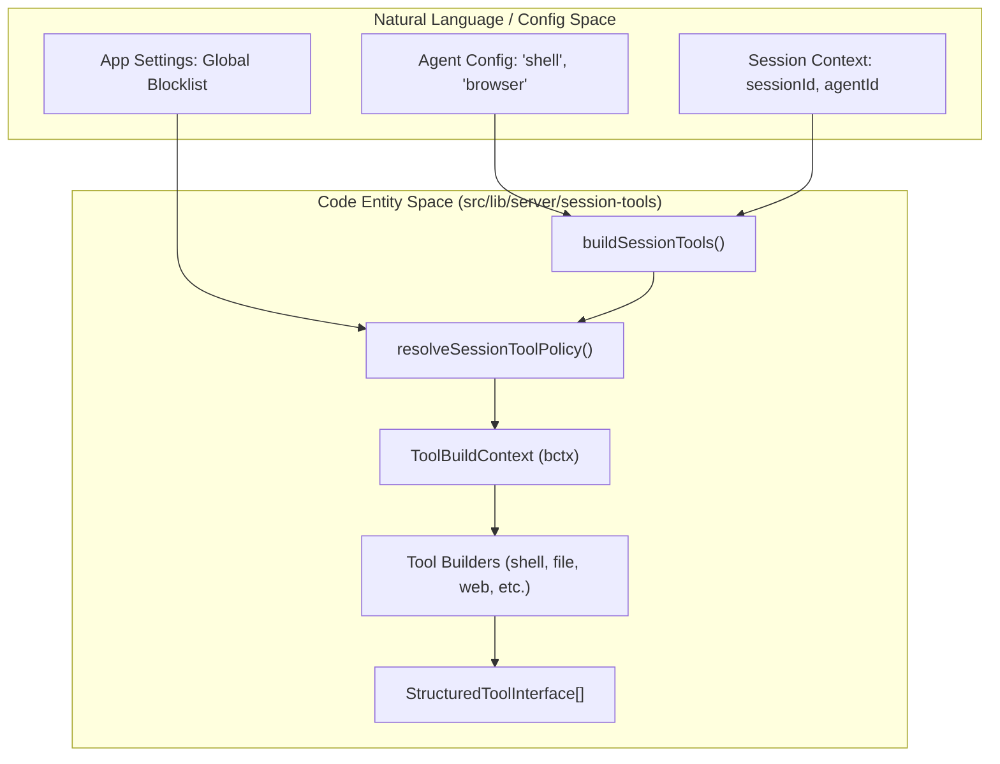
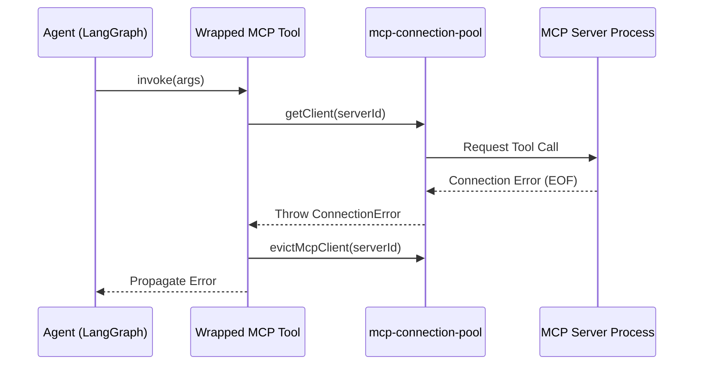

<!-- source: DeepWiki mcp.deepwiki.com · repo swarmclawai/swarmclaw · page 7.1 Session Tools · fetched 2026-10-27 -->

# Session Tools

Relevant source files

The following files were used as context for generating this wiki page:

- [src/app/api/mcp-servers/[id]/test/route.ts](src/app/api/mcp-servers/[id]/test/route.ts)
- [src/app/api/mcp-servers/route.test.ts](src/app/api/mcp-servers/route.test.ts)
- [src/app/api/tasks/[id]/route.ts](src/app/api/tasks/[id]/route.ts)
- [src/app/api/tasks/route.ts](src/app/api/tasks/route.ts)
- [src/components/mcp-servers/mcp-server-list.tsx](src/components/mcp-servers/mcp-server-list.tsx)
- [src/components/shared/settings-sheet.tsx](src/components/shared/settings-sheet.tsx)
- [src/components/tasks/task-card.tsx](src/components/tasks/task-card.tsx)
- [src/components/tasks/task-sheet.tsx](src/components/tasks/task-sheet.tsx)
- [src/lib/server/mcp-connection-pool.test.ts](src/lib/server/mcp-connection-pool.test.ts)
- [src/lib/server/mcp-connection-pool.ts](src/lib/server/mcp-connection-pool.ts)
- [src/lib/server/session-tools.ts](src/lib/server/session-tools.ts)
- [src/lib/server/session-tools/build-session-tools-dedup.test.ts](src/lib/server/session-tools/build-session-tools-dedup.test.ts)
- [src/lib/server/session-tools/connector.ts](src/lib/server/session-tools/connector.ts)
- [src/lib/server/session-tools/crud.ts](src/lib/server/session-tools/crud.ts)
- [src/lib/server/session-tools/file.ts](src/lib/server/session-tools/file.ts)
- [src/lib/server/session-tools/files-tool.test.ts](src/lib/server/session-tools/files-tool.test.ts)
- [src/lib/server/session-tools/files-tool.ts](src/lib/server/session-tools/files-tool.ts)
- [src/lib/server/session-tools/index.ts](src/lib/server/session-tools/index.ts)
- [src/lib/server/session-tools/web.ts](src/lib/server/session-tools/web.ts)
- [src/proxy.ts](src/proxy.ts)
- [src/stores/use-app-store.ts](src/stores/use-app-store.ts)

This page documents `buildSessionTools`, the `ToolBuildContext` interface, the full set of tool families assembled per agent session, the capability policy gate, file access enforcement, result truncation, and the cleanup lifecycle.

---

## Overview

Before each chat turn, the execution engine calls `buildSessionTools` to produce the concrete list of LangChain `StructuredToolInterface` objects that the agent can invoke. The function is session-scoped: it reads the session's enabled-tool list, applies the global capability policy, constructs every tool builder with a shared context object (`ToolBuildContext`), registers cleanup callbacks for stateful resources (browsers, MCP connections), and enforces safety constraints like file access policies and result truncation.

Sources: [src/lib/server/session-tools/index.ts:128-153](), [src/lib/server/session-tools.ts:1-9]()

---

## Architecture & Data Flow

The tool assembly process bridges the high-level Agent configuration with low-level system capabilities.

### Natural Language to Code Entity Space: Tool Assembly
The following diagram illustrates how session-specific parameters are transformed into executable code entities (Tools).

Sources: [src/lib/server/session-tools/index.ts:128-156](), [src/lib/server/tool-capability-policy.ts:1-20]()

---

## The `ToolBuildContext` Interface

The `ToolBuildContext` (often referred to as `bctx`) is the primary interface passed to all tool builder functions. It provides the necessary state and gates for tools to operate safely within a session.

| Property | Type | Description |
| :--- | :--- | :--- |
| `cwd` | `string` | The current working directory for the session. |
| `sessionId` | `string` | Unique identifier for the active session. |
| `agentId` | `string` | Unique identifier for the agent invoking the tool. |
| `hasTool` | `(id: string) => boolean` | The capability gate check based on policy. |
| `activeExtensionSet` | `Set<string>` | The set of allowed extension/tool IDs. |
| `cleanupFns` | `Array` | Registry for async functions to run on turn completion. |
| `abortSignalRef` | `AbortSignalRef` | Reference to an abort signal for long-running tools. |

Sources: [src/lib/server/session-tools/index.ts:128-160](), [src/lib/server/session-tools/context.ts:1-20]()

---

## Tool Families

SwarmClaw organizes tools into "families" or "extensions". `buildSessionTools` iterates through these modules to populate the final toolset.

### Comprehensive Tool Registry

| Family | Builder Function | Key Tools | Capability Gate |
| :--- | :--- | :--- | :--- |
| **Shell** | `buildShellTools` | `shell_execute` | `shell` |
| **File** | `buildFileTools` | `read_file`, `write_file`, `list_files` | `files` |
| **Web** | `buildWebTools` | `browser_navigate`, `screenshot`, `search` | `browser` |
| **Memory** | `buildMemoryTools` | `search_memory`, `store_memory` | `memory` |
| **Delegate** | `buildDelegateTools` | `spawn_subagent`, `delegate_to_agent` | `delegate` |
| **Sandbox** | `buildExecuteTools` | `sandbox_exec` | `sandbox` |
| **Platform** | `buildPlatformTools` | `send_discord_message`, `slack_call` | `connectors` |
| **MCP** | *(Dynamic)* | Dynamic tools from MCP servers | `mcp:[server-id]` |
| **CRUD** | `buildCrudTools` | `create_task`, `update_agent` | `manage_agents` |

Sources: [src/lib/server/session-tools/index.ts:15-50](), [src/lib/server/session-tools/index.ts:160-250]()

---

## Safety & Policy Enforcement

### Capability Policy Gate (`hasTool`)
Before a tool is added to the session, it must pass the `hasTool` check. This gate respects both the Agent's specific configuration and the global `AppSettings` blocklist.

Sources: [src/lib/server/session-tools/index.ts:140-153](), [src/lib/server/tool-capability-policy.ts:1-25]()

### File Access Policy
The `enforceFileAccessPolicy` utility is used by file and shell tools to prevent directory traversal and unauthorized access outside of the session's designated workspace or the `SWARMCLAW_HOME` boundary.

Sources: [src/lib/server/session-tools/file-access-policy.ts:1-50](), [src/lib/server/session-tools/index.ts:53]()

### Tool Result Truncation
To prevent "context window flooding," tool outputs are passed through `truncateToolResultText`. The maximum allowed length is dynamically calculated based on the model's context window via `calculateMaxToolResultChars`.

Sources: [src/lib/server/session-tools/index.ts:9](), [src/lib/server/chat-execution/tool-result-guard.ts:1-30]()

---

## MCP Integration & Connection Pooling

Model Context Protocol (MCP) tools are injected dynamically. `buildSessionTools` connects to configured servers via `getOrConnectMcpClient`. To ensure reliability, MCP tools are wrapped with `wrapMcpToolWithPoolEviction`. If a connection-level error occurs (e.g., a broken pipe), the client is evicted from the pool so the next turn can attempt a fresh connection.

Sources: [src/lib/server/session-tools/index.ts:97-126](), [src/lib/server/mcp-connection-pool.ts:1-40]()

---

## Lifecycle & Cleanup

Stateful tools (especially `WebTools` using Playwright and `MCP` servers) require explicit cleanup to prevent resource leaks.

1.  **Registration**: During `buildSessionTools`, builders push async functions into `cleanupFns`.
2.  **Execution**: After the LLM turn completes (or fails), the `cleanup()` function returned by `buildSessionTools` is awaited.
3.  **Browser Sweeping**: A background process `sweepOrphanedBrowsers` runs periodically to kill Chromium instances associated with sessions that have been inactive for more than 30 minutes.

Sources: [src/lib/server/session-tools/index.ts:130-131](), [src/lib/server/session-tools/index.ts:255-265](), [src/lib/server/session-tools/web.ts:109-124]()

---

