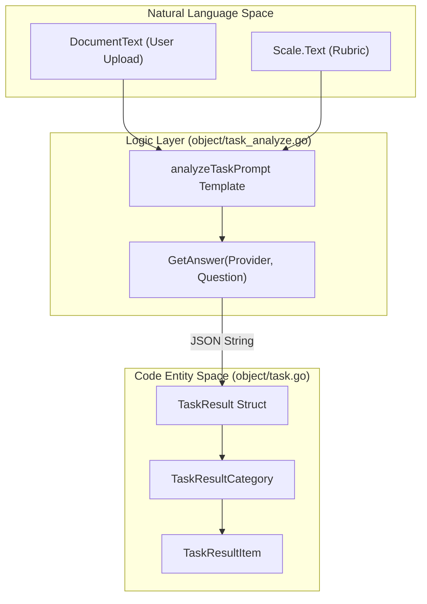
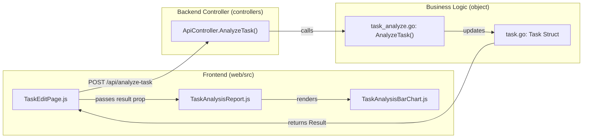

<!-- source: DeepWiki mcp.deepwiki.com · repo the-open-agent/openagent · page 8.2 Task Analysis & Reporting · fetched 2026-10-27 -->

# Task Analysis & Reporting

Relevant source files

The following files were used as context for generating this wiki page:

- [controllers/scale.go](controllers/scale.go)
- [controllers/task.go](controllers/task.go)
- [object/message_fake.go](object/message_fake.go)
- [object/task.go](object/task.go)
- [object/task_analyze.go](object/task_analyze.go)
- [web/src/ConfTask.js](web/src/ConfTask.js)
- [web/src/TaskAnalysisBarChart.js](web/src/TaskAnalysisBarChart.js)
- [web/src/TaskAnalysisPieChart.js](web/src/TaskAnalysisPieChart.js)
- [web/src/TaskAnalysisRadarChart.js](web/src/TaskAnalysisRadarChart.js)
- [web/src/TaskAnalysisReport.js](web/src/TaskAnalysisReport.js)
- [web/src/TaskEditPage.js](web/src/TaskEditPage.js)
- [web/src/TaskListPage.js](web/src/TaskListPage.js)
- [web/src/backend/TaskBackend.js](web/src/backend/TaskBackend.js)
- [web/src/table/TagTable.js](web/src/table/TagTable.js)
- [web/src/taskAnalysisScoreBands.js](web/src/taskAnalysisScoreBands.js)
- [web/src/taskReportDocx.js](web/src/taskReportDocx.js)
- [web/src/taskResultFormat.js](web/src/taskResultFormat.js)

The Task Analysis and Reporting subsystem provides a framework for AI-driven evaluation of documents (specifically pedagogical designs) against structured rubrics. It leverages LLMs to parse text, score it based on multi-level criteria, and generate visual reports with export capabilities.

## 1. Data Model: Task & Scale

The system centers around the `Task` entity, which represents a specific evaluation instance, and the `Scale` entity, which defines the evaluation criteria (rubrics).

### Task Entity
The `Task` struct encapsulates the input document, the selected evaluation rubric, and the structured results returned by the AI.

| Field | Type | Description |
| :--- | :--- | :--- |
| `Owner`, `Name` | `string` | Composite primary key for the task [object/task.go:54-55](). |
| `Provider` | `string` | The ID of the Model Provider used for analysis [object/task.go:59](). |
| `Scale` | `string` | Reference to the `Scale` entity used as a rubric [object/task.go:69](). |
| `DocumentText` | `string` | The raw text extracted from the uploaded file [object/task.go:78](). |
| `Result` | `string` | JSON string containing the structured `TaskResult` [object/task.go:75](). |
| `Score` | `float64` | The overall calculated score for the task [object/task.go:64](). |

### TaskResult Structure
When a task is analyzed, the AI populates a structured `TaskResult` which is then stored in the `Task.Result` field.

*   **TaskResult**: Contains metadata (Title, Designer, Grade) and an array of `TaskResultCategory` [object/task.go:38-51]().
*   **TaskResultCategory**: Represents top-level evaluation dimensions (e.g., "Teaching Objectives") with a sub-score and a list of `TaskResultItem` [object/task.go:32-36]().
*   **TaskResultItem**: The granular evaluation point, containing a `Score`, `Advantage`, `Disadvantage`, and `Suggestion` [object/task.go:24-30]().

**Sources:** [object/task.go:24-79]()

---

## 2. AI-Driven Task Analysis

The analysis process is a bridge between unstructured document text and structured JSON data. It uses a specialized prompt to guide the LLM.

### Analysis Workflow
1.  **Rubric Retrieval**: The system fetches the rubric text from the referenced `Scale` using `GetTaskEffectiveScale` [object/task.go:155-170]().
2.  **Prompt Construction**: A prompt is built using the `analyzeTaskPrompt` template, injecting the rubric and the document text [object/task_analyze.go:27-65, 88]().
3.  **LLM Execution**: The `AnalyzeTask` function calls `GetAnswer` (or `GetAnswerFake` for demo tasks) to process the prompt [object/task_analyze.go:96-99]().
4.  **JSON Parsing**: The AI's response is cleaned (stripping markdown blocks) and unmarshaled into the `TaskResult` struct [object/task_analyze.go:109-125]().

### Technical Data Flow: Natural Language to Code Entity
The following diagram illustrates how natural language input (Document + Rubric) is transformed into the structured `TaskResult` code entity.

**Natural Language to Entity Transformation**

**Sources:** [object/task_analyze.go:27-129](), [object/task.go:24-51]()

---

## 3. Frontend Implementation: TaskEditPage

`TaskEditPage.js` provides the interface for managing a task, uploading documents, and triggering the analysis.

### Key Features
*   **Progress Tracking**: Since AI analysis can take several minutes, the UI simulates progress using `setInterval` and `ANALYZE_PROGRESS_DURATION_SEC` (default 300s) [web/src/TaskEditPage.js:19-21, 125-131]().
*   **Analysis Trigger**: The `analyzeTask()` function calls the backend API via `TaskBackend.analyzeTask` and updates the local state with the returned `TaskResult` [web/src/TaskEditPage.js:130-156]().
*   **Normalization**: The `normalizeTaskResult` helper ensures that the `result` field (stored as a string in DB) is correctly parsed into a JSON object for rendering [web/src/TaskEditPage.js:73-89]().

**Sources:** [web/src/TaskEditPage.js:19-156](), [web/src/backend/TaskBackend.js:98-106]()

---

## 4. Reporting & Visualization

The `TaskAnalysisReport` component renders the structured data using `ECharts` and provides a comprehensive view of the evaluation.

### Visualization Components
The report utilizes distinct chart types to represent different facets of the data:
1.  **Radar Chart (`TaskAnalysisRadarChart`)**: Flattens categories and items to show a multi-dimensional comparison of scores. It uses a PUA delimiter `AXIS_ID_SEP` to handle axis keys [web/src/TaskAnalysisRadarChart.js:22, 179-211]().
2.  **Bar Chart (`TaskAnalysisBarChart`)**: Displays sub-criteria scores. It supports both horizontal and vertical orientations and can filter for "low scores" (below a threshold) [web/src/TaskAnalysisBarChart.js:76-138]().
3.  **Pie Chart (`TaskAnalysisPieChart`)**: Groups scores into "Bands" (e.g., defined in `TASK_SCORE_BAND_COLORS`) to show the distribution of evaluation points [web/src/TaskAnalysisPieChart.js:43-75]().

### Backend/Frontend Interaction Diagram
This diagram maps the UI components to their corresponding backend controllers and data structures.

**Component to Entity Mapping**

**Sources:** [web/src/TaskEditPage.js:130-156](), [controllers/task.go:256-275](), [object/task_analyze.go:67-129]()

---

## 5. DOCX Report Export

OpenAgent supports exporting the full analysis, including charts, to a Microsoft Word (`.docx`) document using the `docx` library.

### Implementation Details (`taskReportDocx.js`)
*   **Image Capture**: The system captures `ECharts` instances as PNG data URLs using `getEchartsInstance().getDataURL()` within `TaskAnalysisReport` [web/src/TaskAnalysisReport.js:134-149]().
*   **Binary Conversion**: Data URLs are converted to `Uint8Array` for embedding into the document [web/src/taskReportDocx.js:32-48]().
*   **Document Construction**: The `downloadTaskAnalysisReportDocx` function builds the document section by section:
    *   **Basic Information**: Meta-data extracted via `buildMetaSection` [web/src/taskReportDocx.js:107-121]().
    *   **Chart Section**: Inserts the Radar, Bar, Pie, and Low Score Bar charts as `ImageRun` objects [web/src/taskReportDocx.js:170-190]().
    *   **Detailed Evaluation**: Iterates through `categories` and `items` to output advantages, disadvantages, and suggestions in text form [web/src/taskReportDocx.js:192-219]().

**Sources:** [web/src/taskReportDocx.js:15-219](), [web/src/TaskAnalysisReport.js:151-181]()

---

