# Page: OpenAgent Overview

# OpenAgent Overview

<details>
<summary>Relevant source files</summary>

The following files were used as context for generating this wiki page:

- [CONTRIBUTING.md](CONTRIBUTING.md)
- [README.md](README.md)
- [README_zh.md](README_zh.md)
- [conf/app.conf](conf/app.conf)
- [conf/conf.go](conf/conf.go)
- [docker-compose.yml](docker-compose.yml)
- [main.go](main.go)
- [object/adapter.go](object/adapter.go)
- [object/init.go](object/init.go)
- [routers/router.go](routers/router.go)
- [routers/static_filter.go](routers/static_filter.go)
- [scripts/install.ps1](scripts/install.ps1)
- [scripts/install.sh](scripts/install.sh)
- [util/browser.go](util/browser.go)
- [web/src/App.js](web/src/App.js)
- [web/src/Conf.js](web/src/Conf.js)
- [web/src/ManagementPage.js](web/src/ManagementPage.js)
- [web/src/component/nav-item-tree/NavItemTree.js](web/src/component/nav-item-tree/NavItemTree.js)

</details>


OpenAgent is an open-source, self-hostable personal AI assistant platform that integrates Large Language Models (LLMs), Retrieval-Augmented Generation (RAG), and autonomous agent loops [README.md:33-35](). It provides a full-stack solution for building and deploying AI agents capable of web browsing, code execution, and interacting with various document formats.

The system is designed to be multi-tenant and supports over 30 model providers, offering a comprehensive admin dashboard for monitoring usage, activity, and tool orchestration [README.md:91-101]().

## Core Capabilities

OpenAgent bridges the gap between raw LLM capabilities and practical utility through several key subsystems:

*   **Agent Loops:** Supports autonomous behaviors including `browser-use` for navigating websites, shell execution, and office automation [README.md:103-113]().
*   **Knowledge Base (RAG):** Automatically chunks, embeds, and indexes uploaded documents (PDF, Word, Excel, etc.) for semantic retrieval during chat [README.md:116-124]().
*   **Multi-Provider Integration:** Pluggable architecture for LLMs (OpenAI, Claude, Gemini, DeepSeek, etc.) and embedding models [README.md:91-99]().
*   **Infrastructure Management:** Built-in tools for managing machines, containers, and Kubernetes applications [web/src/ManagementPage.js:108-118]().

For deeper exploration of specific features, refer to the following child pages:
*   [Getting Started & Configuration](#1.1) — Installation, Beego `app.conf` settings, and startup sequence.
*   [System Architecture](#1.2) — MVC structure, XORM persistence, and the request filter pipeline.

## High-Level Architecture

OpenAgent follows a decoupled architecture with a Go-based backend and a React-based frontend. The backend utilizes the **Beego** framework for routing and middleware [main.go:27](), while **XORM** handles database persistence with support for MySQL, PostgreSQL, and SQLite [object/adapter.go:29-35]().

### Conceptual System Flow
The following diagram illustrates how user interactions flow through the system components, mapping high-level concepts to specific code entities.

**OpenAgent Component Interaction**
```mermaid
graph TD
    User["User Interface (React)"] -- "REST API / SSE" --> BeegoRouter["routers.initAPI()"]
    
    subgraph Backend ["Go Backend (Beego)"]
        BeegoRouter --> Filters["routers.AuthzFilter / routers.AutoSigninFilter"]
        Filters --> Controllers["controllers.ApiController"]
        Controllers --> Logic["object Package (Business Logic)"]
        Logic --> ProviderLayer["object.GetDefaultModelProvider()"]
    end

    subgraph Persistence ["Data Layer"]
        Logic --> XORM["object.Adapter (XORM)"]
        XORM --> DB[("MySQL / SQLite / Postgres")]
    end

    subgraph External ["External Services"]
        ProviderLayer --> LLM["LLM Providers (OpenAI, Claude, etc.)"]
        Logic --> Casdoor["Casdoor (Auth & SSO)"]
    end

    [web/src/App.js:58-63]() --> BeegoRouter
    [routers/router.go:35-41]() --> Filters
    [object/adapter.go:194-199]() --> XORM
```
Sources: [web/src/App.js:58-63](), [routers/router.go:35-41](), [object/adapter.go:194-199](), [main.go:66-76]()

## Major Subsystems Relation

OpenAgent organizes its capabilities into several logical groups, which are reflected in the `ManagementPage` sidebar navigation logic [web/src/ManagementPage.js:108-118]().

| Subsystem | Primary Code Responsibility | Key Components |
| :--- | :--- | :--- |
| **Identity** | Authentication and RBAC | `AuthzFilter`, `AutoSigninFilter`, Casdoor SDK [web/src/App.js:62]() |
| **Connectors** | External AI and Tool APIs | `ProviderListPage`, `ToolListPage`, `ServerListPage` (MCP) |
| **Knowledge Base** | RAG and Vector Search | `FileListPage`, `VectorListPage`, `RefreshStoreVectors` |
| **Admin** | System Monitoring | `UsagePage`, `RecordListPage`, `SystemInfo` |
| **Multimedia** | Content Processing | `TaskListPage`, `ScaleListPage`, `FormListPage` |

### Code-to-Navigation Mapping
The frontend navigation structure directly corresponds to backend API namespaces and object models defined in the router.

**Navigation to Entity Mapping**
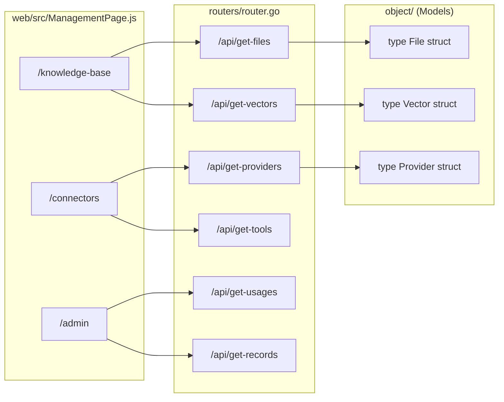
Sources: [web/src/ManagementPage.js:108-118](), [routers/router.go:72-121](), [web/src/App.js:107-158]()

## Initialization Sequence

When the application starts via `main.go`, it performs a specific sequence of initializations to ensure the environment is ready:

1.  **Flag & Adapter Setup:** Parses CLI flags and initializes the database adapter (falling back to SQLite if MySQL is unavailable) [main.go:46-48](), [object/adapter.go:79-106]().
2.  **Database Initialization:** Seeds built-in providers, stores, and tools via `object.InitDb()` [object/init.go:29-43]().
3.  **Utility Initialization:** Prepares IP databases and document parsers [main.go:57-59]().
4.  **Background Tasks:** Starts cleanup routines for chats and transaction retry loops [main.go:60-63]().
5.  **Middleware Injection:** Sets up the Beego filter pipeline for security and monitoring [main.go:66-76]().

For detailed installation and configuration steps, see [Getting Started & Configuration](#1.1).

Sources: [main.go:40-64](), [object/adapter.go:138-152](), [object/init.go:29-43]()

---

# Page: Getting Started & Configuration

# Getting Started & Configuration

<details>
<summary>Relevant source files</summary>

The following files were used as context for generating this wiki page:

- [.github/workflows/build.yml](.github/workflows/build.yml)
- [.gitignore](.gitignore)
- [.goreleaser.yaml](.goreleaser.yaml)
- [CONTRIBUTING.md](CONTRIBUTING.md)
- [Dockerfile](Dockerfile)
- [README.md](README.md)
- [README_zh.md](README_zh.md)
- [conf/app.conf](conf/app.conf)
- [conf/conf.go](conf/conf.go)
- [docker-compose.yml](docker-compose.yml)
- [docker-entrypoint.sh](docker-entrypoint.sh)
- [embed.go](embed.go)
- [embedsupport/setup.go](embedsupport/setup.go)
- [internal/cli/cli.go](internal/cli/cli.go)
- [internal/cli/version.go](internal/cli/version.go)
- [main.go](main.go)
- [object/init.go](object/init.go)
- [routers/static_filter.go](routers/static_filter.go)
- [scripts/install.ps1](scripts/install.ps1)
- [scripts/install.sh](scripts/install.sh)
- [util/browser.go](util/browser.go)
- [util/launch_detect_unix.go](util/launch_detect_unix.go)
- [util/launch_detect_windows.go](util/launch_detect_windows.go)
- [web/src/Conf.js](web/src/Conf.js)

</details>


OpenAgent is a full-stack AI assistant platform built on the Beego framework (Go) and React. This page provides technical details on the installation process, the configuration schema across backend and frontend, and the initialization sequence that occurs when the server starts.

## Installation & Deployment

OpenAgent supports multiple deployment modes, ranging from pre-built binaries to containerized "all-in-one" environments.

### Binary Installation
Automated scripts are provided to fetch the latest release, install it to a local directory, and update the system `PATH`.
*   **macOS / Linux**: Uses `curl` to pipe `install.sh` to bash [README.md:55-58](). It installs to `$HOME/.local/share/openagent` by default [scripts/install.sh:14]().
*   **Windows**: Uses `PowerShell` to invoke `install.ps1` [README.md:60-62](). It installs to `$env:LOCALAPPDATA\openagent` by default [scripts/install.ps1:13]().

### Docker Setup
The project provides two primary Docker targets defined in the `Dockerfile`:
1.  **standard**: A lightweight Alpine-based image containing the compiled Go binary and the React build artifacts [Dockerfile:24-55]().
2.  **allinone**: A Debian-based image that includes a local MariaDB server, allowing the system to run without an external database dependency [Dockerfile:66-86]().

### Build Pipeline
GitHub Actions are used to automate tests, frontend builds via `yarn`, and backend builds using `go build` [.github/workflows/build.yml:14-70](). Final releases are handled by `GoReleaser`, which applies `UPX` compression to binaries for supported platforms [.goreleaser.yaml:42-52]().

**Sources:** [README.md:51-85](), [Dockerfile:1-86](), [scripts/install.sh:1-110](), [.github/workflows/build.yml:1-170](), [.goreleaser.yaml:1-53]()

---

## Configuration Management

Configuration is handled through a tiered system: Environment Variables > `app.conf` > Default Hardcoded Values.

### Backend: app.conf & Environment Variables
The file `conf/app.conf` contains the primary settings for the Beego application. The `conf` package provides helper functions like `GetConfigString(key)` which check `os.LookupEnv(key)` before falling back to the config file [conf/conf.go:78-119]().

| Key | Description | Default |
| :--- | :--- | :--- |
| `httpport` | The port the server listens on | `14000` [conf/app.conf:2]() |
| `driverName` | Database driver (e.g., `mysql`) | `mysql` [conf/app.conf:4]() |
| `dataSourceName` | Connection string for the database | `root:123456@tcp(localhost:3306)/` [conf/app.conf:5]() |
| `issuer` | URL for the Casdoor authentication server | - [conf/app.conf:9]() |
| `clientId` | Casdoor Application Client ID | - [conf/app.conf:10]() |
| `redisEndpoint` | Optional Redis URL for session storage | - [conf/app.conf:7]() |
| `isDemoMode` | Enables read-only mode for public demos | `false` [conf/app.conf:8]() |

**Sources:** [conf/app.conf:1-16](), [conf/conf.go:78-160]()

### Frontend: WebConfig Injection
The frontend configuration is defined in `web/src/Conf.js`. Instead of hardcoding these values into the JS bundle, the backend dynamically injects them. The `routers.StaticFilter` intercepts requests for the main JS bundle and uses regex to replace placeholder strings with values from `app.conf` (e.g., `issuer`, `clientId`) [routers/static_filter.go:168-179]().

**Sources:** [web/src/Conf.js:15-51](), [routers/static_filter.go:148-182](), [conf/conf.go:200-223]()

---

## Startup Initialization Sequence

The `main.go` file orchestrates the startup of the OpenAgent ecosystem. It initializes database connections, starts background workers, and configures the Beego middleware pipeline.

### Initialization Flow
The sequence follows a strict order to ensure dependencies (like the database) are available before background tasks start.

Title: Startup Initialization Sequence in main.go
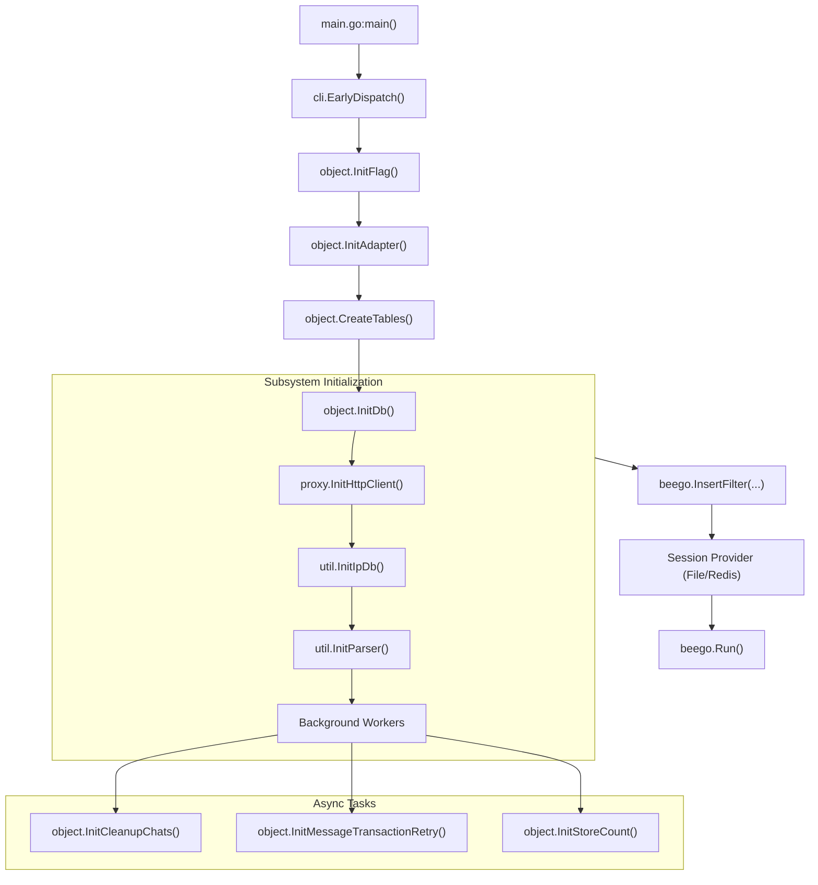
**Sources:** [main.go:40-141](), [object/init.go:29-43]()

### Middleware Pipeline (Filters)
OpenAgent uses Beego filters to handle cross-cutting concerns for every request.

| Filter Function | Purpose | File Reference |
| :--- | :--- | :--- |
| `routers.CorsFilter` | Handles Cross-Origin Resource Sharing | [main.go:66]() |
| `routers.AutoSigninFilter` | Manages automatic authentication via cookies/tokens | [main.go:70]() |
| `routers.StaticFilter` | Serves React frontend and injects runtime config | [main.go:71]() |
| `routers.AuthzFilter` | Enforces Role-Based Access Control (RBAC) | [main.go:72]() |
| `routers.PrometheusFilter` | Collects metrics for observability | [main.go:73]() |
| `routers.RecordMessage` | Logs API interactions for the audit trail | [main.go:74]() |

**Sources:** [main.go:65-76]()

---

## Configuration Data Flow

The following diagram bridges the gap between the configuration files on disk and the runtime objects used by the system.

Title: Configuration Mapping: File to Runtime Entity
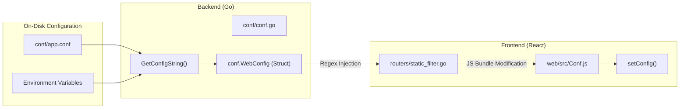

**Sources:** [conf/conf.go:200-223](), [routers/static_filter.go:168-179](), [web/src/Conf.js:29-51]()

## Built-in Resource Initialization
Upon the first run, `object.InitDb()` triggers a series of functions to populate the system with default providers, stores, and tools.

1.  **Site Sync**: Synchronizes site settings and refreshes the provider adapter [object/init.go:32-36]().
2.  **Providers**: Initializes default Model, Embedding, TTS, STT, and Image providers [object/init.go:37]().
3.  **Store**: Creates a `store-built-in` if no global stores exist, linking it to the default providers [object/init.go:38, 87-152]().
4.  **Skills & Tools**: Loads skill definitions from folders and initializes built-in tools [object/init.go:39-40]().

**Sources:** [object/init.go:29-43](), [object/init.go:87-152]()

---

# Page: System Architecture

# System Architecture

<details>
<summary>Relevant source files</summary>

The following files were used as context for generating this wiki page:

- [authz/authz.go](authz/authz.go)
- [conf/app.conf](conf/app.conf)
- [conf/conf.go](conf/conf.go)
- [controllers/base.go](controllers/base.go)
- [controllers/message_answer_job.go](controllers/message_answer_job.go)
- [main.go](main.go)
- [object/adapter.go](object/adapter.go)
- [object/init.go](object/init.go)
- [routers/authz_filter.go](routers/authz_filter.go)
- [routers/auto_signin_filter.go](routers/auto_signin_filter.go)
- [routers/base.go](routers/base.go)
- [routers/router.go](routers/router.go)
- [routers/static_filter.go](routers/static_filter.go)
- [swagger/swagger.json](swagger/swagger.json)
- [swagger/swagger.yml](swagger/swagger.yml)
- [web/src/App.js](web/src/App.js)
- [web/src/Conf.js](web/src/Conf.js)
- [web/src/ManagementPage.js](web/src/ManagementPage.js)
- [web/src/component/nav-item-tree/NavItemTree.js](web/src/component/nav-item-tree/NavItemTree.js)

</details>


OpenAgent is built on a full-stack MVC (Model-View-Controller) architecture designed for scalability, multi-tenancy, and high-performance AI orchestration. The system integrates a Go-based backend using the Beego framework with a React-based frontend powered by Ant Design.

## High-Level Data Flow

The following diagram illustrates the flow of a request from the user interface through the security filters to the business logic and persistence layers.

**System Data Flow Overview**
```mermaid
graph TD
    subgraph "Frontend (React Space)"
        "Browser_UI"["Browser UI (web/src/App.js)"]
        "Fetch_Filter"["FetchFilter.js (web/src/backend/FetchFilter.js)"]
        "Backend_JS"["Entity Backend JS (e.g., StoreBackend.js)"]
    end

    subgraph "Backend (Go/Beego Space)"
        "Beego_Router"["Beego Router (routers/router.go)"]
        "Filter_Pipeline"["Filter Pipeline (main.go)"]
        "ApiController"["ApiController (controllers/base.go)"]
        "Object_Layer"["Object Layer (object/*.go)"]
    end

    subgraph "Persistence (Data Space)"
        "XORM_Engine"["XORM Engine (object/adapter.go)"]
        "DB"["Database (MySQL/SQLite)"]
    end

    "Browser_UI" --> "Backend_JS"
    "Backend_JS" -- "HTTP/JSON" --> "Fetch_Filter"
    "Fetch_Filter" -- "API Request" --> "Beego_Router"
    "Beego_Router" --> "Filter_Pipeline"
    "Filter_Pipeline" --> "ApiController"
    "ApiController" --> "Object_Layer"
    "Object_Layer" --> "XORM_Engine"
    "XORM_Engine" --> "DB"
```
**Sources:** `web/src/App.js:34-56`(), `routers/router.go:31-41`(), `object/adapter.go:138-152`().

---

## Backend Architecture (Go & Beego)

The backend is a Go application leveraging the **Beego** framework. It handles routing, session management, and the request lifecycle through a filter pipeline.

### 1. Request Filter Pipeline
OpenAgent uses Beego's `InsertFilter` mechanism to implement cross-cutting concerns before requests reach the controllers. These filters are registered in the `main` function [main.go:66-76]().

| Filter Name | File Reference | Purpose |
| :--- | :--- | :--- |
| `CorsFilter` | `routers/base.go` | Handles Cross-Origin Resource Sharing [main.go:66](). |
| `AutoSigninFilter` | `routers/auto_signin_filter.go` | Automatically signs in users based on tokens [main.go:70](). |
| `AuthzFilter` | `routers/authz_filter.go` | Enforces Role-Based Access Control (RBAC) [main.go:72](). |
| `PrometheusFilter` | `routers/base.go` | Collects metrics for monitoring at `/api/metrics` [main.go:73](). |
| `RecordMessage` | `routers/base.go` | Records request metadata for audit logs [main.go:74](). |

### 2. Controller Layer
All API requests are routed through `controllers.ApiController`. The routing configuration in `routers/router.go` maps RESTful endpoints to specific methods within this controller. For example:
- `GET /api/get-account` maps to `ApiController.GetAccount` [routers/router.go:45]().
- `POST /api/update-store` maps to `ApiController.UpdateStore` [routers/router.go:62]().
- `POST /api/test-mcp-server` maps to `ApiController.TestMcpServer` [routers/router.go:95]().

### 3. Persistence Layer (XORM)
The system uses **XORM** as the ORM layer. It supports multiple database backends, primarily MySQL and SQLite.
- **Dynamic Resolution:** The `resolveDatabase` function checks if a MySQL instance is available on `localhost:3306`; if not, it transparently falls back to a local SQLite database file named `openagent.db` [object/adapter.go:79-106]().
- **Adapter Pattern:** The `Adapter` struct manages the XORM engine instance and database initialization [object/adapter.go:194-199]().
- **Pure-Go SQLite:** The system registers `modernc.org/sqlite` under the `sqlite3` name to ensure compatibility with XORM without requiring CGO [object/adapter.go:38-42]().

**Sources:** `main.go:66-76`(), `routers/router.go:43-125`(), `object/adapter.go:79-106`(), `object/adapter.go:194-199`().

---

## Frontend Architecture (React & Ant Design)

The frontend is a Single Page Application (SPA) built with React. It uses **Ant Design** for its UI component library.

### 1. Component Structure
The root of the application is `App.js`, which initializes global configurations including:
- **Casdoor SDK:** For authentication integration via `Setting.initCasdoorSdk` [web/src/App.js:62]().
- **Theme Management:** Dynamic switching between light and dark modes [web/src/App.js:37-44]().
- **I18n:** Internationalization support via `i18next` [web/src/App.js:31]().

### 2. Routing and Navigation
Navigation is managed by `ManagementPage.js`, which provides a structured sidebar with categories such as Basic, Knowledge Base, Connectors, and Admin [web/src/ManagementPage.js:108-118]().
- **Parent Keys:** Menu items are grouped under parent keys like `/basic` (Stores, Chats, Messages) or `/connectors` (Providers, Pipes, Tools, Servers) [web/src/ManagementPage.js:110-111]().
- **Dynamic Selection:** `App.js` maintains the `selectedMenuKey` state by monitoring `location.pathname` to ensure the UI reflects the current route [web/src/App.js:107-158]().

### 3. Navigation Tree Configuration
The system defines a standard navigation hierarchy in `NavItemTree.js`, which is used for permission management and UI layout [web/src/component/nav-item-tree/NavItemTree.js:23-100]().

**Sources:** `web/src/App.js:37-63`(), `web/src/ManagementPage.js:108-118`(), `web/src/component/nav-item-tree/NavItemTree.js:23-100`().

---

## Security & Authentication (Casdoor Integration)

OpenAgent delegates identity management to **Casdoor**, an open-source Identity Provider.

**Authentication Entity Mapping**
```mermaid
graph LR
    subgraph "Casdoor (Identity Space)"
        "Casdoor_User"["User Entity"]
        "Casdoor_Org"["Organization"]
        "Casdoor_App"["Application Config"]
    end

    subgraph "OpenAgent (Code Space)"
        "Account_Backend"["AccountBackend.js (web/src/backend/AccountBackend.js)"]
        "Auth_Callback"["AuthCallback.js (web/src/AuthCallback.js)"]
        "AutoSignin_Filter"["AutoSigninFilter (routers/auto_signin_filter.go)"]
        "Authz_Filter"["AuthzFilter (routers/authz_filter.go)"]
    end

    "Account_Backend" -- "getAccount()" --> "Casdoor_User"
    "Auth_Callback" -- "Handle Redirect" --> "Casdoor_App"
    "AutoSignin_Filter" -- "Verify JWT" --> "Casdoor_Org"
    "Authz_Filter" -- "isAllowed()" --> "Casdoor_User"
```

The integration involves:
- **Frontend:** `App.js` calls `getAccount()` on mount to retrieve the current session and user details [web/src/App.js:171-184]().
- **Backend Filter:** The `AuthzFilter` checks user roles (admin, user, or anonymous) against required permissions for every `/api/` request [routers/authz_filter.go:51-81]().
- **SSO Flow:** `Setting.initCasdoorSdk` initializes the JS SDK using configuration from `Conf.js` [web/src/App.js:62]().

**Sources:** `web/src/App.js:171-184`(), `routers/authz_filter.go:51-81`(), `web/src/Conf.js:15`().

---

## Initialization Sequence

When the backend starts, it performs a multi-stage initialization to ensure the database and default AI configurations are ready.

**Startup Initialization Sequence**
```mermaid
graph TD
    "main"["main.go"] --> "InitAdapter"["InitAdapter (object/adapter.go)"]
    "InitAdapter" --> "CreateTables"["CreateTables (object/adapter.go)"]
    "CreateTables" --> "InitDb"["InitDb (object/init.go)"]
    
    subgraph "InitDb Logic"
        "InitDb" --> "initBuiltInSite"["initBuiltInSite()"]
        "initBuiltInSite" --> "initBuiltInProviders"["initBuiltInProviders()"]
        "initBuiltInProviders" --> "initBuiltInStore"["initBuiltInStore()"]
    end
```

The `InitDb` function in `object/init.go` ensures that if no configuration exists, a "Built-in Store" is created with default model, embedding, and storage providers [object/init.go:29-43](). It also initializes skills from the filesystem and sets up default tools [object/init.go:39-40]().

**Sources:** `main.go:40-50`(), `object/init.go:29-43`(), `object/init.go:87-152`().

---

# Page: Core AI & Chat System

# Core AI & Chat System

<details>
<summary>Relevant source files</summary>

The following files were used as context for generating this wiki page:

- [controllers/account.go](controllers/account.go)
- [controllers/chat.go](controllers/chat.go)
- [controllers/message.go](controllers/message.go)
- [controllers/message_answer.go](controllers/message_answer.go)
- [controllers/message_util.go](controllers/message_util.go)
- [controllers/util.go](controllers/util.go)
- [object/chat.go](object/chat.go)
- [object/message.go](object/message.go)
- [web/src/ChatBox.js](web/src/ChatBox.js)
- [web/src/ChatMenu.js](web/src/ChatMenu.js)
- [web/src/ChatPage.js](web/src/ChatPage.js)
- [web/src/backend/ChatBackend.js](web/src/backend/ChatBackend.js)

</details>


The **Core AI & Chat System** is the central engine of OpenAgent, responsible for orchestrating the flow between user inputs and AI-generated responses. It bridges the frontend React-based chat interface with a complex backend pipeline that handles Retrieval-Augmented Generation (RAG), tool execution, and real-time streaming via Server-Sent Events (SSE).

### High-Level Architecture

The system is built on a decoupled architecture where the frontend manages the conversation state and the backend manages the AI logic.

*   **Frontend**: Built with React, centered around `ChatPage.js` [web/src/ChatPage.js:36-42]() and `ChatBox.js` [web/src/ChatBox.js:32-53](). It handles message rendering, voice interactions (TTS/STT), and session navigation.
*   **Backend**: A Go/Beego application. The `GetMessageAnswer` controller [controllers/message_answer.go:42-64]() serves as the primary entry point for AI response generation, coordinating between model providers, vector stores, and tools.
*   **Configuration**: The `Store` entity acts as the "brain" configuration, defining which models, prompts, and knowledge bases are active for a specific chat session. It is resolved for each chat in the backend [controllers/message_answer.go:189-205]().

### AI Conversation Lifecycle

The following diagram illustrates the path from a user clicking "Send" to the AI response appearing on the screen.

**Diagram: Chat Message Lifecycle**
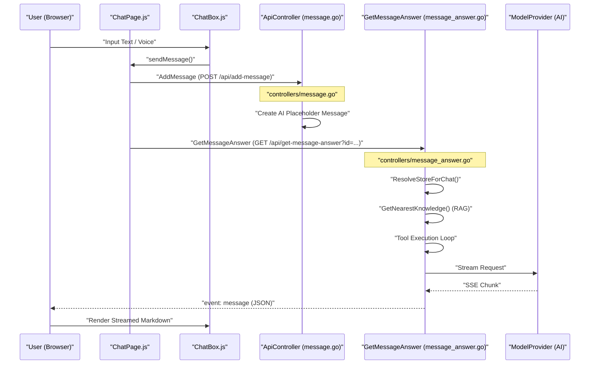
**Sources:** [web/src/ChatPage.js:210-230](), [web/src/ChatBox.js:141-169](), [controllers/message_answer.go:42-137](), [controllers/message.go:238-265]()

---

### Core Components

#### [Chat UI & Session Management](#2.1)
The frontend interface provides a multi-pane environment [web/src/ChatPage.js:23]() for interacting with different AI configurations. It manages the `ChatMenu` [web/src/ChatMenu.js:22]() for session history and the `ChatBox` [web/src/ChatBox.js:32]() for the active conversation. It also handles polling for generation status [web/src/ChatPage.js:84-147]().
*   **Key Entities**: `ChatPage`, `ChatBox`, `ChatMenu`.
*   **Details**: See [Chat UI & Session Management](#2.1).

#### [Message Pipeline & AI Response Generation](#2.2)
The backend pipeline handles the heavy lifting of AI orchestration. It manages the conversion of user queries into enriched prompts and determines if external tools (MCP) or built-in tools need to be invoked [controllers/message_answer.go:211-224](). It utilizes a job management system `messageAnswerJobs` to handle streaming and cancellation [controllers/message_answer.go:62-90]().
*   **Key Entities**: `GetMessageAnswer`, `Message`, `ModelProvider`.
*   **Details**: See [Message Pipeline & AI Response Generation](#2.2).

#### [Store Configuration](#2.3)
A `Store` is the foundational unit of AI behavior in OpenAgent. It encapsulates the system prompt, the selected LLM, and the connected knowledge bases. Every chat session is bound to a store that dictates its capabilities, which is resolved via `ResolveStoreForChat` [controllers/message_answer.go:189]().
*   **Key Entities**: `Store`, `VectorStore`, `McpServer`.
*   **Details**: See [Store Configuration](#2.3).

#### [Chat & Message Administration](#2.4)
Administrative views allow system operators to monitor and manage all conversations across the platform. This includes auditing global message history [controllers/message.go:33-106]() and filtering chats by store or user [controllers/chat.go:33-110]().
*   **Key Entities**: `ChatListPage`, `MessageListPage`.
*   **Details**: See [Chat & Message Administration](#2.4).

---

### Code Mapping: Data Entities to System Logic

The following table maps the primary data structures used in the Chat System to their respective implementation files.

| Logic Layer | Code Entity (Go) | Frontend Component (React) | Responsibility |
| :--- | :--- | :--- | :--- |
| **Session** | `object.Chat` [object/chat.go:24-50]() | `ChatMenu.js` [web/src/ChatMenu.js:22]() | Tracks a conversation thread between a user and a Store. |
| **Message** | `object.Message` [object/message.go:40-76]() | `MessageList.js` [web/src/chat/MessageList.js]() | Individual units of communication (User, AI, or System). |
| **Delivery** | `GetMessageAnswer` [controllers/message_answer.go:42]() | `ChatBox.js` [web/src/ChatBox.js:32]() | SSE streaming and real-time UI updates. |
| **Persistence** | `XORM engine` | `ChatBackend.js` [web/src/backend/ChatBackend.js]() | CRUD operations for chats and messages. |

**Diagram: System Entity Relationships**
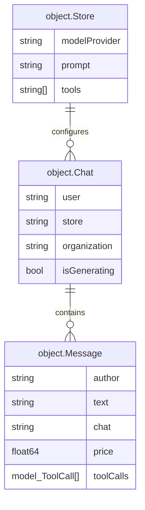
**Sources:** [object/chat.go:24-50](), [object/message.go:40-76](), [controllers/message.go:116-151](), [controllers/message_answer.go:189-205]()

**Sources:**
- `web/src/ChatPage.js`
- `web/src/ChatBox.js`
- `web/src/ChatMenu.js`
- `controllers/message_answer.go`
- `controllers/message.go`
- `controllers/chat.go`
- `object/chat.go`
- `object/message.go`
- `web/src/backend/ChatBackend.js`

---

# Page: Chat UI & Session Management

# Chat UI & Session Management

<details>
<summary>Relevant source files</summary>

The following files were used as context for generating this wiki page:

- [web/src/ChatBox.js](web/src/ChatBox.js)
- [web/src/ChatExampleQuestions.js](web/src/ChatExampleQuestions.js)
- [web/src/ChatMenu.js](web/src/ChatMenu.js)
- [web/src/ChatMessageRender.js](web/src/ChatMessageRender.js)
- [web/src/ChatMessageRender.test.js](web/src/ChatMessageRender.test.js)
- [web/src/ChatPage.js](web/src/ChatPage.js)
- [web/src/LoadSkillModal.js](web/src/LoadSkillModal.js)
- [web/src/MultiPaneManager.js](web/src/MultiPaneManager.js)
- [web/src/StoreInfoTitle.js](web/src/StoreInfoTitle.js)
- [web/src/backend/MessageBackend.js](web/src/backend/MessageBackend.js)
- [web/src/chat/ChatFileInput.js](web/src/chat/ChatFileInput.js)
- [web/src/chat/ChatInput.js](web/src/chat/ChatInput.js)
- [web/src/chat/ChatInputMenu.js](web/src/chat/ChatInputMenu.js)
- [web/src/chat/KnowledgeSourcesDrawer.js](web/src/chat/KnowledgeSourcesDrawer.js)
- [web/src/chat/MessageActions.js](web/src/chat/MessageActions.js)
- [web/src/chat/MessageEdit.js](web/src/chat/MessageEdit.js)
- [web/src/chat/MessageItem.js](web/src/chat/MessageItem.js)
- [web/src/chat/MessageList.js](web/src/chat/MessageList.js)
- [web/src/chat/MessageSuggestions.js](web/src/chat/MessageSuggestions.js)
- [web/src/chat/SearchSourcesDrawer.js](web/src/chat/SearchSourcesDrawer.js)
- [web/src/chat/WelcomeHeader.js](web/src/chat/WelcomeHeader.js)
- [web/src/common/ChatWidget.js](web/src/common/ChatWidget.js)

</details>


The OpenAgent frontend provides a comprehensive React-based interface for interacting with AI models. It manages the lifecycle of chat sessions, handles complex message rendering (including reasoning steps and tool calls), and integrates multimedia capabilities like Text-to-Speech (TTS) and Speech-to-Text (STT).

## ChatPage & State Management

`ChatPage` is the primary container for the conversation interface. It inherits from `BaseListPage` and manages the high-level state of the chat session, including store selection, message loading states, and UI layout.

### Key State Properties
- `chat`: The current active chat object [web/src/ChatPage.js:159-160]().
- `messages`: An array of message objects for the current session [web/src/ChatPage.js:231]().
- `chatMenuCollapsed`: Boolean determining the sidebar state, persisted in `localStorage` [web/src/ChatPage.js:45-46]().
- `paneCount`: Controls the multi-pane mode for side-by-side model comparison [web/src/ChatPage.js:65]().
- `generationMode`: Toggles between "text" and "image" modes [web/src/ChatPage.js:69-70]().

### Polling & Status Tracking
`ChatPage` implements a polling mechanism via `startPolling()` to track the status of chats currently generating responses [web/src/ChatPage.js:84-147](). It uses `ChatBackend.getChatStatus` to refresh the `isGenerating` and `isUnread` flags every 2 seconds [web/src/ChatPage.js:34-36](), [web/src/ChatPage.js:97]().

**Sources:** [web/src/ChatPage.js:36-163](), [web/src/BaseListPage.js:1-50]()

## ChatBox Interaction Layer

`ChatBox` acts as the functional bridge between the input components and the message display. It handles internal state for the current input value, uploaded files, and active TTS reading status.

### Interaction Components
- **ChatInput**: A specialized input area using `@ant-design/x` `Sender` for handling text and file attachments [web/src/chat/ChatInput.js:185-198]().
- **MessageList**: A virtualized list that renders `MessageItem` components [web/src/chat/MessageList.js:60-77]().
- **WelcomeHeader**: Displays store-specific greetings and icons when a chat is empty [web/src/chat/WelcomeHeader.js:20-48]().

### Session Persistence
`ChatBox` uses a local `inputStore` (a `Map`) to preserve unsent input text when a user switches between different chat sessions, ensuring no progress is lost during navigation [web/src/ChatBox.js:30-32](), [web/src/ChatBox.js:84-91]().

**Sources:** [web/src/ChatBox.js:32-169](), [web/src/chat/ChatInput.js:25-198](), [web/src/chat/MessageList.js:20-83]()

## Multi-Pane Mode

The `MultiPaneManager` allows administrators to compare different models or stores side-by-side.

### Implementation
- **Pane Management**: It maintains an array of `panes`, each containing its own `chat` and `messages` state [web/src/MultiPaneManager.js:46]().
- **Global Input**: A single text area can broadcast a message to all active panes simultaneously via `handleGlobalSend` [web/src/MultiPaneManager.js:220-240]().
- **Dynamic Creation**: If a pane does not have an active chat, the manager creates one on-the-fly using `createNewChat` [web/src/MultiPaneManager.js:75-93]().

### UI/Code Entity Mapping: Multi-Pane Workflow

| Logical Step | Code Entity | Function/Method |
| :--- | :--- | :--- |
| **Broadcast Message** | `MultiPaneManager` | `handleGlobalSend()` [web/src/MultiPaneManager.js:220]() |
| **Backend Init** | `ChatBackend` | `addChat()` [web/src/MultiPaneManager.js:95]() |
| **Response Stream** | `MessageBackend` | `getMessageAnswer()` [web/src/MultiPaneManager.js:141]() |
| **Tool Event Sync** | `toolCallStream.js` | `applyToolEvent()` [web/src/MultiPaneManager.js:191]() |

**Sources:** [web/src/MultiPaneManager.js:32-240](), [web/src/StoreInfoTitle.js:66-68]()

## Message Rendering & Pipeline

Messages are rendered via `MessageItem`, which supports complex AI outputs including reasoning phases and tool calls.

### Rendering Features
1. **Reasoning Phase**: Displays a "Thinking" animation [web/src/chat/MessageItem.js:106-148]() and renders `reasonText` via `ReasoningSection` [web/src/chat/MessageItem.js:31]().
2. **Tool Calls**: Integrated via `ToolCallSection`, showing the tool name, arguments, and execution results [web/src/chat/MessageItem.js:230-234]().
3. **Markdown & Carriers**: `ChatMessageRender` uses `MessageCarrier` to parse specialized tags (like `<title>`) from the stream [web/src/chat/MessageCarrier.js:1-50]().
4. **Suggestions**: `MessageSuggestions` renders interactive buttons for follow-up questions provided by the AI [web/src/chat/MessageSuggestions.js:20-63]().

### UI/Code Entity Mapping: Message Components

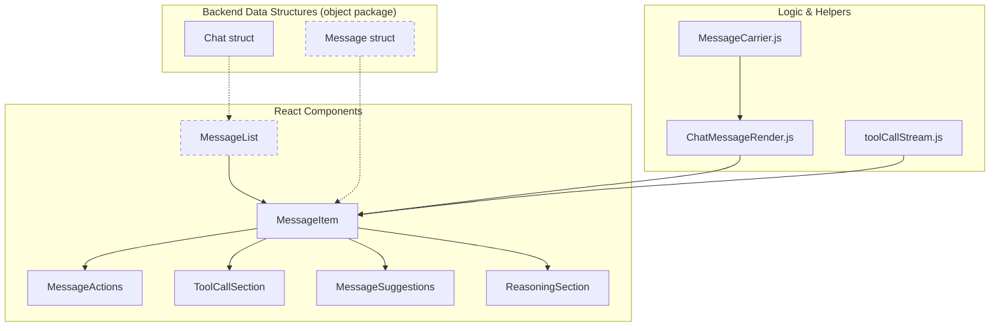

**Sources:** [web/src/chat/MessageItem.js:34-234](), [web/src/chat/MessageActions.js:41-141](), [web/src/chat/MessageSuggestions.js:20-63]()

## TTS & STT Integration

The UI provides voice interaction through dedicated helper classes and backend endpoints.

### Text-to-Speech (TTS)
- **TtsHelper**: Manages the audio lifecycle, initialized in `ChatBox` [web/src/ChatBox.js:51]().
- **UI Control**: `MessageActions` provides a play/pause/loading button for each message, tracking state via `isReading` and `isLoadingTTS` [web/src/chat/MessageActions.js:60-82]().
- **Cleanup**: `ChatBox` ensures speech synthesis is cancelled on component unmount [web/src/ChatBox.js:75-77]().

### Speech-to-Text (STT)
- **SpeechToTextHelper**: Handles browser-side recognition and voice input lifecycle [web/src/ChatBox.js:52]().
- **Integration**: Stops recognition when the user manually interacts with the input field [web/src/ChatBox.js:131-133]().

**Sources:** [web/src/ChatBox.js:51-53](), [web/src/chat/MessageActions.js:57-82](), [web/src/TextToSpeech.js:1-50]()

## Navigation & Session Management

The `ChatMenu` provides the navigation structure for multiple conversations, categorized by their `category` field [web/src/ChatMenu.js:83-88]().

- **CRUD Operations**: Users can create new chats, rename existing ones via an inline input [web/src/ChatMenu.js:131-153](), and delete sessions with a confirmation pop-up [web/src/ChatMenu.js:182-195]().
- **Status Indicators**: Renders a spinning `LoadingOutlined` icon if a chat is generating, or a dot if it is unread [web/src/ChatMenu.js:45-71]().
- **Store Switching**: `StoreInfoTitle` allows users to dynamically switch the model provider or the underlying Store for an active session, persisting changes via `ChatBackend.updateChat` [web/src/StoreInfoTitle.js:142-182]().

### Session State Flow

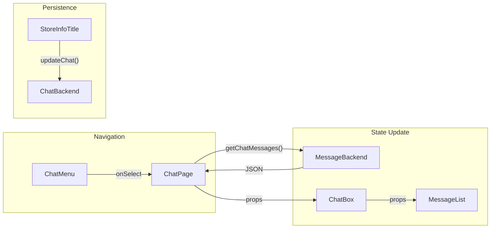

**Sources:** [web/src/ChatMenu.js:22-195](), [web/src/ChatPage.js:210-224](), [web/src/StoreInfoTitle.js:23-191]()

---

# Page: Message Pipeline & AI Response Generation

# Message Pipeline & AI Response Generation

<details>
<summary>Relevant source files</summary>

The following files were used as context for generating this wiki page:

- [carrier/carrier.go](carrier/carrier.go)
- [carrier/suggestion.go](carrier/suggestion.go)
- [carrier/title.go](carrier/title.go)
- [controllers/account.go](controllers/account.go)
- [controllers/chat.go](controllers/chat.go)
- [controllers/message.go](controllers/message.go)
- [controllers/message_answer.go](controllers/message_answer.go)
- [controllers/message_carrier.go](controllers/message_carrier.go)
- [controllers/message_util.go](controllers/message_util.go)
- [controllers/message_writer.go](controllers/message_writer.go)
- [controllers/util.go](controllers/util.go)
- [model/mcp.go](model/mcp.go)
- [object/chat.go](object/chat.go)
- [object/merge_agent_tools.go](object/merge_agent_tools.go)
- [object/message.go](object/message.go)
- [object/message_email.go](object/message_email.go)
- [object/message_email_test.go](object/message_email_test.go)
- [object/message_tool.go](object/message_tool.go)
- [object/resource_archive_tool.go](object/resource_archive_tool.go)
- [web/src/backend/ChatBackend.js](web/src/backend/ChatBackend.js)
- [web/src/carrier/TitleCarrier.js](web/src/carrier/TitleCarrier.js)
- [web/src/carrier/titleUtils.js](web/src/carrier/titleUtils.js)
- [web/src/chat/GeneratedResourceList.js](web/src/chat/GeneratedResourceList.js)
- [web/src/chat/MessageCarrier.js](web/src/chat/MessageCarrier.js)
- [web/src/chat/ToolCallSection.js](web/src/chat/ToolCallSection.js)
- [web/src/chat/toolCallStream.js](web/src/chat/toolCallStream.js)

</details>


This page provides a technical deep dive into the backend message lifecycle within OpenAgent. It covers the flow from receiving a user request to generating a streamed AI response using Server-Sent Events (SSE), including Retrieval-Augmented Generation (RAG), tool orchestration, carrier parsing, and message persistence.

## Message Lifecycle Overview

The message pipeline is primarily orchestrated by the `GetMessageAnswer` function in `controllers/message_answer.go`. This endpoint handles the complexity of context assembly, provider resolution, security checks, and real-time streaming.

### 1. Request Initialization & Context Resolution
When a user sends a message, the frontend first calls `AddMessage` [controllers/message.go:238-254]() to persist the user's input. Subsequently, it invokes the SSE endpoint `GetMessageAnswer` [controllers/message_answer.go:42-64]().

The backend performs several resolution steps:
*   **Message Validation**: Ensures the message exists, is authored by "AI", and is a reply to a valid user message [controllers/message_answer.go:148-171]().
*   **Store Resolution**: The `Store` is the central configuration hub. The system resolves the appropriate store for the chat via `object.ResolveStoreForChat(chat)` [controllers/message_answer.go:189-205]().
*   **Provider Loading**: Resolves the `ModelProvider` (LLM) and `EmbeddingProvider` based on the store or chat-specific overrides [controllers/message_answer.go:300-315]().

### 2. Security & Billing Hooks
Before generation begins, the pipeline executes safety and financial checks:
*   **Frequency Limiting**: For non-signed-in users, the system checks `GetNearMessageCount` against the store's `Frequency` and `LimitMinutes` settings [controllers/message_answer.go:283-294]().
*   **Dry Run & Billing**: Calls `validateTransactionBeforeAIGeneration` to perform a "dry run" validation, ensuring the user has sufficient balance in the linked Casdoor account before initiating expensive LLM calls [controllers/message_answer.go:318-322]().

### 3. RAG & Tool Orchestration
If configured, the system augments the prompt with external data and capabilities:
*   **RAG (Knowledge Retrieval)**: If `KnowledgeCount` is non-zero, the system performs a vector search across the store's `VectorStores` via `object.GetNearestKnowledge` [controllers/message_answer.go:351-372]().
*   **Tool Preparation**: MCP (Model Context Protocol) tools and built-in tools are merged into a toolset via `object.MergeMcpTools` [object/merge_agent_tools.go:69-93]().
*   **Skill Integration**: Prompt fragments from the store's `Skills` are loaded via `tool.NewLoadSkillBuiltin` and appended to the registry [object/merge_agent_tools.go:30-34]().

### Data Flow Diagram: Message Pipeline

This diagram maps the logical flow of a message request to the specific Go entities responsible for processing.

Title: Message Pipeline Data Flow
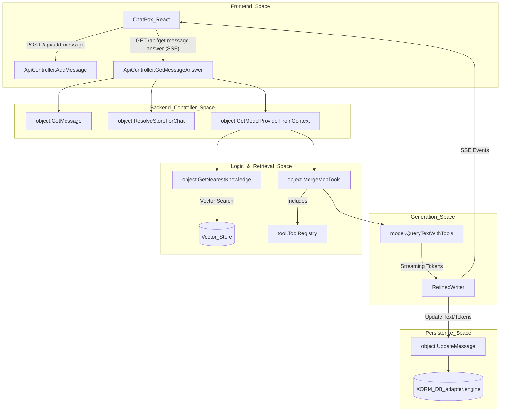
Sources: [controllers/message_answer.go:42-412](), [controllers/message.go:238-254](), [object/message.go:176-207](), [object/merge_agent_tools.go:69-93]()

---

## Response Generation & Streaming

OpenAgent uses a specialized writer pattern to handle SSE streaming while simultaneously buffering the response for database persistence.

### Carrier Parsing & Multi-Stage Generation
To provide advanced features like follow-up suggestions and automatic topic titling, the system uses "Carriers":
*   **SuggestionCarrier**: Appends instructions to the prompt to generate follow-up questions [carrier/suggestion.go:32-75]().
*   **TitleCarrier**: Instructs the model to generate a concise title for the conversation at the end of the response [carrier/title.go:28-44]().
*   **QueryCarrierText**: Orchestrates the main answer generation and the carrier generation (suggestions/titles) in parallel using goroutines [controllers/message_carrier.go:154-203]().

### RefinedWriter and Event Types
The `RefinedWriter` [controllers/message_writer.go:27-35]() wraps the standard response writer to intercept tokens and categorize them into distinct SSE events:

| Event Type | Purpose | Implementation |
| :--- | :--- | :--- |
| `message` | Standard AI text response. | `RefinedWriter.Write` [controllers/message_writer.go:79-83]() |
| `reason` | Chain-of-thought or reasoning tokens. | `RefinedWriter.Write` [controllers/message_writer.go:53-57]() |
| `tool` | Tool execution results. | `RefinedWriter.Write` [controllers/message_writer.go:68-72]() |
| `myerror` | Custom error stream for graceful UI failure. | `writeMessageErrorStream` [controllers/message_util.go:34-71]() |

### Diagram: Streaming Entity Relationship
This diagram shows how the streaming entities interact to provide real-time updates.

Title: Streaming Response Orchestration
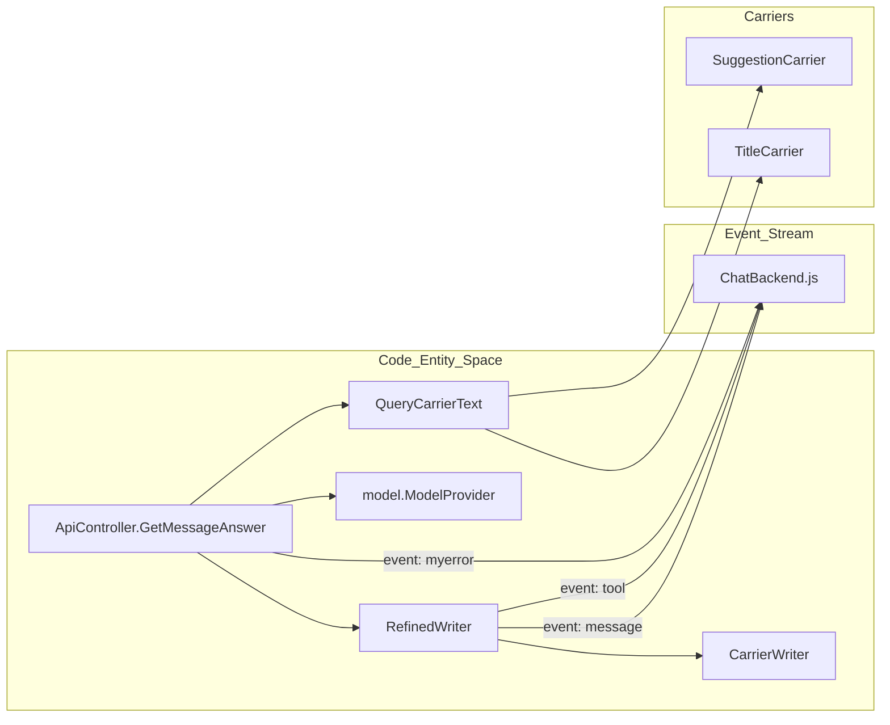
Sources: [controllers/message_answer.go:421-435](), [controllers/message_carrier.go:154-203](), [controllers/message_util.go:34-123](), [controllers/message_writer.go:41-138]()

---

## Tool Execution Loop

When tools are available, the pipeline enters an orchestration loop in `QueryTextWithTools` [model/mcp.go:162-230]().

1.  **LLM Call**: The LLM receives the prompt and tool definitions.
2.  **Tool Call Detection**: If the LLM returns `tool_calls`, the system intercepts them [model/mcp.go:179-183]().
3.  **Execution**: `callMcpTool` executes the requested tool (either built-in or via MCP server) [model/mcp.go:205-212]().
4.  **Feedback**: The tool result is appended to the message history, and the LLM is called again to generate a final answer or further tool calls [model/mcp.go:215-221]().

Sources: [model/mcp.go:162-230](), [object/merge_agent_tools.go:23-65]()

---

## Message Persistence & Post-Processing

Once the stream is complete, the system performs final persistence and content refinement.

### Final Update & Notification
The `GetMessageAnswer` function collects the full text and updates the `Message` object in the database [object/message.go:176-207]().
*   **Email Notifications**: If `NeedNotify` is true, `UpdateMessage` triggers `message.SendEmail` [controllers/message.go:210-220]().
*   **Error Reporting**: If a generation fails, `writeMessageErrorStream` calls `message.SendErrorEmail` [controllers/message_util.go:34-42]().

### Content Refinement
The system includes utility functions to handle multimedia and external links:
*   **URL Content Extraction**: `refineQuestionTextViaParsingUrlContent` detects URLs in the user's question and replaces them with parsed text [controllers/message_util.go:131-148]().
*   **Image Storage**: `tryStoreRemoteImage` handles identifying remote image URLs or base64 data and uploading them to permanent storage [controllers/message_util.go:192-207]().
*   **Base64 Refinement**: `RefineMessageFiles` identifies inline base64 data and converts it to file assets [controllers/message_util.go:225-232]().

### Regeneration Logic
When a user requests a regeneration, the `isRegenerated` flag is set on the message [object/message.go:64](). This allows the system to track manual retries and potentially adjust provider parameters.

Sources: [controllers/message.go:194-229](), [controllers/message_util.go:131-232](), [object/message.go:176-207](), [model/mcp.go:162-230]()

---

# Page: Store Configuration

# Store Configuration

<details>
<summary>Relevant source files</summary>

The following files were used as context for generating this wiki page:

- [controllers/store.go](controllers/store.go)
- [object/site.go](object/site.go)
- [object/site_endpoint.go](object/site_endpoint.go)
- [object/store.go](object/store.go)
- [object/store_provider.go](object/store_provider.go)
- [object/store_test.go](object/store_test.go)
- [routers/endpoint_filter.go](routers/endpoint_filter.go)
- [storage/casdoor.go](storage/casdoor.go)
- [storage/local_file_system.go](storage/local_file_system.go)
- [web/src/SiteEditPage.js](web/src/SiteEditPage.js)
- [web/src/StoreEditPage.js](web/src/StoreEditPage.js)
- [web/src/StoreHubDrawer.js](web/src/StoreHubDrawer.js)
- [web/src/StoreHubPage.js](web/src/StoreHubPage.js)
- [web/src/StoreListPage.js](web/src/StoreListPage.js)
- [web/src/backend/StoreBackend.js](web/src/backend/StoreBackend.js)

</details>


The `Store` entity is the central configuration container in OpenAgent. It acts as a logical "Agent" or "Knowledge Base" definition, binding together AI models, knowledge sources (vector stores), interaction tools, and system prompts into a single manageable unit.

## The Store Entity

In the backend, a `Store` is defined in `object/store.go`. It encapsulates the behavior and appearance of the AI assistant for a specific context.

### Key Data Structure
The `Store` struct includes fields for provider bindings, UI customization, and RAG strategies:

| Category | Field | Description |
| :--- | :--- | :--- |
| **Identity** | `Owner`, `Name`, `DisplayName` | Unique identifiers and human-readable name. [object/store.go:59-62]() |
| **Model Providers** | `ModelProvider`, `EmbeddingProvider` | Primary LLM and embedding model used by the store. [object/store.go:69-70]() |
| **Knowledge/RAG** | `StorageProvider`, `VectorStoreId`, `SplitProvider`, `SearchProvider` | Configuration for file storage and vector retrieval logic. [object/store.go:64-77]() |
| **Capabilities** | `Tools`, `McpServer`, `Skills` | List of functional extensions and MCP integrations. [object/store.go:74-76]() |
| **Interaction** | `Prompt`, `Welcome`, `MemoryLimit` | The system prompt, greeting, and conversation history window. [object/store.go:78-86]() |
| **Audio** | `TextToSpeechProvider`, `SpeechToTextProvider` | Voice interaction settings and streaming toggle. [object/store.go:71-73]() |
| **Metadata** | `Author`, `Affiliation`, `Subject` | Used for categorization in the Store Hub. [object/store.go:104-107]() |

**Sources:** [object/store.go:58-123]()

## Provider Bindings and Data Flow

The `Store` acts as a router, directing requests to specific providers. When a store is created via `AddStore`, the system can automatically sync default providers if none are specified using `SyncDefaultProvidersToStore` [object/store_provider.go:136-159]().

### Configuration Flow Diagram
This diagram shows how the `Store` entity in the Go backend relates to the configuration UI in the React frontend.

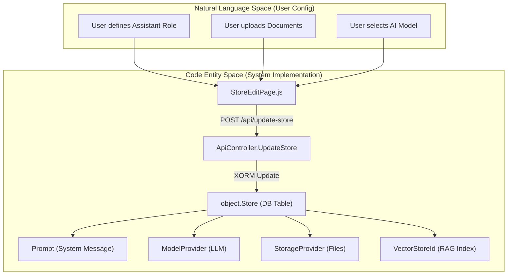
**Sources:** [web/src/StoreEditPage.js:35-70](), [controllers/store.go:183-248](), [object/store.go:58-78]()

## RAG and File Integration

A `Store` is often associated with a set of files. The `Populate` function in `object/store_provider.go` scans the linked `StorageProvider` (such as `LocalFileSystemStorageProvider` or `CasdoorProvider`) to build a `TreeFile` structure for the UI, which allows users to browse the knowledge base contents [object/store_provider.go:81-134]().

### Storage Provider Abstraction
The `Store` interacts with storage via the `storage.Provider` interface.

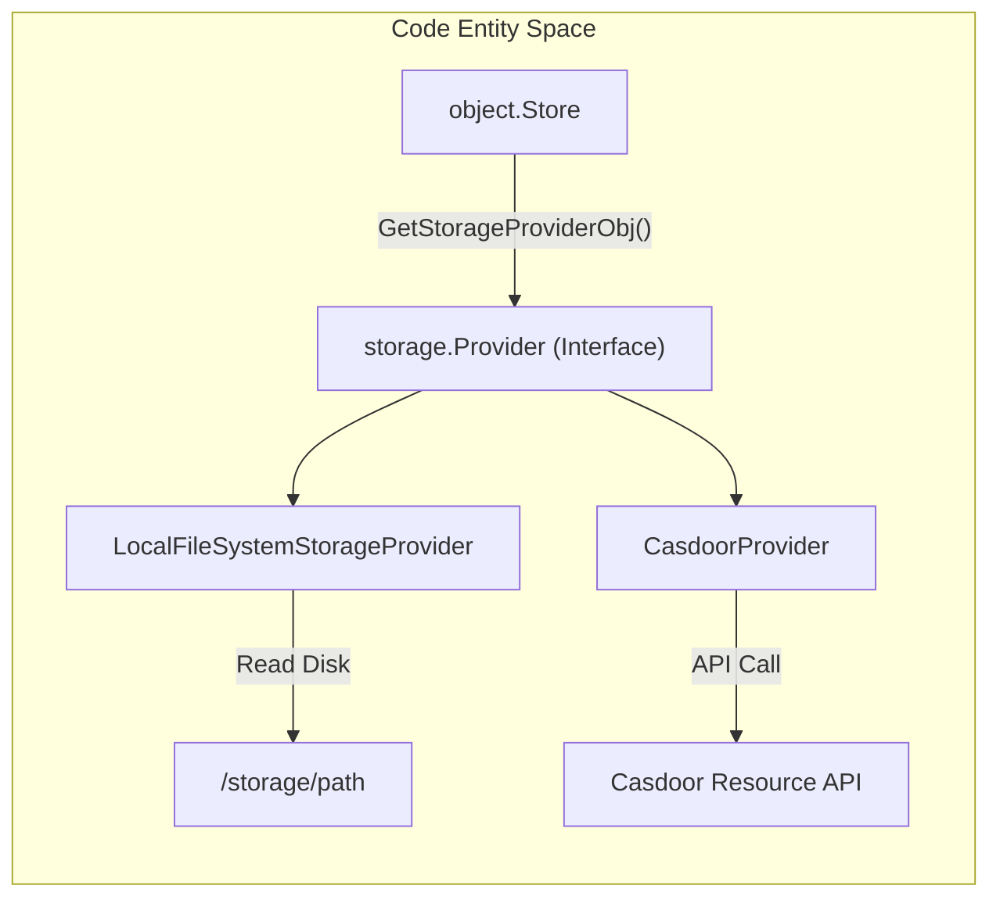
**Sources:** [object/store_provider.go:82-87](), [storage/local_file_system.go:28-35](), [storage/casdoor.go:26-36]()

## Ownership and Sharing Model

OpenAgent implements a claim/share model for stores. Stores are typically owned by an `owner` (user or organization) [object/store.go:59]().

1.  **Default Stores**: The system can resolve a default store for an owner via `GetDefaultStore`, which looks for the `IsDefault` flag or the most recent `Active` store [object/store.go:155-182]().
2.  **Store Admins**: Non-global admins can manage stores they own. In `GetGlobalStores`, the system filters results based on whether the user is a `GlobalAdmin` or a `StoreAdmin` [controllers/store.go:78-95]().
3.  **Sharing**: Stores can be shared via the `SharedBy` field, allowing cross-user access to specific agent configurations [object/store.go:102](). The `addSharedStore` API facilitates this [web/src/backend/StoreBackend.js:125-135]().
4.  **Discovery**: The `StoreHubPage` allows users to browse "Published" stores globally [web/src/StoreHubPage.js:47-59]().

**Sources:** [object/store.go:145-182](), [controllers/store.go:49-113](), [web/src/StoreListPage.js:45-51](), [web/src/backend/StoreBackend.js:125-135]()

## MCP and Tool Integration

The `Store` configuration defines which external capabilities are available during a chat session:
*   **MCP Servers**: Linked via the `McpServer` field to provide dynamic tool discovery via the Model Context Protocol [object/store.go:74]().
*   **Tools**: Array of strings (e.g., `web_search`, `shell`) enabled for the agent. Users can select specific tools or "All" [object/store.go:76]().
*   **Skills**: Custom defined prompts or logic chains associated with the store to enhance model behavior in specific domains [object/store.go:75]().

The `StoreEditPage` component fetches these available assets during initialization using dedicated backend services like `ServerBackend` and `ToolBackend` to populate selection menus [web/src/StoreEditPage.js:62-70]().

**Sources:** [web/src/StoreEditPage.js:178-205](), [object/store.go:74-76]()

---

# Page: Chat & Message Administration

# Chat & Message Administration

<details>
<summary>Relevant source files</summary>

The following files were used as context for generating this wiki page:

- [web/src/ChatEditPage.js](web/src/ChatEditPage.js)
- [web/src/ChatListPage.js](web/src/ChatListPage.js)
- [web/src/FormEditPage.js](web/src/FormEditPage.js)
- [web/src/MessageEditPage.js](web/src/MessageEditPage.js)
- [web/src/MessageListPage.js](web/src/MessageListPage.js)
- [web/src/RecordEditPage.js](web/src/RecordEditPage.js)
- [web/src/SkillEditPage.js](web/src/SkillEditPage.js)
- [web/src/VectorEditPage.js](web/src/VectorEditPage.js)

</details>


This page details the administrative interfaces and backend logic for managing chat sessions and messages within OpenAgent. These tools allow administrators to monitor user interactions, edit specific message contents, audit costs (tokens/price), and analyze system-wide usage trends.

## Administrative Overview

OpenAgent provides two primary administrative list views: the `ChatListPage` for session-level management and the `MessageListPage` for granular message-level control. Both views support filtering by Store, advanced searching, and data export functionality.

### Data Flow: Admin Interface to Persistence

The administration views interact with the backend via dedicated React-based Backend modules, which call the Beego API controllers to perform CRUD operations on the underlying XORM-mapped database.

Title: Admin Data Flow to Persistence
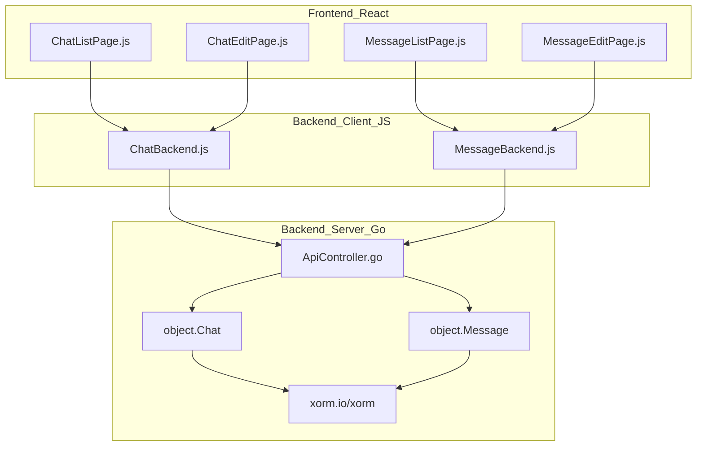
**Sources:** [web/src/ChatListPage.js:21-25](), [web/src/MessageListPage.js:21-22](), [web/src/ChatEditPage.js:18-24](), [web/src/MessageEditPage.js:20-22]()

---

## Chat Session Administration

The `ChatListPage` serves as the primary dashboard for viewing all chat sessions across the platform.

### Key Features
- **Session Browsing:** Displays metadata including `displayName`, `user`, `clientIp`, `messageCount`, and total `price` [web/src/ChatListPage.js:171-188]().
- **Message Preview:** Allows administrators to toggle a "Maximize Messages" view to inspect the content of a specific chat directly within the list using the `getMessages` function [web/src/ChatListPage.js:75-95]().
- **Data Export:** Supports exporting the filtered list of chats to an Excel file (.xlsx) via `downloadChats` and `fetchAllChatsForExport` [web/src/ChatListPage.js:140-214]().

### Chat Lifecycle Management
Administrators can manually create new chats using `addChat()`, which initializes a session with default metadata such as `owner: "admin"`, `category: "Default Category"`, and `needTitle: true` [web/src/ChatListPage.js:97-134](). The `ChatEditPage` allows modifying properties like the `modelProvider` and `store` [web/src/ChatEditPage.js:160-192]().

**Sources:** [web/src/ChatListPage.js:30-138](), [web/src/ChatListPage.js:173-192](), [web/src/ChatEditPage.js:29-192]()

---

## Message Administration

The `MessageListPage` provides a detailed view of every message generated by users or AI providers.

### Message Metadata and Editing
Messages track specific technical details required for auditing:
- **Token Counts:** `tokenCount` (total) and `textTokenCount` are initialized in `newMessage()` [web/src/MessageListPage.js:88-89]().
- **Financials:** `price` and `currency` associated with the LLM call [web/src/MessageListPage.js:90]().
- **Relationships:** `chat` (parent session) and `replyTo` (ID of the message being answered) [web/src/MessageListPage.js:84-85]().

The `MessageEditPage` allows administrators to correct AI responses or system prompts. It provides a `Select` component for the `author` (User, System, AI) and a `TextArea` for the message `text` [web/src/MessageEditPage.js:207-230]().

### Vector and Audit Integration
Administrators can inspect vector embeddings associated with messages via the `VectorTooltip` in the list view [web/src/MessageListPage.js:27](). Detailed audit logs for message operations are stored in the `Record` entity, viewable via `RecordEditPage` [web/src/RecordEditPage.js:27-56]().

Title: Message Administration Logic
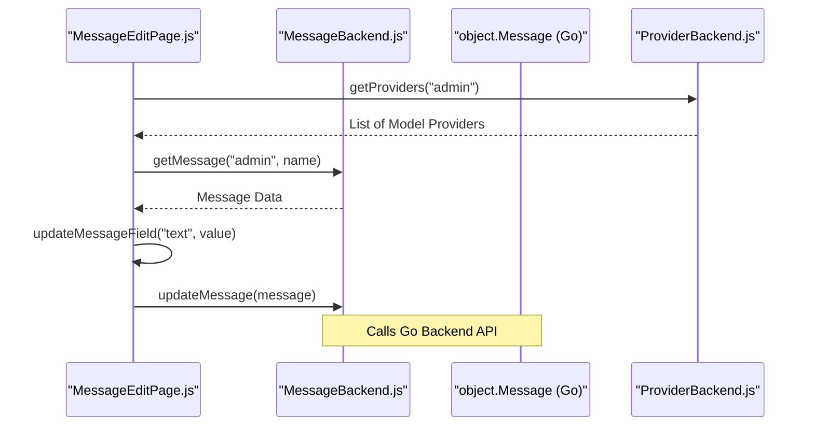
**Sources:** [web/src/MessageEditPage.js:45-113](), [web/src/MessageEditPage.js:136-144](), [web/src/MessageListPage.js:114-137]()

---

## Usage Analytics and Extended Forms

Usage statistics are aggregated from the underlying `Chat` and `Message` objects to provide a visual representation of system activity.

### Implementation Details
- **Data Export Strategy:** The `fetchAllMessagesForExport` function in the frontend implements a chunking strategy to fetch large datasets (e.g., 10,000 records per batch) without overloading browser memory [web/src/MessageListPage.js:139-166]().
- **Form Integration:** Admin views can be embedded into custom administrative forms via `FormEditPage`. This allows creating specialized list pages for `records`, `stores`, `vectors`, or `tasks` [web/src/FormEditPage.js:96-119]().
- **Skill Management:** Administrators can also manage AI "Skills" via `SkillEditPage`, defining specific prompts, descriptions, and categories like `writing`, `coding`, or `analysis` [web/src/SkillEditPage.js:28-168]().

**Sources:** [web/src/MessageListPage.js:139-166](), [web/src/FormEditPage.js:96-119](), [web/src/SkillEditPage.js:28-168]()

---

## Administrative Logic and Maintenance

### Vector and Audit Maintenance
OpenAgent provides tools for maintaining the integrity of chat data and its associated vectors:
- **Vector Inspection:** Administrators can use `VectorEditPage` to view or modify the raw `text` and `data` (float array) of embeddings associated with knowledge base segments. The `parseVectorField` function handles the conversion of comma-separated strings back into numeric arrays [web/src/VectorEditPage.js:60-78]().
- **Record Auditing:** Every administrative action is recorded. The `RecordEditPage` displays the `clientIp`, `requestUri`, `method` (GET, POST, etc.), and `action` for security auditing [web/src/RecordEditPage.js:144-190]().
- **Blockchain Verification:** Records can be filtered and verified against blockchain providers if configured [web/src/RecordEditPage.js:57-68]().

**Sources:** [web/src/VectorEditPage.js:26-185](), [web/src/RecordEditPage.js:144-190](), [web/src/RecordEditPage.js:57-68]()

---

# Page: AI Model & Embedding Providers

# AI Model & Embedding Providers

<details>
<summary>Relevant source files</summary>

The following files were used as context for generating this wiki page:

- [go.mod](go.mod)
- [go.sum](go.sum)
- [model/provider.go](model/provider.go)
- [object/provider.go](object/provider.go)
- [object/transaction.go](object/transaction.go)
- [object/util.go](object/util.go)
- [web/src/ProviderEditPage.js](web/src/ProviderEditPage.js)
- [web/src/ProviderListPage.js](web/src/ProviderListPage.js)

</details>


OpenAgent utilizes a robust provider abstraction layer to interface with a wide variety of AI backends. This architecture decouples the core AI logic (like chat sessions and knowledge retrieval) from specific vendor implementations, allowing the system to support Large Language Models (LLMs), Embedding models, Text-to-Speech (TTS), and Speech-to-Text (STT) from providers such as OpenAI, Azure, Claude, and Alibaba Cloud.

## Provider Architecture Overview

The system defines a unified `Provider` data model in the backend that categorizes external services into functional types. This metadata determines how the backend initializes the appropriate driver and how the frontend renders the configuration UI.

### Core Provider Model
The `Provider` struct acts as the central configuration entity, storing credentials, endpoints, and model-specific parameters like temperature and pricing. [object/provider.go:33-83]()

| Field | Description |
| :--- | :--- |
| `Category` | The functional type (e.g., `Model`, `Embedding`, `Storage`, `Text-to-Speech`). [object/provider.go:40]() |
| `Type` | The vendor or backend implementation (e.g., `OpenAI`, `Azure`, `Ollama`). [object/provider.go:41]() |
| `SubType` | The specific model identifier (e.g., `gpt-4o`, `text-embedding-3-small`). [object/provider.go:42]() |
| `ClientSecret` | Secure storage for API keys, which are masked in the UI. [object/provider.go:45]() |

### Code-to-System Mapping
The following diagram illustrates how the abstract `Provider` configuration in the database is transformed into functional code entities at runtime.

**Provider Initialization Pipeline**
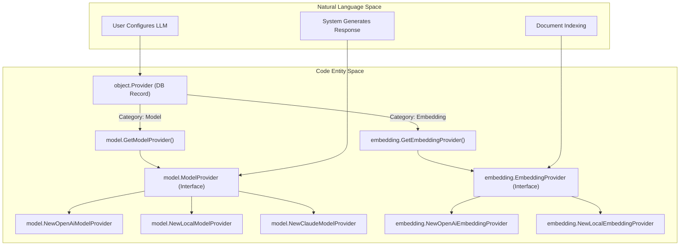
**Sources:** [object/provider.go:33-83](), [model/provider.go:117-177](), [go.mod:7-63]()

---

## LLM Provider Integrations

The `ModelProvider` interface defines the contract for text generation and pricing estimation. The system supports a massive array of backends through a factory pattern in `model.GetModelProvider`. [model/provider.go:49-53]()

*   **Capabilities**: Supports streaming responses via `io.Writer`, tool calling (via `ToolSession`), and reasoning/thinking modes for models like DeepSeek, Claude, or Volcano Engine. [model/provider.go:51](), [model/provider.go:159]()
*   **Pricing Engine**: Includes built-in logic to calculate costs based on prompt and response token counts via the `ModelResult` struct. [model/provider.go:32-39](), [object/provider.go:63-65]()
*   **Dry-Run Mode**: Uses the `DryRunPrefix` (`$OpenAgentDryRun$`) to estimate costs and validate balances via Casdoor without making actual AI model API calls. [model/provider.go:30](), [object/transaction.go:59-84]()

For details on specific LLM backends and pricing logic, see [LLM Provider Integrations](#3.1).

**Sources:** [model/provider.go:30-177](), [object/provider.go:63-65](), [object/transaction.go:32-55]()

---

## Embedding & Vector Pipeline

Embedding providers convert text into high-dimensional vectors for semantic search and RAG (Retrieval-Augmented Generation). The system integrates with numerous backends including OpenAI, Gemini, Cohere, and local providers.

*   **Local & Proxy Support**: Supports local deployments via `Ollama` or `Local` (OpenAI-compatible) endpoints. [model/provider.go:120-127]()
*   **Tokenization**: The system uses specialized libraries like `tiktoken-go` for accurate token counting and cost estimation. [go.mod:42]()
*   **Diversity**: Integrates specialized providers like `Baidu Cloud` and `Tencent Cloud` which require specific credential mapping (e.g., Secret ID vs API Key). [web/src/ProviderEditPage.js:87-95]()

For details on the vectorization process and search strategies, see [Embedding & Vector Pipeline](#3.2).

**Sources:** [model/provider.go:117-177](), [web/src/ProviderEditPage.js:85-104](), [go.mod:28-47]()

---

## Provider Management UI

The administration of providers is handled through a dynamic React interface. The `ProviderEditPage` adjusts its fields based on the provider's `Category` and `Type`. [web/src/ProviderEditPage.js:32-44]()

*   **Dynamic Labels**: Labels change contextually (e.g., "Client ID" becomes "Deployment Name" for Azure or "Group ID" for MiniMax). [web/src/ProviderEditPage.js:85-104]()
*   **Validation**: Includes widgets like `ModelTestWidget`, `EmbedTestWidget`, and `TtsTestWidget` to verify credentials and connectivity instantly. [web/src/ProviderEditPage.js:24-26]()
*   **Security**: Implements credential masking in `GetMaskedProvider` to prevent sensitive keys (API keys, sign keys, etc.) from being exposed to non-admin users. [object/provider.go:85-114]()

For details on the UI implementation and property-dependent generation, see [Provider Management UI](#3.3).

**Sources:** [web/src/ProviderEditPage.js:85-159](), [web/src/ProviderListPage.js:133-205](), [object/provider.go:85-125]()

---

## Speech & Audio Processing

OpenAgent provides abstractions for converting between text and audio, primarily used in the chat interface for voice interaction.

*   **TTS & STT**: Standardized interfaces for Text-to-Speech and Speech-to-Text are integrated via the `tts` and `stt` packages. [object/provider.go:26-27]()
*   **Vendor Support**: Supports advanced implementations like `go-cosyvoice` for high-quality audio generation and Alibaba Cloud services. [go.mod:9](), [web/src/ProviderEditPage.js:146]()
*   **Testing**: Includes a `TtsTestWidget` within the provider configuration page for immediate feedback on audio generation. [web/src/ProviderEditPage.js:25]()

For details on audio extraction and browser integration, see [Speech & Audio Processing](#3.4).

**Sources:** [object/provider.go:26-27](), [web/src/ProviderEditPage.js:25](), [go.mod:9]()

---

## Provider Interaction Flow

The following diagram maps the flow from the user interface to the execution of a model query, highlighting the code entities involved.

**Model Query Execution Flow**
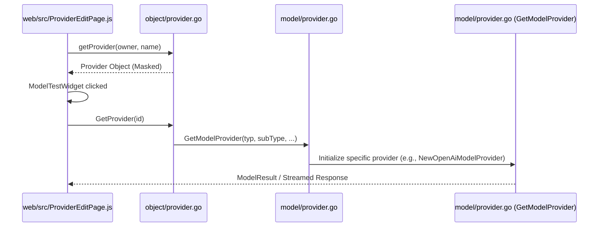
**Sources:** [web/src/ProviderEditPage.js:46-65](), [object/provider.go:177-207](), [model/provider.go:117-177]()

---

# Page: LLM Provider Integrations

# LLM Provider Integrations

<details>
<summary>Relevant source files</summary>

The following files were used as context for generating this wiki page:

- [embedding/alibabacloud.go](embedding/alibabacloud.go)
- [embedding/azure_openai.go](embedding/azure_openai.go)
- [embedding/local.go](embedding/local.go)
- [embedding/openai.go](embedding/openai.go)
- [embedding/provider.go](embedding/provider.go)
- [go.mod](go.mod)
- [go.sum](go.sum)
- [model/alibabacloud.go](model/alibabacloud.go)
- [model/azure_openai.go](model/azure_openai.go)
- [model/baichuan.go](model/baichuan.go)
- [model/baiducloud.go](model/baiducloud.go)
- [model/chatglm.go](model/chatglm.go)
- [model/claude.go](model/claude.go)
- [model/cohere.go](model/cohere.go)
- [model/context_length_util.go](model/context_length_util.go)
- [model/deepseek.go](model/deepseek.go)
- [model/gemini.go](model/gemini.go)
- [model/huggingface.go](model/huggingface.go)
- [model/iflytek.go](model/iflytek.go)
- [model/local.go](model/local.go)
- [model/minimax.go](model/minimax.go)
- [model/moonshot.go](model/moonshot.go)
- [model/openai.go](model/openai.go)
- [model/openai_util.go](model/openai_util.go)
- [model/openrouter.go](model/openrouter.go)
- [model/provider.go](model/provider.go)
- [model/silicon_flow.go](model/silicon_flow.go)
- [model/stepfun.go](model/stepfun.go)
- [model/util.go](model/util.go)
- [model/volcengine.go](model/volcengine.go)
- [model/yi.go](model/yi.go)
- [object/message_ai.go](object/message_ai.go)
- [object/transaction.go](object/transaction.go)
- [object/util.go](object/util.go)

</details>


This page details the Large Language Model (LLM) provider subsystem in OpenAgent. It covers the abstraction layer that allows the system to support a wide variety of AI backends, the factory pattern for provider instantiation, and the specific implementations for major cloud and local providers.

## ModelProvider Abstraction

OpenAgent uses a unified interface, `ModelProvider`, to interact with different LLM backends. This abstraction ensures that the core chat engine remains decoupled from the specific API quirks of individual providers like OpenAI, Claude, or Gemini.

### The ModelProvider Interface
Every LLM integration must implement the following key methods:
*   `QueryText`: The primary method for sending a prompt and receiving a streamed response. It handles history, system prompts, knowledge context, and tool sessions [model/provider.go:51-51]().
*   `GetPricing`: Returns a string describing the pricing structure of the model [model/provider.go:50-50]().
*   `ListModels`: Dynamically fetches available models from the provider's endpoint [model/provider.go:52-52]().

### Data Flow: Natural Language to Code Entities
The following diagram illustrates how a user's natural language request is transformed into provider-specific API calls through the OpenAgent internal entities.

**Diagram: Request Transformation Pipeline**
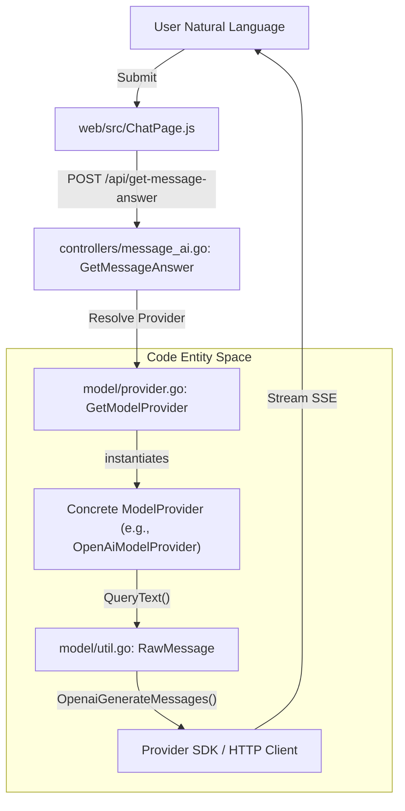
Sources: [model/provider.go:49-53](), [model/local.go:216-240](), [model/util.go:29-36](), [model/util.go:198-238]()

## Provider Factory and Supported Backends

The `GetModelProvider` function in `model/provider.go` acts as a factory, instantiating the correct provider based on the `typ` and `subType` stored in the database [model/provider.go:117-117]().

### Supported Providers
OpenAgent supports an extensive list of backends, each with a dedicated implementation file:

| Provider | Implementation Class | Key Features |
| :--- | :--- | :--- |
| **OpenAI** | `OpenAiModelProvider` | Native tool calling, pricing in USD [model/openai.go:36-47]() |
| **Azure** | `LocalModelProvider` | Enterprise security, deployment name mapping [model/local.go:224-226]() |
| **Claude** | `ClaudeModelProvider` | Native thinking/reasoning budget support [model/claude.go:30-35]() |
| **Gemini** | `GeminiModelProvider` | Multi-modal support (text/image/video) [model/gemini.go:30-36]() |
| **DeepSeek** | `DeepSeekProvider` | Native DeepSeek API integration [model/provider.go:161-161]() |
| **iFlytek** | `iFlytekModelProvider` | Spark model series with CNY pricing [model/iflytek.go:24-28]() |
| **Local/Custom** | `LocalModelProvider` | OpenAI-compatible APIs (Ollama, vLLM) [model/local.go:32-47]() |
| **Moonshot** | `MoonshotModelProvider` | Kimi series support [model/provider.go:150-151]() |
| **Volcano Engine** | `VolcengineModelProvider` | Doubao models with thinking support [model/provider.go:158-159]() |

Sources: [model/provider.go:117-176](), [model/local.go:51-67](), [model/openai.go:49-63](), [model/claude.go:37-39](), [model/gemini.go:38-47](), [model/iflytek.go:30-37]()

## Pricing Engine and Token Counting

OpenAgent includes a robust pricing engine that calculates costs in real-time. This is critical for multi-tenant environments and usage tracking.

### Token Counting Logic
For OpenAI and compatible models, the system uses the `tiktoken-go` library [model/openai_util.go:18-18]().
*   `GetTokenSize`: Calculates tokens for a single string using model-specific encoding [model/util.go:113-123]().
*   `OpenaiNumTokensFromMessages`: Calculates tokens for an entire chat history, accounting for message metadata, roles, and reply priming [model/openai_util.go:210-215]().

### Price Calculation
Each provider implements logic to determine cost. For example, `CalculateOpenAIModelPrice` uses a switch-case on the `model` string to determine the `inputPricePerThousandTokens` and `outputPricePerThousandTokens` [model/openai.go:65-104](). Costs are refined using `math.Round` to ensure financial accuracy [model/util.go:54-58]().

Sources: [model/util.go:54-69](), [model/openai_util.go:210-215](), [model/openai.go:65-125]()

## Dry-Run Mode

To prevent unnecessary API costs during testing or validation, OpenAgent implements a **Dry-Run Mode**. If a question is prefixed with the constant `DryRunPrefix` (`$OpenAgentDryRun$`), the provider will calculate the expected token usage and check it against the model's context limit without actually calling the remote AI service [model/provider.go:30-30]().

**Implementation Example (Claude):**
```go
if strings.HasPrefix(question, "$OpenAgentDryRun$") {
    modelResult, err := getDefaultModelResult(p.subType, question, "")
    if getContextLength(p.subType) > modelResult.TotalTokenCount {
        return modelResult, nil
    } else {
        return nil, fmt.Errorf(i18n.Translate(lang, "model:exceed max tokens"))
    }
}
```
Sources: [model/claude.go:101-111](), [model/provider.go:30-30]()

## Tool Call Orchestration

OpenAgent allows models to execute tools, including those integrated via the **Model Context Protocol (MCP)**. This is handled by transforming provider-specific tool call structures into a common internal format.

1.  The model returns a `ToolCall` instead of plain text [model/util.go:34-34]().
2.  The system identifies the tool (Built-in or MCP Server).
3.  `mergeAdjacentAssistantToolCalls` is used for providers like Moonshot (Kimi) that require all tool calls from the same turn to live in a single message [model/openai_util.go:126-145]().
4.  The tool result is appended to the history as a `Tool` role message [model/openai_util.go:155-156]().

**Diagram: Tool Execution Loop**
```mermaid
sequenceDiagram
    participant P as "ModelProvider (Interface)"
    participant M as "object/message_ai.go: GetMessageAnswer"
    participant T as "model/util.go: RawMessage"
    participant SDK as "Provider SDK (e.g. OpenAI/Anthropic)"

    M->>P: QueryText(question, toolSession)
    P->>SDK: CreateChatCompletion(tools enabled)
    SDK-->>P: Response with ToolCalls
    P-->>M: ModelResult + ToolCall ID
    Note over M: System executes tool logic
    M->>T: Create RawMessage (Author: Tool)
    M->>P: QueryText(with tool result in history)
    P-->>M: Final Answer
```
Sources: [model/openai_util.go:126-145](), [model/util.go:29-36](), [model/provider.go:51-51]()

---

# Page: Embedding & Vector Pipeline

# Embedding & Vector Pipeline

<details>
<summary>Relevant source files</summary>

The following files were used as context for generating this wiki page:

- [contest/rag_contest.go](contest/rag_contest.go)
- [contest/rag_contest_test.go](contest/rag_contest_test.go)
- [embedding/alibabacloud.go](embedding/alibabacloud.go)
- [embedding/azure_openai.go](embedding/azure_openai.go)
- [embedding/cohere.go](embedding/cohere.go)
- [embedding/gemini.go](embedding/gemini.go)
- [embedding/huggingface.go](embedding/huggingface.go)
- [embedding/local.go](embedding/local.go)
- [embedding/openai.go](embedding/openai.go)
- [embedding/provider.go](embedding/provider.go)
- [embedding/util.go](embedding/util.go)
- [model/alibabacloud.go](model/alibabacloud.go)
- [model/azure_openai.go](model/azure_openai.go)
- [model/gemini_util.go](model/gemini_util.go)
- [model/silicon_flow.go](model/silicon_flow.go)
- [model/volcengine.go](model/volcengine.go)
- [object/message_ai.go](object/message_ai.go)
- [object/search.go](object/search.go)
- [object/search_default.go](object/search_default.go)
- [object/search_default_util.go](object/search_default_util.go)
- [object/search_hierarchy.go](object/search_hierarchy.go)
- [object/vector.go](object/vector.go)
- [object/vector_embedding.go](object/vector_embedding.go)

</details>


The Embedding & Vector Pipeline is responsible for transforming unstructured text data into high-dimensional numerical vectors (embeddings). These vectors are the foundation of the platform's Retrieval-Augmented Generation (RAG) capabilities, enabling semantic search and context retrieval for AI models.

## EmbeddingProvider Interface

All embedding backends implement the `EmbeddingProvider` interface, which abstracts the specific API calls and data formats of different providers.

### Supported Backends
The system supports a wide range of embedding providers via the `GetEmbeddingProvider` factory [embedding/provider.go:34-69]():
*   **OpenAI**: Standard embeddings (e.g., `text-embedding-3-small`) [embedding/openai.go:22-28]().
*   **Gemini**: Google's generative AI embeddings [embedding/provider.go:39-40]().
*   **Cohere**: High-performance multilingual embeddings [embedding/provider.go:43-44]().
*   **Alibaba Cloud**: DashScope embeddings using the `AlibabacloudEmbeddingProvider` [embedding/provider.go:55-56]().
*   **Baidu Cloud**: Support for Wenxin embeddings [embedding/provider.go:45-46]().
*   **Azure**: Enterprise-grade OpenAI deployments [embedding/provider.go:51-52]().
*   **Word2Vec**: Traditional static word embeddings [embedding/provider.go:61-63]().
*   **Local/Ollama**: Support for self-hosted OpenAI-compatible endpoints via `LocalEmbeddingProvider` [embedding/local.go:40-51]().

### Core Interface and Data Structure
The `Vector` struct represents the persisted embedding in the database, containing both the raw text and its numerical representation [object/vector.go:24-42]().

| Field | Type | Description |
| :--- | :--- | :--- |
| `Name` | `string` | Unique identifier for the vector [object/vector.go:26](). |
| `Store` | `string` | The knowledge store this vector belongs to [object/vector.go:30](). |
| `Text` | `string` | The original text segment [object/vector.go:34](). |
| `Data` | `[]float32` | The numerical embedding vector [object/vector.go:40](). |
| `Dimension` | `int` | Length of the vector (e.g., 1536 for OpenAI) [object/vector.go:41](). |
| `TokenCount` | `int` | Number of tokens in the text [object/vector.go:35](). |

Sources: [embedding/provider.go:29-32](), [object/vector.go:24-42](), [object/vector_embedding.go:88-103]()

---

## Vector Embedding Pipeline

The pipeline processes files from a `StorageProvider` and converts them into searchable `Vector` entities through a multi-stage workflow defined in `object/vector_embedding.go`.

### Data Flow Diagram: File to Vector
This diagram shows the transition from a file in storage to a searchable vector in the database, mapping system components to code entities.

```mermaid
graph TD
    subgraph "Storage Space"
        A["storage.Object"] --> B["txt.GetParsedTextFromUrl"]
    end

    subgraph "Processing Space"
        B --> C["split.GetSplitProvider"]
        C --> D["splitProvider.SplitText"]
        D --> E["loop: textSections"]
    end

    subgraph "Embedding Space"
        E --> F["queryVectorSafe"]
        F --> G["embedding.EmbeddingProvider"]
        G --> H["addEmbeddedVector"]
    end

    subgraph "Database Space"
        H --> I["object.AddVector"]
        I --> J[("XORM: Vector Table")]
    end
```
Sources: [object/vector_embedding.go:108-172](), [object/vector_embedding.go:53-106](), [object/vector.go:143-155]()

### Implementation Details
1.  **File Filtering**: The system identifies compatible files using `txt.GetSupportedFileTypes()` and filters the object list in `filterTextFiles` [object/vector_embedding.go:36-51]().
2.  **Text Extraction**: `txt.GetParsedTextFromUrl` converts various formats (PDF, DOCX, etc.) into plain text [object/vector_embedding.go:115-118]().
3.  **Splitting**: Based on the file type or configuration, a `split.SplitProvider` (Default, QA, or Markdown) chunks the text [object/vector_embedding.go:120-141]().
4.  **Embedding Generation**: The system calls `queryVectorSafe` with exponential backoff via the `backoff` package to handle rate limits or transient API errors [object/vector_embedding.go:150-161]().
5.  **Persistence**: The resulting vector is stored via `AddVector` with metadata including token count and pricing [object/vector_embedding.go:88-104](). Pricing is calculated per-provider, such as in `LocalEmbeddingProvider.calculatePrice` [embedding/local.go:79-98]().

---

## Search Strategies

When a user queries the knowledge base, the system uses a `SearchProvider` to retrieve the most relevant segments [object/search.go:21-23]().

### 1. Default Search (Flat)
Uses standard cosine similarity to find the top-K nearest neighbors in a flat vector space.
*   **Mechanism**: Retrieves all vectors for the related stores via `getRelatedVectors`, embeds the user query, and calculates the similarity against all candidates [object/search_default.go:32-64]().
*   **Similarity Logic**: It uses `getNearestVectors` to perform the search [object/search_default.go:51-54]().

### 2. Hierarchy Search
A more advanced strategy that uses an LLM to "enhance" the query before searching, particularly effective for structured Markdown documentation [object/search_hierarchy.go:26-34]().
*   **Mechanism**: 
    1. Extracts titles/headers from Markdown files to create a `titleMap` [object/search_hierarchy.go:44-56]().
    2. Calls `getEnhancedQuestionByModel` which uses an LLM (via `GetAnswerWithContext`) to select the most relevant titles based on the user's question [object/search_hierarchy.go:86-99]().
    3. Combines the original query with these titles to create an `enhancedQuestion` [object/search_hierarchy.go:97]().
    4. Performs the final vector search using this enhanced query [object/search_hierarchy.go:63-83]().

### Strategy Selection Logic
The system resolves the provider via `GetSearchProvider` based on the store configuration [object/search.go:25-40]().

```mermaid
graph LR
    subgraph "Search Dispatcher"
        A["object.GetSearchProvider"] -- "type: Default" --> B["DefaultSearchProvider"]
        A -- "type: Hierarchy" --> C["HierarchySearchProvider"]
    end

    subgraph "Execution"
        B --> D["getNearestVectors"]
        C --> E["getEnhancedQuestionByModel"]
        E --> D
    end
```
Sources: [object/search.go:25-40](), [object/search_hierarchy.go:34-84](), [object/search_default.go:32-64]()

---

## Management and Visualization

The platform provides mechanisms for managing the lifecycle of vectors and ensuring data integrity.

### Data Integrity and Status Tracking
The system tracks the status of the embedding process for each file using `withFileStatus`, updating the state from `FileStatusProcessing` to `FileStatusFinished` or `FileStatusError` [object/vector_embedding.go:174-197](). This allows users to monitor the progress of knowledge base indexing.

### Vector Refresh and Updates
When a `Vector` is updated via `UpdateVector`, the system checks if the `Text` has changed. If it has, `refreshVector` is triggered to re-generate the numerical embedding data [object/vector.go:110-132]().

### Pricing and Token Usage
Each embedding provider includes a `GetPricing` method to return model-specific cost information [embedding/local.go:65-77](). For Alibaba Cloud and Volcengine models, detailed pricing tables are maintained within the model providers [model/alibabacloud.go:53-84](), [model/volcengine.go:58-99](). Token usage is tracked using `model.GetTokenSize` or provider-specific usage fields [embedding/provider.go:71-89](), [embedding/local.go:127-128]().

Sources: [object/vector_embedding.go:174-197](), [object/vector.go:110-141](), [embedding/provider.go:23-27](), [embedding/local.go:79-98]()

---

# Page: Provider Management UI

# Provider Management UI

<details>
<summary>Relevant source files</summary>

The following files were used as context for generating this wiki page:

- [controllers/provider.go](controllers/provider.go)
- [controllers/vector.go](controllers/vector.go)
- [object/provider.go](object/provider.go)
- [web/src/Provider.js](web/src/Provider.js)
- [web/src/ProviderEditPage.js](web/src/ProviderEditPage.js)
- [web/src/ProviderListPage.js](web/src/ProviderListPage.js)
- [web/src/VectorListPage.js](web/src/VectorListPage.js)
- [web/src/backend/ProviderBackend.js](web/src/backend/ProviderBackend.js)
- [web/src/backend/VectorBackend.js](web/src/backend/VectorBackend.js)
- [web/src/common/ProviderWidget.js](web/src/common/ProviderWidget.js)
- [web/src/common/TestModelWidget.js](web/src/common/TestModelWidget.js)
- [web/src/common/TestTtsWidget.js](web/src/common/TestTtsWidget.js)

</details>


The Provider Management UI provides a centralized interface for administrators to configure, manage, and validate various AI and infrastructure service integrations. This includes LLM providers, embedding models, storage backends, and specialized tools like MCP (Model Context Protocol) servers.

## Provider Architecture Overview

The UI is built around the `Provider` entity, which serves as a polymorphic container for configuration data across different categories.

### Data Flow and Management
1.  **Frontend**: `ProviderListPage` and `ProviderEditPage` use `ProviderBackend` to communicate with the Beego API [web/src/backend/ProviderBackend.js:17-81]().
2.  **Backend**: `controllers/provider.go` handles requests, enforcing store isolation via `EnforceStoreIsolation` and performing credential masking before sending data to the client [controllers/provider.go:59-64](), [controllers/provider.go:115]().
3.  **Persistence**: The `object.Provider` struct is mapped to the database via XORM [object/provider.go:33-83]().

### Code Entity Relationship
The following diagram illustrates how the UI components interact with the backend services and the underlying data model.

**Provider UI to Backend Mapping**
```mermaid
graph TD
    subgraph "Frontend_React"
        PLP["ProviderListPage (web/src/ProviderListPage.js)"]
        PEP["ProviderEditPage (web/src/ProviderEditPage.js)"]
        PB["ProviderBackend (web/src/backend/ProviderBackend.js)"]
    end

    subgraph "Backend_Go_Beego"
        PC["ApiController (controllers/provider.go)"]
        PO["Provider (object/provider.go)"]
    end

    PLP --> PB
    PEP --> PB
    PB -- "REST API (/api/get-provider)" --> PC
    PC --> PO
    PO -- "XORM" --> DB[("Database_Provider_Table")]
```
Sources: [web/src/ProviderListPage.js:27-131](), [web/src/ProviderEditPage.js:33-61](), [controllers/provider.go:105-116](), [object/provider.go:33-83]()

## ProviderListPage

`ProviderListPage` inherits from `BaseListPage` and provides a tabular view of all configured providers. It supports filtering by category (e.g., Model, Embedding, Storage, Agent, Blockchain) and searching by display name [web/src/ProviderListPage.js:177-193]().

### Key Features
*   **Dynamic Creation**: Supports specialized templates for adding new providers, such as default LLM configurations or local file system storage via `newProvider()` and `newStorageProvider()` [web/src/ProviderListPage.js:32-87]().
*   **Visual Identification**: Uses the `ProviderLogo` component which attempts to resolve icons via `Setting.getProviderLogoURL` and falls back to a CDN-hosted default via `getDefaultLogoURL` if the local resource fails [web/src/Provider.js:32-75]().

Sources: [web/src/ProviderListPage.js:19-220](), [web/src/Provider.js:32-75]()

## ProviderEditPage

`ProviderEditPage` is a dynamic configuration form that adapts its fields based on the provider's `category` and `type`.

### Dynamic Property Generation
The UI uses helper functions to relabel generic fields to match the terminology of the specific service provider [web/src/ProviderEditPage.js:85-159]():

| Category | Type | Field | UI Label Function |
| :--- | :--- | :--- | :--- |
| Model/Embedding | Tencent Cloud | `ClientId` | `getClientIdLabel` -> "Secret ID" [web/src/ProviderEditPage.js:87-88]() |
| Model/Embedding | Baidu Cloud | `ClientId` | `getClientIdLabel` -> "API key" [web/src/ProviderEditPage.js:89-90]() |
| Model/Embedding | Azure | `ClientId` | `getClientIdLabel` -> "Deployment name" [web/src/ProviderEditPage.js:91-92]() |
| Storage | Alibaba Cloud OSS | `ClientId` | `getClientIdLabel` -> "Client ID" [web/src/ProviderEditPage.js:98-99]() |
| Model | Any | `ClientSecret` | `getClientSecretLabel` -> "API key" [web/src/ProviderEditPage.js:151-152]() |

### Credential Masking
To protect sensitive information, the backend masks secrets before sending them to the UI unless the user has specific administrative privileges.
*   **Implementation**: `GetMaskedProvider` in `object/provider.go` replaces `ClientSecret`, `ProviderKey`, `UserKey`, `ConfigText`, and `SignKey` with `***` [object/provider.go:85-114]().
*   **Enforcement**: This logic is applied in the `GetGlobalProviders`, `GetProviders`, and `GetProvider` controllers [controllers/provider.go:41](), [controllers/provider.go:75](), [controllers/provider.go:117]().
*   **Model Fetching**: When fetching models for an existing provider, the backend temporarily restores masked credentials from the database to perform the API handshake [controllers/provider.go:215-225]().

Sources: [object/provider.go:85-114](), [controllers/provider.go:31-225]()

## Live Validation Widgets

The UI includes specialized widgets for real-time testing of provider configurations. These widgets allow administrators to verify connectivity and credentials directly from the `ProviderEditPage`.

### TestModelWidget & EmbedTestWidget
*   **Model Validation**: `ModelTestWidget` renders a `ChatWidget` locked to the current provider, allowing for immediate conversational testing [web/src/common/TestModelWidget.js:21-58]().
*   **Embedding Validation**: `EmbedTestWidget` is used for vectorization providers to ensure text can be successfully converted into numerical vectors [web/src/ProviderEditPage.js:26]().

### TtsTestWidget
The `TtsTestWidget` allows for testing Text-to-Speech providers:
1.  **Test Content**: Uses `provider.testContent` or a default string [web/src/common/TestTtsWidget.js:34-36]().
2.  **Validation**: Before testing, it calls `checkProvider` to ensure any unsaved configuration changes are synchronized to the backend [web/src/common/TestTtsWidget.js:69](), [web/src/common/ProviderWidget.js:19-27]().
3.  **Audio Generation**: Calls `TtsBackend.generateTextToSpeechAudio` to receive an audio blob [web/src/common/TestTtsWidget.js:79]().
4.  **Playback**: Creates a local URL for the blob and plays it via a browser `Audio` object [web/src/common/TestTtsWidget.js:82-101]().

### TestMcpWidget
Used for Model Context Protocol (MCP) servers. It facilitates tool discovery and execution validation [web/src/ProviderEditPage.js:27]().

**Validation Sequence**
```mermaid
sequenceDiagram
    participant User
    participant Widget as "TestTtsWidget/ModelTestWidget"
    participant Backend as "ApiController (controllers/provider.go)"
    participant ModelProvider as "ModelProvider (model/provider.go)"

    User->>Widget: Enter Test Content
    User->>Widget: Click "Test"
    Widget->>Backend: POST /api/fetch-provider-models
    Backend->>ModelProvider: ListModels()
    ModelProvider-->>Backend: []string (Model Names)
    Backend-->>Widget: Response OK
    Widget->>User: Update UI State
```
Sources: [web/src/common/TestTtsWidget.js:68-108](), [web/src/common/TestModelWidget.js:38-51](), [controllers/provider.go:203-252]()

## Provider Data Model

The `Provider` struct in `object/provider.go` contains fields that serve different purposes depending on the `Category` [object/provider.go:33-83]().

| Field | Description |
| :--- | :--- |
| `Category` | High-level type: Model, Embedding, Storage, Text-to-Speech, etc. [object/provider.go:40]() |
| `Type` | Specific implementation: OpenAI, Azure, Baidu Cloud, etc. [object/provider.go:41]() |
| `Temperature`, `TopP` | Hyperparameters for generative LLM providers [object/provider.go:57-58]() |
| `InputPricePerThousandTokens` | Pricing data used for billing and usage tracking [object/provider.go:63]() |
| `ProviderUrl` | Endpoint for API calls (e.g., OpenAI base URL) [object/provider.go:48]() |
| `IsDefault` | Flag to mark the provider as the default for its category [object/provider.go:79]() |

Sources: [object/provider.go:33-83]()

---

# Page: Speech & Audio Processing

# Speech & Audio Processing

<details>
<summary>Relevant source files</summary>

The following files were used as context for generating this wiki page:

- [controllers/text_to_speech.go](controllers/text_to_speech.go)
- [embedding/alibabacloud.go](embedding/alibabacloud.go)
- [embedding/local.go](embedding/local.go)
- [embedding/openai.go](embedding/openai.go)
- [embedding/provider.go](embedding/provider.go)
- [model/alibabacloud.go](model/alibabacloud.go)
- [model/silicon_flow.go](model/silicon_flow.go)
- [model/volcengine.go](model/volcengine.go)
- [object/message_ai.go](object/message_ai.go)
- [object/text_to_speech.go](object/text_to_speech.go)
- [tts/alibabacloud.go](tts/alibabacloud.go)
- [tts/provider.go](tts/provider.go)
- [web/src/TextToSpeech.js](web/src/TextToSpeech.js)
- [web/src/backend/TtsBackend.js](web/src/backend/TtsBackend.js)

</details>


OpenAgent provides a robust abstraction layer for handling audio data, encompassing **Text-to-Speech (TTS)** and **Speech-to-Text (STT)** capabilities. The system supports both cloud-based providers (like Alibaba Cloud CosyVoice) and local browser-based synthesis, integrated directly into the chat interface.

## 1. Text-to-Speech (TTS) Architecture

The TTS system follows a provider-based abstraction pattern. The backend handles request preparation, provider resolution, and usage tracking, while the frontend manages audio playback and stream synchronization.

### 1.1 Backend Abstraction & Flow
The core logic resides in `object/text_to_speech.go`, which orchestrates the transition from a text message to an audio provider.

- **Preparation**: `PrepareTextToSpeech` resolves the `Store` configuration via `ResolveStoreFromId` to find the assigned TTS provider and initializes the provider object [object/text_to_speech.go:127-157]().
- **Execution**: Providers implement the `TextToSpeechProvider` interface, offering `QueryAudio` (unary) and `QueryAudioStream` (SSE) methods [tts/provider.go:29-32]().
- **Stats Tracking**: After successful synthesis, `UpdateChatStats` updates the `Chat` object with token usage and cost calculations based on the provider's pricing model [object/text_to_speech.go:159-169]().

### 1.2 Alibaba Cloud Implementation
The `AlibabacloudTextToSpeechProvider` utilizes the **CosyVoice** large model for high-quality speech synthesis.

- **Pricing**: Billed at 0.0007 yuan per 1,000 tokens for `text-embedding-v1/v2` and 0.0005 for `v3` [embedding/alibabacloud.go:40-52](). (Note: specific TTS pricing for CosyVoice is handled within the `tts` package implementation).
- **Streaming Implementation**: The system supports streaming via `GenerateTextToSpeechAudioStream`, which sets response headers for `text/event-stream` and writes audio chunks directly to the response writer [controllers/text_to_speech.go:78-102]().

### TTS Data Flow: Text to Audio
The following diagram bridges the controller logic to the provider implementation.

```mermaid
graph TD
    subgraph "ApiController [controllers/text_to_speech.go]"
        A["GenerateTextToSpeechAudio()"] --> B["PrepareTextToSpeech()"]
        AS["GenerateTextToSpeechAudioStream()"] --> B
    end

    subgraph "Object Layer [object/text_to_speech.go]"
        B --> C["ResolveStoreFromId()"]
        B --> D["GetTextToSpeechProvider()"]
        D --> E["PrepareTextToSpeech()"]
    end

    subgraph "Provider Layer [tts/alibabacloud.go]"
        E --> F["AlibabacloudTextToSpeechProvider"]
        F --> G["QueryAudio()"]
        F --> H["QueryAudioStream()"]
    end

    subgraph "External SDK"
        G --> I["dashscope.AsyncSynthesizer"]
        H --> I
    end

    G -- "[]byte" --> A
    H -- "SSE (base64 chunks)" --> AS
```
**Sources:** [controllers/text_to_speech.go:38-102](), [object/text_to_speech.go:127-157](), [embedding/alibabacloud.go:40-52]()

## 2. Browser-Side Voice Integration

The frontend uses `TtsHelper` in `web/src/TextToSpeech.js` to manage the audio lifecycle. It supports three modes: **Browser Built-In**, **Cloud Unary**, and **Cloud Streaming**.

### 2.1 TtsHelper Logic
- **Browser TTS**: Uses the standard `window.speechSynthesis` API when no cloud provider is configured [web/src/TextToSpeech.js:111]().
- **Cloud Streaming**: Connects to the backend via `EventSource` through `generateTextToSpeechAudioStream` [web/src/backend/TtsBackend.js:43-49](). It maintains an `audioQueue` and uses the `AudioContext` to decode and play audio chunks sequentially [web/src/TextToSpeech.js:118-144]().
- **Non-Streaming**: Fetches a complete audio blob from `/api/generate-text-to-speech-audio` and plays it using a standard HTML5 `Audio` object [web/src/TextToSpeech.js:179-213]().

### 2.2 Provider Management & Testing
Administrators configure providers through the management interface.
- **Provider Factory**: `GetEmbeddingProvider` (and similar TTS factories) instantiate specific implementations like `NewAlibabacloudEmbeddingProvider` based on the `typ` string [embedding/provider.go:34-69]().
- **Local/Proxy Support**: For providers like OpenAI, the system can route requests through a proxy via `getProxyClientFromToken` [embedding/openai.go:30-36]().

### Entity Association Diagram
This diagram maps the UI components to the underlying backend data structures and providers.

```mermaid
graph LR
    subgraph "Frontend UI [web/src/]"
        UI["TtsHelper"] --> TB["TtsBackend.js"]
    end

    subgraph "Backend API [controllers/]"
        TB --> AC["ApiController.GenerateTextToSpeechAudio"]
    end

    subgraph "Backend Entities [object/]"
        AC --> P["Provider struct"]
        AC --> S["Store struct"]
        S --> TTS["PrepareTextToSpeech()"]
    end

    subgraph "Provider Factory [embedding/]"
        TTS --> EP["GetEmbeddingProvider()"]
        EP --> AE["AlibabacloudEmbeddingProvider"]
        EP --> LE["LocalEmbeddingProvider"]
    end
```
**Sources:** [web/src/TextToSpeech.js:19-80](), [embedding/provider.go:34-69](), [object/text_to_speech.go:127-157](), [web/src/backend/TtsBackend.js:17-49]()

## 3. Embedding & Vector Processing

While primarily for RAG, the embedding providers share the same infrastructure as speech providers for credential management and pricing.

- **Local Provider**: The `LocalEmbeddingProvider` supports OpenAI-compatible APIs, Azure, and Ollama [embedding/local.go:28-51]().
- **Price Calculation**: Each provider implements `calculatePrice` to determine costs based on token counts and specific model rates (e.g., `text-embedding-3-small` at $0.00002 per 1k tokens) [embedding/local.go:79-99]().
- **Alibaba Cloud Embedding**: Wraps a `LocalEmbeddingProvider` pointing to the DashScope compatible endpoint while applying Alibaba-specific pricing [embedding/alibabacloud.go:69-84]().

**Sources:** [embedding/local.go:79-99](), [embedding/alibabacloud.go:69-84](), [embedding/provider.go:71-89]()

## 4. Supported Providers & Models

| Provider Category | Type | Implementation Class | Key Capabilities |
| :--- | :--- | :--- | :--- |
| **Text-to-Speech** | `Alibaba Cloud` | `AlibabacloudTextToSpeechProvider` | CosyVoice v1, SSE Streaming, Async Synthesis [controllers/text_to_speech.go:78-102]() |
| **Text-to-Speech** | `Browser` | `TtsHelper` (Frontend) | Local synthesis via `window.speechSynthesis` [web/src/TextToSpeech.js:111]() |
| **Embedding** | `OpenAI` | `LocalEmbeddingProvider` | Support for `text-embedding-3-large/small` [embedding/local.go:83-89]() |
| **Embedding** | `Volcengine` | `VolcengineModelProvider` | Doubao-embedding-vision support [model/volcengine.go:97]() |

**Sources:** [embedding/local.go:83-89](), [model/volcengine.go:97](), [web/src/TextToSpeech.js:111](), [controllers/text_to_speech.go:78-102]()

---

# Page: Knowledge Base & RAG

# Knowledge Base & RAG

<details>
<summary>Relevant source files</summary>

The following files were used as context for generating this wiki page:

- [contest/rag_contest.go](contest/rag_contest.go)
- [contest/rag_contest_test.go](contest/rag_contest_test.go)
- [object/search.go](object/search.go)
- [object/search_default.go](object/search_default.go)
- [object/search_default_util.go](object/search_default_util.go)
- [object/search_hierarchy.go](object/search_hierarchy.go)
- [object/vector.go](object/vector.go)
- [object/vector_embedding.go](object/vector_embedding.go)
- [web/package.json](web/package.json)
- [web/src/App.less](web/src/App.less)
- [web/src/FileTree.js](web/src/FileTree.js)
- [web/src/LanguageSelect.js](web/src/LanguageSelect.js)
- [web/src/index.css](web/src/index.css)
- [web/src/shadcnTheme.js](web/src/shadcnTheme.js)
- [web/yarn.lock](web/yarn.lock)

</details>


The Knowledge Base and Retrieval-Augmented Generation (RAG) subsystem enables OpenAgent to provide context-aware responses by grounding AI generations in private or domain-specific documents. This system manages the entire lifecycle of knowledge: from raw file storage and automated parsing to vector indexing and semantic retrieval.

## Overview of the RAG Pipeline

The RAG process in OpenAgent bridges the gap between unstructured data and the LLM's context window. The workflow is orchestrated primarily within the `object` package, specifically in the vector embedding pipeline [object/vector_embedding.go:108-172]().

### Conceptual to Code Mapping

The following diagram illustrates how high-level RAG concepts translate into specific code entities and data structures within the OpenAgent repository.

**Diagram: RAG Logic to Code Entity Mapping**
```mermaid
graph TD
    subgraph "NaturalLanguageSpace"["Natural Language Space"]
        UserDocs["User Documents (PDF, TXT, MD)"]
        Query["User Natural Language Query"]
    end

    subgraph "CodeEntitySpace"["Code Entity Space"]
        Storage["storage.StorageProvider (Interface)"]
        Parser["txt.GetParsedTextFromUrl (Function)"]
        Splitter["split.SplitProvider (Interface)"]
        VectorObj["object.Vector (Struct)"]
        Searcher["object.SearchProvider (Interface)"]
    end

    UserDocs -->|"Stored via"| Storage
    Storage -->|"Parsed by"| Parser
    Parser -->|"Segmented by"| Splitter
    Splitter -->|"Embedded into"| VectorObj
    Query -->|"Retrieved via"| Searcher
    Searcher -->|"Finds nearest"| VectorObj
```
**Sources:** [object/vector_embedding.go:108-172](), [object/vector.go:24-42](), [object/search.go:21-23]()

---

## File Storage & Management
OpenAgent supports multiple storage backends through the `StorageProvider` interface, allowing files to be hosted locally, on OpenAI's infrastructure, or via Casdoor [object/vector_embedding.go:31]().

The frontend provides a `FileTree` component [web/src/FileTree.js:41-66]() that visualizes the hierarchical structure of a Store's knowledge base. It handles batch deletions [web/src/FileTree.js:94-110](), uploads via `TreeFileBackend.addFile` [web/src/FileTree.js:214](), and permission management through `PermissionBackend` [web/src/FileTree.js:123-136](). The UI supports various file types and even specialized data types like ECG or Impedance [web/src/FileTree.js:180-181]().

For details, see [File Storage & Management](#4.1).

**Sources:** [web/src/FileTree.js:41-110](), [web/src/FileTree.js:180-214](), [object/vector_embedding.go:199-208]()

---

## Document Parsing & Text Splitting
Once files are uploaded, they must be converted into machine-readable text. The system utilizes the `txt` package to extract content from various formats including PDF, DOCX, and Markdown via `txt.GetParsedTextFromUrl` [object/vector_embedding.go:115-118](). 

After parsing, the text is divided into manageable chunks using a `SplitProvider` [object/vector_embedding.go:133-136](). This ensures that the context provided to the LLM is relevant and fits within token limits. Supported strategies include:
*   **Default**: Standard paragraph-based splitting [object/vector_embedding.go:122]().
*   **QA**: Specialized splitting for question-answer pairs, triggered if the file name starts with "QA" and is a `.docx` [object/vector_embedding.go:125-127]().
*   **Markdown**: Structure-aware splitting for `.md` files [object/vector_embedding.go:129-131]().

The system also tracks file status during this process (e.g., `Processing`, `Finished`, `Error`) to provide feedback to the user [object/vector_embedding.go:174-197]().

For details, see [Document Parsing & Text Splitting](#4.2).

**Sources:** [object/vector_embedding.go:108-141](), [object/vector_embedding.go:175-183](), [object/vector_embedding.go:115-118]()

---

## Vector Store & Search
The final stage of the RAG pipeline is the vectorization and indexing of text chunks. Each chunk is transformed into an `object.Vector` and persisted via `AddVector` [object/vector.go:143-155]().

### Vector Data Model
The `Vector` struct stores the embedding data along with metadata such as the source file, index, and token count [object/vector.go:24-42]().

| Field | Type | Description |
| :--- | :--- | :--- |
| `Text` | `string` | The raw text segment [object/vector.go:34]() |
| `Data` | `[]float32` | The numerical embedding vector [object/vector.go:40]() |
| `Dimension` | `int` | Length of the vector [object/vector.go:41]() |
| `TokenCount`| `int` | Tokens consumed by this segment [object/vector.go:35]() |
| `Score` | `float32` | Similarity score calculated during search [object/vector.go:38]() |

### Retrieval Strategies
OpenAgent supports different search strategies via the `SearchProvider` interface [object/search.go:21-23]().
*   **DefaultSearchProvider**: Performs standard cosine similarity lookups using `getNearestVectors` [object/search_default.go:24-64]().
*   **HierarchySearchProvider**: Uses an LLM to enhance the user question based on document titles (specifically for Markdown files) before performing the vector search [object/search_hierarchy.go:34-84]().

**Diagram: Embedding & Storage Pipeline**
```mermaid
sequenceDiagram
    participant FE as "FileTree.js"
    participant VE as "object/vector_embedding.go"
    participant T as "txt.Package"
    participant S as "split.SplitProvider"
    participant E as "embedding.EmbeddingProvider"
    participant V as "object.Vector"

    FE->>VE: "addVectorsForFile(fileUrl)"
    VE->>T: "GetParsedTextFromUrl()"
    T-->>VE: "text"
    VE->>S: "SplitText(text)"
    S-->>VE: "textSections[]"
    loop "for each section"
        VE->>E: "queryVectorSafe(textSection)"
        E-->>VE: "float32[] data"
        VE->>V: "AddVector(vectorStruct)"
    end
```

For details, see [Vector Store & Search](#4.3).

**Sources:** [object/vector.go:24-42](), [object/vector_embedding.go:53-106](), [object/search.go:25-40](), [object/search_hierarchy.go:34-84](), [object/search_hierarchy.go:86-99]()

---

# Page: File Storage & Management

# File Storage & Management

<details>
<summary>Relevant source files</summary>

The following files were used as context for generating this wiki page:

- [controllers/file.go](controllers/file.go)
- [controllers/tree_file.go](controllers/tree_file.go)
- [controllers/util_record.go](controllers/util_record.go)
- [object/file.go](object/file.go)
- [object/store_provider.go](object/store_provider.go)
- [object/store_test.go](object/store_test.go)
- [object/tree_file.go](object/tree_file.go)
- [storage/casdoor.go](storage/casdoor.go)
- [storage/local_file_system.go](storage/local_file_system.go)
- [storage/provider.go](storage/provider.go)
- [util/string.go](util/string.go)
- [web/package.json](web/package.json)
- [web/src/App.less](web/src/App.less)
- [web/src/AvatarUpload.js](web/src/AvatarUpload.js)
- [web/src/FileListPage.js](web/src/FileListPage.js)
- [web/src/FileTree.js](web/src/FileTree.js)
- [web/src/LanguageSelect.js](web/src/LanguageSelect.js)
- [web/src/PermissionUtil.js](web/src/PermissionUtil.js)
- [web/src/SiteListPage.js](web/src/SiteListPage.js)
- [web/src/backend/FileBackend.js](web/src/backend/FileBackend.js)
- [web/src/backend/PermissionBackend.js](web/src/backend/PermissionBackend.js)
- [web/src/backend/StorageProviderBackend.js](web/src/backend/StorageProviderBackend.js)
- [web/src/backend/TreeFileBackend.js](web/src/backend/TreeFileBackend.js)
- [web/src/index.css](web/src/index.css)
- [web/src/shadcnTheme.js](web/src/shadcnTheme.js)
- [web/src/table/FileTable.js](web/src/table/FileTable.js)
- [web/yarn.lock](web/yarn.lock)

</details>


The File Storage & Management system in OpenAgent provides a unified abstraction for handling physical file assets across multiple storage backends. It bridges the gap between raw storage (OSS, Local FS, OpenAI, Casdoor) and the higher-level Knowledge Base/RAG features by managing file metadata, permissions, and hierarchical visualization.

## StorageProvider Abstraction

OpenAgent utilizes a `StorageProvider` interface to decouple the application logic from specific storage implementations. This allows the system to interact with files regardless of whether they reside on a local disk or a cloud-based provider.

### Supported Implementations
*   **Local File System**: Stores files on the server's local storage using `LocalFileSystemStorageProvider` [storage/local_file_system.go:28-30]().
*   **OpenAI File System**: Integrates with OpenAI's file management API for use with Assistants.
*   **Casdoor**: Leverages Casdoor's resource management capabilities via `CasdoorProvider` [storage/casdoor.go:26-28]().

### Data Flow: Storage to Store
The `Store` entity (the primary container for AI configuration) populates its internal `FileTree` by querying the associated `StorageProvider`. The `Populate` function in `object/store_provider.go` iterates through objects returned by the provider and builds a hierarchical tree structure [object/store_provider.go:81-134](). It uses `createPathIfNotExisted` to recursively build the `TreeFile` nodes [object/store_provider.go:23-71]().

Title: Storage Population Sequence
```mermaid
sequenceDiagram
    participant S as "Store (object/store_provider.go)"
    participant P as "StorageProvider (storage/provider.go)"
    participant DB as "XORM (object/file.go)"

    S->>P: "ListObjects(prefix)"
    P-->>S: "[]storage.Object (Key, Size, LastModified)"
    loop "For each Object"
        S->>S: "createPathIfNotExisted(tokens)"
        Note right of S: "Builds TreeFile hierarchy"
    end
    S->>DB: "GetFilesByStore(owner, store)"
    DB-->>S: "[]File (Status, TokenCount)"
```
Sources: [object/store_provider.go:81-134](), [storage/provider.go:1-30](), [object/file.go:74-82]()

## File Entity & Persistence

While `StorageProvider` handles the physical bytes, the `File` struct in the `object` package tracks the database metadata necessary for RAG operations and administration.

| Field | Type | Description |
| :--- | :--- | :--- |
| `Owner` | `string` | The organization owning the file (Primary Key) [object/file.go:40]() |
| `Name` | `string` | Unique identifier, usually `{StoreName}_{ObjectKey}` (Primary Key) [object/file.go:41]() |
| `Store` | `string` | The Store ID this file belongs to [object/file.go:46]() |
| `Status` | `FileStatus` | `Pending`, `Processing`, `Finished`, or `Error` [object/file.go:32-37]() |
| `TokenCount`| `int` | Number of LLM tokens in the document [object/file.go:49]() |
| `Url` | `string` | The public or internal access URL [object/file.go:48]() |

Sources: [object/file.go:39-52](), [object/file.go:170-172]()

## FileTree UI Component

The `FileTree` component in the frontend provides a Windows Explorer-like interface for managing files within a Store. It supports hierarchical navigation, batch operations, and context-aware previews.

### Key Features
*   **Hierarchical Navigation**: Uses the `Tree` component from Ant Design to render the `FileTree` structure [web/src/FileTree.js:17]().
*   **File Previews**: Integrated with `@cyntler/react-doc-viewer` and `react-file-viewer` for PDF, DOCX, and image previews [web/src/FileTree.js:22-23]().
*   **Batch Deletion**: Users can select multiple files and delete them simultaneously via `batchDeleteFiles`, which triggers both database record removal and physical storage deletion [web/src/FileTree.js:93-109]().
*   **Permission Inheritance**: The component fetches permissions from the Casdoor backend to determine if the current user can upload or delete files within a specific domain [web/src/FileTree.js:122-135]().

Title: FileTree Component Architecture
```mermaid
graph TD
    subgraph "Frontend (web/src/FileTree.js)"
        FT["FileTree"]
        TFB["TreeFileBackend.js"]
        PB["PermissionBackend.js"]
        PV["DocViewer / FileViewer"]
    end

    subgraph "Backend (controllers/file.go)"
        FC["ApiController (GetFiles)"]
        OP["Store.Populate()"]
        DF["object.DeleteFile()"]
    end

    FT -- "GetTreeFiles" --> TFB
    TFB -- "API Request" --> FC
    FC -- "Build Tree" --> OP
    FT -- "Check Access" --> PB
    FT -- "Render Preview" --> PV
    FT -- "Batch Delete" --> DF
```
Sources: [web/src/FileTree.js:40-65](), [web/src/FileTree.js:122-135](), [object/store_provider.go:81-134]()

## File Management Administration

The `FileListPage` provides a global administrative view of all files across the system. This view is primarily used by administrators to monitor processing statuses and trigger manual vector refreshes.

### Admin Operations
*   **Global Search**: Filter files by Store, Name, Filename, or Status using `getColumnSearchProps` [web/src/FileListPage.js:153-216]().
*   **Vector Refresh**: The `refreshFileVectors` function allows admins to force a re-indexing of a file into the vector database [web/src/FileListPage.js:119-150]().
*   **File Upload**: Admins can upload files directly to a store via `uploadFile`, which calls the backend `UploadFile` endpoint [web/src/FileListPage.js:59-92]().

### File Deletion Logic
When a file is deleted via `object.DeleteFile`:
1.  The system identifies the `objectKey` by stripping the store prefix from the file name [object/file.go:131-135]().
2.  The physical object is removed from the `StorageProvider` via `DeleteObject` [object/file.go:152-155]().
3.  All associated vectors in the vector store are purged using `DeleteVectorsByFile` [object/file.go:157-160]().
4.  The metadata record is removed from the XORM database using the primary key `(owner, name)` [object/file.go:162-167]().

Sources: [web/src/FileListPage.js:25-57](), [object/file.go:130-168](), [controllers/file.go:222-250]()

---

# Page: Document Parsing & Text Splitting

# Document Parsing & Text Splitting

<details>
<summary>Relevant source files</summary>

The following files were used as context for generating this wiki page:

- [audio/audio_test.go](audio/audio_test.go)
- [audio/xfyun_client_test.go](audio/xfyun_client_test.go)
- [object/video_import_test.go](object/video_import_test.go)
- [split/basic.go](split/basic.go)
- [split/default.go](split/default.go)
- [split/markdown.go](split/markdown.go)
- [split/markdown_test.go](split/markdown_test.go)
- [split/provider.go](split/provider.go)
- [split/provider_test.go](split/provider_test.go)
- [split/qa.go](split/qa.go)
- [txt/csv.go](txt/csv.go)
- [txt/docx.go](txt/docx.go)
- [txt/markitdown.go](txt/markitdown.go)
- [txt/pdf.go](txt/pdf.go)
- [txt/plain.go](txt/plain.go)
- [txt/txt.go](txt/txt.go)
- [txt/txt_test.go](txt/txt_test.go)
- [txt/util.go](txt/util.go)
- [util/header_test.go](util/header_test.go)

</details>


The Document Parsing and Text Splitting subsystem is responsible for converting heterogeneous file formats (PDF, DOCX, XLSX, etc.) into clean, structured text and subsequently dividing that text into manageable segments for vector embedding and retrieval. This process is critical for the Retrieval-Augmented Generation (RAG) pipeline, ensuring that the AI context window is populated with relevant, high-quality information.

## Document Parsing (`txt` package)

The `txt` package provides a unified interface for extracting text from various file types. It utilizes a combination of native Go libraries and an optional integration with Microsoft's **MarkItDown** for high-fidelity conversion.

### Core Parsing Logic
The system determines the parsing strategy based on the file extension. If the `markitdown` executable is available in the system path, it is prioritized for complex formats like DOCX and PDF [txt/docx.go:26-28](), [txt/markitdown.go:30-38]().

| Format | Parser Function | Primary Library / Method |
| :--- | :--- | :--- |
| **PDF** | `getTextFromPdf` | `github.com/casibase/pdf`, `pdfcpu` [txt/pdf.go:22-24]() |
| **DOCX** | `GetTextFromDocx` | `github.com/carmel/gooxml` [txt/docx.go:21-30]() |
| **XLSX** | `getTextFromXlsx` | `txt/xlsx.go` (internal) [txt/txt.go:57-58]() |
| **PPTX** | `getTextFromPptx` | `txt/pptx.go` (internal) [txt/txt.go:59-60]() |
| **CSV** | `getTextFromCsv` | `encoding/csv` (converted to JSON) [txt/csv.go:26-70]() |
| **Markdown/Plain** | `getTextFromPlain` | Native string handling [txt/txt.go:49-50]() |
| **MarkItDown** | `GetTextFromMarkitdown` | `exec.Command("markitdown")` [txt/markitdown.go:50-62]() |

### MarkItDown Integration
The `markitdown` integration allows OpenAgent to leverage external Python-based tools for superior parsing of office documents. It includes logic to handle character encoding, specifically converting GBK (common in Chinese documents) to UTF-8 using `simplifiedchinese.GBK.NewDecoder()` [txt/markitdown.go:40-48]().

### Data Flow: URL to Text
The following diagram illustrates the lifecycle of a document being converted to text, mapping system logic to code entities.

**Document Extraction Pipeline**
```mermaid
graph TD
    subgraph "Natural Language Space"
        File["Uploaded File (PDF/DOCX/MD/CSV)"]
    end

    subgraph "Code Entity Space"
        Util["txt.getTempFilePathFromUrl"]
        Factory["txt.GetParsedTextFromUrl"]
        MID["txt.GetTextFromMarkitdown"]
        NativePDF["txt.getTextFromPdf"]
        NativeDOCX["txt.GetTextFromDocx"]
        NativeCSV["txt.getTextFromCsv"]
    end

    File --> Util
    Util --> Factory
    Factory -- "If markitdownExists == true" --> MID
    Factory -- "If ext == .pdf" --> NativePDF
    Factory -- "If ext == .docx" --> NativeDOCX
    Factory -- "If ext == .csv" --> NativeCSV
    
    MID --> FinalText["Extracted Plain Text"]
    NativePDF --> FinalText
    NativeDOCX --> FinalText
    NativeCSV --> FinalText
```
**Sources:** [txt/txt.go:30-69](), [txt/util.go:25-42](), [txt/docx.go:25-56](), [txt/markitdown.go:50-86](), [txt/csv.go:26-70]()

---

## Text Splitting (`split` package)

Once text is extracted, it must be split into "chunks" or "sections." This is handled by the `SplitProvider` interface [split/provider.go:17-19]().

### Split Strategies
OpenAgent supports several splitting strategies via `split.GetSplitProvider(typ)` [split/provider.go:21-40]():

1.  **Default (`DefaultSplitProvider`)**: A sophisticated splitter that respects code blocks (```) and section headers. It uses the `gpt-3.5-turbo` tokenizer to ensure chunks do not exceed a `maxLength` of 210 tokens [split/default.go:39-112]().
2.  **QA (`QaSplitProvider`)**: Designed for FAQ-style documents. It looks for "Q:" and "A:" prefixes to group question-answer pairs into single units [split/qa.go:28-57]().
3.  **Markdown (`MarkdownSplitProvider`)**: A specialized splitter that extracts a document tree based on headers and isolates tables (Standard, Borderless, or HTML) while preserving their context [split/markdown.go:23-29](), [split/markdown.go:140-177]().
4.  **Basic (`BasicSplitProvider`)**: Simple line-based or character-count splitting [split/provider.go:28-29]().

### Default Splitter Implementation Details
The `DefaultSplitProvider` maintains state while iterating through lines:
*   **Code Blocks**: If a code block is detected (via ` ``` `) and contains more than 5 lines, it is treated as a standalone section. If it reaches 20 lines, it is forced into a new section to maintain granularity [split/default.go:63-95]().
*   **Separators**: It identifies "Chapter", "Section", or numeric bullet points (e.g., `^\d+\.\s`) as natural boundaries [split/default.go:133-141]().
*   **Token Sensitivity**: It calls `model.GetTokenSize` with `gpt-3.5-turbo` as the reference model to verify if adding the next line exceeds the token limit before finalizing a chunk [split/default.go:107-123]().

### Markdown Splitter Implementation Details
The `MarkdownSplitProvider` uses a hierarchical approach:
*   **Tree Extraction**: `ExtractMarkdownTree` parses the text into a map where keys represent the heading path (e.g., `# Title > ## Subtitle`) and values contain the associated content [split/markdown.go:29-96]().
*   **Table Isolation**: `ExtractTablesAndRemainder` uses regex to identify and remove Markdown or HTML tables from the text flow so they can be processed as distinct sections [split/markdown.go:98-124]().
*   **Context Preservation**: When splitting content, the provider prepends the heading path (the `contextKey`) to every resulting chunk and table, ensuring the LLM understands the structural location of the information [split/markdown.go:126-138]().

**Text Splitting Logic Flow**
```mermaid
flowchart TD
    Input["Raw Text String"] --> Provider["split.GetSplitProvider(typ)"]
    
    subgraph "split.DefaultSplitProvider.SplitText"
        Loop["Iterate Lines"] --> CodeCheck{"In Code Block?"}
        CodeCheck -- "Yes" --> CodeLines{"Lines >= 20?"}
        CodeLines -- "Yes" --> FinalizeCode["Finalize codeBlock section"]
        CodeLines -- "No" --> AccumulateCode["Accumulate in codeBlock buffer"]
        
        CodeCheck -- "No" --> SepCheck{"isSeparator?"}
        SepCheck -- "Yes" --> NewSection["Finalize currentSection; Start new"]
        
        SepCheck -- "No" --> TokenCheck{"TokenSize + Line > 210?"}
        TokenCheck -- "Yes" --> FinalizeSec["Append currentSection to results"]
        TokenCheck -- "No" --> Buffer["Add line to currentSection"]
    end
    
    FinalizeSec --> Output["[]string (Chunks)"]
    FinalizeCode --> Output
```
**Sources:** [split/default.go:38-131](), [split/provider.go:21-40](), [split/markdown.go:140-177](), [split/qa.go:28-57]()

---

## Technical Implementation Summary

### Key Functions & Classes
*   `txt.GetParsedTextFromUrl(url, ext, lang)`: The central dispatcher for document parsing. It handles local paths and remote URLs (via temporary file download) [txt/txt.go:30-69]().
*   `split.SplitProvider`: Interface defining the `SplitText(text string) ([]string, error)` contract [split/provider.go:17-19]().
*   `txt.GetTextFromMarkitdown(path, lang)`: Executes the `markitdown` CLI and handles UTF-8 validation/GBK conversion [txt/markitdown.go:50-86]().
*   `split.ExtractMarkdownTree(markdownText)`: Generates a hierarchical map of content keyed by breadcrumb-style heading paths [split/markdown.go:29-96]().
*   `txt.getPageTexts(p pdf.Page)`: Low-level PDF extraction that recovers from panics during content stream parsing [txt/pdf.go:26-42]().

### Dependencies & Tooling
*   **pdfcpu**: Used for optimizing and validating PDF files before extraction [txt/pdf.go:45-47]().
*   **gooxml**: Used for native DOCX parsing by iterating through `docx.Paragraphs()` and `para.Runs()` [txt/docx.go:30-48]().
*   **MarkItDown**: External dependency checked via `exec.LookPath("markitdown")` [txt/markitdown.go:32-34]().
*   **i18n**: Used to provide localized error messages during parsing failures [txt/txt.go:62](), [txt/markitdown.go:52]().

**Sources:** [txt/txt.go:26-69](), [txt/pdf.go:22-95](), [txt/docx.go:25-56](), [txt/markitdown.go:30-86](), [split/default.go:24-161](), [split/markdown.go:15-178]()

---

# Page: Vector Store & Search

# Vector Store & Search

<details>
<summary>Relevant source files</summary>

The following files were used as context for generating this wiki page:

- [contest/rag_contest.go](contest/rag_contest.go)
- [contest/rag_contest_test.go](contest/rag_contest_test.go)
- [controllers/provider.go](controllers/provider.go)
- [controllers/vector.go](controllers/vector.go)
- [object/search.go](object/search.go)
- [object/search_default.go](object/search_default.go)
- [object/search_default_util.go](object/search_default_util.go)
- [object/search_hierarchy.go](object/search_hierarchy.go)
- [object/vector.go](object/vector.go)
- [object/vector_embedding.go](object/vector_embedding.go)
- [web/src/VectorListPage.js](web/src/VectorListPage.js)
- [web/src/VectorTooltip.js](web/src/VectorTooltip.js)
- [web/src/backend/ProviderBackend.js](web/src/backend/ProviderBackend.js)
- [web/src/backend/VectorBackend.js](web/src/backend/VectorBackend.js)

</details>


The **Vector Store** subsystem is responsible for the persistence and retrieval of high-dimensional embeddings derived from document segments. It acts as the "long-term memory" for RAG (Retrieval-Augmented Generation) by bridging raw text data and the mathematical representations required for semantic search.

## 1. Vector Data Model

Vectors are stored as persistent entities in the database via the XORM layer. Each `Vector` object contains the embedding data, the source text, and metadata linking it back to a specific `Store` and `File`.

### Vector Entity Definition
Defined in `object/vector.go`, the `Vector` struct includes:
*   **Data**: A slice of `float32` representing the embedding values [object/vector.go:40]().
*   **Text**: The original raw text segment [object/vector.go:34]().
*   **Metadata**: `Store`, `Provider` (embedding provider), `File` (source file key), and `Index` (segment order) [object/vector.go:30-33]().
*   **Metrics**: `TokenCount`, `Price`, and `Currency` for billing and usage tracking [object/vector.go:35-37]().
*   **Score**: A transient field used during search to hold the similarity score [object/vector.go:38]().

### Diagram: Natural Language to Vector Entity Mapping
This diagram shows how natural language concepts are mapped to specific code structures in the `object` package.

```mermaid
graph TD
    subgraph "NaturalLanguageSpace"
        A["Document Segment"]
        B["Semantic Meaning"]
        C["Source Context"]
    end

    subgraph "CodeEntitySpace"
        V["Vector struct [object/vector.go:24]"]
        V_Text["Vector.Text (string) [object/vector.go:34]"]
        V_Data["Vector.Data ([]float32) [object/vector.go:40]"]
        V_Meta["Vector.File / Vector.Store [object/vector.go:30-32]"]
    end

    A --> V_Text
    B --> V_Data
    C --> V_Meta
    V_Text -.-> V
    V_Data -.-> V
    V_Meta -.-> V
```
Sources: [object/vector.go:24-42]()

---

## 2. Embedding-to-Vector Pipeline

The pipeline transforms uploaded files into searchable vectors through a multi-stage process involving parsing, splitting, and embedding generation.

### Pipeline Execution Flow
1.  **File Filtering**: The system filters for supported text-based files using `filterTextFiles` [object/vector_embedding.go:36]().
2.  **Text Extraction**: `txt.GetParsedTextFromUrl` extracts raw string content [object/vector_embedding.go:115]().
3.  **Splitting**: Based on file type (e.g., Markdown, QA docx), a `split.SplitProvider` segments the text [object/vector_embedding.go:121-138]().
4.  **Embedding Generation**: For each segment, `addEmbeddedVector` calls the `embedding.EmbeddingProvider` to get the vector data [object/vector_embedding.go:53-54]().
5.  **Persistence**: The resulting `Vector` is saved via `AddVector` [object/vector.go:143]().
6.  **Status Tracking**: The process is wrapped in `withFileStatus`, which updates the file status to `Processing`, `Finished`, or `Error` [object/vector_embedding.go:174-197]().

### Diagram: Vector Ingestion Pipeline
This diagram traces the flow from a file URL to the database using specific function names and entities.

```mermaid
sequenceDiagram
    participant S as "storage.Object [object/vector_embedding.go:36]"
    participant V as "object/vector_embedding.go"
    participant P as "txt.Parser [object/vector_embedding.go:115]"
    participant SP as "split.SplitProvider [object/vector_embedding.go:133]"
    participant EP as "embedding.EmbeddingProvider [object/vector_embedding.go:53]"
    participant DB as "xorm.Engine (adapter) [object/vector.go:149]"

    V->>P: "GetParsedTextFromUrl(fileUrl)" [object/vector_embedding.go:115]
    P-->>V: "rawText"
    V->>SP: "SplitText(rawText)" [object/vector_embedding.go:138]
    SP-->>V: "[]textSections"
    loop "For each section"
        V->>EP: "queryVectorSafe(textSection)" [object/vector_embedding.go:54]
        EP-->>V: "[]float32 (data)"
        V->>DB: "AddVector(Vector{Data: data})" [object/vector.go:143]
    end
```
Sources: [object/vector_embedding.go:108-172](), [object/vector.go:143-155]()

---

## 3. Vector CRUD & Administration

OpenAgent provides both backend logic and frontend interfaces for managing vectors, including support for store-level isolation.

### Backend Operations
*   **AddVector**: Inserts a new vector record [object/vector.go:143]().
*   **UpdateVector**: Refreshes the embedding data via `refreshVector` if the text content changes [object/vector.go:110-132]().
*   **DeleteVectorsByStore/File**: Batch deletion when knowledge bases are cleared or files removed [object/vector.go:166-182]().
*   **Pagination**: `GetPaginationVectors` and `GetPaginationVectorsByStoreNames` support filtered administrative views [object/vector.go:202-230]().

### Frontend Management
*   **VectorListPage**: A table view for administrators to browse all vectors. It includes columns for Store, Name, Provider, File, Index, and Text [web/src/VectorListPage.js:134-221]().
*   **VectorTooltip**: A React component that fetches and displays detailed vector metadata and the full text segment when hovering over a search result [web/src/VectorTooltip.js:21-55]().
*   **VectorBackend**: The frontend API client module that handles communication with the `/api/get-vectors` and related endpoints [web/src/backend/VectorBackend.js:17-81]().

Sources: [object/vector.go:102-182](), [web/src/VectorListPage.js:26-113](), [controllers/vector.go:47-120]()

---

## 4. Search Provider Strategies

The system abstracts retrieval logic into the `SearchProvider` interface [object/search.go:21-23](). The strategy is resolved via `GetSearchProvider` [object/search.go:25]().

### Default Search Strategy (`DefaultSearchProvider`)
This provider performs a flat semantic search across all vectors associated with the store.
1.  Retrieves all vectors for the `relatedStores` and `provider` via `getRelatedVectors` [object/search_default.go:33]().
2.  Generates a query vector for the user input using `queryVectorSafe` [object/search_default.go:38]().
3.  Calculates cosine similarity using `getNearestVectors` [object/search_default.go:51]().
4.  Returns the top `knowledgeCount` results with their calculated scores [object/search_default.go:56-60]().

### Hierarchy Search Strategy (`HierarchySearchProvider`)
An advanced strategy that uses an LLM to pre-select relevant document sections (titles) before performing vector search.
1.  **Title Extraction**: Extracts titles from Markdown files (`.md`) to create a candidate list [object/search_hierarchy.go:45-56]().
2.  **LLM Enhancement**: Calls `getEnhancedQuestionByModel`, which asks an LLM to select the most relevant titles based on the user's question [object/search_hierarchy.go:58, 86]().
3.  **Refined Search**: Performs vector search using an "enhanced" question that combines the original query with the LLM-selected context [object/search_hierarchy.go:63, 97]().

### Search Implementation Table

| Feature | Default Search | Hierarchy Search |
| :--- | :--- | :--- |
| **Class** | `DefaultSearchProvider` [object/search_default.go:24]() | `HierarchySearchProvider` [object/search_hierarchy.go:26]() |
| **Logic Site** | `object/search_default.go` | `object/search_hierarchy.go` |
| **Strategy** | Direct similarity check | LLM-assisted context refinement |
| **Use Case** | Standard RAG | Large-scale or structured Markdown knowledge bases |

Sources: [object/search_default.go:24-64](), [object/search_hierarchy.go:26-99](), [object/search.go:15-40]()

---

# Page: Agent Tools & MCP Integration

# Agent Tools & MCP Integration

<details>
<summary>Relevant source files</summary>

The following files were used as context for generating this wiki page:

- [controllers/message_writer.go](controllers/message_writer.go)
- [model/mcp.go](model/mcp.go)
- [object/merge_agent_tools.go](object/merge_agent_tools.go)
- [object/message_tool.go](object/message_tool.go)
- [object/resource_archive_tool.go](object/resource_archive_tool.go)
- [web/src/chat/GeneratedResourceList.js](web/src/chat/GeneratedResourceList.js)
- [web/src/chat/ToolCallSection.js](web/src/chat/ToolCallSection.js)
- [web/src/chat/toolCallStream.js](web/src/chat/toolCallStream.js)

</details>


OpenAgent features a comprehensive tool execution system that enables AI models to interact with the physical and digital world. The system supports a wide range of built-in capabilities—from web searching and shell execution to complex Windows desktop automation—and integrates the **Model Context Protocol (MCP)** for standardized communication with external tool servers.

## Tool System Architecture

The tool system is built around a unified execution loop that manages discovery, parameter normalization, and recursive feedback. Tools are associated with a `Store` [object/merge_agent_tools.go:23-25]() and are provided to the model during the chat lifecycle.

### Tool Execution Loop

The core orchestration logic resides in `QueryTextWithTools` [model/mcp.go:162-172](). When an AI model generates a tool call, the system enters a multi-round loop:

1.  **Call Detection**: The system monitors the model response and uses `normalizeToolCalls` to standardize outputs from various providers into OpenAI-compatible formats [model/mcp.go:139-160]().
2.  **Execution**: The orchestrator identifies the target tool (either a built-in or an external MCP tool) and invokes `callMcpTool` [model/mcp.go:194-205]().
3.  **Feedback**: Results are appended to the `RawMessage` history [model/mcp.go:197-202]().
4.  **Recovery**: If a tool fails, the system injects a `toolErrorRecoveryPrompt` [model/mcp.go:59-60]() to guide the model toward a correction rather than giving up [model/mcp.go:222-227]().

### Natural Language to Code Entity Mapping

The following diagram illustrates how high-level tool requests are translated into specific backend implementations and external connections.

**Tool Resolution Diagram**
```mermaid
graph TD
    "User"["User Natural Language"] -- "Chat Request" --> "MessagePipeline"["controllers.GetMessageAnswer"]
    "MessagePipeline" -- "Tool Definitions" --> "LLM"["LLM Provider"]
    "LLM" -- "Function Call" --> "ToolOrchestrator"["model.QueryTextWithTools"]
    
    subgraph "Code Entity Space"
        "ToolOrchestrator" -- "McpToolSet" --> "Registry"["object.buildMergedBuiltinRegistry"]
        "Registry" -- "Built-in" --> "ToolFactory"["tool.New"]
        "Registry" -- "External" --> "McpClient"["mcp.GetToolsFromURL"]
        
        "ToolFactory" --> "Office"["tool.OfficeTool"]
        "ToolFactory" --> "Shell"["tool.ShellTool"]
        "ToolFactory" --> "ResourceWrapper"["object.generatedResourceArchiveBuiltinTool"]
        
        "McpClient" --> "McpServer"["Remote MCP Server"]
    end
    
    "Office" -- "Result" --> "ToolOrchestrator"
    "McpServer" -- "Result" --> "ToolOrchestrator"
```
**Sources:** [model/mcp.go:162-212](), [object/merge_agent_tools.go:23-65](), [object/resource_archive_tool.go:30-49]()

---

## Built-in Tools

OpenAgent includes a variety of native tools that require no external servers. These are instantiated via the `tool.New` factory. A key feature is the **Resource Archiving Wrapper**, which automatically captures files created by tools (like Excel or Word reports) and saves them to the system's persistent storage [object/resource_archive_tool.go:72-101]().

| Tool Type | Description | Key Code Entity |
| :--- | :--- | :--- |
| `web_search` | Search via DuckDuckGo, Google, or Baidu. | `mcp.ToolSet.WebSearchEnabled` [object/merge_agent_tools.go:69-75]() |
| `shell` | Executes system shell commands. | `tool.ShellTool` |
| `office` | Manipulates Word, Excel, and PPT files. | `pptx_write`, `word_write`, `excel_write` [object/resource_archive_tool.go:51-58]() |
| `local_file` | File system operations. | `local_file_write` [object/resource_archive_tool.go:53]() |
| `gui` | Windows User Interface Automation (UIA). | `tool.WindowsUiaTool` |

For a full list of implementations and configuration options, see **[Built-in Tools](#5.1)**.

---

## MCP Server Integration

The **Model Context Protocol (MCP)** allows OpenAgent to connect to external servers. The system merges these external capabilities with built-in tools into a unified `McpToolSet` [object/merge_agent_tools.go:69-93]().

### Server Management
*   **Tool Discovery**: OpenAgent fetches tool schemas from remote MCP endpoints and converts them to the model's expected format using `reverseToolsToOpenAi` [model/mcp.go:85-107]().
*   **Session Handling**: Tool sessions are maintained via `ToolSession` [model/mcp.go:40-43](), which tracks the `McpToolSet` and accumulated `ToolMessages`.
*   **Streaming**: Tool call progress (deltas) is streamed to the frontend via SSE events like `tool-delta` and `tool-start` [controllers/message_writer.go:58-67]().

For details on connecting and managing MCP servers, see **[MCP Server Management](#5.2)**.

---

## Browser & Computer-Use Capabilities

OpenAgent push the boundaries of agentic behavior with its "Computer Use" capabilities. This system combines specialized tools with a remote desktop infrastructure.

**Infrastructure Mapping**
```mermaid
graph LR
    subgraph "Frontend (React)"
        "UI"["ToolCallCard.js"]
        "ResList"["GeneratedResourceList.js"]
    end

    subgraph "Backend (Go)"
        "Writer"["controllers.RefinedWriter"]
        "Archiver"["object.archiveGeneratedResourceFile"]
    end

    subgraph "Execution"
        "Browser"["tool.BrowserUseTool"]
        "Storage"["object.UploadFileToStorageSafe"]
    end

    "UI" -- "Renders Progress" --> "Writer"
    "Browser" -- "Generates File" --> "Archiver"
    "Archiver" -- "Persists" --> "Storage"
    "Storage" -- "URI" --> "ResList"
```
**Sources:** [controllers/message_writer.go:85-92](), [web/src/chat/ToolCallSection.js:70-130](), [object/resource_archive_tool.go:119-155]()

The frontend provides real-time visualization of tool execution through `ToolCallCard`, showing arguments, status (Executing/Done/Error), and output [web/src/chat/ToolCallSection.js:132-177]().

For details on the Guacamole tunnel and desktop UI, see **[Browser & Computer-Use Agent](#5.3)**.

---

## Administrative & Testing UI

OpenAgent provides specialized widgets for developers to debug tool execution:
*   **ToolCallSection**: React component for rendering streaming tool arguments and results in the chat interface [web/src/chat/ToolCallSection.js:190-210]().
*   **GeneratedResourceList**: Automatically displays download cards for any files (PDFs, Images, etc.) created during a tool session [web/src/chat/GeneratedResourceList.js:87-124]().
*   **ToolDelta Stream**: Client-side logic for merging incremental tool argument updates [web/src/chat/tool_delta_stream.js:35-62]().

**Sources:**
* `model/mcp.go`: [model/mcp.go:162-230]()
* `object/merge_agent_tools.go`: [object/merge_agent_tools.go:69-93]()
* `controllers/message_writer.go`: [controllers/message_writer.go:58-83]()
* `object/resource_archive_tool.go`: [object/resource_archive_tool.go:72-101]()
* `web/src/chat/ToolCallSection.js`: [web/src/chat/ToolCallSection.js:132-177]()

---

# Page: Built-in Tools

# Built-in Tools

<details>
<summary>Relevant source files</summary>

The following files were used as context for generating this wiki page:

- [controllers/skill.go](controllers/skill.go)
- [controllers/snapshot.go](controllers/snapshot.go)
- [object/skill.go](object/skill.go)
- [object/snapshot.go](object/snapshot.go)
- [object/snapshot_tool.go](object/snapshot_tool.go)
- [object/tool.go](object/tool.go)
- [skills/powerpoint/SKILL.md](skills/powerpoint/SKILL.md)
- [skills/powerpoint/references/pptxgenjs.md](skills/powerpoint/references/pptxgenjs.md)
- [tool/browser.go](tool/browser.go)
- [tool/local_file.go](tool/local_file.go)
- [tool/office.go](tool/office.go)
- [tool/office_excel.go](tool/office_excel.go)
- [tool/office_ppt_read.go](tool/office_ppt_read.go)
- [tool/office_ppt_write.go](tool/office_ppt_write.go)
- [tool/office_word.go](tool/office_word.go)
- [tool/shell.go](tool/shell.go)
- [tool/shell_kill_unix.go](tool/shell_kill_unix.go)
- [tool/shell_kill_windows.go](tool/shell_kill_windows.go)
- [tool/skill.go](tool/skill.go)
- [tool/time.go](tool/time.go)
- [tool/tool.go](tool/tool.go)
- [tool/video_download.go](tool/video_download.go)
- [tool/web_fetch.go](tool/web_fetch.go)
- [tool/web_search.go](tool/web_search.go)
- [web/src/ProviderSetting.js](web/src/ProviderSetting.js)
- [web/src/SkillListPage.js](web/src/SkillListPage.js)
- [web/src/ToolEditPage.js](web/src/ToolEditPage.js)
- [web/src/backend/SkillBackend.js](web/src/backend/SkillBackend.js)
- [web/src/common/TestToolWidget.js](web/src/common/TestToolWidget.js)

</details>


OpenAgent provides a comprehensive suite of built-in tools that allow AI agents to interact with the physical and digital world. These tools range from web browsing and search to local file system operations, shell execution, and Windows desktop automation.

The tool system is built on a provider-based architecture where each tool implements a standard interface, allowing the LLM to discover capabilities via JSON schemas and execute them through a unified request-flow.

## Tool Architecture & Registration

Tools are initialized during the system startup sequence. The `New` factory function in `tool/tool.go` is the central entry point for instantiating tool implementations based on the `Config` struct [tool/tool.go:39-65]().

### Data Flow: Natural Language to Code Entity

The following diagram illustrates how a user's natural language request is translated into a specific tool execution within the codebase.

**Tool Execution Mapping**
```mermaid
graph TD
    subgraph "Natural Language Space"
        UserRequest["'Search for OpenAgent on Google'"]
    end

    subgraph "Code Entity Space (Backend)"
        ToolObject["object.Tool (DB Entity)"]
        ToolNew["tool.New(config, lang)"]
        ToolInterface["tool.Tool (Interface)"]
        BuiltinTool["tool.BuiltinTool (MCP-like Interface)"]
        
        Execute["Execute(ctx, arguments)"]
    end

    subgraph "Implementation Entities"
        WebSearch["tool.WebSearchTool"]
        Shell["tool.ShellTool"]
        Office["tool.OfficeTool"]
        LocalFile["tool.LocalFileTool"]
        Video["tool.VideoDownloadTool"]
    end

    UserRequest -->|"Tool Call"| ToolObject
    ToolObject -->|"Factory"| ToolNew
    ToolNew --> ToolInterface
    ToolInterface -->|"Provides"| BuiltinTool
    BuiltinTool --> Execute
    
    ToolNew -.->|"Instantiates"| WebSearch
    ToolNew -.->|"Instantiates"| Shell
    ToolNew -.->|"Instantiates"| Office
    ToolNew -.->|"Instantiates"| LocalFile
    ToolNew -.->|"Instantiates"| Video
```
Sources: [tool/tool.go:24-26](), [tool/tool.go:39-65](), [tool/shell.go:48-52]()

## Tool Implementations

### Web Search & Fetch
The platform supports multiple search engines and direct web content extraction.

| Tool Type | SubTypes | Implementation | Description |
| :--- | :--- | :--- | :--- |
| `web_search` | DuckDuckGo, Google, Bing, Baidu | `tool.WebSearchTool` | Returns snippets, URLs, and titles. |
| `web_fetch` | Default | `tool.WebFetchTool` | Fetches HTML and extracts cleaned plain text. |
| `web_browser` | Default | `tool.BrowserTool` | Headless Chrome (chromedp) for JS-heavy sites. |

*   **Web Search**: Supports API-based search (Google/Baidu) and HTML parsing-based search (DuckDuckGo/Bing).
*   **Web Fetch**: Extracts text while stripping `script`, `style`, `nav`, `footer`, and `header` tags to minimize token usage [tool/web_fetch.go:187-190](). It handles timeouts (default 30s) and max response sizes (5MB) [tool/web_fetch.go:31-34]().
*   **Browser**: Provides navigation and interaction via `chromedp`. It supports waiting for specific CSS selectors and taking screenshots.

Sources: [tool/web_fetch.go:38-41](), [tool/web_fetch.go:68-70](), [tool/web_fetch.go:187-197]()

### Office & Local Files
These tools allow the agent to interact with the server's local environment and document formats.

*   **Office Tool**: Handles `.docx`, `.xlsx`, and `.pptx`. It can be configured for specific operations (e.g., "Word Read", "Excel Write") or "All" [tool/office.go:49-57](). Relative paths are resolved against the user's `Documents` folder to prevent files from landing in the server's working directory [tool/office.go:32-44]().
*   **PowerPoint Generation**: The `pptx_write` tool uses a specialized Node.js worker and `PptxGenJS`. Agents provide a JavaScript build script that adds slides to a `pptx` instance [tool/office_ppt_write.go:63-70]().
*   **Shell Tool**: Executes commands via `exec.CommandContext`. It supports long-running background sessions with a `session_id`, allowing for `poll`, `write`, `submit`, and `send_keys` actions [tool/shell.go:101-113](). It can allocate a PTY for interactive CLI programs [tool/shell.go:136-139]().
*   **Local File**: Provides filesystem operations including directory scanning, absolute path verification, and OCR-assisted PDF reading [tool/local_file.go:54-63]().

Sources: [tool/office.go:79-85](), [tool/office_ppt_write.go:32-39](), [tool/shell.go:48-52](), [tool/local_file.go:49-52]()

### Multimedia & Automation
*   **Video Download**: Uses `yt-dlp` to download videos, retrieve info, or extract audio.
*   **Windows UIA**: Provides GUI automation for Windows using the User Interface Automation (UIA) framework [tool/tool.go:56-57]().
*   **Time Tool**: Offers utilities for current time, timezone conversion, and timestamp mapping [tool/tool.go:42-43]().

Sources: [tool/tool.go:41-62](), [tool/local_file.go:59-60]()

## Tool Management UI

The frontend provides specialized components for configuring and validating tools.

### ToolEditPage
The `ToolEditPage` allows administrators to define tool parameters, including credentials (API keys), endpoints, and proxy settings. It dynamically adjusts input fields based on the selected `type` and `subType` [web/src/ToolEditPage.js:142-165]().

### TestToolWidget
The `TestToolWidget` is an interactive testing environment embedded within the edit page [web/src/common/TestToolWidget.js:51-52]().

**Tool Testing Data Flow**
```mermaid
graph LR
    subgraph "Frontend (React)"
        Widget["TestToolWidget"]
        Editor["JSON Editor (testContent)"]
        TestBtn["'Test' Button"]
    end

    subgraph "Backend (Go)"
        Controller["ToolController.TestTool"]
        ToolBackend["ToolBackend.testTool"]
        Factory["tool.New"]
        Executor["tool.Execute"]
    end

    TestBtn -->|"POST /api/test-tool"| ToolBackend
    ToolBackend --> Controller
    Editor -->|"JSON Payload"| Widget
    Controller --> Factory
    Factory --> Executor
    Executor -->|"Result JSON"| Widget
```
Sources: [web/src/common/TestToolWidget.js:143-159](), [web/src/ToolEditPage.js:21-25]()

Key features of the testing widget:
1.  **Automatic Formatting**: Attempts to format JSON input for the `testContent` field [web/src/common/TestToolWidget.js:26-32]().
2.  **Default Templates**: Provides boilerplate JSON for specific tool types to help users get started [web/src/common/TestToolWidget.js:43-49]().
3.  **Result Persistence**: Saves the successful test output into the `resultSummary` field of the tool object and updates the backend [web/src/common/TestToolWidget.js:173-176]().

Sources: [web/src/ToolEditPage.js:25-35](), [web/src/common/TestToolWidget.js:106-116]()

---

# Page: MCP Server Management

# MCP Server Management

<details>
<summary>Relevant source files</summary>

The following files were used as context for generating this wiki page:

- [controllers/message_writer.go](controllers/message_writer.go)
- [controllers/server.go](controllers/server.go)
- [mcp/scan.go](mcp/scan.go)
- [mcp/tools.go](mcp/tools.go)
- [model/mcp.go](model/mcp.go)
- [object/server.go](object/server.go)
- [web/src/ScaleEditPage.js](web/src/ScaleEditPage.js)
- [web/src/ServerEditPage.js](web/src/ServerEditPage.js)
- [web/src/ServerListPage.js](web/src/ServerListPage.js)
- [web/src/ServerStorePage.js](web/src/ServerStorePage.js)
- [web/src/backend/ServerBackend.js](web/src/backend/ServerBackend.js)
- [web/src/chat/ToolCallSection.js](web/src/chat/ToolCallSection.js)
- [web/src/chat/toolCallStream.js](web/src/chat/toolCallStream.js)

</details>


The Model Context Protocol (MCP) integration in OpenAgent allows the system to connect to external tool providers over standard protocols. This enables AI agents to discover and execute tools hosted on remote servers, extending their capabilities beyond built-in functions.

## Overview and Architecture

OpenAgent implements an MCP client that communicates with MCP servers via HTTP-based transport. The system manages these connections through the `Server` entity, which stores connection metadata, authentication tokens, and a cache of discovered tools.

### Data Flow: Tool Discovery and Execution

The following diagram illustrates the lifecycle of an MCP server integration, from registration in the UI to tool execution by the backend.

**MCP Tool Lifecycle Diagram**
```mermaid
graph TD
    subgraph "Frontend (React)"
        "ServerEditPage [web/src/ServerEditPage.js]" -- "syncMcpTool()" --> "ServerBackend [web/src/backend/ServerBackend.js]"
        "TestMcpWidget [web/src/common/TestMcpWidget.js]" -- "testMcpServer()" --> "ServerBackend [web/src/backend/ServerBackend.js]"
        "ServerStorePage [web/src/ServerStorePage.js]" -- "addServer()" --> "ServerBackend [web/src/backend/ServerBackend.js]"
    end

    subgraph "Backend (Go/Beego)"
        "ServerBackend [web/src/backend/ServerBackend.js]" -- "HTTP POST /api/sync-mcp-tool" --> "ApiController.SyncMcpTool [controllers/server.go]"
        "ApiController.SyncMcpTool [controllers/server.go]" -- "calls" --> "object.SyncMcpTool [object/server.go]"
        "object.SyncMcpTool [object/server.go]" -- "fetches tools" --> "mcp.GetToolsFromURL [mcp/tools.go]"
        "mcp.GetToolsFromURL [mcp/tools.go]" -- "JSON-RPC over HTTP" --> "Remote_MCP_Server"
    end

    subgraph "Persistence"
        "object.SyncMcpTool [object/server.go]" -- "Updates Tools JSON" --> "XORM_Adapter [object/server.go]"
    end
```
Sources: [web/src/ServerEditPage.js:88-106](), [controllers/server.go:202-218](), [object/server.go:139-174](), [mcp/tools.go:30-61](), [web/src/ServerStorePage.js:86-100]()

---

## MCP Server Entity

The `Server` struct defines the configuration for an MCP connection.

| Field | Type | Description |
| :--- | :--- | :--- |
| `Owner` | `string` | The owner of the server (usually "admin") [object/server.go:41](). |
| `Name` | `string` | Unique identifier for the server [object/server.go:42](). |
| `Url` | `string` | The HTTP endpoint of the MCP server [object/server.go:47](). |
| `Token` | `string` | Bearer token for authentication (masked in JSON responses) [object/server.go:48](). |
| `Tools` | `[]*McpTool` | Cached list of tools retrieved from the server [object/server.go:49](). |
| `TestContent` | `string` | JSON string used to store temporary test parameters [object/server.go:50](). |

Sources: [object/server.go:40-52]()

### Tool Schema
Each tool discovered via MCP is stored as an `McpTool` object.
- **Name**: The identifier of the tool [object/server.go:34]().
- **IsAllowed**: A boolean flag allowing administrators to enable/disable specific tools from a server [object/server.go:36]().
- **InputSchema**: A JSON string representing the JSON Schema for the tool's arguments [object/server.go:37]().

---

## Tool Discovery and Intranet Scanning

### `GetToolsFromURL`
The core logic for fetching tools resides in the `mcp` package. The function `GetToolsFromURL` establishes a `StreamableHTTPClientTransport` to the remote server.
1.  **Authentication**: If a token is provided, it is added as a `Authorization: Bearer <token>` header [mcp/tools.go:34-39]().
2.  **Discovery**: The client calls `ListTools` with a 30-second timeout [mcp/tools.go:53-56]().

### Intranet Scanning
OpenAgent can probe local networks for active MCP endpoints.
- **Discovery Flow**: Users initiate a scan via the `ScanServerModal` in `ServerListPage` [web/src/ServerListPage.js:70-102]().
- **Backend Trigger**: Calls `ServerBackend.syncIntranetServers` which routes to the backend scanning logic [web/src/backend/ServerBackend.js:107-116]().

Sources: [mcp/tools.go:30-61](), [web/src/ServerListPage.js:79-102]()

---

## Management UI

### ServerListPage and ServerStorePage
- **ServerListPage**: Provides a tabular view of configured servers and triggers the intranet scanner [web/src/ServerListPage.js:26-153]().
- **ServerStorePage**: Connects to a public registry (e.g., `mcp.casdoor.org`) to allow users to discover and add curated MCP servers with a single click via `getOnlineServers` [web/src/ServerStorePage.js:43-57]().

### ServerEditPage
The `ServerEditPage` handles detailed configuration and tool management.
- **Tool Synchronization**: The `syncMcpTool` function refreshes the cached tool list from the remote URL [web/src/ServerEditPage.js:88-106]().
- **Tool Permissioning**: Administrators can toggle the `isAllowed` status of individual tools before they are exposed to agents [object/server.go:191-207]().

Sources: [web/src/ServerListPage.js:26-153](), [web/src/ServerStorePage.js:26-143](), [web/src/ServerEditPage.js:25-106]()

---

## Tool Execution and Streaming

When an LLM invokes an MCP tool, the system manages the request/response lifecycle and streams progress to the UI.

### Backend Execution Loop
The `QueryTextWithTools` function in `model/mcp.go` orchestrates the tool-calling loop:
1.  **Normalization**: Converts LLM tool calls into a standard format via `normalizeToolCalls` [model/mcp.go:139-160]().
2.  **Execution**: Calls `callMcpTool` which routes the request to the specific MCP server [model/mcp.go:205]().
3.  **Feedback**: Tool results are appended to the message history and fed back to the LLM for the next round [model/mcp.go:214-216]().

### Frontend Streaming
Progress is streamed to the user via Server-Sent Events (SSE).
- **`RefinedWriter`**: Intercepts `tool-delta` and `tool-start` events to provide real-time UI updates without polluting the final message history [controllers/message_writer.go:58-92]().
- **`ToolCallCard`**: A React component that renders the tool execution state (Executing, Done, or Error) and displays arguments/results [web/src/chat/ToolCallSection.js:70-187]().
- **`applyToolDelta`**: Merges incoming tool argument fragments during streaming to provide a smooth preview [web/src/chat/tool_call_stream.js:35-62]().

Sources: [model/mcp.go:162-225](), [controllers/message_writer.go:58-92](), [web/src/chat/ToolCallSection.js:70-187](), [web/src/chat/tool_call_stream.js:35-62]()

---

## Testing Tools with `TestMcpWidget`

The `TestMcpWidget` allows developers to verify tool execution within the `ServerEditPage`.

**Tool Testing Flow**
```mermaid
sequenceDiagram
    participant U as User (UI)
    participant W as TestMcpWidget [web/src/common/TestMcpWidget.js]
    participant B as ServerBackend [web/src/backend/ServerBackend.js]
    participant C as ApiController [controllers/server.go]
    participant O as object.TestMcpServer [object/server.go]

    U->>W: Select Tool & Enter Arguments
    W->>B: testMcpServer(serverCopy)
    B->>C: POST /api/test-mcp-server [web/src/backend/ServerBackend.js:75]
    C->>O: TestMcpServer(server) [controllers/server.go:184]
    O-->>U: Return Tool Output
```

Sources: [controllers/server.go:176-191](), [web/src/backend/ServerBackend.js:73-83]()

---

## Tool Set Construction

When an agent needs to use tools, the system calls `BuildMcpToolSet` on the `Server` object.

1.  **Connection**: Opens a new MCP client connection to the server URL [object/server.go:229]().
2.  **Filtering**: Only tools marked as `IsAllowed` are included in the resulting `ToolSet` [object/server.go:251-256]().
3.  **Namespacing**: Tool names are prefixed with the server name (e.g., `serverName__toolName`) to prevent collisions [object/server.go:258]().

Sources: [object/server.go:224-266]()

---

# Page: Browser & Computer-Use Agent

# Browser & Computer-Use Agent

<details>
<summary>Relevant source files</summary>

The following files were used as context for generating this wiki page:

- [controllers/chrome_connect.go](controllers/chrome_connect.go)
- [routers/cors_filter.go](routers/cors_filter.go)
- [tool/browser_use.go](tool/browser_use.go)
- [tool/browser_use_chrome_ext.go](tool/browser_use_chrome_ext.go)
- [web/src/OsDesktop.css](web/src/OsDesktop.css)

</details>


The Browser & Computer-Use Agent subsystem provides OpenAgent with the capability to interact with web environments and remote desktops. This is achieved through a combination of the `browser_use` tool for automated web navigation, a Chrome extension for direct browser integration, and a windowed OS-style desktop UI.

## Browser Use Tool

The `BrowserUseTool` is a built-in tool (Type: `browser_use`) that enables the agent to control a visible, persistent Chromium instance [tool/browser_use.go:49-51](). It supports multiple execution modes, including using the local system's Chrome or a dedicated "Chrome for Testing" binary [tool/browser_use.go:194-208]().

### Session Management
Browser sessions are managed by a `browserUseManager` which maintains a map of active `browserUseSession` objects indexed by a session key [tool/browser_use.go:91-108](). This allows for persistent state (cookies, local storage) across tool calls by utilizing a dedicated user data directory [tool/browser_use.go:63-70]().

### Built-in Actions
The tool exposes several discrete actions to the LLM via `BuiltinTool` implementations [tool/browser_use.go:73-89]():
*   **Open**: Launches the browser and navigates to a URL (`browserUseOpenBuiltin`).
*   **Snapshot**: Captures the current page state, visible text, and DOM elements (`browserUseSnapshotBuiltin`).
*   **Click/Type/Press**: Simulates human interactions with specific coordinates or elements.
*   **Tab Management**: Handles multiple tabs via `browserUseTabsBuiltin` and `browserUseSwitchTabBuiltin`.

### Data Flow: Browser Interaction
The following diagram illustrates how a natural language request is translated into browser actions via the `BrowserUseTool`.

**Diagram: Browser Action Execution Flow**
```mermaid
graph TD
    subgraph "Natural Language Space"
        UserRequest["User Request: 'Buy a laptop on Amazon'"]
    end

    subgraph "Code Entity Space"
        LLM["LLM Agent (ModelProvider)"]
        ToolRegistry["Tool Registry [object/tool.go]"]
        BUT["BrowserUseTool [tool/browser_use.go]"]
        BUM["browserUseManager [tool/browser_use.go]"]
        BUS["browserUseSession [tool/browser_use.go]"]
        CDP["Chrome DevTools Protocol (chromedp)"]
    end

    UserRequest --> LLM
    LLM -- "tool_call: browser_use_open" --> ToolRegistry
    ToolRegistry -- "NewBrowserUseTool()" --> BUT
    BUT -- "get(sessionKey)" --> BUM
    BUM -- "ensureLocked()" --> BUS
    BUS -- "chromedp.Run()" --> CDP
    CDP -- "Navigate/Click" --> Browser["Chromium Instance"]
```
Sources: [tool/browser_use.go:112-128](), [tool/browser_use.go:142-154](), [tool/browser_use.go:174-185](), [object/tool.go:233-241]()

## OS Desktop UI & Window Management

The `OsDesktop` component provides a web-based desktop environment within OpenAgent. It simulates a multi-window operating system interface where different OpenAgent features (Chat, Usages, Providers) are treated as "Apps" [web/src/OsDesktop.css:1-8]().

### Window Management
OpenAgent implements a windowing system with the following characteristics:
*   **Taskbar**: A `desktop-taskbar` that tracks active applications and allows switching between them [web/src/OsDesktop.css:10-18]().
*   **Window Controls**: The `desktop-window` supports resizing via handles (top, bottom, left, right, and corners) and dragging via the `window-header` [web/src/OsDesktop.css:171-260]().
*   **Visual Feedback**: Icons use CSS gradients and shadows to simulate a modern OS feel, with `:hover` and `.clicked` states for interactivity [web/src/OsDesktop.css:81-123]().
*   **Dynamic Rendering**: Windows load content dynamically based on the application route, identified by the `.window-app-info` and `.window-title` classes [web/src/OsDesktop.css:284-305]().

**Diagram: Desktop Window Management**
```mermaid
graph TD
    subgraph "UI Components"
        OSD["OsDesktop [.os-desktop]"]
        WIN["desktop-window [.desktop-window]"]
        HDR["window-header [.window-header]"]
        HND["window-resize-handle [.window-resize-handle]"]
        TSK["desktop-taskbar [.desktop-taskbar]"]
    end

    subgraph "State & Layout"
        DRG["Dragging State [.dragging]"]
        RSZ["Resizing State [.resizing]"]
        NAV["window-navigation [.window-navigation]"]
    end

    OSD -- "renders" --> WIN
    OSD -- "renders" --> TSK
    WIN -- "dragged by" --> HDR
    WIN -- "resized by" --> HND
    HDR -- "triggers" --> DRG
    HND -- "triggers" --> RSZ
    WIN -- "contains" --> NAV
```
Sources: [web/src/OsDesktop.css:1-8](), [web/src/OsDesktop.css:171-195](), [web/src/OsDesktop.css:261-274](), [web/src/OsDesktop.css:307-311]()

## Chrome Extension Integration

The Chrome extension integration allows OpenAgent to control a user's existing browser instance via a WebSocket bridge.

*   **WebSocket Bridge**: The `browserUseChromeExtBridge` manages the connection between the OpenAgent backend and the browser extension [tool/browser_use_chrome_ext.go:42-50]().
*   **CORS Exemption**: The `/api/chrome-connect` endpoint is specifically exempted from standard Casdoor CORS filters to allow `chrome-extension://` origins [routers/cors_filter.go:57-59]().
*   **Security**: The bridge only accepts localhost connections and validates an optional `OPENAGENT_CHROME_EXTENSION_TOKEN` [tool/browser_use_chrome_ext.go:124-133]().
*   **Controller Integration**: The `ChromeConnect` method in `ApiController` upgrades the connection to the WebSocket bridge [controllers/chrome_connect.go:21-24]().

### Extension Communication Protocol
The bridge uses a structured JSON message format to communicate with the extension [tool/browser_use_chrome_ext.go:52-62]().
*   **Type**: Message category (e.g., `hello`, `ping`, `result`, `error`).
*   **ID**: Sequence identifier for correlating requests and responses.
*   **Command**: The specific browser action to perform (e.g., `snapshot`, `click`).

## Key Functions and Classes

| Entity | Location | Role |
| :--- | :--- | :--- |
| `BrowserUseTool` | `tool/browser_use.go` | Main implementation of the Chromium automation tool using `chromedp`. |
| `browserUseChromeExtBridge` | `tool/browser_use_chrome_ext.go` | Manages WebSocket communication with the Chrome Extension. |
| `HandleChromeConnectWebSocket` | `tool/browser_use_chrome_ext.go` | Upgrades HTTP to WebSocket and validates extension origins. |
| `ChromeConnect` | `controllers/chrome_connect.go` | API endpoint for extension bridge initialization. |
| `CorsFilter` | `routers/cors_filter.go` | Handles CORS logic, specifically exempting the extension bridge path. |
| `.desktop-window` | `web/src/OsDesktop.css` | CSS definition for the draggable/resizable UI windows. |

Sources: [tool/browser_use.go:49-51](), [tool/browser_use_chrome_ext.go:42-50](), [tool/browser_use_chrome_ext.go:119-121](), [controllers/chrome_connect.go:21-24](), [routers/cors_filter.go:50-59](), [web/src/OsDesktop.css:171-185]()

---

# Page: Security Scanning

# Security Scanning

<details>
<summary>Relevant source files</summary>

The following files were used as context for generating this wiki page:

- [object/adapter.go](object/adapter.go)
- [routers/router.go](routers/router.go)
- [web/src/App.js](web/src/App.js)
- [web/src/ManagementPage.js](web/src/ManagementPage.js)
- [web/src/component/nav-item-tree/NavItemTree.js](web/src/component/nav-item-tree/NavItemTree.js)

</details>


The security scanning subsystem in OpenAgent provides a robust framework for vulnerability assessment, network mapping, and asset inventory management. It integrates industry-standard security tools with a distributed execution engine capable of scanning both external targets and internal infrastructure.

## System Overview

The scanning architecture is built upon three primary pillars: **Scan Providers**, **Assets**, and **Scan Jobs**.

*   **Scan Providers**: Abstractions for security tools like Nmap, Nuclei, and ZAP.
*   **Assets**: Logical representations of infrastructure (Virtual Machines, VPCs, etc.) that serve as scan targets.
*   **Scan Jobs**: State-managed execution instances that track the progress and results of a specific scan operation.

### Component Relationship

The following diagram illustrates how high-level scanning concepts map to specific backend entities and frontend components.

**Scanning System Mapping**
```mermaid
graph TD
    subgraph "Natural Language Space"
        A["Security Scanner"]
        B["Target Asset"]
        C["Execution Task"]
    end

    subgraph "Code Entity Space"
        A1["ScanProvider (Interface)"]
        B1["Asset (Struct)"]
        C1["Scan (Struct)"]
        D1["ScanJobProcessor (Cron)"]
    end

    subgraph "UI Space"
        A2["TestScanWidget.js"]
        B2["AssetListPage.js"]
        C2["ManagementPage.js"]
    end

    A --- A1
    B --- B1
    C --- C1

    A1 -.-> A2
    B1 -.-> B2
    C1 -.-> C2
    C1 -.-> D1
```
Sources: `scan/provider.go`, `object/asset.go`, `object/scan.go`, `object/scan_job.go`, `web/src/ManagementPage.js:90-91`()

---

## Scan Job Processing

Scan execution is managed by a background processor initialized in `object/scan_job.go`. This processor runs a cron job to identify and execute pending scans.

### Job Lifecycle
1.  **Pending**: A scan is created via the UI or API.
2.  **Claiming**: The `processPendingScans` function attempts to claim the job. To ensure distributed safety, `AtomicClaimScan` is used to transition the state from "Pending" to "Running".
3.  **Execution**: The system determines if the current host is the correct runner (especially for "Asset" mode scans like OS Patching) and invokes the relevant `ScanProvider`.
4.  **Completion/Failure**: Results are persisted in the `RawResult` and `Result` fields of the `Scan` object.

**Scan Execution Flow**
```mermaid
sequenceDiagram
    participant UI as "TestScanWidget.js"
    participant DB as "XORM Database"
    participant CRON as "ScanJobProcessor"
    participant P as "ScanProvider (e.g., Nmap)"

    UI->>DB: "AddScan() (State: Pending)"
    loop Every Interval
        CRON->>DB: "GetPendingScans()"
        DB-->>CRON: "Scan List"
        CRON->>DB: "AtomicClaimScan() (State: Running)"
        CRON->>P: "Scan(target, command)"
        P-->>CRON: "Raw Output"
        CRON->>P: "ParseResult(raw)"
        CRON->>DB: "UpdateScan() (State: Completed)"
    end
```
Sources: `object/scan_job.go`, `routers/router.go:121-125`()

---

## Scan Engine & Providers

The system uses a factory pattern to instantiate various security tools through the `ScanProvider` interface.

Supported tools include:
*   **Nmap**: Network discovery and port scanning.
*   **Nuclei**: Template-based vulnerability scanning.
*   **ZAP**: Web application security testing.
*   **OS Patch**: Auditing and installing Windows updates via PowerShell.
*   **Subfinder & httpx**: Domain and HTTP service discovery.

For details on configuration and tool-specific logic, see **[Scan Engine & Providers](#6.1)**.

Sources: `scan/provider.go`, `scan/os_patch.go`

---

## Asset & Cloud Inventory

Assets represent the infrastructure being protected. The system supports manual entry and automated discovery of cloud resources, specifically from Alibaba Cloud ECS.

### Key Features
*   **Graph Visualization**: Assets are transformed into a relational graph showing connections between VPCs, VSwitches, and Virtual Machines.
*   **Relationship Mapping**: The system automatically links assets based on properties like IP addresses and Region/Zone IDs.
*   **Contextual Scanning**: Users can view all scan history directly from an asset's detail view.

For details on asset data models and cloud integration, see **[Asset & Cloud Inventory](#6.2)**.

Sources: `web/src/ManagementPage.js:112-113`(), `web/src/component/nav-item-tree/NavItemTree.js:62-67`()

---

## Security UI Components

The scanning subsystem provides specialized React components for managing and visualizing security data, integrated into the `ManagementPage` sidebar under the "Multimedia" and "Knowledge Base" sections.

| Component | Description |
| :--- | :--- |
| `TaskListPage` | Admin view for browsing and managing scan tasks and security reports. |
| `TaskEditPage` | Configuration interface for defining scan parameters and AI analysis scales. |
| `ScanResultRenderer` | Dynamic dispatcher that chooses the correct visualizer for scan results. |
| `ResourceListPage` | General view for tracking uploaded security artifacts and scan attachments. |

Sources: `web/src/ManagementPage.js:90-93`(), `web/src/ManagementPage.js:103`(), `web/src/component/nav-item-tree/NavItemTree.js:91`()

---

# Page: Scan Engine & Providers

# Scan Engine & Providers

<details>
<summary>Relevant source files</summary>

The following files were used as context for generating this wiki page:

- [conf/app.conf](conf/app.conf)
- [conf/conf.go](conf/conf.go)
- [main.go](main.go)
- [object/adapter.go](object/adapter.go)
- [object/init.go](object/init.go)
- [routers/router.go](routers/router.go)
- [routers/static_filter.go](routers/static_filter.go)
- [web/src/App.js](web/src/App.js)
- [web/src/Conf.js](web/src/Conf.js)
- [web/src/ManagementPage.js](web/src/ManagementPage.js)
- [web/src/component/nav-item-tree/NavItemTree.js](web/src/component/nav-item-tree/NavItemTree.js)

</details>


The Scan Engine in OpenAgent is a distributed task processing system designed to perform security audits, network mapping, and vulnerability assessments. It abstracts third-party security tools behind a unified `ScanProvider` interface, facilitating consistent job management, execution, and result visualization across heterogeneous environments.

## ScanProvider Interface

The core of the scanning subsystem is the `ScanProvider` interface. Every integrated tool must implement these methods to handle execution and data normalization.

| Method | Description |
| :--- | :--- |
| `Scan(target string, command string)` | Executes the underlying tool with specific arguments against a target. |
| `ParseResult(rawResult string)` | Converts the tool's stdout (Raw Text) into a structured JSON format. |
| `GetResultSummary(result string)` | Generates a high-level string summary of the findings. |

The factory function `GetScanProvider` in `scan/provider.go` instantiates the appropriate provider based on the type string (e.g., "Nmap", "Nuclei", "ZAP").

Sources: `[scan/provider.go:37-41]()`, `[scan/provider.go:43-68]()`

## Supported Scan Tools

OpenAgent supports several industry-standard tools and custom auditing providers:

### 1. Nmap (Network Mapping)
- **Implementation**: `NmapScanProvider` in `scan/nmap.go`.
- **Functionality**: Performs port scanning and service discovery.
- **Data Flow**: Captures Nmap text output and uses regex patterns (e.g., `ipPattern`, `portPattern`) to build a structured `NmapScanResult` containing host IPs, latencies, and port states.
- **Default Command**: `-sn %s` (Ping scan).

Sources: `[scan/nmap.go:54-56]()`, `[scan/nmap.go:163-212]()`, `[web/src/common/TestScanWidget.js:27-27]()`

### 2. OS Patch (Windows Auditing)
- **Implementation**: `OsPatchScanProvider` in `scan/os_patch.go`.
- **Functionality**: Uses PowerShell and the `PSWindowsUpdate` module to list available, installed, or hidden patches on Windows systems.
- **Unique Capability**: Supports active remediation via the `InstallPatch` method, which can be triggered directly from the UI.
- **Command Types**: `available`, `installed`, `all`, or `install:<patchId>`.

Sources: `[scan/os_patch.go:57-64]()`, `[scan/os_patch.go:69-94]()`, `[web/src/renderers/OsPatchResultRenderer.js:115-130]()`

### 3. Nuclei (Vulnerability Scanning)
- **Implementation**: `NucleiScanProvider`.
- **Functionality**: Template-based vulnerability scanner.
- **Default Command**: `-u %s -jsonl`.

Sources: `[scan/provider.go:51-52]()`, `[web/src/common/TestScanWidget.js:29-29]()`

### 4. Other Providers
- **ZAP**: Web application security testing (`-cmd -quickurl %s`).
- **Subfinder**: Subdomain discovery (`-d %s -json`).
- **httpx**: HTTP probing and finger-printing (`-u %s -json`).

Sources: `[web/src/common/TestScanWidget.js:30-32]()`, `[scan/provider.go:53-58]()`

## Scan Job Processing

Scan jobs follow an asynchronous lifecycle managed by a cron-based processor. This allows OpenAgent instances running on different machines to "claim" jobs relevant to their local environment.

### Execution Workflow

1.  **Job Creation**: A `Scan` object is created with a `state` of `Created`.
2.  **Pending State**: When the user clicks "Scan", the state is updated to `Pending` via `ScanAsset`.
3.  **Job Polling**: `InitScanJobProcessor` runs a cron job every second that calls `processPendingScans`.
4.  **Atomic Claiming**: Instances attempt to claim the job using `AtomicClaimScan`. This ensures only one runner processes the scan.
5.  **Execution**: The runner calls `executeScanJob`, which invokes the provider's `Scan` and `ParseResult` methods.
6.  **Completion**: The `Scan` object is updated with `RawResult`, `Result` (JSON), and `ResultSummary`.

### Distributed Logic & Target Matching
For `Asset` mode scans, the system ensures that only the instance whose `hostname` matches the asset's `displayName` picks up the job. This is critical for OS Patching where the scan must run locally on the target machine.

Sources: `[object/scan_job.go:29-38]()`, `[object/scan_job.go:41-71]()`, `[object/scan_asset.go:162-174]()`, `[object/scan_job.go:124-143]()`

### Job State Transitions

| State | Description |
| :--- | :--- |
| `Created` | Scan defined but not yet queued. |
| `Pending` | Waiting for a runner to claim the job. |
| `Running` | Currently being executed by a specific `Runner`. |
| `Completed` | Finished successfully with results populated. |
| `Failed` | Terminated with an error message in `ErrorText`. |

Sources: `[object/scan.go:35-35]()`, `[object/scan_job.go:198-209]()`

## Natural Language to Code Entity Space

The following diagrams illustrate how user-facing concepts and UI components map to backend Go entities and logic.

### Scan Execution Logic
This diagram shows the path from a UI interaction to the execution of a binary tool on the system.

```mermaid
graph TD
    subgraph "Frontend_React"
        A["TestScanWidget.js"] -- "Calls ScanAsset API" --> B["ScanBackend.js"]
    end

    subgraph "Backend_Controller_Object"
        B -- "Triggers" --> C["object.ScanAsset"]
        C -- "Sets state='Pending'" --> D[("XORM_Scan_Table")]
    end

    subgraph "Scan_Engine_Background"
        E["object.InitScanJobProcessor"] -- "cron @every 1s" --> F["object.processPendingScans"]
        F -- "Queries Pending" --> D
        F -- "AtomicClaimScan" --> G["object.executeScanJob"]
        G -- "GetScanProvider" --> H["scan.ScanProvider_Interface"]
    end

    subgraph "Provider_Implementations"
        H -- "Nmap" --> I["scan.NmapScanProvider"]
        H -- "OS_Patch" --> J["scan.OsPatchScanProvider"]
        I -- "exec.Command" --> K{{"nmap_binary"}}
        J -- "runPowerShell" --> L{{"PowerShell.exe"}}
    end
```
Sources: `[web/src/common/TestScanWidget.js:35-52]()`, `[object/scan_asset.go:41-82]()`, `[object/scan_job.go:29-71]()`, `[scan/nmap.go:126-133]()`, `[scan/os_patch.go:167-172]()`

### Result Rendering Pipeline
This diagram illustrates how raw tool output is transformed and displayed in the UI.

```mermaid
graph LR
    subgraph "Backend_Processing"
        A{{"Tool_Output_Stdout"}} --> B["scan.ScanProvider.ParseResult"]
        B -- "Regex_JSON_Parsing" --> C["Structured_JSON_String"]
        C --> D[("XORM_Scan.Result")]
    end

    subgraph "Frontend_Rendering"
        D --> E["ScanResultRenderer.js"]
        E -- "Selects_by_ProviderType" --> F["Tabs_Structured_RawJSON_RawText"]
        F -- "Structured_View" --> G["NmapResultRenderer.js"]
        F -- "Structured_View" --> H["OsPatchResultRenderer.js"]
        G -- "Maps_to" --> I["AntD_Table"]
        H -- "Maps_to" --> J["AntD_Table_Install_Buttons"]
    end
```
Sources: `[scan/nmap.go:147-160]()`, `[web/src/common/ScanResultRenderer.js:88-106]()`, `[web/src/renderers/OsPatchResultRenderer.js:143-225]()`

## Result Rendering

The `ScanResultRenderer` component provides a multi-tab interface for inspecting results:

1.  **Structured View**: Uses specific renderers (e.g., `NmapResultRenderer`, `OsPatchResultRenderer`) to display data in interactive Ant Design tables.
2.  **Raw JSON**: Displays the parsed JSON in a code editor (`Editor.js`) with syntax highlighting.
3.  **Raw Text**: Displays the original stdout from the tool.

### OS Patch Specific Rendering
The `OsPatchResultRenderer` includes a "Action" column. If a patch status is `Available` or `Downloaded`, it renders an **Install** button. Clicking this calls `PatchBackend.installPatch`, which triggers an asynchronous installation job on the target machine.

Sources: `[web/src/common/ScanResultRenderer.js:88-127]()`, `[web/src/renderers/OsPatchResultRenderer.js:201-224]()`, `[web/src/renderers/OsPatchResultRenderer.js:115-130]()`

---

# Page: Asset & Cloud Inventory

# Asset & Cloud Inventory

<details>
<summary>Relevant source files</summary>

The following files were used as context for generating this wiki page:

- [object/adapter.go](object/adapter.go)
- [routers/router.go](routers/router.go)
- [web/src/App.js](web/src/App.js)
- [web/src/ManagementPage.js](web/src/ManagementPage.js)
- [web/src/component/nav-item-tree/NavItemTree.js](web/src/component/nav-item-tree/NavItemTree.js)

</details>


The Asset subsystem in OpenAgent provides a centralized inventory for multi-cloud resources and local infrastructure. It supports automated discovery of cloud assets (specifically Alibaba Cloud), visualizes infrastructure relationships through graph views, and serves as the target repository for security scanning operations.

## Asset Data Model

The `Asset` entity represents a discrete piece of infrastructure, such as a Virtual Machine, VPC, or Disk. It contains metadata for identification, location, and authentication.

| Field | Type | Description |
| :--- | :--- | :--- |
| `Owner` | `string` | The organization/owner of the asset. |
| `Name` | `string` | Unique identifier within the owner scope. |
| `Type` | `string` | Resource type (e.g., "Virtual Machine", "VPC", "Disk"). |
| `Provider` | `string` | The cloud provider name associated with this asset. |
| `Id` | `string` | The native cloud provider ID (e.g., InstanceId). |
| `Region`/`Zone` | `string` | Geographic location metadata. |
| `Properties` | `string` | A JSON string containing provider-specific metadata. |

## Cloud Provider Parsing (Alibaba Cloud)

OpenAgent utilizes a `CloudParser` interface to synchronize assets from external providers. Currently, `AlibabaCloudParser` is the primary implementation.

### Scan & Sync Flow
1. **Trigger**: The frontend calls `AssetBackend.scanAssets`.
2. **Controller**: `ApiController.ScanAssets` receives the request [routers/router.go:121-125]().
3. **Purge**: Existing assets for that provider are deleted before the new scan.
4. **Discovery**: The `AlibabaCloudParser` uses the `resourcecenter` API to find all resources.
5. **Enrichment**: The parser makes secondary calls to the ECS API to fetch specific details for "Virtual Machine", "Disk", and "VPC" types.

### Asset Conversion Diagram

This diagram shows how native Alibaba Cloud resource attributes are mapped to the OpenAgent `Asset` entity.

```mermaid
graph TD
    subgraph "Alibaba_Cloud_Space"
        ACS["SearchResourcesResponseBodyResources"]
        ACS_ID["ResourceId"]
        ACS_NAME["ResourceName"]
        ACS_TYPE["ResourceType"]
        ACS_IP["IpAddressAttributes"]
    end

    subgraph "Code_Entity_Space_(object/asset.go)"
        Asset["struct Asset"]
        Asset_Id["Asset.Id"]
        Asset_Name["Asset.Name"]
        Asset_Type["Asset.Type"]
        Asset_Props["Asset.Properties (JSON)"]
    end

    ACS_ID --> Asset_Id
    ACS_NAME --> Asset["Asset.DisplayName"]
    ACS_TYPE -- "getDisplayResourceType()" --> Asset_Type
    ACS_IP -- "Extract Public/Private IPs" --> Asset_Props
    
    Parser["AlibabaCloudParser.convertResourceToAsset()"] --- Asset
```

**Sources:** [routers/router.go:72-78](), [routers/router.go:121-125]()

## Asset List & Visualization

The `AssetListPage` provides two primary views: a standard table and a relationship graph. Access to these views is controlled by the user's role and account type, which is determined via backend authentication filters and frontend session management [web/src/App.js:171-184]().

### Graph Visualization
The system transforms flat asset lists into a relational graph using `transformAssetsToGraph`. It establishes links based on shared properties:
* **VM to Network Interface**: Linked via matching IP addresses.
* **Disk to VM**: Linked via `instanceId` stored in the disk's properties.
* **Subnet to VPC**: Linked via `region` and `zone` matching.

### Graph Rendering Logic
The `GraphDataPage` component handles the rendering of these relationships using ECharts. It supports different categories of graphs, including "Assets" and "Chats".

```mermaid
sequenceDiagram
    participant UI as "AssetListPage (web/src/AssetListPage.js)"
    participant BE as "AssetBackend (web/src/backend/AssetBackend.js)"
    participant Util as "assetToGraph.js (web/src/utils/assetToGraph.js)"
    participant Chart as "ReactEcharts"

    UI->>BE: getAssets(owner)
    BE-->>UI: Array<Asset>
    UI->>Util: transformAssetsToGraph(assets)
    Util-->>UI: {nodes, links, categories}
    UI->>Chart: Render with force-directed layout
```

**Sources:** [web/src/ManagementPage.js:82-83](), [web/src/App.js:107-156]()

## Assets and Scan Targets

Assets serve as the source of truth for security scans. The relationship is managed through target resolution logic in the backend.

### Scan Target Resolution
When a scan is initiated against an asset, the system must resolve a network-accessible target (IP or hostname):
1. For `Virtual Machine` types, the system attempts to parse the `publicIp` from the `Properties` JSON.
2. If no public IP is found, or for other asset types, it defaults to the `Asset.Id`.

### Scan Detail Popover
The `ScanDetailPopover` component is used throughout the Asset UI to provide a quick view of security scan results associated with a specific asset. It uses a renderer to display formatted output from tools like Nmap or Nuclei.

**Sources:** [web/src/ManagementPage.js:82-95](), [web/src/App.js:125-138](), [web/src/component/nav-item-tree/NavItemTree.js:23-97]()

## Navigation & UI Integration

Assets are integrated into the main management interface via the `ManagementPage` [web/src/ManagementPage.js:145-202](). The navigation menu identifies Asset-related routes and groups them under relevant parent keys [web/src/ManagementPage.js:108-118]().

### Sidebar Mapping
The sidebar menu structure is defined in `NavItemTree.js`, which maps internal paths to localized display names [web/src/component/nav-item-tree/NavItemTree.js:18-112]().

| Path | Menu Group | Role Required |
| :--- | :--- | :--- |
| `/assets` | Knowledge Base | Admin/User |
| `/records` | Auditing Logs | Admin [web/src/ManagementPage.js:114-114]() |
| `/sysinfo` | Admin | Global Admin [web/src/ManagementPage.js:116-116]() |

```mermaid
graph LR
    subgraph "Frontend_Routes"
        R1["/assets"]
        R2["/records"]
        R3["/sysinfo"]
    end

    subgraph "Navigation_Logic_(ManagementPage.js)"
        G1["getMenuParentKey()"]
        M1["/knowledge-base"]
        M2["/logs"]
        M3["/admin"]
    end

    R1 --> G1
    R2 --> G1
    R3 --> G1
    G1 --> M1
    G1 --> M2
    G1 --> M3
```

**Sources:** [web/src/ManagementPage.js:108-118](), [web/src/component/nav-item-tree/NavItemTree.js:23-97](), [web/src/App.js:107-156]()

## Key Implementation Files

| File | Role |
| :--- | :--- |
| `web/src/App.js` | Application initialization and menu key state management [web/src/App.js:34-156]() |
| `web/src/ManagementPage.js` | Main management layout and route handling [web/src/ManagementPage.js:145-202]() |
| `web/src/component/nav-item-tree/NavItemTree.js` | Definition of the navigation hierarchy [web/src/component/nav-item-tree/NavItemTree.js:18-112]() |
| `routers/router.go` | Backend API route definitions for Assets and Providers [routers/router.go:72-98]() |
| `object/adapter.go` | Database persistence layer for Assets using XORM [object/adapter.go:194-226]() |

**Sources:** [web/src/App.js:1](), [web/src/ManagementPage.js:1](), [web/src/component/nav-item-tree/NavItemTree.js:1](), [routers/router.go:1](), [object/adapter.go:1]()

---

# Page: Infrastructure Management

# Infrastructure Management

<details>
<summary>Relevant source files</summary>

The following files were used as context for generating this wiki page:

- [object/adapter.go](object/adapter.go)
- [routers/router.go](routers/router.go)
- [web/src/App.js](web/src/App.js)
- [web/src/ManagementPage.js](web/src/ManagementPage.js)
- [web/src/component/nav-item-tree/NavItemTree.js](web/src/component/nav-item-tree/NavItemTree.js)

</details>


Infrastructure Management in OpenAgent provides a comprehensive suite for managing multi-cloud compute resources and Kubernetes-based application lifecycles. The system abstracts physical and virtual assets into manageable entities: **Machines**, **Containers**, and **Applications**. These features are integrated into the central management console via the `ManagementPage` component [web/src/ManagementPage.js:145-201]().

### Infrastructure Overview

The platform bridges high-level user intent with low-level cloud provider APIs and Kubernetes orchestration. It supports a wide array of cloud providers (Alibaba Cloud, AWS, Azure, GCP) and virtualization platforms (KVM, VMware) through a unified interface. Access to these resources is routed through the central API namespace defined in the backend router [routers/router.go:36-41]().

#### System Mapping: Natural Language to Code Entities

The following diagram maps infrastructure concepts to their corresponding backend and frontend implementations within the OpenAgent architecture.

Infrastructure Entity Mapping
```mermaid
graph TD
    subgraph "NaturalLanguageSpace"
        ["Virtual Machine"]
        ["Docker Container"]
        ["K8s Application"]
        ["App Template"]
    end

    subgraph "CodeEntitySpace_Backend"
        BE_MACH["object.Machine"]
        BE_CONT["object.Container"]
        BE_APP["object.Application"]
        BE_TPL["object.Template"]
    end

    subgraph "CodeEntitySpace_Frontend"
        FE_MACH_LIST["MachineListPage.js"]
        FE_CONT_LIST["ContainerListPage.js"]
        FE_APP_LIST["ApplicationListPage.js"]
        FE_TPL_LIST["TemplateListPage.js"]
    end

    ["Virtual Machine"] --> BE_MACH
    ["Docker Container"] --> BE_CONT
    ["K8s Application"] --> BE_APP
    ["App Template"] --> BE_TPL

    BE_MACH --- FE_MACH_LIST
    BE_CONT --- FE_CONT_LIST
    BE_APP --- FE_APP_LIST
    BE_TPL --- FE_TPL_LIST
```
Sources: [web/src/ManagementPage.js:62-105](), [routers/router.go:90-125]()

---

### Machine & Container Management

The platform allows for the lifecycle management of compute nodes. **Machines** represent virtual or physical servers across multiple cloud regions, while **Containers** represent isolated execution environments. These resources are managed through dedicated list and edit pages in the React frontend [web/src/ManagementPage.js:63-105]().

- **Multi-Cloud Support**: Management of instances across Alibaba, AWS, Azure, GCP, and local hypervisors like KVM.
- **State Management**: Tracking of machine states (Active, Inactive) and network details like Public/Private IPs.
- **Remote Access**: Integration of remote desktop and terminal capabilities via the `OsDesktop` and Guacamole infrastructure.

For details, see [Machine & Container Management](#7.1).

Sources: [web/src/ManagementPage.js:145-201](), [routers/router.go:119-130]()

---

### Kubernetes Application Deployment

The **Application** subsystem provides a GitOps-like workflow for deploying services to Kubernetes clusters. It uses a **Template** system to define the base architecture and **Parameters** to customize specific deployments.

- **Manifest Generation**: The system handles the merging of base manifests with user-provided parameters.
- **Synchronous Deployment**: The backend handles the creation of namespaces and resource application.
- **Status Tracking**: Applications transition through states such as `Pending`, `Running`, `Failed`, or `Not Deployed`.

#### Application Deployment Flow

This diagram illustrates the transition from a Template definition to a running Kubernetes resource via the internal deployment pipeline.

Application Deployment Logic
```mermaid
sequenceDiagram
    participant UI["ApplicationEditPage.js"]
    participant API["controllers.ApiController"]
    participant OBJ["object.Application"]
    participant K8S["object.ApplicationK8s"]

    UI->>API: "POST /api/deploy-application"
    API->>OBJ: "DeployApplication()"
    Note over OBJ: "Generate Manifests"
    OBJ->>K8S: "DeployApplicationSync()"
    K8S->>K8S: "ensureK8sClient()"
    K8S->>K8S: "createNamespace()"
    K8S->>K8S: "applyManifest()"
    K8S-->>UI: "Updated Status (Running/Failed)"
```
Sources: [routers/router.go:36-41](), [web/src/ManagementPage.js:145-201]()

For details, see [Kubernetes Application Deployment](#7.2).

---

### Workbench & Infrastructure Catalog

Infrastructure components are organized into a searchable catalog within the `ManagementPage` sidebar. The system provides specialized views for different infrastructure layers, categorized under sections like "Basic", "Connectors", and "Knowledge Base" [web/src/ManagementPage.js:108-118]().

| Component | Primary UI Entity | Responsibility |
| :--- | :--- | :--- |
| **Machine List** | `MachineListPage` | Grid view for multi-cloud VM inventory. |
| **Container List** | `ContainerListPage` | Management of Docker-style containers and runtimes. |
| **Application List** | `ApplicationListPage` | Deployment dashboard for Kubernetes services. |
| **Template Editor** | `TemplateEditPage` | YAML manifest and Kustomize option definition. |
| **Site Config** | `SiteListPage` | Global infrastructure and branding settings [web/src/ManagementPage.js:104-105](). |

The navigation structure is programmatically defined to ensure consistent access to these infrastructure tools across the application [web/src/component/nav-item-tree/NavItemTree.js:23-97]().

Sources: [web/src/ManagementPage.js:62-118](), [web/src/App.js:107-158](), [web/src/component/nav-item-tree/NavItemTree.js:23-97]()

---

# Page: Machine & Container Management

# Machine & Container Management

<details>
<summary>Relevant source files</summary>

The following files were used as context for generating this wiki page:

- [object/adapter.go](object/adapter.go)
- [routers/router.go](routers/router.go)
- [web/src/App.js](web/src/App.js)
- [web/src/ManagementPage.js](web/src/ManagementPage.js)
- [web/src/component/nav-item-tree/NavItemTree.js](web/src/component/nav-item-tree/NavItemTree.js)

</details>


The Machine and Container Management subsystem provides a unified interface for managing heterogeneous compute resources across multiple cloud providers (Alibaba Cloud, AWS, Azure, GCP) and virtualization platforms (KVM, VMware). It allows users to inventory, create, and remotely connect to virtual machines and containers through a standardized data model and a provider-based abstraction layer.

## Compute Resource Architecture

The system uses a provider pattern to abstract cloud-specific APIs into a common interface. This enables multi-cloud operations such as synchronization and state management without leaking provider-specific implementation details into the business logic.

### Machine Data Flow

The following diagram illustrates the flow from the frontend management UI through the backend object layer to the specific cloud provider implementations.

```mermaid
graph TD
    subgraph "Frontend_React_Space"
        A["MachineListPage.js"] --> B["MachineEditPage.js"]
        B --> C["MachineBackend.js"]
    end

    subgraph "Backend_Code_Entity_Space"
        C --> D["controllers.ApiController"]
        D -- "POST:UpdateMachine" --> E["object.Machine"]
        E -- "SyncMachinesCloud()" --> F["object.SyncMachinesCloud"]
    end

    subgraph "pkgmachine_Provider_Abstraction"
        F --> G["pkgmachine.NewMachineClient"]
        G -- "return AliyunClient" --> H["pkgmachine.MachineAliyunClient"]
        G -- "return AwsClient" --> I["pkgmachine.MachineAwsClient"]
        G -- "return KvmClient" --> J["pkgmachine.MachineKvmClient"]
    end

    subgraph "External_Cloud_SDKs"
        H --> L["github.com/aliyun/alibaba-cloud-sdk-go/services/ecs"]
        I --> M["github.com/aws/aws-sdk-go/service/ec2"]
        J --> N["libvirt.org/libvirt-go"]
    end
```
**Sources:** [web/src/ManagementPage.js:67-76](), [routers/router.go:90-98](), [object/adapter.go:138-152]()

## Machine Management

The `Machine` entity represents a virtual or physical compute instance. It tracks metadata such as IP addresses, regions, and hardware specifications.

### Machine Data Model
The backend `Machine` struct is persisted via XORM and includes fields for both cloud metadata and remote access credentials.

| Field | Type | Description |
| :--- | :--- | :--- |
| `Owner` | `string` | The organization that owns the machine |
| `Name` | `string` | Unique identifier for the machine |
| `Provider` | `string` | The name of the cloud provider instance |
| `PublicIp` | `string` | Publicly accessible IP address |
| `State` | `string` | Current instance state (e.g., Running, Stopped) |
| `RemoteProtocol` | `string` | Protocol for remote access (RDP, SSH, VNC) |

### Provider Abstraction (`pkgmachine`)
The `pkgmachine` package defines the `MachineClientInterface`, which must be implemented by every supported cloud or virtualization driver.

*   **Key Functions:**
    *   `NewMachineClient`: A factory function that returns the appropriate client implementation based on `providerType`.
    *   `GetMachines`: Fetches a list of instances from the remote provider.
    *   `UpdateMachineState`: Controls instance power states (e.g., `StartInstance`, `StopInstance`).

### Cloud Synchronization
The system supports synchronizing the local database with the actual state of cloud resources via `SyncMachinesCloud`. This function fetches machines from all active cloud providers and updates the local XORM database while preserving sensitive fields like `RemotePassword`.

## Container Management

Container management focuses on lifecycle operations for containerized workloads, primarily interacting with provider-managed container services.

### Container UI Components
*   **ContainerListPage**: Displays a table of containers including `Image`, `Status`, and `Ports`.
*   **ContainerEditPage**: Allows editing container configuration such as `Command`, `SizeRw`, and `ImageId`.

### Data Interaction
The frontend interacts with the backend via `ContainerBackend.js`. When a new container is initialized, it defaults to a `Stopped` state and uses a standard naming convention `container_{randomName}`.

**Sources:** [web/src/ManagementPage.js:108-118](), [web/src/App.js:107-158]()

## Remote Connectivity

OpenAgent provides built-in support for connecting to managed machines and nodes using protocols like RDP, SSH, and VNC.

### Connection Logic
The `ConnectModal` component handles the orchestration of remote access. It checks for existing credentials (`remoteUsername`, `remotePassword`) and, if present, opens a secure tunnel to the resource.

```mermaid
sequenceDiagram
    participant User
    participant CM as ConnectModal.js
    participant MB as MachineBackend.js
    participant S as Setting.js

    User->>CM: Click "Connect"
    CM->>CM: check machine.remoteUsername
    alt Credentials Missing
        CM->>User: Show Login Modal
        User->>CM: Input Username/Password
    end
    CM->>S: openLink("/api/machine/connect/:owner/:name")
    Note over S: Calls controllers.ApiController:ConnectMachine
    S->>User: Open Remote Desktop/SSH Session
```
**Sources:** [web/src/ManagementPage.js:55-60](), [routers/router.go:35-41]()

## Implementation Details

### Database Persistence
The system uses XORM for persistence. The `object.InitAdapter` function configures the database connection based on the `driverName` and `dataSourceName` provided in `app.conf`. It includes a fallback mechanism for SQLite if MySQL is unavailable [object/adapter.go:79-106]().

```mermaid
graph LR
    subgraph "Persistence_Layer_Code_Space"
        A["object.InitAdapter()"] --> B["object.resolveDatabase()"]
        B -- "driverName=='mysql'" --> C["xorm.NewEngine('mysql')"]
        B -- "net.DialTimeout('tcp', 'localhost:3306')_fails" --> D["xorm.NewEngine('sqlite3')"]
        C --> E["object.adapter"]
        D --> E
        E --> F["object.CreateTables()"]
    end
```
**Sources:** [object/adapter.go:79-106](), [object/adapter.go:138-152](), [object/adapter.go:182-191]()

### Navigation and Routing
The management interface is organized into logical groups in the `ManagementPage` sidebar [web/src/ManagementPage.js:108-118](). Machine and container related paths are mapped to the `/connectors` parent key in the navigation tree [web/src/component/nav-item-tree/NavItemTree.js:49-58]().

| Path | Menu Parent Key | Icon |
| :--- | :--- | :--- |
| `/providers` | `/connectors` | `ApiOutlined` |
| `/servers` | `/connectors` | `ApartmentOutlined` |
| `/tools` | `/connectors` | `ToolOutlined` |

**Sources:** [web/src/ManagementPage.js:108-118](), [web/src/component/nav-item-tree/NavItemTree.js:49-58]()

### Security & Masking
Sensitive information is handled carefully. The `maskDSN` function strips credentials from connection strings [object/adapter.go:58-63](). For machine access, the backend ensures that if a masked password (`***`) is received during an update, the existing password in the database is preserved.

**Sources:** [object/adapter.go:58-63](), [routers/router.go:43-47]()

---

# Page: Kubernetes Application Deployment

# Kubernetes Application Deployment

<details>
<summary>Relevant source files</summary>

The following files were used as context for generating this wiki page:

- [object/adapter.go](object/adapter.go)
- [routers/router.go](routers/router.go)
- [web/src/App.js](web/src/App.js)
- [web/src/ManagementPage.js](web/src/ManagementPage.js)
- [web/src/component/nav-item-tree/NavItemTree.js](web/src/component/nav-item-tree/NavItemTree.js)

</details>


OpenAgent provides a robust system for managing containerized applications on Kubernetes. This system is built around two primary entities: **Templates**, which define the blueprint for a deployment, and **Applications**, which represent specific instances of those templates deployed into a cluster.

## System Overview

The deployment architecture bridges the gap between high-level application definitions and low-level Kubernetes manifests. It supports dynamic manifest generation using Go templates and Kustomize overlays, allowing users to customize deployments without manually editing YAML for every instance.

### Core Entities

| Entity | Description | Code Reference |
| :--- | :--- | :--- |
| `Template` | A catalog item containing a base Kubernetes manifest and configuration options. | [object/template.go:25-40]() |
| `Application` | A specific deployment instance linked to a template, containing parameters and status. | [object/application.go:26-44]() |
| `ApplicationView` | A transient object providing real-time K8s status, metrics, and connection details. | [object/application_view.go:36-45]() |

### Data Flow: From Template to Pods

The following diagram illustrates the relationship between the Natural Language configuration in the UI and the underlying Code Entities during the deployment lifecycle.

**Deployment Entity Mapping**
```mermaid
graph TD
    subgraph "Natural Language Space (UI)"
        UI_T["Template Catalog"]
        UI_A["Application Instance"]
        UI_P["Parameters/Config"]
    end

    subgraph "Code Entity Space (Backend)"
        direction TB
        T_OBJ["object.Template"]
        A_OBJ["object.Application"]
        K8S_C["object.K8sClient"]
        
        T_OBJ -- "Manifest Template" --> GEN["Manifest Generation"]
        A_OBJ -- "BasicConfigOptions" --> GEN
        UI_P -- "Kustomize Patches" --> GEN
        
        GEN --> K8S_C
    end

    UI_T -.-> T_OBJ
    UI_A -.-> A_OBJ
    K8S_C --> K8S_API["Kubernetes API Server"]

    style GEN stroke-dasharray: 5 5
```
Sources: [object/application.go:112-132](), [object/template.go:146-163](), [object/application_k8s.go:140-167]()

---

## Template Catalog and Manifest Generation

Templates serve as the source of truth for deployments. A template can define `BasicConfigOptions` [object/template.go:39](), which are rendered into the base manifest using Go's `text/template` engine.

### Manifest Pipeline
1.  **Base Rendering**: If `EnableBasicConfig` is true, the system calls `generateManifestWithBasicConfig` [object/application.go:186](). This executes the template's `Manifest` string against the `BasicConfigOptions` provided by the application.
2.  **Kustomize Overlay**: The resulting manifest is then passed through `generateManifestWithKustomize` [object/application_k8s.go:65](). This function uses the `krusty` library [object/application_k8s.go:125]() to apply the application's `Parameters` (formatted as a Kustomize patch) to the base resources.
3.  **Final YAML**: The output is a complete, multi-resource Kubernetes YAML manifest stored in `Application.Manifest` [object/application.go:36]().

Sources: [object/application.go:117-132](), [object/application_k8s.go:65-138]()

---

## Deployment Pipeline (object/application_k8s.go)

The deployment logic is handled by the `object` package, specifically focusing on interactions with the Kubernetes cluster via `client-go`.

### Key Functions
*   `DeployApplication`: Initializes the K8s client, creates a dedicated namespace (format: `openagent-{name}`), and applies the manifest [object/application_k8s.go:140-167]().
*   `DeployApplicationSync`: A wrapper that calls `DeployApplication` and then enters a polling loop to wait for the deployment to reach "Ready" status or timeout after 60 seconds [object/application_k8s.go:197-230]().
*   `UndeployApplication`: Removes the application by deleting its entire Kubernetes namespace [object/application_k8s.go:169-195]().

**Deployment Sequence Diagram**
```mermaid
sequenceDiagram
    participant UI as ApplicationListPage
    participant CTRL as ApiController
    participant OBJ as object.Application
    participant K8S as object.K8sClient

    UI->>CTRL: POST /deploy-application
    CTRL->>OBJ: UpdateApplication()
    OBJ->>OBJ: generateManifestWithKustomize()
    CTRL->>OBJ: DeployApplicationSync()
    OBJ->>K8S: ensureK8sClient()
    OBJ->>K8S: createNamespaceIfNotExists()
    OBJ->>K8S: deployManifest()
    loop Polling Status
        OBJ->>K8S: GetApplicationStatus()
    end
    OBJ-->>UI: Updated Application (Status: Running)
```
Sources: [routers/router.go:36-41](), [object/application_k8s.go:140-167](), [object/application_k8s.go:197-230]()

---

## Observability and Monitoring

The `ApplicationView` provides a detailed look at the running state of a Kubernetes application. It aggregates data from multiple Kubernetes resources into a single view.

### Cache Manager (`object/cache_manager.go`)
To avoid overwhelming the Kubernetes API, OpenAgent uses a `CacheManager` based on `SharedInformerFactory` [object/cache_manager.go:84](). It maintains local caches for:
*   **Services & Ingresses**: For networking and URL discovery.
*   **Deployments**: For replica counts and container status.
*   **Events**: For troubleshooting (Normal/Warning events).
*   **Nodes**: For external IP resolution.

### Metrics Integration
The system retrieves resource usage (CPU/Memory) via the `metrics.k8s.io` API. `getNamespaceMetrics` [object/application_view.go:132]() calculates aggregate usage across all pods in the application's namespace.

| Component | Code Entity | Purpose |
| :--- | :--- | :--- |
| Event List | `EventTable` | Displays K8s events like `Pulled`, `Started`, or `Failed`. |
| Deployment List | `DeploymentTable` | Shows replica status (Ready/Total). |
| Resource Usage | `ResourceMetrics` | Displays CPU/Memory progress bars in the UI. |

Sources: [object/application_view.go:36-54]()

---

## User Interface Components

### ApplicationListPage
The primary dashboard for managing deployments. It provides actions for `deploy` and `undeploy`. Navigation is handled via the `/admin` menu section in `ManagementPage` [web/src/ManagementPage.js:116]().

### ApplicationEditPage
Allows users to configure application details. If the selected template has `enableBasicConfig` set to true, it renders a table where users fill in parameters defined by the template.

### TemplateEditPage
Used by administrators to create blueprints. Key fields include:
*   **Manifest**: The base YAML with placeholders.
*   **Basic Config Options**: A JSON-defined table of parameters (type: string, number, boolean, or option) that the application creator must provide [object/template.go:42-49]().

### Navigation Integration
The application management interface is integrated into the `ManagementPage` sidebar under the "Admin" section [web/src/ManagementPage.js:116](). The `App.js` router handles path updates to ensure the correct menu item is highlighted. Specifically, the system info and admin-related paths are grouped under the `/admin` parent key [web/src/ManagementPage.js:116]().

**UI Navigation Mapping**
```mermaid
graph LR
    subgraph "Frontend Components"
        APP["App.js"]
        MP["ManagementPage.js"]
        NIT["NavItemTree.js"]
    end

    subgraph "Menu Hierarchy"
        ADMIN["/admin (Admin)"]
        ADMIN --> SYS["/sysinfo (System Info)"]
        ADMIN --> USG["/usages (Usages)"]
        ADMIN --> VIS["/visitors (Visitors)"]
    end

    APP -- "updateMenuKey()" --> MP
    MP -- "getMenuParentKey()" --> ADMIN
    NIT -- "NavItemNodes" --> ADMIN
```
Sources: [web/src/App.js:107-158](), [web/src/ManagementPage.js:108-118](), [web/src/component/nav-item-tree/NavItemTree.js:87-97]()

---

# Page: Video & Multimedia

# Video & Multimedia

<details>
<summary>Relevant source files</summary>

The following files were used as context for generating this wiki page:

- [controllers/scale.go](controllers/scale.go)
- [controllers/task.go](controllers/task.go)
- [object/task.go](object/task.go)
- [web/src/TaskAnalysisBarChart.js](web/src/TaskAnalysisBarChart.js)
- [web/src/TaskAnalysisPieChart.js](web/src/TaskAnalysisPieChart.js)
- [web/src/TaskAnalysisRadarChart.js](web/src/TaskAnalysisRadarChart.js)
- [web/src/TaskAnalysisReport.js](web/src/TaskAnalysisReport.js)
- [web/src/TaskEditPage.js](web/src/TaskEditPage.js)
- [web/src/TaskListPage.js](web/src/TaskListPage.js)
- [web/src/backend/TaskBackend.js](web/src/backend/TaskBackend.js)
- [web/src/taskAnalysisScoreBands.js](web/src/taskAnalysisScoreBands.js)
- [web/src/taskReportDocx.js](web/src/taskReportDocx.js)
- [web/src/taskResultFormat.js](web/src/taskResultFormat.js)

</details>


OpenAgent provides a comprehensive subsystem for managing, annotating, and analyzing multimedia content, specifically focusing on video and structured task evaluation. This system integrates cloud-based Video on Demand (VOD) services with local AI-driven analysis to facilitate a structured workflow for video review, educational assessment, and automated reporting.

The subsystem is primarily built around the `Video` and `Task` [object/task.go:53-79]() entities, which track metadata, cloud storage identifiers, time-stamped annotations, and AI-generated scoring results.

### Video Management Architecture

The architecture bridges frontend React components with a backend powered by the Beego framework and external storage/analysis providers.

#### System Entity Mapping
The following diagram illustrates how high-level multimedia concepts map to specific code entities and services within the OpenAgent ecosystem.

"Video & Task Management System Mapping"
```mermaid
graph TD
    subgraph "NaturalLanguageSpace" ["Natural Language Space"]
        A["Video Annotation"]
        B["AI Task Analysis"]
        C["Evaluation Rubrics"]
        D["Report Generation"]
    end

    subgraph "CodeEntitySpace" ["Code Entity Space (OpenAgent)"]
        direction LR
        E["object.Task"]
        F["object.Scale"]
        G["TaskBackend.analyzeTask"]
        H["TaskAnalysisReport"]
        I["ApiController.AnalyzeTask"]
        J["downloadTaskAnalysisReportDocx"]
    end

    A --> E
    B --> I
    I --> G
    C --> F
    F --- E
    D --> J
    J --- H
```
**Sources:** [object/task.go:53-79](), [controllers/task.go:256-270](), [web/src/TaskEditPage.js:130-141](), [web/src/TaskAnalysisReport.js:54-102](), [web/src/taskReportDocx.js:127-140]()

### Video Lifecycle & Annotation
The lifecycle begins with the upload of video files and associated documents. While videos are managed via the VOD pipeline, the `Task` entity allows for the association of documents through `DocumentUrl` [object/task.go:77]() and extracted text in `DocumentText` [object/task.go:78](). The `TaskEditPage` handles document uploads via `uploadTaskDocument` [web/src/backend/TaskBackend.js:83-96]().

Once multimedia data is ingested, users can:
*   **Labeling:** Create time-synced entries and tags to categorize video segments. The system supports different task modes like `Labeling` or `PBL` [web/src/TaskListPage.js:126-127]().
*   **Multi-stage Review:** Transition content through review states, with ownership and permissions enforced by the backend [controllers/task.go:108-130]().
*   **Scale Binding:** Associate specific evaluation rubrics (`Scale`) to a task to guide the AI analysis [object/task.go:69](). The `GetTaskEffectiveScale` function retrieves the actual rubric text for the AI prompt [object/task.go:155-170]().

For details, see [Video Lifecycle & Annotation](#8.1).

**Sources:** [object/task.go:68-79](), [controllers/task.go:108-133](), [web/src/TaskListPage.js:116-133](), [web/src/backend/TaskBackend.js:83-96]()

### Task Analysis & Reporting
OpenAgent leverages AI to perform structured analysis on video and document content. This is primarily handled via the `AnalyzeTask` endpoint [controllers/task.go:256](), which processes the `Task` data and generates a `TaskResult` [object/task.go:38-51]().

#### Data Flow: From Analysis to Visualization
The system converts raw task data and AI logs into structured insights and visual reports.

"Task Analysis Data Flow"
```mermaid
graph LR
    T["object.Task"] -- "TaskBackend.analyzeTask" --> TR["object.TaskResult"]
    TR -- "JSON.parse" --> REP["TaskAnalysisReport"]
    
    subgraph "VisualComponents" ["Visual Components"]
        REP --> RAD["TaskAnalysisRadarChart"]
        REP --> BAR["TaskAnalysisBarChart"]
        REP --> PIE["TaskAnalysisPieChart"]
    end

    subgraph "ExportPipeline" ["Export Pipeline"]
        REP -- "getChartDataUrl" --> DOCX["taskReportDocx.js"]
    end
```
**Sources:** [web/src/TaskEditPage.js:73-89](), [web/src/TaskAnalysisReport.js:151-181](), [web/src/TaskAnalysisRadarChart.js:106-119](), [web/src/backend/TaskBackend.js:98-106]()

Key features of the analysis subsystem include:
*   **AI Analysis:** Utilizing LLM providers [web/src/TaskEditPage.js:184-195]() to interpret labels and documents, generating a `TaskResult` containing categories, scores, advantages, and suggestions [object/task.go:24-36]().
*   **Visualizations:** Rendering complex charts using ECharts:
    *   **Radar Charts:** Compare performance across multiple dimensions [web/src/TaskAnalysisRadarChart.js:179-211]().
    *   **Bar/Pie Charts:** Visualize score distributions and item counts [web/src/TaskAnalysisBarChart.js:76-90](), [web/src/TaskAnalysisPieChart.js:43-53]().
*   **Score Banding:** Scores are automatically categorized into color-coded bands (e.g., success, warning, error) for quick visual assessment [web/src/taskAnalysisScoreBands.js:16-29]().
*   **Document Generation:** The `taskReportDocx` module captures chart images as PNGs using `getDataURL` [web/src/TaskAnalysisReport.js:145-149]() and embeds them into a structured Word document for export [web/src/taskReportDocx.js:162-190]().

For details, see [Task Analysis & Reporting](#8.2).

**Sources:** [object/task.go:24-51](), [web/src/TaskEditPage.js:118-156](), [web/src/TaskAnalysisReport.js:151-181](), [web/src/taskReportDocx.js:15-24](), [web/src/taskAnalysisScoreBands.js:16-69]()

---

# Page: Video Lifecycle & Annotation

# Video Lifecycle & Annotation

<details>
<summary>Relevant source files</summary>

The following files were used as context for generating this wiki page:

- [controllers/resource.go](controllers/resource.go)
- [controllers/scale.go](controllers/scale.go)
- [controllers/task.go](controllers/task.go)
- [controllers/task_upload.go](controllers/task_upload.go)
- [object/resource.go](object/resource.go)
- [object/task.go](object/task.go)
- [web/src/ResourceListPage.js](web/src/ResourceListPage.js)
- [web/src/TaskEditPage.js](web/src/TaskEditPage.js)
- [web/src/TaskListPage.js](web/src/TaskListPage.js)
- [web/src/WordCloudChart.js](web/src/WordCloudChart.js)
- [web/src/backend/ResourceBackend.js](web/src/backend/ResourceBackend.js)
- [web/src/backend/TaskBackend.js](web/src/backend/TaskBackend.js)
- [web/src/table/LabelTable.js](web/src/table/LabelTable.js)
- [web/src/table/RemarkTable.js](web/src/table/RemarkTable.js)

</details>


This section covers the lifecycle of multimedia and document-based tasks within OpenAgent, from initial upload and cloud ingestion to multi-stage review and AI-assisted annotation. The system integrates cloud services for storage, document parsing, and a React-based frontend for interactive labeling, time-based annotation, and data visualization.

## Video & Task Data Model

The system handles multimedia through two primary entities: `Video` (for video-specific workflows) and `Task` (for general AI-assisted analysis of documents and media).

### The Task Entity
The `Task` struct represents a unit of work where a document or media asset is analyzed against a specific rubric (`Scale`).

| Field | Type | Description |
| :--- | :--- | :--- |
| `Provider` | `string` | The AI Model provider used for analysis [object/task.go:59](). |
| `Scale` | `string` | The ID of the rubric used for evaluation [object/task.go:69](). |
| `DocumentUrl` | `string` | URL to the uploaded file (PDF/Docx) [object/task.go:77](). |
| `Result` | `string` | JSON string containing the structured AI analysis [object/task.go:75](). |
| `Score` | `float64` | The numerical score derived from the analysis [object/task.go:64](). |
| `Labels` | `[]string` | Tags or categories associated with the task content [object/task.go:72](). |

### Entity Mapping
The following diagram associates the logical workflow concepts with their specific code entities.

**Task & Video Entity Mapping**
```mermaid
graph TD
    subgraph "Natural Language Space"
        AnalysisTask["Analysis Task"]
        Rubric["Evaluation Rubric"]
        Storage["Cloud Resource"]
        TimeLabel["Time-based Label"]
    end

    subgraph "Code Entity Space"
        Task["type Task struct (object/task.go)"]
        Scale["type Scale struct (object/scale.go)"]
        Resource["type Resource struct (object/resource.go)"]
        LabelTable["LabelTable component (web/src/table/LabelTable.js)"]
        TaskCtrl["ApiController.AnalyzeTask (controllers/task.go)"]
    end

    AnalysisTask --> Task
    Rubric --> Scale
    Storage --> Resource
    TimeLabel --> LabelTable
    Task -- "evaluated by" --> TaskCtrl
    Task -- "references" --> Scale
```
Sources: [object/task.go:53-79](), [controllers/task.go:256-270](), [object/resource.go:25-45](), [web/src/table/LabelTable.js:26-34]()

## Upload & Resource Management

OpenAgent uses a centralized `Resource` system to manage files uploaded to cloud storage (Alibaba Cloud OSS or Local).

1.  **Unified Upload**: The `UploadResource` controller handles multipart file uploads, detects MIME types, and persists the file to storage via `UploadFileToStorageSafe` [controllers/resource.go:216-244]().
2.  **Task Document Pipeline**: For tasks, the `UploadTaskDocument` endpoint specifically handles `.docx` and `.pdf` files [controllers/task_upload.go:73-86](). 
3.  **Text Extraction**: Once uploaded, the system calls `txt.GetParsedTextFromUrl` to convert the document into searchable text for the AI [controllers/task_upload.go:118-123]().
4.  **Resource Records**: Every upload is tracked in the `Resource` table, linking the file to a specific `ObjectType` (e.g., "task") and `ObjectId` [object/resource.go:172-191]().

**Resource Data Flow**
```mermaid
sequenceDiagram
    participant FE as TaskEditPage (React)
    participant BE as ApiController (Go)
    participant TXT as txt Package
    participant OSS as StorageProvider

    FE->>BE: POST /api/upload-task-document
    BE->>OSS: UploadFileToStorageSafe
    OSS-->>BE: File URL
    BE->>TXT: GetParsedTextFromUrl(url, ext)
    TXT-->>BE: Parsed Text
    BE->>BE: UpdateTask(DocumentUrl, DocumentText)
    BE-->>FE: 200 OK (url, text)
```
Sources: [controllers/task_upload.go:38-146](), [web/src/backend/TaskBackend.js:83-96](), [controllers/resource.go:216-244](), [object/resource.go:196-213]()

## AI Analysis & Annotation Workflow

The analysis workflow leverages LLMs to evaluate content based on user-defined labels and scales.

### 1. Task Analysis
In `TaskEditPage`, the `analyzeTask` function triggers a backend process that sends the document text and the `Scale` (rubric) to the selected `ModelProvider` [web/src/TaskEditPage.js:118-156]().
*   **Progress Tracking**: The frontend simulates progress using `ANALYZE_PROGRESS_TICK_MS` (500ms) to provide user feedback during long-running LLM calls [web/src/TaskEditPage.js:19-21]().
*   **Structured Results**: The backend returns a `TaskResult` containing categories, scores, and suggestions [object/task.go:38-51](), which is then visualized in the `TaskAnalysisReport` [web/src/TaskEditPage.js:31]().

### 2. Manual Annotation (Labeling)
The `LabelTable` component provides a time-based annotation interface for video content:
*   **Time-stamped Rows**: Users can add rows with `startTime`, `endTime`, and `text` comments [web/src/table/LabelTable.js:87-94]().
*   **Video Integration**: Clicking a row number triggers `player.seek(record.startTime)` to synchronize the video playback with the annotation [web/src/table/LabelTable.js:161-167]().
*   **Export**: Annotations can be downloaded as Excel files using the `xlsx` library [web/src/table/LabelTable.js:111-130]().

### 3. Word Cloud & Visualization
For multimedia or text-heavy tasks, the system generates visual summaries:
*   **WordCloudChart**: Uses `echarts-wordcloud` to render a frequency map of terms found in the analysis or transcript [web/src/WordCloudChart.js:46-78]().
*   **Radar/Bar Charts**: The `TaskAnalysisReport` renders the `TaskResult` categories into radar and bar charts to visualize strengths and weaknesses [web/src/TaskEditPage.js:31]().

Sources: [web/src/TaskEditPage.js:118-156](), [object/task.go:24-51](), [web/src/WordCloudChart.js:29-82](), [web/src/table/LabelTable.js:153-220]()

## Review & Permission Workflow

OpenAgent implements a multi-stage review process enforced by role-based access control (RBAC) and the `RemarkTable`.

### Multi-Stage Review
The `RemarkTable` is used to collect evaluations from different reviewers (e.g., `video-reviewer1-user`, `video-reviewer2-user`).
*   **Score Categories**: Reviewers select from "Excellent", "Good", "Pass", or "Fail" [web/src/table/RemarkTable.js:168-176]().
*   **Anonymity**: The `filterRemark1Value` function masks comments and user IDs if the current user does not have the appropriate review permissions [web/src/table/RemarkTable.js:97-107]().

### Role Access Levels
| Role | Access Level | Workflow Stage |
| :--- | :--- | :--- |
| `Normal User` | Can only view/edit their own tasks [controllers/task.go:124-130](). | Creation / Draft |
| `Admin` | Can view and analyze all tasks globally [controllers/task.go:63-66](). | Management / Final Review |
| `Reviewer` | Specialized roles for multi-stage evaluation [web/src/table/RemarkTable.js:109-111](). | Peer Review |

### Data Protection
The system uses "masking" logic to ensure sensitive provider credentials or internal metadata are not leaked in list views:
*   `GetMaskedTasks` iterates through task lists and applies visibility rules before returning data to the frontend [object/task.go:93-102]().
*   Controllers like `GetTasks` and `GetGlobalTasks` invoke this masking by default [controllers/task.go:44-82]().

Sources: [controllers/task.go:63-73](), [object/task.go:81-102](), [web/src/table/RemarkTable.js:122-205](), [controllers/resource.go:49-52]()

---

# Page: Task Analysis & Reporting

# Task Analysis & Reporting

<details>
<summary>Relevant source files</summary>

The following files were used as context for generating this wiki page:

- [controllers/scale.go](controllers/scale.go)
- [controllers/task.go](controllers/task.go)
- [object/message_fake.go](object/message_fake.go)
- [object/task.go](object/task.go)
- [object/task_analyze.go](object/task_analyze.go)
- [web/src/ConfTask.js](web/src/ConfTask.js)
- [web/src/TaskAnalysisBarChart.js](web/src/TaskAnalysisBarChart.js)
- [web/src/TaskAnalysisPieChart.js](web/src/TaskAnalysisPieChart.js)
- [web/src/TaskAnalysisRadarChart.js](web/src/TaskAnalysisRadarChart.js)
- [web/src/TaskAnalysisReport.js](web/src/TaskAnalysisReport.js)
- [web/src/TaskEditPage.js](web/src/TaskEditPage.js)
- [web/src/TaskListPage.js](web/src/TaskListPage.js)
- [web/src/backend/TaskBackend.js](web/src/backend/TaskBackend.js)
- [web/src/table/TagTable.js](web/src/table/TagTable.js)
- [web/src/taskAnalysisScoreBands.js](web/src/taskAnalysisScoreBands.js)
- [web/src/taskReportDocx.js](web/src/taskReportDocx.js)
- [web/src/taskResultFormat.js](web/src/taskResultFormat.js)

</details>


The Task Analysis and Reporting subsystem provides a framework for AI-driven evaluation of documents (specifically pedagogical designs) against structured rubrics. It leverages LLMs to parse text, score it based on multi-level criteria, and generate visual reports with export capabilities.

## 1. Data Model: Task & Scale

The system centers around the `Task` entity, which represents a specific evaluation instance, and the `Scale` entity, which defines the evaluation criteria (rubrics).

### Task Entity
The `Task` struct encapsulates the input document, the selected evaluation rubric, and the structured results returned by the AI.

| Field | Type | Description |
| :--- | :--- | :--- |
| `Owner`, `Name` | `string` | Composite primary key for the task [object/task.go:54-55](). |
| `Provider` | `string` | The ID of the Model Provider used for analysis [object/task.go:59](). |
| `Scale` | `string` | Reference to the `Scale` entity used as a rubric [object/task.go:69](). |
| `DocumentText` | `string` | The raw text extracted from the uploaded file [object/task.go:78](). |
| `Result` | `string` | JSON string containing the structured `TaskResult` [object/task.go:75](). |
| `Score` | `float64` | The overall calculated score for the task [object/task.go:64](). |

### TaskResult Structure
When a task is analyzed, the AI populates a structured `TaskResult` which is then stored in the `Task.Result` field.

*   **TaskResult**: Contains metadata (Title, Designer, Grade) and an array of `TaskResultCategory` [object/task.go:38-51]().
*   **TaskResultCategory**: Represents top-level evaluation dimensions (e.g., "Teaching Objectives") with a sub-score and a list of `TaskResultItem` [object/task.go:32-36]().
*   **TaskResultItem**: The granular evaluation point, containing a `Score`, `Advantage`, `Disadvantage`, and `Suggestion` [object/task.go:24-30]().

**Sources:** [object/task.go:24-79]()

---

## 2. AI-Driven Task Analysis

The analysis process is a bridge between unstructured document text and structured JSON data. It uses a specialized prompt to guide the LLM.

### Analysis Workflow
1.  **Rubric Retrieval**: The system fetches the rubric text from the referenced `Scale` using `GetTaskEffectiveScale` [object/task.go:155-170]().
2.  **Prompt Construction**: A prompt is built using the `analyzeTaskPrompt` template, injecting the rubric and the document text [object/task_analyze.go:27-65, 88]().
3.  **LLM Execution**: The `AnalyzeTask` function calls `GetAnswer` (or `GetAnswerFake` for demo tasks) to process the prompt [object/task_analyze.go:96-99]().
4.  **JSON Parsing**: The AI's response is cleaned (stripping markdown blocks) and unmarshaled into the `TaskResult` struct [object/task_analyze.go:109-125]().

### Technical Data Flow: Natural Language to Code Entity
The following diagram illustrates how natural language input (Document + Rubric) is transformed into the structured `TaskResult` code entity.

**Natural Language to Entity Transformation**
```mermaid
graph TD
    subgraph "Natural Language Space"
        Doc["DocumentText (User Upload)"]
        Rubric["Scale.Text (Rubric)"]
    end

    subgraph "Logic Layer (object/task_analyze.go)"
        Prompt["analyzeTaskPrompt Template"]
        AI["GetAnswer(Provider, Question)"]
    end

    subgraph "Code Entity Space (object/task.go)"
        TR["TaskResult Struct"]
        CAT["TaskResultCategory"]
        ITEM["TaskResultItem"]
    end

    Doc --> Prompt
    Rubric --> Prompt
    Prompt --> AI
    AI -- "JSON String" --> TR
    TR --> CAT
    CAT --> ITEM
```
**Sources:** [object/task_analyze.go:27-129](), [object/task.go:24-51]()

---

## 3. Frontend Implementation: TaskEditPage

`TaskEditPage.js` provides the interface for managing a task, uploading documents, and triggering the analysis.

### Key Features
*   **Progress Tracking**: Since AI analysis can take several minutes, the UI simulates progress using `setInterval` and `ANALYZE_PROGRESS_DURATION_SEC` (default 300s) [web/src/TaskEditPage.js:19-21, 125-131]().
*   **Analysis Trigger**: The `analyzeTask()` function calls the backend API via `TaskBackend.analyzeTask` and updates the local state with the returned `TaskResult` [web/src/TaskEditPage.js:130-156]().
*   **Normalization**: The `normalizeTaskResult` helper ensures that the `result` field (stored as a string in DB) is correctly parsed into a JSON object for rendering [web/src/TaskEditPage.js:73-89]().

**Sources:** [web/src/TaskEditPage.js:19-156](), [web/src/backend/TaskBackend.js:98-106]()

---

## 4. Reporting & Visualization

The `TaskAnalysisReport` component renders the structured data using `ECharts` and provides a comprehensive view of the evaluation.

### Visualization Components
The report utilizes distinct chart types to represent different facets of the data:
1.  **Radar Chart (`TaskAnalysisRadarChart`)**: Flattens categories and items to show a multi-dimensional comparison of scores. It uses a PUA delimiter `AXIS_ID_SEP` to handle axis keys [web/src/TaskAnalysisRadarChart.js:22, 179-211]().
2.  **Bar Chart (`TaskAnalysisBarChart`)**: Displays sub-criteria scores. It supports both horizontal and vertical orientations and can filter for "low scores" (below a threshold) [web/src/TaskAnalysisBarChart.js:76-138]().
3.  **Pie Chart (`TaskAnalysisPieChart`)**: Groups scores into "Bands" (e.g., defined in `TASK_SCORE_BAND_COLORS`) to show the distribution of evaluation points [web/src/TaskAnalysisPieChart.js:43-75]().

### Backend/Frontend Interaction Diagram
This diagram maps the UI components to their corresponding backend controllers and data structures.

**Component to Entity Mapping**
```mermaid
graph LR
    subgraph "Frontend (web/src)"
        TEP["TaskEditPage.js"]
        TAR["TaskAnalysisReport.js"]
        TBC["TaskAnalysisBarChart.js"]
    end

    subgraph "Backend Controller (controllers)"
        TC["ApiController.AnalyzeTask()"]
    end

    subgraph "Business Logic (object)"
        TA["task_analyze.go: AnalyzeTask()"]
        TO["task.go: Task Struct"]
    end

    TEP -- "POST /api/analyze-task" --> TC
    TC -- "calls" --> TA
    TA -- "updates" --> TO
    TO -- "returns Result" --> TEP
    TEP -- "passes result prop" --> TAR
    TAR -- "renders" --> TBC
```
**Sources:** [web/src/TaskEditPage.js:130-156](), [controllers/task.go:256-275](), [object/task_analyze.go:67-129]()

---

## 5. DOCX Report Export

OpenAgent supports exporting the full analysis, including charts, to a Microsoft Word (`.docx`) document using the `docx` library.

### Implementation Details (`taskReportDocx.js`)
*   **Image Capture**: The system captures `ECharts` instances as PNG data URLs using `getEchartsInstance().getDataURL()` within `TaskAnalysisReport` [web/src/TaskAnalysisReport.js:134-149]().
*   **Binary Conversion**: Data URLs are converted to `Uint8Array` for embedding into the document [web/src/taskReportDocx.js:32-48]().
*   **Document Construction**: The `downloadTaskAnalysisReportDocx` function builds the document section by section:
    *   **Basic Information**: Meta-data extracted via `buildMetaSection` [web/src/taskReportDocx.js:107-121]().
    *   **Chart Section**: Inserts the Radar, Bar, Pie, and Low Score Bar charts as `ImageRun` objects [web/src/taskReportDocx.js:170-190]().
    *   **Detailed Evaluation**: Iterates through `categories` and `items` to output advantages, disadvantages, and suggestions in text form [web/src/taskReportDocx.js:192-219]().

**Sources:** [web/src/taskReportDocx.js:15-219](), [web/src/TaskAnalysisReport.js:151-181]()

---

# Page: Authentication, Permissions & Multi-tenancy

# Authentication, Permissions & Multi-tenancy

<details>
<summary>Relevant source files</summary>

The following files were used as context for generating this wiki page:

- [authz/authz.go](authz/authz.go)
- [controllers/casdoor_user.go](controllers/casdoor_user.go)
- [controllers/message_answer_job.go](controllers/message_answer_job.go)
- [controllers/permission.go](controllers/permission.go)
- [controllers/signin.go](controllers/signin.go)
- [controllers/storage_provider.go](controllers/storage_provider.go)
- [object/store_share.go](object/store_share.go)
- [object/user.go](object/user.go)
- [routers/authz_filter.go](routers/authz_filter.go)
- [web/src/StoreShareModal.js](web/src/StoreShareModal.js)
- [web/src/backend/AccountBackend.js](web/src/backend/AccountBackend.js)
- [web/src/backend/OrganizationUserBackend.js](web/src/backend/OrganizationUserBackend.js)

</details>


OpenAgent implements a robust security model centered around **Casdoor SSO** for authentication and a tiered **Role-Based Access Control (RBAC)** system. The architecture ensures multi-tenant safety through **Store Isolation**, where users and administrators are restricted to data associated with their specific AI configurations (Stores).

## Security Architecture Overview

The security model is enforced through a multi-layered pipeline in the Beego backend and supported by permission helpers in the React frontend.

### Request Authorization Flow
The following diagram illustrates how a request is processed from the frontend through the security filters to the final controller logic.

**Security Filter Pipeline**
```mermaid
graph TD
    subgraph "RequestEntry[routers/]"
        A["HTTP Request"] --> B["AuthzFilter"]
    end

    subgraph "BackendFilters[routers/]"
        B -- "Check Demo Mode" --> C{"isAllowedInDemoMode"}
        C -- "No" --> G["controllers.DenyRequest"]
        C -- "Yes" --> D["permissionFilter"]
        D -- "Check Session User" --> E["GetSessionUser"]
        E -- "Check Role" --> F{"authz.IsAllowed"}
        F -- "No" --> H["responseError (403)"]
        F -- "Yes" --> I["ApiController Logic"]
    end

    subgraph "DataIsolation[controllers/]"
        I --> J["EnforceStoreIsolation"]
        J --> K["XORM Query with Store Scoping"]
    end
```
**Sources:** [routers/authz_filter.go:27-37](), [routers/authz_filter.go:51-81](), [authz/authz.go:120-126]()

---

## Authentication & Session Management

OpenAgent relies on [Casdoor](https://casdoor.org) for identity management but also provides a built-in authentication system when Casdoor is unavailable.

### Key Components:
*   **Casdoor SSO**: The system integrates with Casdoor to handle sign-in and account management. The frontend uses `AccountBackend.js` to trigger these flows [web/src/backend/AccountBackend.js:50-58]().
*   **Built-in Auth**: If `casdoorEndpoint` is empty, OpenAgent enables internal sign-in [object/user.go:50-52](). It uses an `object.User` model with `bcrypt` for password hashing [object/user.go:195-200]().
*   **Session Management**: Successful authentication sets session claims, including the user object and sign-in method [controllers/signin.go:184-195](). Sessions can also be tracked in the `object.Session` table [controllers/signin.go:200-208]().
*   **Initial Setup**: Upon sign-in, the system can automatically provision initial chats and messages for the user [controllers/signin.go:190-193]().

For details on SSO integration and session lifecycle, see **[Authentication & Session Management](#9.1)**.

**Sources:** [controllers/signin.go:151-211](), [object/user.go:208-223](), [web/src/backend/AccountBackend.js:60-70]()

---

## Authorization & RBAC

The system utilizes a tiered RBAC model managed via Casbin to distinguish between platform-wide administrators and end-users.

### Role Hierarchy & Casbin
The `authz` package defines a role hierarchy where `admin` inherits from `user`, and `user` inherits from `anonymous` [authz/authz.go:101-102](). This is enforced using a Casbin enforcer initialized with a model and policy text [authz/authz.go:105-118]().

| Role | Code Identifier | Capabilities |
| :--- | :--- | :--- |
| **Admin** | `admin` | Full access to all API endpoints (`*`, `*`, `*`) [authz/authz.go:48-48](). |
| **User** | `user` | Inherits anonymous paths and has access to user-level features [authz/authz.go:102-102](). |
| **Anonymous** | `anonymous` | Limited access to public endpoints like `/api/signin`, `/api/get-store`, and `/api/health` [authz/authz.go:50-99](). |

### Store Isolation & Sharing
Multi-tenancy is primarily enforced through store ownership. Users can only access resources belonging to their "Owner" (organization or username). The system supports **Store Sharing**, which duplicates a store record for a target user while maintaining a `SharedBy` reference to the original owner [object/store_share.go:59-117](). The `StoreShareModal` component provides the UI for selecting users within the same organization to share stores with [web/src/StoreShareModal.js:65-88]().

For details on role definitions and path exemptions, see **[Authorization & Role-Based Access Control](#9.2)**.

**Sources:** [authz/authz.go:47-103](), [object/store_share.go:115-118](), [web/src/StoreShareModal.js:29-51]()

---

## Authorization Filter Pipeline

The `AuthzFilter` acts as a gatekeeper for all `/api/` routes. It identifies the user's role and validates the request against the Casbin policy.

**Authorization Logic Mapping**
```mermaid
classDiagram
    class AuthzFilter {
        +permissionFilter(ctx)
        +isAllowedInDemoMode(method, urlPath)
    }
    class ApiController {
        +GetSessionUser()
        +ResponseError(msg)
        +T(key)
    }
    class User {
        +Owner: string
        +RuntimeName: string
        +IsForbidden: bool
        +IsDeleted: bool
    }

    AuthzFilter ..> ApiController : GetSessionUser
    AuthzFilter ..> User : util.IsAdmin(user)
    AuthzFilter ..> Enforcer : authz.IsAllowed(role, method, path)
```

### Key Security Entities:
*   **`routers.AuthzFilter`**: The primary middleware checking if a path is public or requires a specific role. It specifically exempts the OpenAI-compatible `/api/chat/completions` endpoint which uses Bearer tokens [routers/authz_filter.go:51-64]().
*   **`authz.Enforcer`**: A Casbin enforcer that evaluates the `(sub, method, urlPath)` tuple [authz/authz.go:23-40]().
*   **`object.User`**: Defines user state including `IsForbidden` and `IsDeleted` flags which are checked during password verification [object/user.go:214-217]().

**Sources:** [routers/authz_filter.go:66-81](), [authz/authz.go:25-40](), [object/user.go:34-48]()

---

## Child Pages
*   **[Authentication & Session Management](#9.1)**: Casdoor configuration, internal `signinWithPassword`, session persistence, and organization user discovery via `GetOrganizationUsers`.
*   **[Authorization & Role-Based Access Control](#9.2)**: Casbin RBAC implementation details, `AuthzFilter` role mapping, and Store isolation enforcement logic.

---

# Page: Authentication & Session Management

# Authentication & Session Management

<details>
<summary>Relevant source files</summary>

The following files were used as context for generating this wiki page:

- [controllers/casdoor_user.go](controllers/casdoor_user.go)
- [controllers/permission.go](controllers/permission.go)
- [controllers/signin.go](controllers/signin.go)
- [controllers/storage_provider.go](controllers/storage_provider.go)
- [object/store_share.go](object/store_share.go)
- [object/user.go](object/user.go)
- [routers/auto_signin_filter.go](routers/auto_signin_filter.go)
- [routers/base.go](routers/base.go)
- [web/craco.config.js](web/craco.config.js)
- [web/mv.js](web/mv.js)
- [web/public/index.html](web/public/index.html)
- [web/public/manifest.json](web/public/manifest.json)
- [web/src/AccountPage.js](web/src/AccountPage.js)
- [web/src/AuthCallback.js](web/src/AuthCallback.js)
- [web/src/PasswordSigninPage.js](web/src/PasswordSigninPage.js)
- [web/src/StoreShareModal.js](web/src/StoreShareModal.js)
- [web/src/backend/AccountBackend.js](web/src/backend/AccountBackend.js)
- [web/src/backend/OrganizationUserBackend.js](web/src/backend/OrganizationUserBackend.js)

</details>


OpenAgent leverages **Casdoor** as its central Single Sign-On (SSO) provider to manage user identities, authentication flows, and session persistence. The system supports OAuth2/OIDC flows, password-based authentication, and a specialized anonymous user mode for guest access.

## Casdoor SSO Integration

The backend initializes its connection to Casdoor during startup. This configuration enables the application to communicate with the Casdoor API for token exchange, user profile retrieval, and certificate validation.

### Initialization Sequence
The system checks if Casdoor is available via configuration checks [controllers/signin.go:49](). If Casdoor is unavailable, certain APIs (like Permission and Storage Provider management) return empty or default results to maintain basic functionality [controllers/permission.go:32-35](), [controllers/storage_provider.go:46-49]().

| Function | File | Description |
| :--- | :--- | :--- |
| `GetSigninOptions` | [controllers/signin.go:45-53]() | Checks if Casdoor is available and if sign-in is enabled. |
| `IsCasdoorAvailable` | [conf/util.go (referenced)]() | Utility to check Casdoor connectivity status. |

**Sources:** [controllers/signin.go:39-53](), [controllers/permission.go:31-44](), [controllers/storage_provider.go:43-58]()

## Sign-in & Sign-out Flow

OpenAgent supports two primary sign-in methods: **OAuth code** (standard SSO) and **Password** (direct credential check).

### Password Authentication
The `signinWithPassword` function handles direct credential validation. It verifies the username and password against the database via `object.VerifyUser` [controllers/signin.go:174](). Upon success, it establishes a session and records the user ID [controllers/signin.go:195-208]().

Title: Authentication Data Flow (Password)
```mermaid
sequenceDiagram
    participant U as "User (Frontend)"
    participant C as "ApiController.signinWithPassword"
    participant OBJ as "object.VerifyUser"
    participant SES as "object.AddSession"

    U->>C: "POST /api/signin (username, password)"
    C->>OBJ: "VerifyUser(username, password)"
    OBJ-->>C: "accountUser, ok, err"
    C->>C: "addInitialChatAndMessage(user)"
    C->>SES: "AddSession(sessionRecord)"
    C-->>U: "ResponseOk(claims)"
```
**Sources:** [controllers/signin.go:151-211](), [web/src/backend/AccountBackend.js:60-70]()

### Session Management
When a user signs in, a session record is created to track active `SessionId` values associated with a specific user [controllers/signin.go:199-208]().
*   **Sign-in:** The session ID is captured from `c.Ctx.Input.CruSession.SessionID()` and stored via `object.AddSession` [controllers/signin.go:199-208]().
*   **Sign-out:** The frontend triggers `signout()` which calls the `/api/signout` endpoint to clear server-side state [web/src/backend/AccountBackend.js:72-80]().

## Auto-Signin Filter

The `AutoSigninFilter` acts as a middleware in the request pipeline to automatically authenticate requests using Bearer tokens or Client Credentials.

*   **Token Extraction:** It looks for `accessToken` in query parameters or the `Authorization: Bearer` header [routers/auto_signin_filter.go:38-45]().
*   **Basic Auth:** It also supports `Authorization: Basic` using a Client ID and Client Secret [routers/auto_signin_filter.go:59-67]().
*   **Session Injection:** If a valid `userId` is resolved from the token or credentials, the filter calls `setSessionUser` to populate the Beego session [routers/auto_signin_filter.go:53-66]().

**Sources:** [routers/auto_signin_filter.go:23-68](), [routers/base.go:88-107]()

## Backend Request Processing

The `routers/base.go` file provides core utilities for session retrieval and error handling.

### Key Functions
1.  **GetSessionUser:** Retrieves the `auth.User` object from the current session [routers/base.go:37-45]().
2.  **getUsername:** A polymorphic helper that first tries to get the user from the session; if empty, it attempts to authenticate via Client ID/Secret [routers/base.go:47-55]().
3.  **setSessionUser:** Manually injects a user into the Beego `CruSession` and ensures the session is released to the response writer [routers/base.go:88-107]().

**Sources:** [routers/base.go:37-107]()

## Session Configuration

OpenAgent uses the Beego session framework. The `ApiController` and filters interact with `c.Ctx.Input.CruSession` to manage state.

| Feature | Implementation | Description |
| :--- | :--- | :--- |
| **Session ID** | `CruSession.SessionID()` | Unique identifier for the current browser session [controllers/signin.go:199](). |
| **Data Storage** | `CruSession.Set("user", claims)` | Stores the JWT claims and user profile in the session store [routers/base.go:100](). |
| **Token Auth** | `getMd5HexDigest` | Generates a digest for internal access token validation [routers/base.go:156-160](). |

## Frontend Auth Components

### AuthCallback
The `AuthCallback.js` component is the landing page for Casdoor's redirect. It extracts the OAuth code and calls `Setting.signin()` to finalize the login [web/src/AuthCallback.js:45-58](). It also includes an error modal to display debugging information if sign-in fails [web/src/AuthCallback.js:148-161]().

### Account Management
Users can update their profile (DisplayName, Avatar) and change passwords via the `UpdateAccount` API [controllers/signin.go:100-149](). The backend sanitizes the request body to prevent logging sensitive password data [controllers/signin.go:113-116](). The frontend implementation in `AccountPage.js` uses `AccountBackend.updateAccount` to persist these changes [web/src/AccountPage.js:34-44]().

Title: Frontend-Backend Auth Entity Interaction
```mermaid
graph LR
    subgraph "Frontend (React)"
        AC["AuthCallback.js"]
        PSP["PasswordSigninPage.js"]
        AB["AccountBackend.js"]
    end

    subgraph "Backend (Go/Beego)"
        SIGN["controllers/signin.go"]
        ASF["routers/auto_signin_filter.go"]
        BASE["routers/base.go"]
        SESS["Beego CruSession"]
    end

    AC -- "Setting.signin()" --> AB
    PSP -- "signinWithPassword()" --> AB
    AB -- "POST /api/signin" --> SIGN
    SIGN -- "SetSessionClaims" --> SESS
    ASF -- "parseBearerToken" --> BASE
    BASE -- "Set('user', claims)" --> SESS
```
**Sources:** [web/src/AuthCallback.js:44-58](), [controllers/signin.go:151-211](), [routers/auto_signin_filter.go:23-68](), [web/src/backend/AccountBackend.js:17-80](), [web/src/PasswordSigninPage.js:57-69]()

---

# Page: Authorization & Role-Based Access Control

# Authorization & Role-Based Access Control

<details>
<summary>Relevant source files</summary>

The following files were used as context for generating this wiki page:

- [authz/authz.go](authz/authz.go)
- [controllers/message_answer_job.go](controllers/message_answer_job.go)
- [routers/authz_filter.go](routers/authz_filter.go)
- [web/src/PermissionUtil.js](web/src/PermissionUtil.js)
- [web/src/Setting.js](web/src/Setting.js)
- [web/src/backend/PermissionBackend.js](web/src/backend/PermissionBackend.js)
- [web/src/backend/StorageProviderBackend.js](web/src/backend/StorageProviderBackend.js)
- [web/src/locales/en/data.json](web/src/locales/en/data.json)
- [web/src/locales/zh/data.json](web/src/locales/zh/data.json)
- [web/src/table/FileTable.js](web/src/table/FileTable.js)

</details>


OpenAgent implements a multi-tiered Authorization and Role-Based Access Control (RBAC) model. The system integrates **Casdoor** for identity management and uses a high-performance **Casbin** enforcer for path-based access control, while backend filters and frontend helpers ensure store-level isolation and resource security.

## RBAC Model & Roles

The system categorizes users into functional roles that dictate access to administrative interfaces and resource management. These roles are determined by attributes synced from Casdoor or defined within the OpenAgent user object.

### Key Roles
*   **GlobalAdmin**: Identified via `isGlobalAdminUser(account)`. This role is strictly reserved for the user named `admin` with the `isAdmin` flag set to true [web/src/Setting.js:115-120]().
*   **StoreAdmin**: Identified via `isLocalAndStoreAdminUser(account)`. These users manage specific `Store` configurations. A user is excluded from this role if their `homepage` attribute is explicitly set to `non-store-admin` [web/src/Setting.js:167-181]().
*   **chat-admin-user**: A specialized role identified by `account.type === "chat-admin"` or `account.tag === "教师"`. They possess the authority to view all users in the system [web/src/Setting.js:129-141]().
*   **video-admin-user**: Roles related to the video and multimedia subsystem, often distinguished by specific owner suffixes or types [web/src/Setting.js:197-203]().
*   **Anonymous**: Users without an active session. They are restricted to public endpoints defined in the Casbin policy [authz/authz.go:50-97]().

### Code-to-Role Association
The following diagram maps backend logic and frontend checks to the conceptual RBAC roles.

**Diagram: Role Determination and Permission Mapping**
```mermaid
graph TD
    subgraph "Frontend Checks (web/src/Setting.js)"
        FGA["isGlobalAdminUser()"]
        FSA["isLocalAndStoreAdminUser()"]
        FCA["isChatAdminUser()"]
    end

    subgraph "Backend Roles (routers/authz_filter.go)"
        B_ADM["role = 'admin'"]
        B_USR["role = 'user'"]
        B_ANO["role = 'anonymous'"]
    end

    subgraph "Casdoor Account Object"
        ACC["Account / User"]
    end

    ACC -->|name=='admin'| FGA
    ACC -->|type=='chat-admin'| FCA
    ACC -->|homepage!='non-store-admin'| FSA
    
    ACC -->|util.IsAdmin| B_ADM
    ACC -->|user != nil| B_USR
    ACC -->|user == nil| B_ANO

    B_ADM -->|p, admin, *, *| CASBIN["Casbin Enforcer (authz/authz.go)"]
    B_ANO -->|p, anonymous, *, /api/signin| CASBIN
```
**Sources:**
* [web/src/Setting.js:115-181]()
* [routers/authz_filter.go:68-76]()
* [authz/authz.go:47-101]()

## Authorization Filter Pipeline

The backend enforces security through the `AuthzFilter` and the `Casbin` enforcer. This layer intercepts requests before they reach the controllers.

### AuthzFilter and Casbin Enforcer
The `AuthzFilter` acts as a middleware. It first checks if the system is in `DemoMode` to restrict certain POST operations [routers/authz_filter.go:31-35](). It then invokes the `permissionFilter` [routers/authz_filter.go:51-81]().

*   **Enforcer Initialization**: The `InitEnforcer` function loads a `modelText` (RBAC with domain support) and a `policyText` containing the access rules [authz/authz.go:105-118]().
*   **Role Hierarchy**: The policy defines a clear inheritance: `admin` inherits all permissions from `user`, and `user` inherits from `anonymous` [authz/authz.go:101-102]().
*   **Exempted Paths**: The `anonymous` role is granted access to over 40 endpoints, including `/api/get-store`, `/api/get-message-answer`, and `/api/add-chat`, allowing public interaction with specific AI bots while protecting administrative functions [authz/authz.go:50-97]().

### Request Deny Logic
If `authz.IsAllowed` returns false, the filter terminates the request with a `403 Forbidden` equivalent error message: `"auth:this operation requires admin privilege"` [routers/authz_filter.go:78-81]().

**Sources:**
* [routers/authz_filter.go:27-81]()
* [authz/authz.go:25-126]()

## Store Isolation & Frontend Helpers

### Store Isolation Enforcement
OpenAgent uses a "Store-centric" isolation model. Users are often "bound" to a store via their `homepage` attribute [web/src/Setting.js:205-212](). 
*   **Backend Validation**: While the frontend checks for the presence of a store binding, the backend performs the actual validation during request processing.
*   **Store Administration**: `StoreAdmin` users can update store configurations using `submitStoreEdit`, which strips complex objects like `fileTree` before sending the update to the backend [web/src/Setting.js:214-228]().

### PermissionUtil Helpers
The frontend uses `PermissionUtil.js` to programmatically request or grant access to resources like knowledge base files.
*   **addPermission**: This function constructs a Casdoor permission object. It includes the `store.name` as the domain and the file keys as the resources [web/src/PermissionUtil.js:20-40]().
*   **Auto-Approval**: If the current user `isAdmin`, the permission is created with `state: "Approved"` and an `approver` timestamp. Otherwise, it is set to `Pending` [web/src/PermissionUtil.js:42-49]().

**Diagram: Permission Request Flow**
```mermaid
sequenceDiagram
    participant U as User (web/src/table/FileTable.js)
    participant PU as web/src/PermissionUtil.js
    participant PB as web/src/backend/PermissionBackend.js
    participant S as Server (API)

    U->>PU: addPermission(account, store, isAdmin, file)
    Note over PU: Construct permission object<br/>domain = store.name
    alt is Admin
        PU->>PU: Set state = "Approved"
    else is Regular User
        PU->>PU: Set state = "Pending"
    end
    PU->>PB: addPermission(newPermission)
    PB->>S: POST /api/add-permission
    S-->>PB: {status: "ok"}
    PB-->>PU: Success
    PU->>U: Redirect to Permission View
```

**Sources:**
* [web/src/PermissionUtil.js:20-62]()
* [web/src/Setting.js:205-228]()
* [web/src/backend/PermissionBackend.js:59-69]()

## SSE and Async Authorization
For streaming responses (Server-Sent Events), authorization is checked at the start of the job.
*   **Job Management**: The `messageAnswerJobManager` tracks active AI response generations [controllers/message_answer_job.go:33-42]().
*   **Session Context**: When a job starts via `getOrStart`, it captures the `signedIn` status of the user, which is then passed to the generation logic to ensure the user has the right to receive the stream [controllers/message_answer_job.go:44-86]().
*   **Cancellation**: Users can only cancel jobs they own, enforced via the `cancel` method in the manager [controllers/message_answer_job.go:88-98]().

**Sources:**
* [controllers/message_answer_job.go:44-111]()
* [routers/authz_filter.go:62-64]() (OpenAI Bearer token exemption)

---

# Page: Observability & Administration

# Observability & Administration

<details>
<summary>Relevant source files</summary>

The following files were used as context for generating this wiki page:

- [build.sh](build.sh)
- [controllers/prometheus.go](controllers/prometheus.go)
- [controllers/record.go](controllers/record.go)
- [controllers/record_chain.go](controllers/record_chain.go)
- [controllers/system_info.go](controllers/system_info.go)
- [controllers/usage.go](controllers/usage.go)
- [object/record.go](object/record.go)
- [object/record_chain.go](object/record_chain.go)
- [object/usage.go](object/usage.go)
- [object/usage_range.go](object/usage_range.go)
- [object/usage_test.go](object/usage_test.go)
- [riscv64.Dockerfile](riscv64.Dockerfile)
- [util/system.go](util/system.go)
- [util/system_test.go](util/system_test.go)
- [web/src/RecordListPage.js](web/src/RecordListPage.js)
- [web/src/SystemInfo.js](web/src/SystemInfo.js)
- [web/src/UsagePage.js](web/src/UsagePage.js)
- [web/src/UsageTable.js](web/src/UsageTable.js)
- [web/src/backend/RecordBackend.js](web/src/backend/RecordBackend.js)
- [web/src/backend/UsageBackend.js](web/src/backend/UsageBackend.js)

</details>


OpenAgent provides a comprehensive suite of tools for monitoring system health, tracking AI resource consumption, and maintaining an immutable audit trail of system activities. This subsystem bridges the gap between high-level usage analytics and low-level system metrics, ensuring administrators have full visibility into the platform's operations.

## System Overview

The observability stack is divided into three primary functional areas:
1.  **Usage Analytics**: Focused on the economic and operational metrics of AI interactions (tokens, costs, and user activity).
2.  **Activity Records**: A security-focused audit log that records every API interaction, with optional blockchain integration for non-repudiation.
3.  **System Monitoring**: Real-time performance metrics and health status of the Go/Beego backend.

### Data Flow & Entity Mapping

The following diagram illustrates how user interactions are transformed into observable data points across different storage layers.

**Observability Data Pipeline**
```mermaid
graph TD
    subgraph "NaturalLanguageSpace"
        U["UserInteraction"]
    end

    subgraph "CodeEntitySpace"
        M["MessageObject [object/message.go]"]
        R["RecordObject [object/record.go]"]
        U_ENT["UsageEntity [object/usage.go]"]
        S_INFO["SystemInfo [web/src/SystemInfo.js]"]
        API_C["ApiController [controllers/system_info.go]"]
    end

    subgraph "PersistenceAndInfrastructure"
        DB[("XORMDatabase")]
        BC[("BlockchainProvider")]
        PROM["PrometheusMetrics /api/metrics"]
        UTIL["util/system.go"]
    end

    U -->|Generates| M
    M -->|AggregatedInto| U_ENT
    U -->|BeegoFilter| R
    R -->|CommitRecord| BC
    U_ENT --> DB
    R --> DB
    S_INFO -->|GetSystemInfo| API_C
    API_C -->|Calls| UTIL
    UTIL -->|Reads| PROM
```
**Sources:** [object/record.go:28-69](), [object/usage.go:27-35](), [web/src/SystemInfo.js:63-73](), [controllers/usage.go:30-53](), [util/system.go:153-185]()

## Usage Analytics & Billing

The usage system tracks the consumption of AI resources across the platform. It aggregates data from the `Message` entity to provide insights into token counts, pricing, and user distribution.

*   **Usage Model**: Defined in `object/usage.go`, the `Usage` struct [object/usage.go:27-35]() tracks `ChatCount`, `MessageCount`, `TokenCount`, and `Price`. 
*   **Granular Tracking**: The system supports range-based queries (Hour, Day, Week, Month) via `GetRangeUsages` [object/usage_range.go:25-51]().
*   **Visualization**: The `UsagePage.js` component uses `echarts-for-react` to render provider distribution charts [web/src/UsagePage.js:176-216]() and activity heatmaps [web/src/UsagePage.js:135-143]().
*   **Billing Integration**: If Casdoor is available, the system retrieves organization and application metadata for billing reports via `GetUsageMetadata` [object/usage.go:193-217]().

For details, see [Usage Analytics & Billing](#10.1).

**Sources:** [object/usage.go:27-48](), [web/src/UsagePage.js:31-47](), [controllers/usage.go:30-53](), [object/usage_range.go:25-51]()

## Activity Records & Audit Logging

Every significant action in OpenAgent is captured as a `Record`. This serves as the primary audit trail for administrative and security purposes.

*   **Record Structure**: Captures `ClientIp`, `UserAgent`, `RequestUri`, `Action`, and geographic info like `Region` or `City` [object/record.go:35-47]().
*   **Blockchain Integration**: Records can be "committed" to a blockchain (e.g., Ethereum, ChainMaker) to create an immutable history [object/record_chain.go:127-177](). This is managed via the `RecordListPage` [web/src/RecordListPage.js:152-168]().
*   **Administrative UI**: The `RecordListPage` allows admins to filter, search, and inspect individual request payloads and blockchain transaction hashes [web/src/RecordListPage.js:206-230]().

For details, see [Activity Records & Audit Logging](#10.2).

**Sources:** [object/record.go:28-69](), [object/record_chain.go:127-177](), [web/src/RecordListPage.js:28-39]()

## System Info & Prometheus Metrics

For real-time operational monitoring, OpenAgent exposes standard metrics and system health indicators.

*   **System Metrics**: The `SystemInfo.js` component provides a live dashboard for CPU usage (per core), Memory, Disk, and Network I/O [web/src/SystemInfo.js:144-203](). Data is gathered by `util/system.go` using `gopsutil` [util/system.go:56-151]().
*   **Prometheus Integration**: The system tracks API throughput and latency, exposing them through `getPrometheusInfo` calls [web/src/SystemInfo.js:99-101]().
*   **Version Tracking**: Backend version information including `CommitId` and `Version` is retrieved from git or build flags [util/system.go:188-253]() and displayed in the UI [web/src/SystemInfo.js:109-118]().

For details, see [System Info & Prometheus Metrics](#10.3).

**Sources:** [web/src/SystemInfo.js:63-118](), [util/system.go:153-185](), [controllers/system_info.go:27-35]()

## Administrative Utilities

The platform provides several utilities for proactive administration:

| Utility | Description | Code Reference |
| :--- | :--- | :--- |
| **Usage Tables** | Per-user breakdown of chats, messages, and costs. | [web/src/UsageTable.js:22-45]() |
| **Record Query** | Verification of blockchain records against local data. | [web/src/RecordListPage.js:170-195]() |
| **Multi-Range Analytics** | Support for Hour, Day, Week, and Month usage buckets. | [object/usage_range.go:35-51]() |
| **Provider Distribution** | Visual breakdown of usage across different AI providers. | [controllers/usage.go:129-145]() |
| **Health Check** | Simple endpoint to verify system availability. | [controllers/system_info.go:79-81]() |

**Sources:** [web/src/UsageTable.js:22-45](), [web/src/RecordListPage.js:170-195](), [object/usage_range.go:35-51](), [controllers/usage.go:129-145](), [controllers/system_info.go:79-81]()

---

# Page: Usage Analytics & Billing

# Usage Analytics & Billing

<details>
<summary>Relevant source files</summary>

The following files were used as context for generating this wiki page:

- [controllers/usage.go](controllers/usage.go)
- [go.mod](go.mod)
- [go.sum](go.sum)
- [model/provider.go](model/provider.go)
- [object/transaction.go](object/transaction.go)
- [object/usage.go](object/usage.go)
- [object/usage_range.go](object/usage_range.go)
- [object/usage_test.go](object/usage_test.go)
- [object/util.go](object/util.go)
- [web/src/UsagePage.js](web/src/UsagePage.js)
- [web/src/UsageTable.js](web/src/UsageTable.js)
- [web/src/backend/UsageBackend.js](web/src/backend/UsageBackend.js)

</details>


Usage Analytics and Billing in OpenAgent provides a comprehensive framework for tracking AI consumption, calculating costs, and managing financial transactions via Casdoor integration. It includes a frontend dashboard for visual analytics, a backend aggregation engine, and a resilient transaction pipeline with automated retry logic.

## Usage Data Model

The system aggregates data from `Message` objects into `Usage` and `UserUsage` structures for reporting. These models track distinct users, chats, message counts, token consumption, and calculated pricing.

| Struct | Description | Key Fields |
| :--- | :--- | :--- |
| `Usage` | Time-series aggregation of platform usage. | `Date`, `UserCount`, `ChatCount`, `MessageCount`, `TokenCount`, `Price`, `Currency` |
| `UsageMetadata` | Branding info retrieved from Casdoor. | `Organization`, `Application` |
| `UserUsage` | Per-user consumption breakdown. | `User`, `Chats`, `MessageCount`, `TokenCount`, `Price` |

**Sources:** [object/usage.go:27-40](), [object/usage.go:42-48]()

## Usage Analytics Dashboard

The `UsagePage.js` component provides a visual interface for administrators and users to monitor consumption. It leverages ECharts for data visualization and supports various time granularities.

### Visualization Components
*   **Statistic Row:** Displays high-level totals for Users, Chats, Messages, Tokens, and Total Price [web/src/UsagePage.js:254-283]().
*   **Usage Charts:** Time-series line/bar charts for messages and tokens, supporting ranges: `Hour`, `Day`, `Week`, `Month` [web/src/UsagePage.js:73-85](), [web/src/UsagePage.js:330-360]().
*   **Provider Distribution:** A pie chart showing the distribution of usage across different AI model providers, fetched via `getUsageProviders` [web/src/UsagePage.js:176-216](), [controllers/usage.go:129-145]().
*   **Activity Heatmap:** A calendar heatmap visualizing daily message activity density [web/src/UsagePage.js:218-249](), [controllers/usage.go:147-163]().
*   **Usage Table:** A detailed tabular view of consumption per user, implemented in `UsageTable.js`. Administrators can see `tokenCount` and `price`, while regular users see a simplified view [web/src/UsageTable.js:21-82](), [web/src/UsagePage.js:433-440]().

### Data Flow: Analytics Fetching
The frontend interacts with `UsageBackend.js` to retrieve aggregated data from the `ApiController`.

```mermaid
sequenceDiagram
    participant UI as "UsagePage.js"
    participant API as "controllers/ApiController"
    participant OBJ as "object/usage.go"
    participant DB as "XORM (Message Table)"

    UI->>API: "GetUsages(days, selectedUser, store)"
    API->>OBJ: "GetUsages(days, user, storeName)"
    OBJ->>DB: "GetGlobalMessagesByStoreName(storeName)"
    DB-->>OBJ: "[]*Message"
    OBJ->>OBJ: "Aggregate by Date & User"
    OBJ-->>API: "[]*Usage"
    API-->>UI: "ResponseOk(usages, usageMetadata)"
```
**Sources:** [web/src/UsagePage.js:57-71](), [controllers/usage.go:30-53](), [object/usage.go:50-131](), [web/src/backend/UsageBackend.js:17-29]()

## Billing & Transaction Pipeline

OpenAgent integrates with **Casdoor** to handle financial transactions. When a message is generated, the system calculates the price based on token usage and attempts to deduct the amount from the user's Casdoor balance.

### Transaction Logic
1.  **Validation:** Before processing, `ValidateTransactionForMessage` performs a "dry run" against the Casdoor API via `auth.AddTransactionWithDryRun` to check if the user has sufficient balance [object/transaction.go:59-84]().
2.  **Creation:** `AddTransactionForMessage` constructs a `auth.Transaction` object using `createTransactionFromMessage`. If the user is anonymous (checked via `util.IsAnonymousUserByUsername`), the transaction is tagged as "Organization" [object/transaction.go:32-55](), [object/transaction.go:88-117]().
3.  **Persistence:** Upon success, the `TransactionId` is stored in the `Message` record [object/transaction.go:114]().

### Failed Transaction Retry Logic
To ensure billing consistency despite network issues or Casdoor downtime, OpenAgent implements a background retry mechanism using a cron job.

*   **Initialization:** `InitMessageTransactionRetry` starts a cron job using `github.com/robfig/cron/v3` that runs every 5 minutes (`@every 5m`) [object/transaction.go:154-163]().
*   **Process:** The `retryFailedTransaction` function identifies messages where `ErrorText` starts with "failed to add transaction" and re-attempts the Casdoor `AddTransaction` call [object/transaction.go:119-145]().

### Transaction Pipeline Diagram

```mermaid
graph TD
    subgraph "Transaction Pipeline"
        M["Message Object"] --> P["Calculate Price"]
        P --> V["ValidateTransactionForMessage()"]
        V -- "Success" --> AT["AddTransactionForMessage()"]
        V -- "Insufficient Funds" --> ERR["Return Error"]
        AT -- "Success" --> S["Update Message TransactionId"]
        AT -- "Network Fail" --> F["UpdateMessage() with ErrorText"]
    end

    subgraph "Retry Worker (Cron @every 5m)"
        F --> GR["GetGlobalFailMessages()"]
        GR --> R["retryFailedTransaction()"]
        R --> AT
    end
```
**Sources:** [object/transaction.go:32-55](), [object/transaction.go:59-84](), [object/transaction.go:88-117](), [object/transaction.go:119-145](), [object/transaction.go:154-163]()

## Key Functions & Classes Reference

| Entity | Location | Purpose |
| :--- | :--- | :--- |
| `UsagePage` | `web/src/UsagePage.js` | Main React component for the analytics dashboard. |
| `UsageTable` | `web/src/UsageTable.js` | Sub-component for rendering per-user usage stats. |
| `GetUsages` | `object/usage.go` | Aggregates message data into daily usage stats. |
| `GetRangeUsages` | `object/usage_range.go` | Aggregates stats by Hour, Day, Week, or Month. |
| `AddTransactionForMessage` | `object/transaction.go` | Communicates with Casdoor to record a financial transaction. |
| `retryFailedTransaction` | `object/transaction.go` | Background task for recovering failed billing attempts. |
| `ModelResult` | `model/provider.go` | Container for token counts and total price from AI providers. |

**Sources:** [web/src/UsagePage.js:31](), [web/src/UsageTable.js:20](), [object/usage.go:50](), [object/usage_range.go:25](), [object/transaction.go:88](), [object/transaction.go:119](), [model/provider.go:32-39]()

---

# Page: Activity Records & Audit Logging

# Activity Records & Audit Logging

<details>
<summary>Relevant source files</summary>

The following files were used as context for generating this wiki page:

- [chain/chainmaker.go](chain/chainmaker.go)
- [chain/chainmaker_tencent.go](chain/chainmaker_tencent.go)
- [chain/chainmaker_tencent_demo.go](chain/chainmaker_tencent_demo.go)
- [chain/chainmaker_util.go](chain/chainmaker_util.go)
- [chain/client.go](chain/client.go)
- [chain/ethereum.go](chain/ethereum.go)
- [controllers/form_data.go](controllers/form_data.go)
- [controllers/openai_api.go](controllers/openai_api.go)
- [controllers/openai_writer.go](controllers/openai_writer.go)
- [controllers/record.go](controllers/record.go)
- [controllers/record_chain.go](controllers/record_chain.go)
- [object/message_cleanup.go](object/message_cleanup.go)
- [object/provider_default.go](object/provider_default.go)
- [object/provider_util.go](object/provider_util.go)
- [object/record.go](object/record.go)
- [object/record_chain.go](object/record_chain.go)
- [object/record_test.go](object/record_test.go)
- [proxy/proxy.go](proxy/proxy.go)
- [routers/record.go](routers/record.go)
- [util/file.go](util/file.go)
- [util/header.go](util/header.go)
- [util/ip.go](util/ip.go)
- [util/ip_maxmind.go](util/ip_maxmind.go)
- [util/network.go](util/network.go)
- [web/src/RecordListPage.js](web/src/RecordListPage.js)
- [web/src/backend/FormDataBackend.js](web/src/backend/FormDataBackend.js)
- [web/src/backend/RecordBackend.js](web/src/backend/RecordBackend.js)

</details>


Activity records provide a comprehensive audit trail of system interactions within OpenAgent. This system tracks request metadata, user actions, and geographic information, with the capability to persist these logs onto a blockchain for immutable verification.

## Record Data Model

The `Record` struct is the central entity for logging. It captures environmental data (IP, User-Agent), organizational context, and the specific action performed.

### Core Attributes
| Field | Type | Description |
|:---|:---|:---|
| `ClientIp` | `string` | The IP address of the requester [object/record.go:36](). |
| `UserAgent` | `string` | The browser/client identifier [object/record.go:37](). |
| `Organization` | `string` | The organization context for the record [object/record.go:35](). |
| `Action` | `string` | The specific API or system action (e.g., "login", "update-chat") [object/record.go:41](). |
| `Region`/`City` | `string` | Geographic location resolved from the IP [object/record.go:44-45](). |
| `Object`/`Response` | `string` | The request payload and the system's response [object/record.go:49-50](). |
| `Provider`/`Block` | `string` | Blockchain provider name and the resulting block ID after commitment [object/record.go:54-55](). |

### Geographic Resolution
OpenAgent uses the MaxMind GeoIP2 database to resolve IP addresses into location data. The system automatically downloads the necessary `.mmdb` files (`GeoLite2-City` and `GeoLite2-ASN`) from a configured data repository if they are missing [util/file.go:161-214](). Initialization is controlled by the `ipParsingMode` configuration [util/ip.go:54-77]().

**Record Context Resolution Diagram**
```mermaid
graph TD
    subgraph "Request Layer"
        A["ApiController.getClientIp"] --> B["util.GetIPFromRequest"]
    end

    subgraph "Context Resolution"
        B --> C["util.GetInfoFromIP"]
        C --> D{"ipParsingMode"}
        D -- "MaxMind GeoIP2" --> E["util.FindMaxmind"]
        D -- "17monipdb" --> F["util.Find"]
        E --> G["geoip2.Reader"]
    end

    subgraph "Persistence"
        G --> H["object.Record Struct"]
        H --> I[("XORM: Record Table")]
    end
```
**Sources:** [object/record.go:28-69](), [util/ip.go:79-100](), [util/ip_maxmind.go:58-114](), [util/file.go:218-231]()

## Blockchain-Backed Audit Trails

For high-integrity environments, OpenAgent supports "Record Chaining," where records are committed to a blockchain. This creates a tamper-proof audit trail.

### Implementation Details
- **Provider Resolution**: The system retrieves active `Blockchain` category providers via `GetActiveBlockchainProvider` or `GetTwoActiveBlockchainProvider` for cross-chain redundancy [object/provider_util.go:96-144]().
- **Commit Process**: The `CommitRecord` function takes a record, serializes it via `toParam()`, and uses a `ChainClient` to submit the data [object/record_chain.go:127-177]().
- **Chain Clients**: The `chain` package provides a `ChainClientInterface` implemented by `ChainChainmakerClient` [chain/chainmaker.go:33-39](), `EthereumClient`, and others.

### Key Functions
- `record.toParam()`: Clears internal blockchain fields (like existing block IDs) to ensure the hash represents only the record data, then converts it to a JSON string wrapped in a `Param` struct [object/record_chain.go:108-125]().
- `CommitRecords()`: A batch processing function that iterates through a slice of records and commits them to the configured chain, protected by `scanNeedCommitRecordsMutex` to prevent concurrent race conditions [object/record_chain.go:208-250]().
- `CommitRecordSecond()`: Specifically handles the second chain in a cross-chain configuration, updating `Provider2`, `Block2`, and `Transaction2` fields [object/record_chain.go:179-205]().

**Sources:** [object/record_chain.go:65-80](), [object/record_chain.go:127-177](), [object/record.go:54-62](), [chain/chainmaker.go:61-69]()

## Provider Utilities & Resolution

The `provider_util.go` and `provider_default.go` files handle the logic for selecting which provider (Model, Embedding, or Blockchain) should be used when none is explicitly specified.

### Default Provider Logic
The system queries the database for providers marked as `IsDefault` within specific categories:
- **Model**: `GetDefaultModelProvider` [object/provider_default.go:128-164]().
- **Embedding**: `GetDefaultEmbeddingProvider` [object/provider_default.go:166-185]().
- **Blockchain**: `GetDefaultBlockchainProvider` [object/provider_default.go:187-206]().
- **Speech**: `GetDefaultTextToSpeechProvider` [object/provider_default.go:208-227]() and `GetDefaultSpeechToTextProvider` [object/provider_default.go:229-248]().

### Provider Resolution Flow
```mermaid
graph TD
    subgraph "Resolution Logic"
        Start["Request for Provider"] --> CheckName{"providerName != ''?"}
        CheckName -- "Yes" --> FetchByName["GetProviderByOwnerAndName"]
        CheckName -- "No" --> FetchDefault["GetDefaultModelProvider"]
        FetchByName --> Validate["Check Category == 'Model'"]
        FetchDefault --> Validate
        Validate --> GetObj["provider.GetModelProvider"]
        GetObj --> Success["Return model.ModelProvider"]
    end

    subgraph "Code Entities"
        FetchByName --- P1["object/provider_util.go:30"]
        FetchDefault --- P2["object/provider_default.go:128"]
        GetObj --- P3["object/provider.go:GetModelProvider"]
    end
```
**Sources:** [object/provider_util.go:26-60](), [object/provider_default.go:128-185]()

## Administrative View: RecordListPage

The `RecordListPage` component in the React frontend provides an interface for administrators to browse and manage audit logs.

### Features
- **Filtering & Search**: Supports searching by Organization, User, Method, and Action via `getColumnSearchProps` [web/src/RecordListPage.js:206-213]().
- **Blockchain Interaction**: Includes buttons to "Commit" a record to the blockchain or "Query" the chain to verify existing data against the local database [web/src/RecordListPage.js:152-195]().
- **Cross-Chain Support**: A toggle for `enableCrossChain` allows administrators to manage records across multiple blockchain providers simultaneously [web/src/RecordListPage.js:61-67]().

### Request Recording Filters
The backend utilizes controllers and internal logic to automatically create `Record` entries.
- **Action Filtering**: Certain actions ending in `-record`, `-record-second`, or `-records` are excluded during preparation to prevent infinite loops where logging an action triggers another log entry [object/record.go:176-186]().
- **Record Preparation**: The `prepareRecord` function resets internal IDs and generates a new unique name for each logged event, ensuring the record is ready for insertion or blockchain commitment [object/record.go:171-208]().
- **Batch Insertion**: `AddRecords` supports both synchronous and asynchronous processing of multiple records, automatically populating missing `ClientIp` and `UserAgent` from the current request context [controllers/record.go:153-191]().

**Sources:** [web/src/RecordListPage.js:28-40](), [web/src/RecordListPage.js:152-195](), [object/record.go:171-208](), [controllers/record.go:123-143]()

---

# Page: System Info & Prometheus Metrics

# System Info & Prometheus Metrics

<details>
<summary>Relevant source files</summary>

The following files were used as context for generating this wiki page:

- [build.sh](build.sh)
- [controllers/prometheus.go](controllers/prometheus.go)
- [controllers/system_info.go](controllers/system_info.go)
- [riscv64.Dockerfile](riscv64.Dockerfile)
- [util/system.go](util/system.go)
- [util/system_test.go](util/system_test.go)
- [web/src/SystemInfo.js](web/src/SystemInfo.js)

</details>


This section describes the monitoring and observability infrastructure of OpenAgent. It covers real-time system resource tracking (CPU, Memory, Disk, Network), the integration with Prometheus for API performance metrics, and the frontend dashboard used by administrators to visualize system health and versioning.

## System Monitoring Architecture

OpenAgent utilizes a combination of system-level resource polling and middleware-based request tracking to provide a comprehensive view of the application's health.

### Data Flow for Observability

The following diagram illustrates how system metrics are collected from the OS and how API metrics are intercepted via middleware before being exposed through the API.

```mermaid
graph TD
    subgraph "Backend (Go/Beego)"
        A["PrometheusFilter (Middleware)"] -- "Intercepts /api requests" --> B["object.ApiThroughput"]
        A -- "Updates metrics on /api/metrics" --> C["util.GetSystemInfo()"]
        C -- "Uses gopsutil" --> D[("Operating System")]
        
        E["object.ClearThroughputPerSecond()"] -- "Ticker (1s)" --> B
        
        F["ApiController.GetSystemInfo"] -- "Returns JSON" --> G["util.SystemInfo"]
        H["ApiController.GetMetrics"] -- "Returns Prometheus Format" --> I["promhttp.Handler"]
    end

    subgraph "Frontend (React)"
        J["SystemInfo.js"] -- "setInterval (2s)" --> F
        J -- "setInterval (2s)" --> K["ApiController.GetPrometheusInfo"]
        K -- "Gathers metrics" --> L["object.GetPrometheusInfo()"]
    end
```

**Sources:**
- [web/src/SystemInfo.js:84-101]()
- [util/system.go:153-185]()
- [controllers/system_info.go:27-35]()
- [controllers/prometheus.go:48-54]()

## System Information Collection

The `util` package provides the core logic for extracting hardware and process-specific resource usage using the `gopsutil` library.

### Key Metrics Tracked
| Metric | Code Entity | Implementation Detail |
| :--- | :--- | :--- |
| **CPU Usage** | `util.getCpuUsage` | Returns percentage per core using `cpu.Percent` [util/system.go:56-59](). |
| **Memory** | `util.getMemoryUsage` | Tracks process RSS (Resident Set Size) vs System Total Memory [util/system.go:62-82](). |
| **Disk** | `util.getDiskUsage` | Monitors the size of the `./data` directory recursively and reports filesystem total [util/system.go:85-118](). |
| **Network** | `util.getNetworkUsage` | Aggregates bytes sent/received by the OpenAgent process, falling back to I/O counters if net counters are unavailable [util/system.go:121-151](). |
| **Version** | `util.GetVersionInfo` | Extracts Git tags, commit IDs, and offsets via `go-git` [util/system.go:188-253](). |

### Versioning Logic
OpenAgent uses a multi-stage version detection strategy in `controllers/system_info.go`:
1. **Git Metadata**: Attempts to read `.git` repository information [util/system.go:195-200]().
2. **Build Injection**: Falls back to variables injected during `go build` via `-X` flags in `build.sh` [build.sh:15-19]() and [util/system.go:269-282]().
3. **File Fallback**: Reads from a version file if the above fail [controllers/system_info.go:60-68]().

**Sources:**
- [util/system.go:38-47]()
- [util/system.go:49-53]()
- [util/system.go:153-185]()
- [controllers/system_info.go:43-71]()

## Prometheus Integration

OpenAgent implements a Prometheus-compatible monitoring stack. It defines several metrics and exposes them via standard endpoints.

### Metrics Definitions
The system tracks metrics which are exposed through the `/api/metrics` endpoint:
- **Throughput**: Requests per path and method.
- **Latency**: API response times (Histograms).
- **System Stats**: CPU and Memory utilization exported as Gauges.

### Endpoint Implementation
The `controllers/prometheus.go` file handles the metrics exposition:
- `GetMetrics`: Uses the official `promhttp.Handler()` to serve metrics in the Prometheus text format [controllers/prometheus.go:48-54]().
- `GetPrometheusInfo`: An admin-only endpoint that returns a structured `PrometheusInfo` object for frontend visualization [controllers/prometheus.go:28-40]().

**Sources:**
- [controllers/prometheus.go:15-55]()
- [object/prometheus.go:1-50]() (referenced by controllers)

## Frontend: SystemInfo Page

The `SystemInfo` component (`web/src/SystemInfo.js`) provides a real-time dashboard for administrators.

### Implementation Details
- **Polling Strategy**: The component establishes a `setInterval` every 2 seconds to fetch fresh data from `getSystemInfo`, `getPrometheusInfo`, and `getVersionInfo` [web/src/SystemInfo.js:84-101]().
- **Visualization**:
    - **Hardware**: Uses Ant Design `Progress` components to show CPU, Memory, and Disk usage. CPU is displayed as an average across all cores [web/src/SystemInfo.js:167-191]().
    - **API Performance**: Renders `PrometheusInfoTable` to display latency and throughput statistics [web/src/SystemInfo.js:35-35]().
- **Version Tracking**: Displays the current release version and commit ID [web/src/SystemInfo.js:109-117]().

### API Endpoints
| Endpoint | Controller Function | Description |
| :--- | :--- | :--- |
| `/api/get-system-info` | `GetSystemInfo` | Returns CPU, RAM, Disk, and Network stats [controllers/system_info.go:27-35](). |
| `/api/get-version-info` | `GetVersionInfo` | Returns version, commit ID, and offset [controllers/system_info.go:43-71](). |
| `/api/get-prometheus-info` | `GetPrometheusInfo` | Returns throughput and latency data for the UI [controllers/prometheus.go:28-40](). |
| `/api/metrics` | `GetMetrics` | Standard Prometheus scrape endpoint [controllers/prometheus.go:48-54](). |
| `/api/health` | `Health` | Simple 200 OK liveness check [controllers/system_info.go:79-81](). |

**Sources:**
- [web/src/SystemInfo.js:62-101]()
- [controllers/system_info.go:21-82]()
- [util/system.go:188-253]()

## Natural Language to Code Mapping

This diagram maps high-level monitoring concepts to their specific implementation entities in the codebase.

```mermaid
classDiagram
    class "System Monitoring UI" {
        web/src/SystemInfo.js
        web/src/table/PrometheusInfoTable.js
    }
    class "Backend Controllers" {
        controllers/ApiController.GetSystemInfo()
        controllers/ApiController.GetVersionInfo()
        controllers/ApiController.Health()
        controllers/ApiController.GetMetrics()
    }
    class "Hardware Abstraction" {
        util/GetSystemInfo()
        util/getMemoryUsage()
        util/getDiskUsage()
        util/getNetworkUsage()
    }
    class "CLI Versioning" {
        internal/cli.Version
        internal/cli.Commit
        util/GetVersionInfoFromBuild()
    }

    "System Monitoring UI" --> "Backend Controllers" : "Polling (2s)"
    "Backend Controllers" --> "Hardware Abstraction" : "util.GetSystemInfo()"
    "Backend Controllers" --> "CLI Versioning" : "util.GetVersionInfo()"
```

**Sources:**
- [web/src/SystemInfo.js:15-35]()
- [controllers/system_info.go:27-81]()
- [util/system.go:153-185]()
- [util/system.go:269-282]()
- [build.sh:15-15]()

---

# Page: Additional Features

# Additional Features

<details>
<summary>Relevant source files</summary>

The following files were used as context for generating this wiki page:

- [controllers/pipe.go](controllers/pipe.go)
- [controllers/pipe_webhook.go](controllers/pipe_webhook.go)
- [object/form.go](object/form.go)
- [object/pipe.go](object/pipe.go)
- [pipe/pipe.go](pipe/pipe.go)
- [web/.gitignore](web/.gitignore)
- [web/README.md](web/README.md)
- [web/src/BaseListPage.js](web/src/BaseListPage.js)
- [web/src/FormDataPage.js](web/src/FormDataPage.js)
- [web/src/FormDataTablePage.js](web/src/FormDataTablePage.js)
- [web/src/FormListPage.js](web/src/FormListPage.js)
- [web/src/PipeEditPage.js](web/src/PipeEditPage.js)
- [web/src/PipeListPage.js](web/src/PipeListPage.js)
- [web/src/StoreSelect.js](web/src/StoreSelect.js)

</details>


This page provides a high-level overview of supplementary platform features that extend OpenAgent beyond basic chat and AI model management. These features include structured knowledge articles, data collection forms, graph visualizations, and external bot integrations via the "Pipe" system.

## Articles, Forms & Graphs

OpenAgent provides several specialized entities for structured information management and visualization.

*   **Articles**: Represent long-form knowledge content. The system supports structured block-based content, automated text parsing for LaTeX-style headers, and navigation menus.
*   **Forms**: The `Form` system allows for structured data collection and presentation. It supports multiple categories: `Table` for internal data grids, `iFrame` for embedding external tools, and `List Page` for linking to other OpenAgent entity lists like `stores`, `vectors`, or `tasks` [web/src/FormEditPage.js:107-115](). The frontend uses `BaseListPage` as a foundation for entity tables [web/src/BaseListPage.js:34-53]().
*   **Graphs**: Knowledge graphs are used to visualize relationships between entities. The `Graph` entity supports different categories such as "Assets" (for security scanning results) or "Chats" (for conversation relationship mapping).
*   **Skills**: Managed via `SkillEditPage` [web/src/SkillEditPage.js:31-41](), these define specialized agent capabilities (writing, coding, analysis) with specific content and metadata [web/src/SkillEditPage.js:106-151]().
*   **Scales**: Used for structured evaluation or task metrics, managed via `ScaleEditPage` [web/src/ScaleEditPage.js:16-25]().

For technical details on schemas and the BPMN workflow engine integration, see **[Articles, Forms & Graphs](#11.1)**.

### Entity Relationship to UI
The following diagram illustrates how these additional entities are represented in the codebase from the data model to the React management interface.

**Diagram: Knowledge & Data Entity Mapping**
```mermaid
graph TD
    subgraph "Code Entity Space (Backend: object)"
        A_OBJ["Article"]
        F_OBJ["Form"]
        G_OBJ["Graph"]
        S_OBJ["Skill"]
        SC_OBJ["Scale"]
    end

    subgraph "Natural Language Space (Frontend: web/src)"
        A_UI["ArticleListPage / ArticleEditPage"]
        F_UI["FormListPage / FormEditPage / FormDataPage"]
        G_UI["GraphListPage / GraphEditPage / GraphDataPage"]
        S_UI["SkillListPage / SkillEditPage"]
        SC_UI["ScaleListPage / ScaleEditPage"]
    end

    F_OBJ -.->|"Renders via FormBackend"| F_UI
    S_OBJ -.->|"Configures"| S_UI
    SC_OBJ -.->|"Defines"| SC_UI
    A_OBJ -.->|"Managed by"| A_UI
    G_OBJ -.->|"Managed by"| G_UI

```
Sources: [web/src/FormEditPage.js:32-42](), [web/src/FormDataPage.js:22-30](), [web/src/SkillEditPage.js:31-41](), [web/src/ScaleEditPage.js:16-25](), [web/src/FormListPage.js:27-30](), [object/form.go:33-46]()

## Bot Integrations & Messaging (Pipes)

OpenAgent supports external connectivity through the **Pipe** system, which abstracts various messaging platforms into a unified interface.

*   **Pipe Interface**: The `Pipe` interface [pipe/pipe.go:34-39]() defines standard methods for `SendMessage`, `ParseWebhookRequest`, and `SetWebhook`.
*   **Supported Platforms**: Supported integrations include Telegram, Discord, WhatsApp, Slack, WeChat, Facebook Messenger, Snapchat, X (Twitter), and Threads [pipe/pipe.go:80-98]().
*   **Webhook Handling**: The `ChatWebhook` controller [controllers/pipe_webhook.go:101-154]() receives updates from external platforms. Verification of webhook ownership is handled by `ChatWebhookVerify` [controllers/pipe_webhook.go:55-95](), which utilizes the `WebhookVerifier` interface [pipe/pipe.go:66-68]().
*   **Configuration**: Pipes are bound to specific `Store` entities [object/pipe.go:36]() and require a `Domain` for webhook registration [controllers/pipe.go:186-191]().

For details on webhook configuration and proxy infrastructure, see **[Bot Integrations & Messaging](#11.2)**.

### Request & Messaging Pipeline
The diagram below shows how external requests from messaging "Pipes" are routed through the system.

**Diagram: Pipe Webhook Flow**
```mermaid
graph LR
    subgraph "External Platforms"
        TG["Telegram"]
        WA["WhatsApp"]
        SL["Slack"]
    end

    subgraph "Controllers (controllers/pipe_webhook.go)"
        CW["ApiController.ChatWebhook"]
        CWV["ApiController.ChatWebhookVerify"]
    end

    subgraph "Pipe Logic (pipe)"
        GP["pipe.Get"]
        TP["NewTelegramPipe"]
        WP["NewWhatsAppPipe"]
    end

    TG --> CW
    WA --> CWV
    CW --> GP
    GP --> TP
    GP --> WP
```
Sources: [controllers/pipe_webhook.go:55-60](), [controllers/pipe_webhook.go:101-105](), [pipe/pipe.go:76-107](), [object/pipe.go:161-172]()

## Image Management & Cloud Resources

The platform manages visual assets and cloud-based image resources used across various modules.

*   **Image Entity**: Tracks image metadata and content within the system.
*   **Cloud Operations**: Integration with Alibaba Cloud via `pkgimage` allows for advanced image operations and resource tracking.
*   **Resource System**: A centralized management layer for tracking file attachments, task-related images, and other binary objects stored in cloud or local storage providers.

For details on the image lifecycle and cloud provider settings, see **[Image Management & Cloud Resources](#11.3)**.

## Feature Summary Table

| Feature Area | Key Backend Entities | Primary UI Components | Purpose |
| :--- | :--- | :--- | :--- |
| **Articles** | `Article`, `Block` | `ArticleEditPage` | Structured knowledge management. |
| **Forms** | `Form`, `FormItem` | `FormEditPage`, `FormDataPage` | Custom data collection and iframes [web/src/FormEditPage.js:131-157](). |
| **Graphs** | `Graph`, `GraphNode` | `GraphDataPage`, `GraphEditPage` | Echarts-based data visualization. |
| **Pipes** | `Pipe` | `PipeListPage`, `PipeEditPage` | External messaging platform integration [web/src/PipeEditPage.js:27-43](). |
| **Skills** | `Skill` | `SkillEditPage` | Agent capability definitions [web/src/SkillEditPage.js:81-151](). |
| **Scales** | `Scale` | `ScaleEditPage` | Evaluation metrics and scoring text [web/src/ScaleEditPage.js:73-125](). |

Sources: [web/src/PipeListPage.js:25-29](), [web/src/FormListPage.js:27-30](), [web/src/SkillEditPage.js:31-41](), [web/src/ScaleEditPage.js:16-25](), [object/pipe.go:27-44](), [object/form.go:33-46]()

---

# Page: Articles, Forms & Graphs

# Articles, Forms & Graphs

<details>
<summary>Relevant source files</summary>

The following files were used as context for generating this wiki page:

- [controllers/form_data.go](controllers/form_data.go)
- [controllers/openai_api.go](controllers/openai_api.go)
- [controllers/openai_writer.go](controllers/openai_writer.go)
- [object/form.go](object/form.go)
- [object/provider_default.go](object/provider_default.go)
- [object/provider_util.go](object/provider_util.go)
- [web/.gitignore](web/.gitignore)
- [web/README.md](web/README.md)
- [web/src/BaseListPage.js](web/src/BaseListPage.js)
- [web/src/FormDataPage.js](web/src/FormDataPage.js)
- [web/src/FormDataTablePage.js](web/src/FormDataTablePage.js)
- [web/src/FormListPage.js](web/src/FormListPage.js)
- [web/src/StoreSelect.js](web/src/StoreSelect.js)
- [web/src/backend/FormDataBackend.js](web/src/backend/FormDataBackend.js)

</details>


This section covers the management and visualization of structured and semi-structured knowledge within OpenAgent. It details the **Article** system for document processing, the **Form** system for data collection and UI embedding, and the **Graph** engine for relationship visualization.

## 1. Article Entity & Processing Pipeline

The `Article` entity represents knowledge documents that can be processed into structured blocks. It is often used in conjunction with Workflows for translation or refinement tasks.

### 1.1 Data Model
An `Article` consists of raw text and a collection of `Block` objects.
- **Block**: Represents a segment of an article (e.g., Title, Abstract, Header, Text) [object/article.go:24-30]().
- **Article**: Contains metadata, the raw `Text`, and a slice of `Content` (Blocks) [object/article.go:32-44]().

### 1.2 Frontend Logic: Text Parsing
The `ArticleEditPage` implements complex client-side parsing to convert raw LaTeX or plain text into structured blocks.
- **Preprocessing**: `preprocessText` removes LaTeX commands like `\documentclass` and comments [web/src/ArticleEditPage.js:108-124]().
- **Block Splitting**: `splitTextBlocks` ensures text segments do not exceed a `textMaxLength` (default 1000 characters) for optimal LLM processing [web/src/ArticleEditPage.js:132-173]().
- **Pattern Matching**: `parseText` uses Regex to identify sections such as `\title{}`, `\begin{abstract}`, and `\section{}` [web/src/ArticleEditPage.js:175-204]().

**Sources:** [object/article.go:24-44](), [web/src/ArticleEditPage.js:108-204]()

---

## 2. Form & FormData System

The Form system provides a flexible way to collect data or embed external interfaces (iFrames) and existing OpenAgent list pages into custom views.

### 2.1 Form Categories
Forms are categorized into types that determine their rendering logic in the frontend [web/src/FormDataPage.js:58-66]():
1.  **Table**: A structured data collection form defined by `FormItems` [web/src/FormEditPage.js:131-146]().
2.  **iFrame**: Embeds an external URL via an HTML iframe [web/src/FormDataPage.js:60-63]().
3.  **List Page**: Dynamically renders standard OpenAgent entity lists within the form context [web/src/FormEditPage.js:104-115]().

### 2.2 Form Implementation Flow

The following diagram maps the relationship between the frontend UI components and the backend data structures.

```mermaid
graph TD
    subgraph "Frontend: Form Management"
        A["FormListPage [web/src/FormListPage.js]"] -- "renders" --> B["BaseListPage [web/src/BaseListPage.js]"]
        B -- "calls" --> C["FormBackend.getForm [web/src/backend/FormBackend.js]"]
    end

    subgraph "Frontend: Data Rendering"
        D["FormDataPage [web/src/FormDataPage.js]"] -- "switches on category" --> E{"Category?"}
        E -- "Table" --> F["FormDataTablePage [web/src/FormDataTablePage.js]"]
        E -- "iFrame" --> G["iframe [src=form.url]"]
    end

    subgraph "Backend: API & Logic"
        H["ApiController.GetFormData [controllers/form_data.go]"] -- "uses" --> I["object.GetForm [object/form.go]"]
        H -- "proxies to" --> J["Blockchain Provider [object/provider_util.go]"]
    end

    F -- "requests data" --> H
    C -- "fetches" --> I
```

### 2.3 Blockchain Proxying
For forms requiring high integrity, `GetFormData` in the backend proxies requests to a blockchain-backed server. It identifies the active `Blockchain` provider and forwards the form configuration to the `ProviderUrl` [controllers/form_data.go:57-69]().

**Sources:** [web/src/FormListPage.js:27-106](), [web/src/FormDataPage.js:22-68](), [controllers/form_data.go:35-84](), [object/form.go:33-46]()

---

## 3. Graph Entity & Visualization

The Graph system visualizes relationships between entities. It supports manual JSON-based graph definitions and automated generation from system assets or chat history.

### 3.1 Data Structure
- **GraphNode**: Defines a node with `Id`, `Name`, `Value` (size), and `Weight` [object/graph.go:24-31]().
- **Graph**: Stores the configuration, including `Category` (Default, Assets, Chats), `Layout` (force, circular), and the `Text` field containing the JSON representation of nodes and links [object/graph.go:33-47]().

### 3.2 Automated Graph Generation
The system can dynamically generate graphs based on the `Category`:
- **Assets**: Fetches system assets via `AssetBackend.getAssets` and transforms them using `transformAssetsToGraph` [web/src/GraphDataPage.js:124-142]().
- **Chats**: Aggregates chat sessions within a specific time range (`startTime` to `endTime`) and store [web/src/GraphEditPage.js:126-137]().

### 3.3 Rendering Engine
Graphs are rendered using `echarts-for-react` [web/src/GraphDataPage.js:16](). The `getOption` function configures the ECharts force-directed graph, mapping `GraphNode` values to symbol sizes and categories to colors [web/src/GraphDataPage.js:219-250]().

**Sources:** [object/graph.go:24-47](), [web/src/GraphDataPage.js:124-142](), [web/src/GraphEditPage.js:126-137]()

---

## 4. Provider Resolution Logic

The system relies on utility functions to resolve model and storage providers, ensuring that entities like Forms or Chats have access to the necessary AI capabilities.

### 4.1 Default Provider Resolution
Providers are retrieved based on category and priority (Default flag > Active state).

```mermaid
graph TD
    subgraph "Provider Utilities [object/provider_util.go]"
        A["getModelProviderFromName"] -- "calls" --> B["GetDefaultModelProvider"]
        C["getEmbeddingProviderFromName"] -- "calls" --> D["GetDefaultEmbeddingProvider"]
    end

    subgraph "Default Logic [object/provider_default.go]"
        B -- "queries" --> E["adapter.engine (is_default=true)"]
        E -- "fallback" --> F["adapter.engine (state=Active)"]
    end

    subgraph "API Integration [controllers/openai_api.go]"
        G["ChatCompletions"] -- "auth via" --> H["GetModelProviderByProviderKey"]
    end

    H -- "uses" --> B
```

### 4.2 Key Functions

| Function | File | Description |
| :--- | :--- | :--- |
| `GetDefaultModelProvider` | [object/provider_default.go:128]() | Returns the system-wide default LLM provider. |
| `GetDefaultEmbeddingProvider` | [object/provider_default.go:166]() | Returns the default embedding provider for RAG tasks. |
| `GetActiveBlockchainProvider` | [object/provider_util.go:96]() | Identifies an active blockchain provider for audit/form tasks. |
| `GetProviderByProviderKey` | [object/provider_default.go:25]() | Retrieves a provider using an API key (used in OpenAI-compatible API). |

**Sources:** [object/provider_util.go:26-114](), [object/provider_default.go:25-248](), [controllers/openai_api.go:46-50]()

---

## 5. Summary of Frontend Infrastructure for Lists

Many entities (Forms, Articles, Graphs) inherit behavior from `BaseListPage`, which provides standardized filtering, store selection, and pagination.

- **Store Filtering**: `BaseListPage` listens for `storeChanged` events to refresh data based on the current `StoreSelect` context [web/src/BaseListPage.js:85-90]().
- **Dynamic Form Loading**: The `getForm` function in `BaseListPage` checks for custom form layouts (tags) to render the list view differently for specific users or organizations [web/src/BaseListPage.js:104-121]().
- **Store Selection**: `StoreSelect` component manages the global store context, often binding users to specific stores via their `homepage` attribute [web/src/StoreSelect.js:84-93]().

**Sources:** [web/src/BaseListPage.js:34-121](), [web/src/StoreSelect.js:21-154]()

---

# Page: Bot Integrations & Messaging

# Bot Integrations & Messaging

<details>
<summary>Relevant source files</summary>

The following files were used as context for generating this wiki page:

- [controllers/form_data.go](controllers/form_data.go)
- [controllers/openai_api.go](controllers/openai_api.go)
- [controllers/openai_writer.go](controllers/openai_writer.go)
- [controllers/pipe.go](controllers/pipe.go)
- [controllers/pipe_webhook.go](controllers/pipe_webhook.go)
- [object/pipe.go](object/pipe.go)
- [object/provider_default.go](object/provider_default.go)
- [object/provider_util.go](object/provider_util.go)
- [pipe/discord.go](pipe/discord.go)
- [pipe/facebook_messenger.go](pipe/facebook_messenger.go)
- [pipe/pipe.go](pipe/pipe.go)
- [pipe/slack.go](pipe/slack.go)
- [pipe/telegram.go](pipe/telegram.go)
- [pipe/wechat.go](pipe/wechat.go)
- [pipe/x_dm.go](pipe/x_dm.go)
- [web/src/PipeEditPage.js](web/src/PipeEditPage.js)
- [web/src/PipeListPage.js](web/src/PipeListPage.js)
- [web/src/backend/FormDataBackend.js](web/src/backend/FormDataBackend.js)

</details>


OpenAgent provides a robust infrastructure for external connectivity, allowing the platform to serve as a backend for third-party messaging applications. This is achieved through the "Pipe" system, which abstracts various chat platforms into a unified interface, and an OpenAI-compatible API for standardized LLM access.

## The Pipe Integration System

The `Pipe` system is the core abstraction for integrating with external messaging platforms like Telegram, Slack, Discord, and WeChat. It allows OpenAgent to receive incoming messages via webhooks and send AI-generated responses back to the respective platforms.

### Core Interface and Architecture
Every messaging platform integration must implement the `Pipe` interface defined in `pipe/pipe.go`.

*   **Pipe Interface**: Defines basic operations: `SendMessage`, `ParseWebhookRequest`, and `SetWebhook` [pipe/pipe.go:34-39]().
*   **StreamPipe**: Implemented by pipes that can progressively update an in-flight response, such as Slack or Telegram, via the `SendStreamMessage` method [pipe/pipe.go:48-50]().
*   **Webhook Handling**: The system handles verification challenges via `WebhookVerifier` (GET) and actual message delivery (POST) via the `ChatWebhookVerify` and `ChatWebhook` controllers [controllers/pipe_webhook.go:55-154]().
*   **Immediate Response**: The `ImmediateWebhookResponder` interface is used by platforms like Discord that require an immediate HTTP response before the AI processes the message [pipe/pipe.go:60-62]().

### Supported Messaging Platforms
OpenAgent supports a wide range of integrations, each handled by a specific implementation in the `pipe/` package.

| Platform | Type | Implementation Features |
| :--- | :--- | :--- |
| **Telegram** | `Telegram` | Uses Bot API for message delivery and webhook registration [pipe/telegram.go:25-28](). Supports streaming [pipe/telegram.go:149-177](). |
| **Slack** | `Slack` | Supports `StreamPipe` for real-time updates and HMAC-SHA256 signature verification [pipe/slack.go:31-35](), [pipe/slack.go:236-269](). |
| **WeChat** | `WeChat` | Integrates with WeChat Official Accounts; handles signature verification and message parsing [pipe/pipe.go:91](). |
| **Discord** | `Discord` | Implements `ImmediateWebhookResponder` to acknowledge interactions and `verifyWebhookSignature` using Ed25519 [pipe/discord.go:37-41](), [pipe/discord.go:233-242](). |
| **X (Twitter)** | `X Direct Messages` | Supports OAuth 2.0 and handles CRC challenges for webhook validation [pipe/x_dm.go:32-36](), [pipe/x_dm.go:151-174](). |

### Messaging Data Flow
The following diagram traces a message from an external platform through the OpenAgent backend and back.

**Title: Pipe Webhook Message Flow (Natural Language to Code Entity)**
```mermaid
sequenceDiagram
    participant Platform as "External Chat Platform"
    participant Webhook as "controllers.ApiController.ChatWebhook"
    participant PipeImpl as "pipe.Pipe Implementation"
    participant AI as "controllers.sendPipeAnswer"

    Platform->>Webhook: POST /api/chat-webhook/:pipeType/:pipeName
    Webhook->>PipeImpl: ParseWebhookRequest(body)
    Note right of PipeImpl: Returns pipe.IncomingMessage
    PipeImpl-->>Webhook: "IncomingMessage{ChatId, Text, UserId}"
    
    rect rgb(240, 240, 240)
    Note over Webhook, AI: Asynchronous Processing (goroutine)
    Webhook->>AI: go sendPipeAnswer(provider, pipeObj, incoming, host, lang)
    AI->>PipeImpl: SendMessage(chatId, aiResponse)
    PipeImpl->>Platform: API Call (e.g., chat.postMessage)
    end
    
    Webhook-->>Platform: 200 OK
```
**Sources:** [controllers/pipe_webhook.go:101-154](), [pipe/pipe.go:26-32](), [pipe/slack.go:60-78](), [pipe/telegram.go:67-74]()

---

## OpenAI-Compatible API

OpenAgent exposes an endpoint at `/api/chat/completions` that adheres to the OpenAI Chat Completion API specification. This allows users to point existing OpenAI-compatible tools and SDKs to OpenAgent.

### Implementation Details
*   **API Key Mapping**: The system uses the `Authorization: Bearer <API_KEY>` header. The `GetModelProviderByProviderKey` function maps this key (stored as `provider_key` in the database) to a specific `ModelProvider` [object/provider_default.go:54-78]().
*   **Provider Key Generation**: API keys for external access are generated using `generateProviderKey` which prefixes keys with `sk-` [object/provider_util.go:146-148]().
*   **OpenAIWriter**: This struct handles the conversion of internal SSE (Server-Sent Events) formats into the specific `chat.completion.chunk` format expected by OpenAI clients [controllers/openai_writer.go:28-37]().

**Title: OpenAI API Compatibility Layer**
```mermaid
graph TD
    Client["External OpenAI Client"] -- "POST /api/chat/completions" --> API["controllers.ApiController.ChatCompletions"]
    API -- "Lookup Provider" --> MP["object.GetModelProviderByProviderKey"]
    API -- "Wrap Response" --> OW["controllers.OpenAIWriter"]
    MP -- "Returns" --> Provider["model.ModelProvider"]
    OW -- "Query LLM" --> Provider
    Provider -- "Internal SSE" --> OW
    OW -- "openai.ChatCompletionStreamResponse" --> Client
```
**Sources:** [controllers/openai_api.go:85-111](), [object/provider_default.go:54-78](), [controllers/openai_writer.go:40-70]()

---

## Configuration & Management

Integrations are managed through the "Pipes" administrative interface, which allows for the configuration of credentials, webhooks, and default stores.

### Pipe Data Model
The `Pipe` struct in the object layer stores the persistence data for these integrations [object/pipe.go:27-44]().

| Field | Description |
| :--- | :--- |
| `Type` | The platform type (Telegram, Slack, Discord, WhatsApp, etc.) [object/pipe.go:33](). |
| `Token` | The API token or access key for the platform [object/pipe.go:34](). |
| `SecretKey` | Mapped to `provider_key` in DB; used for signature verification [object/pipe.go:35](). |
| `Store` | The AI Store that will process messages received via this pipe [object/pipe.go:36](). |
| `Domain` | The external domain of the OpenAgent instance for webhook URLs [object/pipe.go:37](). |

### Management UI
The frontend provides a dedicated interface for managing these connections:
*   **PipeListPage**: Displays all configured pipes with their status and type logos [web/src/PipeListPage.js:91-194]().
*   **PipeEditPage**: Allows editing pipe properties and performing connectivity tests via `chatTest` [web/src/PipeEditPage.js:112-139]().
*   **Webhook Setup**: The `setPipeWebhook` function triggers the backend to register the OpenAgent URL with the external platform (e.g., calling Telegram's `setWebhook`) [web/src/PipeEditPage.js:94-110]().

**Sources:** [object/pipe.go:27-44](), [web/src/PipeEditPage.js:27-43](), [web/src/PipeListPage.js:25-45](), [pipe/telegram.go:105-111]()

---

# Page: Image Management & Cloud Resources

# Image Management & Cloud Resources

<details>
<summary>Relevant source files</summary>

The following files were used as context for generating this wiki page:

- [controllers/resource.go](controllers/resource.go)
- [controllers/task_upload.go](controllers/task_upload.go)
- [object/adapter.go](object/adapter.go)
- [object/resource.go](object/resource.go)
- [routers/router.go](routers/router.go)
- [web/src/App.js](web/src/App.js)
- [web/src/ManagementPage.js](web/src/ManagementPage.js)
- [web/src/ResourceListPage.js](web/src/ResourceListPage.js)
- [web/src/backend/ResourceBackend.js](web/src/backend/ResourceBackend.js)
- [web/src/component/nav-item-tree/NavItemTree.js](web/src/component/nav-item-tree/NavItemTree.js)

</details>


This section covers the management of virtual machine images and the general-purpose Resource system used for tracking all file uploads across the OpenAgent platform.

## Image Entity & Cloud Integration

The `Image` entity represents operating system images, primarily integrated with Alibaba Cloud (Aliyun) ECS. It stores metadata required to provision virtual machines, including architecture, OS type, and boot modes.

### Image Data Model
The `Image` struct (defined in `object/image.go`) includes fields for both cloud-specific identifiers and local database metadata:
- **Cloud Metadata**: `ImageId`, `OSName`, `Architecture`, `Size`, `Status`.
- **Remote Access**: `RemoteProtocol`, `RemotePort`, `RemoteUsername`, `RemotePassword`.

### Alibaba Cloud Image Operations
Cloud integration is handled via the `pkgimage` package.
- **Client Factory**: `NewImageClient` initializes a provider-specific client (currently supporting `Aliyun`).
- **Aliyun Client**: `ImageAliyunClient` uses the Alibaba Cloud SDK to fetch images via `DescribeImages`.
- **Synchronization**: `SyncImagesCloud` fetches images from active cloud providers and synchronizes them with the local database, preserving existing remote access credentials.

### Image Management UI
The frontend provides a standard list and edit interface:
- **ImageListPage**: Displays images in a table. It allows administrators to create a `Machine` directly from an image entry via `createMachine`.
- **ImageEditPage**: Provides forms to modify image metadata such as `Category` (Private, Public, Market, Community) and OS details.

**Sources:** `object/image.go`, `object/image_cloud.go`, `pkgimage/aliyun_image.go`, `web/src/ImageListPage.js`.

## Resource Management System

The `Resource` system is a unified tracker for all files uploaded to the platform, including user avatars, chat attachments, and task documents.

### The Resource Entity
Every uploaded file is recorded as a `Resource` [object/resource.go:26-42]().
- **Category**: Categorizes the file as `avatar`, `chat`, or `document` [object/resource.go:33]().
- **Object Association**: Tracks the parent entity via `ObjectType` (e.g., "task", "message", "store", "chat") and `ObjectId` [object/resource.go:40-41]().
- **Storage Mapping**: `Url` provides the public link, while `StorageName` stores the internal key (path) for the storage provider [object/resource.go:38-39]().

### Resource Flow: Upload & Persistence

The diagram below illustrates the flow from a frontend upload request to the storage provider and database persistence.

**Image & Resource Entity Mapping**
```mermaid
graph TD
    subgraph "Natural Language Space"
        UserFile["User Uploaded File"]
        VMImage["Cloud VM Image"]
    end

    subgraph "Code Entity Space (Go/React)"
        Controller["controllers.ApiController"]
        ResourceObj["object.Resource (Struct)"]
        ImageObj["object.Image (Struct)"]
        StorageProvider["object.StorageProvider (Interface)"]
        
        BackendJS["web/src/backend/ResourceBackend.js"]
        ResourceList["web/src/ResourceListPage.js"]
    end

    UserFile -->|uploadResource| BackendJS
    ResourceList -->|handleUpload| BackendJS
    BackendJS -->|POST /api/upload-resource| Controller
    Controller -->|UploadFileToStorageSafe| StorageProvider
    Controller -->|NewResourceFromUpload| ResourceObj
    
    VMImage -.->|Persisted Metadata| ImageObj
```
**Sources:** [controllers/resource.go:216-270](), [object/resource.go:173-191](), [web/src/backend/ResourceBackend.js:75-89](), [web/src/ResourceListPage.js:38-55]().

### Key Functions
| Function | File | Description |
| :--- | :--- | :--- |
| `UploadResource` | [controllers/resource.go:216-270]() | Endpoint that handles multipart file uploads and creates resource records. |
| `UploadFileToStorageSafe` | [object/resource.go:196-213]() | Interfaces with the default storage provider to save the raw bytes. |
| `DeleteResourceFile` | [object/resource.go:125-141]() | Deletes the physical file from the storage provider using the `StorageName`. |
| `NewResourceFromUpload` | [object/resource.go:173-191]() | Factory function to initialize a `Resource` struct with generated names and timestamps. |

**Sources:** [controllers/resource.go:216-270](), [object/resource.go:125-213]().

## Task Attachments & Parsing

Resources are often associated with `Task` entities. When a document is uploaded for a task, it undergoes an additional parsing step to enable AI analysis.

### Task Document Pipeline
1. **Upload**: `UploadTaskDocument` [controllers/task_upload.go:38-146]() receives a base64 encoded file (restricted to `.docx` and `.pdf` [controllers/task_upload.go:74-86]()).
2. **Storage**: The file is saved to storage via `UploadFileToStorageSafe` [controllers/task_upload.go:105]().
3. **Recording**: A `Resource` record is created with `ObjectType: "task"` and `ObjectId: taskId` [controllers/task_upload.go:112]().
4. **Parsing**: The system calls `txt.GetParsedTextFromUrl` [controllers/task_upload.go:118]() to extract text.
5. **Association**: The extracted text and file URL are saved directly to the `Task` object [controllers/task_upload.go:126-127]().

**Task Upload Logic Flow**
```mermaid
sequenceDiagram
    participant UI as TaskEditPage (React)
    participant C as controllers.UploadTaskDocument
    participant S as object.UploadFileToStorageSafe
    participant R as object.Resource
    participant T as txt.GetParsedTextFromUrl

    UI->>C: POST /api/upload-task-document (base64)
    C->>S: Save file to Storage
    S-->>C: Return fileUrl
    C->>R: AddResource(category="document", objectType="task")
    C->>T: Extract text from fileUrl
    T-->>C: Return documentText
    C->>C: Update task.DocumentUrl & task.DocumentText
    C-->>UI: Return {url, text}
```
**Sources:** [controllers/task_upload.go:38-146](), [object/resource.go:112-115]().

## Resource UI (ResourceListPage)
The `ResourceListPage` [web/src/ResourceListPage.js:33]() provides a central administration view for all files. It is accessible via the "Admin -> Resources" menu path [web/src/ManagementPage.js:112](), [web/src/component/nav-item-tree/NavItemTree.js:91]().

### UI Features
- **Filtering**: Supports searching and sorting by `Name`, `User`, `Category`, `FileName`, `FileType`, and `FileFormat` [web/src/ResourceListPage.js:90-146]().
- **Preview**: Dynamically renders previews for `image` (using AntD Image) and `video` (using HTML5 video tags) [web/src/ResourceListPage.js:161-176]().
- **Management**: 
    - **Upload**: `handleUpload` uses `ResourceBackend.uploadResource` to send files to the backend [web/src/ResourceListPage.js:38-55]().
    - **Copy URL**: Allows copying public URLs to the clipboard [web/src/ResourceListPage.js:184-194]().
    - **Deletion**: `deleteResource` triggers both database and storage provider cleanup [web/src/ResourceListPage.js:57-77]().

**Sources:** [web/src/ResourceListPage.js:33-210](), [web/src/ManagementPage.js:112](), [web/src/component/nav-item-tree/NavItemTree.js:91]().

---

# Page: Internationalization & Frontend Infrastructure

# Internationalization & Frontend Infrastructure

<details>
<summary>Relevant source files</summary>

The following files were used as context for generating this wiki page:

- [web/package.json](web/package.json)
- [web/src/App.less](web/src/App.less)
- [web/src/FileTree.js](web/src/FileTree.js)
- [web/src/LanguageSelect.js](web/src/LanguageSelect.js)
- [web/src/Setting.js](web/src/Setting.js)
- [web/src/index.css](web/src/index.css)
- [web/src/locales/en/data.json](web/src/locales/en/data.json)
- [web/src/locales/zh/data.json](web/src/locales/zh/data.json)
- [web/src/shadcnTheme.js](web/src/shadcnTheme.js)
- [web/yarn.lock](web/yarn.lock)

</details>


This section provides an overview of how OpenAgent manages multi-language support and its standardized frontend-to-backend communication layer. The platform is designed to be globally accessible, supporting both English and Chinese natively across the user interface and backend error messaging.

## Overview

The OpenAgent frontend is built on React and Ant Design, utilizing a structured infrastructure to ensure consistency across its various modules (AI Chat, Infrastructure Management, Video Analysis, etc.). The infrastructure is divided into two primary concerns:

1.  **Internationalization (i18n):** A comprehensive system for managing translations using `i18next` on the frontend and a JSON-based localization strategy on the backend.
2.  **Frontend API Client Layer:** A set of modularized backend helper scripts that abstract `fetch` calls, handle streaming responses, and inject metadata like language preferences.

---

## Internationalization (i18n)

OpenAgent uses `i18next` to manage frontend localization. Supported languages currently include English (`en`) and Chinese (`zh`) [web/src/locales/en/data.json:1-10]() [web/src/locales/zh/data.json:1-10](). The system provides a `LanguageSelect` component that allows users to toggle between locales, which updates the `localStorage` and re-renders the application with the selected language [web/src/LanguageSelect.js:51-53]().

### Translation Flow
Translation keys are organized by namespace (e.g., `account`, `chat`, `general`) within JSON files [web/src/locales/zh/data.json:2-103](). The `Setting.js` utility provides a `getUrlWithLanguage` function to ensure that any outbound link to external services (like Casdoor) preserves the user's language context [web/src/Setting.js:62-68]().

**I18n Architecture**
```mermaid
graph TD
    subgraph "Natural Language Space"
        EN["English (en/data.json)"]
        ZH["Chinese (zh/data.json)"]
    end

    subgraph "Code Entity Space"
        I18N_INIT["i18next.init()"]
        SETTING["web/src/Setting.js: getUrlWithLanguage()"]
        LANG_SELECT["web/src/LanguageSelect.js: GlobalOutlined"]
    end

    EN --> I18N_INIT
    ZH --> I18N_INIT
    I18N_INIT --> SETTING
    LANG_SELECT -- "Setting.setLanguage()" --> I18N_INIT
    SETTING -- "URL Query Param: language" --> BE["routers/router.go"]
```
*Sources: [web/src/LanguageSelect.js:51-59](), [web/src/Setting.js:62-68](), [web/src/locales/en/data.json:1-10](), [web/src/locales/zh/data.json:1-10]()*

For a deep dive into translation management, Crowdin integration, and the key generation tooling, see **[Internationalization (i18n)](#12.1)**.

---

## Frontend API Client Layer

OpenAgent follows a pattern where UI components do not perform raw network requests. Instead, logic is abstracted into a `backend` directory where each entity has a dedicated service module [web/src/Setting.js:17-17]().

### Backend Helper Pattern
These helpers handle the boilerplate of API communication, including:
*   **Credential Management:** Integrating with `casdoor-js-sdk` to manage authentication tokens and user profiles [web/src/Setting.js:42-50]().
*   **Centralized Submission:** Functions like `submitStoreEdit` encapsulate the logic for copying objects, stripping UI-only fields (like `fileTree`), and handling success/error notifications via `showMessage` [web/src/Setting.js:214-228]().
*   **Theming & Styles:** The frontend infrastructure includes a Shadcn-style Ant Design theme configuration in `shadcnTheme.js`, providing consistent structural tokens like `borderRadius` and `fontFamily` across the app [web/src/shadcnTheme.js:40-54]().

### UI Infrastructure Components
The system provides several shared components to handle common data patterns:
*   **`FileTree`**: A complex component for managing hierarchical file storage within a Store, integrating `TreeFileBackend` for remote operations [web/src/FileTree.js:21-21]().
*   **`LanguageSelect`**: A dropdown component using Ant Design's `Dropdown` and `GlobalOutlined` icon to switch system locales [web/src/LanguageSelect.js:15-17]().

**API Communication Layer**
```mermaid
graph LR
    subgraph "Frontend UI Components"
        FILE_TREE["web/src/FileTree.js"]
        STORE_EDIT["web/src/Setting.js: submitStoreEdit()"]
    end

    subgraph "Backend API Helpers (Client Layer)"
        TFB["web/src/backend/TreeFileBackend.js"]
        STB["web/src/backend/StoreBackend.js"]
    end

    subgraph "Backend Controllers"
        FILE_C["controllers/FileController"]
        STORE_C["controllers/StoreController"]
    end

    FILE_TREE -- "addFile()" --> TFB
    STORE_EDIT -- "updateStore()" --> STB
    TFB -- "POST /api/add-file" --> FILE_C
    STB -- "POST /api/update-store" --> STORE_C
```
*Sources: [web/src/FileTree.js:213-213](), [web/src/Setting.js:217-217](), [web/src/LanguageSelect.js:56-61]()*

For details on the `FetchFilter`, the `BaseListPage` inheritance pattern, and the API helper structure, see **[Frontend API Client Layer](#12.2)**.

---
**Sources:**
*   **I18n Initialization:** [web/src/Setting.js:62-68]()
*   **Backend Helpers:** [web/src/Setting.js:214-232](), [web/src/FileTree.js:21-21]()
*   **UI Components:** [web/src/LanguageSelect.js:15-65](), [web/src/FileTree.js:40-187]()
*   **Theming:** [web/src/shadcnTheme.js:40-138](), [web/src/index.css:156-184]()
*   **Locales:** [web/src/locales/en/data.json:1-100](), [web/src/locales/zh/data.json:1-100]()

---

# Page: Internationalization (i18n)

# Internationalization (i18n)

<details>
<summary>Relevant source files</summary>

The following files were used as context for generating this wiki page:

- [i18n/generate_test.go](i18n/generate_test.go)
- [i18n/locales/en/data.json](i18n/locales/en/data.json)
- [i18n/locales/zh/data.json](i18n/locales/zh/data.json)
- [i18n/util.go](i18n/util.go)
- [web/src/Setting.js](web/src/Setting.js)
- [web/src/i18n.js](web/src/i18n.js)
- [web/src/locales/en/data.json](web/src/locales/en/data.json)
- [web/src/locales/zh/data.json](web/src/locales/zh/data.json)

</details>


OpenAgent implements a comprehensive internationalization system covering both the React frontend and the Go backend. The system relies on `i18next` for the client-side and a custom embedding-based translation package for the server-side. It supports English (`en`) and Chinese (`zh`) by default, with automated tooling for key generation and synchronization.

## Frontend Implementation

The frontend uses `i18next` and `react-i18next` to manage translations [web/src/i18n.js:15-18](). Translation data is stored in JSON files organized by language and namespace.

### Configuration and Initialization
The i18n system is initialized in `web/src/i18n.js`. It determines the initial language via `initLanguage()` based on the following priority:
1. `localStorage` value for "language" [web/src/i18n.js:28-29]().
2. Browser's `navigator.language` mapped to supported codes [web/src/i18n.js:30-47]().
3. Fallback to "en" [web/src/i18n.js:50-53]().

The configuration sets `keySeparator` to `false` and enables `saveMissing` to facilitate development [web/src/i18n.js:64-70]().

### Component Integration Diagram
The following diagram bridges the user's environmental settings to the code entities responsible for localized rendering.

```mermaid
graph TD
    subgraph "Natural Language Space"
        UserLang["User Browser Language"]
        StoredLang["User Selected Language"]
    end

    subgraph "Code Entity Space"
        Init["web/src/i18n.js: initLanguage()"]
        LS["localStorage.getItem('language')"]
        Nav["navigator.language"]
        I18nInit["i18n.use(initReactI18next).init()"]
        ZH_DATA["web/src/locales/zh/data.json"]
        EN_DATA["web/src/locales/en/data.json"]
    end

    UserLang --> Nav
    StoredLang --> LS
    LS --> Init
    Nav --> Init
    Init --> I18nInit
    I18nInit --> ZH_DATA
    I18nInit --> EN_DATA
```
Sources: [web/src/i18n.js:20-71]()

### Usage in Components
Components use the `i18next.t()` function to retrieve translated strings. Namespaces (e.g., `general`, `chat`, `account`) are used to categorize keys within the JSON files.

*   **UI Labels:** `i18next.t("general:Successfully saved")` [web/src/Setting.js:220-220]().
*   **Error Messages:** `i18next.t("general:Failed to save")` [web/src/Setting.js:222-226]().
*   **Dynamic URLs:** Functions like `getSigninUrl()` append the current language as a query parameter to external Casdoor URLs to maintain locale consistency across services [web/src/Setting.js:62-68](), [web/src/Setting.js:81-86]().

### Language Selection UI
The language switching logic is centralized in the frontend settings and selection components.
*   **Storage:** When a language is selected, the application updates `localStorage` and typically reloads to apply the change.
*   **Utility:** `getLanguage()` is used to retrieve the active locale for API requests and external links [web/src/Setting.js:21-21](), [web/src/Setting.js:64-66]().

Sources: [web/src/Setting.js:15-228](), [web/src/i18n.js:15-73]()

## Backend Implementation

The backend i18n logic resides in the `i18n` package. It provides translation capabilities for error messages, logs, and API responses generated by the Go server.

### Translation Mechanism
The backend uses a global `langMap` to cache translation data [i18n/util.go:28-28](). Translation files are embedded into the Go binary using `go:embed` for production portability, ensuring the backend can serve translations without relying on external file system paths [i18n/util.go:25-26]().

**Key Function:** `Translate(language string, errorText string) string` [i18n/util.go:81-107]()
This function expects an `errorText` in the format `Namespace:Key` (e.g., `auth:Invalid username or password`).
1. Splits the input into `tokens` using the colon separator [i18n/util.go:82-82]().
2. Loads the requested language from embedded FS `f` if not already cached in `langMap` [i18n/util.go:87-100]().
3. Returns the translated string from the mapped namespace and key, or the original key if the translation is missing [i18n/util.go:102-106]().

### Backend Translation Flow
This diagram illustrates how a Go entity requests a translation through the `i18n` package.

```mermaid
sequenceDiagram
    participant C as "Controller/Object (e.g., object/message.go)"
    participant I as "i18n.Translate()"
    participant FS as "embed.FS (f)"
    
    C->>I: Translate("zh", "auth:Please sign in first")
    I->>I: Check langMap["zh"]
    alt "Not Loaded"
        I->>FS: ReadFile("locales/zh/data.json")
        FS-->>I: []byte (JSON)
        I->>I: util.JsonToStruct() & Update langMap
    end
    I-->>C: "请先登录"
```
Sources: [i18n/util.go:15-108]()

## Translation Data Structure

Both frontend and backend share a similar JSON structure, organized by namespace. Frontend files are located in `web/src/locales/`, while backend files are in `i18n/locales/`.

| Namespace | Purpose | Example Key/Value (EN) |
| :--- | :--- | :--- |
| `account` | User and store account errors | `"The store: %s is not found"` [i18n/locales/en/data.json:4-4]() |
| `auth` | Authentication and permission messages | `"Unauthorized operation"` [i18n/locales/en/data.json:21-21]() |
| `chat` | Chat interface labels and errors | `"Type message here"` [web/src/locales/en/data.json:82-82]() |
| `general` | Common UI labels and generic errors | `"Failed to save"` [web/src/locales/en/data.json:178-178]() |
| `model` | LLM and Provider related errors | `"unsupported model: %s"` [i18n/locales/en/data.json:111-111]() |
| `object` | Backend entity validation errors | `"The MCP server: %s is not found"` [i18n/locales/en/data.json:126-126]() |

Sources: [web/src/locales/en/data.json:1-178](), [i18n/locales/en/data.json:1-126](), [web/src/locales/zh/data.json:1-178](), [i18n/locales/zh/data.json:1-126]()

## Tooling and Maintenance

OpenAgent includes specialized Go tests to automate the maintenance of translation files. These tools ensure consistency between the source keys and localized JSON files.

### Generation and Synchronization
The file `i18n/generate_test.go` contains test functions that act as CLI tools for developers:
*   `TestGenerateI18nFrontend`: Parses translation keys used in the frontend and applies them to `en` and `zh` JSON files [i18n/generate_test.go:22-27]().
*   `TestGenerateI18nBackend`: Performs the same synchronization for backend translation keys [i18n/generate_test.go:30-35]().

### File Operations and Formatting
The `i18n/util.go` file provides helper functions for these maintenance tools:
*   `getI18nFilePath`: Determines the path to JSON files based on category (`frontend` vs `backend`) and language [i18n/util.go:30-36]().
*   `readI18nFile`: Reads and unmarshals translation data from the local file system [i18n/util.go:38-47]().
*   `writeI18nFile`: Writes structured JSON back to files. It includes logic to replace escaped characters (like `\u003c` for `<`) to keep the translation files human-readable [i18n/util.go:49-60]().
*   `applyData`: Merges keys from one data set into another, ensuring new keys are added without overwriting existing translations [i18n/util.go:62-79]().

Sources: [i18n/generate_test.go:18-36](), [i18n/util.go:30-79]()

---

# Page: Frontend API Client Layer

# Frontend API Client Layer

<details>
<summary>Relevant source files</summary>

The following files were used as context for generating this wiki page:

- [object/adapter.go](object/adapter.go)
- [object/form.go](object/form.go)
- [routers/router.go](routers/router.go)
- [web/.gitignore](web/.gitignore)
- [web/README.md](web/README.md)
- [web/src/App.js](web/src/App.js)
- [web/src/BaseListPage.js](web/src/BaseListPage.js)
- [web/src/FormDataPage.js](web/src/FormDataPage.js)
- [web/src/FormDataTablePage.js](web/src/FormDataTablePage.js)
- [web/src/FormListPage.js](web/src/FormListPage.js)
- [web/src/ManagementPage.js](web/src/ManagementPage.js)
- [web/src/SettingUtil.js](web/src/SettingUtil.js)
- [web/src/StoreSelect.js](web/src/StoreSelect.js)
- [web/src/ThemeSetting.js](web/src/ThemeSetting.js)
- [web/src/backend/FetchFilter.js](web/src/backend/FetchFilter.js)
- [web/src/component/nav-item-tree/NavItemTree.js](web/src/component/nav-item-tree/NavItemTree.js)

</details>


The Frontend API Client Layer in OpenAgent provides a structured abstraction for communication between the React frontend and the Beego backend. This layer centralizes request logic, enforces multi-tenant store isolation at the request level, and provides reusable patterns for administrative list management and shared context selection.

## 1. Backend Helper Modules Pattern

OpenAgent follows a modular pattern where every major system entity has a corresponding `Backend.js` file located in `web/src/backend/`. These modules encapsulate the `fetch` logic, endpoint construction, and response handling.

### Implementation Characteristics
*   **Standardized Headers**: Most requests include `credentials: "include"` to support session-based authentication and an `Accept-Language` header for backend i18n, derived from the current `i18next` state [web/src/ThemeSetting.js:94-99]().
*   **Response Processing**: All standard requests pipe their results through `Setting.handleFetchResponse(res)`, which handles common error codes and parses JSON [web/src/backend/StoreBackend.js:24]().
*   **Deep Copy Protection**: POST requests (add/update/delete) typically perform a deep copy of the object before transmission using `Setting.deepCopy(obj)` to prevent side effects on the local React state during the network round-trip [web/src/backend/StoreBackend.js:58-66]().

### Data Flow: Entity Management
The following diagram illustrates how the frontend components utilize these backend modules to interact with the server.

**API Request Lifecycle**
```mermaid
graph TD
    subgraph "React_UI_Space"
        A["FormEditPage.js"]
        B["BaseListPage.js"]
        C["SkillEditPage.js"]
    end

    subgraph "Backend_Client_Layer"
        D["FormBackend.js"]
        E["StoreBackend.js"]
        F["SkillBackend.js"]
        G["ScaleBackend.js"]
    end

    subgraph "Go_Server_Space"
        H["/api/get-form"]
        I["/api/get-store-names"]
        J["/api/update-skill"]
        K["/api/update-scale"]
    end

    A -- "getForm()" --> D
    B -- "getStoreNames()" --> E
    C -- "getSkill()" --> F
    
    D -- "fetch" --> H
    E -- "fetch" --> I
    F -- "fetch" --> J
    G -- "fetch" --> K
```
Sources: [web/src/backend/StoreBackend.js:47-55](), [web/src/App.js:23-29](), [routers/router.go:36-121]()

---

## 2. Request Interception: FetchFilter

OpenAgent implements a global interception layer by overriding the browser's `window.fetch` function. This is managed in `web/src/backend/FetchFilter.js`.

### Key Functions
*   **Global Interception**: The `window.fetch` is replaced with a wrapper that executes a sequence of `requestFilters` before the call and `responseFilters` after the call [web/src/backend/FetchFilter.js:111-124]().
*   **Demo Mode Guard**: A specific filter, `demoModeCallback`, checks if the application is in "Demo Mode" (controlled by `Conf.IsDemoMode`). If a response indicates a denied action via `Setting.isResponseDenied(data)`, it triggers an Ant Design `Modal.info` to inform the user that write operations are disabled [web/src/backend/FetchFilter.js:26-99]().
*   **Permission Checks**: `Setting.isResponseDenied` specifically looks for error messages such as "Unauthorized operation" or "this operation requires admin privilege" [web/src/ThemeSetting.js:255-257]().

Sources: [web/src/backend/FetchFilter.js:105-124](), [web/src/ThemeSetting.js:255-257](), [web/src/App.js:61]()

---

## 3. Administrative Base: BaseListPage

`BaseListPage` is a high-level React component that provides a standardized UI and logic for all administrative tables (e.g., Form List, Store List, Task List).

### Core Features
1.  **Automatic Pagination**: Manages the `pagination` state and integrates with backend pagination parameters (`p`, `pageSize`) [web/src/BaseListPage.js:41-44]().
2.  **Search & Filtering**: Provides `getColumnSearchProps` which injects search inputs and `Highlighter` components into Ant Design table columns to visually mark matches [web/src/BaseListPage.js:134-198]().
3.  **Store Context Integration**: List pages automatically filter their data based on the currently selected `storeName` in the global context, which is updated via the `storeChanged` window event [web/src/BaseListPage.js:55-63]().
4.  **Dynamic Form Configuration**: Fetches custom form configurations via `FormBackend.getForm`. This allows the UI to dynamically adjust column visibility and labels based on the `FormItem` definitions [web/src/BaseListPage.js:104-121]().

**Natural Language to Code Entity: List Page Architecture**
```mermaid
graph LR
    subgraph "Natural_Language_Concepts"
        N1["Paginated Table"]
        N2["Search/Highlight"]
        N3["Dynamic Columns"]
    end

    subgraph "Code_Entity_Space"
        C1["web/src/BaseListPage.js:BaseListPage"]
        C2["web/src/BaseListPage.js:getColumnSearchProps"]
        C3["web/src/backend/FormBackend.js:getForm"]
        C4["object/form.go:FormItem"]
    end

    N1 --> C1
    N2 --> C2
    N3 --> C3
    C3 -- "returns" --> C4
    C4 -- "configures" --> C1
```
Sources: [web/src/BaseListPage.js:34-53](), [web/src/BaseListPage.js:134-140](), [object/form.go:25-31](), [web/src/FormListPage.js:27-30]()

---

## 4. Context Selection: StoreSelect

The `StoreSelect` component is the primary mechanism for multi-tenancy in the frontend. It allows users (especially admins) to switch the active "Store" context.

### Behavior and Constraints
*   **Initialization**: On mount, it fetches available stores via `StoreBackend.getStoreNames("admin")` [web/src/StoreSelect.js:56-59]().
*   **Homepage Binding**: If a user has a `homepage` field set in their account profile that matches a store name, the component forces the selection of that store and disables the dropdown via the `disabled` prop [web/src/StoreSelect.js:84-98]().
*   **Global Sync**: It listens for `storesChanged` and `storage` events to ensure that if the store is changed in one tab or component, all other components update their state [web/src/StoreSelect.js:32-42]().
*   **Persistence**: Selected store names are persisted in local storage via `Setting.setStore(value)` [web/src/StoreSelect.js:79-82]().

**Store Isolation Data Flow**
| Layer | Mechanism | File Reference |
| :--- | :--- | :--- |
| **Frontend UI** | `StoreSelect` dropdown component | [web/src/StoreSelect.js:21]() |
| **Frontend Persistence** | LocalStorage via `Setting.setStore` | [web/src/StoreSelect.js:81]() |
| **Frontend API** | Query param `?owner=...` or `?id=...` | [web/src/backend/StoreBackend.js:48]() |
| **Backend Object** | `GetPaginationForms(owner, ...)` | [object/form.go:165-174]() |

Sources: [web/src/StoreSelect.js:21-48](), [object/form.go:165-174](), [web/src/ManagementPage.js:60]()

---

# Page: Glossary

# Glossary

<details>
<summary>Relevant source files</summary>

The following files were used as context for generating this wiki page:

- [conf/app.conf](conf/app.conf)
- [conf/conf.go](conf/conf.go)
- [controllers/message_answer.go](controllers/message_answer.go)
- [controllers/message_util.go](controllers/message_util.go)
- [go.mod](go.mod)
- [go.sum](go.sum)
- [main.go](main.go)
- [model/provider.go](model/provider.go)
- [object/adapter.go](object/adapter.go)
- [object/init.go](object/init.go)
- [object/transaction.go](object/transaction.go)
- [object/util.go](object/util.go)
- [routers/router.go](routers/router.go)
- [routers/static_filter.go](routers/static_filter.go)
- [web/src/App.js](web/src/App.js)
- [web/src/Conf.js](web/src/Conf.js)
- [web/src/ManagementPage.js](web/src/ManagementPage.js)
- [web/src/Setting.js](web/src/Setting.js)
- [web/src/component/nav-item-tree/NavItemTree.js](web/src/component/nav-item-tree/NavItemTree.js)
- [web/src/locales/en/data.json](web/src/locales/en/data.json)
- [web/src/locales/zh/data.json](web/src/locales/zh/data.json)

</details>


This page provides definitions for codebase-specific terms, jargon, and domain concepts used throughout the OpenAgent project.

## Core Entities

### Store
The central configuration container for AI behavior. A `Store` defines which model provider to use, the system prompt, available tools, knowledge bases (vector stores), and specific AI capabilities like TTS/STT.
*   **Implementation:** Defined as a struct in `object/store.go`.
*   **Data Flow:** When a chat starts, the system resolves the `Store` to determine the environment for the LLM [controllers/message_answer.go:189-205]().
*   **Initialization:** Default stores are created during database initialization [object/init.go:87-152]().
*   **Key Fields:** `ModelProvider`, `Prompt`, `Tools`, `EmbeddingProvider`, `Welcome` [object/init.go:97-131]().

### Carrier
A structured format used within message text to encapsulate metadata or complex UI elements (like tool calls, thought chains, or file references) inside a standard text stream.
*   **Implementation:** Handled by the `carrier` package in the backend [controllers/message_answer.go:25-25]() and the `MessageCarrier` class in the frontend.
*   **Usage:** Used to parse streaming responses to separate "thinking" from "answering".

### Provider
An abstraction layer for external services. Providers are categorized by their function: `Model` (LLMs), `Embedding`, `Storage`, `TTS`, `STT`, and `Scan`.
*   **Implementation:** Backend logic in `object/provider.go` and `model/provider.go`.
*   **UI:** Managed via `ProviderListPage` and `ProviderEditPage` components [web/src/ManagementPage.js:67-68]().
*   **Discovery:** Global providers are fetched via `GetGlobalProviders` [object/init.go:46-59]().

**Sources:**
* [object/init.go:46-152]()
* [controllers/message_answer.go:189-205]()
* [web/src/ManagementPage.js:67-68]()

---

## Domain Jargon

### RAG (Retrieval-Augmented Generation)
The process of augmenting LLM prompts with relevant document snippets retrieved from a vector database.
*   **Code Entity:** `object.GetNearestKnowledge` is the primary entry point during message generation.
*   **Search Strategies:** Supports `Default` (flat search) and `Hierarchy` (multi-level search).
*   **Configuration:** Linked via the `EmbeddingProvider` in the `Store` [object/init.go:109-109]().

### MCP (Model Context Protocol)
An open protocol that allows AI models to connect to external data sources and tools seamlessly.
*   **Implementation:** The `mcp` package [controllers/message_answer.go:29-29]() and backend client logic.
*   **Usage:** Stores can link to `McpServer` entities to discover and execute remote tools [object/init.go:110-110]().
*   **Routing:** API routes for MCP management include `/api/test-mcp-server` and `/api/sync-mcp-tool` [routers/router.go:95-96]().

### Thought Chain / Reasoning
The intermediate steps an AI takes before providing a final answer. In the UI, this is often rendered as a "Thinking" block [web/src/locales/zh/data.json:79-79]().
*   **Backend:** Logic for handling reasoning processes during streaming [controllers/message_answer.go:211-220]().

**Sources:**
* [object/init.go:109-110]()
* [controllers/message_answer.go:29-29]()
* [routers/router.go:95-96]()
* [web/src/locales/zh/data.json:79-79]()

---

## System Architecture Concepts

### Message Lifecycle
The journey of a user prompt from the UI to the LLM and back as a streamed response.

**Natural Language to Code Mapping:**
1.  **User Input:** Captured in the frontend chat interface.
2.  **API Call:** Sent to `/api/add-message` [routers/router.go:132-132]().
3.  **SSE Stream:** The frontend listens to `/api/get-message-answer` [controllers/message_answer.go:41-42]().
4.  **Inference:** `GetMessageAnswer` calls the `ModelProvider` after resolving the context [controllers/message_answer.go:189-193]().

### Data Flow Diagram: Message Generation
This diagram bridges the conceptual "Chatting" action to the specific backend controllers and object methods.

```mermaid
graph TD
    User["User (Browser)"] -- "POST /api/add-message" --> AddMsg["controllers.ApiController.AddMessage"]
    AddMsg -- "Save to DB" --> MsgObj["object.Message"]
    
    User -- "GET /api/get-message-answer (SSE)" --> GetAns["controllers.ApiController.GetMessageAnswer"]
    GetAns -- "Fetch Store" --> ResolveStore["object.ResolveStoreForChat"]
    GetAns -- "Resolve Provider" --> ModelProv["model.ModelProvider"]
    
    ModelProv -- "Stream Chunks" --> GetAns
    GetAns -- "Server-Sent Events" --> User
```
*Sources: [controllers/message_answer.go:42-64](), [controllers/message_answer.go:139-210](), [routers/router.go:132-132]()*

---

## Technical Abbreviations

| Abbreviation | Full Name | Description | Code Pointer |
| :--- | :--- | :--- | :--- |
| **SSE** | Server-Sent Events | The protocol used for streaming AI responses to the frontend. | [controllers/message_answer.go:58-58]() |
| **TTS** | Text-to-Speech | Converting AI text responses into audible speech. | [object/init.go:111-111]() |
| **STT** | Speech-to-Text | Converting user voice input into text for the prompt. | [object/init.go:112-112]() |
| **RBAC** | Role-Based Access Control | Permission system distinguishing `GlobalAdmin`, `StoreAdmin`, and regular users. | [web/src/Setting.js:115-134]() |
| **ORM** | Object-Relational Mapping | The database abstraction layer used for persistence (XORM). | [object/adapter.go:35-35]() |
| **MCP** | Model Context Protocol | Protocol for tool and resource discovery. | [controllers/message_answer.go:29-29]() |

**Sources:**
* [controllers/message_answer.go:58-58]()
* [object/init.go:111-112]()
* [web/src/Setting.js:115-134]()
* [object/adapter.go:35-35]()

---

## Permission Roles

OpenAgent uses a tiered permission model enforced in both the frontend `Setting.js` and the backend controllers.

*   **Global Admin:** Has full access to all stores, providers, and system settings. Identified by `isAdmin === true` and `name === "admin"` [web/src/Setting.js:115-120]().
*   **Store Admin:** Can manage specific stores and view messages/users within those stores. Identified by `type === "chat-admin"` [web/src/Setting.js:129-134]().
*   **Anonymous User:** Users without a permanent account, often created for public-facing chat widgets. Identified by `type === "anonymous-user"` [web/src/Setting.js:183-188]().

### Authorization Entity Mapping

```mermaid
graph LR
    subgraph "Frontend Guards (Setting.js)"
        isGlobalAdminUser["isGlobalAdminUser()"]
        isAdminUser["isAdminUser()"]
        isChatAdminUser["isChatAdminUser()"]
    end

    subgraph "Backend Enforcement (ApiController)"
        CheckSignedIn["c.CheckSignedIn()"]
        IsCurrentUser["c.IsCurrentUser()"]
    end

    Account["Account Data"] --> isGlobalAdminUser
    Account --> CheckSignedIn
    CheckSignedIn -- "Used in" --> GetMessageAnswer["controllers.GetMessageAnswer"]
    IsCurrentUser -- "Protects" --> GetMessageAnswer
```
*Sources: [web/src/Setting.js:115-134](), [controllers/message_answer.go:44-56]()*

---

## Common Code Symbols

*   **`ApiController`**: The base controller for all API endpoints, providing helper methods for session management, response formatting, and permission checks [controllers/message_answer.go:42-42]().
*   **`Adapter`**: The persistence wrapper around XORM for database operations [object/adapter.go:194-199]().
*   **`CasdoorSdk`**: The frontend SDK for interacting with Casdoor for authentication [web/src/Setting.js:42-50]().
*   **`Beego`**: The web framework powering the backend API and routing [routers/router.go:36-41]().
*   **`i18next`**: The frontend internationalization library used for multi-language support [web/src/Setting.js:15-15]().

**Sources:**
* [controllers/message_answer.go:42-42]()
* [object/adapter.go:194-199]()
* [web/src/Setting.js:42-50]()
* [routers/router.go:36-41]()
* [web/src/Setting.js:15-15]()