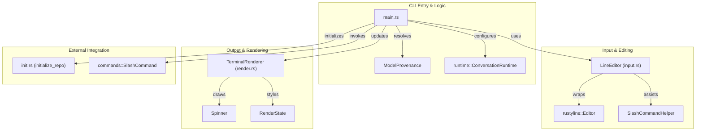
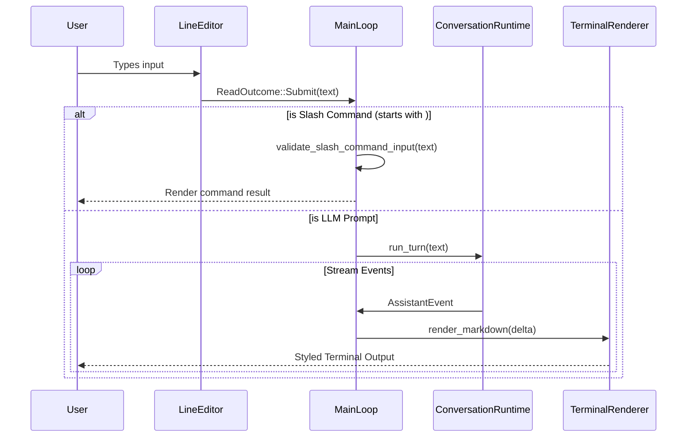

<!-- source: DeepWiki mcp.deepwiki.com · repo ultraworkers/claw-code · page 2.1 CLI and REPL (claw-cli) · fetched 2026-10-27 -->

# CLI and REPL (claw-cli)

Relevant source files

The following files were used as context for generating this wiki page:

- [.claude/sessions/session-1775007846522.json](.claude/sessions/session-1775007846522.json)
- [.claw.json](.claw.json)
- [.gitignore](.gitignore)
- [ROADMAP.md](ROADMAP.md)
- [rust/.claude/sessions/session-1775010333630.json](rust/.claude/sessions/session-1775010333630.json)
- [rust/.claude/sessions/session-1775010384918.json](rust/.claude/sessions/session-1775010384918.json)
- [rust/.claude/sessions/session-1775010909274.json](rust/.claude/sessions/session-1775010909274.json)
- [rust/.claude/sessions/session-1775011146355.json](rust/.claude/sessions/session-1775011146355.json)
- [rust/.claude/sessions/session-1775011562247.json](rust/.claude/sessions/session-1775011562247.json)
- [rust/.claw.json](rust/.claw.json)
- [rust/.gitignore](rust/.gitignore)
- [rust/.omc/plans/tui-enhancement-plan.md](rust/.omc/plans/tui-enhancement-plan.md)
- [rust/.sandbox-home/.rustup/settings.toml](rust/.sandbox-home/.rustup/settings.toml)
- [rust/CLAUDE.md](rust/CLAUDE.md)
- [rust/Cargo.lock](rust/Cargo.lock)
- [rust/TUI-ENHANCEMENT-PLAN.md](rust/TUI-ENHANCEMENT-PLAN.md)
- [rust/crates/commands/src/lib.rs](rust/crates/commands/src/lib.rs)
- [rust/crates/rusty-claude-cli/Cargo.toml](rust/crates/rusty-claude-cli/Cargo.toml)
- [rust/crates/rusty-claude-cli/src/init.rs](rust/crates/rusty-claude-cli/src/init.rs)
- [rust/crates/rusty-claude-cli/src/input.rs](rust/crates/rusty-claude-cli/src/input.rs)
- [rust/crates/rusty-claude-cli/src/main.rs](rust/crates/rusty-claude-cli/src/main.rs)
- [rust/crates/rusty-claude-cli/tests/output_format_contract.rs](rust/crates/rusty-claude-cli/tests/output_format_contract.rs)
- [rust/crates/tools/Cargo.toml](rust/crates/tools/Cargo.toml)
- [rust/crates/tools/src/lib.rs](rust/crates/tools/src/lib.rs)

The `claw-cli` crate (implemented in the `rusty-claude-cli` directory) serves as the primary production entry point for Claw Code. It provides a feature-rich Read-Eval-Print Loop (REPL), a non-interactive prompt mode, and project initialization utilities. It orchestrates interactions between the user, the `runtime` crate for conversation logic, and the `api` crate for model communication.

## Core Architecture

The CLI is built around the `LiveCli` lifecycle, which manages the transition from command-line arguments to a live interactive state, maintaining session history and usage tracking.

### CLI Lifecycle and Argument Parsing

The `main.rs` file defines the entry point logic. It handles model resolution via `ModelProvenance` to track if the active model was set via flags, environment variables, or configuration [rust/crates/rusty-claude-cli/src/main.rs:79-115](). The resolution logic probes environment variables like `ANTHROPIC_MODEL` and local configuration files before falling back to the default `anthropic/claude-opus-4-7` [rust/crates/rusty-claude-cli/src/main.rs:73-210]().

Supported actions include:
- **REPL Mode**: Interactive conversation with terminal-optimized input and command history [rust/crates/rusty-claude-cli/src/main.rs:18-20]().
- **Project Init**: Setting up `.claw/`, `CLAUDE.md`, and repository-specific context via `initialize_repo` [rust/crates/rusty-claude-cli/src/init.rs:135-188]().
- **Structured Output**: Support for `--output-format json` across commands like `help` and `doctor` to facilitate machine readability [rust/crates/rusty-claude-cli/tests/output_format_contract.rs:12-34]().

### System Component Map

The following diagram maps the high-level CLI concepts to their specific Rust entities.

**CLI Component Association**

Sources: [rust/crates/rusty-claude-cli/src/main.rs:17-72](), [rust/crates/rusty-claude-cli/src/init.rs:135]()

## Session Management

The CLI coordinates the conversation state by bridging the `Session` data with the `ConversationRuntime`. It tracks usage metrics like token counts and calculates costs using `ModelPricing` and `UsageTracker` [rust/crates/rusty-claude-cli/src/main.rs:56-65](). 

| Entity | Role |
| :--- | :--- |
| `ConversationRuntime` | Coordinates the model loop, tool execution, and session updates [rust/crates/rusty-claude-cli/src/main.rs:56](). |
| `Session` | The serializable state of the conversation, including messages and versioning [rust/crates/rusty-claude-cli/src/main.rs:61](). |
| `UsageTracker` | Monitors input/output tokens and calculates session costs [rust/crates/rusty-claude-cli/src/main.rs:64](). |
| `TerminalRenderer` | Handles real-time streaming of markdown content and spinners [rust/crates/rusty-claude-cli/src/main.rs:55](). |

Sources: [rust/crates/rusty-claude-cli/src/main.rs:56-72]()

## Input Handling and Line Editor

The `LineEditor` provides a terminal input experience using the `rustyline` crate [rust/crates/rusty-claude-cli/src/input.rs:101-104](). It supports standard line editing, history management, and tab-completion for slash commands.

### Multi-line and Shortcuts
The editor is configured to support multi-line input via `Shift+Enter` or `Ctrl+J` [rust/crates/rusty-claude-cli/src/input.rs:116-117](). It handles terminal interrupts (`Ctrl+C`) by distinguishing between canceling a current line (`ReadOutcome::Cancel`) and exiting the application (`ReadOutcome::Exit`) [rust/crates/rusty-claude-cli/src/input.rs:151-159]().

### Completion and Help
The `SlashCommandHelper` provides tab-completion for commands starting with `/` [rust/crates/rusty-claude-cli/src/input.rs:23-26](). Available commands are defined by `SlashCommandSpec` entries in the `commands` crate, which include summaries and argument hints [rust/crates/commands/src/lib.rs:46-52]().

For details on specific commands and modal editing features, see [Slash Commands and Input Handling](#2.1.1).

Sources: [rust/crates/rusty-claude-cli/src/input.rs:18-165](), [rust/crates/commands/src/lib.rs:60-231]()

## Terminal Rendering

The `TerminalRenderer` transforms raw stream data into a readable terminal UI. It manages `MarkdownStreamState` to handle incremental markdown parsing and syntax highlighting [rust/crates/rusty-claude-cli/src/main.rs:55]().

### Visual Feedback
- **Spinners**: The `Spinner` struct provides visual feedback during long-running API calls or tool executions [rust/crates/rusty-claude-cli/src/main.rs:55]().
- **Markdown**: The CLI uses `pulldown-cmark` and `syntect` for rendering and syntax highlighting [rust/crates/rusty-claude-cli/Cargo.toml:16-22]().

Sources: [rust/crates/rusty-claude-cli/src/main.rs:55](), [rust/crates/rusty-claude-cli/Cargo.toml:16-22]()

## Project Initialization

The `init.rs` module handles the setup of new projects for Claw Code via the `initialize_repo` function [rust/crates/rusty-claude-cli/src/init.rs:135]().

It performs the following tasks:
1. **Directory Setup**: Creates the `.claw/` directory and `sessions/` subdirectory [rust/crates/rusty-claude-cli/src/init.rs:138-163]().
2. **Configuration**: Writes starter `settings.json` and `.claw.json` files with default `acceptEdits` permissions [rust/crates/rusty-claude-cli/src/init.rs:4-17](), [rust/crates/rusty-claude-cli/src/init.rs:140-169]().
3. **Guidance**: Generates a `CLAUDE.md` file to provide the LLM with project-specific instructions [rust/crates/rusty-claude-cli/src/init.rs:177-182]().
4. **Git Integration**: Ensures relevant paths like `.claw/settings.local.json`, `.claw/sessions/`, and `.clawhip/` are ignored by git [rust/crates/rusty-claude-cli/src/init.rs:18-19](), [rust/crates/rusty-claude-cli/src/init.rs:171-175]().

Sources: [rust/crates/rusty-claude-cli/src/init.rs:4-214](), [rust/crates/rusty-claude-cli/src/main.rs:53]()

## Command Flow Diagram

This diagram illustrates how a user input string flows through the CLI entities to produce an LLM response.

**Input to Execution Pipeline**

Sources: [rust/crates/rusty-claude-cli/src/main.rs:37-65](), [rust/crates/rusty-claude-cli/src/input.rs:18-150]()

---

