# Page: Overview

# Overview

<details>
<summary>Relevant source files</summary>

The following files were used as context for generating this wiki page:

- [PHILOSOPHY.md](PHILOSOPHY.md)
- [README.md](README.md)
- [ROADMAP.md](ROADMAP.md)
- [USAGE.md](USAGE.md)
- [docs/g011-acp-json-rpc-status-contract.md](docs/g011-acp-json-rpc-status-contract.md)
- [docs/local-openai-compatible-providers.md](docs/local-openai-compatible-providers.md)
- [docs/navigation-file-context.md](docs/navigation-file-context.md)
- [rust/README.md](rust/README.md)
- [rust/crates/commands/src/lib.rs](rust/crates/commands/src/lib.rs)
- [rust/crates/rusty-claude-cli/src/main.rs](rust/crates/rusty-claude-cli/src/main.rs)
- [rust/crates/rusty-claude-cli/tests/output_format_contract.rs](rust/crates/rusty-claude-cli/tests/output_format_contract.rs)

</details>


`claw-code` is a high-performance, local-first coding agent harness. Originally inspired by the architectural patterns of Claude Code, this project provides a robust environment for AI agents to interact with local workspaces through a suite of specialized tools, slash commands, and a sophisticated conversation runtime [README.md:96-98]().

The project is centered on a production-ready Rust implementation, supported by a "clawable" roadmap focused on deterministic state machines, machine-readable event streams, and autonomous recovery [ROADMAP.md:3-23]().

## Dual-Track Architecture

The repository maintains two distinct implementation tracks to ensure both rapid feature exploration and high-performance execution.

### 1. Production Rust Implementation (`rust/`)
The primary focus of the project is the Rust workspace. It is designed for speed, memory safety, and a native developer experience [rust/README.md:1-3](). It includes a full interactive REPL, an extensible tool system, and a multi-crate architecture that separates the API client, runtime logic, and CLI concerns [rust/README.md:84-110](). The core binary produced is `claw`, which supports both interactive turns and one-shot prompts [rust/crates/rusty-claude-cli/src/main.rs:73-90](), [USAGE.md:76-89]().

### 2. Python Porting Workspace (`src/`)
The Python track serves as a clean-room verification layer. It was used to map the original system's surface area into a manageable, testable structure before implementing high-performance equivalents in Rust [README.md:111-112](). It continues to serve as a reference for parity auditing and audit helpers [PARITY.md:1-10]().

For a detailed breakdown of these components, see **[Repository Structure](#1.2)**.

## Key Concepts

To navigate the codebase effectively, it is important to understand the following core entities:

| Concept | Description | Key Code Entities |
| :--- | :--- | :--- |
| **Conversation Runtime** | The core loop managing the interaction between the LLM, user, and tools. | `ConversationRuntime` [rust/crates/rusty-claude-cli/src/main.rs:56-65]() |
| **Tools** | Executable functions (bash, read, write, edit, grep, glob) that the agent can invoke. | `GlobalToolRegistry`, `mvp_tool_specs` [rust/crates/rusty-claude-cli/src/main.rs:68-71]() |
| **Slash Commands** | User-facing commands (e.g., `/status`, `/doctor`, `/ultraplan`) for session management and reasoning. | `SlashCommand`, `SlashCommandSpec` [rust/crates/commands/src/lib.rs:45-52](), [rust/crates/commands/src/lib.rs:60-225]() |
| **Session** | A persistent record of a conversation, including messages and tool outputs. | `Session`, `ConversationMessage` [rust/crates/rusty-claude-cli/src/main.rs:60-65]() |
| **MCP** | Model Context Protocol integration for external tool discovery. | `McpServerManager`, `McpConfigCollection` [rust/crates/rusty-claude-cli/src/main.rs:60-65]() |
| **Worker States** | Explicit lifecycle states (e.g., `spawning`, `ready_for_prompt`) for execution. | `WorkerStatus` [ROADMAP.md:75-84]() |
| **Lane Events** | Typed signals (e.g., `lane.started`, `lane.green`) for automation. | `LaneEventName` [ROADMAP.md:164-178]() |

### System Relationship Diagram
The following diagram illustrates how the user interacts with the system through the CLI and how the Runtime orchestrates internal components.

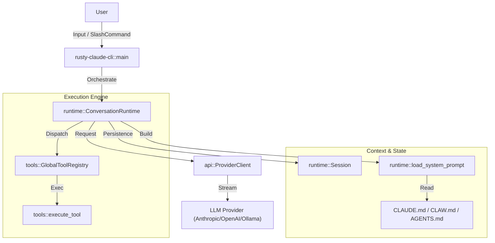
Sources: [rust/crates/rusty-claude-cli/src/main.rs:37-71](), [USAGE.md:58-65](), [ROADMAP.md:132-140](), [docs/navigation-file-context.md:20-29](), [rust/README.md:157-158]()

## Navigating the Wiki

This wiki is structured to guide you from initial setup to deep architectural understanding.

*   **[Getting Started](#1.1)**: Instructions for installing the Rust `claw` binary, configuring API keys (`ANTHROPIC_API_KEY`, `OPENAI_API_KEY`), and setting up your first workspace via `claw init` [USAGE.md:27-34](), [USAGE.md:56-72](), [docs/local-openai-compatible-providers.md:14-23]().
*   **[Repository Structure](#1.2)**: A map of the `rust/` and `src/` directories, explaining how the crates relate and how parity is tracked [README.md:104-112]().
*   **[Rust Implementation](#2)**: Deep dives into the production crates, including the `runtime`, `api`, `tools`, and `mcp` subsystems [rust/README.md:84-110](), [ROADMAP.md:73-161]().
*   **[Python Porting Workspace](#3)**: Documentation on the reference Python implementation used for architectural mapping and audit helpers [README.md:111-112]().
*   **[Configuration and Permissions](#4)**: Details on `settings.json`, OAuth flows, and permission modes such as `WorkspaceWrite` and `DangerFullAccess` [rust/crates/rusty-claude-cli/src/main.rs:116-162](), [docs/local-openai-compatible-providers.md:14-30]().
*   **[Testing and CI](#5)**: Overview of the `cargo test` suite and the mock parity harness for Anthropic-compatible service verification [rust/README.md:48-82](), [rust/crates/rusty-claude-cli/tests/output_format_contract.rs:12-34]().

### Component Map: Natural Language to Code
This map bridges high-level system features to their specific implementation points in the Rust workspace.

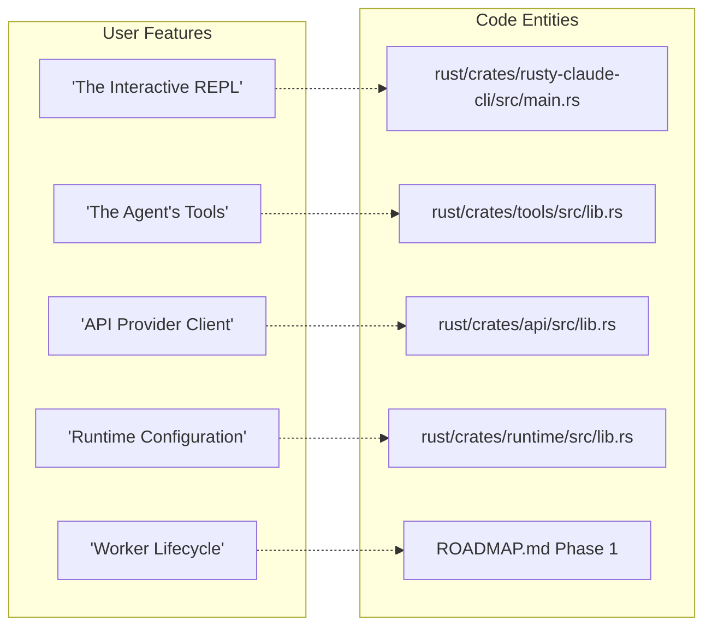
Sources: [rust/README.md:84-110](), [ROADMAP.md:73-85](), [rust/crates/rusty-claude-cli/src/main.rs:37-71](), [USAGE.md:3-15]()

---
Sources: [README.md:1-112](), [ROADMAP.md:1-180](), [rust/README.md:1-160](), [USAGE.md:1-140](), [docs/navigation-file-context.md:1-69](), [docs/local-openai-compatible-providers.md:1-152](), [rust/crates/commands/src/lib.rs:60-225](), [rust/crates/rusty-claude-cli/src/main.rs:73-162]()

---

# Page: Getting Started

# Getting Started

<details>
<summary>Relevant source files</summary>

The following files were used as context for generating this wiki page:

- [.github/scripts/check_release_readiness.py](.github/scripts/check_release_readiness.py)
- [.github/workflows/release.yml](.github/workflows/release.yml)
- [Containerfile](Containerfile)
- [README.md](README.md)
- [USAGE.md](USAGE.md)
- [docs/container.md](docs/container.md)
- [docs/g009-windows-docs-release-verification-map.md](docs/g009-windows-docs-release-verification-map.md)
- [docs/g011-acp-json-rpc-status-contract.md](docs/g011-acp-json-rpc-status-contract.md)
- [docs/local-openai-compatible-providers.md](docs/local-openai-compatible-providers.md)
- [docs/navigation-file-context.md](docs/navigation-file-context.md)
- [docs/windows-install-release.md](docs/windows-install-release.md)
- [install.sh](install.sh)
- [rust/README.md](rust/README.md)
- [rust/scripts/install.sh](rust/scripts/install.sh)

</details>


This page provides the technical instructions for setting up, building, and initializing Claw Code. The project maintains a dual-track architecture: a **Rust production implementation** (the primary tool) and a **Python porting workspace** (used for clean-room verification and parity tracking) [README.md:35-51](), [README.md:106-111](), [rust/README.md:1-45]().

## Prerequisites

Before installation, ensure the following are available on your system:
*   **Rust Toolchain**: Required for building the production CLI and crates [USAGE.md:19-21]().
*   **Python 3.x**: Required for running the reference workspace and audit helpers [README.md:50-51]().
*   **Provider Credentials**: One of `ANTHROPIC_API_KEY` (for `sk-ant-*` keys) or `ANTHROPIC_AUTH_TOKEN` (for bearer/OAuth tokens) [USAGE.md:22-25]().

## Installation and Build

### Rust CLI (Production)
The primary entry point is the `claw` binary located in the `rust/` workspace.

**Building from Source:**
To produce a debug binary (fastest for development):
```bash
cd rust
cargo build --workspace
```
[rust/README.md:14-15](). The binary is available at `rust/target/debug/claw` (or `claw.exe` on Windows) after the build [README.md:111-123](), [USAGE.md:34-34](). For an optimized build, use `cargo build --workspace --release` [docs/windows-install-release.md:21-25]().

**Windows PowerShell Path:**
Native Windows users can build and run using PowerShell. For persistence, use `setx` to manage environment variables [docs/windows-install-release.md:102-104]().
```powershell
git clone https://github.com/ultraworkers/claw-code
Set-Location .\claw-code\rust
cargo build --workspace
.\target\debug\claw.exe --help
```
[docs/windows-install-release.md:11-17]().

**Using the Installer (Linux/macOS/WSL):**
A dedicated shell script handles environment detection and builds the workspace [install.sh:1-12]().
```bash
./install.sh
```
[docs/windows-install-release.md:70-74]().

### Python Workspace (Porting)
The Python workspace in `src/` serves as a reference for the original TypeScript surface. It includes tools for auditing parity between the implementations [README.md:50-51](), [README.md:111-111]().

## Environment Variables and Auth

Claw Code uses specific environment variables for provider authentication. Note that `ANTHROPIC_API_KEY` and `ANTHROPIC_AUTH_TOKEN` are **not** interchangeable as they result in different HTTP headers.

| Variable | Description | HTTP Header | Typical Source |
| :--- | :--- | :--- | :--- |
| `ANTHROPIC_API_KEY` | For `sk-ant-*` keys [docs/windows-install-release.md:193-193](). | `x-api-key` | Anthropic Console |
| `ANTHROPIC_AUTH_TOKEN` | For OAuth/Proxy bearer tokens [rust/README.md:40-40](). | `Authorization: Bearer` | OAuth Flow / Proxy |
| `ANTHROPIC_BASE_URL` | (Optional) Custom endpoint for proxies [USAGE.md:25-25](). | N/A | Local Proxy / Mock |
| `OPENAI_BASE_URL` | Endpoint for OpenAI-compatible local servers [docs/local-openai-compatible-providers.md:19-20](). | N/A | Ollama / vLLM / llama.cpp |
| `OLLAMA_HOST` | Preferred routing for Ollama [docs/local-openai-compatible-providers.md:60-64](). | N/A | Local Ollama Instance |

**First-Run Health Check:**
After building, run the built-in diagnostic to verify authentication and environment:
```bash
./target/debug/claw
# Inside REPL
/doctor
```
[USAGE.md:12-15](). The `/doctor` command performs setup and preflight diagnostics [USAGE.md:17-17]().

## Workspace Configuration

Claw Code is "workspace-aware," tailoring its behavior based on configuration files found in the project root.

### CLAUDE.md / CLAW.md (Project Memory)
These files provide high-level guidance, stack detection, and "working agreements" to the agent. Discovery priority is `CLAUDE.md`, then `CLAW.md`, then `AGENTS.md` [rust/README.md:157-158]().

### .claw.json
The primary configuration file for shared project settings. It defines default permission modes and project metadata.

### .claw/ Directory
Used for local-only state and overrides:
*   `.claw/settings.json`: Project-level configuration.
*   `.claw/settings.local.json`: Machine-specific overrides.
*   `.claw/sessions/`: Storage for serialized conversation history.
*   `.claw/worker-state.json`: Current worker context (ID, session, model) [USAGE.md:118-120]().

## First-Run Experience: Project Initialization

When running `claw init` or starting in a new repository, the system initializes the environment.

### Initialization Logic Flow
The initialization pipeline detects the technology stack and generates scaffolding.

**Initialization Data Flow**
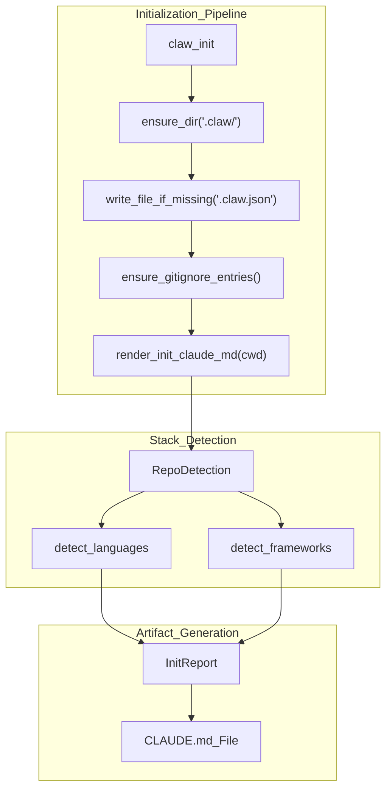
Sources: [USAGE.md:56-74](), [rust/README.md:151-152]()

## Running the System

### Interactive REPL
To start an interactive session with tab completion and slash commands:
```bash
./target/debug/claw
```
[USAGE.md:77-80](). Inside the REPL, you can use commands like `/doctor`, `/status`, or `/config` [rust/README.md:155-160]().

### One-Shot Prompts
To execute a single instruction and exit:
```bash
./target/debug/claw prompt "explain this codebase"
```
[rust/README.md:20-21](). Use the `--` separator for dash-prefixed prompts [USAGE.md:103-107]().

### Container / Docker Workflow
The repository includes configuration for containerized execution, ensuring a clean and reproducible environment [README.md:100-100]().

**System Component Association**
This diagram maps high-level user interfaces to the underlying Rust implementation crates and key data structures.

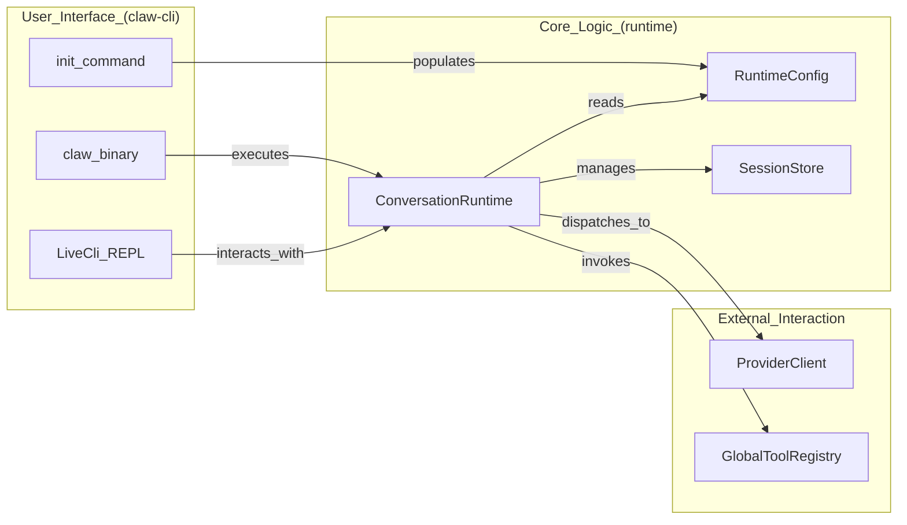
Sources: [USAGE.md:5-15](), [rust/README.md:85-110](), [USAGE.md:116-120]()

---

# Page: Repository Structure

# Repository Structure

<details>
<summary>Relevant source files</summary>

The following files were used as context for generating this wiki page:

- [AGENTS.md](AGENTS.md)
- [PARITY.md](PARITY.md)
- [README.md](README.md)
- [USAGE.md](USAGE.md)
- [docs/g007-plugin-mcp-verification-map.md](docs/g007-plugin-mcp-verification-map.md)
- [docs/g011-acp-json-rpc-status-contract.md](docs/g011-acp-json-rpc-status-contract.md)
- [docs/local-openai-compatible-providers.md](docs/local-openai-compatible-providers.md)
- [docs/navigation-file-context.md](docs/navigation-file-context.md)
- [rust/AGENTS.md](rust/AGENTS.md)
- [rust/Cargo.toml](rust/Cargo.toml)
- [rust/MOCK_PARITY_HARNESS.md](rust/MOCK_PARITY_HARNESS.md)
- [rust/README.md](rust/README.md)
- [rust/crates/api/AGENTS.md](rust/crates/api/AGENTS.md)
- [rust/crates/commands/AGENTS.md](rust/crates/commands/AGENTS.md)
- [rust/crates/mock-anthropic-service/src/lib.rs](rust/crates/mock-anthropic-service/src/lib.rs)
- [rust/crates/plugins/AGENTS.md](rust/crates/plugins/AGENTS.md)
- [rust/crates/runtime/AGENTS.md](rust/crates/runtime/AGENTS.md)
- [rust/crates/rusty-claude-cli/AGENTS.md](rust/crates/rusty-claude-cli/AGENTS.md)
- [rust/crates/rusty-claude-cli/tests/mock_parity_harness.rs](rust/crates/rusty-claude-cli/tests/mock_parity_harness.rs)
- [rust/crates/tools/AGENTS.md](rust/crates/tools/AGENTS.md)
- [rust/mock_parity_scenarios.json](rust/mock_parity_scenarios.json)
- [rust/scripts/run_mock_parity_diff.py](rust/scripts/run_mock_parity_diff.py)
- [src/AGENTS.md](src/AGENTS.md)

</details>


This page provides a detailed map of the `claw-code` repository layout. The project follows a dual-track architecture: a **Python porting workspace** used for clean-room verification and parity tracking against the original system, and a **Rust production implementation** designed for performance and memory safety.

## Top-Level Directory Layout

The repository is organized into primary top-level directories that separate implementation concerns from assets and testing.

| Directory | Purpose |
| :--- | :--- |
| `rust/` | The production-grade Rust workspace, containing the canonical `claw` CLI binary and its supporting crates. [README.md:106-106](), [rust/README.md:1-3]() |
| `src/` | The Python porting workspace used for clean-room architectural replication and reference logic. [README.md:111-111](), [src/AGENTS.md:5-8]() |
| `tests/` | Integration tests and verification suites for the Python porting workspace. [README.md:111-111](), [AGENTS.md:15-15]() |
| `assets/` | Static resources, including the `claw-hero.jpeg` branding asset. [README.md:93-93]() |
| `docs/` | Detailed technical documentation covering ACP/Zed contracts, navigation, and local provider setup. [README.md:100-102]() |

**Sources:** [README.md:104-112](), [rust/README.md:1-3](), [AGENTS.md:10-20](), [src/AGENTS.md:1-8]()

---

## Rust Workspace (Production)

The Rust implementation is managed as a Cargo workspace located in the `rust/` directory. It uses a `resolver = "2"` configuration and enforces `unsafe_code = "forbid"` across all members. [rust/Cargo.toml:1-15]()

### Crate Graph and Data Flow

The following diagram illustrates how the Rust crates interact. Data flows from the `rusty-claude-cli` (User Input) through the `runtime` (Orchestration) to external `api` providers or local `tools`.

**Rust Crate Dependency Map**
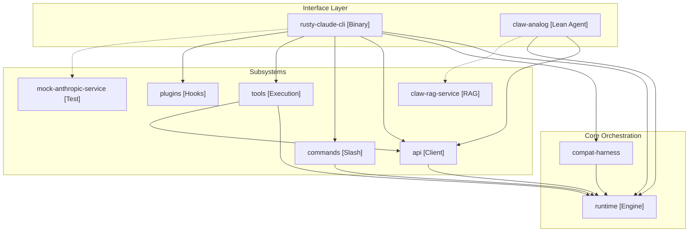
**Sources:** [rust/Cargo.toml:1-2](), [AGENTS.md:23-33](), [PARITY.md:42-52]()

### Key Rust Crates

*   **`rusty-claude-cli`**: The entrypoint binary (`claw`). Wires together api, runtime, tools, and commands using a hand-rolled argument parser. [rust/crates/rusty-claude-cli/AGENTS.md:5-9](), [rust/crates/rusty-claude-cli/tests/mock_parity_harness.rs:17-30]()
*   **`runtime`**: The central engine. It implements the `TaskRegistry` for task lifecycle, `PermissionEnforcer` for security gating, and `LspClient` for language server integration. [PARITY.md:47-52](), [PARITY.md:94-96](), [AGENTS.md:43-45]()
*   **`api`**: A provider-agnostic client supporting Anthropic and OpenAI-compatible endpoints. It manages auth via `ANTHROPIC_API_KEY`, `ANTHROPIC_AUTH_TOKEN`, or `OPENAI_API_KEY`. [rust/README.md:29-41](), [docs/local-openai-compatible-providers.md:16-22]()
*   **`tools`**: Handles execution of built-in tools (bash, file_ops, etc.). It wires the `TaskRegistry` into tool dispatch for operations like `TaskCreate` and `TaskUpdate`. [PARITY.md:102-105](), [AGENTS.md:48-48]()
*   **`claw-analog`**: A lightweight agent harness built on the `api` crate for CI-friendly automation. [AGENTS.md:31-31]()
*   **`mock-anthropic-service`**: A deterministic test server that implements a subset of the Anthropic `/v1/messages` API to facilitate reproducible harness runs. [rust/crates/mock-anthropic-service/src/lib.rs:26-31](), [rust/crates/mock-anthropic-service/src/lib.rs:142-164]()

---

## Python Porting Workspace (`src/`)

The Python tree exists solely to mirror and track parity against the original TypeScript source code. It is a scaffold for verification, not a production target. [src/AGENTS.md:3-8]()

### Python Module Tree

The Python workspace mirrors the original subsystem surface using placeholder packages that load JSON metadata snapshots.

| Component | File/Directory | Role |
| :--- | :--- | :--- |
| **CLI Entry** | `src/main.py` | Argparse-based shim for `manifest`, `parity-audit`, and `turn-loop`. [src/AGENTS.md:13-13]() |
| **Reference Data** | `src/reference_data/` | Tracked JSON snapshots of tools, commands, and 29 subsystems. [src/AGENTS.md:18-21]() |
| **Audit Engine** | `src/parity_audit.py` | Maps original `.ts` files to the Python `.py` implementations. [src/AGENTS.md:16-16]() |
| **Logic Shims** | `src/permissions.py` | Ported logic for permission handling and path scoping. [src/AGENTS.md:39-39]() |

**Sources:** [src/AGENTS.md:1-45]()

---

## Clean-Room Methodology and Parity Tracking

Parity is verified through a rigorous automated harness that ensures the Rust implementation matches the behavioral expectations of the original design.

### Parity Audit System

*   **Mock Parity Harness**: A reproducible CLI harness located in `rust/crates/rusty-claude-cli/tests/mock_parity_harness.rs` that runs 12 scripted scenarios against the `MockAnthropicService`. [rust/README.md:75-82](), [rust/crates/rusty-claude-cli/tests/mock_parity_harness.rs:30-151]()
*   **Scenario Coverage**: The harness validates critical paths such as `bash_stdout_roundtrip`, `grep_chunk_assembly`, and `auto_compact_triggered`. [rust/MOCK_PARITY_HARNESS.md:11-26](), [rust/crates/rusty-claude-cli/tests/mock_parity_harness.rs:31-151]()
*   **9-Lane Checkpoint**: Progress is measured across nine functional "lanes," including Bash validation, Task wiring, and MCP lifecycle. [PARITY.md:42-53]()

**Sources:** [rust/README.md:48-82](), [PARITY.md:1-110](), [rust/MOCK_PARITY_HARNESS.md:1-27]()

---

## Data Flow: Input to Execution

This diagram bridges the Natural Language Space (User Input) to the Code Entity Space (Implementation).

**System Input Flow**
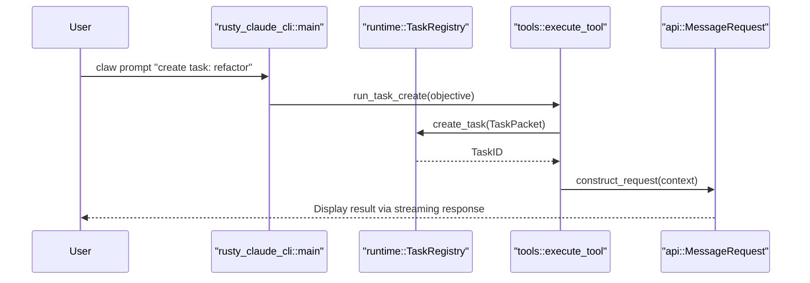
**Sources:** [rust/README.md:139-152](), [PARITY.md:94-105](), [rust/crates/mock-anthropic-service/src/lib.rs:146-150]()

## Workspace Health and Initialization

| Command | Code Entity | Purpose |
| :--- | :--- | :--- |
| `claw init` | `rusty_claude_cli::run_init` | Idempotent setup of `.claw/settings.json`, `.claw.json`, and `CLAUDE.md`. [USAGE.md:57-65](), [rust/crates/rusty-claude-cli/AGENTS.md:26-26]() |
| `claw doctor` | `rusty_claude_cli::check_*_health` | Preflight diagnostic for API keys, provider connectivity, and MCP validation. [USAGE.md:14-17](), [rust/crates/rusty-claude-cli/AGENTS.md:22-22]() |
| `claw status` | `rusty_claude_cli::StatusContext` | Reports loaded project memory files (`CLAUDE.md`, `CLAW.md`) and MCP validation. [rust/README.md:157-159](), [rust/crates/rusty-claude-cli/AGENTS.md:24-24]() |
| `claw state` | `.claw/worker-state.json` | Inspects active worker ID, session reference, and current permission mode. [USAGE.md:116-125]() |

**Sources:** [USAGE.md:57-75](), [USAGE.md:116-140](), [rust/README.md:153-160](), [rust/crates/rusty-claude-cli/AGENTS.md:22-26]()

---

# Page: Rust Implementation

# Rust Implementation

<details>
<summary>Relevant source files</summary>

The following files were used as context for generating this wiki page:

- [README.md](README.md)
- [USAGE.md](USAGE.md)
- [docs/g011-acp-json-rpc-status-contract.md](docs/g011-acp-json-rpc-status-contract.md)
- [docs/local-openai-compatible-providers.md](docs/local-openai-compatible-providers.md)
- [docs/navigation-file-context.md](docs/navigation-file-context.md)
- [rust/Cargo.toml](rust/Cargo.toml)
- [rust/README.md](rust/README.md)

</details>


The Claw Code production environment is a workspace of interconnected Rust crates designed for high-performance, local-first agentic workflows. While the repository contains a Python porting workspace for verification, the **Rust workspace** under `rust/crates/` is the primary product surface [rust/README.md:1-5](), [rust/README.md:106]().

The architecture follows a modular design where the `runtime` acts as the central orchestrator, the `api` handles model communication, and specialized crates like `tools`, `commands`, and `plugins` provide the agent with environmental capabilities.

### Crate Collaboration Map

The following diagram illustrates how the core crates in the Rust workspace interact to process a user request.

**System Entity Interaction**
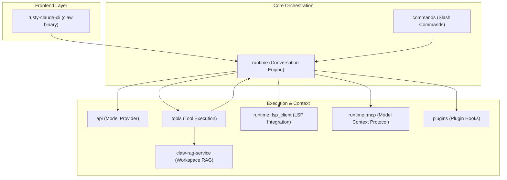
**Sources:** [rust/crates/rusty-claude-cli/src/main.rs:37-71](), [rust/README.md:84-110](), [rust/Cargo.toml:1-3]()

---

### Core Subsystems

#### [CLI and REPL (claw-cli)](#2.1)
The `rusty-claude-cli` crate is the main entry point for users, producing the `claw` binary [rust/README.md:96](). It provides an interactive REPL with `rustyline` support and a one-shot prompt mode [rust/README.md:84-85](). It manages the input lifecycle and handles terminal rendering via `TerminalRenderer` [rust/crates/rusty-claude-cli/src/main.rs:55](). It also includes the `init` logic for setting up new projects with `CLAUDE.md`, `CLAW.md`, and `.claw/settings.json` [rust/crates/rusty-claude-cli/src/main.rs:53](), [USAGE.md:56-74]().
*   **Key Entities:** `CliApp`, `TerminalRenderer`, `initialize_repo`.
*   **For details, see [CLI and REPL (claw-cli)](#2.1).**

#### [Runtime and Conversation Engine](#2.2)
The `runtime` crate is the "brain" of the system. It manages `ConversationRuntime`, which handles the turn loop, session persistence, and the construction of the system prompt by discovering `CLAUDE.md`, `CLAW.md`, and `AGENTS.md` [rust/crates/rusty-claude-cli/src/main.rs:56-65](), [rust/README.md:157](). It also enforces `PermissionMode` gating for tool usage [rust/crates/rusty-claude-cli/src/main.rs:117-162]().
*   **Key Entities:** `ConversationRuntime`, `Session`, `PermissionMode`.
*   **For details, see [Runtime and Conversation Engine](#2.2).**

#### [API Client and Provider Abstraction](#2.3)
The `api` crate abstracts multiple LLM providers behind a unified interface, supporting Anthropic and OpenAI-compatible endpoints [rust/README.md:87-88](). It handles SSE (Server-Sent Events) stream normalization and authentication via `AuthSource` (API key, OAuth, or bearer) [rust/crates/rusty-claude-cli/src/main.rs:37-43](), [docs/local-openai-compatible-providers.md:14-30]().
*   **Key Entities:** `ProviderClient`, `AuthSource`, `MessageStream`.
*   **For details, see [API Client and Provider Abstraction](#2.3).**

#### [Tool Execution Engine](#2.4)
The `tools` crate contains the implementations for the agent's capabilities, including shell execution, file system operations, and notebook editing [rust/README.md:90-94](). It uses a `GlobalToolRegistry` to dispatch requests based on the model's tool-call outputs [rust/crates/rusty-claude-cli/src/main.rs:68-71]().
*   **Key Entities:** `GlobalToolRegistry`, `execute_tool`, `Skill` system.
*   **For details, see [Tool Execution Engine](#2.4).**

#### [MCP Integration](#2.5)
The Model Context Protocol (MCP) support allows Claw to connect to external tool servers. It manages the lifecycle of MCP server processes and routes tool calls through JSON-RPC [rust/README.md:98](), [rust/README.md:158]().
*   **Key Entities:** `McpServerManager`, `McpConfigCollection`, `McpServer`.
*   **For details, see [MCP Integration](#2.5).**

#### [Plugin System](#2.6)
The `plugins` crate allows extending the agent with lifecycle hooks [rust/README.md:106](). It manages a registry of installed plugins and provides surfaces for installation and update flows [rust/crates/rusty-claude-cli/src/main.rs:54]().
*   **Key Entities:** `PluginManager`, `PluginRegistry`, `PluginHooks`.
*   **For details, see [Plugin System](#2.6).**

#### [Worker Boot and Lane System](#2.7)
The `runtime` crate implements a state machine for worker booting and "lane" management. This includes `WorkerStatus` transitions (e.g., `spawning`, `trust_required`, `ready_for_prompt`) to ensure reliable agent startup and auto-recovery from misdeliveries [rust/README.md:157]().
*   **Key Entities:** `WorkerStatus`, `LaneEvent`, `TrustResolver`.
*   **For details, see [Worker Boot and Lane System](#2.7).**

#### [LSP Integration](#2.8)
The LSP client, integrated into the `runtime` crate, provides workspace awareness by communicating with Language Servers. It enriches the conversation context with diagnostics and symbol definitions [rust/crates/rusty-claude-cli/src/main.rs:59-65]().
*   **Key Entities:** `LspManager`, `LspAction`.
*   **For details, see [LSP Integration](#2.8).**

#### [Compat Harness](#2.9)
The `compat-harness` is a specialized utility used during development to ensure parity with the original TypeScript specifications by extracting command and tool registries via static analysis [rust/README.md:145-146]().
*   **Key Entities:** `BootstrapPlan`, `DumpManifests`.
*   **For details, see [Compat Harness](#2.9).**

#### [claw-analog: Lightweight Agent Harness](#2.13)
The workspace includes specialized crates for CI-friendly agent runs (`claw-analog`) and a workspace-wide RAG service (`claw-rag-service`) for vector-based search across repository files [rust/Cargo.toml:2]().
*   **For details, see [claw-analog: Lightweight Agent Harness](#2.13) and [claw-rag-service: Workspace RAG and Embedding Service](#2.14).**

---

### Code Entity Mapping

The following diagram maps high-level system behaviors to specific code identifiers and files within the Rust workspace.

**Behavior to Entity Mapping**
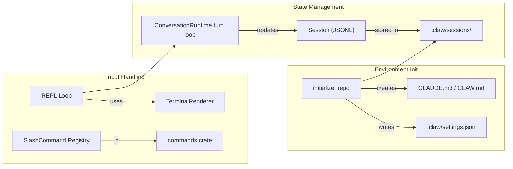
**Sources:** [rust/crates/rusty-claude-cli/src/main.rs:53-65](), [rust/crates/commands/src/lib.rs:60-230](), [USAGE.md:56-74](), [rust/README.md:157]()

### Crate Dependency Summary

| Crate | Purpose | Primary Responsibilities |
| :--- | :--- | :--- |
| `rusty-claude-cli` | User interface and binary | REPL, one-shot prompt, `claw` entrypoint [rust/crates/rusty-claude-cli/src/main.rs:1-16]() |
| `runtime` | Logic, turns, and state | `ConversationRuntime`, MCP, LSP, session persistence [rust/crates/rusty-claude-cli/src/main.rs:56-65]() |
| `api` | LLM Provider integration | Provider clients, SSE streaming, auth [rust/crates/rusty-claude-cli/src/main.rs:37-43]() |
| `tools` | Agent capabilities | Built-in tools (bash, edit), skill resolution [rust/crates/rusty-claude-cli/src/main.rs:68-71]() |
| `commands` | Slash command registry | Command definitions, help text generation [rust/crates/commands/src/lib.rs:1-52]() |
| `plugins` | Extensibility | Plugin metadata, install/enable flows [rust/crates/rusty-claude-cli/src/main.rs:54]() |
| `claw-analog` | Lean agent harness | CI-friendly execution, NDJSON output [rust/Cargo.toml:2]() |
| `claw-rag-service` | RAG and Embeddings | Workspace ingestion, SQLite-vec search [rust/Cargo.toml:2]() |

**Sources:** [rust/Cargo.toml:1-12](), [rust/README.md:84-110](), [rust/crates/rusty-claude-cli/src/main.rs:37-71]()

---

# Page: CLI and REPL (claw-cli)

# CLI and REPL (claw-cli)

<details>
<summary>Relevant source files</summary>

The following files were used as context for generating this wiki page:

- [.claude/sessions/session-1775007846522.json](.claude/sessions/session-1775007846522.json)
- [.claw.json](.claw.json)
- [.gitignore](.gitignore)
- [ROADMAP.md](ROADMAP.md)
- [rust/.claude/sessions/session-1775010333630.json](rust/.claude/sessions/session-1775010333630.json)
- [rust/.claude/sessions/session-1775010384918.json](rust/.claude/sessions/session-1775010384918.json)
- [rust/.claude/sessions/session-1775010909274.json](rust/.claude/sessions/session-1775010909274.json)
- [rust/.claude/sessions/session-1775011146355.json](rust/.claude/sessions/session-1775011146355.json)
- [rust/.claude/sessions/session-1775011562247.json](rust/.claude/sessions/session-1775011562247.json)
- [rust/.claw.json](rust/.claw.json)
- [rust/.gitignore](rust/.gitignore)
- [rust/.omc/plans/tui-enhancement-plan.md](rust/.omc/plans/tui-enhancement-plan.md)
- [rust/.sandbox-home/.rustup/settings.toml](rust/.sandbox-home/.rustup/settings.toml)
- [rust/CLAUDE.md](rust/CLAUDE.md)
- [rust/Cargo.lock](rust/Cargo.lock)
- [rust/TUI-ENHANCEMENT-PLAN.md](rust/TUI-ENHANCEMENT-PLAN.md)
- [rust/crates/commands/src/lib.rs](rust/crates/commands/src/lib.rs)
- [rust/crates/rusty-claude-cli/Cargo.toml](rust/crates/rusty-claude-cli/Cargo.toml)
- [rust/crates/rusty-claude-cli/src/init.rs](rust/crates/rusty-claude-cli/src/init.rs)
- [rust/crates/rusty-claude-cli/src/input.rs](rust/crates/rusty-claude-cli/src/input.rs)
- [rust/crates/rusty-claude-cli/src/main.rs](rust/crates/rusty-claude-cli/src/main.rs)
- [rust/crates/rusty-claude-cli/tests/output_format_contract.rs](rust/crates/rusty-claude-cli/tests/output_format_contract.rs)
- [rust/crates/tools/Cargo.toml](rust/crates/tools/Cargo.toml)
- [rust/crates/tools/src/lib.rs](rust/crates/tools/src/lib.rs)

</details>


The `claw-cli` crate (implemented in the `rusty-claude-cli` directory) serves as the primary production entry point for Claw Code. It provides a feature-rich Read-Eval-Print Loop (REPL), a non-interactive prompt mode, and project initialization utilities. It orchestrates interactions between the user, the `runtime` crate for conversation logic, and the `api` crate for model communication.

## Core Architecture

The CLI is built around the `LiveCli` lifecycle, which manages the transition from command-line arguments to a live interactive state, maintaining session history and usage tracking.

### CLI Lifecycle and Argument Parsing

The `main.rs` file defines the entry point logic. It handles model resolution via `ModelProvenance` to track if the active model was set via flags, environment variables, or configuration [rust/crates/rusty-claude-cli/src/main.rs:79-115](). The resolution logic probes environment variables like `ANTHROPIC_MODEL` and local configuration files before falling back to the default `anthropic/claude-opus-4-7` [rust/crates/rusty-claude-cli/src/main.rs:73-210]().

Supported actions include:
- **REPL Mode**: Interactive conversation with terminal-optimized input and command history [rust/crates/rusty-claude-cli/src/main.rs:18-20]().
- **Project Init**: Setting up `.claw/`, `CLAUDE.md`, and repository-specific context via `initialize_repo` [rust/crates/rusty-claude-cli/src/init.rs:135-188]().
- **Structured Output**: Support for `--output-format json` across commands like `help` and `doctor` to facilitate machine readability [rust/crates/rusty-claude-cli/tests/output_format_contract.rs:12-34]().

### System Component Map

The following diagram maps the high-level CLI concepts to their specific Rust entities.

**CLI Component Association**
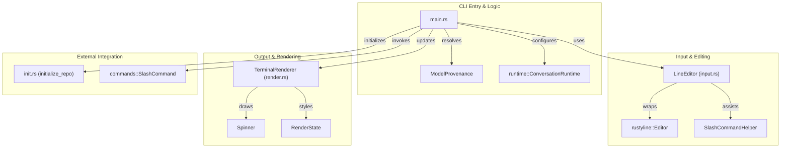
Sources: [rust/crates/rusty-claude-cli/src/main.rs:17-72](), [rust/crates/rusty-claude-cli/src/init.rs:135]()

## Session Management

The CLI coordinates the conversation state by bridging the `Session` data with the `ConversationRuntime`. It tracks usage metrics like token counts and calculates costs using `ModelPricing` and `UsageTracker` [rust/crates/rusty-claude-cli/src/main.rs:56-65](). 

| Entity | Role |
| :--- | :--- |
| `ConversationRuntime` | Coordinates the model loop, tool execution, and session updates [rust/crates/rusty-claude-cli/src/main.rs:56](). |
| `Session` | The serializable state of the conversation, including messages and versioning [rust/crates/rusty-claude-cli/src/main.rs:61](). |
| `UsageTracker` | Monitors input/output tokens and calculates session costs [rust/crates/rusty-claude-cli/src/main.rs:64](). |
| `TerminalRenderer` | Handles real-time streaming of markdown content and spinners [rust/crates/rusty-claude-cli/src/main.rs:55](). |

Sources: [rust/crates/rusty-claude-cli/src/main.rs:56-72]()

## Input Handling and Line Editor

The `LineEditor` provides a terminal input experience using the `rustyline` crate [rust/crates/rusty-claude-cli/src/input.rs:101-104](). It supports standard line editing, history management, and tab-completion for slash commands.

### Multi-line and Shortcuts
The editor is configured to support multi-line input via `Shift+Enter` or `Ctrl+J` [rust/crates/rusty-claude-cli/src/input.rs:116-117](). It handles terminal interrupts (`Ctrl+C`) by distinguishing between canceling a current line (`ReadOutcome::Cancel`) and exiting the application (`ReadOutcome::Exit`) [rust/crates/rusty-claude-cli/src/input.rs:151-159]().

### Completion and Help
The `SlashCommandHelper` provides tab-completion for commands starting with `/` [rust/crates/rusty-claude-cli/src/input.rs:23-26](). Available commands are defined by `SlashCommandSpec` entries in the `commands` crate, which include summaries and argument hints [rust/crates/commands/src/lib.rs:46-52]().

For details on specific commands and modal editing features, see [Slash Commands and Input Handling](#2.1.1).

Sources: [rust/crates/rusty-claude-cli/src/input.rs:18-165](), [rust/crates/commands/src/lib.rs:60-231]()

## Terminal Rendering

The `TerminalRenderer` transforms raw stream data into a readable terminal UI. It manages `MarkdownStreamState` to handle incremental markdown parsing and syntax highlighting [rust/crates/rusty-claude-cli/src/main.rs:55]().

### Visual Feedback
- **Spinners**: The `Spinner` struct provides visual feedback during long-running API calls or tool executions [rust/crates/rusty-claude-cli/src/main.rs:55]().
- **Markdown**: The CLI uses `pulldown-cmark` and `syntect` for rendering and syntax highlighting [rust/crates/rusty-claude-cli/Cargo.toml:16-22]().

Sources: [rust/crates/rusty-claude-cli/src/main.rs:55](), [rust/crates/rusty-claude-cli/Cargo.toml:16-22]()

## Project Initialization

The `init.rs` module handles the setup of new projects for Claw Code via the `initialize_repo` function [rust/crates/rusty-claude-cli/src/init.rs:135]().

It performs the following tasks:
1. **Directory Setup**: Creates the `.claw/` directory and `sessions/` subdirectory [rust/crates/rusty-claude-cli/src/init.rs:138-163]().
2. **Configuration**: Writes starter `settings.json` and `.claw.json` files with default `acceptEdits` permissions [rust/crates/rusty-claude-cli/src/init.rs:4-17](), [rust/crates/rusty-claude-cli/src/init.rs:140-169]().
3. **Guidance**: Generates a `CLAUDE.md` file to provide the LLM with project-specific instructions [rust/crates/rusty-claude-cli/src/init.rs:177-182]().
4. **Git Integration**: Ensures relevant paths like `.claw/settings.local.json`, `.claw/sessions/`, and `.clawhip/` are ignored by git [rust/crates/rusty-claude-cli/src/init.rs:18-19](), [rust/crates/rusty-claude-cli/src/init.rs:171-175]().

Sources: [rust/crates/rusty-claude-cli/src/init.rs:4-214](), [rust/crates/rusty-claude-cli/src/main.rs:53]()

## Command Flow Diagram

This diagram illustrates how a user input string flows through the CLI entities to produce an LLM response.

**Input to Execution Pipeline**
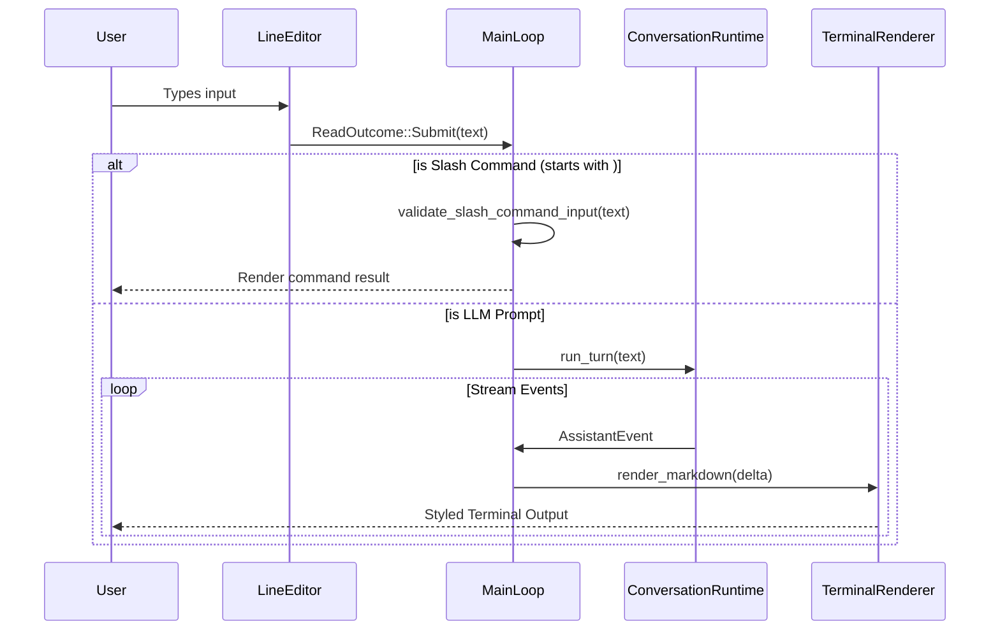
Sources: [rust/crates/rusty-claude-cli/src/main.rs:37-65](), [rust/crates/rusty-claude-cli/src/input.rs:18-150]()

---

# Page: Slash Commands and Input Handling

# Slash Commands and Input Handling

<details>
<summary>Relevant source files</summary>

The following files were used as context for generating this wiki page:

- [.claude/sessions/session-1775007846522.json](.claude/sessions/session-1775007846522.json)
- [ROADMAP.md](ROADMAP.md)
- [rust/Cargo.lock](rust/Cargo.lock)
- [rust/crates/commands/Cargo.toml](rust/crates/commands/Cargo.toml)
- [rust/crates/commands/src/lib.rs](rust/crates/commands/src/lib.rs)
- [rust/crates/rusty-claude-cli/Cargo.toml](rust/crates/rusty-claude-cli/Cargo.toml)
- [rust/crates/rusty-claude-cli/src/input.rs](rust/crates/rusty-claude-cli/src/input.rs)
- [rust/crates/rusty-claude-cli/src/main.rs](rust/crates/rusty-claude-cli/src/main.rs)
- [rust/crates/rusty-claude-cli/tests/cli_flags_and_config_defaults.rs](rust/crates/rusty-claude-cli/tests/cli_flags_and_config_defaults.rs)
- [rust/crates/rusty-claude-cli/tests/compact_output.rs](rust/crates/rusty-claude-cli/tests/compact_output.rs)
- [rust/crates/rusty-claude-cli/tests/output_format_contract.rs](rust/crates/rusty-claude-cli/tests/output_format_contract.rs)
- [rust/crates/rusty-claude-cli/tests/resume_slash_commands.rs](rust/crates/rusty-claude-cli/tests/resume_slash_commands.rs)
- [rust/crates/tools/Cargo.toml](rust/crates/tools/Cargo.toml)
- [rust/crates/tools/src/lib.rs](rust/crates/tools/src/lib.rs)

</details>


Slash commands provide a structured way for users to interact with the Claw CLI environment, manage session state, and trigger specialized workflows without entering a natural language prompt. Input handling is managed by a sophisticated line editor that supports multi-line input, modal editing, and tab completion.

## Slash Command Architecture

Slash commands are defined as a set of specifications in the `commands` crate and dispatched by the `LiveCli` REPL in the `rusty-claude-cli` crate.

### Command Definition and Categories
Commands are defined by a `SlashCommandSpec` struct which includes the command name, aliases, a summary, and whether the command is supported when resuming a session.

| Field | Type | Description |
| :--- | :--- | :--- |
| `name` | `&'static str` | The primary trigger (e.g., `help`). |
| `aliases` | `&'static [&'static str]` | Alternative triggers (e.g., `plugins` for `plugin`). |
| `summary` | `&'static str` | Short description shown in `/help`. |
| `argument_hint` | `Option<&'static str>` | UI hint for required/optional arguments. |
| `resume_supported` | `bool` | If true, the command can be used with the `--resume` CLI flag. |

Sources: [rust/crates/commands/src/lib.rs:45-52](), [rust/crates/commands/src/lib.rs:60-238]()

### The SlashCommand Enum
The system uses a `SlashCommand` enum to represent parsed commands. While `rusty-claude-cli` handles the top-level dispatch, the `commands` crate provides the full registry of available specs and specialized handlers.

Title: Slash Command Mapping Architecture
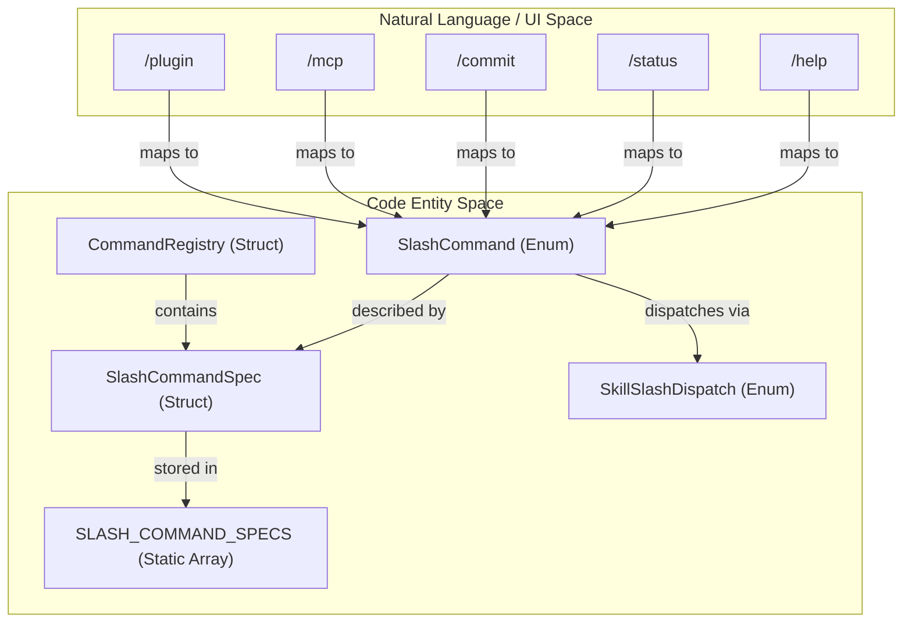
Sources: [rust/crates/commands/src/lib.rs:28-31](), [rust/crates/commands/src/lib.rs:45-52](), [rust/crates/commands/src/lib.rs:54-58](), [rust/crates/rusty-claude-cli/src/main.rs:45-52]()

## Input Handling and Line Editing

The CLI provides an interactive REPL (Read-Eval-Print Loop) via the `LineEditor` struct, which wraps `rustyline` to provide a rich terminal experience.

### LineEditor and SlashCommandHelper
The `LineEditor` manages the lifecycle of terminal input, including history management and helper integration for completions and highlighting.

Title: Input Processing and ReadOutcome Flow
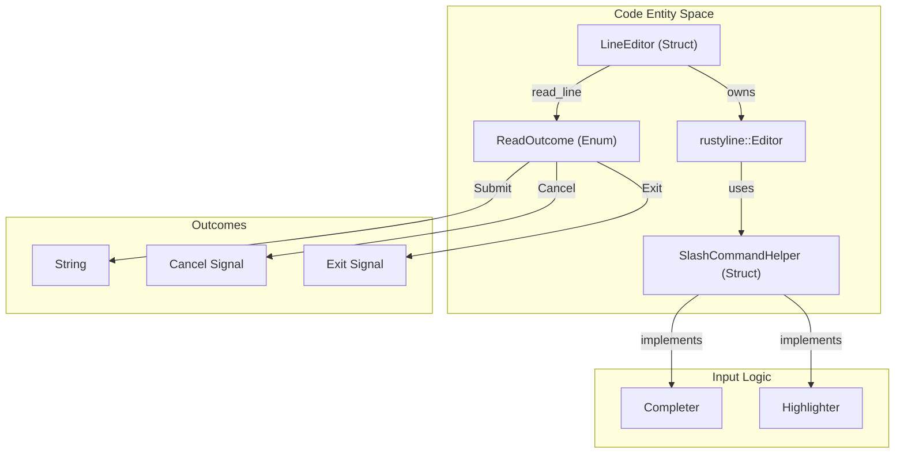
Sources: [rust/crates/rusty-claude-cli/src/input.rs:16-21](), [rust/crates/rusty-claude-cli/src/input.rs:23-26](), [rust/crates/rusty-claude-cli/src/input.rs:101-104](), [rust/crates/rusty-claude-cli/src/input.rs:140-166]()

### Multi-line Input and Tab Completion
*   **Multi-line Input**: Users can insert newlines without submitting by using `Shift+Enter` or `Ctrl+J`. This is implemented via `editor.bind_sequence` calls. [rust/crates/rusty-claude-cli/src/input.rs:116-118]()
*   **Tab Completion**: The `SlashCommandHelper` filters the `completions` vector based on the current cursor position and prefix. It specifically handles prefixes starting with `/` via `slash_command_prefix`. [rust/crates/rusty-claude-cli/src/input.rs:58-80](), [rust/crates/rusty-claude-cli/src/input.rs:200-211]()
*   **Fallback Mode**: If the terminal is not interactive (e.g., piped input), `LineEditor` falls back to a basic `stdin().read_line()` implementation in `read_line_fallback`. [rust/crates/rusty-claude-cli/src/input.rs:141-143](), [rust/crates/rusty-claude-cli/src/input.rs:182-198]()
*   **Vim Modal Editing**: While the default `edit_mode` is set to `Emacs` in the `LineEditor::new` constructor, the `rustyline` integration supports standard terminal line editing features. [rust/crates/rusty-claude-cli/src/input.rs:111]()

## Command Execution Data Flow

When a command is issued, it is validated against the `SLASH_COMMAND_SPECS` before being dispatched to specific logic handlers.

Title: Command Dispatch Pipeline
```mermaid
graph TD
    subgraph "Input Processing"
        USER["User Input"] -->|LineEditor| READ["read_line()"]
        READ -->|ReadOutcome::Submit| DISPATCH["Dispatch Logic"]
    end

    subgraph "Validation"
        DISPATCH -->|Slash Command| VAL["validate_slash_command_input"]
        VAL -->|Success| EXEC["Command Execution"]
    end

    subgraph "Handlers"
        EXEC -->|/mcp| MCP["handle_mcp_slash_command"]
        EXEC -->|/plugin| PLUG["handle_plugins_slash_command"]
        EXEC -->|/skills| SKILL["handle_skills_slash_command"]
        EXEC -->|/compact| COMP["compact_session"]
    end
```
Sources: [rust/crates/rusty-claude-cli/src/main.rs:45-52](), [rust/crates/rusty-claude-cli/src/input.rs:140-150](), [rust/crates/commands/src/lib.rs:83-88]()

## Specialized Handlers and Helpers

### Plugin and MCP Management
The `commands` crate integrates with the `plugins` and `runtime` crates to manage external capabilities:
*   **`/plugin`**: Uses `PluginManager` to list, install, and toggle plugins via `handle_plugins_slash_command`. [rust/crates/commands/src/lib.rs:7-12](), [rust/crates/commands/src/lib.rs:232-238](), [rust/crates/rusty-claude-cli/src/main.rs:45-48]()
*   **`/mcp`**: Interfaces with `McpServerManager` to inspect JSON-RPC tool servers via `handle_mcp_slash_command`. [rust/crates/commands/src/lib.rs:132-137](), [rust/crates/rusty-claude-cli/src/main.rs:45-48]()

### Git and Workspace Workflow
Specific slash commands automate common developer tasks by interacting with the underlying repository:
*   **`/diff`**: Shows current workspace changes using git status/diff. [rust/crates/commands/src/lib.rs:153-158]()
*   **`/commit`**: Generates a commit message based on the conversation and executes a git commit. [rust/crates/commands/src/lib.rs:174-179]()
*   **`/pr` / `/issue`**: Drafts GitHub-specific entities using conversation context. [rust/crates/commands/src/lib.rs:181-193]()
*   **`/init`**: Creates a starter `CLAUDE.md` for the repository via `initialize_repo`. [rust/crates/commands/src/lib.rs:146-151](), [rust/crates/rusty-claude-cli/src/main.rs:53]()

### Session Control and Compaction
The system allows for fine-grained control over the conversation lifecycle:
*   **`/compact`**: Triggers `compact_session` from the `runtime` crate to summarize history and save tokens. [rust/crates/commands/src/lib.rs:8-12](), [rust/crates/commands/src/lib.rs:83-88]()
*   **`/clear`**: Resets the local session, creating a fresh start and backing up the previous session. [rust/crates/commands/src/lib.rs:104-109](), [rust/crates/rusty-claude-cli/tests/resume_slash_commands.rs:56-62]()
*   **`/resume`**: Loads a specific session file back into the REPL. [rust/crates/commands/src/lib.rs:118-123]()

### JSON Output for Automation
For "clawable" automation, commands can emit structured JSON instead of human-readable text when requested via the `--output-format json` flag. This is strictly enforced for integration tests to ensure machine-readability.

| Command | JSON Handler | Logic |
| :--- | :--- | :--- |
| `/mcp` | `handle_mcp_slash_command_json` | Returns server list and status. |
| `/skills` | `handle_skills_slash_command_json` | Returns registered tool skills. |
| `/agents` | `handle_agents_slash_command_json` | Returns sub-agent status. |

Sources: [rust/crates/rusty-claude-cli/tests/output_format_contract.rs:13-34](), [rust/crates/rusty-claude-cli/src/main.rs:46-52]()

Sources:
- `rust/crates/commands/src/lib.rs`
- `rust/crates/rusty-claude-cli/src/main.rs`
- `rust/crates/rusty-claude-cli/src/input.rs`
- `rust/crates/rusty-claude-cli/tests/output_format_contract.rs`
- `rust/crates/rusty-claude-cli/tests/resume_slash_commands.rs`
- `rust/crates/tools/src/lib.rs`

---

# Page: Runtime and Conversation Engine

# Runtime and Conversation Engine

<details>
<summary>Relevant source files</summary>

The following files were used as context for generating this wiki page:

- [rust/crates/compat-harness/src/lib.rs](rust/crates/compat-harness/src/lib.rs)
- [rust/crates/runtime/src/compact.rs](rust/crates/runtime/src/compact.rs)
- [rust/crates/runtime/src/config.rs](rust/crates/runtime/src/config.rs)
- [rust/crates/runtime/src/config_validate.rs](rust/crates/runtime/src/config_validate.rs)
- [rust/crates/runtime/src/conversation.rs](rust/crates/runtime/src/conversation.rs)
- [rust/crates/runtime/src/file_ops.rs](rust/crates/runtime/src/file_ops.rs)
- [rust/crates/runtime/src/hooks.rs](rust/crates/runtime/src/hooks.rs)
- [rust/crates/runtime/src/lib.rs](rust/crates/runtime/src/lib.rs)
- [rust/crates/runtime/src/oauth.rs](rust/crates/runtime/src/oauth.rs)
- [rust/crates/runtime/src/prompt.rs](rust/crates/runtime/src/prompt.rs)
- [rust/crates/runtime/src/session.rs](rust/crates/runtime/src/session.rs)
- [rust/crates/runtime/src/usage.rs](rust/crates/runtime/src/usage.rs)
- [rust/crates/rusty-claude-cli/src/render.rs](rust/crates/rusty-claude-cli/src/render.rs)
- [rust/crates/rusty-claude-cli/src/setup_wizard.rs](rust/crates/rusty-claude-cli/src/setup_wizard.rs)

</details>


The `runtime` crate serves as the central orchestration layer for the CLAW codebase. It defines the `ConversationRuntime` which manages the lifecycle of an AI interaction, including turn loops, tool execution, session persistence, and the assembly of complex system prompts [rust/crates/runtime/src/lib.rs:1-5](). It acts as the bridge between the low-level API clients and the high-level CLI or Server interfaces.

## Core Architecture

The runtime is designed around a "turn-based" loop where user input is processed, context is gathered, and the assistant's response is managed. This process involves several specialized components:

*   **Conversation Engine**: Coordinates the `ApiClient` requests and manages the `AssistantEvent` stream, which includes text deltas, tool usage, and token usage telemetry [rust/crates/runtime/src/conversation.rs:28-44](), [rust/crates/runtime/src/conversation.rs:57-59]().
*   **Session Management**: Tracks the history of `ConversationMessage` objects and handles their serialization and state [rust/crates/runtime/src/session.rs:15-16](), [rust/crates/runtime/src/lib.rs:40-42]().
*   **Permission Gating**: Enforces `PermissionPolicy` and interacts with a `PermissionPrompter` before sensitive actions occur [rust/crates/runtime/src/permissions.rs:133-136](), [rust/crates/runtime/src/lib.rs:133-136]().
*   **Hook Runner**: Executes lifecycle hooks (e.g., `PreToolUse`, `PostToolUse`) which can modify tool inputs or even provide permission overrides [rust/crates/runtime/src/hooks.rs:94-96](), [rust/crates/runtime/src/lib.rs:94-96]().
*   **Worker Boot State Machine**: Manages the in-memory state for reliable worker startup, including trust-gate detection and recovery [rust/crates/runtime/src/lib.rs:54-54]().
*   **Lane Event System**: Tracks the state of a conversation "lane" using events like `lane.started`, `lane.green`, and `lane.failed` to provide observability into the workflow [rust/crates/runtime/src/lib.rs:97-103]().

### Runtime Data Flow

The following diagram illustrates how the `ConversationRuntime` coordinates between different system entities:

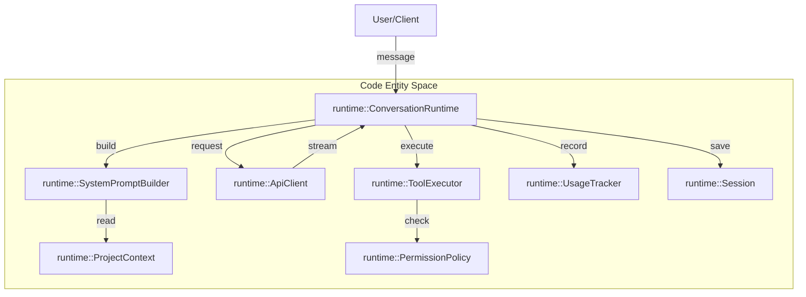
Sources: [rust/crates/runtime/src/lib.rs:82-86](), [rust/crates/runtime/src/conversation.rs:130-143](), [rust/crates/runtime/src/prompt.rs:155-164]()

## Session Management and Compaction

Sessions in CLAW are structured collections of `ConversationMessage` objects, each containing one or more `ContentBlock` variants (Text, Thinking, ToolUse, or ToolResult) [rust/crates/runtime/src/session.rs:33-52](), [rust/crates/runtime/src/session.rs:56-60](). As conversations grow, the runtime uses a compaction engine to stay within model token limits [rust/crates/runtime/src/compact.rs:96-104]().

For details, see [Session Management and Compaction](#2.2.1).

### Token Usage and Pricing
The runtime includes a `UsageTracker` that monitors `TokenUsage` across turns [rust/crates/runtime/src/usage.rs:169-173](). It tracks input, output, and cache-related tokens to provide real-time cost estimates based on model-specific pricing tiers [rust/crates/runtime/src/usage.rs:59-81]().

| Entity | Role | File |
| :--- | :--- | :--- |
| `Session` | Root container for message history | [rust/crates/runtime/src/session.rs:117]() |
| `ConversationMessage` | Individual turn data with role and blocks | [rust/crates/runtime/src/session.rs:56]() |
| `UsageTracker` | Accumulates token counts and costs | [rust/crates/runtime/src/usage.rs:169]() |
| `CompactionConfig` | Settings for context pruning thresholds | [rust/crates/runtime/src/compact.rs:10]() |

Sources: [rust/crates/runtime/src/session.rs:33-60](), [rust/crates/runtime/src/usage.rs:169-173](), [rust/crates/runtime/src/compact.rs:10-22]()

## System Prompt and Project Context

The `SystemPromptBuilder` generates the high-level instructions sent to the LLM [rust/crates/runtime/src/prompt.rs:155-164](). It dynamically constructs the prompt by aggregating environment data, project-specific instruction files (like `CLAW.md`), and real-time state from Git.

For details, see [System Prompt and Project Context](#2.2.2).

### Context Discovery Logic
The `ProjectContext` struct encapsulates the environment state, including `GitContext` and `ContextFile` collections discovered from the workspace [rust/crates/runtime/src/prompt.rs:86-93](). The builder assembles these into a final system prompt string, respecting token budgets for instruction files [rust/crates/runtime/src/prompt.rs:43-44]().

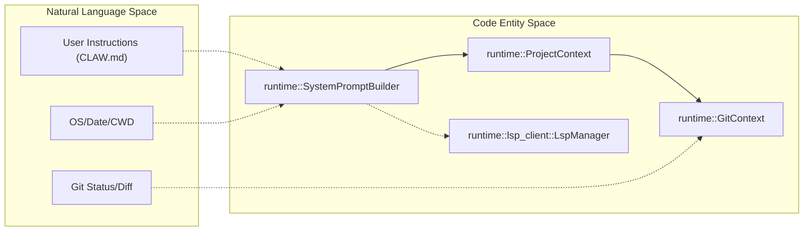
Sources: [rust/crates/runtime/src/prompt.rs:86-93](), [rust/crates/runtime/src/prompt.rs:155-164](), [rust/crates/runtime/src/git_context.rs:93-93](), [rust/crates/runtime/src/lsp_client.rs:23-23]()

## Tool and MCP Integration

The runtime facilitates tool execution through the `ToolExecutor` trait [rust/crates/runtime/src/conversation.rs:62-64](). It specifically handles the Model Context Protocol (MCP) through the `McpServerManager`, which manages the lifecycle of external tool providers [rust/crates/runtime/src/mcp_stdio.rs:122-124]().

*   **Bash Execution**: The runtime provides `execute_bash` which supports command input/output and validation [rust/crates/runtime/src/bash.rs:60-60]().
*   **File Operations**: High-level wrappers for `read_file`, `write_file`, and `edit_file` (using structured patches) are exported for use by the assistant [rust/crates/runtime/src/file_ops.rs:185-190](), [rust/crates/runtime/src/file_ops.rs:87-91]().
*   **Sandboxing**: The `SandboxConfig` and `FilesystemIsolationMode` allow for isolated execution of tools [rust/crates/runtime/src/config.rs:37-37]().
*   **LSP Integration**: The `LspManager` provides diagnostics and workspace symbols to enrich the assistant's context [rust/crates/runtime/src/lib.rs:23-23]().

Sources: [rust/crates/runtime/src/lib.rs:60-125](), [rust/crates/runtime/src/mcp_stdio.rs:122-124](), [rust/crates/runtime/src/file_ops.rs:185-190]()

## Public API Overview

The `runtime/src/lib.rs` file serves as the primary entry point for the crate, re-exporting essential types for consumers:

*   **Configuration**: `RuntimeConfig`, `ConfigLoader`, and various `McpServerConfig` variants [rust/crates/runtime/src/lib.rs:67-77]().
*   **Execution**: `ConversationRuntime`, `ApiClient`, and `BootstrapPlan` [rust/crates/runtime/src/lib.rs:61-86]().
*   **Authentication**: `OAuthTokenSet` and PKCE utilities for secure provider access [rust/crates/runtime/src/lib.rs:126-132]().
*   **Permissions**: `PermissionMode` and `PermissionPolicy` for security enforcement [rust/crates/runtime/src/lib.rs:133-136]().
*   **Recovery**: `FailureScenario` and `RecoveryRecipe` for automated error handling [rust/crates/runtime/src/lib.rs:151-155]().
*   **Lane Management**: `LaneEvent`, `LaneEventStatus`, and `LaneFailureClass` for workflow tracking [rust/crates/runtime/src/lib.rs:97-103]().

Sources: [rust/crates/runtime/src/lib.rs:1-170]()

---

# Page: Session Management and Compaction

# Session Management and Compaction

<details>
<summary>Relevant source files</summary>

The following files were used as context for generating this wiki page:

- [rust/crates/compat-harness/src/lib.rs](rust/crates/compat-harness/src/lib.rs)
- [rust/crates/runtime/src/bash.rs](rust/crates/runtime/src/bash.rs)
- [rust/crates/runtime/src/bash_validation.rs](rust/crates/runtime/src/bash_validation.rs)
- [rust/crates/runtime/src/compact.rs](rust/crates/runtime/src/compact.rs)
- [rust/crates/runtime/src/conversation.rs](rust/crates/runtime/src/conversation.rs)
- [rust/crates/runtime/src/file_ops.rs](rust/crates/runtime/src/file_ops.rs)
- [rust/crates/runtime/src/hooks.rs](rust/crates/runtime/src/hooks.rs)
- [rust/crates/runtime/src/oauth.rs](rust/crates/runtime/src/oauth.rs)
- [rust/crates/runtime/src/prompt.rs](rust/crates/runtime/src/prompt.rs)
- [rust/crates/runtime/src/recovery_recipes.rs](rust/crates/runtime/src/recovery_recipes.rs)
- [rust/crates/runtime/src/session.rs](rust/crates/runtime/src/session.rs)
- [rust/crates/runtime/src/session_control.rs](rust/crates/runtime/src/session_control.rs)
- [rust/crates/runtime/src/summary_compression.rs](rust/crates/runtime/src/summary_compression.rs)
- [rust/crates/runtime/src/trident.rs](rust/crates/runtime/src/trident.rs)
- [rust/crates/runtime/src/usage.rs](rust/crates/runtime/src/usage.rs)
- [rust/crates/runtime/src/worker_boot.rs](rust/crates/runtime/src/worker_boot.rs)
- [rust/crates/rusty-claude-cli/src/render.rs](rust/crates/rusty-claude-cli/src/render.rs)

</details>


This page details the technical implementation of conversation persistence and context management within the `claw-code` runtime. It covers how the system serializes interaction history to disk, tracks token usage and associated costs, and performs automated session compaction when token budgets are exceeded.

## Session Data Model

The core of the conversation engine is the `Session` struct, which serves as the container for all interaction history between the user and the assistant.

### Key Entities

*   **`Session`**: The top-level container holding a sequence of messages, prompt history, and metadata like `workspace_root` to prevent cross-project state leakage [rust/crates/runtime/src/session.rs:117-133]().
*   **`ConversationMessage`**: Represents a single turn in the conversation. It includes a `MessageRole`, a list of `ContentBlock`s, and optional `TokenUsage` metadata [rust/crates/runtime/src/session.rs:56-60]().
*   **`MessageRole`**: Enum defining the speaker: `System`, `User`, `Assistant`, or `Tool` [rust/crates/runtime/src/session.rs:24-29]().
*   **`ContentBlock`**: An enum representing different types of message content:
    *   `Text`: Standard prose [rust/crates/runtime/src/session.rs:34-36]().
    *   `Thinking`: Internal model reasoning and signature [rust/crates/runtime/src/session.rs:37-40]().
    *   `ToolUse`: A request from the assistant to execute a specific tool with JSON input [rust/crates/runtime/src/session.rs:41-45]().
    *   `ToolResult`: The output returned by a tool execution, including error status and the original `tool_use_id` [rust/crates/runtime/src/session.rs:46-51]().

### Serialization and Persistence

Sessions are serialized to and from JSON for disk persistence. The `Session` struct provides helper methods to interact with the filesystem:
*   `save_to_path`: Serializes the session and performs atomic writes to disk, including log rotation if the file exceeds `ROTATE_AFTER_BYTES` (256 KB) [rust/crates/runtime/src/session.rs:14-15]().
*   `load_from_path`: Reads a file from disk and parses the JSON content back into a `Session` object [rust/crates/runtime/src/session.rs:240-255]().

**Entity Mapping: Natural Language to Code**

| Concept | Code Entity | File |
| :--- | :--- | :--- |
| Interaction History | `Session` | [rust/crates/runtime/src/session.rs:117]() |
| Message Turn | `ConversationMessage` | [rust/crates/runtime/src/session.rs:56]() |
| Role (User/AI) | `MessageRole` | [rust/crates/runtime/src/session.rs:24]() |
| Tool Call | `ContentBlock::ToolUse` | [rust/crates/runtime/src/session.rs:41]() |
| Tool Output | `ContentBlock::ToolResult` | [rust/crates/runtime/src/session.rs:46]() |
| Session Version | `SESSION_VERSION` | [rust/crates/runtime/src/session.rs:13]() |

Sources: [rust/crates/runtime/src/session.rs:1-255]()

## Token Usage and Pricing

The `UsageTracker` monitors the resource consumption of a session, calculating both token counts and estimated financial costs based on model-specific pricing tiers.

### Token Tracking
The `TokenUsage` struct tracks four distinct categories of tokens [rust/crates/runtime/src/usage.rs:31-36]():
1.  `input_tokens`: Standard prompt tokens.
2.  `output_tokens`: Tokens generated by the model.
3.  `cache_creation_input_tokens`: Tokens written to the provider's context cache.
4.  `cache_read_input_tokens`: Tokens retrieved from the provider's context cache.

### Pricing Tiers
Pricing is determined by the `ModelPricing` struct [rust/crates/runtime/src/usage.rs:9-15](). The system includes hardcoded tiers for specific model families (Haiku, Opus, Sonnet) via the `pricing_for_model` function [rust/crates/runtime/src/usage.rs:59-81]().

### Cost Estimation
The `UsageTracker` aggregates usage across multiple turns [rust/crates/runtime/src/usage.rs:169-173](). It can be initialized from an existing `Session` by iterating through message metadata [rust/crates/runtime/src/usage.rs:182-190]().

**Usage Calculation Flow**

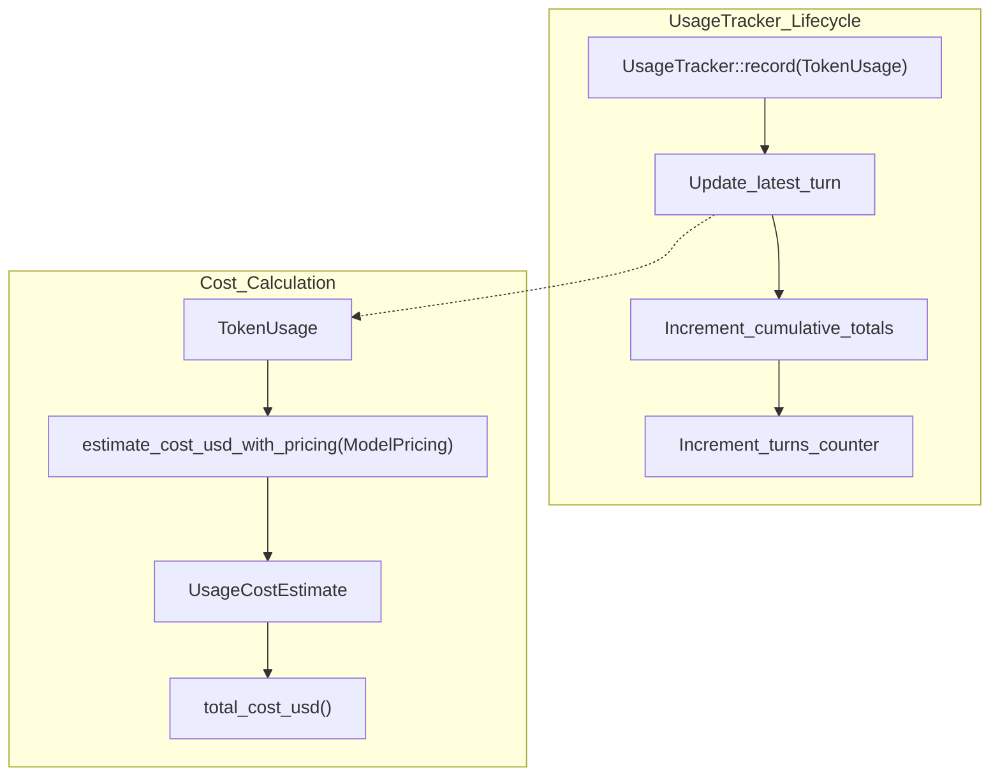

Sources: [rust/crates/runtime/src/usage.rs:1-215]()

## Session Compaction

Compaction is the process of summarizing old conversation history to stay within the model's context window (token budget).

### Compaction Logic
The runtime uses `CompactionConfig` to define thresholds for when compaction should trigger [rust/crates/runtime/src/compact.rs:10-13](). By default, it preserves 4 recent messages and triggers when estimated tokens exceed 10,000 [rust/crates/runtime/src/compact.rs:15-22]().

1.  **`should_compact`**: Determines if the current session exceeds the token limit defined in the configuration [rust/crates/runtime/src/compact.rs:41-51]().
2.  **`estimate_session_tokens`**: Provides a heuristic count of tokens currently in the session by summing `estimate_message_tokens` across all messages [rust/crates/runtime/src/compact.rs:35-37]().
3.  **`compact_session`**: The primary transformation function. It removes older messages, summarizes them, and replaces them with a synthetic system message [rust/crates/runtime/src/compact.rs:96-181]().
4.  **`get_compact_continuation_message`**: Builds the post-compaction system prompt, including the summary and instructions to resume without recap [rust/crates/runtime/src/compact.rs:71-92]().

### Trident Compaction Pipeline
For advanced context management, the `trident_compact_session` function implements a multi-stage pipeline [rust/crates/runtime/src/trident.rs:105-160]():
1.  **Stage 1: Supersede**: Removes obsolete file operations (e.g., intermediate reads of a file that was later overwritten) [rust/crates/runtime/src/trident.rs:179-217]().
2.  **Stage 2: Collapse**: Summarizes long chains of related tool interactions [rust/crates/runtime/src/trident.rs:126-132]().
3.  **Stage 3: Cluster**: Groups similar messages based on content similarity [rust/crates/runtime/src/trident.rs:134-143]().

### Boundary Protection
To prevent 400 errors from providers (like OpenAI), the compaction logic includes a "walk-back" mechanism. If the compaction boundary splits a `ToolUse` and its corresponding `ToolResult`, the logic moves the boundary to ensure the pair stays intact [rust/crates/runtime/src/compact.rs:121-158]().

**Compaction Implementation Architecture**

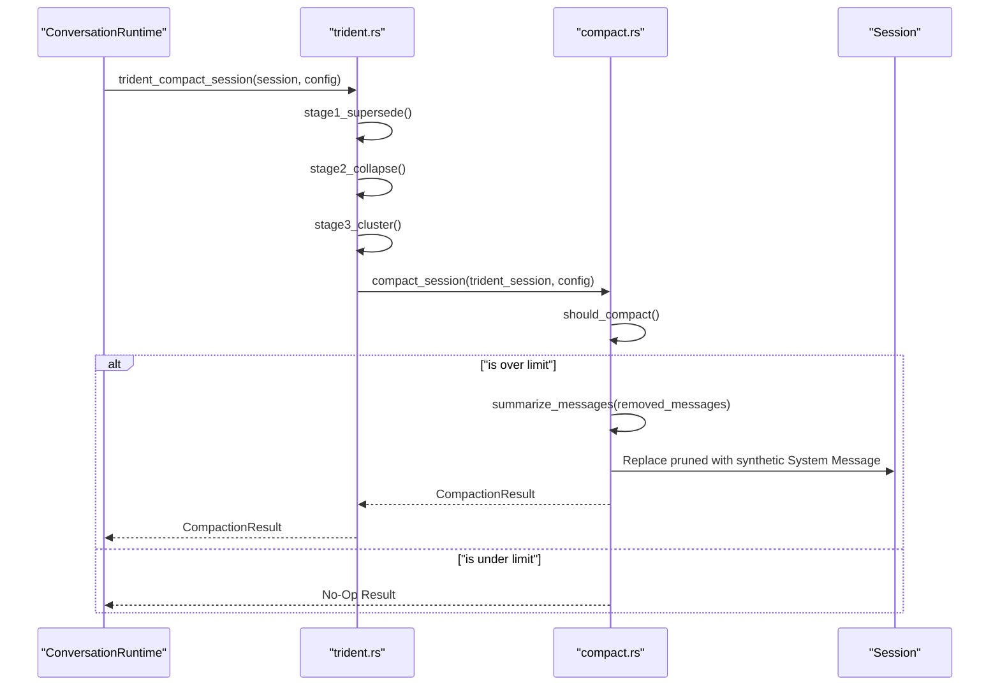

Sources: [rust/crates/runtime/src/compact.rs:1-181](), [rust/crates/runtime/src/trident.rs:1-160]()

## Workspace Isolation and Session Store

To prevent parallel `opencode serve` instances from colliding, sessions are managed by a `SessionStore` that namespaces files by a workspace fingerprint.

### SessionStore Architecture
*   **`SessionStore`**: Derives a unique hash from the workspace root path and stores sessions in `<data_dir>/sessions/<workspace_hash>/` [rust/crates/runtime/src/session_control.rs:20-26]().
*   **`SessionHandle`**: A reference to a specific session ID and its absolute path on disk [rust/crates/runtime/src/session_control.rs:87-92]().
*   **`SessionControlError`**: A taxonomy of errors including `Format`, `Io`, and `WorkspaceMismatch` [rust/crates/runtime/src/session_control.rs:241-255]().

### Key Operations
*   **`resolve_reference`**: Resolves session IDs or aliases (like `latest`) into a `SessionHandle` [rust/crates/runtime/src/session_control.rs:95-125]().
*   **`latest_session_excluding`**: Find the most recent session, skipping the current empty session to find actual conversation history for resume [rust/crates/runtime/src/session_control.rs:179-200]().
*   **`validate_loaded_session`**: Ensures that a loaded session matches the expected `workspace_root` of the store, preventing "phantom completions" across different projects [rust/crates/runtime/src/session_control.rs:222-239]().

**Workspace Mapping: Filesystem to Code**

| Path Component | Code Logic | File |
| :--- | :--- | :--- |
| `.claw/sessions/` | `SessionStore::from_cwd` | [rust/crates/runtime/src/session_control.rs:32]() |
| `<workspace_hash>` | `workspace_fingerprint()` | [rust/crates/runtime/src/session_control.rs:42]() |
| `<id>.jsonl` | `PRIMARY_SESSION_EXTENSION` | [rust/crates/runtime/src/session_control.rs:91]() |
| `latest` alias | `is_session_reference_alias()` | [rust/crates/runtime/src/session_control.rs:107]() |

Sources: [rust/crates/runtime/src/session_control.rs:1-266](), [rust/crates/runtime/src/session.rs:117-133]()

---

# Page: System Prompt and Project Context

# System Prompt and Project Context

<details>
<summary>Relevant source files</summary>

The following files were used as context for generating this wiki page:

- [rust/crates/runtime/src/compact.rs](rust/crates/runtime/src/compact.rs)
- [rust/crates/runtime/src/conversation.rs](rust/crates/runtime/src/conversation.rs)
- [rust/crates/runtime/src/git_context.rs](rust/crates/runtime/src/git_context.rs)
- [rust/crates/runtime/src/hooks.rs](rust/crates/runtime/src/hooks.rs)
- [rust/crates/runtime/src/lsp_client.rs](rust/crates/runtime/src/lsp_client.rs)
- [rust/crates/runtime/src/mcp_tool_bridge.rs](rust/crates/runtime/src/mcp_tool_bridge.rs)
- [rust/crates/runtime/src/oauth.rs](rust/crates/runtime/src/oauth.rs)
- [rust/crates/runtime/src/permission_enforcer.rs](rust/crates/runtime/src/permission_enforcer.rs)
- [rust/crates/runtime/src/plugin_lifecycle.rs](rust/crates/runtime/src/plugin_lifecycle.rs)
- [rust/crates/runtime/src/prompt.rs](rust/crates/runtime/src/prompt.rs)
- [rust/crates/runtime/src/session.rs](rust/crates/runtime/src/session.rs)
- [rust/crates/runtime/src/stale_branch.rs](rust/crates/runtime/src/stale_branch.rs)
- [rust/crates/runtime/src/team_cron_registry.rs](rust/crates/runtime/src/team_cron_registry.rs)
- [rust/crates/rusty-claude-cli/src/render.rs](rust/crates/rusty-claude-cli/src/render.rs)

</details>


The system prompt in `claw-code` is a dynamically assembled multi-section document that defines the AI's identity, capabilities, and environmental awareness. It bridges the gap between static model instructions and the real-time state of the user's local development environment, including Git status, file-based instructions, and Language Server Protocol (LSP) diagnostics.

## SystemPromptBuilder Architecture

The `SystemPromptBuilder` struct in the `runtime` crate is the primary engine for composing the prompt. It follows a builder pattern to collect various context fragments before performing a final ordered join [rust/crates/runtime/src/prompt.rs:155-164]().

### Composition Order
The `build()` function defines a strict sequence for the prompt sections to ensure the model prioritizes identity and safety before processing project-specific data [rust/crates/runtime/src/prompt.rs:211-214]():

1.  **Intro & Style**: Basic identity and optional output formatting styles (e.g., Markdown preferences) [rust/crates/runtime/src/prompt.rs:213-214]().
2.  **System & Tasks**: Core behavioral instructions and task-handling logic.
3.  **Actions**: Definitions of available tools and interaction patterns.
4.  **Dynamic Boundary**: A marker (`__SYSTEM_PROMPT_DYNAMIC_BOUNDARY__`) used to separate static instructions from volatile context [rust/crates/runtime/src/prompt.rs:40-40]().
5.  **Environment**: OS version, current date, working directory, and model family identity [rust/crates/runtime/src/prompt.rs:180-190]().
6.  **Project Context**: Git status, diffs, and discovered instruction files (like `CLAW.md`) encapsulated in `ProjectContext` [rust/crates/runtime/src/prompt.rs:193-196]().
7.  **Runtime Config**: Active configuration settings, including model aliases and permission rules [rust/crates/runtime/src/prompt.rs:199-202]().
8.  **Appended Sections**: External injections such as LSP context, plugin-specific instructions, or custom user sections [rust/crates/runtime/src/prompt.rs:205-208]().

### Data Flow: Context to Prompt
The following diagram illustrates how disparate system entities are aggregated into the `SystemPromptBuilder`.

**Prompt Composition Data Flow**
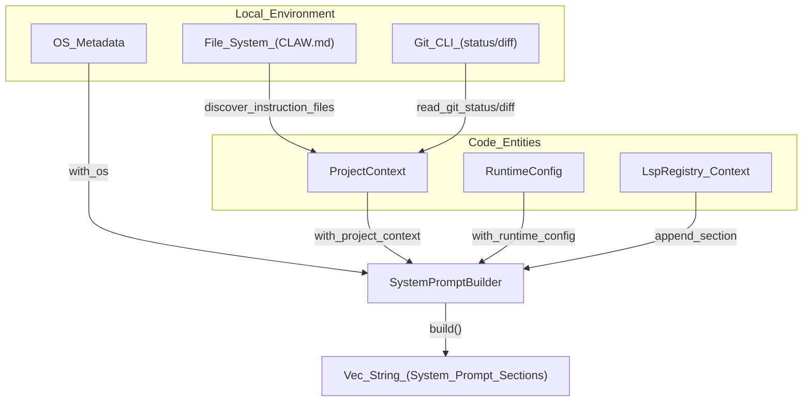
Sources: [rust/crates/runtime/src/prompt.rs:96-139](), [rust/crates/runtime/src/prompt.rs:166-208](), [rust/crates/runtime/src/lsp_client.rs:110-124]()

## Project Context Discovery

The `ProjectContext` struct encapsulates the volatile state of the workspace. It is populated via discovery methods that scan the environment [rust/crates/runtime/src/prompt.rs:85-93]().

### Instruction File Discovery
The system searches for instruction files starting from the current working directory. The discovery logic is encapsulated in `discover_instruction_files` which is called during context initialization [rust/crates/runtime/src/prompt.rs:101-101]().

Discovery methods include:
*   `ProjectContext::discover`: Standard discovery of instruction files [rust/crates/runtime/src/prompt.rs:96-110]().
*   `ProjectContext::discover_with_git`: Discovery enriched with Git status and diff data [rust/crates/runtime/src/prompt.rs:129-138]().
*   `ProjectContext::discover_with_rules_import`: Discovery that respects specific `RulesImportConfig` settings [rust/crates/runtime/src/prompt.rs:112-127]().

### Budgeting and Deduplication
To prevent context window exhaustion, the builder enforces strict limits on instruction files:
*   **Per-file limit**: 4,000 characters (`MAX_INSTRUCTION_FILE_CHARS`) [rust/crates/runtime/src/prompt.rs:43-43]().
*   **Total limit**: 12,000 characters (`MAX_TOTAL_INSTRUCTION_CHARS`) [rust/crates/runtime/src/prompt.rs:44-44]().

Files are stored as `ContextFile` objects which include both the `PathBuf` and the file `content` [rust/crates/runtime/src/prompt.rs:66-70]().

## Git and LSP Enrichment

### Git Integration
The `GitContext` struct captures the repository state including the current branch, recent commit history, and staged files.
*   `GitContext::detect(cwd)`: Detects the repository state for a given directory [rust/crates/runtime/src/prompt.rs:136-136]().
*   The `ProjectContext` stores this as `git_status` and `git_diff` strings, as well as the structured `GitContext` [rust/crates/runtime/src/prompt.rs:89-91]().

### Context Limits for Large Diffs
To avoid overwhelming the model with large changes, the system limits the raw Git diff output to 50,000 characters (`MAX_GIT_DIFF_CHARS`) [rust/crates/runtime/src/prompt.rs:45-45]().

### LSP Context Injection
The `LspRegistry` manages language server states, including diagnostics [rust/crates/runtime/src/lsp_client.rs:109-117](). Diagnostics for specific files can be retrieved via `get_diagnostics` and appended to the prompt to give the model awareness of compilation errors or lints [rust/crates/runtime/src/lsp_client.rs:196-205]().

**Entity Mapping: Context to Code Entities**
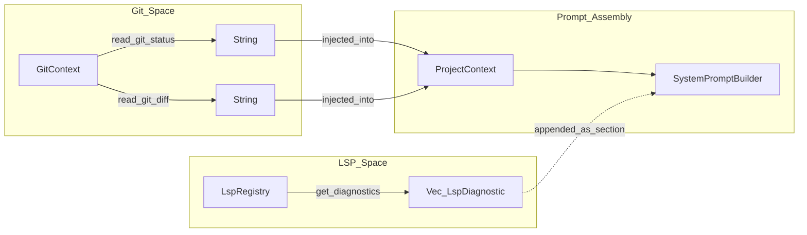
Sources: [rust/crates/runtime/src/prompt.rs:85-93](), [rust/crates/runtime/src/prompt.rs:141-151](), [rust/crates/runtime/src/lsp_client.rs:196-205]()

## Key Implementation Details

| Component | Responsibility | Source |
| :--- | :--- | :--- |
| `ContextFile` | Holds the path and content of a discovered instruction file (e.g., `CLAW.md`). | [rust/crates/runtime/src/prompt.rs:66-70]() |
| `ProjectContext` | Aggregator for CWD, Date, Git status, and instruction files. | [rust/crates/runtime/src/prompt.rs:85-93]() |
| `SystemPromptBuilder` | Orchestrates the construction of the multi-section prompt string. | [rust/crates/runtime/src/prompt.rs:155-164]() |
| `ModelFamilyIdentity` | Controls the model family label (e.g., "Claude Opus 4.6" vs "an AI assistant"). | [rust/crates/runtime/src/prompt.rs:49-53]() |
| `SYSTEM_PROMPT_DYNAMIC_BOUNDARY` | Constant string used to separate static and dynamic prompt parts. | [rust/crates/runtime/src/prompt.rs:40-40]() |
| `FRONTIER_MODEL_NAME` | The default name used for the assistant identity ("Claude Opus 4.6"). | [rust/crates/runtime/src/prompt.rs:42-42]() |
| `LspRegistry` | Manages LSP server states and diagnostic information. | [rust/crates/runtime/src/lsp_client.rs:109-112]() |

Sources: [rust/crates/runtime/src/prompt.rs:1-214](), [rust/crates/runtime/src/lsp_client.rs:1-224]()

---

# Page: API Client and Provider Abstraction

# API Client and Provider Abstraction

<details>
<summary>Relevant source files</summary>

The following files were used as context for generating this wiki page:

- [rust/crates/api/src/client.rs](rust/crates/api/src/client.rs)
- [rust/crates/api/src/error.rs](rust/crates/api/src/error.rs)
- [rust/crates/api/src/http_client.rs](rust/crates/api/src/http_client.rs)
- [rust/crates/api/src/lib.rs](rust/crates/api/src/lib.rs)
- [rust/crates/api/src/prompt_cache.rs](rust/crates/api/src/prompt_cache.rs)
- [rust/crates/api/src/providers/anthropic.rs](rust/crates/api/src/providers/anthropic.rs)
- [rust/crates/api/src/providers/mod.rs](rust/crates/api/src/providers/mod.rs)
- [rust/crates/api/src/providers/openai_compat.rs](rust/crates/api/src/providers/openai_compat.rs)
- [rust/crates/api/src/sse.rs](rust/crates/api/src/sse.rs)
- [rust/crates/api/src/types.rs](rust/crates/api/src/types.rs)
- [rust/crates/api/tests/client_integration.rs](rust/crates/api/tests/client_integration.rs)
- [rust/crates/api/tests/openai_compat_integration.rs](rust/crates/api/tests/openai_compat_integration.rs)
- [rust/crates/api/tests/proxy_integration.rs](rust/crates/api/tests/proxy_integration.rs)
- [rust/crates/telemetry/Cargo.toml](rust/crates/telemetry/Cargo.toml)
- [rust/crates/telemetry/src/lib.rs](rust/crates/telemetry/src/lib.rs)

</details>


The `api` crate provides a unified interface for interacting with various Large Language Model (LLM) providers. It abstracts away the differences between the native Anthropic-style API (the primary provider for Claw) and OpenAI-compatible providers (like xAI, OpenAI, or Alibaba DashScope) by normalizing requests, responses, and Server-Sent Event (SSE) streams into a single set of internal types defined in `types.rs`.

## Provider Abstraction Layer

The core of the abstraction is the `ProviderClient` enum and the underlying `Provider` trait. This design allows the `runtime` crate to remain agnostic of vendor-specific API shapes or authentication quirks.

### ProviderClient Enum
The `ProviderClient` acts as the primary entry point. It dispatches calls to the appropriate implementation based on the detected `ProviderKind`.

[rust/crates/api/src/client.rs:10-14]()

### The Provider Trait
The `Provider` trait defines the asynchronous interface for sending messages and establishing streams. It is implemented by `AnthropicClient` and `OpenAiCompatClient`.

[rust/crates/api/src/providers/mod.rs:18-30]()

### Data Flow: Request to Provider
The following diagram illustrates how a generic `MessageRequest` is routed through the `ProviderClient` to a specific provider implementation and eventually to the network.

**Provider Dispatch and Normalization**
```mermaid
graph TD
    subgraph "InternalSpace_[api::types]"
        [MessageRequest] --> [ProviderClient]
        [ProviderClient] --> [MessageStream]
    end

    subgraph "ProviderImplementations_[api::providers]"
        [AnthropicClient]
        [OpenAiCompatClient]
    end

    subgraph "NetworkSpace"
        [NET_Anthropic]
        [NET_xAI]
        [NET_OpenAI]
        [NET_DashScope]
    end

    [MessageRequest] --> [ProviderClient]
    [ProviderClient] -- "detect_provider_kind()" --> [AnthropicClient]
    [ProviderClient] -- "detect_provider_kind()" --> [OpenAiCompatClient]
    
    [AnthropicClient] -- "POST_/v1/messages" --> [NET_Anthropic]
    [OpenAiCompatClient] -- "POST_/chat/completions" --> [NET_xAI]
    [OpenAiCompatClient] -- "POST_/chat/completions" --> [NET_OpenAI]
    [OpenAiCompatClient] -- "POST_/compatible-mode/v1" --> [NET_DashScope]

    [NET_Anthropic] -- "SSE_Frames" --> [AnthropicClient]
    [NET_xAI] -- "SSE_Frames" --> [OpenAiCompatClient]

    [AnthropicClient] -- "normalize" --> [MessageStream]
    [OpenAiCompatClient] -- "normalize" --> [MessageStream]
```
Sources: [rust/crates/api/src/client.rs:17-56](), [rust/crates/api/src/providers/mod.rs:206-220](), [rust/crates/api/src/providers/openai_compat.rs:120-159]()

## Model Alias Resolution and Detection

The crate maintains a `MODEL_REGISTRY` that maps common aliases to their canonical model IDs and associated providers.

*   **`resolve_model_alias`**: Converts short names like `opus` to `claude-opus-4-7` or `grok` to `grok-3`. [rust/crates/api/src/providers/mod.rs:206-220]()
*   **`detect_provider_kind`**: Determines the `ProviderKind` (Anthropic, Xai, or OpenAi). It handles sniffs environment variables like `OLLAMA_HOST` for routing. [rust/crates/api/src/client.rs:37-41]()
*   **`metadata_for_model`**: Returns `ProviderMetadata` including the expected environment variables for authentication (e.g., `DASHSCOPE_API_KEY` for Qwen models). [rust/crates/api/src/providers/mod.rs:121-203]()

## Authentication and AuthSource

Authentication is encapsulated in the `AuthSource` enum, supporting API keys, bearer tokens, and hybrid configurations.

| Variant | Description | Implementation Detail |
| :--- | :--- | :--- |
| `None` | No authentication. | [rust/crates/api/src/providers/anthropic.rs:34]() |
| `ApiKey(String)` | Standard `x-api-key` header for Anthropic. | [rust/crates/api/src/providers/anthropic.rs:35]() |
| `BearerToken(String)` | Standard `Authorization: Bearer` header. | [rust/crates/api/src/providers/anthropic.rs:36]() |
| `ApiKeyAndBearer` | Both headers (used for proxied requests). | [rust/crates/api/src/providers/anthropic.rs:37-41]() |

The `AuthSource::apply` method attaches these credentials to a `reqwest::RequestBuilder`. [rust/crates/api/src/providers/anthropic.rs:87-95]()

### OAuth and Token Management
The crate supports OAuth2 PKCE flows via `OAuthTokenSet`. It includes logic to check if tokens are expired and to resolve them from saved credentials using `runtime` hooks. [rust/crates/api/src/providers/anthropic.rs:98-111](), [rust/crates/api/src/client.rs:141-143]()

## Stream Normalization and SSE Parsing

LLM providers use different SSE (Server-Sent Events) formats. The `api` crate normalizes these into a single `StreamEvent` stream.

### MessageStream Normalization
The `MessageStream` enum wraps provider-specific streams and exposes a unified `next_event()` method.

[rust/crates/api/src/client.rs:118-139]()

### SseParser
The `SseParser` handles byte-buffering and frame splitting, supporting both `\n\n` and `\r\n\r\n` separators. It attaches provider and model context to frames to improve error reporting during deserialization. [rust/crates/api/src/sse.rs:11-26](), [rust/crates/api/src/sse.rs:59-79]()

**SSE Normalization Pipeline**
```mermaid
graph LR
    subgraph "ByteStream"
        [Raw_Bytes]
    end

    subgraph "api::sse"
        [SseParser::push]
        [parse_frame_with_provider]
    end

    subgraph "ProviderLogic"
        [Anthropic_MessageStream]
        [OpenAi_MessageStream]
    end

    subgraph "InternalTypes"
        [StreamEvent]
    end

    [Raw_Bytes] --> [SseParser::push]
    [SseParser::push] --> [parse_frame_with_provider]
    [parse_frame_with_provider] -- "JSON_payload" --> [Anthropic_MessageStream]
    [parse_frame_with_provider] -- "JSON_payload" --> [OpenAi_MessageStream]
    [Anthropic_MessageStream] -- "yield" --> [StreamEvent]
    [OpenAi_MessageStream] -- "yield" --> [StreamEvent]
```
Sources: [rust/crates/api/src/sse.rs:28-39](), [rust/crates/api/src/sse.rs:86-128](), [rust/crates/api/src/client.rs:101-115]()

## OpenAI-Compatible Client Support

The `OpenAiCompatClient` allows Claw to use models from xAI, OpenAI, or Alibaba DashScope.

*   **Configurability**: `OpenAiCompatConfig` defines the environment variables and base URLs for different providers, including specific body size limits (e.g., 6MB for DashScope). [rust/crates/api/src/providers/openai_compat.rs:31-41]()
*   **DashScope Support**: Specifically handles the Alibaba DashScope compatible-mode endpoint for Qwen and Kimi family models. [rust/crates/api/src/providers/openai_compat.rs:88-96]()
*   **Local Providers**: Supports local environments like Ollama via `from_ollama_env`, which uses a placeholder key and specific base URL logic. [rust/crates/api/src/providers/openai_compat.rs:162-175]()

For detailed handling of model-specific parameters and routing, see [Model Compatibility and Provider Routing](#2.3.1).

## Prompt Caching

The `PromptCache` system provides local disk-based caching of model responses to reduce latency and costs.

*   **Lookup**: `lookup_completion` hashes the `MessageRequest` to find cached responses. [rust/crates/api/src/prompt_cache.rs:145-193]()
*   **Persistence**: Responses are stored as JSON in a session-specific directory under a base cache root. [rust/crates/api/src/prompt_cache.rs:54-73]()
*   **Stats**: Tracks hits, misses, and token savings (cache creation vs. cache read). [rust/crates/api/src/prompt_cache.rs:76-91]()

## Error Handling and Retries

The `ApiError` enum provides a rich taxonomy of failures, including context window exhaustion and authentication errors.

*   **`is_retryable`**: Identifies transient errors (timeouts, connection issues, or specific API error codes like 429). [rust/crates/api/src/error.rs:146-162]()
*   **Preflight Checks**: The client validates token limits and request body sizes locally before making network calls. [rust/crates/api/tests/client_integration.rs:159-184](), [rust/crates/api/src/providers/openai_compat.rs:19-28]()
*   **Retries**: Implementations use exponential backoff (defaulting to 8 retries) for transient failures. [rust/crates/api/src/providers/openai_compat.rs:26-28]()

Sources: [rust/crates/api/src/error.rs:27-82](), [rust/crates/api/src/providers/mod.rs:121-203](), [rust/crates/api/src/prompt_cache.rs:10-12]()

---

# Page: Model Compatibility and Provider Routing

# Model Compatibility and Provider Routing

<details>
<summary>Relevant source files</summary>

The following files were used as context for generating this wiki page:

- [docs/MODEL_COMPATIBILITY.md](docs/MODEL_COMPATIBILITY.md)
- [prd.json](prd.json)
- [progress.txt](progress.txt)
- [rust/crates/api/benches/request_building.rs](rust/crates/api/benches/request_building.rs)
- [rust/crates/api/src/error.rs](rust/crates/api/src/error.rs)
- [rust/crates/api/src/providers/anthropic.rs](rust/crates/api/src/providers/anthropic.rs)
- [rust/crates/api/src/providers/mod.rs](rust/crates/api/src/providers/mod.rs)
- [rust/crates/api/src/providers/openai_compat.rs](rust/crates/api/src/providers/openai_compat.rs)
- [rust/crates/api/tests/openai_compat_integration.rs](rust/crates/api/tests/openai_compat_integration.rs)
- [rust/crates/api/tests/provider_client_integration.rs](rust/crates/api/tests/provider_client_integration.rs)

</details>


The `claw-code` API client provides a unified interface for multiple LLM providers. While the Anthropic provider is primary, the OpenAI-compatible provider (`openai_compat.rs`) implements extensive model-specific logic to normalize behavior across diverse backends like OpenAI, xAI, and Alibaba DashScope. This page details the routing logic, parameter stripping for reasoning models, and the specialized handling required for compatibility with various "OpenAI-compatible" endpoints, including local providers like Ollama.

## Overview

The `OpenAiCompatClient` translates internal `MessageRequest` objects into the OpenAI Chat Completions format. Because many providers claim OpenAI compatibility but vary in their strictness regarding specific fields (e.g., `is_error` in tool results or sampling parameters in reasoning models), the client applies a series of transformations based on the resolved model name.

**Core Responsibilities:**
*   **Model Alias Resolution:** Mapping short names like `grok` or `kimi` to canonical IDs [rust/crates/api/src/providers/mod.rs:206-232]().
*   **Parameter Stripping:** Removing incompatible sampling fields for reasoning models [docs/MODEL_COMPATIBILITY.md:60-75]().
*   **Field Normalization:** Swapping `max_tokens` for `max_completion_tokens` where required [docs/MODEL_COMPATIBILITY.md:98-111]().
*   **Provider Routing:** Directing requests to specific base URLs (e.g., DashScope for Qwen/Kimi) based on model prefixes [rust/crates/api/src/providers/openai_compat.rs:83-96]().
*   **Local Provider Support:** Specialized setup for Ollama, llama.cpp, and vLLM [rust/crates/api/src/providers/openai_compat.rs:52-58]().

### Request Flow and Entity Mapping

The following diagram illustrates how a generic request is routed and transformed into a provider-specific payload.

**Model Routing and Transformation Pipeline**

```mermaid
graph TD
    subgraph "Natural Language Space"
        User["User Prompt / CLI Flag"]
    end

    subgraph "Code Entity Space (rust/crates/api/src)"
        MR["MessageRequest (types.rs)"]
        RAM["resolve_model_alias (providers/mod.rs)"]
        OACC["OpenAiCompatClient (providers/openai_compat.rs)"]
        BCCR["build_chat_completion_request"]
        
        subgraph "Compatibility Logic"
            IRM["is_reasoning_model"]
            MRIE["model_rejects_is_error_field"]
        end
    end

    User -->|"--model grok"| RAM
    RAM -->| "grok-3" | MR
    MR --> OACC
    OACC --> BCCR
    BCCR --> IRM
    BCCR --> MRIE
    
    IRM -->| "If true" | Strip["Strip temperature/top_p"]
    MRIE -->| "If true (Kimi)" | Exclude["Exclude is_error from ToolResults"]
    
    Exclude --> Final["Final JSON Payload"]
    Strip --> Final
```
Sources: [rust/crates/api/src/providers/mod.rs:206-232](), [rust/crates/api/src/providers/openai_compat.rs:172-200](), [docs/MODEL_COMPATIBILITY.md:158-174]()

---

## Model-Specific Handling

### Reasoning Models and Parameter Stripping
Reasoning models (Chain-of-Thought) often use fixed sampling strategies and will reject standard OpenAI parameters with a `400 Bad Request`. 

*   **Affected Models:** OpenAI `o1`/`o3`/`o4`, xAI `grok-3-mini`, and Alibaba `qwen-qwq` or `qwen3-*-thinking` [docs/MODEL_COMPATIBILITY.md:62-65]().
*   **Implementation:** The function `is_reasoning_model` detects these via prefix matching [docs/MODEL_COMPATIBILITY.md:79-92]().
*   **Stripped Fields:** `temperature`, `top_p`, `frequency_penalty`, and `presence_penalty` [docs/MODEL_COMPATIBILITY.md:67-71]().

### Kimi and DashScope Routing
Models from the Kimi family and Qwen family are routed through Alibaba's DashScope compatible-mode endpoint.

*   **Base URL:** `https://dashscope.aliyuncs.com/compatible-mode/v1` [rust/crates/api/src/providers/openai_compat.rs:23-23]().
*   **Authentication:** Uses `DASHSCOPE_API_KEY` [rust/crates/api/src/providers/openai_compat.rs:45-45]().
*   **Kimi `is_error` Exclusion:** Kimi models (e.g., `kimi-k2.5`) specifically reject the `is_error` field in tool result blocks, returning a `400 Bad Request` if present [docs/MODEL_COMPATIBILITY.md:37-45](). The client detects `kimi` in the model name via `model_rejects_is_error_field` and excludes this field during message translation [docs/MODEL_COMPATIBILITY.md:31-53]().

### GPT-5 Token Handling
Future-proofing for GPT-5 includes a transition from the `max_tokens` field to `max_completion_tokens`.
*   **Behavior:** If the model ID starts with `gpt-5`, the request payload uses `max_completion_tokens` [docs/MODEL_COMPATIBILITY.md:115-120]().

---

## Local Providers and Custom Gateways

### Local Provider Setup (Ollama, vLLM)
`claw-code` supports local inference engines that provide OpenAI-compatible endpoints.

*   **Ollama:** Configured via `OLLAMA_HOST` env var. It defaults to `http://127.0.0.1:11434/v1` and uses a placeholder `ollama` API key [rust/crates/api/src/providers/openai_compat.rs:52-58](), [rust/crates/api/src/providers/openai_compat.rs:162-175]().
*   **Local OpenAI Detection:** If `OPENAI_BASE_URL` points to a local address (e.g., `127.0.0.1`, `localhost`), the client defaults to a `local-dev-token` if no key is provided [rust/crates/api/src/providers/openai_compat.rs:146-150]().

### Custom Gateway Support
For users targeting OpenRouter or private gateways, the client supports custom base URLs while preserving complex model slugs.

*   **Slash Preservation:** While the standard OpenAI provider strips prefixes, non-local custom base URLs preserve slash-containing IDs like `openai/gpt-4.1-mini` to ensure gateways receive the exact ID expected [docs/MODEL_COMPATIBILITY.md:146-154]().
*   **Extra Body Parameters:** The `MessageRequest` includes an `extra_body` map allowing passthrough of provider-specific JSON (e.g., `web_search_options`) without overriding core fields like `model` or `messages` [docs/MODEL_COMPATIBILITY.md:153-156]().

---

## Provider Diagnostics and Routing

The `api` crate provides a diagnostic surface used by the `doctor` command to verify connectivity and configuration.

**Diagnostic Data Flow**

```mermaid
graph LR
    subgraph "CLI Space"
        Doctor["'claw doctor' command"]
    end

    subgraph "API Runtime (rust/crates/api/src)"
        PDM["provider_diagnostics_for_model"]
        MK["ProviderKind (mod.rs)"]
        OACC_D["OpenAiCompatConfig"]
    end

    Doctor --> PDM
    PDM --> MK
    PDM --> OACC_D
    
    OACC_D -->|"Env Vars"| EBV["base_url_env"]
    OACC_D -->|"Defaults"| DBU["default_base_url"]
```
Sources: [rust/crates/api/src/providers/mod.rs:104-119](), [rust/crates/api/src/providers/openai_compat.rs:30-41](), [rust/crates/api/tests/provider_client_integration.rs:17-33]()

### Summary Table: Model Compatibility Logic

| Feature | Logic Location | Target Models |
| :--- | :--- | :--- |
| **Alias Resolution** | `resolve_model_alias` | `opus`, `sonnet`, `grok`, `kimi` |
| **Auth Env Var** | `OpenAiCompatConfig` | `XAI_API_KEY`, `DASHSCOPE_API_KEY`, etc. |
| **Reasoning Strip** | `is_reasoning_model` | `o1`, `o3`, `grok-3-mini`, `qwq` |
| **`is_error` Exclusion** | `model_rejects_is_error_field` | `kimi-*` |
| **Token Field Swap** | `build_chat_completion_request` | `gpt-5-*` |
| **Body Passthrough** | `extra_body` map | Custom Gateways (OpenRouter, etc.) |

Sources: [rust/crates/api/src/providers/mod.rs:206-232](), [rust/crates/api/src/providers/openai_compat.rs:52-96](), [docs/MODEL_COMPATIBILITY.md:168-174]()

---

# Page: Tool Execution Engine

# Tool Execution Engine

<details>
<summary>Relevant source files</summary>

The following files were used as context for generating this wiki page:

- [.claude/sessions/session-1775007846522.json](.claude/sessions/session-1775007846522.json)
- [rust/Cargo.lock](rust/Cargo.lock)
- [rust/crates/runtime/src/sandbox.rs](rust/crates/runtime/src/sandbox.rs)
- [rust/crates/rusty-claude-cli/Cargo.toml](rust/crates/rusty-claude-cli/Cargo.toml)
- [rust/crates/rusty-claude-cli/src/input.rs](rust/crates/rusty-claude-cli/src/input.rs)
- [rust/crates/tools/Cargo.toml](rust/crates/tools/Cargo.toml)
- [rust/crates/tools/GIT_TOOLS_README.md](rust/crates/tools/GIT_TOOLS_README.md)
- [rust/crates/tools/src/lib.rs](rust/crates/tools/src/lib.rs)
- [rust/crates/tools/src/pdf_extract.rs](rust/crates/tools/src/pdf_extract.rs)
- [rust/crates/tools/tests/path_scope_enforcement.rs](rust/crates/tools/tests/path_scope_enforcement.rs)

</details>


The `tools` crate serves as the centralized registry and dispatcher for all capabilities exposed to the LLM. It abstracts built-in system tools, plugin-provided tools, and external skills into a unified interface, while enforcing strict permission gating and providing execution environments for shell commands, file operations, and web searches.

## Tool Registry and Management

The `tools` crate manages tool discovery through the `GlobalToolRegistry`. This registry merges built-in "MVP" tools with dynamic tools provided by the `plugins` crate, MCP (Model Context Protocol) servers, and runtime-defined tools.

### GlobalToolRegistry
The `GlobalToolRegistry` is the primary entry point for the `runtime` to discover what tools are available and to route execution requests [rust/crates/tools/src/lib.rs:113-117]().

*   **`builtin()`**: Initializes a registry with only core system tools [rust/crates/tools/src/lib.rs:129-135]().
*   **`with_plugin_tools()`**: Extends the registry with tools from loaded plugins, ensuring no name collisions with built-in tools [rust/crates/tools/src/lib.rs:137-161]().
*   **`with_runtime_tools()`**: Adds tools defined dynamically at runtime, such as those generated by the sub-agent system [rust/crates/tools/src/lib.rs:163-188]().
*   **`normalize_allowed_tools()`**: Maps user-provided strings or shorthand aliases (like `read` for `read_file`, `write` for `write_file`, and `edit` for `edit_file`) to canonical tool names [rust/crates/tools/src/lib.rs:196-233]().

Sources: [rust/crates/tools/src/lib.rs:113-188](), [rust/crates/tools/src/lib.rs:196-233]().

## Tool Execution Pipeline

When the LLM requests a tool call, the `runtime` crate invokes the execution logic via the `GlobalToolRegistry`.

### Dispatch Logic
The dispatch pipeline follows a strict priority order to resolve tool names to their implementations:
1.  **Built-in Check**: If the tool name exists in `mvp_tool_specs`, it routes to internal Rust implementations [rust/crates/tools/src/lib.rs:138-141]().
2.  **Plugin Dispatch**: If not a built-in, it searches `plugin_tools` provided by the `plugins` crate [rust/crates/tools/src/lib.rs:114-114]().
3.  **Runtime Tool Dispatch**: Finally, it checks `runtime_tools` for dynamic definitions [rust/crates/tools/src/lib.rs:115-115]().

### Data Flow: Natural Language to Tool Execution
The following diagram illustrates how a natural language request results in a code-level tool execution, bridging the prompt space to the Rust implementation.

**Tool Dispatch Pipeline**
```mermaid
graph TD
    subgraph "Natural Language Space"
        User["User Prompt: 'Search for TODOs'"]
        LLM["LLM generates ToolCall: 'grep_search'"]
    end

    subgraph "Code Entity Space (tools crate)"
        Registry["GlobalToolRegistry"]
        MVP["mvp_tool_specs()"]
        Dispatch["execute_tool()"]
        
        subgraph "Execution Implementations (runtime/tools)"
            Grep["grep_search_in_workspace()"]
            Bash["execute_bash()"]
            Write["write_file_in_workspace()"]
        end
    end

    User --> LLM
    LLM -- "JSON Tool Call" --> Registry
    Registry -- "Validate Name" --> MVP
    Registry -- "Route" --> Dispatch
    Dispatch -- "name == 'grep_search'" --> Grep
    Dispatch -- "name == 'bash'" --> Bash
```
Sources: [rust/crates/tools/src/lib.rs:113-125](), [rust/crates/tools/src/lib.rs:137-154](), [rust/crates/tools/src/lib.rs:28-34]().

## Permission Modes and Security

Every tool is associated with a `PermissionMode` which determines the level of user authorization required before the `runtime` allows the tool to run [rust/crates/tools/src/lib.rs:109-110]().

| Mode | Description | Example Tools |
| :--- | :--- | :--- |
| `ReadOnly` | Can read files or state but cannot modify the workspace. | `read_file`, `ls`, `grep_search`, `GitStatus` |
| `WorkspaceWrite` | Can modify files within the project directory. | `write_file`, `edit_file`, `notebook_edit` |
| `DangerFullAccess` | Can execute arbitrary code or access external networks. | `bash`, `fetch_url`, `google_search` |

### Permission Gating
The `PermissionEnforcer` acts as the primary guard during execution, evaluating the `PermissionPolicy` against the tool's `required_permission` [rust/crates/tools/src/lib.rs:116-117](), [rust/crates/tools/src/lib.rs:124-124](). 

The engine enforces strict path-scope restrictions. Tools are denied if they attempt to escape the workspace via absolute paths, parent directory traversal (`..`), or symlinks that resolve outside the root [rust/crates/tools/tests/path_scope_enforcement.rs:75-159](). These checks occur in the `PermissionEnforcer` before execution [rust/crates/tools/tests/path_scope_enforcement.rs:41-51]().

Sources: [rust/crates/tools/src/lib.rs:105-110](), [rust/crates/tools/src/lib.rs:124-124](), [rust/crates/tools/tests/path_scope_enforcement.rs:21-27](), [rust/crates/tools/tests/path_scope_enforcement.rs:75-159]().

## Core Capabilities

### Git-Aware Context Tools
The engine includes native Git tools that provide structured, read-only access to repository state, replacing ad-hoc bash commands [rust/crates/tools/GIT_TOOLS_README.md:1-4]().
*   **`GitStatus`**: Returns `git status --short --branch` [rust/crates/tools/GIT_TOOLS_README.md:7-13]().
*   **`GitDiff`**: Supports staged changes, commit ranges, and path filtering [rust/crates/tools/GIT_TOOLS_README.md:29-38]().
*   **`GitLog`**: Provides commit history with filtering by author, date, and path [rust/crates/tools/GIT_TOOLS_README.md:56-67]().
*   **`GitBlame`**: Shows revision/author info for line ranges [rust/crates/tools/GIT_TOOLS_README.md:102-110]().

### Shell Execution (`bash`)
The engine provides a `bash` tool for executing shell commands via `execute_bash` [rust/crates/tools/src/lib.rs:18-18]().
*   **Sandbox Isolation**: Commands can be restricted via `FilesystemIsolationMode` (e.g., `WorkspaceOnly`) and network isolation [rust/crates/runtime/src/sandbox.rs:7-14]().
*   **Container Detection**: The engine detects if it is running inside Docker or Podman to adjust sandbox status [rust/crates/runtime/src/sandbox.rs:109-153]().

### File Operations
The `tools` crate leverages optimized file manipulation primitives from the `runtime` crate [rust/crates/tools/src/lib.rs:17-34]():
*   **`read_file_in_workspace`**: Reads text files with size limits [rust/crates/tools/src/lib.rs:23-23]().
*   **`write_file_in_workspace`**: Performs atomic full-file writes [rust/crates/tools/src/lib.rs:28-28]().
*   **`edit_file_in_workspace`**: Executes targeted string-replacement edits [rust/crates/tools/src/lib.rs:18-18]().
*   **`grep_search_in_workspace`**: Implements regex-based searching [rust/crates/tools/src/lib.rs:19-19]().

### PDF Extraction
The `pdf_extract` module parses PDF bytes, decompresses `FlateDecode` streams using `flate2`, and extracts text from `BT/ET` (Begin Text/End Text) operators [rust/crates/tools/src/pdf_extract.rs:15-18](), [rust/crates/tools/src/pdf_extract.rs:78-85](). It handles common text-showing operators like `Tj`, `TJ`, `'`, and `"` [rust/crates/tools/src/pdf_extract.rs:87-144]().

### Sub-agent Spawning
The engine supports spawning "sub-agents"—nested `ConversationRuntime` instances. This is managed via the `WorkerRegistry` [rust/crates/tools/src/lib.rs:69-73](). Sub-agents can perform specialized tasks and return a `WorkerTaskReceipt` to the main agent [rust/crates/tools/src/lib.rs:27-27]().

## Skill System

The Skill system allows for higher-level abstractions over basic tools. While a tool is a single function, a Skill is represented as a `ToolManifestEntry` that may be `Base` or `Conditional` [rust/crates/tools/src/lib.rs:76-85]().

**Skill and Tool Relationship**
```mermaid
classDiagram
    class GlobalToolRegistry {
        +plugin_tools: Vec~PluginTool~
        +runtime_tools: Vec~RuntimeToolDefinition~
        +with_plugin_tools()
        +with_runtime_tools()
    }
    class ToolSpec {
        +name: String
        +description: String
        +input_schema: Value
        +required_permission: PermissionMode
    }
    class ToolSource {
        <<enumeration>>
        Base
        Conditional
    }
    class ToolManifestEntry {
        +name: String
        +source: ToolSource
    }

    GlobalToolRegistry *-- ToolSpec
    GlobalToolRegistry *-- ToolManifestEntry
    GlobalToolRegistry *-- RuntimeToolDefinition
```

### Registry Singletons
The `tools` crate leverages singleton registries to maintain state across tool invocations within a session:
*   `LspRegistry`: Manages language server connections [rust/crates/tools/src/lib.rs:39-43]().
*   `McpToolRegistry`: Bridges to Model Context Protocol servers [rust/crates/tools/src/lib.rs:45-49]().
*   `TeamRegistry` & `CronRegistry`: Handles collaborative teams and scheduled prompts [rust/crates/tools/src/lib.rs:51-61]().
*   `TaskRegistry`: Tracks long-running background tasks [rust/crates/tools/src/lib.rs:63-67]().

Sources: [rust/crates/tools/src/lib.rs:39-85](), [rust/crates/tools/GIT_TOOLS_README.md:122-129](), [rust/crates/tools/src/pdf_extract.rs:1-144](), [rust/crates/runtime/src/sandbox.rs:7-153]().

---

# Page: MCP Integration

# MCP Integration

<details>
<summary>Relevant source files</summary>

The following files were used as context for generating this wiki page:

- [.github/scripts/check_doc_source_of_truth.py](.github/scripts/check_doc_source_of_truth.py)
- [docs/g007-mcp-lifecycle-mapping.md](docs/g007-mcp-lifecycle-mapping.md)
- [rust/crates/api/Cargo.toml](rust/crates/api/Cargo.toml)
- [rust/crates/runtime/Cargo.toml](rust/crates/runtime/Cargo.toml)
- [rust/crates/runtime/src/branch_lock.rs](rust/crates/runtime/src/branch_lock.rs)
- [rust/crates/runtime/src/lane_events.rs](rust/crates/runtime/src/lane_events.rs)
- [rust/crates/runtime/src/lsp_client.rs](rust/crates/runtime/src/lsp_client.rs)
- [rust/crates/runtime/src/mcp.rs](rust/crates/runtime/src/mcp.rs)
- [rust/crates/runtime/src/mcp_client.rs](rust/crates/runtime/src/mcp_client.rs)
- [rust/crates/runtime/src/mcp_server.rs](rust/crates/runtime/src/mcp_server.rs)
- [rust/crates/runtime/src/mcp_stdio.rs](rust/crates/runtime/src/mcp_stdio.rs)
- [rust/crates/runtime/src/mcp_tool_bridge.rs](rust/crates/runtime/src/mcp_tool_bridge.rs)
- [rust/crates/runtime/src/permission_enforcer.rs](rust/crates/runtime/src/permission_enforcer.rs)
- [rust/crates/runtime/src/plugin_lifecycle.rs](rust/crates/runtime/src/plugin_lifecycle.rs)
- [rust/crates/runtime/src/stale_branch.rs](rust/crates/runtime/src/stale_branch.rs)
- [rust/crates/runtime/src/team_cron_registry.rs](rust/crates/runtime/src/team_cron_registry.rs)

</details>


The Model Context Protocol (MCP) integration in `claw-code` allows the runtime to connect to external tool providers and resource servers. This implementation handles the lifecycle of MCP servers, provides a robust JSON-RPC framing layer for various transports, and maps remote tools into the local execution environment with qualified namespacing and hardened error handling.

## MCP Lifecycle and Management

The `McpServerManager` is the central coordinator for all MCP interactions. It is responsible for initializing connections, discovering available tools and resources, and routing tool execution requests to the appropriate server process [rust/crates/runtime/src/mcp_stdio.rs:19-25]().

### Hardened Lifecycle Phases
To ensure reliability, the system tracks MCP servers through a set of explicit, hardened lifecycle phases defined in `McpLifecyclePhase`. This allows the runtime to report precisely where a failure occurred (e.g., during `InitializeHandshake` vs. `ToolDiscovery`).

| Phase | Description |
| :--- | :--- |
| `ConfigLoad` | Loading server definitions from `RuntimeConfig`. |
| `SpawnConnect` | Establishing the physical transport (process spawn or socket). |
| `InitializeHandshake` | Exchanging capabilities and protocol versions [rust/crates/runtime/src/mcp_stdio.rs:80-91](). |
| `ToolDiscovery` | Populating the registry via `listTools` [rust/crates/runtime/src/mcp_stdio.rs:110-134](). |
| `Ready` | Server is fully operational and available for tool calls. |

### Connection and Initialization
When the `ConversationRuntime` starts, it uses the `McpServerManager` to bootstrap servers defined in the `RuntimeConfig`. The initialization follows the standard MCP handshake:
1.  **Transport Setup**: Spawning a process (Stdio) or establishing a network connection (SSE/HTTP/WS) [rust/crates/runtime/src/mcp_client.rs:9-16]().
2.  **Initialize Request**: Sending `McpInitializeParams` including client info and protocol version [rust/crates/runtime/src/mcp_stdio.rs:80-91]().
3.  **Discovery**: Calling `McpListToolsParams` and `McpListResourcesParams` to populate the local registry [rust/crates/runtime/src/mcp_stdio.rs:110-134](), [rust/crates/runtime/src/mcp_stdio.rs:169-195]().

Sources: [rust/crates/runtime/src/mcp_stdio.rs:19-195](), [rust/crates/runtime/src/mcp_client.rs:9-16](), [rust/crates/runtime/src/mcp_tool_bridge.rs:22-43]()

## Transports and Framing

`claw-code` supports multiple transport layers through the `McpClientTransport` abstraction [rust/crates/runtime/src/mcp_client.rs:9-16]().

### Supported Transport Types
| Transport Type | Code Entity | Description |
| :--- | :--- | :--- |
| **Stdio** | `McpStdioTransport` | Local child processes using `stdin`/`stdout` [rust/crates/runtime/src/mcp_client.rs:19-24](). |
| **SSE** | `McpRemoteTransport` | Server-Sent Events for remote streaming [rust/crates/runtime/src/mcp_client.rs:27-32](). |
| **HTTP** | `McpRemoteTransport` | Standard REST-based JSON-RPC [rust/crates/runtime/src/mcp_client.rs:27-32](). |
| **WebSocket** | `McpRemoteTransport` | Full-duplex persistent connections [rust/crates/runtime/src/mcp_client.rs:27-32](). |
| **Managed Proxy** | `McpManagedProxyTransport` | Connections via a managed gateway/proxy [rust/crates/runtime/src/mcp_client.rs:40-43](). |

### JSON-RPC Framing
For Stdio-based servers, the system manages low-level communication using JSON-RPC 2.0 framing. Every message has a unique `JsonRpcId` [rust/crates/runtime/src/mcp_stdio.rs:33-37]() and follows the `JsonRpcRequest` [rust/crates/runtime/src/mcp_stdio.rs:40-46]() and `JsonRpcResponse` [rust/crates/runtime/src/mcp_stdio.rs:69-76]() structures.

Sources: [rust/crates/runtime/src/mcp_client.rs:9-43](), [rust/crates/runtime/src/mcp_stdio.rs:33-76]()

## Tool Discovery and Routing

To prevent naming collisions between different MCP servers, `claw-code` uses a qualified naming scheme.

### Naming Conventions
- **Prefixing**: Every tool from an MCP server is prefixed with `mcp__[server_name]__` via `mcp_tool_prefix` [rust/crates/runtime/src/mcp.rs:26-28]().
- **Normalization**: Server names and tool names are normalized via `normalize_name_for_mcp` to ensure they are valid identifiers (alphanumeric, underscores, or hyphens) [rust/crates/runtime/src/mcp.rs:7-23]().
- **Tool Namespacing**: The function `mcp_tool_name` combines the prefix and normalized tool name to create a unique identifier for the LLM [rust/crates/runtime/src/mcp.rs:31-37]().

**Entity Mapping: Natural Language to Code**
```mermaid
graph TD
    subgraph "NaturalLanguageSpace"
        UserIntent["'Use the search tool from the Docs server'"]
    end

    subgraph "CodeEntitySpace"
        Config["McpServerConfig (name: 'Docs')"]
        Bootstrap["McpClientBootstrap"]
        Prefix["mcp_tool_prefix('Docs')"]
        QualifiedName["'mcp__Docs__search'"]
        Dispatcher["McpServerManager"]
    end

    UserIntent --> Config
    Config -->|from_scoped_config| Bootstrap
    Bootstrap --> Prefix
    Prefix -->|mcp_tool_name| QualifiedName
    QualifiedName --> Dispatcher
```
Sources: [rust/crates/runtime/src/mcp.rs:7-37](), [rust/crates/runtime/src/mcp_client.rs:52-71]()

## Tool Execution Bridge

The MCP integration provides a stateful bridge that routes LLM tool calls to the appropriate transport. The `McpToolRegistry` tracks the connection status and capabilities of managed servers [rust/crates/runtime/src/mcp_tool_bridge.rs:74-77]().

### Timeouts and Handshakes
- **Timeouts**: Tool calls default to a 60-second timeout (`DEFAULT_MCP_TOOL_CALL_TIMEOUT_MS`) [rust/crates/runtime/src/mcp_client.rs:6](). Stdio initialization has a 10-second timeout, while tool listing has a 30-second timeout [rust/crates/runtime/src/mcp_stdio.rs:24-29]().
- **Bootstrap**: The `McpClientBootstrap` struct encapsulates the necessary metadata (name, prefix, signature, and transport) to start a server session [rust/crates/runtime/src/mcp_client.rs:52-58]().

**MCP Tool Routing and Execution**
```mermaid
sequenceDiagram
    participant R as "ConversationRuntime"
    participant M as "McpServerManager"
    participant P as "ChildProcess"
    participant S as "ExternalMCPServer"

    R->>M: "discover_tools()"
    M->>P: "send JsonRpcRequest('listTools')"
    P->>S: "Stdio Stream"
    S-->>P: "{ tools: [...] }"
    P-->>M: "McpListToolsResult"
    M-->>R: "Register Tools"

    Note over R, S: "LLM decides to call 'mcp__server__tool'"

    R->>M: "call_tool('mcp__server__tool', args)"
    M->>P: "send JsonRpcRequest('tools/call', { name: 'tool', ... })"
    P->>S: "Stdio Stream"
    S-->>P: "McpToolCallResult"
    P-->>M: "McpToolCallResult"
    M-->>R: "Return Content"
```
Sources: [rust/crates/runtime/src/mcp_stdio.rs:24-165](), [rust/crates/runtime/src/mcp_client.rs:6-71](), [rust/crates/runtime/src/mcp_tool_bridge.rs:74-112]()

## Configuration and Permissions

MCP servers are configured within the `RuntimeConfig` under the `mcp` feature collection.

### Scoped Configuration and Hashing
- **Hashing**: Every server configuration is uniquely identified by a `scoped_mcp_config_hash`, which incorporates the command, arguments, environment variables, and the `required` flag [rust/crates/runtime/src/mcp.rs:84-121]().
- **Signatures**: The `mcp_server_signature` provides a human-readable representation of the server's connection target (e.g., `stdio:[uvx|mcp-server]`) [rust/crates/runtime/src/mcp.rs:65-81]().

### Permission Enforcement
The `PermissionEnforcer` gates tool execution, including MCP tools, based on the active `PermissionMode` [rust/crates/runtime/src/permission_enforcer.rs:27-39](). If a tool requires `WorkspaceWrite` but the active mode is `ReadOnly`, the `EnforcementResult::Denied` is returned [rust/crates/runtime/src/permission_enforcer.rs:112-117]().

Sources: [rust/crates/runtime/src/mcp.rs:65-121](), [rust/crates/runtime/src/mcp_client.rs:62-71](), [rust/crates/runtime/src/permission_enforcer.rs:27-61](), [rust/crates/runtime/src/lane_events.rs:70-83]()

---

# Page: Plugin System

# Plugin System

<details>
<summary>Relevant source files</summary>

The following files were used as context for generating this wiki page:

- [rust/PARITY.md](rust/PARITY.md)
- [rust/crates/plugins/Cargo.toml](rust/crates/plugins/Cargo.toml)
- [rust/crates/plugins/bundled/example-bundled/.claude-plugin/plugin.json](rust/crates/plugins/bundled/example-bundled/.claude-plugin/plugin.json)
- [rust/crates/plugins/bundled/example-bundled/hooks/post.sh](rust/crates/plugins/bundled/example-bundled/hooks/post.sh)
- [rust/crates/plugins/bundled/example-bundled/hooks/pre.sh](rust/crates/plugins/bundled/example-bundled/hooks/pre.sh)
- [rust/crates/plugins/bundled/sample-hooks/.claude-plugin/plugin.json](rust/crates/plugins/bundled/sample-hooks/.claude-plugin/plugin.json)
- [rust/crates/plugins/bundled/sample-hooks/hooks/post.sh](rust/crates/plugins/bundled/sample-hooks/hooks/post.sh)
- [rust/crates/plugins/bundled/sample-hooks/hooks/pre.sh](rust/crates/plugins/bundled/sample-hooks/hooks/pre.sh)
- [rust/crates/plugins/src/hooks.rs](rust/crates/plugins/src/hooks.rs)
- [rust/crates/plugins/src/lib.rs](rust/crates/plugins/src/lib.rs)
- [rust/crates/plugins/src/test_isolation.rs](rust/crates/plugins/src/test_isolation.rs)
- [rust/crates/runtime/src/lsp_client.rs](rust/crates/runtime/src/lsp_client.rs)
- [rust/crates/runtime/src/mcp_tool_bridge.rs](rust/crates/runtime/src/mcp_tool_bridge.rs)
- [rust/crates/runtime/src/permission_enforcer.rs](rust/crates/runtime/src/permission_enforcer.rs)
- [rust/crates/runtime/src/plugin_lifecycle.rs](rust/crates/runtime/src/plugin_lifecycle.rs)
- [rust/crates/runtime/src/stale_branch.rs](rust/crates/runtime/src/stale_branch.rs)
- [rust/crates/runtime/src/team_cron_registry.rs](rust/crates/runtime/src/team_cron_registry.rs)

</details>


The `plugins` crate provides a structured framework for extending the functionality of the `claw-code` environment through external scripts, bundled extensions, and lifecycle hooks. It enables the system to intercept tool usage, define custom commands, and manage third-party integrations with a unified manifest-based approach.

## Plugin Architecture and Types

Plugins are categorized by their origin and installation method via the `PluginKind` enum [rust/crates/plugins/src/lib.rs:26-32]().

| PluginKind | Marketplace Label | Description |
| :--- | :--- | :--- |
| `Builtin` | `builtin` | Core plugins provided by the system [rust/crates/plugins/src/lib.rs:29, 48](). |
| `Bundled` | `bundled` | Plugins shipped alongside the application in the `bundled/` directory [rust/crates/plugins/src/lib.rs:30, 49](). |
| `External` | `external` | User-installed plugins managed via the `installed.json` registry [rust/crates/plugins/src/lib.rs:31, 50](). |

### Data Flow: Plugin Discovery to Registry
The system uses a `RawPluginManifest` [rust/crates/plugins/src/lib.rs:225-241]() for initial deserialization before converting it into the internal `PluginManifest` type. Metadata such as `id`, `name`, and `kind` is encapsulated in `PluginMetadata` [rust/crates/plugins/src/lib.rs:56-65]().

**Registry Initialization and Metadata Mapping**
```mermaid
graph TD
    subgraph "Filesystem Space"
        A[".claude-plugin/plugin.json"] -->|Deserialize| B["RawPluginManifest"]
        C["installed.json"] -->|Load| D["PluginRegistry"]
    end

    subgraph "Code Entity Space: plugins crate"
        B -->|Convert| E["PluginManifest"]
        E -->|Register| D
        D -->|Aggregate| F["PluginHooks"]
        D -->|Map| G["PluginMetadata"]
    end

    F -->|Inject| H["HookRunner"]
    G -->|Lookup| I["PluginManager"]
```
Sources: [rust/crates/plugins/src/lib.rs:22-24](), [rust/crates/plugins/src/lib.rs:56-65](), [rust/crates/plugins/src/lib.rs:117-132](), [rust/crates/plugins/src/lib.rs:225-241](), [rust/crates/plugins/src/hooks.rs:60-62]()

## Plugin Manifest Schema

Every plugin must contain a manifest file located at `.claude-plugin/plugin.json` [rust/crates/plugins/src/lib.rs:24](). This file defines the plugin's identity, required permissions, and the specific hooks or tools it provides.

### Key Manifest Components
*   **Metadata**: `name`, `version`, `description`, and `default_enabled` [rust/crates/plugins/src/lib.rs:118-123]().
*   **Permissions**: A list of `PluginPermission` variants (`Read`, `Write`, `Execute`) [rust/crates/plugins/src/lib.rs:134-140]().
*   **Hooks**: Registration of scripts for `PreToolUse`, `PostToolUse`, and `PostToolUseFailure` events [rust/crates/plugins/src/lib.rs:67-75]().
*   **Lifecycle**: Scripts to run during `Init` and `Shutdown` phases [rust/crates/plugins/src/lib.rs:101-107]().
*   **Tools**: Definitions for custom tools via `PluginToolManifest`, including `input_schema`, `command`, and `required_permission` [rust/crates/plugins/src/lib.rs:169-178](). The `PluginToolPermission` enum gates these tools at `ReadOnly`, `WorkspaceWrite`, or `DangerFullAccess` levels [rust/crates/plugins/src/lib.rs:180-186]().
*   **Commands**: Custom slash commands provided by the plugin via `PluginCommandManifest` [rust/crates/plugins/src/lib.rs:218-222]().

**Example Manifest Snippet:**
[rust/crates/plugins/bundled/example-bundled/.claude-plugin/plugin.json:1-10]()

## Hook Execution System

The `HookRunner` [rust/crates/plugins/src/hooks.rs:60-62]() executes scripts associated with specific events in the tool execution pipeline. It communicates with hook scripts via environment variables and standard input (JSON payload) [rust/crates/plugins/src/hooks.rs:186-198]().

### Hook Events
The `HookEvent` enum defines the supported interception points [rust/crates/plugins/src/hooks.rs:10-14]():
1.  **PreToolUse**: Triggered before a tool is executed [rust/crates/plugins/src/hooks.rs:75-84](). Hooks can return an exit code of `2` to deny the tool execution [rust/crates/plugins/src/hooks.rs:203-205]().
2.  **PostToolUse**: Triggered after tool execution, receiving the tool's output and error status [rust/crates/plugins/src/hooks.rs:87-102]().
3.  **PostToolUseFailure**: Triggered when a tool execution fails [rust/crates/plugins/src/hooks.rs:105-119]().

### Hook Runtime Environment
The `HookRunner` populates the environment for the child process [rust/crates/plugins/src/hooks.rs:190-196]():
*   `HOOK_EVENT`: The event name (e.g., "PreToolUse") [rust/crates/plugins/src/hooks.rs:17-23]().
*   `HOOK_TOOL_NAME`: The name of the tool being intercepted [rust/crates/plugins/src/hooks.rs:191]().
*   `HOOK_TOOL_INPUT`: The raw JSON input provided to the tool [rust/crates/plugins/src/hooks.rs:192]().
*   `HOOK_TOOL_OUTPUT`: (Post-use only) The result or error of the tool execution [rust/crates/plugins/src/hooks.rs:195]().
*   `HOOK_TOOL_IS_ERROR`: "1" if the tool failed, "0" otherwise [rust/crates/plugins/src/hooks.rs:193]().

**Hook Execution Sequence**
```mermaid
sequenceDiagram
    participant R as "HookRunner"
    participant S as "Shell (Child Process)"
    participant H as "Hook Script (sh/py)"

    R->>S: "shell_command(command)"
    Note over R,S: Sets HOOK_TOOL_NAME, etc.
    R->>S: "output_with_stdin(payload)"
    S->>H: "execute"
    H-->>S: "exit(code) / stdout"
    S-->>R: "HookCommandOutcome"
    alt code == 0
        R->>R: "HookCommandOutcome::Allow"
    else code == 2
        R->>R: "HookCommandOutcome::Deny"
    else code == other
        R->>R: "HookCommandOutcome::Failed"
    end
```
Sources: [rust/crates/plugins/src/hooks.rs:121-174](), [rust/crates/plugins/src/hooks.rs:186-220]()

## Plugin Lifecycle and Health

The runtime manages the state of plugins through a dedicated lifecycle tracking system [rust/crates/runtime/src/plugin_lifecycle.rs:47-61]().

### Plugin States
Plugins transition through several states [rust/crates/runtime/src/plugin_lifecycle.rs:47-61]():
*   `Unconfigured`: Initial state before configuration is loaded.
*   `Starting`: The plugin is initializing.
*   `Healthy`: All associated servers/hooks are operational [rust/crates/runtime/src/plugin_lifecycle.rs:51]().
*   `Degraded`: Some servers failed, but the plugin remains partially functional [rust/crates/runtime/src/plugin_lifecycle.rs:52-55]().
*   `Failed`: The plugin could not start or all servers are down [rust/crates/runtime/src/plugin_lifecycle.rs:56-58]().

### Health Monitoring
The `PluginHealthcheck` struct tracks the status of a plugin and its underlying servers [rust/crates/runtime/src/plugin_lifecycle.rs:136-141](). It uses `ServerHealth` [rust/crates/runtime/src/plugin_lifecycle.rs:38-43]() to aggregate status from multiple backend processes (e.g., MCP servers).

**Plugin Lifecycle State Machine**
```mermaid
stateDiagram-v2
    [*] --> "Unconfigured"
    "Unconfigured" --> "Validated"
    "Validated" --> "Starting"
    "Starting" --> "Healthy": "All servers up"
    "Starting" --> "Degraded": "Partial server failure"
    "Starting" --> "Failed": "Critical failure"
    "Healthy" --> "ShuttingDown"
    "Degraded" --> "ShuttingDown"
    "ShuttingDown" --> "Stopped"
    "Stopped" --> [*]
```
Sources: [rust/crates/runtime/src/plugin_lifecycle.rs:47-61](), [rust/crates/runtime/src/plugin_lifecycle.rs:218-224]()

## Implementation Details

### Registry Management
The `PluginRegistry` manages persistent state in `installed.json` [rust/crates/plugins/src/lib.rs:22](). It aggregates hooks from all enabled plugins into a single `PluginHooks` structure via `aggregated_hooks()` [rust/crates/plugins/src/hooks.rs:70-72]().

### Test Isolation
To prevent ambient plugin state from affecting CI/CD, the `test_isolation` module provides an `EnvLock` [rust/crates/plugins/src/test_isolation.rs:13-16](). It redirects `HOME`, `XDG_CONFIG_HOME`, and `XDG_DATA_HOME` to temporary directories [rust/crates/plugins/src/test_isolation.rs:30-33]().

### Bundled Examples
The repository includes reference implementations:
*   **example-bundled**: Demonstrates basic hook structure with `pre.sh` and `post.sh` [rust/crates/plugins/bundled/example-bundled/.claude-plugin/plugin.json:6-9]().
*   **sample-hooks**: Used for integration testing of the execution pipeline [rust/crates/plugins/bundled/sample-hooks/.claude-plugin/plugin.json:1-10]().

Sources:
- [rust/crates/plugins/src/lib.rs]()
- [rust/crates/plugins/src/hooks.rs]()
- [rust/crates/plugins/src/test_isolation.rs]()
- [rust/crates/runtime/src/plugin_lifecycle.rs]()
- [rust/crates/plugins/bundled/example-bundled/.claude-plugin/plugin.json]()

---

# Page: Worker Boot and Lane System

# Worker Boot and Lane System

<details>
<summary>Relevant source files</summary>

The following files were used as context for generating this wiki page:

- [.github/scripts/check_doc_source_of_truth.py](.github/scripts/check_doc_source_of_truth.py)
- [rust/crates/api/Cargo.toml](rust/crates/api/Cargo.toml)
- [rust/crates/claw-analog/src/lib.rs](rust/crates/claw-analog/src/lib.rs)
- [rust/crates/runtime/Cargo.toml](rust/crates/runtime/Cargo.toml)
- [rust/crates/runtime/src/bash.rs](rust/crates/runtime/src/bash.rs)
- [rust/crates/runtime/src/bash_validation.rs](rust/crates/runtime/src/bash_validation.rs)
- [rust/crates/runtime/src/branch_lock.rs](rust/crates/runtime/src/branch_lock.rs)
- [rust/crates/runtime/src/lane_events.rs](rust/crates/runtime/src/lane_events.rs)
- [rust/crates/runtime/src/mcp.rs](rust/crates/runtime/src/mcp.rs)
- [rust/crates/runtime/src/mcp_client.rs](rust/crates/runtime/src/mcp_client.rs)
- [rust/crates/runtime/src/mcp_stdio.rs](rust/crates/runtime/src/mcp_stdio.rs)
- [rust/crates/runtime/src/recovery_recipes.rs](rust/crates/runtime/src/recovery_recipes.rs)
- [rust/crates/runtime/src/session_control.rs](rust/crates/runtime/src/session_control.rs)
- [rust/crates/runtime/src/trident.rs](rust/crates/runtime/src/trident.rs)
- [rust/crates/runtime/src/trust_resolver.rs](rust/crates/runtime/src/trust_resolver.rs)
- [rust/crates/runtime/src/worker_boot.rs](rust/crates/runtime/src/worker_boot.rs)

</details>


The worker boot and lane system provides a foundational control plane for reliable, machine-orchestrated agent startup and execution. It moves beyond raw terminal scraping by implementing an explicit state machine for worker lifecycles, a trust-gate resolution mechanism, and a structured event system for "lanes" (task-specific execution contexts).

## Worker Boot State Machine

Every worker in the runtime follows a strict lifecycle managed by the `WorkerStatus` enum [rust/crates/runtime/src/worker_boot.rs:31-39](). This ensures that high-level orchestrators do not attempt to deliver prompts before the underlying environment is ready.

### Worker Status Transitions
*   **`Spawning`**: The initial state when the worker process is being allocated [rust/crates/runtime/src/worker_boot.rs:32]().
*   **`TrustRequired`**: The worker is blocked by a security trust prompt (e.g., "Do you trust the files in this folder?") [rust/crates/runtime/src/worker_boot.rs:33]().
*   **`ToolPermissionRequired`**: The worker is blocked waiting for authorization to use a specific tool [rust/crates/runtime/src/worker_boot.rs:34]().
*   **`ReadyForPrompt`**: The environment is fully initialized and waiting for the initial task [rust/crates/runtime/src/worker_boot.rs:35]().
*   **`Running`**: The worker has accepted a prompt and is currently executing [rust/crates/runtime/src/worker_boot.rs:36]().
*   **`Finished`**: The task completed successfully [rust/crates/runtime/src/worker_boot.rs:37]().
*   **`Failed`**: An unrecoverable error occurred during boot or execution [rust/crates/runtime/src/worker_boot.rs:38]().

### Diagram: Worker Lifecycle and Code Entities
This diagram maps the logical states to the `WorkerStatus` variants and the `WorkerEventKind` triggers that drive transitions.

```mermaid
stateDiagram-v2
    [*] --> Spawning: "WorkerStatus::Spawning"
    Spawning --> TrustRequired: "WorkerEventKind::TrustRequired"
    TrustRequired --> ReadyForPrompt: "WorkerTrustResolution::ManualApproval"
    Spawning --> ToolPermissionRequired: "WorkerEventKind::ToolPermissionRequired"
    ToolPermissionRequired --> ReadyForPrompt: "Permission granted"
    Spawning --> ReadyForPrompt: "WorkerEventKind::ReadyForPrompt"
    ReadyForPrompt --> Running: "WorkerStatus::Running"
    Running --> Finished: "WorkerEventKind::Finished"
    Running --> Failed: "WorkerFailure"
    
    note right of Spawning
        rust/crates/runtime/src/worker_boot.rs
        Enum: "WorkerStatus"
        Enum: "WorkerEventKind"
    end note
```

**Sources:**
* [rust/crates/runtime/src/worker_boot.rs:31-53]()
* [rust/crates/runtime/src/worker_boot.rs:75-89]()
* [rust/crates/runtime/src/worker_boot.rs:93-96]()

## Trust Resolution and Misdelivery Recovery

The system includes automated handlers for "fragile boot" scenarios where security gates or shell misconfigurations block startup.

### TrustResolver and Tool Permissions
The system identifies when external security gates block progress. 
*   **Trust Detection**: The logic detects cues like "trust the files in this folder" and emits a `WorkerEventKind::TrustRequired` event [rust/crates/runtime/src/worker_boot.rs:78]().
*   **Resolution Modes**: Trust can be granted via `WorkerTrustResolution::AutoAllowlisted` or `ManualApproval` [rust/crates/runtime/src/worker_boot.rs:93-96]().

### Prompt-Misdelivery Detection and Recovery
A common failure mode is "shell misdelivery," where a task prompt lands in a raw bash shell instead of the agent's input buffer.
*   **Detection**: The system tracks `WorkerPromptTarget` to identify if a prompt hit the `Shell`, `WrongTarget`, or `WrongTask` [rust/crates/runtime/src/worker_boot.rs:100-105]().
*   **Recovery Recipes**: The `RecoveryStep::RedirectPromptToAgent` step is part of the `FailureScenario::PromptMisdelivery` recipe [rust/crates/runtime/src/recovery_recipes.rs:79-80](). The system enforces a policy of one automatic recovery attempt before escalation [rust/crates/runtime/src/recovery_recipes.rs:4-7]().

### Startup Evidence
If a worker fails to boot without clear logs, the system collects a `StartupEvidenceBundle` containing the `last_lifecycle_state`, `pane_command`, `transport_healthy`, and `mcp_healthy` status [rust/crates/runtime/src/worker_boot.rs:162-198](). The `StartupFailureClassification` then categorizes the error into specific causes like `PromptAcceptanceTimeout` or `WorkerCrashed` [rust/crates/runtime/src/worker_boot.rs:125-140]().

**Sources:**
* [rust/crates/runtime/src/worker_boot.rs:100-105]()
* [rust/crates/runtime/src/worker_boot.rs:125-140]()
* [rust/crates/runtime/src/worker_boot.rs:162-198]()
* [rust/crates/runtime/src/recovery_recipes.rs:18-26]()
* [rust/crates/runtime/src/recovery_recipes.rs:77-86]()

## Lane Event System

Lanes represent logical units of work. The system emits machine-readable `LaneEventName` objects to allow external monitors to track progress.

### Key Event Types (`LaneEventName`)
*   **`lane.started`**: Initial execution began [rust/crates/runtime/src/lane_events.rs:7-8]().
*   **`lane.ready`**: Worker is ready for prompt [rust/crates/runtime/src/lane_events.rs:9-10]().
*   **`lane.green` / `lane.red`**: Status of validation checks within the lane [rust/crates/runtime/src/lane_events.rs:15-18]().
*   **`lane.finished` / `lane.failed`**: Terminal states for the lane [rust/crates/runtime/src/lane_events.rs:25-28]().
*   **`branch.stale_against_main`**: Detected that the current work branch is behind the main branch [rust/crates/runtime/src/lane_events.rs:37-38]().

### Failure Taxonomy
Failures are classified into specific categories via `LaneFailureClass` [rust/crates/runtime/src/lane_events.rs:70-83]():
*   `PromptDelivery`: Failed to get the task into the agent [rust/crates/runtime/src/lane_events.rs:71]().
*   `TrustGate`: Blocked by security prompt [rust/crates/runtime/src/lane_events.rs:72]().
*   `BranchDivergence`: Work branch is too far behind main [rust/crates/runtime/src/lane_events.rs:73]().
*   `McpHandshake`: Failures in the Model Context Protocol layer [rust/crates/runtime/src/lane_events.rs:78]().

**Sources:**
* [rust/crates/runtime/src/lane_events.rs:6-50]()
* [rust/crates/runtime/src/lane_events.rs:70-83]()

## SessionStore and Workspace Isolation

The `SessionStore` ensures that sessions are isolated by workspace fingerprint to prevent collisions between parallel instances [rust/crates/runtime/src/session_control.rs:10-12]().

### Workspace Fingerprinting
The store derives a unique fingerprint from the canonical path of the workspace root [rust/crates/runtime/src/session_control.rs:33-43](). Sessions are stored on disk at `<data_dir>/sessions/<workspace_hash>/` [rust/crates/runtime/src/session_control.rs:64-68]().

### SessionControl and Error Taxonomy
The `SessionStore` enforces safety checks during resolution:
*   **`resolve_reference`**: Resolves aliases like "latest" to a specific `SessionHandle` [rust/crates/runtime/src/session_control.rs:95-102]().
*   **`WorkspaceMismatch`**: An error variant within the `LaneFailureClass` taxonomy [rust/crates/runtime/src/lane_events.rs:81]().
*   **`SessionControlError`**: Handles errors related to missing sessions or validation failures [rust/crates/runtime/src/session_control.rs:156-159]().

### Diagram: Session Resolution Flow
This diagram shows how `SessionStore` resolves a reference to a specific file on disk.

```mermaid
graph TD
    Ref["Reference (e.g. 'latest')"] --> Resolve["SessionStore::resolve_reference()"]
    Resolve --> Alias{"is_session_reference_alias()"}
    Alias -- Yes --> Latest["SessionStore::latest_session_excluding()"]
    Alias -- No --> Managed["SessionStore::resolve_managed_path()"]
    
    Latest --> Scan["collect_sessions_from_dir()"]
    Managed --> CheckExt["Check PRIMARY_SESSION_EXTENSION"]
    
    Scan --> Validate["SessionStore::validate_loaded_session()"]
    CheckExt --> Validate
    
    Validate --> Error["SessionControlError"]
    Validate --> Success["SessionHandle"]
    
    style Resolve stroke-width:2px
    style Validate stroke-width:2px
```

**Sources:**
* [rust/crates/runtime/src/session_control.rs:20-48]()
* [rust/crates/runtime/src/session_control.rs:95-136]()
* [rust/crates/runtime/src/session_control.rs:138-159]()

## Recovery Recipes and Branch Management
Automated recovery for the six canonical failure scenarios (TrustPromptUnresolved, PromptMisdelivery, StaleBranch, CompileRedCrossCrate, McpHandshakeFailure, PartialPluginStartup) is handled by the recovery system.

For details, see [Recovery Recipes and Branch Management](#2.7.1).

---

# Page: Recovery Recipes and Branch Management

# Recovery Recipes and Branch Management

<details>
<summary>Relevant source files</summary>

The following files were used as context for generating this wiki page:

- [rust/crates/runtime/src/bash.rs](rust/crates/runtime/src/bash.rs)
- [rust/crates/runtime/src/bash_validation.rs](rust/crates/runtime/src/bash_validation.rs)
- [rust/crates/runtime/src/recovery_recipes.rs](rust/crates/runtime/src/recovery_recipes.rs)
- [rust/crates/runtime/src/session_control.rs](rust/crates/runtime/src/session_control.rs)
- [rust/crates/runtime/src/stale_base.rs](rust/crates/runtime/src/stale_base.rs)
- [rust/crates/runtime/src/trident.rs](rust/crates/runtime/src/trident.rs)
- [rust/crates/runtime/src/worker_boot.rs](rust/crates/runtime/src/worker_boot.rs)

</details>


This page details the automated recovery mechanisms for canonical failure scenarios and the logic governing branch health, freshness, and divergence prevention. The system implements a "one-attempt-before-escalation" policy to ensure high autonomy while preventing infinite retry loops.

## Recovery Recipes

The `recovery_recipes.rs` module defines a structured framework for identifying and resolving common failure scenarios during worker startup and operation [rust/crates/runtime/src/recovery_recipes.rs:2-7]().

### Canonical Failure Scenarios
The system recognizes seven specific `FailureScenario` variants [rust/crates/runtime/src/recovery_recipes.rs:18-26]():
1.  **TrustPromptUnresolved**: The environment requires a trust/permission confirmation that was not handled.
2.  **PromptMisdelivery**: The LLM prompt was sent to the wrong target (e.g., a raw shell instead of the agent).
3.  **StaleBranch**: The current worktree has diverged from the expected base commit.
4.  **CompileRedCrossCrate**: A crate in the workspace fails to compile (indicated by a "red cross" status).
5.  **McpHandshakeFailure**: Failure to establish a JSON-RPC handshake with an MCP server.
6.  **PartialPluginStartup**: One or more plugins failed to initialize correctly.
7.  **ProviderFailure**: Errors originating from the LLM provider or transport layer.

### Recovery Steps and Policy
Each scenario maps to a `RecoveryRecipe` containing a sequence of `RecoveryStep` actions [rust/crates/runtime/src/recovery_recipes.rs:101-106]().

| RecoveryStep | Description |
| :--- | :--- |
| `AcceptTrustPrompt` | Automatically attempts to resolve trust gates [rust/crates/runtime/src/recovery_recipes.rs:78](). |
| `RedirectPromptToAgent` | Re-routes misdelivered prompts back to the intended agent process [rust/crates/runtime/src/recovery_recipes.rs:79](). |
| `RebaseBranch` | Performs an automated rebase to resolve `StaleBranch` scenarios [rust/crates/runtime/src/recovery_recipes.rs:80](). |
| `CleanBuild` | Executes a clean build to resolve compilation errors [rust/crates/runtime/src/recovery_recipes.rs:81](). |
| `RetryMcpHandshake` | Retries the MCP connection with a specified timeout [rust/crates/runtime/src/recovery_recipes.rs:82](). |
| `RestartPlugin` | Targeted restart of a specific failed plugin [rust/crates/runtime/src/recovery_recipes.rs:83](). |
| `RestartWorker` | Full restart of the worker process [rust/crates/runtime/src/recovery_recipes.rs:84](). |
| `EscalateToHuman` | Hands off control to the user when automation is exhausted [rust/crates/runtime/src/recovery_recipes.rs:85](). |

The `RecoveryContext` tracks attempt counts per scenario, enforcing a policy where only one automatic attempt is made before escalating via the `EscalationPolicy` [rust/crates/runtime/src/recovery_recipes.rs:104-105, 201-205]().

### Data Flow: Failure to Recovery
The following diagram illustrates how a `WorkerFailureKind` from the boot state machine is bridged into the recovery system.

**Worker Failure Recovery Bridge**
```mermaid
graph TD
    subgraph "Worker Boot Space (worker_boot.rs)"
        W_FAIL["WorkerFailureKind"]
        W_STATE["WorkerStatus::Failed"]
    end

    subgraph "Recovery Space (recovery_recipes.rs)"
        FS["FailureScenario"]
        RECIPE["RecoveryRecipe"]
        STEP["RecoveryStep"]
        LEDGER["RecoveryLedgerEntry"]
    end

    W_FAIL -->|from_worker_failure_kind| FS
    FS -->|Lookup| RECIPE
    RECIPE -->|Execute| STEP
    STEP -->|Log Result| LEDGER
    LEDGER -->|Update State| W_STATE
```
Sources: [rust/crates/runtime/src/worker_boot.rs:57-64](), [rust/crates/runtime/src/recovery_recipes.rs:46-57](), [rust/crates/runtime/src/recovery_recipes.rs:155-169]()

---

## Branch Management and Freshness

Reliability depends on ensuring the agent operates on the correct codebase version. The `stale_base.rs` module provides the divergence guard.

### StaleBase Divergence Guard
The system checks the worktree `HEAD` against an expected base commit resolved from the `--base-commit` flag or a `.claw-base` file [rust/crates/runtime/src/stale_base.rs:38-48]().

*   **BaseCommitState**: Represents the result of the check, including `Matches`, `Diverged`, or `NotAGitRepo` [rust/crates/runtime/src/stale_base.rs:7-16]().
*   **Divergence Detection**: The `check_base_commit` function uses `git rev-parse` to compare SHAs [rust/crates/runtime/src/stale_base.rs:54-87]().
*   **Warning Mechanism**: If diverged, a `format_stale_base_warning` is generated to alert the user that the session may be running against a stale codebase [rust/crates/runtime/src/stale_base.rs:92-103]().

### Session Isolation and Workspace Root
The `SessionStore` ensures that sessions are namespaced by a workspace fingerprint derived from the canonical workspace root [rust/crates/runtime/src/session_control.rs:10-26](). This prevents collisions between parallel instances and ensures `resolve_reference` correctly identifies sessions relative to the `workspace_root` [rust/crates/runtime/src/session_control.rs:95-120]().

### Git Operation Monitoring and Ship Provenance
The `bash.rs` module monitors shell commands to detect high-impact git operations. Specifically, `detect_and_emit_ship_prepared` triggers a `lane.ship.prepared` event when it detects a `git push` to `main` or `master` [rust/crates/runtime/src/bash.rs:108-133](). This event captures `ShipProvenance`, including the `source_branch`, `base_commit`, and the `actor` responsible for the push [rust/crates/runtime/src/bash.rs:117-125]().

**Branch Freshness Verification Flow**
```mermaid
sequenceDiagram
    participant CLI as "Claw CLI / Runtime"
    participant SB as "stale_base.rs"
    participant GIT as "Git Binary"

    CLI->>SB: resolve_expected_base(flag, cwd)
    SB->>GIT: cat .claw-base
    GIT-->>SB: <commit_sha>
    CLI->>SB: check_base_commit(cwd, expected)
    SB->>GIT: git rev-parse HEAD
    GIT-->>SB: <current_sha>
    alt SHAs Match
        SB-->>CLI: BaseCommitState::Matches
    else SHAs Differ
        SB-->>CLI: BaseCommitState::Diverged
        CLI->>CLI: format_stale_base_warning()
    end
```
Sources: [rust/crates/runtime/src/stale_base.rs:38-87](), [rust/crates/runtime/src/stale_base.rs:92-103](), [rust/crates/runtime/src/bash.rs:108-133]()

---

## Safety and Validation

All recovery steps involving shell execution (e.g., `CleanBuild`, `RebaseBranch`) are subject to the bash validation pipeline defined in `bash_validation.rs`.

*   **CommandIntent**: Commands are classified into categories like `ReadOnly`, `Write`, `Destructive`, `Network`, `ProcessManagement`, `PackageManagement`, or `SystemAdmin` [rust/crates/runtime/src/bash_validation.rs:26-45]().
*   **Permission Enforcement**: The `validate_read_only` function blocks `WRITE_COMMANDS` (e.g., `rm`, `cp`, `mv`) and `STATE_MODIFYING_COMMANDS` (e.g., `apt`, `cargo`, `docker`) if the session is in `PermissionMode::ReadOnly` [rust/crates/runtime/src/bash_validation.rs:52-94, 103-160]().
*   **Destructive Patterns**: Patterns like `rm -rf /` or fork bombs are flagged as `ValidationResult::Warn` or `Block` [rust/crates/runtime/src/bash_validation.rs:206-232]().

Sources: [rust/crates/runtime/src/bash_validation.rs:26-45](), [rust/crates/runtime/src/bash_validation.rs:52-94](), [rust/crates/runtime/src/bash_validation.rs:103-160]()

---

# Page: LSP Integration

# LSP Integration

<details>
<summary>Relevant source files</summary>

The following files were used as context for generating this wiki page:

- [.claude/sessions/session-1775007846522.json](.claude/sessions/session-1775007846522.json)
- [rust/Cargo.lock](rust/Cargo.lock)
- [rust/crates/runtime/src/lsp_client.rs](rust/crates/runtime/src/lsp_client.rs)
- [rust/crates/runtime/src/mcp_tool_bridge.rs](rust/crates/runtime/src/mcp_tool_bridge.rs)
- [rust/crates/runtime/src/permission_enforcer.rs](rust/crates/runtime/src/permission_enforcer.rs)
- [rust/crates/runtime/src/plugin_lifecycle.rs](rust/crates/runtime/src/plugin_lifecycle.rs)
- [rust/crates/runtime/src/stale_branch.rs](rust/crates/runtime/src/stale_branch.rs)
- [rust/crates/runtime/src/team_cron_registry.rs](rust/crates/runtime/src/team_cron_registry.rs)
- [rust/crates/rusty-claude-cli/Cargo.toml](rust/crates/rusty-claude-cli/Cargo.toml)
- [rust/crates/rusty-claude-cli/src/input.rs](rust/crates/rusty-claude-cli/src/input.rs)
- [rust/crates/tools/Cargo.toml](rust/crates/tools/Cargo.toml)
- [rust/crates/tools/src/lib.rs](rust/crates/tools/src/lib.rs)

</details>


The LSP (Language Server Protocol) integration in `claw-code` provides the infrastructure for communicating with external Language Servers. It enables the runtime to perform static analysis, retrieve symbol definitions, find references, and collect workspace diagnostics. This information is primarily used for context enrichment, providing the LLM with real-time code intelligence during conversation turns.

The core implementation resides in `runtime/src/lsp_client.rs` [rust/crates/runtime/src/lsp_client.rs:1-3]().

## Architecture Overview

The integration follows a registry-based pattern where the `LspRegistry` orchestrates multiple language servers. Communication is performed using JSON-RPC over a standard `stdio` transport, mirroring the architectural patterns used for MCP (Model Context Protocol) servers in the same crate.

### Data Flow: Natural Language to Code Entity Space

The following diagram illustrates how a user request (Natural Language Space) triggers LSP actions to resolve code entities (Code Entity Space) like definitions and symbols.

**LSP Action Dispatch Flow**
```mermaid
graph TD
    subgraph "NaturalLanguageSpace"
        User["User Query / REPL"]
        Runtime["ConversationRuntime"]
        Action["LspAction Enum"]
    end

    subgraph "LspRegistryOrchestration"
        Registry["LspRegistry"]
        Inner["RegistryInner"]
    end

    subgraph "CodeEntitySpace"
        Server["LspServerState"]
        Logic["find_server_for_path()"]
        Result["LspLocation / LspSymbol"]
    end

    User --> Runtime
    Runtime -->|"dispatch(action, path)"| Registry
    Registry --> Inner
    Inner --> Logic
    Logic -->|"match extension (.rs, .py)"| Server
    Server -->|"JSON-RPC Request"| Result
    Result -->|"Context Injection"| Runtime
```
Sources: [rust/crates/runtime/src/lsp_client.rs:110-117](), [rust/crates/runtime/src/lsp_client.rs:151-172](), [rust/crates/runtime/src/lsp_client.rs:236-240]()

## Key Components

### LspRegistry
The `LspRegistry` maintains a thread-safe map of active language servers and their current states using an `Arc<Mutex<RegistryInner>>` [rust/crates/runtime/src/lsp_client.rs:110-117](). It handles server discovery based on file extensions and dispatches structured actions.

- **`register(language, status, ...)`**: Adds a new language server to the internal `RegistryInner` map [rust/crates/runtime/src/lsp_client.rs:125-143]().
- **`find_server_for_path(path)`**: Maps file extensions (e.g., `.rs` to `rust`, `.py` to `python`, `.ts` to `typescript`) to the appropriate registered server [rust/crates/runtime/src/lsp_client.rs:151-172]().
- **`dispatch(action, path, ...)`**: The primary entry point for executing LSP commands like `hover` or `definition` [rust/crates/runtime/src/lsp_client.rs:236-240]().
- **`add_diagnostics(language, diagnostics)`**: Updates the cached diagnostics for a specific server [rust/crates/runtime/src/lsp_client.rs:181-193]().

### LspAction
An enumeration of supported operations that can be requested from a language server.

| Variant | LSP Method Mapping | Description |
| :--- | :--- | :--- |
| `Diagnostics` | `textDocument/publishDiagnostics` | Retrieve syntax/type errors [rust/crates/runtime/src/lsp_client.rs:13]() |
| `Hover` | `textDocument/hover` | Get documentation at a position [rust/crates/runtime/src/lsp_client.rs:14]() |
| `Definition` | `textDocument/definition` | Find where a symbol is defined [rust/crates/runtime/src/lsp_client.rs:15]() |
| `References` | `textDocument/references` | Find all usages of a symbol [rust/crates/runtime/src/lsp_client.rs:16]() |
| `Completion` | `textDocument/completion` | Get code completion suggestions [rust/crates/runtime/src/lsp_client.rs:17]() |
| `Symbols` | `textDocument/documentSymbol` | List all symbols in a file [rust/crates/runtime/src/lsp_client.rs:18]() |
| `Format` | `textDocument/formatting` | Reformat the source code [rust/crates/runtime/src/lsp_client.rs:19]() |

Sources: [rust/crates/runtime/src/lsp_client.rs:12-20](), [rust/crates/runtime/src/lsp_client.rs:22-35]()

### LspServerState
Tracks the operational status and metadata of a specific language server instance [rust/crates/runtime/src/lsp_client.rs:101-107]().

- **`status`**: Current lifecycle state: `Starting`, `Connected`, `Disconnected`, or `Error` [rust/crates/runtime/src/lsp_client.rs:82-87]().
- **`capabilities`**: A list of features supported by the server (e.g., "hover", "definition") [rust/crates/runtime/src/lsp_client.rs:105]().
- **`diagnostics`**: A cached collection of `LspDiagnostic` objects for the files managed by this server [rust/crates/runtime/src/lsp_client.rs:106]().

## Transport and Protocol

The LSP implementation utilizes a JSON-RPC 2.0 transport layer. While specific transport logic is abstracted in the client registry, it shares architectural patterns with the `McpServerManager` [rust/crates/runtime/src/mcp_stdio.rs:19]() which uses stdio-based JSON-RPC communication.

### JSON-RPC Framing
Messages are exchanged as structured JSON objects over standard input/output of the server process.

**LSP Message Exchange**
```mermaid
sequenceDiagram
    participant R as "LspRegistry"
    participant P as "LspProcess_Stdio"
    participant S as "LanguageServer"
    
    R->>P: "JsonRpcRequest { method: 'textDocument/definition', id: 1 }"
    P->>S: "Write to Stdin"
    S-->>P: "Content-Length: ...\r\n\r\n{ 'jsonrpc': '2.0', 'id': 1, 'result': [...] }"
    P->>R: "JsonRpcResponse"
    Note over R: "Parse into LspLocation"
```
Sources: [rust/crates/runtime/src/lsp_client.rs:236-240](), [rust/crates/runtime/src/mcp_stdio.rs:199-203]()

## Data Structures

The following types are used to represent structured data returned by LSP servers:

- **`LspDiagnostic`**: Represents a single error or warning, including its path, severity, and message [rust/crates/runtime/src/lsp_client.rs:38-45]().
- **`LspLocation`**: Represents a specific point or range in a source file, often used for "Go to Definition" results. It includes an optional `preview` of the code at that location [rust/crates/runtime/src/lsp_client.rs:48-55]().
- **`LspSymbol`**: Contains metadata about a code entity, such as its name, kind (Function, Class, etc.), and location [rust/crates/runtime/src/lsp_client.rs:72-78]().
- **`LspHoverResult`**: Contains the documentation string and language identifier for a hover request [rust/crates/runtime/src/lsp_client.rs:58-61]().
- **`LspCompletionItem`**: Metadata for code completion suggestions including label, kind, and detail [rust/crates/runtime/src/lsp_client.rs:64-69]().

## Global Registry and Tool Integration

LSP capabilities are integrated into the runtime via the `LspRegistry`. When an agent needs to understand a codebase, it might invoke a tool that calls `LspRegistry::get_diagnostics` to find build errors [rust/crates/runtime/src/lsp_client.rs:196-205]() or `LspRegistry::find_server_for_path` to verify if a file can be analyzed [rust/crates/runtime/src/lsp_client.rs:151-155]().

The `tools` crate accesses the LSP system via a global static registry initialized on first use [rust/crates/tools/src/lib.rs:39-43]().

**Registry Component Relationship**
```mermaid
graph LR
    subgraph "RuntimeSubsystem"
        REG["LspRegistry"]
        STATE["LspServerState"]
        DIAG["LspDiagnostic"]
    end
    
    REG -->|"contains"| STATE
    STATE -->|"collects"| DIAG
    
    subgraph "ExternalProcess"
        LS["LanguageServer (rust-analyzer/pyright)"]
    end
    
    STATE <-->|"JSON-RPC (Stdio)"| LS
```
Sources: [rust/crates/runtime/src/lsp_client.rs:110-117](), [rust/crates/runtime/src/lsp_client.rs:101-107](), [rust/crates/runtime/src/lsp_client.rs:38-45]()

This integration ensures that the agentic part of the system has access to the same high-fidelity code intelligence that a human developer has in a modern IDE.

Sources: [rust/crates/runtime/src/lsp_client.rs:151-205](), [rust/crates/tools/src/lib.rs:39-43]()

---

# Page: Compat Harness

# Compat Harness

<details>
<summary>Relevant source files</summary>

The following files were used as context for generating this wiki page:

- [PARITY.md](PARITY.md)
- [docs/g007-plugin-mcp-verification-map.md](docs/g007-plugin-mcp-verification-map.md)
- [rust/MOCK_PARITY_HARNESS.md](rust/MOCK_PARITY_HARNESS.md)
- [rust/crates/compat-harness/src/lib.rs](rust/crates/compat-harness/src/lib.rs)
- [rust/crates/mock-anthropic-service/src/lib.rs](rust/crates/mock-anthropic-service/src/lib.rs)
- [rust/crates/runtime/src/file_ops.rs](rust/crates/runtime/src/file_ops.rs)
- [rust/crates/runtime/src/usage.rs](rust/crates/runtime/src/usage.rs)
- [rust/crates/rusty-claude-cli/tests/mock_parity_harness.rs](rust/crates/rusty-claude-cli/tests/mock_parity_harness.rs)
- [rust/mock_parity_scenarios.json](rust/mock_parity_scenarios.json)
- [rust/scripts/run_mock_parity_diff.py](rust/scripts/run_mock_parity_diff.py)

</details>


The `compat-harness` crate provides the static analysis infrastructure required to extract operational manifests from the upstream TypeScript source code. It serves as the bridge between the original reference implementation and the Rust clean-room rewrite, allowing the system to verify parity and understand the structure of the upstream `CommandRegistry`, `ToolRegistry`, and `BootstrapPlan` without executing JavaScript.

## Upstream Path Resolution

The harness identifies the location of the upstream source code through a prioritized search strategy implemented in `UpstreamPaths` [rust/crates/compat-harness/src/lib.rs:9-11](). This resolution is critical for locating the `commands.ts`, `tools.ts`, and `cli.tsx` files required for extraction.

### Resolution Heuristics
The function `upstream_repo_candidates` [rust/crates/compat-harness/src/lib.rs:71-93]() generates a list of potential directories:
1.  **Primary Repo Root**: The initial path provided to the resolver [rust/crates/compat-harness/src/lib.rs:72]().
2.  **Explicit Environment Variable**: The value of `CLAUDE_CODE_UPSTREAM` if set [rust/crates/compat-harness/src/lib.rs:74-76]().
3.  **Ancestor Search**: Traverses up to 4 levels from the current workspace looking for a `claw-code` or `clawd-code` directory [rust/crates/compat-harness/src/lib.rs:78-81]().
4.  **Standard Subdirectories**: Checks `reference-source/claw-code` and `vendor/claw-code` relative to the workspace [rust/crates/compat-harness/src/lib.rs:83-84]().

The final path is confirmed by `resolve_upstream_repo_root` which verifies the existence of `src/commands.ts` [rust/crates/compat-harness/src/lib.rs:63-69]().

**Sources:**
* [rust/crates/compat-harness/src/lib.rs:9-93]()

## Extraction Engine

The core of the crate is the `extract_manifest` function [rust/crates/compat-harness/src/lib.rs:95-105](), which orchestrates the parsing of three primary upstream files to produce an `ExtractedManifest` [rust/crates/compat-harness/src/lib.rs:56-61]().

### Command Extraction
The `extract_commands` function [rust/crates/compat-harness/src/lib.rs:108-154]() parses `src/commands.ts` to categorize commands into three types:
*   **InternalOnly**: Extracted from the `INTERNAL_ONLY_COMMANDS` array block [rust/crates/compat-harness/src/lib.rs:115-131]().
*   **Builtin**: Identified via standard `import` statements at the top of the file [rust/crates/compat-harness/src/lib.rs:134-141]().
*   **FeatureGated**: Identified by lines containing both `feature('` and a path to `./commands/` [rust/crates/compat-harness/src/lib.rs:143-150]().

### Tool Extraction
The `extract_tools` function [rust/crates/compat-harness/src/lib.rs:157-186]() scans `src/tools.ts` for tool definitions:
*   **Base Tools**: Standard imports from the `./tools/` directory where the symbol ends in `Tool` [rust/crates/compat-harness/src/lib.rs:162-171]().
*   **Conditional Tools**: Tools wrapped in `feature()` toggles [rust/crates/compat-harness/src/lib.rs:173-182]().

### Bootstrap Plan Extraction
The `extract_bootstrap_plan` function [rust/crates/compat-harness/src/lib.rs:189-232]() performs keyword analysis on `src/entrypoints/cli.tsx` to determine the sequence of initialization phases. It maps specific string patterns in the TypeScript source to `BootstrapPhase` variants [rust/crates/compat-harness/src/lib.rs:190]().

| TypeScript Pattern | BootstrapPhase Variant |
| :--- | :--- |
| `--version` | `FastPathVersion` [rust/crates/compat-harness/src/lib.rs:193]() |
| `startupProfiler` | `StartupProfiler` [rust/crates/compat-harness/src/lib.rs:196]() |
| `--dump-system-prompt` | `SystemPromptFastPath` [rust/crates/compat-harness/src/lib.rs:199]() |
| `--claude-in-chrome-mcp` | `ChromeMcpFastPath` [rust/crates/compat-harness/src/lib.rs:202]() |
| `--daemon-worker` | `DaemonWorkerFastPath` [rust/crates/compat-harness/src/lib.rs:205]() |
| `args[0] === 'daemon'` | `DaemonFastPath` [rust/crates/compat-harness/src/lib.rs:210]() |
| `remote-control` | `BridgeFastPath` [rust/crates/compat-harness/src/lib.rs:208]() |

**Sources:**
* [rust/crates/compat-harness/src/lib.rs:95-232]()

---

## Data Flow: Source to Manifest

This diagram illustrates how raw TypeScript source files are transformed into structured Rust registries used by the runtime.

### Extraction Pipeline
```mermaid
graph TD
    subgraph "UpstreamSourceFiles"
        U_Cmds["src/commands.ts"]
        U_Tools["src/tools.ts"]
        U_CLI["src/entrypoints/cli.tsx"]
    end

    subgraph "compat-harnessLogic"
        EC["extract_commands()"]
        ET["extract_tools()"]
        EB["extract_bootstrap_plan()"]
    end

    subgraph "ExtractedManifestEntity"
        CR["CommandRegistry"]
        TR["ToolRegistry"]
        BP["BootstrapPlan"]
    end

    U_Cmds --> EC
    U_Tools --> ET
    U_CLI --> EB

    EC --> CR
    ET --> TR
    EB --> BP

    CR & TR & BP --> EM["ExtractedManifest"]
```
**Sources:**
* [rust/crates/compat-harness/src/lib.rs:57-61]()
* [rust/crates/compat-harness/src/lib.rs:95-105]()

---

## Entity Mapping: TypeScript to Rust

The following diagram maps the conceptual structures in the original TypeScript codebase to the specific Rust structs and enums used in the `compat-harness`.

### System Entity Mapping
```mermaid
graph LR
    subgraph "TypeScript(NaturalSpace)"
        TS_Cmds["export const INTERNAL_ONLY_COMMANDS"]
        TS_Tools["import { ... } from './tools/...'"]
        TS_Args["process.argv check"]
    end

    subgraph "Rust(CodeEntitySpace)"
        R_CME["CommandManifestEntry"]
        R_CS["CommandSource::InternalOnly"]
        R_TME["ToolManifestEntry"]
        R_TS["ToolSource::Base"]
        R_BPH["BootstrapPhase"]
    end

    TS_Cmds -- "parsed in extract_commands" --> R_CME
    R_CME -- "categorized as" --> R_CS
    
    TS_Tools -- "filtered by ends_with('Tool')" --> R_TME
    R_TME -- "categorized as" --> R_TS

    TS_Args -- "mapped in extract_bootstrap_plan" --> R_BPH
```
**Sources:**
* [rust/crates/compat-harness/src/lib.rs:115-131]()
* [rust/crates/compat-harness/src/lib.rs:162-171]()
* [rust/crates/compat-harness/src/lib.rs:189-232]()

## Implementation Details

### Heuristic Parsers
The harness does not use a full TypeScript AST parser. Instead, it relies on high-performance string heuristics:
*   `first_identifier(line)`: Extracts the first word-like sequence from a line, used for array elements [rust/crates/compat-harness/src/lib.rs:125]().
*   `first_assignment_identifier(line)`: Extracts the variable name from a `const X = ...` or `let X = ...` statement [rust/crates/compat-harness/src/lib.rs:144]().
*   `imported_symbols(line)`: Parses `import { A, B } from ...` lines to extract individual symbol names [rust/crates/compat-harness/src/lib.rs:135]().

### Manifest Deduplication
Because the upstream source may reference the same command or tool in multiple places (e.g., an import and a feature gate), the harness performs post-extraction deduplication.
*   `dedupe_commands(entries)`: Ensures unique command names, preferring specific sources over generic ones [rust/crates/compat-harness/src/lib.rs:153]().
*   `dedupe_tools(entries)`: Ensures unique tool names in the final `ToolRegistry` [rust/crates/compat-harness/src/lib.rs:185]().

### Integration with Parity Audits
The `compat-harness` provides the underlying data used by the `DumpManifests` CLI subcommand to export the extracted registries to JSON. These JSON files are then used by the Python porting workspace's `parity_audit.py` to validate that the Rust and Python implementations match the original TypeScript surface area [PARITY.md:25-26](). 

This extraction is verified by the `mock_parity_harness.rs` which exercises scenarios like `auto_compact_triggered` [rust/crates/rusty-claude-cli/tests/mock_parity_harness.rs:132-140]() and `token_cost_reporting` [rust/crates/rusty-claude-cli/tests/mock_parity_harness.rs:142-150]() to ensure the Rust runtime's behavior aligns with the manifests extracted from the reference implementation. The `auto_compact_triggered` scenario specifically verifies that the session compaction logic triggers correctly based on thresholds [rust/mock_parity_scenarios.json:93-100](). The `token_cost_reporting` scenario confirms that token counts and estimated costs are correctly reported in JSON output [rust/mock_parity_scenarios.json:101-108](), which relies on the `TokenUsage` and `UsageCostEstimate` structs in `runtime/src/usage.rs` [rust/crates/runtime/src/usage.rs:30-45]().

**Sources:**
* [rust/crates/compat-harness/src/lib.rs:108-186]()
* [PARITY.md:25-26]()
* [rust/crates/rusty-claude-cli/tests/mock_parity_harness.rs:132-150]()
* [rust/mock_parity_scenarios.json:93-108]()
* [rust/crates/runtime/src/usage.rs:30-45]()

---

# Page: Policy Engine, Green Contract, and Approval Tokens

# Policy Engine, Green Contract, and Approval Tokens

<details>
<summary>Relevant source files</summary>

The following files were used as context for generating this wiki page:

- [docs/g004-events-reports-contract.md](docs/g004-events-reports-contract.md)
- [docs/g004-events-reports-verification-map.md](docs/g004-events-reports-verification-map.md)
- [rust/crates/runtime/src/approval_tokens.rs](rust/crates/runtime/src/approval_tokens.rs)
- [rust/crates/runtime/src/g004_conformance.rs](rust/crates/runtime/src/g004_conformance.rs)
- [rust/crates/runtime/src/green_contract.rs](rust/crates/runtime/src/green_contract.rs)
- [rust/crates/runtime/src/permissions.rs](rust/crates/runtime/src/permissions.rs)
- [rust/crates/runtime/src/policy_engine.rs](rust/crates/runtime/src/policy_engine.rs)
- [rust/crates/runtime/tests/fixtures/g004_contract_bundle.valid.json](rust/crates/runtime/tests/fixtures/g004_contract_bundle.valid.json)
- [rust/crates/runtime/tests/g004_conformance.rs](rust/crates/runtime/tests/g004_conformance.rs)
- [rust/crates/runtime/tests/integration_tests.rs](rust/crates/runtime/tests/integration_tests.rs)

</details>


The Policy Engine is a core subsystem within the `runtime` crate responsible for evaluating the state of a development "lane" against a set of rules to determine automated recovery, merging, or escalation actions. It integrates closely with the **Green Contract** system, which assesses the technical health of a workspace, and the **Approval Token** system, which manages structured, auditable exceptions to established policies.

## Policy Engine Architecture

The policy engine operates on a `LaneContext` [rust/crates/runtime/src/policy_engine.rs:191-206](), which aggregates signals such as branch freshness, green levels, and existing approval tokens.

### Core Types

- **`PolicyRule`**: A named unit of logic containing a condition, an action, and a priority [rust/crates/runtime/src/policy_engine.rs:10-15]().
- **`PolicyCondition`**: An enum representing the predicates required to trigger a rule. Supported conditions include `GreenAt { level }`, `StaleBranch`, `ApprovalTokenPresent`, and logical operators like `And`/`Or` [rust/crates/runtime/src/policy_engine.rs:40-56]().
- **`PolicyAction`**: The resulting operation to perform, such as `MergeToDev`, `RecoverOnce`, `RequireApprovalToken`, or `Escalate` [rust/crates/runtime/src/policy_engine.rs:88-103]().
- **`PolicyEvaluation`**: The final output of the engine, containing a list of flattened actions and a sequence of `PolicyDecisionEvent` objects for auditing [rust/crates/runtime/src/policy_engine.rs:184-187]().

### Evaluation Flow

The `PolicyEngine::evaluate` function [rust/crates/runtime/src/policy_engine.rs:269-281]() iterates through registered rules. If a `PolicyCondition` matches the `LaneContext`, the corresponding `PolicyAction` is collected. Actions are prioritized so that critical interventions (like escalation) can be handled before routine tasks (like merging).

### Policy Engine Mapping: Natural Language to Code

| Concept | Code Entity | File Path |
| :--- | :--- | :--- |
| **Lane State** | `LaneContext` | [rust/crates/runtime/src/policy_engine.rs:191]() |
| **Rule Definition** | `PolicyRule` | [rust/crates/runtime/src/policy_engine.rs:10]() |
| **Decision Logic** | `PolicyCondition` | [rust/crates/runtime/src/policy_engine.rs:40]() |
| **Outcome/Effect** | `PolicyAction` | [rust/crates/runtime/src/policy_engine.rs:88]() |
| **Audit Trail** | `PolicyDecisionEvent` | [rust/crates/runtime/src/policy_engine.rs:174]() |

Sources: [rust/crates/runtime/src/policy_engine.rs:1-281](), [rust/crates/runtime/tests/integration_tests.rs:19-44]()

---

## Green Contract and Evidence Assessment

The Green Contract defines the required technical "greenness" for a lane to progress through various stages of the lifecycle.

### Green Levels
The system defines a hierarchy of `GreenLevel` [rust/crates/runtime/src/green_contract.rs:5-10]():
1. `TargetedTests`: Specific tests related to the change pass.
2. `Package`: The local package and its immediate dependencies are healthy.
3. `Workspace`: The entire workspace passes all checks.
4. `MergeReady`: The highest level, including freshness and recovery context requirements.

### Evidence Evaluation
`GreenEvidence` [rust/crates/runtime/src/green_contract.rs:133-139]() is the data structure used to prove a level has been reached. It includes:
- **`TestCommandProvenance`**: Records the exact command run and its exit code [rust/crates/runtime/src/green_contract.rs:190-193]().
- **`KnownFlake`**: Tracks tests that failed but are known to be flaky, allowing the contract to potentially ignore them unless `block_known_flakes` is true [rust/crates/runtime/src/green_contract.rs:203-206]().
- **`base_branch_fresh`**: A boolean indicating if the lane is up-to-date with its base branch [rust/crates/runtime/src/green_contract.rs:136]().

The `GreenContract::evaluate_evidence` method [rust/crates/runtime/src/green_contract.rs:75-124]() compares the evidence against requirements (e.g., `TestCommandProvenance`, `BaseBranchFreshness`) to produce a `GreenEvidenceOutcome`.

Sources: [rust/crates/runtime/src/green_contract.rs:1-230](), [rust/crates/runtime/tests/integration_tests.rs:73-109]()

---

## Approval Tokens

Approval tokens provide a structured mechanism for granting exceptions to policy blocks. Unlike freeform text approvals, these are machine-readable artifacts with lifecycle management.

### Token Lifecycle and Status
A token moves through several states defined by `ApprovalTokenStatus` [rust/crates/runtime/src/approval_tokens.rs:63-69]():
- `Pending`: Requested but not yet authorized.
- `Granted`: Authorized by an approving actor [rust/crates/runtime/src/approval_tokens.rs:163-166]().
- `Consumed`: Used to perform a blocked action (typically for one-time-use tokens).
- `Expired`: No longer valid due to time constraints.
- `Revoked`: Manually invalidated by an administrator [rust/crates/runtime/src/approval_tokens.rs:227-234]().

### Approval Scope and Delegation
Tokens are constrained by an `ApprovalScope` [rust/crates/runtime/src/approval_tokens.rs:5-10](), which limits their validity to specific policies, actions, repositories, or branches.

The system supports a **Delegation Chain** via `ApprovalDelegationHop` [rust/crates/runtime/src/approval_tokens.rs:38-42](). This records every actor and session that handled the token, ensuring full traceability from the original approver to the final executor [rust/crates/runtime/src/approval_tokens.rs:181-184]().

### Token Ledger
The `ApprovalTokenLedger` [rust/crates/runtime/src/approval_tokens.rs:208-210]() manages the in-memory state of tokens, providing methods to `insert`, `verify`, and `consume` tokens while preventing replays and scope violations [rust/crates/runtime/src/approval_tokens.rs:218-225]().

### Approval Token Data Flow

```mermaid
graph TD
    subgraph "Request_Phase"
        A["PolicyEngine"] -- "PolicyAction::RequireApprovalToken" --> B["ApprovalTokenGrant::pending"]
    end

    subgraph "Authorization_Phase"
        B --> C["ApprovalTokenGrant::approve"]
        C --> D["ApprovalTokenStatus::Granted"]
    end

    subgraph "Execution_Phase"
        D --> E["ApprovalTokenLedger::verify"]
        E -- "Success" --> F["ApprovalTokenLedger::consume"]
        F --> G["ApprovalTokenStatus::Consumed"]
        E -- "Failure" --> H["ApprovalTokenError"]
    end
```
Sources: [rust/crates/runtime/src/approval_tokens.rs:1-250](), [rust/crates/runtime/src/policy_engine.rs:152-156]()

---

## G004 Conformance Harness

The G004 conformance harness is a validation layer designed to ensure that event, report, and approval-token bundles adhere to the strict JSON schemas required for interoperability across different worker lanes [rust/crates/runtime/src/g004_conformance.rs:1-6]().

### Validation Logic
The harness operates on raw `serde_json::Value` objects, allowing it to validate artifacts produced by various sources (Rust, Python, or golden fixtures) without requiring internal Rust types [rust/crates/runtime/src/g004_conformance.rs:42-51]().

Key validation areas include:
- **Lane Events**: Validates sequence numbers (`metadata/seq`) are strictly increasing and that terminal events (e.g., `lane.finished`) contain a `eventFingerprint` [rust/crates/runtime/src/g004_conformance.rs:58-115]().
- **Reports**: Ensures `schemaVersion` matches `g004.report.v1` [rust/crates/runtime/src/g004_conformance.rs:128]() and validates the structure of `findings` (facts, hypotheses, negative evidence) and `fieldDeltas` [rust/crates/runtime/src/g004_conformance.rs:117-166]().
- **Approval Tokens**: Validates the presence of `oneTimeUse` flags and the integrity of the `delegationChain` [rust/crates/runtime/src/g004_conformance.rs:48]().

### Conformance Entities

```mermaid
classDiagram
    class G004Harness {
        +validate_g004_contract_bundle(bundle)
        +is_g004_contract_bundle_valid(bundle)
    }
    class LaneEventValidation {
        +validate_lane_events()
        +is_terminal_event_value()
    }
    class ReportValidation {
        +validate_reports()
        +validate_findings()
        +validate_field_deltas()
    }
    class ApprovalValidation {
        +validate_approval_tokens()
    }

    G004Harness --> LaneEventValidation
    G004Harness --> ReportValidation
    G004Harness --> ApprovalValidation
```

Sources: [rust/crates/runtime/src/g004_conformance.rs:1-192](), [rust/crates/runtime/tests/g004_conformance.rs:23-80](), [rust/crates/runtime/tests/fixtures/g004_contract_bundle.valid.json:1-81]()

---

# Page: Task Packet, Task Registry, and Team/Cron System

# Task Packet, Task Registry, and Team/Cron System

<details>
<summary>Relevant source files</summary>

The following files were used as context for generating this wiki page:

- [docs/g005-branch-recovery-verification-map.md](docs/g005-branch-recovery-verification-map.md)
- [docs/g006-task-policy-board-verification-map.md](docs/g006-task-policy-board-verification-map.md)
- [rust/crates/runtime/src/mcp_lifecycle_hardened.rs](rust/crates/runtime/src/mcp_lifecycle_hardened.rs)
- [rust/crates/runtime/src/task_packet.rs](rust/crates/runtime/src/task_packet.rs)
- [rust/crates/runtime/src/task_registry.rs](rust/crates/runtime/src/task_registry.rs)
- [rust/crates/rusty-claude-cli/.claw/sessions/session-newer.jsonl](rust/crates/rusty-claude-cli/.claw/sessions/session-newer.jsonl)
- [rust/crates/tools/src/lane_completion.rs](rust/crates/tools/src/lane_completion.rs)

</details>


The task management subsystem provides the structured framework for defining, tracking, and automating work within the `claw-code` environment. It bridges the gap between high-level human objectives and the granular execution state of sub-agents.

## TaskPacket Schema

A `TaskPacket` is the canonical data structure used to define a unit of work. It contains the objective, constraints, and verification requirements necessary for an agent to operate autonomously.

### Core Structure
The `TaskPacket` is defined in [rust/crates/runtime/src/task_packet.rs:30-67](). Key fields include:

| Field | Type | Description |
| :--- | :--- | :--- |
| `objective` | `String` | The primary goal of the task. |
| `scope` | `TaskScope` | The granularity of work (Workspace, Module, SingleFile, or Custom) [rust/crates/runtime/src/task_packet.rs:7-16](). |
| `acceptance_criteria` | `Vec<String>` | Human-readable criteria for success [rust/crates/runtime/src/task_packet.rs:46-46](). |
| `resources` | `Vec<TaskResource>` | Allowed files, directories, or services [rust/crates/runtime/src/task_packet.rs:70-73](). |
| `verification_plan` | `Vec<String>` | Steps required to verify the work [rust/crates/runtime/src/task_packet.rs:66-66](). |
| `branch_policy` | `String` | Rules for git branch management. |
| `recovery_policy` | `Option<String>` | Instructions for automated recovery [rust/crates/runtime/src/task_packet.rs:64-64](). |
| `reporting_targets` | `Vec<String>` | Destinations for task status reports [rust/crates/runtime/src/task_packet.rs:60-60](). |

### Validation Logic
The `validate_packet` function [rust/crates/runtime/src/task_packet.rs:115-191]() enforces strict requirements:
* `objective`, `repo`, `branch_policy`, and `commit_policy` must not be empty [rust/crates/runtime/src/task_packet.rs:118-121]().
* If `scope` is `Module`, `SingleFile`, or `Custom`, a `scope_path` is mandatory [rust/crates/runtime/src/task_packet.rs:193-211]().
* Either `acceptance_tests` or `acceptance_criteria` must be provided [rust/crates/runtime/src/task_packet.rs:137-139]().
* Either `reporting_contract` or `reporting_targets` must be present [rust/crates/runtime/src/task_packet.rs:122-124]().
* `escalation_policy` or `recovery_policy` must be non-empty [rust/crates/runtime/src/task_packet.rs:125-132]().

**Sources:** [rust/crates/runtime/src/task_packet.rs:7-211]()

## TaskRegistry and Lifecycle

The `TaskRegistry` manages the in-memory state of all tasks created during a session. It uses an `Arc<Mutex<RegistryInner>>` to handle concurrent access [rust/crates/runtime/src/task_registry.rs:105-114]().

### Task Status Transitions
Tasks move through a defined lifecycle represented by the `TaskStatus` enum [rust/crates/runtime/src/task_registry.rs:14-21]():

1.  **Created**: Task initialized but not yet picked up by a worker [rust/crates/runtime/src/task_registry.rs:15-15]().
2.  **Running**: Worker is actively executing the task [rust/crates/runtime/src/task_registry.rs:16-16]().
3.  **Blocked**: Task is waiting on external input or a resource lock [rust/crates/runtime/src/task_registry.rs:17-17]().
4.  **Completed**: Objective met and verified [rust/crates/runtime/src/task_registry.rs:18-18]().
5.  **Failed**: Task terminated due to error or exhaustion of retries [rust/crates/runtime/src/task_registry.rs:19-19]().
6.  **Stopped**: Manually cancelled by the user [rust/crates/runtime/src/task_registry.rs:20-20]().

### Lane Board and Heartbeats
The registry tracks the health of active execution "lanes" via heartbeats:
* **LaneHeartbeat**: Records `observed_at` timestamps, `transport_alive` status, and a status string [rust/crates/runtime/src/task_registry.rs:61-65]().
* **LaneFreshness**: Calculated status based on the last heartbeat [rust/crates/runtime/src/task_registry.rs:53-58]().
    * `Healthy`: Recent heartbeat [rust/crates/runtime/src/task_registry.rs:76-76]().
    * `Stalled`: No heartbeat within `stalled_after_secs` [rust/crates/runtime/src/task_registry.rs:73-75]().
    * `TransportDead`: Transport layer reported failure [rust/crates/runtime/src/task_registry.rs:70-72]().
* **LaneBoard**: A point-in-time snapshot of all tasks categorized by their activity state (Active, Blocked, Finished) [rust/crates/runtime/src/task_registry.rs:91-96]().

### Task Registry Flow
Title: "Task Registry Data Flow"
```mermaid
graph TD
    subgraph "Input Space"
        TP["TaskPacket (JSON/Struct)"]
        PROMPT["Raw String Prompt"]
    end

    subgraph "Code Entity Space"
        TR["TaskRegistry [rust/crates/runtime/src/task_registry.rs:106]"]
        VAL["validate_packet() [rust/crates/runtime/src/task_packet.rs:115]"]
        TASK["Task Struct [rust/crates/runtime/src/task_registry.rs:37]"]
        HB["LaneHeartbeat [rust/crates/runtime/src/task_registry.rs:61]"]
    end

    TP --> VAL
    VAL -- "ValidatedPacket" --> TR
    PROMPT --> TR
    TR -- "create_task()" --> TASK
    HB -- "update_heartbeat()" --> TR
    TR -- "lane_board()" --> LB["LaneBoard [rust/crates/runtime/src/task_registry.rs:91]"]
```
**Sources:** [rust/crates/runtime/src/task_registry.rs:14-221](), [rust/crates/runtime/src/task_packet.rs:115-144]()

## Lane Completion and Reporting

The system uses automated heuristics to determine when a task is truly finished. This logic is encapsulated in `lane_completion.rs`.

### Detection Heuristics
The `detect_lane_completion` function [rust/crates/tools/src/lane_completion.rs:23-72]() evaluates an `AgentOutput` against several criteria:
1.  **Status**: Must be "completed" or "finished" (case-insensitive) [rust/crates/tools/src/lane_completion.rs:34-38]().
2.  **Errors**: `output.error` must be `None` [rust/crates/tools/src/lane_completion.rs:29-31]().
3.  **Blockers**: `output.current_blocker` must be `None` [rust/crates/tools/src/lane_completion.rs:41-43]().
4.  **Verification**: `test_green` must be `true` (indicating tests passed) [rust/crates/tools/src/lane_completion.rs:46-48]().
5.  **Persistence**: `has_pushed` must be `true` (indicating code is in the remote repository) [rust/crates/tools/src/lane_completion.rs:51-53]().

### Policy Evaluation
Once completion is detected, the `evaluate_completed_lane` function [rust/crates/tools/src/lane_completion.rs:76-96]() uses the `PolicyEngine` to trigger cleanup actions:
* `PolicyAction::CloseoutLane`: Finalizes the task state [rust/crates/tools/src/lane_completion.rs:84-84]().
* `PolicyAction::CleanupSession`: Removes ephemeral resources used by the worker [rust/crates/tools/src/lane_completion.rs:90-90]().

**Sources:** [rust/crates/tools/src/lane_completion.rs:1-96](), [docs/g006-task-policy-board-verification-map.md:28-28]()

## Team and Cron Systems

The codebase manages groups of agents and scheduled tasks through dedicated registry interfaces, ensuring organizational and temporal structure for automation.

### System Entity Mapping
Title: "Team and Cron System Mapping"
```mermaid
graph LR
    subgraph "Natural Language Space"
        TC["Scheduled Tasks"]
        TM["Groups of Agents"]
    end

    subgraph "Code Entity Space"
        CR["CronRegistry [rust/crates/runtime/src/task_registry.rs]"]
        TRG["TeamRegistry [rust/crates/runtime/src/task_registry.rs]"]
        CC["CronCreate/Delete/List"]
        TC2["TeamCreate/Delete"]
    end

    TC --> CR
    TM --> TRG
    CR --> CC
    TRG --> TC2
```

### Key Components
* **TeamRegistry**: Manages groups of agents working on shared objectives. Tasks can be associated with a `team_id` [rust/crates/runtime/src/task_registry.rs:47](). It supports `TeamCreate` and `TeamDelete` operations.
* **CronRegistry**: Handles scheduled task execution, supporting `CronCreate`, `CronDelete`, and `CronList`.
* **LaneBoard Integration**: The `LaneBoardEntry` includes `team_id` to allow filtering the dashboard by team [rust/crates/runtime/src/task_registry.rs:81-88]().
* **Session Liveness**: Heartbeats are integrated with session health state to track `SessionLiveness` [docs/g006-task-policy-board-verification-map.md:14-14]().

**Sources:** [rust/crates/runtime/src/task_registry.rs:47-88](), [docs/g006-task-policy-board-verification-map.md:3-33]()

---

# Page: Lane Events and Report Schema

# Lane Events and Report Schema

<details>
<summary>Relevant source files</summary>

The following files were used as context for generating this wiki page:

- [.github/scripts/check_doc_source_of_truth.py](.github/scripts/check_doc_source_of_truth.py)
- [docs/g004-events-reports-contract.md](docs/g004-events-reports-contract.md)
- [rust/crates/api/Cargo.toml](rust/crates/api/Cargo.toml)
- [rust/crates/runtime/Cargo.toml](rust/crates/runtime/Cargo.toml)
- [rust/crates/runtime/src/branch_lock.rs](rust/crates/runtime/src/branch_lock.rs)
- [rust/crates/runtime/src/lane_events.rs](rust/crates/runtime/src/lane_events.rs)
- [rust/crates/runtime/src/mcp.rs](rust/crates/runtime/src/mcp.rs)
- [rust/crates/runtime/src/mcp_client.rs](rust/crates/runtime/src/mcp_client.rs)
- [rust/crates/runtime/src/mcp_stdio.rs](rust/crates/runtime/src/mcp_stdio.rs)
- [rust/crates/runtime/src/report_schema.rs](rust/crates/runtime/src/report_schema.rs)
- [rust/crates/runtime/tests/fixtures/report_schema_v1/README.md](rust/crates/runtime/tests/fixtures/report_schema_v1/README.md)

</details>


The structured event and report system provides a machine-readable foundation for the "clawable" coding harness. It moves the system away from log-scraping and toward a deterministic state machine where every worker transition, failure, and result is emitted as a typed event or a canonical report.

## Lane Events System

Lane events are the primary mechanism for communicating state changes across the orchestration layer. These events are designed to be consumed by automated watchers to summarize activity without human intervention [docs/g004-events-reports-contract.md:11-15]().

### LaneEventName Enum
The `LaneEventName` enum defines the canonical set of events emitted by a lane. This includes the lifecycle of the lane itself, branch status, and "ship" provenance for production deployments [rust/crates/runtime/src/lane_events.rs:6-50]().

| Event Category | Enum Variants |
| :--- | :--- |
| **Lifecycle** | `Started`, `Ready`, `Finished`, `Failed`, `Closed` |
| **Execution** | `PromptMisdelivery`, `Blocked`, `Red`, `Green` |
| **Workflow** | `CommitCreated`, `PrOpened`, `MergeReady`, `Merged`, `Superseded`, `Reconciled` |
| **Branch Health** | `BranchStaleAgainstMain`, `BranchWorkspaceMismatch` |
| **Provenance** | `ShipPrepared`, `ShipCommitsSelected`, `ShipMerged`, `ShipPushedMain` |

### LaneEventStatus and Failure Classification
Events are enriched with a `LaneEventStatus` to indicate the current phase [rust/crates/runtime/src/lane_events.rs:54-66](). When a lane fails, it is categorized using `LaneFailureClass` to allow for automated recovery recipes [rust/crates/runtime/src/lane_events.rs:70-83]().

- **Failure Classes:** `PromptDelivery`, `TrustGate`, `BranchDivergence`, `Compile`, `Test`, `PluginStartup`, `McpStartup`, `McpHandshake`, `GatewayRouting`, `ToolRuntime`, `WorkspaceMismatch`, `Infra` [rust/crates/runtime/src/lane_events.rs:70-83]().

### Event Metadata and Provenance
Every event includes `LaneEventMetadata`, which provides a monotonic sequence number (`seq`) for ordering and an `EventProvenance` to distinguish between live lanes, tests, and replays [rust/crates/runtime/src/lane_events.rs:88-99, 212-230]().

- **Provenance Types:** `LiveLane`, `Test`, `Healthcheck`, `Replay`, `Transport` [rust/crates/runtime/src/lane_events.rs:88-99]().

### Session Identity
The `SessionIdentity` struct captures the stable title, workspace path, and purpose of a session at creation time [rust/crates/runtime/src/lane_events.rs:103-113](). It supports reconciliation where placeholder reasons are cleared once real metadata is enriched via `reconcile_enriched` [rust/crates/runtime/src/lane_events.rs:151-170]().

Sources: [rust/crates/runtime/src/lane_events.rs:6-170](), [docs/g004-events-reports-contract.md:16-27]()

## Canonical Report V1 Schema

The `CanonicalReportV1` is a structured format for the final output of a lane's task. It focuses on evidence-based claims and field-level attribution rather than prose summaries [rust/crates/runtime/src/report_schema.rs:93-104]().

### Report Claims and Confidence
A report consists of multiple `ReportClaim` objects. Each claim is typed (`ObservedFact`, `Inference`, `Hypothesis`, `Recommendation`) and assigned a `ReportConfidence` level [rust/crates/runtime/src/report_schema.rs:12-26, 54-62]().

- **Confidence Levels:** `High`, `Medium`, `Low`, `Unknown` [rust/crates/runtime/src/report_schema.rs:21-26]().
- **Sensitivity Classes:** `Public`, `Internal`, `OperatorOnly`, `Secret` [rust/crates/runtime/src/report_schema.rs:30-35]().

### Negative Evidence
The schema explicitly tracks `NegativeEvidence`—searched-and-not-found findings. This includes the `checked_surfaces`, the specific `query` used, and the temporal or spatial `window` of the search [rust/crates/runtime/src/report_schema.rs:65-73]().

### Field Deltas
To support incremental updates, `FieldDelta` tracks how specific fields changed between reports, including `previous_hash`, `current_hash`, and an `attribution` string explaining the change [rust/crates/runtime/src/report_schema.rs:76-84]().

### Projection and Redaction
The system supports `ReportProjectionV1`, allowing a canonical report to be filtered based on `ConsumerCapabilities` [rust/crates/runtime/src/report_schema.rs:107-114, 139-145](). This process is governed by a `ProjectionProvenance` that tracks which fields were omitted or redacted and why [rust/crates/runtime/src/report_schema.rs:125-136]().

### Data Flow: From Event to Report
The following diagram illustrates how the system transitions from live events to a finalized, projected report.

**Event to Report Transformation**
```mermaid
graph TD
    subgraph "EventSpace (LaneEventName)"
        A["LaneEventName::Started"] --> B["LaneEventName::Green"]
        B --> C["LaneEventName::Finished"]
        D["LaneFailureClass"] -.-> B
    end

    subgraph "ReportSpace (CanonicalReportV1)"
        C --> E["ReportIdentity"]
        E --> F["claims: Vec<ReportClaim>"]
        E --> G["negative_evidence: Vec<NegativeEvidence>"]
        E --> H["field_deltas: Vec<FieldDelta>"]
    end

    subgraph "ProjectionSpace (ReportProjectionV1)"
        F & G & H --> I["ProjectionPolicy"]
        J["ConsumerCapabilities"] --> I
        I --> K["ReportProjectionV1 (Redacted Payload)"]
    end
```
Sources: [rust/crates/runtime/src/report_schema.rs:10-145](), [rust/crates/runtime/src/lane_events.rs:6-83]()

## Implementation Details

### Report Schema Registry
The `ReportSchemaRegistry` defines the available fields and their metadata, ensuring compatibility across different versions of the report schema [rust/crates/runtime/src/report_schema.rs:156-160](). The `REPORT_SCHEMA_V1` constant identifies the current version [rust/crates/runtime/src/report_schema.rs:7]().

### Fixtures and Validation
The report system is validated using the `report_schema_v1` fixture set [rust/crates/runtime/tests/fixtures/report_schema_v1/README.md:1-3](). These fixtures cover:
- Fact/Hypothesis/Confidence labels [rust/crates/runtime/tests/fixtures/report_schema_v1/README.md:6]()
- Negative evidence with query windows [rust/crates/runtime/tests/fixtures/report_schema_v1/README.md:7]()
- Field-level delta attribution [rust/crates/runtime/tests/fixtures/report_schema_v1/README.md:8]()
- Deterministic projection and redaction [rust/crates/runtime/tests/fixtures/report_schema_v1/README.md:10]()

### Mapping Code Entities to Concepts
The following diagram bridges the natural language concepts of the reporting system to their specific Rust implementations.

**Code Entity Mapping**
```mermaid
graph LR
    subgraph "NaturalLanguageConcept"
        CON1["Event Source"]
        CON2["Failure Reason"]
        CON3["Fact/Finding"]
        CON4["Data Privacy"]
    end

    subgraph "CodeEntitySpace"
        CE1["enum EventProvenance"]
        CE2["enum LaneFailureClass"]
        CE3["struct ReportClaim"]
        CE4["enum SensitivityClass"]
    end

    CON1 --- CE1
    CON2 --- CE2
    CON3 --- CE3
    CON4 --- CE4

    CE1 --- F1["rust/crates/runtime/src/lane_events.rs"]
    CE2 --- F1
    CE3 --- F2["rust/crates/runtime/src/report_schema.rs"]
    CE4 --- F2
```
Sources: [rust/crates/runtime/src/lane_events.rs:88-99, 70-83](), [rust/crates/runtime/src/report_schema.rs:30-35, 54-62]()

### Verification and Compliance
The G004 contract guidance ensures that terminal fingerprints use stable metadata for ordering and deduplication [docs/g004-events-reports-contract.md:22-24](). Compliance requires that producers and consumers negotiate via `ConsumerCapabilities` instead of silently dropping fields [docs/g004-events-reports-contract.md:53-60]().

Sources: [docs/g004-events-reports-contract.md:1-66](), [rust/crates/runtime/src/report_schema.rs:1-213]()

---

# Page: claw-analog: Lightweight Agent Harness

# claw-analog: Lightweight Agent Harness

<details>
<summary>Relevant source files</summary>

The following files were used as context for generating this wiki page:

- [how_to_run.md](how_to_run.md)
- [rust/crates/claw-analog/Cargo.toml](rust/crates/claw-analog/Cargo.toml)
- [rust/crates/claw-analog/src/agents.rs](rust/crates/claw-analog/src/agents.rs)
- [rust/crates/claw-analog/src/config_cmd.rs](rust/crates/claw-analog/src/config_cmd.rs)
- [rust/crates/claw-analog/src/doctor.rs](rust/crates/claw-analog/src/doctor.rs)
- [rust/crates/claw-analog/src/lib.rs](rust/crates/claw-analog/src/lib.rs)
- [rust/crates/claw-analog/src/main.rs](rust/crates/claw-analog/src/main.rs)
- [rust/crates/runtime/src/trust_resolver.rs](rust/crates/runtime/src/trust_resolver.rs)

</details>


The `claw-analog` crate is a lean, non-interactive agent harness designed for CI/CD pipelines, automation scripts, and low-overhead agent loops. It shares the same core `api` and `runtime` foundations as the full `claw` CLI but strips away the REPL and complex session management in favor of a stateless or single-session execution model [rust/crates/claw-analog/src/lib.rs:1-2]().

## Overview and Purpose

`claw-analog` serves as a "lean" alternative to the primary `claw` implementation. It is optimized for environments where a full interactive terminal is unavailable, enforcing strict permission boundaries for non-interactive runs [rust/crates/claw-analog/src/lib.rs:25-34](). It supports built-in behavior presets, NDJSON output for machine readability, and integration with the `claw-rag-service` for semantic context retrieval [how_to_run.md:141-143]().

### Key Differences from claw CLI
| Feature | `claw` (CLI) | `claw-analog` |
|:---|:---|:---|
| **Interface** | Interactive REPL / Shorthand | Command-line arguments / Stdin |
| **Output** | ANSI Rich Text / JSON | Rich Text / NDJSON (newline-delimited) |
| **Session** | Persistent `.claw/sessions/` | Optional single-file JSON session |
| **CI-Friendly** | Manual TTY required for some modes | Built-in non-interactive enforcement |
| **RAG** | Via MCP or built-in | `retrieve_context` tool integration |

Sources: [rust/crates/claw-analog/src/lib.rs:1-100](), [how_to_run.md:1-110](), [rust/crates/claw-analog/Cargo.toml:1-30]()

---

## Configuration and .claw-analog.toml

The harness uses a hierarchical configuration system. It first looks for a `.claw-analog.toml` file in the workspace root, which is then overridden by explicit CLI flags [how_to_run.md:114-116]().

### AnalogFileConfig Schema
The `AnalogFileConfig` struct defines the TOML schema [rust/crates/claw-analog/src/config_cmd.rs:8-9]().

```toml
model = "sonnet"             # Model alias or ID
stream = true                # Enable SSE streaming
output_format = "rich"       # "rich" or "json"
permission = "read-only"     # Default permission mode
language = "en"              # "en" or "ru" hint for system prompt
preset = "audit"             # Behavior preset
session = "session.json"     # Session persistence path
max_turns = 24               # Loop limit for tool use
max_read_bytes = 262144      # File read limit
rag_base_url = "http://..."  # RAG service endpoint
```

### Profile Integration
Users can specify a `profile.toml` containing a `line` field, which is injected into the system prompt to provide persistent identity or global instructions across different workspaces [rust/crates/claw-analog/src/config_cmd.rs:55-77](). The `resolve_analog_profile_path` function handles the resolution order: CLI flag > TOML field > default `~/.claw-analog/profile.toml` [rust/crates/claw-analog/src/config_cmd.rs:55-59]().

Sources: [rust/crates/claw-analog/src/config_cmd.rs:24-113](), [how_to_run.md:118-139](), [rust/crates/claw-analog/src/main.rs:146-148]()

---

## Agent Loop and Presets

`claw-analog` implements a "tool loop" that continues until the model provides a final response or the `max_turns` limit is reached [how_to_run.md:99-100]().

### Preset Modes
Presets adjust the system prompt bias and default permissions [rust/crates/claw-analog/src/lib.rs:107-114]().

*   **Audit**: Prioritizes security, correctness, and suspicious patterns. Prefers read-only investigation [rust/crates/claw-analog/src/lib.rs:140-142]().
*   **Explain**: Focuses on clarity, defining terms, and grounding claims in the repository [rust/crates/claw-analog/src/lib.rs:143-145]().
*   **Implement**: Optimized for making focused code edits and refactors [rust/crates/claw-analog/src/lib.rs:146-148]().
*   **Auto (Inference)**: The harness can heuristically infer the preset based on keywords in the user's prompt (e.g., "fix" triggers `Implement`, "secure" triggers `Audit`) using `infer_preset_from_prompt` [rust/crates/claw-analog/src/lib.rs:161-216]().

### Permission Enforcement
In non-interactive environments (where stdin is not a TTY), `claw-analog` refuses `danger-full-access` and `allow` modes unless the `--accept-danger-non-interactive` flag is explicitly provided [rust/crates/claw-analog/src/lib.rs:42-53](). The `enforce_non_interactive_permission_rules` function validates this posture before starting the loop [rust/crates/claw-analog/src/lib.rs:25-34]().

Sources: [rust/crates/claw-analog/src/lib.rs:107-160](), [rust/crates/claw-analog/src/lib.rs:25-60](), [rust/crates/claw-analog/src/main.rs:161-163]()

---

## Tooling and RAG Integration

The harness provides a standard suite of workspace tools (read, list, grep, glob, edit) with configurable safety limits [how_to_run.md:96-103]().

### retrieve_context (RAG)
If `RAG_BASE_URL` is configured, the `retrieve_context` tool is enabled [how_to_run.md:141-143](). This tool performs a semantic search against the `claw-rag-service`, allowing the agent to find relevant code snippets across large repositories. The `resolve_rag_base_url` function determines the endpoint from environment variables or config [rust/crates/claw-analog/src/main.rs:14-15]().

### Multi-Agent Workflows
The `agents` subcommand allows running multiple specialized agents sequentially [rust/crates/claw-analog/src/agents.rs:1-10]().
*   **AgentSpec**: Defines a sub-agent's name, preset, permission, and model [rust/crates/claw-analog/src/agents.rs:63-69]().
*   **Split Sessions**: Each agent can write its own session file, allowing for a "chain of thought" across different model configurations [rust/crates/claw-analog/src/agents.rs:184-186]().
*   **Sequential Execution**: The `AgentsCli` handles parsing repeatable agent specs like `--agent audit --agent name=fix,preset=implement` [rust/crates/claw-analog/src/agents.rs:179-181]().

Sources: [rust/crates/claw-analog/src/agents.rs:63-159](), [how_to_run.md:141-150](), [rust/crates/claw-analog/src/main.rs:96-97]()

---

## Preflight and Diagnostics

### The doctor Command
`claw-analog doctor` performs environment and build sanity checks [rust/crates/claw-analog/src/doctor.rs:1-6]().
*   **Config Preview**: Shows the effective configuration after merging TOML and CLI flags [rust/crates/claw-analog/src/doctor.rs:185-198]().
*   **TCP Ping**: Verifies connectivity to the API provider (e.g., Anthropic or a local mock) without making an authenticated HTTP request using `tcp_ping` [rust/crates/claw-analog/src/doctor.rs:119-121]().
*   **Build Check**: Can run `cargo check` or `cargo build --release` to ensure the environment is ready for execution [rust/crates/claw-analog/src/doctor.rs:129-133]().

### NDJSON Output Contract
For automation, `claw-analog` emits Newline-Delimited JSON (NDJSON) [rust/crates/claw-analog/src/doctor.rs:11-12](). This follows a stable schema versioned as `NDJSON_FORMAT_VERSION` [rust/crates/claw-analog/src/doctor.rs:181-183]().

Sources: [rust/crates/claw-analog/src/doctor.rs:139-200](), [how_to_run.md:20-39](), [rust/crates/claw-analog/src/main.rs:88-89]()

---

## Data Flow Diagrams

### Configuration Merging and Resolution
This diagram shows how `claw-analog` resolves its final runtime configuration from multiple sources.

```mermaid
graph TD
    subgraph "Natural Language Space"
        UserPrompt["User Prompt (e.g., 'fix bug in lib.rs')"]
        PresetHint["Heuristic Inference (Implement Preset)"]
    end

    subgraph "Code Entity Space"
        CLI_Args["RunCli Struct"]
        TOML_File[".claw-analog.toml"]
        Default_Config["AnalogFileConfig::default()"]
        
        Resolver["resolve_analog_options()"]
        Final_Config["AnalogConfig Struct"]
        
        Doctor["run_doctor()"]
        Validate["run_validate()"]
    end

    UserPrompt -->|infer_preset_from_prompt| PresetHint
    PresetHint --> Resolver
    
    TOML_File -->|load_analog_toml| Resolver
    CLI_Args --> Resolver
    Default_Config --> Resolver
    
    Resolver -->|Produces| Final_Config
    Final_Config --> Doctor
    Final_Config --> Validate
```
Sources: [rust/crates/claw-analog/src/lib.rs:161-165](), [rust/crates/claw-analog/src/doctor.rs:179-180](), [rust/crates/claw-analog/src/config_cmd.rs:85-86](), [rust/crates/claw-analog/src/main.rs:122-177]()

### Non-Interactive Execution Loop
This diagram illustrates the agent loop and the permission gating for CI/automation runs.

```mermaid
graph TD
    subgraph "Natural Language Space"
        ModelResponse["Assistant Response (Text + Tool Calls)"]
        UserOutput["Rich Text / NDJSON Events"]
    end

    subgraph "Code Entity Space"
        Enforcer["enforce_non_interactive_permission_rules()"]
        PermMode["PermissionMode (ReadOnly/WorkspaceWrite/...)"]
        TTY_Check["io::stdin().is_terminal()"]
        
        TrustResolver["TrustPolicy (AutoTrust/RequireApproval)"]
        ToolLoop["Agent Loop (max_turns)"]
        ToolExec["ProviderClient::execute_tool"]
    end

    TTY_Check --> Enforcer
    PermMode --> Enforcer
    TrustResolver --> ToolLoop
    
    Enforcer -->|Validated| ToolLoop
    ToolLoop -->|Call| ToolExec
    ToolExec -->|Result| ModelResponse
    ModelResponse -->|Format| UserOutput
    ModelResponse -->|Next Turn| ToolLoop
```
Sources: [rust/crates/claw-analog/src/lib.rs:25-34](), [rust/crates/claw-analog/src/lib.rs:42-53](), [how_to_run.md:99-100](), [rust/crates/runtime/src/trust_resolver.rs:16-23]()

---

# Page: claw-rag-service: Workspace RAG and Embedding Service

# claw-rag-service: Workspace RAG and Embedding Service

<details>
<summary>Relevant source files</summary>

The following files were used as context for generating this wiki page:

- [concept.md](concept.md)
- [docs/personal-assistant-roadmap.md](docs/personal-assistant-roadmap.md)
- [docs/rag-web-ui.md](docs/rag-web-ui.md)
- [rust/crates/claw-rag-service/Cargo.toml](rust/crates/claw-rag-service/Cargo.toml)
- [rust/crates/claw-rag-service/Dockerfile](rust/crates/claw-rag-service/Dockerfile)
- [rust/crates/claw-rag-service/src/chunk.rs](rust/crates/claw-rag-service/src/chunk.rs)
- [rust/crates/claw-rag-service/src/db.rs](rust/crates/claw-rag-service/src/db.rs)
- [rust/crates/claw-rag-service/src/embed.rs](rust/crates/claw-rag-service/src/embed.rs)
- [rust/crates/claw-rag-service/src/ingest.rs](rust/crates/claw-rag-service/src/ingest.rs)
- [rust/crates/claw-rag-service/src/lib.rs](rust/crates/claw-rag-service/src/lib.rs)
- [rust/crates/claw-rag-service/src/main.rs](rust/crates/claw-rag-service/src/main.rs)
- [rust/crates/claw-rag-service/src/qdrant_index.rs](rust/crates/claw-rag-service/src/qdrant_index.rs)
- [rust/crates/claw-rag-service/src/search.rs](rust/crates/claw-rag-service/src/search.rs)
- [rust/crates/claw-rag-service/static/index.html](rust/crates/claw-rag-service/static/index.html)

</details>


The `claw-rag-service` crate provides a standalone Retrieval-Augmented Generation (RAG) architecture for the `claw-code` workspace. It operates as a decoupled service that handles file ingestion, chunking, embedding generation, and vector search, exposing its capabilities via an HTTP API. This allows `claw-analog` and other tools to perform semantic searches over the codebase without embedding heavy vector logic into the core agent runtime [docs/rag-web-ui.md:1-10]().

## Architecture Overview

The service follows a "RAG-as-a-service" model where indexing and retrieval are separated from the main conversation engine. It is designed to bridge the gap between raw file content and semantic context required by LLM agents [concept.md:43-57]().

### System Interaction Diagram
This diagram illustrates how the natural language query from a user is transformed into code snippets via the `claw-rag-service` components.

```mermaid
graph TD
  subgraph "Natural Language Space"
    User["User Query"]
    Analog["claw-analog (retrieve_context)"]
  end

  subgraph "claw-rag-service (Code Entity Space)"
    API["axum::Router (/v1/query)"]
    Search["search::query_index"]
    Embed["embed::embed_batch"]
    DB[("db.sqlite (SQLite)")]
    Qdrant[("Qdrant Index (Optional)")]
  end

  User --> Analog
  Analog -- "POST /v1/query" --> API
  API --> Search
  Search --> Embed
  Embed -- "OpenAI/Compatible API" --> Vector["f32 Vector"]
  Search --> DB
  Search -.-> Qdrant
  DB -- "ChunkRow" --> Search
  Search -- "RagHit" --> API
  API -- "JSON Response" --> Analog
```
Sources: [rust/crates/claw-rag-service/src/main.rs:65-72](), [rust/crates/claw-rag-service/src/search.rs:11-16](), [docs/rag-web-ui.md:13-22](), [concept.md:43-57]()

## Ingestion Pipeline

The ingestion process is triggered via the `ingest` subcommand. It performs a recursive walk of the workspace, filtering for text files, chunking them, and updating a local SQLite database [rust/crates/claw-rag-service/src/ingest.rs:92-98](). The pipeline supports cross-repo RAG by accepting multiple `--workspace` arguments [rust/crates/claw-rag-service/src/main.rs:43-46]().

### Ingestion Data Flow
The pipeline uses file metadata and content hashes to ensure incremental updates, avoiding redundant embedding calls for unchanged files.

```mermaid
graph LR
  subgraph "File System"
    FS["Workspace Files"]
  end

  subgraph "Ingest Logic (ingest.rs)"
    Walk["walkdir::WalkDir"]
    Filter["is_text_extension"]
    Hash["blake3::hash"]
    Chunk["chunk::chunk_text"]
  end

  subgraph "Storage (db.rs)"
    FilesTable["Table: files"]
    ChunksTable["Table: chunks"]
    EmbedTable["Table: embeddings"]
  end

  FS --> Walk
  Walk --> Filter
  Filter --> Hash
  Hash -- "Check content_hash" --> FilesTable
  Hash -- "If changed" --> Chunk
  Chunk -- "Overlap Windows" --> ChunksTable
  ChunksTable --> EmbedAPI["embed::embed_batch"]
  EmbedAPI --> EmbedTable
```
Sources: [rust/crates/claw-rag-service/src/ingest.rs:110-135](), [rust/crates/claw-rag-service/src/db.rs:7-29](), [rust/crates/claw-rag-service/src/chunk.rs:4-15](), [rust/crates/claw-rag-service/src/ingest.rs:162-165]()

### Key Ingestion Components
*   **Chunking Strategy**: Files are split into overlapping character-based windows. Default `CHUNK_CHARS` is 900 with a `CHUNK_OVERLAP` of 120 [rust/crates/claw-rag-service/src/ingest.rs:19-20]().
*   **Incremental Updates**: The `file_is_unchanged` function checks `content_hash` (calculated via `blake3`), `size_bytes`, and `mtime_ms` against the `files` table [rust/crates/claw-rag-service/src/db.rs:58-76](), [rust/crates/claw-rag-service/src/ingest.rs:162-163]().
*   **Batching**: Embeddings are requested in batches of 16 to optimize network overhead [rust/crates/claw-rag-service/src/ingest.rs:21]().
*   **File Filtering**: Only specific text extensions are indexed (e.g., `.rs`, `.md`, `.ts`, `.py`), and directories like `.git` or `node_modules` are skipped [rust/crates/claw-rag-service/src/ingest.rs:23-28]().

## Embedding and Search

The service supports OpenAI-compatible embedding endpoints. It calculates semantic similarity to find the most relevant code fragments for a given query.

### EmbedConfig
Configuration is loaded from environment variables, allowing flexibility for local models (e.g., Ollama) or cloud providers.
*   `CLAW_RAG_OPENAI_API_KEY`: Authentication for the provider [rust/crates/claw-rag-service/src/embed.rs:15-19]().
*   `CLAW_RAG_EMBEDDING_BASE_URL`: The endpoint (defaults to OpenAI V1) [rust/crates/claw-rag-service/src/embed.rs:20-21]().
*   `CLAW_RAG_EMBEDDING_MODEL`: The model name (defaults to `text-embedding-3-small`) [rust/crates/claw-rag-service/src/embed.rs:22-23]().
*   **Mocking**: For testing or dry-runs, a mock provider can be enabled via `CLAW_RAG_MOCK_PROVIDERS=1`, generating deterministic fake vectors [rust/crates/claw-rag-service/src/embed.rs:34-43]().

### Search Execution
The `query_index` function performs the following steps:
1.  Embeds the incoming query string using `embed_batch` [rust/crates/claw-rag-service/src/search.rs:25-29]().
2.  Loads all indexed vectors from SQLite via `load_all_indexed` (or queries Qdrant if enabled) [rust/crates/claw-rag-service/src/search.rs:31-36]().
3.  Calculates `cosine_similarity` between the query vector and every chunk vector [rust/crates/claw-rag-service/src/search.rs:54-58]().
4.  Returns a `QueryResponse` containing `RagHit` objects sorted by score, including a `phase` identifier (e.g., `1-sqlite`) [rust/crates/claw-rag-service/src/search.rs:62-79]().

## Storage Backends

### SQLite + sqlite-vec (Default)
The service uses a standard SQLite database for metadata and a BLOB-based storage for vectors in the `embeddings` table [rust/crates/claw-rag-service/src/db.rs:15-20](). Vectors are stored as little-endian `f32` byte arrays [rust/crates/claw-rag-service/src/db.rs:156-162](). The database schema includes:
*   `chunks`: Stores the raw text and ordinal position [rust/crates/claw-rag-service/src/db.rs:8-14]().
*   `embeddings`: Stores the vector dimension and BLOB data [rust/crates/claw-rag-service/src/db.rs:15-20]().
*   `files`: Tracks metadata for incremental indexing [rust/crates/claw-rag-service/src/db.rs:21-27]().

### Qdrant (Optional)
When the `qdrant-index` feature is enabled, the service can upsert and query points in a Qdrant collection.
*   **Configuration**: Managed via `QdrantConfig` using `CLAW_RAG_QDRANT_URL` and `CLAW_RAG_QDRANT_COLLECTION` [rust/crates/claw-rag-service/src/qdrant_index.rs:38-57]().
*   **Upsert**: Chunks are converted to `PointStruct` with `path` and `text` as payload [rust/crates/claw-rag-service/src/qdrant_index.rs:145-158]().
*   **Query**: Uses `QueryPointsBuilder` with cosine distance [rust/crates/claw-rag-service/src/qdrant_index.rs:81-89]().

## HTTP API and Web UI

The service runs an `axum` server providing a JSON API and a diagnostic Web UI.

### API Endpoints
| Method | Path | Description |
| :--- | :--- | :--- |
| `GET` | `/` | Serves the single-page manual inspection UI [rust/crates/claw-rag-service/src/main.rs:67](). |
| `GET` | `/health` | Basic health check returning "ok" [rust/crates/claw-rag-service/src/main.rs:68](). |
| `GET` | `/v1/stats` | Returns chunk count and current status phase [rust/crates/claw-rag-service/src/main.rs:135-154](). |
| `POST` | `/v1/query` | Executes a semantic search. Accepts `QueryRequest` [rust/crates/claw-rag-service/src/main.rs:156-164](). |

### Manual Index Inspection
The `static/index.html` file is embedded into the binary. It allows developers to:
1.  View index statistics (total chunks, database phase) [rust/crates/claw-rag-service/static/index.html:123-127]().
2.  Test queries directly in the browser [rust/crates/claw-rag-service/static/index.html:129-141]().
3.  Inspect the `path`, `score`, and `snippet` of returned `RagHit` results [rust/crates/claw-rag-service/static/index.html:180-199]().

Sources: [rust/crates/claw-rag-service/src/lib.rs:21-44](), [rust/crates/claw-rag-service/src/main.rs:6-12](), [docs/rag-web-ui.md:32-40](), [rust/crates/claw-rag-service/src/main.rs:59-63]()

---

# Page: Python Porting Workspace

# Python Porting Workspace

<details>
<summary>Relevant source files</summary>

The following files were used as context for generating this wiki page:

- [src/__init__.py](src/__init__.py)
- [src/commands.py](src/commands.py)
- [src/context.py](src/context.py)
- [src/history.py](src/history.py)
- [src/main.py](src/main.py)
- [src/models.py](src/models.py)
- [src/path_scope.py](src/path_scope.py)
- [src/permissions.py](src/permissions.py)
- [src/query_engine.py](src/query_engine.py)
- [src/runtime.py](src/runtime.py)
- [src/setup.py](src/setup.py)
- [src/tools.py](src/tools.py)
- [tests/test_porting_workspace.py](tests/test_porting_workspace.py)
- [tests/test_security_scope.py](tests/test_security_scope.py)

</details>


The Python porting workspace, located in the `src/` directory, serves as a clean-room rewrite and verification layer for the Claude Code rewrite effort. It captures the architectural patterns and subsystem surface of the original TypeScript implementation without including proprietary source code. This workspace acts as a functional prototype and a parity reference for the production Rust implementation.

## Architecture and Role

The workspace is designed to mirror the original system's modular structure. It provides a high-level orchestration layer that simulates the agent's behavior, tool execution, and command routing. While the Rust implementation in `rust/` is the performance-oriented production target, the Python workspace remains the primary site for architectural exploration and parity tracking against upstream snapshots.

### System Mapping: Logic to Code

The following diagram illustrates how high-level system concepts map to specific Python entities within the `src/` directory.

**Entity Mapping: Porting Workspace**
```mermaid
graph TD
    subgraph "NaturalLanguageSpace" ["Natural Language Space"]
        A["Porting Manifest"]
        B["Query Orchestration"]
        C["Subsystem Modules"]
        D["Command Registry"]
        E["Tool Registry"]
        F["Path Security Policy"]
    end

    subgraph "CodeEntitySpace" ["Code Entity Space"]
        A --> A1["PortManifest [src/port_manifest.py]"]
        B --> B1["QueryEnginePort [src/query_engine.py]"]
        C --> C1["Subsystem [src/models.py]"]
        D --> D1["PORTED_COMMANDS [src/commands.py]"]
        E --> E1["PORTED_TOOLS [src/tools.py]"]
        F --> F1["WorkspacePathScope [src/path_scope.py]"]
    end
```
Sources: [src/port_manifest.py:9-12](), [src/query_engine.py:36-43](), [src/models.py:7-13](), [src/commands.py:36-36](), [src/tools.py:37-37](), [src/path_scope.py:26-34]()

## CLI and Query Engine

The entrypoint for the porting workspace is `src/main.py`, which provides a comprehensive CLI for inspecting the ported state and running simulated turns [src/main.py:21-91](). The core orchestration is handled by the `QueryEnginePort` class, which manages session state, message transcripts, and token usage budgets [src/query_engine.py:36-43]().

Key features include:
*   **Turn Management**: `QueryEnginePort.submit_message` handles the interaction lifecycle, including command/tool matching and usage tracking [src/query_engine.py:61-105]().
*   **Session Persistence**: Sessions can be saved and loaded via `StoredSession` objects in the `session_store.py` module [src/query_engine.py:147-157]().
*   **Transcript Compaction**: Automatic truncation of history via `compact_messages_if_needed` to stay within context window limits [src/query_engine.py:136-139]().

For details, see [Python CLI and Query Engine](#3.1).

Sources: [src/main.py:21-91](), [src/query_engine.py:36-105](), [src/query_engine.py:136-157]()

## Runtime and Subsystem Modules

The workspace defines a `PortRuntime` that coordinates prompt routing across mirrored inventories [src/runtime.py:89-118](). It coordinates a `RuntimeSession` which aggregates the `PortContext`, `WorkspaceSetup`, and `TurnResult` into a single state object [src/runtime.py:25-37](). The module structure mirrors the original TypeScript subsystems (e.g., `assistant`, `bridge`, `buddy`, `cli`, etc.), where each is represented as a `Subsystem` dataclass [src/models.py:7-11]().

For details, see [Python Runtime and Subsystem Modules](#3.2).

Sources: [src/runtime.py:25-118](), [src/models.py:7-11]()

## Parity Audit and Reference Data

To ensure the rewrite remains faithful to the original architecture, the workspace includes a parity auditing system. The `parity_audit.py` module compares the current Python implementation against JSON snapshots of the original codebase's surface.

The audit process tracks:
*   **Command Parity**: Matching `PORTED_COMMANDS` against `commands_snapshot.json` [src/commands.py:10-36]().
*   **Tool Parity**: Matching `PORTED_TOOLS` against `tools_snapshot.json` [src/tools.py:11-37]().
*   **Bootstrap Graph**: Mirrored stages of the system initialization process are tracked via `build_bootstrap_graph` [src/main.py:116-118]().

For details, see [Parity Audit and Reference Data](#3.3).

Sources: [src/main.py:104-106](), [src/commands.py:10-36](), [src/tools.py:11-37]()

## Commands and Tools Registries

The workspace maintains registries of "ported" commands and tools. These are metadata-rich shims that describe the expected inputs, outputs, and source hints of each entity.

*   **Dispatch Logic**: The `execute_command` and `execute_tool` functions provide a shim layer for simulating the execution of mirrored logic [src/commands.py:88-94](), [src/tools.py:81-101]().
*   **Permission Gating**: `ToolPermissionContext` allows for filtering tools based on denial lists, prefix restrictions, or workspace path scope [src/permissions.py:10-44]().
*   **Path Scoping**: The `WorkspacePathScope` enforces conservative path validation, ensuring tools do not access files outside defined roots, even through symlinks or glob expansion [src/path_scope.py:26-34]().

For details, see [Python Commands and Tools Registries](#3.4).

### Data Flow: Request Execution
The diagram below shows the flow from a CLI request to the execution of a mirrored tool shim, including the `WorkspacePathScope` check.

**Logic Flow: Tool Execution Shim**
```mermaid
sequenceDiagram
    participant CLI as "main.py [CLI]"
    participant QE as "QueryEnginePort"
    participant TP as "ToolPermissionContext"
    participant TR as "tools.py [Registry]"
    participant PS as "WorkspacePathScope"

    CLI->>QE: submit_message(prompt)
    QE->>TP: blocks(tool_name)
    TP-->>QE: bool (denied if restricted)
    QE->>TR: execute_tool(name, payload, context)
    TR->>TP: validate_payload_scope(name, payload)
    TP->>PS: validate_payload(payload)
    PS-->>TR: PathScopeDecision
    TR-->>CLI: TurnResult (output + usage)
```
Sources: [src/main.py:123-133](), [src/query_engine.py:61-105](), [src/tools.py:81-101](), [src/permissions.py:41-44](), [src/path_scope.py:26-36]()

## Workspace Summary

The current state of the port can be visualized using the `summary` command, which aggregates data from the `PortManifest` and backlogs.

| Component | Responsibility | Source Entity |
| :--- | :--- | :--- |
| **Manifest** | Tracks file counts and module notes | `PortManifest` [src/port_manifest.py:9-12]() |
| **Backlog** | Inventories of commands/tools to be ported | `PortingBacklog` [src/models.py:42-50]() |
| **Session** | Persistent storage of interaction history | `StoredSession` [src/session_store.py:10-20]() |
| **Audit** | Parity checking against TS snapshots | `run_parity_audit` [src/main.py:9-9]() |
| **Setup** | Environment and prefetch initialization | `WorkspaceSetup` [src/setup.py:13-27]() |

Sources: [src/query_engine.py:46-48](), [src/models.py:42-50](), [src/port_manifest.py:9-12](), [src/session_store.py:10-20](), [src/setup.py:13-27]()

---

# Page: Python CLI and Query Engine

# Python CLI and Query Engine

<details>
<summary>Relevant source files</summary>

The following files were used as context for generating this wiki page:

- [assets/omx/omx-readme-review-1.png](assets/omx/omx-readme-review-1.png)
- [assets/omx/omx-readme-review-2.png](assets/omx/omx-readme-review-2.png)
- [src/QueryEngine.py](src/QueryEngine.py)
- [src/Tool.py](src/Tool.py)
- [src/__init__.py](src/__init__.py)
- [src/commands.py](src/commands.py)
- [src/context.py](src/context.py)
- [src/history.py](src/history.py)
- [src/main.py](src/main.py)
- [src/runtime.py](src/runtime.py)
- [src/setup.py](src/setup.py)
- [tests/test_porting_workspace.py](tests/test_porting_workspace.py)

</details>


The Python porting workspace serves as a clean-room verification layer for the Claude Code rewrite effort. It provides a CLI and a functional query engine that mirrors the behavior of the original TypeScript implementation, facilitating parity auditing and architectural validation.

## CLI Entrypoint and Subcommands

The `src/main.py` file defines the CLI entrypoint. It uses `argparse` to provide subcommands for inspecting the workspace, auditing parity, and simulating runtime behavior [src/main.py:21-23]().

### Primary Subcommands

| Subcommand | Purpose | Implementation Reference |
| :--- | :--- | :--- |
| `summary` | Renders a Markdown summary of the porting workspace. | [src/main.py:98-100]() |
| `manifest` | Prints the current Python workspace manifest. | [src/main.py:101-103]() |
| `parity-audit` | Compares Python code against archived TypeScript snapshots. | [src/main.py:104-106]() |
| `commands` | Lists mirrored command entries from snapshots. | [src/main.py:123-131]() |
| `tools` | Lists mirrored tool entries from snapshots. | [src/main.py:132-137]() |
| `route` | Routes a prompt across mirrored command/tool inventories. | [src/main.py:48-51]() |
| `bootstrap` | Builds a runtime-style session report from mirrored inventories. | [src/main.py:52-54]() |
| `turn-loop` | Runs a small stateful turn loop for the mirrored runtime. | [src/main.py:56-61]() |
| `exec-command` | Executes a mirrored command shim by exact name. | [src/main.py:84-87]() |
| `exec-tool` | Executes a mirrored tool shim by exact name. | [src/main.py:88-91]() |
| `load-session` | Loads a previously persisted session by ID. | [src/main.py:65-67]() |
| `flush-transcript` | Persists and flushes a temporary session transcript. | [src/main.py:62-64]() |
| `setup-report` | Renders the startup/prefetch setup report. | [src/main.py:107-109]() |

### Command Logic Flow
The CLI builds a `PortManifest` via `build_port_manifest()` to understand the state of the `src/` directory [src/main.py:97](). Subcommands interact with `QueryEnginePort` or specific registries in `src/commands.py` and `src/tools.py`. The `bootstrap` command utilizes `PortRuntime.bootstrap_session()` to simulate environment initialization, including `run_setup()` and `build_port_context()` [src/runtime.py:136-160]().

**Sources:**
- [src/main.py:21-91]() (Parser definition)
- [src/main.py:94-137]() (Main execution logic)
- [src/runtime.py:136-160]() (Bootstrap session logic)

---

## Query Engine Orchestration

The `QueryEnginePort` class in `src/query_engine.py` is the central orchestration layer for simulating a conversation session.

### Key Classes and Data Structures

- **`QueryEnginePort`**: The main stateful engine holding the `PortManifest`, `QueryEngineConfig`, and `TranscriptStore` [src/query_engine.py:36-43]().
- **`QueryEngineConfig`**: Defines limits like `max_turns` (default 8) and `max_budget_tokens` (default 2000) [src/query_engine.py:16-21]().
- **`TurnResult`**: A frozen dataclass representing the outcome of a single interaction, including matched commands and usage statistics [src/query_engine.py:25-33]().
- **`UsageSummary`**: Tracks `input_tokens` and `output_tokens` based on word counts [src/models.py:29-37]().

### Message Submission Pipeline
When a message is submitted via `submit_message`, the engine:
1. **Turn Limit Check**: Validates turn count against `max_turns` [src/query_engine.py:68-78]().
2. **Output Generation**: Generates a response summarizing matches [src/query_engine.py:80-86]().
3. **Usage Projection**: Updates token counts using `UsageSummary.add_turn()` [src/query_engine.py:87-88]().
4. **Budget Validation**: Sets `stop_reason` to `max_budget_reached` if limits are exceeded [src/query_engine.py:89-91]().
5. **State Update**: Appends the prompt to `mutable_messages` and `TranscriptStore` [src/query_engine.py:92-93]().
6. **Compaction**: Triggers `compact_messages_if_needed()` if thresholds are met [src/query_engine.py:96]().

### CLI to Query Engine Mapping
The following diagram illustrates how CLI subcommands map to engine and runtime entities.

**CLI to Code Entity Space**
```mermaid
graph TD
    subgraph "CLI_Entrypoint_(main.py)"
        CLI["main()"]
        CMD_ROUTE["'route'_subcommand"]
        CMD_LOOP["'turn-loop'_subcommand"]
        CMD_LOAD["'load-session'_subcommand"]
        CMD_BOOT["'bootstrap'_subcommand"]
    end

    subgraph "Query_Engine_Layer_(query_engine.py)"
        QE["QueryEnginePort"]
        TR["TurnResult"]
        QEC["QueryEngineConfig"]
    end

    subgraph "Runtime_Layer_(runtime.py)"
        PR["PortRuntime"]
        RS["RuntimeSession"]
    end

    CLI --> CMD_ROUTE
    CLI --> CMD_LOOP
    CLI --> CMD_LOAD
    CLI --> CMD_BOOT

    CMD_ROUTE --> PR
    PR -- "route_prompt()" --> PR

    CMD_LOOP --> PR
    PR -- "run_turn_loop()" --> QE
    QE -- "submit_message()" --> TR
    
    CMD_LOAD -- "from_saved_session()" --> QE

    CMD_BOOT --> PR
    PR -- "bootstrap_session()" --> RS
    RS -- "contains" --> TR
```
**Sources:**
- [src/query_engine.py:36-104]() (QueryEnginePort implementation)
- [src/runtime.py:89-134]() (PortRuntime routing)
- [src/main.py:138-150]() (CLI integration)

---

## Session Persistence and Transcript Compaction

The engine provides mechanisms for saving sessions and managing memory via compaction.

### Session Persistence
Sessions are persisted via `persist_session()`, which flushes the transcript and saves a `StoredSession` object via `save_session()` [src/query_engine.py:147-157](). Resumption is handled by `from_saved_session(session_id)`, which reloads messages and usage [src/query_engine.py:50-59]().

### Transcript Compaction
To prevent context overflow, the engine implements a sliding window:
- **`compact_messages_if_needed()`**: If messages exceed `compact_after_turns` (default 12), the `mutable_messages` list and `TranscriptStore` are truncated to retain recent turns [src/query_engine.py:136-139]().

**Data Flow: Session Lifecycle**
```mermaid
graph LR
    subgraph "Input_Space"
        P["Prompt"]
    end

    subgraph "QueryEnginePort_(query_engine.py)"
        MM["mutable_messages"]
        TS["TranscriptStore"]
        TU["UsageSummary"]
    end

    subgraph "Persistence_(session_store.py)"
        SS["save_session()"]
        LS["load_session()"]
        DB[(".json_session_files")]
    end

    P --> MM
    MM -- "compact_messages_if_needed()" --> MM
    MM -- "flush_transcript()" --> TS
    TS -- "persist_session()" --> SS
    SS --> DB
    DB --> LS
    LS -- "from_saved_session()" --> MM
```
**Sources:**
- [src/query_engine.py:136-139]() (Compaction logic)
- [src/query_engine.py:147-157]() (Persistence logic)
- [src/session_store.py:1-25]() (Session storage interface)

---

## Workspace Setup and Runtime Session

The workspace includes an initialization sequence handled by `src/setup.py`.

### Workspace Setup Sequence
`WorkspaceSetup` defines the platform and version context [src/setup.py:12-17](). `run_setup()` initiates parallel prefetches to simulate startup:
- **`start_mdm_raw_read()`**: Simulates MDM configuration reading [src/setup.py:67]().
- **`start_keychain_prefetch()`**: Simulates credential retrieval [src/setup.py:68]().
- **`start_project_scan(root)`**: Scans the filesystem for context [src/setup.py:69]().

### Runtime Session Reports
`RuntimeSession` aggregates the state of a simulated interaction, including `SetupReport`, `PortContext`, and routing results [src/runtime.py:25-37](). It renders a Markdown report via `as_markdown()`, documenting "Startup Steps" through "Turn Result" [src/runtime.py:39-86]().

### Command and Tool Routing
`PortRuntime.route_prompt` performs heuristic matching against `PORTED_COMMANDS` and `PORTED_TOOLS` [src/runtime.py:90-118](). It supports explicit command matching (e.g., `/review`) with a high score (100) [src/runtime.py:121-134]().

**Natural Language Space to Code Entity Space**
```mermaid
graph TD
    subgraph "Natural_Language_Prompt"
        P["'review MCP tool'"]
    end

    subgraph "Routing_Logic_(runtime.py)"
        RP["route_prompt()"]
        EC["_explicit_command_match()"]
        CM["_collect_matches()"]
    end

    subgraph "Registry_Space"
        PC["PORTED_COMMANDS (commands.py)"]
        PT["PORTED_TOOLS (tools.py)"]
    end

    subgraph "Result_Entities"
        RM["RoutedMatch"]
    end

    P --> RP
    RP --> EC
    RP --> CM
    EC --> PC
    CM --> PC
    CM --> PT
    EC -- "returns" --> RM
    CM -- "returns" --> RM
```

**Sources:**
- [src/setup.py:12-77]() (WorkspaceSetup and run_setup)
- [src/runtime.py:25-86]() (RuntimeSession implementation)
- [src/runtime.py:89-134]() (PortRuntime routing and explicit matching)
- [src/context.py:19-34]() (build_port_context)
- [src/commands.py:23-36]() (PORTED_COMMANDS loading)
- [src/tools.py:23-36]() (PORTED_TOOLS loading)

---

# Page: Python Runtime and Subsystem Modules

# Python Runtime and Subsystem Modules

<details>
<summary>Relevant source files</summary>

The following files were used as context for generating this wiki page:

- [src/assistant/__init__.py](src/assistant/__init__.py)
- [src/bootstrap/__init__.py](src/bootstrap/__init__.py)
- [src/bridge/__init__.py](src/bridge/__init__.py)
- [src/buddy/__init__.py](src/buddy/__init__.py)
- [src/cli/__init__.py](src/cli/__init__.py)
- [src/commands.py](src/commands.py)
- [src/components/__init__.py](src/components/__init__.py)
- [src/constants/__init__.py](src/constants/__init__.py)
- [src/coordinator/__init__.py](src/coordinator/__init__.py)
- [src/entrypoints/__init__.py](src/entrypoints/__init__.py)
- [src/hooks/__init__.py](src/hooks/__init__.py)
- [src/keybindings/__init__.py](src/keybindings/__init__.py)
- [src/models.py](src/models.py)
- [src/path_scope.py](src/path_scope.py)
- [src/permissions.py](src/permissions.py)
- [src/query_engine.py](src/query_engine.py)
- [src/runtime.py](src/runtime.py)
- [src/tools.py](src/tools.py)
- [tests/test_porting_workspace.py](tests/test_porting_workspace.py)
- [tests/test_security_scope.py](tests/test_security_scope.py)

</details>


The Python porting workspace serves as a structural mirror of the original TypeScript implementation. While the production logic resides in the Rust workspace, the Python `src/` directory maintains a high-fidelity representation of the system's subsystems, command registries, and runtime flow. This allows for clean-room verification of architectural patterns before they are finalized in Rust.

## The PortRuntime and Session Management

The Python workspace implements a simulated runtime environment that orchestrates interactions between the user, the "Natural Language Space," and the underlying "Code Entity Space" (commands and tools).

### PortRuntime and RuntimeSession
The `PortRuntime` class is the primary orchestrator for prompt routing and session lifecycle management [src/runtime.py:89-136](). It produces a `RuntimeSession` which captures the full state of a turn, including setup reports, system initialization, and execution results [src/runtime.py:25-37]().

- **Prompt Routing**: `PortRuntime.route_prompt` uses token matching to find relevant `PORTED_COMMANDS` and `PORTED_TOOLS`, returning a ranked list of `RoutedMatch` objects [src/runtime.py:90-118]().
- **Explicit Command Matching**: Supports slash-command style routing (e.g., `/review`) by checking the first token of a prompt against the command registry via `_explicit_command_match` [src/runtime.py:121-134]().
- **Session Bootstrapping**: `PortRuntime.bootstrap_session` initializes the environment by running `run_setup`, building the execution registry via `build_execution_registry`, and submitting the prompt to the query engine [src/runtime.py:136-166]().

### QueryEnginePort and Persistence
The `QueryEnginePort` (orchestrated by the runtime) handles the mechanics of message submission, token usage tracking, and transcript management [src/runtime.py:9]().

- **Turn Result**: The `TurnResult` captures the output of a prompt, matched commands, and permission denials [src/runtime.py:155-160]().
- **Session Store**: Sessions are persisted to disk using `engine.persist_session()`, with the path tracked in the `RuntimeSession` [src/runtime.py:161-178]().
- **History Tracking**: The `HistoryLog` records significant events such as routing matches and execution counts [src/runtime.py:162-165]().

### Data Flow: Prompt to Execution
The following diagram illustrates how a natural language request is routed through the Python runtime entities.

**Diagram: Python Runtime Routing Flow**
```mermaid
graph TD
    UserPrompt["User_Prompt_(Natural_Language)"] --> PR["PortRuntime_(src/runtime.py)"]
    PR --> |"route_prompt()"| Matches["RoutedMatch_List"]
    PR --> |"bootstrap_session()"| QE["QueryEnginePort_(src/query_engine.py)"]
    
    subgraph "Code_Entity_Space"
        QE --> |"submit_message()"| Registry["ExecutionRegistry_(src/execution_registry.py)"]
        Registry --> |"command()"| Cmd["MirroredCommand"]
        Registry --> |"tool()"| Tool["MirroredTool"]
    end
    
    Cmd --> |"execute()"| CmdShim["execute_command()_(src/commands.py)"]
    Tool --> |"execute()"| ToolShim["execute_tool()_(src/tools.py)"]
    
    QE --> Hist["HistoryLog_(src/history.py)"]
    PR --> RS["RuntimeSession_(src/runtime.py)"]
```
**Sources:** [src/runtime.py:89-178](), [src/commands.py:80-85](), [src/runtime.py:145-147]().

---

## Subsystem Modules (The "Mirror" Packages)

The Python workspace contains a set of packages that mirror the original TypeScript subsystems. These are implemented as "placeholder" packages that load metadata from the archived snapshots via `load_archive_metadata`.

### Structure of a Subsystem Stub
Each subsystem follows a standardized structure in its `__init__.py`. This allows the parity-audit tools to verify that the Python workspace accounts for every module in the original source [tests/test_porting_workspace.py:73-80]().

| Subsystem | Role in Architecture | Metadata Source |
| :--- | :--- | :--- |
| `assistant` | Core AI interaction logic | `assistant` [src/assistant/__init__.py:7]() |
| `bootstrap` | Initial system startup and wiring | `bootstrap` [src/bootstrap/__init__.py:7]() |
| `bridge` | Cross-process communication | `bridge` [src/bridge/__init__.py:7]() |
| `buddy` | Collaborative features | `buddy` [src/buddy/__init__.py:7]() |
| `cli` | Command-line interface handling | `cli` [src/cli/__init__.py:7]() |
| `coordinator` | Task orchestration | `coordinator` [src/coordinator/__init__.py:7]() |
| `hooks` | Event lifecycle points | `hooks` [src/hooks/__init__.py:7]() |
| `keybindings` | Input mapping | `keybindings` [src/keybindings/__init__.py:7]() |
| `components` | UI and logic components | `components` [src/components/__init__.py:7]() |
| `constants` | System-wide static values | `constants` [src/constants/__init__.py:7]() |
| `entrypoints` | Execution entry points | `entrypoints` [src/entrypoints/__init__.py:7]() |

Each package exports:
- `ARCHIVE_NAME`: The original TypeScript directory name [src/keybindings/__init__.py:9]().
- `MODULE_COUNT`: Number of modules identified in the upstream snapshot [src/keybindings/__init__.py:10]().
- `SAMPLE_FILES`: A subset of file paths used for parity verification [src/keybindings/__init__.py:11]().

**Sources:** [src/keybindings/__init__.py:1-14](), [src/coordinator/__init__.py:1-14](), [src/constants/__init__.py:1-14](), [tests/test_porting_workspace.py:73-80]().

---

## Workspace Setup and Prefetching

The Python runtime mimics the production "Worker Boot" sequence through the `setup.py` module, which handles environment discovery and side effects.

### Setup and Prefetching
- **`WorkspaceSetup`**: Captures the environment state, including Python version and platform [src/runtime.py:28]().
- **`SetupReport`**: Provides a detailed log of the initialization process [src/runtime.py:29]().
- **`run_setup`**: Orchestrates the startup sequence, returning a report used to populate the session [src/runtime.py:138-139]().

**Diagram: System Initialization and Entity Mapping**
```mermaid
graph LR
    subgraph "Natural_Language_Space"
        User["User_Prompt"]
    end

    subgraph "Setup_Phase_(src/setup.py)"
        S1["run_setup()"] --> S2["WorkspaceSetup"]
        S1 --> S3["SetupReport"]
    end

    subgraph "Code_Entity_Space_(src/runtime.py)"
        RT["PortRuntime"]
        RT --> |"bootstrap_session()"| RS["RuntimeSession"]
        RS --> |"setup_report"| SR["SetupReport"]
    end

    User --> RT
    RT --> S1
```
**Sources:** [src/runtime.py:136-172](), [tests/test_porting_workspace.py:140-158]().

---

## Runtime Context and Environment

The `PortContext` class provides the runtime with awareness of its physical location and the status of the porting archive.

- **Path Resolution**: Automatically calculates workspace roots via `build_port_context` [src/runtime.py:137]().
- **Archive Detection**: Checks for the presence of snapshots to determine if parity-auditing features should be enabled via `context.archive_available` [src/runtime.py:142]().
- **Metrics**: Tracks file counts across Python modules and assets, verified by `test_manifest_counts_python_files` [tests/test_porting_workspace.py:16-19]().
- **Execution Registry**: Maps routed matches to executable shims for commands and tools via `build_execution_registry` [src/runtime.py:145-147]().

### Path Scope Validation

The `WorkspacePathScope` class [src/path_scope.py:26-38]() is crucial for security, ensuring that file system operations initiated by tools or shell commands remain within defined workspace boundaries. This prevents agents from accessing or modifying files outside the intended project scope.

- **`WorkspacePathScope.from_roots`**: Initializes the scope with one or more root directories, resolving them to absolute paths [src/path_scope.py:42-46]().
- **`validate_payload`**: Analyzes a given payload (e.g., a shell command string) to extract potential file paths and validates each against the configured workspace roots [src/path_scope.py:49-58]().
- **`validate_path`**: Performs the core validation for a single path, handling absolute/relative paths, environment variable expansion, and glob patterns [src/path_scope.py:60-78]().
- **Symlink and Glob Expansion**: Explicitly denies paths that resolve outside the workspace, even if accessed via symlinks or glob expansion [src/path_scope.py:30-33](), [src/path_scope.py:68-71]().
- **Windows Path Handling**: Includes specific logic for validating Windows-style absolute paths (drive letters, UNC paths) against Windows-style roots [src/path_scope.py:62-63](), [src/path_scope.py:96-107]().
- **`extract_path_candidates`**: A utility function that conservatively extracts path-like operands from a shell/tool payload, including redirection targets [src/path_scope.py:110-128]().

This path scope validation is integrated into tool execution via `ToolPermissionContext` [src/permissions.py:41-44](), ensuring that tools like `BashTool`, `FileReadTool`, `FileWriteTool`, and `FileEditTool` respect the defined boundaries [src/permissions.py:47-49]().

**Diagram: Workspace Path Scope Validation**
```mermaid
graph TD
    A[Tool_Execution_Request] --> B{ToolPermissionContext.validate_payload_scope()}
    B --> C{Is_Scope_Checked_Tool?}
    C -- Yes --> D[WorkspacePathScope.validate_payload()]
    C -- No --> E[PathScopeDecision: Allowed]

    D --> F{Extract_Path_Candidates}
    F --> G[For_each_Candidate_Path]
    G --> H[Expand_Vars/User]
    H --> I[Resolve_Path]
    I --> J{Is_Path_Relative_To_Any_Root?}
    J -- Yes --> K[PathScopeDecision: Allowed]
    J -- No --> L[PathScopeDecision: Denied]

    L --> M[Permission_Denied_Message]
    K --> N[Tool_Execution_Proceeds]
```
**Sources:** [src/runtime.py:137-147](), [src/commands.py:23-33](), [tests/test_porting_workspace.py:16-19](), [src/path_scope.py:26-107](), [src/path_scope.py:110-128](), [src/permissions.py:41-49](), [tests/test_security_scope.py:15-141]().

---

# Page: Parity Audit and Reference Data

# Parity Audit and Reference Data

<details>
<summary>Relevant source files</summary>

The following files were used as context for generating this wiki page:

- [PARITY.md](PARITY.md)
- [docs/g007-plugin-mcp-verification-map.md](docs/g007-plugin-mcp-verification-map.md)
- [rust/MOCK_PARITY_HARNESS.md](rust/MOCK_PARITY_HARNESS.md)
- [rust/PARITY.md](rust/PARITY.md)
- [rust/crates/mock-anthropic-service/src/lib.rs](rust/crates/mock-anthropic-service/src/lib.rs)
- [rust/crates/plugins/src/hooks.rs](rust/crates/plugins/src/hooks.rs)
- [rust/crates/plugins/src/lib.rs](rust/crates/plugins/src/lib.rs)
- [rust/crates/plugins/src/test_isolation.rs](rust/crates/plugins/src/test_isolation.rs)
- [rust/crates/rusty-claude-cli/tests/mock_parity_harness.rs](rust/crates/rusty-claude-cli/tests/mock_parity_harness.rs)
- [rust/mock_parity_scenarios.json](rust/mock_parity_scenarios.json)
- [rust/scripts/run_mock_parity_diff.py](rust/scripts/run_mock_parity_diff.py)
- [src/models.py](src/models.py)
- [src/path_scope.py](src/path_scope.py)
- [src/permissions.py](src/permissions.py)
- [src/query_engine.py](src/query_engine.py)
- [src/tools.py](src/tools.py)
- [tests/test_security_scope.py](tests/test_security_scope.py)

</details>


The `claw-code` repository utilizes a dual-track architecture where a Python workspace (`src/`) serves as a clean-room porting and verification layer for the original TypeScript codebase, while the Rust implementation (`rust/crates/`) provides the production runtime. To ensure the porting process is systematic and measurable, the project employs a **Parity Audit** system. This system tracks the migration of files, directories, commands, and tools from the archived TypeScript snapshot into the new implementations, while a **Mock Parity Harness** validates behavioral equivalence in the Rust production track.

## Overview of Parity Tracking

Parity is tracked through a combination of static reference data (snapshots of the original codebase), a dynamic Python audit module, and a Rust-based behavioral testing harness that uses a deterministic mock service.

### Data Flow for Parity Verification

The following diagram illustrates how reference data from the TypeScript archive and scripted scenarios are used to generate gap analysis reports and validate behavioral parity.

**Parity Audit and Behavioral Validation Data Flow**
```mermaid
graph TD
    subgraph "Reference Data Space (JSON Snapshots)"
        [SURFACE_SNAP["archive_surface_snapshot.json"]]
        [CMD_SNAP["commands_snapshot.json"]]
        [TOOL_SNAP["tools_snapshot.json"]]
        [SCENARIO_SNAP["mock_parity_scenarios.json"]]
    end

    subgraph "Python Porting Workspace (src)"
        [AUDIT_MOD["parity_audit.py"]] --> |"Reads"| [SURFACE_SNAP]
        [AUDIT_MOD] --> |"Scans"| [SRC_DIR["src/*.py"]]
        [AUDIT_MOD] --> |"Produces"| [AUDIT_RES["ParityAuditResult"]]
    end

    subgraph "Rust Production Workspace (rust)"
        [HARNESS["mock_parity_harness.rs"]] --> |"Loads"| [SCENARIO_SNAP]
        [HARNESS] --> |"Executes"| [CLI_BIN["rusty-claude-cli"]]
        [CLI_BIN] <--> |"SSE/JSON"| [MOCK_SVC["mock-anthropic-service"]]
        [DIFF_SCRIPT["run_mock_parity_diff.py"]] --> |"Reads"| [PARITY_MD["PARITY.md"]]
        [DIFF_SCRIPT] --> |"Validates"| [SCENARIO_SNAP]
    end

    [AUDIT_RES] --> |"Markdown Output"| [PARITY_MD]
```
Sources: [rust/crates/rusty-claude-cli/tests/mock_parity_harness.rs:18-23](), [rust/scripts/run_mock_parity_diff.py:54-60](), [rust/mock_parity_scenarios.json:1-109]()

## Reference Data Structures

Reference data consists of JSON snapshots that define the "100% parity" target for both the Python and Rust tracks.

### Scenario Manifest
The `rust/mock_parity_scenarios.json` file defines the behavioral parity target for the Rust implementation. It maps specific functional requirements to test scenarios.
- **Categories:** baseline, file-tools, permissions, multi-tool-turns, bash, plugin-paths, session-compaction, token-usage [rust/mock_parity_scenarios.json:4-103]().
- **Mapping:** Each scenario includes `parity_refs` which must exist as strings within `PARITY.md` for the audit to pass [rust/scripts/run_mock_parity_diff.py:21-27]().

### Command and Tool Snapshots
In the Python workspace, parity is defined by `commands_snapshot.json` and `tools_snapshot.json`. These are loaded into the runtime to simulate the presence of the original system's surface.
- **Tool Loading:** `load_tool_snapshot()` reads from `src/reference_data/tools_snapshot.json` to populate `PORTED_TOOLS` [src/tools.py:11-37]().
- **PortingModule:** Tools are represented as `PortingModule` dataclasses, tracking their `name`, `responsibility`, and `source_hint` [src/tools.py:27-34](), [src/models.py:15-20]().
- **Filtering:** Tools can be filtered by `ToolPermissionContext` to simulate restricted environments during parity testing [src/tools.py:56-72]().

Sources: [rust/mock_parity_scenarios.json:1-109](), [src/tools.py:11-37](), [src/models.py:15-20](), [src/permissions.py:9-14]()

## Behavioral Parity: The Mock Harness

The Rust implementation uses a dedicated harness to ensure that the production binary behaves identically to the expected porting logic.

### Mock Anthropic Service
Located in `rust/crates/mock-anthropic-service`, this crate provides a deterministic LLM mock that responds based on a scenario router used by CLI parity tests [docs/g007-plugin-mcp-verification-map.md:19-19]().
- **Scenario Routing:** The `handle_connection` function detects the scenario from the request and routes it to the appropriate mock response [rust/crates/mock-anthropic-service/src/lib.rs:142-164]().
- **Capture:** It records all incoming requests as `CapturedRequest` objects, including headers, scenario name, and raw body [rust/crates/mock-anthropic-service/src/lib.rs:16-24]().
- **Filtering:** The harness filters captured requests to verify that exactly 21 `/v1/messages` requests were produced across the test suite [rust/crates/rusty-claude-cli/tests/mock_parity_harness.rs:191-200]().

### Scenario Execution
The `mock_parity_harness.rs` file iterates through `ScenarioCase` definitions, preparing a clean environment for each [rust/crates/rusty-claude-cli/tests/mock_parity_harness.rs:30-151]().
- **Tool Coverage:** Validates flows for `read_file`, `grep_search`, `write_file`, `bash`, and external plugin tools [rust/crates/rusty-claude-cli/tests/mock_parity_harness.rs:42-130]().
- **Permission Enforcement:** Exercises `read-only`, `workspace-write`, and `danger-full-access` modes, including interactive approval/denial prompts [rust/crates/rusty-claude-cli/tests/mock_parity_harness.rs:102-119]().
- **Plugin Tool Roundtrip:** The `plugin_tool_roundtrip` scenario specifically tests the loading and execution of an external plugin tool through the runtime tool registry, using isolated settings [rust/crates/rusty-claude-cli/tests/mock_parity_harness.rs:122-129](). This involves setting up a temporary home directory and plugin directories using `EnvLock` [rust/crates/plugins/src/test_isolation.rs:13-38](). The plugin's hooks are aggregated and run by `HookRunner` [rust/crates/plugins/src/hooks.rs:60-72](), which executes shell commands based on the plugin manifest [rust/crates/plugins/src/hooks.rs:121-174]().

Sources: [rust/crates/rusty-claude-cli/tests/mock_parity_harness.rs:15-183](), [rust/crates/mock-anthropic-service/src/lib.rs:142-164](), [docs/g007-plugin-mcp-verification-map.md:19-20](), [rust/MOCK_PARITY_HARNESS.md:1-24](), [rust/crates/plugins/src/test_isolation.rs:13-38](), [rust/crates/plugins/src/hooks.rs:60-72](), [rust/crates/plugins/src/hooks.rs:121-174]()

## Security and Workspace Scoping Parity

A critical component of parity is ensuring that the Rust implementation's security boundaries match the Python reference logic defined in `src/path_scope.py`.

### Workspace Path Scope
The `WorkspacePathScope` class provides the reference implementation for validating tool operands against workspace roots [src/path_scope.py:26-36]().
- **Conservative Policy:** Any path resolving outside configured roots is denied, including symlink escapes and glob expansions [src/path_scope.py:29-34](). This is tested by scenarios like `test_direct_parent_escape_is_denied`, `test_issue_3007_symlink_escape_is_denied`, and `test_glob_expansion_must_stay_inside_workspace` [tests/test_security_scope.py:15-53]().
- **Validation Logic:** `validate_path` expands variables and globs before checking if the resolved path is relative to any allowed root [src/path_scope.py:60-78](). It also handles Windows-specific absolute paths [src/path_scope.py:61-63](), [src/path_scope.py:96-107]().
- **Path Candidate Extraction:** The `extract_path_candidates` function identifies potential file paths from a shell or tool payload, including handling environment variable expansion and I/O redirection targets [src/path_scope.py:110-128]().
- **Code Entity Association:** The `ToolPermissionContext` uses `WorkspacePathScope` to authorize `BashTool`, `FileReadTool`, and other path-sensitive tools [src/permissions.py:41-49](). This integration is verified by `test_file_and_shell_tools_use_workspace_scope_context` [tests/test_security_scope.py:123-141]().

Sources: [src/path_scope.py:26-78](), [src/permissions.py:41-49](), [tests/test_security_scope.py:15-141](), [src/path_scope.py:110-128](), [src/path_scope.py:61-63](), [src/path_scope.py:96-107]()

## Gap Analysis: `PARITY.md`

`PARITY.md` serves as the canonical record of the project's progress. It is both a human-readable document and a machine-checked source for the `run_mock_parity_diff.py` script.

### 9-Lane Checkpoint
The project tracks parity across 9 specific "lanes" of functionality, each with associated evidence in the Rust codebase:
1. **Bash validation:** `rust/crates/runtime/src/bash_validation.rs` covering submodules like `readOnlyValidation` and `destructiveCommandWarning` [PARITY.md:44](), [PARITY.md:56-61]().
2. **CI fix:** `rust/crates/runtime/src/sandbox.rs` capability probing [PARITY.md:45](), [PARITY.md:69-76]().
3. **File-tool:** `rust/crates/runtime/src/file_ops.rs` with boundary guards and size limits [PARITY.md:46](), [PARITY.md:77-84]().
4. **TaskRegistry:** `rust/crates/runtime/src/task_registry.rs` in-memory lifecycle management [PARITY.md:47](), [PARITY.md:91-98]().
5. **Task wiring:** `rust/crates/tools/src/lib.rs` dispatch for task tools [PARITY.md:48](), [PARITY.md:99-106]().
6. **Team+Cron:** `rust/crates/runtime/src/team_cron_registry.rs` [PARITY.md:49](), [PARITY.md:107-112]().
7. **MCP lifecycle:** `rust/crates/runtime/src/mcp_tool_bridge.rs` bridge [PARITY.md:50]().
8. **LSP client:** `rust/crates/runtime/src/lsp_client.rs` support [PARITY.md:51]().
9. **Permission enforcement:** `rust/crates/runtime/src/permission_enforcer.rs` [PARITY.md:52]().

### Implementation Mapping (Natural Language to Code)
The following diagram bridges high-level feature checkpoints in `PARITY.md` and `src/path_scope.py` to specific code entities in the Rust workspace.

**Feature Gap to Code Entity Mapping**
```mermaid
graph LR
    subgraph "Checkpoints (PARITY.md & src)"
        [BASH_LANE["Lane 1: Bash Validation"]]
        [FILE_LANE["Lane 3: File-tool"]]
        [SCOPE_LOGIC["WorkspacePathScope (Python)"]]
        [TASK_LANE["Lane 4: TaskRegistry"]]
    end

    subgraph "Rust Production (rust/crates)"
        [BASH_VAL["runtime/src/bash_validation.rs"]]
        [FILE_OPS["runtime/src/file_ops.rs"]]
        [PERM_ENF["runtime/src/permission_enforcer.rs"]]
        [TASK_REG["runtime/src/task_registry.rs"]]
    end

    [BASH_LANE] -.-> |"Implemented in"| [BASH_VAL]
    [FILE_LANE] -.-> |"Implemented in"| [FILE_OPS]
    [SCOPE_LOGIC] -.-> |"Enforced by"| [PERM_ENF]
    [TASK_LANE] -.-> |"Implemented in"| [TASK_REG]
```
Sources: [PARITY.md:42-52](), [src/path_scope.py:26-36](), [PARITY.md:56-112]()

## Summary of Reference Files

| File Path | Role |
| :--- | :--- |
| `rust/mock_parity_scenarios.json` | Manifest of behavioral test cases for the Rust CLI. [rust/mock_parity_scenarios.json:1-109]() |
| `PARITY.md` | Human-readable document and source of truth for the parity diff script. [PARITY.md:1-51]() |
| `rust/scripts/run_mock_parity_diff.py` | Script that cross-references `PARITY.md` against test results. [rust/scripts/run_mock_parity_diff.py:1-40]() |
| `src/tools.py` | Loads tool snapshots and provides mirrored execution shims. [src/tools.py:11-37]() |
| `src/path_scope.py` | Reference logic for workspace boundary validation. [src/path_scope.py:26-48]() |
| `rust/crates/rusty-claude-cli/tests/mock_parity_harness.rs` | End-to-end clean-environment harness for Rust. [rust/crates/rusty-claude-cli/tests/mock_parity_harness.rs:15-183]() |
| `rust/crates/plugins/src/lib.rs` | Defines plugin structures like `PluginManifest`, `PluginHooks`, and `PluginLifecycle`. [rust/crates/plugins/src/lib.rs:117-132]() |
| `rust/crates/plugins/src/hooks.rs` | Implements the `HookRunner` for executing plugin hooks. [rust/crates/plugins/src/hooks.rs:60-72]() |
| `rust/crates/plugins/src/test_isolation.rs` | Provides `EnvLock` for isolating plugin tests. [rust/crates/plugins/src/test_isolation.rs:13-38]() |

Sources: [rust/mock_parity_scenarios.json:1-109](), [PARITY.md:1-51](), [src/tools.py:11-37](), [src/path_scope.py:26-48](), [rust/crates/rusty-claude-cli/tests/mock_parity_harness.rs:15-183](), [rust/crates/plugins/src/lib.rs:117-132](), [rust/crates/plugins/src/hooks.rs:60-72](), [rust/crates/plugins/src/test_isolation.rs:13-38]()

---

# Page: Python Commands and Tools Registries

# Python Commands and Tools Registries

<details>
<summary>Relevant source files</summary>

The following files were used as context for generating this wiki page:

- [src/commands.py](src/commands.py)
- [src/models.py](src/models.py)
- [src/path_scope.py](src/path_scope.py)
- [src/permissions.py](src/permissions.py)
- [src/query_engine.py](src/query_engine.py)
- [src/runtime.py](src/runtime.py)
- [src/tools.py](src/tools.py)
- [tests/test_porting_workspace.py](tests/test_porting_workspace.py)
- [tests/test_security_scope.py](tests/test_security_scope.py)

</details>


The Python porting workspace maintains a registry of commands and tools that mirror the surface area of the original TypeScript codebase. These registries, defined in `src/commands.py` and `src/tools.py`, serve as a reference for the parity-audit system and provide a shim for executing mirrored functionality within the Python environment.

## Data Loading and Snapshots

The Python registries do not dynamically discover commands from the Rust implementation; instead, they load data from static JSON snapshots located in `src/reference_data/`. This allows the Python workspace to act as a stable "clean-room" reference for what should be implemented.

The `PORTED_COMMANDS` registry is populated via `load_command_snapshot()` [src/commands.py:23-33](). This function reads from `commands_snapshot.json` [src/commands.py:10]() and transforms the raw JSON entries into a tuple of `PortingModule` dataclasses. Similarly, `PORTED_TOOLS` is loaded from `tools_snapshot.json` [src/tools.py:11]() via `load_tool_snapshot()` [src/tools.py:24-34]().

### The PortingModule Dataclass
The `PortingModule` [src/models.py:15-20]() is the primary unit of currency for these registries. It captures:
- **name**: The identifier of the command or tool.
- **responsibility**: A description of what the entity does.
- **source_hint**: A string indicating where the original implementation resides (e.g., a TypeScript file path or a plugin name).
- **status**: Defaults to `'planned'` but is hardcoded to `'mirrored'` for entries loaded from snapshots [src/commands.py:30-31]()[src/tools.py:31-32]().

### Registry Loading Flow
The following diagram illustrates how the `commands.py` module initializes its registry from the reference data.

**Command Registry Initialization**
```mermaid
graph TD
    subgraph "Filesystem (Natural Language/Data Space)"
        SNAPSHOT["commands_snapshot.json"]
    end

    subgraph "src/commands.py (Code Entity Space)"
        LOAD["load_command_snapshot()"]
        CACHE["@lru_cache(maxsize=1)"]
        REGISTRY["PORTED_COMMANDS: tuple[PortingModule, ...]"]
    end

    SNAPSHOT -->|"JSON Read"| LOAD
    LOAD -->|"Transform"| CACHE
    CACHE -->|"Initialize"| REGISTRY
    REGISTRY -->|"Used by"| EXEC["execute_command()"]
    REGISTRY -->|"Used by"| BACKLOG["build_command_backlog()"]
```
Sources: [src/commands.py:10-36](), [src/tools.py:11-37](), [src/models.py:15-20]()

## Command Dispatch and Execution

The `commands.py` module provides a shim for "executing" commands. Since this is a porting workspace, execution typically results in a descriptive message rather than side effects.

### Key Functions
- `get_command(name: str)`: Performs a case-insensitive lookup in the `PORTED_COMMANDS` list, resolving aliases like `plugins` or `marketplace` to the base `plugin` command [src/commands.py:57-62]().
- `get_commands(...)`: Allows filtering the registry. It can exclude plugin-based or skill-based commands by inspecting the `source_hint` attribute [src/commands.py:65-71]().
- `execute_command(name: str, prompt: str)`: The primary entry point for command dispatch. It returns a `CommandExecution` object [src/commands.py:80-86]().

### CommandExecution Dataclass
The result of an execution is encapsulated in the `CommandExecution` dataclass [src/commands.py:13-20]():

| Field | Description |
| :--- | :--- |
| `name` | The name of the command executed. |
| `source_hint` | Where the mirrored command originated. |
| `prompt` | The input prompt provided to the command. |
| `handled` | Boolean indicating if the command was found in the registry. |
| `message` | A descriptive string of what the command *would* do [src/commands.py:85](). |

Sources: [src/commands.py:13-20](), [src/commands.py:38-41](), [src/commands.py:57-86]()

## Tool Registry and Permissions

Tools in the Python workspace are managed similarly to commands but include a mechanism for permission filtering and path scope validation.

### ToolPermissionContext and PathScope
The `ToolPermissionContext` class [src/permissions.py:10-15]() gates tool access. It allows blocking tools by specific names or prefixes [src/permissions.py:37-39](). For file-system or shell-related tools (e.g., `BashTool`, `FileReadTool`), it uses `WorkspacePathScope` to validate that path operands stay within allowed workspace roots [src/permissions.py:41-44]()[src/path_scope.py:26-34]().

The `WorkspacePathScope` implementation is intentionally conservative, denying any path that resolves outside the configured roots, including those reached via symlinks or glob expansion [src/path_scope.py:29-33]().

**Permission and Path Validation Logic**
```mermaid
graph TD
    subgraph "Input Space"
        TNAME["tool_name: str"]
        PAYLOAD["payload: str (e.g. 'cat ../etc/passwd')"]
    end

    subgraph "src/permissions.py"
        TPC["ToolPermissionContext"]
        BLOCKS["blocks(tool_name)"]
        VAL_PAY["validate_payload_scope(tool_name, payload)"]
        CHECKED["_scope_checked_tool(tool_name)"]
    end

    subgraph "src/path_scope.py"
        WPS["WorkspacePathScope"]
        VAL_PATH["validate_payload(payload)"]
        EXTRACT["extract_path_candidates(payload)"]
    end

    TNAME --> BLOCKS
    BLOCKS -->|"If blocked"| DENY["Permission Denied"]
    TNAME --> CHECKED
    CHECKED -->|"If shell/file tool"| VAL_PAY
    PAYLOAD --> VAL_PAY
    VAL_PAY --> VAL_PATH
    VAL_PATH --> EXTRACT
    EXTRACT -->|"Identifies '../etc/passwd'"| WPS
    WPS -->|"Resolves & Checks Roots"| DECISION["PathScopeDecision"]
```
Sources: [src/permissions.py:10-49](), [src/path_scope.py:25-58](), [src/tools.py:81-101]()

### Key Tool Functions
- `get_tools(...)`: Returns the tool registry, optionally filtering by `simple_mode` (only core file/shell tools), excluding MCP tools, or applying a `ToolPermissionContext` [src/tools.py:62-72]().
- `execute_tool(name, payload, permission_context)`: Dispatches a tool call. It first checks if the tool is blocked by name, then validates the payload's path scope if applicable [src/tools.py:81-101]().

Sources: [src/tools.py:62-101](), [src/permissions.py:10-44]()

## Runtime Integration

The `PortRuntime` class uses these registries to route user prompts to the most relevant commands or tools.

### Prompt Routing
The `PortRuntime.route_prompt()` [src/runtime.py:90-118]() method performs a token-based search across `PORTED_COMMANDS` and `PORTED_TOOLS`. It handles explicit command matches (e.g., prompts starting with `/`) with high priority [src/runtime.py:121-134]().

### Session Bootstrapping
When a session is bootstrapped via `bootstrap_session()` [src/runtime.py:136-179](), the runtime:
1. Builds a `PortContext` and runs workspace setup [src/runtime.py:137-138]().
2. Routes the prompt to find matches [src/runtime.py:144]().
3. Uses an `ExecutionRegistry` (built via `build_execution_registry()` [src/runtime.py:145]()) to dispatch the `execute()` shim for each match [src/runtime.py:146-147]().
4. Identifies `PermissionDenial` objects if the routing matched a tool that the context would block [src/runtime.py:148]().
5. Submits the results to the `QueryEnginePort` for turn processing [src/runtime.py:149-160]().

### Registry Utilities
- `find_commands`/`find_tools`: Provides searching by checking if the query exists within the name or source hint [src/commands.py:74-77]()[src/tools.py:75-78]().
- `render_command_index`/`render_tool_index`: Generates human-readable strings for CLI output [src/commands.py:88-95]()[src/tools.py:104-111]().

Sources: [src/runtime.py:90-179](), [src/commands.py:44-95](), [src/tools.py:40-111](), [src/query_engine.py:61-105]()

---

# Page: Configuration and Permissions

# Configuration and Permissions

<details>
<summary>Relevant source files</summary>

The following files were used as context for generating this wiki page:

- [rust/crates/runtime/src/approval_tokens.rs](rust/crates/runtime/src/approval_tokens.rs)
- [rust/crates/runtime/src/config.rs](rust/crates/runtime/src/config.rs)
- [rust/crates/runtime/src/config_validate.rs](rust/crates/runtime/src/config_validate.rs)
- [rust/crates/runtime/src/g004_conformance.rs](rust/crates/runtime/src/g004_conformance.rs)
- [rust/crates/runtime/src/lib.rs](rust/crates/runtime/src/lib.rs)
- [rust/crates/runtime/src/permissions.rs](rust/crates/runtime/src/permissions.rs)
- [rust/crates/runtime/tests/fixtures/g004_contract_bundle.valid.json](rust/crates/runtime/tests/fixtures/g004_contract_bundle.valid.json)
- [rust/crates/runtime/tests/g004_conformance.rs](rust/crates/runtime/tests/g004_conformance.rs)
- [rust/crates/rusty-claude-cli/src/setup_wizard.rs](rust/crates/rusty-claude-cli/src/setup_wizard.rs)

</details>


This page provides a high-level overview of the configuration and security systems within Claw Code. The codebase utilizes a hierarchical configuration system to manage runtime behavior and a strict permission-gating model to ensure safe tool execution. These systems are shared across the production Rust implementation and the Python porting workspace to maintain behavioral parity.

## System Architecture Overview

The configuration system bridges user-defined settings with the internal execution engine. It handles everything from API credentials and OAuth flows to the fine-grained enabling of features like MCP (Model Context Protocol) servers and sandboxing.

### Data Flow and Configuration Hierarchy
The system resolves settings from multiple sources, following a `ConfigSource` hierarchy of `User`, `Project`, and `Local` [rust/crates/runtime/src/config.rs:44-48](). This allows for global defaults that can be overridden by specific project requirements. The `ConfigLoader` handles discovery across these scopes [rust/crates/runtime/src/config.rs:70]().

Title: Configuration Resolution and Permission Gating
```mermaid
graph TD
    subgraph "Natural Language Space"
        "User Intent" --> "CLI Flags"
        "User Intent" --> "settings.json"
        "User Intent" --> "CLAW.md"
    end

    subgraph "Code Entity Space"
        "CLI Flags" --> ["args::Cli"]
        "settings.json" --> ["runtime::ConfigLoader"]
        "CLAW.md" --> ["runtime::ProjectContext"]
        
        ["args::Cli"] --> ["runtime::RuntimeConfig"]
        ["runtime::ConfigLoader"] --> ["runtime::RuntimeConfig"]
        
        ["runtime::RuntimeConfig"] --> ["runtime::ConversationRuntime"]
        ["runtime::ProjectContext"] --> ["runtime::SystemPromptBuilder"]
        
        ["runtime::RuntimeConfig"] -- "contains" --> ["runtime::ResolvedPermissionMode"]
        ["runtime::ResolvedPermissionMode"] --> ["runtime::PermissionPolicy"]
        
        ["runtime::ConversationRuntime"] -- "Gated By" --> ["runtime::PermissionPolicy"]
    end
```
Sources: [rust/crates/runtime/src/config.rs:44-48](), [rust/crates/runtime/src/config.rs:66-71](), [rust/crates/runtime/src/config.rs:151-166](), [rust/crates/runtime/src/prompt.rs:146-150](), [rust/crates/runtime/src/permissions.rs:98-109]()

---

## Runtime Configuration (Rust)

The Rust implementation centers around the `RuntimeConfig` struct [rust/crates/runtime/src/config.rs:66-71](), which aggregates all operational parameters for a session. This includes feature flags, plugin settings, and the configuration for external MCP servers.

Key components include:
*   **ConfigLoader**: Manages the discovery and merging of configuration files from the current working directory and the user's config home [rust/crates/runtime/src/config.rs:70]().
*   **RuntimeFeatureConfig**: A structured view of enabled features, including `hooks`, `plugins`, `mcp`, `oauth`, and `sandbox` settings [rust/crates/runtime/src/config.rs:150-166]().
*   **McpConfigCollection**: Defines the set of Model Context Protocol servers the runtime should connect to, supporting various transport types such as `Stdio`, `SSE`, and `WebSocket` [rust/crates/runtime/src/config.rs:71-73]().
*   **Validation**: The `ConfigDiagnostic` system ensures `settings.json` adheres to the expected schema (advertised as `CLAW_SETTINGS_SCHEMA_NAME`) [rust/crates/runtime/src/config.rs:40](), providing warnings for unknown keys, wrong types, or deprecated fields [rust/crates/runtime/src/config_validate.rs:9-29]().
*   **Setup Wizard**: The `run_setup_wizard` function provides an interactive CLI flow to configure providers (Anthropic, OpenAI, xAI, DashScope), API keys, and models, persisting them to `~/.claw/settings.json` [rust/crates/rusty-claude-cli/src/setup_wizard.rs:39-72]().

For details on schema definitions and the config source hierarchy, see [Runtime Configuration (Rust)](#4.1).

**Sources:** [rust/crates/runtime/src/config.rs:40-166](), [rust/crates/runtime/src/config_validate.rs:9-29](), [rust/crates/rusty-claude-cli/src/setup_wizard.rs:39-72]()

---

## Permission Modes and OAuth

Claw Code implements a "Safety First" approach to tool execution. Every tool call requested by the LLM is passed through a `PermissionPolicy` which evaluates the request against the active `PermissionMode` [rust/crates/runtime/src/permissions.rs:98-109]().

### Permission Modes and Policies
The system supports several levels of access via the `PermissionMode` enum [rust/crates/runtime/src/permissions.rs:8-15]():
1.  **ReadOnly**: Only allows tools that do not modify state.
2.  **WorkspaceWrite**: Allows modifications within the project workspace.
3.  **DangerFullAccess**: Allows unrestricted execution.
4.  **Prompt**: Requires interactive approval via a `PermissionPrompter` [rust/crates/runtime/src/permissions.rs:86-88]().
5.  **Allow**: Unconditional access (used for internal/safe tools).

Configuration can define granular `allow`, `deny`, and `ask` rules through the `RuntimePermissionRuleConfig` [rust/crates/runtime/src/permissions.rs:136-159](). Tools can also be explicitly blocked using the `denied_tools` list, which is checked before rule-based evaluation [rust/crates/runtime/src/permissions.rs:105-108](), [rust/crates/runtime/src/permissions.rs:196-200]().

### Authentication and OAuth
Claw Code supports the **OAuth2 PKCE flow** for secure provider authentication. The system manages `OAuthTokenSet` (access/refresh tokens) [rust/crates/runtime/src/oauth.rs:130](), PKCE challenge generation using S256 [rust/crates/runtime/src/oauth.rs:127-131](), and secure storage of credentials [rust/crates/runtime/src/oauth.rs:129]().

Title: Authentication and Tool Permission Flow
```mermaid
graph LR
    subgraph "Auth Flow"
        ["config::OAuthConfig"] --> ["oauth::PkceCodePair"]
        ["oauth::PkceCodePair"] --> ["oauth::OAuthAuthorizationRequest"]
        ["oauth::OAuthTokenSet"] -- "Refresh" --> ["oauth::OAuthRefreshRequest"]
    end

    subgraph "Permission Gating"
        ["runtime::RuntimeFeatureConfig"] --> ["runtime::ResolvedPermissionMode"]
        ["runtime::RuntimeFeatureConfig"] --> ["runtime::RuntimePermissionRuleConfig"]
        ["runtime::ResolvedPermissionMode"] --> ["permissions::PermissionPolicy"]
        ["runtime::RuntimePermissionRuleConfig"] --> ["permissions::PermissionPolicy"]
        ["permissions::PermissionPolicy"] -- "Consults" --> ["permissions::PermissionPrompter"]
    end
```
Sources: [rust/crates/runtime/src/oauth.rs:126-132](), [rust/crates/runtime/src/config.rs:150-166](), [rust/crates/runtime/src/permissions.rs:8-15](), [rust/crates/runtime/src/permissions.rs:98-109]()

For details on credential storage, the `PermissionPrompter` trait, and PKCE implementation, see [Permission Modes and OAuth](#4.2).

---

## System Prompt Context Integration

The configuration system influences the `SystemPromptBuilder`. It injects `ProjectContext` (including `CLAW.md` instructions and `GitContext`) and the `RuntimeConfig` directly into the instructions provided to the LLM [rust/crates/runtime/src/prompt.rs:146-150]().

### Policy Exceptions and G004 Conformance
The system includes advanced policy management features:
*   **Approval Tokens**: The `ApprovalTokenLedger` manages machine-readable policy exception scopes (`ApprovalScope`), allowing for auditable delegations of authority and replay protection [rust/crates/runtime/src/approval_tokens.rs:3-10](), [rust/crates/runtime/src/approval_tokens.rs:207-210]().
*   **G004 Conformance**: A machine-checkable harness validates event/report contract bundles (`validate_g004_contract_bundle`) to ensure they meet strict schema and provenance requirements, including sequence validation and terminal event fingerprints [rust/crates/runtime/src/g004_conformance.rs:42-51](), [rust/crates/runtime/src/g004_conformance.rs:106-114]().

| Entity | Responsibility | Source |
| :--- | :--- | :--- |
| `RuntimeConfig` | Fully merged settings including plugins, MCP, and model aliases. | [rust/crates/runtime/src/config.rs:66-71]() |
| `PermissionMode` | Enum defining the strictness of tool execution gating. | [rust/crates/runtime/src/permissions.rs:8-15]() |
| `RuntimeHookConfig` | Lists of commands to run at specific tool lifecycle stages. | [rust/crates/runtime/src/lib.rs:74]() |
| `ApprovalTokenGrant` | Auditable record of a policy exception granted to an actor. | [rust/crates/runtime/src/approval_tokens.rs:118-129]() |
| `ProjectContext` | Discovered workspace state (Git, instruction files, date). | [rust/crates/runtime/src/prompt.rs:148]() |

**Sources:** [rust/crates/runtime/src/config.rs:66-71](), [rust/crates/runtime/src/permissions.rs:8-15](), [rust/crates/runtime/src/approval_tokens.rs:118-210](), [rust/crates/runtime/src/g004_conformance.rs:42-51](), [rust/crates/runtime/src/prompt.rs:146-150]()

---

# Page: Runtime Configuration (Rust)

# Runtime Configuration (Rust)

<details>
<summary>Relevant source files</summary>

The following files were used as context for generating this wiki page:

- [.claude.json](.claude.json)
- [CLAUDE.md](CLAUDE.md)
- [rust/.claude/sessions/session-1775012674485.json](rust/.claude/sessions/session-1775012674485.json)
- [rust/.claude/sessions/session-1775012687059.json](rust/.claude/sessions/session-1775012687059.json)
- [rust/.claude/sessions/session-1775013221875.json](rust/.claude/sessions/session-1775013221875.json)
- [rust/.clawd-todos.json](rust/.clawd-todos.json)
- [rust/crates/runtime/src/config.rs](rust/crates/runtime/src/config.rs)
- [rust/crates/runtime/src/config_validate.rs](rust/crates/runtime/src/config_validate.rs)
- [rust/crates/runtime/src/lib.rs](rust/crates/runtime/src/lib.rs)
- [rust/crates/runtime/src/sandbox.rs](rust/crates/runtime/src/sandbox.rs)
- [rust/crates/rusty-claude-cli/src/setup_wizard.rs](rust/crates/rusty-claude-cli/src/setup_wizard.rs)
- [scripts/fmt.sh](scripts/fmt.sh)

</details>


The `runtime` crate provides a unified configuration system that aggregates settings from multiple sources to control the behavior of the AI assistant, its available tools, Model Context Protocol (MCP) integrations, and security sandboxing. This system is centered around the `RuntimeConfig` struct and the `ConfigLoader` utility, which manages the hierarchy of configuration files.

## Configuration Hierarchy and Loading

Claw uses a hierarchical configuration strategy where settings are merged from three distinct levels. This allows for global user preferences to be overridden by project-specific requirements or local environment overrides.

| Level | Source | Enum Variant | Purpose |
| :--- | :--- | :--- | :--- |
| **User** | Global user config | `ConfigSource::User` | Persistent preferences across all projects (e.g., default model). [rust/crates/runtime/src/config.rs:45-45]() |
| **Project** | Workspace config | `ConfigSource::Project` | Project-specific settings shared via version control (e.g., `.claw.json`). [rust/crates/runtime/src/config.rs:46-46]() |
| **Local** | Local override | `ConfigSource::Local` | Machine-specific overrides (e.g., `.claw/settings.local.json`). [rust/crates/runtime/src/config.rs:47-47]() |

The `ConfigLoader` handles the discovery and merging of these files [rust/crates/runtime/src/config.rs:70-70](). It also manages the `CLAW_SETTINGS_SCHEMA_NAME` constant, which is defined as `"SettingsSchema"` and is used for validation and IDE autocompletion [rust/crates/runtime/src/config.rs:40-40]().

### Data Flow: Config Resolution
The following diagram illustrates how the `ConfigLoader` assembles the final `RuntimeConfig` used by the `ConversationRuntime`.

**Diagram: Runtime Configuration Resolution Pipeline**
```mermaid
graph TD
    subgraph Sources ["Config Sources (ConfigSource)"]
        User["User Config (~/.config/claw/settings.json)"]
        Project["Project Config (.claw.json)"]
        Local["Local Config (.claw/settings.local.json)"]
    end

    Loader["ConfigLoader::load()"]
    Merge["Deep Merge into RuntimeConfig::merged"]
    Validate["ValidationResult (config_validate.rs)"]
    FinalConfig["RuntimeConfig (Final Object)"]

    User --> Loader
    Project --> Loader
    Local --> Loader
    Loader --> Merge
    Merge --> Validate
    Validate --> FinalConfig

    FinalConfig --> Runtime["ConversationRuntime"]
    FinalConfig --> PromptBuilder["SystemPromptBuilder"]
```
**Sources:** [rust/crates/runtime/src/config.rs:44-48](), [rust/crates/runtime/src/config.rs:60-71](), [rust/crates/runtime/src/config_validate.rs:69-72](), [rust/crates/runtime/src/config.rs:70-70]()

---

## RuntimeConfig Schema

The `RuntimeConfig` is the root data structure representing the application state. It is composed of several specialized sub-configs that govern different subsystems [rust/crates/runtime/src/config.rs:66-71]().

### Core Configuration Components

| Component | Type | Description |
| :--- | :--- | :--- |
| **Features** | `RuntimeFeatureConfig` | Toggles for experimental or optional capabilities (e.g., model aliases, trusted roots). [rust/crates/runtime/src/config.rs:151-166]() |
| **Hooks** | `RuntimeHookConfig` | Configures scripts or commands to run on specific events (Pre-tool/Post-tool). [rust/crates/runtime/src/config.rs:276-281]() |
| **Plugins** | `RuntimePluginConfig` | Manages external or bundled plugin activation, install roots, and registry paths. [rust/crates/runtime/src/config.rs:119-126]() |
| **MCP** | `McpConfigCollection` | Definitions for Model Context Protocol servers (Stdio, HTTP, SSE, WS). [rust/crates/runtime/src/config.rs:293-296]() |
| **Sandbox** | `SandboxConfig` | Defines execution constraints for the bash tool and filesystem isolation. [rust/crates/runtime/src/sandbox.rs:28-34]() |
| **Permissions** | `RuntimePermissionRuleConfig` | Lists of allow/deny/ask patterns for tool usage. [rust/crates/runtime/src/config.rs:284-290]() |
| **Fallbacks** | `ProviderFallbackConfig` | Ordered chain of model identifiers for retryable failures. [rust/crates/runtime/src/config.rs:269-273]() |
| **Provider** | `RuntimeProviderConfig` | Stored provider credentials (API key, base URL) from setup. [rust/crates/runtime/src/config.rs:199-204]() |

### MCP Configuration Collection
The `McpConfigCollection` allows Claw to connect to external tool providers. It is paired with the `ConfigSource` to track where each server was defined [rust/crates/runtime/src/config.rs:299-303](). It supports multiple transport types defined in `McpTransport` [rust/crates/runtime/src/config.rs:306-314]():
*   **Stdio**: Spawns a local process with environment variables and timeout controls [rust/crates/runtime/src/config.rs:328-334]().
*   **Remote (SSE/HTTP)**: Connects to remote servers with optional OAuth and header helpers [rust/crates/runtime/src/config.rs:336-343]().
*   **WebSocket**: Connects via `McpWebSocketServerConfig` [rust/crates/runtime/src/config.rs:345-351]().
*   **Managed Proxy**: Connects through a secure gateway using `McpManagedProxyServerConfig` [rust/crates/runtime/src/config.rs:359-364]().

**Sources:** [rust/crates/runtime/src/config.rs:293-314](), [rust/crates/runtime/src/config.rs:328-364]()

---

## Security and Sandboxing

The `SandboxConfig` governs the isolation level of the environment in which tools (especially shell tools) operate [rust/crates/runtime/src/sandbox.rs:28-34]().

### Filesystem Isolation
The `FilesystemIsolationMode` enum determines how much of the host filesystem is visible to the assistant [rust/crates/runtime/src/sandbox.rs:9-14]():
*   `Off`: No filesystem isolation.
*   `WorkspaceOnly`: Access restricted to the current project directory.
*   `AllowList`: Access restricted to paths explicitly listed in `allowed_mounts`.

The `resolve_sandbox_status` function evaluates the current platform and configuration to determine if features like Linux namespaces (`unshare`) are available for network or process isolation [rust/crates/runtime/src/sandbox.rs:156-159]().

### Validation and Diagnostics
Configuration files are validated against a schema in `config_validate.rs`. The `ValidationResult` produces `ConfigDiagnostic` entries for unknown keys, wrong types, or deprecated fields [rust/crates/runtime/src/config_validate.rs:8-14](). Known fields are defined in constants like `TOP_LEVEL_FIELDS`, `HOOKS_FIELDS`, and `PERMISSIONS_FIELDS` [rust/crates/runtime/src/config_validate.rs:154-261]().

**Sources:** [rust/crates/runtime/src/sandbox.rs:9-34](), [rust/crates/runtime/src/sandbox.rs:156-203](), [rust/crates/runtime/src/config_validate.rs:18-29](), [rust/crates/runtime/src/config_validate.rs:154-261]()

---

## Integration with System Prompt

The `RuntimeConfig` is integrated into the `SystemPromptBuilder` to inform the LLM of its current capabilities and constraints [rust/crates/runtime/src/lib.rs:148-150]().

When `SystemPromptBuilder::build()` is called, it checks if a config is present and renders it into the prompt sections. This ensures the model is aware of:
1.  Which MCP tools are currently active.
2.  The current `ResolvedPermissionMode` (e.g., ReadOnly vs WorkspaceWrite) [rust/crates/runtime/src/config.rs:52-56]().
3.  Any sandbox restrictions applied to the environment [rust/crates/runtime/src/sandbox.rs:28-34]().

**Diagram: Configuration to Code Entity Mapping**
```mermaid
graph LR
    subgraph ConfigEntities ["Configuration Entities (config.rs)"]
        RC["RuntimeConfig"]
        McpColl["McpConfigCollection"]
        Feat["RuntimeFeatureConfig"]
        SBox["SandboxConfig (sandbox.rs)"]
    end

    subgraph RuntimeEntities ["Runtime Execution Entities"]
        CR["ConversationRuntime"]
        MSM["McpServerManager"]
        SPB["SystemPromptBuilder (prompt.rs)"]
        PE["PolicyEngine (policy_engine.rs)"]
    end

    RC -- "provides settings to" --> CR
    McpColl -- "configures" --> MSM
    RC -- "rendered by" --> SPB
    Feat -- "rules evaluated by" --> PE
    SBox -- "read by" --> CR
    
    MSM -- "spawns" --> Stdio["McpStdioProcess"]
```
**Sources:** [rust/crates/runtime/src/config.rs:66-71](), [rust/crates/runtime/src/config.rs:151-166](), [rust/crates/runtime/src/lib.rs:146-150](), [rust/crates/runtime/src/config.rs:52-56](), [rust/crates/runtime/src/sandbox.rs:28-34]()

---

## Setup and Discovery

### Setup Wizard
The `run_setup_wizard` function in `rusty-claude-cli` provides an interactive terminal interface to configure the `RuntimeProviderConfig` [rust/crates/rusty-claude-cli/src/setup_wizard.rs:39-42](). It allows users to select providers (Anthropic, OpenAI, etc.), set API keys, and define base URLs [rust/crates/rusty-claude-cli/src/setup_wizard.rs:51-54](). The resulting configuration is persisted to `~/.claw/settings.json` via `save_user_provider_settings` [rust/crates/rusty-claude-cli/src/setup_wizard.rs:57-57]().

### OAuth Configuration
For remote MCP servers or API providers requiring authentication, the `OAuthConfig` defines the client credentials and flow parameters [rust/crates/runtime/src/config.rs:376-385](). The `OAuthTokenSet` is used to persist the resulting access and refresh tokens [rust/crates/runtime/src/lib.rs:126-132](). The `PkceCodePair` helper supports secure PKCE-based authorization flows [rust/crates/runtime/src/lib.rs:131-131]().

**Sources:** [rust/crates/rusty-claude-cli/src/setup_wizard.rs:39-57](), [rust/crates/runtime/src/config.rs:376-385](), [rust/crates/runtime/src/lib.rs:126-132]()

---

# Page: Permission Modes and OAuth

# Permission Modes and OAuth

<details>
<summary>Relevant source files</summary>

The following files were used as context for generating this wiki page:

- [rust/crates/runtime/src/approval_tokens.rs](rust/crates/runtime/src/approval_tokens.rs)
- [rust/crates/runtime/src/compact.rs](rust/crates/runtime/src/compact.rs)
- [rust/crates/runtime/src/conversation.rs](rust/crates/runtime/src/conversation.rs)
- [rust/crates/runtime/src/g004_conformance.rs](rust/crates/runtime/src/g004_conformance.rs)
- [rust/crates/runtime/src/hooks.rs](rust/crates/runtime/src/hooks.rs)
- [rust/crates/runtime/src/lsp_client.rs](rust/crates/runtime/src/lsp_client.rs)
- [rust/crates/runtime/src/mcp_tool_bridge.rs](rust/crates/runtime/src/mcp_tool_bridge.rs)
- [rust/crates/runtime/src/oauth.rs](rust/crates/runtime/src/oauth.rs)
- [rust/crates/runtime/src/permission_enforcer.rs](rust/crates/runtime/src/permission_enforcer.rs)
- [rust/crates/runtime/src/permissions.rs](rust/crates/runtime/src/permissions.rs)
- [rust/crates/runtime/src/plugin_lifecycle.rs](rust/crates/runtime/src/plugin_lifecycle.rs)
- [rust/crates/runtime/src/prompt.rs](rust/crates/runtime/src/prompt.rs)
- [rust/crates/runtime/src/session.rs](rust/crates/runtime/src/session.rs)
- [rust/crates/runtime/src/stale_branch.rs](rust/crates/runtime/src/stale_branch.rs)
- [rust/crates/runtime/src/team_cron_registry.rs](rust/crates/runtime/src/team_cron_registry.rs)
- [rust/crates/runtime/tests/fixtures/g004_contract_bundle.valid.json](rust/crates/runtime/tests/fixtures/g004_contract_bundle.valid.json)
- [rust/crates/runtime/tests/g004_conformance.rs](rust/crates/runtime/tests/g004_conformance.rs)
- [rust/crates/rusty-claude-cli/src/render.rs](rust/crates/rusty-claude-cli/src/render.rs)

</details>


This page details the security architecture of the `claw-code` environment, focusing on how user intent is gated through permission modes and how the system securely authenticates with providers using OAuth2 PKCE.

## Permission Modes

Claw implements a multi-tier permission system to protect the user's local environment from unintended model actions. This is governed by the `PermissionMode` enum and enforced via a `PermissionPolicy`.

### PermissionMode Enum
The `PermissionMode` defines the baseline level of trust granted to the model during a session.

| Mode | Description |
| :--- | :--- |
| `ReadOnly` | The model can read files and state but cannot modify the workspace or execute commands. |
| `WorkspaceWrite` | The model can modify files and perform git operations but requires confirmation for dangerous actions. |
| `DangerFullAccess` | The model has full permission to execute shell commands and modify the system without prompts. |
| `Prompt` | Explicitly forces a user prompt for the associated tool. |
| `Allow` | Explicitly allows the tool regardless of global mode. |

Sources: [rust/crates/runtime/src/permissions.rs:8-15]()

### Enforcement and Policy
The `PermissionPolicy` is the central engine for authorization. It evaluates the `active_mode` against `tool_requirements` and a set of `PermissionRule` objects (allow/deny/ask) parsed from the runtime configuration.

- **`PermissionPolicy::authorize`**: The primary entry point for checking if a tool can be executed with specific input [rust/crates/runtime/src/permissions.rs:175-182]().
- **`PermissionContext`**: Supports overrides provided by hooks or higher-level orchestration, allowing specific tool calls to be forced into `Allow`, `Deny`, or `Ask` states [rust/crates/runtime/src/permissions.rs:39-43]().
- **`PermissionEnforcer`**: A wrapper around the policy used by the tool execution engine to check permissions before dispatching. It includes specific logic for classifying file writes and bash commands [rust/crates/runtime/src/permission_enforcer.rs:27-29]().
- **`PermissionPrompter`**: A trait used when the policy requires interactive approval. It takes a `PermissionRequest` and returns a `PermissionPromptDecision` [rust/crates/runtime/src/permissions.rs:86-88]().

### Tool-Specific Validation
The `PermissionEnforcer` provides specialized checks for high-risk tools:

- **`check_file_write`**: Validates whether a path is within the `workspace_root` when in `WorkspaceWrite` mode. It denies writes in `ReadOnly` mode and allows them everywhere in `DangerFullAccess` [rust/crates/runtime/src/permission_enforcer.rs:108-142]().
- **`check_bash`**: Classifies shell commands. In `ReadOnly` mode, it only allows commands classified as read-only. It denies non-read-only commands unless the mode is elevated [rust/crates/runtime/src/permission_enforcer.rs:145-174]().

### Policy Exceptions and Approval Tokens
For scenarios where a global policy must be bypassed for a specific action, Claw implements an approval token system.
- **`ApprovalScope`**: Defines the specific policy, action, and optional repository/branch where an exception is granted [rust/crates/runtime/src/approval_tokens.rs:4-10]().
- **`ApprovalTokenGrant`**: Represents a machine-readable grant with a `status` (Pending, Granted, Consumed, Expired, Revoked) [rust/crates/runtime/src/approval_tokens.rs:118-129]().
- **`ApprovalTokenLedger`**: An in-memory ledger that manages token lifecycle and verification [rust/crates/runtime/src/approval_tokens.rs:207-210]().

### Entity Relationship: Permissions
The following diagram illustrates how permission requests flow from a tool execution to the user.

**Permission Request Flow**
```mermaid
graph TD
    subgraph "Tool Execution Engine (tools crate)"
        A["Tool::call"] --> PE["PermissionEnforcer::check"]
        PE --> B["PermissionPolicy::authorize_with_context"]
        B --> C{"Evaluate Rules"}
        C -- "Match Deny Rule" --> H["PermissionOutcome::Deny"]
        C -- "Mode Insufficient" --> D["PermissionPrompter::decide"]
        C -- "Allowed" --> I["Execute Tool"]
    end

    subgraph "User Interface (claw-cli)"
        D --> E["TerminalRenderer::prompt_permission"]
        E --> F["User Input (y/n)"]
        F --> G["PermissionPromptDecision"]
    end

    G --> B
    H --> J["Return ToolError"]
```
Sources: [rust/crates/runtime/src/permissions.rs:99-105](), [rust/crates/runtime/src/permissions.rs:186-215](), [rust/crates/runtime/src/permission_enforcer.rs:39-46]()

---

## OAuth2 Authentication

Claw supports OAuth2 with Proof Key for Code Exchange (PKCE) for secure authentication, primarily targeting frontier model providers and remote MCP servers.

### PKCE Flow Implementation
The authentication flow is managed through several data structures in the `runtime` crate:

1.  **`PkceCodePair`**: Contains the `verifier` and the `challenge` (using `S256`) used to prove the client's identity without a client secret [rust/crates/runtime/src/oauth.rs:23-27]().
2.  **`OAuthAuthorizationRequest`**: Constructs the URL for browser-based login, including `client_id`, `redirect_uri`, `state`, and the `code_challenge` [rust/crates/runtime/src/oauth.rs:46-55]().
3.  **`OAuthTokenExchangeRequest`**: Used to exchange the temporary `code` received at the callback port for a long-lived `OAuthTokenSet` [rust/crates/runtime/src/oauth.rs:59-66]().
4.  **`OAuthRefreshRequest`**: Uses a `refresh_token` to obtain a new `access_token` when the current one expires [rust/crates/runtime/src/oauth.rs:70-75]().

### Credential Storage
Tokens are persisted as `OAuthTokenSet` which includes the `access_token`, `refresh_token`, and `expires_at` timestamp [rust/crates/runtime/src/oauth.rs:14-19](). Internally, these are handled by `StoredOAuthCredentials` for serialization compatibility [rust/crates/runtime/src/oauth.rs:88-96]().

---

## API Client AuthSource

The `api` crate abstracts authentication into the `AuthSource` enum, allowing the `ProviderClient` to function regardless of the credential type.

### AuthSource Variants
- `ApiKey(String)`: Standard API key.
- `BearerToken(String)`: OAuth access token.
- `None`: No authentication.

### Resolution and Refresh
The system resolves authentication at startup. If an OAuth token is used, the runtime checks the `expires_at` field. If expired, it initiates an `OAuthRefreshRequest` using the stored `refresh_token`.

**Authentication Resolution and Data Flow**
```mermaid
graph LR
    subgraph "External Inputs"
        ENV["Env: ANTHROPIC_API_KEY"]
        DISK["~/.config/claw/credentials.json"]
    end

    subgraph "Auth Resolution (api/runtime crates)"
        START["resolve_startup_auth_source"]
        LOAD["StoredOAuthCredentials::load"]
        CHECK{"Expired?"}
        REFRESH["OAuthRefreshRequest"]
    end

    subgraph "API Client (api crate)"
        PC["ProviderClient"]
        AS["AuthSource"]
    end

    ENV --> START
    DISK --> LOAD
    LOAD --> CHECK
    CHECK -- "Yes" --> REFRESH
    REFRESH --> AS
    CHECK -- "No" --> AS
    START --> AS
    AS --> PC
```
Sources: [rust/crates/runtime/src/oauth.rs:14-19](), [rust/crates/runtime/src/oauth.rs:120-138](), [rust/crates/runtime/src/oauth.rs:70-75]()

### Key Entities
| Entity | File | Description |
| :--- | :--- | :--- |
| `PermissionPolicy` | [rust/crates/runtime/src/permissions.rs:99-105]() | The engine that matches tool calls against `PermissionMode`. |
| `PermissionEnforcer` | [rust/crates/runtime/src/permission_enforcer.rs:27-29]() | High-level enforcement layer used during tool dispatch. |
| `OAuthTokenSet` | [rust/crates/runtime/src/oauth.rs:14-19]() | The data structure for persisted OAuth credentials. |
| `ApprovalTokenLedger` | [rust/crates/runtime/src/approval_tokens.rs:208-210]() | In-memory ledger for managing policy exceptions. |

Sources: [rust/crates/runtime/src/permissions.rs:1-150](), [rust/crates/runtime/src/permission_enforcer.rs:1-100](), [rust/crates/runtime/src/oauth.rs:1-80](), [rust/crates/runtime/src/approval_tokens.rs:1-210]()

---

# Page: Testing and CI

# Testing and CI

<details>
<summary>Relevant source files</summary>

The following files were used as context for generating this wiki page:

- [.github/workflows/rust-ci.yml](.github/workflows/rust-ci.yml)
- [PARITY.md](PARITY.md)
- [docs/g007-plugin-mcp-verification-map.md](docs/g007-plugin-mcp-verification-map.md)
- [rust/MOCK_PARITY_HARNESS.md](rust/MOCK_PARITY_HARNESS.md)
- [rust/crates/mock-anthropic-service/src/lib.rs](rust/crates/mock-anthropic-service/src/lib.rs)
- [rust/crates/rusty-claude-cli/tests/mock_parity_harness.rs](rust/crates/rusty-claude-cli/tests/mock_parity_harness.rs)
- [rust/mock_parity_scenarios.json](rust/mock_parity_scenarios.json)
- [rust/scripts/run_mock_parity_diff.py](rust/scripts/run_mock_parity_diff.py)
- [scripts/dogfood-probe.py](scripts/dogfood-probe.py)
- [scripts/roadmap-check-ids.sh](scripts/roadmap-check-ids.sh)
- [scripts/roadmap-next-id.sh](scripts/roadmap-next-id.sh)
- [tests/__init__.py](tests/__init__.py)
- [tests/test_roadmap_helpers.py](tests/test_roadmap_helpers.py)

</details>


The `claw-code` repository employs a multi-layered testing strategy to ensure the reliability of the production Rust implementation while maintaining behavioral parity with the original system specifications. The testing infrastructure covers unit-level logic, complex integration scenarios involving deterministic mock services, and automated CI pipelines for cross-platform verification.

### Testing Architecture Overview

The testing surface is divided into two primary domains: the **Rust Workspace**, which contains the core production logic and high-performance components, and the **Python Workspace**, which serves as a clean-room verification and porting layer.

#### Component Testing Map
The following diagram illustrates how testing entities map to specific code modules and external boundaries.

**System Testing Map**
```mermaid
graph TD
    subgraph "Rust_Workspace_[rust/]"
        [cargo_test] --> [mock_parity_harness.rs]
        [mock_parity_harness.rs] --> [MockAnthropicService]
        [mock_parity_harness.rs] --> [HarnessWorkspace]
        [MockAnthropicService] --> [api_crate]
    end

    subgraph "Python_Workspace_[src/]"
        [unittest] --> [test_roadmap_helpers.py]
    end

    subgraph "External_Mock_Boundaries"
        [MockAnthropicService] -- "implements" --> [v1_messages_endpoint]
        [MockAnthropicService] -- "uses" --> [SCENARIO_PREFIX]
        [mock_parity_harness.rs] -- "validates" --> [mock_parity_scenarios.json]
    end
```
Sources: [rust/crates/mock-anthropic-service/src/lib.rs:13-24](), [rust/crates/rusty-claude-cli/tests/mock_parity_harness.rs:15-28](), [rust/mock_parity_scenarios.json:1-109](), [tests/test_roadmap_helpers.py:37-41]()

---

### Rust Test Suite

The Rust test suite focuses on the robustness of the core crates and the CLI binary. It utilizes asynchronous runtimes for integration and standard `#[test]` blocks for unit logic.

*   **Mock Parity Harness**: Located in `rust/crates/rusty-claude-cli/tests/mock_parity_harness.rs`, this is the primary behavioral verification suite [rust/crates/rusty-claude-cli/tests/mock_parity_harness.rs:15-17](). It uses a deterministic `MockAnthropicService` [rust/crates/mock-anthropic-service/src/lib.rs:26-31]() to simulate LLM responses across 12 scripted scenarios defined in `rust/mock_parity_scenarios.json` [rust/mock_parity_scenarios.json:1-109](). These include `streaming_text`, `read_file_roundtrip`, `bash_permission_prompt_approved`, and `plugin_tool_roundtrip` [rust/crates/rusty-claude-cli/tests/mock_parity_harness.rs:30-150]().
*   **MCP and Plugin Lifecycle**: The suite includes specific tests for degraded startup modes, such as `manager_discovery_report_keeps_healthy_servers_when_one_server_fails` [docs/g007-plugin-mcp-verification-map.md:25-26](), ensuring that a single failing MCP server does not crash the entire runtime.
*   **Parity Diffing**: The script `rust/scripts/run_mock_parity_diff.py` automates the comparison between harness results and the `PARITY.md` status document, ensuring that every implemented feature (like the 9-lane checkpoint) has a corresponding test scenario and documentation reference [PARITY.md:38-51]().
*   **Workspace Isolation**: Tests verify that `SessionStore` correctly namespaces on-disk session files by workspace fingerprint to prevent collisions [PARITY.md:131-133]().

For details, see [Rust Test Suite](#5.1).

Sources: [rust/crates/rusty-claude-cli/tests/mock_parity_harness.rs:15-193](), [PARITY.md:38-51](), [docs/g007-plugin-mcp-verification-map.md:25-39](), [rust/mock_parity_scenarios.json:1-109]()

---

### Python Test Suite

The Python workspace uses the `unittest` framework to ensure the porting layer and repository maintenance scripts remain synchronized with the original specifications.

*   **Roadmap ID Guard**: The `tests/test_roadmap_helpers.py` suite validates the `scripts/roadmap-check-ids.sh` and `scripts/roadmap-next-id.sh` scripts [tests/test_roadmap_helpers.py:37-41](). This prevents duplicate numeric IDs in `ROADMAP.md` during concurrent development [scripts/roadmap-check-ids.sh:1-12]().
*   **Dogfood Probes**: The `scripts/dogfood-probe.py` utility is tested to ensure it correctly labels timeouts and product errors during diagnostic runs [tests/test_roadmap_helpers.py:126-139]().

For details, see [Python Test Suite and CI Pipeline](#5.2).

Sources: [tests/test_roadmap_helpers.py:37-149](), [scripts/roadmap-check-ids.sh:1-12](), [scripts/dogfood-probe.py:1-41]()

---

### CI Pipeline Configuration

The project uses GitHub Actions to automate verification across Ubuntu and Windows environments.

| Stage | Tool | Purpose |
| :--- | :--- | :--- |
| **Doc Truth** | `check_doc_source_of_truth.py` | Validates documentation consistency and branding [.github/workflows/rust-ci.yml:75-76](). |
| **Roadmap Guard**| `roadmap-check-ids.sh` | Prevents ID collisions in the project roadmap [.github/workflows/rust-ci.yml:79-80](). |
| **Linting** | `cargo clippy` | Enforces workspace-wide lints [.github/workflows/rust-ci.yml:110-122](). |
| **Format** | `cargo fmt` | Enforces consistent coding style [.github/workflows/rust-ci.yml:84-96](). |
| **Test** | `cargo test` | Executes workspace-wide unit and integration tests [.github/workflows/rust-ci.yml:98-108](). |
| **Windows Smoke** | `pwsh` | Validates CLI basic commands on Windows runners [.github/workflows/rust-ci.yml:124-161]().

**CI Workflow Sequence**
```mermaid
sequenceDiagram
    participant G as GitHub_Actions
    participant R as Runner_Environment
    participant C as Cargo
    participant P as Python_Scripts
    
    G->>R: Trigger on Push/PR to main
    R->>P: roadmap-check-ids.sh
    R->>C: cargo fmt --all --check
    R->>C: cargo test --workspace
    Note over C: Executes mock_parity_harness.rs
    C-->>R: Test Results
    R->>C: cargo build -p rusty-claude-cli (Windows Smoke)
    R->>C: cargo clippy --workspace
```
Sources: [.github/workflows/rust-ci.yml:63-161](), [rust/MOCK_PARITY_HARNESS.md:30-42]()

For details, see [Python Test Suite and CI Pipeline](#5.2).

---

# Page: Rust Test Suite

# Rust Test Suite

<details>
<summary>Relevant source files</summary>

The following files were used as context for generating this wiki page:

- [PARITY.md](PARITY.md)
- [docs/g007-plugin-mcp-verification-map.md](docs/g007-plugin-mcp-verification-map.md)
- [rust/MOCK_PARITY_HARNESS.md](rust/MOCK_PARITY_HARNESS.md)
- [rust/crates/api/tests/provider_client_integration.rs](rust/crates/api/tests/provider_client_integration.rs)
- [rust/crates/mock-anthropic-service/Cargo.toml](rust/crates/mock-anthropic-service/Cargo.toml)
- [rust/crates/mock-anthropic-service/src/lib.rs](rust/crates/mock-anthropic-service/src/lib.rs)
- [rust/crates/mock-anthropic-service/src/main.rs](rust/crates/mock-anthropic-service/src/main.rs)
- [rust/crates/runtime/src/green_contract.rs](rust/crates/runtime/src/green_contract.rs)
- [rust/crates/runtime/src/policy_engine.rs](rust/crates/runtime/src/policy_engine.rs)
- [rust/crates/runtime/tests/integration_tests.rs](rust/crates/runtime/tests/integration_tests.rs)
- [rust/crates/rusty-claude-cli/tests/cli_flags_and_config_defaults.rs](rust/crates/rusty-claude-cli/tests/cli_flags_and_config_defaults.rs)
- [rust/crates/rusty-claude-cli/tests/compact_output.rs](rust/crates/rusty-claude-cli/tests/compact_output.rs)
- [rust/crates/rusty-claude-cli/tests/mock_parity_harness.rs](rust/crates/rusty-claude-cli/tests/mock_parity_harness.rs)
- [rust/crates/rusty-claude-cli/tests/resume_slash_commands.rs](rust/crates/rusty-claude-cli/tests/resume_slash_commands.rs)
- [rust/mock_parity_scenarios.json](rust/mock_parity_scenarios.json)
- [rust/scripts/run_mock_parity_diff.py](rust/scripts/run_mock_parity_diff.py)
- [rust/scripts/run_mock_parity_harness.sh](rust/scripts/run_mock_parity_harness.sh)

</details>


The Rust test suite provides a comprehensive verification layer for the production implementation of the Claw workspace. It spans low-level unit tests for runtime logic, integration tests for API client interactions with mocked providers, and end-to-end parity testing using a deterministic mock service.

## Overview of Testing Strategy

The test suite is organized into three primary layers:
1.  **Unit Tests**: Located within the `src/` directory of individual crates (e.g., `api`, `runtime`, `tools`), focusing on isolated logic like SSE parsing or session compaction.
2.  **Integration Tests**: Located in `tests/` directories, primarily used for verifying the `api` and `runtime` crates against simulated network conditions and cross-module wiring [rust/crates/runtime/tests/integration_tests.rs:1-5]().
3.  **Mocking Infrastructure**: The `mock-anthropic-service` crate provides a deterministic HTTP server that simulates LLM providers to verify request serialization and parity across complex tool-use scenarios [rust/crates/rusty-claude-cli/tests/mock_parity_harness.rs:10-12](), [rust/crates/mock-anthropic-service/src/lib.rs:26-31]().

### Data Flow in Integration Tests

The following diagram illustrates the data flow during an API integration test where a `TcpListener` mocks a remote provider.

**API Integration Test Flow**
```mermaid
graph TD
    subgraph "TestProcess"
        A["test_func"] -- "1. spawn_server" --> B["TcpListener_Mock"]
        A -- "2. ApiClient::new" --> C["ApiClient"]
        A -- "3. send_message" --> C
        C -- "4. HTTP_POST_JSON" --> B
        B -- "5. HTTP_200_JSON_SSE" --> C
        C -- "6. parse_frame" --> A
        A -- "7. assert_eq" --> D["CapturedRequest_Store"]
    end
```
Sources: [rust/crates/mock-anthropic-service/src/lib.rs:34-60](), [rust/crates/mock-anthropic-service/src/lib.rs:142-164]()

## API Client Integration Tests

The `api` crate contains integration tests to ensure compatibility with various LLM providers and correct handling of streaming responses.

### Key Test Files
*   **`provider_client_integration.rs`**: Validates `ProviderClient` logic for model alias resolution (e.g., `grok-mini` routing to `ProviderKind::Xai`) and credential validation [rust/crates/api/tests/provider_client_integration.rs:7-33](). It also tests `AuthSource` injection to ensure explicit keys bypass environment lookups [rust/crates/api/tests/provider_client_integration.rs:35-48]().

Sources: [rust/crates/api/tests/provider_client_integration.rs:1-88]()

## Mock Parity Harness

The `mock_parity_harness.rs` is a high-level integration suite that ensures the Rust implementation maintains behavioral parity with the original specification across development lanes [PARITY.md:13-17]().

### Scenario-Based Testing
The harness uses a manifest of scenarios (e.g., `streaming_text`, `read_file_roundtrip`) to drive end-to-end tests against the `MockAnthropicService` [rust/crates/rusty-claude-cli/tests/mock_parity_harness.rs:18-30](), [rust/mock_parity_scenarios.json:1-109]().

**Parity Harness Entity Mapping**
```mermaid
graph LR
    subgraph "HarnessEntities"
        H["HarnessWorkspace"]
        MC["ScenarioCase"]
        MS["MockAnthropicService"]
    end

    subgraph "ExecutionFlow"
        H -- "creates" --> FS["Temp_Filesystem"]
        MC -- "configures" --> MS
        MC -- "runs" --> CLI["rusty-claude-cli_Process"]
        CLI -- "POST_v1_messages" --> MS
    end

    MS -- "deterministic_response" --> CLI
    CLI -- "side_effects" --> FS
```
Sources: [rust/crates/rusty-claude-cli/tests/mock_parity_harness.rs:166-183](), [rust/crates/rusty-claude-cli/tests/mock_parity_harness.rs:31-151](), [rust/crates/mock-anthropic-service/src/lib.rs:142-164]()

### Validated Scenarios
*   **`read_file_roundtrip`**: Exercises `read_file` tool execution and final assistant synthesis [rust/crates/rusty-claude-cli/tests/mock_parity_harness.rs:42-50]().
*   **`bash_permission_prompt_approved`**: Exercises escalation from `workspace-write` to `bash` with user approval via `stdin` [rust/crates/rusty-claude-cli/tests/mock_parity_harness.rs:102-110]().
*   **`auto_compact_triggered`**: Verifies session compaction when cumulative input tokens exceed thresholds [rust/crates/rusty-claude-cli/tests/mock_parity_harness.rs:132-140]().
*   **`token_cost_reporting`**: Confirms usage token counts and `estimated_cost` appear in JSON output [rust/crates/rusty-claude-cli/tests/mock_parity_harness.rs:141-150]().

Sources: [rust/crates/rusty-claude-cli/tests/mock_parity_harness.rs:1-193](), [rust/mock_parity_scenarios.json:1-109]()

## Runtime Integration Tests

Tests in `integration_tests.rs` verify that lane signals correctly trigger policy actions via the `PolicyEngine` [rust/crates/runtime/tests/integration_tests.rs:19-44]().

### Policy and Lane Evaluation
*   **`StaleBranch`**: A branch behind the `STALE_BRANCH_THRESHOLD` (1 hour) generates a `MergeForward` or `Rebase` action [rust/crates/runtime/tests/integration_tests.rs:19-44](), [rust/crates/runtime/src/policy_engine.rs:7-8](), [rust/crates/runtime/src/policy_engine.rs:71]().
*   **`GreenContract`**: Verifies that a lane must meet a specific `GreenLevel` (e.g., `Workspace`) before being mergeable [rust/crates/runtime/tests/integration_tests.rs:72-83](), [rust/crates/runtime/src/green_contract.rs:5-10]().
*   **`ReconcileReason`**: Ensures that lanes already merged or superseded are handled by `PolicyCondition::LaneReconciled` [rust/crates/runtime/tests/integration_tests.rs:114-146](), [rust/crates/runtime/src/policy_engine.rs:107-116]().

Sources: [rust/crates/runtime/tests/integration_tests.rs:1-211](), [rust/crates/runtime/src/policy_engine.rs:1-236](), [rust/crates/runtime/src/green_contract.rs:1-219]()

## CLI and Resume Tests

Integration tests for the CLI verify that flags, settings, and session resumption work end-to-end.

*   **Slash Command Resumption**: The `resumed_binary_accepts_slash_commands_with_arguments` test verifies that the CLI can resume a session from a JSONL file and execute commands like `/export` and `/clear` [rust/crates/rusty-claude-cli/tests/resume_slash_commands.rs:15-81]().
*   **Config Loading**: Tests verify that settings are merged from global, project, and local sources (e.g., `settings.local.json`) [rust/crates/rusty-claude-cli/tests/resume_slash_commands.rs:116-176](), [rust/crates/rusty-claude-cli/tests/cli_flags_and_config_defaults.rs:133-186]().
*   **Status Flags**: Verifies that `--model` and `--permission-mode` CLI flags correctly override default configurations [rust/crates/rusty-claude-cli/tests/cli_flags_and_config_defaults.rs:12-38]().
*   **Resume Latest**: Ensures the CLI can automatically restore the most recent managed session in a workspace [rust/crates/rusty-claude-cli/tests/resume_slash_commands.rs:179-196]().

Sources: [rust/crates/rusty-claude-cli/tests/resume_slash_commands.rs:1-196](), [rust/crates/rusty-claude-cli/tests/cli_flags_and_config_defaults.rs:1-195]()

## Compact Output Tests

The `compact_output.rs` suite ensures that the `--compact` flag correctly filters terminal output to only show the final assistant response, suppressing tool call IDs and thinking spinners [rust/crates/rusty-claude-cli/tests/compact_output.rs:15-79]().

| Test Case | Verified Behavior |
| :--- | :--- |
| `compact_flag_prints_only_final_assistant_text` | Suppresses `toolu_` IDs and JSON envelopes [rust/crates/rusty-claude-cli/tests/compact_output.rs:65-72](). |
| `compact_flag_streaming_text_only` | Emits exactly the final message text followed by a newline [rust/crates/rusty-claude-cli/tests/compact_output.rs:124-127](). |

Sources: [rust/crates/rusty-claude-cli/tests/compact_output.rs:1-179]()

## Workflow: Cargo Test

The test suite is executed via standard `cargo` commands.

### Execution Commands
*   **Run all tests**: `cargo test`
*   **Run parity harness**: `cargo test -p rusty-claude-cli --test mock_parity_harness`
*   **Run runtime integration**: `cargo test -p runtime --test integration_tests` [rust/crates/runtime/tests/integration_tests.rs:1-5]()

### CI Integration
The `sandbox.rs` module probes for `unshare` capabilities to avoid failures in restricted CI environments like GitHub Actions [PARITY.md:72-75](). Parity status is tracked via `PARITY.md` and verified using `rust/scripts/run_mock_parity_diff.py` [PARITY.md:7-11]().

Sources: [PARITY.md:1-108](), [rust/MOCK_PARITY_HARNESS.md:1-51]()

---

# Page: Python Test Suite and CI Pipeline

# Python Test Suite and CI Pipeline

<details>
<summary>Relevant source files</summary>

The following files were used as context for generating this wiki page:

- [.github/hooks/pre-push](.github/hooks/pre-push)
- [.github/workflows/rust-ci.yml](.github/workflows/rust-ci.yml)
- [.omx/cc2/board.json](.omx/cc2/board.json)
- [.omx/cc2/board.md](.omx/cc2/board.md)
- [.omx/cc2/render_board_md.py](.omx/cc2/render_board_md.py)
- [CONTRIBUTING.md](CONTRIBUTING.md)
- [docs/g013-roadmap-pinpoints-693-695-verification-map.md](docs/g013-roadmap-pinpoints-693-695-verification-map.md)
- [scripts/cc2_board.py](scripts/cc2_board.py)
- [scripts/dogfood-probe.py](scripts/dogfood-probe.py)
- [scripts/generate_cc2_board.py](scripts/generate_cc2_board.py)
- [scripts/roadmap-check-ids.sh](scripts/roadmap-check-ids.sh)
- [scripts/roadmap-next-id.sh](scripts/roadmap-next-id.sh)
- [scripts/validate_cc2_board.py](scripts/validate_cc2_board.py)
- [src/commands.py](src/commands.py)
- [src/runtime.py](src/runtime.py)
- [tests/__init__.py](tests/__init__.py)
- [tests/test_porting_workspace.py](tests/test_porting_workspace.py)
- [tests/test_pre_push_hook_contract.py](tests/test_pre_push_hook_contract.py)
- [tests/test_roadmap_helpers.py](tests/test_roadmap_helpers.py)

</details>


This page describes the automated validation framework for the `claw-code` repository. The testing strategy encompasses a Python-based suite for verifying the porting workspace's structural integrity, a suite of Rust workspace tests, and a GitHub Actions CI pipeline for production-grade builds and cross-platform validation.

## Python Porting Workspace Test Suite

The Python test suite, located in `tests/test_porting_workspace.py`, serves as a validation layer for the clean-room rewrite process. It ensures that the Python stubs and metadata accurately reflect the upstream TypeScript surface area.

### Manifest and Subsystem Validation
The suite utilizes `src/port_manifest.py` to perform structural assertions on the `src/` directory. It validates that all required subsystems are present and that file counts align with the expected porting progress.

*   **`PortManifest`**: A dataclass that aggregates the state of the Python workspace, including total file counts and per-module statistics [src/port_manifest.py:12-17]().
*   **`build_port_manifest()`**: Scans the `src/` root to generate a `PortManifest` by counting `.py` files and mapping them to their respective subsystems [src/port_manifest.py:30-52]().
*   **Subsystem Metadata Check**: The test `test_subsystem_packages_expose_archive_metadata` verifies that mirrored packages like `assistant`, `bridge`, and `utils` expose their internal `MODULE_COUNT` and metadata [tests/test_porting_workspace.py:73-80]().

### Parity Audit Validation
The `src/parity_audit.py` module provides the logic for comparing the current Python implementation against reference snapshots of the original codebase.

*   **`run_parity_audit()`**: Calculates coverage ratios for root files, directories, command entries, and tool entries [src/parity_audit.py:121-138]().
*   **Snapshot Comparison**: The test `test_command_and_tool_snapshots_are_nontrivial` ensures that the loaded snapshots for `PORTED_COMMANDS` and `PORTED_TOOLS` contain the expected volume of entries (e.g., >= 150 commands, >= 100 tools) [tests/test_porting_workspace.py:53-56]().
*   **CLI Integration**: The suite verifies that the `parity-audit` subcommand runs successfully via subprocess and outputs the correct report header [tests/test_porting_workspace.py:36-44]().

### Subprocess and CLI Tests
The test suite performs end-to-end checks on the Python CLI entrypoint (`src/main.py`) to ensure command routing and execution shims are functional.

*   **Command Execution**: `test_exec_command_and_tool_cli_run` verifies that the `exec-command` and `exec-tool` subcommands correctly simulate execution of mirrored modules [tests/test_porting_workspace.py:123-138]().
*   **Routing Logic**: `test_route_and_show_entry_cli_run` validates the `QueryEnginePort` routing logic by checking if specific prompts correctly resolve to the expected commands or tools [tests/test_porting_workspace.py:81-103]().

Sources: [tests/test_porting_workspace.py:15-180](), [src/parity_audit.py:10-138](), [src/port_manifest.py:12-52]()

## Rust CI and Development Gates

The Rust implementation is protected by a multi-stage CI pipeline and local pre-push hooks to ensure workspace integrity and adherence to the development roadmap.

### Local Pre-Push Hook
The repository includes a local safety gate in `.github/hooks/pre-push` that developers are encouraged to install via `git config core.hooksPath .github/hooks` [.github/hooks/pre-push:1-5]().

*   **ROADMAP Guard**: Runs `scripts/roadmap-check-ids.sh` to ensure no duplicate IDs exist in `ROADMAP.md` [.github/hooks/pre-push:14-17]().
*   **Build Gate**: Executes `cargo build --workspace --locked` to catch stale field or enum references before they are pushed to the remote [.github/hooks/pre-push:29-31]().
*   **Escape Hatch**: Setting `SKIP_CLAW_PRE_PUSH_BUILD=1` allows bypassing the cargo build for documentation-only changes [.github/hooks/pre-push:19-22]().

### ROADMAP ID Management
To prevent ID collisions in the `ROADMAP.md` file during concurrent development, the repository provides helper scripts:

*   **`scripts/roadmap-next-id.sh`**: Calculates the next available numeric ID by reading the highest prefix in `ROADMAP.md` [scripts/roadmap-next-id.sh:65-81](). It refuses to run if the ID checker is missing or finds existing duplicates [scripts/roadmap-next-id.sh:53-62]().
*   **`scripts/roadmap-check-ids.sh`**: Validates that all IDs (defaulting to "helper-era" IDs >= 723) are unique [scripts/roadmap-check-ids.sh:12-13]().

**ROADMAP Validation and CI Flow**
```mermaid
graph TD
    subgraph "Local Development"
        PRE_PUSH[".github/hooks/pre-push"]
        NEXT_ID["scripts/roadmap-next-id.sh"]
        CHECK_ID["scripts/roadmap-check-ids.sh"]
    end

    subgraph "Rust CI Workflow"
        CI_YAML[".github/workflows/rust-ci.yml"]
        CARGO_TEST["cargo test --workspace"]
        CARGO_CLIPPY["cargo clippy --workspace"]
        DOC_TRUTH["check_doc_source_of_truth.py"]
    end

    subgraph "Filesystem"
        ROADMAP["ROADMAP.md"]
        RUST_SRC["rust/crates/*"]
    end

    PRE_PUSH --> CHECK_ID
    PRE_PUSH --> RUST_SRC
    NEXT_ID -- "reads" --> ROADMAP
    CHECK_ID -- "validates" --> ROADMAP
    CI_YAML --> CARGO_TEST
    CI_YAML --> CARGO_CLIPPY
    CI_YAML --> DOC_TRUTH
```
Sources: [.github/hooks/pre-push:1-31](), [scripts/roadmap-next-id.sh:1-81](), [scripts/roadmap-check-ids.sh:1-78](), [.github/workflows/rust-ci.yml:1-123]()

## GitHub Actions CI Pipeline

The `rust-ci.yml` workflow automates the validation of every push and pull request targeting the `main` branch [.github/workflows/rust-ci.yml:1-30]().

### Documentation and Metadata Gates
The `doc-source-of-truth` job performs static analysis on the repository's non-code assets:
*   **Branding Check**: `check_doc_source_of_truth.py` verifies metadata and documentation for stale branding [.github/workflows/rust-ci.yml:75-76]().
*   **Release Readiness**: `check_release_readiness.py` validates release policy docs and local links [.github/workflows/rust-ci.yml:77-78]().
*   **Roadmap Tests**: Executes `tests/test_roadmap_helpers.py` to ensure the ID allocation scripts behave correctly under various conditions, such as missing files or duplicate IDs [.github/workflows/rust-ci.yml:81-82](), [tests/test_roadmap_helpers.py:38-88]().

### Windows Smoke Testing
A specialized `windows-smoke` job ensures the CLI remains functional in PowerShell environments:
*   **Build**: Compiles the `rusty-claude-cli` on `windows-latest` [.github/workflows/rust-ci.yml:126-138]().
*   **Credential-Free Execution**: Runs `help`, `status`, `config env`, and `doctor` subcommands with empty API keys to verify the binary starts and handles basic commands without live network access [.github/workflows/rust-ci.yml:140-161]().

### PR and Issue Resolution Gate
The repository enforces a strict resolution gate (G012) for the 2.0 goal. Every PR and issue must be triaged using anti-slop templates before the project is marked complete [docs/g013-roadmap-pinpoints-693-695-verification-map.md:1-51]().
*   **Classification**: PRs are classified as `actionable-fix`, `docs-only`, `duplicate`, etc. [CONTRIBUTING.md:1-100]().
*   **Verification**: The PR template requires confirmation that targeted tests ran and no secrets were included [CONTRIBUTING.md:1-100]().

**CI Pipeline Entity Mapping**
```mermaid
graph LR
    subgraph "CI Jobs"
        JOB_DOCS["doc-source-of-truth"]
        JOB_FMT["cargo fmt"]
        JOB_TEST["cargo test"]
        JOB_WIN["windows-smoke"]
    end

    subgraph "Validation Tools"
        SCRIPT_TRUTH[".github/scripts/check_doc_source_of_truth.py"]
        SCRIPT_ROADMAP["scripts/roadmap-check-ids.sh"]
        CARGO["cargo"]
        PWSH["pwsh"]
    end

    JOB_DOCS --> SCRIPT_TRUTH
    JOB_DOCS --> SCRIPT_ROADMAP
    JOB_FMT --> CARGO
    JOB_TEST --> CARGO
    JOB_WIN --> PWSH
```
Sources: [.github/workflows/rust-ci.yml:64-161](), [docs/g013-roadmap-pinpoints-693-695-verification-map.md:1-51](), [CONTRIBUTING.md:1-100]()

## Summary of Test Coverage

| Component | Test Type | Implementation |
| :--- | :--- | :--- |
| **Python Port** | Unit / Integration | `unittest` suite in `tests/test_porting_workspace.py` checking manifest and parity [tests/test_porting_workspace.py:15-180](). |
| **Rust Workspace** | Unit / Integration | `cargo test --workspace` covering all crates in the `rust/` directory [.github/workflows/rust-ci.yml:107-108](). |
| **Windows Support** | Smoke Test | PowerShell-based execution of core CLI commands in CI [.github/workflows/rust-ci.yml:124-161](). |
| **Roadmap Integrity**| ID Guard | Bash scripts and Python tests ensuring unique sequential IDs [scripts/roadmap-check-ids.sh:1-78](), [tests/test_roadmap_helpers.py:38-88](). |
| **Release Readiness**| Static Analysis | `check_release_readiness.py` and `check_doc_source_of_truth.py` [.github/workflows/rust-ci.yml:75-78](). |

Sources: [.github/workflows/rust-ci.yml:1-161](), [tests/test_porting_workspace.py:1-180](), [.github/hooks/pre-push:1-31](), [docs/g013-roadmap-pinpoints-693-695-verification-map.md:1-51]()

---

# Page: Glossary

# Glossary

<details>
<summary>Relevant source files</summary>

The following files were used as context for generating this wiki page:

- [.github/scripts/check_doc_source_of_truth.py](.github/scripts/check_doc_source_of_truth.py)
- [README.md](README.md)
- [ROADMAP.md](ROADMAP.md)
- [USAGE.md](USAGE.md)
- [docs/g011-acp-json-rpc-status-contract.md](docs/g011-acp-json-rpc-status-contract.md)
- [docs/local-openai-compatible-providers.md](docs/local-openai-compatible-providers.md)
- [docs/navigation-file-context.md](docs/navigation-file-context.md)
- [rust/README.md](rust/README.md)
- [rust/crates/api/Cargo.toml](rust/crates/api/Cargo.toml)
- [rust/crates/api/src/error.rs](rust/crates/api/src/error.rs)
- [rust/crates/api/src/providers/anthropic.rs](rust/crates/api/src/providers/anthropic.rs)
- [rust/crates/api/src/providers/mod.rs](rust/crates/api/src/providers/mod.rs)
- [rust/crates/api/src/providers/openai_compat.rs](rust/crates/api/src/providers/openai_compat.rs)
- [rust/crates/api/tests/openai_compat_integration.rs](rust/crates/api/tests/openai_compat_integration.rs)
- [rust/crates/commands/src/lib.rs](rust/crates/commands/src/lib.rs)
- [rust/crates/runtime/Cargo.toml](rust/crates/runtime/Cargo.toml)
- [rust/crates/runtime/src/bash.rs](rust/crates/runtime/src/bash.rs)
- [rust/crates/runtime/src/bash_validation.rs](rust/crates/runtime/src/bash_validation.rs)
- [rust/crates/runtime/src/branch_lock.rs](rust/crates/runtime/src/branch_lock.rs)
- [rust/crates/runtime/src/green_contract.rs](rust/crates/runtime/src/green_contract.rs)
- [rust/crates/runtime/src/lane_events.rs](rust/crates/runtime/src/lane_events.rs)
- [rust/crates/runtime/src/mcp.rs](rust/crates/runtime/src/mcp.rs)
- [rust/crates/runtime/src/mcp_client.rs](rust/crates/runtime/src/mcp_client.rs)
- [rust/crates/runtime/src/mcp_stdio.rs](rust/crates/runtime/src/mcp_stdio.rs)
- [rust/crates/runtime/src/policy_engine.rs](rust/crates/runtime/src/policy_engine.rs)
- [rust/crates/runtime/src/recovery_recipes.rs](rust/crates/runtime/src/recovery_recipes.rs)
- [rust/crates/runtime/src/session_control.rs](rust/crates/runtime/src/session_control.rs)
- [rust/crates/runtime/src/trident.rs](rust/crates/runtime/src/trident.rs)
- [rust/crates/runtime/src/worker_boot.rs](rust/crates/runtime/src/worker_boot.rs)
- [rust/crates/runtime/tests/integration_tests.rs](rust/crates/runtime/tests/integration_tests.rs)
- [rust/crates/rusty-claude-cli/src/main.rs](rust/crates/rusty-claude-cli/src/main.rs)
- [rust/crates/rusty-claude-cli/tests/output_format_contract.rs](rust/crates/rusty-claude-cli/tests/output_format_contract.rs)

</details>


This page provides definitions for codebase-specific terms, jargon, and domain concepts used throughout the `claw-code` repository. It bridges the gap between high-level architectural concepts and their specific implementations in Rust and Python.

## Core Domain Concepts

### Harness
The "Harness" refers to the overall orchestration layer that wraps a Large Language Model (LLM) to provide it with capabilities like tool execution, file system access, and long-term memory.
*   **Implementation**: In Rust, this is primarily managed by the `ConversationRuntime` [rust/crates/rusty-claude-cli/src/main.rs:56-65](). In the Python port, it is represented by the `PortRuntime`.
*   **Goal**: To make the environment "clawable"—meaning machine-readable, recoverable without human intervention, and state-machine driven [ROADMAP.md:14-24]().

### Session
A stateful container for a single continuous conversation. It includes the message history, token usage statistics, and metadata.
*   **Data Structure**: `Session` [rust/crates/runtime/src/session.rs:117-133]().
*   **Persistence**: Sessions are serialized to JSONL and can be resumed using the `--resume` flag in the CLI [rust/crates/rusty-claude-cli/src/main.rs:118-123]().
*   **Management**: The `SessionStore` handles workspace isolation and session lifecycle persistence by namespacing on-disk session files by workspace fingerprint [rust/crates/runtime/src/session_control.rs:19-26]().

### Compaction
The process of reducing the size of a session's message history to stay within the model's context window limits (token budget).
*   **Logic**: `compact_session` [rust/crates/commands/src/lib.rs:8-12]().
*   **Configuration**: Controlled by `CompactionConfig` [rust/crates/rusty-claude-cli/src/main.rs:60-60]().

## Technical Jargon & Abbreviations

| Term | Definition | Code Pointer |
| :--- | :--- | :--- |
| **MCP** | Model Context Protocol. A standard for connecting AI models to external data sources and tools. | [rust/crates/runtime/src/mcp_stdio.rs:17-19]() |
| **PKCE** | Proof Key for Code Exchange. Used in the OAuth2 flow for secure CLI authentication. | [rust/crates/runtime/src/oauth.rs:123-128]() |
| **LSP** | Language Server Protocol. Used to provide code intelligence (definitions, diagnostics) to the agent. | [rust/crates/runtime/src/lsp_client.rs:23-23]() |
| **Lane** | A structured task execution pipeline with associated events (e.g., `lane.started`, `lane.green`). | [rust/crates/runtime/src/lane_events.rs:93-99]() |
| **G004** | Conformance harness for validating event/report/approval-token contract bundles. | [rust/crates/runtime/src/lib.rs:17-17]() |

**Sources:** [rust/crates/rusty-claude-cli/src/main.rs:56-65](), [rust/crates/runtime/src/session_control.rs:10-26](), [ROADMAP.md:164-178]()

## System Architecture Diagrams

### Natural Language to Code Entity Mapping: Input Flow
This diagram shows how a user's natural language input travels through the system's code entities.

```mermaid
graph TD
    User["User Input (Natural Language)"] --> Cli["claw CLI binary [rust/crates/rusty-claude-cli/src/main.rs]"]
    Cli --> Runtime["ConversationRuntime::next_turn() [rust/crates/runtime/src/conversation.rs]"]
    Runtime --> Session["Session [rust/crates/runtime/src/session.rs]"]
    Runtime --> ApiClient["ApiClient Trait [rust/crates/rusty-claude-cli/src/main.rs:59-59]"]
    ApiClient --> Provider["ProviderClient [rust/crates/api/src/lib.rs]"]
```
**Sources:** [rust/crates/rusty-claude-cli/src/main.rs:1-90](), [rust/crates/runtime/src/session.rs:117-133](), [rust/crates/api/src/lib.rs:37-43]()

### Code Entity Mapping: Tool Execution Pipeline
This diagram maps the conceptual "Tool Use" to specific Rust structs and traits.

```mermaid
graph LR
    subgraph "Logic Space"
        Req["Tool Use Request"]
        Registry["Tool Lookup"]
        Exec["Execution"]
    end

    subgraph "Code Entity Space"
        Req --- ToolDef["api::ToolDefinition [rust/crates/api/src/types.rs:200-207]"]
        Registry --- GlobalReg["GlobalToolRegistry [rust/crates/tools/src/lib.rs:69-69]"]
        Exec --- ToolExec["ToolExecutor Trait [rust/crates/rusty-claude-cli/src/main.rs:64-64]"]
    end
    
    GlobalReg -->|finds| RuntimeTool["RuntimeToolDefinition [rust/crates/tools/src/lib.rs:70-70]"]
    RuntimeTool -->|calls| ExecTool["execute_tool() [rust/crates/tools/src/lib.rs:69-69]"]
```
**Sources:** [rust/crates/tools/src/lib.rs:68-71](), [rust/crates/rusty-claude-cli/src/main.rs:56-71](), [rust/crates/api/src/types.rs:200-207]()

## Recovery & Reliability Terms

### Recovery Recipe
Encoded sequence of steps to attempt for a given failure scenario before escalating to a human.
*   **Structure**: `RecoveryRecipe` [rust/crates/runtime/src/recovery_recipes.rs:101-106]().
*   **Execution**: Automated recovery for canonical failure scenarios like `StaleBranch` or `McpHandshakeFailure` [ROADMAP.md:43-50]().

### Failure Scenario
The six canonical failure scenarios that have known recovery recipes, such as `TrustPromptUnresolved` or `PromptMisdelivery`.
*   **Enum**: `FailureScenario` [rust/crates/runtime/src/recovery_recipes.rs:18-26]().

### Worker Status
The explicit lifecycle states of a coding worker as defined in the "Reliable Worker Boot" phase.
*   **States**: `spawning`, `trust_required`, `ready_for_prompt`, `running`, `finished`, `failed`. [ROADMAP.md:76-84]()
*   **Implementation**: Tracked via `WorkerStatus` enum [rust/crates/runtime/src/worker_boot.rs:31-39]().

### Permission Modes
Security tiers that restrict what tools the LLM can execute.
*   **Variants**: `ReadOnly`, `WorkspaceWrite`, and `DangerFullAccess` [rust/crates/runtime/src/permissions.rs:129-132]().
*   **Enforcement**: Handled via `PermissionModeProvenance` to track if a mode was set by flag, env, or config [rust/crates/rusty-claude-cli/src/main.rs:139-144]().

### Startup Evidence Bundle
Evidence collected when worker startup times out without clear evidence, used for machine-readable diagnosis.
*   **Data Structure**: `StartupEvidenceBundle` [rust/crates/runtime/src/worker_boot.rs:161-198]().
*   **Classification**: Attempts to down-rank vague timeouts into specific causes like `TransportDead` or `PromptMisdelivery` [ROADMAP.md:111-117]().

### Plugin Hooks
Intercept points for external logic to run during the tool execution lifecycle.
*   **Events**: `PreToolUse`, `PostToolUse`, and `PostToolUseFailure` [rust/crates/plugins/src/lib.rs:68-75]().
*   **Runner**: `HookRunner` executes commands associated with these events [rust/crates/runtime/src/hooks.rs:155-163]().

**Sources:** [rust/crates/runtime/src/recovery_recipes.rs:1-106](), [rust/crates/runtime/src/worker_boot.rs:1-198](), [ROADMAP.md:73-123](), [rust/crates/runtime/src/hooks.rs:22-37](), [rust/crates/plugins/src/lib.rs:68-75]()