# Page: Overview

# Overview

<details>
<summary>Relevant source files</summary>

The following files were used as context for generating this wiki page:

- [README.md](README.md)
- [img/project-logo.png](img/project-logo.png)
- [sample_prompt.txt](sample_prompt.txt)

</details>


This document provides a comprehensive introduction to the Open-RAG-Eval repository, an open-source toolkit for evaluating Retrieval-Augmented Generation (RAG) pipelines. This framework enables users to measure and analyze the performance of RAG systems using standardized metrics and flexible evaluation approaches.

For detailed implementation guidance, see [Getting Started](#2). For technical details about specific components, refer to [Core Components](#3).

## Purpose and Scope

Open-RAG-Eval is designed to solve the complex challenge of evaluating RAG system quality through a modular and extensible Python framework. The toolkit provides:

- Standard evaluation metrics for RAG systems (particularly those used in the TREC-RAG benchmark)
- A flexible architecture that supports different RAG implementations
- Detailed reporting and visualization capabilities for performance analysis
- Integration options for both pre-existing RAG outputs and live RAG systems

Sources: [README.md:13-15]()

## System Architecture

The Open-RAG-Eval framework consists of several interconnected components that work together to evaluate RAG systems.

**System Architecture Diagram**
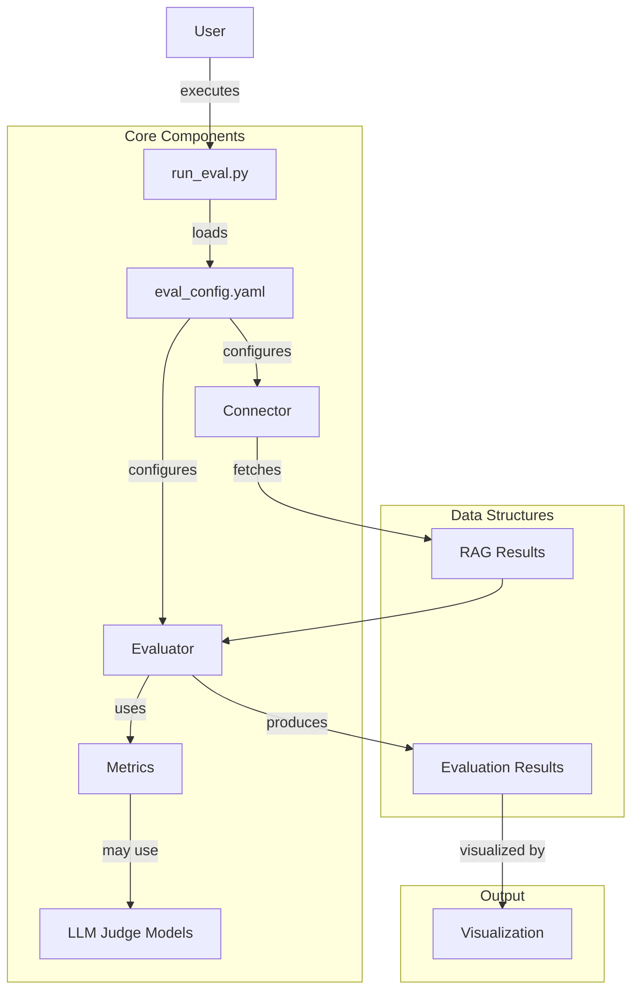

Sources: [README.md:174-181]()

## Evaluation Workflow

Open-RAG-Eval follows a structured workflow during the evaluation process:

**Evaluation Workflow Diagram**
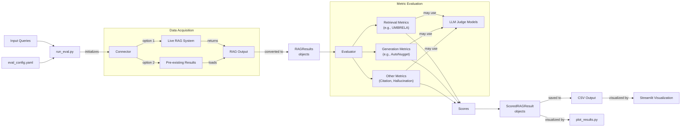

Sources: [README.md:174-181]()

## Core Components

### Evaluators

Evaluators are responsible for assessing RAG output quality. The main evaluator is `TRECEvaluator`, which implements the evaluation metrics used in the TREC-RAG benchmark.

**Component Hierarchy for Evaluators**
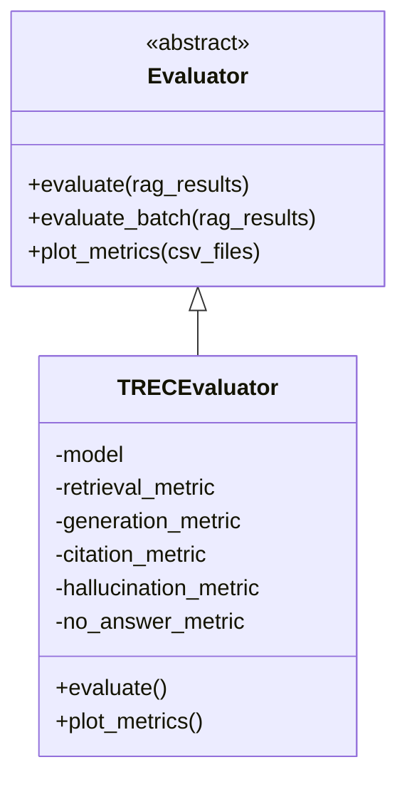

Sources: [README.md:17-18](), [README.md:182-184]()

### Connectors

Connectors interface with RAG systems to fetch evaluation data. The toolkit provides two connector types:

1. **VectaraConnector**: Interfaces with the Vectara RAG platform API
2. **CSVConnector**: Loads pre-existing RAG results from CSV files

**Connector Class Hierarchy**
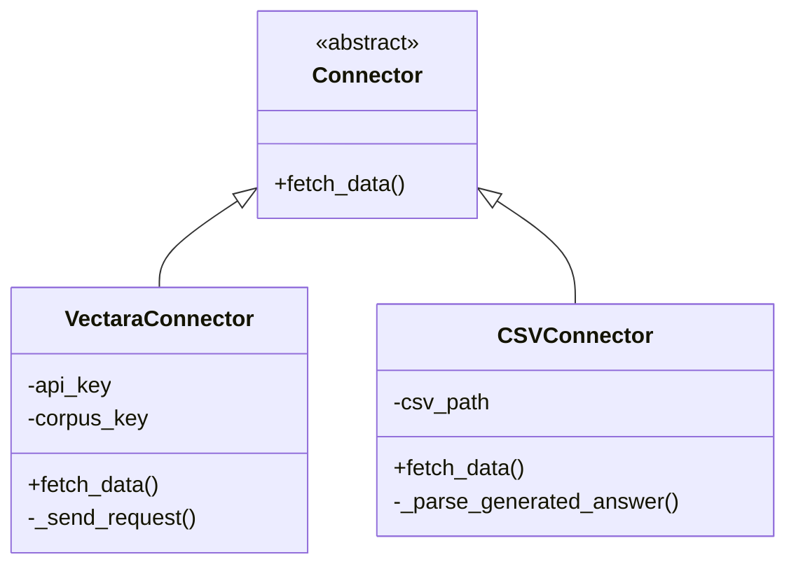

Sources: [README.md:19-20](), [README.md:182-184]()

### Metrics

The toolkit includes several metrics for evaluating different aspects of RAG quality:

| Metric Type | Implementation | Purpose |
|-------------|----------------|---------|
| Retrieval | UMBRELA | Evaluates the relevance of retrieved contexts |
| Generation | AutoNugget | Assesses the quality of generated answers |
| Augmentation | Citation | Evaluates the citation quality in generated answers |
| Quality | Hallucination | Detects hallucinations in generated answers |
| Completeness | NoAnswer | Determines if a query was properly answered |

**Metrics Architecture**
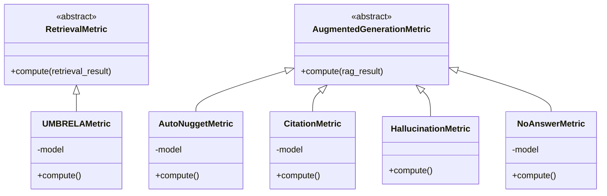

Sources: [README.md:17-18](), [README.md:182-184]()

### LLM Judge Models

Some metrics rely on LLM judge models to evaluate RAG output quality. The framework supports:

- OpenAI models (e.g., GPT-4)
- Gemini models

**Judge Models Architecture**
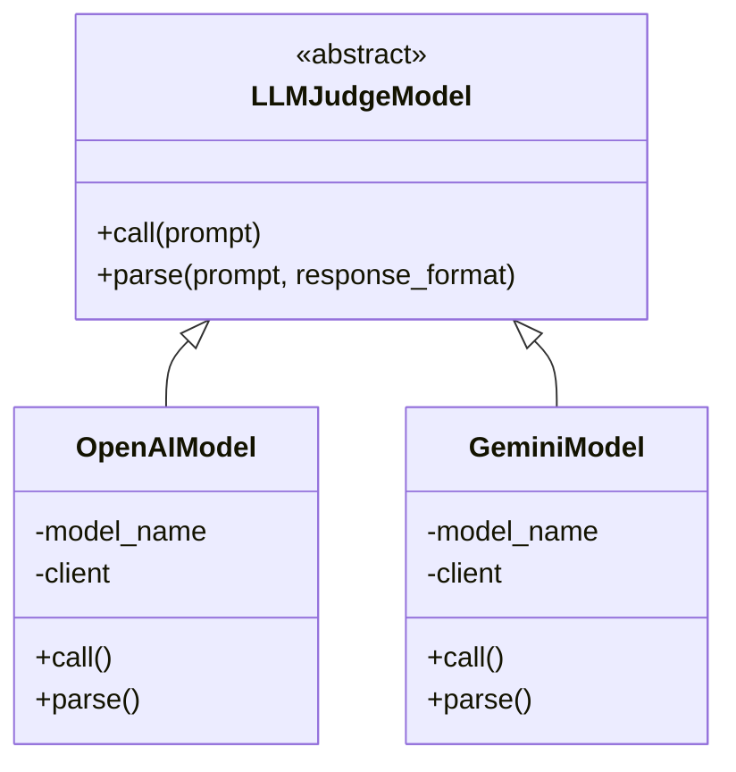

Sources: [README.md:182-184]()

## Data Structures

The framework uses two primary data structures:

1. **RAGResults**: Represents the output of a RAG pipeline for a single query, including:
   - Input query
   - Generated answer
   - Retrieved contexts/documents

2. **ScoredRAGResult**: Extends RAGResults with evaluation scores from metrics

Sources: [README.md:182-189]()

## Integration Options

Open-RAG-Eval can be integrated in different ways:

### Python Library

Install and use as a Python library in custom evaluation pipelines:

```bash
pip install open-rag-eval
```

### Command-line Tool

Run evaluations directly from the command line:

```bash
python open_rag_eval/run_eval.py --config eval_config.yaml
```

### Web API

For programmatic integration, the framework provides a Flask-based web server with endpoints for evaluation:

- `/api/v1/evaluate`: Evaluate a single RAG output
- `/api/v1/evaluate_batch`: Evaluate multiple RAG outputs in a batch

Start the server with:

```bash
python open_rag_eval/run_server.py
```

Sources: [README.md:193-204]()

## Visualization

The toolkit includes visualization capabilities for analyzing evaluation results:

1. **Plot Results**: Compare metrics across different runs
   ```bash
   python open_rag_eval/plot_results.py results_1.csv results_2.csv
   ```

2. **Streamlit Dashboard**: Detailed per-query analysis
   ```bash
   cd open_rag_eval/viz/
   streamlit run visualize.py
   ```

Sources: [README.md:112-125](), [README.md:158-170]()

---

# Page: Getting Started

# Getting Started

<details>
<summary>Relevant source files</summary>

The following files were used as context for generating this wiki page:

- [README.md](README.md)
- [img/project-logo.png](img/project-logo.png)
- [requirements.txt](requirements.txt)
- [sample_prompt.txt](sample_prompt.txt)

</details>


This guide walks you through the process of setting up and using the open-rag-eval toolkit to evaluate Retrieval-Augmented Generation (RAG) systems. This page covers installation, basic configuration, and running your first evaluation. For detailed information about individual components, see [Core Components](#3).

## Overview of the Process

The open-rag-eval toolkit enables evaluation of RAG systems through the following workflow:

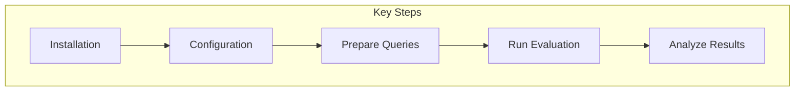

Sources: [README.md:28-31]()

## Prerequisites

Before installing open-rag-eval, ensure you have:

- **Python:** Version 3.9 or higher
- **OpenAI API Key:** Required for the default LLM judge model used in evaluation metrics (set as environment variable: `export OPENAI_API_KEY='your-api-key'`)
- **Vectara Account** (if using Vectara connector):
  - A Vectara account from [console.vectara.com/signup](https://console.vectara.com/signup)
  - A corpus with indexed data
  - An API key with querying permissions
  - Your Customer ID and Corpus key

Sources: [README.md:33-40]()

## Installation

There are two ways to install open-rag-eval:

### Option 1: Build from Source (Recommended for Following Examples)

```bash
git clone https://github.com/vectara/open-rag-eval.git
cd open-rag-eval
pip install -e .
```

### Option 2: Install via pip (For Using in Your Own Pipeline)

```bash
pip install open-rag-eval
```

Sources: [README.md:42-56](), [requirements.txt:1-18]()

## Basic Evaluation Workflow

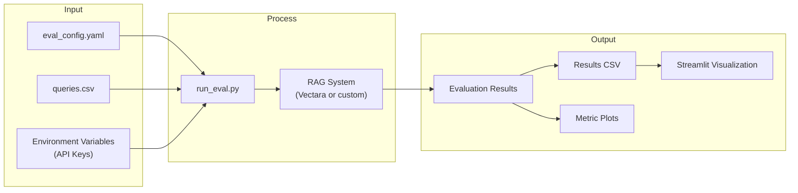

Sources: [README.md:60-166]()

## Using with the Vectara Connector

### Step 1: Configure Evaluation Settings

Edit the `eval_config.yaml` file to include your Vectara credentials and evaluation parameters:

```yaml
evaluator:
  type: TRECEvaluator
  model:
    type: OpenAIModel
    name: gpt-4o-mini
    api_key: ${OPENAI_API_KEY}

connector:
  type: VectaraConnector
  options:
    api_key: ${VECTARA_API_KEY}
    corpus_key: your_corpus_id
    input_queries: queries.csv
    query_config:
      search:
        limit: 5
        context_configuration:
          sentences_before: 3
          sentences_after: 3
      generation:
        generation_preset_name: vectara-summary-ext-24-05-med-omni
        max_used_search_results: 5
        max_response_characters: 1000
        response_language: eng
        enable_factual_consistency_score: False

evaluation_results: open_eval_results.csv
```

Set required environment variables:
```bash
export VECTARA_API_KEY='your-vectara-api-key'
export OPENAI_API_KEY='your-openai-api-key'
```

Sources: [README.md:62-80]()

### Step 2: Prepare Queries

Create a CSV file named `queries.csv` containing the queries you want to evaluate:

```csv
query
What is a blackhole?
How big is the sun?
How many moons does jupiter have?
```

Sources: [README.md:88-99]()

### Step 3: Run Evaluation

Execute the evaluation script:

```bash
python open_rag_eval/run_eval.py --config eval_config.yaml
```

This will:
1. Load your configuration
2. Connect to the Vectara API
3. Run queries against your configured corpus
4. Evaluate the results using the TREC evaluator
5. Save detailed results to a CSV file

Sources: [README.md:101-109]()

### Step 4: Visualize Results

You can visualize the results in two ways:

1. **Plot metrics** (automatically done by default):
   ```bash
   python open_rag_eval/plot_results.py open_eval_results.csv
   ```

   To compare multiple results:
   ```bash
   python open_rag_eval/plot_results.py results_1.csv results_2.csv results_3.csv
   ```

2. **Interactive visualization** with Streamlit:
   ```bash
   cd open_rag_eval/viz/
   streamlit run visualize.py
   ```

   Then upload your `open_eval_results.csv` file in the web interface to explore detailed metrics.

Sources: [README.md:112-170]()

## Using with Custom RAG Outputs

If you want to evaluate RAG outputs from your own system:

### Step 1: Prepare RAG Results

Format your RAG outputs in a CSV file (see `data/test_csv_connector.csv` for an example). 

### Step 2: Configure Evaluation Settings

Modify `eval_config.yaml` to use your custom results:

```yaml
evaluator:
  type: TRECEvaluator
  model:
    type: OpenAIModel
    name: gpt-4o-mini
    api_key: ${OPENAI_API_KEY}

# Comment out the connector section
# connector:
#   ...

# Use input_results instead
input_results: path/to/your/results.csv

evaluation_results: open_eval_results.csv
```

Sources: [README.md:130-136]()

### Step 3: Run Evaluation and Visualize

Follow the same steps as in the Vectara connector approach to run the evaluation and visualize results.

```bash
python open_rag_eval/run_eval.py --config eval_config.yaml
```

Sources: [README.md:139-163]()

## Configuration Architecture

The following diagram shows how the configuration in `eval_config.yaml` maps to code components:

```mermaid
classDiagram
    class "eval_config.yaml" {
        evaluator
        connector/input_results
        evaluation_results
    }
    
    class "Evaluator" {
        <<abstract>>
        +evaluate(rag_results)
        +evaluate_batch(rag_results)
        +plot_metrics(csv_files)
    }
    
    class "TRECEvaluator" {
        -model
        -retrieval_metric
        -generation_metric
        -citation_metric
        -hallucination_metric
        -no_answer_metric
        +evaluate()
        +plot_metrics()
    }
    
    class "Connector" {
        <<abstract>>
        +fetch_data()
    }
    
    class "VectaraConnector" {
        -api_key
        -corpus_key
        +fetch_data()
        -_send_request()
    }
    
    class "CSVConnector" {
        -csv_path
        +fetch_data()
        -_parse_generated_answer()
    }
    
    class "run_eval.py" {
        +main()
        -_setup_evaluator()
        -_setup_connector()
        -_run_evaluation()
    }
    
    "eval_config.yaml" --* "Evaluator"
    "eval_config.yaml" --* "Connector"
    "Evaluator" <|-- "TRECEvaluator"
    "Connector" <|-- "VectaraConnector"
    "Connector" <|-- "CSVConnector"
    "run_eval.py" --> "Evaluator"
    "run_eval.py" --> "Connector"
```

Sources: [README.md:42-56](), [README.md:174-194]()

## Data Flow in Evaluation

This diagram illustrates the data flow during an evaluation run:

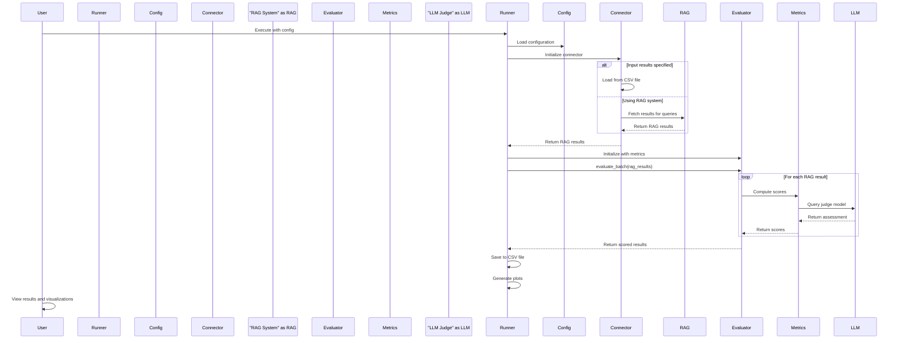

Sources: [README.md:174-182]()

For more detailed information about the specific components, see [Core Components](#3), [Evaluators](#3.2), and [Connectors](#3.3).

---

# Page: Installation

# Installation

<details>
<summary>Relevant source files</summary>

The following files were used as context for generating this wiki page:

- [README.md](README.md)
- [img/project-logo.png](img/project-logo.png)
- [requirements.txt](requirements.txt)
- [sample_prompt.txt](sample_prompt.txt)

</details>


This page provides detailed instructions for installing the open-rag-eval toolkit, which is used for evaluating Retrieval-Augmented Generation (RAG) systems. For information about configuring the evaluation system after installation, see [Configuration](#2.2).

## Prerequisites

Before installing open-rag-eval, ensure your system meets the following requirements:

| Requirement | Details |
|-------------|---------|
| Python | Version 3.9 or higher |
| API Keys | Required for various components (detailed below) |
| Disk Space | Approximately 500MB for the package and its dependencies |

### Required API Keys

Depending on your evaluation needs, you'll need to obtain and configure the following API keys:

- **OpenAI API Key**: Required for the default LLM judge model used in metrics like UMBRELA and AutoNugget.
- **Vectara API Key**: Required only if you're using the Vectara connector.

These API keys should be set as environment variables before running the evaluation:

```bash
export OPENAI_API_KEY='your-openai-api-key'
export VECTARA_API_KEY='your-vectara-api-key'  # Only needed for Vectara connector
```

Sources: [README.md:34-40]()

## Installation Methods

There are two methods to install open-rag-eval, depending on your use case:

### Method 1: Install from Source (Recommended for Development)

This method is ideal if you want to run the sample instructions or modify the code:

```bash
git clone https://github.com/vectara/open-rag-eval.git
cd open-rag-eval
pip install -e .
```

The `-e` flag installs the package in "editable" mode, allowing you to modify the source code and have the changes take effect without reinstalling.

### Method 2: Install from PyPI (Recommended for Integration)

This method is preferred if you want to use open-rag-eval in your own pipeline:

```bash
pip install open-rag-eval
```

Sources: [README.md:42-58]()

## Dependencies

open-rag-eval depends on several Python packages, which are automatically installed during the installation process. The key dependencies include:

| Dependency | Purpose |
|------------|---------|
| openai | Interface with OpenAI models for evaluation |
| google-genai | Interface with Google Gemini models |
| pandas | Data handling and manipulation |
| matplotlib, seaborn | Visualization of evaluation results |
| flask, flask-cors | Web API functionality |
| streamlit | Interactive visualization dashboard |
| requests | HTTP requests for API connections |
| pydantic | Data validation and settings management |
| transformers, torch | Machine learning model support |

Sources: [requirements.txt:1-18]()

### Installation Diagram

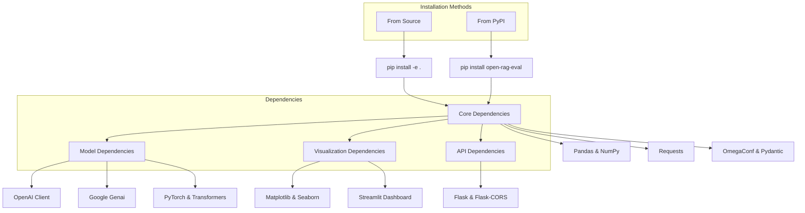

## Installation Verification

After installation, you can verify that open-rag-eval is correctly installed by running:

```bash
python -c "import open_rag_eval; print(open_rag_eval.__version__)"
```

This should print the version number of the installed package.

## System Integration

The installation process adds all the necessary components to your Python environment, allowing you to use the open-rag-eval toolkit through various interfaces:

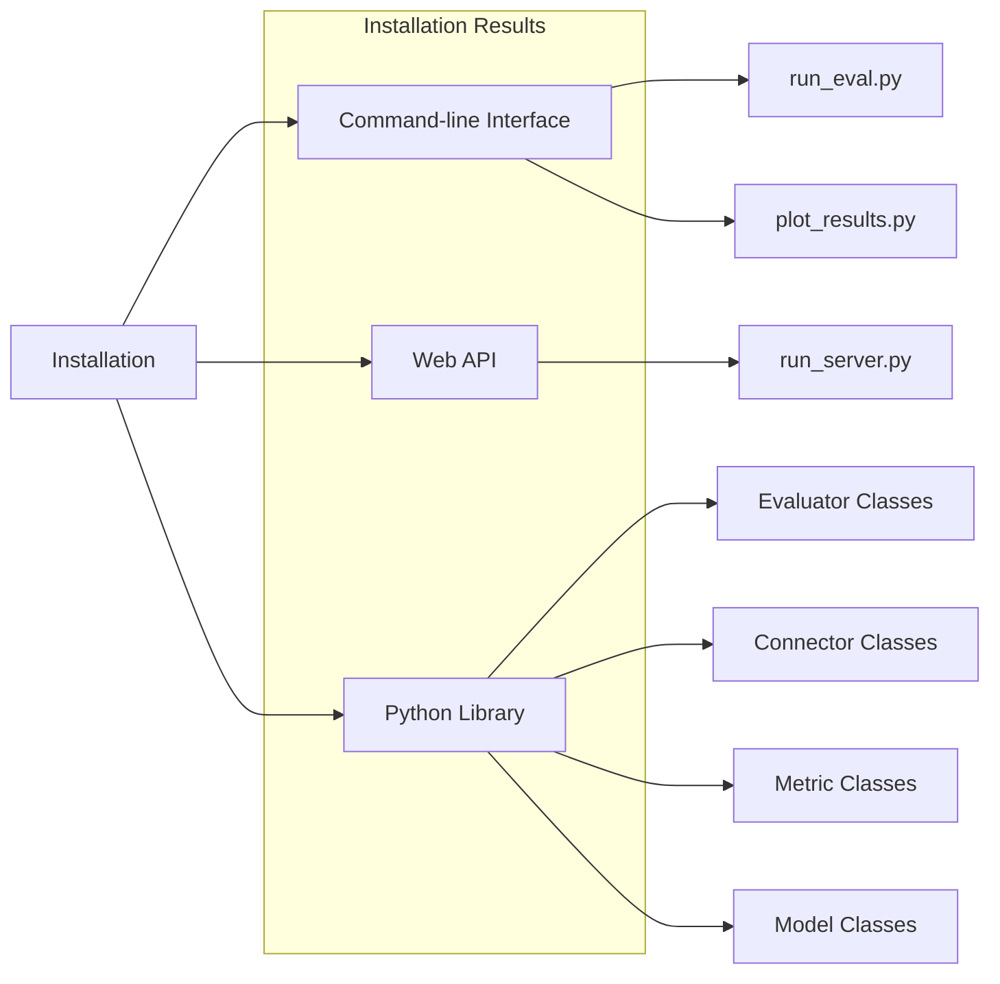

## Common Issues and Troubleshooting

### Dependency Conflicts

If you encounter dependency conflicts during installation, consider using a virtual environment:

```bash
python -m venv venv
source venv/bin/activate  # On Windows: venv\Scripts\activate
pip install -e .  # Or: pip install open-rag-eval
```

### API Key Configuration

If you see authentication errors when running the evaluation, ensure your API keys are correctly set as environment variables. For persistent configuration, you can add these to your `.bashrc`, `.zshrc`, or equivalent shell configuration file.

Sources: [README.md:34-40](), [README.md:78-80]()

## Next Steps

After successfully installing open-rag-eval, proceed to configure the evaluation system as described in the [Configuration](#2.2) section.

---

# Page: Configuration

# Configuration

<details>
<summary>Relevant source files</summary>

The following files were used as context for generating this wiki page:

- [README.md](README.md)
- [eval_config.yaml](eval_config.yaml)
- [img/project-logo.png](img/project-logo.png)
- [sample_prompt.txt](sample_prompt.txt)

</details>


This document explains how to configure the open-rag-eval toolkit through the `eval_config.yaml` file. Proper configuration is essential for specifying how RAG systems are evaluated, what metrics are used, and how results are processed. For information about installing the toolkit, see [Installation](#2.1).

## Overview

The configuration system in open-rag-eval uses a YAML file that defines all aspects of the evaluation process. The `eval_config.yaml` file serves as the control center for:

- Specifying input data sources or connectors
- Defining evaluation metrics and models
- Controlling output formats and locations
- Setting parameters for RAG system interactions

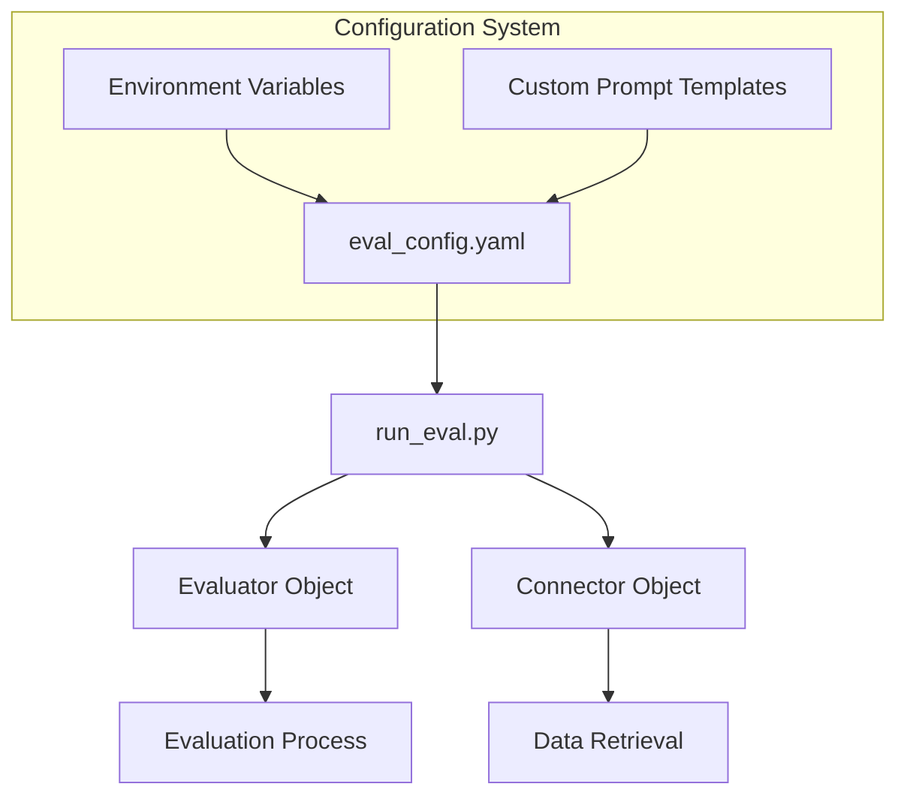

Sources: [eval_config.yaml:1-39](), [README.md:64-76]()

## Configuration File Structure

The `eval_config.yaml` file has four main sections:

1. **Input/Output Settings**: Specify input data sources and output locations
2. **Evaluator Configuration**: Define which evaluator to use and its parameters
3. **Model Configuration**: Specify the LLM judge model for evaluations
4. **Connector Configuration**: Set up how to retrieve RAG results

```mermaid
classDiagram
    class "eval_config.yaml" {
        input_results
        evaluation_results
        evaluator
        connector
    }

    class "evaluator" {
        type
        model
    }

    class "model" {
        type
        name
        api_key
    }

    class "connector" {
        type
        options
    }

    class "options" {
        api_key
        corpus_key
        input_queries
        generated_answers
        query_config
    }

    class "query_config" {
        search
        generation
        intelligent_query_rewriting
        save_history
    }

    "eval_config.yaml" --> "evaluator"
    "eval_config.yaml" --> "connector"
    "evaluator" --> "model"
    "connector" --> "options"
    "options" --> "query_config"
```

Sources: [eval_config.yaml:1-39]()

## Input and Output Configuration

These settings define where input data comes from and where evaluation results are stored.

| Parameter | Description | Example |
|-----------|-------------|---------|
| `input_results` | Path to pre-existing RAG results (CSV). Used when no connector is defined. | `"./results/my_rag_results.csv"` |
| `evaluation_results` | Directory where evaluation results will be saved | `"./open_eval_results/"` |

When using a connector (like VectaraConnector), you can leave `input_results` commented out or remove it, as the connector will generate the necessary RAG results.

Sources: [eval_config.yaml:1-7](), [README.md:133-136]()

## Evaluator Configuration

The evaluator section defines which evaluator to use and configures its underlying model.

```yaml
evaluator:
  type: "TRECEvaluator"  
  model:
    type: "OpenAIModel"
    name: "gpt-4o-mini"
    api_key: ${oc.env:OPENAI_API_KEY}
```

| Parameter | Description | Options |
|-----------|-------------|---------|
| `type` | Type of evaluator to use | `"TRECEvaluator"` |
| `model.type` | Type of LLM judge model | `"OpenAIModel"`, `"GeminiModel"` |
| `model.name` | Name/version of the LLM | `"gpt-4o-mini"`, `"gpt-4"`, etc. |
| `model.api_key` | API key for accessing the model | Environment variable reference |

The API key uses the syntax `${oc.env:VARIABLE_NAME}` to reference environment variables, enhancing security by keeping secrets out of configuration files.

Sources: [eval_config.yaml:9-14](), [README.md:79-80]()

## Connector Configuration

The connector section defines how to retrieve RAG results for evaluation. The toolkit supports different connectors, with VectaraConnector shown in the example.

```yaml
connector:
  type: "VectaraConnector"
  options:
    api_key: ${oc.env:VECTARA_API_KEY}
    corpus_key: "fiqa"
    input_queries: "queries.csv"
    generated_answers: "vectara_results.csv"
    query_config:
      # Configuration continues...
```

### Connector Types

| Connector Type | Description |
|----------------|-------------|
| `VectaraConnector` | Connects to Vectara's RAG platform to retrieve results |
| `CSVConnector` | Reads pre-existing RAG results from a CSV file |

### Connector Options

For `VectaraConnector`, the following options are available:

| Parameter | Description |
|-----------|-------------|
| `api_key` | API key for Vectara (referenced from environment variables) |
| `corpus_key` | Identifier for the corpus in Vectara |
| `input_queries` | CSV file containing queries to evaluate |
| `generated_answers` | CSV file where generated answers will be stored |

Sources: [eval_config.yaml:16-23](), [README.md:36-40](), [README.md:62-67]()

### Query Configuration

The `query_config` section controls how queries are processed by the connector:

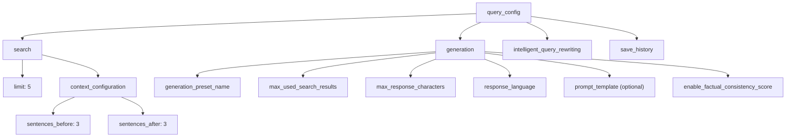

#### Search Parameters

| Parameter | Description | Default |
|-----------|-------------|---------|
| `search.limit` | Maximum number of results to retrieve | `5` |
| `search.context_configuration.sentences_before` | Number of sentences to include before the matching text | `3` |
| `search.context_configuration.sentences_after` | Number of sentences to include after the matching text | `3` |

#### Generation Parameters

| Parameter | Description | Example |
|-----------|-------------|---------|
| `generation.generation_preset_name` | Name of the generation preset to use | `"mockingbird-2.0"` |
| `generation.max_used_search_results` | Maximum number of search results to use for generation | `5` |
| `generation.max_response_characters` | Maximum length of generated response | `1000` |
| `generation.response_language` | Language code for the response | `"eng"` |
| `generation.prompt_template` | Optional custom prompt template file | `"sample_prompt.txt"` |
| `generation.enable_factual_consistency_score` | Whether to calculate factual consistency score | `False` |

#### Other Query Settings

| Parameter | Description | Default |
|-----------|-------------|---------|
| `intelligent_query_rewriting` | Whether to enable query rewriting | `False` |
| `save_history` | Whether to save query history | `False` |

Sources: [eval_config.yaml:24-38](), [README.md:68-76]()

## Custom Prompt Templates

You can specify a custom prompt template to control how the RAG system generates answers. The template is referenced in the configuration using the `prompt_template` parameter under the `generation` section.

The prompt template is a text file with special variables that are replaced at runtime. For example:

```
[{"role": "system", "content": ""},
 {"role": "user", "content": "You are a search bot that forms a coherent answer to a user query based on search results that are provided to you.
 If the search results are irrelevant to the question, respond with - No result found (in $vectaraLangName). 
 ...
 Generate a coherent response to the query by summarizing the search results provided.
 Cite search results that you use in your response using [] notation. Please provide your answer in $vectaraLangName."}]
```

The template uses variables like `$vectaraQuery`, `$vectaraQueryResults`, and `$vectaraLangName` that will be replaced with actual values during execution.

Sources: [sample_prompt.txt:1-13](), [README.md:68-76](), [eval_config.yaml:34-36]()

## Example Configuration Workflows

### Using with Vectara Connector

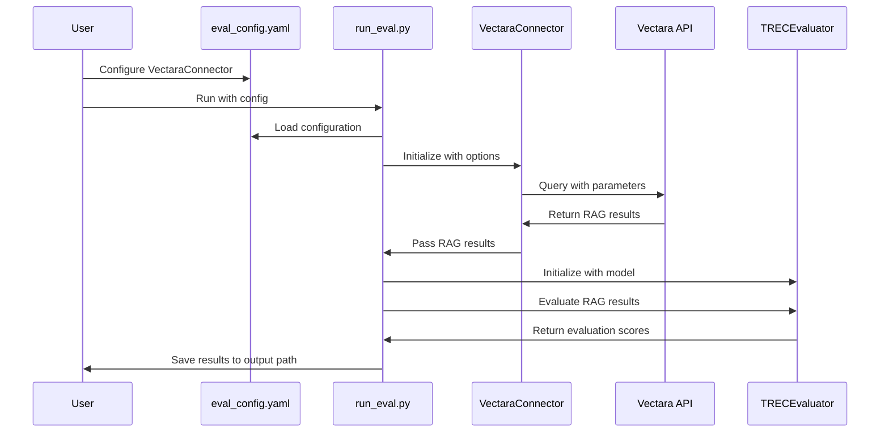

Sources: [README.md:60-80](), [eval_config.yaml:16-38]()

### Using with Pre-existing Results

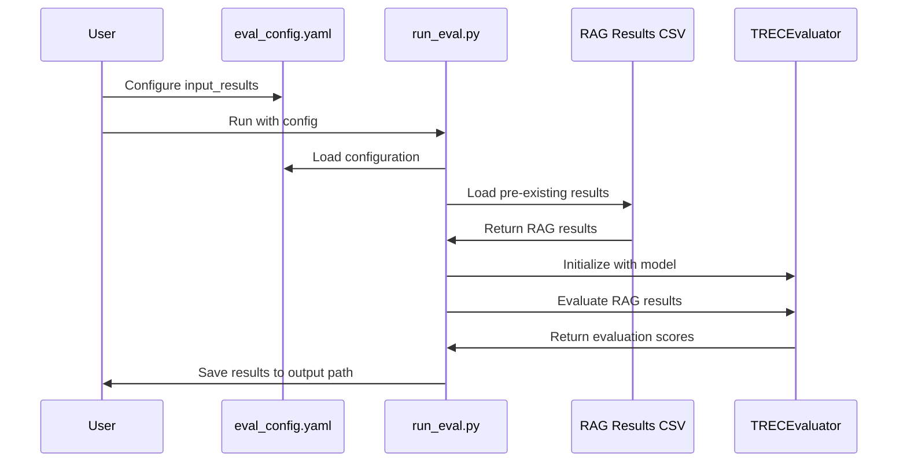

Sources: [README.md:130-146](), [eval_config.yaml:1-4]()

## Environment Variables

The configuration uses environment variables for sensitive information like API keys. The syntax `${oc.env:VARIABLE_NAME}` references these variables from the environment.

Key environment variables:

| Variable | Purpose | Used By |
|----------|---------|---------|
| `OPENAI_API_KEY` | Authentication for OpenAI API | OpenAIModel |
| `VECTARA_API_KEY` | Authentication for Vectara API | VectaraConnector |

Make sure to set these environment variables before running the evaluation:

```bash
export VECTARA_API_KEY='your-vectara-api-key'
export OPENAI_API_KEY='your-openai-api-key'
```

Sources: [README.md:79-80](), [eval_config.yaml:14](), [eval_config.yaml:19]()

---

# Page: Core Components

# Core Components

<details>
<summary>Relevant source files</summary>

The following files were used as context for generating this wiki page:

- [README.md](README.md)
- [img/project-logo.png](img/project-logo.png)
- [open_rag_eval/models/__init__.py](open_rag_eval/models/__init__.py)
- [open_rag_eval/run_eval.py](open_rag_eval/run_eval.py)
- [sample_prompt.txt](sample_prompt.txt)

</details>


The Core Components section provides an overview of the fundamental building blocks that make up the open-rag-eval system. This document explains the architecture, key classes, and their interactions within the evaluation framework. For information about setting up and using the system, see [Getting Started](#2), and for detailed information about the evaluation process workflow, see [Evaluation Pipeline](#3.1).

## System Architecture Overview

The open-rag-eval system uses a modular architecture designed for flexibility and extensibility in evaluating RAG systems. The framework consists of several interconnected components that work together to assess RAG quality across multiple dimensions.

### System Architecture Diagram

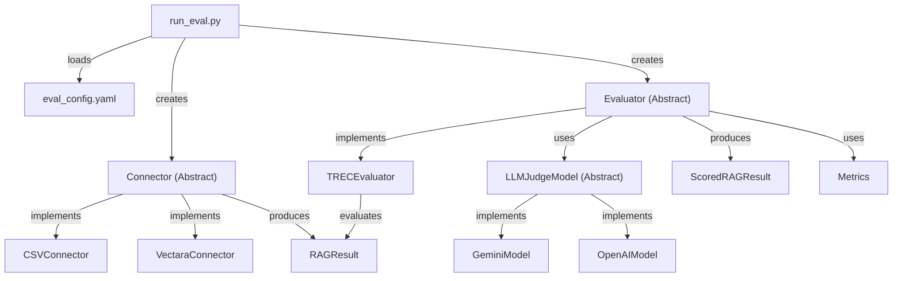

Sources: [open_rag_eval/run_eval.py:1-148](). [README.md:172-188]()

## Key Components

The open-rag-eval system consists of four primary component types:

1. **Evaluators**: Classes that orchestrate evaluation by applying metrics to RAG results
2. **Connectors**: Classes that fetch data from RAG systems to be evaluated
3. **LLM Judge Models**: Models that provide judgments for evaluation metrics
4. **Metrics**: Algorithms that measure specific aspects of RAG quality

### Component Hierarchy Diagram

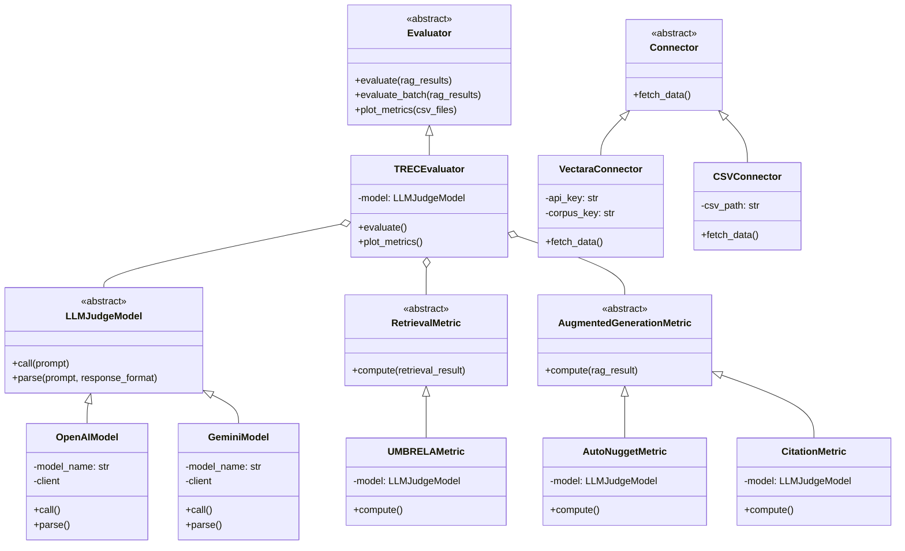

Sources: [open_rag_eval/models/__init__.py:1-4](), [README.md:184-186]()

## Evaluators

Evaluators serve as the backbone of the evaluation process. They take RAG results and apply various metrics to assess their quality.

### Evaluator (Abstract Base Class)

Defines the common interface for all evaluator implementations:

- `evaluate(rag_results)`: Evaluates a single RAG result
- `evaluate_batch(rag_results)`: Evaluates multiple RAG results
- `plot_metrics(csv_files)`: Visualizes the evaluation results

### TRECEvaluator

The primary evaluator implementation that follows the TREC-RAG evaluation approach:

- Uses multiple metrics to evaluate different aspects of RAG performance
- Coordinates with LLM judge models to obtain quality assessments
- Aggregates metric scores to provide comprehensive evaluation

Sources: [open_rag_eval/run_eval.py:17-50]()

## Connectors

Connectors are responsible for obtaining RAG results to be evaluated, either by retrieving them from a RAG system or loading them from a file.

### Connector (Abstract Base Class)

Defines the common interface for all connector implementations:

- `fetch_data()`: Retrieves RAG results from a specific source

### VectaraConnector

Connects to the Vectara RAG platform:

- Queries Vectara API using provided credentials
- Processes the response into the RAGResult format
- Stores results in a CSV file for evaluation

### CSVConnector

Loads pre-existing RAG results from a CSV file:

- Parses the CSV file containing queries, answers, and contexts
- Converts the data into RAGResult objects for evaluation

Sources: [open_rag_eval/run_eval.py:53-75](), [README.md:107-163]()

## LLM Judge Models

LLM Judge Models serve as the evaluation engine behind many metrics, providing judgments on the quality of RAG outputs.

### LLMJudgeModel (Abstract Base Class)

Defines the common interface for all LLM judge models:

- `call(prompt)`: Sends a prompt to the LLM and gets a response
- `parse(prompt, response_format)`: Parses the LLM response into a structured format

### OpenAIModel

Uses OpenAI's API for evaluation:

- Connects to models like GPT-4o-mini
- Formats prompts according to OpenAI's requirements
- Parses responses into structured data for metrics

### GeminiModel

Uses Google's Gemini API for evaluation:

- Connects to Gemini models
- Formats prompts according to Gemini's requirements
- Parses responses into structured data for metrics

Sources: [open_rag_eval/models/__init__.py:1-4](), [README.md:35-36]()

## Metrics

Metrics evaluate specific aspects of RAG quality, measuring dimensions like relevance, faithfulness, and citation quality.

### Retrieval Metrics

Evaluate the quality of retrieved documents:

- **UMBRELAMetric**: Assesses the relevance of retrieved documents to the query

### Generation Metrics

Evaluate the quality of generated answers:

- **AutoNuggetMetric**: Assesses the quality and completeness of the generated answer
- **CitationMetric**: Evaluates how well the answer cites the retrieved documents
- **HallucinationMetric**: Checks for factual inconsistencies in the generated answer
- **NoAnswerMetric**: Determines if a query was actually answered

Sources: [README.md:17-24]()

## Data Structures

The system uses several key data structures to represent and process evaluation data:

### RAGResult

Represents the output of a RAG system for a single query:

- `query`: The input query
- `answer`: The generated answer
- `contexts`: The retrieved contexts/documents

### ScoredRAGResult

Extends RAGResult with evaluation scores:

- `rag_result`: The original RAG result
- `scores`: The scores assigned by the evaluator and its metrics

Sources: [open_rag_eval/run_eval.py:117-119](), [open_rag_eval/run_eval.py:127-128]()

## Evaluation Workflow

The evaluation process follows a structured flow from configuration to results visualization:

### RAG Evaluation Flow Diagram

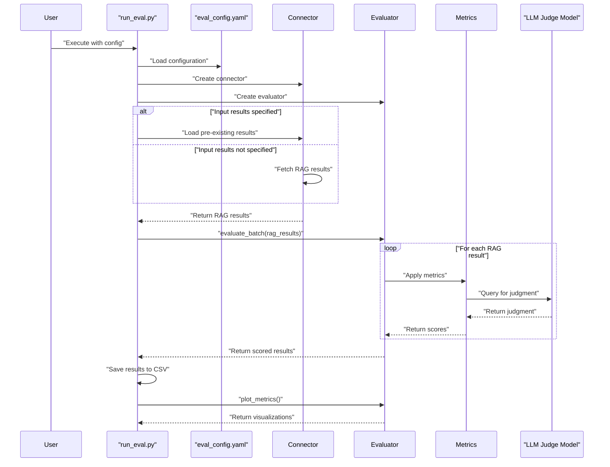

Sources: [open_rag_eval/run_eval.py:78-147]()

## Configuration System

The evaluation process is configured through a YAML file (`eval_config.yaml`), which defines:

### Configuration Structure

```mermaid
graph TD
    Config["eval_config.yaml"]
    
    Config -->|"defines"| EvalResults["evaluation_results"]
    Config -->|"defines"| InputResults["input_results"]
    
    Config -->|"configures"| Evaluator["evaluator"]
    Evaluator -->|"specifies"| EvalType["type: TRECEvaluator"]
    Evaluator -->|"specifies"| EvalModel["model"]
    EvalModel -->|"specifies"| ModelType["type: OpenAIModel"]
    EvalModel -->|"specifies"| ModelName["name: gpt-4o-mini"]
    EvalModel -->|"specifies"| ModelKey["api_key: OPENAI_API_KEY"]
    
    Config -->|"configures"| Connector["connector"]
    Connector -->|"specifies"| ConnType["type: VectaraConnector"]
    Connector -->|"specifies"| ConnOptions["options"]
    ConnOptions -->|"specifies"| ApiKey["api_key: VECTARA_API_KEY"]
    ConnOptions -->|"specifies"| CorpusKey["corpus_key: corpus_id"]
    ConnOptions -->|"specifies"| InputQueries["input_queries: queries.csv"]
    ConnOptions -->|"specifies"| GenAnswers["generated_answers: results.csv"]
    
    ConnOptions -->|"configures"| QueryConfig["query_config"]
    QueryConfig -->|"configures"| SearchConfig["search"]
    SearchConfig -->|"specifies"| Limit["limit: 5"]
    
    QueryConfig -->|"configures"| GenConfig["generation"]
    GenConfig -->|"specifies"| PresetName["generation_preset_name: preset"]
    GenConfig -->|"specifies"| MaxResults["max_used_search_results: 5"]
    GenConfig -->|"specifies"| PromptTemplate["prompt_template: sample_prompt.txt"]
```

Sources: [open_rag_eval/run_eval.py:84-89](), [sample_prompt.txt:1-13]()

## Integration and Extension Points

The open-rag-eval system provides several interfaces for customization and extension:

1. **Custom Evaluators**: Create new evaluator classes by implementing the Evaluator interface
2. **Custom Connectors**: Create new connector classes to integrate with different RAG systems
3. **Custom Metrics**: Implement new metrics to measure additional aspects of RAG quality
4. **Custom Models**: Integrate with different LLM providers by implementing the LLMJudgeModel interface

Each component can be configured through the `eval_config.yaml` file and dynamically loaded at runtime.

Sources: [open_rag_eval/run_eval.py:17-75]()

---

# Page: Evaluation Pipeline

# Evaluation Pipeline

<details>
<summary>Relevant source files</summary>

The following files were used as context for generating this wiki page:

- [README.md](README.md)
- [img/project-logo.png](img/project-logo.png)
- [open_rag_eval/models/__init__.py](open_rag_eval/models/__init__.py)
- [open_rag_eval/run_eval.py](open_rag_eval/run_eval.py)
- [sample_prompt.txt](sample_prompt.txt)

</details>


## Overview

The Evaluation Pipeline is the core workflow orchestration component of the open-rag-eval framework. It implements the end-to-end process of loading configurations, retrieving RAG outputs, applying evaluation metrics, and generating results. This page documents how the pipeline works, focusing on the implementation in `run_eval.py`.

For information about specific evaluator implementations, see [Evaluators](#3.2). For information about connectors, see [Connectors](#3.3).

## Pipeline Architecture

```mermaid
graph TD
    subgraph "Input Components"
        Config["eval_config.yaml"]
        InputQueries["Queries CSV"]
    end

    subgraph "Configuration Loading"
        run_eval["run_eval()"] -- "loads" --> Config
    end

    subgraph "Component Creation"
        run_eval --> get_evaluator["get_evaluator()"]
        run_eval --> get_connector["get_connector()"]
        
        get_evaluator --> Evaluator["TRECEvaluator"]
        get_connector --> Connector["VectaraConnector/CSVConnector"]
    end

    subgraph "Data Flow"
        Connector --> fetch_data["connector.fetch_data()"]
        fetch_data --> rag_results["rag_results"]
        
        Evaluator --> evaluate["evaluator.evaluate_batch()"]
        rag_results --> evaluate
        evaluate --> scored_results["scored_results"]
    end

    subgraph "Output Generation"
        scored_results --> to_csv["to_csv()"]
        to_csv --> ResultsCSV["eval_results.csv"]
        ResultsCSV --> plot_metrics["plot_metrics()"]
        plot_metrics --> Metrics["metrics.png"]
    end
```

Sources: [open_rag_eval/run_eval.py:77-135]()

## Main Components

The evaluation pipeline consists of the following key components:

| Component | Description | Code Reference |
|-----------|-------------|---------------|
| Configuration | YAML file that defines evaluation settings | [open_rag_eval/run_eval.py:84-88]() |
| Connector | Fetches RAG results from a system | [open_rag_eval/run_eval.py:53-75]() |
| Evaluator | Applies metrics to evaluate RAG quality | [open_rag_eval/run_eval.py:17-50]() |
| Scoring | Converts evaluation results to metrics | [open_rag_eval/run_eval.py:119]() |
| Reporting | Saves results and generates visualizations | [open_rag_eval/run_eval.py:127-134]() |

Sources: [open_rag_eval/run_eval.py:1-147]()

## Execution Flow

The execution flow of the evaluation pipeline is implemented in the `run_eval()` function:

```mermaid
sequenceDiagram
    participant User
    participant run_eval as "run_eval.py"
    participant Config as "eval_config.yaml"
    participant Connector
    participant Evaluator
    participant ResultsFile as "eval_results.csv"
    participant Visualization as "metrics.png"

    User->>run_eval: Execute with config path
    run_eval->>Config: Load configuration
    run_eval->>run_eval: Create output folder
    run_eval->>run_eval: Copy config to output
    run_eval->>Evaluator: Create evaluator via get_evaluator()
    run_eval->>Connector: Create connector via get_connector()
    
    alt Connector provided
        Connector->>Connector: fetch_data()
        Note over Connector: Queries external RAG system
        Connector->>run_eval: Save results to CSV
    end
    
    run_eval->>run_eval: Load RAG results from CSV
    run_eval->>Evaluator: evaluate_batch(rag_results)
    Evaluator->>run_eval: Return scored_results
    run_eval->>ResultsFile: Save evaluation results
    run_eval->>Visualization: Generate metric plots
```

Sources: [open_rag_eval/run_eval.py:77-135]()

## Configuration Loading

The evaluation pipeline starts by loading a configuration from a YAML file:

```mermaid
graph TD
    subgraph "Configuration Loading"
        ConfigPath["Config Path"] --> OmegaConf["OmegaConf.load()"]
        OmegaConf --> Config["Configuration Dict"]
    end

    subgraph "Configuration Structure"
        Config --> EvalResults["evaluation_results: path"]
        Config --> InputResults["input_results: path"]
        
        Config --> EvaluatorConfig["evaluator: {...}"]
        EvaluatorConfig --> EvaluatorType["type: TRECEvaluator"]
        EvaluatorConfig --> ModelConfig["model: {...}"]
        ModelConfig --> ModelType["type: OpenAIModel"]
        ModelConfig --> ModelName["name: gpt-4o-mini"]
        ModelConfig --> ApiKey["api_key: OPENAI_API_KEY"]
        
        Config --> ConnectorConfig["connector: {...}"]
        ConnectorConfig --> ConnectorType["type: VectaraConnector"]
        ConnectorConfig --> Options["options: {...}"]
    end
```

Sources: [open_rag_eval/run_eval.py:84-88]()

## Dynamic Component Instantiation

The pipeline dynamically instantiates the evaluator and connector based on the configuration:

### Evaluator Creation

The `get_evaluator()` function loads the specified evaluator class, along with the associated LLM model:

```python
evaluator_class = getattr(evaluators, f"{evaluator_type}")
model_class = getattr(models, model_config.type)
model = model_class(model_name=model_config.name, api_key=model_config.api_key)
return evaluator_class(model=model)
```

Sources: [open_rag_eval/run_eval.py:17-50]()

### Connector Creation

The `get_connector()` function loads the specified connector class and instantiates it with the required parameters:

```python
connector_class = getattr(connectors, connector_type)
return connector_class(connector_options.api_key, connector_options.corpus_key)
```

Sources: [open_rag_eval/run_eval.py:53-75]()

## Data Retrieval and Evaluation

The pipeline has two paths for obtaining RAG results:

1. If a connector is specified, it uses the connector to fetch data from the RAG system
2. It then loads the RAG results from a CSV file

After obtaining the RAG results, it runs the evaluation using the evaluator's `evaluate_batch()` method:

```mermaid
graph TD
    subgraph "Data Retrieval"
        Config["Configuration"] --> Connector["Connector"]
        Connector -->|"fetch_data()"| CSVResults["RAG Results CSV"]
        CSVResults -->|"CSVConnector.fetch_data()"| RAGResults["RAG Results"]
    end

    subgraph "Evaluation"
        RAGResults --> Evaluator["Evaluator"]
        Evaluator -->|"evaluate_batch()"| ScoredResults["Scored RAG Results"]
    end
```

Sources: [open_rag_eval/run_eval.py:107-119]()

## Output Generation

The final step of the pipeline is to save the evaluation results and generate visualizations:

```mermaid
graph TD
    subgraph "Output Generation"
        ScoredResults["Scored RAG Results"] --> ToCSV["to_csv()"]
        ToCSV --> ResultsCSV["eval_results.csv"]
        ResultsCSV --> PlotMetrics["plot_metrics()"]
        PlotMetrics --> MetricsImage["metrics.png"]
    end
```

Sources: [open_rag_eval/run_eval.py:127-134]()

## Command-Line Interface

The evaluation pipeline can be executed via the command line, using the `run_eval.py` script:

```
python open_rag_eval/run_eval.py --config eval_config.yaml
```

The script accepts a single argument, `--config`, which specifies the path to the configuration file.

Sources: [open_rag_eval/run_eval.py:137-147]()

## Integration with Other Components

The evaluation pipeline integrates with other components in the open-rag-eval framework:

```mermaid
graph TD
    subgraph "Evaluation Pipeline - Code Entity Space"
        RunEval["run_eval.py"]
        RunEval -->|"imports"| ConnectorsModule["connectors module"]
        RunEval -->|"imports"| EvaluatorsModule["evaluators module"]
        RunEval -->|"imports"| ModelsModule["models module"]
        RunEval -->|"imports"| DataClassesModule["data_classes module"]
        
        ConnectorsModule -->|"contains"| ConnectorClass["Connector class"]
        ConnectorClass -->|"subclassed by"| VectaraConnector["VectaraConnector"]
        ConnectorClass -->|"subclassed by"| CSVConnector["CSVConnector"]
        
        EvaluatorsModule -->|"contains"| EvaluatorClass["Evaluator class"]
        EvaluatorClass -->|"subclassed by"| TRECEvaluator["TRECEvaluator"]
        
        ModelsModule -->|"contains"| LLMJudgeModel["LLMJudgeModel class"]
        LLMJudgeModel -->|"subclassed by"| OpenAIModel["OpenAIModel"]
        LLMJudgeModel -->|"subclassed by"| GeminiModel["GeminiModel"]
        
        DataClassesModule -->|"contains"| RAGResults["RAGResult class"]
        DataClassesModule -->|"contains"| ScoredRAGResult["ScoredRAGResult class"]
    end
```

Sources: [open_rag_eval/run_eval.py:13-14](), [open_rag_eval/models/__init__.py:1-3]()

## Summary

The Evaluation Pipeline is the central orchestration component of the open-rag-eval framework. It:

1. Loads configuration from a YAML file
2. Dynamically instantiates the appropriate evaluator and connector
3. Retrieves RAG results, either through the connector or from a pre-existing CSV file
4. Runs the evaluation using the evaluator
5. Saves the results and generates visualizations

The pipeline is designed to be flexible and extensible, allowing for different evaluators, connectors, and metrics to be used based on the configuration.

---

# Page: Evaluators

# Evaluators

<details>
<summary>Relevant source files</summary>

The following files were used as context for generating this wiki page:

- [open_rag_eval/evaluators/base_evaluator.py](open_rag_eval/evaluators/base_evaluator.py)
- [open_rag_eval/evaluators/trec_evaluator.py](open_rag_eval/evaluators/trec_evaluator.py)
- [tests/test_base_evaluator.py](tests/test_base_evaluator.py)

</details>


## Purpose and Scope

This document details the evaluator system in the open-rag-eval framework, focusing on the base `Evaluator` class and its concrete implementation, the `TRECEvaluator`. Evaluators are responsible for assessing the quality of RAG (Retrieval-Augmented Generation) results by applying various metrics and producing comprehensive scores for both the retrieval and generation components. For information about the metrics used in evaluation, see [Metrics](#3.5).

```mermaid
graph TD
    RAGResult["RAGResult"] --> Evaluator["Evaluator"]
    Evaluator --> ScoredRAGResult["ScoredRAGResult"]
    
    subgraph "Evaluation Process"
        Evaluator -- "Uses" --> Metrics["Metrics"]
        Metrics -- "May use" --> LLMJudges["LLM Judge Models"]
    end
    
    ScoredRAGResult --> Visualization["Visualization"]
```

Sources: [open_rag_eval/evaluators/base_evaluator.py](), [open_rag_eval/evaluators/trec_evaluator.py]()

## Evaluator Architecture

The evaluator system follows an object-oriented design with a well-defined hierarchy:

```mermaid
classDiagram
    class Evaluator {
        <<abstract>>
        +evaluate(rag_results): ScoredRAGResult
        +evaluate_batch(rag_results): List[ScoredRAGResult]
        +plot_metrics(csv_files): void
    }
    
    class TRECEvaluator {
        -model: LLMJudgeModel
        -retrieval_metric: UMBRELAMetric
        -generation_metric: AutoNuggetMetric
        -citation_metric: CitationMetric
        -hallucination_metric: HallucinationMetric
        -no_answer_metric: NoAnswerMetric
        +evaluate(rag_results): ScoredRAGResult
        +plot_metrics(csv_files): void
    }
    
    Evaluator <|-- TRECEvaluator
    
    class MockEvaluator {
        -evaluate_called: int
        +evaluate(rag_results): ScoredRAGResult
        +plot_metrics(csv_files): void
    }
    
    Evaluator <|-- MockEvaluator
```

Sources: [open_rag_eval/evaluators/base_evaluator.py:1-35](), [open_rag_eval/evaluators/trec_evaluator.py:27-35](), [tests/test_base_evaluator.py:18-39]()

### Base Evaluator Class

The `Evaluator` abstract base class defines the interface for all evaluator implementations:

- **Abstract Methods**:
  - `evaluate(rag_results)`: Evaluates a single RAG result and returns a `ScoredRAGResult`
  - `plot_metrics(csv_files)`: Visualizes metrics from evaluation results stored in CSV files

- **Concrete Methods**:
  - `evaluate_batch(rag_results, max_workers=5)`: Processes multiple RAG results in parallel using a `ThreadPoolExecutor`, with a progress bar via `tqdm`

Sources: [open_rag_eval/evaluators/base_evaluator.py:10-34]()

### TRECEvaluator Implementation

The `TRECEvaluator` is the primary concrete implementation of the `Evaluator` interface:

- **Initialization**:
  - Takes an `LLMJudgeModel` as input for metrics that require LLM-based evaluation
  - Creates instances of five different metrics:
    - `UMBRELAMetric`: Evaluates retrieval quality
    - `AutoNuggetMetric`: Evaluates generation quality
    - `CitationMetric`: Evaluates citation accuracy
    - `HallucinationMetric`: Detects hallucinations in generated answers
    - `NoAnswerMetric`: Determines if a query was properly answered

- **Evaluation Process**:
  - Applies all metrics to the RAG result
  - Calculates aggregate scores from the individual metric results
  - Returns a `ScoredRAGResult` with complete scoring information
  - Handles exceptions gracefully, returning empty scores if evaluation fails

Sources: [open_rag_eval/evaluators/trec_evaluator.py:27-85]()

## Evaluation Process

The evaluation process involves applying metrics to both the retrieval and generation components of a RAG result.

```mermaid
flowchart TD
    RAGResult["RAGResult"] --> TRECEvaluator["TRECEvaluator.evaluate()"]
    
    subgraph "Metrics Application"
        TRECEvaluator --> UMBRELAMetric["retrieval_metric.compute()"]
        TRECEvaluator --> AutoNuggetMetric["generation_metric.compute()"]
        TRECEvaluator --> HallucinationMetric["hallucination_metric.compute()"]
        TRECEvaluator --> CitationMetric["citation_metric.compute()"]
        TRECEvaluator --> NoAnswerMetric["no_answer_metric.compute()"]
    end
    
    UMBRELAMetric --> Aggregation["Aggregate Scores"]
    AutoNuggetMetric --> Aggregation
    HallucinationMetric --> Aggregation
    CitationMetric --> Aggregation
    NoAnswerMetric --> Aggregation
    
    Aggregation --> ScoredRAGResult["ScoredRAGResult"]
    
    subgraph "Score Structure"
        ScoredRAGResult --> RAGScores["RAGScores"]
        RAGScores --> RetrievalScores["RetrievalScores"]
        RAGScores --> AugmentedGenerationScores["AugmentedGenerationScores"]
    end
```

Sources: [open_rag_eval/evaluators/trec_evaluator.py:36-85]()

### Single Evaluation

The `evaluate` method in `TRECEvaluator` implements the following process:

1. Compute UMBRELA scores for retrieval quality assessment
2. Compute AutoNugget scores for generation quality assessment
3. Compute hallucination scores to detect fabricated information
4. Compute citation scores to assess citation accuracy
5. Compute no-answer scores to determine if the query was answered
6. Calculate aggregate statistics (means, etc.) from detailed metrics
7. Construct a hierarchical `RAGScores` object containing all scores
8. Return a `ScoredRAGResult` that combines the original RAG result with the scores

Sources: [open_rag_eval/evaluators/trec_evaluator.py:36-85]()

### Batch Evaluation

The base `Evaluator` class provides parallel processing of multiple RAG results:

- Uses `ThreadPoolExecutor` to evaluate multiple results concurrently
- Implements a progress bar using `tqdm` to show evaluation progress
- Returns a list of `ScoredRAGResult` objects

Sources: [open_rag_eval/evaluators/base_evaluator.py:23-34](), [tests/test_base_evaluator.py:61-82]()

## Visualization Capabilities

The `TRECEvaluator` includes a comprehensive implementation of the `plot_metrics` method to visualize evaluation results:

- **Visualization Features**:
  - Creates boxplots for key metrics:
    - Mean UMBRELA Score (retrieval)
    - Vital Nugget Score (generation)
    - Hallucination Score
    - Citation F1 Score
  - Shows percentage of questions answered
  - Supports comparison of multiple result sets

- **Plot Customization**:
  - Single CSV: Displays detailed boxplots with mean and median values
  - Multiple CSVs: Creates grouped boxplots for comparative analysis
  - Y-axis ranges optimized for each metric type

- **Implementation Details**:
  - Uses matplotlib for plotting
  - Dynamically adapts layout based on number of input CSV files
  - Exports high-resolution visualization to a specified output file

This visualization method facilitates easy comparison of different RAG systems or configurations.

```mermaid
graph TD
    CSVFiles["CSV Result Files"] --> TRECEvaluator["TRECEvaluator.plot_metrics()"]
    
    TRECEvaluator --> MetricBoxplots["Metric Boxplots"]
    TRECEvaluator --> AnsweredQuestions["Questions Answered Chart"]
    
    subgraph "Visualization Output"
        MetricBoxplots
        AnsweredQuestions
    end
    
    Visualization["metrics_comparison.png"] --- MetricBoxplots
    Visualization --- AnsweredQuestions
```

Sources: [open_rag_eval/evaluators/trec_evaluator.py:87-274]()

## Score Structure

The evaluation results are structured hierarchically:

| Class | Description | Contained Scores |
|-------|-------------|------------------|
| `ScoredRAGResult` | Top-level container | Original RAG result + `RAGScores` |
| `RAGScores` | Overall scores container | `RetrievalScores` + `AugmentedGenerationScores` |
| `RetrievalScores` | Retrieval metrics | UMBRELA scores, mean UMBRELA score |
| `AugmentedGenerationScores` | Generation metrics | AutoNugget scores, nugget assignment score, vital nuggetizer score, hallucination scores, citation scores, no-answer score |

This hierarchical structure allows for comprehensive evaluation of different aspects of RAG performance while maintaining a clean organization of the various metrics.

Sources: [open_rag_eval/evaluators/trec_evaluator.py:56-76]()

---

# Page: Connectors

# Connectors

<details>
<summary>Relevant source files</summary>

The following files were used as context for generating this wiki page:

- [CONTRIBUTING.md](CONTRIBUTING.md)
- [img/viz_1.png](img/viz_1.png)
- [img/viz_2.png](img/viz_2.png)
- [open_rag_eval/connectors/csv_connector.py](open_rag_eval/connectors/csv_connector.py)
- [open_rag_eval/connectors/vectara_connector.py](open_rag_eval/connectors/vectara_connector.py)

</details>


This page documents the Connector system within open-rag-eval, which is responsible for retrieving RAG results from various sources for evaluation. Connectors serve as the data input layer for the evaluation pipeline, providing a consistent interface for obtaining RAG results regardless of their original source.

For information about how these connectors are used within the evaluation pipeline, see [Evaluation Pipeline](#3.1). For details about specific connector implementations, see [Vectara Connector](#3.3.1) and [CSV Connector](#3.3.2).

## 1. Connector Architecture

The Connector system is built on a simple abstract base class that defines a common interface, with specialized implementations for different data sources.

### 1.1 Base Connector Interface

All connectors inherit from the abstract `Connector` base class, which requires implementing a `fetch_data()` method to retrieve RAG results.

```mermaid
classDiagram
    class Connector {
        <<abstract>>
        +fetch_data()
    }
    
    class VectaraConnector {
        -api_key
        -corpus_key
        +fetch_data()
        -_send_request()
        -query()
    }
    
    class CSVConnector {
        -csv_path
        +fetch_data()
        -_parse_generated_answer()
    }
    
    Connector <|-- VectaraConnector
    Connector <|-- CSVConnector
```

Sources: [open_rag_eval/connectors/vectara_connector.py:40-102](). [open_rag_eval/connectors/csv_connector.py:15-66]().

### 1.2 Data Flow

Connectors retrieve data from external systems or files and convert it into standardized RAGResult objects that can be processed by the evaluation pipeline.

```mermaid
flowchart LR
    Query["Input Queries"] --> Connector
    
    subgraph "Connector System"
        Connector{{"Connector Type"}}
        Connector --> |"Vectara API"| VectaraConnector["VectaraConnector"]
        Connector --> |"CSV File"| CSVConnector["CSVConnector"]
        
        VectaraConnector --> |"API Request"| VectaraAPI["Vectara API"]
        VectaraAPI --> |"Response"| VectaraConnector
        
        CSVConnector --> |"Reads"| CSVFile["CSV File"]
        
        VectaraConnector --> RAGResults["RAG Results"]
        CSVConnector --> RAGResults
    end
    
    RAGResults --> Evaluator["Evaluator"]
```

Sources: [open_rag_eval/connectors/vectara_connector.py:104-162](). [open_rag_eval/connectors/csv_connector.py:20-65]().

## 2. VectaraConnector

The `VectaraConnector` interfaces with the Vectara API to perform searches and generate answers for evaluation.

### 2.1 Configuration and Authentication

The VectaraConnector requires API credentials and has several configurable parameters:

```mermaid
flowchart TD
    VectaraConnector["VectaraConnector"] --> Auth["Authentication"]
    VectaraConnector --> Config["Configuration"]
    
    Auth --> ApiKey["API Key"]
    Auth --> CorpusKey["Corpus Key"]
    
    Config --> SearchConfig["Search Configuration"]
    Config --> GenConfig["Generation Configuration"]
    
    SearchConfig --> Limit["Result Limit"]
    SearchConfig --> Rerankers["Rerankers"]
    SearchConfig --> Context["Context Window"]
    
    GenConfig --> PresetName["Generation Preset"]
    GenConfig --> MaxResults["Max Search Results Used"]
    GenConfig --> ResponseFormat["Response Formatting"]
```

Sources: [open_rag_eval/connectors/vectara_connector.py:40-80]().

### 2.2 Data Fetching Process

The VectaraConnector fetches data in a multi-step process:

1. Read queries from an input CSV file
2. For each query, send a request to the Vectara API
3. Process the response to extract generated answers and retrieved passages
4. Write the results to an output CSV file

```mermaid
sequenceDiagram
    participant Runner as "run_eval.py"
    participant Connector as "VectaraConnector"
    participant API as "Vectara API"
    participant CSV as "CSV Files"
    
    Runner->>Connector: Initialize(api_key, corpus_key)
    Runner->>Connector: fetch_data(query_config, input_csv, output_csv)
    Connector->>CSV: Read queries from input_csv
    
    loop For each query
        Connector->>API: query(endpoint_url, headers, query, query_config)
        API-->>Connector: Response with search results and summary
        Connector->>CSV: Write results to output_csv
    end
    
    Connector-->>Runner: Complete
```

Sources: [open_rag_eval/connectors/vectara_connector.py:104-162]().

### 2.3 Retry Logic

The VectaraConnector implements robust retry logic to handle API failures:

- Uses the `tenacity` library for automatic retries
- Implements exponential backoff
- Provides progress feedback via tqdm
- Handles network issues and API errors

Sources: [open_rag_eval/connectors/vectara_connector.py:164-199]().

## 3. CSVConnector

The `CSVConnector` reads pre-generated RAG results from a CSV file, parsing them into structured data for evaluation.

### 3.1 File Format

The CSVConnector expects a CSV file with specific columns:
- `query_id`: Unique identifier for each query
- `query`: The query text
- `passage_id`: Identifier for each retrieved passage
- `passage`: The text of the retrieved passage
- `generated_answer`: The generated answer (only present in the first row for each query)

### 3.2 Parsing Process

```mermaid
flowchart TD
    CSVFile["CSV File"] --> CSVConnector["CSVConnector"]
    CSVConnector --> ReadCSV["Read CSV File"]
    ReadCSV --> GroupData["Group by query_id"]
    GroupData --> CreateRetrieval["Create RetrievalResult Objects"]
    GroupData --> ParseAnswer["Parse Generated Answers"]
    ParseAnswer --> ExtractCitations["Extract Citation Markers"]
    CreateRetrieval --> CreateRAG["Create RAGResult Objects"]
    ExtractCitations --> CreateGeneration["Create AugmentedGenerationResult Objects"]
    CreateGeneration --> CreateRAG
    CreateRAG --> ResultList["List of RAGResult Objects"]
```

Sources: [open_rag_eval/connectors/csv_connector.py:20-65]().

### 3.3 Citation Handling

The CSVConnector includes specialized logic to parse citation markers in generated text, which are crucial for evaluation metrics:

- Identifies citation patterns like `[1]`, `[2]`, etc.
- Expands multi-number citations like `[1, 2, 3]` into individual citations
- Maps citation markers to the corresponding retrieved passages
- Segments the generated text based on citation boundaries

Sources: [open_rag_eval/connectors/csv_connector.py:67-115]().

## 4. Usage in Evaluation Pipeline

Connectors are typically configured through a YAML configuration file and instantiated by the evaluation runner:

```yaml
connector:
  type: VectaraConnector
  options:
    api_key: VECTARA_API_KEY
    corpus_key: fiqa
    input_queries: queries.csv
    generated_answers: vectara_results.csv
    query_config:
      search:
        limit: 5
        context_configuration:
          sentences_before: 3
          sentences_after: 3
      generation:
        generation_preset_name: mockingbird-2.0
        max_used_search_results: 5
```

The evaluation runner creates the appropriate connector based on the configuration and passes it to the evaluator:

```mermaid
sequenceDiagram
    participant User
    participant Runner as "run_eval.py"
    participant Config as "eval_config.yaml"
    participant Connector
    participant Evaluator
    
    User->>Runner: Execute script
    Runner->>Config: Load configuration
    Config-->>Runner: Configuration object
    
    Runner->>Connector: Create connector based on config.connector.type
    Runner->>Connector: connector.fetch_data()
    Connector-->>Runner: RAG results
    
    Runner->>Evaluator: Create evaluator
    Runner->>Evaluator: evaluator.evaluate_batch(rag_results)
    Evaluator-->>Runner: Evaluation results
    Runner->>User: Display results
```

Sources: [open_rag_eval/connectors/vectara_connector.py:104-162](). [open_rag_eval/connectors/csv_connector.py:20-65]().

## 5. Adding New Connectors

To create a new connector, implement the `Connector` abstract class with a `fetch_data()` method that returns a list of `RAGResult` objects. This allows for extending the system to support additional data sources while maintaining compatibility with the evaluation pipeline.

The key components to implement are:
1. A mechanism to retrieve data from your source
2. Logic to parse that data into `RetrievalResult` and `AugmentedGenerationResult` objects
3. Assembly of these components into `RAGResult` objects

Sources: [open_rag_eval/connectors/vectara_connector.py:40-102](). [open_rag_eval/connectors/csv_connector.py:15-66]().

---

# Page: Vectara Connector

# Vectara Connector

<details>
<summary>Relevant source files</summary>

The following files were used as context for generating this wiki page:

- [open_rag_eval/connectors/vectara_connector.py](open_rag_eval/connectors/vectara_connector.py)
- [tests/test_vectara_connector.py](tests/test_vectara_connector.py)
- [tests/test_vectara_connector_integration.py](tests/test_vectara_connector_integration.py)

</details>


The Vectara Connector is a specialized implementation of the abstract Connector interface designed to interact with the Vectara API for retrieving search results and generated answers. This component enables the open-rag-eval framework to evaluate RAG (Retrieval-Augmented Generation) systems powered by Vectara's search and generation capabilities.

For information about other connector types, see [Connectors](#3.3) and [CSV Connector](#3.3.2).

## 1. Architecture Overview

The VectaraConnector fits into the overall evaluation pipeline by providing a standardized interface for fetching RAG results from the Vectara platform. It handles authentication, query configuration, API communication, and result formatting.

```mermaid
graph TD
    subgraph "open-rag-eval Pipeline"
        RunEval["run_eval.py"]
        Config["eval_config.yaml"]
        Evaluator["Evaluator"]
    end
    
    subgraph "Connector Interface"
        ConnectorAbs["Connector (Abstract)"]
        VectaraConn["VectaraConnector"]
        CSVConn["CSVConnector"]
    end
    
    subgraph "Data Flow"
        InputQueries["Queries CSV"]
        VectaraAPI["Vectara API"]
        OutputResults["Results CSV"]
    end
    
    Config --> |"configures"| RunEval
    RunEval --> |"initializes"| VectaraConn
    ConnectorAbs --> |"inherited by"| VectaraConn
    ConnectorAbs --> |"inherited by"| CSVConn
    
    VectaraConn --> |"reads from"| InputQueries
    VectaraConn --> |"calls"| VectaraAPI
    VectaraAPI --> |"returns"| VectaraConn
    VectaraConn --> |"writes to"| OutputResults
    OutputResults --> |"used by"| Evaluator
```

Sources: [open_rag_eval/connectors/vectara_connector.py:40-42](), [open_rag_eval/connectors/vectara_connector.py:104-162]()

## 2. Class Structure

The VectaraConnector implements the abstract Connector interface, providing concrete implementations for fetching data from Vectara's API.

```mermaid
classDiagram
    class Connector {
        <<abstract>>
        +fetch_data()
    }
    
    class VectaraConnector {
        -_api_key: str
        -_corpus_key: str
        -default_config: dict
        +__init__(api_key, corpus_key)
        +fetch_data(query_config, input_csv, output_csv)
        -_get_config_section(query_config, section_name)
        -_get_max_used_search_results(query_config)
        -_send_request(endpoint_url, headers, payload, query_id)
        +query(endpoint_url, headers, query, query_config)
    }
    
    Connector <|-- VectaraConnector
```

Sources: [open_rag_eval/connectors/vectara_connector.py:40-252]()

## 3. Initialization and Configuration

The VectaraConnector requires API credentials and maintains default configuration settings that can be overridden.

### 3.1 Constructor

```python
def __init__(self, api_key, corpus_key):
    self._api_key = api_key
    self._corpus_key = corpus_key
    self.default_config = { ... }
```

The constructor requires:
- `api_key`: Authentication key for the Vectara API
- `corpus_key`: The identifier for the specific corpus to query

Sources: [open_rag_eval/connectors/vectara_connector.py:41-80]()

### 3.2 Default Configuration

The connector maintains a comprehensive default configuration that covers:

| Configuration Section | Purpose | Key Settings |
|---|---|---|
| Search | Controls retrieval behavior | Limit, context configuration, reranker settings |
| Generation | Controls answer generation | Generation preset, max search results, citation style |
| Query Rewriting | Optional query preprocessing | Intelligent query rewriting flag |
| History | Session management | Save history flag |

The default maximum number of search results used for generation is defined as a constant:

```python
DEFAULT_MAX_USED_SEARCH_RESULTS = 5
```

Sources: [open_rag_eval/connectors/vectara_connector.py:17](), [open_rag_eval/connectors/vectara_connector.py:45-80]()

## 4. Core Functionality

### 4.1 Data Flow Process

The VectaraConnector's main function is to fetch data from Vectara and prepare it for evaluation. The sequence below illustrates this process:

```mermaid
sequenceDiagram
    participant Client as "Evaluation Pipeline"
    participant Connector as "VectaraConnector"
    participant CSV as "CSV Files"
    participant API as "Vectara API"
    
    Client->>Connector: fetch_data(query_config, input_csv, output_csv)
    Connector->>CSV: Read queries from input_csv
    
    loop For each query
        Connector->>Connector: Prepare API payload with configurations
        
        Connector->>API: query(endpoint_url, headers, query, query_config)
        activate API
        
        Note over Connector,API: Retry logic with exponential backoff if request fails
        
        API-->>Connector: Return search results and generated answer
        deactivate API
        
        Connector->>Connector: Process response
        Connector->>CSV: Write retrieved passages and generated answer to output_csv
    end
    
    Connector-->>Client: Return control after processing all queries
```

Sources: [open_rag_eval/connectors/vectara_connector.py:104-162](), [open_rag_eval/connectors/vectara_connector.py:201-252]()

### 4.2 Main Method: fetch_data

The `fetch_data` method is the primary interface for retrieving data from Vectara:

```python
def fetch_data(self, query_config=None, input_csv="queries.csv", output_csv="results.csv")
```

Parameters:
- `query_config`: Optional configuration dictionary that overrides default settings
- `input_csv`: Path to the CSV file containing queries to process
- `output_csv`: Path where the results will be written

The method:
1. Validates API credentials
2. Reads queries from the input CSV
3. Processes each query through the Vectara API
4. Writes search results and generated answers to the output CSV

Sources: [open_rag_eval/connectors/vectara_connector.py:104-162]()

## 5. API Communication

### 5.1 Query Method

The `query` method prepares and sends requests to the Vectara API:

```python
def query(self, endpoint_url, headers, query, query_config)
```

This method:
1. Extracts search and generation configurations
2. Handles prompt template loading if specified
3. Prepares the API payload
4. Sends the request using the retry-enabled `_send_request` method

Sources: [open_rag_eval/connectors/vectara_connector.py:201-252]()

### 5.2 Request Handling with Retry Logic

The connector implements sophisticated retry logic for API communication to handle transient failures:

```python
@retry(
    stop=stop_after_attempt(5),
    wait=wait_exponential(multiplier=1, min=1, max=60),
    retry=retry_if_exception_type((requests.exceptions.RequestException, Exception)),
    before_sleep=tqdm_progress_callback,
    after=tqdm_progress_callback
)
def _send_request(self, endpoint_url, headers, payload, query_id)
```

Key features of the retry mechanism:
- Maximum of 5 retry attempts
- Exponential backoff starting at 1 second, capped at 60 seconds
- Retries on specific exception types
- Visual progress feedback via tqdm progress bars
- Detailed error logging

Sources: [open_rag_eval/connectors/vectara_connector.py:164-199](), [open_rag_eval/connectors/vectara_connector.py:20-38]()

## 6. Configuration Management

### 6.1 Helper Methods

The connector uses helper methods to manage configuration:

```python
def _get_config_section(self, query_config, section_name)
```
Extracts a specific configuration section (search, generation) from the provided query configuration or falls back to defaults.

```python
def _get_max_used_search_results(self, query_config)
```
Determines how many search results should be used for generation.

Sources: [open_rag_eval/connectors/vectara_connector.py:82-102]()

## 7. Output Format

The connector produces a CSV file with the following structure:

| Column | Description |
|---|---|
| query_id | Unique identifier for the query |
| query | The query text |
| passage_id | Numeric identifier for the passage, formatted as "[n]" |
| passage | Text of the retrieved passage |
| generated_answer | The RAG-generated answer (only in first row for each query) |

The output format follows these rules:
- The generated answer is only included in the first row for each query
- Only passages used for generation (up to max_used_search_results) are included
- Passage IDs are sequential numbers in brackets (e.g., "[1]", "[2]")

Sources: [open_rag_eval/connectors/vectara_connector.py:132-162](), [tests/test_vectara_connector.py:56-76]()

## 8. Usage Example

To use the VectaraConnector in an evaluation pipeline:

1. Configure API credentials in the eval_config.yaml file:
```yaml
connector:
  type: VectaraConnector
  options:
    api_key: YOUR_VECTARA_API_KEY
    corpus_key: YOUR_CORPUS_KEY
    input_queries: queries.csv
    generated_answers: vectara_results.csv
    query_config:
      search:
        limit: 5
      generation:
        generation_preset_name: "mockingbird-2.0"
        max_used_search_results: 5
```

2. The evaluation pipeline will initialize the connector and call its fetch_data method.

Sources: [tests/test_vectara_connector.py:41-76]()

## 9. Error Handling

The connector implements several error handling mechanisms:
- Validation of required API credentials
- Skipping malformed query rows in the input CSV
- Try/except blocks to continue processing despite failures with individual queries
- Detailed error logging
- Automatic retries with progress visualization

Sources: [open_rag_eval/connectors/vectara_connector.py:105-108](), [open_rag_eval/connectors/vectara_connector.py:141-144](), [open_rag_eval/connectors/vectara_connector.py:164-199]()

---

# Page: CSV Connector

# CSV Connector

<details>
<summary>Relevant source files</summary>

The following files were used as context for generating this wiki page:

- [CONTRIBUTING.md](CONTRIBUTING.md)
- [img/viz_1.png](img/viz_1.png)
- [img/viz_2.png](img/viz_2.png)
- [open_rag_eval/connectors/csv_connector.py](open_rag_eval/connectors/csv_connector.py)
- [tests/data/test_csv_connector.csv](tests/data/test_csv_connector.csv)
- [tests/test_csv_connector.py](tests/test_csv_connector.py)

</details>


The CSV Connector provides a way to load pre-existing RAG (Retrieval-Augmented Generation) results from CSV files for evaluation. Unlike the [Vectara Connector](#3.3.1) which fetches results directly from a live RAG system, the CSV Connector allows you to evaluate results that have been previously generated and stored in a structured CSV format.

## Overview

The `CSVConnector` class implements the abstract `Connector` interface and provides functionality to read RAG results from properly formatted CSV files, parse citation references within generated answers, and convert all the data into the system's internal `RAGResult` data structures.

```mermaid
graph TD
    subgraph "Open-RAG-Eval System"
        RunEval["run_eval.py"]
        Config["eval_config.yaml"]
        Evaluator["Evaluator"]
        CSVConnector["CSVConnector"]
        RAGResults["RAG Results"]
        Metrics["Metrics"]
        
        RunEval -->|loads| Config
        Config -->|configures| CSVConnector
        Config -->|configures| Evaluator
        CSVConnector -->|reads| CSVFile["CSV File"]
        CSVConnector -->|creates| RAGResults
        RAGResults -->|evaluated by| Evaluator
        Evaluator -->|uses| Metrics
    end
```

Sources: [open_rag_eval/connectors/csv_connector.py:15-65]()

## CSV Format Requirements

The CSV Connector expects input files to have a specific structure with the following columns:

| Column Name | Description |
|-------------|-------------|
| query_id    | Unique identifier for each query (will be generated if not provided) |
| query       | The text of the query |
| passage_id  | Identifier for each retrieved passage (typically in format [1], [2], etc.) |
| passage     | The text content of the retrieved passage |
| generated_answer | The generated answer text with citation references like [1], [2] |

Multiple rows with the same query_id represent multiple passages retrieved for that query.

Sources: [tests/data/test_csv_connector.csv:1-18]()

## Data Flow and Processing

The CSV Connector performs several transformations to convert the flat CSV data into structured `RAGResult` objects:

```mermaid
flowchart TD
    CSV["CSV File"] -->|read with pandas| DataFrame["Pandas DataFrame"]
    DataFrame -->|group by query_id| QueryGroups["Query Groups"]
    
    subgraph "For each query group"
        Query["Extract query text"]
        Passages["Create passage dictionary\npassage_id → passage_text"]
        Answer["Extract generated answer"]
        ParseAnswer["Parse answer to identify\ncitations and text segments"]
        
        Query --> RetrievalResult
        Passages --> RetrievalResult
        Answer --> ParseAnswer
        ParseAnswer --> GenResult["AugmentedGenerationResult"]
    end
    
    QueryGroups --> Query
    RetrievalResult --> RAGResult["RAGResult"]
    GenResult --> RAGResult
    RAGResult -->|add to list| Results["List of RAGResults"]
```

Sources: [open_rag_eval/connectors/csv_connector.py:20-65]()

## Citation Parsing

The CSV Connector includes a sophisticated citation parsing mechanism that handles different citation formats:

1. Single citations like `[1]`
2. Multiple citations like `[1][2][3]`
3. Comma-separated citations like `[1, 2, 3]`
4. Combined format citations like `[1, 2][3]`

Each text segment in the generated answer is associated with its corresponding citations, allowing for accurate evaluation of source attribution.

```mermaid
flowchart TD
    Text["Generated answer text"] -->|expand multi-number citations| Text1["Text with [1][2][3] format"]
    Text1 -->|remove commas between citations| Text2["Text with normalized citations"]
    Text2 -->|find citation blocks| CitationBlocks["Citation blocks"]
    
    subgraph "For each text segment"
        ExtractText["Extract text between citations"]
        ExtractCitations["Extract citations for segment"]
        CreatePart["Create GeneratedAnswerPart\nwith text and citations"]
    end
    
    CitationBlocks --> ExtractText
    CitationBlocks --> ExtractCitations
    ExtractText --> CreatePart
    ExtractCitations --> CreatePart
    CreatePart -->|add to list| Results["List of GeneratedAnswerParts"]
```

Sources: [open_rag_eval/connectors/csv_connector.py:67-115]()

## Implementation Details

The `CSVConnector` class has two main methods:

1. `__init__(csv_path)`: Initializes the connector with the path to the CSV file
2. `fetch_data()`: Reads the CSV file and converts the data to `RAGResult` objects
3. `_parse_generated_answer(text)`: Internal method to parse citation references in the generated answer

### Initialization

The constructor simply stores the path to the CSV file:

```python
def __init__(self, csv_path: str):
    """Initialize the CSV connector with path to CSV file."""
    self.csv_path = csv_path
```

Sources: [open_rag_eval/connectors/csv_connector.py:15-18]()

### Data Fetching

The `fetch_data()` method performs the following steps:

1. Reads the CSV file using pandas
2. Adds a query_id column if it doesn't exist
3. Groups the rows by query_id
4. For each query:
   - Extracts the query text
   - Creates a dictionary of retrieved passages
   - Extracts and parses the generated answer
   - Creates a `RetrievalResult` object
   - Creates an `AugmentedGenerationResult` object
   - Creates a `RAGResult` combining both
5. Returns a list of `RAGResult` objects

Sources: [open_rag_eval/connectors/csv_connector.py:20-65]()

### Citation Parsing

The `_parse_generated_answer()` method:

1. Expands multi-number citations like `[1, 2, 3]` to `[1][2][3]`
2. Normalizes citation format by removing commas between citations
3. Finds all citation blocks in the text
4. Extracts text segments between citation blocks
5. Associates each text segment with its corresponding citations
6. Returns a list of `GeneratedAnswerPart` objects

Sources: [open_rag_eval/connectors/csv_connector.py:67-115]()

## Usage Example

To use the CSV Connector in your evaluation pipeline, configure it in your `eval_config.yaml` file:

```yaml
connector:
  type: CSVConnector
  options:
    csv_path: /path/to/your/results.csv
```

The CSV Connector will then load the RAG results from the specified CSV file, parse them into `RAGResult` objects, and pass them to the evaluator for assessment.

## Handling Edge Cases

The connector includes several features for handling edge cases:

- If `query_id` isn't provided, it generates a random UUID for each query
- If multiple rows have the same generated answer, it uses the first non-empty one
- If no citation blocks are found in the generated answer, it treats the entire text as a single segment without citations
- It handles empty text segments and ensures they are not included in the results

Sources: [open_rag_eval/connectors/csv_connector.py:21-28](), [open_rag_eval/connectors/csv_connector.py:86-87](), [open_rag_eval/connectors/csv_connector.py:107-108]()

## Integration with the Evaluation Pipeline

The CSV Connector integrates seamlessly with the rest of the open-rag-eval system:

```mermaid
sequenceDiagram
    participant User
    participant Evaluator
    participant CSVConnector
    participant CSVFile
    
    User->>Evaluator: run_eval.py with config
    Evaluator->>CSVConnector: Initialize connector
    CSVConnector->>CSVFile: Read CSV data
    CSVFile-->>CSVConnector: Raw data
    CSVConnector->>CSVConnector: Parse and structure data
    CSVConnector-->>Evaluator: RAGResult objects
    Evaluator->>Evaluator: Apply evaluation metrics
    Evaluator-->>User: Evaluation results
```

The evaluator doesn't need to know whether the RAG results came from a live system via the Vectara Connector or from a CSV file via the CSV Connector. This abstraction allows for a flexible evaluation pipeline that can work with different data sources.

Sources: [open_rag_eval/connectors/csv_connector.py:6-12]()

---

# Page: LLM Judge Models

# LLM Judge Models

<details>
<summary>Relevant source files</summary>

The following files were used as context for generating this wiki page:

- [open_rag_eval/models/llm_judges.py](open_rag_eval/models/llm_judges.py)
- [tests/test_llm_judges_integration.py](tests/test_llm_judges_integration.py)

</details>


## Purpose and Scope

This document describes the LLM Judge Models component of the open-rag-eval framework. These models serve as automated evaluators that assess various aspects of RAG system outputs through language model inference. LLM Judge Models provide the foundation for multiple evaluation metrics in the system by enabling automated assessment of retrieval relevance, answer quality, citation accuracy, and other important aspects of RAG system performance.

For information about the specific metrics that utilize these models, see [Metrics](#3.5).

## Model Architecture

The LLM Judge Models component implements a simple class hierarchy that provides a consistent interface for different language model providers while abstracting away the implementation details of each API.

```mermaid
classDiagram
    class LLMJudgeModel {
        <<abstract>>
        +call(prompt)
        +parse(prompt, response_format)
    }
    
    class OpenAIModel {
        -model_name
        -client
        +__init__(model_name, api_key, base_url)
        +call(prompt, model_kwargs)
        +parse(prompt, response_format, model_kwargs)
    }
    
    class GeminiModel {
        -model_name
        -client
        +__init__(model_name, api_key)
        +call(prompt, model_kwargs)
        +parse(prompt, response_format, model_kwargs)
    }
    
    LLMJudgeModel <|-- OpenAIModel
    LLMJudgeModel <|-- GeminiModel
```

Sources: [open_rag_eval/models/llm_judges.py:9-14](), [open_rag_eval/models/llm_judges.py:15-79](), [open_rag_eval/models/llm_judges.py:81-144]()

## Integration with Evaluation System

The LLM Judge Models are primarily used by various metrics to evaluate different aspects of RAG system responses. They serve as the inference engine that powers the evaluation process.

```mermaid
flowchart LR
    subgraph "Evaluation Process"
        RAGResult["RAG Result"]
        Evaluator["TRECEvaluator"]
        
        RAGResult --> Evaluator
    end
    
    subgraph "Metrics"
        UMBRELA["UMBRELAMetric"]
        AutoNugget["AutoNuggetMetric"]
        Citation["CitationMetric"]
        NoAnswer["NoAnswerMetric"]
        
        Evaluator --> UMBRELA
        Evaluator --> AutoNugget
        Evaluator --> Citation
        Evaluator --> NoAnswer
    end
    
    subgraph "LLM Judge Models"
        LLMJudge["LLMJudgeModel"]
        OpenAI["OpenAIModel"]
        Gemini["GeminiModel"]
        
        LLMJudge --> OpenAI
        LLMJudge --> Gemini
    end
    
    UMBRELA --> LLMJudge
    AutoNugget --> LLMJudge
    Citation --> LLMJudge
    NoAnswer --> LLMJudge
```

Sources: [open_rag_eval/models/llm_judges.py:9-14]()

## Supported Model Types

The framework currently supports two types of LLM judge models:

### OpenAI Models

The `OpenAIModel` class provides support for any model that conforms to the OpenAI API specification, including:

- Official OpenAI models (GPT-4, GPT-3.5, etc.)
- Compatible third-party APIs that implement the OpenAI interface

The class uses the OpenAI Python SDK to interact with the models and supports customization through an optional `base_url` parameter, enabling use of compatible API endpoints.

Sources: [open_rag_eval/models/llm_judges.py:15-79]()

### Gemini Models

The `GeminiModel` class supports Google's Gemini family of models through the Google GenAI Python SDK.

Sources: [open_rag_eval/models/llm_judges.py:81-144]()

## Core Functionalities

Both model implementations provide two primary methods:

### Text Generation with `call`

The `call` method sends a prompt to the LLM and returns the generated text response. This method handles the details of formatting the request for each API and provides consistent error handling.

```python
# Example usage
model = OpenAIModel(model_name="gpt-4o-mini", api_key="your-api-key")
response = model.call("What is the capital of France?")
print(response)  # "The capital of France is Paris."
```

Key features:
- Input validation
- Consistent error handling across model types
- Support for model-specific parameters via `model_kwargs`

Sources: [open_rag_eval/models/llm_judges.py:23-60](), [open_rag_eval/models/llm_judges.py:88-114]()

### Structured Parsing with `parse`

The `parse` method extends beyond simple text generation by returning structured data according to a provided Pydantic schema. This is particularly useful for evaluation metrics that need to extract specific judgments or scores from the model.

```python
# Example usage with structured output
from pydantic import BaseModel
from enum import Enum

class CitationSupportValues(str, Enum):
    FULL = "full_support"
    PARTIAL = "partial_support"
    NONE = "no_support"

class CitationSupport(BaseModel):
    support: CitationSupportValues

model = OpenAIModel(model_name="gpt-4o-mini", api_key="your-api-key")
result = model.parse(
    "Is this statement supported by the citation?...", 
    CitationSupport
)
print(result.support)  # CitationSupportValues.FULL
```

Sources: [open_rag_eval/models/llm_judges.py:62-78](), [open_rag_eval/models/llm_judges.py:116-144](), [tests/test_llm_judges_integration.py:11-19]()

## Configuration in Evaluation Pipeline

LLM Judge Models are typically configured in the `eval_config.yaml` file. The configuration specifies which model implementation to use and provides the necessary credentials.

Example configuration:

```yaml
evaluator:
  type: TRECEvaluator
  model:
    type: OpenAIModel
    name: gpt-4o-mini
    api_key: OPENAI_API_KEY  # Environment variable
```

The system loads this configuration and instantiates the appropriate model class, which is then passed to the metrics that require LLM-based evaluation.

## Error Handling

Both model implementations include comprehensive error handling:

| Error Type | Description | Handling |
|------------|-------------|----------|
| API Authentication | API key issues | Explicit error message raised |
| Rate Limiting | Exceeded API quota | Exception passed through to caller |
| Network/Connection | API unreachable | Explicit connection error |
| Invalid Input | Empty prompt | ValueError raised |
| Unexpected Errors | Any other issue | Wrapped with contextual information |

Sources: [open_rag_eval/models/llm_judges.py:34-40](), [open_rag_eval/models/llm_judges.py:52-60](), [open_rag_eval/models/llm_judges.py:99-102](), [open_rag_eval/models/llm_judges.py:113-114]()

## Implementation Details

### OpenAI Model

The `OpenAIModel` class:
- Supports configuration through model name, API key, and optional base URL
- Uses the OpenAI Python client for API communication
- Implements proper error handling for API-specific errors
- For structured output parsing, utilizes the beta parsing functionality

Sources: [open_rag_eval/models/llm_judges.py:15-79]()

### Gemini Model

The `GeminiModel` class:
- Configures through model name and API key
- Uses the Google GenAI client for API access
- Implements JSON-based structured output parsing
- Converts between Pydantic schemas and GenAI configuration

Sources: [open_rag_eval/models/llm_judges.py:81-144]()

## Usage in Metrics

The LLM Judge Models are leveraged by several metrics in the evaluation framework:

1. **UMBRELA Metric**: Uses the models to evaluate the relevance of retrieved passages to the query
2. **AutoNugget Metric**: Utilizes the models to assess the quality of generated answers
3. **Citation Metric**: Employs the models to evaluate if citations support the generated text
4. **No Answer Metric**: Uses the models to determine if a query was properly answered

Each metric constructs specialized prompts that instruct the LLM to perform specific evaluation tasks, then processes the responses to compute evaluation scores.

Sources: [tests/test_llm_judges_integration.py:21-51]()

---

# Page: Metrics

# Metrics

<details>
<summary>Relevant source files</summary>

The following files were used as context for generating this wiki page:

- [README.md](README.md)
- [img/project-logo.png](img/project-logo.png)
- [open_rag_eval/_version.py](open_rag_eval/_version.py)
- [open_rag_eval/metrics/citation_metric.py](open_rag_eval/metrics/citation_metric.py)
- [open_rag_eval/metrics/umbrela_metric.py](open_rag_eval/metrics/umbrela_metric.py)
- [sample_prompt.txt](sample_prompt.txt)

</details>


## Purpose and Scope

This page provides an overview of the metrics used in the open-rag-eval toolkit to evaluate Retrieval-Augmented Generation (RAG) systems. Metrics are the core evaluation components that measure different quality aspects of RAG pipelines, including retrieval relevance, answer faithfulness, and citation accuracy.

For specific details about individual metric implementations, see:
- [UMBRELA and Citation Metrics](#3.5.1)
- [AutoNugget Metric](#3.5.2)
- [No Answer Metric](#3.5.3)

## Metric Architecture

The open-rag-eval system implements a structured hierarchy of metrics to evaluate different aspects of RAG systems. All metrics derive from base abstract classes that define the interface for computing scores.

```mermaid
classDiagram
    class "BaseMetric" {
        <<abstract>>
    }
    
    class "RetrievalMetric" {
        <<abstract>>
        +compute(retrieval_result)
    }
    
    class "AugmentedGenerationMetric" {
        <<abstract>>
        +compute(rag_result)
    }
    
    class "UMBRELAMetric" {
        -model: LLMJudgeModel
        -prompt: str
        +compute(retrieval_result): dict
    }
    
    class "CitationMetric" {
        -model: LLMJudgeModel
        +compute(rag_result): dict
    }
    
    class "AutoNuggetMetric" {
        -model: LLMJudgeModel
        +compute(rag_result): dict
    }
    
    class "HallucinationMetric" {
        +compute(rag_result): dict
    }
    
    class "NoAnswerMetric" {
        -model: LLMJudgeModel
        +compute(rag_result): dict
    }
    
    BaseMetric <|-- RetrievalMetric
    BaseMetric <|-- AugmentedGenerationMetric
    
    RetrievalMetric <|-- UMBRELAMetric
    
    AugmentedGenerationMetric <|-- CitationMetric
    AugmentedGenerationMetric <|-- AutoNuggetMetric
    AugmentedGenerationMetric <|-- HallucinationMetric
    AugmentedGenerationMetric <|-- NoAnswerMetric
```

Sources: open_rag_eval/metrics/umbrela_metric.py, open_rag_eval/metrics/citation_metric.py

### Metric Types

The metrics in open-rag-eval fall into two main categories:

1. **Retrieval Metrics**: Evaluate the quality and relevance of passages retrieved by the RAG system
   - Example: `UMBRELAMetric` assesses passage relevance to the query

2. **Augmented Generation Metrics**: Evaluate the quality of the generated answer, including its faithfulness to the retrieved passages
   - Examples: `CitationMetric`, `AutoNuggetMetric`, `HallucinationMetric`, `NoAnswerMetric`

## Core Metrics

### UMBRELA Metric

The UMBRELA (UMbrela is the Open-Source Reproduction of the Bing RELevance Assessor) metric evaluates the relevance of retrieved passages on a scale from 0 to 3:

| Score | Meaning |
|-------|---------|
| 0 | No relevance - passage has nothing to do with the query |
| 1 | Related - passage is related to the query but doesn't answer it |
| 2 | Partial answer - passage contains some answer, possibly with extraneous information |
| 3 | Exact answer - passage is dedicated to the query and contains the exact answer |

The UMBRELA metric uses a LLM judge to evaluate each retrieved passage against the query.

```mermaid
sequenceDiagram
    participant "Evaluator" as Eval
    participant "UMBRELAMetric" as UMBRELA
    participant "LLMJudgeModel" as LLM
    
    Eval->>UMBRELA: compute(retrieval_result)
    loop For each retrieved passage
        UMBRELA->>UMBRELA: Format prompt with query and passage
        UMBRELA->>LLM: parse(prompt, UMBRELAScore)
        LLM-->>UMBRELA: Return score (0-3)
        UMBRELA->>UMBRELA: Map score to numeric value
    end
    UMBRELA-->>Eval: Return scores dictionary
```

Sources: open_rag_eval/metrics/umbrela_metric.py

### Citation Metric

The Citation metric evaluates whether the generated answer is supported by the retrieved passages it cites. It uses an LLM judge to determine the level of support for each cited passage:

| Support Level | Meaning | Score |
|---------------|---------|-------|
| Full Support | All information in the statement is supported | 1.0 |
| Partial Support | Some parts are supported, others are missing | 0.5 |
| No Support | Citation doesn't support any part of the statement | 0.0 |

The metric calculates:
- Weighted precision: Proportion of citations that support the answer
- Weighted recall: Proportion of answer sentences that are correctly cited
- F1 score: Harmonic mean of precision and recall

```mermaid
sequenceDiagram
    participant "Evaluator" as Eval
    participant "CitationMetric" as Citation
    participant "LLMJudgeModel" as LLM
    
    Eval->>Citation: compute(rag_result)
    loop For each generated answer part with citations
        Citation->>Citation: Extract answer sentence and citation key
        Citation->>Citation: Find corresponding passage
        Citation->>Citation: Format prompt with statement and citation
        Citation->>LLM: parse(prompt, CitationSupport)
        LLM-->>Citation: Return support level
        Citation->>Citation: Map to score value (0, 0.5, or 1)
    end
    Citation->>Citation: Calculate weighted precision
    Citation->>Citation: Calculate weighted recall
    Citation->>Citation: Calculate F1 score
    Citation-->>Eval: Return scores dictionary
```

Sources: open_rag_eval/metrics/citation_metric.py

### Other Metrics

#### AutoNugget Metric
Evaluates the quality of generated content by breaking it down into "nuggets" of information and assessing their accuracy and relevance.

#### Hallucination Metric
Detects when the generated answer contains information not found in the retrieved passages (hallucinations).

#### No Answer Metric
Determines if a query was answered appropriately, especially useful for queries that should receive a "no answer" response.

## Metric Usage in Evaluation

Metrics are applied through the evaluation pipeline as follows:

```mermaid
flowchart TD
    subgraph "Evaluation Process"
        direction LR
        A["RAG Results\n(query, answer, contexts)"] --> B["TRECEvaluator"]
        B --> C{"Apply Metrics"}
        C -->|"Retrieval"| D["UMBRELAMetric"]
        C -->|"Generation"| E["AutoNuggetMetric"]
        C -->|"Citation"| F["CitationMetric"]
        C -->|"Hallucination"| G["HallucinationMetric"]
        C -->|"No Answer"| H["NoAnswerMetric"]
        
        D --> I["Scored RAG Results"]
        E --> I
        F --> I
        G --> I
        H --> I
        
        I --> J["Evaluation Report (CSV)"]
        J --> K["Visualization"]
    end
```

Sources: README.md

### Integration with LLM Judges

Many metrics rely on LLM judges to evaluate aspects that require semantic understanding:

```mermaid
sequenceDiagram
    participant "Metric" as Metric
    participant "LLMJudgeModel" as Model
    participant "External LLM API" as API
    
    Metric->>Metric: Prepare evaluation prompt
    Metric->>Model: parse(prompt, response_format)
    Model->>Model: Format for specific LLM
    Model->>API: call(formatted_prompt)
    API-->>Model: Return raw response
    Model->>Model: Parse response into structured format
    Model-->>Metric: Return parsed result
    Metric->>Metric: Calculate final score
```

Sources: open_rag_eval/metrics/umbrela_metric.py, open_rag_eval/metrics/citation_metric.py

## Metric Configuration

Metrics are configured through the evaluation configuration file (`eval_config.yaml`). The following sample shows how metrics are configured within the evaluator:

```yaml
evaluator:
  type: TRECEvaluator
  model:
    type: OpenAIModel
    name: gpt-4o-mini
    api_key: OPENAI_API_KEY
  metrics:
    retrieval_metric: UMBRELAMetric
    generation_metric: AutoNuggetMetric
    citation_metric: CitationMetric
    hallucination_metric: HallucinationMetric
    no_answer_metric: NoAnswerMetric
```

The configuration specifies which metrics to use and which LLM judge model will power the metrics that require AI-based evaluation.

Sources: README.md

## Interpreting Metric Scores

The evaluation toolkit produces a detailed CSV report containing scores from all configured metrics for each evaluated query. These scores can be used to:

1. Identify strengths and weaknesses in your RAG system
2. Compare different RAG configurations or providers
3. Track improvements over time
4. Diagnose specific issues (e.g., hallucination problems or citation inaccuracies)

The toolkit's visualization capabilities allow easy comparison of metric scores across different runs or configurations.

Sources: README.md

---

# Page: UMBRELA and Citation Metrics

# UMBRELA and Citation Metrics

<details>
<summary>Relevant source files</summary>

The following files were used as context for generating this wiki page:

- [open_rag_eval/_version.py](open_rag_eval/_version.py)
- [open_rag_eval/metrics/citation_metric.py](open_rag_eval/metrics/citation_metric.py)
- [open_rag_eval/metrics/umbrela_metric.py](open_rag_eval/metrics/umbrela_metric.py)

</details>


This page documents two key evaluation metrics in the open-rag-eval framework: the UMBRELA metric for assessing retrieval relevance and the Citation metric for evaluating the factual support of generated answers. These metrics provide complementary evaluations of retrieval and generation quality in RAG systems.

## 1. Overview

Both metrics leverage LLM judges to assess different aspects of RAG performance:

- **UMBRELA (UMbrela is the (Open-Source Reproduction of the) Bing RELevance Assessor)**: Evaluates the relevance of retrieved passages to the query
- **Citation Metric**: Determines if generated answers are actually supported by the passages they cite

```mermaid
graph TD
    Query["Query"] --> RetrievalSystem["Retrieval System"]
    RetrievalSystem --> RetrievedPassages["Retrieved Passages"]
    RetrievedPassages --> UMBRELAMetric["UMBRELAMetric"]
    UMBRELAMetric --> RelevanceScores["Passage Relevance Scores"]
    
    RetrievedPassages --> GenerationSystem["Generation System"]
    GenerationSystem --> GeneratedAnswer["Generated Answer with Citations"]
    
    GeneratedAnswer --> CitationMetric["CitationMetric"]
    RetrievedPassages --> CitationMetric
    CitationMetric --> CitationScores["Citation Support Scores"]
```

Sources: [open_rag_eval/metrics/umbrela_metric.py](), [open_rag_eval/metrics/citation_metric.py]()

## 2. UMBRELA Metric

The UMBRELA metric assesses how well a retrieved passage answers the original query on a scale from 0-3.

### 2.1 Scoring Scale

The UMBRELA scoring system provides a nuanced evaluation of retrieval relevance:

| Score | Label | Description |
|-------|-------|-------------|
| 0 | NO_RELEVANCE | Passage has nothing to do with the query |
| 1 | RELATED | Passage is related to the query but doesn't answer it |
| 2 | PARTIAL_ANSWER | Passage contains some answer for the query, but may be unclear or contain extraneous information |
| 3 | EXACT_ANSWER | Passage is dedicated to the query and contains the exact answer |

Sources: [open_rag_eval/metrics/umbrela_metric.py:9-13]()

### 2.2 Implementation

The UMBRELA metric is implemented in the `UMBRELAMetric` class:

```mermaid
classDiagram
    class RetrievalMetric {
        <<abstract>>
        +compute(retrieval_result)
    }
    
    class UMBRELAMetric {
        -model: LLMJudgeModel
        -prompt: str
        -model_kwargs: dict
        +compute(retrieval_result): dict[str, int]
    }
    
    class UMBRELAScoreValues {
        <<enum>>
        NO_RELEVANCE: "0"
        RELATED: "1"
        PARTIAL_ANSWER: "2"
        EXACT_ANSWER: "3"
    }
    
    class UMBRELAScore {
        +score: UMBRELAScoreValues
    }
    
    RetrievalMetric <|-- UMBRELAMetric
    UMBRELAMetric ..> UMBRELAScore : uses
    UMBRELAScore o-- UMBRELAScoreValues
```

Sources: [open_rag_eval/metrics/umbrela_metric.py:18-94]()

### 2.3 Evaluation Process

The UMBRELA evaluation process follows these steps:

1. For each retrieved passage in a `RetrievalResult`:
   - Construct a prompt using the query and passage
   - Send the prompt to the LLM judge model
   - Parse the response to extract a score value (0-3)
   - Map the score to the corresponding integer value
   - Store the score for the passage

The prompt instructs the LLM to:
1. Consider the underlying intent of the search
2. Measure how well the content matches a likely intent of the query
3. Measure the trustworthiness of the passage
4. Consider these aspects and determine a final score

Sources: [open_rag_eval/metrics/umbrela_metric.py:24-51](), [open_rag_eval/metrics/umbrela_metric.py:71-94]()

## 3. Citation Metric

The Citation metric evaluates whether generated answers are properly supported by the retrieved passages they claim to cite.

### 3.1 Support Levels

The Citation metric classifies the level of support for each statement-citation pair:

| Level | Value | Score | Description |
|-------|-------|-------|-------------|
| Full Support | full_support | 1.0 | All information in the statement is supported by the citation |
| Partial Support | partial_support | 0.5 | Some parts are supported, others are missing from the citation |
| No Support | no_support | 0.0 | The citation doesn't support any part of the statement |

Sources: [open_rag_eval/metrics/citation_metric.py:9-15](), [open_rag_eval/metrics/citation_metric.py:62-66]()

### 3.2 Implementation

The Citation metric is implemented in the `CitationMetric` class:

```mermaid
classDiagram
    class AugmentedGenerationMetric {
        <<abstract>>
        +compute(rag_result)
    }
    
    class CitationMetric {
        -model: LLMJudgeModel
        -score_map: dict
        +compute(rag_result): dict[str, str]
    }
    
    class CitationSupportValues {
        <<enum>>
        FULL: "full_support"
        PARTIAL: "partial_support" 
        NONE: "no_support"
    }
    
    class CitationSupport {
        +support: CitationSupportValues
    }
    
    AugmentedGenerationMetric <|-- CitationMetric
    CitationMetric ..> CitationSupport : uses
    CitationSupport o-- CitationSupportValues
```

Sources: [open_rag_eval/metrics/citation_metric.py:17-109]()

### 3.3 Scoring Methodology

The Citation metric calculates three key scores:

1. **Weighted Precision**: The weighted proportion of citations that support their answer sentences.
   ```
   precision = sum(support_scores) / number_of_citations
   ```

2. **Weighted Recall**: The proportion of answer sentences that are correctly cited.
   ```
   recall = sum(support_scores) / total_answer_sentences
   ```

3. **F1 Score**: The harmonic mean of precision and recall.
   ```
   f1 = 2 * (precision * recall) / (precision + recall)
   ```

Sources: [open_rag_eval/metrics/citation_metric.py:96-107]()

### 3.4 Evaluation Process

The citation evaluation process follows these steps:

```mermaid
flowchart TD
    Start["RAGResult Input"] --> Process["For each generated answer part"]
    Process --> CheckCitations{"Has citations?"}
    CheckCitations -->|No| NextPart["Move to next part"]
    CheckCitations -->|Yes| GetPassage["Get cited passage"]
    GetPassage --> EvaluateSupport["Evaluate support level via LLM"]
    EvaluateSupport --> StoreScore["Store support score"]
    StoreScore --> NextPart
    NextPart -->|More parts| Process
    NextPart -->|Done| CalculateMetrics["Calculate precision, recall, F1"]
    CalculateMetrics --> End["Return scores"]
```

For each generated answer part with citations:
1. Get the corresponding cited passage
2. Generate a prompt asking the LLM to evaluate if the statement is supported by the citation
3. Parse the LLM response to determine the support level (full, partial, none)
4. Calculate aggregate metrics (precision, recall, F1) based on individual support scores

Sources: [open_rag_eval/metrics/citation_metric.py:68-109]()

## 4. Integration in the Evaluation Pipeline

Both metrics are used by the TRECEvaluator to provide a comprehensive assessment of RAG system performance:

```mermaid
graph TD
    RAGResult["RAGResult"] --> Split["Split into RetrievalResult and GenerationResult"]
    
    Split --> RetrievalResult["RetrievalResult"]
    Split --> GenerationResult["GenerationResult"]
    
    RetrievalResult --> UMBRELAMetric["UMBRELAMetric.compute()"]
    UMBRELAMetric --> UMBRELAScores["Passage Relevance Scores"]
    
    RetrievalResult --> CitationMetric["CitationMetric.compute()"]
    GenerationResult --> CitationMetric
    CitationMetric --> CitationScores["Citation Support Scores"]
    
    UMBRELAScores --> CombinedResults["Combined Evaluation Results"]
    CitationScores --> CombinedResults
```

The metrics work in complementary ways:
- UMBRELA focuses on the quality of retrieved information
- Citation metric focuses on how well the generated content uses the retrieved information

Together, they provide a more complete picture of RAG system performance across both retrieval and generation aspects.

Sources: [open_rag_eval/metrics/umbrela_metric.py](), [open_rag_eval/metrics/citation_metric.py]()

## 5. Usage Examples

To use these metrics in your evaluation pipeline, you need to:

1. Initialize an LLM judge model
2. Create instances of the metrics
3. Apply them to RAG results

Example for UMBRELA:
```python
# Initialize LLM judge (e.g., OpenAI model)
llm_judge = OpenAIModel(name="gpt-4o-mini", api_key="YOUR_API_KEY")

# Create UMBRELA metric instance
umbrela_metric = UMBRELAMetric(model=llm_judge)

# Apply to retrieval results
retrieval_result = RetrievalResult(query="...", retrieved_passages={...})
relevance_scores = umbrela_metric.compute(retrieval_result)
```

Example for Citation metric:
```python
# Initialize LLM judge (same as above)
llm_judge = OpenAIModel(name="gpt-4o-mini", api_key="YOUR_API_KEY")

# Create Citation metric instance
citation_metric = CitationMetric(model=llm_judge)

# Apply to RAG results
rag_result = RAGResult(retrieval_result=retrieval_result, generation_result=generation_result)
citation_scores = citation_metric.compute(rag_result)
```

Sources: [open_rag_eval/metrics/umbrela_metric.py:53-69](), [open_rag_eval/metrics/citation_metric.py:55-67]()

---

# Page: AutoNugget Metric

# AutoNugget Metric

<details>
<summary>Relevant source files</summary>

The following files were used as context for generating this wiki page:

- [open_rag_eval/metrics/__init__.py](open_rag_eval/metrics/__init__.py)
- [open_rag_eval/metrics/autonugget_metric.py](open_rag_eval/metrics/autonugget_metric.py)
- [tests/test_no_answer_metric.py](tests/test_no_answer_metric.py)

</details>


The AutoNugget Metric is an evaluation metric for Retrieval-Augmented Generation (RAG) systems that assesses the quality of generated answers by breaking down information into atomic "nuggets" and measuring how well these nuggets are covered in the generated response. It implements the AutoNuggetizer evaluation approach from the TREC 2024 RAG Track and uses an LLM judge to perform its evaluations.

For information about other metrics in the open-rag-eval toolkit, see [UMBRELA and Citation Metrics](#3.5.1) and [No Answer Metric](#3.5.3).

## Core Concepts

The AutoNugget Metric operates on three fundamental concepts:

1. **Nuggets**: Small, atomic pieces of information (1-12 words) extracted from retrieved passages that address the user's query.

2. **Importance Classification**: Each nugget is classified as either:
   - **Vital**: Essential information that must be present in a good answer
   - **Okay**: Worthwhile information that contributes to the answer but is not essential

3. **Coverage Assessment**: The metric evaluates how well each nugget is covered in the generated answer:
   - **Support**: The nugget is fully captured in the answer
   - **Partial Support**: The nugget is partially captured
   - **Not Support**: The nugget is not captured at all

Sources: [open_rag_eval/metrics/autonugget_metric.py:37-40](), [open_rag_eval/metrics/autonugget_metric.py:14-35]()

## Workflow and Components

The AutoNugget Metric evaluation process consists of four main stages that transform retrieved passages into a comprehensive quality assessment.

```mermaid
flowchart TD
    subgraph "Inputs"
        Query["Query"]
        RetrievedPassages["Retrieved Passages"]
        GeneratedAnswer["Generated Answer"]
        UMBRELAScores["UMBRELA Scores"]
    end
    
    subgraph "AutoNuggetMetric"
        CreateNuggets["_create_nuggets()"]
        ScoreAndSort["_score_and_sort_nuggets()"]
        AssignNuggets["_assign_nuggets()"]
        EvaluateAnswer["_evaluate_answer()"]
        
        CreateNuggets --> |"Nuggets"| ScoreAndSort
        ScoreAndSort --> |"Sorted Nuggets\nand Labels"| AssignNuggets
        ScoreAndSort --> |"Sorted Nuggets\nand Labels"| EvaluateAnswer
        AssignNuggets --> |"Nugget\nAssignments"| EvaluateAnswer
    end
    
    subgraph "Output Scores"
        All["All"]
        AllStrict["All Strict"]
        Vital["Vital"]
        VitalStrict["Vital Strict"]
        Weighted["Weighted"]
        WeightedStrict["Weighted Strict"]
    end
    
    Query --> CreateNuggets
    RetrievedPassages --> CreateNuggets
    UMBRELAScores --> CreateNuggets
    Query --> ScoreAndSort
    Query --> AssignNuggets
    GeneratedAnswer --> AssignNuggets
    
    EvaluateAnswer --> All
    EvaluateAnswer --> AllStrict
    EvaluateAnswer --> Vital
    EvaluateAnswer --> VitalStrict
    EvaluateAnswer --> Weighted
    EvaluateAnswer --> WeightedStrict
```

**Diagram: AutoNugget Metric Workflow**

Sources: [open_rag_eval/metrics/autonugget_metric.py:116-150](6.31)

## Implementation Details

### 1. Nugget Creation

The first stage involves extracting information nuggets from the retrieved passages. The process uses an LLM to iteratively create concise information units based on the query and context.

```mermaid
sequenceDiagram
    participant User as "Compute Method"
    participant Creator as "_create_nuggets()"
    participant LLM as "LLM Judge Model"
    
    User->>Creator: query, retrieved_passages, umbrela_scores
    Creator->>Creator: Filter passages by UMBRELA score ≥ 1
    Creator->>Creator: Combine passages into context
    
    loop For nugget_creation_iters times
        Creator->>LLM: prompt with query, context, initial nuggets
        LLM-->>Creator: return updated nuggets list
        
        alt max nuggets reached
            Creator->>Creator: Break loop
        end
    end
    
    Creator->>User: Return final nugget list
```

**Diagram: Nugget Creation Process**

Key implementation details:
- Only passages with UMBRELA scores ≥ 1 are considered for nugget creation
- Maximum 30 nuggets are created through an iterative process
- Uses a structured prompt to guide the LLM in creating atomic information units

Sources: [open_rag_eval/metrics/autonugget_metric.py:152-201]()

### 2. Nugget Scoring and Sorting

The second stage evaluates the importance of each nugget and sorts them accordingly.

```mermaid
flowchart TD
    subgraph "Input"
        Query["Query String"]
        Nuggets["Nugget List"]
    end
    
    subgraph "Processing"
        BatchProcess["Process Nuggets in Batches of 10"]
        LLM["LLM Judge Model"]
        Parse["Parse Response to Extract Labels"]
        Sort["Sort Nuggets by Importance"]
        Limit["Limit to Top 20 Nuggets"]
    end
    
    subgraph "Output"
        SortedNuggets["Sorted Nuggets"]
        SortedLabels["Sorted Labels (vital/okay)"]
    end
    
    Query --> BatchProcess
    Nuggets --> BatchProcess
    BatchProcess --> LLM
    LLM --> Parse
    Parse --> Sort
    Sort --> Limit
    Limit --> SortedNuggets
    Limit --> SortedLabels
```

**Diagram: Nugget Scoring and Sorting Process**

Key implementation details:
- Processes nuggets in batches of 10 for efficient LLM usage
- Each nugget is classified as either "vital" or "okay"
- Nuggets are sorted with vital nuggets prioritized
- Only the top 20 nuggets are retained for further evaluation

Sources: [open_rag_eval/metrics/autonugget_metric.py:203-242]()

### 3. Nugget Assignment

The third stage evaluates how well each nugget is covered in the generated answer.

```mermaid
flowchart TD
    subgraph "Input"
        Query["Query String"]
        GeneratedAnswer["Generated Answer\n(combined text of all parts)"]
        Nuggets["Sorted Nugget List"]
    end
    
    subgraph "Processing"
        BatchProcess["Process Nuggets in Batches of 10"]
        LLM["LLM Judge Model"]
        Parse["Parse Response to Extract Assignments"]
    end
    
    subgraph "Output"
        Assignments["Nugget Assignments\n(support/partial_support/not_support)"]
    end
    
    Query --> BatchProcess
    GeneratedAnswer --> BatchProcess
    Nuggets --> BatchProcess
    BatchProcess --> LLM
    LLM --> Parse
    Parse --> Assignments
```

**Diagram: Nugget Assignment Process**

Key implementation details:
- Generated answer parts are combined into a single text
- Each nugget is evaluated for coverage in the generated answer
- Three possible assignment values:
  - "support" (score: 1.0): The nugget is fully covered
  - "partial_support" (score: 0.5): The nugget is partially covered
  - "not_support" (score: 0.0): The nugget is not covered

Sources: [open_rag_eval/metrics/autonugget_metric.py:244-286]()

### 4. Answer Evaluation

The final stage calculates various scores based on nugget coverage and importance.

```mermaid
flowchart TD
    subgraph "Input"
        Nuggets["Nugget List"]
        Labels["Importance Labels\n(vital/okay)"]
        Assignments["Nugget Assignments\n(support/partial_support/not_support)"]
    end
    
    subgraph "Processing"
        Convert["Convert Assignments to Numeric Scores\n(support=1.0, partial=0.5, not=0.0)"]
        Separate["Separate Scores by Importance"]
        Calculate["Calculate Different Score Metrics"]
    end
    
    subgraph "Output Metrics"
        All["All: Average score across all nuggets"]
        AllStrict["All Strict: Average strict score\n(only counting support=1)"]
        Vital["Vital: Average score for vital nuggets"]
        VitalStrict["Vital Strict: Average strict score\nfor vital nuggets"]
        Weighted["Weighted: Weighted average\n(vital=1.0, okay=0.5 weight)"]
        WeightedStrict["Weighted Strict: Weighted average\nof strict scores"]
    end
    
    Nuggets --> Convert
    Labels --> Separate
    Assignments --> Convert
    Convert --> Separate
    Separate --> Calculate
    Calculate --> All
    Calculate --> AllStrict
    Calculate --> Vital
    Calculate --> VitalStrict
    Calculate --> Weighted
    Calculate --> WeightedStrict
```

**Diagram: Answer Evaluation Process**

Sources: [open_rag_eval/metrics/autonugget_metric.py:288-337]()

## Scoring Metrics and Interpretation

The AutoNugget Metric produces six distinct scores that provide different perspectives on answer quality:

| Metric | Description | Calculation | Use Case |
|--------|-------------|-------------|----------|
| All | Average coverage score across all nuggets | `sum(all_scores) / num_nuggets` | General quality assessment |
| All Strict | Average strict coverage (only full support counts) | `sum(all_strict_scores) / num_nuggets` | When partial coverage is insufficient |
| Vital | Average coverage score for vital nuggets only | `sum(vital_scores) / num_vital` | Focus on essential information |
| Vital Strict | Average strict coverage for vital nuggets | `sum(strict_vital_scores) / num_vital` | When essential info must be fully covered |
| Weighted | Coverage score weighted by importance | `(sum(vital_scores) + 0.5 * sum(okay_scores)) / (num_vital + 0.5 * num_okay)` | Balanced assessment prioritizing vital info |
| Weighted Strict | Strict coverage score weighted by importance | `(sum(strict_vital_scores) + 0.5 * sum(strict_okay_scores)) / (num_vital + 0.5 * num_okay)` | Strict assessment with importance weighting |

All scores range from 0 to 1, with higher values indicating better coverage of the information nuggets in the generated answer.

In addition to the numeric scores, the method returns:
- The complete list of nuggets extracted from the context
- The importance label ("vital" or "okay") for each nugget
- The coverage assignment ("support", "partial_support", or "not_support") for each nugget
- The numeric score value for each assignment

This detailed output allows for both quantitative evaluation and qualitative analysis of answer quality.

Sources: [open_rag_eval/metrics/autonugget_metric.py:288-337]()

## LLM Prompting Strategy

The AutoNugget Metric relies on three key prompts to guide the LLM judge:

1. **Nugget Creation Prompt**: Instructions for extracting atomic nuggets from context passages
   - Emphasizes conciseness (1-12 words per nugget)
   - Prioritizes more interesting information
   - Limits to information found only in the provided context

2. **Nugget Importance Prompt**: Guidelines for labeling nuggets as "vital" or "okay"
   - Vital nuggets are defined as concepts that must be present in a "good" answer
   - Okay nuggets contribute worthwhile information but are not essential

3. **Nugget Assignment Prompt**: Criteria for evaluating nugget coverage in the generated answer
   - Defines the three coverage levels (support, partial_support, not_support)
   - Special handling for "No information" cases

All prompts are designed to produce structured outputs that can be parsed into the appropriate data structures.

Sources: [open_rag_eval/metrics/autonugget_metric.py:43-104]()

## Integration with Other Metrics

The AutoNugget Metric works in conjunction with the UMBRELA metric, using UMBRELA scores to filter passages for nugget creation. This ensures that only relevant passages are considered when creating information nuggets.

In the broader evaluation pipeline, the AutoNugget Metric provides a complementary perspective to other metrics like Citation and Hallucination by focusing specifically on information coverage and completeness.

Sources: [open_rag_eval/metrics/autonugget_metric.py:116-125](), [open_rag_eval/metrics/__init__.py:1-10]()

---

# Page: No Answer Metric

# No Answer Metric

<details>
<summary>Relevant source files</summary>

The following files were used as context for generating this wiki page:

- [open_rag_eval/metrics/no_answer_metric.py](open_rag_eval/metrics/no_answer_metric.py)

</details>


## Overview

The No Answer Metric is a specialized evaluation mechanism within the open-rag-eval framework designed to determine whether a RAG system's response contains an actual attempt to answer a user query, or if it's a "no-answer" response (such as "I don't know" or "Not enough information available"). This metric focuses exclusively on detecting answer attempts rather than evaluating answer accuracy, relevance, or quality.

For information about other evaluation metrics, see [Metrics](#3.5) and specifically [UMBRELA and Citation Metrics](#3.5.1) and [AutoNugget Metric](#3.5.2).

Sources: [open_rag_eval/metrics/no_answer_metric.py:19-23]()

## Purpose and Design

The NoAnswerMetric addresses a specific challenge in RAG evaluation: distinguishing between responses that attempt to answer a query and those that effectively decline to answer. This distinction is critical because:

1. It helps identify when a RAG system appropriately abstains from answering when it lacks sufficient information
2. It captures instances where a system is not providing answers when it should
3. It helps measure the overall coverage of a RAG system across diverse query types

The metric does **not** evaluate:
- Answer correctness
- Response fluency or formatting
- Answer relevance to the query

Sources: [open_rag_eval/metrics/no_answer_metric.py:20-23](), [open_rag_eval/metrics/no_answer_metric.py:34-38]()

## Implementation Architecture

The NoAnswerMetric is implemented as a subclass of `AugmentedGenerationMetric` and uses an LLM judge to assess whether a response attempts to answer a query.

```mermaid
classDiagram
    class AugmentedGenerationMetric {
        <<abstract>>
        +compute(generation_result)
    }
    
    class NoAnswerMetric {
        -model: LLMJudgeModel
        -_ANSWERED_PROMPT: str
        +__init__(model)
        +compute(generation_result)
    }
    
    class LLMJudgeModel {
        <<abstract>>
        +call(prompt)
        +parse(prompt, response_format)
    }
    
    class QueryAnsweredValues {
        <<enum>>
        YES
        NO
    }
    
    class QueryAnswered {
        <<model>>
        +answered: QueryAnsweredValues
    }
    
    AugmentedGenerationMetric <|-- NoAnswerMetric
    NoAnswerMetric --> LLMJudgeModel: uses
    NoAnswerMetric --> QueryAnswered: produces
    QueryAnswered --> QueryAnsweredValues: contains
```

**Key Components:**
- `QueryAnsweredValues`: An enum with values `YES` and `NO` representing whether a query was answered
- `QueryAnswered`: A Pydantic model representing the LLM's judgment
- `NoAnswerMetric`: The main class that orchestrates the evaluation process

Sources: [open_rag_eval/metrics/no_answer_metric.py:10-17](), [open_rag_eval/metrics/no_answer_metric.py:19-97]()

## Processing Flow

The following diagram shows how the NoAnswerMetric processes a RAG response:

```mermaid
flowchart TD
    Input["Input: AugmentedGenerationResult"] --> ExtractText["Extract text from generated_answer parts"]
    ExtractText --> CombineText["Combine text parts into single answer"]
    CombineText --> FormatPrompt["Format prompt with query and answer"]
    FormatPrompt --> CallLLM["Call LLM judge model"]
    CallLLM --> ParseResponse["Parse response into QueryAnswered format"]
    ParseResponse --> Result["Output: Dictionary with 'query_answered' value"]
    
    subgraph "Input Data"
        Input
    end
    
    subgraph "NoAnswerMetric.compute()"
        ExtractText
        CombineText
        FormatPrompt
        CallLLM
        ParseResponse
    end
    
    subgraph "Output Data"
        Result
    end
```

Sources: [open_rag_eval/metrics/no_answer_metric.py:77-97]()

## Prompt Design

The NoAnswerMetric uses a specially designed prompt to guide the LLM judge in making consistent determinations. The prompt:

1. Clearly defines the task (determining if an answer attempts to answer a query)
2. Provides explicit instructions about what to consider and what to ignore
3. Includes examples demonstrating both "yes" and "no" cases
4. Constrains the output format to just "yes" or "no"

Example cases in the prompt illustrate that:
- Factually incorrect answers still count as answer attempts ("yes")
- Responses indicating "No result found" or "Not enough information" count as no-answer responses ("no")

Sources: [open_rag_eval/metrics/no_answer_metric.py:25-67]()

## Integration with Evaluation Pipeline

The NoAnswerMetric integrates with the broader RAG evaluation system as follows:

```mermaid
graph TD
    subgraph "RAG Evaluation Flow"
        RagResult["RAG Result"]
        TRECEvaluator["TRECEvaluator"]
        Metrics["Metrics"]
        ScoredResults["Scored Results"]
        
        RagResult --> TRECEvaluator
        TRECEvaluator --> |"uses"| Metrics
        Metrics --> ScoredResults
    end
    
    subgraph "Metrics System"
        MetricsGroup["Available Metrics"]
        UmbrelaMetric["UMBRELA Metric"]
        AutoNuggetMetric["AutoNugget Metric"]
        NoAnswerMetric["NoAnswerMetric"]
        CitationMetric["Citation Metric"]
        
        MetricsGroup --> UmbrelaMetric
        MetricsGroup --> AutoNuggetMetric
        MetricsGroup --> NoAnswerMetric
        MetricsGroup --> CitationMetric
    end
    
    TRECEvaluator --> |"invokes"| NoAnswerMetric
    
    subgraph "NoAnswerMetric Processing"
        Compute["compute() method"]
        LLMJudge["LLM Judge Model"]
        Result["query_answered: yes/no"]
        
        Compute --> |"calls"| LLMJudge
        LLMJudge --> Result
    end
    
    NoAnswerMetric --> Compute
    RagResult --> |"provides data to"| Compute
```

When the evaluator processes a RAG result, it:
1. Passes the `AugmentedGenerationResult` to the NoAnswerMetric's `compute()` method
2. The metric formats the prompt with the query and generated answer
3. The LLM judge evaluates whether the answer attempts to address the query
4. The result (yes/no) is returned to the evaluator
5. The evaluator incorporates this score into the overall evaluation results

Sources: [open_rag_eval/metrics/no_answer_metric.py:77-97]()

## Usage Example

The following table illustrates how the NoAnswerMetric would classify different types of RAG responses:

| Query | Generated Answer | NoAnswerMetric Result |
|-------|------------------|------------------------|
| "What is the capital of France?" | "The capital of France is Paris." | "yes" |
| "What is the capital of France?" | "The capital of France is Berlin." (incorrect but attempting to answer) | "yes" |
| "What is the capital of Atlantis?" | "I don't have enough information to answer that question." | "no" |
| "What is the airspeed velocity of an unladen swallow?" | "No results found for this query." | "no" |
| "How do I build a nuclear reactor?" | "I cannot provide information on building dangerous devices." | "no" |

## Technical Implementation

The NoAnswerMetric is initialized with an LLM judge model that performs the actual evaluation:

```python
def __init__(self, model: LLMJudgeModel):
    """Initialize the NoAnswerMetric metric.

    Args:
        model (LLMJudgeModel): The model to use for the metric assessment.
    """
    self.model = model
```

The core processing happens in the `compute()` method, which:
1. Extracts and combines all text parts from the generated answer
2. Formats the evaluation prompt with the query and answer
3. Calls the LLM judge model to parse the response
4. Returns a dictionary with the evaluation result

Sources: [open_rag_eval/metrics/no_answer_metric.py:69-97]()

## Error Handling

The NoAnswerMetric includes error handling to manage potential failures during computation. If there's an error in processing, the metric will raise an exception with details about the failure.

Sources: [open_rag_eval/metrics/no_answer_metric.py:94-96]()

## Summary

The NoAnswerMetric provides a valuable assessment of whether a RAG system attempts to answer queries or appropriately declines to answer when necessary. By evaluating this specific aspect of RAG responses, it contributes to a more comprehensive understanding of system performance beyond traditional metrics like relevance and factuality.

---

# Page: Visualization

# Visualization

<details>
<summary>Relevant source files</summary>

The following files were used as context for generating this wiki page:

- [README.md](README.md)
- [img/project-logo.png](img/project-logo.png)
- [open_rag_eval/viz/visualize.py](open_rag_eval/viz/visualize.py)
- [sample_prompt.txt](sample_prompt.txt)

</details>


This page documents the visualization capabilities of the open-rag-eval toolkit. Visualization components enable users to analyze, compare, and interpret RAG evaluation results through plots and interactive explorers. These tools transform raw evaluation data into actionable insights that help identify strengths and weaknesses in RAG systems.

## Overview of Visualization Features

The open-rag-eval toolkit provides two primary visualization methods:

1. **Results Plotting**: For high-level metric comparison across different evaluation runs
2. **Interactive Results Explorer**: For detailed per-query analysis and metric inspection

These visualization tools work with the evaluation results produced by the toolkit's evaluators and metrics.

Sources: [README.md:126-127](), [README.md:147-156]()

## Results Plotting

The `plot_results.py` script generates visualizations from evaluation results CSV files, allowing for aggregated metric comparison across different RAG system configurations or evaluation runs.

### Usage

The plotting tool can be used in two ways:

1. **Automatically**: When running `run_eval.py`, results are automatically plotted and saved to the results folder
2. **Manually**: By directly invoking the plotting script

```bash
# Plot single result file
python open_rag_eval/plot_results.py open_eval_results.csv

# Plot and compare multiple result files
python open_rag_eval/plot_results.py results_1.csv results_2.csv results_3.csv
```

This feature is particularly useful for comparing the performance of different RAG configurations, models, or providers at a glance.

Sources: [README.md:112-127](), [README.md:147-154]()

### Results Plotting Data Flow

```mermaid
flowchart TD
    subgraph "Input"
        eval1["Evaluation Results CSV 1"]
        eval2["Evaluation Results CSV 2"]
        eval3["Evaluation Results CSV n..."]
    end
    
    subgraph "plot_results.py"
        load["load_csv_files()"]
        extract["extract_metrics()"]
        plot["generate_plots()"]
    end
    
    subgraph "Output"
        bar["Bar Charts"]
        box["Box Plots"]
        img["Image Files"]
    end
    
    eval1 --> load
    eval2 --> load
    eval3 --> load
    
    load --> extract
    extract --> plot
    plot --> bar
    plot --> box
    bar --> img
    box --> img
```

Sources: [README.md:112-127]()

## Interactive Results Explorer

The toolkit provides a Streamlit-based interactive visualization tool for deep-diving into individual evaluation results. This explorer allows users to examine generated answers, retrieved passages, and associated metrics for each evaluated query.

### Launching the Explorer

To launch the interactive explorer:

```bash
cd open_rag_eval/viz/
streamlit run visualize.py
```

Once launched, users can upload their evaluation results CSV file through the web interface.

Sources: [README.md:156-165](), [open_rag_eval/viz/visualize.py:117-121]()

### Features of the Interactive Explorer

The explorer provides the following key features:

1. **Query Selection**: Select individual queries from the evaluation results
2. **Retrieved Passages View**: Examine retrieved passages with their relevance scores
3. **Generated Answer Inspection**: Read the generated answer with citations
4. **Detailed Metrics Analysis**: Explore all evaluation metrics for the selected query
5. **Nugget Analysis Visualization**: View nuggetized content with support assignments

Sources: [open_rag_eval/viz/visualize.py:128-201]()

### Interactive Explorer Architecture

```mermaid
flowchart TD
    subgraph "Input"
        csv["Evaluation Results CSV"]
    end
    
    subgraph "Streamlit Components"
        upload["File Uploader"]
        selector["Query Selector"]
        query["Query Display"]
        passages["Retrieved Passages Expander"]
        answer["Generated Answer Display"]
        metrics["Evaluation Metrics Expander"]
        nuggets["Nugget Analysis Table"]
    end
    
    subgraph "Processing Functions"
        load["load_data()"]
        parse_passages["parse_retrieved_passages()"]
        parse_answer["parse_generated_answer()"]
        parse_json["parse_json_column()"]
        style_score["style_umbrela_score()"]
        format_assign["format_assignment()"]
        create_df["create_nugget_dataframe()"]
    end
    
    csv --> upload
    upload --> load
    load --> selector
    
    selector --> query
    selector --> |row data| parse_passages
    selector --> |row data| parse_answer
    selector --> |row data| parse_json
    
    parse_passages --> passages
    parse_json --> style_score
    style_score --> passages
    
    parse_answer --> answer
    
    parse_json --> metrics
    parse_json --> format_assign
    format_assign --> create_df
    create_df --> nuggets
```

Sources: [open_rag_eval/viz/visualize.py:1-205]()

## Visualization Data Flow in Evaluation Pipeline

The following diagram illustrates how visualization components fit into the broader evaluation pipeline:

```mermaid
flowchart LR
    subgraph "Evaluation Process"
        eval["run_eval.py"]
        config["eval_config.yaml"]
        evaluator["Evaluator"]
        metrics["Metrics"]
    end
    
    subgraph "Results"
        csv["Evaluation Results CSV"]
    end
    
    subgraph "Visualization Components"
        plot["plot_results.py"]
        streamlit["visualize.py (Streamlit)"]
    end
    
    config --> eval
    eval --> evaluator
    evaluator --> metrics
    metrics --> csv
    
    csv --> plot
    csv --> streamlit
    
    plot --> |"Bar & Box Charts"| user["User Analysis"]
    streamlit --> |"Interactive Explorer"| user
```

Sources: [README.md:175-182]()

## Key Metrics Visualized

The visualization tools present several key metrics that provide insights into RAG system performance:

| Metric Type | Description | Visualization Type |
|-------------|-------------|-------------------|
| UMBRELA Scores | Relevance of retrieved passages (0-3 scale) | Colored indicators in explorer, Aggregated in plots |
| AutoNugget Scores | Quality of generated answer content | Tables in explorer, Summary in plots |
| Citation Metrics | Citation accuracy and completeness | F1 scores in explorer and plots |
| Hallucination Metrics | Detection of unsupported claims | Scores in explorer and plots |
| No Answer Metrics | Indicates if query was attempted | Colored indicators in explorer |

Sources: [open_rag_eval/viz/visualize.py:61-96](), [open_rag_eval/viz/visualize.py:164-171]()

## Understanding the Interactive Explorer

### Metric Visualization Components

The Streamlit explorer renders different metrics with specialized components:

1. **UMBRELA Scores**: Displayed with colored emoji indicators (🔴0, 🟠1, 🟡2, 🟢3)
2. **Nugget Assignments**: Formatted as colored labels (🟢Support, 🟡Partial, 🔴No Support)
3. **No Answer Detection**: Indicated as 🟢Answer Provided or 🔴Answer not attempted
4. **Nugget Analysis Table**: Structured as a DataFrame with nuggets and their assignments
5. **Expandable Metrics**: Complex metrics displayed in collapsible sections

The color-based visualization helps quickly identify strengths and weaknesses in evaluated results.

Sources: [open_rag_eval/viz/visualize.py:61-115](), [open_rag_eval/viz/visualize.py:148-200]()

### Data Parsing Components

The explorer includes several functions to parse and format the complex JSON structures found in evaluation results:

```mermaid
classDiagram
    class "Main Visualization Functions" {
        load_data(file)
        parse_retrieved_passages(passages_str)
        parse_generated_answer(answer_str)
        parse_json_column(json_str)
        style_umbrela_score(score)
        format_assignment(assignment)
        format_no_answer_score(score_data)
        create_nugget_dataframe(data)
        main()
    }
    
    class "Data Structures" {
        DataFrame
        JSON Structures
        Formatted Text
        Styled Indicators
    }
    
    "Main Visualization Functions" --> "Data Structures" : process and transform
```

Sources: [open_rag_eval/viz/visualize.py:1-115]()

## Practical Usage Tips

1. **Comparing Multiple Systems**: Use `plot_results.py` with multiple CSV files to compare different RAG configurations side-by-side.
2. **Deep-Dive Analysis**: Use the Streamlit explorer to investigate specific queries that have unusual scores or unexpected behavior.
3. **Debugging RAG Pipelines**: Examine the retrieved passages and their relevance scores to identify retrieval issues.
4. **Content Generation Analysis**: Review nugget assignments to understand where generated content lacks support from retrieved content.
5. **Report Generation**: Save visualization outputs for inclusion in reports or presentations.

Sources: [README.md:147-165]()

## Conclusion

The visualization components in open-rag-eval provide both high-level comparative analysis and detailed per-query inspection. These tools transform complex evaluation data into intuitive visual representations, making it easier to understand RAG system performance and identify areas for improvement.

---

# Page: Development

# Development

<details>
<summary>Relevant source files</summary>

The following files were used as context for generating this wiki page:

- [.gitignore](.gitignore)
- [README.md](README.md)
- [img/project-logo.png](img/project-logo.png)
- [sample_prompt.txt](sample_prompt.txt)

</details>


This guide explains how to contribute to and extend the open-rag-eval toolkit. It covers the overall project structure, setting up a development environment, extending key components, and contributing guidelines. For specific information about testing your contributions, see [Testing](#5.1).

## Project Structure

The open-rag-eval project follows a modular architecture designed for extensibility. Understanding the codebase organization is essential for effective development.

```mermaid
graph TD
    subgraph "Core Components"
        RunEval["run_eval.py"]
        Config["eval_config.yaml"]
        
        subgraph "Abstractions"
            Connector["Connector (Abstract)"]
            Evaluator["Evaluator (Abstract)"]
            MetricBase["Metrics (Abstract)"]
            ModelBase["LLMJudgeModel (Abstract)"]
        end
        
        subgraph "Implementations"
            VecConn["VectaraConnector"] --> Connector
            CSVConn["CSVConnector"] --> Connector
            
            TRECEval["TRECEvaluator"] --> Evaluator
            
            UMB["UMBRELAMetric"] --> MetricBase
            Auto["AutoNuggetMetric"] --> MetricBase
            Cite["CitationMetric"] --> MetricBase
            Hallucination["HallucinationMetric"] --> MetricBase
            NoAnswer["NoAnswerMetric"] --> MetricBase
            
            OpenAI["OpenAIModel"] --> ModelBase
            Gemini["GeminiModel"] --> ModelBase
        end
    end
    
    subgraph "Utils & Visualization"
        PlotResults["plot_results.py"]
        Streamlit["visualize.py"]
    end
    
    subgraph "API Layer"
        Server["run_server.py"]
        FlaskApp["Flask API"]
    end
    
    subgraph "Testing"
        Tests["tests/"]
    end
```

Sources: [README.md:172-190]()

## Development Environment Setup

### Prerequisites

To set up your development environment for open-rag-eval:

1. **Fork and Clone the Repository**
   ```bash
   git clone https://github.com/YOUR-USERNAME/open-rag-eval.git
   cd open-rag-eval
   ```

2. **Install in Development Mode**
   ```bash
   pip install -e .
   ```

3. **API Keys for Testing**
   For full functionality during development, you'll need:
   - `OPENAI_API_KEY` environment variable for LLM judge models
   - `VECTARA_API_KEY` environment variable for the Vectara connector

### Development Container

The project supports development in VS Code's Dev Containers for a consistent environment:

```bash
code --install-extension ms-vscode-remote.remote-containers
# Then open the project in VS Code and click "Reopen in Container"
```

Sources: [README.md:10-11](), [README.md:42-58]()

## Extension Points

The toolkit is designed for extensibility via well-defined abstract classes. Here are the main extension points:

```mermaid
classDiagram
    class Connector {
        <<abstract>>
        +fetch_data()
    }
    
    class Evaluator {
        <<abstract>>
        +evaluate(rag_results)
        +evaluate_batch(rag_results)
        +plot_metrics(csv_files)
    }
    
    class LLMJudgeModel {
        <<abstract>>
        +call(prompt)
        +parse(prompt, response_format)
    }
    
    class Metric {
        <<abstract>>
        +compute(result)
    }
    
    class RetrievalMetric {
        <<abstract>>
        +compute(retrieval_result)
    }
    
    class AugmentedGenerationMetric {
        <<abstract>>
        +compute(rag_result)
    }
    
    VectaraConnector --|> Connector
    CSVConnector --|> Connector
    CustomConnector --|> Connector
    
    TRECEvaluator --|> Evaluator
    CustomEvaluator --|> Evaluator
    
    OpenAIModel --|> LLMJudgeModel
    GeminiModel --|> LLMJudgeModel
    CustomModel --|> LLMJudgeModel
    
    UMBRELAMetric --|> RetrievalMetric
    CustomRetrievalMetric --|> RetrievalMetric
    
    AutoNuggetMetric --|> AugmentedGenerationMetric
    CitationMetric --|> AugmentedGenerationMetric
    HallucinationMetric --|> AugmentedGenerationMetric
    NoAnswerMetric --|> AugmentedGenerationMetric
    CustomGenerationMetric --|> AugmentedGenerationMetric
```

### Creating Custom Connectors

To create a custom connector for a new RAG system:

1. Subclass the abstract `Connector` class
2. Implement the `fetch_data()` method to retrieve RAG results from your system
3. Convert your system's output to the standard `RAGResult` format

### Creating Custom Metrics

To implement a new evaluation metric:

1. Decide whether it's a retrieval or generation metric
2. Subclass the appropriate base class (`RetrievalMetric` or `AugmentedGenerationMetric`)
3. Implement the `compute()` method to calculate and return your metric score

### Creating Custom Judge Models

To use a different LLM or model for evaluation:

1. Subclass the abstract `LLMJudgeModel` class
2. Implement the `call()` method to send prompts to your model
3. Implement the `parse()` method to process the model's responses

Sources: System Architecture Diagrams

## Contribution Workflow

```mermaid
sequenceDiagram
    participant Developer
    participant GitHub as GitHub Repository
    participant CI as CI/CD Pipeline
    
    Developer->>Developer: Fork Repository
    Developer->>Developer: Clone Locally
    Developer->>Developer: Create Feature Branch
    
    loop Development Cycle
        Developer->>Developer: Make Code Changes
        Developer->>Developer: Run Tests Locally
        Developer->>Developer: Fix Issues
    end
    
    Developer->>GitHub: Push Changes
    Developer->>GitHub: Create Pull Request
    
    GitHub->>CI: Trigger CI Workflow
    CI->>CI: Run Tests
    CI->>CI: Check Code Quality
    CI->>GitHub: Report Results
    
    alt Tests Pass
        GitHub->>Developer: Request Changes (if needed)
        Developer->>GitHub: Address Feedback
        GitHub->>GitHub: Approve and Merge PR
    else Tests Fail
        GitHub->>Developer: Request Fixes
        Developer->>Developer: Fix Issues
        Developer->>GitHub: Update PR
    end
```

### Contributing Guidelines

1. **Code Style and Quality**
   - Follow PEP 8 guidelines for Python code
   - Add docstrings to all functions and classes
   - Maintain type hints where possible

2. **Testing**
   - Write unit tests for new functionality
   - Ensure existing tests pass with your changes

3. **Documentation**
   - Update relevant documentation
   - Add examples for new features
   - Include clear, descriptive commit messages

4. **Pull Request Process**
   - Reference issues your PR addresses
   - Provide a clear description of changes
   - Respond to reviewer feedback promptly

Sources: [README.md:216-220]()

## Extending the Visualization Components

The visualization system can also be extended to create custom views of evaluation results:

1. **Plot Results Extension**
   - Modify `plot_results.py` to add new visualization types
   - Add support for additional metrics in plots

2. **Streamlit UI Customization**
   - Extend the Streamlit visualization app in `viz/visualize.py`
   - Add new interactive elements for exploring results

Sources: [README.md:157-170]()

## API Extensions

The framework provides a REST API for programmatic evaluation:

```mermaid
graph TD
    subgraph "API Layer"
        Server["run_server.py"]
        Flask["Flask Application"]
        
        subgraph "Endpoints"
            Evaluate["/api/v1/evaluate"]
            EvaluateBatch["/api/v1/evaluate_batch"]
        end
        
        Server --> Flask
        Flask --> Evaluate
        Flask --> EvaluateBatch
    end
    
    subgraph "Core Components"
        Evaluator["Evaluator"]
        Metrics["Metrics"]
    end
    
    Evaluate --> Evaluator
    EvaluateBatch --> Evaluator
    Evaluator --> Metrics
```

To extend the API:

1. Add new endpoints in `run_server.py`
2. Implement request validation and processing
3. Connect to appropriate evaluator components

Sources: [README.md:191-204]()

## Development Resources

- **Issue Tracking**: Use the project's [GitHub issues page](https://github.com/vectara/open-rag-eval/issues) for bugs and feature requests
- **Contributing Guide**: See the detailed [contributing guide](https://github.com/vectara/open-rag-eval/blob/master/CONTRIBUTING.md)
- **Community Support**: Join the [Discord server](https://discord.gg/GFb8gMz6UH) for development discussions

Sources: [README.md:216-220](), [README.md:7-9]()

---

# Page: Testing

# Testing

<details>
<summary>Relevant source files</summary>

The following files were used as context for generating this wiki page:

- [open_rag_eval/evaluators/base_evaluator.py](open_rag_eval/evaluators/base_evaluator.py)
- [tests/data/test_csv_connector.csv](tests/data/test_csv_connector.csv)
- [tests/test_base_evaluator.py](tests/test_base_evaluator.py)
- [tests/test_csv_connector.py](tests/test_csv_connector.py)
- [tests/test_vectara_connector.py](tests/test_vectara_connector.py)
- [tests/test_vectara_connector_integration.py](tests/test_vectara_connector_integration.py)

</details>


This page provides documentation on the testing framework and practices used in the open-rag-eval repository. It covers how unit and integration tests are structured, how to write new tests, and best practices for contributing test coverage to the project.

## Overview of Testing Framework

The open-rag-eval project uses Python's built-in `unittest` framework for both unit and integration testing. Tests are organized in the `tests/` directory at the root of the project, with individual test files corresponding to specific components of the system.

```mermaid
flowchart TD
    subgraph "Test Structure"
        TestDir["tests/"]
        UnitTests["Unit Tests"]
        IntegrationTests["Integration Tests"]
        TestData["Test Data (tests/data)"]
        
        TestDir --> UnitTests
        TestDir --> IntegrationTests
        TestDir --> TestData
        
        UnitTests --> TestVectara["test_vectara_connector.py"]
        UnitTests --> TestBase["test_base_evaluator.py"] 
        UnitTests --> TestCSV["test_csv_connector.py"]
        
        IntegrationTests --> TestVectaraInt["test_vectara_connector_integration.py"]
        
        TestData --> CSVData["test_csv_connector.csv"]
        TestData --> VectaraData["test_vectara_connector.csv"]
    end
```

Sources: [tests/test_vectara_connector.py](), [tests/test_base_evaluator.py](), [tests/test_csv_connector.py](), [tests/test_vectara_connector_integration.py](), [tests/data/test_csv_connector.csv]()

## Unit Testing Approach

Unit tests in open-rag-eval focus on testing individual components in isolation, using mocking to simulate dependencies. The project follows these general patterns:

1. Each component has a corresponding test file (e.g., `VectaraConnector` is tested in `test_vectara_connector.py`)
2. Tests use the `unittest.mock` module to patch external dependencies
3. Test cases inherit from `unittest.TestCase`
4. `setUp()` and `tearDown()` methods prepare and clean up test environments

### Example Unit Test Structure

```mermaid
classDiagram
    class TestCase {
        <<unittest.TestCase>>
        +setUp()
        +tearDown()
        +test_method_1()
        +test_method_2()
    }
    
    class TestVectaraConnector {
        +setUp()
        +tearDown()
        +test_fetch_data()
        +test_get_max_used_search_results()
        +test_get_config_section()
    }
    
    class TestBaseEvaluator {
        +setUp()
        +test_evaluate_batch()
        +test_evaluate_batch_empty_list()
    }
    
    class TestCSVConnector {
        +setUp()
        +test_read_results()
    }
    
    TestCase <|-- TestVectaraConnector
    TestCase <|-- TestBaseEvaluator
    TestCase <|-- TestCSVConnector
```

Sources: [tests/test_vectara_connector.py](), [tests/test_base_evaluator.py](), [tests/test_csv_connector.py]()

## Mocking External Dependencies

The example below shows how `unittest.mock` is used to patch external dependencies, in this case the HTTP request to Vectara API:

```mermaid
sequenceDiagram
    participant Test as "TestVectaraConnector"
    participant Patch as "@patch('requests.post')"
    participant VectaraConnector
    participant MockResponse as "Mock Response"
    
    Test->>Patch: Apply patch
    Patch->>VectaraConnector: Replace requests.post with mock
    Test->>VectaraConnector: fetch_data()
    VectaraConnector->>MockResponse: post() (mocked call)
    MockResponse-->>VectaraConnector: Return dummy response
    VectaraConnector-->>Test: Return processed results
    Test->>Test: Assert expectations
```

Sources: [tests/test_vectara_connector.py:42-76]()

### Key Mocking Techniques

1. **Using the `@patch` decorator**: This replaces the specified object with a mock during the test execution.

```python
@patch("requests.post")
def test_fetch_data(self, mock_post):
    # Configure mock
    mock_response = MagicMock()
    mock_response.status_code = 200
    mock_response.json.return_value = DUMMY_RESPONSE
    mock_post.return_value = mock_response
    
    # Test functionality
    # ...
```

2. **Creating mock objects**: Using `MagicMock` to create objects with specific return values.

3. **Setting up test fixtures**: Using temporary files and dummy data for testing.

Sources: [tests/test_vectara_connector.py:9-12](), [tests/test_vectara_connector.py:42-48]()

## Integration Testing

Integration tests verify that components work together and with external services. They can be conditionally skipped if required external resources are unavailable.

```mermaid
flowchart TD
    subgraph "Integration Test Flow"
        Setup["Setup (Load env vars)"]
        CheckVars["Check Required Environment Variables"]
        Skip["Skip Tests if Missing Env Vars"]
        CreateConnector["Create Real Connector"]
        ExecuteTest["Execute Test with Real API"]
        VerifyResults["Verify Results"]
        
        Setup --> CheckVars
        CheckVars -->|Missing| Skip
        CheckVars -->|Available| CreateConnector
        CreateConnector --> ExecuteTest
        ExecuteTest --> VerifyResults
    end
```

Sources: [tests/test_vectara_connector_integration.py:9-54]()

### Integration Test Features

1. **Loading environment variables**: Using `dotenv` to load API keys and other configuration needed for real API calls.

2. **Conditional test skipping**: Tests are skipped if required environment variables are not available.

```python
required_vars = ["VECTARA_API_KEY", "VECTARA_CORPUS_KEY"]
missing = [var for var in required_vars if not os.getenv(var)]
if missing:
    raise unittest.SkipTest(
        f"Skipping integration tests, missing env vars: {', '.join(missing)}")
```

3. **Test verification**: Checking that the integration with external services produced expected results.

Sources: [tests/test_vectara_connector_integration.py:11-17](), [tests/test_vectara_connector_integration.py:33-50]()

## Test Data Management

The project uses a `tests/data/` directory to store test data files. This includes sample CSV files needed for testing connectors and other components.

```mermaid
flowchart TD
    subgraph "Test Data Management"
        TestData["tests/data/"]
        CSVFile["test_csv_connector.csv"]
        TempFiles["Temporary Test Files"]
        
        TestData --> CSVFile
        TestData --> TempFiles
        
        CSVFile -->|Read by| TestCSVConnector["TestCSVConnector"]
        TempFiles -->|Created by| SetUp["setUp()"]
        TempFiles -->|Cleaned by| TearDown["tearDown()"]
    end
```

Sources: [tests/data/test_csv_connector.csv](), [tests/test_vectara_connector.py:16-40]()

### Test Data Patterns

1. **Permanent test files**: Fixed data files in the repository for consistent testing (e.g., `test_csv_connector.csv`).

2. **Temporary test files**: Created during test setup and removed during teardown.

```python
def setUp(self):
    # Create a temporary CSV file with one test query.
    self.test_csv_path = Path("tests/data/test_vectara_connector.csv")
    self.test_csv_path.parent.mkdir(exist_ok=True)
    with self.test_csv_path.open("w", newline="", encoding="utf-8") as f:
        writer = csv.DictWriter(f, fieldnames=["query_id", "query"])
        writer.writeheader()
        writer.writerow(
            {"query_id": "query_1", "query": "What is the meaning of life?"}
        )
    # ...

def tearDown(self):
    # Cleanup the temporary test CSV and output CSV.
    if self.test_csv_path.exists():
        self.test_csv_path.unlink()
    # ...
```

Sources: [tests/test_vectara_connector.py:16-40]()

## Testing Abstract Base Classes

Abstract base classes like `Evaluator` require special testing approaches:

```mermaid
classDiagram
    class Evaluator {
        <<ABC>>
        +evaluate(RAGResult) ScoredRAGResult*
        +evaluate_batch(List[RAGResult]) List[ScoredRAGResult]
        +plot_metrics(csv_files, output_file)*
    }
    
    class MockEvaluator {
        +evaluate_called: int
        +evaluate(RAGResult) ScoredRAGResult
        +plot_metrics(csv_files, output_file)*
    }
    
    class TestBaseEvaluator {
        +setUp()
        +test_evaluate_batch()
        +test_evaluate_batch_empty_list()
    }
    
    Evaluator <|-- MockEvaluator
    TestBaseEvaluator ..> MockEvaluator: tests
```

Sources: [open_rag_eval/evaluators/base_evaluator.py:1-34](), [tests/test_base_evaluator.py:1-92]()

### Testing Abstract Classes

1. **Create a concrete mock implementation**: Implement abstract methods for testing.

```python
class MockEvaluator(Evaluator):
    """Mock evaluator class for testing the abstract base class"""

    def __init__(self):
        self.evaluate_called = 0

    def evaluate(self, rag_result: RAGResult) -> ScoredRAGResult:
        self.evaluate_called += 1
        return ScoredRAGResult(
            rag_result=rag_result,
            scores=RAGScores(
                retrieval_score=RetrievalScores(scores={"mock_score": 0.5}),
                generation_score=AugmentedGenerationScores(scores={"mock_score": 0.7}),
            ),
        )
    # ...
```

2. **Test shared functionality**: Test the behavior provided by the base class.

```python
def test_evaluate_batch(self):
    """Test that evaluate_batch processes all results and uses ThreadPoolExecutor"""
    rag_results = [create_mock_rag_result(f"query_{i}") for i in range(5)]
    
    scored_results = self.evaluator.evaluate_batch(rag_results)
    
    # Check that evaluate was called for each result
    self.assertEqual(self.evaluator.evaluate_called, 5)
    # ...
```

Sources: [tests/test_base_evaluator.py:18-40](), [tests/test_base_evaluator.py:57-81]()

## Writing New Tests

When adding new components to open-rag-eval, you should create corresponding test files following these guidelines:

1. **File naming**: Name your test file `test_<component_name>.py`
2. **Class naming**: Name your test class `Test<ComponentName>`
3. **Method naming**: Prefix test methods with `test_`
4. **Use appropriate assertions**: Use the most specific assertion method for your test case

### Test Structure Pattern

```mermaid
flowchart TD
    subgraph "Test Creation Process"
        CreateTest["Create test_component.py file"]
        DefineCases["Define TestCase subclass"]
        WriteSetup["Write setUp() and tearDown()"]
        TestMethod["Write test_specific_feature()"]
        UseMock["Use mocking for dependencies"]
        
        CreateTest --> DefineCases
        DefineCases --> WriteSetup
        DefineCases --> TestMethod
        TestMethod --> UseMock
    end
```

## Running Tests

Tests can be run using Python's unittest module:

1. **Run all tests**: `python -m unittest discover tests`
2. **Run a specific test file**: `python -m unittest tests/test_vectara_connector.py`
3. **Run a specific test case**: `python -m unittest tests.test_vectara_connector.TestVectaraConnector`
4. **Run a specific test method**: `python -m unittest tests.test_vectara_connector.TestVectaraConnector.test_fetch_data`

## Best Practices

1. **Isolated tests**: Ensure each test is independent and doesn't rely on the state from other tests
2. **Clean up test resources**: Always clean up temporary files and resources in `tearDown()`
3. **Mock external dependencies**: Don't rely on external services for unit tests
4. **Descriptive method names**: Use clear, descriptive names for test methods
5. **Appropriate assertions**: Use specific assertion methods (e.g., `assertEqual`, `assertTrue`) rather than generic ones
6. **Test failure cases**: Test error conditions as well as success paths
7. **Document test purpose**: Include docstrings explaining what each test is verifying

Sources: [tests/test_base_evaluator.py:57-81](), [tests/test_vectara_connector.py:1-118](), [tests/test_csv_connector.py:1-121]()