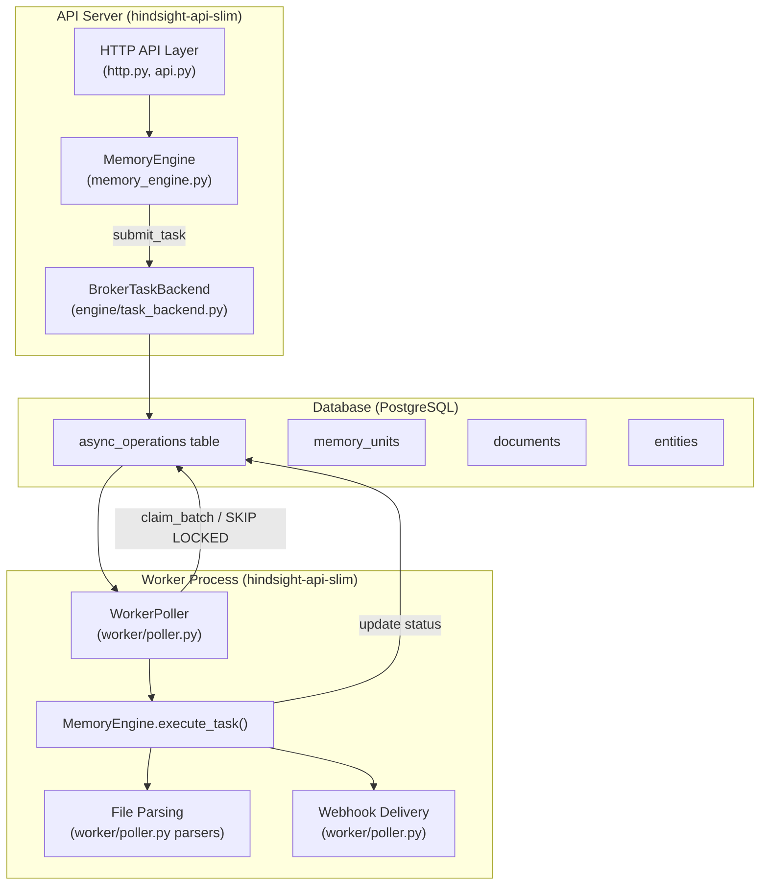
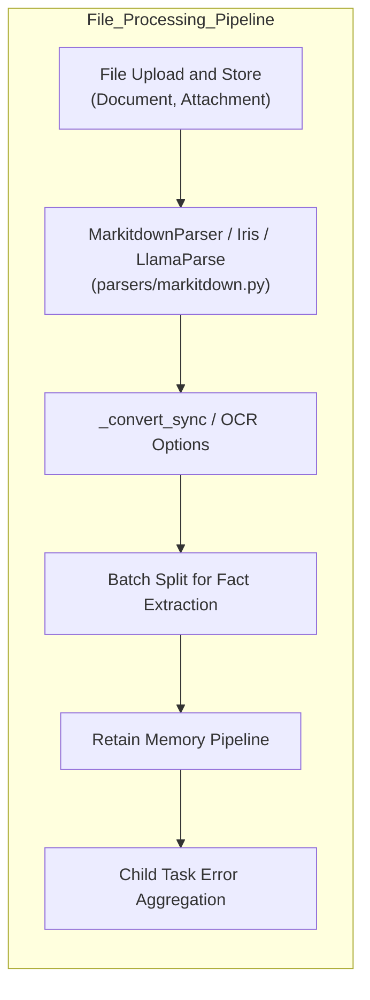
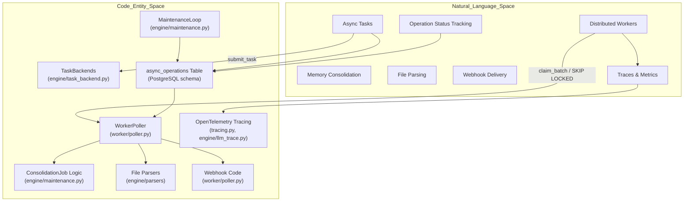

<!-- source: DeepWiki mcp.deepwiki.com · repo vectorize-io/hindsight · page 3.5 Background Worker and Task System · fetched 2026-10-27 -->

# Background Worker and Task System

Relevant source files

The following files were used as context for generating this wiki page:

- [hindsight-api-slim/hindsight_api/alembic/versions/e4a7c1b9d2f6_drop_memory_units_access_count.py](hindsight-api-slim/hindsight_api/alembic/versions/e4a7c1b9d2f6_drop_memory_units_access_count.py)
- [hindsight-api-slim/hindsight_api/engine/audit.py](hindsight-api-slim/hindsight_api/engine/audit.py)
- [hindsight-api-slim/hindsight_api/engine/background_writes.py](hindsight-api-slim/hindsight_api/engine/background_writes.py)
- [hindsight-api-slim/hindsight_api/engine/db/optional_routines.py](hindsight-api-slim/hindsight_api/engine/db/optional_routines.py)
- [hindsight-api-slim/hindsight_api/engine/llm_trace.py](hindsight-api-slim/hindsight_api/engine/llm_trace.py)
- [hindsight-api-slim/hindsight_api/engine/maintenance.py](hindsight-api-slim/hindsight_api/engine/maintenance.py)
- [hindsight-api-slim/hindsight_api/engine/task_backend.py](hindsight-api-slim/hindsight_api/engine/task_backend.py)
- [hindsight-api-slim/hindsight_api/tracing.py](hindsight-api-slim/hindsight_api/tracing.py)
- [hindsight-api-slim/hindsight_api/worker/main.py](hindsight-api-slim/hindsight_api/worker/main.py)
- [hindsight-api-slim/hindsight_api/worker/poller.py](hindsight-api-slim/hindsight_api/worker/poller.py)
- [hindsight-api-slim/tests/conftest.py](hindsight-api-slim/tests/conftest.py)
- [hindsight-api-slim/tests/test_async_batch_retain.py](hindsight-api-slim/tests/test_async_batch_retain.py)
- [hindsight-api-slim/tests/test_audit_per_bank.py](hindsight-api-slim/tests/test_audit_per_bank.py)
- [hindsight-api-slim/tests/test_background_writes.py](hindsight-api-slim/tests/test_background_writes.py)
- [hindsight-api-slim/tests/test_llm_provider.py](hindsight-api-slim/tests/test_llm_provider.py)
- [hindsight-api-slim/tests/test_llm_trace.py](hindsight-api-slim/tests/test_llm_trace.py)
- [hindsight-api-slim/tests/test_maintenance_loop.py](hindsight-api-slim/tests/test_maintenance_loop.py)
- [hindsight-api-slim/tests/test_migration_drop_access_count.py](hindsight-api-slim/tests/test_migration_drop_access_count.py)
- [hindsight-api-slim/tests/test_tracing.py](hindsight-api-slim/tests/test_tracing.py)
- [hindsight-api-slim/tests/test_tracing_context_propagation.py](hindsight-api-slim/tests/test_tracing_context_propagation.py)
- [hindsight-api-slim/tests/test_tracing_task_handoff.py](hindsight-api-slim/tests/test_tracing_task_handoff.py)
- [hindsight-api-slim/tests/test_worker.py](hindsight-api-slim/tests/test_worker.py)
- [hindsight-api-slim/tests/test_worker_main.py](hindsight-api-slim/tests/test_worker_main.py)
- [hindsight-clients/go/README.md](hindsight-clients/go/README.md)
- [hindsight-clients/go/go.mod](hindsight-clients/go/go.mod)
- [hindsight-clients/go/go.sum](hindsight-clients/go/go.sum)
- [hindsight-clients/go/openapi-generator-config.yaml](hindsight-clients/go/openapi-generator-config.yaml)
- [hindsight-clients/go/test/api_banks_test.go](hindsight-clients/go/test/api_banks_test.go)
- [hindsight-clients/go/test/api_directives_test.go](hindsight-clients/go/test/api_directives_test.go)
- [hindsight-clients/go/test/api_documents_test.go](hindsight-clients/go/test/api_documents_test.go)
- [hindsight-clients/go/test/api_entities_test.go](hindsight-clients/go/test/api_entities_test.go)
- [hindsight-clients/go/test/api_memory_test.go](hindsight-clients/go/test/api_memory_test.go)
- [hindsight-clients/go/test/api_mental_models_test.go](hindsight-clients/go/test/api_mental_models_test.go)
- [hindsight-clients/go/test/api_monitoring_test.go](hindsight-clients/go/test/api_monitoring_test.go)
- [hindsight-clients/go/test/api_operations_test.go](hindsight-clients/go/test/api_operations_test.go)
- [hindsight-docs/docs/sdks/go.md](hindsight-docs/docs/sdks/go.md)

## Purpose and Scope

The Background Worker and Task System provides a scalable and reliable distributed asynchronous processing framework for Hindsight. It enables the offloading of long-running and CPU/IO-intensive operations—such as fact extraction, file conversion, memory consolidation, mental model refresh, and webhook delivery—to dedicated worker processes. This architecture prevents API request timeouts and allows for horizontal scaling by distributing workloads across multiple worker instances.

This page provides an in-depth technical overview of the worker architecture, including asynchronous operation records, the PostgreSQL-backed task queue, poller and task backend implementations, consolidation jobs, file processing pipelines, webhook delivery with retry and backoff, tracing integration for LLM calls, and operation status tracking.

Sources: [hindsight-api-slim/hindsight_api/worker/poller.py:1-9](), [hindsight-api-slim/hindsight_api/engine/task_backend.py:1-210](), [hindsight-api-slim/hindsight_api/worker/main.py:1-184]()

---

## Architecture Overview

The worker system is composed of:

- **Async Operation Records**: The `async_operations` table tracks all async tasks and their states, such as pending, processing, completed, failed, etc.
- **Task Backends**: Abstractions handling task submission and execution:
  - `BrokerTaskBackend` for API servers to enqueue tasks.
  - `WorkerTaskBackend` for workers to handle already enqueued tasks.
  - `SyncTaskBackend` for synchronous inline execution (mostly testing/embedded mode).
- **Worker Poller (`WorkerPoller`)**: Long-running processes that poll the DB task queue, claim tasks safely using `FOR UPDATE SKIP LOCKED` semantics, and execute them concurrently.
- **Consolidation Jobs**: Periodic jobs to synthesize and deduplicate related memories.
- **File Processing Pipelines**: Asynchronous file parsing and extraction workflows.
- **Webhook Delivery System**: Reliable event notifications with retry and backoff.
- **Tracing and Observability**: Prometheus metrics, OpenTelemetry tracing of LLM calls, and health endpoints.

### Component Interaction Diagram

Sources: [hindsight-api-slim/hindsight_api/worker/poller.py:4-9](), [hindsight-api-slim/hindsight_api/worker/main.py:55-162]()

---

## Task Backend Abstraction

The task backend abstracts how tasks are submitted and executed across different execution contexts.

| Backend | Description | Use Case | Reference |
|----------|-------------|----------|-----------|
| `SyncTaskBackend` | Executes tasks immediately in the caller's context | Testing, embedded mode, CLI | [hindsight-api-slim/hindsight_api/engine/task_backend.py:95-123]() |
| `WorkerTaskBackend` | No-op submit (worker polls for tasks independently) | Worker processes avoid blocking on nested tasks | [hindsight-api-slim/hindsight_api/engine/task_backend.py:126-151]() |
| `BrokerTaskBackend` | Serializes tasks to `async_operations` DB table | API servers enqueue work for workers | [hindsight-api-slim/hindsight_api/engine/task_backend.py:153-210]() |

`TaskBackend` defines abstract methods including `submit_task`, `initialize`, and `shutdown`. The API server uses `BrokerTaskBackend` to persist tasks, while worker processes utilize `WorkerTaskBackend` where task dispatch relies strictly on database polling.

Sources: [hindsight-api-slim/hindsight_api/engine/task_backend.py:26-210]()

---

## Async Operations Table and Lifecycle Status

All background tasks are tracked in the `async_operations` PostgreSQL table, which stores task metadata, execution status, timestamps, payload, and result or error information.

### Operation Status Values

| Status     | Meaning                                                                 |
|------------|-------------------------------------------------------------------------|
| `pending`  | Task is queued and awaiting a worker claim                              |
| `processing` | A worker has claimed and is executing the task                        |
| `completed` | Task finished successfully                                              |
| `failed`   | Task failed with an unrecoverable error                                |
| `cancelled` | Task was explicitly cancelled via API; marked cancelled instead of deleted |

The system exposes asynchronous operation status at the API level with support for filtering, retrying, cancelling, and inspecting execution traces [hindsight-api-slim/hindsight_api/worker/poller.py:1-9]().

Sources: [hindsight-api-slim/hindsight_api/worker/poller.py:1-9](), [hindsight-api-slim/tests/test_async_batch_retain.py:139-164]()

---

## Worker Poller: Safe Task Claiming and Execution

The `WorkerPoller` class in `worker/poller.py` implements the core worker loop that polls the database, claims rows safely, and drives task handlers [hindsight-api-slim/hindsight_api/worker/poller.py:4-9]().

- Periodically polls the `async_operations` table for pending tasks.
- Uses PostgreSQL `FOR UPDATE SKIP LOCKED` to claim tasks atomically without blocking other concurrent workers [hindsight-api-slim/hindsight_api/worker/poller.py:4-9]().
- Tracks claimed tasks and their runtime stages via `StageHolder` [hindsight-api-slim/hindsight_api/worker/poller.py:50]().
- Enforces wall-clock timeouts (`_WallCeiling`) per task type to prevent stuck or wedged tasks [hindsight-api-slim/hindsight_api/worker/poller.py:76-112]().
- Handles storage backpressure with exponential backoff and jittered retry logic [hindsight-api-slim/hindsight_api/worker/poller.py:33-65]().

### Wall Clock Ceiling Semantics

Tasks have configurable maximum wall-clock runtimes to ensure a stuck task does not hold a worker slot indefinitely:

- `retain` operations have an absolute timeout (`retain_wall_timeout`) representing expected operation duration [hindsight-api-slim/hindsight_api/worker/poller.py:76-103]().
- `consolidation` jobs use an *idle* timeout (`consolidation_wall_timeout`) reset on progress; allows long total runtime but detects stalls [hindsight-api-slim/hindsight_api/worker/poller.py:104-108]().
- `refresh_mental_model` shares the reflect timeout budget (`reflect_wall_timeout`) [hindsight-api-slim/hindsight_api/worker/poller.py:109-112]().

Sources: [hindsight-api-slim/hindsight_api/worker/poller.py:31-168]()

---

## Consolidation Jobs and Background Maintenance

Consolidation synthesizes observations from related facts to reduce redundancies and improve recall relevance.

- Consolidation jobs are scheduled via async operation rows with type `"consolidation"` [hindsight-api-slim/hindsight_api/engine/maintenance.py:9-14]().
- The `MaintenanceLoop` runs as a periodic background task (default every 60 seconds) across API and worker nodes [hindsight-api-slim/hindsight_api/engine/maintenance.py:1-79]().
- It performs:
  - Retention sweeps for audit logs and LLM request traces in bounded chunks with `FOR UPDATE SKIP LOCKED` [hindsight-api-slim/hindsight_api/engine/maintenance.py:6-37]().
  - Reconsolidation trigger for banks with eligible facts that lack scheduled consolidation [hindsight-api-slim/hindsight_api/engine/maintenance.py:9-14]().
  - Mental model refreshes when cron schedules indicate staleness [hindsight-api-slim/hindsight_api/engine/maintenance.py:15-21]().

Sources: [hindsight-api-slim/hindsight_api/engine/maintenance.py:1-115]()

---

## File Processing Pipeline

The worker handles asynchronous file uploads with a multi-stage parsing and extraction pipeline:

1. **File Uploading**: Files are uploaded and stored as binary attachments with unique storage keys [hindsight-api-slim/tests/test_async_batch_retain.py:1-10]().
2. **Parsing**: Various parsers support PDF, Office docs, images, markdown, etc. [hindsight-api-slim/hindsight_api/worker/poller.py:121-149]()
3. **Conversion and OCR**: Some parsers invoke external tools or OCR options for text extraction.
4. **Fact Extraction**: Parsed content is passed to the `retain` pipeline, broken into sub-batches if token limits are exceeded.
5. **Error Handling**: Child task errors from sub-batch extraction or document conversion are aggregated and surfaced at the root level.

### File Parser Pipeline Diagram

Sources: [hindsight-api-slim/hindsight_api/worker/poller.py:121-149]()

---

## Webhook Delivery with Retry and Exponential Backoff

The worker system supports reliable webhook event dispatch:

- Webhook tasks are enqueued to `async_operations` when events occur.
- Delivery attempts include HMAC signing using configured secrets for security.
- Failed delivery attempts trigger retries with exponential backoff delays.
- Maximum retry counts are applied before permanently failing and marking the operation failed.

Sources: [hindsight-api-slim/hindsight_api/worker/poller.py:25-26]()

---

## Tracing, Logging, and Observability

Hindsight leverages OpenTelemetry and Prometheus for observability in the worker system:

- **Tracing**: The `tracing.py` module initializes OTLP HTTP exporters compatible with Langfuse or any OTLP collector [hindsight-api-slim/hindsight_api/tracing.py:1-12](). It instruments all LLM calls, recording full GenAI semantic conventions (prompts, completions, token counts, errors) [hindsight-api-slim/hindsight_api/tracing.py:103-130]().
- **LLM Trace Context**: Per-bank and per-operation context propagation allows attribution of LLM requests to specific operations [hindsight-api-slim/hindsight_api/engine/llm_trace.py:69-94]().
- **Metrics**: The worker exposes `/metrics` endpoint with Prometheus-formatted data including DB pool statistics, operation durations, success/failure counts [hindsight-api-slim/hindsight_api/worker/main.py:77-106]().
- **Health Endpoints**: `/health/live` for liveness (process alive), and `/health/ready` for readiness (DB connectivity) [hindsight-api-slim/hindsight_api/worker/main.py:107-157]().
- **Resource Usage Tracking**: Resident Set Size (RSS) is polled on Linux via `/proc/self/statm` during worker polling cycles [hindsight-api-slim/hindsight_api/worker/poller.py:115-129]().

### Worker Health and Metrics Endpoints

| Endpoint      | Description                                     | Code Reference                  |
|---------------|------------------------------------------------|-------------------------------|
| `/health`     | Readiness, verifies DB connectivity             | [hindsight-api-slim/hindsight_api/worker/main.py:107-124]() |
| `/health/live`| Liveness, in-process check without DB calls     | [hindsight-api-slim/hindsight_api/worker/main.py:137-157]() |
| `/metrics`    | Prometheus metrics exposed for scraping         | [hindsight-api-slim/hindsight_api/worker/main.py:160-170]() |

Sources: [hindsight-api-slim/hindsight_api/worker/main.py:55-170](), [hindsight-api-slim/hindsight_api/worker/poller.py:115-129](), [hindsight-api-slim/hindsight_api/tracing.py:150-206]()

---

## Summary Diagram: Natural Language to Code Entity Mapping

This diagram associates workers' conceptual components with their concrete code implementations and data:

Sources: [hindsight-api-slim/hindsight_api/engine/task_backend.py:26-210](), [hindsight-api-slim/hindsight_api/worker/poller.py:1-210](), [hindsight-api-slim/hindsight_api/engine/maintenance.py:1-115](), [hindsight-api-slim/hindsight_api/tracing.py:1-206]()

---

# References

For additional details consult:

- `hindsight-api-slim/hindsight_api/worker/poller.py`
- `hindsight-api-slim/hindsight_api/engine/task_backend.py`
- `hindsight-api-slim/hindsight_api/worker/main.py`
- `hindsight-api-slim/hindsight_api/engine/maintenance.py`
- `hindsight-api-slim/hindsight_api/tracing.py`

---

