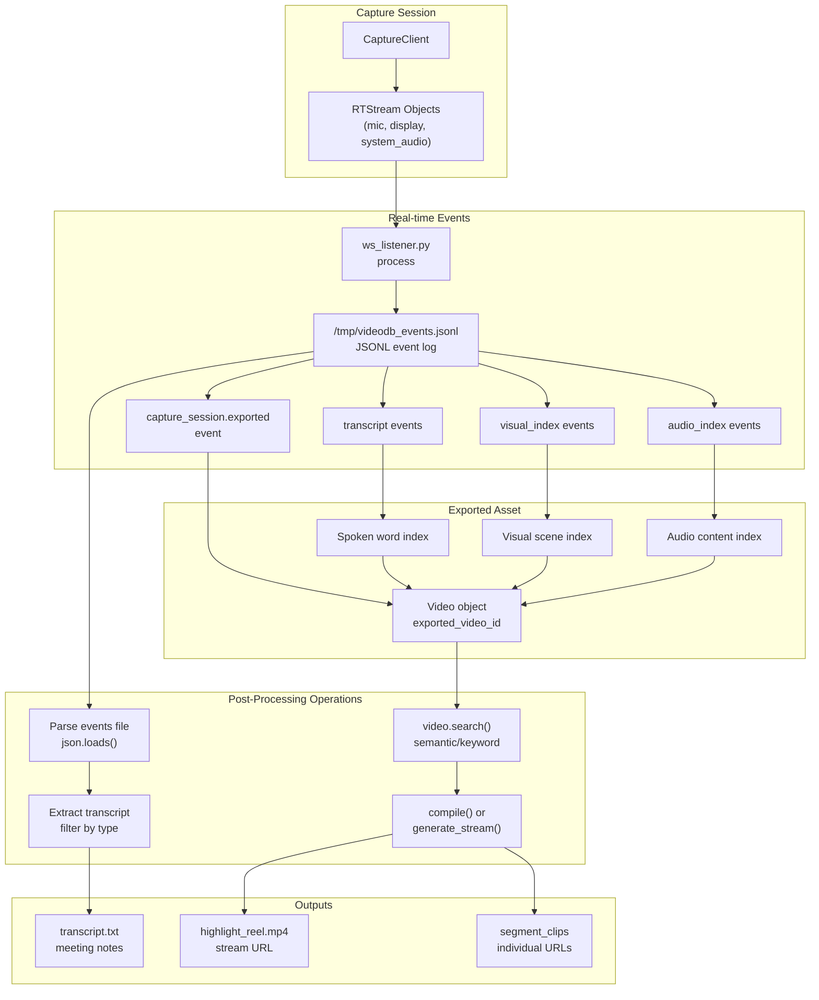
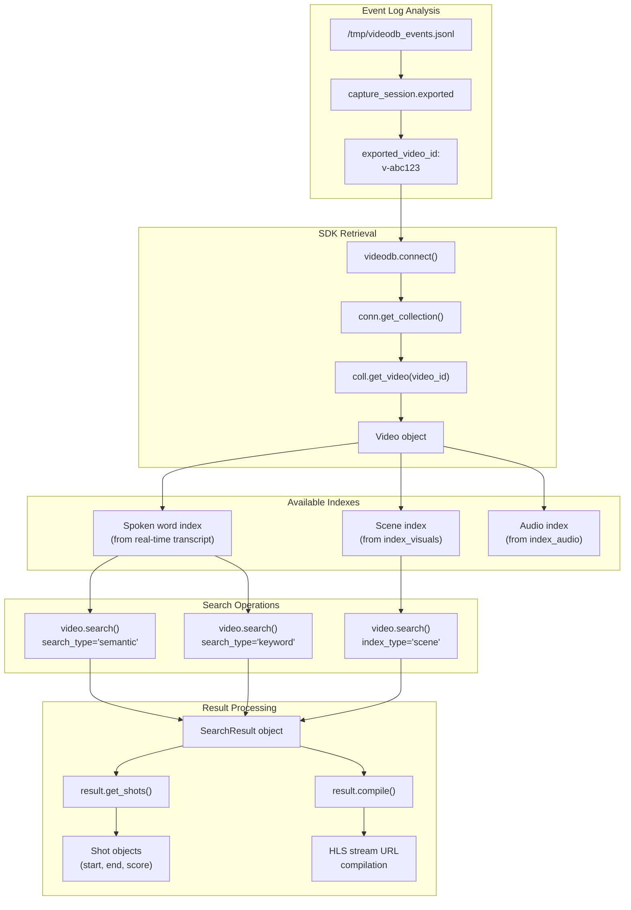

<!-- source: DeepWiki mcp.deepwiki.com · repo video-db/skills · page 8.4 Post-Session Processing · fetched 2026-10-27 -->

# Post-Session Processing

<details>
<summary>Relevant source files</summary>

The following files were used as context for generating this wiki page:

- [python/reference/capture.md](python/reference/capture.md)

</details>


This document covers working with captured content after a desktop capture session has stopped and been exported. Post-session processing includes parsing event logs, extracting transcripts, searching indexed content, and creating clips.

For information about the capture workflow and starting sessions, see [Capture Workflow](#8.1). For details on event structures and real-time processing during capture, see [Capture Events](#8.3).

---

## Overview

Once a capture session stops and emits the `capture_session.exported` event, the captured content becomes a permanent `Video` object. Post-session processing transforms the real-time event stream into historical analysis:

| Processing Step | Input | Output | Purpose |
|----------------|-------|--------|---------|
| **Event Parsing** | `videodb_events.jsonl` | Filtered event objects | Extract specific event types for analysis |
| **Transcript Extraction** | `transcript` events | Complete text with timestamps | Generate meeting notes or searchable text |
| **Content Search** | Exported `Video` object | `Shot` objects | Find specific moments in recording |
| **Clip Generation** | Search results | Stream URLs | Create shareable segments |

**Key Concept**: The exported video retains all AI-generated indexes from the live session. The `transcript`, `visual_index`, and `audio_index` events logged during capture become searchable indexes on the resulting `Video` object.

Sources: [python/reference/capture.md:1-102]()

---

## Session Export Event

After calling `client.stop_capture()`, the system processes the recorded streams and emits a `capture_session.exported` event containing the permanent video asset information.

### Export Event Structure

```json
{
  "type": "capture_session.exported",
  "session_id": "m-7e6f8d9a-1b2c-4d5e-8f9g-0h1i2j3k4l5m",
  "exported_video_id": "v-a1b2c3d4-e5f6-7890-abcd-ef1234567890",
  "stream_url": "https://stream.videodb.io/v?url=...",
  "player_url": "https://console.videodb.io/player?url=...",
  "timestamp": "2024-01-15T10:45:23Z"
}
```

**Critical Fields**:
- `exported_video_id`: The permanent `Video` object ID for SDK operations
- `stream_url`: HLS playback URL for the complete recording
- `player_url`: Web player URL for immediate playback

**Reading the Export Event**:

```python
import json

# Parse events file to find export event
with open('/tmp/videodb_events.jsonl', 'r') as f:
    for line in f:
        event = json.loads(line)
        if event['type'] == 'capture_session.exported':
            video_id = event['exported_video_id']
            stream_url = event['stream_url']
            print(f"Video exported: {video_id}")
            print(f"Watch at: {event['player_url']}")
            break
```

Sources: [python/reference/capture.md:49-51]()

---

## Event File Parsing

The `videodb_events.jsonl` file contains all events from the WebSocket stream in [JSON Lines format](http://jsonlines.org). Each line is a complete JSON object representing one event.

### Common Event Filtering Patterns

```python
import json
from datetime import datetime

def parse_events(event_file='/tmp/videodb_events.jsonl'):
    """Parse events file and return structured data."""
    events = []
    with open(event_file, 'r') as f:
        for line in f:
            if line.strip():
                events.append(json.loads(line))
    return events

def filter_by_type(events, event_type):
    """Filter events by type."""
    return [e for e in events if e.get('type') == event_type]

def filter_by_timerange(events, start_time, end_time):
    """Filter events within a time range."""
    return [e for e in events 
            if start_time <= datetime.fromisoformat(e['timestamp']) <= end_time]

def filter_by_rtstream(events, rtstream_id):
    """Filter events for specific RTStream."""
    return [e for e in events if e.get('rtstream_id') == rtstream_id]
```

### Event Type Reference

| Event Type | Content | Use Case |
|-----------|---------|----------|
| `capture_session.created` | Session ID, status | Verify session initialization |
| `capture_session.active` | RTStream IDs | Get stream references for indexing |
| `transcript` | Text, timestamps | Extract spoken words |
| `visual_index` | Scene descriptions | Analyze screen activity |
| `audio_index` | Audio content analysis | Detect sounds, music, profanity |
| `capture_session.stopped` | Stop timestamp | Mark capture end time |
| `capture_session.exported` | Video ID, URLs | Access permanent video |

Sources: [python/reference/capture.md:10-13](), [python/reference/capture.md:92-95]()

---

## Diagram: Post-Session Processing Pipeline



Sources: [python/reference/capture.md:17-51]()

---

## Extracting Transcripts

The `transcript` events contain all spoken words captured during the session. Each event includes text content and timing information.

### Transcript Event Structure

```json
{
  "type": "transcript",
  "rtstream_id": "rts-abc123",
  "text": "Let me show you the dashboard",
  "start_time": 125.4,
  "end_time": 127.8,
  "timestamp": "2024-01-15T10:35:42Z"
}
```

### Building Complete Transcripts

```python
def extract_transcript(events_file='/tmp/videodb_events.jsonl', 
                       output_file='transcript.txt'):
    """Extract and format complete transcript from events."""
    with open(events_file, 'r') as f:
        transcript_events = [
            json.loads(line) 
            for line in f 
            if json.loads(line).get('type') == 'transcript'
        ]
    
    # Sort by start time
    transcript_events.sort(key=lambda e: e.get('start_time', 0))
    
    # Format as readable text
    with open(output_file, 'w') as out:
        for event in transcript_events:
            timestamp = format_timestamp(event['start_time'])
            text = event['text']
            out.write(f"[{timestamp}] {text}\n")
    
    return transcript_events

def format_timestamp(seconds):
    """Convert seconds to MM:SS format."""
    mins = int(seconds // 60)
    secs = int(seconds % 60)
    return f"{mins:02d}:{secs:02d}"
```

### Transcript with Speaker Attribution

If multiple RTStreams are captured (e.g., separate mic channels), associate transcripts with their source:

```python
def extract_multi_speaker_transcript(events_file, rtstream_names):
    """Extract transcript with speaker labels.
    
    Args:
        events_file: Path to events JSONL
        rtstream_names: Dict mapping rtstream_id to speaker name
                       e.g. {"rts-abc": "Alice", "rts-def": "Bob"}
    """
    with open(events_file, 'r') as f:
        transcript_events = [
            json.loads(line) 
            for line in f 
            if json.loads(line).get('type') == 'transcript'
        ]
    
    transcript_events.sort(key=lambda e: e.get('start_time', 0))
    
    formatted = []
    for event in transcript_events:
        speaker = rtstream_names.get(event['rtstream_id'], 'Unknown')
        timestamp = format_timestamp(event['start_time'])
        formatted.append(f"[{timestamp}] {speaker}: {event['text']}")
    
    return '\n'.join(formatted)
```

Sources: [python/reference/capture.md:35-36]()

---

## Searching Exported Content

Once the video is exported, all AI indexes generated during capture are available for search. The exported `Video` object can be retrieved and searched using standard Video SDK methods.

### Retrieving the Exported Video

```python
import videodb

# Get video ID from export event
with open('/tmp/videodb_events.jsonl', 'r') as f:
    for line in f:
        event = json.loads(line)
        if event['type'] == 'capture_session.exported':
            video_id = event['exported_video_id']
            break

# Connect and retrieve video
conn = videodb.connect()
coll = conn.get_collection()
video = coll.get_video(video_id)
```

### Search Methods

The exported video supports all search types documented in [Searching Videos](#6):

| Search Type | Method | Index Required | Use Case |
|------------|--------|----------------|----------|
| **Semantic** | `video.search(query, search_type="semantic")` | `index_spoken_words()` | Natural language queries on transcript |
| **Keyword** | `video.search(query, search_type="keyword")` | `index_spoken_words()` | Exact phrase matching |
| **Scene** | `video.search(query, index_type="scene")` | `index_scenes()` | Visual content queries |

**Important**: The real-time AI pipelines (`index_visuals()`, `index_audio()`, transcription) during capture automatically create the necessary indexes. No re-indexing is needed.

### Example: Finding Meeting Segments

```python
# Find discussion about budget
result = video.search("budget discussion", search_type="semantic")

shots = result.get_shots()
for shot in shots:
    print(f"Match at {shot.start}s - {shot.end}s (score: {shot.search_score})")
    
# Generate compilation of all budget discussions
compilation_url = result.compile()
print(f"Watch all segments: {compilation_url}")
```

### Example: Visual Search

If `index_visuals()` was run during capture, search for screen activity:

```python
# Find when Slack was visible
result = video.search(
    "Slack application visible on screen",
    index_type="scene",
    score_threshold=0.7
)

shots = result.get_shots()
print(f"Found {len(shots)} moments with Slack visible")
```

Sources: [python/reference/capture.md:39-45]()

---

## Diagram: Search Operations on Exported Video



Sources: [python/reference/capture.md:35-51]()

---

## Creating Clips and Highlights

Search results can be compiled into highlight reels or extracted as individual clips for sharing.

### Compilation Methods

```python
# Method 1: Compile all search results into single video
result = video.search("project updates")
compilation_url = result.compile()
# Returns: HLS stream URL with all matching segments concatenated

# Method 2: Get individual shot URLs
shots = result.get_shots()
for i, shot in enumerate(shots):
    clip_url = shot.generate_stream()
    print(f"Clip {i+1}: {clip_url}")
    # Save to file, share link, etc.
```

### Advanced: Timeline Composition

For more control over clip ordering and overlays, use the Timeline API:

```python
from videodb import connect
from videodb.timeline import Timeline, VideoAsset, TextAsset, TextStyle

conn = connect()
timeline = conn.create_timeline()

# Add search result clips with text overlays
result = video.search("key moments")
shots = result.get_shots()

for i, shot in enumerate(shots[:5]):  # Top 5 results
    # Add video segment
    timeline.add_inline(VideoAsset(
        asset_id=video.id,
        start=shot.start,
        end=shot.end
    ))
    
    # Add title overlay
    timeline.add_overlay(
        start=0,  # Relative to segment start
        asset=TextAsset(
            text=f"Moment {i+1}",
            duration=2,
            style=TextStyle(fontsize=40)
        )
    )

# Generate final highlight reel
highlight_url = timeline.generate_stream()
```

For complete Timeline documentation, see [Timeline Editing](#7).

Sources: [python/reference/capture.md:42-45]()

---

## Visual Index Analysis

The `visual_index` events contain AI descriptions of screen activity. These can be analyzed for application usage tracking, workflow analysis, or security monitoring.

### Visual Index Event Structure

```json
{
  "type": "visual_index",
  "rtstream_id": "rts-display",
  "description": "User viewing Slack workspace with multiple channels visible. '#general' channel is active with recent messages about project deadlines.",
  "timestamp": "2024-01-15T10:36:15Z",
  "frame_time": 145.2
}
```

### Application Usage Tracking

```python
def track_application_usage(events_file):
    """Analyze which applications were used during capture."""
    app_usage = {}
    
    with open(events_file, 'r') as f:
        visual_events = [
            json.loads(line)
            for line in f
            if json.loads(line).get('type') == 'visual_index'
        ]
    
    for event in visual_events:
        desc = event['description'].lower()
        
        # Simple keyword detection (improve with NLP)
        apps = {
            'slack': 'Slack',
            'chrome': 'Chrome',
            'vscode': 'VS Code',
            'terminal': 'Terminal',
            'zoom': 'Zoom'
        }
        
        for keyword, app_name in apps.items():
            if keyword in desc:
                app_usage[app_name] = app_usage.get(app_name, 0) + 1
    
    return app_usage

# Generate usage report
usage = track_application_usage('/tmp/videodb_events.jsonl')
print("Application Usage:")
for app, count in sorted(usage.items(), key=lambda x: -x[1]):
    print(f"  {app}: {count} frames")
```

### Workflow Analysis

```python
def analyze_workflow(events_file):
    """Track application switches and activity patterns."""
    with open(events_file, 'r') as f:
        visual_events = [
            json.loads(line)
            for line in f
            if json.loads(line).get('type') == 'visual_index'
        ]
    
    workflow = []
    prev_app = None
    
    for event in visual_events:
        desc = event['description']
        timestamp = event.get('frame_time', 0)
        
        # Detect current application
        current_app = detect_app_from_description(desc)
        
        # Track transitions
        if current_app != prev_app and current_app:
            workflow.append({
                'time': timestamp,
                'app': current_app,
                'description': desc[:100]  # First 100 chars
            })
            prev_app = current_app
    
    return workflow

def detect_app_from_description(description):
    """Extract application name from visual description."""
    # Implement application detection logic
    # Could use regex, NLP, or simple keyword matching
    pass
```

Sources: [python/reference/capture.md:42-45]()

---

## Audio Index Analysis

The `audio_index` events provide analysis of non-speech audio content, including music, sound effects, and profanity detection.

### Audio Index Event Structure

```json
{
  "type": "audio_index",
  "rtstream_id": "rts-system-audio",
  "content": "Background music playing, upbeat electronic genre",
  "profanity_detected": false,
  "timestamp": "2024-01-15T10:38:22Z"
}
```

### Profanity Detection

```python
def detect_profanity_incidents(events_file):
    """Find all profanity incidents in recording."""
    incidents = []
    
    with open(events_file, 'r') as f:
        audio_events = [
            json.loads(line)
            for line in f
            if json.loads(line).get('type') == 'audio_index'
        ]
    
    for event in audio_events:
        if event.get('profanity_detected'):
            incidents.append({
                'time': event.get('frame_time', 0),
                'content': event.get('content'),
                'rtstream': event.get('rtstream_id')
            })
    
    return incidents

# Generate compliance report
incidents = detect_profanity_incidents('/tmp/videodb_events.jsonl')
if incidents:
    print(f"WARNING: {len(incidents)} profanity incidents detected")
    for inc in incidents:
        print(f"  {format_timestamp(inc['time'])}: {inc['content']}")
```

### Music Detection

```python
def extract_music_segments(events_file):
    """Find segments with background music."""
    music_segments = []
    in_music = False
    start_time = None
    
    with open(events_file, 'r') as f:
        audio_events = [
            json.loads(line)
            for line in f
            if json.loads(line).get('type') == 'audio_index'
        ]
    
    for event in audio_events:
        content = event.get('content', '').lower()
        timestamp = event.get('frame_time', 0)
        
        has_music = 'music' in content
        
        if has_music and not in_music:
            # Music started
            start_time = timestamp
            in_music = True
        elif not has_music and in_music:
            # Music ended
            music_segments.append({
                'start': start_time,
                'end': timestamp,
                'duration': timestamp - start_time
            })
            in_music = False
    
    return music_segments
```

Sources: [python/reference/capture.md:39-45]()

---

## Complete Post-Processing Example

This example demonstrates a complete post-session workflow: parsing events, extracting transcript, searching content, and creating clips.

```python
import json
import videodb
from datetime import datetime

def process_capture_session(events_file='/tmp/videodb_events.jsonl'):
    """Complete post-processing workflow."""
    
    # Step 1: Parse events file
    print("Parsing events...")
    events = []
    with open(events_file, 'r') as f:
        for line in f:
            if line.strip():
                events.append(json.loads(line))
    
    # Step 2: Find export event and video ID
    print("Finding exported video...")
    video_id = None
    for event in events:
        if event['type'] == 'capture_session.exported':
            video_id = event['exported_video_id']
            stream_url = event['stream_url']
            print(f"  Video ID: {video_id}")
            print(f"  Stream URL: {stream_url}")
            break
    
    if not video_id:
        print("ERROR: No export event found. Session may not be complete.")
        return
    
    # Step 3: Extract transcript
    print("\nExtracting transcript...")
    transcript_events = [e for e in events if e['type'] == 'transcript']
    transcript_events.sort(key=lambda e: e.get('start_time', 0))
    
    with open('transcript.txt', 'w') as f:
        for event in transcript_events:
            timestamp = format_timestamp(event['start_time'])
            f.write(f"[{timestamp}] {event['text']}\n")
    
    print(f"  Saved transcript with {len(transcript_events)} entries")
    
    # Step 4: Analyze visual activity
    print("\nAnalyzing screen activity...")
    visual_events = [e for e in events if e['type'] == 'visual_index']
    
    # Count application mentions
    app_counts = {}
    for event in visual_events:
        desc = event['description'].lower()
        for app in ['slack', 'chrome', 'terminal', 'vscode']:
            if app in desc:
                app_counts[app] = app_counts.get(app, 0) + 1
    
    print("  Application usage:")
    for app, count in app_counts.items():
        print(f"    {app}: {count} frames")
    
    # Step 5: Search and create clips
    print("\nSearching recorded content...")
    conn = videodb.connect()
    coll = conn.get_collection()
    video = coll.get_video(video_id)
    
    # Search for key moments
    queries = [
        "discussion about deadlines",
        "code review",
        "demo"
    ]
    
    for query in queries:
        result = video.search(query, search_type="semantic")
        shots = result.get_shots()
        
        if shots:
            print(f"\n  Found {len(shots)} results for '{query}'")
            # Create compilation
            clip_url = result.compile()
            print(f"  Compilation URL: {clip_url}")
        else:
            print(f"  No results for '{query}'")
    
    print("\nPost-processing complete!")

def format_timestamp(seconds):
    """Convert seconds to HH:MM:SS format."""
    hours = int(seconds // 3600)
    minutes = int((seconds % 3600) // 60)
    secs = int(seconds % 60)
    return f"{hours:02d}:{minutes:02d}:{secs:02d}"

if __name__ == '__main__':
    process_capture_session()
```

### Running the Example

```bash
# After capture session has exported
python post_process_capture.py

# Output:
# Parsing events...
# Finding exported video...
#   Video ID: v-abc123def456
#   Stream URL: https://stream.videodb.io/v?url=...
# 
# Extracting transcript...
#   Saved transcript with 245 entries
# 
# Analyzing screen activity...
#   Application usage:
#     slack: 43 frames
#     chrome: 78 frames
#     vscode: 156 frames
# 
# Searching recorded content...
#   Found 3 results for 'discussion about deadlines'
#   Compilation URL: https://stream.videodb.io/v?url=...
# 
# Post-processing complete!
```

Sources: [python/reference/capture.md:1-102]()

---

## Summary Table

| Operation | Primary Method | Input | Output |
|-----------|---------------|-------|--------|
| **Get Video ID** | Parse `capture_session.exported` event | `videodb_events.jsonl` | `exported_video_id` string |
| **Extract Transcript** | Filter `transcript` events | `videodb_events.jsonl` | Text file with timestamps |
| **Analyze Screen Activity** | Filter `visual_index` events | `videodb_events.jsonl` | Application usage statistics |
| **Detect Profanity** | Filter `audio_index` events | `videodb_events.jsonl` | List of incidents with timestamps |
| **Retrieve Video Object** | `coll.get_video(video_id)` | `exported_video_id` | `Video` object |
| **Search Content** | `video.search(query)` | Query string | `SearchResult` object |
| **Create Compilation** | `result.compile()` | `SearchResult` | HLS stream URL |
| **Extract Individual Clips** | `shot.generate_stream()` | `Shot` object | HLS stream URL per clip |

Sources: [python/reference/capture.md:1-102]()

---

