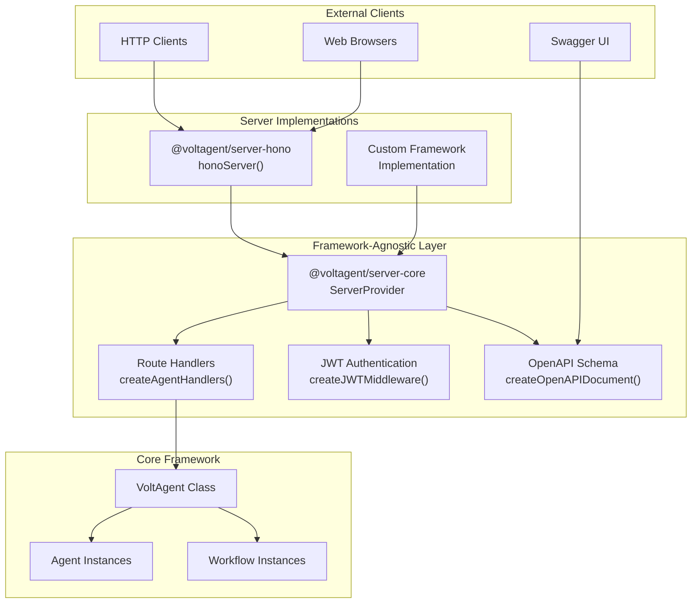
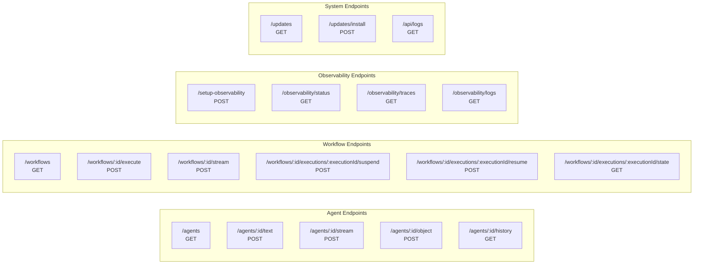
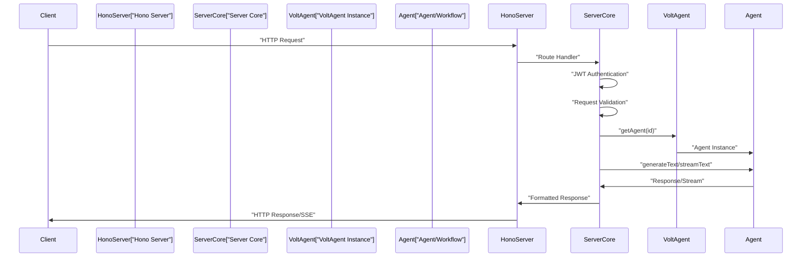
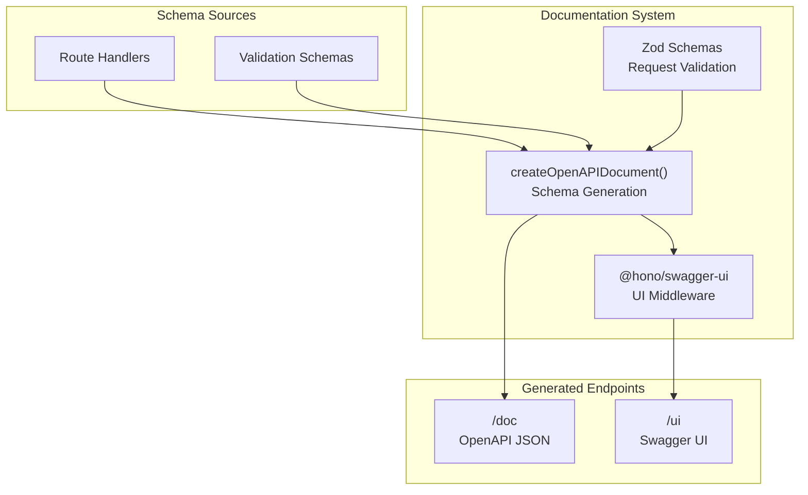

<!-- source: DeepWiki mcp.deepwiki.com · repo voltagent/voltagent · page 11.2 Server API · fetched 2026-10-27 -->

# Server API

Relevant source files

The following files were used as context for generating this wiki page:

- [CHANGELOG.md](CHANGELOG.md)
- [changelog.sh](changelog.sh)
- [examples/base/src/index.ts](examples/base/src/index.ts)
- [packages/cli/package.json](packages/cli/package.json)
- [packages/create-voltagent-app/CHANGELOG.md](packages/create-voltagent-app/CHANGELOG.md)
- [packages/create-voltagent-app/package.json](packages/create-voltagent-app/package.json)
- [packages/server-core/package.json](packages/server-core/package.json)
- [packages/server-hono/package.json](packages/server-hono/package.json)
- [packages/voice/package.json](packages/voice/package.json)

This document covers the HTTP server implementations and API endpoints provided by VoltAgent for interacting with agents and workflows over HTTP. The server system provides a RESTful API with real-time streaming capabilities for agent execution and workflow management.

For information about the core Agent class and workflow system that these APIs expose, see [Core API](#10.1). For CLI tools and commands, see [CLI Reference](#10.3).

## Architecture Overview

VoltAgent implements a **framework-agnostic server architecture** that separates core functionality from specific HTTP framework implementations. This design allows developers to use different server frameworks or create custom implementations while maintaining consistent API behavior.

**Sources:** [packages/server-core/package.json:1-51](), [packages/server-hono/package.json:1-51](), [website/docs/api/overview.md:10-16]()

## Server Implementation Packages

### @voltagent/server-core

The core server package provides framework-agnostic functionality including route handlers, authentication middleware, and OpenAPI specification generation. It defines the `ServerProvider` interface and implements shared logic for all HTTP operations.

Key components:
- `ServerProvider` interface for framework implementations
- Route handler factories (`createAgentHandlers`, `createWorkflowHandlers`)
- JWT authentication middleware (`createJWTMiddleware`)
- OpenAPI document generation (`createOpenAPIDocument`)
- WebSocket support for real-time features

### @voltagent/server-hono

The official server implementation using the [Hono](https://hono.dev) framework. This package provides the `honoServer()` function that creates a complete HTTP server with all VoltAgent endpoints configured.

Key features:
- Automatic OpenAPI/Swagger UI generation
- Built-in authentication support
- Server-Sent Events (SSE) for streaming
- WebSocket support for real-time updates
- CORS configuration

**Sources:** [packages/server-core/package.json:1-51](), [packages/server-hono/package.json:1-51](), [website/docs/api/overview.md:14-16]()

## API Endpoint Structure

The VoltAgent server exposes several categories of HTTP endpoints for different system operations:

**Sources:** [website/docs/api/overview.md:64-98]()

### Agent API Endpoints

Agent endpoints handle direct interaction with individual agents for text generation, structured object creation, and execution history retrieval.

| Endpoint | Method | Purpose |
|----------|--------|---------|
| `/agents` | GET | List all available agents |
| `/agents/:id/text` | POST | Generate text response from agent |
| `/agents/:id/stream` | POST | Stream text response using SSE |
| `/agents/:id/object` | POST | Generate structured object |
| `/agents/:id/stream-object` | POST | Stream structured object using SSE |
| `/agents/:id/history` | GET | Get agent execution history with pagination |

### Workflow API Endpoints

Workflow endpoints manage multi-step workflow execution, including suspend/resume capabilities and state management.

| Endpoint | Method | Purpose |
|----------|--------|---------|
| `/workflows` | GET | List all available workflows |
| `/workflows/:id/execute` | POST | Execute workflow synchronously |
| `/workflows/:id/stream` | POST | Stream workflow execution using SSE |
| `/workflows/:id/executions/:executionId/suspend` | POST | Suspend running workflow |
| `/workflows/:id/executions/:executionId/resume` | POST | Resume suspended workflow |
| `/workflows/:id/executions/:executionId/state` | GET | Get current workflow state |

**Sources:** [website/docs/api/overview.md:64-81]()

## Request and Response Flow

The server processes requests through a standardized flow that handles authentication, validation, execution, and response formatting:

**Sources:** [packages/server-core/package.json:8-11](), [packages/server-hono/package.json:6-12]()

## Authentication and Security

The server implements JWT-based authentication for securing API endpoints. Authentication is handled by the `createJWTMiddleware` function in `@voltagent/server-core`.

Key security features:
- JWT token validation using `jsonwebtoken` library
- Configurable token signing and verification
- Optional authentication (can be disabled for development)
- Secure token storage and transmission

**Sources:** [packages/server-core/package.json:8-9]()

## Real-time Features

VoltAgent servers support real-time communication through two mechanisms:

### Server-Sent Events (SSE)

SSE endpoints provide unidirectional streaming from server to client for:
- Agent text generation streaming (`/agents/:id/stream`)
- Agent object generation streaming (`/agents/:id/stream-object`) 
- Workflow execution streaming (`/workflows/:id/stream`)

### WebSocket Support

WebSocket connections enable bidirectional real-time communication for:
- Live agent execution monitoring
- Workflow state updates
- System status notifications

**Sources:** [packages/server-core/package.json:9-10](), [website/docs/api/overview.md:68-70]()

## OpenAPI Documentation

The server automatically generates comprehensive OpenAPI 3.1 specifications and provides interactive documentation through Swagger UI.

### OpenAPI Specification

Raw OpenAPI specification available at `/doc` endpoint, providing:
- Complete endpoint documentation
- Request/response schemas
- Authentication requirements
- Parameter specifications

### Swagger UI

Interactive API documentation available at `/ui` endpoint, featuring:
- Live API testing interface
- Request/response examples
- Schema exploration
- Authentication testing

**Sources:** [packages/server-hono/package.json:8-9](), [website/docs/api/overview.md:58-61]()

---

