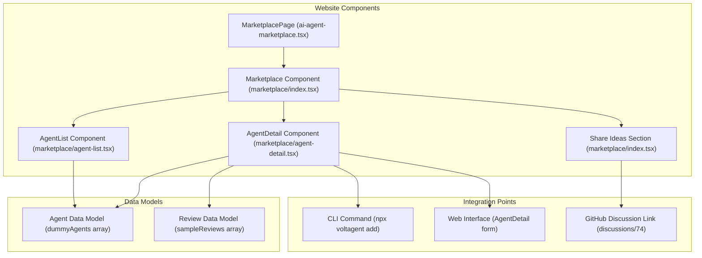
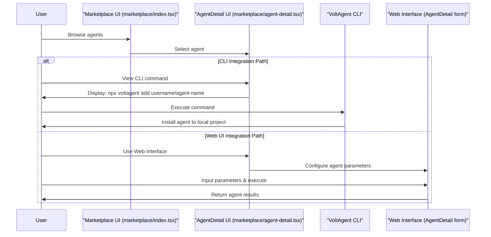
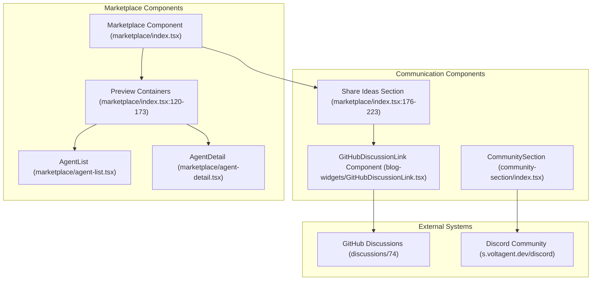

<!-- source: DeepWiki mcp.deepwiki.com · repo voltagent/voltagent · page 12.5 Contributing Guidelines · fetched 2026-10-27 -->

# Community and Marketplace

<details>
<summary>Relevant source files</summary>

The following files were used as context for generating this wiki page:

- [.github/workflows/prerelease.yml](.github/workflows/prerelease.yml)
- [.github/workflows/pull-request.yml](.github/workflows/pull-request.yml)
- [.github/workflows/release.yml](.github/workflows/release.yml)
- [examples/with-jwt-auth/src/index.ts](examples/with-jwt-auth/src/index.ts)
- [examples/with-playwright/src/index.ts](examples/with-playwright/src/index.ts)
- [package.json](package.json)
- [packages/core/src/utils/message-helpers.spec.ts](packages/core/src/utils/message-helpers.spec.ts)
- [packages/core/src/utils/message-helpers.ts](packages/core/src/utils/message-helpers.ts)
- [pnpm-workspace.yaml](pnpm-workspace.yaml)
- [website/docs/utils/message-helpers.md](website/docs/utils/message-helpers.md)

</details>


The VoltAgent Community and Marketplace is a planned feature that will serve as a hub for developers to share, discover, and potentially monetize AI agents built with the VoltAgent framework. It aims to create a vibrant ecosystem where innovative agent solutions can be easily distributed and adopted.

## Vision and Purpose

The Community Marketplace is being designed as a central platform for VoltAgent developers to:

1. **Share & Showcase** their AI agents with detailed profiles explaining capabilities and implementation
2. **Discover & Integrate** agents created by other community members
3. **Monetize** their work through various pricing models (optional)
4. **Build Reputation** through user feedback, ratings, and usage metrics

The marketplace is intended to bridge the gap between agent creators and users who need ready-made AI solutions, while supporting sustainable open-source development.

Sources: [website/blog/2025-05-01-voltagent-marketplace/index.md](), [website/src/components/marketplace/index.tsx:37-75]()

## Current Status

The VoltAgent Community Marketplace is currently in development and marked as "Coming Soon" on the VoltAgent website. The team is actively soliciting community input to shape its features and design through a dedicated GitHub discussion.

### Community Feedback Initiative

Developers are encouraged to share their ideas about desired marketplace features, including:
- Must-have features for agent listing and discovery
- Preferred monetization models
- Quality control mechanisms
- Integration preferences

Contributors who provide feedback may receive early access to publish their agents when the marketplace launches.

Sources: [website/src/components/marketplace/index.tsx:20-35](), [website/src/components/marketplace/index.tsx:176-223]()

## Marketplace Architecture

### Component Structure



Sources: [website/src/components/marketplace/index.tsx](), [website/src/components/marketplace/agent-list.tsx](), [website/src/components/marketplace/agent-detail.tsx](), [website/src/pages/ai-agent-marketplace.tsx]()

## Agent Listings

The marketplace will provide a browsable collection of AI agents with the following information for each listing:

- Agent name and category
- Creator information with verification badges
- Description of capabilities
- Pricing model
- Usage statistics
- User ratings

The agent list component is implemented in the `AgentList` React component, which displays a grid of agent cards with essential information.

Sources: [website/src/components/marketplace/agent-list.tsx:21-119](), [website/src/components/marketplace/agent-list.tsx:250-308]()

## Agent Details

Each agent will have a detailed profile page implemented via the `AgentDetail` component, which includes:

- Comprehensive description of functionality
- Complete list of capabilities
- Integration instructions (CLI and Web UI)
- Demonstration visuals
- User reviews and ratings
- Usage statistics and pricing details

The agent detail page is designed to provide potential users with all the information they need to decide whether to use an agent and how to integrate it into their projects.

Sources: [website/src/components/marketplace/agent-detail.tsx:95-119](), [website/src/components/marketplace/agent-detail.tsx:310-340]()

## Integration Options

The marketplace is being designed to offer multiple ways to use listed agents:

### Integration Flow



1. **CLI Integration**:
   Developers can add agents to their projects with a simple command:
   ```
   $ npx voltagent add username/agent-name
   ```

2. **Direct Web Interface**:
   For those who want to use an agent without setup, a browser-based interface allows immediate access.

Sources: [website/src/components/marketplace/agent-detail.tsx:196-242]()

## Community Engagement Components



The marketplace integrates with community platforms to facilitate feedback and collaboration:

1. **GitHub Discussions**: A dedicated thread for marketplace feature suggestions
2. **Discord Community**: Real-time community interaction and support
3. **Share Ideas Section**: UI component within the marketplace for feedback submission

Sources: [website/src/components/marketplace/index.tsx:176-223](), [website/src/components/blog-widgets/GitHubDiscussionLink.tsx](), [website/src/components/community-section/index.tsx]()

## Planned Features

### Rating and Review System

The marketplace will include a comprehensive rating system where users can:
- Rate agents using a 5-point scale (displayed as lightning bolt icons)
- Submit detailed reviews with text feedback
- See aggregate ratings and sort by popularity

Sources: [website/src/components/marketplace/agent-detail.tsx:342-390](), [website/src/components/marketplace/agent-list.tsx:123-133]()

### Creator Verification

To build trust in the ecosystem, creator verification is implemented as a visual badge (checkmark) that appears next to verified creators' profile images.

Sources: [website/src/components/marketplace/agent-detail.tsx:161-169](), [website/src/components/marketplace/agent-list.tsx:179-187]()

### Usage Analytics

The marketplace will track and display usage metrics for each agent:
- Total number of uses
- Last usage timestamp
- Popularity rankings

These metrics help users identify widely-adopted, actively maintained agents.

Sources: [website/src/components/marketplace/agent-detail.tsx:283-307]()

## Future Roadmap

The VoltAgent team is exploring several enhancements for the marketplace:

1. **Diverse Monetization Models**: Subscriptions, pay-per-use, and flat fees
2. **Quality Assurance Standards**: Systems to ensure reliability of published agents
3. **Advanced Discovery Tools**: Better search, filtering, and recommendation algorithms
4. **Enhanced Integration Options**: More ways to incorporate marketplace agents into projects

Sources: [website/blog/2025-05-01-voltagent-marketplace/index.md:50-59]()

## Participating in Development

Developers interested in contributing to the Community Marketplace can:

1. Share ideas on the [GitHub Discussion](https://github.com/orgs/VoltAgent/discussions/74)
2. Join the VoltAgent Discord community
3. Follow updates on the VoltAgent blog
4. Start building agents with VoltAgent to be ready for marketplace launch

Contributors who provide valuable feedback will receive early access to list their VoltAgent-based AI agents when the marketplace launches.

Sources: [website/src/components/marketplace/index.tsx:204-220](), [website/src/components/community-section/index.tsx]()