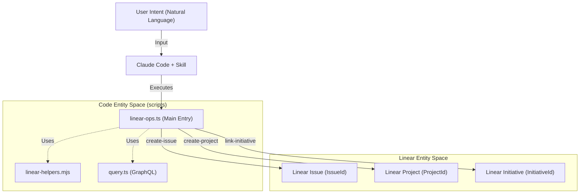
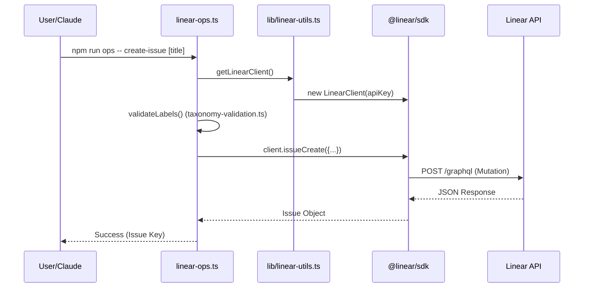

<!-- source: DeepWiki mcp.deepwiki.com · repo wrsmith108/linear-claude-skill · page 5 Issue & Project Management Workflows · fetched 2026-10-27 -->

# Issue & Project Management Workflows

Relevant source files

The following files were used as context for generating this wiki page:

- [SKILL.md](SKILL.md)
- [projects.md](projects.md)

This page provides an operational guide for managing Linear entities using the `linear-claude-skill`. It defines the high-level workflows for maintaining a clean, actionable, and synchronized project management state within Linear.

The skill emphasizes a "Discovery Before Creation" philosophy to prevent duplicate work and ensure that the Linear state accurately reflects the actual state of the codebase.

## Workflow Overview

The management workflow is divided into two primary domains: individual task tracking (Issues) and high-level organizational structures (Projects and Initiatives).

### 1. Issue Lifecycle
The issue lifecycle governs how tasks are identified, created, categorized, and transitioned to completion. This process includes a mandatory checklist to ensure data quality and a "Codebase Verification" step to ensure descriptions match reality.

**Key Components:**
*   **Discovery Before Creation:** Always search for existing issues before creating new ones [projects.md:93-114]().
*   **Mandatory Metadata:** Every issue requires a detailed description, specific labels from the taxonomy, and a project assignment [SKILL.md:168-185]().
*   **Parent-Child Relationships:** Using sub-issues to break down complex features into trackable units [projects.md:191-203]().
*   **Status Transitions:** Moving issues through the workflow (e.g., `Todo` → `In Progress` → `Done`) [SKILL.md:151-153]().

For detailed protocols and commands, see **[Issue Lifecycle](#5.1)**.

### 2. Project & Initiative Management
Projects and Initiatives provide the macro-view of work. This workflow covers the setup of new project phases, linking them to strategic initiatives, and providing regular health updates.

**Key Components:**
*   **The 10-Step Checklist:** A rigorous process for project instantiation including content vs. description field management [projects.md:9-29]().
*   **Initiative Linking:** Connecting projects to higher-level "Initiatives" for roadmap visibility [projects.md:13-17]().
*   **Status & Health:** Managing project states (Planned, In Progress, Completed) and reporting health (On Track, At Risk, Off Track) [projects.md:20-24]().
*   **Milestones:** Defining "Definition of Done" through project milestones.

For detailed setup steps and management patterns, see **[Project & Initiative Management](#5.2)**.

---

## System Integration Diagram

The following diagram illustrates how natural language intent from a user is transformed into structured Linear entities through the codebase's command-line interface and internal library.

### Intent to Entity Mapping
"Bridge between user requests and the `linear-ops.ts` command suite."

Sources: [scripts/linear-ops.ts:1-50](), [SKILL.md:145-162](), [projects.md:32-66]()

---

## Execution Logic Flow

This diagram tracks the internal logic when a management command is issued, showing the transition from the CLI wrapper to the underlying SDK and API calls.

### Command Execution Path
"Mapping the flow from `npm run ops` to the `@linear/sdk`."

Sources: [scripts/lib/linear-utils.ts:15-35](), [scripts/linear-ops.ts:100-150](), [SKILL.md:148-149]()

---

## Operational Summary Table

| Workflow Area | Primary Tool/Command | Mandatory Requirement |
| :--- | :--- | :--- |
| **Issue Creation** | `create-issue` | Description + 1 Type Label + 1 Domain Label [SKILL.md:172-177]() |
| **Task Breakdown** | `create-sub-issue` | Inherit Project/Team from Parent [projects.md:208-209]() |
| **Project Setup** | `create-project` | Set `content` (Markdown) AND `description` (Short) [projects.md:72-89]() |
| **Progress Tracking** | `project-status` | Create a Project Update (health report) on change [projects.md:32-50]() |
| **Verification** | `grep` / `ls` | Verify codebase state BEFORE accepting issue scope [projects.md:118-143]() |

---
**Child Pages:**
*   **[Issue Lifecycle](#5.1)** — Detailed issue creation, labeling, and state transitions.
*   **[Project & Initiative Management](#5.2)** — Full guide on project structure, initiatives, and reporting.

Sources: [SKILL.md:168-185](), [projects.md:1-29](), [projects.md:93-114](), [projects.md:118-188]()

---

