# Page: Overview

# Overview

<details>
<summary>Relevant source files</summary>

The following files were used as context for generating this wiki page:

- [.claude-plugin/plugin.json](.claude-plugin/plugin.json)
- [CHANGELOG.md](CHANGELOG.md)
- [README.md](README.md)
- [package.json](package.json)

</details>


The `linear-claude-skill` is a comprehensive integration for [Claude Code](https://claude.ai/code) designed to manage Linear issues, projects, and teams. It bridges the gap between natural language development workflows and Linear's structured project management by providing a multi-tiered execution model that includes Model Context Protocol (MCP) tools, a dedicated TypeScript SDK, and direct GraphQL access [package.json:2-5]().

This skill exists to automate repetitive project management tasks, enforce organizational standards (like label taxonomies), and ensure that the state of the codebase remains synchronized with Linear's tracking [README.md:1-21]().

## System Integration

The skill fits into the Claude Code ecosystem as a discovered skill [package.json:55-61](). When installed, it provides Claude with a suite of operational scripts and automation hooks.

### High-Level Workflow
1.  **Discovery**: Claude uses the skill to check for existing issues or projects before creation to prevent duplicates [README.md:156-168]().
2.  **Execution**: Operations are performed via the `linear-ops` CLI or direct SDK scripts [package.json:43-45]().
3.  **Synchronization**: A `post-edit` hook can automatically suggest syncing code changes back to Linear issues [README.md:150-151]().

The following diagram illustrates how Claude Code interacts with the various layers of the skill to perform a Linear operation.

**Claude Code to Linear Execution Path**
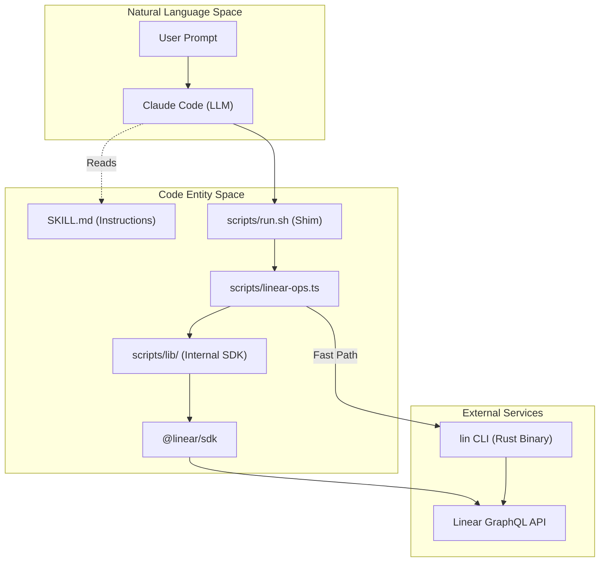
Sources: [package.json:43-45](), [scripts/run.sh:1-20](), [README.md:127-152](), [SKILL.md:1-50]()

## Key Components

The codebase is organized into three primary functional areas:

| Component | Description | Primary Entities |
| :--- | :--- | :--- |
| **CLI & Scripts** | Entry points for Claude to execute commands. | `linear-ops.ts`, `sync.ts`, `query.ts` |
| **Shared Library** | Internal SDK providing business logic and validation. | `linear-utils.ts`, `taxonomy.ts`, `project-template.ts` |
| **Automation Hooks** | Background processes for environment sync. | `post-edit.sh` |

### Technical Foundation
The skill is built on Node.js (>=20.11.0) and uses `esbuild` for pre-compilation to ensure fast CLI startup times (~50ms) [package.json:62-73](). It leverages a dual-path execution strategy where it attempts to use a pre-compiled JavaScript bundle in `dist/` but falls back to `tsx` for direct TypeScript execution if the bundle is missing [README.md:7-19]().

**Entity Mapping: Code to Linear Domain**
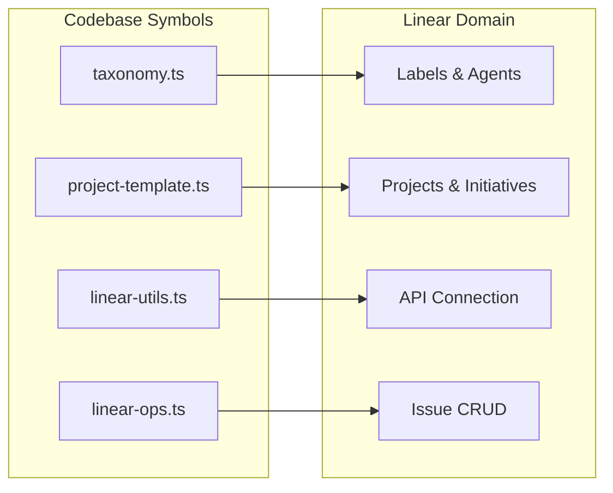
Sources: [scripts/lib/taxonomy.ts:1-20](), [scripts/lib/project-template.ts:1-30](), [scripts/lib/linear-utils.ts:1-15](), [scripts/linear-ops.ts:1-50]()

## Documentation Map

### [Getting Started](#1.1)
The installation guide for setting up the skill in `~/.claude/skills/linear`, configuring the mandatory `LINEAR_API_KEY`, and running the `setup` diagnostic script to verify connectivity.
*   **See also**: [Environment & Authentication](#7.2)

### [Architecture Overview](#1.2)
A deep dive into the five-tier tool selection model. This section explains how the skill decides between using the `lin` Rust CLI (for speed), the `@linear/sdk` (for complex logic), or raw GraphQL (for advanced queries).

### [Core Scripts & CLI](#2)
Documentation for the `scripts/` directory, focusing on the `linear-ops` command suite which handles issue creation, status updates, and project management.
*   **Key Files**: `scripts/linear-ops.ts`, `scripts/run.sh`, `scripts/build.mjs`.

### [Shared Library (scripts/lib)](#3)
Details on the internal logic that powers the scripts, including the Label Taxonomy system for consistent categorization and the Project Template engine for standardized project setup.
*   **Key Files**: `scripts/lib/taxonomy.ts`, `scripts/lib/linear-utils.ts`, `scripts/lib/agent-selection.ts`.

### [Issue & Project Management Workflows](#5)
Operational protocols that Claude must follow, such as "Discovery Before Creation" and the distinction between `content` and `description` fields in Linear.

### [Automation & Integration](#6)
Information on the `post-edit` hook and how the skill integrates with the official Linear MCP server.

### [Troubleshooting](#7)
Solutions for common issues like SSE connection timeouts, API key validation errors, and MCP server selection.

### [Glossary](#8)
Definitions of codebase-specific terms like "Initiative," "Domain Label," and "AgentId."

---

# Page: Getting Started

# Getting Started

<details>
<summary>Relevant source files</summary>

The following files were used as context for generating this wiki page:

- [.env.schema](.env.schema)
- [README.md](README.md)
- [SKILL.md](SKILL.md)
- [scripts/setup.ts](scripts/setup.ts)

</details>


This page provides a technical guide for installing, configuring, and verifying the Linear skill for Claude Code. The skill is designed to provide a high-performance interface between Claude and the Linear API, supporting multiple execution paths including MCP, a dedicated TypeScript CLI, and direct GraphQL access.

## Installation

The skill should be installed directly into the Claude Code skills directory to allow for automatic discovery.

```bash
# 1. Clone the repository into the Claude skills directory
git clone https://github.com/wrsmith108/linear-claude-skill ~/.claude/skills/linear

# 2. Navigate to the directory and install dependencies
cd ~/.claude/skills/linear && npm install

# 3. (Optional) Pre-compile for 18x faster startup
npm run build
```

The build process uses `esbuild` to transform TypeScript into optimized JavaScript in the `dist/` directory [README.md:139-149](). If the `dist/` files are missing, the shared runner (`scripts/run.sh`) automatically falls back to `tsx` for execution [README.md:7-7]().

**Sources:** [README.md:24-30](), [README.md:60-66](), [README.md:138-149]()

## Environment Configuration

The skill requires specific environment variables to authenticate with Linear and manage project hierarchies.

### Required Variables

| Variable | Requirement | Description |
| :--- | :--- | :--- |
| `LINEAR_API_KEY` | **Mandatory** | Personal API key starting with `lin_api_`. |
| `LINEAR_DEFAULT_INITIATIVE_ID` | Optional | UUID for the default initiative used in automated project creation. |

### Configuration Methods

Variables can be set in three locations, prioritized by the shell's standard resolution:
1.  **Shell Profile**: Add `export LINEAR_API_KEY="lin_api_..."` to `~/.zshrc` or `~/.bashrc` [SKILL.md:126-128]().
2.  **Claude Env**: Add to `~/.claude/.env` for Claude-specific persistence [SKILL.md:129-131]().
3.  **Project .env**: A `.env` file within the skill directory (useful for development).

### Security & Varlock
The skill implements a "Varlock" pattern to prevent accidental exposure of secrets. The `.env.schema` file marks `LINEAR_API_KEY` as `@sensitive` [.env.schema:5-6](). Developers should use `varlock load` to verify keys are set without printing their values to the console [SKILL.md:52-63]().

**Sources:** [SKILL.md:116-133](), [SKILL.md:48-81](), [.env.schema:1-11]()

## Connectivity & Setup Verification

The skill includes a diagnostic script, `scripts/setup.ts`, which performs a multi-stage validation of the environment.

### Setup Logic Flow
The `runSetupCheck()` function coordinates the following validations:
1.  **SDK Presence**: Checks if `@linear/sdk` is importable [scripts/setup.ts:97-111]().
2.  **API Authentication**: Attempts a `viewer` query to verify the key and network connectivity [scripts/setup.ts:68-78]().
3.  **CLI Availability**: Detects if the optional Rust-based `lin` CLI or the official Linear Desktop CLI are installed [scripts/setup.ts:113-129]().
4.  **MCP Configuration**: Scans for `.mcp.json` to ensure the Linear MCP server is registered [scripts/setup.ts:131-152]().

### Connectivity Data Flow
The following diagram illustrates how the `setup.ts` script bridges Natural Language requirements to Code Entities.

**Setup Verification Data Flow**
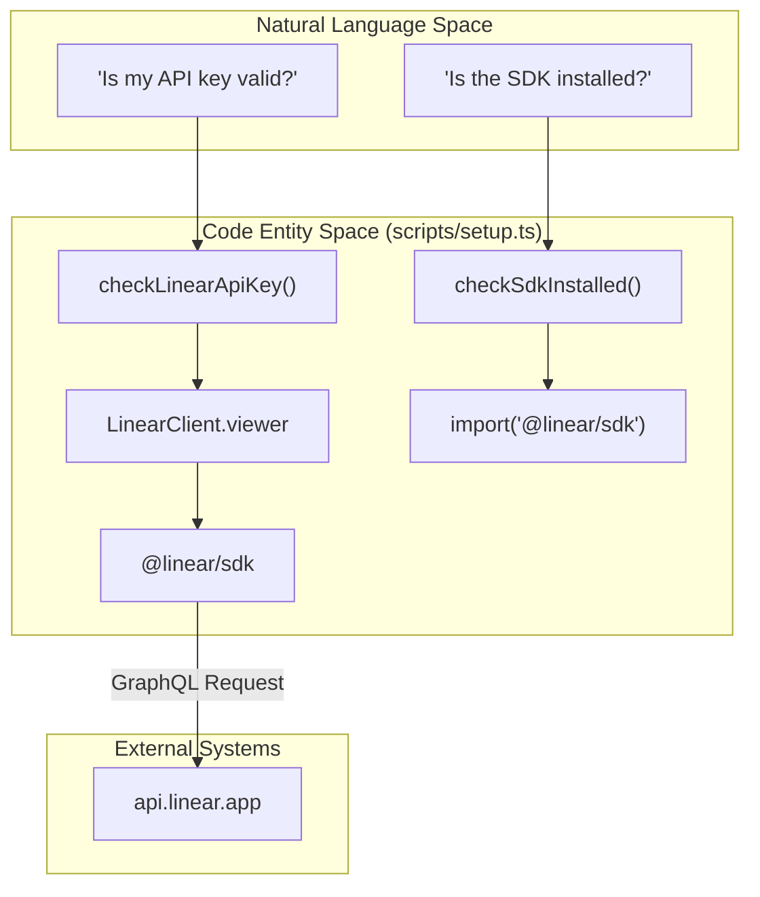

**Sources:** [scripts/setup.ts:154-216](), [scripts/setup.ts:68-78]()

## Verifying the Installation

Once configured, verify the full execution chain using the `whoami` command. This tests the TypeScript execution environment, the `linear-ops.ts` dispatcher, and the Linear API connection.

```bash
npm run ops -- whoami
```

### Execution Hierarchy
The skill utilizes a tiered execution model. If a high-performance tool is missing, it falls back to a more compatible one.

**Tool Selection Hierarchy**
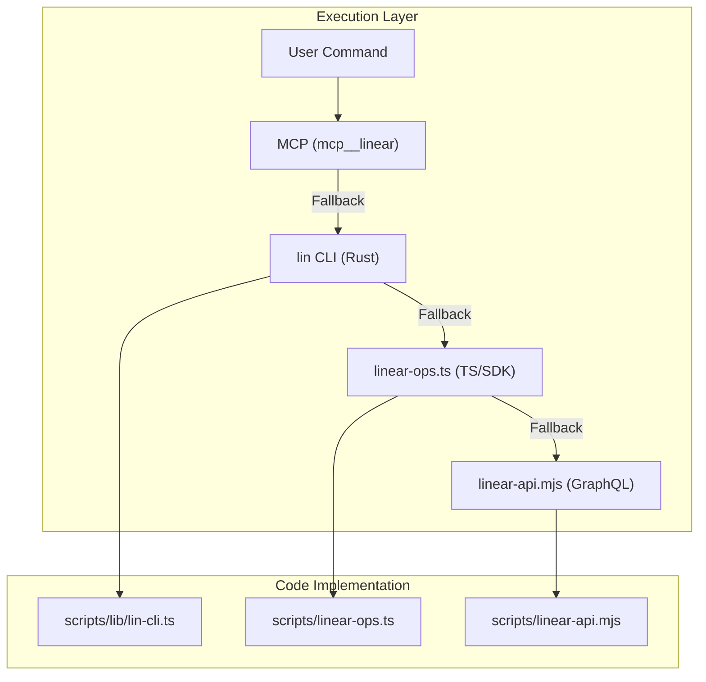

**Sources:** [SKILL.md:17-44](), [README.md:137-148](), [README.md:207-220]()

## Troubleshooting Common Issues

1.  **Unauthorized (401)**: Usually indicates an expired `LINEAR_API_KEY`. The `setup.ts` script specifically catches 401 errors and suggests regeneration [scripts/setup.ts:80-88]().
2.  **Missing SDK**: Occurs if `npm install` was not run in the skill directory. Run `npm install` inside `~/.claude/skills/linear` [scripts/setup.ts:101-110]().
3.  **Slow Startup**: If commands take >1s, the pre-compiled `dist/` directory may be missing. Run `npm run build` [README.md:60-66]().

**Sources:** [scripts/setup.ts:79-94](), [README.md:60-66]()

---

# Page: Architecture Overview

# Architecture Overview

<details>
<summary>Relevant source files</summary>

The following files were used as context for generating this wiki page:

- [CHANGELOG.md](CHANGELOG.md)
- [CLAUDE.md](CLAUDE.md)
- [README.md](README.md)
- [SKILL.md](SKILL.md)

</details>


This page details the technical architecture of the `linear-claude-skill`, focusing on the multi-tiered execution model, the integration with Claude Code, and the data flow between the local environment and the Linear API.

## Five-Tier Tool Selection Model

The skill employs a hierarchical selection model to balance execution speed, reliability, and capability. Claude Code is instructed via `SKILL.md` to attempt operations in a specific order of precedence [SKILL.md:17-24]().

| Tier | Component | Technology | Primary Use Case |
| :--- | :--- | :--- | :--- |
| **1** | **MCP Tools** | SSE / JSON-RPC | Lightweight, built-in operations (viewing issues, simple updates) [SKILL.md:21-21](). |
| **2** | **lin CLI** | Rust Binary | High-performance "fast-path" for listings and searches (~50ms) [README.md:20-20](). |
| **3** | **Helper Scripts** | TypeScript / Node.js | Complex workflows (project creation, sub-issue trees, label validation) [SKILL.md:23-23](). |
| **4** | **Linear SDK** | `@linear/sdk` | Typed automation and multi-step mutations [CLAUDE.md:127-127](). |
| **5** | **GraphQL API** | Raw HTTP POST | Low-level operations or features missing from the SDK [CLAUDE.md:128-128](). |

### Tier 2: `lin` CLI Fast-Path
The skill integrates with the [aaronkwhite/linear-cli](https://github.com/aaronkwhite/linear-cli) Rust binary. The `lib/lin-cli.ts` module provides a `tryLin()` abstraction that attempts to use the binary for supported commands (like `status`, `search`, or `list`) and silently falls back to the SDK if the binary is missing or fails three consecutive times (circuit-breaker pattern) [CLAUDE.md:77-80]().

### Tier 3: High-Level Operations (`linear-ops.ts`)
The primary entry point for Claude is `scripts/linear-ops.ts`. This CLI dispatches natural language-like commands to specific TypeScript handlers [CLAUDE.md:63-67]().

**Sources:** [SKILL.md:17-46](), [README.md:1-21](), [CLAUDE.md:63-80]()

---

## Dual-Path Execution Strategy

To optimize for performance without sacrificing development flexibility, the skill uses a dual-path execution strategy via a shared runner.

### Pre-compiled vs. JIT Execution
1.  **Production Path (Bundled):** Entry points in `scripts/` are pre-compiled using `esbuild` into `dist/`. This eliminates the ~1s overhead of TypeScript JIT compilation, resulting in ~50ms startup times [README.md:7-7]().
2.  **Development Path (Fallback):** If `dist/` is missing, the system falls back to `tsx` (TypeScript Execute) to run scripts directly from source [README.md:7-7]().

### The `run.sh` Shim
All `npm run` commands delegate to `scripts/run.sh`. This script checks for the existence of a bundled `.js` file in `dist/` before deciding whether to use `node` or `npx tsx` [CLAUDE.md:98-101]().

**Sources:** [README.md:7-7](), [CLAUDE.md:90-101]()

---

## Technical Data Flow: Natural Language to Linear Entity

The following diagram bridges the gap between Claude's natural language intent and the specific code entities that handle the request.

### Intent Resolution Diagram
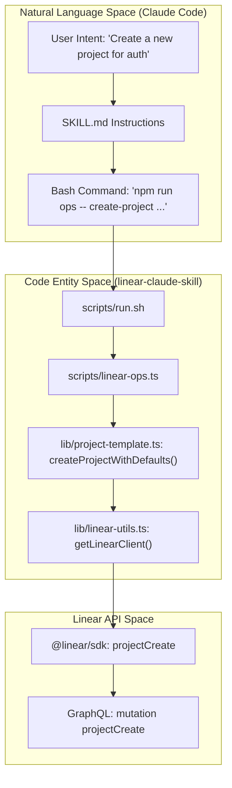
**Sources:** [SKILL.md:197-200](), [CLAUDE.md:63-69](), [CLAUDE.md:82-88]()

---

## Skill Discovery & Integration

Claude Code discovers the skill by reading `SKILL.md` at the root of the repository. This file acts as the "manifest" for the LLM.

### Discovery Mechanism
1.  **Metadata:** The frontmatter in `SKILL.md` defines the skill name, version, and allowed tools (e.g., `mcp__linear`, `Bash`) [SKILL.md:1-9]().
2.  **Tooling Context:** It explicitly instructs Claude to use `npm run ops` for complex operations when the standard MCP tools are insufficient or unavailable [SKILL.md:25-44]().
3.  **Post-Edit Hook:** The skill integrates with Claude's `PostToolUse` hook via `hooks/post-edit.sh`. After Claude edits a file, this hook scans for Linear issue keys (e.g., `ENG-123`) and suggests a `sync` operation if changes are detected [README.md:150-151](), [CLAUDE.md:42-43]().

### Project Creation Workflow
The skill enforces a 6-step workflow for project creation to ensure data integrity, implemented in `lib/project-template.ts`:
1.  **Create:** Initialize project with metadata.
2.  **Link:** Attach to a parent Initiative (mandatory) [CLAUDE.md:84-84]().
3.  **Content:** Set the long-form `content` field via `projectUpdate` (distinct from the 255-char `description`) [CLAUDE.md:85-85]().
4.  **Labels:** Ensure required taxonomy labels exist in the workspace [CLAUDE.md:86-86]().
5.  **Issues:** Batch-create initial issues.
6.  **Verify:** Execute `lib/verify.ts` to confirm entity relationships [CLAUDE.md:88-88]().

**Sources:** [SKILL.md:1-9](), [CLAUDE.md:82-89](), [README.md:150-151]()

---

## Detailed Execution Flow (Project Creation)

This diagram tracks a complex project creation request through the internal library modules.

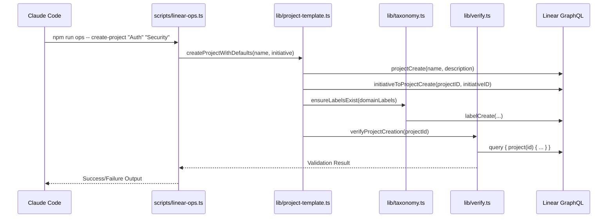
**Sources:** [CLAUDE.md:82-89](), [scripts/linear-ops.ts:1-10](), [scripts/lib/project-template.ts:1-10]()

---

# Page: Core Scripts & CLI

# Core Scripts & CLI

<details>
<summary>Relevant source files</summary>

The following files were used as context for generating this wiki page:

- [scripts/__tests__/smoke.test.ts](scripts/__tests__/smoke.test.ts)
- [scripts/linear-ops.ts](scripts/linear-ops.ts)
- [scripts/phase-complete.ts](scripts/phase-complete.ts)
- [scripts/query.ts](scripts/query.ts)
- [scripts/run.sh](scripts/run.sh)
- [scripts/sync.ts](scripts/sync.ts)

</details>


This section provides an overview of the `scripts/` directory, which contains the operational heart of the `linear-claude-skill`. The system is designed around a primary CLI entry point, a robust build system, and specialized utility scripts for complex Linear workflows.

## Overview

The codebase uses a tiered execution strategy. While most operations are accessible via the high-level `linear-ops.ts` CLI, the system also includes specialized scripts for bulk synchronization, GraphQL experimentation, and image processing. All scripts leverage a shared runner that prioritizes performance by using pre-compiled JavaScript when available, falling back to `tsx` for development flexibility.

### System Entry Points and Flow

The following diagram illustrates how natural language intent from Claude Code maps to specific code entities and execution paths within the script architecture.

**Intent to Entity Mapping**
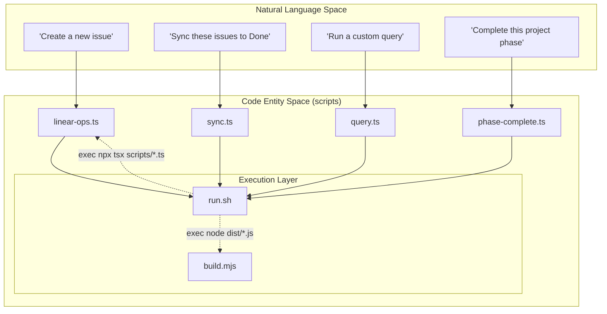
**Sources:** [scripts/run.sh:1-8](), [scripts/linear-ops.ts:10-27](), [scripts/sync.ts:3-16](), [scripts/phase-complete.ts:3-18]()

---

## [linear-ops CLI](#2.1)

The `scripts/linear-ops.ts` file is the primary interface for issue and project management. It abstracts the complexity of the Linear SDK into human-readable commands.

*   **Issue Management:** Commands like `create-issue`, `create-sub-issue`, and `set-parent` handle the creation and nesting of tasks.
*   **Project & Initiatives:** High-level commands such as `create-initiative` and `create-project` allow for structural organization of work.
*   **Status Control:** The `status` command provides a unified way to transition issues through workflow states (e.g., `Done`, `In Progress`).
*   **Discovery:** Commands like `whoami`, `search`, and `list-projects` help agents orient themselves within a Linear workspace.

For a deep dive into command syntax and implementation details, see **[linear-ops CLI](#2.1)**.

**Sources:** [scripts/linear-ops.ts:10-27](), [scripts/linear-ops.ts:86-170]()

---

## [Shared Runner & Build System](#2.2)

To ensure high performance within Claude Code sessions, the skill employs an `esbuild`-based build pipeline and a dual-path execution shim.

| Component | File | Role |
| :--- | :--- | :--- |
| **Execution Shim** | `scripts/run.sh` | Checks for `dist/` files; runs with `node` if present, otherwise uses `tsx`. |
| **Build Pipeline** | `scripts/build.mjs` | Compiles TypeScript to JS, handles the `__BUNDLED__` define, and manages external SDK imports. |
| **Smoke Tests** | `scripts/__tests__/smoke.test.ts` | Validates that the build output correctly excludes external dependencies and replaces build-time constants. |

For details on the compilation strategy and the `dist/` fallback logic, see **[Shared Runner & Build System](#2.2)**.

**Sources:** [scripts/run.sh:1-8](), [scripts/__tests__/smoke.test.ts:1-12](), [scripts/__tests__/smoke.test.ts:96-102]()

---

## [Utility Scripts](#2.3)

Beyond the main CLI, several specialized scripts handle advanced automation and maintenance tasks:

*   **`query.ts`**: A raw GraphQL runner used for ad-hoc data retrieval and testing mutations that aren't yet wrapped in the SDK.
*   **`sync.ts`**: A bulk update engine for transitioning multiple issues to a specific state simultaneously, including rate-limit handling.
*   **`phase-complete.ts`**: An automated workflow that verifies all project issues are closed before marking a project as "Completed" and optionally archiving it.
*   **`setup.ts`**: Validates the environment, ensuring `LINEAR_API_KEY` is present and the connection is active.

For documentation on these specialized tools, see **[Utility Scripts](#2.3)**.

**Sources:** [scripts/query.ts:3-9](), [scripts/sync.ts:3-16](), [scripts/phase-complete.ts:3-12]()

---

## [Image Pipeline](#2.4)

The skill includes a dedicated pipeline for handling visual context within Linear. This is a two-stage process:

1.  **Extraction**: `extract-image.ts` parses base64 image data from Claude Code session logs.
2.  **Upload**: `upload-image.ts` manages the multipart upload to Linear's S3 storage and attaches the resulting URL to issue comments.

For details on the image processing workflow, see **[Image Pipeline](#2.4)**.

---

## Script Interaction Architecture

The following diagram demonstrates how the CLI scripts interact with the underlying library and the Linear API.

**Internal Component Interaction**
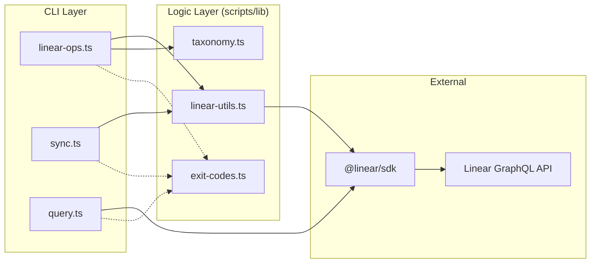
**Sources:** [scripts/linear-ops.ts:32-47](), [scripts/sync.ts:18-25](), [scripts/phase-complete.ts:20-22]()

---

# Page: linear-ops CLI

# linear-ops CLI

<details>
<summary>Relevant source files</summary>

The following files were used as context for generating this wiki page:

- [scripts/__tests__/smoke.test.ts](scripts/__tests__/smoke.test.ts)
- [scripts/linear-ops.ts](scripts/linear-ops.ts)
- [scripts/run.sh](scripts/run.sh)

</details>


The `linear-ops.ts` script serves as the primary Command Line Interface (CLI) entry point for the Linear skill. It abstracts complex GraphQL mutations and SDK interactions into high-level, human-readable commands. It is designed to be used both by developers and as a target for Claude Code's tool execution.

## Purpose and Scope

The `linear-ops` CLI provides a unified interface for:
*   **Issue Lifecycle**: Creation, sub-issue nesting, and status transitions.
*   **Project & Initiative Management**: Structural organization of work.
*   **Label Management**: Integration with the internal taxonomy system for domain and agent mapping.
*   **Utility & Diagnostics**: Workspace discovery and environment validation.

The script utilizes a "dist-first" execution strategy via `scripts/run.sh`, attempting to run the bundled JavaScript in `dist/` before falling back to `tsx` for the source TypeScript files [scripts/run.sh:1-8]().

## Implementation Architecture

The CLI is structured as a command-dispatch record where each key corresponds to a CLI subcommand [scripts/linear-ops.ts:84]().

### Data Flow: Natural Language to Code Entity

The following diagram illustrates how a user-provided command (Natural Language Space) is processed by the CLI and mapped to specific SDK entities (Code Entity Space).

**CLI Command Mapping**
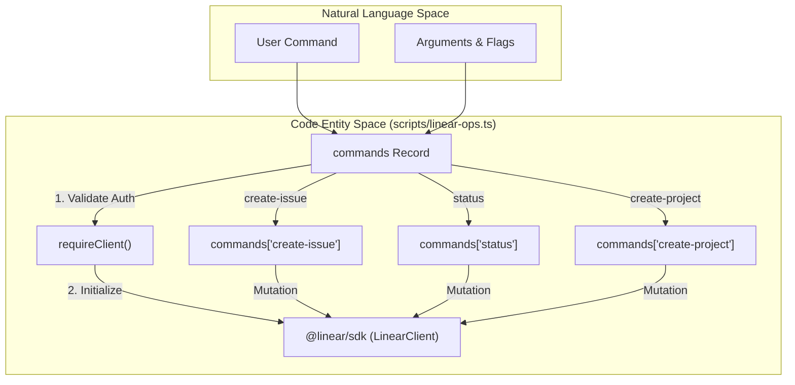
**Sources:** [scripts/linear-ops.ts:84-86](), [scripts/linear-ops.ts:67-81]().

### Authentication & Initialization
The CLI implements "lazy" API key validation. Commands that do not require network access (e.g., viewing label taxonomy) can run without a key, while operational commands call `requireClient()` to ensure `LINEAR_API_KEY` is present [scripts/linear-ops.ts:49-65]().

## Command Deep Dive

### Issue Management
The CLI handles the complexities of finding team IDs and project IDs by name, allowing users to interact with identifiers they recognize.

| Command | Key Logic | File Reference |
| :--- | :--- | :--- |
| `create-issue` | Performs fuzzy name matching for projects; defaults to Team 0. | [scripts/linear-ops.ts:86-170]() |
| `create-sub-issue` | Fetches parent issue by identifier (e.g., ENG-123) to link children. | [scripts/linear-ops.ts:213-261]() |
| `status` | Updates issue state; utilizes `tryLin` for fast-path Rust CLI execution. | [scripts/linear-ops.ts:394-440]() |
| `set-parent` | Updates multiple child issues to point to a single parent ID. | [scripts/linear-ops.ts:263-305]() |

**Issue Creation Flow**
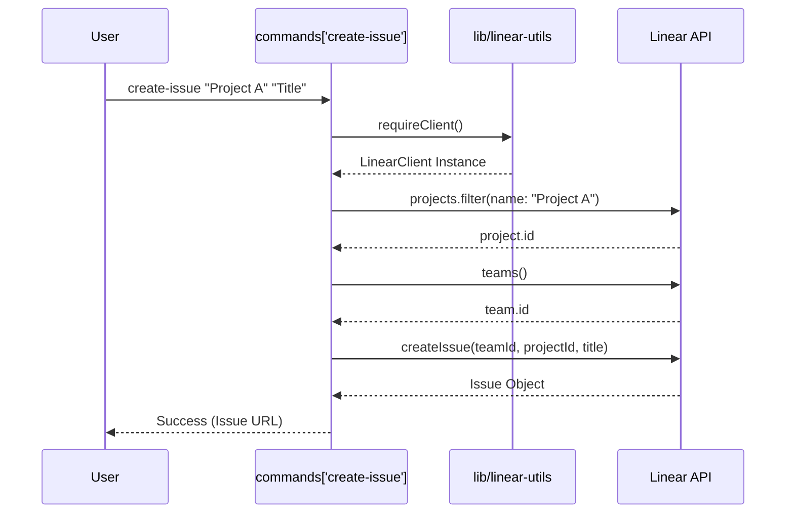
**Sources:** [scripts/linear-ops.ts:86-156](), [scripts/lib/linear-utils.ts:1-50]().

### Project & Initiative Management
These commands facilitate the high-level organization of work, including linking projects to initiatives and providing status updates.

*   **`create-initiative`**: Creates a top-level initiative and returns its URL [scripts/linear-ops.ts:172-205]().
*   **`create-project`**: Creates a project and can optionally link it to an initiative immediately [scripts/linear-ops.ts:207-211]().
*   **`create-project-update`**: Submits health reports (On Track, At Risk, Off Track) to a project [scripts/linear-ops.ts:342-368]().

### Label & Utility Commands
The CLI integrates with the `lib/taxonomy.ts` system to provide intelligence about how issues should be categorized.

*   **`labels taxonomy`**: Displays the defined domain and type labels without requiring an API key [scripts/linear-ops.ts:457-463]().
*   **`whoami`**: Returns the current authenticated user and organization context [scripts/linear-ops.ts:513-529]().
*   **`search`**: Performs a workspace-wide search across issues [scripts/linear-ops.ts:531-555]().

## Performance: The Lin CLI Fast-Path

For the `status` command, the script attempts to use `tryLin()`. This checks for the presence of the `lin` Rust binary. If available and not currently failing (via a circuit-breaker mechanism), it executes the update through the binary for sub-second latency, bypassing the heavier TypeScript/SDK overhead [scripts/linear-ops.ts:422-431](), [scripts/lib/lin-cli.ts:1-30]().

## Build and Smoke Testing
The CLI is verified via smoke tests in `scripts/__tests__/smoke.test.ts`. These tests ensure:
1.  `__BUNDLED__` constants are correctly replaced by `esbuild` [scripts/__tests__/smoke.test.ts:43-53]().
2.  Commands exit with code `0` for help/taxonomy and non-zero when authentication is missing for protected operations [scripts/__tests__/smoke.test.ts:55-86]().
3.  External dependencies like `@linear/sdk` remain external and are not inlined into the bundle [scripts/__tests__/smoke.test.ts:96-102]().

**Sources:**
*   `scripts/linear-ops.ts`
*   `scripts/run.sh`
*   `scripts/__tests__/smoke.test.ts`
*   `scripts/lib/index.ts`

---

# Page: Shared Runner & Build System

# Shared Runner & Build System

<details>
<summary>Relevant source files</summary>

The following files were used as context for generating this wiki page:

- [.gitignore](.gitignore)
- [package-lock.json](package-lock.json)
- [scripts/__tests__/smoke.test.ts](scripts/__tests__/smoke.test.ts)
- [scripts/build.mjs](scripts/build.mjs)
- [scripts/run.sh](scripts/run.sh)
- [tsconfig.json](tsconfig.json)

</details>


The `linear-claude-skill` uses a dual-path execution strategy designed to balance developer productivity with runtime performance. It employs an `esbuild`-based pipeline to pre-compile TypeScript into optimized JavaScript, paired with a shell-based shim that ensures the system remains functional even if the build artifacts are missing.

## Execution Strategy: scripts/run.sh

The primary entry point for executing any script in the toolkit is `scripts/run.sh`. This shim acts as a dispatcher that prioritizes pre-compiled assets in the `dist/` directory to minimize startup latency, which is critical for maintaining the responsiveness of the Claude Code MCP interface.

### Execution Flow

The shim follows a fallback logic:
1. **Fast Path**: If a corresponding `.js` file exists in `dist/`, it executes it directly using `node` [scripts/run.sh:5-5]().
2. **Slow Path**: If the build artifact is missing, it issues a warning and executes the source `.ts` file using `npx tsx` [scripts/run.sh:6-7]().

| Feature | Fast Path (`dist/`) | Slow Path (`tsx`) |
| :--- | :--- | :--- |
| **Startup Time** | ~50ms | ~500ms - 1.5s |
| **Requirements** | `npm run build` | `node_modules` |
| **Primary Use** | Production / Claude MCP | Development / Debugging |

### Runner Implementation
Title: Shared Runner Dispatch Logic
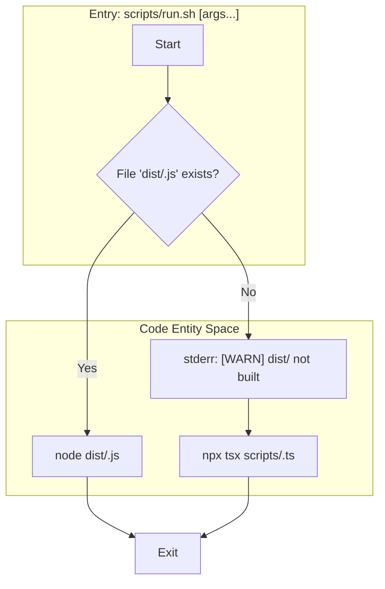
Sources: [scripts/run.sh:1-8]()

## Build Pipeline: scripts/build.mjs

The build system is powered by `esbuild` and is responsible for transforming the TypeScript source in `scripts/` into standalone ESM modules in `dist/`.

### Key Pipeline Stages

1.  **Entry Point Discovery**: The script scans the `scripts/` directory for all `.ts` files, treating each as an independent entry point [scripts/build.mjs:15-17]().
2.  **Compilation & Bundling**:
    *   **Target**: `es2022` with `esm` format [scripts/build.mjs:23-24]().
    *   **External Dependencies**: The `@linear/sdk` is explicitly marked as `external` [scripts/build.mjs:26-26](). This prevents the SDK from being inlined, ensuring that the version installed in `node_modules` is used and reducing bundle size [scripts/__tests__/smoke.test.ts:96-102]().
    *   **Define Injection**: It injects a global constant `__BUNDLED__` set to `'true'` [scripts/build.mjs:29-29](). This allows scripts to detect at runtime whether they are running as a compiled artifact or via `tsx` [scripts/__tests__/smoke.test.ts:43-53]().
3.  **Test Suite Compilation**: Test files located in `scripts/__tests__/` are compiled into `dist/__tests__/` using the same configuration, though without the `__BUNDLED__` define [scripts/build.mjs:35-54]().

### Build System Data Flow
Title: esbuild Pipeline Architecture
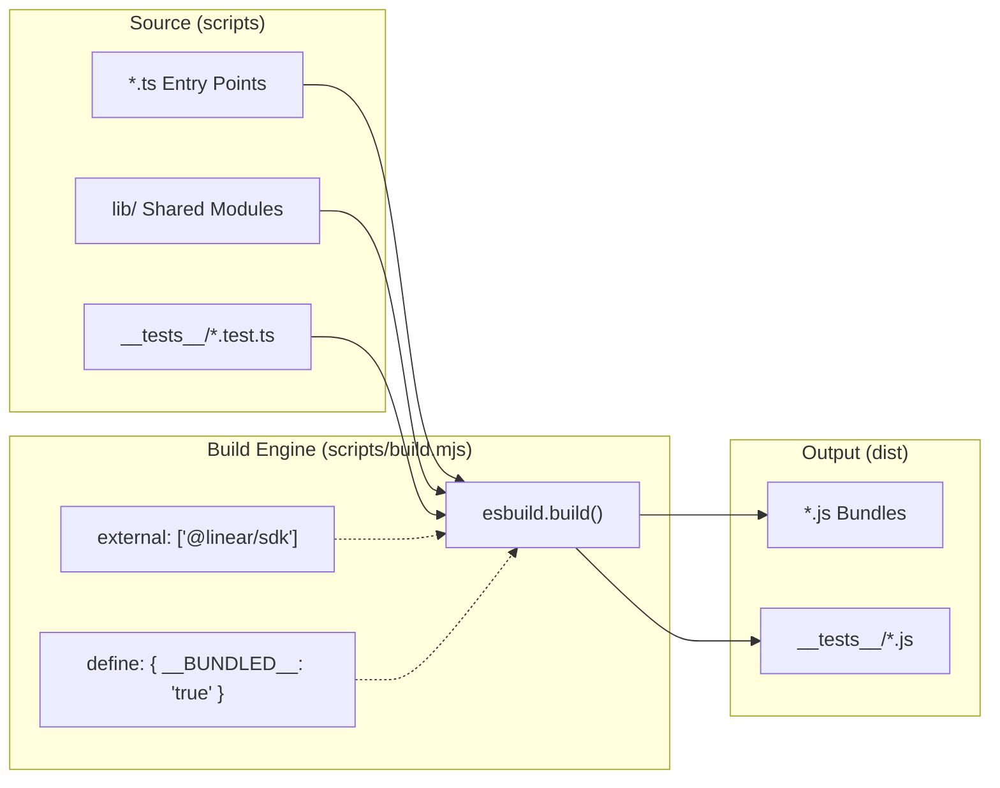
Sources: [scripts/build.mjs:11-57](), [scripts/__tests__/smoke.test.ts:5-9]()

## TypeScript Configuration

The project uses a permissive TypeScript configuration tailored for script-heavy environments where `tsx` and `esbuild` handle the heavy lifting of module resolution.

### TSConfig Strategy
*   **No Emit**: `tsconfig.json` sets `"noEmit": true` [tsconfig.json:7-7](). The `tsc` compiler is used solely for type checking, while `esbuild` handles the actual transpilation.
*   **Module Resolution**: Uses `"moduleResolution": "Bundler"` to support modern import patterns [tsconfig.json:5-5]().
*   **Strictness**: Strict mode is disabled (`"strict": false`) and `noImplicitAny` is off to allow for rapid prototyping of API-consuming scripts [tsconfig.json:6-11]().
*   **Compatibility**: `esModuleInterop` and `resolveJsonModule` are enabled to facilitate importing CommonJS packages and JSON metadata [tsconfig.json:9-10]().

Sources: [tsconfig.json:1-19]()

## Build Validation (Smoke Tests)

The integrity of the build system is verified by `scripts/__tests__/smoke.test.ts`. These tests ensure:
*   **Mapping**: Every `.ts` file in the source has a corresponding `.js` file in `dist/` [scripts/__tests__/smoke.test.ts:31-41]().
*   **Inlining**: Confirms that `@linear/sdk` remains an external reference and is not bundled [scripts/__tests__/smoke.test.ts:96-102]().
*   **Environment**: Validates that the `__BUNDLED__` placeholder is correctly replaced during the build [scripts/__tests__/smoke.test.ts:43-53]().
*   **Execution**: Verifies that the compiled CLI can execute basic commands (like `help`) with a 0 exit code [scripts/__tests__/smoke.test.ts:55-61]().

Sources: [scripts/__tests__/smoke.test.ts:1-103]()

---

# Page: Utility Scripts

# Utility Scripts

<details>
<summary>Relevant source files</summary>

The following files were used as context for generating this wiki page:

- [LICENSE](LICENSE)
- [scripts/create-initiative-update.ts](scripts/create-initiative-update.ts)
- [scripts/create-issue-with-project.ts](scripts/create-issue-with-project.ts)
- [scripts/create-project-update.ts](scripts/create-project-update.ts)
- [scripts/phase-complete.ts](scripts/phase-complete.ts)
- [scripts/query.sh](scripts/query.sh)
- [scripts/query.ts](scripts/query.ts)
- [scripts/setup.ts](scripts/setup.ts)
- [scripts/sync.ts](scripts/sync.ts)
- [sdk.md](sdk.md)

</details>


Utility scripts provide a set of specialized tools for administrative tasks, bulk operations, and diagnostic checks that extend beyond the standard issue management CLI. These scripts utilize the `@linear/sdk` for complex logic and raw GraphQL for operations not yet exposed by the SDK.

## Overview of Utilities

The utility suite is designed to handle three primary areas:
1.  **Diagnostics & Setup**: Validating the environment and API connectivity.
2.  **Bulk & Workflow Automation**: Syncing states across multiple issues or automating project completion phases.
3.  **Direct API Access**: Executing raw GraphQL queries or targeted mutations for projects and initiatives.

### Data Flow and Script Execution

Most scripts follow a standard execution pattern:
1.  **Environment Check**: Verify `LINEAR_API_KEY` exists via `getLinearClient()` [scripts/lib/linear-utils.ts:133-145]().
2.  **Argument Parsing**: Extract flags and identifiers from `process.argv`.
3.  **Entity Resolution**: Convert human-readable names (projects/initiatives) into UUIDs using fuzzy matching utilities [scripts/lib/linear-utils.ts:167-195]().
4.  **API Execution**: Perform mutations via the SDK or `client.rawRequest`.

## Diagnostic & Environment Tools

### setup.ts
The `setup.ts` script is the primary validator for the skill's environment. It performs a multi-step check of dependencies and credentials.

**Key Functions:**
*   `checkLinearApiKey()`: Validates the presence and format of the API key, then attempts a `client.viewer` call to verify organization access [scripts/setup.ts:34-95]().
*   `checkSdkInstalled()`: Verifies `@linear/sdk` is available in the `node_modules` [scripts/setup.ts:97-111]().
*   `checkMcpConfig()`: Searches for `.mcp.json` in common locations to verify the Linear MCP server is registered [scripts/setup.ts:131-152]().

**Natural Language to Code Entity Mapping: Setup**

| User Intent | Code Entity | File |
| :--- | :--- | :--- |
*   "Is my key valid?" | `checkLinearApiKey` | [scripts/setup.ts:34]() |
*   "Where is my config?" | `checkMcpConfig` | [scripts/setup.ts:131]() |
*   "Check lin CLI" | `checkLinCli` | [scripts/setup.ts:122]() |

Sources: [scripts/setup.ts:34-152]()

## Workflow & Bulk Automation

### sync.ts
Used for bulk state transitions across multiple issues. It is particularly useful when an agent completes a milestone and needs to move several issues to "Done" simultaneously.

**Implementation Details:**
*   **Team Extraction**: It extracts the team key from the first issue identifier (e.g., "ENG" from "ENG-123") to look up the correct workflow states [scripts/sync.ts:104-109]().
*   **State Lookup**: Resolves the target state name to a `stateId` via `team.states()` [scripts/sync.ts:112-127]().
*   **Sequential Updates**: Iterates through issues, applying the `stateId` and optional comments with a 150ms delay to avoid rate limiting [scripts/sync.ts:132-177]().

### phase-complete.ts
Automates the end-of-project checklist. It ensures that no loose ends remain before marking a project as completed.

**Logic Flow:**
1.  **Fuzzy Match**: Finds the project ID from a partial name [scripts/phase-complete.ts:109-122]().
2.  **Integrity Check**: Fetches all issues for the project and verifies their states [scripts/phase-complete.ts:124-174]().
3.  **Status Update**: Transitions the project to the "completed" status type [scripts/phase-complete.ts:206-251]().
4.  **Reporting**: Creates a final project update with a summary of completed work [scripts/phase-complete.ts:253-280]().

**Phase Completion Workflow**
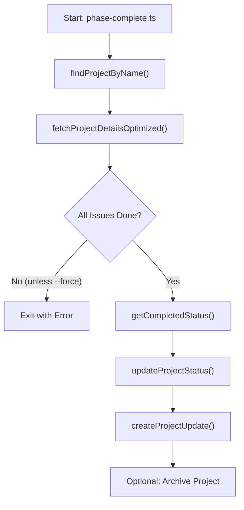
Sources: [scripts/sync.ts:104-177](), [scripts/phase-complete.ts:109-280]()

## Direct API Helpers

### query.ts
A wrapper for executing ad-hoc GraphQL. It provides better error formatting than `curl` by catching `GraphQLErrorResponse` and pretty-printing the error path and locations [scripts/query.ts:13-27]().

### create-project-update.ts & create-initiative-update.ts
These scripts provide a CLI interface for the `projectUpdateCreate` and `initiativeUpdateCreate` mutations. They accept a `health` parameter (`onTrack`, `atRisk`, `offTrack`) which is validated against the `HealthStatus` type [scripts/create-project-update.ts:24-30]().

**Data Flow: Project Update**
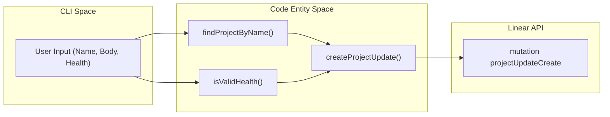

### create-issue-with-project.ts
A specialized issue creator that ensures an issue is linked to a project at the moment of creation. It performs a multi-step lookup for `teamId`, `projectId`, `stateId`, and `labelIds` before executing the `issueCreate` mutation [scripts/create-issue-with-project.ts:194-260]().

Sources: [scripts/query.ts:13-27](), [scripts/create-project-update.ts:24-85](), [scripts/create-issue-with-project.ts:194-260]()

## Utility Script Summary Table

| Script | Purpose | Key Dependency |
| :--- | :--- | :--- |
| `setup.ts` | Env validation | `@linear/sdk` |
| `query.ts` | Raw GraphQL runner | `client.rawRequest` |
| `sync.ts` | Bulk state updates | `issue.update` |
| `phase-complete.ts` | Project lifecycle | `findProjectByName` |
| `create-project-update.ts` | Status reporting | `HealthStatus` |
| `create-issue-with-project.ts` | Atomic issue/project creation | `lookupLabelIds` |

Sources: [scripts/setup.ts:1-10](), [scripts/query.ts:1-9](), [scripts/sync.ts:1-16](), [scripts/phase-complete.ts:1-18](), [scripts/create-project-update.ts:1-19](), [scripts/create-issue-with-project.ts:1-24]()

---

# Page: Image Pipeline

# Image Pipeline

<details>
<summary>Relevant source files</summary>

The following files were used as context for generating this wiki page:

- [scripts/extract-image.ts](scripts/extract-image.ts)
- [scripts/upload-image.ts](scripts/upload-image.ts)

</details>


The Image Pipeline provides a two-stage mechanism for handling visual assets within the `linear-claude-skill` ecosystem. Because Claude Code sessions store images as base64-encoded strings within local JSONL logs rather than discrete files, this pipeline facilitates the extraction of these assets and their subsequent persistence to Linear's cloud storage.

## Pipeline Overview

The pipeline consists of two primary scripts that can be used independently or in sequence:

1.  **`extract-image.ts`**: Parses Claude Code session logs to recover base64 image data and save it as local files.
2.  **`upload-image.ts`**: Orchestrates a multipart upload to Linear's S3-backed storage and optionally links the resulting asset to a specific issue via comments.

### Logical Data Flow

The following diagram illustrates the transition from the Claude Code session state to a persistent Linear asset.

**Title: Image Extraction and Upload Flow**
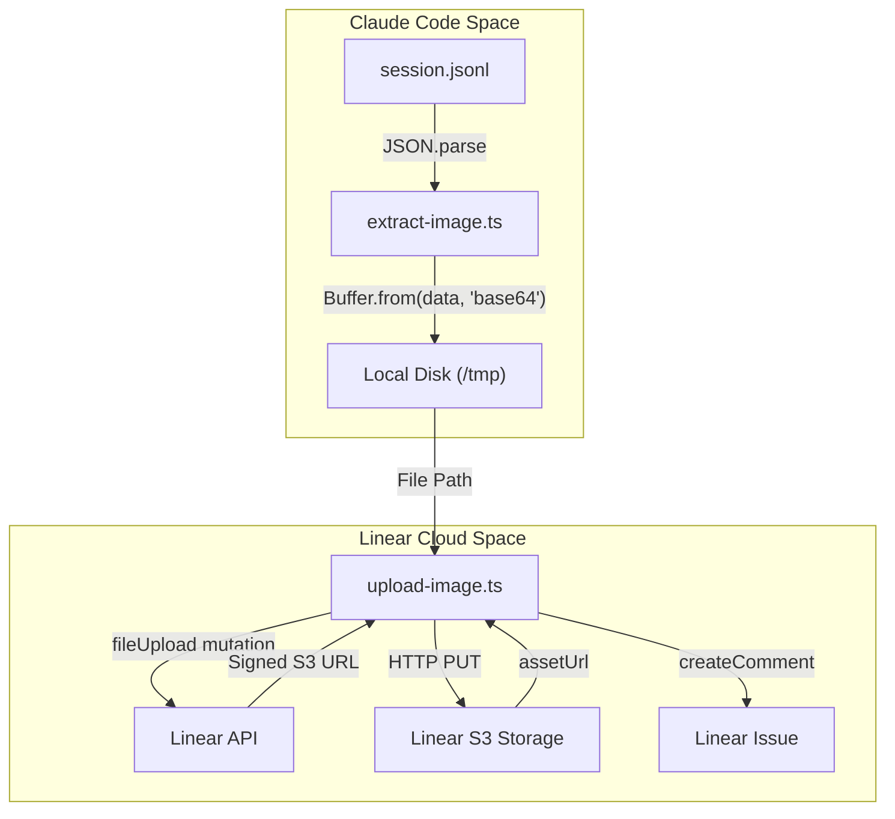
**Sources:** [scripts/extract-image.ts:48-62](), [scripts/upload-image.ts:72-105](), [scripts/upload-image.ts:132-139]()

---

## Image Extraction (`extract-image.ts`)

Images shared during a Claude Code session are not automatically saved to the filesystem. Instead, they are embedded within the project's session log located in `~/.claude/projects/`. The `extract-image.ts` script iterates through these logs to reconstruct the original image files.

### Key Logic
- **Path Resolution**: Replaces `~` with the user's home directory for cross-platform compatibility [scripts/extract-image.ts:36-36]().
- **JSONL Parsing**: Reads the session file line-by-line, parsing each as a JSON object [scripts/extract-image.ts:49-51]().
- **Content Inspection**: Searches for message content where `type === 'image'` and `source.type === 'base64'` [scripts/extract-image.ts:53-54]().
- **Extension Mapping**: Infers the file extension from the `media_type` (e.g., `image/png` becomes `.png`) [scripts/extract-image.ts:55-55]().

**Sources:** [scripts/extract-image.ts:1-69]()

---

## Image Upload (`upload-image.ts`)

The upload process follows Linear's specific multipart upload protocol, which requires obtaining a pre-signed URL before pushing the binary data to S3.

### Upload Lifecycle

| Step | Action | Implementation Detail |
| :--- | :--- | :--- |
| **1** | **Content Detection** | Maps file extensions to MIME types using `contentTypeMap` [scripts/upload-image.ts:24-32](). |
| **2** | **Request URL** | Calls `client.fileUpload()` with filename, size, and type to get a signed URL [scripts/upload-image.ts:73-74](). |
| **3** | **Binary Upload** | Executes an `HTTP PUT` to the `uploadUrl` with required headers [scripts/upload-image.ts:92-96](). |
| **4** | **Attachment** | If an issue ID is provided, calls `client.createComment()` with the `assetUrl` [scripts/upload-image.ts:132-135](). |

### Code Entity Map: Upload Logic

This diagram maps the natural language steps to the specific code entities in `upload-image.ts`.

**Title: upload-image.ts Entity Mapping**
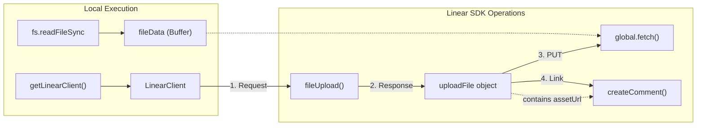
**Sources:** [scripts/upload-image.ts:53-54](), [scripts/upload-image.ts:66-66](), [scripts/upload-image.ts:73-73](), [scripts/upload-image.ts:81-81](), [scripts/upload-image.ts:92-96](), [scripts/upload-image.ts:132-135]()

### Content Type Support
The script explicitly supports the following formats:
- **Images**: `.png`, `.jpg`, `.jpeg`, `.gif`, `.webp`, `.svg` [scripts/upload-image.ts:25-30]().
- **Documents**: `.pdf` [scripts/upload-image.ts:31-31]().
- **Fallback**: Defaults to `application/octet-stream` [scripts/upload-image.ts:47-47]().

---

## Technical Integration Details

### Error Handling
Both scripts utilize standardized exit codes defined in `scripts/lib/exit-codes.js`:
- `INVALID_ARGUMENTS`: Returned if required paths are missing or files cannot be read [scripts/extract-image.ts:33-45](), [scripts/upload-image.ts:39-58]().
- `MISSING_API_KEY`: Returned if the Linear client cannot be initialized [scripts/upload-image.ts:69-69]().
- `API_ERROR`: Returned if the S3 upload or GraphQL mutation fails [scripts/upload-image.ts:78-100]().
- `RESOURCE_NOT_FOUND`: Returned if the specified issue ID does not exist [scripts/upload-image.ts:124-124]().

### Issue Identification
When attaching images to issues, the script parses the human-readable identifier (e.g., `TRE-123`) into a `teamKey` and `issueNumber` to perform a filtered lookup via the Linear SDK [scripts/upload-image.ts:112-120]().

**Sources:** [scripts/upload-image.ts:108-140](), [scripts/lib/exit-codes.js:1-20]()

---

# Page: Shared Library (scripts/lib)

# Shared Library (scripts/lib)

<details>
<summary>Relevant source files</summary>

The following files were used as context for generating this wiki page:

- [scripts/lib/exit-codes.ts](scripts/lib/exit-codes.ts)
- [scripts/lib/index.ts](scripts/lib/index.ts)
- [scripts/lib/linear-utils.ts](scripts/lib/linear-utils.ts)

</details>


The `scripts/lib/` directory contains the internal SDK and business logic that powers all Linear operations within this repository. It provides a standardized layer over the official `@linear/sdk`, ensuring that all scripts follow the same patterns for authentication, entity lookup, and label application.

### Library Architecture

The library is organized into specialized subsystems, all of which are exported through a central entry point at [scripts/lib/index.ts:1-133]().

**Core Library Structure**
| Module | Responsibility |
| :--- | :--- |
| **Client & Utils** | API initialization, singleton management, and basic entity lookups. |
| **Taxonomy** | Type definitions and data for the structured label system. |
| **Label Ops** | CRUD operations for applying and validating labels on issues. |
| **Agent Routing** | Logic for mapping issues to specific AI agents based on domain labels. |
| **Project Engine** | High-level workflows for creating and verifying projects/initiatives. |
| **Lin CLI** | Performance-optimized bridge to the Rust-based `lin` binary. |

Sources: [scripts/lib/index.ts:1-133]()

---

### Linear Client & Utilities

The foundational layer of the library manages the `LinearClient` lifecycle and provides common lookup functions. It enforces the use of the `LINEAR_API_KEY` environment variable [scripts/lib/linear-utils.ts:90-94]().

*   **Singleton Access**: `getLinearClient()` provides a cached instance of the client to avoid redundant initializations [scripts/lib/linear-utils.ts:87-98]().
*   **Entity Lookups**: Standardized functions like `findProjectByName`, `findInitiativeByName`, and `findTeamByKey` implement case-insensitive matching with exact-match preference [scripts/lib/linear-utils.ts:104-235]().
*   **Exit Codes**: A standardized `EXIT_CODES` object defines error states (e.g., `MISSING_API_KEY: 1`, `VALIDATION_ERROR: 5`) to allow for programmatic error handling in shell scripts [scripts/lib/exit-codes.ts:5-13]().

For details, see [Linear Client & Utilities (#3.1)](#).

Sources: [scripts/lib/linear-utils.ts:7-235](), [scripts/lib/exit-codes.ts:1-16]()

---

### Label Taxonomy & Agent Selection

The skill uses a strict taxonomy to categorize issues and route them to the appropriate automated agents. This system bridges the gap between natural language descriptions and structured metadata.

**Code Entity to Domain Mapping**
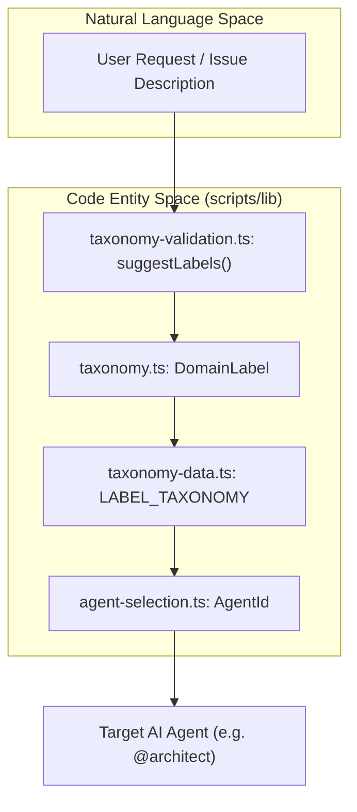

*   **Taxonomy**: Defines four categories of labels: `Domain`, `Type`, `Scope`, and `AgentId` [scripts/lib/taxonomy.ts:1-50]().
*   **Agent Selection**: Uses the `buildAgentDomainMatrix()` and `selectAgentsForIssue()` functions to determine which agent should handle a specific task based on its `DomainLabel` [scripts/lib/agent-selection.ts:75-82]().

For details, see [Label Taxonomy System (#3.2)](#) and [Agent Selection (#3.3)](#).

Sources: [scripts/lib/index.ts:34-82](), [scripts/lib/taxonomy.ts:1-50]()

---

### Project Lifecycle Management

The library provides a high-level "Project Template" that orchestrates complex multi-step operations. Instead of raw API calls, scripts use `createProjectWithDefaults` to ensure all mandatory metadata is set.

**Project Creation Workflow**
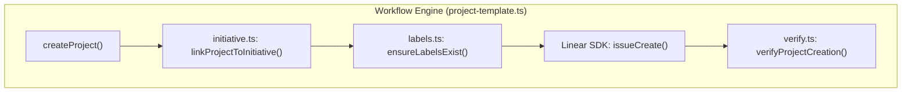

*   **Initiative Linking**: Utilities in `initiative.ts` handle the GraphQL mutations required to associate projects with high-level initiatives [scripts/lib/initiative.ts:13-21]().
*   **Verification**: The `verify` module provides post-creation checks to ensure that labels, descriptions, and links were correctly established [scripts/lib/verify.ts:85-90]().

For details, see [Project Template & Verification (#3.4)](#).

Sources: [scripts/lib/index.ts:125-133](), [scripts/lib/index.ts:85-90]()

---

### Lin CLI Integration

To improve performance, the library includes a "fast-path" integration with the `lin` Rust CLI. This allows the system to bypass the overhead of the TypeScript SDK for common operations.

*   **Detection**: `detectLinCli()` checks for the presence of the binary and caches the result [scripts/lib/lin-cli.ts:110-111]().
*   **Circuit Breaker**: The `tryLin()` wrapper attempts to use the CLI but automatically falls back to the TypeScript SDK if the CLI fails three times or if `LINEAR_USE_LIN=0` is set [scripts/lib/lin-cli.ts:109-114]().

For details, see [Lin CLI Integration (#3.5)](#).

Sources: [scripts/lib/index.ts:108-123]()

---

# Page: Linear Client & Utilities

# Linear Client & Utilities

<details>
<summary>Relevant source files</summary>

The following files were used as context for generating this wiki page:

- [scripts/lib/exit-codes.ts](scripts/lib/exit-codes.ts)
- [scripts/lib/index.ts](scripts/lib/index.ts)
- [scripts/lib/linear-utils.ts](scripts/lib/linear-utils.ts)

</details>


This page covers the foundational Linear API client and shared utility functions located in `scripts/lib/linear-utils.ts` and the standardized error handling constants in `scripts/lib/exit-codes.ts`. These utilities provide a consistent interface for entity lookups, client instantiation, and health status management across the entire skill.

## Linear Client Management

The skill manages the `@linear/sdk` instance through two primary functions: `createLinearClient` for explicit instantiation and `getLinearClient` for a singleton pattern with environment validation.

### Client Initialization Flow

The `getLinearClient` function ensures that the `LINEAR_API_KEY` is present before attempting any operations. It caches the client instance to avoid redundant overhead in scripts that perform multiple API calls.

| Function | Role | Source |
| :--- | :--- | :--- |
| `createLinearClient(apiKey)` | Direct constructor for the `LinearClient`. | [scripts/lib/linear-utils.ts:72-74]() |
| `getLinearClient()` | Singleton getter that reads `process.env.LINEAR_API_KEY`. | [scripts/lib/linear-utils.ts:87-98]() |

**Linear Client Initialization**
```mermaid
graph TD
    subgraph "Natural Language Space"
        "User Request" --> "Script Execution"
    end

    subgraph "Code Entity Space"
        "Script Execution" --> "getLinearClient()"["getLinearClient()"]
        "getLinearClient()" -- "Check Cache" --> "Cached?"{"_cachedClient != null?"}
        "Cached?" -- "Yes" --> "Return"["Return _cachedClient"]
        "Cached?" -- "No" --> "EnvCheck"["Check process.env.LINEAR_API_KEY"]
        "EnvCheck" -- "Missing" --> "Throw"["Throw Error: LINEAR_API_KEY required"]
        "EnvCheck" -- "Exists" --> "Create"["createLinearClient(apiKey)"]
        "Create" --> "SetCache"["_cachedClient = new LinearClient"]
        "SetCache" --> "Return"
    end
```
Sources: [scripts/lib/linear-utils.ts:72-98]()

## Entity Lookups

The utility library provides high-level wrappers for finding Linear entities (Projects, Initiatives, Teams) by their human-readable names or keys. These functions implement a "Best Match" strategy: they perform case-insensitive partial matching but prioritize exact matches if available.

### Lookup Functions

| Function | Entity | Logic |
| :--- | :--- | :--- |
| `findProjectByName` | Project | Uses SDK `client.projects` with `containsIgnoreCase`. |
| `findInitiativeByName` | Initiative | Uses `rawRequest` GraphQL query for `initiatives`. |
| `findTeamByKey` | Team | Filters teams by uppercase `key` (e.g., "ENG"). |
| `findTeamByName` | Team | Uses `rawRequest` GraphQL query for `teams`. |

### Search & Resolution Strategy
All name-based lookup functions follow this internal logic:
1.  Perform a case-insensitive search via the Linear API (limited to the first 10 results). [scripts/lib/linear-utils.ts:118-123]()
2.  If the result set is empty, return `null`. [scripts/lib/linear-utils.ts:125-127]()
3.  Iterate through results to find an exact case-insensitive match. [scripts/lib/linear-utils.ts:130-132]()
4.  If no exact match is found, default to the first result in the list. [scripts/lib/linear-utils.ts:134]()

**Entity Resolution Logic**
```mermaid
graph TD
    subgraph "Natural Language Space"
        "Search Query"["'Project Alpha'"]
    end

    subgraph "Code Entity Space"
        "Search Query" --> "findProjectByName()"["findProjectByName(client, name)"]
        "findProjectByName()" --> "GQL"["GraphQL: containsIgnoreCase"]
        "GQL" --> "Results"{"Results found?"}
        "Results" -- "No" --> "Null"["return null"]
        "Results" -- "Yes" --> "Exact"{"Exact Match?"}
        "Exact" -- "Yes" --> "ReturnExact"["Return ProjectInfo (Exact)"]
        "Exact" -- "No" --> "ReturnFirst"["Return ProjectInfo (First Node)"]
    end
```
Sources: [scripts/lib/linear-utils.ts:114-140](), [scripts/lib/linear-utils.ts:153-187](), [scripts/lib/linear-utils.ts:237-275]()

## Health Status & Types

The skill standardizes health reporting for projects and initiatives using a specific set of valid strings. This ensures compatibility with Linear's internal status tracking.

### Health Definitions
*   **Types**: `HealthStatus` is defined as a union of `'onTrack' | 'atRisk' | 'offTrack'`. [scripts/lib/linear-utils.ts:17]()
*   **Validation**: `isValidHealth(value)` is a type guard used to verify input before API submission. [scripts/lib/linear-utils.ts:58-60]()

### Data Interfaces
The library exports standardized interfaces for entity data to ensure type safety across the skill:
*   `ProjectInfo`: Contains `id`, `name`, and `slugId`. [scripts/lib/linear-utils.ts:27-31]()
*   `InitiativeInfo`: Contains `id`, `name`, and optional `description`. [scripts/lib/linear-utils.ts:36-40]()
*   `TeamInfo`: Contains `id`, `key`, and `name`. [scripts/lib/linear-utils.ts:45-49]()

Sources: [scripts/lib/linear-utils.ts:17-60]()

## Standardized Exit Codes

To enable programmatic orchestration and reliable error handling in shell scripts (like `run.sh` or `post-edit.sh`), the skill uses a constant map of exit codes.

| Constant | Value | Description |
| :--- | :--- | :--- |
| `SUCCESS` | 0 | Operation completed successfully. |
| `MISSING_API_KEY` | 1 | `LINEAR_API_KEY` was not found in environment. |
| `INVALID_ARGUMENTS` | 2 | CLI arguments failed validation. |
| `RESOURCE_NOT_FOUND` | 3 | A requested Project, Issue, or Team does not exist. |
| `API_ERROR` | 4 | Linear API returned a 4xx/5xx or GraphQL error. |
| `VALIDATION_ERROR` | 5 | Data failed internal taxonomy or health validation. |
| `PERMISSION_DENIED` | 6 | API key lacks scope for the requested operation. |

Sources: [scripts/lib/exit-codes.ts:5-13]()

---

# Page: Label Taxonomy System

# Label Taxonomy System

<details>
<summary>Relevant source files</summary>

The following files were used as context for generating this wiki page:

- [docs/labels.md](docs/labels.md)
- [scripts/lib/agent-selection.ts](scripts/lib/agent-selection.ts)
- [scripts/lib/labels.ts](scripts/lib/labels.ts)
- [scripts/lib/taxonomy-data.ts](scripts/lib/taxonomy-data.ts)
- [scripts/lib/taxonomy-validation.ts](scripts/lib/taxonomy-validation.ts)
- [scripts/lib/taxonomy.ts](scripts/lib/taxonomy.ts)

</details>


The Label Taxonomy System is a standardized framework for categorizing Linear issues by technical domain, work type, and scope. This system ensures consistent metadata across projects, enables automated agent routing, and provides visual consistency in the Linear UI through pre-defined color mappings.

## Core Taxonomy Structure

The system is built upon three primary categories defined in `scripts/lib/taxonomy.ts`. Every issue managed by the skill is expected to adhere to these classifications to facilitate proper "Discovery Before Creation" protocols.

| Category | Requirement | Purpose |
| :--- | :--- | :--- |
| **Type** | Exactly 1 | Defines the nature of the work (e.g., `bug`, `feature`). |
| **Domain** | 1-2 (Recommended) | Indicates technical area for agent routing (e.g., `security`, `backend`). |
| **Scope** | 0-2 (Optional) | Flags special conditions or impact (e.g., `breaking-change`, `tech-debt`). |

### Data Model and Interfaces
The system uses TypeScript interfaces to enforce the taxonomy structure:
*   `LabelDefinition`: Defines the `name`, `category`, `description`, `color`, and associated `AgentId` mappings [scripts/lib/taxonomy.ts:95-108]().
*   `LabelTaxonomy`: A record-based structure grouping definitions into `domain`, `type`, and `scope` [scripts/lib/taxonomy.ts:113-120]().
*   `ValidationResult`: Captures the outcome of a taxonomy check, including parsed categories and any error/warning strings [scripts/lib/taxonomy.ts:125-139]().

**Sources:** [scripts/lib/taxonomy.ts:8-168](), [scripts/lib/taxonomy-data.ts:1-231]()

---

## Implementation Components

The taxonomy is implemented across four specialized files in `scripts/lib/`, separating concerns between data definition, validation logic, and API interaction.

### Natural Language to Code Entity Mapping
This diagram illustrates how the system bridges human-readable issue content to specific code entities and automated routing logic.

**Title: Label Suggestion and Agent Routing Flow**
```mermaid
graph TD
    subgraph "Natural Language Space"
        A["Issue Title/Description"]
    end

    subgraph "Code Entity Space: taxonomy-validation.ts"
        B["suggestLabels()"]
        C["LABEL_KEYWORDS Map"]
    end

    subgraph "Code Entity Space: agent-selection.ts"
        D["selectAgentsForIssue()"]
        E["AGENT_DESCRIPTIONS"]
        F["AgentId (e.g., 'security-manager')"]
    end

    A -->|"Text Input"| B
    C -->|"Keyword Matching"| B
    B -->|"LabelSuggestion[]"| D
    D -->|"Primary/Secondary Selection"| F
    E -->|"Metadata"| F
```
**Sources:** [scripts/lib/taxonomy-validation.ts:146-176](), [scripts/lib/agent-selection.ts:23-66](), [scripts/lib/agent-selection.ts:77-145]()

### Data Flow: Label Creation and Application
The following diagram tracks the lifecycle of a label from validation to its persistence in the Linear API via `labels.ts`.

**Title: Label Lifecycle and Persistence**
```mermaid
graph LR
    subgraph "Validation Phase"
        V["validateLabels()"]
    end

    subgraph "Persistence Phase: scripts/lib/labels.ts"
        E["ensureLabelsExist()"]
        G["getLabelMap()"]
        C["createIssueLabel()"]
        A["applyLabelsToIssue()"]
    end

    subgraph "Linear API"
        L["IssueLabels Node"]
        M["Mutation: updateIssue"]
    end

    V -->|"ValidationResult"| E
    G -->|"Cached Map"| E
    E -->|"If Missing"| C
    C --> L
    E -->|"labelIds"| A
    A --> M
```
**Sources:** [scripts/lib/labels.ts:41-53](), [scripts/lib/labels.ts:84-152](), [scripts/lib/labels.ts:157-199](), [scripts/lib/taxonomy-validation.ts:36-101]()

---

## Key Modules

### 1. Taxonomy Data (`taxonomy-data.ts`)
This file serves as the authoritative source for all label definitions. It includes:
*   **Domain Labels**: Maps domains like `security` or `performance` to specific colors and `primaryAgents` (e.g., `security-manager`) [scripts/lib/taxonomy-data.ts:26-131]().
*   **Type Labels**: Classification for `feature`, `bug`, `refactor`, `chore`, and `spike` [scripts/lib/taxonomy-data.ts:139-170]().
*   **Scope Labels**: Impact flags like `breaking-change` or `blocked` [scripts/lib/taxonomy-data.ts:177-220]().

### 2. Validation and Suggestion (`taxonomy-validation.ts`)
Provides the logic for ensuring label sets meet system requirements.
*   **`validateLabels(labels: string[])`**: Enforces rules such as "Exactly one Type label required" and "Unknown labels are errors" [scripts/lib/taxonomy-validation.ts:36-101]().
*   **`suggestLabels(title, description)`**: Uses the `LABEL_KEYWORDS` constant to perform keyword matching against issue text, returning `LabelSuggestion` objects with confidence scores [scripts/lib/taxonomy-validation.ts:146-176]().

### 3. CRUD Operations (`labels.ts`)
Handles the heavy lifting of interacting with the Linear SDK to manage labels.
*   **`ensureLabelsExist(teamId, labelNames, options)`**: Checks the team's existing labels via `getLabelMap`. If a label is missing, it creates it using colors defined in `LABEL_COLORS` [scripts/lib/labels.ts:84-152]().
*   **`applyLabelsToIssue(issueId, labelNames, labelMap)`**: Fetches an issue's current labels, calculates the delta, and performs a single `updateIssue` mutation to apply new labels [scripts/lib/labels.ts:157-199]().
*   **`getLabelMap(teamId)`**: Returns a case-insensitive map of label names to UUIDs to prevent duplicate creation [scripts/lib/labels.ts:41-53]().

### 4. Agent Selection (`agent-selection.ts`)
Bridges labels to the workforce.
*   **`selectAgentsForIssue(labels)`**: Implements routing logic where agents with the broadest match across multiple domain labels are prioritized [scripts/lib/agent-selection.ts:77-145]().
*   **`canAgentHandle(agentId, labels)`**: A utility for agents to verify if they are qualified for a specific task based on the taxonomy [scripts/lib/agent-selection.ts:168-207]().

**Sources:** [scripts/lib/labels.ts:1-245](), [scripts/lib/taxonomy-validation.ts:1-180](), [scripts/lib/agent-selection.ts:1-220](), [scripts/lib/taxonomy-data.ts:1-260]()

---

## Validation Rules Summary

The `validateLabels` function [scripts/lib/taxonomy-validation.ts:36]() enforces the following technical constraints:

| Rule | Severity | Description |
| :--- | :--- | :--- |
| **Rule 1: Type Requirement** | Error | Exactly one label from the `type` category must be present [scripts/lib/taxonomy-validation.ts:72-76](). |
| **Rule 2: Domain Recommendation** | Warning | At least one `domain` label is recommended for agent routing [scripts/lib/taxonomy-validation.ts:79-83](). |
| **Rule 3: Scope Limit** | Warning | More than 2 `scope` labels trigger a warning for excessive complexity [scripts/lib/taxonomy-validation.ts:86-88](). |
| **Rule 4: Taxonomy Adherence** | Error | Any label not found in `LABEL_TAXONOMY` is rejected [scripts/lib/taxonomy-validation.ts:91-93](). |

**Sources:** [scripts/lib/taxonomy-validation.ts:36-101](), [docs/labels.md:144-152]()

---

# Page: Agent Selection

# Agent Selection

<details>
<summary>Relevant source files</summary>

The following files were used as context for generating this wiki page:

- [scripts/lib/agent-selection.ts](scripts/lib/agent-selection.ts)
- [scripts/lib/index.ts](scripts/lib/index.ts)
- [scripts/lib/taxonomy-validation.ts](scripts/lib/taxonomy-validation.ts)

</details>


The Agent Selection system provides the routing logic required to map Linear issues to specific AI agents based on their defined expertise. By utilizing the `DomainLabel` taxonomy, the system ensures that issues are handled by the most qualified "primary" agents while maintaining a pool of "secondary" fallback agents for broader coverage.

## Agent Metadata and Capabilities

The system maintains a registry of `AgentId` values associated with specific technical domains. These are defined in the `AGENT_DESCRIPTIONS` constant, which serves as the source of truth for agent roles.

### Agent Registry (Partial List)

| AgentId | Capability Description |
| :--- | :--- |
| `security-manager` | Security analysis, vulnerability assessment, access control |
| `performance-benchmarker` | Performance benchmarking, load testing |
| `frontend-dev` | Frontend development, React, UI components |
| `backend-dev` | Backend development, APIs, databases |
| `mcp-developer` | MCP tool development, protocol implementation |
| `sparc-coder` | SPARC methodology coding |

**Sources:** [scripts/lib/agent-selection.ts:23-66]()

## Routing Logic

The core routing function is `selectAgentsForIssue`. It transforms a list of natural language labels into a structured `AgentSelection` object.

### Selection Rules
1.  **Primary Match:** Agents explicitly listed as primary for a `DomainLabel` are prioritized [scripts/lib/agent-selection.ts:72]().
2.  **Broadest Match:** For issues with multiple domain labels, the system calculates which agent appears most frequently across those domains [scripts/lib/agent-selection.ts:73]().
3.  **Fallback:** If no domain labels are present, the issue is routed to a general pool consisting of `coder` and `sparc-coder` [scripts/lib/agent-selection.ts:86-93]().

### Natural Language to Agent Routing Flow

This diagram illustrates how the system bridges the gap between a Linear Issue's text/labels and the internal code entities responsible for handling them.

Title: "Issue to Agent Entity Mapping"
```mermaid
graph TD
    subgraph "Natural Language Space"
        A["Issue Labels (e.g., 'security', 'backend')"]
    end

    subgraph "Code Entity Space (agent-selection.ts)"
        B["selectAgentsForIssue(labels)"]
        C["LABEL_TAXONOMY lookup"]
        D["primaryAgentCounts (Map)"]
        E["secondaryAgentSet (Set)"]
        F["AgentSelection (Object)"]
    end

    A --> B
    B --> C
    C --> D
    C --> E
    D --> F
    E --> F
```
**Sources:** [scripts/lib/agent-selection.ts:77-145](), [scripts/lib/taxonomy-validation.ts:106-137]()

## Implementation Details

### Key Functions

| Function | Purpose |
| :--- | :--- |
| `selectAgentsForIssue(labels)` | The primary entry point for determining agent routing [scripts/lib/agent-selection.ts:77](). |
| `canAgentHandle(agentId, labels)` | Checks if a specific agent is qualified for a set of labels, returning `canHandle` and `asPrimary` flags [scripts/lib/agent-selection.ts:168-207](). |
| `getLabelsForAgent(agentId)` | Reverse lookup to find all `DomainLabel` values associated with an agent [scripts/lib/agent-selection.ts:150-163](). |
| `buildAgentDomainMatrix()` | Generates a complete mapping of all agents to their primary and secondary domains [scripts/lib/agent-selection.ts:213-217](). |

### Agent-Domain Matrix Construction

The `buildAgentDomainMatrix` function iterates through the `LABEL_TAXONOMY.domain` definitions to construct a comprehensive capability map. This is used for system-wide reporting and validation.

Title: "Capability Matrix Data Flow"
```mermaid
graph LR
    subgraph "Taxonomy Data"
        T["LABEL_TAXONOMY.domain"]
    end

    subgraph "Processing (agent-selection.ts)"
        M["buildAgentDomainMatrix()"]
        L["getLabelsForAgent()"]
    end

    subgraph "Output Entities"
        Matrix["Map<AgentId, {primary, secondary}>"]
    end

    T --> M
    M --> L
    L --> Matrix
```
**Sources:** [scripts/lib/agent-selection.ts:150-163](), [scripts/lib/agent-selection.ts:213-230]()

## Label-Based Filtering

The selection process relies on `DOMAIN_LABEL_NAMES` to filter incoming strings. This ensures that only recognized taxonomy labels influence routing logic, while `TypeLabel` (e.g., `bug`, `feature`) and `ScopeLabel` (e.g., `tech-debt`) are ignored for agent selection purposes.

*   **Filter Logic:** `normalizedLabels.filter(l => DOMAIN_LABEL_NAMES.includes(l))` [scripts/lib/agent-selection.ts:81-83]().
*   **Reasoning String:** The system generates a human-readable `reasoning` field explaining why specific agents were chosen, which is helpful for debugging routing conflicts [scripts/lib/agent-selection.ts:126-137]().

**Sources:** [scripts/lib/agent-selection.ts:77-145](), [scripts/lib/taxonomy-data.ts:17-18]()

---

# Page: Project Template & Verification

# Project Template & Verification

<details>
<summary>Relevant source files</summary>

The following files were used as context for generating this wiki page:

- [projects.md](projects.md)
- [scripts/lib/initiative.ts](scripts/lib/initiative.ts)
- [scripts/lib/project-template.ts](scripts/lib/project-template.ts)
- [scripts/lib/verify.ts](scripts/lib/verify.ts)

</details>


This section covers the mandatory workflows and library functions used to create, link, and verify Linear projects and initiatives. The system enforces a strict 6-step template to ensure data consistency across the Linear workspace.

## Project Creation Workflow

The `createProject` function in `scripts/lib/project-template.ts` is the authoritative entry point for project creation [scripts/lib/project-template.ts:68-71](). It orchestrates a multi-step process that ensures projects are not just created, but correctly documented and linked to the broader roadmap.

### The 6-Step Template

| Step | Action | Implementation |
| :--- | :--- | :--- |
| 1 | **Create/Find** | Checks for existing project by name; creates if missing [scripts/lib/project-template.ts:97-121](). |
| 2 | **Link Initiative** | Connects project to a parent initiative via `initiativeToProjectCreate` [scripts/lib/project-template.ts:127-135](). |
| 3 | **Set Content** | Sets full markdown `content` and short `description` [scripts/lib/project-template.ts:138-175](). |
| 4 | **Ensure Labels** | Scans all planned issues and ensures required labels exist in the team [scripts/lib/project-template.ts:178-190](). |
| 5 | **Create Issues** | Populates the project with issues including labels, priority, and estimates [scripts/lib/project-template.ts:192-232](). |
| 6 | **Verify** | Performs post-creation checks to ensure all entities are correctly linked [scripts/lib/project-template.ts:235-241](). |

### Logic Flow: Project Template Execution

The following diagram illustrates the transition from natural language configuration to the execution of code entities within the library.

"Project Creation Pipeline"
```mermaid
graph TD
    subgraph "Natural Language Space"
        A["ProjectConfig Object"]
        B["IssueConfig Array"]
    end

    subgraph "Code Entity Space (scripts/lib)"
        direction TB
        C["createProject() (project-template.ts)"]
        D["linkProjectToInitiative() (initiative.ts)"]
        E["ensureLabelsExist() (labels.ts)"]
        F["verifyProjectCreation() (verify.ts)"]
        G["getLinearClient() (linear-utils.ts)"]
    end

    A --> C
    B --> C
    C --> G
    C -- "Step 2" --> D
    C -- "Step 4" --> E
    C -- "Step 6" --> F
```
Sources: [scripts/lib/project-template.ts:17-32](), [scripts/lib/project-template.ts:68-71](), [scripts/lib/initiative.ts:25-28](), [scripts/lib/verify.ts:40-45]()

---

## Initiative Management

Initiatives in Linear serve as containers for projects. The skill mandates that every project be linked to an initiative to maintain organizational hierarchy [scripts/lib/initiative.ts:4-5]().

### Key Functions
- `linkProjectToInitiative`: Uses a raw GraphQL mutation `initiativeToProjectCreate` [scripts/lib/initiative.ts:31-42](). This is the only supported method, as direct `initiativeId` fields on project creation are deprecated [scripts/lib/initiative.ts:21-24]().
- `isProjectLinkedToInitiative`: Verifies the edge exists by querying the initiative's project nodes [scripts/lib/initiative.ts:78-81]().
- `getProjectInitiativeStatus`: Returns a list of all projects and their associated initiative names [scripts/lib/initiative.ts:123-125]().

### Initiative Data Flow
"Initiative Linking Logic"
```mermaid
graph LR
    subgraph "Input"
        P_ID["projectId"]
        I_ID["initiativeId"]
    end

    subgraph "initiative.ts"
        L["linkProjectToInitiative"]
        V["isProjectLinkedToInitiative"]
    end

    subgraph "Linear API"
        G["GraphQL Mutation: initiativeToProjectCreate"]
        Q["GraphQL Query: initiative(id) { projects }"]
    end

    P_ID --> L
    I_ID --> L
    L --> G
    V --> Q
    Q -- "Nodes List" --> V
```
Sources: [scripts/lib/initiative.ts:25-42](), [scripts/lib/initiative.ts:84-95]()

---

## Verification System

The verification system provides a "trust but verify" layer after complex operations. It is used both automatically at the end of project creation and manually via CLI commands.

### Project Verification (`verifyProjectCreation`)
This function checks the state of a project against expected parameters [scripts/lib/verify.ts:40-45]():
1. **Existence**: Finds the project by name [scripts/lib/verify.ts:70-76]().
2. **Metadata**: Validates that `description` is present and exceeds a minimum length (10 chars) [scripts/lib/verify.ts:88-89]().
3. **Hierarchy**: Confirms the link to the `DEFAULT_INITIATIVE_ID` [scripts/lib/verify.ts:92-95]().
4. **Issue Count**: Compares the number of issues found in the project against the `expectedIssueCount` [scripts/lib/verify.ts:113-115]().
5. **Labels**: (Optional) Verifies specific labels are applied to specific issue identifiers [scripts/lib/verify.ts:123-144]().

### Initiative Verification (`verifyProjectsForInitiative`)
Iterates through all projects associated with an initiative (or filtered by name) and runs the full project verification suite on each [scripts/lib/verify.ts:155-157](). It produces a summary report indicating total passed/failed projects [scripts/lib/verify.ts:174-179]().

### Critical Field Distinction
A common failure point in Linear integrations is the confusion between `description` and `content`. The verification system and project template strictly enforce both:

| Field | Purpose | Verification Rule |
| :--- | :--- | :--- |
| `description` | 255-char summary for list views | Must be > 10 chars [scripts/lib/verify.ts:89]() |
| `content` | Full markdown for main detail panel | Set via `projectUpdate` mutation [scripts/lib/project-template.ts:141-146]() |

Sources: [projects.md:70-78](), [scripts/lib/verify.ts:14-35](), [scripts/lib/verify.ts:40-67](), [scripts/lib/verify.ts:155-166]()

---

# Page: Lin CLI Integration

# Lin CLI Integration

<details>
<summary>Relevant source files</summary>

The following files were used as context for generating this wiki page:

- [scripts/__tests__/lin-cli.test.ts](scripts/__tests__/lin-cli.test.ts)
- [scripts/lib/lin-cli.ts](scripts/lib/lin-cli.ts)

</details>


The `lin-cli.ts` module provides an optional, high-performance integration with the `lin` Rust-based CLI binary (aaronkwhite/linear-cli) [scripts/lib/lin-cli.ts:2-2](). It serves as a "fast-path" for common Linear operations, reducing execution overhead compared to full SDK initialization while maintaining a silent fallback to the standard `@linear/sdk` path if the binary is missing or fails [scripts/lib/lin-cli.ts:4-5]().

## System Architecture

The integration is designed as a transparent abstraction layer. Command handlers in the skill use the `tryLin()` function to attempt a CLI-based execution, falling back to the TypeScript SDK if necessary.

### Execution Flow: Natural Language to Code Entity

The following diagram illustrates how a user request flows through the CLI integration layer.

**Lin CLI Execution Path**
```mermaid
graph TD
    subgraph "Natural Language Space"
        UserRequest["'Update issue LINE-123 to In Progress'"]
    end

    subgraph "Code Entity Space"
        LinearOps["linear-ops.ts"]
        TryLin["tryLin() abstraction"]
        DetectLin["detectLinCli()"]
        ExecLin["execLin()"]
        LinBinary["'lin' Rust Binary"]
        SDKFallback["@linear/sdk Fallback"]

        UserRequest --> LinearOps
        LinearOps --> TryLin
        TryLin --> DetectLin
        DetectLin -- "Available" --> ExecLin
        ExecLin -- "Process Spawn" --> LinBinary
        DetectLin -- "Missing/Old" --> SDKFallback
        ExecLin -- "Error/Timeout" --> SDKFallback
    end
```
Sources: [scripts/lib/lin-cli.ts:187-218](), [scripts/lib/lin-cli.ts:96-120]()

## Core Components

### 1. Detection and Gating
The system performs a version-aware check to ensure the installed `lin` binary meets the minimum requirements (CalVer `2026.4.0`) [scripts/lib/lin-cli.ts:73-73]().

*   **`detectLinCli()`**: Checks for binary existence via `lin --version` [scripts/lib/lin-cli.ts:106-106](). Results are cached in `_cachedDetection` for the process lifetime to avoid repeated disk I/O [scripts/lib/lin-cli.ts:85-85](), [scripts/lib/lin-cli.ts:97-97]().
*   **Kill Switch**: Setting `LINEAR_USE_LIN=0` in the environment completely disables the integration, forcing all calls to the SDK [scripts/lib/lin-cli.ts:100-103]().
*   **Circuit-Breaker**: If `lin` commands fail 3 consecutive times, the system trips a circuit-breaker and stops attempting to use the CLI for the remainder of the process [scripts/lib/lin-cli.ts:76-76](), [scripts/lib/lin-cli.ts:151-153]().

### 2. The `tryLin` Abstraction
`tryLin` is the primary entry point for all command handlers [scripts/lib/lin-cli.ts:183-183](). It accepts the CLI arguments, a fallback async function, and an optional transformation function [scripts/lib/lin-cli.ts:187-202]().

| Feature | Implementation Detail |
| :--- | :--- |
| **Concurrency** | Uses `node:child_process` `execFile` (promisified) to avoid blocking the event loop [scripts/lib/lin-cli.ts:8-8](), [scripts/lib/lin-cli.ts:21-21](). |
| **Data Format** | Always appends `--json` to CLI arguments to ensure machine-readable output [scripts/lib/lin-cli.ts:156-156](). |
| **Security** | Never passes the API key as a CLI argument; it relies on the `LINEAR_API_KEY` environment variable [scripts/lib/lin-cli.ts:12-12](). |
| **Timeout** | Defaults to a 10-second timeout per command [scripts/lib/lin-cli.ts:79-79](). |

Sources: [scripts/lib/lin-cli.ts:146-174](), [scripts/lib/lin-cli.ts:187-218]()

## Data Models

The integration uses typed wrappers to ensure consistency between CLI JSON output and internal TypeScript interfaces.

**Entity Mapping**
```mermaid
classDiagram
    class LinUser {
        +String id
        +String name
        +String email
    }
    class LinIssue {
        +String id
        +String identifier
        +String title
        +String state
        +Number priority
    }
    class LinInitiative {
        +String id
        +String name
        +String status
        +String url
    }
    LinIssue --|> LinCliResult : data
    LinUser --|> LinCliResult : data
```
Sources: [scripts/lib/lin-cli.ts:41-60]()

## Key Functions

### Detection & Lifecycle
*   **`isLinCliAvailable()`**: A quick boolean check that accounts for both the detection cache and the circuit-breaker status [scripts/lib/lin-cli.ts:126-130]().
*   **`_resetDetectionCache()`**: Used primarily in tests to clear the module state [scripts/lib/lin-cli.ts:133-136]().

### Command Wrappers
*   **`linUpdateIssueState()`**: A typed wrapper for updating issue statuses [scripts/lib/lin-cli.ts:224-229]().
*   **`execLin<T>()`**: The underlying executor that handles JSON parsing and failure count increments [scripts/lib/lin-cli.ts:146-174]().

## Sunset Policy
To prevent long-term maintenance of a stale integration, the skill enforces a sunset policy: If the upstream `aaronkwhite/linear-cli` project has no new releases for 90 days after the integration date (2026-04-11), this integration layer is slated for removal [scripts/lib/lin-cli.ts:14-15]().

## Testing
The integration is verified via `scripts/__tests__/lin-cli.test.ts`, which mocks `execFile` to test:
*   Detection failure when the binary is absent [scripts/__tests__/lin-cli.test.ts:22-39]().
*   The `LINEAR_USE_LIN=0` kill switch [scripts/__tests__/lin-cli.test.ts:41-59]().
*   Silent fallback behavior when the CLI is unavailable [scripts/__tests__/lin-cli.test.ts:63-88]().

Sources: [scripts/__tests__/lin-cli.test.ts:1-130]()

---

# Page: Linear API Reference

# Linear API Reference

<details>
<summary>Relevant source files</summary>

The following files were used as context for generating this wiki page:

- [LICENSE](LICENSE)
- [api.md](api.md)
- [scripts/query.sh](scripts/query.sh)
- [sdk.md](sdk.md)
- [sync.md](sync.md)

</details>


This page provides a high-level overview of how the `linear-claude-skill` interacts with the Linear platform. The skill employs a multi-tiered communication strategy to ensure reliability, performance, and access to the full breadth of Linear's features.

## Interaction Strategy

The skill does not rely on a single method for API interaction. Instead, it selects the most appropriate interface based on the complexity of the task and the limitations of the environment (such as MCP timeouts).

### Tool Selection Hierarchy

When executing operations, the system follows a specific priority order to balance ease of use with technical capability:

1.  **MCP Tools (First Choice)**: Used for simple, single-entity operations like creating an issue or fetching basic details [sdk.md:9-9]().
2.  **SDK Scripts (Complex Operations)**: Used for loops, bulk updates, and logic-heavy transformations that require type safety [sdk.md:10-10]().
3.  **GraphQL API (Fallback)**: Used when specific fields or mutations are unsupported by the SDK or MCP, or to bypass MCP-specific timeouts [sdk.md:11-11]().

### Natural Language to Code Entity Mapping

The following diagram illustrates how natural language requests from a user are routed through the various code entities that interface with the Linear API.

**Entity Routing Diagram**
```mermaid
graph TD
    subgraph "Natural Language Space"
        A["'Update these 10 issues to Done'"]
        B["'Create a new issue'"]
    end

    subgraph "Code Entity Space"
        C["MCP Server (mcp.linear.app)"]
        D["scripts/sync.ts (Bulk Sync Engine)"]
        E["scripts/query.ts (GraphQL Runner)"]
        F["@linear/sdk (LinearClient)"]
    end

    A -->|"Route to Bulk"| D
    B -->|"Route to Simple"| C
    D -->|"Uses"| F
    E -->|"Direct POST"| G["https://api.linear.app/graphql"]
    F -->|"Underlying API"| G
```
Sources: [sdk.md:5-12](), [api.md:7-12](), [sync.md:15-25]()

---

## Core API Interfaces

### GraphQL API Patterns
The skill frequently utilizes raw GraphQL queries and mutations to handle edge cases where the standard tools fail. This includes specific handling for authentication headers and complex filters (e.g., `containsIgnoreCase`) [api.md:11-11](), [api.md:136-136]().

*   **Key Pitfalls**: Shell-based execution requires avoiding optional chaining (`?.`) and nullish coalescing (`??`) as they conflict with shell globbing and parsing [api.md:253-260]().
*   **For details, see [GraphQL API Patterns](#4.1)**.

### SDK Automation Patterns
The `@linear/sdk` is the primary driver for the skill's custom TypeScript logic. It provides full type safety for Linear entities like `Issue`, `Project`, and `Team` [sdk.md:15-20](). The skill includes templates for creating robust automation scripts that handle pagination and conditional logic [sdk.md:199-235]().

*   **Usage**: Typically invoked via `npx tsx` within the `scripts/` directory [sdk.md:22-22]().
*   **For details, see [SDK Automation Patterns](#4.2)**.

### Bulk Sync Engine
The `sync.ts` utility is a specialized implementation designed to bridge the gap between local code changes and Linear state. it supports multiple "modes" including CLI-driven bulk updates and autonomous agent-spawned synchronization [sync.md:13-50]().

*   **Parallelism**: Uses a "Swarm Sync" pattern where multiple sub-agents handle batches of issues independently to avoid timeouts [sync.md:121-142]().
*   **For details, see [Bulk Sync Engine](#4.3)**.

---

## System Integration Flow

The diagram below shows how the different API components relate to each other within the skill's architecture.

**API Component Architecture**
```mermaid
graph LR
    subgraph "External API"
        API["Linear GraphQL Endpoint"]
    end

    subgraph "Internal Library (scripts/lib)"
        LU["linear-utils.ts"]
        LC["LinearClient"]
    end

    subgraph "Execution Layer"
        SYNC["sync.ts"]
        QUERY["query.ts"]
        OPS["linear-ops.ts"]
    end

    OPS --> LU
    SYNC --> LC
    QUERY --> API
    LC --> API
    LU --> LC
```
Sources: [api.md:157-161](), [sdk.md:209-209](), [sync.md:262-262](), [scripts/query.sh:21-21]()

## Key API Concepts

| Concept | Implementation Detail | Source |
| :--- | :--- | :--- |
| **Authentication** | `LINEAR_API_KEY` passed via `Authorization` header | [api.md:9-14]() |
| **Rate Limiting** | 100ms delay between mutations in bulk operations | [sync.md:188-188]() |
| **Timeout Recovery** | Automatic retries for failed operations in sync engine | [sync.md:189-189]() |
| **Pagination** | `pageInfo` with `endCursor` and `hasNextPage` | [sdk.md:168-169]() |

---
**Child Pages:**
*   [GraphQL API Patterns](#4.1)
*   [SDK Automation Patterns](#4.2)
*   [Bulk Sync Engine](#4.3)

---

# Page: GraphQL API Patterns

# GraphQL API Patterns

<details>
<summary>Relevant source files</summary>

The following files were used as context for generating this wiki page:

- [api.md](api.md)
- [scripts/linear-api.mjs](scripts/linear-api.mjs)

</details>


The `linear-claude-skill` uses the Linear GraphQL API as the foundation for all operations. While the high-level tools utilize the `@linear/sdk`, direct GraphQL usage is employed for performance-critical operations, custom mutations not yet supported by the SDK, and as a reliable fallback when Model Context Protocol (MCP) tools encounter timeouts or schema mismatches.

## Authentication and Endpoint

All GraphQL requests are directed to a single endpoint using a Personal API Key for authentication [api.md:7-12]().

*   **Endpoint**: `https://api.linear.app/graphql`
*   **Header**: `Authorization: <LINEAR_API_KEY>`

The skill requires the `LINEAR_API_KEY` environment variable to be set for any direct GraphQL execution via scripts like `scripts/query.ts` [api.md:22-28]().

## Core Query Patterns

### Viewer and Identity
To verify connectivity and identify the authenticated user, the `viewer` query is used [api.md:32-41]().

```graphql
query Me {
  viewer {
    id
    name
    email
  }
}
```

### Resource Discovery
Common patterns for retrieving issues and projects involve filtering by team or assignee. Team-based queries require a `teamId` [api.md:147-147]().

**Assigned Issues Query** [api.md:59-73]():
```graphql
query MyIssues {
  viewer {
    assignedIssues {
      nodes {
        id
        title
        state { name }
        team { key }
      }
    }
  }
}
```

**Project Lookup by Name** [api.md:118-130]():
Uses a `ProjectFilter` with `containsIgnoreCase` to find projects without knowing the UUID.

### Workflow State Resolution
Because status updates require a `stateId` rather than a string name, the skill resolves state names to IDs by querying the team's workflow states [scripts/linear-api.mjs:85-108]().

**Sources**: [api.md:32-73](), [api.md:118-130](), [scripts/linear-api.mjs:85-108]()

## Mutation Patterns

Mutations follow a standard input pattern. Most mutations return a `success` boolean and the created/updated object [api.md:79-89]().

### Issue Management
Creating and updating issues are the most frequent mutations.

| Mutation | Key Inputs | Returns |
| :--- | :--- | :--- |
| `issueCreate` | `teamId`, `title`, `description`, `stateId`, `projectId` | `id`, `identifier`, `url` |
| `issueUpdate` | `id`, `input` (Partial) | `success`, `issue` |
| `commentCreate` | `issueId`, `body` | `id`, `body` |

### Project and Initiative Linking
Advanced workflows require linking entities across the Linear hierarchy.

*   **Project Updates**: Uses `projectUpdateCreate` with a `health` enum (`onTrack`, `atRisk`, `offTrack`) [scripts/linear-api.mjs:252-271]().
*   **Initiative Linking**: Projects are linked to initiatives via `initiativeToProjectCreate`.
*   **External Links**: `entityExternalLinkCreate` is used to attach documentation or PR links to issues/projects.

### GraphQL Execution Flow

The following diagram illustrates how a natural language request is transformed into a GraphQL mutation through the `linear-api.mjs` wrapper.

**Mutation Execution Path**
```mermaid
graph TD
    subgraph "Natural Language Space"
        A["Claude: 'Update status of ENG-123 to done'"]
    end

    subgraph "Code Entity Space"
        B["scripts/linear-ops.ts"]
        C["scripts/linear-api.mjs"]
        D["graphql() function"]
        E["Linear GraphQL API"]
    end

    A --> B
    B -- "executes" --> C
    C -- "calls" --> D
    D -- "POST /graphql" --> E
    
    subgraph "Internal Logic (linear-api.mjs)"
        C1["getStates(teamKey)"]
        C2["updateIssueStatus()"]
        C3["resolve state.id"]
    end
    
    C --> C2
    C2 --> C1
    C1 --> C3
    C3 --> D
```

**Sources**: [api.md:77-115](), [scripts/linear-api.mjs:113-271]()

## Shell Compatibility Pitfalls

When executing GraphQL queries via inline Node.js scripts or heredocs in a shell environment (like Claude Code's terminal), specific JavaScript features must be avoided to prevent shell parsing errors [api.md:251-260]().

| Feature | Problem | Recommended Pattern |
| :--- | :--- | :--- |
| **Optional Chaining** (`?.`) | Shell interprets `?` as a glob character. | `const x = obj.p ? obj.p.v : null;` |
| **Nullish Coalescing** (`??`) | Double `?` confuses shell parsers. | Use ternary operators. |
| **Template Literals** (`` `${}` ``) | Shell attempts variable interpolation. | Use quoted heredocs: `<< 'EOF'`. |

**Anti-Pattern Example** [api.md:262-265]():
```javascript
// ❌ Fails in bash
const name = project.status?.name;
```

**Correct Pattern Example** [api.md:274-279]():
```bash
# ✅ Quoted EOF prevents shell interpolation
node --input-type=module << 'ENDSCRIPT'
  const value = obj.prop ? obj.prop.nested : 'default';
ENDSCRIPT
```

**Sources**: [api.md:251-280]()

## MCP Timeout Workarounds

MCP operations through the official Linear server can time out during bulk operations or complex searches. The skill implements a "Fallback on Timeout" pattern [api.md:214-228]().

### Strategy: Direct GraphQL Fallback
When a tool call like `mcp__linear__linear_search_issues` fails with `ETIMEDOUT`, the system falls back to a direct `fetch` call to the GraphQL endpoint [api.md:219-228]().

### Strategy: Chunked Batching
To avoid hitting API limits or timing out the connection during bulk updates, the `scripts/sync.ts` and `scripts/linear-api.mjs` tools use chunked batching [api.md:197-212]().

1.  **Batch Size**: 10 issues per request.
2.  **Delay**: 150ms between batches to respect rate limits.
3.  **Progress**: `console.log` updates to keep the parent process active.

**Fallback Architecture**
```mermaid
graph LR
    subgraph "Claude Code"
        CC["Claude Process"]
    end

    subgraph "Primary Path"
        MCP["MCP Server"]
    end

    subgraph "Fallback Path"
        GQ["scripts/query.ts"]
        LA["scripts/linear-api.mjs"]
    end

    CC -- "1. Attempt Tool" --> MCP
    MCP -- "Timeout/Error" --> CC
    CC -- "2. Execute Fallback" --> GQ
    CC -- "2. Execute Fallback" --> LA
    GQ -- "Direct GraphQL" --> API["Linear API"]
    LA -- "Direct GraphQL" --> API
```

**Sources**: [api.md:179-243](), [scripts/linear-api.mjs:25-55]()

---

# Page: SDK Automation Patterns

# SDK Automation Patterns

<details>
<summary>Relevant source files</summary>

The following files were used as context for generating this wiki page:

- [LICENSE](LICENSE)
- [package-lock.json](package-lock.json)
- [scripts/query.sh](scripts/query.sh)
- [sdk.md](sdk.md)
- [tsconfig.json](tsconfig.json)

</details>


This page provides a technical reference for using the `@linear/sdk` within the `linear-claude-skill` ecosystem. It details the hierarchy for tool selection, implementation patterns for complex automations, and the standardized script template used for bulk operations and data transformations.

## Tool Selection Hierarchy

The skill follows a tiered approach to interacting with the Linear API. Developers and agents should always prefer the simplest tool that satisfies the requirement.

| Priority | Tool | Use Case |
| :--- | :--- | :--- |
| **1** | **MCP Tools** | Single entity operations (create/update), basic queries, and interactive workflows. |
| **2** | **SDK Scripts** | Loops, bulk updates, conditional logic, and complex data transformations. |
| **3** | **GraphQL API** | Fallback for operations or specific fields not exposed by the SDK or MCP. |

**Sources:** [sdk.md:5-12](), [sdk.md:251-270]()

## Implementation Patterns

### Fetching and Filtering
The SDK is preferred over raw GraphQL for complex filtering because it allows the use of native TypeScript array methods (`filter`, `map`, `reduce`) on returned collections.

```typescript
// Example: Filtering high priority open issues
const team = await client.team('TEAM-KEY');
const issues = await team.issues();

const highPriorityOpen = issues.nodes.filter(issue =>
  issue.priority === 1 &&
  issue.state.type === 'started'
);
```

**Sources:** [sdk.md:44-58]()

### Bulk Updates and Loops
The SDK provides a type-safe way to iterate over entities and perform updates based on conditional logic that would be difficult to express in a single GraphQL mutation.

```typescript
const team = await client.team('ENG');
const issues = await team.issues({
  filter: { state: { name: { eq: 'In Review' } } }
});

for (const issue of issues.nodes) {
  if (issue.assignee && issue.estimate && issue.estimate > 5) {
    await issue.update({
      priority: 2,
      labels: ['needs-split']
    });
  }
}
```

**Sources:** [sdk.md:60-79]()

### Pagination Logic
For large datasets, the skill implements a standard `while` loop pattern using `pageInfo` to traverse paginated results.

```typescript
let hasMore = true;
let after: string | undefined;
const allIssues = [];

while (hasMore) {
  const response = await client.issues({ first: 50, after });
  allIssues.push(...response.nodes);
  hasMore = response.pageInfo.hasNextPage;
  after = response.pageInfo.endCursor;
}
```

**Sources:** [sdk.md:151-173]()

## Data Flow: Natural Language to SDK Entity

The following diagram illustrates how a natural language request is translated through the system into `LinearClient` operations.

### Request Translation Path
```mermaid
graph TD
    subgraph "Natural Language Space"
        NL["'Update all my in-review issues to high priority'"]
    end

    subgraph "Code Entity Space"
        TS["TypeScript Automation Script"]
        LC["LinearClient (@linear/sdk)"]
        ISS["Issue Collection (issue.nodes)"]
        UP["issue.update()"]
    end

    NL -->|"Claude Code parses intent"| TS
    TS -->|"instantiates"| LC
    LC -->|"fetches"| ISS
    ISS -->|"iterates & filters"| UP
    UP -->|"GraphQL Mutation"| API["Linear API"]
```
**Sources:** [sdk.md:15-21](), [sdk.md:60-79]()

## Script Template

All automation scripts in the `scripts/` directory should follow this standardized template to ensure consistent error handling and authentication.

```typescript
#!/usr/bin/env tsx
import { LinearClient } from '@linear/sdk'

const LINEAR_API_KEY = process.env.LINEAR_API_KEY
if (!LINEAR_API_KEY) {
  console.error('LINEAR_API_KEY environment variable required')
  process.exit(1)
}

const client = new LinearClient({ apiKey: LINEAR_API_KEY })

async function main() {
  const me = await client.viewer
  // Logic goes here
}

main().catch(error => {
  console.error('Error:', error.message)
  process.exit(1)
})
```

**Sources:** [sdk.md:197-235](), [package-lock.json:12]()

## Execution Architecture

The skill utilizes `tsx` for direct execution of TypeScript files, bypassing the need for a separate compilation step during development and automation tasks.

### Script Execution Flow
```mermaid
graph LR
    subgraph "Environment"
        ENV["LINEAR_API_KEY"]
    end

    subgraph "Execution Layer"
        TSX["tsx (Runner)"]
        SCRIPT["Automation Script (.ts)"]
    end

    subgraph "SDK Layer"
        SDK["@linear/sdk"]
        GQL["GraphQL Client"]
    end

    ENV --> TSX
    TSX --> SCRIPT
    SCRIPT --> SDK
    SDK --> GQL
    GQL -->|"HTTPS POST"| LAPI["api.linear.app"]
```
**Sources:** [sdk.md:237-249](), [scripts/query.sh:21](), [tsconfig.json:1-19]()

## Technical Requirements
- **Runtime**: Node.js (>=18 recommended) [package-lock.json:67-69]()
- **Language**: TypeScript 5.7+ [package-lock.json:22]()
- **Primary Dependency**: `@linear/sdk` ^68.1.0 [package-lock.json:12]()
- **Execution Engine**: `tsx` for JIT compilation [sdk.md:275]()

**Sources:** [package-lock.json:1-25](), [tsconfig.json:1-15]()

---

# Page: Bulk Sync Engine

# Bulk Sync Engine

<details>
<summary>Relevant source files</summary>

The following files were used as context for generating this wiki page:

- [scripts/phase-complete.ts](scripts/phase-complete.ts)
- [scripts/query.ts](scripts/query.ts)
- [scripts/sync.ts](scripts/sync.ts)
- [sync.md](sync.md)

</details>


The Bulk Sync Engine provides a robust mechanism for synchronizing local implementation progress with Linear entities. It supports mass updates to issue states, project statuses, and automated coordination between multiple autonomous agents.

## Overview and Sync Modes

The system operates in three distinct modes depending on the integration point and required level of autonomy.

| Mode | Trigger | Mechanism | Use Case |
| :--- | :--- | :--- | :--- |
| **CLI Bulk Sync** | Manual/Scripted | `sync.ts` | Updating large batches of issues (e.g., ENG-101,102,103) to a target state. |
| **Agent-Spawned** | Autonomous | `Task` tool | A specialist agent performs sync via GraphQL to avoid MCP timeouts. |
| **Hook-Triggered** | Event-based | `post-edit.sh` | Suggesting sync actions after detecting issue IDs in modified files. |

**Sources:** [sync.md:13-68](), [scripts/sync.ts:4-16]()

## CLI Implementation (`sync.ts`)

The `sync.ts` script is the primary entry point for bulk operations. It utilizes the `@linear/sdk` to resolve workflow states and apply updates sequentially with rate-limiting protection.

### Key Logic Flow
1. **Argument Parsing**: Extracts `--issues`, `--state`, and optional `--comment` or `--dry-run` flags [scripts/sync.ts:27-54]().
2. **State Resolution**: Fetches the team's workflow states to find a case-insensitive match for the target state name [scripts/sync.ts:112-127]().
3. **Sequential Update**: Iterates through issue identifiers, fetches their UUIDs, and applies the state transition [scripts/sync.ts:132-168]().
4. **Rate Limiting**: Implements a 150ms delay between operations to prevent API throttling [scripts/sync.ts:171-171]().

### Sync Engine Data Flow
The following diagram illustrates how the `sync.ts` script bridges CLI inputs to the Linear API.

```mermaid
graph TD
    subgraph "CLI Space"
        Input["process.argv"]
        Parser["parseArgs()"]
    end

    subgraph "Logic Space (scripts/sync.ts)"
        Client["LinearClient (SDK)"]
        Lookup["find targetState.id"]
        Loop["Issue Update Loop"]
    end

    subgraph "API Space"
        GQL["Linear GraphQL API"]
        RateLimit["150ms Delay"]
    end

    Input --> Parser
    Parser --> Client
    Client --> Lookup
    Lookup --> Loop
    Loop --> RateLimit
    RateLimit --> GQL
```
**Sources:** [scripts/sync.ts:27-171](), [sync.md:185-192]()

## Parallel Agent Patterns & Swarm Coordination

For high-volume updates (30+ issues), the system encourages spawning parallel "Linear-specialist" agents. This bypasses the execution timeouts often encountered in standard MCP tool calls.

### AgentDB Integration
To coordinate between a "Coordinator" agent and multiple "Sync-agents," the system uses `AgentDB` (via `claude-flow memory`) to track pending work and aggregate results.

1. **Store Pending**: `npx claude-flow memory store "linear:pending_sync" '["ENG-432",...]'` [sync.md:112-112]()
2. **Parallel Tasks**: The coordinator spawns multiple `Task` calls, each handling a subset of the issues [sync.md:150-167]().
3. **Aggregate Results**: Agents store completion status back to the `linear:sync_results` namespace [sync.md:118-118]().

### Swarm Coordination Architecture
This diagram maps the natural language concept of "Swarm Coordination" to the specific CLI tools and memory namespaces used in the code.

```mermaid
graph TB
    subgraph "Natural Language: Coordination"
        Coord["Coordinator Agent"]
        Sub1["Sync Agent 1"]
        Sub2["Sync Agent 2"]
    end

    subgraph "Code Entity: AgentDB (claude-flow)"
        MemPending["namespace: current-phase<br/>key: linear:pending_sync"]
        MemResults["namespace: current-phase<br/>key: linear:sync_results"]
    end

    subgraph "Code Entity: Task Tool"
        Task1["Task(subagent_type: 'Linear-specialist')"]
        Task2["Task(subagent_type: 'Linear-specialist')"]
    end

    Coord -- "memory store" --> MemPending
    Coord -- "spawn" --> Task1
    Coord -- "spawn" --> Task2
    Task1 -- "processes" --> Sub1
    Task2 -- "processes" --> Sub2
    Sub1 -- "memory store" --> MemResults
    Sub2 -- "memory store" --> MemResults
```
**Sources:** [sync.md:106-167]()

## Phase Completion Workflow (`phase-complete.ts`)

Beyond simple state syncing, `phase-complete.ts` automates the transition of entire projects. It utilizes an optimized GraphQL query to fetch project metadata, status, and all associated issues in a single round-trip.

### Optimized Fetching
The script uses `client.client.rawRequest` to execute a custom GraphQL query `GetProjectDetails`, which includes:
- Project ID, Name, and Slug [scripts/phase-complete.ts:147-149]()
- Current Project Status [scripts/phase-complete.ts:150-154]()
- All issues with their respective state types [scripts/phase-complete.ts:155-165]()

### Workflow Steps
1. **Validation**: Checks if all issues are in a `completed` or `canceled` state unless the `--force` flag is used [scripts/phase-complete.ts:63-71]().
2. **Status Update**: Moves the project to a "Completed" status [scripts/phase-complete.ts:228-251]().
3. **Documentation**: Creates a project update with a health status of `onTrack` to summarize the completion [scripts/phase-complete.ts:253-281]().

**Sources:** [scripts/phase-complete.ts:4-18](), [scripts/phase-complete.ts:124-169]()

## Error Handling and Recovery

The engine is designed for resilience against common API failures:

| Failure Type | Recovery Mechanism | Implementation |
| :--- | :--- | :--- |
| **Rate Limiting** | Throttling | `setTimeout(resolve, 150)` between updates [scripts/sync.ts:171](). |
| **Auth Failure** | Key Validation | Checks for `lin_api_` prefix before execution [scripts/query.ts:54-58](). |
| **Partial Failure** | Reporting | Tracks `results` array and exits with code 1 if any items fail [scripts/sync.ts:180-192](). |
| **GraphQL Errors** | Detailed Parsing | `hasGraphQLErrors` helper extracts location and path from API responses [scripts/query.ts:21-27](). |

**Sources:** [scripts/sync.ts:171-192](), [scripts/query.ts:21-27]()

---

# Page: Issue & Project Management Workflows

# Issue & Project Management Workflows

<details>
<summary>Relevant source files</summary>

The following files were used as context for generating this wiki page:

- [SKILL.md](SKILL.md)
- [projects.md](projects.md)

</details>


This page provides an operational guide for managing Linear entities using the `linear-claude-skill`. It defines the high-level workflows for maintaining a clean, actionable, and synchronized project management state within Linear.

The skill emphasizes a "Discovery Before Creation" philosophy to prevent duplicate work and ensure that the Linear state accurately reflects the actual state of the codebase.

## Workflow Overview

The management workflow is divided into two primary domains: individual task tracking (Issues) and high-level organizational structures (Projects and Initiatives).

### 1. Issue Lifecycle
The issue lifecycle governs how tasks are identified, created, categorized, and transitioned to completion. This process includes a mandatory checklist to ensure data quality and a "Codebase Verification" step to ensure descriptions match reality.

**Key Components:**
*   **Discovery Before Creation:** Always search for existing issues before creating new ones [projects.md:93-114]().
*   **Mandatory Metadata:** Every issue requires a detailed description, specific labels from the taxonomy, and a project assignment [SKILL.md:168-185]().
*   **Parent-Child Relationships:** Using sub-issues to break down complex features into trackable units [projects.md:191-203]().
*   **Status Transitions:** Moving issues through the workflow (e.g., `Todo` → `In Progress` → `Done`) [SKILL.md:151-153]().

For detailed protocols and commands, see **[Issue Lifecycle](#5.1)**.

### 2. Project & Initiative Management
Projects and Initiatives provide the macro-view of work. This workflow covers the setup of new project phases, linking them to strategic initiatives, and providing regular health updates.

**Key Components:**
*   **The 10-Step Checklist:** A rigorous process for project instantiation including content vs. description field management [projects.md:9-29]().
*   **Initiative Linking:** Connecting projects to higher-level "Initiatives" for roadmap visibility [projects.md:13-17]().
*   **Status & Health:** Managing project states (Planned, In Progress, Completed) and reporting health (On Track, At Risk, Off Track) [projects.md:20-24]().
*   **Milestones:** Defining "Definition of Done" through project milestones.

For detailed setup steps and management patterns, see **[Project & Initiative Management](#5.2)**.

---

## System Integration Diagram

The following diagram illustrates how natural language intent from a user is transformed into structured Linear entities through the codebase's command-line interface and internal library.

### Intent to Entity Mapping
"Bridge between user requests and the `linear-ops.ts` command suite."

```mermaid
graph TD
    User["User Intent (Natural Language)"] -->|Input| Claude["Claude Code + Skill"]
    
    subgraph "Code Entity Space (scripts)"
        CLI["linear-ops.ts (Main Entry)"]
        Helpers["linear-helpers.mjs"]
        Query["query.ts (GraphQL)"]
    end

    subgraph "Linear Entity Space"
        Issue["Linear Issue (IssueId)"]
        Project["Linear Project (ProjectId)"]
        Initiative["Linear Initiative (InitiativeId)"]
    end

    Claude -->|Executes| CLI
    CLI -->|create-issue| Issue
    CLI -->|create-project| Project
    CLI -->|link-initiative| Initiative
    
    CLI -.->|Uses| Helpers
    CLI -.->|Uses| Query
```
Sources: [scripts/linear-ops.ts:1-50](), [SKILL.md:145-162](), [projects.md:32-66]()

---

## Execution Logic Flow

This diagram tracks the internal logic when a management command is issued, showing the transition from the CLI wrapper to the underlying SDK and API calls.

### Command Execution Path
"Mapping the flow from `npm run ops` to the `@linear/sdk`."

```mermaid
sequenceDiagram
    participant U as User/Claude
    participant O as linear-ops.ts
    participant L as lib/linear-utils.ts
    participant S as @linear/sdk
    participant A as Linear API

    U->>O: npm run ops -- create-issue [title]
    O->>L: getLinearClient()
    L->>S: new LinearClient(apiKey)
    O->>O: validateLabels() (taxonomy-validation.ts)
    O->>S: client.issueCreate({...})
    S->>A: POST /graphql (Mutation)
    A-->>S: JSON Response
    S-->>O: Issue Object
    O-->>U: Success (Issue Key)
```
Sources: [scripts/lib/linear-utils.ts:15-35](), [scripts/linear-ops.ts:100-150](), [SKILL.md:148-149]()

---

## Operational Summary Table

| Workflow Area | Primary Tool/Command | Mandatory Requirement |
| :--- | :--- | :--- |
| **Issue Creation** | `create-issue` | Description + 1 Type Label + 1 Domain Label [SKILL.md:172-177]() |
| **Task Breakdown** | `create-sub-issue` | Inherit Project/Team from Parent [projects.md:208-209]() |
| **Project Setup** | `create-project` | Set `content` (Markdown) AND `description` (Short) [projects.md:72-89]() |
| **Progress Tracking** | `project-status` | Create a Project Update (health report) on change [projects.md:32-50]() |
| **Verification** | `grep` / `ls` | Verify codebase state BEFORE accepting issue scope [projects.md:118-143]() |

---
**Child Pages:**
*   **[Issue Lifecycle](#5.1)** — Detailed issue creation, labeling, and state transitions.
*   **[Project & Initiative Management](#5.2)** — Full guide on project structure, initiatives, and reporting.

Sources: [SKILL.md:168-185](), [projects.md:1-29](), [projects.md:93-114](), [projects.md:118-188]()

---

# Page: Issue Lifecycle

# Issue Lifecycle

<details>
<summary>Relevant source files</summary>

The following files were used as context for generating this wiki page:

- [SKILL.md](SKILL.md)
- [projects.md](projects.md)
- [scripts/linear-ops.ts](scripts/linear-ops.ts)

</details>


The issue lifecycle in the `linear-claude-skill` defines the standardized process for discovering, creating, organizing, and progressing work items within Linear. This lifecycle ensures that all issues are traceable, correctly categorized via the taxonomy system, and synchronized with the actual state of the codebase.

## Lifecycle Overview

The lifecycle transitions through four primary phases: **Discovery**, **Creation**, **Execution**, and **Completion**.

### Discovery Before Creation (MANDATORY)

Before any issue is created, a discovery phase is required to prevent duplication and verify the actual state of the codebase.

1.  **Linear Search**: Check if a similar issue or project already exists using `linear-ops search` or the `mcp__linear__linear_search_issues` tool [projects.md:93-104]().
2.  **Codebase Verification**: Verify if the "missing" feature or bug described in a prompt is already implemented or fixed in the code. Issue descriptions in Linear are often speculative or outdated [projects.md:118-128]().

### Workflow Data Flow

The following diagram illustrates the data flow from a Natural Language intent to the execution of Linear operations.

**Intent to Entity Mapping**
```mermaid
graph TD
    subgraph "Natural Language Space"
        UserIntent["'Create a bug for the login timeout'"]
    end

    subgraph "Logic & Validation Space"
        CLI["scripts/linear-ops.ts"]
        Taxonomy["scripts/lib/taxonomy.ts"]
        Validator["scripts/lib/taxonomy-validation.ts"]
    end

    subgraph "Code Entity Space (Linear SDK)"
        Client["getLinearClient()"]
        IssueMutation["client.createIssue()"]
        ProjectQuery["client.projects()"]
    end

    UserIntent --> CLI
    CLI --> Taxonomy
    CLI --> Validator
    Validator -- "Suggested Labels" --> CLI
    CLI --> ProjectQuery
    ProjectQuery -- "projectId" --> IssueMutation
    CLI --> IssueMutation
```
Sources: [scripts/linear-ops.ts:86-170](), [scripts/lib/taxonomy-validation.ts:1-20](), [scripts/lib/linear-utils.ts:43-65]()

---

## Mandatory Creation Checklist

Every issue created via the skill must satisfy a three-step checklist, regardless of whether the user explicitly provided the details [SKILL.md:168-185]().

| Requirement | Implementation Detail | Code Reference |
| :--- | :--- | :--- |
| **Title Inference** | If only a vague title is provided, the agent must infer a professional title. | [SKILL.md:172-173]() |
| **Detailed Description** | Must include "What", "Why", and "Acceptance Criteria". | [SKILL.md:172-173]() |
| **Label Taxonomy** | Exactly ONE Type label, 1-2 Domain labels, and optional Scope labels. | [SKILL.md:174-178]() |
| **Project Assignment** | Issues must be assigned to an active project/initiative. | [SKILL.md:179-181]() |

### Implementation: `create-issue`
The `create-issue` command in `scripts/linear-ops.ts` handles the resolution of project names to UUIDs and the mapping of label names to Linear Label IDs before calling the SDK [scripts/linear-ops.ts:86-170]().

Sources: [SKILL.md:168-185](), [scripts/linear-ops.ts:108-156]()

---

## Sub-Issue Management

The skill utilizes Linear's parent-child relationship model to organize complex tasks. Sub-issues inherit the **Team** and **Project** of their parent automatically [projects.md:207-209]().

### Parent-Child Logic
The `create-sub-issue` command first fetches the parent issue to extract its `teamId` and `projectId`, ensuring the child remains within the same organizational context [scripts/linear-ops.ts:199-245]().

**Sub-Issue Creation Flow**
```mermaid
sequenceDiagram
    participant C as CLI (linear-ops)
    participant L as lib/linear-utils
    participant API as Linear SDK

    C->>L: getLinearClient()
    C->>API: issue({ identifier: parentId })
    API-->>C: parentIssue (projectId, teamId)
    C->>API: createIssue({ parentId, projectId, teamId, title, ... })
    API-->>C: childIssue
```
Sources: [scripts/linear-ops.ts:199-245](), [projects.md:191-203]()

---

## Status Transitions

Issue statuses are updated using the `status` command. This command is optimized to support both the Rust-based `lin` CLI fast-path and the standard SDK fallback [scripts/linear-ops.ts:446-485]().

### Transition Protocol
1.  **Discovery**: The system identifies the `stateId` for the target status (e.g., "Done", "In Progress") [scripts/linear-ops.ts:462-475]().
2.  **Execution**: `linUpdateIssueState` is called, which attempts to use the `lin` binary for performance before falling back to the SDK `issueUpdate` mutation [scripts/lib/lin-cli.ts:150-180]().
3.  **Verification**: For project-level status changes, a mandatory `projectUpdateCreate` mutation is triggered to document progress metrics [projects.md:32-65]().

Sources: [scripts/linear-ops.ts:446-485](), [scripts/lib/lin-cli.ts:150-180](), [projects.md:20-29]()

---

## Codebase Verification Protocol

Before work begins on a "Started" issue, the agent must perform **Codebase Verification**. This prevents "phantom work" where an issue requests a feature that has already been partially implemented in a different branch or by another agent.

### Verification Steps
*   **Grep Search**: Search for existing implementation keywords (e.g., `grep -r "apiEndpoint"`) [projects.md:132-133]().
*   **File Existence**: Check for relevant files (e.g., `ls src/pages/api/...`) [projects.md:135-136]().
*   **Test Audit**: Run existing tests to identify actual failure points vs. assumed gaps [projects.md:141-143]().

If a discrepancy is found, the agent must use `scripts/linear-ops.ts` to add a comment to the issue updating the scope before proceeding [projects.md:175-185]().

Sources: [projects.md:118-188](), [scripts/linear-ops.ts:25-27]()

---

# Page: Project & Initiative Management

# Project & Initiative Management

<details>
<summary>Relevant source files</summary>

The following files were used as context for generating this wiki page:

- [projects.md](projects.md)
- [scripts/create-initiative-update.ts](scripts/create-initiative-update.ts)
- [scripts/create-issue-with-project.ts](scripts/create-issue-with-project.ts)
- [scripts/create-project-update.ts](scripts/create-project-update.ts)
- [scripts/lib/initiative.ts](scripts/lib/initiative.ts)
- [scripts/lib/project-template.ts](scripts/lib/project-template.ts)

</details>


This page documents the technical implementation and mandatory protocols for managing Linear Projects and Initiatives. It covers the 10-step creation checklist, the distinction between `content` and `description` fields, status management, and health reporting.

## Overview

The `linear-claude-skill` implements a structured approach to project management that goes beyond simple entity creation. It enforces a "Discovery Before Creation" protocol to prevent duplicates and uses a multi-step template to ensure all projects are linked to initiatives and contain rich documentation.

### Data Flow: Project Creation
The following diagram illustrates the flow from a Natural Language request to the execution of the `createProject` template.

**Project Creation Logic Flow**
```mermaid
graph TD
    A["Claude Code (Natural Language)"] --> B["linear-ops create-project"]
    B --> C["scripts/lib/project-template.ts: createProject()"]
    C --> D["Step 1: findProjectByName()"]
    D -- "Not Found" --> E["Linear SDK: createProject()"]
    C --> F["Step 2: linkProjectToInitiative()"]
    F --> G["GraphQL: initiativeToProjectCreate"]
    C --> H["Step 3: Update Content"]
    H --> I["GraphQL: projectUpdate (content + description)"]
    C --> J["Step 4: ensureLabelsExist()"]
    C --> K["Step 5: SDK: createIssue()"]
    C --> L["Step 6: verifyProjectCreation()"]
    
    subgraph "Code Entity Space"
        C
        D
        F
        H
        J
        L
    end
```
Sources: `[scripts/lib/project-template.ts:68-234]()`, `[scripts/lib/initiative.ts:25-70]()`, `[scripts/lib/linear-utils.ts:245-265]()`

---

## Mandatory Project Creation Checklist

To maintain consistency, all project operations must follow these 10 steps (abstracted into the `ProjectConfig` interface).

| Step | Action | Implementation |
|:---|:---|:---|
| 1 | **Discovery** | Search for existing projects via `findProjectByName` |
| 2 | **Creation** | Initialize with `name` and `teamIds` |
| 3 | **Summary** | Set `description` (max 255 chars) for list views |
| 4 | **Documentation** | Set `content` (markdown) for the main panel |
| 5 | **Linking** | Connect to parent Initiative via `initiativeToProjectCreate` |
| 6 | **Resources** | Add external links (GitHub, Docs) |
| 7 | **Labels** | Verify/Create required taxonomy labels |
| 8 | **Scoping** | Create initial batch of issues assigned to the project |
| 9 | **Health** | Create the first `projectUpdate` with `onTrack` status |
| 10 | **Verification** | Run `verifyProjectCreation` to audit the state |

Sources: `[projects.md:13-18]()`, `[scripts/lib/project-template.ts:1-11]()`

---

## Content vs. Description

A critical distinction in the Linear API is the difference between the `description` and `content` fields. Using the wrong field results in empty project pages.

*   **`description`**: A plain-text string limited to 255 characters. It appears in list views, tooltips, and search results.
*   **`content`**: A full Markdown string with no length limit. This populates the "Project Overview" or "Main Panel" in the Linear UI.

The `createProject` function in `scripts/lib/project-template.ts` ensures both are set by calling a `projectUpdate` mutation immediately after creation.

```typescript
// scripts/lib/project-template.ts:140-164
const mutation = `
  mutation UpdateProjectContent($id: String!, $input: ProjectUpdateInput!) {
    projectUpdate(id: $id, input: $input) {
      success
    }
  }
`;
// Variables include both content and description
```
Sources: `[projects.md:70-89]()`, `[scripts/lib/project-template.ts:137-175]()`

---

## Initiative Linking

Projects **must** be linked to an initiative. Linear uses an edge-based model (`initiativeToProject`) rather than a direct field on the project entity.

### Key Functions
*   `linkProjectToInitiative`: Uses the `initiativeToProjectCreate` mutation. It includes logic to handle "already exists" errors gracefully. `[scripts/lib/initiative.ts:25-70]()`
*   `isProjectLinkedToInitiative`: Queries the initiative's project nodes to verify the link. `[scripts/lib/initiative.ts:78-118]()`
*   `DEFAULT_INITIATIVE_ID`: Controlled via the `LINEAR_DEFAULT_INITIATIVE_ID` environment variable. `[scripts/lib/initiative.ts:11-16]()`

**Initiative Linking Architecture**
```mermaid
graph LR
    subgraph "Linear API"
        P["Project Entity"]
        I["Initiative Entity"]
        Link["initiativeToProject (Edge)"]
    end
    
    subgraph "Skill Logic"
        Func["linkProjectToInitiative()"]
        Var["LINEAR_DEFAULT_INITIATIVE_ID"]
    end
    
    Var --> Func
    Func -- "GraphQL Mutation" --> Link
    Link --> P
    Link --> I
```
Sources: `[scripts/lib/initiative.ts:19-24]()`, `[scripts/lib/initiative.ts:75-77]()`

---

## Project Status & Health Reports

Project health is tracked through `ProjectUpdate` entities. These provide a snapshot of progress and a health indicator (`onTrack`, `atRisk`, `offTrack`).

### Status Types and Lookup
The skill uses `isValidHealth` and the `HealthStatus` type to validate updates before submission.
*   **onTrack**: Work is progressing as planned.
*   **atRisk**: Potential blockers identified.
*   **offTrack**: Major delays or blockers.

### Implementation: `create-project-update.ts`
This script automates the creation of status reports. It looks up the project UUID by name and submits a `projectUpdateCreate` mutation.

```typescript
// scripts/create-project-update.ts:61-76
const mutation = `
  mutation CreateProjectUpdate($projectId: String!, $body: String!, $health: ProjectUpdateHealthType!) {
    projectUpdateCreate(input: {
      projectId: $projectId,
      body: $body,
      health: $health
    }) {
      success
      projectUpdate { id url createdAt }
    }
  }
`;
```
Sources: `[scripts/create-project-update.ts:54-85]()`, `[scripts/lib/linear-utils.ts:18-22]()`, `[projects.md:32-66]()`

---

## Project Milestones (Definition of Done)

The skill enforces a verification step after project creation to ensure the "Definition of Done" for the setup phase is met.

The `verifyProjectCreation` function in `scripts/lib/verify.ts` performs the following checks:
1.  **Entity Existence**: Confirms the Project UUID is valid.
2.  **Initiative Link**: Verifies the project appears in the parent initiative's list.
3.  **Issue Count**: Ensures the requested number of issues were successfully attached to the project.
4.  **Label Coverage**: Checks that issues have the appropriate taxonomy labels applied.

Sources: `[scripts/lib/project-template.ts:234-244]()`, `[scripts/lib/verify.ts:1-15]()` (inferred from usage in template).

---

# Page: Automation & Integration

# Automation & Integration

<details>
<summary>Relevant source files</summary>

The following files were used as context for generating this wiki page:

- [SKILL.md](SKILL.md)
- [hooks/post-edit.sh](hooks/post-edit.sh)

</details>


The `linear-claude-skill` provides a robust automation layer designed to keep Linear project data in sync with local development activity. This is achieved through a combination of lifecycle hooks, a standardized MCP server configuration, and a GitHub Actions-based CI/CD pipeline.

## System Integration Overview

The automation architecture bridges the gap between the "Natural Language Space" (Claude's reasoning) and the "Code Entity Space" (Linear issues, projects, and local files).

### Logic Flow: Local Edit to Linear Sync

The following diagram illustrates how a file edit triggers a series of checks that ultimately suggest a Linear state update.

**Automation Trigger Flow**
```mermaid
graph TD
    subgraph "Claude Code Session"
        A["Write/Edit Tool Use"] --> B["PostToolUse Hook"]
    end

    subgraph "Local Environment"
        B --> C["hooks/post-edit.sh"]
        C --> D{"File Filter"}
        D -- "Match (ts, js, py, etc)" --> E["Scan for Issue IDs"]
        D -- "Skip (test, dist, node_modules)" --> F["Exit 0"]
        E --> G["Scan Git History"]
        G --> H["Output Suggestion"]
    end

    subgraph "Linear API Space"
        H -. "Manual/Auto Execution" .-> I["scripts/sync.ts"]
        I --> J["Linear Issue State Update"]
    end
```
**Sources:** [hooks/post-edit.sh:1-85](), [SKILL.md:145-162]()

## MCP Server Configuration

The skill integrates with Claude Code via the Model Context Protocol (MCP). This allows Claude to interact with Linear using high-level tools rather than raw shell commands when the MCP server is active.

| Component | Configuration Path | Purpose |
| :--- | :--- | :--- |
| **Server Name** | `mcp__linear` | Primary identifier for Linear tools [SKILL.md:6]() |
| **Auth Env** | `LINEAR_API_KEY` | Injected from `.env` or shell [SKILL.md:85-94]() |
| **Fallback** | `linear` CLI | Used when MCP is unavailable [SKILL.md:17-44]() |

**Sources:** [SKILL.md:5-94]()

## Post-Edit Automation

The `hooks/post-edit.sh` script is the primary mechanism for real-time integration. It is configured as a `PostToolUse` hook in `.claude/settings.json`.

- **Issue Detection**: Scans the edited file for patterns matching `[A-Z]{2,5}-[0-9]+` (e.g., `ENG-123`) [hooks/post-edit.sh:62-67]().
- **Git Context**: Cross-references the last 5 git commits to identify relevant issue IDs [hooks/post-edit.sh:69-73]().
- **Filtering**: Automatically ignores noise from `node_modules`, `dist`, `build`, and test directories to ensure relevant suggestions [hooks/post-edit.sh:37-57]().

For implementation details and configuration snippets, see **[Post-Edit Hook](#6.1)**.

**Sources:** [hooks/post-edit.sh:1-85]()

## CI/CD & Release Pipeline

The project maintains a professional release lifecycle using GitHub Actions. This ensures that the skill and its underlying `scripts/lib` remain stable and versioned.

**CI/CD Pipeline Mapping**
```mermaid
graph LR
    subgraph "GitHub Actions"
        PR["Pull Request"] --> CI["ci.yml"]
        CI --> LINT["npm run lint"]
        CI --> TEST["npm test"]
        
        PUSH["Push to Main"] --> REL["release.yml"]
        REL --> SEMREL["semantic-release"]
    end

    subgraph "Code Entity Space"
        SEMREL --> CHG["CHANGELOG.md"]
        SEMREL --> TAG["Git Tag (vX.Y.Z)"]
        SEMREL --> NPM["npm version"]
    end
```

The pipeline uses `semantic-release` to automate versioning based on commit messages, preventing "release loops" in the CI environment.

For details on the release plugin chain and versioning strategy, see **[CI/CD & Release Pipeline](#6.2)**.

**Sources:** [SKILL.md:4]()

---

# Page: Post-Edit Hook

# Post-Edit Hook

<details>
<summary>Relevant source files</summary>

The following files were used as context for generating this wiki page:

- [hooks/post-edit.sh](hooks/post-edit.sh)
- [sync.md](sync.md)

</details>


The **Post-Edit Hook** is a lightweight automation utility that integrates with Claude Code's lifecycle to bridge the gap between local file modifications and Linear issue tracking. It monitors file edits in real-time, identifies associated Linear issues via pattern matching, and provides actionable synchronization suggestions to the user.

## Purpose and Scope

The primary goal of the hook is to reduce the manual overhead of keeping Linear issues in sync with code changes. By detecting issue IDs (e.g., `ENG-123`) directly within the modified source code or recent git history, it prompts the agent to consider updating issue statuses immediately after a "Write" or "Edit" operation.

- **Detection**: Scans changed files and git logs for patterns matching `[A-Z]{2,5}-[0-9]+`.
- **Filtering**: Ignores noise by skipping configuration, test, and build artifact directories.
- **Integration**: Plugs into the `PostToolUse` hook system in `.claude/settings.json`.
- **Output**: Generates a standard sync command that can be executed via the [scripts/sync.ts]() utility.

## Configuration

The hook is configured within the Claude Code environment settings. It specifically targets the `Write` and `Edit` tools to ensure it only runs after file content has been persisted.

### Hook Registration
The following configuration must be present in `~/.claude/settings.json` (or the project-local equivalent):

```json
{
  "hooks": {
    "PostToolUse": [{
      "matcher": "Write|Edit",
      "hooks": [{
        "type": "command",
        "command": "bash ~/.claude/skills/linear/hooks/post-edit.sh"
      }]
    }]
  }
}
```
Sources: [hooks/post-edit.sh:5-17](), [sync.md:51-65]()

## Implementation Detail

The hook is implemented as a Bash script [hooks/post-edit.sh](). It follows a linear execution flow: input parsing, path filtering, issue extraction, and suggestion generation.

### Input Parsing and File Filtering
The script receives a JSON payload from Claude Code on `stdin`. It uses `jq` to extract the `file_path` from the `tool_input` object [hooks/post-edit.sh:22-25]().

To prevent unnecessary processing and noise, the script applies strict filtering:
1.  **Extension Check**: Only processes source files (`.ts`, `.tsx`, `.js`, `.jsx`, `.py`, `.go`, `.rs`, `.md`, `.astro`) [hooks/post-edit.sh:33-35]().
2.  **Test/Config Skip**: Ignores files containing `.test.`, `.spec.`, `/test/`, or `/config/` [hooks/post-edit.sh:38-46]().
3.  **Artifact Skip**: Ignores `node_modules`, `/dist/`, `/.vercel/`, `/build/`, and `/.next/` [hooks/post-edit.sh:49-57]().

### Issue Detection Logic
The hook employs two methods to find Linear issue references:
1.  **File Scanning**: It uses `grep -oE '[A-Z]{2,5}-[0-9]+'` on the modified file to find mentions of issue IDs [hooks/post-edit.sh:64-67]().
2.  **Git Scanning**: It scans the last 5 git commits for similar patterns to capture context that might not be explicitly written in the file (e.g., if the user is working on a branch associated with an issue) [hooks/post-edit.sh:71-73]().

### Data Flow: Hook Execution
The following diagram illustrates the flow from a tool use event to the final suggestion output.

**Post-Edit Hook Data Flow**
```mermaid
graph TD
    subgraph "Claude Code Environment"
        A["Claude Agent"] -- "Uses Write/Edit tool" --> B["PostToolUse Hook"]
    end

    subgraph "hooks/post-edit.sh"
        B -- "stdin (JSON)" --> C["Parse tool_input.file_path"]
        C --> D{"Filter Path?"}
        D -- "Yes (Skip)" --> E["Exit 0"]
        D -- "No (Process)" --> F["Extract Issue IDs"]
        
        subgraph "Extraction Logic"
            F1["grep file_path"]
            F2["git log -n 5"]
        end
        
        F1 --> G["Deduplicate & Format"]
        F2 --> G
        G --> H["Output Suggestion"]
    end

    H -- "stdout" --> A
```
Sources: [hooks/post-edit.sh:22-82](), [sync.md:67-68]()

## Sync Suggestion Output

When issues are detected, the hook outputs two lines to `stdout`. This output is captured by Claude Code and appended to the conversation context, prompting the agent to act.

**Output Format:**
1.  **Context Line**: Summarizes the changed file and detected issues.
2.  **Action Line**: Provides the exact `npx` command to sync those issues to the `Done` state.

```text
[linear-sync] Changed: user-service.ts | Issues: ENG-123 ENG-124 
[linear-sync] Consider running: npx ts-node scripts/sync.ts --issues ENG-123,ENG-124 --state Done
```
Sources: [hooks/post-edit.sh:79-82]()

## Relationship to Sync System

The Post-Edit Hook acts as the "Trigger" for **Mode 3: Hook-Triggered Sync**. While the hook identifies the issues, the actual update is performed by [scripts/sync.ts]().

| Component | Role | Entity Reference |
| :--- | :--- | :--- |
| `post-edit.sh` | Detection & Trigger | [hooks/post-edit.sh:1-85]() |
| `sync.ts` | Execution & API Mutation | [scripts/sync.ts:1-262]() |
| `.claude/settings.json` | Orchestration | [sync.md:51-65]() |

**Bridge: Natural Language to Code Entities**
```mermaid
graph LR
    subgraph "Natural Language Concepts"
        N1["'Sync my changes'"]
        N2["'Is ENG-123 done?'"]
    end

    subgraph "Code Entities (hooks)"
        C1["post-edit.sh"]
        C2["grep pattern: [A-Z]{2,5}-[0-9]+"]
    end

    subgraph "Code Entities (scripts)"
        S1["sync.ts"]
        S2["--issues flag"]
        S3["--state flag"]
    end

    N1 --> C1
    C1 --> C2
    C2 -- "identifies" --> S2
    S2 --> S1
    N2 --> S1
```
Sources: [hooks/post-edit.sh:66-82](), [sync.md:15-49]()

## Technical Constraints

- **Execution Environment**: Requires `bash`, `jq`, and `grep` to be available in the shell environment where Claude Code is running [hooks/post-edit.sh:1-25]().
- **Git Dependency**: Git scanning is conditional; if the `git` command is not found, the script gracefully falls back to file-only scanning [hooks/post-edit.sh:71-73]().
- **Performance**: The script is designed to be near-instantaneous to avoid blocking the agent's workflow, using `head -10` and `head -5` to limit processing on large files or histories [hooks/post-edit.sh:66-72]().

Sources: [hooks/post-edit.sh:1-85](), [sync.md:47-68]()

---

# Page: CI/CD & Release Pipeline

# CI/CD & Release Pipeline

<details>
<summary>Relevant source files</summary>

The following files were used as context for generating this wiki page:

- [.github/workflows/ci.yml](.github/workflows/ci.yml)
- [.github/workflows/release.yml](.github/workflows/release.yml)
- [.nvmrc](.nvmrc)
- [eslint.config.js](eslint.config.js)
- [package-lock.json](package-lock.json)
- [release.config.js](release.config.js)
- [tsconfig.json](tsconfig.json)

</details>


This page documents the automated workflows used to maintain code quality and manage the release lifecycle of the `linear-claude-skill`. The pipeline is built on GitHub Actions and utilizes `semantic-release` for automated versioning and changelog generation.

## Continuous Integration (CI)

The CI workflow is defined in `.github/workflows/ci.yml` and is designed to validate every contribution via Pull Request or direct push to the `main` branch.

### Validation Steps
The `validate` job runs on an `ubuntu-latest` runner and executes a matrix of Node.js versions (20 and 22) to ensure compatibility across supported environments [.github/workflows/ci.yml:13-18]().

1.  **Dependency Installation**: Runs `npm ci` to ensure a clean, reproducible build environment based on the `package-lock.json` [.github/workflows/ci.yml:27]().
2.  **Type Checking**: Executes `npm run typecheck`, which invokes `tsc` with `noEmit: true` as configured in `tsconfig.json` [tsconfig.json:7](). This validates that all TypeScript files in `scripts/**/*.ts` conform to the project's type definitions [.github/workflows/ci.yml:30]().
3.  **Linting**: Runs `npm run lint` using the configuration in `eslint.config.js` [.github/workflows/ci.yml:33](). The linter ignores JavaScript files and focuses on TypeScript logic, specifically warning against `no-explicit-any` and unused variables while allowing underscored patterns for ignored arguments [eslint.config.js:8-17]().
4.  **Build Verification**: Runs `npm run build` (via `scripts/build.mjs`) and verifies that critical artifacts are generated in the `dist/` directory [.github/workflows/ci.yml:35-42]().
5.  **Smoke Tests**: Executes `npm test` to run the project's test suite [.github/workflows/ci.yml:46]().

### CI Workflow Logic
The following diagram illustrates the flow from code push to validation completion.

**CI Validation Flow**
```mermaid
graph TD
    "Push/PR"["Push or Pull Request"] --> "setup-node"["setup-node (v20/v22)"]
    "setup-node" --> "npm_ci"["npm ci"]
    "npm_ci" --> "typecheck"["npm run typecheck (tsc)"]
    "typecheck" --> "lint"["npm run lint (eslint)"]
    "lint" --> "build"["npm run build (esbuild)"]
    "build" --> "verify"["Verify dist/ artifacts"]
    "verify" --> "test"["npm test"]
```
Sources: [.github/workflows/ci.yml:1-47](), [tsconfig.json:1-19](), [eslint.config.js:1-24]()

---

## Release Pipeline

The release process is fully automated and triggered only on pushes to the `main` branch. It uses `semantic-release` to analyze commit messages and determine the next version number.

### Semantic Release Plugin Chain
The release logic is governed by `release.config.js`, which defines a specific execution order for plugins [.release.config.js:1-18]():

1.  **`commit-analyzer`**: Inspects commits since the last release to determine if a `major`, `minor`, or `patch` version bump is required based on Conventional Commits.
2.  **`release-notes-generator`**: Automatically generates Markdown release notes from the commit history.
3.  **`changelog`**: Updates the `CHANGELOG.md` file with the generated notes [release.config.js:6-8]().
4.  **`npm`**: Updates the `version` field in `package.json` and `package-lock.json`. Note that `npmPublish` is set to `false` as this project is currently consumed as a skill rather than a public registry package [release.config.js:9-11]().
5.  **`git`**: Commits the updated `CHANGELOG.md`, `package.json`, and `package-lock.json` back to the repository. The commit message follows the pattern `chore(release): ${version} [skip ci]` [release.config.js:12-15]().
6.  **`github`**: Creates a formal GitHub Release and attaches the generated notes [release.config.js:16]().

### Loop Prevention ([skip ci])
To prevent an infinite loop where the release commit triggers another CI/Release run, the pipeline implements two safeguards:
1.  **Commit Message**: The `semantic-release/git` plugin appends `[skip ci]` to the release commit [release.config.js:14]().
2.  **Workflow Condition**: The `release.yml` workflow includes a conditional check: `if: "!contains(github.event.head_commit.message, '[skip ci]')"` [.github/workflows/release.yml:19]().

### Release Pipeline Architecture
The diagram below maps the release configuration to the GitHub Actions execution environment.

**Release Execution Pipeline**
```mermaid
graph TD
    subgraph "GitHub Actions (release.yml)"
        "Trigger"["Push to main"] --> "CheckSkip"{"Message contains [skip ci]?"}
        "CheckSkip" -- "No" --> "Setup"["Node.js v22 & npm ci"]
        "Setup" --> "SemRel"["npx semantic-release"]
    end

    subgraph "semantic-release (release.config.js)"
        "SemRel" --> "Analyze"["@semantic-release/commit-analyzer"]
        "Analyze" --> "Notes"["@semantic-release/release-notes-generator"]
        "Notes" --> "Changelog"["@semantic-release/changelog"]
        "Changelog" --> "Version"["@semantic-release/npm (Update package.json)"]
        "Version" --> "GitPush"["@semantic-release/git (Commit & Tag)"]
        "GitPush" --> "GHRelease"["@semantic-release/github (Create Release)"]
    end
```
Sources: [.github/workflows/release.yml:1-37](), [release.config.js:1-18](), [package.json:1-25]()

---

## Node.js Versioning Strategy

The project maintains a strict Node.js versioning strategy to ensure consistency between developer machines and CI environments.

| Environment | Source of Truth | Version |
| :--- | :--- | :--- |
| **Local Development** | `.nvmrc` | `20` [.nvmrc:1]() |
| **CI Validation** | `ci.yml` matrix | `20`, `22` [.github/workflows/ci.yml:18]() |
| **Release Pipeline** | `release.yml` | `22` [.github/workflows/release.yml:28]() |

### GitHub Actions Environment
Both `ci.yml` and `release.yml` set the environment variable `FORCE_JAVASCRIPT_ACTIONS_TO_NODE24: true` [.github/workflows/ci.yml:10](), [.github/workflows/release.yml:8](). This ensures that the GitHub Actions runner uses a modern Node.js runtime for the execution of the actions themselves, independent of the version used to build or test the project code.

Sources: [.nvmrc:1](), [.github/workflows/ci.yml:10-18](), [.github/workflows/release.yml:8-28]()

## Permissions & Security

The Release workflow requires specific GITHUB_TOKEN permissions to perform its tasks [.github/workflows/release.yml:10-13]():
*   `contents: write`: Required to push release commits and create tags.
*   `issues: write`: Required for `semantic-release` to comment on issues resolved by a release.
*   `pull-requests: write`: Required to comment on PRs included in a release.

To maintain security, `persist-credentials` is set to `false` during the checkout phase, and the `GITHUB_TOKEN` is explicitly passed only to the `semantic-release` execution step [.github/workflows/release.yml:24-35]().

Sources: [.github/workflows/release.yml:10-35]()

---

# Page: Troubleshooting

# Troubleshooting

<details>
<summary>Relevant source files</summary>

The following files were used as context for generating this wiki page:

- [api.md](api.md)
- [scripts/setup.ts](scripts/setup.ts)
- [troubleshooting.md](troubleshooting.md)

</details>


This page provides a high-level guide for diagnosing and resolving common issues encountered when using the Linear Claude Skill. The system relies on a multi-tier execution model (MCP, CLI, and direct GraphQL), and troubleshooting often involves identifying which tier is failing and falling back to a more reliable method.

## Diagnostic Workflow

When encountering issues, the first step is to verify the environment and connectivity. The codebase provides a dedicated diagnostic script for this purpose.

### The Setup Check
The `scripts/setup.ts` utility is the primary tool for validating your configuration. It performs the following checks:
1.  **SDK Installation**: Verifies `@linear/sdk` is available [scripts/setup.ts:163-171]().
2.  **API Key Validation**: Checks for the `LINEAR_API_KEY` environment variable, ensures it follows the `lin_api_` format, and attempts a live connection to the Linear API to verify the `viewer` and `organization` [scripts/setup.ts:34-95]().
3.  **MCP Configuration**: Scans for `.mcp.json` in common locations (current directory, home directory, and `.claude` folder) to ensure the `linear` server is correctly defined [scripts/setup.ts:131-152]().
4.  **CLI Availability**: Checks for the optional `linear` (Desktop CLI) and `lin` (Rust-based fast-path) binaries [scripts/setup.ts:198-230]().

For detailed instructions on fixing environment issues, see **[Environment & Authentication](#7.2)**.

---

## MCP Server Management

The skill is designed to work best with the **official Linear MCP server**. Many common "bugs" reported in the past were actually limitations of deprecated community-maintained servers.

### Official vs. Community Servers
*   **Official Server (`mcp.linear.app`)**: Uses SSE (Server-Sent Events) and correctly resolves state names (e.g., "Done") to internal UUIDs [troubleshooting.md:11-23]().
*   **Deprecated Servers**: Packages like `linear-mcp-server` often fail on status updates because they require raw UUIDs instead of status names [troubleshooting.md:33-41]().

### Connection Stability
Even with the official server, SSE connections may time out during extended idle periods or during very large bulk operations [troubleshooting.md:43-47](). In these cases, the skill should fall back to the local `scripts/linear-api.mjs` or `scripts/sync.ts` utilities.

For a matrix of reliable vs. unreliable MCP operations and how to handle SSE drops, see **[MCP Issues](#7.1)**.

---

## Execution Fallbacks

The following diagram illustrates the system's "Code Entity Space" and how the different troubleshooting scripts bridge the gap between a high-level request and the Linear GraphQL API.

### Diagnostic & Fallback Architecture
"The diagram below shows how diagnostic tools like `setup.ts` and fallback scripts like `linear-api.mjs` interact with the core `LinearClient` and the external API."

```mermaid
graph TD
    subgraph "Natural Language Space"
        User["'Fix the connection error'"]
        Claude["Claude Code / LLM"]
    end

    subgraph "Code Entity Space (Local)"
        Setup["scripts/setup.ts"]
        Helper["scripts/linear-api.mjs"]
        Client["scripts/lib/linear-utils.ts: getLinearClient()"]
        SDK["@linear/sdk: LinearClient"]
    end

    subgraph "External API Space"
        LinearAPI["https://api.linear.app/graphql"]
    end

    User --> Claude
    Claude -- "Diagnostic" --> Setup
    Claude -- "Fallback Command" --> Helper
    Setup -- "Validates Key" --> Client
    Helper -- "Executes Operation" --> Client
    Client -- "Instantiates" --> SDK
    SDK -- "POST" --> LinearAPI
```
Sources: [scripts/setup.ts:69-74](), [scripts/lib/linear-utils.ts:25-45](), [scripts/linear-api.mjs:1-50](), [troubleshooting.md:55-85]()

---

## Common Error Patterns

| Error Message | Likely Cause | Recommended Resolution |
| :--- | :--- | :--- |
| `LINEAR_API_KEY not set` | Missing environment variable | Check `~/.claude/.env` or shell profile [scripts/setup.ts:40-57](). |
| `invalid format (should start with lin_api_)` | Incorrect key type used | Ensure you are using a Personal API Key, not an OAuth token [scripts/setup.ts:62-66](). |
| `Status Update Schema Error` | Community MCP server usage | Switch to `mcp.linear.app` or use `scripts/linear-api.mjs` [troubleshooting.md:123-131](). |
| `SSE Connection Timeout` | Idle connection drop | Re-run the command or use `npm run sync` for bulk tasks [troubleshooting.md:133-139](). |

### The "Reliable Fallback" Script
When the MCP tools fail or time out, the most reliable way to interact with Linear is via `scripts/linear-api.mjs`. This script handles JSON escaping and status resolution natively:

```bash
# Example: Using the fallback script to update an issue status
node scripts/linear-api.mjs update-status --issue ENG-123 --status done
```
Sources: [troubleshooting.md:55-85](), [troubleshooting.md:127-131]()

---

## System Connectivity Flow

This diagram maps the authentication and connectivity flow used during troubleshooting.

```mermaid
sequenceDiagram
    participant U as User
    participant S as scripts/setup.ts
    participant L as scripts/lib/linear-utils.ts
    participant API as Linear GraphQL API

    U->>S: Run "npx tsx scripts/setup.ts"
    S->>S: Check process.env.LINEAR_API_KEY
    S->>L: getLinearClient()
    L->>API: query { viewer { name organization { name } } }
    alt Success
        API-->>S: Returns User/Org Data
        S-->>U: [OK] API key is valid
    else 401 Unauthorized
        API-->>S: Error 401
        S-->>U: [FAIL] API key invalid or expired
    end
```
Sources: [scripts/setup.ts:68-94](), [scripts/lib/linear-utils.ts:25-45](), [api.md:32-41]()

---

## Child Pages

For deep dives into specific troubleshooting areas, refer to the following:

*   **[MCP Issues](#7.1)**: Detailed guide on official vs. community servers, handling SSE timeouts, and GraphQL fallback patterns.
*   **[Environment & Authentication](#7.2)**: Comprehensive guide on API key configuration, shell profiles, and using `setup.ts` to debug credentials.

---

# Page: MCP Issues

# MCP Issues

<details>
<summary>Relevant source files</summary>

The following files were used as context for generating this wiki page:

- [CHANGELOG.md](CHANGELOG.md)
- [troubleshooting.md](troubleshooting.md)

</details>


The Model Context Protocol (MCP) is the primary bridge between Claude Code and the Linear API. While it provides a seamless natural language interface for managing issues and projects, specific implementation details and historical bugs in community servers necessitate a strict configuration and fallback strategy. This page documents the official server requirements, common failure modes like SSE timeouts, and the GraphQL fallback patterns used to maintain reliability.

## Official Server Configuration

To ensure stability and feature compatibility, the skill **must** use the official Linear MCP server. Deprecated community servers (e.g., `linear-mcp-server` or `jerhadf/linear-mcp-server`) contain critical schema mismatches that break status updates and issue linking [troubleshooting.md:9-25]().

### Recommended Configuration
The official server is hosted at `mcp.linear.app/sse` and should be configured in the MCP settings JSON:

```json
{
  "mcpServers": {
    "linear": {
      "command": "npx",
      "args": ["mcp-remote", "https://mcp.linear.app/sse"],
      "env": { "LINEAR_API_KEY": "your_api_key" }
    }
  }
}
```
*Sources: [troubleshooting.md:13-23]()*

## Reliability Matrix

The following table outlines the reliability of various operations when performed via the official MCP server versus the internal helper scripts.

| Operation Category | MCP Reliability | Recommended Fallback | Reason |
| :--- | :--- | :--- | :--- |
| **Issue Creation** | High | `linear-ops create-issue` | MCP handles title/desc well. |
| **Status Updates** | Medium | `linear-api.mjs update-status` | Schema sensitivity (UUID vs Name). |
| **Bulk Operations** | Low | `npm run sync` | SSE timeouts on sequential calls. |
| **Image Uploads** | N/A | `upload-image.ts` | MCP does not support multipart S3. |
| **Complex Search** | Medium | `query.ts` (Raw GraphQL) | MCP search can be non-deterministic. |

*Sources: [troubleshooting.md:33-48](), [troubleshooting.md:107-108]()*

## Common MCP Failure Modes

### 1. SSE Connection Timeouts
Server-Sent Events (SSE) connections can drop during extended idle periods or during long-running operations (e.g., creating 20+ sub-issues) [troubleshooting.md:43-45](). 

**Resolution Strategy:**
- For operations involving more than 5 entities, use the `npm run sync` engine which uses the `@linear/sdk` directly [troubleshooting.md:133-139]().
- If a timeout occurs, verify connectivity using the raw query utility: `npm run query -- "query { viewer { name } }"` [troubleshooting.md:161-163]().

### 2. Status Update Schema Mismatch
A common point of failure in MCP tools is the confusion between `stateId` (UUID) and `state` (Name). While the official server resolves names to UUIDs internally, specific workflow transitions may still fail if the state name is ambiguous [troubleshooting.md:33-41]().

**Implementation Detail:**
The `linear-api.mjs` helper script provides a robust alternative by wrapping the GraphQL mutation directly, ensuring proper JSON escaping and type safety [troubleshooting.md:55-57]().

### 3. "MCP Tools Not Available"
In some environments, Claude may lose the MCP context. This is handled by falling back to the `linear-ops` CLI or the `lin` Rust binary fast-path [troubleshooting.md:113-121]().

## Data Flow: MCP to Code Entity Space

This diagram illustrates how a natural language request through the MCP interface maps to specific code entities and scripts within the skill.

### MCP Request Mapping
```mermaid
graph TD
    subgraph "Natural Language Space"
        NL_REQ["'Set ENG-123 to Done'"]
    end

    subgraph "MCP Interface"
        OFFICIAL_SRV["mcp.linear.app"]
    end

    subgraph "Code Entity Space"
        OPS_CLI["scripts/linear-ops.ts"]
        API_WRAPPER["scripts/linear-api.mjs"]
        HELPERS["scripts/linear-helpers.mjs"]
        
        subgraph "Logic Layer"
            L_UTILS["scripts/lib/linear-utils.ts"]
            EXIT_CODES["scripts/lib/exit-codes.ts"]
        end
    end

    NL_REQ --> OFFICIAL_SRV
    OFFICIAL_SRV -- "If MCP Fails" --> OPS_CLI
    OPS_CLI --> API_WRAPPER
    API_WRAPPER --> HELPERS
    HELPERS --> L_UTILS
    L_UTILS --> EXIT_CODES
```
*Sources: [troubleshooting.md:9-23](), [troubleshooting.md:55-75](), [troubleshooting.md:127-131]()*

## GraphQL Fallback Patterns

When MCP tools are unreliable, the skill defaults to direct GraphQL execution via `scripts/query.ts` or `scripts/linear-api.mjs`.

### Reliable Status Transition
Instead of relying on MCP's internal resolution, the skill uses the following pattern to ensure a state exists before updating:

```mermaid
sequenceDiagram
    participant C as Claude (Bash)
    participant Q as scripts/query.ts
    participant A as scripts/linear-api.mjs
    participant L as Linear API

    C->>Q: Fetch workflowStates (id, name)
    Q->>L: GraphQL Query
    L-->>Q: Return Nodes
    Q-->>C: Return UUID for "Done"
    C->>A: update-status --issue ID --status UUID
    A->>L: issueUpdate mutation
    L-->>A: Success
```
*Sources: [troubleshooting.md:171-173](), [troubleshooting.md:64-67]()*

### Script Reference for MCP Fallbacks
- **`scripts/linear-api.mjs`**: The primary wrapper for issue updates and comments when MCP fails [troubleshooting.md:55-85]().
- **`scripts/query.ts`**: Used for raw GraphQL queries to verify state IDs or team keys [troubleshooting.md:161-163]().
- **`scripts/linear-helpers.mjs`**: Provides simplified issue-number-based commenting (e.g., `add-comment 123 "message"`) to avoid UUID lookups [troubleshooting.md:93-105]().

*Sources: [troubleshooting.md:51-110]()*

---

# Page: Environment & Authentication

# Environment & Authentication

<details>
<summary>Relevant source files</summary>

The following files were used as context for generating this wiki page:

- [.env.schema](.env.schema)
- [scripts/setup.ts](scripts/setup.ts)
- [troubleshooting.md](troubleshooting.md)

</details>


This page details the configuration, validation, and authentication mechanisms for the Linear Claude Skill. The skill relies on a valid Linear Personal API Key and supports multiple environment injection methods to ensure compatibility with Claude Code, local development, and CI/CD pipelines.

## API Key Configuration

The skill requires a Personal API Key from Linear. This key must follow the standard Linear API format, beginning with the prefix `lin_api_` [[scripts/setup.ts:62-63]]().

### Environment Variable Options

The `LINEAR_API_KEY` can be configured in several locations, which the skill checks in order of precedence:

1.  **Project `.env` file**: Standard local development setup [[scripts/setup.ts:55-56]]().
2.  **Claude Code environment**: Located at `~/.claude/.env` [[scripts/setup.ts:52-53]]().
3.  **Shell Profile**: Exported in `~/.zshrc` or `~/.bashrc` [[scripts/setup.ts:49-50]]().
4.  **Varlock Integration**: For secure environment management, the skill supports `varlock` to load sensitive keys [[troubleshooting.md:142-143]]().

### Configuration Schema

| Variable | Description | Required | Format |
| :--- | :--- | :--- | :--- |
| `LINEAR_API_KEY` | Personal API key for Linear authentication | Yes | `lin_api_...` |
| `LINEAR_DEFAULT_INITIATIVE_ID` | Default UUID used by `createProjectWithDefaults()` | No | UUID |

Sources: [[.env.schema:1-11]](), [[scripts/setup.ts:38-57]]()

## Diagnostic & Setup Script

The `scripts/setup.ts` script serves as the primary diagnostic tool for verifying the environment. It performs a multi-stage check of the local system to ensure all dependencies and credentials are functional.

### Diagnostic Workflow

The script executes the following checks:
1.  **SDK Installation**: Verifies that `@linear/sdk` is available in the node path [[scripts/setup.ts:97-111]]().
2.  **API Key Validation**:
    *   Checks for the presence of `LINEAR_API_KEY` [[scripts/setup.ts:40-41]]().
    *   Validates the `lin_api_` prefix [[scripts/setup.ts:62-63]]().
    *   Performs a live "Whoami" check by querying the `viewer` and `organization` objects via the `LinearClient` [[scripts/setup.ts:71-76]]().
3.  **CLI Availability**: Detects if the official Linear Desktop CLI or the `lin` fast-path CLI are installed [[scripts/setup.ts:113-129]]().
4.  **MCP Configuration**: Scans standard locations (`.mcp.json`, `~/.mcp.json`, `~/.claude/.mcp.json`) to verify the official Linear MCP server is correctly registered [[scripts/setup.ts:131-152]]().

### Connection Testing Logic

```mermaid
graph TD
    subgraph "Natural Language Space"
        User["User runs setup command"]
    end

    subgraph "Code Entity Space"
        Setup["scripts/setup.ts"]
        CheckKey["checkLinearApiKey()"]
        Client["LinearClient (@linear/sdk)"]
        Viewer["client.viewer"]
    end

    User -->| "npx tsx scripts/setup.ts" | Setup
    Setup --> CheckKey
    CheckKey -->| "Instantiate" | Client
    Client -->| "GraphQL Query" | Viewer
    Viewer -->| "Returns Name/Email" | Setup
```

Sources: [[scripts/setup.ts:1-95]]()

## Authentication Data Flow

Authentication is handled primarily through the `@linear/sdk` by passing the API key to the client constructor. This client is then used for all high-level script operations. For raw GraphQL queries, the key is passed as a Bearer token in the Authorization header.

### Entity Association Diagram

```mermaid
graph LR
    subgraph "Natural Language Space"
        Auth["Authentication Process"]
        Env["Environment Variables"]
    end

    subgraph "Code Entity Space"
        ENV_VAR["LINEAR_API_KEY"]
        L_UTILS["scripts/lib/linear-utils.ts"]
        L_CLIENT["getLinearClient()"]
        API_WRAPPER["scripts/linear-api.mjs"]
    end

    Auth --> Env
    Env --> ENV_VAR
    ENV_VAR --> L_UTILS
    L_UTILS --> L_CLIENT
    ENV_VAR --> API_WRAPPER
```

Sources: [[scripts/setup.ts:70-73]](), [[troubleshooting.md:55-85]]()

## Connection Testing & Troubleshooting

### Verification Commands

To verify connectivity manually, use the following commands:

*   **Quick Connectivity Check**:
    `npm run query -- "query { viewer { name } }"` [[troubleshooting.md:161-162]]()
*   **Detailed Setup Report**:
    `npx tsx scripts/setup.ts` [[scripts/setup.ts:6]]()
*   **Varlock Verification**:
    `varlock load 2>&1 | grep LINEAR` [[troubleshooting.md:143]]()

### Common Authentication Errors

| Error Message | Cause | Resolution |
| :--- | :--- | :--- |
| `401 Unauthorized` | Invalid or expired API key | Regenerate key in Linear Settings [[scripts/setup.ts:81-88]]() |
| `LINEAR_API_KEY not set` | Missing environment variable | Add to `.env` or shell profile [[scripts/setup.ts:41-57]]() |
| `Invalid format` | Missing `lin_api_` prefix | Ensure the full key string is copied [[scripts/setup.ts:62-66]]() |
| `API connection failed` | Network or DNS issues | Check proxy/firewall settings [[scripts/setup.ts:90-91]]() |

Sources: [[scripts/setup.ts:79-95]](), [[troubleshooting.md:141-153]]()

---

# Page: Glossary

# Glossary

<details>
<summary>Relevant source files</summary>

The following files were used as context for generating this wiki page:

- [.gitignore](.gitignore)
- [CHANGELOG.md](CHANGELOG.md)
- [README.md](README.md)
- [SKILL.md](SKILL.md)
- [scripts/build.mjs](scripts/build.mjs)
- [scripts/lib/index.ts](scripts/lib/index.ts)
- [scripts/lib/taxonomy.ts](scripts/lib/taxonomy.ts)
- [scripts/linear-ops.ts](scripts/linear-ops.ts)

</details>


This page provides definitions for codebase-specific terms, jargon, and domain concepts used within the `linear-claude-skill`. It serves as a technical reference for onboarding engineers to understand the implementation details and data flow of the system.

## Core Concepts

### Discovery Before Creation
A mandatory protocol requiring engineers (and AI agents) to search for existing entities in Linear before creating new ones to prevent duplication [README.md:156-168](). This is implemented via search commands in the CLI [scripts/linear-ops.ts:25]().

### Dual-Path Execution
The strategy of providing a high-performance path via the `lin` Rust CLI with a transparent fallback to the TypeScript SDK [README.md:7-20](). This is managed by the `tryLin` utility [scripts/lib/lin-cli.ts:113]().

### Label Taxonomy
A structured system for categorizing issues using three specific categories: **Domain**, **Type**, and **Scope** [scripts/lib/taxonomy.ts:8-47](). This system facilitates automated agent routing and consistent reporting [README.md:8]().

---

## Technical Terms & Jargon

| Term | Definition | Code Pointer |
| :--- | :--- | :--- |
| **AgentId** | A unique identifier for specialized AI agents (e.g., `security-manager`, `coder`) used for task routing. | [scripts/lib/taxonomy.ts:56-91]() |
| **Content vs Description** | Linear's distinction between a short 255-char `description` and the unlimited Markdown `content` field. | [README.md:186-195]() |
| **Health Status** | A project/initiative metric indicating progress state: `onTrack`, `atRisk`, or `offTrack`. | [scripts/lib/linear-utils.ts:100-102]() |
| **Initiative** | A high-level organizational entity in Linear that groups multiple projects together. | [scripts/linear-ops.ts:172-188]() |
| **Lin CLI** | An optional Rust-based binary (`lincli`) used as a "fast-path" for read operations. | [scripts/lib/lin-cli.ts:108-123]() |
| **MCP** | Model Context Protocol; the interface Claude uses to communicate with the Linear API. | [SKILL.md:17-21]() |
| **TaxonomyLabel** | A union type encompassing all valid labels defined in the skill's internal registry. | [scripts/lib/taxonomy.ts:49-51]() |
| **Varlock** | A security integration used to inject sensitive environment variables (like `LINEAR_API_KEY`) safely. | [SKILL.md:48-63]() |

---

## System Architecture & Data Flow

The following diagrams illustrate how natural language intent from a user or agent is translated into concrete code entities and API calls.

### Natural Language to Code Entity Mapping: Issue Management
This diagram shows how a request like "Create a bug report" flows through the system components.

```mermaid
graph TD
    User["User/Agent Intent: 'Create Bug'"] --> CLI["scripts/linear-ops.ts (create-issue)"]
    CLI --> Taxonomy["scripts/lib/taxonomy-validation.ts (validateLabels)"]
    Taxonomy --> Client["scripts/lib/linear-utils.ts (getLinearClient)"]
    Client --> SDK["@linear/sdk (LinearClient.createIssue)"]
    SDK --> API["Linear GraphQL API"]

    subgraph "Logic Layer"
        CLI
        Taxonomy
    end

    subgraph "Infrastructure Layer"
        Client
        SDK
    end
```
**Sources:** [scripts/linear-ops.ts:86-170](), [scripts/lib/taxonomy-validation.ts:64-72](), [scripts/lib/linear-utils.ts:93-106]()

### Tool Selection & Fallback Logic
This diagram demonstrates the "Dual-Path" execution strategy where the system decides between the Rust `lin` CLI and the TypeScript SDK.

```mermaid
graph TD
    Request["Request: Update Issue Status"] --> TryLin["scripts/lib/lin-cli.ts (tryLin)"]
    TryLin --> Detect["scripts/lib/lin-cli.ts (detectLinCli)"]
    
    Detect -- "Available & LINEAR_USE_LIN != 0" --> ExecLin["scripts/lib/lin-cli.ts (execLin)"]
    ExecLin -- "Success" --> Return["Result Returned"]
    
    Detect -- "Missing or Failed" --> Fallback["scripts/lib/lin-cli.ts (linUpdateIssueState)"]
    ExecLin -- "Failure (Circuit Breaker)" --> Fallback
    
    Fallback --> SDK["scripts/lib/linear-utils.ts (getLinearClient)"]
    SDK --> Return
```
**Sources:** [scripts/lib/lin-cli.ts:108-123](), [README.md:20](), [scripts/linear-ops.ts:43-46]()

---

## Implementation Details

### Label Taxonomy Structure
The taxonomy is defined in `scripts/lib/taxonomy.ts` and populated in `scripts/lib/taxonomy-data.ts`. It maps labels to specific colors and agents.

*   **Domain Labels**: Represent technical areas (e.g., `frontend`, `security`) [scripts/lib/taxonomy.ts:16-30]().
*   **Type Labels**: Define work classification (e.g., `feature`, `bug`). Exactly one is required [scripts/lib/taxonomy.ts:32-35]().
*   **Scope Labels**: Flags for impact (e.g., `breaking-change`, `tech-debt`) [scripts/lib/taxonomy.ts:37-47]().

### Build System & Execution
To minimize cold-start latency for the CLI, the project uses `esbuild` to pre-compile TypeScript.

*   **`scripts/build.mjs`**: The build pipeline that bundles entry points into the `dist/` directory [scripts/build.mjs:11-30]().
*   **`scripts/run.sh`**: A shim that attempts to run the pre-compiled version in `dist/` but falls back to `tsx` (TypeScript Execute) if the build is missing or outdated [README.md:7]().
*   **`__BUNDLED__`**: A global constant injected by esbuild to let scripts know if they are running as a bundle or raw source [scripts/linear-ops.ts:29-30]().

**Sources:** [scripts/build.mjs:1-58](), [scripts/linear-ops.ts:1-30](), [README.md:1-20]()