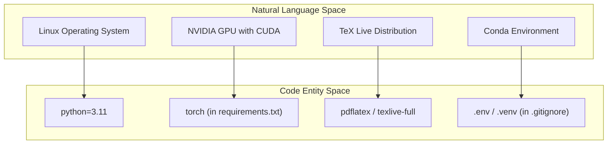
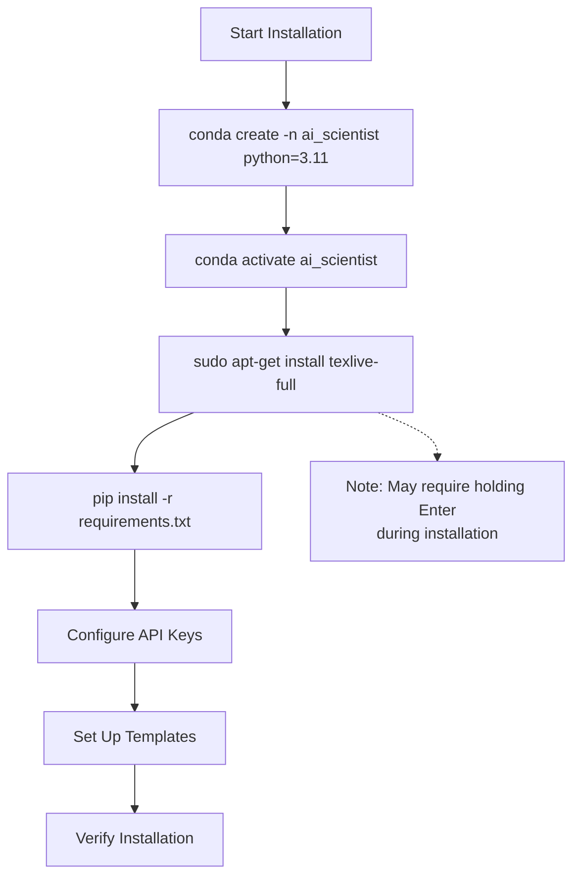
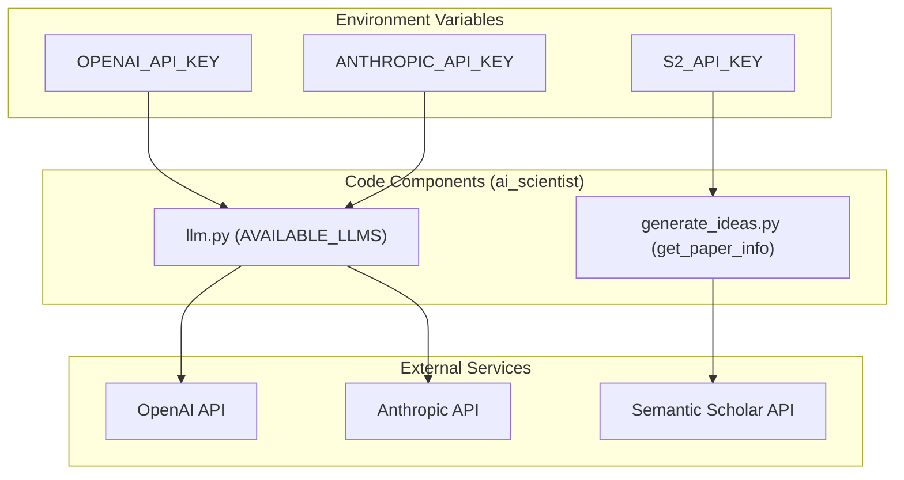

<!-- source: DeepWiki mcp.deepwiki.com · repo SakanaAI/AI-Scientist · page 1.2 Installation and Setup · fetched 2026-10-26 -->

# Installation and Setup

<details>
<summary>Relevant source files</summary>

The following files were used as context for generating this wiki page:

- [.gitignore](.gitignore)
- [LICENSE](LICENSE)
- [README.md](README.md)

</details>


This document covers the installation requirements, configuration steps, and initial setup needed to run the AI Scientist system. It includes system requirements, dependency installation, API key configuration, and template preparation.

For information about the overall system architecture, see [System Architecture](#1.1). For details about creating custom templates, see [Creating Custom Templates](#6.1).

## System Requirements

The AI Scientist system has specific hardware and software requirements that must be met before installation.

### Hardware Requirements

The system is designed to run on Linux with NVIDIA GPUs using CUDA and PyTorch. The templates require GPU acceleration and would be infeasible to run on CPU-only machines. Support for other GPU architectures may be possible by following PyTorch guidelines. [README.md:61-64]()

### Operating System Support

The system is primarily designed for Linux operating systems. Running on other operating systems may require significant adjustments and is not officially supported. [README.md:61-64]()

### Technical Environment Overview
The following diagram maps the high-level system requirements to the specific environment configurations used in the codebase.

**System Environment Mapping**

Sources: [README.md:61-75](), [.gitignore:125-132]()

## Basic Installation

The installation process involves creating a conda environment, installing LaTeX, and installing Python dependencies.

### Environment Setup

Create and activate a new conda environment with Python 3.11: [README.md:67-69]()

```bash
conda create -n ai_scientist python=3.11
conda activate ai_scientist
```

### LaTeX Installation

Install the complete TeX Live distribution, which is required for PDF generation via `pdflatex`: [README.md:70-71]()

```bash
sudo apt-get install texlive-full
```

**Note:** Installing `texlive-full` can take a significant amount of time. You may need to hold Enter during the installation process to handle interactive prompts. [README.md:77]()

### Python Dependencies

Install the required Python packages defined in the project root: [README.md:74]()

```bash
pip install -r requirements.txt
```

**Installation Flow**

Sources: [README.md:67-77]()

## API Key Configuration

The system supports multiple LLM providers, each requiring specific API key configuration through environment variables. These are handled internally by the `ai_scientist/llm.py` module. [README.md:81-82]()

### OpenAI API
For GPT-4o, GPT-4o-mini, and o1 models: [README.md:83-85]()
```bash
export OPENAI_API_KEY="YOUR_OPENAI_API_KEY"
```

### Anthropic API
For Claude Sonnet 3.5 models: [README.md:87-89]()
```bash
export ANTHROPIC_API_KEY="YOUR_ANTHROPIC_API_KEY"
```

#### Claude via AWS Bedrock
For Claude models through Amazon Bedrock, install additional dependencies and configure AWS credentials: [README.md:91-101]()
```bash
pip install anthropic[bedrock]
export AWS_ACCESS_KEY_ID="YOUR_AWS_ACCESS_KEY"
export AWS_SECRET_ACCESS_KEY="YOUR_AWS_SECRET_KEY"
export AWS_REGION_NAME="YOUR_AWS_REGION"
```

### Additional Providers
The system also supports DeepSeek, OpenRouter, Google Gemini, and academic search APIs: [README.md:107-157]()

```bash
# LLM Providers
export DEEPSEEK_API_KEY="YOUR_DEEPSEEK_API_KEY"
export OPENROUTER_API_KEY="YOUR_OPENROUTER_API_KEY"
export GEMINI_API_KEY="YOUR_GEMINI_API_KEY"

# Research Search APIs (Used in generate_ideas.py)
export S2_API_KEY="YOUR_S2_API_KEY"
export OPENALEX_MAIL_ADDRESS="YOUR_EMAIL_ADDRESS"
```

**API Integration Architecture**

Sources: [README.md:79-157](), [ai_scientist/llm.py:1-50](), [ai_scientist/generate_ideas.py:1-100]()

## Template Setup

The system includes three core templates that require specific setup procedures before use. Each template requires a baseline "run 0" to establish performance metrics. [README.md:164-233]()

### NanoGPT Template
The NanoGPT template investigates transformer-based autoregressive next-token prediction. [README.md:164-167]()

**Data Preparation:**
```bash
python data/enwik8/prepare.py
python data/shakespeare_char/prepare.py
python data/text8/prepare.py
```

**Baseline Run:**
```bash
cd templates/nanoGPT
python experiment.py --out_dir run_0
python plot.py
```

### 2D Diffusion Template
The 2D Diffusion template studies diffusion generative models on low-dimensional datasets. [README.md:195-201]()

**Dependencies:**
```bash
git clone https://github.com/gregversteeg/NPEET.git
cd NPEET && pip install .
pip install scikit-learn
```

**Baseline Run:**
```bash
cd templates/2d_diffusion
python experiment.py --out_dir run_0
python plot.py
```

### Grokking Template
The Grokking template investigates generalization in deep neural networks. [README.md:218-223]()

**Dependencies:**
```bash
pip install einops
```

**Baseline Run:**
```bash
cd templates/grokking
python experiment.py --out_dir run_0
python plot.py
```

Sources: [README.md:164-233]()

## Installation Verification

After setup, verify the system by running a minimal end-to-end experiment using `launch_scientist.py`.

### Basic Execution
Test the pipeline with a small number of ideas: [README.md:235-239]()
```bash
python launch_scientist.py --model "gpt-4o-2024-05-13" --experiment nanoGPT_lite --num-ideas 2
```

### Parallel Execution
If multiple GPUs are available, verify parallel orchestration: [README.md:255-257]()
```bash
python launch_scientist.py --model "claude-3-5-sonnet-20241022" --experiment nanoGPT_lite --num-ideas 2 --parallel
```

### Review System Verification
Test the review logic manually via `ai_scientist/perform_review.py`: [README.md:264-275]()
```python
from ai_scientist.perform_review import load_paper, perform_review
# Load a generated paper text and perform review ensemble
paper_txt = load_paper("report.pdf")
# This triggers the ensemble review process
```

| Verification Step | Target File/Command | Purpose |
|------------------|---------------------|---------|
| Environment | `conda activate` | Check Python 3.11 setup |
| Template Baseline | `templates/*/run_0/` | Verify hardware-specific metrics |
| LLM Access | `ai_scientist/llm.py` | Verify API key connectivity |
| Pipeline | `launch_scientist.py` | Full E2E orchestration check |

Sources: [README.md:235-275](), [ai_scientist/perform_review.py:441-455]()

## Troubleshooting

### Common Issues
*   **Missing Files:** Ensure `run_0` exists in the template directory. The `.gitignore` excludes these by default. [.gitignore:172]()
*   **PDF Failures:** Check `pdflatex` availability. The system uses it in `perform_writeup.py` to compile the generated LaTeX. [README.md:345-348]()
*   **Aider Logs:** If experiments fail, check `.aider*` files for the LLM's coding history. [.gitignore:164]()
*   **Rate Limits:** Use `S2_API_KEY` to avoid Semantic Scholar throttling during idea generation. [README.md:154-157]()

Sources: [README.md:338-369](), [.gitignore:164-175]()

---

