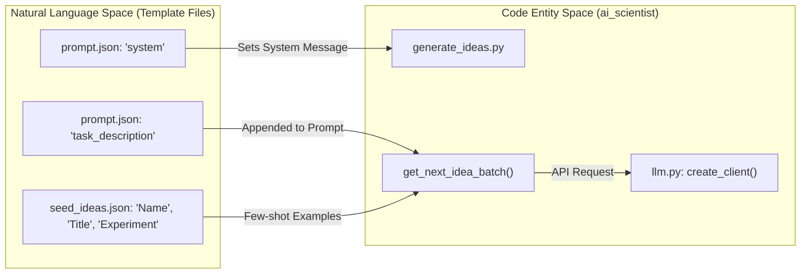
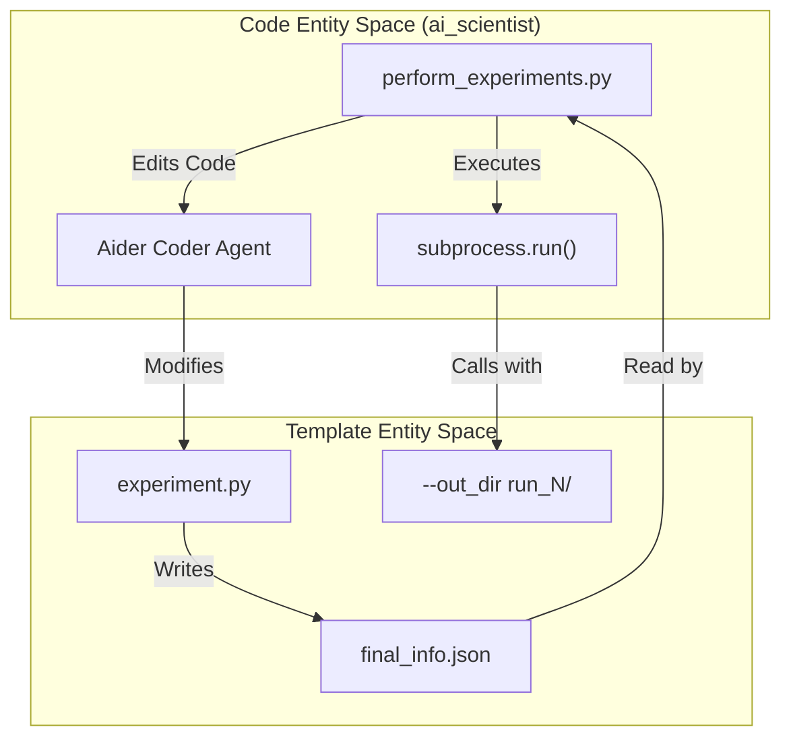

<!-- source: DeepWiki mcp.deepwiki.com · repo SakanaAI/AI-Scientist · page 6.1 Creating Custom Templates · fetched 2026-10-26 -->

# Creating Custom Templates

Relevant source files

The following files were used as context for generating this wiki page:

- [example_papers/adaptive_dual_scale_denoising/experiment.py](example_papers/adaptive_dual_scale_denoising/experiment.py)
- [example_papers/adaptive_dual_scale_denoising/plot.py](example_papers/adaptive_dual_scale_denoising/plot.py)
- [example_papers/adaptive_dual_scale_denoising/prompt.json](example_papers/adaptive_dual_scale_denoising/prompt.json)
- [example_papers/adaptive_dual_scale_denoising/seed_ideas.json](example_papers/adaptive_dual_scale_denoising/seed_ideas.json)
- [example_papers/data_augmentation_grokking/prompt.json](example_papers/data_augmentation_grokking/prompt.json)

This document explains how to create custom research domain templates for the AI Scientist system. Templates enable the AI Scientist to conduct automated research in specific domains by providing the experimental framework, visualization tools, and domain-specific guidance needed for idea generation and execution.

## Purpose and Scope

Custom templates extend the AI Scientist's research capabilities to new domains beyond the core templates (NanoGPT, 2D Diffusion, Grokking). This document covers the technical requirements, file structure, and integration points needed to create functional templates that work with the AI Scientist pipeline.

## Template Architecture Overview

Templates serve as domain-specific research environments that the AI Scientist uses to generate ideas, conduct experiments, and produce scientific papers. Each template defines the experimental framework, visualization capabilities, and domain knowledge required for automated research.

### Template Directory Structure

A complete template directory must contain the following core files:

| File | Role | Description |
| :--- | :--- | :--- |
| `experiment.py` | **Execution** | The main training/evaluation script that the AI modifies. |
| `plot.py` | **Visualization** | Script to aggregate results from `run_N` folders and create figures. |
| `prompt.json` | **Context** | Defines the "persona" and task description for the LLM. |
| `seed_ideas.json` | **Inspiration** | A list of initial research ideas to kickstart the generation process. |
| `latex/` | **Writeup** | Contains `template.tex` and `references.bib` for paper generation. |

### System-to-Code Mapping: Idea Generation

The following diagram shows how natural language instructions in the template files map to the code entities in `generate_ideas.py`.

Sources: [example_papers/adaptive_dual_scale_denoising/prompt.json:1-4](), [example_papers/adaptive_dual_scale_denoising/seed_ideas.json:1-10](), [example_papers/data_augmentation_grokking/prompt.json:1-4]()

## Core Template Components

### 1. experiment.py Requirements
The `experiment.py` file is the heart of the template. It must be a self-contained script that the AI "coder" agent can modify to implement new ideas.

*   **Argument Parsing**: It must use `argparse` to accept parameters. Crucially, it must support an `--out_dir` argument to specify where results (logs, models, JSONs) are saved [example_papers/adaptive_dual_scale_denoising/experiment.py:202-204]().
*   **Data Saving**: Results should be saved in a structured format. Usually, a `final_info.json` file is expected by the reviewer, and an `all_results.pkl` is often used by `plot.py` [example_papers/adaptive_dual_scale_denoising/plot.py:28-31]().
*   **Logic**: It typically contains the model definition (e.g., `MLPDenoiser` [example_papers/adaptive_dual_scale_denoising/experiment.py:51-88]()) and the training loop.

### 2. plot.py Requirements
The `plot.py` script is responsible for generating the figures that appear in the final paper.

*   **Discovery**: It iterates through `run_N` directories to find experimental results [example_papers/adaptive_dual_scale_denoising/plot.py:26-31]().
*   **Labeling**: It often contains a `labels` dictionary that maps folder names to descriptive titles for the legend [example_papers/adaptive_dual_scale_denoising/plot.py:34-41]().
*   **Output**: It must save plots as image files (e.g., `train_loss.png`) which are then referenced in the LaTeX template [example_papers/adaptive_dual_scale_denoising/plot.py:75-76]().

### 3. prompt.json Structure
This file controls the "PhD Student" persona.
*   **`system`**: The high-level persona description [example_papers/adaptive_dual_scale_denoising/prompt.json:2-2]().
*   **`task_description`**: Detailed instructions about the provided code, the research goal, and specific areas of interest (e.g., "controllable generation" or "new encodings") [example_papers/adaptive_dual_scale_denoising/prompt.json:3-3]().

### 4. seed_ideas.json Format
A list of JSON objects providing a baseline for the LLM. Each idea must include:
*   `Name`: A short identifier (e.g., `learning_rate_schedule`).
*   `Title`: A full academic title.
*   `Experiment`: A description of the proposed methodology.
*   `Interestingness`, `Feasibility`, `Novelty`: Numerical scores (1-10) [example_papers/adaptive_dual_scale_denoising/seed_ideas.json:2-9]().

### System-to-Code Mapping: Experiment Execution

The following diagram illustrates how the `experiment.py` template file interacts with the execution engine.

Sources: [example_papers/adaptive_dual_scale_denoising/experiment.py:202-204](), [example_papers/adaptive_dual_scale_denoising/plot.py:28-29]()

## Community Template Examples

The repository includes several community-contributed templates that serve as excellent references for custom implementations:

| Template | Research Domain | Key Features |
| :--- | :--- | :--- |
| **MACE** | Quantum Chemistry | Uses specialized interatomic potential models. |
| **TensoRF** | Radiance Fields | Focuses on efficient 3D reconstruction and tensor factorization. |
| **Earthquake Prediction** | Geophysics | Time-series analysis on seismic datasets. |
| **Sketch-RNN** | Generative Art | Recurrent neural networks for vector drawing generation. |

## Creating a New Template: Step-by-Step

1.  **Initialize Directory**: Create a folder in `templates/` with your domain name.
2.  **Standardize `experiment.py`**: Ensure it takes `--out_dir` and saves a `final_info.json` containing the primary metrics.
3.  **Define Visuals in `plot.py`**: Write code that looks into `run_*` folders, loads the JSON/Pickle data, and saves `.png` files.
4.  **Craft the Prompt**: In `prompt.json`, describe the constraints of your domain so the AI doesn't propose impossible experiments.
5.  **Add Seeds**: Provide at least one feasible "seed" idea in `seed_ideas.json`.
6.  **LaTeX Setup**: Copy the `latex/` folder from an existing template and modify `references.bib` to include relevant baseline papers for your domain.

Sources: [example_papers/adaptive_dual_scale_denoising/plot.py:9-32](), [example_papers/adaptive_dual_scale_denoising/prompt.json:1-4]()

---

