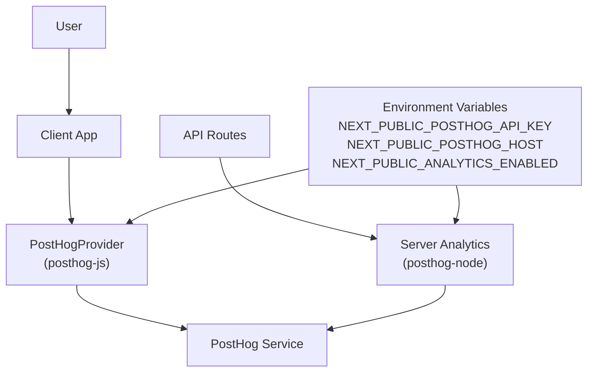
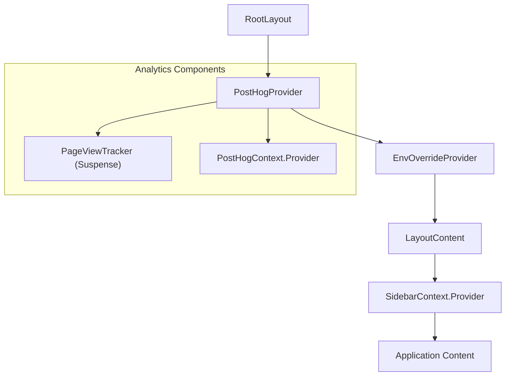
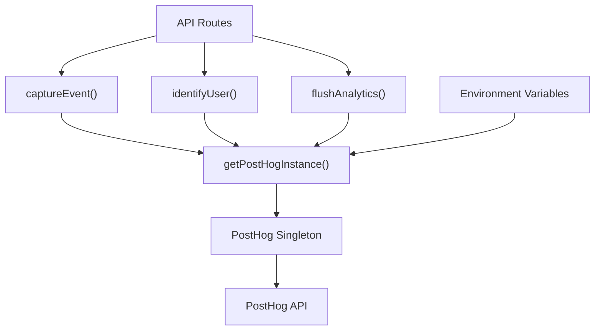
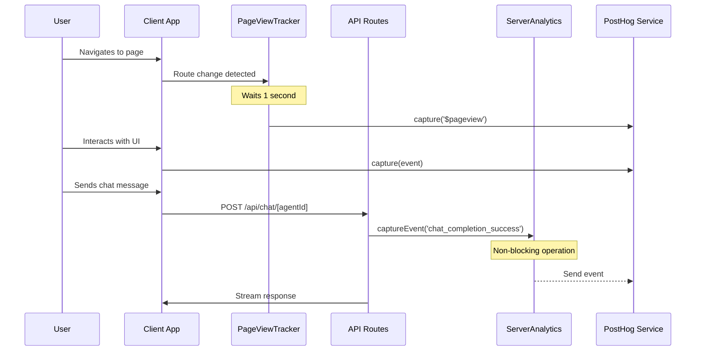

<!-- source: DeepWiki mcp.deepwiki.com · repo AgentDock/AgentDock · page 4.7 Analytics Integration · fetched 2026-10-26 -->

# Analytics Integration

<details>
<summary>Relevant source files</summary>

The following files were used as context for generating this wiki page:

- [agentdock-core/src/nodes/tool-registry.ts](agentdock-core/src/nodes/tool-registry.ts)
- [docs/analytics.md](docs/analytics.md)
- [src/app/agents/all/page.tsx](src/app/agents/all/page.tsx)
- [src/app/agents/page.tsx](src/app/agents/page.tsx)
- [src/app/api/chat/[agentId]/__tests__/streaming.test.ts](src/app/api/chat/[agentId]/__tests__/streaming.test.ts)
- [src/app/layout.tsx](src/app/layout.tsx)
- [src/components/layout/layout-content.tsx](src/components/layout/layout-content.tsx)
- [src/components/providers/posthog-provider.tsx](src/components/providers/posthog-provider.tsx)
- [src/lib/analytics.ts](src/lib/analytics.ts)
- [tailwind.config.ts](tailwind.config.ts)

</details>


This document provides a comprehensive overview of the analytics integration within AgentDock. The system uses PostHog for tracking usage patterns and events, with a dual implementation approach (client-side and server-side) designed to gather valuable insights without interfering with core functionality.

## Overview

AgentDock integrates analytics primarily through PostHog, with an architecture designed to:

1. Track pageviews and user interactions on the client-side
2. Capture critical server-side events (e.g., chat completions)
3. Avoid interference with tool calling and other core functionality
4. Respect performance considerations with non-blocking implementations
5. Provide conditional enablement based on environment



Sources: [src/components/providers/posthog-provider.tsx](), [src/lib/analytics.ts](), [src/app/layout.tsx]()

## Implementation Architecture

The analytics integration consists of two main components:

1. **Client-Side Tracking**: Implemented using `posthog-js` through a custom React provider
2. **Server-Side Tracking**: Implemented using `posthog-node` with a non-blocking design

```mermaid
classDiagram
    class PostHogProvider {
        +children: ReactNode
        +apiKey: string
        +apiHost: string
        +enabled: boolean
        +init()
        +capture()
    }
    
    class PostHogContext {
        +posthog: PostHog|null
        +capture: function
    }
    
    class PageViewTracker {
        +enabled: boolean
        +apiKey: string
        +trackPageViews()
    }
    
    class ServerAnalytics {
        +captureEvent()
        +identifyUser()
        +flushAnalytics()
        -getPostHogInstance()
    }
    
    class RootLayout {
        +children: ReactNode
        +render()
    }
    
    RootLayout --> PostHogProvider: uses
    PostHogProvider --> PostHogContext: provides
    PostHogProvider --> PageViewTracker: includes
    PostHogContext --> "usePostHog()": consumed by
    ServerAnalytics --> "posthog-node": uses
```

Sources: [src/components/providers/posthog-provider.tsx](), [src/lib/analytics.ts](), [src/app/layout.tsx]()

## Client-Side Implementation

The client-side analytics is implemented through a custom `PostHogProvider` component that wraps the application. This provider initializes PostHog with specific configurations to prevent interference with tool calling functionality.

### PostHog Provider

The provider component:
- Initializes PostHog with the API key from environment variables
- Configures options to prevent interference with tool calling
- Provides a context for accessing PostHog functions
- Includes a dedicated component for tracking page views

Key configuration settings:

```typescript
const posthogOptions = {
  api_host: process.env.NEXT_PUBLIC_POSTHOG_HOST || 'https://us.i.posthog.com',
  capture_pageview: false,     // Manual tracking
  autocapture: false,          // Disabled to prevent interference
  disable_session_recording: true, // Disabled
  persistence: 'localStorage' as const,
  // ...other settings
}
```

### Integration in Root Layout

The PostHog provider is integrated at the root layout level, wrapping the entire application:



Sources: [src/app/layout.tsx:45-53](), [src/components/providers/posthog-provider.tsx:77-137]()

### Usage Through Hook

Components can access analytics functionality through the `usePostHog` hook:

```typescript
// Example usage of the usePostHog hook
const { capture } = usePostHog();
capture('button_clicked', { buttonId: 'submit' });
```

Sources: [src/components/providers/posthog-provider.tsx:39]()

## Server-Side Implementation

The server-side analytics module provides non-blocking functions for capturing events, identifying users, and flushing analytics data.

### Key Components

1. **PostHog Instance Management**: Singleton pattern for managing the PostHog instance
2. **Non-Blocking Capture**: Events are captured asynchronously to avoid blocking API responses
3. **Standard Properties**: Environment and timestamp are automatically added to events



Sources: [src/lib/analytics.ts:12-54](), [src/lib/analytics.ts:66-102]()

### Non-Blocking Design

The server-side analytics implementation uses promises to ensure API routes are not blocked by analytics operations:

```typescript
export function captureEvent(
  eventName: string,
  properties: EventProperties = {},
  distinctId: string = 'anonymous'
): void {
  // Run in a non-blocking way
  Promise.resolve().then(() => {
    try {
      const client = getPostHogInstance();
      if (!client) return;

      // Add timestamp if not already present
      const propsWithTimestamp = {
        ...properties,
        timestamp: properties.timestamp || new Date().toISOString(),
        environment: process.env.NODE_ENV || 'development'
      };

      client.capture({
        distinctId,
        event: eventName,
        properties: propsWithTimestamp,
      });
    } catch (error) {
      // Just log and continue - never block or throw
      logger.warn(/*...*);
    }
  });
}
```

Sources: [src/lib/analytics.ts:66-102]()

## Configuration

Analytics is controlled through environment variables:

| Variable | Description | Default |
|----------|-------------|---------|
| `NEXT_PUBLIC_POSTHOG_API_KEY` | Your PostHog Project API Key | Required |
| `NEXT_PUBLIC_POSTHOG_HOST` | The PostHog instance host | `https://us.i.posthog.com` |
| `NEXT_PUBLIC_ANALYTICS_ENABLED` | Enables/disables analytics | `true` in production |

By default, analytics is only enabled in production environments unless explicitly enabled in development:

```typescript
// From src/app/layout.tsx
const analyticsEnabled = process.env.NODE_ENV === 'production' || 
                         process.env.NEXT_PUBLIC_ANALYTICS_ENABLED === 'true';
```

Sources: [src/app/layout.tsx:32-34](), [src/components/providers/posthog-provider.tsx:8-25](), [src/lib/analytics.ts:19-21]()

## Event Flow

The following diagram illustrates how events flow through the system:



Sources: [src/components/providers/posthog-provider.tsx:42-74](), [src/lib/analytics.ts:66-102]()

## Tracked Events

By default, the following events are tracked:

### Client-Side Events

1. **`$pageview`**: Manually tracked when a user navigates to a new page
   - Properties: `current_url`

2. **Custom Events**: Components can use the `usePostHog()` hook to track custom events

### Server-Side Events

1. **`chat_completion_success`**: Tracked after a successful agent response
   - Properties:
     - `agentId`: The agent used for the chat
     - `sessionId`: A masked version of the session ID
     - `durationMs`: Time taken for the request/response cycle
     - `provider`: The LLM provider used
     - `model`: The specific model used
     - `environment`: Node environment
     - `timestamp`: Event timestamp

Sources: [src/components/providers/posthog-provider.tsx:53-68](), [docs/analytics.md:31-45]()

## Extending Analytics

### Adding Client-Side Events

To add custom client-side events, use the `usePostHog()` hook:

```typescript
import { usePostHog } from '@/components/providers/posthog-provider';

function MyComponent() {
  const { capture } = usePostHog();
  
  const handleClick = () => {
    capture('feature_used', {
      featureId: 'my-feature',
      // Additional properties
    });
  };
  
  return <button onClick={handleClick}>Use Feature</button>;
}
```

### Adding Server-Side Events

To add server-side events, import and use the `captureEvent` function:

```typescript
import { captureEvent } from '@/lib/analytics';

// In an API route or server action
export async function POST(request) {
  // Process request
  
  // Track an event
  captureEvent('api_endpoint_called', {
    endpoint: '/api/my-endpoint',
    durationMs: duration,
    success: true,
  }, 'user-id-or-session-id');
  
  return Response.json({ success: true });
}
```

Sources: [src/components/providers/posthog-provider.tsx:27-39](), [src/lib/analytics.ts:66-102]()

## Debugging

Analytics debugging is easier in development mode:

### Client-Side Debugging

In development:
- PostHog instance is available at `window.posthog` for console inspection
- Debug mode is enabled with `posthog.debug()`
- Events are logged to the console

```javascript
// Example of inspecting client-side PostHog in browser console
window.posthog.capture('test_event', { property: 'value' });
```

### Server-Side Debugging

Server-side events and errors are logged using the AgentDock logger system:

```
[INFO] [SYSTEM] [Analytics] PostHog analytics initialized on server
[DEBUG] [SYSTEM] [Analytics] Flushed analytics events
```

Sources: [src/components/providers/posthog-provider.tsx:65-67](), [src/components/providers/posthog-provider.tsx:100-104](), [src/lib/analytics.ts:38-42]()

## Best Practices

1. **Avoid Blocking Operations**: Always ensure analytics calls are non-blocking, especially in API routes
2. **Protect User Privacy**: Don't track personally identifiable information
3. **Descriptive Event Names**: Use clear, descriptive event names in snake_case
4. **Minimal Properties**: Include only necessary properties in events
5. **Error Handling**: Always catch errors in analytics code to prevent application failures

Sources: [src/lib/analytics.ts:66-102](), [docs/analytics.md:72-78]()

---

