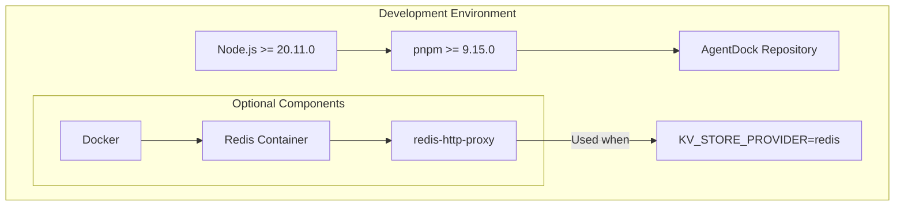
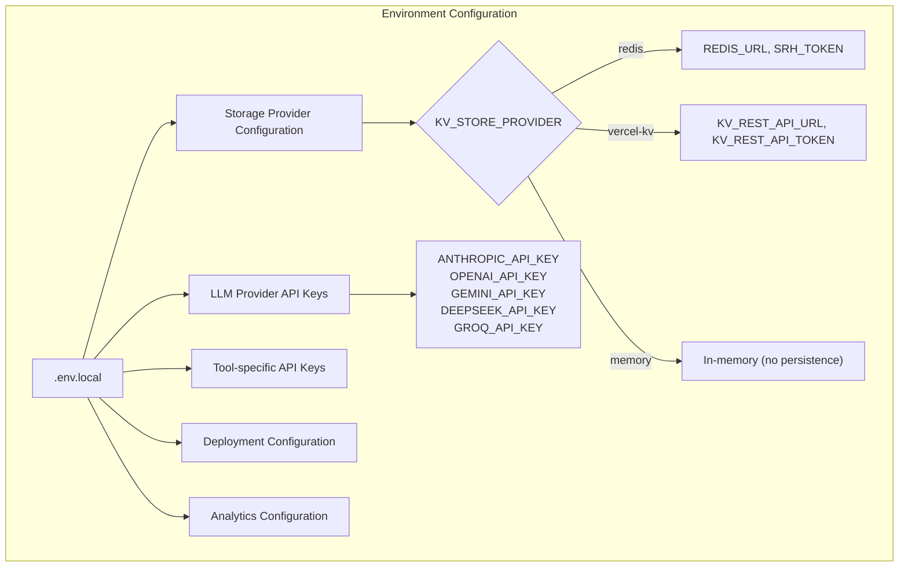
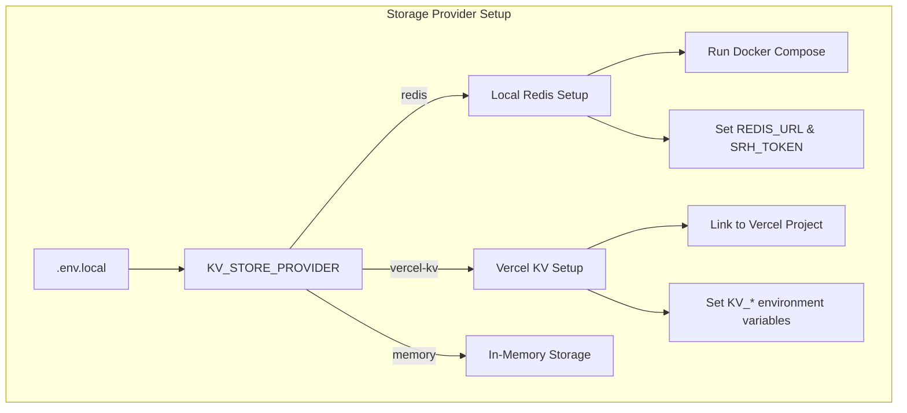
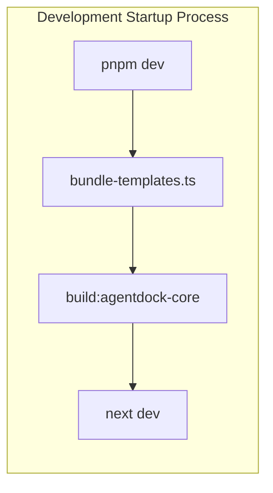
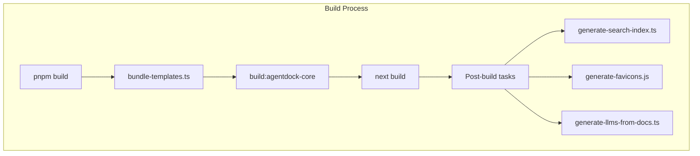
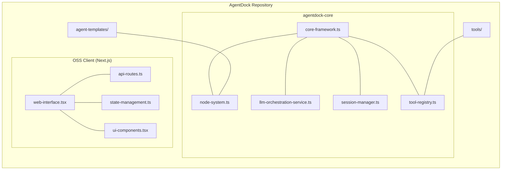
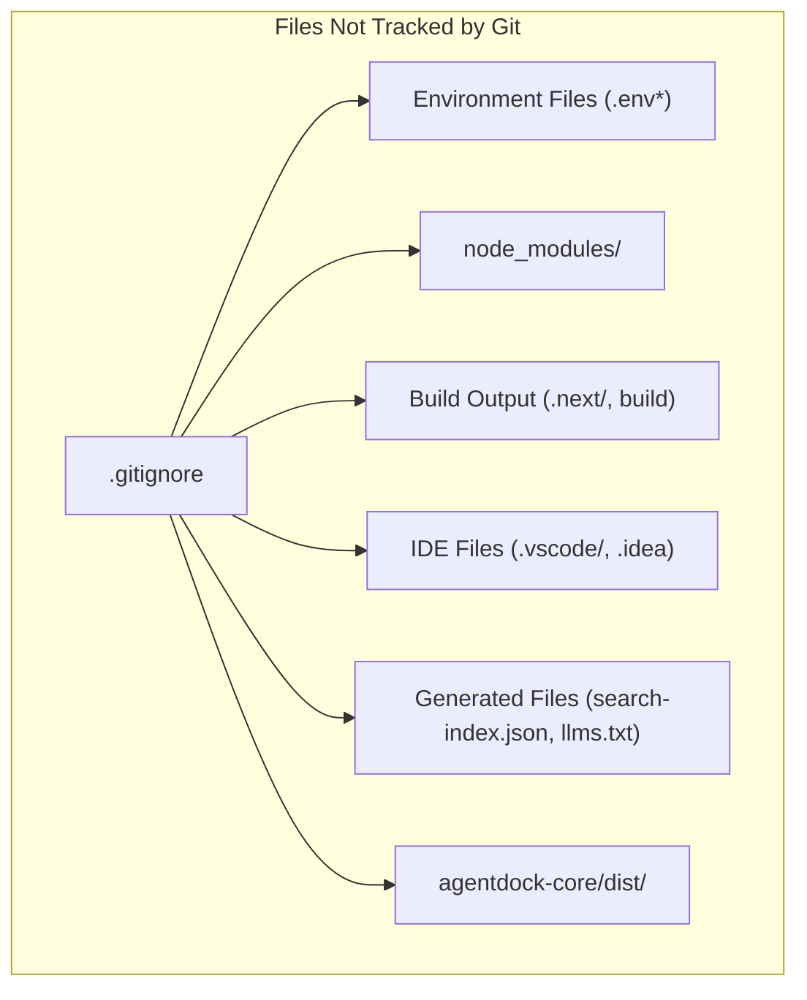
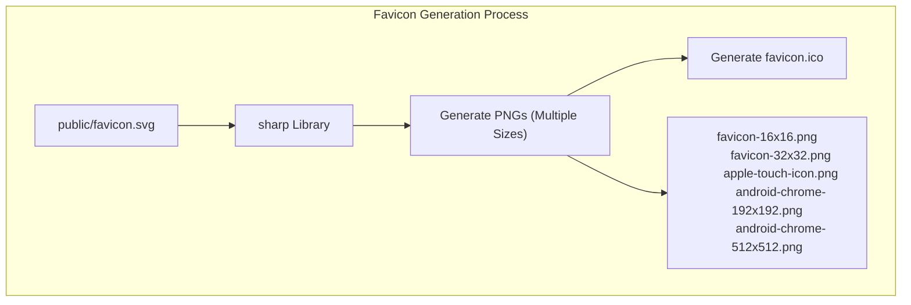

<!-- source: DeepWiki mcp.deepwiki.com · repo AgentDock/AgentDock · page 6.1 Environment Setup · fetched 2026-10-26 -->

# Environment Setup

<details>
<summary>Relevant source files</summary>

The following files were used as context for generating this wiki page:

- [.env.example](.env.example)
- [.gitignore](.gitignore)
- [agentdock-core/src/llm/llm-orchestration-service.ts](agentdock-core/src/llm/llm-orchestration-service.ts)
- [package.json](package.json)
- [pnpm-lock.yaml](pnpm-lock.yaml)
- [scripts/generate-favicons.js](scripts/generate-favicons.js)

</details>


This document provides a comprehensive guide for setting up your development environment to work with the AgentDock repository. It covers system requirements, installation steps, environment configuration, and running the application in development mode.

For information about API keys management specifically, see [API Keys Management](#6.2).

## System Requirements

Before getting started, make sure your development environment meets these requirements:

| Requirement | Minimum Version | Notes |
|-------------|-----------------|-------|
| Node.js     | 20.11.0         | LTS version recommended |
| pnpm        | 9.15.0          | Package manager required for this project |
| Git         | Any recent      | For version control |
| Docker      | Latest          | Optional: for Redis if using local development |



Sources: [package.json:5-8]()

## Installation Process

### 1. Clone the Repository

```bash
git clone https://github.com/AgentDock/AgentDock.git
cd AgentDock
```

### 2. Install Dependencies

The project uses pnpm for package management. Run the following commands to install all dependencies:

```bash
# Install pnpm if you don't have it
npm install -g pnpm@9.15.0

# Install dependencies
pnpm install
```

Alternatively, you can use the provided clean-install script:

```bash
./scripts/clean-install.sh
```

This script helps ensure a clean installation by removing existing node_modules folders before installing dependencies.

```mermaid
flowchart TD
    subgraph "Installation Process"
        Clone["Clone Repository"] --> Install["Run pnpm install"]
        Install --> CoreInstall["Install agentdock-core dependencies"]
        CoreInstall --> GenerateLLMs["Generate LLM files"]
        GenerateLLMs --> ReadyToRun["Ready to Run"]
        
        CleanInstall["./scripts/clean-install.sh"] -.-> Install
    end
    
    class CoreInstall,GenerateLLMs "autoExecuted"
    classDef autoExecuted fill:#f9f,stroke:#333
```

Sources: [package.json:10-34](), [package.json:32]()

## Environment Configuration

### Setting Up Environment Variables

1. Create a `.env.local` file in the root directory by copying the provided example:

```bash
cp .env.example .env.local
```

2. Edit `.env.local` and configure the required environment variables.

### Key Environment Variables

| Variable Group | Key Variables | Purpose |
|----------------|--------------|---------|
| Storage        | `KV_STORE_PROVIDER` | Select storage backend (redis, vercel-kv, memory) |
| LLM Providers  | `ANTHROPIC_API_KEY`, `OPENAI_API_KEY`, etc. | API keys for language models |
| Tools          | `SERPER_API_KEY`, `FIRECRAWL_API_KEY`, etc. | API keys for various tools |
| Deployment     | `NODE_ENV`, `AGENTDOCK_EXECUTION_ENV` | Environment configuration |
| Analytics      | `NEXT_PUBLIC_POSTHOG_API_KEY` | Optional analytics tracking |



Sources: [.env.example:1-147]()

### Storage Configuration

The project supports three storage providers:

1. **Redis (Local Development)**
   - Set `KV_STORE_PROVIDER=redis`
   - Configure `REDIS_URL` (default: http://localhost:8079)
   - Configure `SRH_TOKEN` for authentication with the Redis HTTP proxy

2. **Vercel KV (Vercel Deployment or Local Testing)**
   - Set `KV_STORE_PROVIDER=vercel-kv`
   - Configure `KV_REST_API_URL` and `KV_REST_API_TOKEN`
   - These are automatically injected by Vercel when deployed

3. **In-Memory Storage (No Persistence)**
   - Set `KV_STORE_PROVIDER=memory`
   - Data is lost when the application restarts



Sources: [.env.example:4-44]()

### Setting Up Redis for Local Development

If you choose Redis as your storage provider, you'll need to run a Redis instance and an HTTP proxy:

1. Create a `docker-compose.yml` file with Redis and redis-http-proxy services
2. Run `docker-compose up -d` to start the services
3. Ensure your `.env.local` has:
   ```
   KV_STORE_PROVIDER=redis
   REDIS_URL=http://localhost:8079
   SRH_TOKEN=test_token
   ```

## Running the Application

### Development Mode

To run the application in development mode:

```bash
pnpm dev
```

This command:
1. Runs the `bundle-templates.ts` script to prepare agent templates
2. Builds the `agentdock-core` package
3. Starts the Next.js development server



Sources: [package.json:12-13]()

### Building for Production

To build the application for production:

```bash
pnpm build
```

This command:
1. Builds the `agentdock-core` package
2. Builds the Next.js application
3. Generates search index and favicons
4. Generates LLM provider information from documentation



Sources: [package.json:11-15](), [scripts/generate-favicons.js:1-44]()

## Project Structure

The AgentDock repository consists of two main parts:

1. **agentdock-core**: The core framework that provides the foundation for building AI agents
2. **OSS Client**: A Next.js-based web interface



Sources: [agentdock-core/src/llm/llm-orchestration-service.ts:1-359]()

## Configuration Files

The repository includes several important configuration files:

| File | Purpose |
|------|---------|
| `.env.local` | Local environment configuration (created from `.env.example`) |
| `package.json` | Project dependencies and scripts |
| `pnpm-lock.yaml` | Lock file for dependencies |
| `.gitignore` | Files and directories excluded from git |

The `.gitignore` file helps keep sensitive information out of the repository:



Sources: [.gitignore:1-76]()

## Asset Generation

The project includes scripts to generate various assets:

### Favicon Generation

The `generate-favicons.js` script creates favicons in different sizes from an SVG source:



Sources: [scripts/generate-favicons.js:1-44]()

## Troubleshooting

### Common Issues and Solutions

| Issue | Solution |
|-------|----------|
| Redis connection errors | Ensure Docker is running and the Redis container is up |
| Missing API keys | Check `.env.local` for required API keys |
| Build errors | Run `pnpm clean-install` to start fresh |

### Clearing Generated Files

If you encounter issues with the build, you can clear generated files:

```bash
# Remove build output
rm -rf .next/
rm -rf agentdock-core/dist/

# Remove generated assets
rm -f public/search-index.json
rm -f public/llms.txt
rm -f public/llms-full.txt
```

Sources: [.gitignore:67-76]()

## Next Steps

After setting up your environment, you can:

1. Configure API keys for LLM providers (see [API Keys Management](#6.2))
2. Explore the build system (see [Build System](#6.3))
3. Learn about the contribution process (see [Contributing Guidelines](#6.4))

---

