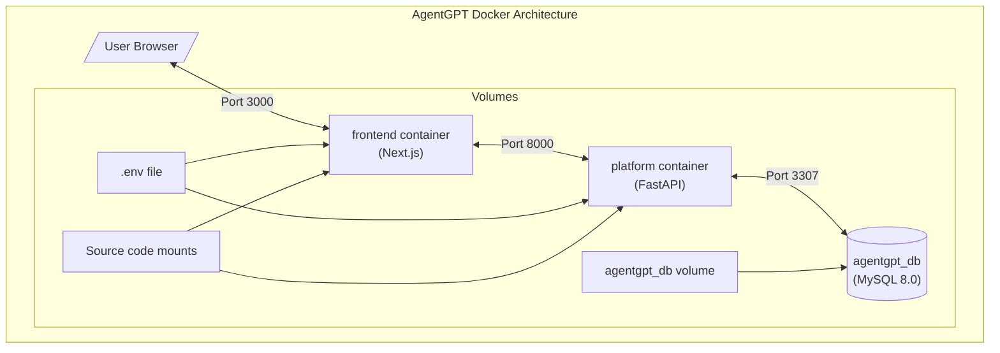
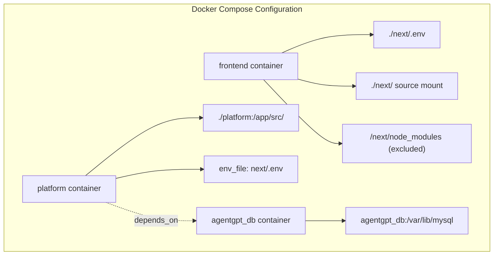
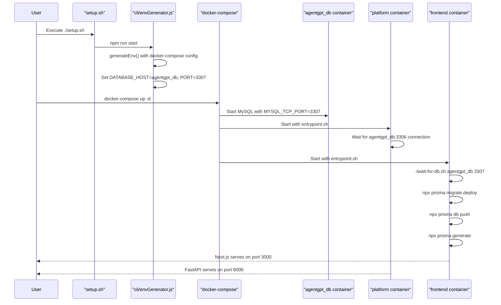
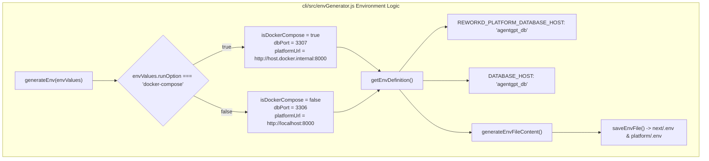
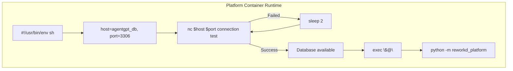

<!-- source: DeepWiki mcp.deepwiki.com · repo reworkd/AgentGPT · page 5.2 Docker Deployment · fetched 2026-10-26 -->

# Docker Deployment

<details>
<summary>Relevant source files</summary>

The following files were used as context for generating this wiki page:

- [.env.example](.env.example)
- [cli/src/envGenerator.js](cli/src/envGenerator.js)
- [docker-compose.yml](docker-compose.yml)
- [next/.husky/pre-commit](next/.husky/pre-commit)
- [next/entrypoint.sh](next/entrypoint.sh)
- [next/next.config.mjs](next/next.config.mjs)
- [next/public/locales/en/chat.missing.json](next/public/locales/en/chat.missing.json)
- [next/public/logos/panache-default-solid.svg](next/public/logos/panache-default-solid.svg)
- [next/public/logos/yc-default-solid.svg](next/public/logos/yc-default-solid.svg)
- [next/src/components/console/ExampleAgents.tsx](next/src/components/console/ExampleAgents.tsx)
- [next/src/env/schema.mjs](next/src/env/schema.mjs)
- [next/wait-for-db.sh](next/wait-for-db.sh)
- [platform/Dockerfile](platform/Dockerfile)
- [platform/entrypoint.sh](platform/entrypoint.sh)
- [setup.sh](setup.sh)

</details>


This document provides detailed instructions for deploying the AgentGPT system using Docker and Docker Compose. Docker allows for consistent deployment across different environments by containerizing the application components. This guide covers both automated setup using the provided CLI tool and manual Docker deployment configurations.

For environment configuration details not specific to Docker, see [Environment Configuration](#5.1).

## Prerequisites

Before deploying AgentGPT with Docker, ensure you have the following installed:

- [Docker](https://www.docker.com/products/docker-desktop) (latest version)
- [Docker Compose](https://docs.docker.com/compose/install) (included with Docker Desktop)
- [Git](https://git-scm.com/downloads) for cloning the repository
- API keys:
  - An [OpenAI API key](https://platform.openai.com/signup) (required)
  - A [Serper API Key](https://serper.dev/signup) (optional)
  - A [Replicate API Token](https://replicate.com/signin) (optional)

Sources: [README.md:46-56](). [.env.example:27-32]()

## Docker Architecture

The AgentGPT system is containerized using Docker Compose with three main services:



### Docker Compose Services

The [docker-compose.yml:1-59]() file defines three interconnected services:

| Service | Container Name | Base Image | Port Mapping | Key Environment Variables |
|---------|----------------|------------|--------------|--------------------------|
| frontend | frontend | Custom Next.js build | 3000:3000 | NEXT_PUBLIC_BACKEND_URL=http://localhost:8000 |
| platform | platform | python:3.11-slim-buster | 8000:8000 | REWORKD_PLATFORM_HOST=0.0.0.0<br>REWORKD_PLATFORM_DB_HOST=agentgpt_db |
| agentgpt_db | agentgpt_db | mysql:8.0 | 3308:3307 | MYSQL_DATABASE=reworkd_platform<br>MYSQL_TCP_PORT=3307 |

#### Volume Mounts and Dependencies



Sources: [docker-compose.yml:4-58]()

## Container Initialization Flow



Sources: [setup.sh:6-8](), [cli/src/envGenerator.js:6-20](), [next/entrypoint.sh:16-25](), [platform/entrypoint.sh:3-14]()

## Automated Setup with CLI

The easiest way to deploy AgentGPT with Docker is using the provided setup script:

1. Clone the repository and navigate to the project directory:

```bash
git clone https://github.com/reworkd/AgentGPT.git
cd AgentGPT
```

2. Run the setup script:

```bash
# For Mac/Linux
./setup.sh

# For Windows
./setup.bat
```

3. Follow the CLI prompts to configure your environment:
   - When asked about the run option, select "docker-compose"
   - Enter your API keys as prompted
   - The CLI will generate the necessary `.env` file and start the Docker containers

Sources: [README.md:57-77](). [cli/src/envGenerator.js:5-142]()

## Manual Docker Deployment

If you prefer to set up manually or need more control over the deployment:

1. Clone the repository:

```bash
git clone https://github.com/reworkd/AgentGPT.git
cd AgentGPT
```

2. Create a `.env` file in the `next` directory based on the `.env.example` file.

3. Make sure the Docker-specific environment variables are properly configured:

```
# Database (Backend):
REWORKD_PLATFORM_DATABASE_USER="reworkd_platform"
REWORKD_PLATFORM_DATABASE_PASSWORD="reworkd_platform"
REWORKD_PLATFORM_DATABASE_HOST="agentgpt_db"
REWORKD_PLATFORM_DATABASE_PORT="3307"
REWORKD_PLATFORM_DATABASE_NAME="reworkd_platform"

# Database (Frontend):
DATABASE_USER="reworkd_platform"
DATABASE_PASSWORD="reworkd_platform"
DATABASE_HOST="agentgpt_db"
DATABASE_PORT="3307"
DATABASE_NAME="reworkd_platform"
```

4. Start the Docker containers:

```bash
docker-compose up -d
```

5. Access the application at http://localhost:3000

Sources: [.env.example:37-51](). [docker-compose.yml:1-59]()

## Environment Configuration for Docker

## Docker-Specific Environment Configuration

The [cli/src/envGenerator.js:23-76]() `getEnvDefinition()` function generates Docker-specific environment variables when `envValues.runOption === "docker-compose"`:

### Key Docker Environment Variables

| Variable | Docker Value | Local Value | Code Reference |
|----------|--------------|-------------|----------------|
| REWORKD_PLATFORM_DATABASE_HOST | agentgpt_db | localhost | [cli/src/envGenerator.js:60]() |
| REWORKD_PLATFORM_DATABASE_PORT | 3307 | 3306 | [cli/src/envGenerator.js:7,61]() |
| DATABASE_HOST | agentgpt_db | localhost | [cli/src/envGenerator.js:69]() |
| DATABASE_PORT | 3307 | 3306 | [cli/src/envGenerator.js:7,70]() |
| NEXT_PUBLIC_BACKEND_URL | http://localhost:8000 | http://localhost:8000 | [cli/src/envGenerator.js:30]() |

### Environment Variable Generation Logic



The `agentgpt_db` hostname resolves to the MySQL container through Docker's internal networking, while port 3307 is used internally within the Docker network.

Sources: [cli/src/envGenerator.js:6-20](), [cli/src/envGenerator.js:57-74](), [docker-compose.yml:40-52]()

## Docker Container Details

### Frontend Container Initialization

The frontend container executes [next/entrypoint.sh:1-29]() which orchestrates database connectivity and Prisma setup:

#### Frontend Container Startup Process

```mermaid
flowchart TD
    subgraph "Frontend Container (next/entrypoint.sh)"
        entrypoint_start["#!/usr/bin/env sh"] --> dos2unix_wait["dos2unix wait-for-db.sh"]
        dos2unix_wait --> copy_env["Copy .env.example if .env missing"]
        copy_env --> source_env["source .env"]
        source_env --> wait_for_db["./wait-for-db.sh agentgpt_db 3307"]
        wait_for_db --> prisma_check{"Check if DATABASE_URL exists"}
        prisma_check -->|"Not exists"| prisma_migrate["npx prisma migrate deploy --name init"]
        prisma_migrate --> prisma_push["npx prisma db push"]
        prisma_push --> prisma_generate["npx prisma generate"]
        prisma_check -->|"Exists"| prisma_generate
        prisma_generate --> exec_cmd["exec \"$@\""]
    end
    
    subgraph "wait-for-db.sh Script"
        wait_loop["nc $host $port"] --> wait_sleep["sleep 2"]
        wait_sleep --> wait_loop
        wait_loop -->|"Connection successful"| db_ready["Database available"]
    end
```



The [next/wait-for-db.sh:6-9]() script uses `nc` (netcat) to test database connectivity before proceeding with Prisma operations.

Sources: [next/entrypoint.sh:4-28](), [next/wait-for-db.sh:6-11]()

### Platform Container Build and Runtime

The platform container is built using [platform/Dockerfile:1-38]() with a multi-stage approach and executes the FastAPI backend service.

#### Multi-Stage Dockerfile Build Process

```mermaid
flowchart TD
    subgraph "platform/Dockerfile Multi-Stage Build"
        base["FROM python:3.11-slim-buster as prod"] --> apt_install["apt-get install mysql, gcc, openjdk-11-jdk"]
        apt_install --> poetry_install["pip install poetry==1.4.2"]
        poetry_install --> poetry_config["poetry config virtualenvs.create false"]
        poetry_config --> copy_pyproject["COPY pyproject.toml /app/src/"]
        copy_pyproject --> poetry_main["poetry install --only main"]
        poetry_main --> apt_purge["apt-get purge gcc, g++"]
        apt_purge --> copy_app["COPY . /app/src/"]
        copy_app --> cmd_python["CMD python -m reworkd_platform"]
        
        cmd_python --> dev_stage["FROM prod as dev"]
        dev_stage --> poetry_dev["poetry install (all dependencies)"]
    end
```



#### Platform Container Runtime

The platform container uses [platform/entrypoint.sh:3-14]() to ensure database connectivity:



Note: The platform entrypoint tests port 3306 while the actual MySQL container runs on port 3307 internally. This is handled by Docker networking.

Sources: [platform/Dockerfile:1-33](), [platform/entrypoint.sh:3-14](), [docker-compose.yml:30-35]()

### Database Container

The database container runs MySQL 8.0 and:
- Stores data in a persistent volume
- Uses port 3307 inside Docker and maps to 3308 on the host
- Initializes with the reworkd_platform database and user

## Troubleshooting Docker Deployment

### Common Issues and Solutions

| Issue | Possible Cause | Solution |
|-------|---------------|----------|
| Cannot connect to database | Database container not started | Ensure `docker-compose ps` shows the database container running |
| | Wrong database connection parameters | Check DATABASE_HOST and REWORKD_PLATFORM_DATABASE_HOST are set to "agentgpt_db" |
| Frontend can't connect to backend | Backend container not running | Check if platform container is running with `docker-compose ps` |
| | Incorrect NEXT_PUBLIC_BACKEND_URL | Ensure it's set to "http://localhost:8000" |
| Container exits immediately | Missing environment variables | Verify .env file exists and is properly formatted |
| | Permission issues with mounted volumes | Check file permissions on mounted directories |

### Viewing Container Logs

To view logs for troubleshooting:

```bash
# View logs for all containers
docker-compose logs

# View logs for a specific container
docker-compose logs frontend
docker-compose logs platform
docker-compose logs agentgpt_db
```

### Rebuilding Containers

If you make changes to the codebase or configuration:

```bash
# Rebuild and restart containers
docker-compose up -d --build

# Restart a specific container
docker-compose restart frontend
```

Sources: [README.md:36-49](). [docker-compose.yml:1-59]()

## Summary

Docker deployment provides a consistent and isolated environment for running AgentGPT. The system consists of three main containers (frontend, backend, and database) orchestrated by Docker Compose. Using the provided setup script automates much of the configuration process, including environment variable setup and container initialization.

For more details on CLI configuration options, refer to [CLI Configuration](#5.3).

---

