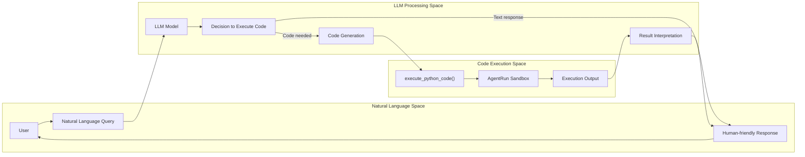
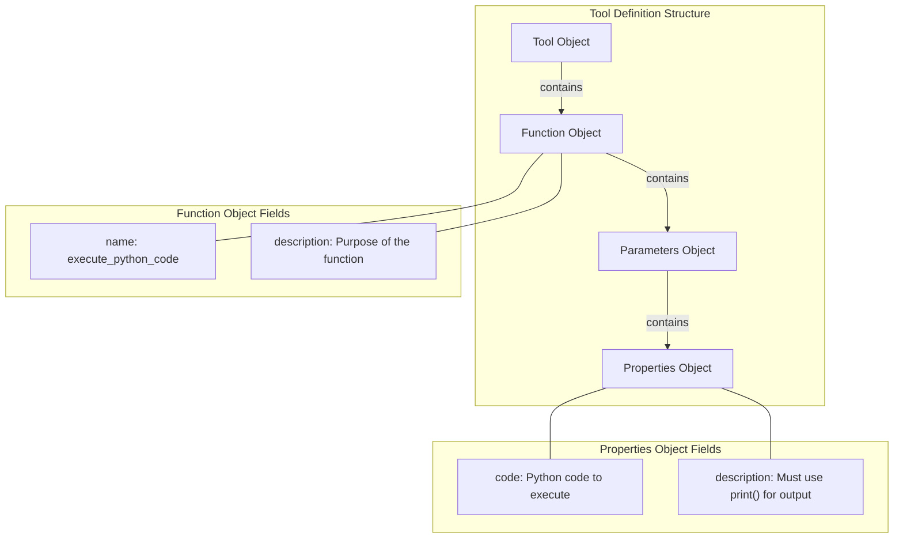
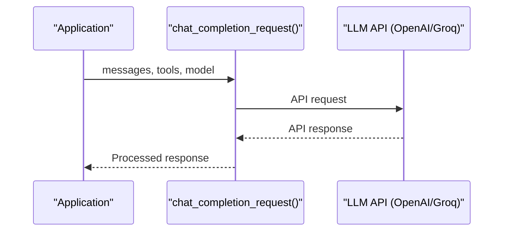
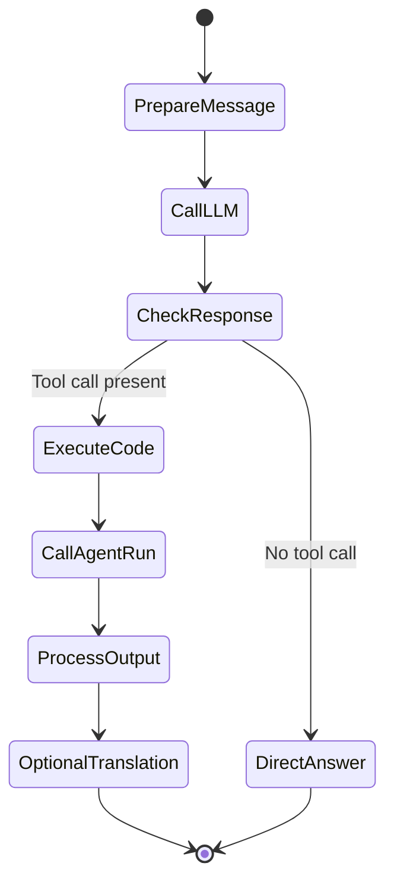
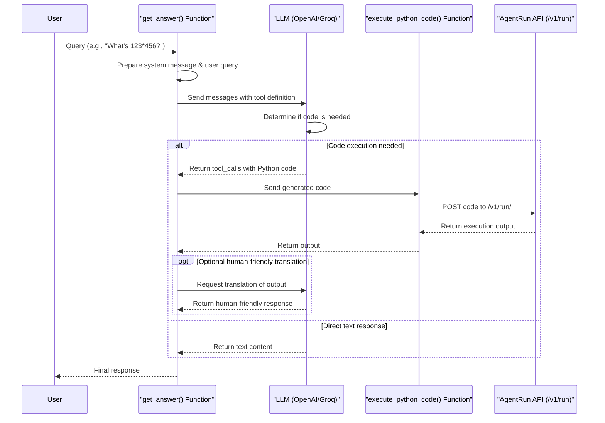

<!-- source: DeepWiki mcp.deepwiki.com · repo tjmlabs/AgentRun · page 5.1 Function Calling Pattern · fetched 2026-10-26 -->

# Function Calling Pattern

<details>
<summary>Relevant source files</summary>

The following files were used as context for generating this wiki page:

- [docs/examples/function_calling_groq.ipynb](docs/examples/function_calling_groq.ipynb)
- [docs/examples/function_calling_openai.py](docs/examples/function_calling_openai.py)

</details>


## Purpose and Scope

This document explains the Function Calling Pattern used to integrate AgentRun with Large Language Models (LLMs). This pattern allows LLMs to dynamically generate and execute Python code within a secure sandbox, extending their capabilities beyond text generation to include computation, data analysis, and interaction with external systems.

For specific implementations with particular LLM providers, see [OpenAI Integration](#5.2), [Groq Integration](#5.3), and [Ollama Integration](#5.4).

## Overview of the Function Calling Pattern

The Function Calling Pattern creates a bridge between natural language understanding and code execution by enabling LLMs to:

1. Determine when code execution is appropriate for answering a query
2. Generate valid Python code to solve the problem
3. Execute the code safely within AgentRun's sandbox
4. Interpret and communicate the results back to the user

This pattern leverages the function/tool calling capabilities available in modern LLMs to create a seamless experience where code execution happens automatically when necessary.



Sources: [docs/examples/function_calling_openai.py:57-89](), [docs/examples/function_calling_groq.ipynb:209-236]()

## Core Components

### 1. Code Execution Function

The central element is a function that sends code to AgentRun and returns the output:

```mermaid
classDiagram
    class "execute_python_code" {
        +execute(code: str): str
        -send_to_agentrun(code)
        -process_response(response)
    }
    
    class "AgentRun API" {
        +/v1/run/ endpoint
        -code execution
        -output formatting
    }
    
    "execute_python_code" --> "AgentRun API": HTTP POST request
    "AgentRun API" --> "execute_python_code": JSON response
```

Sources: [docs/examples/function_calling_openai.py:8-11](), [docs/examples/function_calling_groq.ipynb:109-115]()

### 2. Tool Definition for LLMs

A structured description that tells the LLM about the code execution function:



Sources: [docs/examples/function_calling_openai.py:21-39](), [docs/examples/function_calling_groq.ipynb:147-165]()

### 3. LLM Interface

A function to communicate with the LLM API:



Sources: [docs/examples/function_calling_openai.py:42-54](), [docs/examples/function_calling_groq.ipynb:181-193]()

### 4. Orchestration Function

A function that manages the entire workflow:



Sources: [docs/examples/function_calling_openai.py:57-89](), [docs/examples/function_calling_groq.ipynb:209-236]()

## Complete Function Calling Flow

The complete flow from user query to answer:



Sources: [docs/examples/function_calling_openai.py:57-89](), [docs/examples/function_calling_groq.ipynb:209-236]()

## Implementation Details

### Tool Definition Structure

The tool definition is a crucial part of the pattern. It follows this structure:

| Field | Description |
|-------|-------------|
| `type` | Set to "function" to indicate a function call |
| `function.name` | Name of the function (e.g., "execute_python_code") |
| `function.description` | Description explaining when and how to use the function |
| `function.parameters` | JSON schema for the function parameters |
| `function.parameters.properties.code` | Description of the code parameter |
| `function.parameters.required` | Array of required parameters (e.g., ["code"]) |

Sources: [docs/examples/function_calling_openai.py:21-39](), [docs/examples/function_calling_groq.ipynb:147-165]()

### System Message Design

The system message instructs the LLM on when to use code execution:

```
Don't make assumptions about what values to plug into functions. Ask for clarification if a user request is ambiguous.
 
Use the execute_python_code tool to run code if a question is better solved with code. You can use any package in the code snippet by simply importing. Like `import requests` would work fine.
```

This prompt is critical for guiding the LLM's decision-making process regarding when to generate code versus providing a direct answer.

Sources: [docs/examples/function_calling_openai.py:60-65](), [docs/examples/function_calling_groq.ipynb:212-217]()

### Handling LLM Responses

The pattern includes specific logic to determine if the LLM chose to execute code:

1. Check if `message.tool_calls` is present in the response
2. If present, extract the code from `tool_call.function.arguments`
3. Execute the code using the `execute_python_code` function
4. Optionally, send the code output back to the LLM for a human-friendly interpretation

Sources: [docs/examples/function_calling_openai.py:71-87](), [docs/examples/function_calling_groq.ipynb:224-235]()

## Usage Examples

### Mathematical Calculations
```python
get_answer("what's 12312 *321?")
# Returns: 'The answer is 3,952,152'
```

### Stock Market Data Analysis
```python
get_answer("what's the average daily move of Apple stock in the last 3 days?")
# Returns: "The average daily movement of Apple's stock over the last 3 days was $2.39."
```

### Simple Factual Queries
```python
get_answer("what's the capital of France?")
# Returns: 'The capital of France is Paris.'
```

Sources: [docs/examples/function_calling_openai.py:92-97](), [docs/examples/function_calling_groq.ipynb:281-282]()

## Best Practices

1. **Clear Tool Description**: Provide a detailed description of when and how the LLM should use code execution.

2. **Print Statement Requirement**: In the tool description, specify that code must use `print()` to output results.

3. **Error Handling**: Implement robust error handling for both LLM API calls and code execution.

4. **Output Translation**: Consider translating code outputs back to natural language for a better user experience.

5. **Avoid Recursion**: Be careful with recursive calls to prevent infinite loops, especially with the optional translation step.

Sources: [docs/examples/function_calling_openai.py:57-89](), [docs/examples/function_calling_groq.ipynb:209-236]()

## Related Pages

- For details on setting up AgentRun, see [Installation and Setup](#2)
- For information about the underlying AgentRun class, see [AgentRun Class](#3.1)
- For specific LLM integrations, see [OpenAI Integration](#5.2), [Groq Integration](#5.3), and [Ollama Integration](#5.4)

---

