# Page: Overview

# Overview

<details>
<summary>Relevant source files</summary>

The following files were used as context for generating this wiki page:

- [README.md](README.md)
- [docs/index.md](docs/index.md)

</details>


AgentRun is a Python library designed to safely execute code generated by Large Language Models (LLMs). It provides a secure sandboxed environment using Docker containers with configurable resource limits, automatic dependency management, and safety checks. This page provides a high-level overview of the system's purpose, architecture, and key components.

For detailed installation instructions, see [Installation and Setup](#2). For integration with specific LLM providers, see [Integration with LLMs](#5).

## Purpose and Core Functionality

AgentRun solves a critical challenge in AI agent development: allowing LLMs to execute Python code safely. While code execution significantly enhances LLM capabilities (e.g., performing calculations, data analysis, or API calls), it introduces security risks that AgentRun mitigates through multiple layers of protection:

- Code safety analysis before execution
- Isolated Docker container environment
- Configurable resource limitations (CPU, memory, execution time)
- Controlled dependency management
- Automatic cleanup of execution artifacts

The system is designed to be simple to use while maintaining robust security controls, offering both a Python package for integration into applications and a standalone REST API service.

Sources: [README.md:12-14](), [README.md:34-36]()

## Deployment Options

AgentRun can be deployed in two primary ways:

```mermaid
graph TD
    subgraph "Python Package Deployment"
        PyApp["Python Application"] -->|"import agentrun"| AgentRunPkg["AgentRun Class"]
        AgentRunPkg -->|"execute_code_in_container()"| UserDocker["User-managed Docker"]
        UserDocker -->|"Executes in isolation"| Code1["LLM-generated Code"]
    end
    
    subgraph "REST API Deployment"
        Client["Client Application"] -->|"HTTP POST /v1/run/"| ApiEndpoint["FastAPI Endpoint"]
        ApiEndpoint -->|"Processes"| AgentRunAPI["AgentRun Instance"]
        AgentRunAPI -->|"Uses"| DockerCompose["Pre-configured Docker"]
        DockerCompose -->|"Executes in isolation"| Code2["LLM-generated Code"]
    end
```

| Feature | Python Package | REST API |
|---------|----------------|----------|
| Docker setup | User configures | Pre-configured |
| Installation | `pip install agentrun` | Git clone + Docker Compose |
| Ease of use | Requires Docker knowledge | Minimal Docker knowledge needed |
| Customization | Full control | Limited to API parameters |

Sources: [README.md:50-53](), [README.md:55-58](), [README.md:111-120]()

## System Architecture

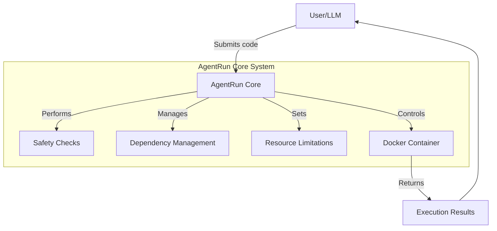

AgentRun employs a layered architecture with multiple security controls:

1. **Input Layer**: Receives code from users or LLMs
2. **Safety Layer**: Analyzes code for potentially harmful operations
3. **Execution Layer**: Manages Docker containers, dependencies, and resource limits
4. **Output Layer**: Returns execution results with transparent exception handling

Sources: [README.md:38-49]()

## Code Execution Flow

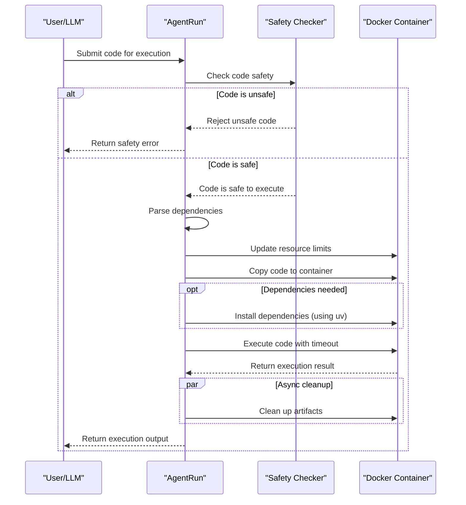

This diagram illustrates the complete execution flow from code submission to result delivery, including safety checks, dependency handling, execution, and cleanup processes.

Sources: [README.md:107-109](), [README.md:304-324]()

## Core Components

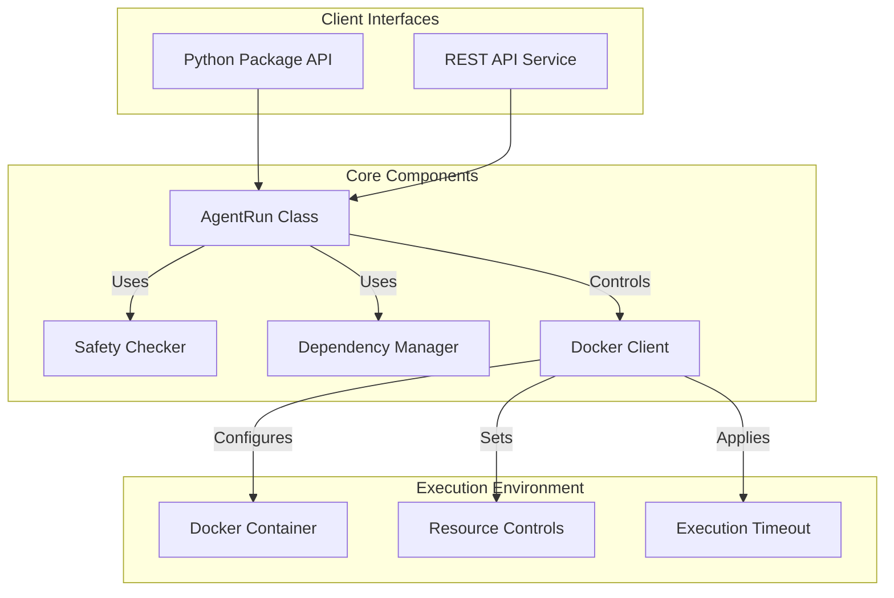

### Key Components Details

1. **AgentRun Class**: Central orchestrator that coordinates all aspects of code execution
2. **Safety Checker**: Analyzes code for potentially harmful patterns before execution
3. **Dependency Manager**: Handles package installation with optional whitelisting and caching
4. **Docker Client**: Interfaces with Docker to create/manage isolated execution environments
5. **Resource Controls**: Configures CPU, memory, and time limits for execution

Sources: [README.md:38-49](), [README.md:272-297]()

## Security Architecture

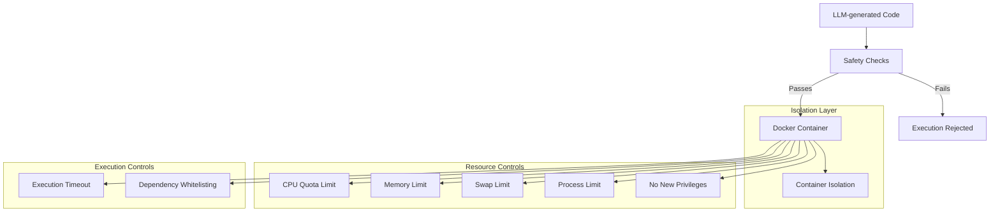

Security is enforced at multiple levels:

1. **Code Analysis**: Checks for unsafe patterns before execution
2. **Container Isolation**: Provides OS-level separation from host system
3. **Resource Limitations**: Prevents resource exhaustion attacks
   - CPU limits (default: 50% of one core)
   - Memory limits (default: 100MB RAM)
   - Swap limits (default: 512MB)
   - Execution timeout (default: 20 seconds)
4. **Dependency Controls**: Optional whitelisting of allowed packages

Sources: [README.md:271-316]()

## Performance Characteristics

AgentRun is optimized for performance while maintaining strong security. Benchmark metrics:

- Median execution time: <200ms without dependencies
- Median execution time: ~400ms with one average-sized dependency
- Dependency installation is typically the main performance bottleneck
- Optional dependency caching significantly improves performance for subsequent runs

For detailed performance optimization strategies, see [Performance Optimization](#4.2).

Sources: [README.md:326-330]()

## Integration with LLMs

AgentRun is designed to work with any LLM system capable of generating Python code. It provides a straightforward execution environment that can be integrated with function calling patterns for various LLM providers including OpenAI, Groq, Anthropic, and locally-hosted models like Ollama.

For specific integration guides, see:
- [Function Calling Pattern](#5.1)
- [OpenAI Integration](#5.2)
- [Groq Integration](#5.3)
- [Ollama Integration](#5.4)

Sources: [README.md:124-128](), [README.md:151-156]()

---

# Page: Key Concepts

# Key Concepts

<details>
<summary>Relevant source files</summary>

The following files were used as context for generating this wiki page:

- [README.md](README.md)
- [docs/index.md](docs/index.md)
- [tests/test_agentrun.py](tests/test_agentrun.py)

</details>


This document outlines the fundamental concepts and mechanisms that form the backbone of AgentRun, a system designed to safely execute Python code generated by Large Language Models (LLMs). It explains the core architecture, sandboxed execution environment, safety mechanisms, and resource management features that enable secure code execution.

For implementation details of the AgentRun class, see [AgentRun Class](#3.1). For configuration options, see [Configuration Options](#4).

## Sandboxed Execution

The cornerstone of AgentRun is its ability to execute code in a fully isolated environment, preventing any harmful operations from affecting the host system.

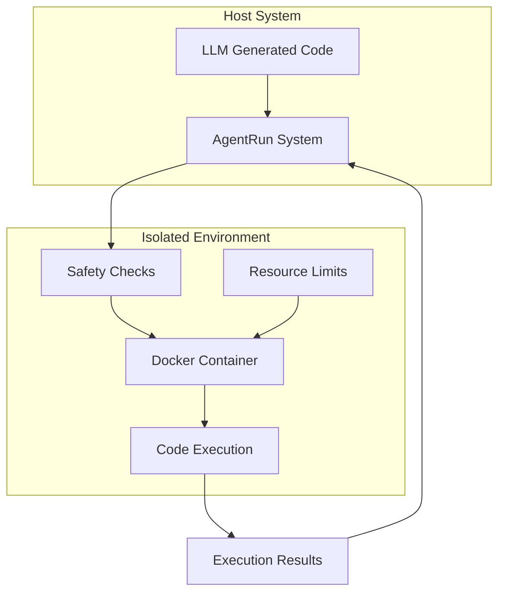

AgentRun uses Docker containers to create an isolated environment where:

- Code execution is contained and cannot affect the host system
- Resources (CPU, memory, processes) are strictly limited
- Filesystem access is restricted
- Network operations can be monitored or limited
- Privilege escalation is prevented with security options like `no-new-privileges`

Sources: [README.md:40-42](), [tests/test_agentrun.py:19-27]()

## Safety Checking Mechanisms

Before any code is executed, AgentRun performs comprehensive safety checks to identify potentially harmful operations.

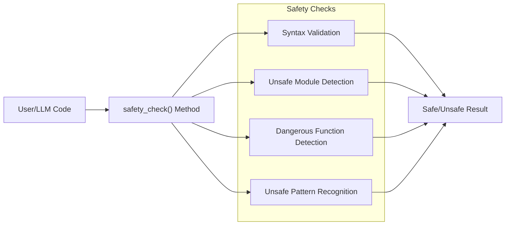

The safety checker detects:

- Syntax errors in the code
- Unsafe module imports (e.g., `os`, `subprocess`)
- Dangerous built-in functions (e.g., `eval`, `exec`, `globals`)
- Attempts to access private attributes (those starting with `_`)
- Unsafe function calls (e.g., `open`, `system`)

If any safety violations are detected, the code execution is rejected with a specific error message explaining the issue.

Sources: [tests/test_agentrun.py:36-105]()

## Resource Control

AgentRun employs multiple resource limitation mechanisms to prevent runaway processes or resource exhaustion.

| Resource Type | Default | Purpose |
|--------------|---------|---------|
| CPU Quota | 50000 (50% of one core) | Limits CPU usage per scheduling period |
| Memory Limit | 100MB | Restricts RAM usage |
| Swap Limit | 512MB | Controls combined memory and swap usage |
| PID Limit | 10 | Prevents fork bombs by limiting process creation |
| Execution Timeout | 20 seconds | Stops long-running scripts |

These resource controls ensure that even if malicious code passes safety checks, it cannot consume excessive resources or perform denial-of-service attacks.

Sources: [README.md:269-297](), [tests/test_agentrun.py:25-26]()

## Dependency Management

AgentRun provides a sophisticated dependency management system that:
1. Automatically parses required dependencies from code
2. Verifies dependencies against an optional whitelist
3. Installs allowed dependencies within the container
4. Provides caching to improve performance

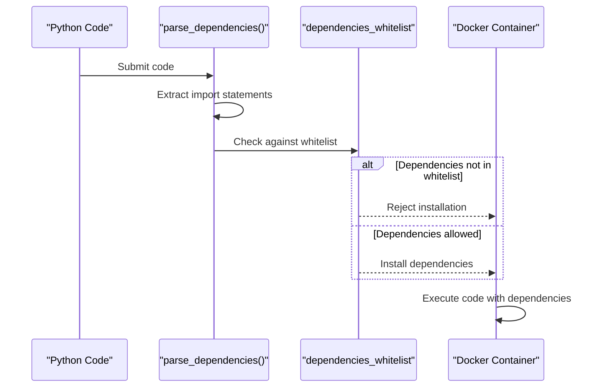

Key dependency management features:

- **Dependency Parsing**: Automatically identifies required packages from import statements
- **Whitelisting**: Optional restrictions on which packages can be installed
- **Dependency Caching**: Pre-installed dependencies for improved performance
- **Just-in-time Installation**: Only installs what's needed for the current execution

Sources: [README.md:44-46](), [tests/test_agentrun.py:140-157](), [tests/test_agentrun.py:160-204]()

## Execution Flow

The complete flow of code execution in AgentRun follows these steps:

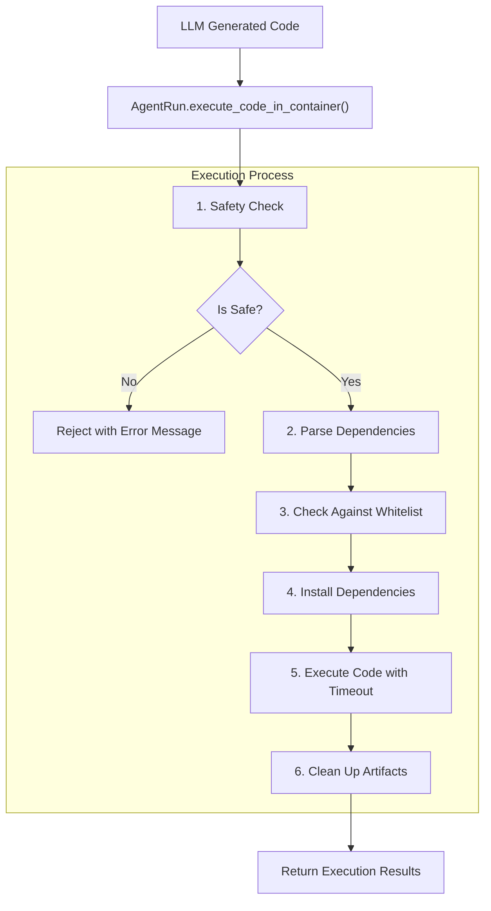

Key steps in the execution flow:

1. **Code Submission**: The LLM-generated code is submitted to AgentRun
2. **Safety Check**: The code is analyzed for potential security issues
3. **Dependency Management**: Required packages are parsed and installed if allowed
4. **Container Preparation**: Resource limits are applied to the container
5. **Code Execution**: The code runs with a specified timeout
6. **Result Handling**: Output is captured and returned, errors are handled transparently
7. **Cleanup**: Artifacts created during execution are removed

Sources: [README.md:98-109](), [tests/test_agentrun.py:207-222]()

## Deployment Models

AgentRun provides two primary deployment options:

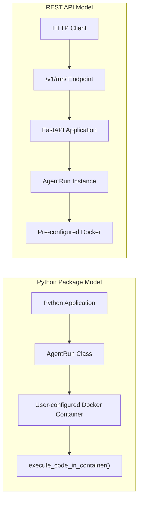

### Python Package
- Install with `pip install agentrun`
- Requires a running Docker container
- Fully customizable with configuration options
- Direct integration into Python applications

### REST API Service
- Clone the repository and use Docker Compose
- Pre-configured Docker setup
- Simple HTTP endpoint for code execution
- Minimal setup requirements

Sources: [README.md:55-120]()

## Integration with LLMs

AgentRun is designed to seamlessly integrate with any LLM that can generate Python code. Typical integration patterns include:

| Integration Method | Description |
|-------------------|-------------|
| Direct Code Execution | Send code directly from LLM to AgentRun |
| Function Calling | Use LLM function calling capabilities to invoke AgentRun |
| Tool Usage | Implement as a tool for LLM-based agents |

The function calling pattern is particularly effective, as it allows the LLM to decide when code execution is necessary to solve a problem.

Sources: [README.md:124-163]()

## Exception Handling

AgentRun provides transparent exception handling that:

- Returns Python exceptions with full tracebacks, just as they would appear in a normal Python environment
- Provides clear error messages for safety violations or dependency issues
- Times out long-running scripts with appropriate messages
- Handles Docker-related errors gracefully

This ensures that LLMs receive informative feedback about execution results, even when errors occur.

Sources: [README.md:48](), [tests/test_agentrun.py:306-316]()

---

# Page: Architecture Overview

# Architecture Overview

<details>
<summary>Relevant source files</summary>

The following files were used as context for generating this wiki page:

- [README.md](README.md)
- [agentrun-api/docker-compose.yml](agentrun-api/docker-compose.yml)
- [agentrun/__init__.py](agentrun/__init__.py)
- [pyproject.toml](pyproject.toml)

</details>


This document provides a high-level overview of the AgentRun architecture, explaining how its components interact to provide secure code execution for LLM-generated or user-provided Python code. For installation details, see [Installation and Setup](#2).

## System Overview

AgentRun is a system designed to safely execute Python code in isolated Docker containers. It features multiple layers of security, resource controls, and dependency management to prevent malicious code execution while providing flexibility for legitimate code to run.

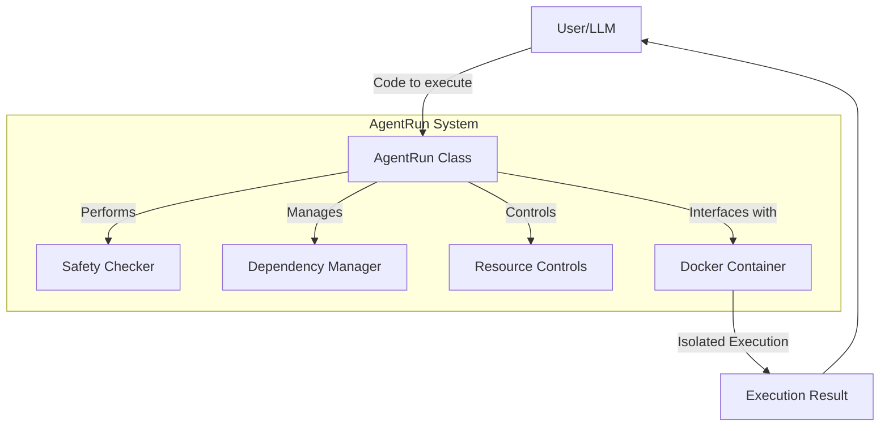

Sources: [agentrun/__init__.py:17-455](), [README.md:12-14]()

## Deployment Options

AgentRun offers two primary deployment options:

```mermaid
graph TD
    subgraph "Option 1: Python Package"
        PyApp["Python Application"] -->|"Import"| AgentRunPkg["AgentRun Package"]
        AgentRunPkg -->|"Uses"| UserDocker["User-configured Docker"]
        UserDocker -->|"Executes"| Code1["User/LLM Code"]
    end
    
    subgraph "Option 2: REST API Service"
        Client["Client Application"] -->|"HTTP POST"| ApiEndpoint["'/v1/run/' Endpoint"]
        ApiEndpoint -->|"Managed by"| FastAPI["FastAPI Application"]
        FastAPI -->|"Uses"| AgentRunAPI["AgentRun Instance"]
        AgentRunAPI -->|"Uses"| DockerCompose["Pre-configured Docker"]
        DockerCompose -->|"Executes"| Code2["User/LLM Code"]
    end
```

Sources: [README.md:55-121](), [agentrun-api/docker-compose.yml:1-28]()

### Python Package

With this option, users install AgentRun via pip and manage their own Docker setup:

```python
from agentrun import AgentRun

runner = AgentRun(container_name="my_container")  # container must be running
result = runner.execute_code_in_container("print('Hello, world!')")
```

### REST API Service

This ready-to-use deployment option comes with pre-configured Docker setup and exposes an HTTP endpoint that accepts code for execution:

```bash
curl -X POST http://localhost:8000/v1/run/ \
  -H "Content-Type: application/json" \
  -d '{"code": "print(\"hello, world!\")"}'
```

## Core Components

### AgentRun Class

The `AgentRun` class is the primary orchestrator for the system. It handles:

- Validating code safety
- Managing Docker container resources
- Installing and uninstalling dependencies
- Executing code with timeout constraints
- Cleaning up after execution

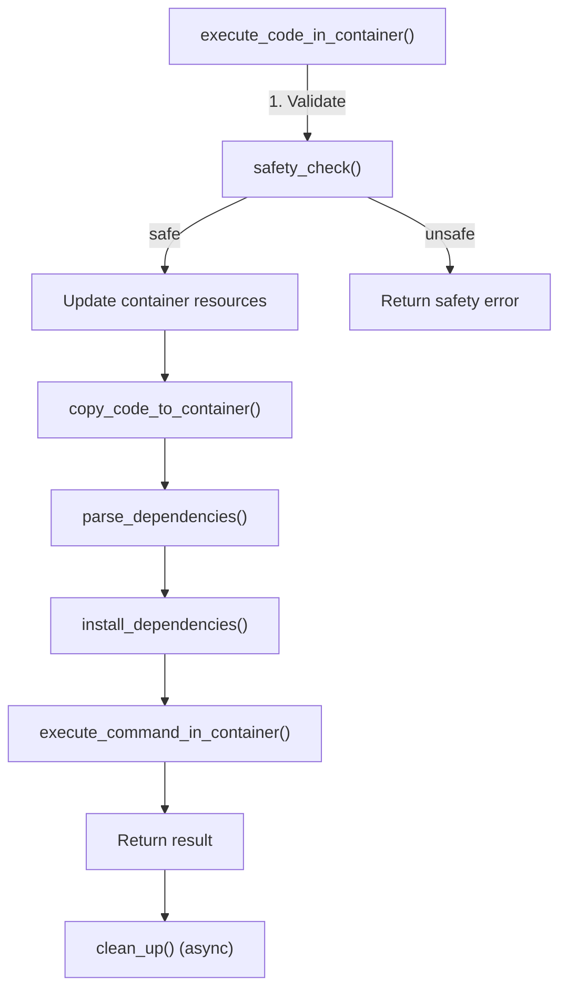

Sources: [agentrun/__init__.py:17-455](), [agentrun/__init__.py:385-454]()

### Safety Mechanism

The safety checker performs multi-level analysis of Python code:

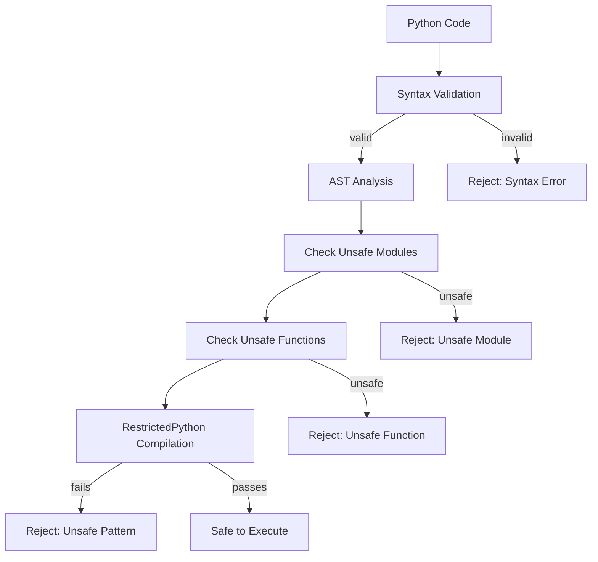

The safety checker blocks dangerous operations including:
- System module imports (`os`, `sys`, `subprocess`)
- Dangerous built-ins (`exec`, `eval`, `compile`)
- File operations (`open`)
- Environment inspection (`globals`, `locals`)

Sources: [agentrun/__init__.py:159-252]()

### Dependency Management

AgentRun handles Python dependencies through:

1. **Dependency Parsing**: Analyzes code to identify import statements
2. **Whitelisting**: Validates dependencies against configurable whitelist
3. **Installation**: Uses `uv` package manager for fast installation
4. **Caching**: Optional caching of frequently used dependencies
5. **Cleanup**: Automatic uninstallation of non-cached dependencies

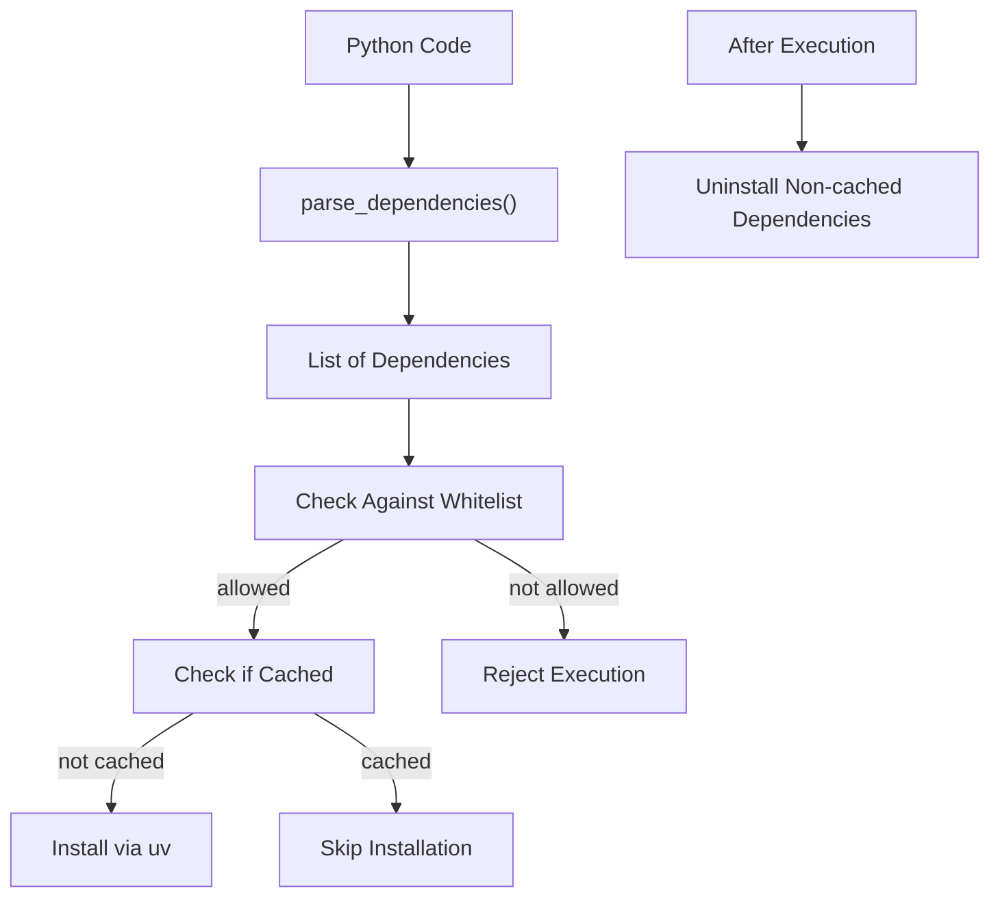

Sources: [agentrun/__init__.py:254-341]()

## Execution Flow

This sequence diagram shows the complete execution flow through the system:

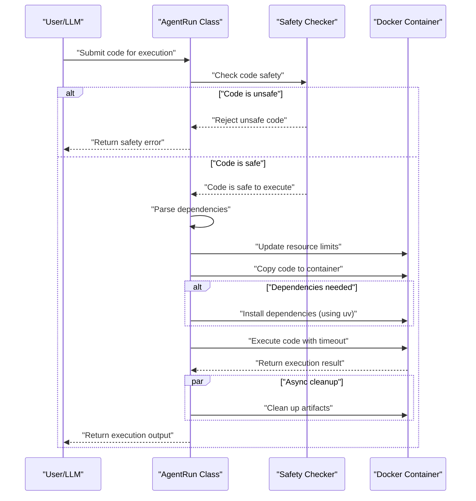

Sources: [agentrun/__init__.py:385-454]()

## Security Architecture

Security is implemented through multiple layers:

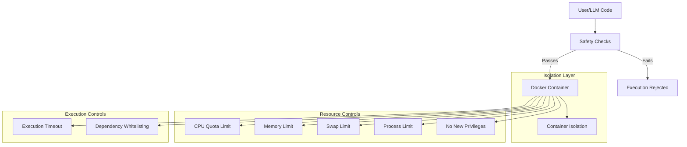

Sources: [agentrun/__init__.py:159-252](), [agentrun-api/docker-compose.yml:22-24](), [agentrun/__init__.py:40-46]()

### Container Security Settings

The Docker container for code execution is configured with strict security settings:

- `pids_limit: 10`: Limits number of processes to prevent fork bombs
- `no-new-privileges:true`: Prevents privilege escalation
- Resource limits for CPU, memory, and swap

Sources: [agentrun-api/docker-compose.yml:22-24]()

## Configuration Options

AgentRun provides several configuration parameters:

| Parameter | Description | Default | File Path |
|-----------|-------------|---------|-----------|
| `container_name` | Name of Docker container | (Required) | [agentrun/__init__.py:38]() |
| `dependencies_whitelist` | Allowed dependencies | `["*"]` | [agentrun/__init__.py:40]() |
| `cached_dependencies` | Dependencies to cache | `[]` | [agentrun/__init__.py:41]() |
| `cpu_quota` | CPU quota (microseconds) | 50000 | [agentrun/__init__.py:42]() |
| `default_timeout` | Execution timeout (seconds) | 20 | [agentrun/__init__.py:43]() |
| `memory_limit` | Memory limit | "100m" | [agentrun/__init__.py:44]() |
| `memswap_limit` | Memory + swap limit | "512m" | [agentrun/__init__.py:45]() |

Sources: [agentrun/__init__.py:37-46](), [README.md:271-302]()

## Performance Considerations

AgentRun is optimized for efficiency with typical performance metrics:
- ~200ms execution time without dependencies
- ~400ms with typical dependencies like `requests`

The main performance bottleneck is dependency installation, which can be mitigated by using the cached dependencies feature.

Sources: [README.md:328-336]()

## Integration Points

AgentRun can be integrated with any LLM capable of generating Python code:

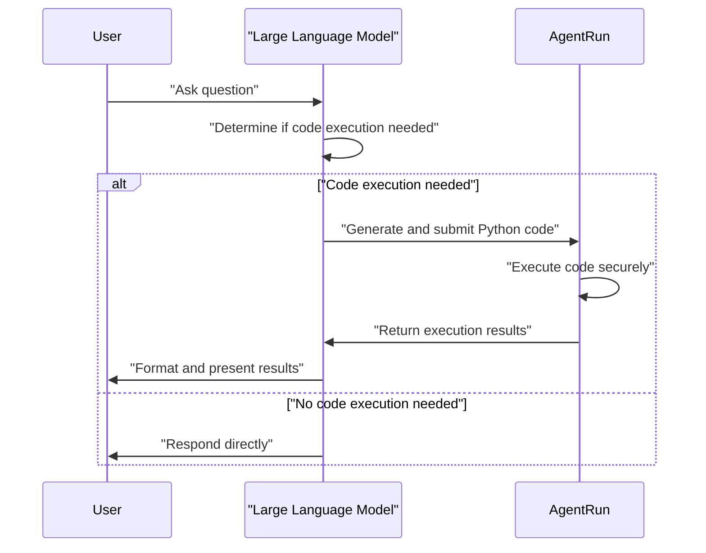

For more detailed information about LLM integration patterns, see [Integration with LLMs](#5).

Sources: [README.md:124-267]()

---

# Page: Installation and Setup

# Installation and Setup

<details>
<summary>Relevant source files</summary>

The following files were used as context for generating this wiki page:

- [README.md](README.md)
- [agentrun-api/docker-compose.yml](agentrun-api/docker-compose.yml)
- [docs/index.md](docs/index.md)
- [pyproject.toml](pyproject.toml)

</details>


This page provides comprehensive instructions for installing and configuring AgentRun, a system designed to safely execute Python code generated by LLMs (Large Language Models). AgentRun offers two distinct installation methods to accommodate different user needs and technical skill levels.

For information about specific configuration options after installation, see [Configuration Options](#4).

## Prerequisites

Before installing AgentRun, ensure you have:

- Python 3.10 or higher
- Docker installed and running on your system
- Basic familiarity with Docker concepts (for Python package option)

Sources: [pyproject.toml:6-7](), [README.md:6-7]()

## Installation Options Overview

AgentRun offers two deployment approaches with different characteristics:

```mermaid
graph TD
    subgraph "Option 1: Python Package"
        PyApp["Python Application"] -->|"import agentrun"| AgentRunPkg["AgentRun Class"]
        AgentRunPkg -->|"execute_code_in_container()"| UserDocker["User Docker Container"]
        UserDocker -->|"Executes"| Code1["LLM/User Code"]
    end
    
    subgraph "Option 2: REST API Service"
        Client["Client Application"] -->|"POST /v1/run/"| ApiEndpoint["FastAPI Endpoint"]
        ApiEndpoint -->|"Uses"| AgentRunAPI["AgentRun Instance"]
        AgentRunAPI -->|"Uses"| PythonRunner["python_runner Container"]
        PythonRunner -->|"Executes"| Code2["LLM/User Code"]
    end
```

Sources: [README.md:57-58](), [README.md:51-52]()

| Feature | Python Package | REST API Service |
|---------|---------------|------------------|
| Docker setup | You configure and manage | Pre-configured with docker-compose |
| Installation | `pip install agentrun` | Git clone & docker-compose |
| Requirements | Running Docker container | Docker and Docker Compose |
| Customization | Full control over all settings | Configured via environment variables |
| Integration | Direct integration in Python code | HTTP API accessible from any language |
| Recommended for | Advanced users comfortable with Docker | Beginners or those wanting a quick setup |

Sources: [README.md:114-120]()

## Python Package Installation

Follow these steps to install AgentRun as a Python package:

1. Ensure Python 3.10+ and Docker are installed
2. Install the package via pip:

```bash
pip install agentrun
```

3. Set up a Docker container for code execution (you must manage this yourself)

### Basic Python Package Usage

```python
from agentrun import AgentRun

# Initialize with your container
runner = AgentRun(container_name="your_container_name")

# Execute LLM-generated code
code = "print('Hello, world!')"
result = runner.execute_code_in_container(code)
print(result)  # Outputs: Hello, world!
```

Sources: [README.md:90-110]()

### Python Package Configuration

When initializing the `AgentRun` class, you can customize various parameters:

```python
from agentrun import AgentRun

runner = AgentRun(
    container_name="my_container",
    dependencies_whitelist=["requests", "pandas"],  # Only allow these packages
    cached_dependencies=["requests"],  # Pre-install for faster execution
    default_timeout=60,  # Timeout in seconds (default: 20s)
    memory_limit="512mb",  # Memory limit (default: 100mb)
    memswap_limit="1gb",  # Memory+swap limit (default: 512mb)
    cpu_quota=50000  # CPU quota (default: 50000, 50% of a core)
)
```

Sources: [README.md:302-322]()

## REST API Installation and Setup

The REST API approach provides a pre-configured Docker Compose setup that's easier to get started with:

1. Clone the AgentRun repository:

```bash
git clone https://github.com/jonathan-adly/agentrun
cd agentrun/agentrun-api
```

2. Create an environment file:

```bash
cp .env.example .env.dev
```

3. Start the Docker Compose setup:

```bash
docker-compose up -d --build
```

This will start two containers:
- `api`: The FastAPI service that receives code execution requests
- `python_runner`: A container that executes the Python code in isolation

Sources: [README.md:60-68](), [agentrun-api/docker-compose.yml:1-27]()

### REST API Architecture

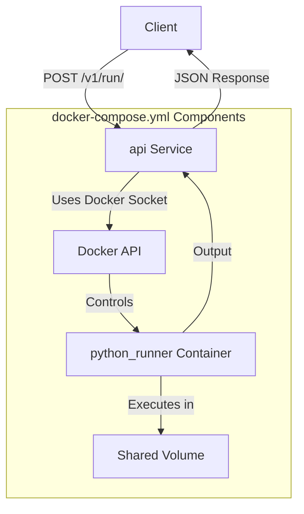

Sources: [agentrun-api/docker-compose.yml:1-27]()

### REST API Usage Examples

**Using cURL:**
```bash
curl -X POST http://localhost:8000/v1/run/ \
  -H "Content-Type: application/json" \
  -d '{"code": "print(\"Hello, world!\")"}'
```

**Using JavaScript fetch:**
```javascript
fetch('http://localhost:8000/v1/run/', {
    method: 'POST',
    headers: {
        'Content-Type': 'application/json'
    },
    body: JSON.stringify({
        code: "print('hello, world!')"
    })
})
.then(response => response.json())
.then(data => console.log(data))
```

**Expected response format:**
```json
{
    "output": "Hello, world!"
}
```

Sources: [README.md:69-85]()

## Docker Configuration Details

The REST API's Docker Compose setup includes the following configuration:

```mermaid
graph TD
    subgraph "docker-compose.yml Configuration"
        API["api Service"] -->|"Volume Mount"| DockerSock["/var/run/docker.sock"]
        API -->|"Volume Mount"| SrcCode["./src:/code"]
        API -->|"Exposes"| Port["Port 8000"]
        
        Runner["python_runner Service"] -->|"Uses"| CodeVolume["code_execution_volume"]
        Runner -->|"Limits"| Resources["Resource Limitations"]
        Resources -->|"Sets"| PIDsLimit["pids_limit: 10"]
        Resources -->|"Sets"| SecurityOpt["no-new-privileges: true"]
        Runner -->|"Sets"| EnvVars["Environment Variables"]
        EnvVars -->|"Sets"| OpenBLAS["OPENBLAS_NUM_THREADS=1"]
    end
```

Sources: [agentrun-api/docker-compose.yml:1-27]()

The Docker Compose file configures:

1. An `api` service that runs FastAPI and communicates with the Docker daemon
2. A `python_runner` service with resource limits for secure code execution
3. A shared volume (`code_execution_volume`) for transferring code and execution results

## Security Features

AgentRun implements multiple security layers:

1. **Code safety checks**: Analyzes code for dangerous patterns before execution
2. **Docker isolation**: Executes code in a containerized environment
3. **Resource limitations**: Controls CPU, memory, and execution time
4. **Dependency whitelisting**: Optionally restricts which packages can be installed
5. **Process limits**: Prevents fork bombs with process count limits (REST API)

Sources: [README.md:39-49](), [agentrun-api/docker-compose.yml:22-24]()

## Resource Configuration

Both installation methods allow control over resource usage:

| Resource | Default Value | Description |
|----------|---------------|-------------|
| CPU Quota | 50,000 | Microseconds per 100ms scheduling period (50% of a CPU core) |
| Memory Limit | 100MB | Container RAM limit |
| Swap Limit | 512MB | Combined memory and swap space limit |
| Execution Timeout | 20s | Maximum code execution duration |
| Process Limit | 10 (REST API) | Maximum number of processes (prevents fork bombs) |

Sources: [README.md:279-297]()

## Dependency Management

AgentRun offers two strategies for managing dependencies:

1. **Dependencies Whitelist**: Restrict which packages can be installed
   - Default: All packages allowed
   - Recommended: Limit to trusted packages only

2. **Cached Dependencies**: Pre-install frequently used packages
   - Default: None (empty list)
   - Benefits: Faster execution for subsequent runs
   - Trade-off: Longer initial container startup time

Sources: [README.md:271-274]()

## Troubleshooting

Common issues and solutions:

1. **Docker not running**: Ensure Docker daemon is running with `docker info`
2. **Permission issues**: You may need to run as sudo or add your user to the Docker group
3. **Container not found**: For Python package, ensure your specified container exists and is running
4. **Dependencies not installing**: Check your whitelist configuration
5. **API not responding**: Check Docker Compose logs with `docker-compose logs api`

## Next Steps

After installation, you may want to explore:

- [Python Package Installation](#2.1) for more details on the Python package approach
- [REST API Setup](#2.2) for more details on the REST API approach
- [Core Components](#3) to understand the system architecture
- [Configuration Options](#4) for advanced configuration details
- [Integration with LLMs](#5) to connect AgentRun with language models

Sources: [README.md:16-18]()

---

# Page: Python Package Installation

# Python Package Installation

<details>
<summary>Relevant source files</summary>

The following files were used as context for generating this wiki page:

- [README.md](README.md)
- [agentrun-api/docker-compose.yml](agentrun-api/docker-compose.yml)
- [docs/index.md](docs/index.md)
- [pyproject.toml](pyproject.toml)

</details>


This document provides detailed instructions for installing and configuring AgentRun as a Python package. For information about setting up the standalone REST API service, see [REST API Setup](#2.2).

## Purpose and Requirements

AgentRun requires Python 3.10 or higher and a running Docker installation. The Python package provides a programmatic interface to safely execute untrusted code within isolated Docker containers with configurable resource limits and dependency management.

Sources: [README.md:90-107](). [pyproject.toml:6]()

## Installation Process

```mermaid
flowchart TD
    A["Install Python Package"] --> B["Configure Docker"]
    B --> C["Initialize AgentRun"]
    C --> D["Execute Code"]
    
    A1["pip install agentrun"] --> A
    B1["Running Docker daemon"] --> B
    B2["Container accessibility"] --> B
    C1["Configure AgentRun instance"] --> C
    D1["Use execute_code_in_container()"] --> D
```

### Basic Installation

Install AgentRun using pip:

```bash
pip install agentrun
```

This command installs the package with its two required dependencies:
- Docker SDK for Python: Communicates with Docker to create/manage containers
- RestrictedPython: Performs code safety checks

Sources: [README.md:92-94](). [pyproject.toml:12-14]()

### Prerequisites Verification

Before using AgentRun, verify:

1. Python version meets requirements (3.10+)
2. Docker is installed and running
3. Your user has permissions to interact with Docker
4. A Docker container is available for AgentRun to use

You can verify your Python version and Docker installation with:

```bash
python --version  # Should show 3.10.x or higher
docker info       # Should display Docker system information
```

Sources: [pyproject.toml:6](). [README.md:50-52]()

## Basic Configuration

```mermaid
flowchart TD
    subgraph "AgentRun Package Architecture"
        User["Python Application"] -->|"Initializes"| AgentRunClass["AgentRun Class"]
        AgentRunClass -->|"Uses"| DockerSDK["Docker SDK"]
        AgentRunClass -->|"Uses"| Safety["RestrictedPython"]
        DockerSDK -->|"Communicates with"| Container["Docker Container"]
        Safety -->|"Checks"| Code["User/LLM Code"]
        Code -->|"Safe code sent to"| Container
        Container -->|"Executes"| Code
        Container -->|"Returns output"| AgentRunClass
        AgentRunClass -->|"Returns result"| User
    end
```

### Initializing AgentRun

After installation, initialize the AgentRun class by providing a running Docker container name:

```python
from agentrun import AgentRun

# Initialize with a running container
runner = AgentRun(container_name="my_container")
```

The Docker container must be running before AgentRun is initialized. AgentRun communicates with this container to execute code in an isolated environment.

Sources: [README.md:101-104]()

## Configuration Options

When initializing AgentRun, you can customize several parameters:

| Parameter | Default | Description |
|-----------|---------|-------------|
| `container_name` | Required | Name of the Docker container to use |
| `dependencies_whitelist` | `[]` (allow all) | List of packages allowed to be installed |
| `cached_dependencies` | `[]` | Dependencies to pre-install for faster execution |
| `cpu_quota` | `50000` | CPU time limit (50% of one core) |
| `memory_limit` | `"100mb"` | RAM usage limit |
| `memswap_limit` | `"512mb"` | Total memory + swap limit |
| `default_timeout` | `20` | Execution timeout in seconds |

```mermaid
flowchart TD
    subgraph "AgentRun Configuration Parameters"
        AgentRunInit["AgentRun Initialization"]
        
        subgraph "Basic Configuration"
            ContainerName["container_name"]
        end
        
        subgraph "Dependency Management"
            DepsWhitelist["dependencies_whitelist"]
            CachedDeps["cached_dependencies"]
        end
        
        subgraph "Resource Limitations"
            CPUQuota["cpu_quota"]
            MemLimit["memory_limit"]
            MemSwap["memswap_limit"]
            Timeout["default_timeout"]
        end
        
        AgentRunInit --> ContainerName
        AgentRunInit --> DepsWhitelist
        AgentRunInit --> CachedDeps
        AgentRunInit --> CPUQuota
        AgentRunInit --> MemLimit
        AgentRunInit --> MemSwap
        AgentRunInit --> Timeout
    end
```

### Example with Custom Configuration

```python
runner = AgentRun(
    container_name="my_container",
    dependencies_whitelist=["requests", "pandas"],  # Only allow these packages
    cached_dependencies=["requests"],  # Pre-install requests
    default_timeout=60,  # Allow 60 seconds for execution
    memory_limit="512mb",  # Allow 512MB of RAM
    memswap_limit="1gb"  # Allow 1GB total memory+swap
)
```

Sources: [README.md:302-321](). [docs/index.md:268-322]()

## Dependency Management

AgentRun provides two methods to manage Python package dependencies:

### Dependencies Whitelist

The `dependencies_whitelist` parameter restricts which packages can be installed by the executed code:

- Empty list (`[]`): Allow any package to be installed (default)
- List of packages: Only the specified packages can be installed
- No dependencies allowed: Set to `None`

Example:
```python
# Only allow requests and pandas to be installed
runner = AgentRun(
    container_name="my_container",
    dependencies_whitelist=["requests", "pandas"]
)
```

### Cached Dependencies

The `cached_dependencies` parameter allows pre-installing packages to improve performance:

- Empty list (`[]`): No cached dependencies (default)
- List of packages: Pre-install and cache these packages

Caching dependencies improves performance for code that repeatedly uses the same libraries, as the installation step can be skipped.

```python
# Pre-install and cache requests
runner = AgentRun(
    container_name="my_container",
    cached_dependencies=["requests"]
)
```

Note: Pre-installing dependencies increases the initial container startup time but reduces subsequent execution times.

Sources: [README.md:271-274](). [docs/index.md:271-274]()

## Resource Limitations

AgentRun provides several parameters to limit resource usage of executed code:

### CPU Limits

The `cpu_quota` parameter (default: 50000) limits CPU usage to 50% of one CPU core. This value represents microseconds of CPU time per 100 milliseconds period.

### Memory Limits

- `memory_limit` (default: "100mb"): Maximum RAM usage
- `memswap_limit` (default: "512mb"): Maximum combined RAM and swap usage

### Execution Timeout

The `default_timeout` parameter (default: 20 seconds) specifies the maximum time a script can run before being terminated.

Example:
```python
# Allow more resources for computation-heavy tasks
runner = AgentRun(
    container_name="my_container",
    cpu_quota=80000,  # 80% of one CPU core
    memory_limit="1gb",
    memswap_limit="2gb",
    default_timeout=120  # 2 minutes
)
```

Sources: [README.md:276-297](). [docs/index.md:276-297]()

## Basic Usage

Once you've initialized AgentRun, you can execute Python code using the `execute_code_in_container` method:

```python
# Simple example
code = "print('Hello, world!')"
result = runner.execute_code_in_container(code)
print(result)  # Outputs: Hello, world!

# Example with dependencies
code_with_dependencies = """
import requests
response = requests.get('https://api.github.com')
print(f'Status code: {response.status_code}')
"""
result = runner.execute_code_in_container(code_with_dependencies)
print(result)  # Outputs: Status code: 200 (or another status code)
```

The `execute_code_in_container` method:
1. Checks the code for safety using RestrictedPython
2. Identifies dependencies in the code
3. Installs required dependencies (if allowed)
4. Executes the code with the specified resource limits
5. Returns the execution result as a string

Sources: [README.md:96-109](). [docs/index.md:96-107]()

## Performance Considerations

AgentRun's execution performance varies depending on:

1. Whether dependencies need to be installed
2. The size and complexity of dependencies
3. Whether cached dependencies are used

According to benchmarks, median execution time is:
- <200ms without dependencies
- ~400ms with one average-sized dependency like `requests`

Dependency installation is typically the performance bottleneck. Using cached dependencies can significantly improve performance for frequently used packages.

Sources: [README.md:326-332](). [docs/index.md:326-329]()

## Next Steps

After successfully installing and configuring the AgentRun Python package:

- For detailed information about the AgentRun class and its methods, see [AgentRun Class](#3.1)
- To learn more about safety mechanisms, see [Safety Mechanisms](#3.2)
- For advanced dependency management, see [Dependency Management](#3.3)
- For integration with Large Language Models, see [Integration with LLMs](#5)

---

# Page: REST API Setup

# REST API Setup

<details>
<summary>Relevant source files</summary>

The following files were used as context for generating this wiki page:

- [README.md](README.md)
- [agentrun-api/docker-compose.yml](agentrun-api/docker-compose.yml)
- [agentrun-api/requirements.txt](agentrun-api/requirements.txt)
- [agentrun-api/src/api/main.py](agentrun-api/src/api/main.py)
- [pyproject.toml](pyproject.toml)

</details>


This guide provides instructions for setting up and using the AgentRun REST API with Docker Compose. The REST API offers a simpler way to use AgentRun's code execution capabilities through HTTP requests, without having to directly manage Docker containers or the Python AgentRun package. For details on using AgentRun as a Python package, see [Python Package Installation](#2.1).

## Overview

The AgentRun REST API is a standalone service that exposes AgentRun's code execution capabilities through HTTP endpoints. It uses Docker Compose to set up two containers:

1. A FastAPI-based API service that receives code execution requests
2. A Python runner container where the code is actually executed in isolation

This setup is recommended for users who want the simplest possible integration path or who aren't familiar with Docker configuration.

```mermaid
graph TB
    subgraph "REST API Architecture"
        Client["Client Application"] -->|"POST /v1/run/"| API["API Service"]
        API -->|"Container Interaction"| Python["Python Runner Container"]
        Python -->|"Code Execution Result"| API
        API -->|"JSON Response"| Client
    end
```

Sources: [README.md:59-121](), [agentrun-api/docker-compose.yml:1-28]()

## Prerequisites

Before setting up the AgentRun REST API, ensure you have:

1. Docker and Docker Compose installed on your system
2. Git installed to clone the repository
3. Basic understanding of API usage (for consuming the API)

## Installation Steps

Follow these steps to set up the AgentRun REST API:

1. Clone the AgentRun repository
2. Configure environment variables
3. Build and start the Docker containers

### 1. Clone the Repository

```bash
git clone https://github.com/tjmlabs/AgentRun
cd AgentRun/agentrun-api
```

### 2. Configure Environment Variables

Copy the example environment file:

```bash
cp .env.example .env.dev
```

You can edit `.env.dev` if you need to customize any environment variables.

### 3. Build and Start Docker Containers

```bash
docker-compose up -d --build
```

This command builds the necessary Docker images and starts the containers in detached mode. When completed, the API will be available at `http://localhost:8000`.

```mermaid
sequenceDiagram
    participant User as "User"
    participant Shell as "Shell/Terminal"
    participant Docker as "Docker Compose"
    participant API as "API Container"
    participant Runner as "Python Runner Container"
    
    User->>Shell: "git clone https://github.com/tjmlabs/AgentRun"
    User->>Shell: "cd AgentRun/agentrun-api"
    User->>Shell: "cp .env.example .env.dev"
    User->>Shell: "docker-compose up -d --build"
    Shell->>Docker: Build and start containers
    Docker->>API: Build and start API service
    Docker->>Runner: Build and start Python runner
    API->>User: API available at localhost:8000
```

Sources: [README.md:63-68](), [agentrun-api/docker-compose.yml:1-28]()

## API Endpoints

The AgentRun REST API provides the following endpoints:

| Endpoint | Method | Description |
|----------|--------|-------------|
| `/v1/run/` | POST | Executes Python code and returns the output |
| `/v1/health/` | GET | Returns API health status |
| `/` | GET | Redirects to API documentation |

### Code Execution Endpoint

The main endpoint for code execution is `/v1/run/`. Here's how to use it:

**Request format:**

```json
{
  "code": "print('hello, world!')"
}
```

**Response format:**

```json
{
  "output": "hello, world!"
}
```

Sources: [agentrun-api/src/api/main.py:45-56](), [README.md:72-91]()

## Using the API

You can interact with the API using any HTTP client. Here are examples using different methods:

### Using JavaScript Fetch

```javascript
fetch('http://localhost:8000/v1/run/', {
    method: 'POST',
    headers: {
        'Content-Type': 'application/json'
    },
    body: JSON.stringify({
        code: "print('hello, world!')"
    })
})
.then(response => response.json())
.then(data => console.log(data))
.catch(error => console.error('Error:', error));
```

### Using cURL

```bash
curl -X POST http://localhost:8000/v1/run/ -H "Content-Type: application/json" -d '{"code": "print(\"hello, world!\")"}'
```

### Using Python Requests

```python
import requests

def execute_python_code(code: str) -> str:
    response = requests.post("http://localhost:8000/v1/run/", json={"code": code})
    output = response.json()["output"]
    return output

# Example usage
result = execute_python_code("print('hello, world!')")
print(result)  # Output: hello, world!
```

Sources: [README.md:72-91](), [README.md:147-152]()

## Technical Architecture

The AgentRun REST API consists of two Docker containers working together to provide secure code execution:

```mermaid
graph TD
    subgraph "REST API Technical Architecture"
        Client["Client"] -->|"HTTP Request"| FastAPI["FastAPI Application\n(api service)"]
        
        subgraph "Docker Compose Setup"
            FastAPI -->|"Docker SDK"| DockerSocket["Docker Socket\n(/var/run/docker.sock)"]
            DockerSocket -->|"Execute Code"| PythonRunner["Python Runner Container\n(python_runner service)"]
            PythonRunner -->|"Run in Sandbox"| CodeExecution["Code Execution\nIn Isolated Environment"]
            CodeExecution -->|"Results"| PythonRunner
        end
        
        PythonRunner -->|"Output"| FastAPI
        FastAPI -->|"HTTP Response"| Client
    end
```

Sources: [agentrun-api/docker-compose.yml:1-28](), [agentrun-api/src/api/main.py:1-56]()

### API Service Container

The API service is a FastAPI application that:

1. Receives HTTP requests for code execution
2. Communicates with the Docker daemon through the Docker socket
3. Uses the AgentRun library to execute code in the Python runner container
4. Returns the execution results

Key technical details:

- Built on FastAPI framework
- Uses a ThreadPoolExecutor to run code execution asynchronously
- Has access to the Docker socket to control the Python runner container
- Runs on port 8000 by default

Sources: [agentrun-api/docker-compose.yml:2-13](), [agentrun-api/src/api/main.py:5-56]()

### Python Runner Container

The Python runner is a dedicated container where code execution actually takes place:

- Pre-installed with common dependencies (requests, yfinance)
- Security-hardened with process limits and privilege restrictions
- Uses a dedicated volume for code execution artifacts
- Runs continuously as a service

Key security features:

- Process limit (`pids_limit: 10`): Prevents fork bombs and excessive process creation
- Security opt (`no-new-privileges:true`): Prevents privilege escalation
- Isolated volume: Keeps code execution artifacts contained

Sources: [agentrun-api/docker-compose.yml:15-26]()

## Code Execution Flow

When you send a code execution request, here's what happens behind the scenes:

```mermaid
sequenceDiagram
    participant Client as "Client"
    participant FastAPI as "FastAPI (/v1/run)"
    participant AgentRun as "AgentRun Instance"
    participant Docker as "Docker API"
    participant Runner as "Python Runner Container"
    
    Client->>FastAPI: POST {code: "print('hello')"}
    FastAPI->>AgentRun: Initialize with container_name
    FastAPI->>AgentRun: execute_code_in_container(python_code)
    AgentRun->>Docker: Check container status
    AgentRun->>Docker: Setup code execution environment
    AgentRun->>Runner: Copy code to container
    
    alt Dependencies needed
        AgentRun->>Runner: Install dependencies
    end
    
    AgentRun->>Runner: Execute code with timeout
    Runner->>AgentRun: Return execution output
    AgentRun->>FastAPI: Return output
    FastAPI->>Client: Return JSON response
```

Sources: [agentrun-api/src/api/main.py:45-56]()

## Default Configuration

The REST API comes with these default configurations:

| Configuration | Value | Description |
|---------------|-------|-------------|
| Container Name | `agentrun-api-python_runner-1` | Name of the Python runner container |
| Cached Dependencies | `requests`, `yfinance` | Pre-installed dependencies |
| Default Timeout | 300 seconds (5 minutes) | Maximum execution time |
| API Port | 8000 | Port the API listens on |

These settings provide a good balance between usability and security. The cached dependencies allow common operations without needing to install packages at runtime, which improves performance.

Sources: [agentrun-api/src/api/main.py:47-51](), [agentrun-api/docker-compose.yml:1-28]()

## Customizing the REST API

You can customize the API by:

1. **Modifying environment variables**: Edit `.env.dev` to change environment-specific settings
2. **Editing `docker-compose.yml`**: Adjust container configurations, resource limits, and volume mappings
3. **Modifying `main.py`**: Change cached dependencies, timeouts, or other AgentRun parameters

For example, to add more cached dependencies, you would modify the `cached_dependencies` list in [agentrun-api/src/api/main.py:49]().

## Comparison with Python Package

The REST API approach offers several advantages and differences compared to using AgentRun as a Python package:

| Aspect | REST API | Python Package |
|--------|----------|----------------|
| Installation | Git clone + Docker Compose | pip install |
| Docker setup | Pre-configured | Manual configuration |
| Integration | Any language via HTTP | Python only |
| Deployment | Standalone service | Embedded in application |
| Configuration | Limited through files | Full programmatic control |
| Isolation | Complete service separation | Library within application |

Sources: [README.md:114-121]()

## Troubleshooting

Common issues you might encounter:

1. **Docker socket permission denied**: Ensure your user has permissions to access the Docker socket
2. **Port already in use**: Change the port mapping in `docker-compose.yml` if port 8000 is already used
3. **Container name conflicts**: If you see conflicts with container names, you may need to adjust the container name in [agentrun-api/src/api/main.py:48]()

## Summary

The AgentRun REST API provides a simple way to execute Python code safely through HTTP requests. By using Docker Compose, it manages all the complexity of Docker container setup and configuration, allowing you to focus on using the API rather than managing infrastructure.

For more advanced usage and customization options, see [Configuration Options](#4) and [Performance Optimization](#4.2).

---

# Page: Core Components

# Core Components

<details>
<summary>Relevant source files</summary>

The following files were used as context for generating this wiki page:

- [agentrun/__init__.py](agentrun/__init__.py)
- [docs/index.md](docs/index.md)
- [tests/test_agentrun.py](tests/test_agentrun.py)

</details>


This page provides a comprehensive overview of the core components that make up the AgentRun system. These are the fundamental building blocks that enable safe code execution for LLMs in isolated Docker environments. For installation instructions, see [Installation and Setup](#2).

## System Overview

AgentRun consists of several integrated components that work together to provide secure code execution. The system is designed around the central `AgentRun` class which coordinates safety checks, dependency management, Docker container interactions, and code execution.

```mermaid
graph TD
    User["User/LLM"] -->|"Submits code"| AgentRunCore["AgentRun Class"]
    
    subgraph "Core Components"
        AgentRunCore -->|"Uses"| SafetyCheck["Safety Mechanism"]
        AgentRunCore -->|"Uses"| DependencyMgr["Dependency Manager"]
        AgentRunCore -->|"Uses"| DockerInteract["Docker Container Interface"]
        
        SafetyCheck -->|"Prevents"| UnsafeCode["Malicious Code Execution"]
        DependencyMgr -->|"Handles"| PackageManagement["Package Installation/Caching"]
        DockerInteract -->|"Manages"| ResourceLimits["Resource Limitations"]
        DockerInteract -->|"Provides"| Isolation["Execution Isolation"]
    end
    
    AgentRunCore -->|"Returns"| Output["Execution Results"]
    Output --> User
```

Sources: [agentrun/__init__.py:17-454]()

## AgentRun Class

The `AgentRun` class is the primary interface for interacting with the AgentRun system. It orchestrates the entire execution process, from safety checks to running code in Docker containers.

### Constructor Parameters

| Parameter | Default | Description |
|-----------|---------|-------------|
| `container_name` | (required) | Name of the Docker container to use |
| `dependencies_whitelist` | `["*"]` | List of allowed dependencies (or `["*"]` to allow all) |
| `cached_dependencies` | `[]` | Dependencies to install and cache in the container |
| `cpu_quota` | `50000` | CPU quota in microseconds (50% of a CPU core) |
| `default_timeout` | `20` | Default execution timeout in seconds |
| `memory_limit` | `"100m"` | Memory limit for container |
| `memswap_limit` | `"512m"` | Memory + swap limit |

### Key Methods

| Method | Purpose |
|--------|---------|
| `execute_code_in_container(python_code)` | Main method to execute Python code safely |
| `safety_check(python_code)` | Analyzes code for unsafe patterns |
| `parse_dependencies(python_code)` | Extracts required dependencies from code |
| `install_dependencies(container, dependencies)` | Installs packages in the container |
| `clean_up(container, script_name, dependencies)` | Removes artifacts after execution |

Sources: [agentrun/__init__.py:17-89](), [agentrun/__init__.py:385-454]()

## Code Execution Flow

This diagram illustrates the complete execution flow from code submission to result retrieval:

```mermaid
sequenceDiagram
    participant User as "User/LLM"
    participant AgentRun as "AgentRun.execute_code_in_container()"
    participant Safety as "safety_check()"
    participant Parser as "parse_dependencies()"
    participant Docker as "Docker Container"
    
    User->>AgentRun: Submit python_code
    
    AgentRun->>Safety: safety_check(python_code)
    
    alt Code is unsafe
        Safety-->>AgentRun: {safe: false, message: "Error details"}
        AgentRun-->>User: Return safety error message
    else Code is safe
        Safety-->>AgentRun: {safe: true, message: "The code is safe to execute."}
        
        AgentRun->>Docker: Update resource limits (CPU, memory)
        AgentRun->>Docker: copy_code_to_container(python_code)
        
        AgentRun->>Parser: parse_dependencies(python_code)
        Parser-->>AgentRun: List of dependencies
        
        AgentRun->>Docker: install_dependencies(dependencies)
        
        AgentRun->>Docker: Execute code with timeout
        Docker-->>AgentRun: Execution output or error
        
        par Asynchronous cleanup
            AgentRun->>Docker: clean_up(container, script_name, dependencies)
        end
        
        AgentRun-->>User: Return execution output
    end
```

Sources: [agentrun/__init__.py:385-454]()

## Safety Mechanism

The safety mechanism is a critical component that prevents execution of malicious or dangerous code. It uses a multi-layered approach to detect potentially harmful code patterns.

### Security Checks

1. **Syntax Validation**: Verifies code has valid Python syntax
2. **AST Analysis**: Inspects the Abstract Syntax Tree to detect:
   - Unsafe module imports (`os`, `sys`, `subprocess`, etc.)
   - Dangerous built-in functions (`eval`, `exec`, `globals`, etc.)
   - Unsafe function calls (`open`, `__import__`, etc.)
3. **RestrictedPython Compilation**: Uses RestrictedPython to detect more complex unsafe patterns

```mermaid
flowchart TD
    Code["Python Code Input"] --> SyntaxCheck["AST Parsing & Syntax Check"]
    
    SyntaxCheck -->|"Has syntax errors"| SyntaxError["Return Syntax Error"]
    SyntaxCheck -->|"Valid syntax"| ModuleCheck["Check for Unsafe Modules\n(os, sys, subprocess)"]
    
    ModuleCheck -->|"Uses unsafe modules"| ModuleError["Return Unsafe Module Error"]
    ModuleCheck -->|"No unsafe modules"| FunctionCheck["Check for Unsafe Functions\n(eval, exec, open)"]
    
    FunctionCheck -->|"Uses unsafe functions"| FunctionError["Return Unsafe Function Error"]
    FunctionCheck -->|"No unsafe functions"| BuiltinsCheck["Check for Dangerous Builtins\n(globals, locals, vars)"]
    
    BuiltinsCheck -->|"Uses dangerous builtins"| BuiltinsError["Return Dangerous Builtin Error"]
    BuiltinsCheck -->|"No dangerous builtins"| RestrictedCheck["RestrictedPython Compilation"]
    
    RestrictedCheck -->|"Fails compilation"| RPError["Return RestrictedPython Error"]
    RestrictedCheck -->|"Passes all checks"| Safe["Return {safe: true}"]
```

Sources: [agentrun/__init__.py:159-252](), [tests/test_agentrun.py:36-106]()

## Dependency Management

The dependency management system automatically detects, installs, and manages Python package dependencies required by the code being executed.

### Key Features

1. **Automatic Detection**: Parses the code to identify third-party imports
2. **Dependency Whitelisting**: Controls which packages can be installed
3. **Dependency Caching**: Pre-installs frequently used packages for better performance
4. **Automatic Cleanup**: Uninstalls non-cached dependencies after execution

```mermaid
flowchart TD
    Code["Python Code"] --> Parser["parse_dependencies()"]
    Parser -->|"Identifies imports"| Dependencies["Required Dependencies"]
    
    Dependencies --> WhitelistCheck["Check Against Whitelist"]
    WhitelistCheck -->|"Not in whitelist"| WhitelistError["Return Whitelist Error"]
    WhitelistCheck -->|"In whitelist"| CacheCheck["Check Against Cached Dependencies"]
    
    CacheCheck -->|"Already cached"| SkipInstall["Skip Installation"]
    CacheCheck -->|"Not cached"| InstallDep["Install with uv\n(fast Python package manager)"]
    
    InstallDep -->|"Install fails"| InstallError["Return Installation Error"]
    InstallDep -->|"Install succeeds"| CodeExec["Execute Code"]
    SkipInstall --> CodeExec
    
    CodeExec --> CleanupCheck["Check if Dependency Needs Cleanup"]
    CleanupCheck -->|"Is cached"| KeepDep["Keep Dependency Installed"]
    CleanupCheck -->|"Not cached"| UninstallDep["Uninstall Dependency"]
```

Sources: [agentrun/__init__.py:254-341]()

## Docker Container Interface

The Docker interface handles all interactions with the Docker container, providing isolation and resource control for code execution.

### Key Responsibilities

1. **Container Management**: Verifies container existence and status
2. **Resource Controls**: Applies CPU, memory, and other resource limits
3. **File Operations**: Transfers code and dependencies to the container
4. **Command Execution**: Runs commands with proper timeout handling
5. **Cleanup**: Removes temporary files and dependencies after execution

### Resource Limitations

| Resource | Default | Description |
|----------|---------|-------------|
| CPU quota | 50000 | Limits CPU usage to 50% of one core |
| Memory limit | 100MB | Restricts RAM usage |
| Swap limit | 512MB | Limits total memory including swap |
| Execution timeout | 20 seconds | Terminates long-running code |
| Process limit | 10 | Limits number of processes (set during container creation) |
| Privileges | No new privileges | Prevents privilege escalation |

```mermaid
graph TD
    AgentRun["AgentRun Class"] -->|"Initializes"| ContainerCheck["Check Container\nAvailability"]
    ContainerCheck -->|"Not found/not running"| Error["Raise ValueError"]
    ContainerCheck -->|"Available"| PrepContainer["Prepare Container\n(install uv)"]
    
    PrepContainer --> ResourceLimits["Apply Resource Limits\n(CPU, memory, timeout)"]
    
    AgentRun -->|"Executes"| CodeTransfer["Copy Code to Container\n(tarfile transfer)"]
    AgentRun -->|"Installs"| Dependencies["Install Dependencies\n(if needed)"]
    
    CodeTransfer --> CodeExec["Execute Code\n(with timeout)"]
    Dependencies --> CodeExec
    
    CodeExec -->|"Complete"| Results["Return Results"]
    CodeExec -->|"Start async"| Cleanup["Clean Up\n(remove files, uninstall packages)"]
```

Sources: [agentrun/__init__.py:128-158](), [agentrun/__init__.py:343-383]()

## Integration

The core components are tightly integrated to provide a seamless execution environment. This integration ensures code is safely executed with proper resource controls and dependency management.

| Component | Interacts With | Purpose |
|-----------|---------------|---------|
| AgentRun | Safety Mechanism | Prevent dangerous code execution |
| AgentRun | Dependency Manager | Handle package dependencies |
| AgentRun | Docker Interface | Execute code in isolation |
| Safety Mechanism | AST Parser | Analyze code structure for safety |
| Dependency Manager | Docker Interface | Install packages in container |
| Docker Interface | Container | Apply resource limits and execute code |

Sources: [agentrun/__init__.py:17-454](), [docs/index.md:35-46]()

## Summary

The core components of AgentRun work together to enable secure execution of untrusted code:

1. The **AgentRun** class provides the main interface and orchestration
2. The **Safety Mechanism** prevents execution of dangerous code
3. The **Dependency Management** system handles package requirements
4. The **Docker Container Interface** provides isolation and resource control

These components combine to create a secure, efficient system for executing LLM-generated code in a controlled environment. For more details on the AgentRun class specifically, see [AgentRun Class](#3.1).

---

# Page: AgentRun Class

# AgentRun Class

<details>
<summary>Relevant source files</summary>

The following files were used as context for generating this wiki page:

- [agentrun/__init__.py](agentrun/__init__.py)
- [docs/api.md](docs/api.md)
- [tests/test_agentrun.py](tests/test_agentrun.py)

</details>


This document provides comprehensive technical documentation for the `AgentRun` class, which serves as the core component of the AgentRun system for secure code execution in isolated Docker containers. The class handles all aspects of safely executing Python code provided by users or LLMs, including safety validation, dependency management, Docker container interaction, and resource control.

For a high-level overview of the entire system, see [Architecture Overview](#1.2).

## Class Purpose and Responsibility

The `AgentRun` class is the primary interface for executing Python code in a sandboxed Docker environment. It provides a controlled execution context with configurable resource limits and dependency management while maintaining strict security isolation.

```mermaid
graph TD
    subgraph "AgentRun Class Responsibilities"
        SR["Safety & Security"] --> ASC["Analyze Source Code"]
        SR --> DCI["Docker Container Isolation"]
        SR --> RL["Resource Limitations"]
        
        DM["Dependency Management"] --> DI["Dependency Installation"]
        DM --> DC["Dependency Caching"]
        DM --> DW["Dependency Whitelisting"]
        
        CE["Code Execution"] --> CPE["Copy & Prepare Environment"]
        CE --> EX["Execute Code"]
        CE --> TMO["Enforce Timeouts"]
        CE --> CU["Clean Up Resources"]
    end
```

Sources: [agentrun/__init__.py:17-37]()

## Class Initialization

The `AgentRun` class initializer accepts several configuration parameters that control its behavior.

### Parameters

| Parameter | Type | Default | Description |
|-----------|------|---------|-------------|
| `container_name` | str | (required) | Name of the Docker container to use |
| `dependencies_whitelist` | list[str] | `["*"]` | List of allowed package dependencies |
| `cached_dependencies` | list[str] | `[]` | Dependencies to pre-install and cache |
| `cpu_quota` | int | 50000 | CPU quota in microseconds |
| `default_timeout` | int | 20 | Execution timeout in seconds |
| `memory_limit` | str | "100m" | Container memory limit |
| `memswap_limit` | str | "512m" | Container memory+swap limit |
| `client` | docker.client.DockerClient | auto-created | Docker client instance |

During initialization, the class performs several validations:
1. Verifies Docker daemon is running
2. Confirms the specified container exists and is running
3. Validates cached dependencies against the whitelist
4. Installs the `uv` package manager in the container
5. Pre-installs any cached dependencies

Sources: [agentrun/__init__.py:37-89]()

## Class Architecture

```mermaid
classDiagram
    class AgentRun {
        +container_name: str
        +dependencies_whitelist: list
        +cached_dependencies: list
        +cpu_quota: int
        +default_timeout: int
        +memory_limit: str
        +memswap_limit: str
        +client: DockerClient
        +execute_code_in_container(python_code) str
        +safety_check(python_code) dict
        +parse_dependencies(python_code) list
        +install_dependencies(container, dependencies) str
        +uninstall_dependencies(container, dependencies) str
        +copy_code_to_container(container, python_code) dict
        +clean_up(container, script_name, dependencies) None
        +execute_command_in_container(container, cmd, timeout) tuple
        +is_everything_whitelisted() bool
        +validate_cached_dependencies() bool
        +install_cached_dependencies() None
    }
    
    class CommandTimeout {
        <<Exception>>
    }
    
    AgentRun --> CommandTimeout
```

Sources: [agentrun/__init__.py:17-94](), [docs/api.md:1-17]()

## Code Execution Flow

The primary method `execute_code_in_container` orchestrates the entire execution process with multiple stages to ensure security and proper resource management.

```mermaid
sequenceDiagram
    participant Client as "Client Code"
    participant AgentRun as "AgentRun"
    participant Safety as "Safety Checker"
    participant Docker as "Docker Container"
    participant Thread as "Cleanup Thread"
    
    Client->>AgentRun: execute_code_in_container(python_code)
    AgentRun->>Safety: safety_check(python_code)
    
    alt Code is unsafe
        Safety-->>AgentRun: {"safe": false, "message": "error details"}
        AgentRun-->>Client: Return safety error message
    else Code is safe
        Safety-->>AgentRun: {"safe": true, "message": "The code is safe to execute."}
        
        AgentRun->>Docker: Update resource limits (CPU, memory)
        AgentRun->>Docker: copy_code_to_container(container, python_code)
        AgentRun->>AgentRun: parse_dependencies(python_code)
        AgentRun->>Docker: install_dependencies(container, dependencies)
        
        alt Installation failed
            Docker-->>AgentRun: Installation error
            AgentRun-->>Client: Return dependency error
        else Installation succeeded
            Docker-->>AgentRun: "Dependencies installed successfully."
            
            AgentRun->>Docker: execute_command_in_container(container, "python script.py", timeout)
            
            alt Execution timed out
                AgentRun-->>Client: "Execution timed out."
            else Execution completed
                Docker-->>AgentRun: Execution result
                AgentRun->>Thread: clean_up(container, script_name, dependencies)
                AgentRun-->>Client: Return execution output
            end
        end
    end
```

Sources: [agentrun/__init__.py:385-454]()

## Key Methods

### Safety Validation

The `safety_check` method performs multiple security validations on provided code:

```mermaid
flowchart TD
    SC["safety_check()"]
    AST["AST Parse Code"]
    SE["Check Syntax Errors"]
    UM["Check Unsafe Module Imports"]
    UF["Check Unsafe Function Calls"]
    RP["RestrictedPython Compilation"]
    
    SC --> AST
    AST --> SE
    AST --> UM
    AST --> UF
    AST --> RP
    
    SE -->|"SyntaxError"| FR["Return False + Error"]
    UM -->|"os, sys, subprocess, etc."| FR
    UF -->|"eval, exec, open, etc."| FR
    RP -->|"Unsafe patterns"| FR
    
    SE -->|"No errors"| TR["Return True + Success"]
    UM -->|"All safe"| TR
    UF -->|"All safe"| TR
    RP -->|"All safe"| TR
```

The method detects:
- Syntax errors
- Imports of unsafe modules (`os`, `sys`, `subprocess`, etc.)
- Calls to unsafe functions (`eval`, `exec`, `open`, etc.)
- Uses of dangerous builtins (`globals`, `locals`, etc.)
- Additional patterns caught by RestrictedPython

Sources: [agentrun/__init__.py:159-252](), [tests/test_agentrun.py:36-107]()

### Dependency Management

The `AgentRun` class includes robust dependency management functionality:

1. `parse_dependencies`: Extracts required dependencies from code using AST parsing
2. `install_dependencies`: Installs dependencies with whitelist validation
3. `uninstall_dependencies`: Removes non-cached dependencies after execution
4. Dependency caching for improved performance

```mermaid
graph TD
    PD["parse_dependencies()"] -->|"Extract imports"| AST["AST Parse Code"]
    AST -->|"Filter stdlib"| DP["Dependency List"]
    
    DP --> ID["install_dependencies()"]
    ID -->|"Check whitelist"| WL["Whitelist Check"]
    
    WL -->|"Not whitelisted"| ER["Return Error"]
    WL -->|"Whitelisted"| CA["Check Already Installed"]
    
    CA -->|"Already cached"| SK["Skip Installation"]
    CA -->|"Not installed"| IN["Install with uv"]
    
    IN -->|"Installation failed"| IE["Return Error"]
    IN -->|"Installation succeeded"| SC["Success"]
    
    SC --> UD["uninstall_dependencies()"]
    UD -->|"Skip cached deps"| RM["Remove Non-cached"]
```

Sources: [agentrun/__init__.py:254-342](), [tests/test_agentrun.py:140-204]()

### Resource Management

The class manages Docker container resources through:

1. CPU quota limits (default: 50,000 microseconds)
2. Memory limits (default: 100MB) 
3. Swap limits (default: 512MB)
4. Execution timeouts (default: 20 seconds)

```mermaid
graph TD
    EC["execute_code_in_container()"]
    EC -->|"Before execution"| RL["Update resource limits"]
    RL --> CPU["Set CPU quota"]
    RL --> MEM["Set memory limit"]
    RL --> SWAP["Set swap limit"]
    
    EC -->|"During execution"| TO["Timeout monitoring"]
    TO -->|"Thread.join(timeout)"| TM["Thread monitoring"]
    
    TM -->|"Timeout exceeded"| TE["Raise CommandTimeout"]
    TM -->|"Completed in time"| CP["Continue processing"]
```

Sources: [agentrun/__init__.py:37-53](), [agentrun/__init__.py:128-157](), [agentrun/__init__.py:416-420]()

## Usage Example

The following example demonstrates basic usage of the `AgentRun` class:

```python
from agentrun import AgentRun

# Initialize with a running Docker container
runner = AgentRun(
    container_name="my_container",
    dependencies_whitelist=["numpy", "pandas", "matplotlib"],
    cached_dependencies=["numpy"],
    default_timeout=30
)

# Execute Python code
result = runner.execute_code_in_container("""
import numpy as np
import matplotlib.pyplot as plt

# Generate some data
x = np.linspace(0, 10, 100)
y = np.sin(x)

# Print result
print(f"Max value: {y.max()}")
""")

print(result)
```

Sources: [agentrun/__init__.py:17-25](), [tests/test_agentrun.py:132-154](), [tests/test_agentrun.py:217-222]()

## Error Handling

The `AgentRun` class implements comprehensive error handling for various failure scenarios:

| Error Type | Handling Method | Return Value |
|------------|----------------|--------------|
| Docker connection failures | Constructor raises `RuntimeError` | N/A |
| Container not found | Constructor raises `ValueError` | N/A |
| Container not running | Constructor raises `ValueError` | N/A |
| Dependency whitelist mismatch | Constructor raises `ValueError` | N/A |
| Unsafe code | Error message returned from `execute_code_in_container` | Error description string |
| Dependency installation failures | Error message returned from `execute_code_in_container` | Error description string |
| Execution timeout | Error message returned from `execute_code_in_container` | "Execution timed out." |
| Runtime errors in code | Error captured and returned from `execute_code_in_container` | Error description string |

Sources: [agentrun/__init__.py:63-78](), [agentrun/__init__.py:400-445](), [tests/test_agentrun.py:225-269]()

## Command Execution and Timeout Mechanism

The `execute_command_in_container` method leverages threading to implement robust timeout handling for command execution:

```mermaid
sequenceDiagram
    participant A as "AgentRun"
    participant T as "Thread"
    participant D as "Docker Container"
    
    A->>A: execute_command_in_container(container, cmd, timeout)
    A->>T: Create execution thread
    T->>D: container.exec_run(cmd)
    A->>T: thread.join(timeout)
    
    alt Thread completes in time
        D-->>T: Execution result
        T-->>A: Return exit_code, output
    else Thread exceeds timeout
        A->>T: thread.join(1) (final wait)
        A->>A: raise CommandTimeout
    end
```

Sources: [agentrun/__init__.py:128-157](), [agentrun/__init__.py:90-93]()

## Internal Cleanup Process

After code execution, the `clean_up` method performs asynchronous cleanup to maintain container health:

```mermaid
graph TD
    CU["clean_up()"]
    CU -->|"If script exists"| RM["Remove script from /tmp"]
    CU --> EXR["exec_run('rm /code/script')"]
    CU --> UD["uninstall_dependencies()"]
    
    UD -->|"For each dependency"| SK["Skip if cached"]
    SK --> UN["Uninstall non-cached dependencies"]
```

The cleanup process runs in a separate thread to avoid blocking the main execution flow:

```mermaid
graph TD
    EC["execute_code_in_container()"]
    EC -->|"After execution"| TH["Create cleanup Thread"]
    TH -->|"Asynchronous execution"| CU["clean_up()"]
    EC -->|"Return immediately"| RT["Return output"]
```

Sources: [agentrun/__init__.py:371-383](), [agentrun/__init__.py:446-452]()

## Thread Safety Considerations

The `AgentRun` class uses threading in two key areas:

1. For timeout enforcement in `execute_command_in_container`
2. For asynchronous cleanup in `execute_code_in_container`

The class is designed to be thread-safe for individual method calls, but concurrent calls to `execute_code_in_container` on the same instance may lead to race conditions since they would operate on the same Docker container. For concurrent execution, separate `AgentRun` instances with different containers should be used.

Sources: [agentrun/__init__.py:128-157](), [agentrun/__init__.py:446-452]()

---

# Page: Safety Mechanisms

# Safety Mechanisms

<details>
<summary>Relevant source files</summary>

The following files were used as context for generating this wiki page:

- [agentrun-api/docker-compose.yml](agentrun-api/docker-compose.yml)
- [agentrun/__init__.py](agentrun/__init__.py)
- [pyproject.toml](pyproject.toml)
- [tests/test_agentrun.py](tests/test_agentrun.py)

</details>


This document provides a comprehensive overview of the security mechanisms implemented in AgentRun to ensure the safe execution of user or LLM-generated Python code. AgentRun employs multiple layers of protection to mitigate security risks while allowing flexible code execution capabilities. For information about dependency management related to security, see [Dependency Management](#3.3).

## 1. Security Architecture Overview

AgentRun implements a defense-in-depth approach with multiple security layers that work together to provide comprehensive protection.

```mermaid
flowchart TD
    UserCode["User/LLM Code"] --> StaticAnalysis["Static Code Analysis"]
    StaticAnalysis --> RestrictedPython["RestrictedPython Compilation"]
    
    StaticAnalysis -->|Fails| Reject["Execution Rejected"]
    RestrictedPython -->|Fails| Reject
    
    RestrictedPython -->|Passes| DockerContainer["Docker Container Execution"]
    
    subgraph "Container Security"
        DockerContainer --> ResourceLimits["Resource Limitations"]
        DockerContainer --> IsolationControls["Isolation Controls"]
        DockerContainer --> ExecutionControls["Execution Controls"]
    end
    
    ResourceLimits --> CPULimit["CPU Quota"]
    ResourceLimits --> MemoryLimit["Memory Limit"]
    ResourceLimits --> SwapLimit["Swap Limit"]
    
    IsolationControls --> ProcessLimit["Process Limit (pids_limit)"]
    IsolationControls --> NoNewPrivs["No New Privileges Flag"]
    
    ExecutionControls --> Timeout["Execution Timeout"]
    ExecutionControls --> DependencyControl["Dependency Whitelisting"]
    ExecutionControls --> Cleanup["Asynchronous Cleanup"]
```

Sources: [agentrun/__init__.py:159-252](), [agentrun/__init__.py:385-454](), [agentrun-api/docker-compose.yml:22-24]()

## 2. Code Analysis Security

AgentRun implements a two-stage code analysis process to detect and block unsafe code before execution:

### 2.1 Static Code Analysis

The first layer of defense is a static code analyzer that examines Python code using the `ast` module to detect potentially dangerous patterns:

```mermaid
flowchart LR
    Code["Python Code"] --> ASTParse["AST Parser"]
    ASTParse --> Checks["Safety Checks"]
    
    Checks --> ImportCheck["Unsafe Module Check"]
    Checks --> FunctionCheck["Unsafe Function Check"]
    Checks --> BuiltinCheck["Dangerous Builtin Check"]
    
    ImportCheck --> Block["Block Execution"]
    FunctionCheck --> Block
    BuiltinCheck --> Block
    
    ImportCheck -->|Safe| Next["Next Security Layer"]
    FunctionCheck -->|Safe| Next
    BuiltinCheck -->|Safe| Next
```

The static analyzer specifically checks for:

1. **Unsafe Module Imports**: Blocks access to sensitive system modules
   - Blacklisted modules include: `os`, `sys`, `subprocess`, `builtins`

2. **Unsafe Function Calls**: Prevents calls to potentially dangerous functions
   - Blocks functions like: `exec`, `eval`, `compile`, `open`, `__import__`, etc.

3. **Dangerous Built-ins**: Blocks access to built-in functions that could escape the sandbox
   - Includes: `globals`, `locals`, `vars`, `dir`, `eval`, `exec`, etc.

Sources: [agentrun/__init__.py:159-252](), [tests/test_agentrun.py:36-114]()

### 2.2 RestrictedPython Compilation

If code passes the static analysis, it undergoes a second check using RestrictedPython:

```python
# Example from the implementation
compiled_code = compile_restricted(
    python_code, filename="<dynamic>", mode="exec"
)
```

RestrictedPython creates a restricted execution environment that:
- Prevents access to object attributes starting with underscore `_`
- Limits access to certain built-in functions
- Restricts access to object internals

This provides an additional layer of security beyond the static analysis.

Sources: [agentrun/__init__.py:239-250](), [pyproject.toml:13]()

## 3. Docker Container Isolation

AgentRun executes all code within a Docker container, providing strong isolation from the host system:

### 3.1 Resource Limitations

The Docker container is configured with strict resource limitations to prevent resource exhaustion attacks:

| Resource Type | Default Limit | Configuration Method |
|---------------|---------------|----------------------|
| CPU Quota | 50,000 microseconds | `container.update(cpu_quota=self.cpu_quota)` |
| Memory Limit | 100MB | `container.update(mem_limit=self.memory_limit)` |
| Memory Swap | 512MB | `container.update(memswap_limit=self.memswap_limit)` |
| Process Limit | 10 processes | `pids_limit: 10` in Docker configuration |

These limits prevent runaway processes from consuming excessive resources and protect against denial-of-service attacks.

Sources: [agentrun/__init__.py:415-420](), [agentrun-api/docker-compose.yml:22]()

### 3.2 Privilege Restrictions

The Docker container runs with the `no-new-privileges:true` flag, which prevents processes inside the container from gaining additional privileges through mechanisms like setuid or setgid binaries.

```yaml
security_opt:
  - no-new-privileges:true
```

This is a critical security feature that helps maintain the container's security boundary.

Sources: [agentrun-api/docker-compose.yml:23-24]()

## 4. Execution Controls

AgentRun implements several controls over code execution to provide additional security guarantees:

### 4.1 Execution Timeout

All code execution is subject to a timeout (default: 20 seconds) to prevent infinite loops and resource exhaustion:

```mermaid
sequenceDiagram
    participant "AgentRun" as AR
    participant "Thread" as T
    participant "Docker Container" as DC
    
    AR->>T: Start execution thread
    T->>DC: Execute code
    AR->>AR: Wait for timeout (default 20s)
    
    alt Thread completes before timeout
        DC-->>T: Return result
        T-->>AR: Return output
    else Thread exceeds timeout
        AR->>T: Interrupt execution
        AR-->>AR: Return "Execution timed out"
    end
```

The timeout mechanism uses a separate thread to run the command and joins it with a timeout value. If the thread doesn't complete within the timeout period, the execution is interrupted and a timeout message is returned.

Sources: [agentrun/__init__.py:128-157](), [agentrun/__init__.py:437-441]()

### 4.2 Dependency Management

AgentRun implements dependency whitelisting to control which external packages can be installed:

- Dependencies are parsed from import statements using AST analysis
- Only whitelisted dependencies are allowed to be installed
- A wildcard `*` can be used to allow all dependencies
- Cached dependencies can be pre-installed for frequently used packages

This prevents the installation of potentially malicious or unauthorized packages.

Sources: [agentrun/__init__.py:254-283](), [agentrun/__init__.py:285-322]()

### 4.3 Asynchronous Cleanup

AgentRun performs cleanup operations after code execution:

- Removes the temporary script file from the container
- Uninstalls dependencies that are not cached
- Runs cleanup in a separate thread to avoid blocking

This ensures that subsequent code executions start with a clean environment.

Sources: [agentrun/__init__.py:371-383](), [agentrun/__init__.py:448-452]()

## 5. Security Implementation Flow

The following diagram illustrates the entire security workflow from code submission to execution:

```mermaid
flowchart TD
    Submit["Submit Code for Execution"] --> Safety["safety_check()"]
    
    Safety -->|Fails| ReturnError["Return Safety Error"]
    Safety -->|Passes| Copy["copy_code_to_container()"]
    
    Copy --> ParseDeps["parse_dependencies()"]
    ParseDeps --> CheckWhitelist["Check Dependencies Whitelist"]
    
    CheckWhitelist -->|Not Allowed| ReturnDepError["Return Dependency Error"]
    CheckWhitelist -->|Allowed| InstallDeps["install_dependencies()"]
    
    InstallDeps --> UpdateLimits["Update Resource Limits"]
    UpdateLimits --> Execute["execute_command_in_container()"]
    
    Execute -->|Timeout| ReturnTimeout["Return Timeout Error"]
    Execute -->|Success| ReturnOutput["Return Execution Output"]
    Execute --> Cleanup["clean_up() (Asynchronous)"]
```

This implementation ensures that:
1. Code is analyzed for safety before execution
2. Dependencies are checked against a whitelist
3. Resource limits are applied to the container
4. Execution is time-limited
5. Cleanup is performed after execution

Sources: [agentrun/__init__.py:385-454]()

## 6. Test Coverage of Safety Mechanisms

The safety mechanisms are extensively tested to ensure their effectiveness:

| Security Feature | Test Coverage |
|--------------------|--------------|
| Static Code Analysis | Multiple test cases for unsafe imports, function calls, and patterns |
| Execution Timeout | Tests for code that exceeds the timeout limit |
| Dependency Whitelisting | Tests for allowed and blocked dependencies |
| Docker Container | Tests for container initialization and resource limits |

The test suite includes a wide range of potential security bypass attempts, including obfuscated malicious code patterns.

Sources: [tests/test_agentrun.py:36-114](), [tests/test_agentrun.py:117-137](), [tests/test_agentrun.py:140-204]()

## 7. Security Limitations

Despite the robust safety mechanisms, users should be aware of the following limitations:

1. Network access is not restricted by default
2. Some standard library modules might provide indirect access to system resources
3. Resource-intensive operations may still impact container performance

For maximum security in production environments, consider implementing additional network isolation and more restrictive Docker configurations.

Sources: [tests/test_agentrun.py:93-97]()

## 8. Security Best Practices

For optimal security when using AgentRun:

1. Always use the latest version with all security patches
2. Configure strict dependency whitelists for production environments
3. Set appropriate resource limits based on your workload requirements
4. Monitor container resource usage for anomalies
5. Run the AgentRun API service in a separate, isolated environment

Following these practices helps ensure the secure execution of code while minimizing potential security risks.

Sources: [agentrun/__init__.py:37-79]()

---

# Page: Dependency Management

# Dependency Management

<details>
<summary>Relevant source files</summary>

The following files were used as context for generating this wiki page:

- [agentrun/__init__.py](agentrun/__init__.py)
- [docs/index.md](docs/index.md)
- [tests/test_agentrun.py](tests/test_agentrun.py)

</details>


This document explains how AgentRun handles Python package dependencies when executing code in isolated Docker containers. The dependency management system allows for safe installation and removal of packages while providing performance optimizations through caching.

For information about resource limitations and timeout configuration, see [Resource Limitations](#4.1).

## Overview

AgentRun's dependency management consists of four key components:

1. Dependency parsing - extracting required packages from code
2. Dependency whitelisting - controlling which packages can be installed
3. Dependency installation - using the UV package manager for fast installation
4. Dependency caching - optimizing performance by pre-installing common packages

```mermaid
flowchart TD
    subgraph "Dependency Management Flow"
        A["Code with imports"] --> B["Parse Dependencies"]
        B --> C{"Dependencies in Whitelist?"}
        C -->|"No"| D["Reject Execution"]
        C -->|"Yes"| E{"Dependency Cached?"}
        E -->|"Yes"| F["Skip Installation"]
        E -->|"No"| G["Install with UV"]
        F --> H["Execute Code"]
        G --> H
        H --> I["Cleanup"]
        I --> J{"Is Dependency Cached?"}
        J -->|"Yes"| K["Keep Dependency"]
        J -->|"No"| L["Uninstall Dependency"]
    end
```

Sources: [agentrun/__init__.py:254-341](), [docs/index.md:37-42]()

## Dependency Parsing

AgentRun analyzes Python code to identify required dependencies by parsing the import statements and filtering out standard library modules.

The `parse_dependencies` method uses the `ast` module to walk through the abstract syntax tree of the code, looking for both `import` and `from ... import` statements. It then extracts the module names and filters out Python's built-in and standard library modules.

```mermaid
flowchart LR
    A["Python Code"] --> B["AST Parser"]
    B --> C["Extract Import Statements"]
    C --> D["Filter out stdlib modules"]
    D --> E["Return unique dependencies list"]
```

Sources: [agentrun/__init__.py:254-283]()

### Example

For the following code:

```
import numpy as np
from scipy.optimize import minimize
import math
from collections import namedtuple
```

The parser would identify `numpy` and `scipy` as external dependencies, while `math` and `collections` would be recognized as standard library modules and excluded.

Sources: [tests/test_agentrun.py:140-157]()

## Dependency Whitelisting

AgentRun provides control over which packages can be installed through a whitelist mechanism. This is particularly important for security, as some packages might have undesired functionality or excessive resource requirements.

The whitelist is configured through the `dependencies_whitelist` parameter when initializing the `AgentRun` class:

- Default value is `["*"]`, which means all packages are allowed
- To restrict to specific packages, provide a list of allowed package names
- Cached dependencies must be included in the whitelist

```mermaid
flowchart TD
    A["dependencies_whitelist parameter"] --> B{"Contains '*'?"}
    B -->|"Yes"| C["All packages allowed"]
    B -->|"No"| D["Only listed packages allowed"]
    
    E["Requested dependency"] --> F{"In whitelist?"}
    F -->|"Yes"| G["Installation allowed"]
    F -->|"No"| H["Installation rejected"]
```

Sources: [agentrun/__init__.py:95-116](), [agentrun/__init__.py:285-322]()

## Dependency Installation

AgentRun uses the [UV package manager](https://github.com/astral-sh/uv) to install Python dependencies quickly. The installation process occurs in the Docker container before code execution.

Key aspects of the installation process:

1. The system first checks if dependencies are allowed by the whitelist
2. For cached dependencies, it checks if they're already installed
3. Dependencies are installed using the command `uv pip install {dep} --system`
4. Installation failures are reported back to the caller

Sources: [agentrun/__init__.py:285-322]()

## Dependency Caching

To improve performance for frequently used packages, AgentRun provides a caching mechanism. Cached dependencies are installed when the `AgentRun` instance is initialized and remain in the container for subsequent code executions.

Benefits of dependency caching:
- Eliminates reinstallation time for common packages
- Reduces execution time for code that uses popular libraries
- Allows for preparation of environments with specific dependency versions

```mermaid
sequenceDiagram
    participant U as User/LLM
    participant A as AgentRun
    participant D as Docker Container
    
    U->>A: Initialize(cached_dependencies=["numpy"])
    A->>D: Install UV package manager
    A->>D: Install numpy (cached)
    
    U->>A: execute_code_in_container("import numpy as np...")
    A->>A: parse_dependencies()
    Note over A: Identifies "numpy"
    A->>D: Check if numpy is installed
    D->>A: Yes (from cache)
    A->>D: Execute code
    D->>A: Return result
    A->>U: Return output
```

Sources: [agentrun/__init__.py:37-89](), [agentrun/__init__.py:117-126](), [docs/index.md:42]()

## Dependency Cleanup

After code execution, AgentRun automatically cleans up by uninstalling non-cached dependencies. This ensures the container remains clean for future executions and prevents package version conflicts.

The cleanup process:
1. Runs in a separate thread to avoid blocking the main execution
2. Skips cached dependencies, keeping them installed
3. Uses `uv pip uninstall -y {dep}` to remove non-cached dependencies

Sources: [agentrun/__init__.py:324-341](), [agentrun/__init__.py:371-383](), [agentrun/__init__.py:446-452]()

## Configuration Options

### Dependency Whitelist

Controls which packages can be installed:

```python
# Allow any package to be installed
runner = AgentRun(
    container_name="my_container",
    dependencies_whitelist=["*"]
)

# Allow only specific packages
runner = AgentRun(
    container_name="my_container",
    dependencies_whitelist=["numpy", "pandas", "requests"]
)

# Allow no external packages
runner = AgentRun(
    container_name="my_container",
    dependencies_whitelist=[]
)
```

### Cached Dependencies

Pre-install packages for better performance:

```python
# Cache commonly used data science packages
runner = AgentRun(
    container_name="my_container",
    cached_dependencies=["numpy", "pandas", "matplotlib"],
    dependencies_whitelist=["*"]  # Must include cached deps
)
```

Sources: [docs/index.md:301-321](), [agentrun/__init__.py:37-89]()

## Best Practices

1. **Security**: Use the whitelist to restrict which packages can be installed, especially in production environments
   
2. **Performance**: Cache frequently used packages to improve execution speed:
   ```python
   # For data science workloads
   cached_dependencies=["numpy", "pandas", "matplotlib", "scikit-learn"]
   
   # For web/API workloads
   cached_dependencies=["requests", "beautifulsoup4", "httpx"]
   ```

3. **Resource Management**: Be mindful that large packages can consume significant disk space and memory in the container

4. **Dependency Conflicts**: Avoid caching packages with conflicting dependencies

Sources: [docs/index.md:36-43](), [tests/test_agentrun.py:160-204]()

## Common Issues and Solutions

| Issue | Possible Cause | Solution |
|-------|----------------|----------|
| "Dependency X is not in the whitelist" | Package requested but not allowed | Add package to `dependencies_whitelist` |
| "Failed to install dependency X" | Package doesn't exist or installation error | Check package name or try a different version |
| "Some cached dependencies are not in the whitelist" | Configuration error | Ensure all cached dependencies are included in whitelist |
| Slow execution with dependencies | Dependencies being reinstalled each time | Use `cached_dependencies` for frequently used packages |

Sources: [tests/test_agentrun.py:160-204](), [agentrun/__init__.py:73-78]()

## Implementation Details

The dependency management system in AgentRun is implemented in the following key methods:

1. `parse_dependencies(python_code)`: Extracts required packages from code
2. `install_dependencies(container, dependencies)`: Installs packages in the container
3. `uninstall_dependencies(container, dependencies)`: Removes packages after execution
4. `is_everything_whitelisted()`: Checks if all packages are allowed
5. `validate_cached_dependencies()`: Ensures cached dependencies are in the whitelist

Sources: [agentrun/__init__.py:95-383]()

---

# Page: Configuration Options

# Configuration Options

<details>
<summary>Relevant source files</summary>

The following files were used as context for generating this wiki page:

- [README.md](README.md)
- [agentrun-api/docker-compose.yml](agentrun-api/docker-compose.yml)
- [docs/index.md](docs/index.md)
- [pyproject.toml](pyproject.toml)

</details>


This page documents all available configuration options for AgentRun, a system that enables safe execution of code generated by LLMs. These configuration options allow you to customize security constraints, resource limitations, and dependency management behavior. For information about integration with specific LLM providers, see [Integration with LLMs](#5).

## Overview of Configuration Options

AgentRun provides configuration options for both the Python package and the REST API service. These options control critical aspects of code execution, including resource limitations, dependency management, and security settings.

```mermaid
graph TD
    subgraph "Configuration Categories"
        DependencyConfig["Dependency Management"]
        ResourceConfig["Resource Limitations"]
        SecurityConfig["Security Settings"]
        TimeoutConfig["Execution Timeouts"]
    end
    
    subgraph "Configuration Interfaces"
        PyAPI["Python Package API"]
        RestAPI["REST API"]
    end
    
    PyAPI --> DependencyConfig
    PyAPI --> ResourceConfig
    PyAPI --> SecurityConfig
    PyAPI --> TimeoutConfig
    
    RestAPI --> DependencyConfig
    RestAPI --> ResourceConfig
    RestAPI --> SecurityConfig
    RestAPI --> TimeoutConfig
```

Sources: [README.md:268-322](), [docs/index.md:267-322]()

## Dependency Management Configuration

AgentRun provides options to control which dependencies can be installed and to optimize performance through dependency caching.

### dependencies_whitelist

Controls which Python packages can be installed during code execution.

- **Default value**: `[]` (allows any package to be installed)
- **Expected type**: List of strings
- **Example**: `["requests", "pandas", "numpy"]` (only these packages can be installed)

### cached_dependencies

Dependencies that are pre-installed in the Docker container and persist between code executions for improved performance.

- **Default value**: `[]` (no cached dependencies)
- **Expected type**: List of strings
- **Example**: `["requests", "pandas"]`

> **Note**: Using cached dependencies results in longer initialization time but significantly faster subsequent executions that use those packages.

```mermaid
sequenceDiagram
    participant "User/LLM" as User
    participant "AgentRun" as AgentRun
    participant "Docker Container" as Docker
    
    User->>AgentRun: Initialize with cached_dependencies=["requests"]
    AgentRun->>Docker: Install cached dependencies
    Note over Docker: One-time installation cost
    
    User->>AgentRun: Execute code using "requests"
    AgentRun->>Docker: Execute code (no installation needed)
    Docker-->>AgentRun: Return result quickly
    AgentRun-->>User: Return output
    
    User->>AgentRun: Execute code using "pandas"
    AgentRun->>Docker: Check against dependencies_whitelist
    AgentRun->>Docker: Install "pandas" (if allowed)
    AgentRun->>Docker: Execute code
    Docker-->>AgentRun: Return result
    AgentRun-->>User: Return output
```

Sources: [README.md:270-274](), [docs/index.md:270-274]()

## Resource Limitation Configuration

These options help restrict the computational resources available to the executed code, preventing resource exhaustion and potential denial-of-service issues.

### cpu_quota

Limits CPU usage for the Docker container.

- **Default value**: `50000` (50% of a single CPU core)
- **Expected type**: Integer
- **Units**: Microseconds of CPU time per 100,000 microsecond period
- **Example**: `25000` (25% of a single CPU core)

### memory_limit

Restricts the amount of RAM available to the executed code.

- **Default value**: `"100mb"`
- **Expected type**: String
- **Example**: `"512mb"`

### memswap_limit

Controls the combined memory and swap usage of the container.

- **Default value**: `"512mb"`
- **Expected type**: String
- **Example**: `"1gb"`

### pids_limit

Restricts the number of processes that can be created within the container.

- **Default value**: `10`
- **Expected type**: Integer
- **Example**: `5`

```mermaid
graph TD
    subgraph "Resource Limits Configuration"
        CPU["cpu_quota: 50000"]
        Memory["memory_limit: 100mb"]
        Swap["memswap_limit: 512mb"]
        PIDs["pids_limit: 10"]
    end
    
    subgraph "Docker Container"
        CPUEnforce["CPU Restriction"]
        MemoryEnforce["Memory Restriction"]
        SwapEnforce["Swap Restriction"]
        ProcessEnforce["Process Count Restriction"]
    end
    
    CPU --> CPUEnforce
    Memory --> MemoryEnforce
    Swap --> SwapEnforce
    PIDs --> ProcessEnforce
    
    subgraph "Executed Code"
        CodeExecution["User/LLM Code"]
    end
    
    CPUEnforce --> CodeExecution
    MemoryEnforce --> CodeExecution
    SwapEnforce --> CodeExecution
    ProcessEnforce --> CodeExecution
```

Sources: [README.md:278-297](), [docs/index.md:278-297](), [agentrun-api/docker-compose.yml:22-24]()

## Execution Timeout Configuration

These options control how long code is allowed to run before being forcibly terminated.

### default_timeout

Maximum duration for code execution before it's terminated.

- **Default value**: `20` (seconds)
- **Expected type**: Integer
- **Units**: Seconds
- **Example**: `180` (3 minutes)

```mermaid
sequenceDiagram
    participant "User/LLM" as User
    participant "AgentRun" as AgentRun
    participant "Docker Container" as Docker
    
    User->>AgentRun: Execute code with default_timeout=30
    AgentRun->>Docker: Execute code with 30s timeout
    
    alt Code completes within timeout
        Docker-->>AgentRun: Return result
        AgentRun-->>User: Return output
    else Code exceeds timeout
        Note over Docker: 30 seconds pass
        Docker-->>AgentRun: Terminate execution and return timeout error
        AgentRun-->>User: Return timeout error
    end
```

Sources: [README.md:286](), [docs/index.md:286]()

## Security Configuration Options

These options enhance the security of code execution by limiting privileges.

### security_opt: no-new-privileges

Prevents the executed code from gaining new privileges (e.g., through setuid programs).

- **Default value**: `true`
- **Expected type**: Boolean

Sources: [agentrun-api/docker-compose.yml:23-24]()

## Configuration Through Python API

When using the Python package, you can configure AgentRun by passing parameters to the constructor:

```python
from agentrun import AgentRun

runner = AgentRun(
    container_name="my_container",
    dependencies_whitelist=["requests", "pandas"],
    cached_dependencies=["requests"],
    default_timeout=180,  # 3 minutes
    memory_limit="512mb",
    memswap_limit="1gb",
    cpu_quota=25000  # 25% of a CPU core
)
```

Sources: [README.md:302-321](), [docs/index.md:302-321]()

## Configuration Through REST API

When using the REST API, many configuration options are set in the Docker Compose file and environment variables:

```mermaid
graph TD
    subgraph "REST API Configuration Files"
        DockerCompose["docker-compose.yml"]
        EnvFile[".env.dev"]
    end
    
    subgraph "Configuration Parameters"
        PidsLimit["pids_limit: 10"]
        SecurityOpt["security_opt: no-new-privileges"]
        EnvVars["Environment Variables"]
    end
    
    DockerCompose --> PidsLimit
    DockerCompose --> SecurityOpt
    EnvFile --> EnvVars
    
    subgraph "Services"
        APIService["API Service"]
        RunnerService["Python Runner Service"]
    end
    
    PidsLimit --> RunnerService
    SecurityOpt --> RunnerService
    EnvVars --> APIService
    EnvVars --> RunnerService
```

Sources: [agentrun-api/docker-compose.yml:1-28]()

## Performance Considerations

Configuration options significantly impact performance. Consider the following:

1. **Cached Dependencies**:
   - Pre-caching commonly used dependencies can reduce execution time from ~400ms to <200ms for typical operations.
   - The initial container startup will be slower with cached dependencies.

2. **Resource Limits**:
   - Setting appropriate resource limits is crucial for security but can affect performance.
   - Too restrictive limits may cause legitimate code to fail.
   - Too generous limits may pose security risks.

3. **Timeout Settings**:
   - The default 20-second timeout is appropriate for most simple operations.
   - Consider increasing for operations involving larger data processing.

```mermaid
graph TD
    subgraph "Configuration Impact on Performance"
        Dependencies["Dependency Management"]
        Resources["Resource Limitations"]
        Timeouts["Execution Timeouts"]
    end
    
    Dependencies -->|"Cached (Fast but Higher Memory)"| Performance("Performance")
    Dependencies -->|"Non-cached (Slower but Lower Memory)"| Performance
    
    Resources -->|"Too Restrictive (Safer but May Fail)"| Performance
    Resources -->|"Too Generous (Less Safe but More Reliable)"| Performance
    
    Timeouts -->|"Short (Fast Failures but May Interrupt Valid Executions)"| Performance
    Timeouts -->|"Long (Allows Complex Operations but Longer Waiting)"| Performance
```

Sources: [README.md:325-329](), [docs/index.md:325-329]()

## Default Configuration Values

Here's a summary of all default configuration values:

| Configuration Option | Default Value | Description |
|----------------------|---------------|-------------|
| dependencies_whitelist | `[]` (allows any) | Controls which packages can be installed |
| cached_dependencies | `[]` | Pre-installed dependencies |
| cpu_quota | `50000` | 50% of one CPU core |
| memory_limit | `"100mb"` | RAM limit |
| memswap_limit | `"512mb"` | Combined memory and swap limit |
| default_timeout | `20` (seconds) | Maximum execution time |
| pids_limit | `10` | Maximum number of processes |
| no-new-privileges | `true` | Prevents privilege escalation |

Sources: [README.md:268-297](), [docs/index.md:268-297](), [agentrun-api/docker-compose.yml:22-24]()

---

# Page: Resource Limitations

# Resource Limitations

<details>
<summary>Relevant source files</summary>

The following files were used as context for generating this wiki page:

- [README.md](README.md)
- [agentrun-api/docker-compose.yml](agentrun-api/docker-compose.yml)
- [agentrun/__init__.py](agentrun/__init__.py)
- [docs/index.md](docs/index.md)
- [pyproject.toml](pyproject.toml)

</details>


This page documents the resource limitation features in AgentRun, which are critical for ensuring safe code execution in Docker containers. Resource limitations prevent executed code from consuming excessive system resources, which is essential when running untrusted code from LLMs or external sources. For information about dependency management, see [Dependency Management](#3.3).

## Overview of Resource Limitations

AgentRun provides multiple configurable resource controls to limit how much computing power the executed code can utilize. These limitations are critical security measures that work alongside Docker isolation to prevent potential denial-of-service attacks, resource exhaustion, and performance degradation of the host system.

```mermaid
flowchart TD
    subgraph "AgentRun Resource Controls"
        direction TB
        Code["User/LLM Code"] --> AgentRun["AgentRun Class"]
        AgentRun --> Container["Docker Container"]
        
        subgraph "Runtime Limitations"
            direction TB
            Container --> CPULimit["CPU Quota Limit"]
            Container --> MemoryLimit["Memory Limit"]
            Container --> SwapLimit["Memory + Swap Limit"]
            Container --> TimeLimit["Execution Timeout"]
            Container --> ProcessLimit["Process Limit"]
        end
    end
    
    style AgentRun stroke-width:2px
    style Container stroke-width:2px
```

Sources: [agentrun/__init__.py:37-53](), [README.md:40-45]()

## Configurable Resource Parameters

AgentRun provides the following resource limitation parameters which can be configured during initialization:

| Parameter | Default Value | Description |
|-----------|---------------|-------------|
| `cpu_quota` | 50000 | CPU time in microseconds per 100ms period (50% of a single CPU core) |
| `memory_limit` | "100m" | Maximum RAM the container can use (100 MB) |
| `memswap_limit` | "512m" | Maximum total memory (RAM + swap) the container can use (512 MB) |
| `default_timeout` | 20 | Maximum execution time in seconds before termination |
| `pids_limit` | 10 | Maximum number of processes within the container (docker-compose.yml) |

Sources: [agentrun/__init__.py:37-52](), [agentrun-api/docker-compose.yml:22-24]()

## CPU Limitations

AgentRun uses Docker's CPU quota mechanism to limit how much CPU time can be consumed by the executed code.

### How CPU Quota Works

The `cpu_quota` parameter (default: 50000) represents microseconds of CPU time allowed per scheduling period. Docker's default scheduling period is 100,000 microseconds (100ms).

```mermaid
flowchart LR
    subgraph "CPU Quota Explanation"
        direction TB
        Period["100ms Period (100,000μs)"]
        Used["Used: 50,000μs (50%)"]
        Unused["Unused: 50,000μs (50%)"]
        
        Period --> Used
        Period --> Unused
    end
```

With the default value of 50000, a container can use up to 50% of a single CPU core's processing time during each 100ms period. This allows the code to run efficiently while preventing it from consuming excessive CPU resources.

Sources: [agentrun/__init__.py:42](), [README.md:279-287]()

## Memory Limitations

AgentRun uses two parameters to control memory usage:

### RAM Limitation (`memory_limit`)

The `memory_limit` parameter (default: "100m") restricts how much physical RAM the container can use. When a process attempts to allocate memory beyond this limit, it will either fail or the container's OOM (Out Of Memory) killer will terminate processes.

### Total Memory Limitation (`memswap_limit`)

The `memswap_limit` parameter (default: "512m") sets the maximum amount of combined memory and swap space that the container can utilize. This acts as a secondary boundary for memory usage.

```mermaid
flowchart TD
    subgraph "Memory Allocation in AgentRun"
        direction TB
        Code["Python Code"] -->|"Allocates memory"| Container["Docker Container"]
        
        subgraph "Memory Boundaries"
            direction TB
            Physical["Physical RAM Limit<br>(memory_limit: 100MB)"]
            Total["Total Memory Limit<br>(memswap_limit: 512MB)"]
            
            Physical --- Total
        end
        
        Container -->|"Enforces"| Physical
        Container -->|"Enforces"| Total
        
        Physical -->|"Exceeded"| OOMKiller["OOM Killer<br>Terminates Process"]
        Total -->|"Exceeded"| MemoryError["Memory Allocation Fails"]
    end
```

Sources: [agentrun/__init__.py:44-45](), [README.md:294-301]()

## Execution Timeout

The `default_timeout` parameter (default: 20 seconds) limits how long a code execution can run before being forcibly terminated. This prevents infinite loops or extremely time-consuming operations from hanging the system.

When code execution exceeds the timeout, AgentRun returns an "Execution timed out" message to the caller and terminates the execution.

### Timeout Implementation

The timeout is implemented using Python's threading mechanism. The execution runs in a separate thread, and the main thread waits for the specified timeout period. If the execution thread is still running after the timeout, it is forcibly terminated.

```mermaid
sequenceDiagram
    participant User as "User/LLM"
    participant AgentRun as "AgentRun"
    participant Thread as "Execution Thread"
    participant Container as "Docker Container"
    
    User->>AgentRun: execute_code_in_container(code)
    AgentRun->>Thread: Start execution thread
    Thread->>Container: Run code
    
    alt Code completes within timeout
        Container->>Thread: Return result
        Thread->>AgentRun: Return output
        AgentRun->>User: Return output
    else Timeout exceeded
        AgentRun->>Thread: Force termination
        AgentRun->>User: Return "Execution timed out"
    end
```

Sources: [agentrun/__init__.py:43](), [agentrun/__init__.py:128-157](), [agentrun/__init__.py:435-441]()

## Process Limitation

AgentRun uses Docker's `pids_limit` parameter to restrict the number of processes that can run within the container. This is configured in the docker-compose.yml file with a default value of 10.

This limitation helps prevent fork bombs or other process-spawning attacks that could exhaust the host system's resources.

Sources: [agentrun-api/docker-compose.yml:22-24]()

## Security Enhancements

In addition to resource limitations, AgentRun applies security options such as `no-new-privileges:true` to prevent privilege escalation within the container, further enhancing the security of code execution.

Sources: [agentrun-api/docker-compose.yml:22-24]()

## Configuration Examples

Here's how to configure resource limitations when initializing the AgentRun class:

```python
from agentrun import AgentRun

# Default initialization with standard resource limits
runner = AgentRun(container_name="my_container")

# Customized resource limits
runner_custom = AgentRun(
    container_name="my_container",
    cpu_quota=75000,            # 75% of a single CPU core
    memory_limit="512m",        # 512 MB RAM limit
    memswap_limit="1g",         # 1 GB total memory limit
    default_timeout=60          # 60 seconds timeout
)
```

Sources: [agentrun/__init__.py:37-52](), [README.md:305-325]()

## Resource Limits Implementation

The following diagram illustrates how resource limitations are applied within the code execution flow:

```mermaid
flowchart TD
    subgraph "Code Execution Flow with Resource Limits"
        direction TB
        Init["Initialize AgentRun<br>with resource parameters"]
        Execute["execute_code_in_container()"]
        Safety["Safety Check"]
        Update["Update container<br>with resource limits"]
        Copy["Copy code to container"]
        Install["Install dependencies"]
        Run["Execute code with timeout"]
        Cleanup["Clean up resources"]
        
        Init --> Execute
        Execute --> Safety
        Safety -->|"Code is safe"| Update
        Update --> Copy
        Copy --> Install
        Install --> Run
        Run --> Cleanup
    end
```

When `execute_code_in_container()` is called, the container is updated with the configured resource limits before the code is executed:

```python
# update the container with the new limits
container.update(
    cpu_quota=self.cpu_quota,
    mem_limit=self.memory_limit,
    memswap_limit=self.memswap_limit,
)
```

Sources: [agentrun/__init__.py:415-420]()

## Best Practices for Resource Limitation

When configuring resource limitations, consider the following best practices:

1. **CPU Quota**: Set based on your host system's capabilities and the expected workload. For most data processing tasks, 50% of a CPU core (50000) is sufficient.

2. **Memory Limits**: Start with conservative limits (100MB RAM) and increase if needed for memory-intensive operations. Monitor memory usage patterns of typical workloads.

3. **Timeout Values**: Set based on expected execution time. For simple calculations, 20 seconds is typically sufficient, but data processing might require longer timeouts.

4. **Process Limits**: The default of 10 processes is suitable for most Python code. Increase only if you have specific multi-processing needs.

5. **Testing**: Test your configuration with representative workloads to ensure resources are adequate without being excessive.

Sources: [README.md:305-325]()

## Relationship to Overall System Security

Resource limitations are just one component of AgentRun's security architecture. They work alongside other security mechanisms like code safety checks, Docker isolation, and dependency management to create a comprehensive security system.

```mermaid
flowchart TD
    subgraph "AgentRun Security Architecture"
        direction TB
        Code["User/LLM Code"]
        
        subgraph "Safety Layer"
            direction TB
            CodeCheck["Static Code Analysis"]
            RestrictedPython["RestrictedPython Checks"]
        end
        
        subgraph "Isolation Layer"
            direction TB
            Docker["Docker Container"]
            NoNewPrivs["No New Privileges"]
        end
        
        subgraph "Resource Controls"
            direction TB
            CPU["CPU Quota"]
            Memory["Memory Limits"]
            Swap["Swap Limits"]
            Timeout["Execution Timeout"]
            ProcessLimit["Process Limit"]
        end
        
        Code --> Safety["Safety Checks"]
        Safety --> Docker
        
        Docker --> NoNewPrivs
        Docker --> ResourceLimits["Resource Controls"]
        
        ResourceLimits --> CPU
        ResourceLimits --> Memory
        ResourceLimits --> Swap
        ResourceLimits --> Timeout
        ResourceLimits --> ProcessLimit
    end
```

Resource limitations complement other security features by preventing resource exhaustion attacks, while code safety checks and container isolation provide protection against malicious code execution and system access.

Sources: [agentrun/__init__.py:159-252](), [agentrun/__init__.py:384-454](), [README.md:40-45]()

## Conclusion

Resource limitations in AgentRun provide an essential security layer for safely executing untrusted code. By controlling CPU usage, memory allocation, execution time, and process creation, AgentRun prevents malicious or poorly written code from negatively impacting system performance or stability.

These limitations are fully configurable to meet different performance and security requirements, allowing users to balance execution capabilities with security concerns based on their specific use cases.

For additional information about optimizing performance while maintaining security, see [Performance Optimization](#4.2).

---

# Page: Performance Optimization

# Performance Optimization

<details>
<summary>Relevant source files</summary>

The following files were used as context for generating this wiki page:

- [docs/assets/benchmarkv2.1.png](docs/assets/benchmarkv2.1.png)
- [docs/assets/benchmarkv2.5.png](docs/assets/benchmarkv2.5.png)
- [docs/release_notes.md](docs/release_notes.md)

</details>


This page documents strategies and best practices for optimizing the performance of AgentRun, focusing on techniques to reduce execution time and improve resource utilization. For information about configuring resource limitations specifically, see [Resource Limitations](#4.1).

## Overview

AgentRun employs several performance optimization strategies to ensure efficient code execution while maintaining security. These optimizations focus on reducing latency, minimizing resource usage, and improving throughput for both single and multiple execution requests.

```mermaid
flowchart TD
    subgraph "AgentRun Performance Optimizations"
        UV["uv Dependency Manager"]
        Cache["Dependency Caching"]
        AsyncCleanup["Asynchronous Cleanup"]
        ResourceLimits["Resource Control"]
        Timeout["Execution Timeout"]
    end
    
    UV -->|"Faster dependency resolution"| Performance["Overall Performance"]
    Cache -->|"Reduces repetitive installations"| Performance
    AsyncCleanup -->|"Non-blocking cleanup"| Performance
    ResourceLimits -->|"Prevents resource exhaustion"| Performance
    Timeout -->|"Prevents runaway processes"| Performance
```

Sources: docs/release_notes.md

## Dependency Management with uv

AgentRun uses `uv` as its dependency manager, which significantly improves performance compared to traditional pip installations. The uv manager is specifically designed for speed and efficient dependency resolution.

### Benefits of uv

- Faster package resolution and installation
- Parallel downloads and installations
- More efficient dependency graph resolution
- Reduced installation time for packages with complex dependencies

```mermaid
sequenceDiagram
    participant User as "User/LLM"
    participant AgentRun as "AgentRun"
    participant UV as "uv Manager"
    participant Docker as "Docker Container"
    
    User->>AgentRun: Submit code with dependencies
    AgentRun->>AgentRun: Parse required packages
    AgentRun->>UV: Request package installation
    UV->>UV: Resolve dependency graph
    UV->>Docker: Install packages in parallel
    Docker-->>AgentRun: Dependencies installed
    AgentRun->>Docker: Execute code
    Docker-->>AgentRun: Return results
    AgentRun-->>User: Return output
```

Sources: docs/release_notes.md

## Dependency Caching

AgentRun implements a dependency caching mechanism to avoid reinstalling the same packages across multiple executions. This is particularly beneficial for commonly used data science and machine learning libraries.

### How Caching Works

When a dependency is requested, AgentRun first checks if it's already been installed in a shared cache. If present, it reuses the cached version instead of downloading and installing the package again.

```mermaid
flowchart TD
    Start["Code Execution Request"] --> ParseDeps["Parse Dependencies"]
    ParseDeps --> CheckCache{"Check Cache\nfor Dependencies"}
    
    CheckCache -->|"Cache Hit"| UseCached["Use Cached Dependencies"]
    CheckCache -->|"Cache Miss"| Install["Install with uv"]
    
    Install --> UpdateCache["Update Cache"]
    UpdateCache --> Execute["Execute Code"]
    UseCached --> Execute
```

Sources: docs/release_notes.md

## Asynchronous Cleanup

AgentRun performs cleanup operations asynchronously on a separate thread, which prevents blocking the main execution flow after code has been run.

### Implementation Details

After code execution completes and results are returned to the user, cleanup operations (such as removing temporary files, resetting container state, etc.) happen in the background without delaying the response.

```mermaid
sequenceDiagram
    participant User as "User/LLM"
    participant AgentRun as "AgentRun Core"
    participant Executor as "Code Executor"
    participant Cleanup as "Cleanup Thread"
    
    User->>AgentRun: Submit code
    AgentRun->>Executor: Execute code
    Executor-->>AgentRun: Return results
    AgentRun-->>User: Return output
    
    par Asynchronous Cleanup
        AgentRun->>Cleanup: Initialize cleanup
        Cleanup->>Cleanup: Remove temporary files
        Cleanup->>Cleanup: Reset container state
    end
```

Sources: docs/release_notes.md

## API Caching

The REST API implementation of AgentRun includes caching to improve response times for repeated or similar requests. This caching layer is separate from dependency caching and focuses on the results of code execution.

### API Cache Behavior

```mermaid
flowchart TD
    Request["API Request"] --> CheckCache{"Check API\nResults Cache"}
    
    CheckCache -->|"Cache Hit"| ReturnCached["Return Cached Result"]
    CheckCache -->|"Cache Miss"| Execute["Execute Code"]
    
    Execute --> StoreCache["Store in Cache"]
    StoreCache --> ReturnResult["Return Result"]
    ReturnCached --> ReturnResult
```

Sources: docs/release_notes.md

## Performance Benchmarks

AgentRun includes benchmark tests to measure and track performance across different versions. These benchmarks focus on:

1. Code execution time
2. Dependency resolution speed
3. Memory usage
4. API response latency

The benchmark results help guide optimization efforts and verify performance improvements in new releases.

| Version | Key Performance Improvements |
|---------|------------------------------|
| v0.2.5  | Added uv as dependency manager, improved execution time |
| v0.2.3  | Added API caching, increased timeout |
| v0.2.1  | Added dependency caching, improved execution time |
| v0.1.1  | Asynchronous cleanup, benchmark tests |

Sources: docs/release_notes.md, docs/assets/benchmarkv2.1.png

## Best Practices for Optimal Performance

Follow these recommendations to achieve the best performance with AgentRun:

### For Python Package Usage

1. **Reuse AgentRun Instances**: Instead of creating a new instance for each execution, reuse existing instances when possible to take advantage of initialization optimizations and caching.

2. **Pre-install Common Dependencies**: If you know your use case requires specific libraries, consider pre-installing them in your Docker environment.

```python
# Inefficient - creates new instance for each run
for code_snippet in snippets:
    agent = AgentRun()
    result = agent.run(code_snippet)

# More efficient - reuses instance
agent = AgentRun()
for code_snippet in snippets:
    result = agent.run(code_snippet)
```

### For REST API Usage

1. **Batch Requests When Possible**: Instead of making many small requests, batch related operations to reduce connection overhead.

2. **Choose Appropriate Timeouts**: Set timeouts that balance between giving complex operations enough time to complete and preventing runaway processes.

Sources: docs/release_notes.md

## Performance Monitoring

Monitor the performance of your AgentRun deployment by watching these key metrics:

1. **Execution Time**: The time taken to execute code, separate from setup time
2. **Setup Time**: The time taken to create containers and install dependencies
3. **Memory Usage**: Peak memory usage during execution
4. **Cache Hit Ratio**: The percentage of dependencies served from cache vs. newly installed

```mermaid
flowchart TB
    subgraph "Performance Monitoring Points"
        Setup["Setup Time"]
        Dependency["Dependency Resolution"]
        Execution["Code Execution"]
        Cleanup["Cleanup Time"]
    end
    
    Start["Request Received"] --> Setup
    Setup --> Dependency
    Dependency --> Execution
    Execution --> Result["Return Result"]
    Result --> Cleanup
    
    Setup -.->|"Monitor"| Metrics["Performance Metrics"]
    Dependency -.->|"Monitor"| Metrics
    Execution -.->|"Monitor"| Metrics
    Cleanup -.->|"Monitor"| Metrics
```

Sources: docs/release_notes.md

## Performance Tradeoffs

When optimizing AgentRun, consider these important tradeoffs:

| Optimization | Benefit | Potential Drawback |
|--------------|---------|-------------------|
| Large dependency cache | Faster repeated executions | Increased disk usage |
| Aggressive timeouts | Prevents runaway processes | May terminate valid long-running operations |
| High resource limits | Better performance for complex tasks | More resource consumption per container |
| Asynchronous operations | Better responsiveness | More complex debugging |

Sources: docs/release_notes.md

## Conclusion

Performance optimization in AgentRun involves a multi-faceted approach combining efficient dependency management, caching strategies, asynchronous operations, and careful resource control. By leveraging these features and following the recommended best practices, you can achieve optimal performance while maintaining the security guarantees that AgentRun provides.

For specific configuration of resource limits such as CPU, memory, and timeouts, see [Resource Limitations](#4.1).

---

# Page: Integration with LLMs

# Integration with LLMs

<details>
<summary>Relevant source files</summary>

The following files were used as context for generating this wiki page:

- [README.md](README.md)
- [docs/examples/ollama_llama3.py](docs/examples/ollama_llama3.py)
- [docs/index.md](docs/index.md)
- [mkdocs.yml](mkdocs.yml)

</details>


This document provides an overview of how to integrate AgentRun with Large Language Models (LLMs) to enable safe code execution capabilities. It covers the general architecture, integration patterns, and implementation considerations. For specific LLM provider implementations, see the dedicated pages for [Function Calling Pattern](#5.1), [OpenAI Integration](#5.2), [Groq Integration](#5.3), and [Ollama Integration](#5.4).

## Why Integrate AgentRun with LLMs

LLMs can generate code but lack the ability to execute it. By integrating AgentRun with LLMs, you enable a powerful workflow where:

1. Users ask questions that require computation or data analysis
2. LLMs generate appropriate Python code to solve these problems
3. AgentRun safely executes this code in an isolated environment
4. Execution results are returned to the LLM and formatted into human-friendly responses

This integration significantly enhances LLM capabilities, allowing them to perform calculations, data analysis, API calls, and more complex tasks that would be impossible with language generation alone - all while maintaining security through AgentRun's sandboxed execution environment.

Sources: [README.md:24-35]()

## High-Level Integration Architecture

The following diagram illustrates how AgentRun integrates into a typical LLM application:

```mermaid
flowchart LR
    User["User"] -->|"Query (e.g., 'What is Apple stock avg daily move?')"| App["Application"]
    
    subgraph "LLM Integration Layer"
        App -->|"Forward query"| LLM["LLM (OpenAI/Groq/Ollama)"]
        LLM -->|"Generate Python code"| CodeHandler["Code Execution Handler"]
        CodeHandler -->|"Send code to execute"| AgentRun["AgentRun"]
        AgentRun -->|"Return execution results"| CodeHandler
        CodeHandler -->|"Provide execution output"| LLM
        LLM -->|"Format result into natural language"| App
    end
    
    App -->|"Human-friendly response"| User
    
    subgraph "AgentRun System"
        AgentRun -->|"Safety checks"| Docker["Docker Container"]
        Docker -->|"Execute in sandbox"| Output["Execution Result"]
        Output -->|"Return stdout/stderr"| AgentRun
    end
```

Sources: [README.md:125-134](), [README.md:206-234]()

## Integration Approaches

There are two main approaches to integrating AgentRun with LLMs:

### 1. Direct Python Package Integration

When using the AgentRun Python package directly in your application:

```mermaid
sequenceDiagram
    participant User as "User"
    participant App as "Application"
    participant LLM as "LLM API"
    participant AgentRun as "AgentRun Python Package"
    participant Docker as "Docker Container"
    
    User->>App: Submit query
    App->>LLM: Send query
    LLM-->>App: Return Python code
    App->>AgentRun: Call execute_code_in_container()
    AgentRun->>Docker: Execute code safely
    Docker-->>AgentRun: Return execution results
    AgentRun-->>App: Return output
    App->>LLM: Send output for formatting (optional)
    LLM-->>App: Return human-friendly response
    App->>User: Display response
```

### 2. REST API Integration

When using the AgentRun REST API:

```mermaid
sequenceDiagram
    participant User as "User"
    participant App as "Application"
    participant LLM as "LLM API"
    participant AgentRunAPI as "AgentRun REST API"
    
    User->>App: Submit query
    App->>LLM: Send query
    LLM-->>App: Return Python code
    App->>AgentRunAPI: POST /v1/run/
    Note over AgentRunAPI: Handles Docker execution internally
    AgentRunAPI-->>App: Return JSON response with output
    App->>LLM: Send output for formatting (optional)
    LLM-->>App: Return human-friendly response
    App->>User: Display response
```

Sources: [README.md:60-86](), [README.md:98-107]()

## Function Calling Pattern

The most effective way to integrate AgentRun with LLMs is through the function calling pattern. This pattern involves:

1. Defining an `execute_python_code` function/tool in the LLM's tools schema
2. Prompting the LLM to use this function when code execution is needed
3. Handling the function call by sending the code to AgentRun
4. Returning the execution results to the LLM

This creates a clear and consistent pattern for LLMs to request code execution when needed.

```mermaid
graph TD
    subgraph "System Components"
        User["User Query"] --> App["Application Logic"]
        App --> LLM["LLM with Tools Schema"]
        LLM -->|"Tool selection"| ToolHandler["Tool Handler"]
        ToolHandler -->|"For execute_python_code"| AgentRunAPI["AgentRun API"]
    end
    
    subgraph "Tool Definition"
        ToolDef["execute_python_code Tool"]
        ToolDef -->|"name"| Name["execute_python_code"]
        ToolDef -->|"description"| Desc["Executes Python code safely"]
        ToolDef -->|"parameters"| Params["code: string"]
    end
    
    subgraph "Data Flow"
        LLM -->|"Tool call with code"| CodeExec["Tool Handler"]
        CodeExec -->|"POST request"| Endpoint["/v1/run/ Endpoint"]
        Endpoint -->|"Response"| Result["Execution Result"]
        Result -->|"Format result"| FinalAnswer["Human-friendly Answer"]
    end
```

For a detailed explanation of implementing the function calling pattern with AgentRun, see [Function Calling Pattern](#5.1).

Sources: [README.md:165-183](), [docs/examples/ollama_llama3.py:28-48]()

## Implementation Examples

Below is a simplified example of the core components needed to implement AgentRun integration with an LLM:

### Code Execution Function

```python
def execute_python_code(code: str) -> str:
    response = requests.post("http://localhost:8000/v1/run/", json={"code": code})
    output = response.json()["output"]
    return output
```

### Tool Definition

```python
tools = [
    {
        "type": "function",
        "function": {
            "name": "execute_python_code",
            "description": "Sends a python code snippet to the code execution environment and returns the output.",
            "parameters": {
                "type": "object",
                "properties": {
                    "code": {
                        "type": "string",
                        "description": "The code snippet to execute. Must be valid Python code.",
                    },
                },
                "required": ["code"],
            },
        },
    },
]
```

### Processing Tool Calls

```python
def process_query(query):
    # Send query to LLM with tools definition
    response = llm_client.chat.completions.create(
        model=MODEL,
        messages=[
            {"role": "system", "content": "Use execute_python_code when computation is needed."},
            {"role": "user", "content": query}
        ],
        tools=tools
    )
    
    # Check if LLM wants to execute code
    if response.choices[0].message.tool_calls:
        tool_call = response.choices[0].message.tool_calls[0]
        code = json.loads(tool_call.function.arguments)["code"]
        
        # Execute code with AgentRun
        result = execute_python_code(code)
        
        # Optionally: Return result to LLM for formatting
        final_response = llm_client.chat.completions.create(
            model=MODEL,
            messages=[
                {"role": "system", "content": "Format technical output into a friendly response."},
                {"role": "user", "content": f"Query: {query}\nCode output: {result}"}
            ]
        )
        return final_response.choices[0].message.content
    else:
        return response.choices[0].message.content
```

Sources: [README.md:144-149](), [README.md:206-234]()

## LLM Provider Integrations

AgentRun can be integrated with various LLM providers. Each provider has slightly different implementation details, but the core pattern remains consistent.

```mermaid
graph TD
    AgentRun["AgentRun Core"]
    
    subgraph "LLM Providers"
        OpenAI["OpenAI Models"]
        Groq["Groq (Mixtral, etc.)"]
        Ollama["Local Ollama Models"]
        OtherLLM["Other LLM Providers"]
    end
    
    subgraph "Integration Methods"
        FuncCalling["Function Calling"]
        ToolsAPI["Tools API"]
        AssistantsAPI["Assistants API"]
        DirectPrompt["Direct Prompting"]
    end
    
    OpenAI -->|"Uses"| FuncCalling
    OpenAI -->|"Uses"| ToolsAPI
    OpenAI -->|"Uses"| AssistantsAPI
    Groq -->|"Uses"| FuncCalling
    Ollama -->|"Uses"| DirectPrompt
    OtherLLM -->|"Uses"| FuncCalling
    OtherLLM -->|"Uses"| DirectPrompt
    
    FuncCalling -->|"Integrates with"| AgentRun
    ToolsAPI -->|"Integrates with"| AgentRun
    AssistantsAPI -->|"Integrates with"| AgentRun
    DirectPrompt -->|"Integrates with"| AgentRun
```

For specific implementation details, see:
- [OpenAI Integration](#5.2)
- [Groq Integration](#5.3)
- [Ollama Integration](#5.4)

Sources: [mkdocs.yml:15-19](), [docs/examples/ollama_llama3.py:1-115]()

## Best Practices

When integrating AgentRun with LLMs, consider the following best practices:

### 1. Proper System Instructions

Provide clear system instructions to the LLM about when and how to use code execution:

| Instruction Type | Example |
|------------------|---------|
| When to use code | "Use code execution for calculations, data analysis, or API calls" |
| Code formatting | "Always use proper Python syntax and include print() statements for output" |
| Error handling | "Handle potential errors in your code with try/except blocks" |
| Dependencies | "You can import any required packages - they will be installed automatically" |

### 2. Resource Configuration

Configure AgentRun resource limits based on your expected workloads:

| Resource | Recommendation |
|----------|---------------|
| CPU quota | 50000 (50% of CPU) for general tasks |
| Memory | 512MB for data analysis tasks |
| Timeout | 30-60 seconds for most operations |
| Dependencies | Cache frequently used packages like `requests`, `pandas`, `numpy` |

### 3. Two-Step Response Processing

For the best user experience, use a two-step process:
1. Have the LLM generate and execute code
2. Send the raw execution output back to the LLM to format into a human-friendly response

### 4. Security Considerations

| Security Aspect | Implementation |
|-----------------|----------------|
| Dependency Whitelisting | Limit installable packages for production systems |
| Input Validation | Validate user input before passing to LLM |
| Output Sanitization | Consider sanitizing sensitive information from outputs |
| Resource Monitoring | Monitor resource usage to prevent abuse |

Sources: [README.md:268-298](), [README.md:304-321]()

## Conclusion

Integrating AgentRun with LLMs creates a powerful system that combines the natural language capabilities of LLMs with secure, sandboxed code execution. This integration allows LLMs to perform calculations, data analysis, API calls, and other computational tasks that would be impossible with text generation alone.

By following the patterns and best practices outlined in this document, you can implement a robust, secure, and efficient integration between your LLM application and AgentRun.

For specific implementation details with different LLM providers, refer to the dedicated sub-pages:
- [Function Calling Pattern](#5.1)
- [OpenAI Integration](#5.2) 
- [Groq Integration](#5.3)
- [Ollama Integration](#5.4)

---

# Page: Function Calling Pattern

# Function Calling Pattern

<details>
<summary>Relevant source files</summary>

The following files were used as context for generating this wiki page:

- [docs/examples/function_calling_groq.ipynb](docs/examples/function_calling_groq.ipynb)
- [docs/examples/function_calling_openai.py](docs/examples/function_calling_openai.py)

</details>


## Purpose and Scope

This document explains the Function Calling Pattern used to integrate AgentRun with Large Language Models (LLMs). This pattern allows LLMs to dynamically generate and execute Python code within a secure sandbox, extending their capabilities beyond text generation to include computation, data analysis, and interaction with external systems.

For specific implementations with particular LLM providers, see [OpenAI Integration](#5.2), [Groq Integration](#5.3), and [Ollama Integration](#5.4).

## Overview of the Function Calling Pattern

The Function Calling Pattern creates a bridge between natural language understanding and code execution by enabling LLMs to:

1. Determine when code execution is appropriate for answering a query
2. Generate valid Python code to solve the problem
3. Execute the code safely within AgentRun's sandbox
4. Interpret and communicate the results back to the user

This pattern leverages the function/tool calling capabilities available in modern LLMs to create a seamless experience where code execution happens automatically when necessary.

```mermaid
flowchart LR
    subgraph "Natural Language Space"
        User["User"]
        Query["Natural Language Query"]
        Response["Human-friendly Response"]
    end
    
    subgraph "LLM Processing Space"
        LLM["LLM Model"]
        Decision["Decision to Execute Code"]
        CodeGeneration["Code Generation"]
        ResultInterpretation["Result Interpretation"]
    end
    
    subgraph "Code Execution Space"
        ExecFunction["execute_python_code()"]
        AgentRun["AgentRun Sandbox"]
        CodeOutput["Execution Output"]
    end
    
    User --> Query
    Query --> LLM
    LLM --> Decision
    
    Decision -->|"Text response"| Response
    Decision -->|"Code needed"| CodeGeneration
    CodeGeneration --> ExecFunction
    ExecFunction --> AgentRun
    AgentRun --> CodeOutput
    CodeOutput --> ResultInterpretation
    ResultInterpretation --> Response
    Response --> User
```

Sources: [docs/examples/function_calling_openai.py:57-89](), [docs/examples/function_calling_groq.ipynb:209-236]()

## Core Components

### 1. Code Execution Function

The central element is a function that sends code to AgentRun and returns the output:

```mermaid
classDiagram
    class "execute_python_code" {
        +execute(code: str): str
        -send_to_agentrun(code)
        -process_response(response)
    }
    
    class "AgentRun API" {
        +/v1/run/ endpoint
        -code execution
        -output formatting
    }
    
    "execute_python_code" --> "AgentRun API": HTTP POST request
    "AgentRun API" --> "execute_python_code": JSON response
```

Sources: [docs/examples/function_calling_openai.py:8-11](), [docs/examples/function_calling_groq.ipynb:109-115]()

### 2. Tool Definition for LLMs

A structured description that tells the LLM about the code execution function:

```mermaid
graph TD
    subgraph "Tool Definition Structure"
        ToolObject["Tool Object"]
        FunctionObject["Function Object"]
        ParametersObject["Parameters Object"]
        PropertiesObject["Properties Object"]
    end
    
    ToolObject -->|"contains"| FunctionObject
    FunctionObject -->|"contains"| ParametersObject
    ParametersObject -->|"contains"| PropertiesObject
    
    subgraph "Function Object Fields"
        fname["name: execute_python_code"]
        fdesc["description: Purpose of the function"]
    end
    
    subgraph "Properties Object Fields"
        code["code: Python code to execute"]
        codedesc["description: Must use print() for output"]
    end
    
    FunctionObject --- fname
    FunctionObject --- fdesc
    PropertiesObject --- code
    PropertiesObject --- codedesc
```

Sources: [docs/examples/function_calling_openai.py:21-39](), [docs/examples/function_calling_groq.ipynb:147-165]()

### 3. LLM Interface

A function to communicate with the LLM API:

```mermaid
sequenceDiagram
    participant App as "Application"
    participant InterFn as "chat_completion_request()"
    participant LLMAPI as "LLM API (OpenAI/Groq)"
    
    App->>InterFn: messages, tools, model
    InterFn->>LLMAPI: API request
    LLMAPI-->>InterFn: API response
    InterFn-->>App: Processed response
```

Sources: [docs/examples/function_calling_openai.py:42-54](), [docs/examples/function_calling_groq.ipynb:181-193]()

### 4. Orchestration Function

A function that manages the entire workflow:

```mermaid
stateDiagram-v2
    [*] --> PrepareMessage
    PrepareMessage --> CallLLM
    CallLLM --> CheckResponse
    
    CheckResponse --> DirectAnswer: No tool call
    CheckResponse --> ExecuteCode: Tool call present
    
    ExecuteCode --> CallAgentRun
    CallAgentRun --> ProcessOutput
    ProcessOutput --> OptionalTranslation
    
    OptionalTranslation --> [*]
    DirectAnswer --> [*]
```

Sources: [docs/examples/function_calling_openai.py:57-89](), [docs/examples/function_calling_groq.ipynb:209-236]()

## Complete Function Calling Flow

The complete flow from user query to answer:

```mermaid
sequenceDiagram
    participant User
    participant get_answer as "get_answer() Function"
    participant LLM as "LLM (OpenAI/Groq)"
    participant execute_python_code as "execute_python_code() Function"
    participant AgentRun as "AgentRun API (/v1/run)"
    
    User->>get_answer: Query (e.g., "What's 123*456?")
    
    get_answer->>get_answer: Prepare system message & user query
    get_answer->>LLM: Send messages with tool definition
    
    LLM->>LLM: Determine if code is needed
    
    alt Code execution needed
        LLM-->>get_answer: Return tool_calls with Python code
        get_answer->>execute_python_code: Send generated code
        execute_python_code->>AgentRun: POST code to /v1/run/
        AgentRun-->>execute_python_code: Return execution output
        execute_python_code-->>get_answer: Return output
        
        opt Optional human-friendly translation
            get_answer->>LLM: Request translation of output
            LLM-->>get_answer: Return human-friendly response
        end
    else Direct text response
        LLM-->>get_answer: Return text content
    end
    
    get_answer-->>User: Final response
```

Sources: [docs/examples/function_calling_openai.py:57-89](), [docs/examples/function_calling_groq.ipynb:209-236]()

## Implementation Details

### Tool Definition Structure

The tool definition is a crucial part of the pattern. It follows this structure:

| Field | Description |
|-------|-------------|
| `type` | Set to "function" to indicate a function call |
| `function.name` | Name of the function (e.g., "execute_python_code") |
| `function.description` | Description explaining when and how to use the function |
| `function.parameters` | JSON schema for the function parameters |
| `function.parameters.properties.code` | Description of the code parameter |
| `function.parameters.required` | Array of required parameters (e.g., ["code"]) |

Sources: [docs/examples/function_calling_openai.py:21-39](), [docs/examples/function_calling_groq.ipynb:147-165]()

### System Message Design

The system message instructs the LLM on when to use code execution:

```
Don't make assumptions about what values to plug into functions. Ask for clarification if a user request is ambiguous.
 
Use the execute_python_code tool to run code if a question is better solved with code. You can use any package in the code snippet by simply importing. Like `import requests` would work fine.
```

This prompt is critical for guiding the LLM's decision-making process regarding when to generate code versus providing a direct answer.

Sources: [docs/examples/function_calling_openai.py:60-65](), [docs/examples/function_calling_groq.ipynb:212-217]()

### Handling LLM Responses

The pattern includes specific logic to determine if the LLM chose to execute code:

1. Check if `message.tool_calls` is present in the response
2. If present, extract the code from `tool_call.function.arguments`
3. Execute the code using the `execute_python_code` function
4. Optionally, send the code output back to the LLM for a human-friendly interpretation

Sources: [docs/examples/function_calling_openai.py:71-87](), [docs/examples/function_calling_groq.ipynb:224-235]()

## Usage Examples

### Mathematical Calculations
```python
get_answer("what's 12312 *321?")
# Returns: 'The answer is 3,952,152'
```

### Stock Market Data Analysis
```python
get_answer("what's the average daily move of Apple stock in the last 3 days?")
# Returns: "The average daily movement of Apple's stock over the last 3 days was $2.39."
```

### Simple Factual Queries
```python
get_answer("what's the capital of France?")
# Returns: 'The capital of France is Paris.'
```

Sources: [docs/examples/function_calling_openai.py:92-97](), [docs/examples/function_calling_groq.ipynb:281-282]()

## Best Practices

1. **Clear Tool Description**: Provide a detailed description of when and how the LLM should use code execution.

2. **Print Statement Requirement**: In the tool description, specify that code must use `print()` to output results.

3. **Error Handling**: Implement robust error handling for both LLM API calls and code execution.

4. **Output Translation**: Consider translating code outputs back to natural language for a better user experience.

5. **Avoid Recursion**: Be careful with recursive calls to prevent infinite loops, especially with the optional translation step.

Sources: [docs/examples/function_calling_openai.py:57-89](), [docs/examples/function_calling_groq.ipynb:209-236]()

## Related Pages

- For details on setting up AgentRun, see [Installation and Setup](#2)
- For information about the underlying AgentRun class, see [AgentRun Class](#3.1)
- For specific LLM integrations, see [OpenAI Integration](#5.2), [Groq Integration](#5.3), and [Ollama Integration](#5.4)

---

# Page: OpenAI Integration

# OpenAI Integration

<details>
<summary>Relevant source files</summary>

The following files were used as context for generating this wiki page:

- [README.md](README.md)
- [docs/examples/function_calling_openai.py](docs/examples/function_calling_openai.py)

</details>


This document explains how to integrate AgentRun with OpenAI's language models to enable safe code execution capabilities. AgentRun works seamlessly with OpenAI's function calling API to create a powerful system that allows OpenAI models to write and execute Python code in response to user queries.

For information about integrating with other LLM providers such as Groq, see [Groq Integration](#5.3), or for local models, see [Ollama Integration](#5.4). For general information about function calling patterns with LLMs, see [Function Calling Pattern](#5.1).

## Integration Architecture

The OpenAI integration with AgentRun follows a function calling pattern where OpenAI models are configured to generate Python code that is executed safely within AgentRun's isolated environment.

```mermaid
flowchart LR
    User["User"] --> |"1. Sends query"| Client["Client Application"]
    Client --> |"2. Formats request"| OpenAI["OpenAI API"]
    OpenAI --> |"3. Returns function call with code"| Client
    Client --> |"4. Extracts code"| AgentRun["AgentRun API"]
    AgentRun --> |"5. Executes code in container"| Docker["Docker Container"]
    Docker --> |"6. Returns execution result"| AgentRun
    AgentRun --> |"7. Returns output"| Client
    Client --> |"8. Optional: Sends for explanation"| OpenAI
    OpenAI --> |"9. Returns human-friendly response"| Client
    Client --> |"10. Returns final answer"| User
```

Sources: [docs/examples/function_calling_openai.py:7-11](), [docs/examples/function_calling_openai.py:42-54](), [docs/examples/function_calling_openai.py:57-89]()

## Key Components

The OpenAI integration consists of several core components that work together to enable safe code execution:

```mermaid
classDiagram
    class OpenAIClient {
        API key
        create_chat_completion()
    }
    
    class ToolDefinition {
        name: "execute_python_code"
        parameters: code
        description
    }
    
    class ChatCompletionRequest {
        messages
        tools
        tool_choice
        model
    }
    
    class AgentRunExecutor {
        execute_python_code()
    }
    
    class MessageHandler {
        process_tool_calls()
        format_response()
    }
    
    OpenAIClient --> ChatCompletionRequest: creates
    ChatCompletionRequest --> ToolDefinition: includes
    ChatCompletionRequest --> MessageHandler: returns message to
    MessageHandler --> AgentRunExecutor: extracts code for
    AgentRunExecutor --> MessageHandler: returns output to
```

Sources: [docs/examples/function_calling_openai.py:5-20](), [docs/examples/function_calling_openai.py:21-39]()

## Implementation Steps

### 1. Setting Up the OpenAI Client

First, initialize the OpenAI client with your API key:

```python
from openai import OpenAI

# Set your API key
client = OpenAI(api_key="your-api-key-here")
# Or use environment variable:
# import os
# os.environ["OPENAI_API_KEY"] = "your-api-key-here"
# client = OpenAI()
```

Sources: [docs/examples/function_calling_openai.py:5-6](), [docs/examples/function_calling_openai.py:16-19]()

### 2. Defining the Code Execution Function

Create a function that will send Python code to AgentRun and return the execution result:

```python
def execute_python_code(code: str) -> str:
    response = requests.post("http://localhost:8000/v1/run/", json={"code": code})
    output = response.json()["output"]
    return output
```

Sources: [docs/examples/function_calling_openai.py:8-11]()

### 3. Configuring the OpenAI Function Calling

Define the tool specification that OpenAI will use to identify when to generate code:

```mermaid
flowchart TD
    Tools["tools array"] --> FunctionTool["Function Tool"]
    FunctionTool --> Name["name: execute_python_code"]
    FunctionTool --> Description["description: Sends code to execution environment"]
    FunctionTool --> Parameters["parameters object"]
    Parameters --> Properties["properties object"]
    Properties --> CodeProperty["code property"]
    CodeProperty --> Type["type: string"]
    CodeProperty --> CodeDescription["description: Valid Python code with print() output"]
    Parameters --> Required["required: [code]"]
```

Sources: [docs/examples/function_calling_openai.py:21-39]()

### 4. Creating the Chat Completion Request Handler

Implement a function to handle sending requests to the OpenAI API:

```python
def chat_completion_request(messages, tools=None, tool_choice=None, model="gpt-4-turbo-preview"):
    try:
        response = client.chat.completions.create(
            model=model,
            messages=messages,
            tools=tools,
            tool_choice=tool_choice,
        )
        return response
    except Exception as e:
        print("Unable to generate ChatCompletion response")
        print(f"Exception: {e}")
        return e
```

Sources: [docs/examples/function_calling_openai.py:42-54]()

### 5. Implementing the Main Integration Function

Create a function that combines all the components to handle user queries:

```mermaid
sequenceDiagram
    participant User
    participant IntegrationFunction as get_answer()
    participant OpenAI
    participant AgentRun
    
    User->>IntegrationFunction: query
    IntegrationFunction->>IntegrationFunction: prepare messages
    IntegrationFunction->>OpenAI: chat_completion_request()
    OpenAI-->>IntegrationFunction: response with message
    
    alt message contains tool_calls
        IntegrationFunction->>IntegrationFunction: extract code from tool_call
        IntegrationFunction->>AgentRun: execute_python_code()
        AgentRun-->>IntegrationFunction: code execution output
        IntegrationFunction->>OpenAI: request explanation
        OpenAI-->>IntegrationFunction: human-friendly response
    else message contains content
        IntegrationFunction->>IntegrationFunction: use message.content as answer
    end
    
    IntegrationFunction-->>User: formatted answer
```

The implementation includes:
- Setting up messages with system instructions
- Sending the request to OpenAI
- Processing the response to check for tool calls
- Executing code if needed
- Optionally sending the result back for explanation

Sources: [docs/examples/function_calling_openai.py:57-89]()

## Complete Example

Below is a breakdown of how to implement a complete OpenAI integration with AgentRun:

1. **System Setup**
   - Ensure AgentRun API is running (see [Installation and Setup](#2))
   - Install required Python packages: `openai`, `requests`

2. **Implementation Components**:
   - OpenAI client configuration
   - Tool definition for code execution
   - Chat completion request handler
   - Main integration function
   - Result processing logic

3. **Usage Pattern**:
   ```python
   # Example queries
   get_answer("what's 12312 * 321?")  # Mathematical calculation
   get_answer("what's the average daily move of Apple stock in the last 3 days?")  # Data analysis
   get_answer("what's the capital of France?")  # General knowledge (no code execution needed)
   ```

Sources: [docs/examples/function_calling_openai.py:92-97]()

## System Prompt Recommendations

The system prompt is critical for guiding the model to use code execution appropriately. Here's a recommended template:

```
Don't make assumptions about what values to plug into functions. Ask for clarification if a user request is ambiguous.
Use the execute_python_code tool to run code if a question is better solved with code. You can use any package in the code snippet by simply importing. Like `import requests` would work fine.
```

This prompt instructs the model to:
- Ask for clarification when needed
- Use code execution for appropriate queries
- Inform the model that it can import packages as needed

Sources: [docs/examples/function_calling_openai.py:60-65]()

## Performance Considerations

When integrating OpenAI with AgentRun, consider the following:

| Consideration | Description |
|---------------|-------------|
| Model Selection | GPT-4 models tend to generate better and safer code than GPT-3.5 models |
| Caching | Consider using cached dependencies for commonly used packages |
| Timeouts | Set appropriate timeouts based on expected computation complexity |
| Cost | Function calling with OpenAI incurs additional tokens, especially when sending results back for explanation |

Sources: [README.md:276-301]()

## Troubleshooting

Common issues when integrating OpenAI with AgentRun:

1. **OpenAI API Errors**: Ensure your API key is valid and you have sufficient quota
2. **Execution Timeouts**: If code execution times out, increase the `default_timeout` parameter
3. **Memory Limitations**: For memory-intensive operations, adjust `memory_limit` and `memswap_limit`
4. **Dependency Issues**: If you're getting errors with packages, check if they're in the `dependencies_whitelist`

For more configuration options, refer to the [Configuration Options](#4) section.

Sources: [README.md:270-325]()

---

# Page: Groq Integration

# Groq Integration

<details>
<summary>Relevant source files</summary>

The following files were used as context for generating this wiki page:

- [docs/examples/function_calling_groq.ipynb](docs/examples/function_calling_groq.ipynb)
- [docs/examples/llama3_groq.py](docs/examples/llama3_groq.py)

</details>


This document provides a comprehensive guide for integrating AgentRun with Groq's large language models. It covers how to configure and use Groq models to generate code that can be safely executed in AgentRun's sandboxed environment. For information about integrating with other LLM providers, see [OpenAI Integration](#5.2) or [Ollama Integration](#5.4).

## Overview

Groq integration allows you to use Groq's high-performance LLM models (such as Mixtral and Llama) with AgentRun's code execution capabilities. This enables your application to generate and execute Python code in a secure environment based on user queries or prompts.

```mermaid
flowchart TD
    subgraph "User Interaction"
        UserQuery["User Query"]
    end

    subgraph "Groq LLM Integration"
        GroqClient["Groq Client"]
        FunctionCalling["Function Calling Interface"]
    end

    subgraph "AgentRun Execution"
        AgentRunAPI["AgentRun REST API"]
        DockerContainer["Docker Container"]
    end

    UserQuery --> GroqClient
    GroqClient --> FunctionCalling
    FunctionCalling --> AgentRunAPI
    AgentRunAPI --> DockerContainer
    DockerContainer --> UserQuery
```

Sources: [docs/examples/function_calling_groq.ipynb:1-306](), [docs/examples/llama3_groq.py:1-99]()

## Prerequisites

Before integrating with Groq, ensure you have:

1. A valid Groq API key
2. AgentRun installed and configured (preferably with the REST API running)
3. Python packages: `groq` and `requests`

Sources: [docs/examples/function_calling_groq.ipynb:74-76](), [docs/examples/llama3_groq.ipynb:4-5]()

## Setting Up the Groq Client

### Installation

Install the required packages:

```python
pip install groq requests
```

### Client Initialization

Initialize a Groq client with your API key:

```python
from groq import Groq

client = Groq(api_key="your_groq_api_key")
```

### Model Selection

Choose a Groq model for your integration:

| Model | Description | Use Case |
|-------|-------------|----------|
| mixtral-8x7b-32768 | Mixtral model with 32k context | General purpose, good balance of speed and capability |
| llama3-70b-8192 | Llama 3 model with 8k context | Higher capability for complex reasoning |

Sources: [docs/examples/function_calling_groq.ipynb:140-143](), [docs/examples/llama3_groq.py:15-18]()

## Function Calling Configuration

Groq's function calling capability allows the LLM to generate structured code that can be executed by AgentRun. This requires defining a tool specification:

```mermaid
graph TD
    subgraph "Function Calling Tool Structure"
        Tool["Tool Definition"]
        FunctionType["type: function"]
        FunctionName["name: execute_python_code"]
        FunctionDescription["description"]
        Parameters["parameters"]
        CodeProperty["code: string property"]
    end

    Tool --> FunctionType
    Tool --> FunctionName
    Tool --> FunctionDescription
    Tool --> Parameters
    Parameters --> CodeProperty
```

The tool configuration tells the LLM how to structure its code output:

```python
tools = [
    {
        "type": "function",
        "function": {
            "name": "execute_python_code",
            "description": "Sends a python code snippet to the code execution environment and returns the output. The code execution environment can automatically import any library or package by importing.",
            "parameters": {
                "type": "object",
                "properties": {
                    "code": {
                        "type": "string",
                        "description": "The code snippet to execute. Must be a valid python code. Must use print() to output the result.",
                    },
                },
                "required": ["code"],
            },
        },
    },
]
```

Sources: [docs/examples/function_calling_groq.ipynb:147-165](), [docs/examples/llama3_groq.py:20-38]()

## Implementation Architecture

The Groq integration consists of three main components:

1. **Code Execution Function**: Communicates with the AgentRun API
2. **LLM Communication Function**: Handles requests to the Groq API
3. **Query Processor**: Coordinates between user queries, the LLM, and code execution

```mermaid
sequenceDiagram
    participant User
    participant GetAnswer as "get_answer()"
    participant GroqLLM as "Groq LLM API"
    participant CodeExec as "execute_python_code()"
    participant AgentRunAPI as "AgentRun REST API"

    User->>GetAnswer: Submit query
    GetAnswer->>GroqLLM: Send query with tools config
    GroqLLM-->>GetAnswer: Return response (with tool calls)
    
    alt LLM chooses to execute code
        GetAnswer->>CodeExec: Call with generated code
        CodeExec->>AgentRunAPI: Send code for execution
        AgentRunAPI-->>CodeExec: Return execution result
        CodeExec-->>GetAnswer: Return result
        GetAnswer->>GroqLLM: Optional: Format result to natural language
        GroqLLM-->>GetAnswer: Return formatted response
        GetAnswer-->>User: Return answer
    else LLM answers directly
        GetAnswer-->>User: Return LLM response
    end
```

Sources: [docs/examples/function_calling_groq.ipynb:209-236](), [docs/examples/llama3_groq.py:57-90]()

## Code Execution Function

The core function responsible for sending code to the AgentRun API:

```python
def execute_python_code(code: str) -> str:
    response = requests.post("http://localhost:8000/v1/run/", json={"code": code})
    output = response.json()["output"]
    return output
```

This function:
1. Takes a Python code string as input
2. Sends it to the AgentRun REST API
3. Returns the execution output as a string

Sources: [docs/examples/function_calling_groq.ipynb:109-115](), [docs/examples/llama3_groq.py:8-12]()

## LLM Communication Function

The function that handles communication with the Groq API:

```python
def chat_completion_request(messages, tools=None, tool_choice="auto", model=MODEL):
    try:
        response = client.chat.completions.create(
            model=model,
            messages=messages,
            tools=tools,
            tool_choice=tool_choice,
        )
        return response
    except Exception as e:
        print("Unable to generate ChatCompletion response")
        print(f"Exception: {e}")
        return e
```

This function:
1. Takes messages, tools configuration, and model settings
2. Calls the Groq API
3. Returns the API response or error

Sources: [docs/examples/function_calling_groq.ipynb:181-193](), [docs/examples/llama3_groq.py:41-54]()

## Query Processor

The main function that orchestrates the entire flow:

```python
def get_answer(query):
    messages = []
    messages.append(
        {
            "role": "system",
            "content": "...", # System prompt that guides the LLM
        }
    )
    messages.append({"role": "user", "content": query})

    chat_response = chat_completion_request(messages, tools=tools)

    message = chat_response.choices[0].message
    # tool call versus content
    if message.tool_calls:
        tool_call = message.tool_calls[0]
        arg = json.loads(tool_call.function.arguments)["code"]
        answer = execute_python_code(arg)
        # Optional: call LLM again to format the answer
        query = "Help translate the code output..." + query + "..." + answer
        answer = get_answer(query)
    else:
        answer = message.content

    return answer
```

This function:
1. Creates a message with system instructions and the user query
2. Sends the message to the LLM via `chat_completion_request`
3. Processes the response, executing code if the LLM chose to use the tool
4. Optionally formats technical output into natural language
5. Returns the final answer

Sources: [docs/examples/function_calling_groq.ipynb:209-236](), [docs/examples/llama3_groq.py:57-90]()

## System Prompting

The system prompt plays a critical role in guiding the LLM's behavior. A typical system prompt includes:

```
You are a helpful assistant that helps users. Use the execute_python_code tool to run code if a question is better solved with code.
Otherwise, you can use data from your training. You can use any package in the code snippet by simply importing.
Don't make assumptions about what values to plug into functions. Ask for clarification if a user request is ambiguous.
```

This instructs the LLM to:
1. Use code execution when appropriate
2. Utilize built-in knowledge for simple questions
3. Ask for clarification when needed

Sources: [docs/examples/function_calling_groq.ipynb:214-217](), [docs/examples/llama3_groq.py:61-65]()

## Complete Integration Flow

```mermaid
flowchart TB
    subgraph "User Application"
        UserQuery["User Query"]
        Response["Final Response"]
    end

    subgraph "Integration Layer"
        GetAnswer["get_answer()"]
        ChatCompletion["chat_completion_request()"]
        ExecutePython["execute_python_code()"]
        FormatOutput["Optional: Format Output"]
    end

    subgraph "External Services"
        GroqAPI["Groq API"]
        AgentRunAPI["AgentRun REST API"]
        DockerExecution["Docker Execution Environment"]
    end

    UserQuery --> GetAnswer
    GetAnswer --> ChatCompletion
    ChatCompletion --> GroqAPI
    GroqAPI --> ChatCompletion
    ChatCompletion --> GetAnswer
    
    GetAnswer --> |"If tool_calls present"| ExecutePython
    ExecutePython --> AgentRunAPI
    AgentRunAPI --> DockerExecution
    DockerExecution --> AgentRunAPI
    AgentRunAPI --> ExecutePython
    ExecutePython --> GetAnswer
    
    GetAnswer --> |"Optional"| FormatOutput
    FormatOutput --> |"Recursive call"| GetAnswer
    
    GetAnswer --> Response
```

Sources: [docs/examples/function_calling_groq.ipynb:109-236](), [docs/examples/llama3_groq.py:8-90]()

## Usage Examples

### Example 1: Mathematical Calculation

```python
get_answer("what's 12312 * 321?")
```

### Example 2: Stock Market Data Analysis

```python
get_answer("what's the average daily move of Apple stock in the last 3 days?")
```

In this example, the LLM determines that code execution is necessary, generates Python code using `yfinance` to fetch and analyze Apple stock data, and returns the calculated average daily movement.

### Example 3: General Knowledge Questions

```python
get_answer("what's the capital of France?")
```

For this type of question, the LLM typically responds directly without code execution, using its built-in knowledge.

Sources: [docs/examples/llama3_groq.py:94-98](), [docs/examples/function_calling_groq.ipynb:280-282]()

## Best Practices

1. **Error Handling**: Implement robust error handling for both API communications and code execution
2. **Rate Limiting**: Be aware of Groq API rate limits and implement appropriate throttling
3. **System Prompt**: Carefully craft the system prompt to guide the LLM's decision on when to use code
4. **Result Formatting**: Consider using a second LLM call to format technical outputs into user-friendly responses
5. **Security**: Always run the AgentRun API in a properly isolated environment as it executes potentially untrusted code

Sources: [docs/examples/function_calling_groq.ipynb:209-236](), [docs/examples/llama3_groq.py:57-90]()

## Conclusion

The Groq integration with AgentRun provides a powerful way to combine the intelligence of Groq's LLMs with the ability to safely execute generated code. This enables a wide range of applications that can respond to user queries with dynamically generated code and analysis.

---

# Page: Ollama Integration

# Ollama Integration

<details>
<summary>Relevant source files</summary>

The following files were used as context for generating this wiki page:

- [docs/examples/function_calling_openai.py](docs/examples/function_calling_openai.py)
- [docs/examples/ollama_llama3.py](docs/examples/ollama_llama3.py)
- [mkdocs.yml](mkdocs.yml)

</details>


This document explains how to integrate AgentRun with Ollama, an open-source framework for running large language models locally. This integration allows you to use locally hosted models with AgentRun's sandboxed code execution capabilities, creating a fully local AI coding assistant solution. For integration with cloud-based LLMs, see [OpenAI Integration](#5.2) or [Groq Integration](#5.3).

## Overview

Ollama integration enables AgentRun to work with locally hosted language models, providing a secure environment for these models to execute Python code. This allows for function calling-like interaction patterns without requiring internet connectivity or external API access.

```mermaid
flowchart LR
    User["User"] --> LLM["Ollama LLM"]
    LLM --> Parser["JSON Response Parser"]
    Parser --> AgentRun["AgentRun API"]
    AgentRun --> Docker["Docker Container"]
    Docker --> Result["Execution Result"]
    Result --> Parser
    Parser --> LLM
    LLM --> User
```

Sources: [docs/examples/ollama_llama3.py:1-22]()

## Components and Architecture

The Ollama integration consists of several key components that work together to provide code execution capabilities to locally hosted LLMs.

```mermaid
flowchart TB
    subgraph "Client Application"
        Query["User Query"]
        Response["Final Response"]
        PromptGenerator["Prompt with Tool Definitions"]
        ResponseParser["JSON Repair & Response Parser"]
    end
    
    subgraph "Ollama Service"
        OllamaAPI["Ollama API\n/api/generate"]
        LLM["Local LLM\n(e.g., dolphin-llama3)"]
    end
    
    subgraph "AgentRun Service"
        AgentRunAPI["AgentRun API\n/v1/run/"]
        Sandbox["Sandboxed Execution"]
    end
    
    Query --> PromptGenerator
    PromptGenerator --> OllamaAPI
    OllamaAPI --> LLM
    LLM --> ResponseParser
    ResponseParser --> AgentRunAPI
    AgentRunAPI --> Sandbox
    Sandbox --> Response
```

Sources: [docs/examples/ollama_llama3.py:10-21](), [docs/examples/ollama_llama3.py:50-106]()

## Prerequisites

Before integrating Ollama with AgentRun, ensure you have:

1. Ollama installed and running locally
2. AgentRun API service running
3. Python libraries: `requests` and `json_repair`

The `json_repair` library is particularly important as Ollama models may not always produce perfectly formatted JSON responses.

Sources: [docs/examples/ollama_llama3.py:6-7]()

## Implementation Steps

### 1. Define the Tool Function

First, define the `execute_python_code` function that will communicate with the AgentRun service:

```python
def execute_python_code(code: str) -> str:
    code = json.dumps({"code": code})
    response = requests.post(
        "http://localhost:8000/v1/run/",
        data=code,
        headers={"Content-Type": "application/json"},
    )
    output = response.json()["output"]
    return output
```

Sources: [docs/examples/ollama_llama3.py:10-21]()

### 2. Define Tool Schema

Define the tools schema that will be included in the prompt to the Ollama model:

```python
tools = [
    {
        "type": "function",
        "function": {
            "name": "execute_python_code",
            "description": "Sends a python code snippet to the code execution environment and returns the output.",
            "parameters": {
                "type": "object",
                "properties": {
                    "code": {
                        "type": "string",
                        "description": "The code snippet to execute. Must be a valid python code.",
                    },
                },
                "required": ["code"],
            },
        },
    },
]
```

Sources: [docs/examples/ollama_llama3.py:28-48]()

### 3. Create a Function to Interact with Ollama API

```python
def generate_full_completion(prompt: str, model: str = "dolphin-llama3") -> dict[str, str]:
    params = {
        "model": model,
        "prompt": prompt,
        "stream": False,
        "temperature": 0,
        "seed": 123,
        "format": "json",
    }
    response = requests.post(
        "http://localhost:11434/api/generate",
        headers={"Content-Type": "application/json"},
        data=json.dumps(params),
        timeout=60,
    )
    return json_repair.loads(response.text)
```

Sources: [docs/examples/ollama_llama3.py:52-72]()

### 4. Implement Function Calling with Ollama

```python
def get_answer(query: str) -> str:
    functions_prompt = f"""
        You have access to the following tools:
            {tools}
        You must follow these instructions:
        If a user query requires a tool, you must select the appropriate tool.
        If a tool is found, you must respond in the JSON format matching the following schema:
        {{
        "tools": {{
            "tool": "<name of the selected tool>",
            "tool_input": <parameters for the selected tool, matching the tool's JSON schema
        }}
        }}
        
        User Query: {query}
        """

    r_dict = generate_full_completion(functions_prompt)
    r_tools = json_repair.loads(r_dict["response"])["tools"]
    code = r_tools["tool_input"]["code"]
    response = execute_python_code(code)
    return response
```

Sources: [docs/examples/ollama_llama3.py:77-106]()

## Function Calling Pattern with Ollama

Unlike OpenAI and some other APIs, Ollama doesn't natively support function calling. Instead, we implement this pattern by:

1. Including tool definitions directly in the prompt
2. Instructing the model to respond in a specific JSON format
3. Using the `format: "json"` parameter in the Ollama API request
4. Parsing and repairing the JSON response from the model
5. Extracting the code from the JSON and sending it to AgentRun

This approach creates a function calling-like experience with locally hosted models.

```mermaid
sequenceDiagram
    participant User
    participant Client as "Client Application"
    participant Ollama as "Ollama API"
    participant AgentRun as "AgentRun API"
    
    User->>Client: Submit query
    Client->>Client: Create prompt with tool definitions
    Client->>Ollama: Send prompt to /api/generate
    Note over Ollama: Set format: "json"
    Ollama->>Client: Return JSON response
    Client->>Client: Parse and repair JSON
    Client->>Client: Extract code from tool_input
    Client->>AgentRun: Send code to /v1/run/
    AgentRun->>Client: Return execution results
    Client->>User: Return final answer
```

Sources: [docs/examples/ollama_llama3.py:77-106]()

## Working with Different Ollama Models

AgentRun can work with various Ollama models. The example uses `dolphin-llama3`, but you can substitute other models that support JSON output.

| Model | Recommended For | JSON Support Quality |
|-------|----------------|---------------------|
| dolphin-llama3 | General-purpose code generation | Good |
| llama3 | Simple coding tasks | Moderate |
| codellama | Code-focused applications | Good |
| mistral | General-purpose applications | Moderate |

When using different models, you may need to adjust the prompt and error handling to accommodate each model's specific capabilities and limitations.

Sources: [docs/examples/ollama_llama3.py:25-26]()

## Comparison with Cloud LLM Integrations

| Feature | Ollama Integration | OpenAI Integration |
|---------|-------------------|-------------------|
| Hosting | Local | Cloud-based |
| Network requirements | Local network only | Internet required |
| Native function calling | No (simulated) | Yes |
| Response format | Requires JSON repair | Native JSON |
| Model variety | Limited to Ollama-supported models | Wide range of OpenAI models |
| Cost | Free | Pay-per-token |
| Privacy | Data stays local | Data sent to OpenAI |

Sources: [docs/examples/function_calling_openai.py:1-98](), [docs/examples/ollama_llama3.py:1-115]()

## Ensuring Reliable JSON Responses

Ollama models may not always generate perfectly formatted JSON. The integration uses the `json_repair` library to fix common JSON formatting issues:

```python
import json_repair
# ...
r_tools = json_repair.loads(r_dict["response"])["tools"]
```

If you encounter JSON parsing errors, consider:
1. Using models better at JSON generation (like dolphin series models)
2. Setting temperature to 0 for more deterministic outputs
3. Making your tool schema and instructions more explicit

Sources: [docs/examples/ollama_llama3.py:6-7](), [docs/examples/ollama_llama3.py:100]()

## Complete Example

For a complete working example of Ollama integration with AgentRun, refer to the file [docs/examples/ollama_llama3.py]().

The example demonstrates how to:
1. Set up the necessary components for Ollama-AgentRun integration
2. Structure prompts for Ollama models to generate JSON responses
3. Parse and repair JSON responses from Ollama
4. Extract code from the response and execute it with AgentRun
5. Process different types of queries (calculations, data retrieval, etc.)

Sources: [docs/examples/ollama_llama3.py:1-115]()

## Limitations and Considerations

When working with Ollama models for code execution via AgentRun, consider these limitations:

1. **JSON Formatting**: Local models may struggle with generating perfectly formatted JSON responses, requiring repair steps.
   
2. **Context Window**: Most locally runnable models have smaller context windows than their cloud counterparts, which may affect complex coding tasks.

3. **Performance**: Local models are typically slower than cloud models, especially on consumer hardware.

4. **Tool Understanding**: Local models might need more explicit instructions on how to use tools compared to cloud models specifically trained for tool use.

5. **Error Handling**: More robust error handling may be necessary when working with local models.

Sources: [docs/examples/ollama_llama3.py:72](), [docs/examples/ollama_llama3.py:100]()

---

# Page: Developer Guide

# Developer Guide

<details>
<summary>Relevant source files</summary>

The following files were used as context for generating this wiki page:

- [.github/workflows/publish.yml](.github/workflows/publish.yml)
- [.github/workflows/test.yml](.github/workflows/test.yml)
- [docs/contributing.md](docs/contributing.md)

</details>


This guide provides essential information for developers who want to contribute to or extend the AgentRun project. It covers setting up a development environment, the contribution workflow, code organization, testing practices, and details about the CI/CD pipeline. For specific information about the testing framework, see [Testing Framework](#6.1), and for detailed CI/CD pipeline information, see [CI/CD Pipeline](#6.2).

## Development Environment Setup

To start contributing to AgentRun, you'll need to set up your local development environment:

### Prerequisites

- Python 3.10 or higher
- Docker installed and running
- Git

### Setting Up Your Environment

```bash
# Clone the repository
git clone https://github.com/tjmlabs/AgentRun.git
cd AgentRun

# Create a virtual environment
python -m venv venv
source venv/bin/activate  # On Windows, use: venv\Scripts\activate

# Install dependencies with development extras
pip install -e '.[test]'
```

Sources: [docs/contributing.md:1-11]()

## Project Structure

The AgentRun codebase is organized in a modular structure that separates core execution logic, API interfaces, and utility functions:

```mermaid
graph TD
    subgraph "AgentRun Repository"
        root["Repository Root"] --> agentrun["agentrun/"]
        root --> tests["tests/"]
        root --> docs["docs/"]
        root --> github[".github/"]
        root --> config_files["Configuration Files"]
        
        agentrun --> core["core/ (Main execution logic)"]
        agentrun --> api["api/ (REST API implementation)"]
        agentrun --> utils["utils/ (Helper functions)"]
        
        tests --> test_core["test_core/"]
        tests --> test_api["test_api/"]
        tests --> test_utils["test_utils/"]
        
        github --> workflows["workflows/"]
        workflows --> test_yml["test.yml"]
        workflows --> publish_yml["publish.yml"]
        
        config_files --> pyproject["pyproject.toml"]
        config_files --> readme["README.md"]
    end
```

### Key Components

- **Core Module**: Contains the `AgentRun` class that handles code execution, safety checks, and Docker container management
- **API Module**: Implements the REST API service using FastAPI
- **Utils Module**: Provides helper functions for dependency management, code safety analysis, and Docker interaction
- **Tests**: Organized by module with corresponding test files
- **Workflows**: GitHub Actions for testing and publishing

## Contribution Workflow

The following diagram illustrates the typical workflow for contributing to AgentRun:

```mermaid
flowchart TD
    A["Fork Repository"] --> B["Clone Repository"]
    B --> C["Create Virtual Environment"]
    C --> D["Install Development Dependencies"]
    D --> E["Create Feature Branch"]
    E --> F["Make Code Changes"]
    F --> G["Run Tests"]
    G -->|"Tests Pass"| H["Update Documentation"]
    G -->|"Tests Fail"| F
    H --> I["Submit Pull Request"]
    I --> J["Code Review"]
    J -->|"Approved"| K["Merge to Main"]
    J -->|"Changes Requested"| F
```

### Step-by-Step Contribution Process

1. **Fork the repository** on GitHub
2. **Clone your fork** to your local machine
3. **Create a feature branch**:
   ```bash
   git checkout -b my-feature
   ```
4. **Make changes** to implement your feature or fix a bug
5. **Test your changes**:
   ```bash
   pytest --cov=agentrun/
   ```
6. **Update documentation** when relevant:
   ```bash
   mkdocs serve  # Preview documentation locally
   ```
7. **Submit a pull request** for review

Sources: [docs/contributing.md:1-51]()

## Testing

AgentRun uses pytest for testing. Tests are organized to mirror the project structure, with test files corresponding to the modules they test.

### Running Tests Locally

```bash
# Run all tests with coverage report
pytest --cov=agentrun/

# Run specific test file
pytest tests/test_core/test_agentrun.py

# Run tests with verbose output
pytest -v
```

### Test Organization

Tests are organized into directories that match the module structure:
- `tests/test_core/`: Tests for the core execution logic
- `tests/test_api/`: Tests for the REST API
- `tests/test_utils/`: Tests for utility functions

Sources: [docs/contributing.md:13-17](), [.github/workflows/test.yml:24-27]()

## CI/CD Pipeline

AgentRun uses GitHub Actions for continuous integration and delivery:

```mermaid
sequenceDiagram
    participant Developer
    participant GitHub
    participant TestWorkflow as "Test Workflow"
    participant Codecov
    participant PublishWorkflow as "Publish Workflow"
    participant PyPI

    Developer->>GitHub: Push code or open PR
    GitHub->>TestWorkflow: Trigger test.yml
    TestWorkflow->>TestWorkflow: Setup Python 3.10
    TestWorkflow->>TestWorkflow: Install dependencies
    TestWorkflow->>TestWorkflow: Run pytest with coverage
    TestWorkflow->>Codecov: Upload coverage report
    
    Developer->>GitHub: Create release
    GitHub->>PublishWorkflow: Trigger publish.yml
    PublishWorkflow->>PublishWorkflow: Run tests
    PublishWorkflow->>PublishWorkflow: Build package
    PublishWorkflow->>PyPI: Publish package
```

### Test Workflow

The test workflow runs on every push and pull request:
1. Sets up Python 3.10
2. Installs dependencies including test dependencies
3. Runs pytest with coverage
4. Uploads coverage reports to Codecov

### Publish Workflow

The publish workflow runs when a new release is created:
1. Runs tests to ensure code quality
2. Builds the Python package
3. Publishes the package to PyPI

Sources: [.github/workflows/test.yml:1-34](), [.github/workflows/publish.yml:1-56]()

## Extending AgentRun

AgentRun is designed to be extensible. Here are the main extension points:

```mermaid
graph TD
    subgraph "Extension Points"
        AgentRun["AgentRun Class"] --> SafetyChecks["Custom Safety Checks"]
        AgentRun --> DependencyManagement["Dependency Management"]
        AgentRun --> DockerConfig["Docker Configuration"]
        AgentRun --> ResourceLimits["Resource Limit Strategies"]
        
        API["REST API"] --> NewEndpoints["Additional Endpoints"]
        API --> Authentication["Authentication Methods"]
        
        Integration["LLM Integration"] --> NewModels["Support for New Models"]
        Integration --> OutputParsing["Output Parsing Strategies"]
    end
```

### Common Extension Points

1. **Custom Safety Checks**: Extend code analysis to detect new patterns of potentially unsafe code
2. **Dependency Management**: Implement custom dependency resolution strategies
3. **Resource Limit Strategies**: Create adaptive resource limitation logic
4. **LLM Integration**: Add support for new LLM providers

### Extension Guidelines

When extending AgentRun:
1. Maintain backward compatibility when possible
2. Follow the existing architecture patterns
3. Add comprehensive tests for new functionality
4. Document the extension clearly in the code and documentation

## Troubleshooting

### Common Development Issues

| Issue | Solution |
|-------|----------|
| Docker connectivity problems | Ensure Docker daemon is running and you have proper permissions |
| Test failures | Check test output for specific errors, ensure dependencies are up to date |
| Installation errors | Verify Python version compatibility, check for conflicting packages |
| Documentation build issues | Ensure MkDocs is installed correctly |

### Getting Help

If you encounter issues not covered in this guide:
1. Check existing GitHub issues
2. Create a new issue with a clear description and minimal reproducible example
3. Include the full error message and environment details

Sources: [docs/contributing.md:38-43]()

## Best Practices for Contributors

- **Write clear commit messages** that explain why changes were made
- **Keep pull requests focused** on a single feature or bug fix
- **Add tests** for all new features and bug fixes
- **Update documentation** to reflect your changes
- **Follow the existing code style** and structure

By following these guidelines, you'll help maintain code quality and make the review process smoother for everyone involved.

---

# Page: Testing Framework

# Testing Framework

<details>
<summary>Relevant source files</summary>

The following files were used as context for generating this wiki page:

- [.coverage](.coverage)
- [.github/workflows/publish.yml](.github/workflows/publish.yml)
- [.github/workflows/test.yml](.github/workflows/test.yml)
- [tests/test_agentrun.py](tests/test_agentrun.py)

</details>


## Purpose and Scope

This document provides a comprehensive overview of the testing framework used in AgentRun. It covers test organization, Docker-based testing environment, test categories, and integration with CI/CD. This document focuses on the technical aspects of testing rather than how to use AgentRun itself. For information about using AgentRun, see [Overview](#1).

## Testing Architecture

The AgentRun testing framework leverages pytest to verify the functionality, safety, and performance of the code execution environment. Tests are designed to validate that AgentRun properly sandboxes Python code, enforces safety checks, manages dependencies, and handles various error conditions.

```mermaid
flowchart TD
    subgraph "Test Framework Components"
        pytest["pytest Test Runner"] --> fixtures["Docker Container Fixture"]
        fixtures --> agentRunInstance["AgentRun Test Instance"]
        agentRunInstance --> testCategories["Test Categories"]
        
        testCategories --> safety["Safety Tests"]
        testCategories --> execution["Execution Tests"]
        testCategories --> dependencies["Dependency Tests"]
        testCategories --> error["Error Handling Tests"]
        testCategories --> perf["Performance Benchmarks"]
    end
    
    subgraph "CI/CD Integration"
        githubAction["GitHub Actions"] --> runTests["Run Tests"]
        runTests --> coverage["Generate Coverage"]
        coverage --> codecov["Upload to Codecov"]
    end
```

Sources: [tests/test_agentrun.py:1-328](), [.github/workflows/test.yml:1-34](), [.github/workflows/publish.yml:1-55]()

## Docker-Based Test Environment

Tests run against a controlled Docker environment that simulates the production execution environment. This approach ensures that tests accurately reflect real-world behavior.

```mermaid
flowchart LR
    subgraph "Host Machine"
        pytest["pytest"]
        fixture["docker_container Fixture"]
        test["Test Functions"]
    end
    
    subgraph "Docker Container"
        container["Python 3.12 Slim Container"]
        agentrun["Mounted AgentRun Code"]
        security["Security Constraints"]
    end
    
    pytest --> fixture
    fixture --> container
    fixture --> |"Create/Cleanup"| container
    test --> |"Uses"| fixture
    security --> |"pids_limit=10"| container
    security --> |"no-new-privileges"| container
    agentrun --> |"Mounted at /code"| container
```

Sources: [tests/test_agentrun.py:9-33]()

## Test Categories

### Safety Checks

The safety check tests verify AgentRun's ability to identify and reject potentially harmful code. The tests use parameterized inputs to validate detection of various unsafe patterns.

| Test Case | Purpose | Example |
|-----------|---------|---------|
| Syntax errors | Verify rejection of malformed code | `print('Hello, World!'` (unclosed parenthesis) |
| Unsafe imports | Detect dangerous module imports | `import os`, `from os import path` |
| Dangerous functions | Identify unsafe built-ins | `eval()`, `exec()`, `globals()` |
| File access | Prevent file system access | `open('secret_file.txt', 'r')` |
| Subprocess execution | Block command execution | `subprocess.Popen(['ping', '...'])` |

Sources: [tests/test_agentrun.py:36-114]()

### Code Execution

These tests verify that code is properly executed within the container and that timeouts function as expected.

| Test Case | Purpose |
|-----------|---------|
| Basic execution | Verify proper output from simple code |
| Timeout handling | Ensure long-running code is terminated |
| Output capturing | Confirm stdout is properly captured |

Sources: [tests/test_agentrun.py:117-137](), [tests/test_agentrun.py:207-222]()

### Dependency Management

These tests validate AgentRun's ability to parse, whitelist, and install required dependencies.

```mermaid
flowchart TD
    code["Python Code with Imports"] --> parser["Dependency Parser"]
    parser --> dependencies["Detected Dependencies"]
    dependencies --> whitelist{"In Whitelist?"}
    whitelist -->|"Yes"| cached{"Is Cached?"}
    whitelist -->|"No"| reject["Reject Dependency"]
    cached -->|"Yes"| use["Use Cached Package"]
    cached -->|"No"| install["Install Package"]
```

| Test Case | Purpose | Example |
|-----------|---------|---------|
| Dependency parsing | Extract requirements from code | `import numpy` → `["numpy"]` |
| Whitelist enforcement | Block disallowed packages | Reject if not in whitelist |
| Dependency installation | Install allowed packages | Install `arrow` when required |
| Cache utilization | Use pre-installed packages | Use cached `numpy` |

Sources: [tests/test_agentrun.py:140-157](), [tests/test_agentrun.py:160-204]()

### Error Handling

These tests verify that AgentRun properly handles error conditions and provides meaningful error messages.

| Test Case | Purpose |
|-----------|---------|
| Invalid container name | Detect non-existent container |
| Stopped container | Handle inactive containers |
| Docker daemon unavailable | Graceful handling when Docker is down |
| Dependency whitelist mismatch | Validate cache vs. whitelist consistency |

Sources: [tests/test_agentrun.py:225-269]()

### Performance Benchmarking

Benchmark tests measure execution performance across different scenarios, tracking metrics to detect performance regressions.

| Benchmark | Purpose |
|-----------|---------|
| Cached dependency execution | Measure performance with pre-installed dependencies |
| New dependency execution | Measure overhead of dependency installation |
| Exception handling | Evaluate performance with error conditions |
| Vanilla execution | Baseline performance for simple code |

Sources: [tests/test_agentrun.py:273-328]()

## Test Fixtures

The primary fixture is `docker_container`, which provides a consistent Docker environment for all tests:

```python
@pytest.fixture(scope="session")
def docker_container():
    # Set up Docker container
    client = docker.from_env()
    # ... configure and start container
    yield container  # Provide the container to the test
    # Cleanup: Stop and remove the container
    container.stop()
    container.remove()
```

This fixture has session scope, meaning it's created once for the entire test session, improving test execution speed by avoiding container creation/destruction for each test.

Sources: [tests/test_agentrun.py:9-33]()

## Test Parametrization

Many tests use pytest's parametrization to test multiple scenarios with the same test function:

```python
@pytest.mark.parametrize(
    "code, expected",
    [
        ("print('Hello, World!')", "Hello, World!\n"),
        ("import time\ntime.sleep(3)", "Execution timed out."),
    ],
)
def test_execute_code_with_timeout(code, expected, docker_container):
    # Test implementation...
```

This approach enables efficient testing of multiple input/output combinations without duplicating test code.

Sources: [tests/test_agentrun.py:36-106](), [tests/test_agentrun.py:117-129]()

## CI/CD Integration

The testing framework is integrated with GitHub Actions to ensure all code changes are properly tested.

```mermaid
flowchart TD
    subgraph "GitHub Actions"
        push["Push to Repository"]
        pr["Pull Request"]
        release["Release Creation"]
        
        push --> testAction["Test Workflow"]
        pr --> testAction
        release --> publishAction["Publish Workflow"]
        
        testAction --> runTests["Run pytest"]
        publishAction --> runTestsAgain["Run Tests Again"]
        
        runTests --> coverage["Generate Coverage Report"]
        coverage --> codecov["Upload to Codecov"]
        
        runTestsAgain --> build["Build Package"]
        build --> pypi["Publish to PyPI"]
    end
```

Two GitHub workflows interact with the test framework:

1. **Test Workflow**: Runs on every push and pull request
   - Runs all pytest tests
   - Uploads coverage data to Codecov

2. **Publish Workflow**: Runs when a release is created
   - Runs all tests again to verify release stability
   - Builds and publishes package only if tests pass

Sources: [.github/workflows/test.yml:1-34](), [.github/workflows/publish.yml:1-55]()

## Running Tests Locally

To run the AgentRun tests locally:

1. Install the package with test dependencies:
   ```bash
   pip install '.[test]'
   ```

2. Run the tests with pytest:
   ```bash
   pytest
   ```

3. To run tests with coverage:
   ```bash
   pytest --cov=agentrun/
   ```

The tests require a working Docker installation, as they create real containers for testing the AgentRun functionality.

Sources: [.github/workflows/test.yml:22-27]()

## Test Coverage

Test coverage is tracked for the AgentRun codebase. Each test run generates a coverage report that is uploaded to Codecov when run in CI. The coverage report highlights which parts of the codebase are well-tested and which might need additional test coverage.

Sources: [.github/workflows/test.yml:29-33]()

---

# Page: CI/CD Pipeline

# CI/CD Pipeline

<details>
<summary>Relevant source files</summary>

The following files were used as context for generating this wiki page:

- [.github/workflows/publish.yml](.github/workflows/publish.yml)
- [.github/workflows/test.yml](.github/workflows/test.yml)
- [docs/release_notes.md](docs/release_notes.md)

</details>


This page documents the continuous integration and continuous deployment (CI/CD) pipeline for the AgentRun project. The pipeline automates testing, code quality checks, and the release process, ensuring consistent quality and streamlined deployment.

For information about testing framework and writing tests, see [Testing Framework](#6.1).

## Overview

AgentRun employs GitHub Actions to automate the testing and release workflow. The CI/CD pipeline consists of two main workflows:

1. **Test Workflow** - Runs on all pushes and pull requests to verify code quality
2. **Publish Workflow** - Triggered when a new release is created to publish the package to PyPI

```mermaid
flowchart TD
    subgraph "GitHub Repository"
        Push["Push to Repository"]
        PR["Pull Request"]
        Release["Create Release"]
    end

    subgraph "Continuous Integration"
        TestCI["Test Workflow"]
        PushTest["Run Tests & Coverage"]
        Upload["Upload to Codecov"]
    end

    subgraph "Continuous Deployment"
        DeployCD["Publish Workflow"]
        TestCD["Run Tests"]
        Build["Build Package"]
        Publish["Publish to PyPI"]
    end

    Push --> TestCI
    PR --> TestCI
    TestCI --> PushTest
    PushTest --> Upload

    Release --> DeployCD
    DeployCD --> TestCD
    TestCD --> Build
    Build --> Publish
```

Sources: [.github/workflows/test.yml:1-34](), [.github/workflows/publish.yml:1-56]()

## Test Workflow

The test workflow runs automatically on every push to the repository and on all pull requests. It ensures that code changes don't break existing functionality and maintains code quality.

### Workflow Configuration

```mermaid
flowchart LR
    Start["Push or PR Trigger"] -->
    Checkout["Checkout Code"] -->
    Setup["Setup Python 3.10"] -->
    InstallDeps["Install Dependencies"] -->
    RunTests["Run pytest with Coverage"] -->
    UploadCov["Upload Coverage to Codecov"]
```

Key features of the test workflow:

- **Trigger**: Activated on push events and pull requests
- **Environment**: Runs on Ubuntu with Python 3.10
- **Dependencies**: Installs project with test dependencies
- **Testing**: Runs pytest with coverage reporting
- **Reporting**: Uploads coverage reports to Codecov for tracking code quality

Sources: [.github/workflows/test.yml:1-34]()

## Publish Workflow

The publish workflow automates the release process, ensuring that packages are properly tested before being published to PyPI.

### Workflow Configuration

```mermaid
flowchart TD
    Release["Release Created"] --> TestJob["Test Job"]
    TestJob --> Checkout1["Checkout Code"]
    Checkout1 --> Setup1["Setup Python 3.10"]
    Setup1 --> InstallDeps1["Install Dependencies"]
    InstallDeps1 --> RunTests["Run Tests"]
    
    TestJob -- "Success" --> DeployJob["Deploy Job"]
    DeployJob --> Checkout2["Checkout Code"]
    Checkout2 --> Setup2["Setup Python 3.12"]
    Setup2 --> InstallBuildTools["Install Build Tools"]
    InstallBuildTools --> BuildPackage["Build Package"]
    BuildPackage --> PublishPyPI["Publish to PyPI"]
```

Key features of the publish workflow:

- **Trigger**: Activated when a new release is created in GitHub
- **Two-stage process**:
  1. **Test Stage**: Ensures all tests pass before proceeding
  2. **Deploy Stage**: Builds and publishes the package
- **Environment**: Uses a dedicated "release" environment with appropriate permissions
- **Authentication**: Uses PyPA's official action with secure token handling
- **Dependencies**: Both stages use dependency caching for faster execution

Sources: [.github/workflows/publish.yml:1-56]()

## Release Management

AgentRun follows a versioned release process. When a new version is ready for release:

1. Version number is updated in the project files
2. A new GitHub release is created with release notes
3. The CI/CD pipeline automatically publishes the package to PyPI

### Release Notes

Release notes are maintained in the `docs/release_notes.md` file, documenting changes in each version:

```mermaid
gantt
    title "AgentRun Release Timeline"
    dateFormat  MM-DD-YYYY
    
    section Releases
    v0.1.1 (Initial)      : done, rel1, 04-10-2024, 7d
    v0.2.1 (Dependency Caching) : done, rel2, 04-17-2024, 3d
    v0.2.3 (API Improvements)   : done, rel3, 04-20-2024, 184d
    v0.2.5 (uv Integration)     : done, rel4, 10-21-2024, 1d
```

Recent significant improvements include:
- Addition of uv as the dependency manager
- Performance optimizations
- Dependency caching
- API enhancements

Sources: [docs/release_notes.md:1-21]()

## CI/CD Components and Relationships

The following diagram shows how the CI/CD components relate to the codebase and GitHub infrastructure:

```mermaid
flowchart TD
    subgraph "GitHub Repository"
        Code["AgentRun Codebase"]
        TestYml[".github/workflows/test.yml"]
        PublishYml[".github/workflows/publish.yml"]
        Tag["Release Tag"]
    end
    
    subgraph "GitHub Actions"
        GHRunner["GitHub Runner"]
        TestAction["test job"]
        PublishAction["deploy job"]
    end
    
    subgraph "External Services"
        PyPI["PyPI Repository"]
        Codecov["Codecov Service"]
    end
    
    Code --> TestYml
    Code --> PublishYml
    Code --> Tag
    
    TestYml --> GHRunner
    PublishYml --> GHRunner
    Tag --> PublishYml
    
    GHRunner --> TestAction
    GHRunner --> PublishAction
    
    TestAction --> Codecov
    PublishAction --> PyPI
```

Sources: [.github/workflows/test.yml:1-34](), [.github/workflows/publish.yml:1-56]()

## Test Workflow Details

The test workflow is defined in `.github/workflows/test.yml` and includes the following key components:

| Component | Description |
|-----------|-------------|
| Trigger | Runs on push and pull request events |
| Python Version | 3.10 |
| Dependencies | Installed via `pip install '.[test]'` |
| Test Command | `pytest --cov=agentrun/` |
| Coverage Report | Uploaded to Codecov service |

Sources: [.github/workflows/test.yml:1-34]()

## Publish Workflow Details

The publish workflow is defined in `.github/workflows/publish.yml` and includes:

| Component | Description |
|-----------|-------------|
| Trigger | Runs when a release is created |
| Test Job | Runs tests to verify build integrity |
| Deploy Job | Builds and publishes package to PyPI |
| Python Version | 3.10 for testing, 3.12 for building |
| Build Tools | setuptools, wheel, build |
| Publishing | Uses pypa/gh-action-pypi-publish |

Sources: [.github/workflows/publish.yml:1-56]()

## Best Practices

The AgentRun CI/CD pipeline follows several industry best practices:

1. **Test Before Deploy**: Ensures code is thoroughly tested before being released
2. **Automatic Versioning**: Uses GitHub releases for version management
3. **Code Coverage**: Tracks code coverage to maintain quality
4. **Dependency Caching**: Uses GitHub Actions caching to speed up builds
5. **Secure Credential Handling**: Uses GitHub's secure token storage for PyPI publishing

Sources: [.github/workflows/test.yml:1-34](), [.github/workflows/publish.yml:1-56]()

---

# Page: Troubleshooting and Help

# Troubleshooting and Help

<details>
<summary>Relevant source files</summary>

The following files were used as context for generating this wiki page:

- [README.md](README.md)
- [docs/help.md](docs/help.md)
- [tests/test_agentrun.py](tests/test_agentrun.py)

</details>


This document provides guidance for resolving common issues encountered when using AgentRun, as well as resources for getting additional help. It covers troubleshooting for both the Python package and REST API deployment options.

For installation instructions, see [Installation and Setup](#2), and for configuring the system, refer to [Configuration Options](#4).

## Common Issues and Solutions

This section addresses the most frequently encountered issues when working with AgentRun and their solutions.

### Docker-related Issues

Docker configuration is essential for AgentRun's operation. Here are common Docker-related issues:

#### Docker Not Running

**Symptoms:** Error message indicating failure to connect to Docker daemon when initializing AgentRun.

**Solution:**
1. Verify Docker is installed and running on your system
2. Check Docker service status: `docker info` or `docker ps`
3. Start Docker service if needed (platform-specific)

#### Container Not Found

**Symptoms:** Error message: "Container [name] not found"

**Solution:**
1. Verify the container name is correct
2. Check if the container exists: `docker ps -a`
3. Create the container if it doesn't exist

#### Container Not Running

**Symptoms:** Error message: "Container [name] is not running"

**Solution:**
1. Start the container: `docker start [container_name]`
2. Verify the container is running: `docker ps`

Sources: [tests/test_agentrun.py:225-239]()

### Code Safety Issues

AgentRun performs safety checks on code before execution. Here are common safety-related issues:

#### Unsafe Module Imports

**Symptoms:** Error message: "Unsafe module import: [module_name]"

**Solution:**
1. Avoid using modules like `os`, `subprocess`, or others that could provide system access
2. Use alternative, safer modules or methods

#### Unsafe Function Calls

**Symptoms:** Error message: "Unsafe function call: [function_name]"

**Solution:**
1. Avoid using functions like `eval`, `exec`, `open`, `__import__`, etc.
2. Use safer alternatives provided by Python standard library

#### Syntax Errors

**Symptoms:** Error message indicating syntax error in the code

**Solution:**
1. Check that the code has proper syntax (balanced parentheses, valid indentation, etc.)
2. Fix any syntax errors before submission

Sources: [tests/test_agentrun.py:36-114]()

### Dependency Management Issues

AgentRun manages dependencies for code execution. Here are common dependency-related issues:

#### Dependency Not in Whitelist

**Symptoms:** Error message: "Dependency: [name] is not in the whitelist"

**Solution:**
1. Add the dependency to the whitelist when initializing AgentRun
2. Use only allowed dependencies in your code

#### Failed Dependency Installation

**Symptoms:** Error message: "Failed to install dependency [name]"

**Solution:**
1. Check that the dependency name is correct
2. Verify the dependency exists in PyPI
3. Review logs for specific installation errors

#### Dependency Version Conflicts

**Symptoms:** Error message related to dependency versioning

**Solution:**
1. Specify compatible versions in your code
2. Consider using cached dependencies for critical packages

Sources: [tests/test_agentrun.py:160-204](), [README.md:270-325]()

### Execution Timeout Issues

AgentRun enforces execution timeouts to prevent runaway code.

**Symptoms:** Error message: "Execution timed out."

**Solution:**
1. Check if your code has inefficient loops or long-running operations
2. Increase the timeout limit when initializing AgentRun if needed
3. Optimize your code for faster execution

Sources: [tests/test_agentrun.py:117-137]()

### REST API Issues

When using the REST API deployment option, these issues may occur:

#### API Connection Issues

**Symptoms:** Unable to connect to the API endpoint

**Solution:**
1. Verify the API service is running: `docker-compose ps`
2. Check if the API is accessible: `curl http://localhost:8000/health`
3. Review API logs: `docker-compose logs -f`

#### Invalid Request Format

**Symptoms:** Error message indicating invalid request format

**Solution:**
1. Ensure requests include the required `code` field
2. Verify the JSON format is valid
3. Review the API documentation for correct request format

Sources: [README.md:59-90]()

## Error Message Reference

This section provides a reference guide to common error messages and their meanings.

| Error Message | Meaning | Solution |
|--------------|---------|----------|
| "Container [name] not found" | The specified container doesn't exist | Create or use a correct container name |
| "Container [name] is not running" | The container exists but isn't started | Start the container before using AgentRun |
| "Failed to connect to Docker daemon" | Docker service isn't running | Start Docker service |
| "Unsafe module import: [module]" | Code tries to import a potentially dangerous module | Remove or replace the unsafe import |
| "Unsafe function call: [function]" | Code calls a potentially dangerous function | Remove or replace the unsafe function call |
| "Use of dangerous built-in function: [function]" | Code uses a built-in function considered unsafe | Replace with a safer alternative |
| "Execution timed out" | Code execution exceeded the time limit | Optimize code or increase timeout |
| "Dependency: [name] is not in the whitelist" | Trying to use a non-whitelisted dependency | Add to whitelist or use an allowed alternative |
| "Failed to install dependency [name]" | Package couldn't be installed | Check package name or PyPI availability |

Sources: [tests/test_agentrun.py:36-114](), [tests/test_agentrun.py:225-270]()

## Troubleshooting Flow

The following diagram illustrates the process for diagnosing and resolving common issues with AgentRun:

```mermaid
flowchart TD
    Start["Issue with AgentRun"] --> CheckDocker["Check Docker Status"]
    
    CheckDocker -->|"Docker not running"| StartDocker["Start Docker Service"]
    CheckDocker -->|"Docker running"| CheckContainer["Check Container Status"]
    
    CheckContainer -->|"Container not found"| CreateContainer["Create Container"]
    CheckContainer -->|"Container not running"| StartContainer["Start Container"]
    CheckContainer -->|"Container running"| CheckCode["Check Code Safety"]
    
    CheckCode -->|"Safety error"| FixCode["Fix Code Safety Issues"]
    CheckCode -->|"Code is safe"| CheckDeps["Check Dependencies"]
    
    CheckDeps -->|"Dependency not in whitelist"| UpdateWhitelist["Update Whitelist"]
    CheckDeps -->|"Installation error"| FixDependency["Fix Dependency Issues"]
    CheckDeps -->|"Dependencies OK"| CheckTimeout["Check for Timeout"]
    
    CheckTimeout -->|"Timeout occurring"| IncreaseTimeout["Increase Timeout/Optimize Code"]
    CheckTimeout -->|"No timeout"| CheckResources["Check Resource Limits"]
    
    CheckResources -->|"Resource limits too low"| IncreaseResources["Increase Resource Limits"]
    CheckResources -->|"Resources OK"| Success["Issue Resolved"]
    
    StartDocker --> CheckContainer
    CreateContainer --> CheckContainer
    StartContainer --> CheckCode
    FixCode --> CheckCode
    UpdateWhitelist --> CheckDeps
    FixDependency --> CheckDeps
    IncreaseTimeout --> CheckTimeout
    IncreaseResources --> Success
```

Sources: [tests/test_agentrun.py:225-270](), [README.md:270-325]()

## Error Sources and Handling

This diagram shows the relationship between different components of the AgentRun system and common error sources:

```mermaid
graph TD
    subgraph "Error Sources"
        Docker["Docker Issues"]
        Code["Code Safety Issues"]
        Deps["Dependency Issues"]
        Resources["Resource Limitation Issues"]
        Execution["Execution Issues"]
    end
    
    subgraph "AgentRun Components"
        AgentRunClass["AgentRun Class"]
        SafetyCheck["safety_check Method"]
        ParseDeps["parse_dependencies Method"]
        ExecuteCode["execute_code_in_container Method"]
    end
    
    subgraph "Error Handling"
        DockerErrors["Docker Connection Errors"]
        SafetyErrors["Safety Check Failures"]
        DependencyErrors["Dependency Management Errors"]
        ExecutionErrors["Code Execution Errors"]
    end
    
    Docker --> DockerErrors
    Code --> SafetyErrors
    Deps --> DependencyErrors
    Resources --> ExecutionErrors
    Execution --> ExecutionErrors
    
    AgentRunClass --> SafetyCheck
    AgentRunClass --> ParseDeps
    AgentRunClass --> ExecuteCode
    
    SafetyCheck --> SafetyErrors
    ParseDeps --> DependencyErrors
    ExecuteCode --> ExecutionErrors
    ExecuteCode --> DockerErrors
```

Sources: [tests/test_agentrun.py:36-204]()

## Getting Help

If you encounter issues not covered in this guide, there are several resources available for getting help:

### Community Resources

The following diagram shows the available help resources and when to use each:

```mermaid
flowchart TD
    Issue["Issue with AgentRun"] --> CheckDocs["Check Documentation"]
    
    CheckDocs -->|"Found solution"| Resolved["Issue Resolved"]
    CheckDocs -->|"Need more help"| CheckIssues["Check Existing GitHub Issues"]
    
    CheckIssues -->|"Found solution"| Resolved
    CheckIssues -->|"Issue not reported"| DetermineType["Determine Issue Type"]
    
    DetermineType -->|"Bug or feature request"| GithubIssue["Create GitHub Issue"]
    DetermineType -->|"Usage question"| GithubDiscussion["Post in GitHub Discussions"]
    DetermineType -->|"Quick question"| Twitter["Reach out on Twitter"]
    
    GithubIssue --> Feedback["Wait for Feedback"]
    GithubDiscussion --> Feedback
    Twitter --> Feedback
    
    Feedback --> Resolved
```

### Official Resources

- **GitHub Discussions**: For usage questions and general discussions about AgentRun
  - URL: https://github.com/Jonathan-Adly/AgentRun/discussions

- **GitHub Issues**: For reporting bugs or requesting new features
  - URL: https://github.com/Jonathan-Adly/AgentRun/issues

- **Twitter**: For quick questions or updates
  - Contact: @Jonathan_Adly_

Sources: [docs/help.md:1-16]()

## Diagnostic Information to Provide

When seeking help, providing the following information will assist in resolving your issue faster:

1. **AgentRun Version**: Output of `pip show agentrun`
2. **Docker Version**: Output of `docker --version`
3. **Python Version**: Output of `python --version`
4. **Operating System**: Name and version of your OS
5. **Deployment Method**: Python package or REST API
6. **Error Messages**: Complete error output
7. **Steps to Reproduce**: Minimal code example that demonstrates the issue

Sources: [README.md:334-356]()

---

# Page: Release History

# Release History

<details>
<summary>Relevant source files</summary>

The following files were used as context for generating this wiki page:

- [docs/release_notes.md](docs/release_notes.md)

</details>


This page documents the version history of AgentRun, tracking all releases and their key features, improvements, and changes. It provides a chronological record of the project's evolution from its initial release to the current version. For information about installation and setup of the current version, see [Installation and Setup](#2).

## Release Timeline

The following diagram shows the chronological timeline of AgentRun releases:

```mermaid
gantt
    title "AgentRun Release Timeline"
    dateFormat  MM-DD-YYYY
    axisFormat %m/%d/%Y
    
    section Releases
    v0.1.1 Initial Release      :milestone, m1, 04-10-2024, 0d
    v0.2.1 Dependency Caching   :milestone, m2, 04-17-2024, 0d
    v0.2.3 API Improvements     :milestone, m3, 04-20-2024, 0d
    v0.2.5 UV Integration       :milestone, m4, 10-21-2024, 0d
```

Sources: [docs/release_notes.md:1-21]()

## Feature Evolution

The following diagram illustrates how key features have evolved across different releases:

```mermaid
graph TD
    subgraph "v0.1.1 (04-10-2024)"
        v1_docs["Documentation & Examples"]
        v1_repo["Unified Repo (agentrun + api)"]
        v1_perf["Async Cleanup Thread"]
        v1_bench["Benchmark Tests"]
    end
    
    subgraph "v0.2.1 (04-17-2024)"
        v2_cache["Dependency Caching"]
        v2_perf["Performance Improvements"]
        v2_docs["Dedicated Documentation Site"]
    end
    
    subgraph "v0.2.3 (04-20-2024)"
        v3_example["Llama-3 Example"]
        v3_dep["API Dependencies Cleanup"]
        v3_cache["API Caching"]
        v3_timeout["Increased Timeout"]
    end
    
    subgraph "v0.2.5 (10-21-2024)"
        v4_uv["UV Dependency Manager"]
        v4_perf["Execution Time Improvements"]
    end
    
    v1_perf --> v2_perf
    v2_perf --> v4_perf
    v1_docs --> v2_docs
    v2_cache --> v3_cache
    v3_dep --> v4_uv
```

Sources: [docs/release_notes.md:1-21]()

## Detailed Release Notes

### V0.2.5 (October 21, 2024)

**Key Features:**
- Added UV as the dependency manager
- Improved performance and execution time through UV integration

**Impact:**
This release focused on enhancing dependency management by integrating UV, a modern Python package installer and resolver written in Rust. This change significantly improved performance and execution time for code running in the AgentRun environment.

Sources: [docs/release_notes.md:1-4]()

### V0.2.3 (April 20, 2024)

**Key Features:**
- Added Llama-3 integration example
- Cleaned up API dependencies
- Added caching to the API
- Increased timeout limits

**Impact:**
This release expanded the LLM integration capabilities by adding support for Llama-3 models. It also improved the API's performance through caching and increased timeout settings, while cleaning up dependencies to create a more streamlined system.

Sources: [docs/release_notes.md:5-9]()

### V0.2.1 (April 17, 2024)

**Key Features:**
- Introduced dependency caching management
- Improved overall performance and execution time
- Launched a dedicated documentation site

**Impact:**
This release marked a significant improvement in system performance through dependency caching. By caching frequently used dependencies, execution time was reduced for subsequent runs requiring the same packages. The launch of a dedicated documentation site also improved the project's accessibility for users and developers.

Sources: [docs/release_notes.md:10-14]()

### V0.1.1 (April 10, 2024)

**Key Features:**
- Expanded documentation and examples
- Merged agentrun-api and agentrun repositories
- Implemented asynchronous cleanup processes
- Added benchmark tests

**Impact:**
This initial release established the foundation of the AgentRun system. Key improvements included moving cleanup operations to a separate thread, which enhanced performance by allowing the main execution thread to complete without waiting for cleanup. The merger of the API and core packages into a single repository simplified development and maintenance.

Sources: [docs/release_notes.md:16-21]()

## Feature Development Across Releases

The table below summarizes the evolution of key features across releases:

| Feature Category | v0.1.1 (04-10-2024) | v0.2.1 (04-17-2024) | v0.2.3 (04-20-2024) | v0.2.5 (10-21-2024) |
|------------------|---------------------|---------------------|---------------------|---------------------|
| Documentation    | Basic docs & examples | Dedicated documentation site | No major changes | No major changes |
| Performance      | Async cleanup thread | General performance improvements | API caching, increased timeout | Improved execution time via UV |
| Dependencies     | Initial implementation | Dependency caching | API dependencies cleanup | UV dependency manager |
| Integration      | Initial API | Enhanced functionality | Llama-3 example | No major changes |
| Repository       | Unified repo structure | No major changes | No major changes | No major changes |
| Testing          | Benchmark tests | No major changes | No major changes | No major changes |

Sources: [docs/release_notes.md:1-21]()

## System Component Evolution

```mermaid
flowchart TD
    subgraph "Core System Evolution"
        v1_core["v0.1.1: Base System"]
        v2_core["v0.2.1: Cached Dependencies"]
        v3_core["v0.2.3: API Enhancements"]
        v4_core["v0.2.5: UV Integration"]
        
        v1_core --> v2_core
        v2_core --> v3_core
        v3_core --> v4_core
    end
    
    subgraph "AgentRun Components"
        execution["Code Execution"]
        dependency["Dependency Management"]
        safety["Safety Mechanisms"]
        performance["Performance Optimizations"]
        integration["LLM Integration"]
    end
    
    v1_core --> execution
    v1_core --> safety
    v1_core --> integration
    
    v2_core --> dependency
    v2_core --> performance
    
    v3_core --> integration
    v3_core --> performance
    
    v4_core --> dependency
    v4_core --> performance
```

Sources: [docs/release_notes.md:1-21]()

## Summary of Progress

Since its initial release in April 2024, AgentRun has evolved through four versions, with each release addressing specific areas of improvement:

1. **Initial Foundation (v0.1.1)**: Established the core system architecture, documentation, and testing framework.

2. **Performance Enhancement (v0.2.1)**: Focused on improving execution speed and resource utilization through dependency caching.

3. **API and Integration Improvements (v0.2.3)**: Enhanced the API component with caching and expanded LLM integration options.

4. **Dependency Management Upgrade (v0.2.5)**: Integrated UV for more efficient dependency resolution and installation.

This progression demonstrates AgentRun's commitment to continuous improvement in performance, usability, and integration capabilities, making it increasingly valuable for safely executing LLM-generated code.

Sources: [docs/release_notes.md:1-21]()