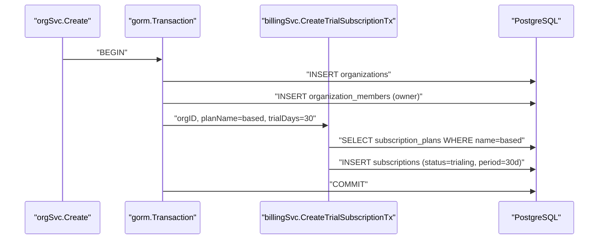
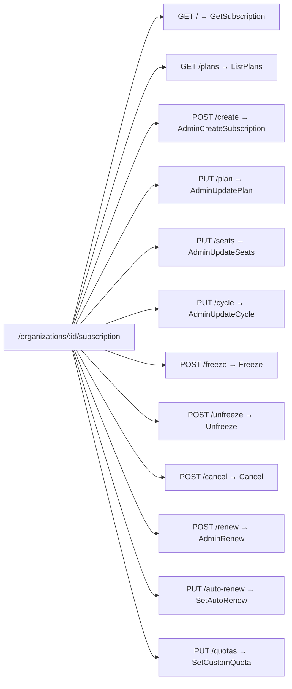
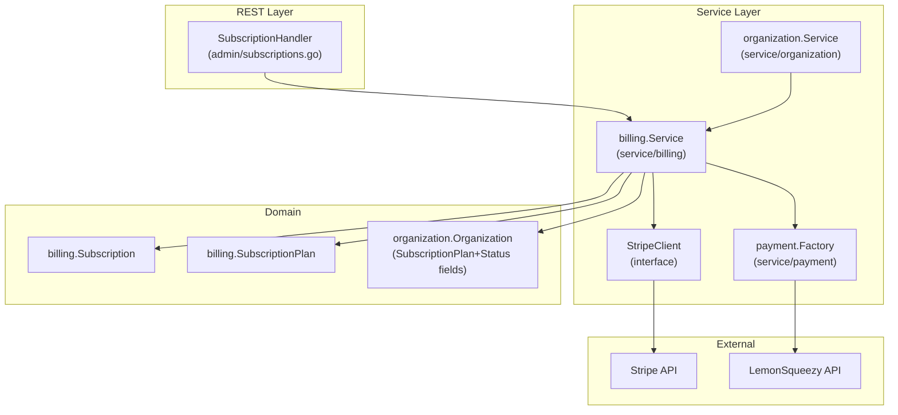

<!-- source: DeepWiki mcp.deepwiki.com · repo AgentsMesh/AgentsMesh · page 2.6 Billing and Subscriptions · fetched 2026-10-26 -->

# Billing and Subscriptions

<details>
<summary>Relevant source files</summary>

The following files were used as context for generating this wiki page:

- [backend/internal/api/rest/v1/admin/subscriptions.go](backend/internal/api/rest/v1/admin/subscriptions.go)
- [backend/internal/api/rest/v1/invitations.go](backend/internal/api/rest/v1/invitations.go)
- [backend/internal/api/rest/v1/pods.go](backend/internal/api/rest/v1/pods.go)
- [backend/internal/api/rest/v1/repositories.go](backend/internal/api/rest/v1/repositories.go)
- [backend/internal/domain/organization/organization.go](backend/internal/domain/organization/organization.go)
- [backend/internal/service/billing/service.go](backend/internal/service/billing/service.go)
- [backend/internal/service/billing/subscription.go](backend/internal/service/billing/subscription.go)
- [backend/internal/service/organization/interface.go](backend/internal/service/organization/interface.go)
- [backend/internal/service/organization/service.go](backend/internal/service/organization/service.go)
- [backend/migrations/000053_fix_missing_subscriptions.down.sql](backend/migrations/000053_fix_missing_subscriptions.down.sql)
- [backend/migrations/000053_fix_missing_subscriptions.up.sql](backend/migrations/000053_fix_missing_subscriptions.up.sql)
- [web-admin/src/app/(dashboard)/organizations/[id]/_components/subscription-section.tsx](web-admin/src/app/(dashboard)/organizations/[id]/_components/subscription-section.tsx)

</details>


This page covers the backend billing service: subscription lifecycle management, plan definitions, seat tracking, payment provider integration (Stripe, LemonSqueezy), and the admin API used to manage subscriptions. It also describes how subscriptions are created automatically when an organization is provisioned.

For the web admin UI that consumes this API, see [Web Admin](#6). For organization creation and membership management, see the Organization Service section of [Backend](#2).

---

## Overview

Every organization in AgentsMesh has exactly one `Subscription` record. The subscription controls:

- Which **plan** the organization is on (feature limits, quotas)
- The current **status** (trialing, active, frozen, canceled)
- The **billing cycle** (monthly or yearly)
- The number of **seats** purchased
- Optional **custom quota overrides** that supersede plan defaults

Subscriptions are created automatically during organization provisioning with a 30-day trial period. Admins can manage subscriptions directly via the internal admin REST API without touching payment providers.

---

## Domain Model

The core types live in `backend/internal/domain/billing/`.

### `Subscription` fields

| Field | Type | Description |
|---|---|---|
| `OrganizationID` | `int64` | FK to `organizations` |
| `PlanID` | `int64` | FK to `subscription_plans` |
| `Status` | `string` | `trialing`, `active`, `frozen`, `canceled`, `expired` |
| `BillingCycle` | `string` | `monthly` or `yearly` |
| `CurrentPeriodStart` | `time.Time` | Start of active billing period |
| `CurrentPeriodEnd` | `time.Time` | End of active billing period |
| `SeatCount` | `int` | Purchased seat count |
| `AutoRenew` | `bool` | Auto-renewal flag |
| `CancelAtPeriodEnd` | `bool` | Scheduled cancellation at period end |
| `DowngradeToPlan` | `*string` | Pending downgrade target (takes effect at period end) |
| `NextBillingCycle` | `*string` | Cycle change queued for next renewal |
| `CustomQuotas` | `JSONB` | Per-resource limit overrides |
| `FrozenAt` | `*time.Time` | When the subscription was frozen |
| `CanceledAt` | `*time.Time` | When the subscription was canceled |
| `StripeSubscriptionID` | `*string` | Stripe subscription ID |
| `LemonSqueezySubscriptionID` | `*string` | LemonSqueezy subscription ID |
| `AlipayAgreementNo` | `*string` | Alipay agreement number |
| `WeChatContractID` | `*string` | WeChat Pay contract ID |
| `PaymentProvider` | `*string` | Denormalized provider label |

### `SubscriptionPlan` fields

| Field | Type | Description |
|---|---|---|
| `Name` | `string` | Identifier (e.g. `"based"`) |
| `DisplayName` | `string` | Human-readable label |
| `PricePerSeatMonthly` | `float64` | Monthly seat price |
| `PricePerSeatYearly` | `float64` | Yearly seat price |
| `IncludedPodMinutes` | `int` | Pod compute minutes per period |
| `MaxUsers` | `int` | Max members (`-1` = unlimited) |
| `MaxRunners` | `int` | Max connected runners |
| `MaxConcurrentPods` | `int` | Max pods running simultaneously |
| `MaxRepositories` | `int` | Max repositories |
| `Features` | `JSONB` | Feature flags for the plan |
| `IsActive` | `bool` | Whether new subscriptions can use this plan |

### Status constants

Defined in `backend/internal/domain/billing/` and used throughout:

```
SubscriptionStatusTrialing  = "trialing"
SubscriptionStatusActive    = "active"
SubscriptionStatusFrozen    = "frozen"
SubscriptionStatusCanceled  = "canceled"
SubscriptionStatusExpired   = "expired"

BillingCycleMonthly = "monthly"
BillingCycleYearly  = "yearly"

PlanBased         = "based"
DefaultTrialDays  = 30
```

Sources: [backend/internal/service/billing/service.go:1-128](), [backend/internal/service/billing/subscription.go:1-50]()

---

## Service Layer

**Billing service struct** (`billing.Service`) is in [backend/internal/service/billing/service.go]().

### Constructors

| Constructor | Use case |
|---|---|
| `NewService(db, stripeKey)` | Testing; minimal payment setup |
| `NewServiceWithConfig(db, appConfig)` | Production; initializes all providers via `payment.Factory` |

`NewServiceWithConfig` reads `appConfig.Payment` to configure:
- Stripe (`cfg.StripeEnabled()` → sets `stripe.Key` and `stripeClient`)
- LemonSqueezy (via `payment.NewFactoryWithDB`)
- Alipay / WeChat (via `payment.Factory`)

[backend/internal/service/billing/service.go:61-85]()

### Payment provider abstraction

The `StripeClient` interface allows mock injection for testing via `SetStripeClient`. The `payment.Factory` (returned by `GetPaymentFactory`) wraps the LemonSqueezy, Alipay, and WeChat providers behind a common `SubscriptionProvider` interface, accessed internally via `getSubscriptionProvider()`.

The `paymentConfig.DeploymentType` field drives currency selection: `"cn"` deployment uses `CurrencyCNY`; otherwise `CurrencyUSD`.

[backend/internal/service/billing/subscription.go:274-308]()

---

## Subscription Lifecycle

**State machine diagram:**

```mermaid
stateDiagram-v2
    [*] --> "trialing": "CreateTrialSubscription"
    "trialing" --> "active": "AdminRenew / UpgradePlan"
    "trialing" --> "frozen": "FreezeSubscription"
    "trialing" --> "canceled": "AdminCancelSubscription"
    "active" --> "frozen": "FreezeSubscription"
    "active" --> "canceled": "AdminCancelSubscription"
    "active" --> "active": "AdminRenew / AdminUpdatePlan"
    "frozen" --> "active": "UnfreezeSubscription"
    "frozen" --> "canceled": "AdminCancelSubscription"
    "canceled" --> "active": "AdminRenew (reactivates)"
    "active" --> "expired": "period_end passed (no renewal)"
```

Sources: [backend/internal/service/billing/subscription.go:62-236]()

### Key service operations

| Method | Description |
|---|---|
| `GetSubscription(ctx, orgID)` | Fetches subscription with `Plan` preloaded |
| `CreateSubscription(ctx, orgID, planName)` | Creates a 1-month active subscription |
| `CreateTrialSubscription(ctx, orgID, planName, trialDays)` | Creates a trial subscription (uses own DB conn) |
| `CreateTrialSubscriptionTx(ctx, tx, orgID, planName, trialDays)` | Same, but within a caller-supplied `*gorm.DB` transaction |
| `AdminCreateSubscription(ctx, orgID, planName, months)` | Admin-only; errors if subscription already exists |
| `AdminUpdatePlan(ctx, orgID, planName)` | Immediate plan change; clears any pending downgrade |
| `AdminRenew(ctx, orgID, months)` | Extends period; reactivates frozen/canceled status |
| `AdminCancelSubscription(ctx, orgID)` | Sets `status=canceled`; does not call payment APIs |
| `UpgradePlan(ctx, orgID, planName)` | Upgrades via provider API if `LemonSqueezySubscriptionID` is set |
| `UpdateSubscription(ctx, orgID, planName)` | Routes to upgrade or scheduled-downgrade logic |
| `FreezeSubscription(ctx, orgID)` | Sets `status=frozen`, records `frozen_at` |
| `UnfreezeSubscription(ctx, orgID, cycle)` | Sets `status=active` |
| `AdminSetSeatCount(ctx, orgID, count)` | Directly sets `seat_count` |
| `SetNextBillingCycle(ctx, orgID, cycle)` | Queues a cycle change for next renewal |
| `SetAutoRenew(ctx, orgID, bool)` | Updates `auto_renew` flag |
| `SetCustomQuota(ctx, orgID, resource, limit)` | Sets a per-resource override in `custom_quotas` JSONB |
| `GetSeatUsage(ctx, orgID)` | Returns `SeatUsage{TotalSeats, UsedSeats, AvailableSeats}` |
| `ListPlans(ctx)` | Returns all active `SubscriptionPlan` records |
| `GetPlan(ctx, planName)` | Fetches plan by name |
| `GetPlanByID(ctx, id)` | Fetches plan by ID |
| `GetPlanPriceByID(ctx, planID, currency)` | Fetches price + LemonSqueezy variant IDs for the plan |

Sources: [backend/internal/service/billing/subscription.go:1-400]()

---

## Organization Integration

When `organization.Service.Create` runs, it opens a database transaction that:

1. Inserts the `Organization` row
2. Inserts the `OrganizationMember` (owner)
3. Calls `billingService.CreateTrialSubscriptionTx` (within the same transaction)

Using the `Tx` variant is essential: the billing service uses its own `*gorm.DB` connection, which cannot see uncommitted rows created by the caller's transaction. Without this, the foreign-key constraint `subscriptions.organization_id_fkey` would fail.

[backend/internal/service/organization/service.go:70-96]()

The `Organization` struct also carries two denormalized fields — `SubscriptionPlan` and `SubscriptionStatus` — that are kept in sync whenever the billing service updates the canonical `subscriptions` row. This allows fast reads of subscription state without a join.

[backend/internal/domain/organization/organization.go:24-27]()

**Organization creation flow diagram:**



Sources: [backend/internal/service/organization/service.go:53-103](), [backend/internal/service/billing/subscription.go:56-91]()

---

## Upgrade and Downgrade Logic

The `UpdateSubscription` method distinguishes upgrade vs. downgrade by comparing `PricePerSeatMonthly`:

- **Downgrade** (`newPlan.Price < currentPlan.Price`): Sets `downgrade_to_plan` field; takes effect at period end. Blocked if current `seat_count` exceeds `newPlan.MaxUsers`.
- **Upgrade** (`newPlan.Price > currentPlan.Price`): Immediate. If either plan is free (`price == 0`), the DB is updated directly. For paid-to-paid upgrades via LemonSqueezy, `UpgradePlan` calls `provider.UpdateSubscriptionPlan` with the correct variant ID before updating the local DB.

`UpgradePlan` selects the LemonSqueezy variant ID by matching the subscription's current `BillingCycle` against `PlanPrice.LemonSqueezyVariantIDMonthly` or `PlanPrice.LemonSqueezyVariantIDYearly`.

[backend/internal/service/billing/subscription.go:238-334]()

---

## Organization Synchronization

Several operations synchronize the denormalized `subscription_plan` and `subscription_status` columns in the `organizations` table:

| Method | Synced fields |
|---|---|
| `AdminCreateSubscription` | `subscription_plan`, `subscription_status` |
| `AdminUpdatePlan` | `subscription_plan` |
| `AdminRenew` | `subscription_status` |
| `AdminCancelSubscription` | `subscription_status` |
| `UpgradePlan` | `subscription_plan` |
| `UpdateSubscription` (free plan) | via `syncOrganizationSubscription` |

These use raw `UPDATE` calls to `organizations` (`Table("organizations").Where("id=?").Updates(...)`) executed after the main subscriptions table update.

Sources: [backend/internal/service/billing/subscription.go:128-138](), [backend/internal/service/billing/subscription.go:166-174]()

---

## Admin REST API

The `SubscriptionHandler` in [backend/internal/api/rest/v1/admin/subscriptions.go]() registers routes under `/organizations/:id/subscription` via `RegisterRoutes`.

**Route map:**



Sources: [backend/internal/api/rest/v1/admin/subscriptions.go:31-47]()

### `subscriptionResponse` shape

The response helper `subscriptionResponse` serializes both the subscription and the current `SeatUsage`. Key fields:

```
id, organization_id, plan_id, status, billing_cycle,
current_period_start, current_period_end, auto_renew,
seat_count, cancel_at_period_end, custom_quotas,
payment_provider, payment_method,
has_stripe, has_alipay, has_wechat, has_lemonsqueezy,
canceled_at, frozen_at, downgrade_to_plan, next_billing_cycle,
plan { id, name, display_name, price_per_seat_monthly, ... },
seat_usage { total_seats, used_seats, available_seats }
```

[backend/internal/api/rest/v1/admin/subscriptions.go:417-474]()

### All operations are audit-logged

Every handler calls `h.logAction(c, action, TargetTypeSubscription, orgID, oldSub, newSub)` before returning, which delegates to `LogAdminAction`. This stores before/after snapshots in the admin audit log.

[backend/internal/api/rest/v1/admin/subscriptions.go:407-408]()

---

## Custom Quotas

Custom quotas are stored as a JSONB map on `Subscription.CustomQuotas`. They override plan-level limits for individual resources. Supported resources:

| Resource key | Plan field overridden |
|---|---|
| `users` | `MaxUsers` |
| `runners` | `MaxRunners` |
| `concurrent_pods` | `MaxConcurrentPods` |
| `repositories` | `MaxRepositories` |
| `pod_minutes` | `IncludedPodMinutes` |

A value of `-1` means unlimited. Set via `SetCustomQuota(ctx, orgID, resource, limit)`.

Sources: [web-admin/src/app/(dashboard)/organizations/[id]/_components/subscription-section.tsx:43-43](), [backend/internal/api/rest/v1/admin/subscriptions.go:372-404]()

---

## Data Migration: Missing Subscriptions

Migration `000053` backfills `subscriptions` rows for any organizations that were created before the billing service was wired into the organization service. It inserts a 30-day trialing subscription on the `based` plan for every organization that lacks one.

[backend/migrations/000053_fix_missing_subscriptions.up.sql:1-21]()

The corresponding down migration is a no-op to avoid re-introducing the data inconsistency.

---

## Component Diagram



Sources: [backend/internal/service/billing/service.go:32-100](), [backend/internal/service/organization/service.go:20-43](), [backend/internal/api/rest/v1/admin/subscriptions.go:16-28]()

---

