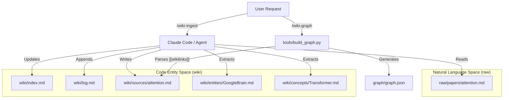

<!-- source: DeepWiki mcp.deepwiki.com · repo SamurAIGPT/llm-wiki-agent · page 1 Overview · fetched 2026-10-26 -->

# Overview

Relevant source files

The following files were used as context for generating this wiki page:

- [AGENTS.md](AGENTS.md)
- [CLAUDE.md](CLAUDE.md)
- [GEMINI.md](GEMINI.md)
- [README.md](README.md)

The **LLM Wiki Agent** is a specialized coding agent skill designed to transform a collection of raw documents into a structured, interlinked, and self-maintaining knowledge base. Unlike traditional chat-based interactions where knowledge is ephemeral, this system uses a "filesystem-as-database" model to build a persistent wiki that compounds in value as more sources are added [README.md:1-7]().

The agent handles the heavy lifting of knowledge engineering: summarizing documents, extracting entities and concepts, cross-referencing information via `[[wikilinks]]`, flagging contradictions, and generating interactive visualizations [README.md:68-82]().

## System Concept: Wiki vs. RAG

While traditional Retrieval-Augmented Generation (RAG) typically performs "just-in-time" retrieval from a vector database at query time, the LLM Wiki Agent performs "ahead-of-time" synthesis.

| Feature | Traditional RAG | LLM Wiki Agent |
| :--- | :--- | :--- |
| **Storage** | Vector Database (Embeddings) | Structured Markdown Files [CLAUDE.md:24-38]() |
| **Linking** | Semantic Similarity (Implicit) | Explicit `[[wikilinks]]` [CLAUDE.md:56]() |
| **Synthesis** | Generated at Query Time | Living `overview.md` updated at Ingest [CLAUDE.md:69]() |
| **Maintenance** | Re-indexing required | Agent-driven `lint` and `graph` workflows [CLAUDE.md:118-150]() |
| **Conflict Resolution** | Often ignores contradictions | Explicitly flags contradictions during ingest [CLAUDE.md:72]() |

**Sources:** [README.md:1-25](), [CLAUDE.md:60-74]()

## Core Entities and Code Mapping

The system bridges the gap between natural language documents and a structured code-like entity space. The following diagram illustrates how the agent maps user commands and raw files to specific wiki structures and Python tools.

### Agent Workflow to File System Mapping

**Sources:** [CLAUDE.md:5-18](), [CLAUDE.md:24-38](), [README.md:9-25]()

### Knowledge Taxonomy Structure
The agent categorizes information into four primary subdirectories within the `wiki/` layer, ensuring a predictable schema for both the LLM and the user.

| Directory | Content Type | Naming Convention |
| :--- | :--- | :--- |
| `wiki/sources/` | Summaries of raw documents | `kebab-case.md` [CLAUDE.md:154]() |
| `wiki/entities/` | People, companies, projects | `TitleCase.md` [CLAUDE.md:155]() |
| `wiki/concepts/` | Ideas, frameworks, theories | `TitleCase.md` [CLAUDE.md:156]() |
| `wiki/syntheses/` | Answers to complex queries | `kebab-case.md` [CLAUDE.md:114]() |

**Sources:** [CLAUDE.md:24-38](), [CLAUDE.md:152-158]()

## Navigation Map

The documentation is organized into the following sections to help you set up and extend the agent:

### [Getting Started](#1.1)
Step-by-step setup guide. Covers cloning the repository, choosing your agent interface (Claude Code, Codex, or Gemini CLI), and running your first `/wiki-ingest`.
*See [Getting Started](#1.1) for details.*

### [Architecture Overview](#1.2)
Deep dive into the three-tier architecture:
1.  **Raw Layer**: Immutable source files.
2.  **Wiki Layer**: The structured markdown state.
3.  **Graph/Tool Layer**: Visualization and programmatic maintenance.
*See [Architecture Overview](#1.2) for details.*

### [Core Workflows](#3)
The system is driven by four primary workflows defined in the agent schema files (`CLAUDE.md`, `AGENTS.md`, `GEMINI.md`):
*   **Ingest**: Reading sources and building pages [CLAUDE.md:60]().
*   **Query**: Synthesizing answers with citations [CLAUDE.md:106]().
*   **Lint**: Maintaining wiki health and consistency [CLAUDE.md:118]().
*   **Graph**: Visualizing relationships and clusters [CLAUDE.md:134]().

**Sources:** [CLAUDE.md:1-20](), [AGENTS.md:1-18](), [GEMINI.md:1-18]()

---

