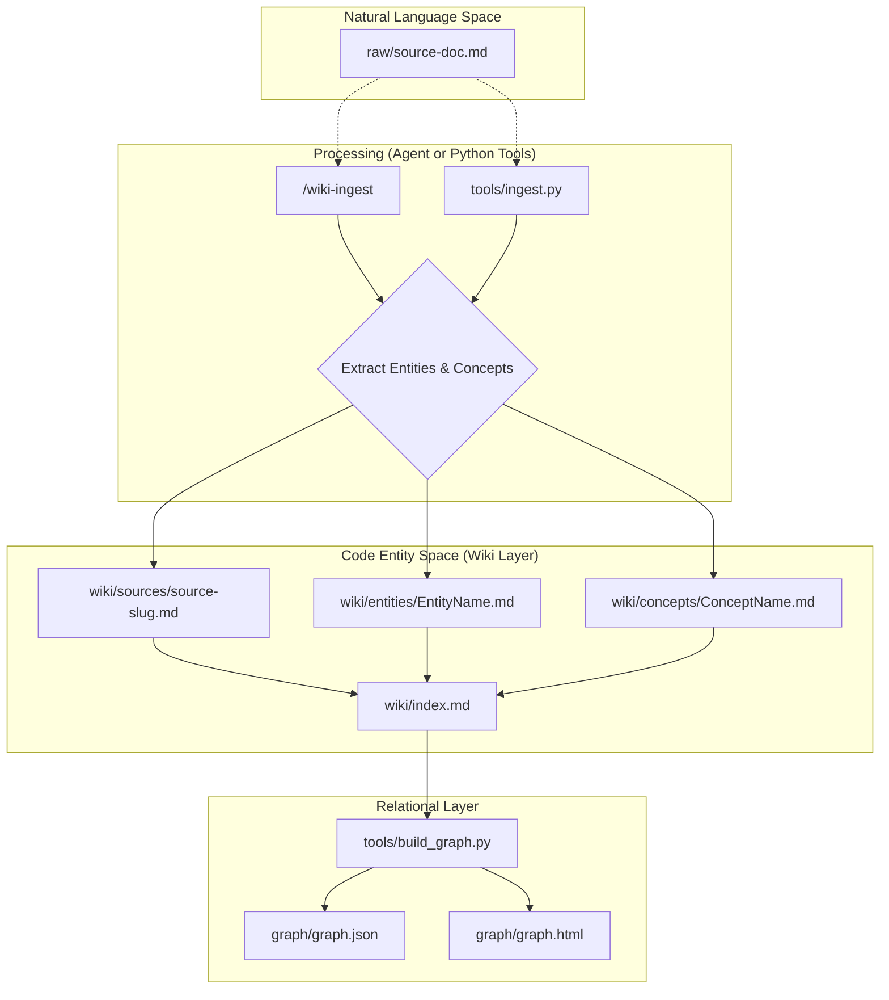
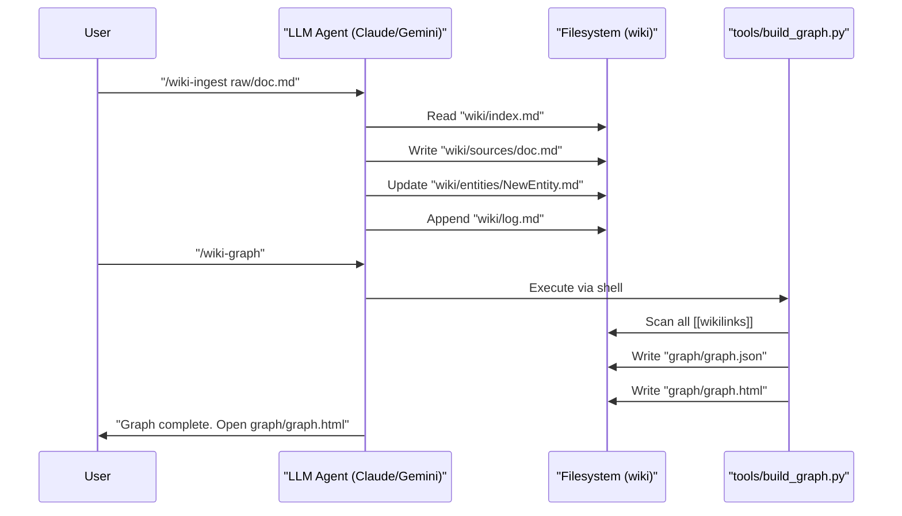

<!-- source: DeepWiki mcp.deepwiki.com · repo SamurAIGPT/llm-wiki-agent · page 1.2 Architecture Overview · fetched 2026-10-26 -->

# Architecture Overview

<details>
<summary>Relevant source files</summary>

The following files were used as context for generating this wiki page:

- [AGENTS.md](AGENTS.md)
- [CLAUDE.md](CLAUDE.md)
- [GEMINI.md](GEMINI.md)
- [README.md](README.md)
- [graph/.gitkeep](graph/.gitkeep)
- [raw/.gitkeep](raw/.gitkeep)

</details>


The LLM Wiki Agent employs a three-tier architecture designed to transform unstructured documents into a persistent, interlinked knowledge base. Unlike traditional Retrieval-Augmented Generation (RAG) which often relies on transient vector databases and "top-k" similarity searches, this system uses a **filesystem-as-database** model. This ensures that knowledge is stored in human-readable Markdown, allowing the agent to maintain state, track contradictions, and build a global synthesis that compounds over time [README.md:68-83]().

## The Three-Tier Architecture

The system organizes data and logic into three distinct layers, moving from raw input to structured knowledge and finally to relational insights.

| Layer | Component | Responsibility |
| :--- | :--- | :--- |
| **Raw Layer** | `raw/` | Immutable storage for source documents (PDFs, Markdown, Transcripts) [CLAUDE.md:27-27](). |
| **Wiki Layer** | `wiki/` | The "Source of Truth." Contains structured summaries, entity pages, and global state files [CLAUDE.md:28-35](). |
| **Graph/Tool Layer** | `graph/` & `tools/` | Analytical layer for visualizing relationships and programmatically maintaining the wiki [CLAUDE.md:36-37](). |

### Data Flow Diagram: Raw to Graph

This diagram illustrates how a document moves from the "Natural Language Space" of a raw file into the structured "Code Entity Space" of the wiki.


Sources: [README.md:14-25](), [CLAUDE.md:60-74](), [AGENTS.md:57-70](), [GEMINI.md:57-68]()

---

## Filesystem-as-Database Persistence

The system eschews complex database engines in favor of a structured directory tree. This allows LLM agents to use standard filesystem tools (like `ls`, `grep`, and `read`) to query and update knowledge [CLAUDE.md:122-130]().

### Core State Files
1.  **`wiki/index.md`**: The central catalog. It provides the agent with a map of all known entities, concepts, and sources to prevent duplicate creation [CLAUDE.md:159-178]().
2.  **`wiki/overview.md`**: A living synthesis. Unlike a standard search index, this file is rewritten or updated during ingest to provide a high-level summary of the entire knowledge base [CLAUDE.md:69-69]().
3.  **`wiki/log.md`**: An append-only audit trail. Entries are formatted as `## [YYYY-MM-DD] <operation> | <title>` to remain easily parseable via `grep` [CLAUDE.md:180-189]().

### Page Types & Schema
Every page in the `wiki/` directory (except the core state files) follows a strict YAML frontmatter schema. This allows the agent to treat Markdown files as structured records.

```yaml
---
title: "Page Title"
type: source | entity | concept | synthesis
tags: []
sources: [slug-1, slug-2]
last_updated: 2024-05-20
---
```
Sources: [CLAUDE.md:44-54](), [AGENTS.md:39-51](), [GEMINI.md:39-51]()

---

## Comparison: LLM Wiki Agent vs. Traditional RAG

The LLM Wiki Agent differs from standard RAG implementations by focusing on **synthesis** and **persistence** rather than just **retrieval**.

| Feature | Traditional RAG | LLM Wiki Agent |
| :--- | :--- | :--- |
| **Storage** | Vector Database (Embeddings) | Markdown Filesystem (`wiki/`) |
| **Retrieval** | Semantic Similarity (Top-K) | Index-based & Wikilink Navigation |
| **Context** | Chunks of text | Full interlinked pages (Entities/Concepts) |
| **State** | Stateless (per query) | Stateful (Compounding wiki) |
| **Conflict Resolution** | Ignored (often returns conflicting chunks) | Explicitly flagged during ingest/lint |
| **Visualization** | None / Latent Space Projections | Interactive Knowledge Graph (`graph.html`) |

Sources: [README.md:5-8](), [README.md:68-83](), [CLAUDE.md:118-130]()

---

## Technical Component Interaction

This diagram bridges the gap between the user's natural language commands and the specific code entities/files that execute those commands.


Sources: [CLAUDE.md:5-20](), [CLAUDE.md:60-74](), [CLAUDE.md:134-150](), [AGENTS.md:131-143]()

---

