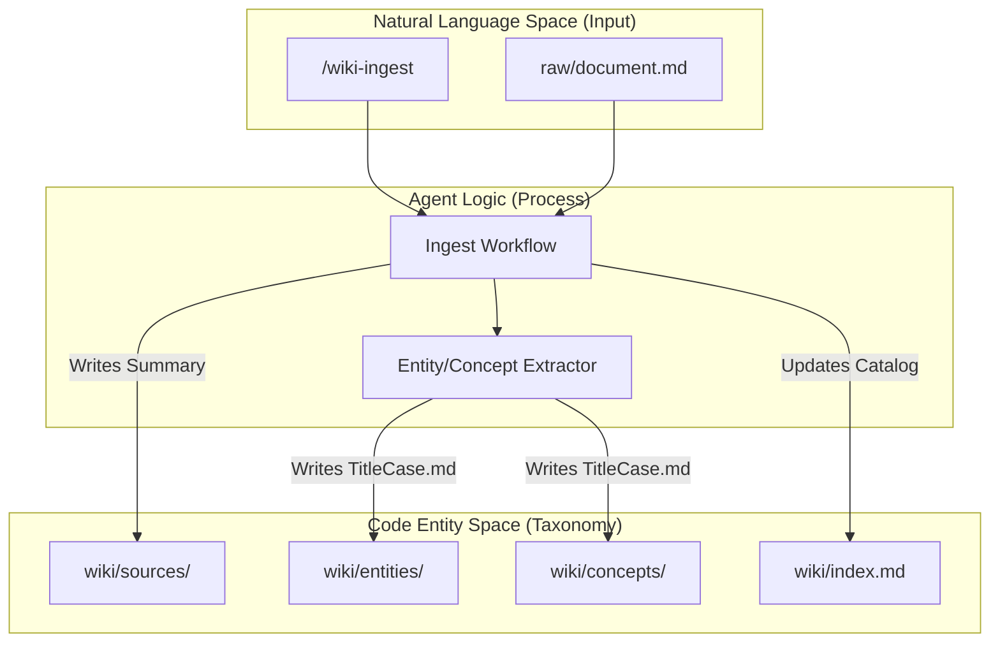
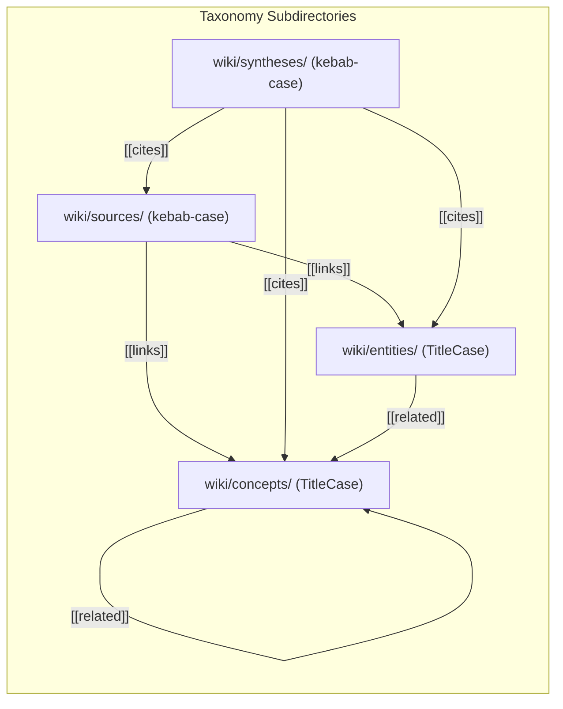

<!-- source: DeepWiki mcp.deepwiki.com · repo SamurAIGPT/llm-wiki-agent · page 4.3 Knowledge Taxonomy (sources/, entities/, concepts/, syntheses) · fetched 2026-10-26 -->

# Knowledge Taxonomy (sources/, entities/, concepts/, syntheses)

Relevant source files

The following files were used as context for generating this wiki page:

- [.claude/commands/wiki-ingest.md](.claude/commands/wiki-ingest.md)
- [AGENTS.md](AGENTS.md)
- [CLAUDE.md](CLAUDE.md)
- [GEMINI.md](GEMINI.md)

The LLM Wiki Agent organizes knowledge into a structured taxonomy of four primary subdirectories within the `wiki/` directory [CLAUDE.md:25-35](). This taxonomy separates raw information summaries from the higher-level abstractions and synthesized answers derived from them. By enforcing specific naming conventions and linking requirements, the system transforms a collection of flat files into a navigable knowledge graph.

## Taxonomy Overview

The knowledge base is divided into four distinct types, each serving a specific role in the information lifecycle.

| Directory | Page Type | Purpose | Naming Convention |
|---|---|---|---|
| `sources/` | `source` | Summaries of individual documents from `raw/` | `kebab-case.md` |
| `entities/` | `entity` | Profiles of people, companies, projects, or products | `TitleCase.md` |
| `concepts/` | `concept` | Definitions of ideas, frameworks, methods, or theories | `TitleCase.md` |
| `syntheses/` | `synthesis` | Saved answers to complex multi-source queries | `kebab-case.md` |

**Sources:** [CLAUDE.md:25-38](), [CLAUDE.md:152-158](), [AGENTS.md:146-151]()

## 1. Sources (`wiki/sources/`)

The `sources/` directory contains the foundational layer of the wiki. Each file represents a single ingested document from the `raw/` directory [CLAUDE.md:32]().

### Implementation & Data Flow
During the `Ingest Workflow`, the agent reads a document from `raw/`, generates a summary, and writes it to `sources/` [CLAUDE.md:60-67](). The filename must match the source document's slug in `kebab-case` [CLAUDE.md:154]().

### Structure
Each source page must include:
- **Frontmatter**: Metadata including `source_file` path and `date` [CLAUDE.md:78-84]().
- **Key Claims**: Atomic statements of fact found in the text [CLAUDE.md:89-91]().
- **Connections**: Explicit `[[wikilinks]]` to entities and concepts [CLAUDE.md:96-98]().
- **Contradictions**: Flagged conflicts with existing wiki pages [CLAUDE.md:100-101]().

**Sources:** [CLAUDE.md:75-102](), [.claude/commands/wiki-ingest.md:1-10]()

## 2. Entities (`wiki/entities/`)

Entities represent the "nouns" of the knowledge base—specific, unique instances of people, organizations, or projects [CLAUDE.md:33]().

### Implementation & Data Flow
Entities are created or updated during the `Ingest Workflow` whenever a source document mentions a key person or company [CLAUDE.md:70](). They are named using `TitleCase.md` (e.g., `OpenAI.md`) [CLAUDE.md:155]().

### Semantic Linking
Entities act as hubs in the knowledge graph. The `Lint Workflow` specifically monitors entity health by checking for "Missing entity pages"—defined as entities mentioned in 3 or more pages that do not yet have a dedicated file in `entities/` [CLAUDE.md:127]().

**Sources:** [CLAUDE.md:127](), [AGENTS.md:124](), [GEMINI.md:129]()

## 3. Concepts (`wiki/concepts/`)

Concepts represent the "how" and "why"—abstract ideas, frameworks, and methodologies [CLAUDE.md:34]().

### Implementation & Data Flow
Like entities, concepts are extracted during ingestion [CLAUDE.md:71](). They also follow the `TitleCase.md` naming convention (e.g., `ReinforcementLearning.md`) [CLAUDE.md:156]().

### Data Model Integration
Concepts allow the LLM to group disparate sources under a single theoretical umbrella. For example, multiple papers in `sources/` might all link to a single `RAG.md` concept page, allowing the `Query Workflow` to aggregate information effectively [CLAUDE.md:106-114]().

**Sources:** [CLAUDE.md:156](), [AGENTS.md:68](), [GEMINI.md:31]()

## 4. Syntheses (`wiki/syntheses/`)

Syntheses are the "outputs" of the system—persistent records of complex queries [CLAUDE.md:35]().

### Implementation & Data Flow
When a user runs the `Query Workflow` (`/wiki-query`), the agent generates a response based on the `index.md` and relevant pages [CLAUDE.md:106-113](). If the user approves, this response is saved to `wiki/syntheses/` [CLAUDE.md:114]().

### Structure
Syntheses must include inline citations using `[[wikilinks]]` to the source, entity, or concept pages that informed the answer [CLAUDE.md:113](). They use `kebab-case.md` slugs based on the question asked [CLAUDE.md:114]().

**Sources:** [CLAUDE.md:106-114](), [AGENTS.md:103-112](), [GEMINI.md:106]()

## Interlinking via [[wikilinks]]

The taxonomy is unified by `[[wikilinks]]`. These links serve two purposes:
1. **Navigation**: Allowing agents and users to traverse the filesystem.
2. **Graph Construction**: The `Graph Workflow` uses these links to build `EXTRACTED` edges in the knowledge graph [CLAUDE.md:139]().

### Relationship Diagram: Natural Language to Code Space

This diagram shows how the `Ingest Workflow` (Natural Language Space) populates the Taxonomy (Code Entity Space).

Title: Ingest Data Flow to Taxonomy

**Sources:** [CLAUDE.md:60-74](), [.claude/commands/wiki-ingest.md:1-17]()

### Knowledge Interlinking Diagram

This diagram illustrates how the different directories in the taxonomy reference each other via the `[[wikilink]]` mechanism.

Title: Taxonomy Linkage Model

**Sources:** [CLAUDE.md:42-56](), [CLAUDE.md:96-98](), [CLAUDE.md:113]()

---

