# Page: Overview

# Overview

<details>
<summary>Relevant source files</summary>

The following files were used as context for generating this wiki page:

- [AGENTS.md](AGENTS.md)
- [CLAUDE.md](CLAUDE.md)
- [GEMINI.md](GEMINI.md)
- [README.md](README.md)

</details>


The **LLM Wiki Agent** is a specialized coding agent skill designed to transform a collection of raw documents into a structured, interlinked, and self-maintaining knowledge base. Unlike traditional chat-based interactions where knowledge is ephemeral, this system uses a "filesystem-as-database" model to build a persistent wiki that compounds in value as more sources are added [README.md:1-7]().

The agent handles the heavy lifting of knowledge engineering: summarizing documents, extracting entities and concepts, cross-referencing information via `[[wikilinks]]`, flagging contradictions, and generating interactive visualizations [README.md:68-82]().

## System Concept: Wiki vs. RAG

While traditional Retrieval-Augmented Generation (RAG) typically performs "just-in-time" retrieval from a vector database at query time, the LLM Wiki Agent performs "ahead-of-time" synthesis.

| Feature | Traditional RAG | LLM Wiki Agent |
| :--- | :--- | :--- |
| **Storage** | Vector Database (Embeddings) | Structured Markdown Files [CLAUDE.md:24-38]() |
| **Linking** | Semantic Similarity (Implicit) | Explicit `[[wikilinks]]` [CLAUDE.md:56]() |
| **Synthesis** | Generated at Query Time | Living `overview.md` updated at Ingest [CLAUDE.md:69]() |
| **Maintenance** | Re-indexing required | Agent-driven `lint` and `graph` workflows [CLAUDE.md:118-150]() |
| **Conflict Resolution** | Often ignores contradictions | Explicitly flags contradictions during ingest [CLAUDE.md:72]() |

**Sources:** [README.md:1-25](), [CLAUDE.md:60-74]()

## Core Entities and Code Mapping

The system bridges the gap between natural language documents and a structured code-like entity space. The following diagram illustrates how the agent maps user commands and raw files to specific wiki structures and Python tools.

### Agent Workflow to File System Mapping
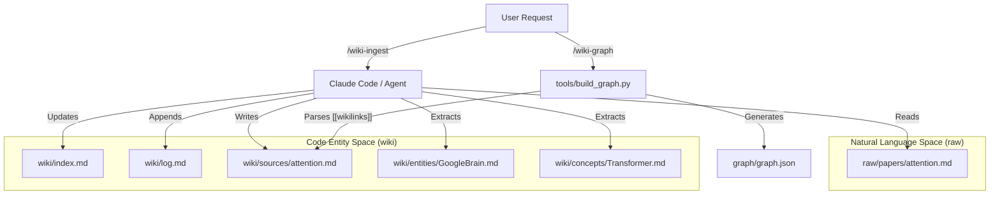
**Sources:** [CLAUDE.md:5-18](), [CLAUDE.md:24-38](), [README.md:9-25]()

### Knowledge Taxonomy Structure
The agent categorizes information into four primary subdirectories within the `wiki/` layer, ensuring a predictable schema for both the LLM and the user.

| Directory | Content Type | Naming Convention |
| :--- | :--- | :--- |
| `wiki/sources/` | Summaries of raw documents | `kebab-case.md` [CLAUDE.md:154]() |
| `wiki/entities/` | People, companies, projects | `TitleCase.md` [CLAUDE.md:155]() |
| `wiki/concepts/` | Ideas, frameworks, theories | `TitleCase.md` [CLAUDE.md:156]() |
| `wiki/syntheses/` | Answers to complex queries | `kebab-case.md` [CLAUDE.md:114]() |

**Sources:** [CLAUDE.md:24-38](), [CLAUDE.md:152-158]()

## Navigation Map

The documentation is organized into the following sections to help you set up and extend the agent:

### [Getting Started](#1.1)
Step-by-step setup guide. Covers cloning the repository, choosing your agent interface (Claude Code, Codex, or Gemini CLI), and running your first `/wiki-ingest`.
*See [Getting Started](#1.1) for details.*

### [Architecture Overview](#1.2)
Deep dive into the three-tier architecture:
1.  **Raw Layer**: Immutable source files.
2.  **Wiki Layer**: The structured markdown state.
3.  **Graph/Tool Layer**: Visualization and programmatic maintenance.
*See [Architecture Overview](#1.2) for details.*

### [Core Workflows](#3)
The system is driven by four primary workflows defined in the agent schema files (`CLAUDE.md`, `AGENTS.md`, `GEMINI.md`):
*   **Ingest**: Reading sources and building pages [CLAUDE.md:60]().
*   **Query**: Synthesizing answers with citations [CLAUDE.md:106]().
*   **Lint**: Maintaining wiki health and consistency [CLAUDE.md:118]().
*   **Graph**: Visualizing relationships and clusters [CLAUDE.md:134]().

**Sources:** [CLAUDE.md:1-20](), [AGENTS.md:1-18](), [GEMINI.md:1-18]()

---

# Page: Getting Started

# Getting Started

<details>
<summary>Relevant source files</summary>

The following files were used as context for generating this wiki page:

- [AGENTS.md](AGENTS.md)
- [CLAUDE.md](CLAUDE.md)
- [GEMINI.md](GEMINI.md)
- [README.md](README.md)
- [requirements.txt](requirements.txt)

</details>


This page provides a step-by-step guide to setting up the LLM Wiki Agent, installing its dependencies, and executing your first knowledge ingestion. The system is designed to function primarily as an "agent skill" where an LLM (Claude, Codex, or Gemini) manages a persistent markdown wiki as its long-term memory [README.md:5-7]().

## Initial Setup

To begin, clone the repository and navigate into the project directory.

```bash
git clone https://github.com/SamurAIGPT/llm-wiki-agent.git
cd llm-wiki-agent
```
[README.md:31-34]()

### Dependencies
The project supports two modes of operation:
1.  **Agent-Native Mode:** The agent reads instructions from schema files (`CLAUDE.md`, `AGENTS.md`, or `GEMINI.md`) and performs file operations directly. No Python installation is required for basic workflows [CLAUDE.md:3-4]().
2.  **Tool-Assisted Mode:** Standalone Python scripts in `tools/` provide advanced features like semantic relationship inference and automated graph visualization [CLAUDE.md:138-142]().

To use the Python tools, install the required packages:
```bash
pip install -r requirements.txt
```
[requirements.txt:1-2]()

| Dependency | Purpose |
| :--- | :--- |
| `anthropic` | Powers the LLM-driven logic in `tools/` scripts [requirements.txt:1](). |
| `networkx` | Used for graph construction and Louvain community detection [requirements.txt:2](). |

---

## Choosing an Agent Interface

The LLM Wiki Agent is compatible with several AI coding interfaces. Each interface relies on a specific configuration file to understand the wiki's structure and workflows.

### 1. Claude Code
Claude Code is the primary recommended interface. It automatically detects `CLAUDE.md` and supports custom slash commands [CLAUDE.md:1-5]().
*   **Command:** `claude`
*   **Config:** `CLAUDE.md` [README.md:39]()

### 2. Codex / OpenCode
These agents look for general instructions on how to interact with the codebase [AGENTS.md:1-3]().
*   **Command:** `codex` or `opencode`
*   **Config:** `AGENTS.md` [README.md:40-41]()

### 3. Gemini CLI
For users preferring the Gemini ecosystem, the agent follows a similar workflow pattern adapted for Gemini [GEMINI.md:1-3]().
*   **Command:** `gemini`
*   **Config:** `GEMINI.md` [README.md:42]()

---

## Running the First Ingest

The "Ingest" workflow is the entry point for all data. It transforms a raw markdown file into a structured set of wiki pages.

### Data Flow: Natural Language to Code Entity Space
The following diagram illustrates how a natural language request is translated into specific file system entities by the agent.

**Diagram: Ingest Workflow Mapping**
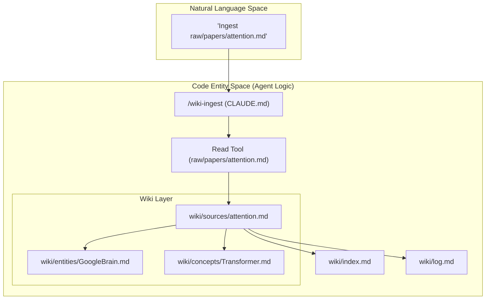
**Sources:** [CLAUDE.md:60-74](), [README.md:9-11]()

### Step-by-Step Execution
1.  **Place Source:** Drop a markdown file into the `raw/` directory (e.g., `raw/my-document.md`) [README.md:5]().
2.  **Trigger Agent:** Open your agent and type:
    *   Claude Code: `/wiki-ingest raw/my-document.md` [CLAUDE.md:9]()
    *   Other Agents: `ingest raw/my-document.md` [AGENTS.md:14]()
3.  **Agent Operations:** The agent will:
    *   Read `wiki/index.md` to check for existing context [CLAUDE.md:66]().
    *   Generate a summary in `wiki/sources/` [CLAUDE.md:67]().
    *   Extract entities (People/Orgs) and concepts (Ideas) into their respective directories [CLAUDE.md:70-71]().
    *   Update the global `wiki/overview.md` [CLAUDE.md:69]().

---

## System Interaction Model

The system bridges the gap between unstructured documents and a structured knowledge graph. The following diagram shows how different code components interact during a standard session.

**Diagram: System Component Interaction**
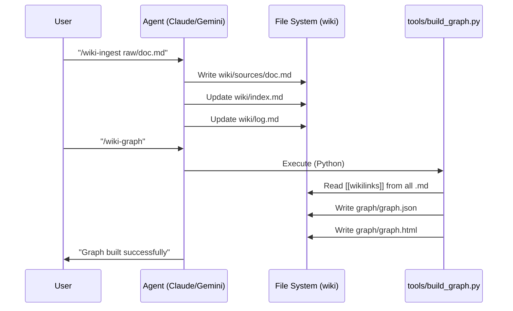
**Sources:** [CLAUDE.md:134-143](), [README.md:182-187]()

### Summary of Commands
| Action | Slash Command (Claude) | Shorthand (Other) | Result |
| :--- | :--- | :--- | :--- |
| **Ingest** | `/wiki-ingest <file>` | `ingest <file>` | Creates source/entity/concept pages [CLAUDE.md:60-74](). |
| **Query** | `/wiki-query <text>` | `query: <text>` | Synthesizes answer from wiki [CLAUDE.md:106-114](). |
| **Lint** | `/wiki-lint` | `lint` | Finds broken links/contradictions [CLAUDE.md:118-130](). |
| **Graph** | `/wiki-graph` | `build graph` | Generates interactive `graph.html` [CLAUDE.md:134-143](). |

**Sources:** [README.md:45-56](), [CLAUDE.md:5-13](), [AGENTS.md:13-17]()

---

# Page: Architecture Overview

# Architecture Overview

<details>
<summary>Relevant source files</summary>

The following files were used as context for generating this wiki page:

- [AGENTS.md](AGENTS.md)
- [CLAUDE.md](CLAUDE.md)
- [GEMINI.md](GEMINI.md)
- [README.md](README.md)
- [graph/.gitkeep](graph/.gitkeep)
- [raw/.gitkeep](raw/.gitkeep)

</details>


The LLM Wiki Agent employs a three-tier architecture designed to transform unstructured documents into a persistent, interlinked knowledge base. Unlike traditional Retrieval-Augmented Generation (RAG) which often relies on transient vector databases and "top-k" similarity searches, this system uses a **filesystem-as-database** model. This ensures that knowledge is stored in human-readable Markdown, allowing the agent to maintain state, track contradictions, and build a global synthesis that compounds over time [README.md:68-83]().

## The Three-Tier Architecture

The system organizes data and logic into three distinct layers, moving from raw input to structured knowledge and finally to relational insights.

| Layer | Component | Responsibility |
| :--- | :--- | :--- |
| **Raw Layer** | `raw/` | Immutable storage for source documents (PDFs, Markdown, Transcripts) [CLAUDE.md:27-27](). |
| **Wiki Layer** | `wiki/` | The "Source of Truth." Contains structured summaries, entity pages, and global state files [CLAUDE.md:28-35](). |
| **Graph/Tool Layer** | `graph/` & `tools/` | Analytical layer for visualizing relationships and programmatically maintaining the wiki [CLAUDE.md:36-37](). |

### Data Flow Diagram: Raw to Graph

This diagram illustrates how a document moves from the "Natural Language Space" of a raw file into the structured "Code Entity Space" of the wiki.

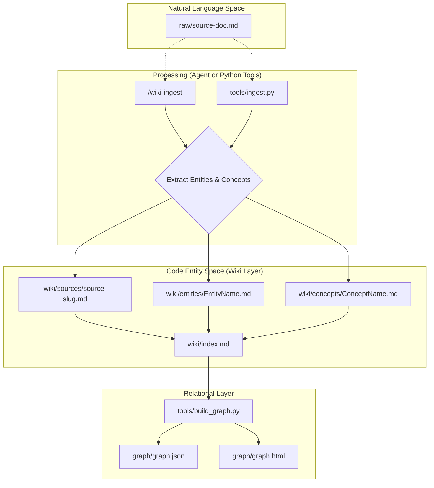
Sources: [README.md:14-25](), [CLAUDE.md:60-74](), [AGENTS.md:57-70](), [GEMINI.md:57-68]()

---

## Filesystem-as-Database Persistence

The system eschews complex database engines in favor of a structured directory tree. This allows LLM agents to use standard filesystem tools (like `ls`, `grep`, and `read`) to query and update knowledge [CLAUDE.md:122-130]().

### Core State Files
1.  **`wiki/index.md`**: The central catalog. It provides the agent with a map of all known entities, concepts, and sources to prevent duplicate creation [CLAUDE.md:159-178]().
2.  **`wiki/overview.md`**: A living synthesis. Unlike a standard search index, this file is rewritten or updated during ingest to provide a high-level summary of the entire knowledge base [CLAUDE.md:69-69]().
3.  **`wiki/log.md`**: An append-only audit trail. Entries are formatted as `## [YYYY-MM-DD] <operation> | <title>` to remain easily parseable via `grep` [CLAUDE.md:180-189]().

### Page Types & Schema
Every page in the `wiki/` directory (except the core state files) follows a strict YAML frontmatter schema. This allows the agent to treat Markdown files as structured records.

```yaml
---
title: "Page Title"
type: source | entity | concept | synthesis
tags: []
sources: [slug-1, slug-2]
last_updated: 2024-05-20
---
```
Sources: [CLAUDE.md:44-54](), [AGENTS.md:39-51](), [GEMINI.md:39-51]()

---

## Comparison: LLM Wiki Agent vs. Traditional RAG

The LLM Wiki Agent differs from standard RAG implementations by focusing on **synthesis** and **persistence** rather than just **retrieval**.

| Feature | Traditional RAG | LLM Wiki Agent |
| :--- | :--- | :--- |
| **Storage** | Vector Database (Embeddings) | Markdown Filesystem (`wiki/`) |
| **Retrieval** | Semantic Similarity (Top-K) | Index-based & Wikilink Navigation |
| **Context** | Chunks of text | Full interlinked pages (Entities/Concepts) |
| **State** | Stateless (per query) | Stateful (Compounding wiki) |
| **Conflict Resolution** | Ignored (often returns conflicting chunks) | Explicitly flagged during ingest/lint |
| **Visualization** | None / Latent Space Projections | Interactive Knowledge Graph (`graph.html`) |

Sources: [README.md:5-8](), [README.md:68-83](), [CLAUDE.md:118-130]()

---

## Technical Component Interaction

This diagram bridges the gap between the user's natural language commands and the specific code entities/files that execute those commands.

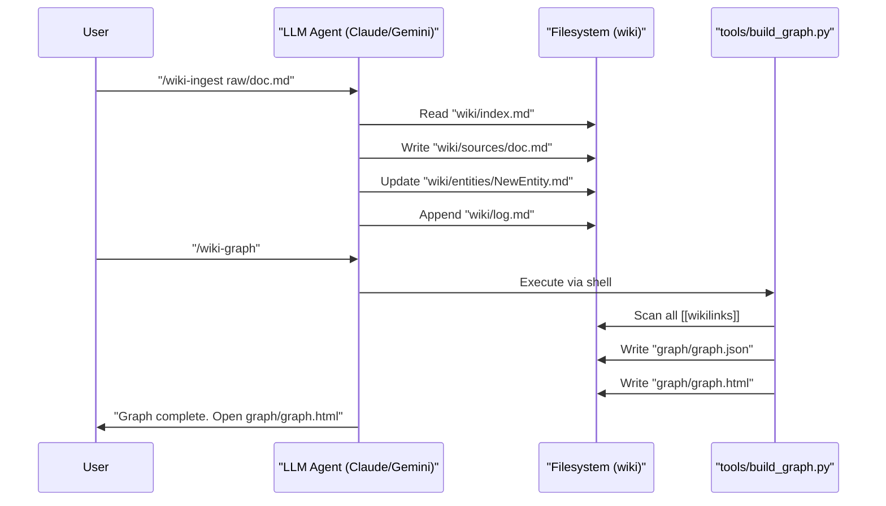
Sources: [CLAUDE.md:5-20](), [CLAUDE.md:60-74](), [CLAUDE.md:134-150](), [AGENTS.md:131-143]()

---

# Page: Agent Configuration

# Agent Configuration

<details>
<summary>Relevant source files</summary>

The following files were used as context for generating this wiki page:

- [AGENTS.md](AGENTS.md)
- [CLAUDE.md](CLAUDE.md)
- [GEMINI.md](GEMINI.md)

</details>


The LLM Wiki Agent is designed to be "agent-native," meaning it can be operated by various AI coding assistants without requiring a specialized API or server. This is achieved through markdown-based configuration files that define schemas, workflows, and directory structures directly within the repository.

The system supports three primary configuration schemas:
1.  **Claude Code (`CLAUDE.md`)**: The primary interface utilizing slash commands.
2.  **Codex/OpenCode (`AGENTS.md`)**: A generalized schema for coding agents.
3.  **Gemini CLI (`GEMINI.md`)**: Optimized for Google's Gemini-based tools.

### Configuration Hierarchy and Agent Mapping

The following diagram illustrates how natural language triggers in different agent interfaces map to the underlying filesystem-based configuration and subsequent code execution.

**Agent Trigger to Code Execution Flow**

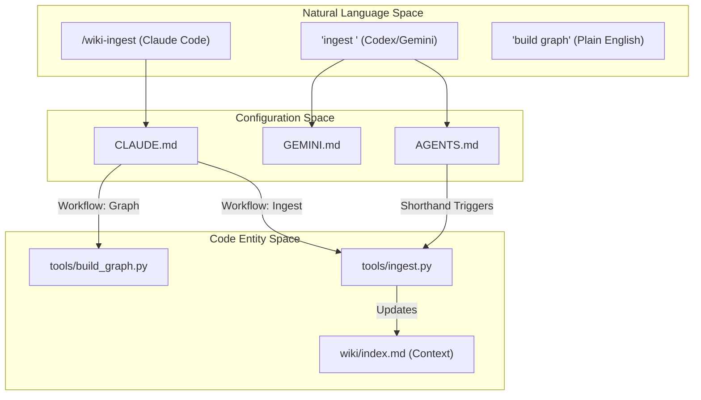
Sources: [CLAUDE.md:5-12](), [AGENTS.md:13-18](), [GEMINI.md:13-17]()

---

### Core Schema Components

Regardless of the specific agent, all configuration files enforce a unified structure to ensure consistency across the knowledge base.

| Component | Purpose | Code Reference |
| :--- | :--- | :--- |
| **Directory Layout** | Defines the "ownership" of folders like `wiki/` and `raw/`. | [CLAUDE.md:24-38]() |
| **Page Frontmatter** | YAML schema for `title`, `type`, `tags`, and `sources`. | [CLAUDE.md:46-54]() |
| **Naming Conventions** | Enforces `kebab-case` for sources and `TitleCase` for entities/concepts. | [CLAUDE.md:152-158]() |
| **Index/Log Format** | Standardizes how the agent reads the catalog and appends audit trails. | [CLAUDE.md:159-189]() |

#### Shared Directory Ownership
The agents are instructed that the `raw/` directory is immutable, while the `wiki/` directory is entirely owned and managed by the agent [CLAUDE.md:27-28](). This separation ensures that original data remains untouched while the agent-generated synthesis evolves.

Sources: [CLAUDE.md:24-38](), [AGENTS.md:21-35](), [GEMINI.md:21-35]()

---

### Claude Code Schema (CLAUDE.md)

`CLAUDE.md` is the most feature-rich configuration file. It introduces **Slash Commands** (e.g., `/wiki-ingest`, `/wiki-query`) which provide a structured CLI-like experience within the Claude Code interface [CLAUDE.md:7-12](). 

It also defines the specific four-pass logic for the **Ingest Workflow**, which includes reading context from `wiki/index.md` and `wiki/overview.md` before generating new content [CLAUDE.md:60-74]().

For a deep dive into these definitions, see [CLAUDE.md — Claude Code Schema](#2.1).

Sources: [CLAUDE.md:1-189]()

---

### Alternative Agent Schemas (AGENTS.md & GEMINI.md)

While Claude Code uses slash commands, other agents like Codex or Gemini CLI rely on **Shorthand Triggers** and plain English descriptions.

**Trigger Mapping Comparison**

| Agent | Ingest Trigger | Graph Trigger |
| :--- | :--- | :--- |
| **Claude Code** | `/wiki-ingest` | `/wiki-graph` |
| **Codex/OpenCode** | `ingest <file>` | `build graph` |
| **Gemini CLI** | `ingest <file>` | `build graph` |

These configurations also provide fallback instructions. For example, if the environment lacks Python dependencies, the agents are instructed to manually parse `[[wikilinks]]` using `grep` to build `graph/graph.json` [CLAUDE.md:144-149](), [AGENTS.md:137-142]().

For more details on these alternative interfaces, see [AGENTS.md & GEMINI.md — Alternative Agent Schemas](#2.2).

**Configuration to Filesystem Mapping**

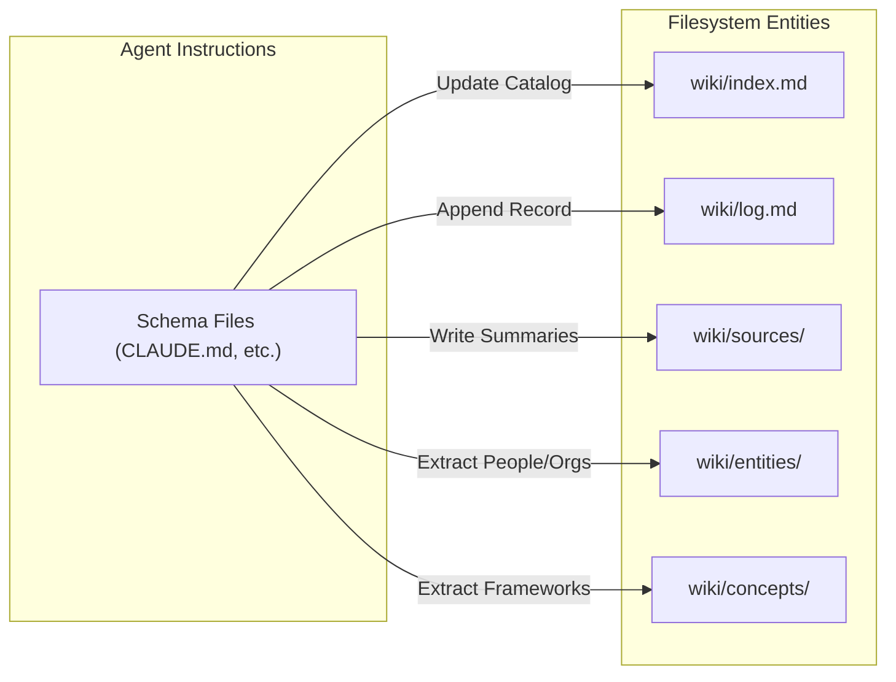
Sources: [CLAUDE.md:24-38](), [CLAUDE.md:159-189](), [AGENTS.md:21-35]()

---

# Page: CLAUDE.md — Claude Code Schema

# CLAUDE.md — Claude Code Schema

<details>
<summary>Relevant source files</summary>

The following files were used as context for generating this wiki page:

- [.claude/commands/wiki-graph.md](.claude/commands/wiki-graph.md)
- [.claude/commands/wiki-ingest.md](.claude/commands/wiki-ingest.md)
- [.claude/commands/wiki-lint.md](.claude/commands/wiki-lint.md)
- [.claude/commands/wiki-query.md](.claude/commands/wiki-query.md)
- [CLAUDE.md](CLAUDE.md)

</details>


This page provides a technical deep dive into `CLAUDE.md`, the primary configuration file that governs how Claude Code interacts with the LLM Wiki Agent. It defines the slash commands, directory structures, metadata schemas, and the four core workflows that allow Claude to manage the wiki autonomously without external Python scripts.

## Overview and Purpose

`CLAUDE.md` serves as the system prompt and operational manual for Claude Code. It bridges the gap between natural language instructions and structured filesystem operations. By defining specific workflows and naming conventions, it ensures that the LLM maintains a consistent knowledge base across multiple sessions.

**Sources:** [CLAUDE.md:1-5]()

---

## Slash Commands & Trigger Mapping

Claude Code maps specific slash commands to internal workflows defined in the `.claude/commands/` directory. These commands provide a shorthand for complex multi-step operations.

| Command | System Trigger | Target File |
| :--- | :--- | :--- |
| `/wiki-ingest` | `ingest raw/file.md` | [.claude/commands/wiki-ingest.md:1-19]() |
| `/wiki-query` | `query: <question>` | [.claude/commands/wiki-query.md:1-15]() |
| `/wiki-lint` | `lint the wiki` | [.claude/commands/wiki-lint.md:1-20]() |
| `/wiki-graph` | `build the knowledge graph` | [.claude/commands/wiki-graph.md:1-19]() |

**Sources:** [CLAUDE.md:5-18](), [.claude/commands/wiki-ingest.md:3-5](), [.claude/commands/wiki-query.md:3-5](), [.claude/commands/wiki-lint.md:3-3](), [.claude/commands/wiki-graph.md:3-3]()

---

## Directory Layout & Taxonomy

The system enforces a strict directory hierarchy. Claude "owns" the `wiki/` and `graph/` directories, while the `raw/` directory is treated as an immutable source of truth.

### Filesystem Structure
- `raw/`: Immutable source documents. [CLAUDE.md:27-27]()
- `wiki/`: The active knowledge layer. [CLAUDE.md:28-28]()
    - `index.md`: Central catalog for routing and discovery. [CLAUDE.md:29-29]()
    - `log.md`: Append-only audit trail for operations. [CLAUDE.md:30-30]()
    - `overview.md`: High-level synthesis of all knowledge. [CLAUDE.md:31-31]()
    - `sources/`: Summaries of individual files in `raw/`. [CLAUDE.md:32-32]()
    - `entities/`: Pages for people, companies, and projects. [CLAUDE.md:33-33]()
    - `concepts/`: Pages for ideas, frameworks, and theories. [CLAUDE.md:34-34]()
    - `syntheses/`: Persisted answers to complex queries. [CLAUDE.md:35-35]()
- `graph/`: Artifacts for visualization (JSON/HTML). [CLAUDE.md:36-36]()

**Sources:** [CLAUDE.md:24-38]()

---

## Page Frontmatter & Naming Conventions

Consistency in file naming and metadata is critical for Claude's `Grep` and `Read` tools to function effectively.

### Metadata Schema
All wiki pages must include a YAML frontmatter block:
```yaml
---
title: "Page Title"
type: source | entity | concept | synthesis
tags: []
sources: []       # Slugs of source pages informing this content
last_updated: YYYY-MM-DD
---
```
**Sources:** [CLAUDE.md:44-54]()

### Naming Standards
- **Source Slugs**: `kebab-case` (matches the filename in `raw/`). [CLAUDE.md:154-154]()
- **Entity/Concept Pages**: `TitleCase.md` (e.g., `TransformerArchitecture.md`). [CLAUDE.md:155-156]()
- **Wikilinks**: Always use the `[[PageName]]` format to facilitate graph extraction. [CLAUDE.md:56-56]()

---

## Core Workflow Definitions

### 1. Ingest Workflow
The Ingest workflow transforms raw text into structured wiki components. It is a multi-file write operation that maintains global state.

**Data Flow: Raw to Wiki**
1. **Read**: Ingests the full text of the target file in `raw/`. [CLAUDE.md:65-65]()
2. **Context**: Reads `wiki/index.md` and `wiki/overview.md` to prevent duplication. [CLAUDE.md:66-66]()
3. **Write Source**: Creates `wiki/sources/<slug>.md`. [CLAUDE.md:67-67]()
4. **Update Globals**: Updates the `index.md` catalog and the `overview.md` synthesis. [CLAUDE.md:68-69]()
5. **Extract Entities/Concepts**: Creates or updates pages in `entities/` and `concepts/`. [CLAUDE.md:70-71]()
6. **Log**: Appends an entry to `wiki/log.md` using the standard format: `## [YYYY-MM-DD] ingest | <Title>`. [CLAUDE.md:73-73]()

**Sources:** [CLAUDE.md:60-74](), [.claude/commands/wiki-ingest.md:7-16]()

### 2. Query Workflow
The Query workflow acts as a local RAG (Retrieval-Augmented Generation) loop.

**Logic Flow: Natural Language to Synthesis**
1. **Discovery**: Claude reads `wiki/index.md` to find relevant page paths. [CLAUDE.md:111-111]()
2. **Retrieval**: Claude uses the `Read` tool on up to 10 identified pages. [.claude/commands/wiki-query.md:9-9]()
3. **Synthesis**: Generates a response with `[[wikilink]]` citations. [CLAUDE.md:113-113]()
4. **Persistence**: Offers to save the result to `wiki/syntheses/`. [CLAUDE.md:114-114]()

**Sources:** [CLAUDE.md:106-116](), [.claude/commands/wiki-query.md:7-12]()

### 3. Lint Workflow
The Lint workflow performs structural and semantic validation using `Grep` and `Glob`.

**Conceptual Mapping: Linting Rules**
- **Structural**: Detects **Orphan pages** (no inbound links) and **Broken links** (missing targets). [CLAUDE.md:123-124]()
- **Heuristic**: Identifies **Missing entity pages** if a name appears in 3+ pages. [CLAUDE.md:127-127]()
- **Semantic**: Flags **Contradictions** and **Stale summaries** by comparing timestamps and claims. [CLAUDE.md:125-126]()

**Sources:** [CLAUDE.md:118-132](), [.claude/commands/wiki-lint.md:5-17]()

### 4. Graph Workflow
The Graph workflow builds a network representation of the wiki.

**Implementation Logic: Two-Pass Extraction**
1. **Pass 1 (Deterministic)**: Grep for all `[[wikilinks]]` to create `EXTRACTED` edges. [CLAUDE.md:139-139]()
2. **Pass 2 (Inferred)**: Claude analyzes page content to find implicit relationships, creating `INFERRED` edges with confidence scores. [CLAUDE.md:140-140]()
3. **Visualization**: Generates `graph/graph.json` and a `vis.js` based `graph/graph.html`. [CLAUDE.md:142-142]()

**Sources:** [CLAUDE.md:134-150](), [.claude/commands/wiki-graph.md:7-14]()

---

## Technical Architecture Diagrams

### Diagram 1: Ingest Pipeline (Natural Language to Code Entities)
This diagram illustrates how a single `/wiki-ingest` command propagates through the system's files and directories.

Title: Ingest Workflow Data Flow
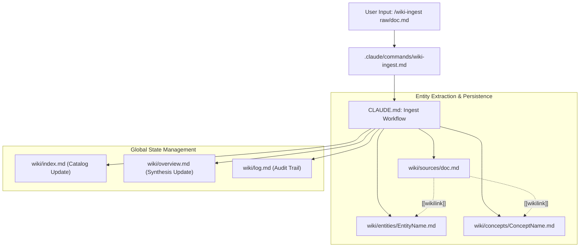
**Sources:** [CLAUDE.md:60-74](), [.claude/commands/wiki-ingest.md:7-16]()

### Diagram 2: Graph Construction Logic
This diagram bridges the gap between the markdown files (Natural Language) and the graph artifacts (Data Entities).

Title: Graph Generation Logic
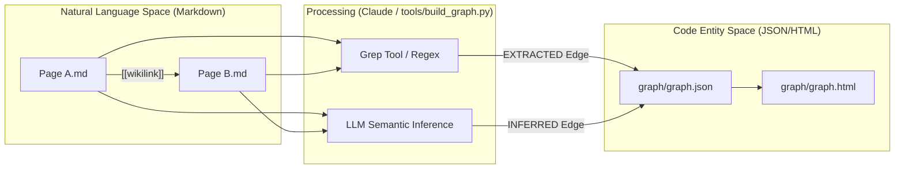
**Sources:** [CLAUDE.md:134-150](), [.claude/commands/wiki-graph.md:7-14]()

---

## State Tracking: Index and Log Formats

### Index Format
The `wiki/index.md` acts as the system's routing table. Claude uses this to find the relative paths of entities and concepts.
- **Sources**: Lists `sources/slug.md` with one-line summaries. [CLAUDE.md:167-168]()
- **Entities/Concepts**: Lists `entities/TitleCase.md` and `concepts/TitleCase.md`. [CLAUDE.md:170-174]()

### Log Format
The `wiki/log.md` is designed for high-speed parsing via `grep`.
- **Structure**: `## [YYYY-MM-DD] <operation> | <title>` [CLAUDE.md:182-182]()
- **Operations**: `ingest`, `query`, `lint`, `graph`. [CLAUDE.md:188-188]()

**Sources:** [CLAUDE.md:159-189]()

---

# Page: AGENTS.md & GEMINI.md — Alternative Agent Schemas

# AGENTS.md & GEMINI.md — Alternative Agent Schemas

<details>
<summary>Relevant source files</summary>

The following files were used as context for generating this wiki page:

- [AGENTS.md](AGENTS.md)
- [GEMINI.md](GEMINI.md)

</details>


This page documents the configuration and behavioral instructions for alternative LLM agents, specifically those using the `AGENTS.md` (Codex/OpenCode) and `GEMINI.md` (Gemini CLI) schemas. While `CLAUDE.md` is optimized for Claude Code's tool-calling capabilities, these files provide a structured framework for agents that rely more heavily on direct filesystem manipulation and natural language instructions.

## Purpose and Scope

The `AGENTS.md` and `GEMINI.md` files serve as "System Instructions" for non-Claude agents. They define the same four core workflows (Ingest, Query, Lint, Graph) but use a simplified shorthand trigger syntax [AGENTS.md:13-18]() [GEMINI.md:13-17](). These schemas ensure that regardless of the LLM used, the resulting wiki structure remains consistent and interoperable.

---

## Shorthand Trigger Syntax

Both schemas define a set of "shorthand triggers" that allow the user to initiate complex workflows without verbose descriptions.

| Command | Workflow | Description |
| :--- | :--- | :--- |
| `ingest <file>` | **Ingest** | Processes a raw file into the wiki. |
| `query: <question>` | **Query** | Searches the wiki and synthesizes an answer. |
| `lint` | **Lint** | Performs structural and semantic health checks. |
| `build graph` | **Graph** | Generates the knowledge graph files. |

**Sources:** [AGENTS.md:13-18](), [GEMINI.md:13-17]()

---

## Implementation Logic & Data Flow

The following diagram illustrates how the Agent (Codex/Gemini) maps these natural language triggers to specific file operations and directory structures.

### Diagram: Trigger to Code Entity Mapping

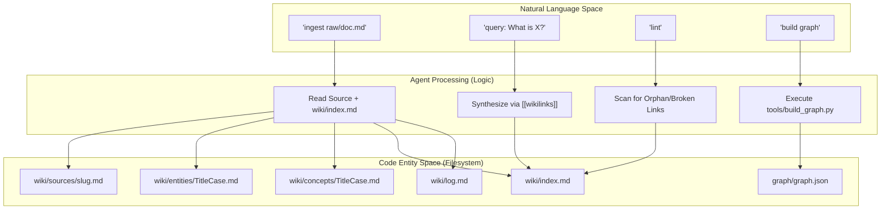

**Sources:** [AGENTS.md:57-71](), [AGENTS.md:103-112](), [GEMINI.md:57-69](), [GEMINI.md:99-107]()

---

## Workflow Details

### 1. Ingest Workflow
The Ingest workflow is the primary method for data entry. Unlike the Python-based `tools/ingest.py`, the agent-based ingest is expected to manually perform the following sequence:
1. **Context Acquisition**: Read the source document and the current `wiki/index.md` and `wiki/overview.md` [AGENTS.md:62-63]().
2. **File Creation**: Write the summary to `wiki/sources/<slug>.md` using the mandatory `kebab-case` naming convention [AGENTS.md:64,148]().
3. **Cross-Linking**: Update or create `wiki/entities/` and `wiki/concepts/` pages using `TitleCase.md` [AGENTS.md:67-68,149-150]().
4. **Audit Trail**: Append a standardized entry to `wiki/log.md` in the format `## [YYYY-MM-DD] ingest | <Title>` [AGENTS.md:70,175]().

### 2. Query Workflow
The agent acts as a retrieval engine:
- It parses `wiki/index.md` to identify relevant files [AGENTS.md:108]().
- It synthesizes an answer using `[[PageName]]` wikilink citations [AGENTS.md:110]().
- It offers to persist the result in `wiki/syntheses/` [AGENTS.md:111]().

### 3. Lint Workflow
The Lint workflow focuses on wiki integrity. The agent is instructed to check for:
- **Orphan pages**: Pages with no inbound links [AGENTS.md:120]().
- **Broken links**: Links to non-existent pages [AGENTS.md:121]().
- **Missing entities**: Entities mentioned 3+ times without a dedicated page [AGENTS.md:124]().

### 4. Graph Workflow
The agent first attempts to run `python tools/build_graph.py --open` [AGENTS.md:135](). If the environment lacks Python, the agent is instructed to manually build `graph/graph.json` and `graph/graph.html` by extracting all `[[wikilinks]]` and inferring implicit relationships [AGENTS.md:137-142]().

---

## Comparison of Schema Structures

The alternative schemas maintain strict compatibility with the core system but differ slightly in their presentation to the agent.

### Schema Comparison Table

| Feature | AGENTS.md (Codex/OpenCode) | GEMINI.md (Gemini CLI) |
| :--- | :--- | :--- |
| **Primary Focus** | Manual filesystem orchestration | CLI-based interaction |
| **Ingest Steps** | 9 detailed steps [AGENTS.md:61-70]() | 8 summarized steps [GEMINI.md:61-68]() |
| **Graph Logic** | Detailed manual fallback [AGENTS.md:137-142]() | Simplified manual fallback [GEMINI.md:122]() |
| **Naming** | Strict Kebab/TitleCase [AGENTS.md:146-150]() | Strict Kebab/TitleCase [GEMINI.md:126-129]() |

### Data Flow: Page Generation

The following diagram shows the internal data flow when an agent generates a new `source` page.

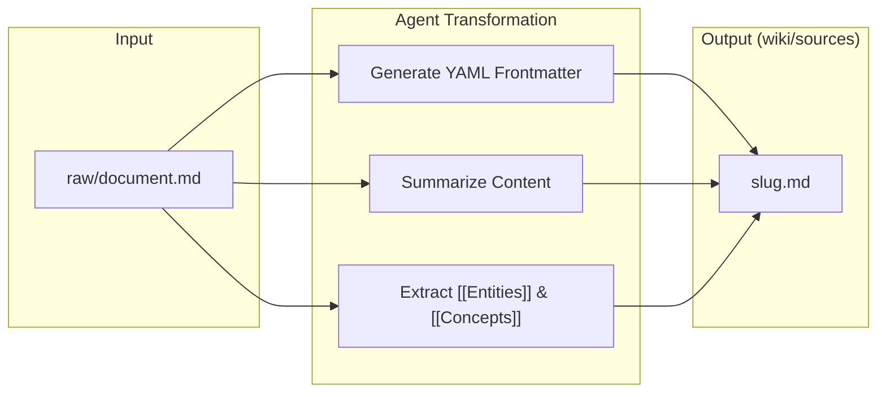

**Sources:** [AGENTS.md:72-99](), [GEMINI.md:70-95]()

---

## Global State Maintenance

Agents are required to maintain three global state files during every operation:
1. **`wiki/index.md`**: Must be updated to include new pages under the correct section (Sources, Entities, Concepts, or Syntheses) [AGENTS.md:152-171]().
2. **`wiki/overview.md`**: Must be revised if a new ingest changes the high-level understanding of the knowledge base [AGENTS.md:66]().
3. **`wiki/log.md`**: Must receive an append-only update for every workflow execution [AGENTS.md:173-178]().

**Sources:** [AGENTS.md:21-35](), [GEMINI.md:21-35]()

---

# Page: Core Workflows

# Core Workflows

<details>
<summary>Relevant source files</summary>

The following files were used as context for generating this wiki page:

- [AGENTS.md](AGENTS.md)
- [CLAUDE.md](CLAUDE.md)
- [GEMINI.md](GEMINI.md)

</details>


The LLM Wiki Agent operates through four primary workflows that transform raw documents into a structured, interlinked knowledge base. These workflows are designed to be executed either by an AI agent (like Claude Code) following the instructions in `CLAUDE.md` [CLAUDE.md:1-189](), or programmatically via Python scripts in the `tools/` directory [CLAUDE.md:37-37]().

### Workflow Execution Model
The system bridges "Natural Language Space" (user intent) and "Code Entity Space" (file operations and scripts) through a standardized command interface.

| Workflow | Agent Trigger (Claude Code) | Python Tool | Primary Output |
| :--- | :--- | :--- | :--- |
| **Ingest** | `/wiki-ingest` | `tools/ingest.py` | `wiki/sources/`, `wiki/entities/`, `wiki/concepts/` |
| **Query** | `/wiki-query` | `tools/query.py` | `wiki/syntheses/` (optional) |
| **Lint** | `/wiki-lint` | `tools/lint.py` | `wiki/lint-report.md` |
| **Graph** | `/wiki-graph` | `tools/build_graph.py` | `graph/graph.json`, `graph/graph.html` |

**Sources:** [CLAUDE.md:7-12](), [AGENTS.md:13-17](), [GEMINI.md:13-17]()

---

### 1. Ingest Workflow
The Ingest workflow is the primary entry point for data. It transforms an immutable file in `raw/` [CLAUDE.md:27-27]() into a set of interlinked Markdown pages. The process involves reading the source, checking existing context in `wiki/index.md` [CLAUDE.md:66-66](), and generating a structured summary.

**Key Responsibilities:**
- Creating a source summary page with `type: source` [CLAUDE.md:78-84]().
- Extracting and updating `entities/` (People, Orgs) and `concepts/` (Ideas) [CLAUDE.md:70-71]().
- Updating the global `wiki/overview.md` to reflect new knowledge [CLAUDE.md:69-69]().
- Identifying contradictions with existing wiki pages [CLAUDE.md:72-72]().

For details, see [Ingest Workflow](#3.1).

**Sources:** [CLAUDE.md:60-74](), [AGENTS.md:57-71](), [GEMINI.md:57-68]()

---

### 2. Query Workflow
The Query workflow provides a retrieval-augmented synthesis (RAG) interface. Instead of a simple vector search, it uses the `wiki/index.md` [CLAUDE.md:111-111]() as a map to identify relevant pages across the taxonomy.

**Key Responsibilities:**
- Multi-page retrieval based on user questions [CLAUDE.md:112-112]().
- Synthesizing answers using `[[WikiLinks]]` for inline citations [CLAUDE.md:113-113]().
- Optional persistence of answers to `wiki/syntheses/` for future reference [CLAUDE.md:114-114]().

For details, see [Query Workflow](#3.2).

**Sources:** [CLAUDE.md:106-115](), [AGENTS.md:103-112](), [GEMINI.md:99-107]()

---

### 3. Lint Workflow
The Lint workflow ensures the structural and semantic integrity of the wiki. It acts as a "health check" to prevent the knowledge base from becoming fragmented or inconsistent.

**Key Responsibilities:**
- **Structural Checks:** Identifying **Orphan pages** (no inbound links) and **Broken links** [CLAUDE.md:123-124]().
- **Semantic Checks:** Detecting **Contradictions** between pages and identifying **Data gaps** [CLAUDE.md:125-128]().
- **Heuristic Discovery:** Suggesting new entity pages for terms mentioned in 3+ documents [CLAUDE.md:127-127]().

For details, see [Lint Workflow](#3.3).

**Sources:** [CLAUDE.md:118-132](), [AGENTS.md:115-127](), [GEMINI.md:110-116]()

---

### 4. Graph Workflow
The Graph workflow visualizes the connections between entities, concepts, and sources. It utilizes `tools/build_graph.py` to generate a navigable knowledge graph [CLAUDE.md:138-143]().

**Key Responsibilities:**
- **Deterministic Extraction:** Parsing all `[[wikilinks]]` as `EXTRACTED` edges [CLAUDE.md:139-139]().
- **Semantic Inference:** Using LLMs to infer implicit relationships (`INFERRED` edges) [CLAUDE.md:140-140]().
- **Clustering:** Running Louvain community detection to group related topics [CLAUDE.md:141-141]().

For details, see [Graph Workflow](#3.4).

**Sources:** [CLAUDE.md:134-150](), [AGENTS.md:131-143](), [GEMINI.md:118-123]()

---

### System Data Flow Diagram
The following diagram illustrates how user commands trigger transitions between the "Natural Language Space" and the physical "Wiki Layer."

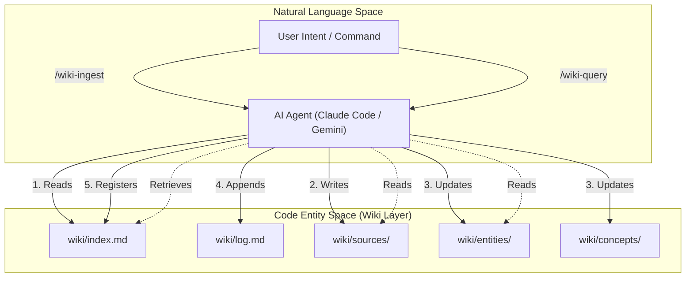
**Sources:** [CLAUDE.md:24-38](), [CLAUDE.md:60-74](), [CLAUDE.md:106-115]()

### Workflow Interdependencies
The workflows are designed to be circular: Ingest builds the data, Query consumes it, Lint fixes it, and Graph visualizes the resulting structure.

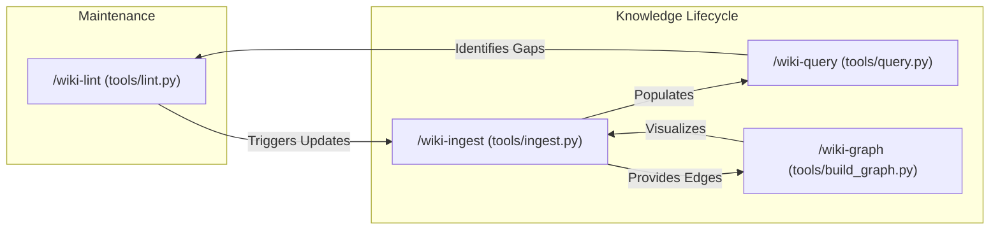
**Sources:** [CLAUDE.md:118-129](), [CLAUDE.md:134-143](), [AGENTS.md:115-127]()

---

# Page: Ingest Workflow

# Ingest Workflow

<details>
<summary>Relevant source files</summary>

The following files were used as context for generating this wiki page:

- [.claude/commands/wiki-ingest.md](.claude/commands/wiki-ingest.md)
- [CLAUDE.md](CLAUDE.md)
- [tools/ingest.py](tools/ingest.py)

</details>


The Ingest Workflow is the primary entry point for adding knowledge to the LLM Wiki. It transforms raw, immutable source documents into structured, interlinked wiki pages. This process can be driven either by an LLM agent (via Claude Code slash commands) or programmatically using the provided Python utility.

## Overview

The ingest pipeline performs a comprehensive update of the wiki state. Rather than just summarizing a document, it cross-references the new information with existing content, updates the global index and overview, creates or updates entity and concept pages, and flags any semantic contradictions.

### Workflow Triggers
- **Claude Code:** `/wiki-ingest raw/path/to/file.md` [CLAUDE.md:9]()
- **Python CLI:** `python tools/ingest.py raw/path/to/file.md` [tools/ingest.py:6-7]()

## Data Flow & System Architecture

The following diagram illustrates how the ingest process bridges the gap between raw files and the structured wiki data model.

**Ingest Data Flow: Raw to Wiki**
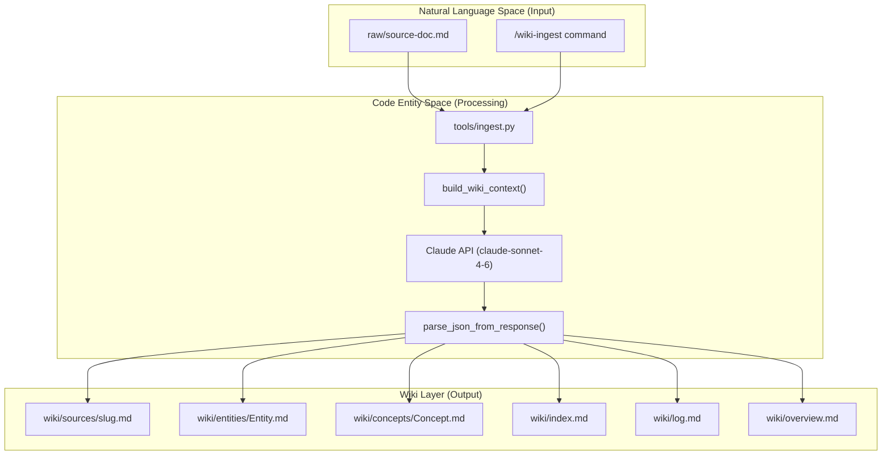
**Sources:** [CLAUDE.md:60-74](), [tools/ingest.py:93-189]()

## Technical Implementation

### 1. Context Assembly
Before calling the LLM, the system gathers the current state of the wiki to ensure consistency. The `build_wiki_context()` function in `tools/ingest.py` performs the following:
- Reads `wiki/index.md` to provide a catalog of existing pages [tools/ingest.py:52-53]().
- Reads `wiki/overview.md` to provide the high-level synthesis [tools/ingest.py:54-55]().
- Reads the 5 most recently modified source pages in `wiki/sources/` to facilitate contradiction checking and relevant interlinking [tools/ingest.py:57-61]().

### 2. The LLM Prompt
The ingest logic uses a structured prompt that includes the `CLAUDE.md` schema, the assembled wiki context, and the new source content [tools/ingest.py:110-141](). It requests a single JSON object containing:
- **`source_page`**: Full markdown for the new source summary [tools/ingest.py:129]().
- **`entity_pages` / `concept_pages`**: Arrays of objects containing paths and updated content for related entities and concepts [tools/ingest.py:132-137]().
- **`overview_update`**: A revised version of the living synthesis [tools/ingest.py:131]().
- **`contradictions`**: A list of any claims that conflict with the existing wiki context [tools/ingest.py:138]().

### 3. State Persistence
Once the LLM returns the JSON payload, the system updates the filesystem:
- **New Source**: Created at `wiki/sources/<slug>.md` [tools/ingest.py:161]().
- **Entities/Concepts**: Files are written to their respective directories. If they already exist, they are overwritten with the updated content including the new source references [tools/ingest.py:164-169]().
- **Index**: The `update_index()` function injects a new markdown link into the appropriate section of `wiki/index.md` [tools/ingest.py:76-85]().
- **Audit Log**: An entry is prepended to `wiki/log.md` using the standard `## [YYYY-MM-DD] ingest | <Title>` format [tools/ingest.py:88-90]().

**Sequence: Ingest Execution**
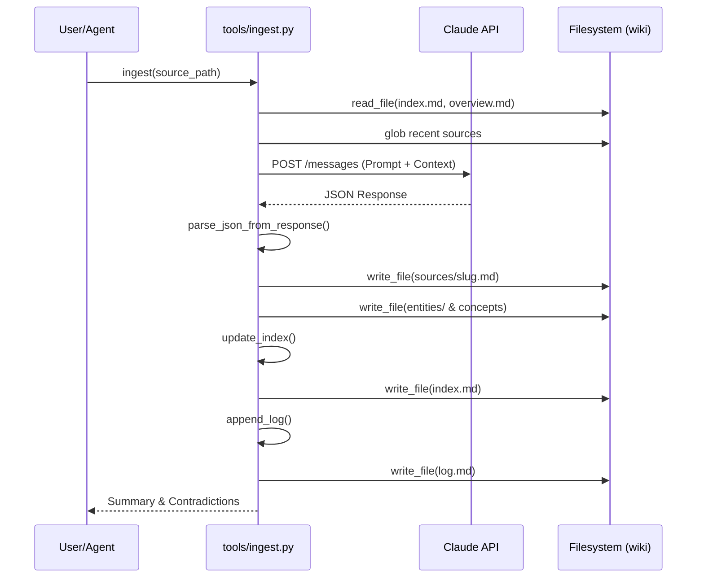
**Sources:** [tools/ingest.py:93-189](), [.claude/commands/wiki-ingest.md:7-16]()

## Source Page Structure

Every source page generated during ingest follows a strict template to ensure it remains parseable by both humans and LLMs:

| Section | Description |
| :--- | :--- |
| **Frontmatter** | YAML containing `title`, `type: source`, `tags`, `date`, and `source_file` path [CLAUDE.md:78-84](). |
| **Summary** | A 2–4 sentence high-level overview [CLAUDE.md:86-87](). |
| **Key Claims** | Bulleted list of the primary arguments or findings [CLAUDE.md:89-91](). |
| **Key Quotes** | Significant direct quotes with context [CLAUDE.md:93-94](). |
| **Connections** | `[[WikiLinks]]` to related Entity and Concept pages [CLAUDE.md:96-98](). |
| **Contradictions** | Explicit flagging of conflicts with other wiki pages [CLAUDE.md:100-101](). |

## Contradiction Flagging

One of the most critical steps in the ingest workflow is the detection of contradictions [CLAUDE.md:72](). During the LLM call, the model compares the "New source to ingest" against the "Current wiki state" [tools/ingest.py:115-121](). 

If the model identifies a conflict (e.g., a new paper refuting a claim in an older summary), it:
1. Adds a description to the `contradictions` field in the JSON response [tools/ingest.py:138]().
2. Includes the contradiction in the `## Contradictions` section of the new source page [CLAUDE.md:100-101]().
3. Prints a warning to the console/agent interface during the final report [tools/ingest.py:182-186]().

**Sources:**
- [CLAUDE.md:60-102]() (Workflow definition and page formats)
- [tools/ingest.py:1-196]() (Python implementation details)
- [.claude/commands/wiki-ingest.md:1-19]() (Slash command logic)

---

# Page: Query Workflow

# Query Workflow

<details>
<summary>Relevant source files</summary>

The following files were used as context for generating this wiki page:

- [.claude/commands/wiki-query.md](.claude/commands/wiki-query.md)
- [CLAUDE.md](CLAUDE.md)
- [tools/query.py](tools/query.py)

</details>


The Query Workflow is a retrieval-augmented synthesis pipeline designed to extract and consolidate information from the wiki's distributed knowledge base. Unlike traditional RAG which often relies on vector embeddings, this system utilizes a two-stage discovery process: deterministic keyword matching against the `wiki/index.md` followed by an LLM-assisted relevance selection. The final output is a structured synthesis featuring `[[wikilink]]` citations and optional persistence to the `wiki/syntheses/` directory.

The workflow is accessible via the Claude Code slash command `/wiki-query` or the standalone `tools/query.py` script.

### System Data Flow: Natural Language to Code Entities

The following diagram illustrates how a natural language query moves through the system's code entities to produce a synthesized answer.

**Query Execution Path**
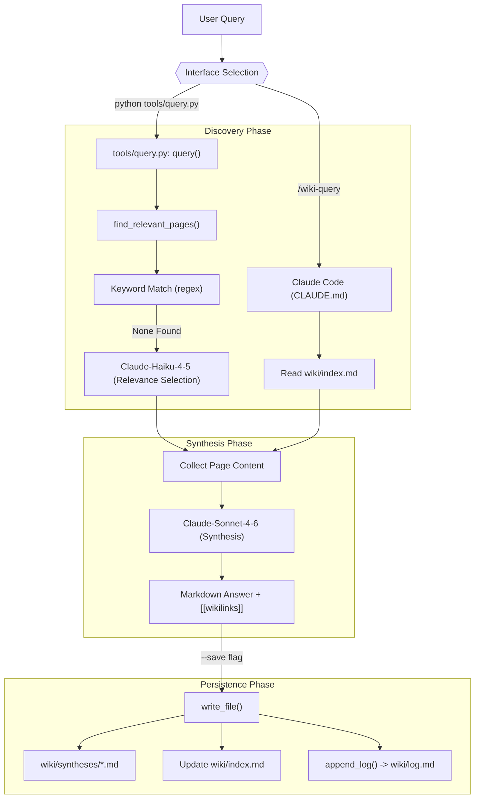
**Sources:** [CLAUDE.md:106-115](), [.claude/commands/wiki-query.md:1-15](), [tools/query.py:41-58](), [tools/query.py:65-169]()

---

### Retrieval and Discovery Logic

The workflow prioritizes a "small-to-large" context gathering strategy to avoid context window overflow and ensure high signal-to-noise ratios.

#### 1. Page Discovery
The system first reads `wiki/index.md` to identify potential matches [tools/query.py:69-70](). 
- **Keyword Matching:** The `find_relevant_pages` function uses regular expressions to extract all links from the index and checks if words from the user's question (longer than 3 characters) appear in the page titles [tools/query.py:42-52]().
- **LLM-Assisted Selection:** If keyword matching fails to find sufficient results, the `tools/query.py` script calls `claude-haiku-4-5` with the full index content. The model is instructed to return a JSON array of the top 10 most relevant file paths [tools/query.py:79-96]().
- **Context Capping:** The total number of retrieved pages is capped at 12 to maintain performance and stay within model limits [tools/query.py:57]().

#### 2. Synthesis and Citation
Once the relevant `.md` files are identified, their full content is concatenated into a `pages_context` string [tools/query.py:99-102](). This context, along with the system schema from `CLAUDE.md`, is sent to `claude-sonnet-4-6` [tools/query.py:107-129]().

The model is required to:
- Generate a well-structured Markdown response.
- Use `[[PageName]]` syntax for inline citations [tools/query.py:116-127]().
- Include a `## Sources` section at the bottom listing every page referenced [.claude/commands/wiki-query.md:11]().

**Sources:** [tools/query.py:41-58](), [tools/query.py:78-97](), [tools/query.py:109-129](), [.claude/commands/wiki-query.md:7-12]()

---

### Persistence and Logging

Users can choose to persist a query's output as a permanent "Synthesis" page. This converts a transient answer into a long-term knowledge asset.

| Action | Entity Involved | Implementation Detail |
| :--- | :--- | :--- |
| **File Creation** | `wiki/syntheses/<slug>.md` | Created with standard YAML frontmatter including `type: synthesis` [tools/query.py:146-156](). |
| **Index Update** | `wiki/index.md` | Appends the new synthesis under the `## Syntheses` header [tools/query.py:158-164](). |
| **Audit Trail** | `wiki/log.md` | Appends a `query` operation entry using the `append_log()` function [tools/query.py:167-169](). |

**Code Entity Relationship: Persistence**
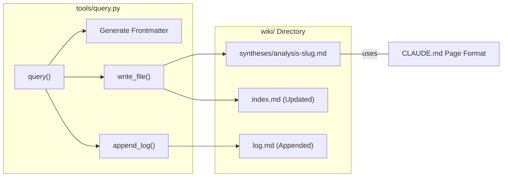
**Sources:** [CLAUDE.md:180-189](), [tools/query.py:137-169](), [tools/query.py:60-63]()

---

### Tool Usage Reference: `tools/query.py`

The Python implementation provides a programmatic interface for batch queries or automated synthesis generation.

**Key Functions:**
- `find_relevant_pages(question, index_content)`: Performs the initial regex-based search for matching titles in the index [tools/query.py:41-58]().
- `query(question, save_path)`: The main orchestrator that manages the Anthropic API calls for both selection (Haiku) and synthesis (Sonnet) [tools/query.py:65-169]().
- `append_log(entry)`: Ensures the query is recorded in the global `wiki/log.md` for auditability [tools/query.py:60-63]().

**CLI Usage Examples:**
- Basic query: `python tools/query.py "What are the main themes?"` [tools/query.py:6]()
- Query and save (interactive slug prompt): `python tools/query.py "How does X relate to Y?" --save` [tools/query.py:7]()
- Query and save to specific path: `python tools/query.py "Summary" --save synthesis/my-analysis.md` [tools/query.py:8]()

**Sources:** [tools/query.py:1-13](), [tools/query.py:41-63](), [tools/query.py:65-177]()

---

# Page: Lint Workflow

# Lint Workflow

<details>
<summary>Relevant source files</summary>

The following files were used as context for generating this wiki page:

- [.claude/commands/wiki-lint.md](.claude/commands/wiki-lint.md)
- [CLAUDE.md](CLAUDE.md)
- [tools/lint.py](tools/lint.py)

</details>


The **Lint Workflow** is a two-phase health check designed to maintain the integrity and quality of the wiki. It combines deterministic structural analysis (detecting broken links and orphans) with LLM-powered semantic analysis (identifying contradictions and data gaps). This workflow ensures that as the wiki grows through automated ingests, it remains a cohesive and accurate knowledge base rather than a collection of fragmented summaries.

### Overview of Linting Phases

The system executes two distinct types of checks:
1.  **Structural Checks**: Handled via file system traversal, regex-based link extraction, and mention counting.
2.  **Semantic Checks**: Handled by passing a sample of wiki pages to the Claude API to reason about conflicting claims and content freshness.

---

### Implementation & Data Flow

The linting process can be triggered via the Claude Code slash command `/wiki-lint` or programmatically via `tools/lint.py`. Both methods follow the same logic for identifying issues.

#### Logic Flow: Structural vs. Semantic
The following diagram illustrates how the `tools/lint.py` script coordinates data between the local file system and the Anthropic API.

**Diagram: Lint Workflow Data Flow**
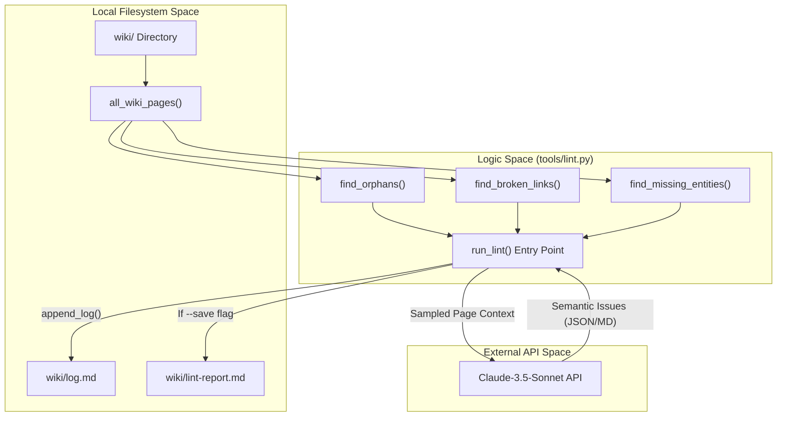
**Sources:** [tools/lint.py:36-182](), [CLAUDE.md:118-130]()

---

### Structural Checks (Deterministic)

Structural checks rely on the `extract_wikilinks` function, which uses a regex `\[\[([^\]]+)\]\]` to find all internal references [tools/lint.py:41-42]().

| Check | Code Entity | Logic |
| :--- | :--- | :--- |
| **Orphan Pages** | `find_orphans()` | Identifies pages in the `wiki/` directory that have zero inbound `[[links]]` from any other page, excluding `overview.md` [tools/lint.py:54-62](). |
| **Broken Links** | `find_broken_links()` | Iterates through all extracted `[[links]]` and checks if the target string resolves to a valid file path using `page_name_to_path()` [tools/lint.py:65-72](). |
| **Missing Entities** | `find_missing_entities()` | Scans for terms that are frequently mentioned (3+ times) across different pages but do not yet have a dedicated page in `entities/` or `concepts/` [tools/lint.py:75-85](). |

**Sources:** [tools/lint.py:45-85](), [.claude/commands/wiki-lint.md:7-10]()

---

### Semantic Checks (LLM-Assisted)

Semantic checks address issues that cannot be caught by simple string matching. Because sending the entire wiki to an LLM may exceed context limits, `tools/lint.py` creates a context window by sampling the first 20 pages and truncating them to 1500 characters each [tools/lint.py:109-113]().

The `run_lint()` function prompts `claude-sonnet-4-6` to identify the following:
*   **Contradictions**: Conflicting claims between different source summaries [CLAUDE.md:125]().
*   **Stale Summaries**: Pages that have not been updated despite newer ingested sources providing more current information [CLAUDE.md:126]().
*   **Data Gaps**: Critical questions that the current wiki content cannot answer, resulting in suggestions for new source documents to ingest [CLAUDE.md:128]().

**Sources:** [tools/lint.py:115-140](), [.claude/commands/wiki-lint.md:12-15]()

---

### Integration with Claude Code

When using the `/wiki-lint` command, Claude Code follows the `Lint Workflow` defined in the system prompt. It utilizes the `Grep` and `Read` tools to perform structural checks manually if the Python environment is unavailable [CLAUDE.md:122-130]().

**Diagram: Claude Code Tool Usage for Linting**
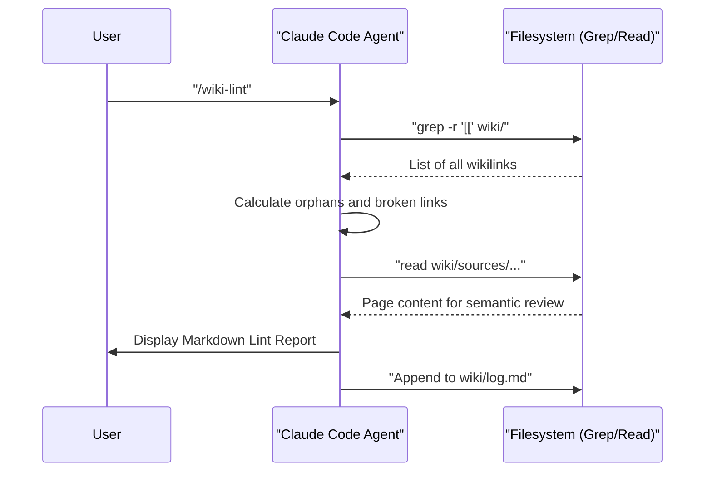
**Sources:** [.claude/commands/wiki-lint.md:1-20](), [CLAUDE.md:118-130]()

### Reporting and Logging

Every linting operation concludes by generating a report and updating the system audit trail:
*   **Report Generation**: A markdown file is created (optionally saved to `wiki/lint-report.md`) containing sections for Structural Issues, Contradictions, Stale Content, and Data Gaps [tools/lint.py:145-182]().
*   **Audit Trail**: The script appends a grep-parseable entry to `wiki/log.md` using the format `## [YYYY-MM-DD] lint | Wiki health check` [tools/lint.py:203-204]().

**Sources:** [tools/lint.py:197-204](), [CLAUDE.md:180-189]()

---

# Page: Graph Workflow

# Graph Workflow

<details>
<summary>Relevant source files</summary>

The following files were used as context for generating this wiki page:

- [.claude/commands/wiki-graph.md](.claude/commands/wiki-graph.md)
- [CLAUDE.md](CLAUDE.md)
- [graph/.gitkeep](graph/.gitkeep)
- [tools/build_graph.py](tools/build_graph.py)

</details>


The **Graph Workflow** is a two-pass pipeline responsible for transforming the flat Markdown files of the `wiki/` directory into a structured, navigable knowledge graph. It combines deterministic parsing of `[[wikilinks]]` with LLM-based semantic inference to uncover implicit relationships between entities, concepts, and sources.

## Workflow Overview

The workflow can be triggered via the `/wiki-graph` slash command in Claude Code or by executing the `tools/build_graph.py` script. The process results in two primary artifacts: a data-rich `graph/graph.json` and an interactive `graph/graph.html` visualization powered by `vis.js`.

### Data Flow & Execution

The system follows a tiered approach to building the graph, ensuring that even if the Python environment lacks specific dependencies (like `networkx`), a functional graph can still be generated manually by the agent.

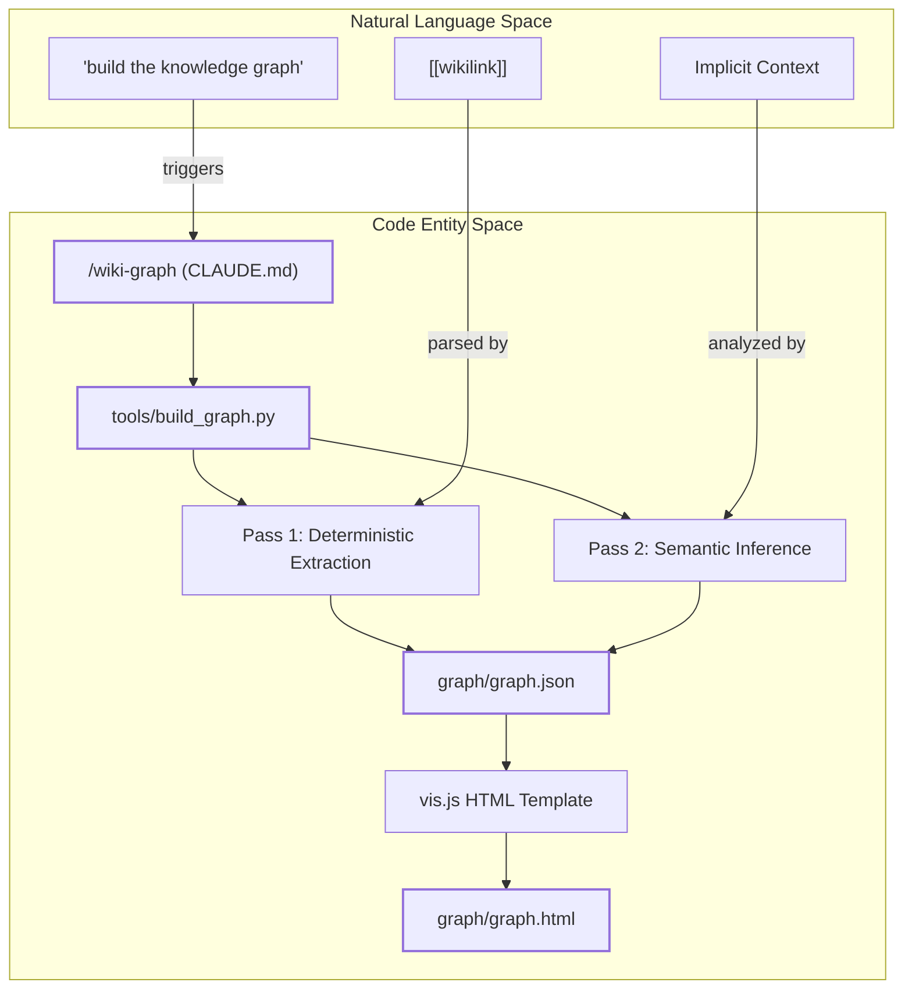
Sources: [CLAUDE.md:134-150](), [.claude/commands/wiki-graph.md:1-19](), [tools/build_graph.py:1-18]()

---

## Technical Implementation

### Pass 1: Deterministic Extraction
The first pass scans all `.md` files in `wiki/sources/`, `wiki/entities/`, and `wiki/concepts/` [tools/build_graph.py:71-73](). It uses a regular expression `r'\[\[([^\]]+)\]\]'` to identify every explicit wikilink [tools/build_graph.py:76-77](). These are tagged as `EXTRACTED` edges with a confidence score of `1.0` [tools/build_graph.py:140]().

### Pass 2: Semantic Inference (Claude-Assisted)
If the `--no-infer` flag is not used, the workflow initiates a second pass using the `claude-haiku-4-5` model [tools/build_graph.py:176]().
1.  **Change Detection**: The script uses SHA256 hashing and a `.cache.json` file to identify which pages have been modified since the last build [tools/build_graph.py:152-158]().
2.  **Contextual Analysis**: For each changed page, Claude is provided with the page content, a list of all existing nodes, and currently extracted edges [tools/build_graph.py:180-191]().
3.  **Edge Classification**: Claude identifies "hidden" connections.
    *   **INFERRED**: High-confidence (≥ 0.7) relationships [tools/build_graph.py:199]().
    *   **AMBIGUOUS**: Low-confidence (< 0.7) relationships [tools/build_graph.py:199]().

### Community Detection
If `networkx` is installed, the script constructs a `nx.Graph()` and applies the Louvain community detection algorithm via `nx_community.louvain_communities` [tools/build_graph.py:31-33](). This assigns a `group` ID to each node, which is used by the visualization to cluster related topics.

---

## System Architecture: Graph Construction

The following diagram maps the internal functions of `tools/build_graph.py` to the data structures they produce.

```mermaid
graph LR
    subgraph "Input Layer"
        W["wiki/*.md"]
    end

    subgraph "Processing: tools/build_graph.py"
        direction TB
        N["build_nodes()"]
        E1["build_extracted_edges()"]
        E2["build_inferred_edges()"]
        L["Louvain Detection (NetworkX)"]
    end

    subgraph "State & Output"
        JSON["graph/graph.json"]
        HTML["graph/graph.html"]
        CACHE[".cache.json"]
    end

    W --> N
    W --> E1
    W --> E2
    N --> JSON
    E1 --> JSON
    E2 --> JSON
    JSON --> L
    L --> JSON
    JSON --> HTML
    N -.-> CACHE
```
Sources: [tools/build_graph.py:103-142](), [tools/build_graph.py:145-223](), [tools/build_graph.py:431-450]()

---

## Data Schema & Visual Encoding

### Node & Edge Metadata
The graph data is stored in `graph/graph.json` with the following visual mappings:

| Element | Property | Logic / Source |
| :--- | :--- | :--- |
| **Node Color** | `type` | `source` (#4CAF50), `entity` (#2196F3), `concept` (#FF9800), `synthesis` (#9C27B0) [tools/build_graph.py:48-54]() |
| **Edge Color** | `type` | `EXTRACTED` (#555555), `INFERRED` (#FF5722), `AMBIGUOUS` (#BDBDBD) [tools/build_graph.py:56-60]() |
| **Node Label** | `title` | Extracted from YAML frontmatter [tools/build_graph.py:108-109]() |
| **Edge Label** | `relationship` | Semantic description generated by Claude [tools/build_graph.py:218]() |

### Manual Fallback (Agent-Driven)
If the Python environment is unavailable, the `CLAUDE.md` instructions direct the agent to simulate the `build_graph.py` logic:
1.  Use `grep` to find all `[[wikilinks]]` [CLAUDE.md:145]().
2.  Manually construct the `nodes` and `edges` JSON arrays [CLAUDE.md:146-147]().
3.  Inject the data into the `vis.js` HTML template [CLAUDE.md:148]().

Sources: [CLAUDE.md:134-150](), [tools/build_graph.py:47-60](), [tools/build_graph.py:103-117]()

---

# Page: Wiki Directory Structure & Data Model

# Wiki Directory Structure & Data Model

<details>
<summary>Relevant source files</summary>

The following files were used as context for generating this wiki page:

- [CLAUDE.md](CLAUDE.md)
- [wiki/index.md](wiki/index.md)
- [wiki/log.md](wiki/log.md)
- [wiki/overview.md](wiki/overview.md)

</details>


The `wiki/` directory serves as the primary state store and "source of truth" for the LLM Wiki Agent. Unlike traditional RAG systems that rely on vector databases, this system uses a structured filesystem-as-database approach. This allows LLMs to navigate knowledge using standard file operations (read, grep, list) and maintains human-readable transparency.

The data model is organized into specialized subdirectories based on knowledge type, governed by a strict frontmatter schema and linked through a central indexing layer.

## High-Level Data Flow

The following diagram illustrates how raw information is transformed into structured wiki entities and how the different components of the `wiki/` directory interact.

**Knowledge Transformation Map**
```mermaid
graph TD
    subgraph "Natural Language Space (Input)"
        RAW["raw/ (Source Documents)"]
    end

    subgraph "Code Entity Space (System State)"
        direction TB
        INDEX["wiki/index.md (Central Catalog)"]
        LOG["wiki/log.md (Audit Trail)"]
        OVERVIEW["wiki/overview.md (Global Synthesis)"]
        
        subgraph "Knowledge Taxonomy"
            SOURCES["wiki/sources/ (Summaries)"]
            ENTITIES["wiki/entities/ (People/Orgs)"]
            CONCEPTS["wiki/concepts/ (Ideas/Methods)"]
            SYNTHESES["wiki/syntheses/ (Query Results)"]
        end
    end

    RAW -->|"/wiki-ingest"| SOURCES
    SOURCES -->|Update| INDEX
    SOURCES -->|Update| OVERVIEW
    SOURCES -->|Append| LOG
    
    SOURCES -.->|[[wikilinks]]| ENTITIES
    SOURCES -.->|[[wikilinks]]| CONCEPTS
    ENTITIES -.->|[[wikilinks]]| CONCEPTS
    
    INDEX -->|Route Query| SOURCES
    INDEX -->|Route Query| ENTITIES
    INDEX -->|Route Query| CONCEPTS
```
Sources: [CLAUDE.md:24-38](), [CLAUDE.md:60-74]()

---

## Global State Files
The root of the `wiki/` directory contains three critical files that manage the global state of the knowledge base. These files allow the agent to perform rapid discovery without scanning every individual page.

*   **`wiki/index.md`**: The central routing layer. It categorizes every page in the wiki to help the LLM identify relevant context during queries.
*   **`wiki/overview.md`**: A high-level synthesis that is updated during every ingest to reflect the current state of the entire knowledge base.
*   **`wiki/log.md`**: An append-only audit trail that records every operation (`ingest`, `query`, `lint`, `graph`) in a grep-parseable format.

For details, see [Global State Files (index.md, overview.md, log.md)](#4.1).

Sources: [wiki/index.md:1-15](), [wiki/overview.md:1-18](), [wiki/log.md:1-10]()

---

## Page Types & Frontmatter Schema
Every file within the knowledge taxonomy must follow a standardized Markdown format with YAML frontmatter. This metadata allows the agent to track provenance (which raw files informed a page) and temporal relevance.

**Mandatory Frontmatter Fields:**
| Field | Description |
|---|---|
| `title` | The human-readable name of the page. |
| `type` | Must be one of: `source`, `entity`, `concept`, or `synthesis`. |
| `sources` | A list of slugs from `wiki/sources/` that inform this page. |
| `last_updated` | ISO 8601 date of the last modification. |

For details, see [Page Types & Frontmatter Schema](#4.2).

Sources: [CLAUDE.md:44-54](), [CLAUDE.md:78-84]()

---

## Knowledge Taxonomy
The system divides knowledge into four distinct subdirectories. This separation of concerns prevents the LLM from conflating specific document summaries with general conceptual definitions.

**Directory Structure and Naming Conventions**
```mermaid
graph LR
    subgraph "wiki/ (Root)"
        S["sources/"]
        E["entities/"]
        C["concepts/"]
        SY["syntheses/"]
    end

    S -->|Naming| S_NAME["kebab-case.md"]
    E -->|Naming| E_NAME["TitleCase.md"]
    C -->|Naming| C_NAME["TitleCase.md"]
    SY -->|Naming| SY_NAME["kebab-case.md"]

    style S_NAME stroke-dasharray: 5 5
    style E_NAME stroke-dasharray: 5 5
```

*   **`sources/`**: Contains one page per file in `raw/`. Focuses on summaries, key claims, and direct quotes.
*   **`entities/`**: Dedicated to specific "nouns" like people, companies, or projects (e.g., `OpenAI.md`).
*   **`concepts/`**: Dedicated to abstract "ideas" or frameworks (e.g., `ReinforcementLearning.md`).
*   **`syntheses/`**: Stores the output of complex queries that the user has chosen to persist.

For details, see [Knowledge Taxonomy (sources/, entities/, concepts/, syntheses)](#4.3).

Sources: [CLAUDE.md:152-158](), [CLAUDE.md:167-178]()

---

# Page: Global State Files (index.md, overview.md, log.md)

# Global State Files (index.md, overview.md, log.md)

<details>
<summary>Relevant source files</summary>

The following files were used as context for generating this wiki page:

- [CLAUDE.md](CLAUDE.md)
- [wiki/index.md](wiki/index.md)
- [wiki/log.md](wiki/log.md)
- [wiki/overview.md](wiki/overview.md)

</details>


The LLM Wiki Agent relies on three global state files located in the `wiki/` directory to maintain system-wide context, navigation, and auditability. These files serve as the "brain" and "memory" of the wiki, ensuring that the LLM agent can discover existing knowledge and track its own operations without scanning every individual file in the repository.

## 1. wiki/index.md: The Central Catalog

`wiki/index.md` acts as the primary routing layer and directory for the entire wiki [wiki/index.md:1-3](). It is designed to be small enough to fit into the LLM's context window during the initial phase of any workflow, allowing the agent to identify which specific page slugs exist before performing deeper reads [CLAUDE.md:111-112]().

### Implementation and Structure
The file is partitioned into four primary sections corresponding to the wiki's taxonomy [CLAUDE.md:159-178]():
- **Sources**: Maps source document titles to their `wiki/sources/` slugs.
- **Entities**: Lists people, companies, and projects found in `wiki/entities/`.
- **Concepts**: Lists frameworks and theories found in `wiki/concepts/`.
- **Syntheses**: Catalogs saved query answers in `wiki/syntheses/`.

### Data Flow: Index Update
Every time a new source is processed via the Ingest Workflow, the agent is required to update this file [CLAUDE.md:68-69]().

| Step | Component | Action |
| :--- | :--- | :--- |
| 1 | `Ingest Workflow` | Reads `wiki/index.md` to check for existing slugs [CLAUDE.md:66-66](). |
| 2 | `LLM Agent` | Generates new entries for the source and any newly created entity/concept pages [CLAUDE.md:68-71](). |
| 3 | `Write Tool` | Appends or inserts the new markdown links into the appropriate sections [CLAUDE.md:159-178](). |

**Sources:** [CLAUDE.md:60-74](), [CLAUDE.md:159-178](), [wiki/index.md:1-15]()

---

## 2. wiki/overview.md: The Living Synthesis

`wiki/overview.md` is a high-level, "birds-eye view" of the entire knowledge base. Unlike the index, which is a flat list of links, the overview is a narrative synthesis that evolves as new data is ingested [wiki/overview.md:11-11]().

### Technical Details
- **Frontmatter**: It follows the standard synthesis schema, including a `sources` array that lists all slugs contributing to the current overview [wiki/overview.md:1-7]().
- **Update Frequency**: It is updated on **every** ingest operation [CLAUDE.md:69-69]().
- **Purpose**: It provides the LLM with immediate semantic context of the "current state of knowledge" so that new information can be reconciled against existing claims [CLAUDE.md:66-66]().

### Logic for "Living Synthesis"
```mermaid
graph TD
    subgraph "Natural Language Space"
        A["New Source Document"] --> B["LLM Synthesis Logic"]
        C["Existing overview.md"] --> B
    end

    subgraph "Code Entity Space"
        B --> D["Update wiki/overview.md"]
        D --> E["Update last_updated timestamp"]
        D --> F["Append to sources list"]
    end

    style A stroke-dasharray: 5 5
    style C stroke-dasharray: 5 5
```
**Sources:** [CLAUDE.md:66-69](), [wiki/overview.md:1-18]()

---

## 3. wiki/log.md: The Audit Trail

`wiki/log.md` is an append-only chronological record of every operation performed by the agent or the Python tools [wiki/log.md:3-3](). It is specifically formatted to be "grep-friendly" for both humans and automated scripts.

### Format and Operations
Each entry follows a strict single-line header format: `## [YYYY-MM-DD] <operation> | <title>` [CLAUDE.md:182-184]().

Supported operations logged include [CLAUDE.md:188-189]():
- `ingest`: When a new file is added to the wiki.
- `query`: When a complex synthesis is generated.
- `lint`: When a health check is performed.
- `graph`: When the knowledge graph is rebuilt.

### Integration with Shell Tools
Because of the predictable header format, the state of the wiki can be queried via standard CLI tools without parsing the full markdown file [wiki/log.md:7-7]():
```bash
grep "^## \[" wiki/log.md | tail -10
```

**Sources:** [CLAUDE.md:180-189](), [wiki/log.md:1-10]()

---

## 4. System Interaction Diagram

This diagram illustrates how the three global files interact with the core workflows and the filesystem.

**Global State Interaction**
```mermaid
sequenceDiagram
    participant Agent as "LLM Agent (Claude Code)"
    participant Index as "wiki/index.md"
    participant Overview as "wiki/overview.md"
    participant Log as "wiki/log.md"
    participant Pages as "wiki/sources/*.md"

    Note over Agent, Pages: Ingest Workflow Triggered
    Agent->>Index: Read Catalog [CLAUDE.md:66]
    Agent->>Overview: Read Current Synthesis [CLAUDE.md:66]
    Agent->>Pages: Write New Page [CLAUDE.md:67]
    Agent->>Index: Append Link [CLAUDE.md:68]
    Agent->>Overview: Update Narrative [CLAUDE.md:69]
    Agent->>Log: Append Entry [CLAUDE.md:73]
```

**Sources:** [CLAUDE.md:60-74](), [CLAUDE.md:159-189]()

---

# Page: Page Types & Frontmatter Schema

# Page Types & Frontmatter Schema

<details>
<summary>Relevant source files</summary>

The following files were used as context for generating this wiki page:

- [AGENTS.md](AGENTS.md)
- [CLAUDE.md](CLAUDE.md)
- [GEMINI.md](GEMINI.md)
- [wiki/index.md](wiki/index.md)

</details>


This page documents the structural requirements for the LLM Wiki Agent's data model. The system relies on a strict filesystem-as-database approach where metadata is stored in YAML frontmatter and relationships are defined via standard `[[wikilinks]]`.

## Overview of Page Types

The wiki categorizes knowledge into four distinct types, each residing in its own subdirectory. This separation allows the agent to distinguish between primary evidence (sources), atomic nodes (entities/concepts), and derived intelligence (syntheses).

| Type | Directory | Purpose | Naming Convention |
| :--- | :--- | :--- | :--- |
| **Source** | `wiki/sources/` | Summaries of individual files from `raw/`. | `kebab-case.md` |
| **Entity** | `wiki/entities/` | People, companies, projects, or products. | `TitleCase.md` |
| **Concept** | `wiki/concepts/` | Ideas, frameworks, methods, or theories. | `TitleCase.md` |
| **Synthesis** | `wiki/syntheses/` | Persistent answers to complex cross-source queries. | `kebab-case.md` |

**Sources:** [CLAUDE.md:24-38](), [CLAUDE.md:152-158](), [AGENTS.md:146-151]()

---

## Mandatory Frontmatter Schema

Every page in the `wiki/` directory must contain a YAML frontmatter block at the very top of the file. This schema is used by the `Query Workflow` to filter relevant context and by the `Graph Workflow` to categorize nodes.

### Schema Definition
```yaml
---
title: "Display Title"
type: source | entity | concept | synthesis
tags: []             # List of strings for thematic grouping
sources: []          # List of source slugs (filenames) informing this page
last_updated: YYYY-MM-DD
---
```

### Field Descriptions
*   **title**: The human-readable name of the page, used in the `wiki/index.md` catalog [CLAUDE.md:161-178]().
*   **type**: Must be one of the four defined types. This determines the node color in the knowledge graph [CLAUDE.md:49]().
*   **tags**: Optional metadata for ad-hoc grouping.
*   **sources**: A critical field for provenance. For `entity` and `concept` pages, this list tracks which `source` pages contributed to the definition [CLAUDE.md:51]().
*   **last_updated**: Used by the `Lint Workflow` to identify stale summaries [CLAUDE.md:126]().

**Sources:** [CLAUDE.md:44-54](), [AGENTS.md:41-51](), [GEMINI.md:41-51]()

---

## Source Page Format Template

Source pages serve as the entry point for all knowledge in the wiki. They are generated during the `Ingest Workflow` and follow a specific Markdown structure to ensure the agent can reliably extract claims and contradictions.

### Implementation Template
```markdown
---
title: "Source Title"
type: source
tags: []
date: YYYY-MM-DD
source_file: raw/path/to/file.pdf
---

## Summary
2–4 sentence high-level summary.

## Key Claims
- Atomic claim 1
- Atomic claim 2

## Key Quotes
> "Direct quote from source" — context or page number

## Connections
- [[EntityName]] — description of the relationship
- [[ConceptName]] — how this source uses the concept

## Contradictions
- Contradicts [[OtherPage]] on: specific point of disagreement
```

**Sources:** [CLAUDE.md:75-102](), [AGENTS.md:72-99](), [GEMINI.md:70-95]()

---

## Naming Conventions & Slugs

The system enforces specific naming conventions to ensure that `[[wikilinks]]` resolve correctly across different operating systems and agent interfaces.

### Entity & Concept Naming (TitleCase)
Entities and concepts use `TitleCase.md` (e.g., `ReinforcementLearning.md` or `OpenAI.md`). This allows them to be easily distinguished from general prose and matches the standard convention for "WikiWords".

### Source & Synthesis Naming (kebab-case)
Source pages use `kebab-case.md` and should ideally match the filename of the original document in the `raw/` directory. Syntheses also use `kebab-case.md` based on a slugified version of the query title.

**Sources:** [CLAUDE.md:152-158](), [AGENTS.md:146-151](), [GEMINI.md:126-130]()

---

## Data Flow: From Raw to Structured Wiki

The following diagrams illustrate how the agent transforms unstructured data into the typed schema defined above.

### Logic Flow: Ingest Transformation
This diagram shows how the `Ingest Workflow` (triggered by `/wiki-ingest`) maps raw content to specific frontmatter fields and page types.

```mermaid
graph TD
    subgraph "Natural Language Space"
        A["raw/document.md"] -- "Agent Reads" --> B{"Ingest Workflow"}
    end

    subgraph "Code Entity Space (wiki)"
        B -- "Extracts Metadata" --> C["YAML Frontmatter"]
        B -- "Identifies People/Orgs" --> D["entities/TitleCase.md"]
        B -- "Identifies Ideas" --> E["concepts/TitleCase.md"]
        B -- "Summarizes File" --> F["sources/kebab-case.md"]
    end

    C --> |"sets"| F
    D --> |"linked via"| F
    E --> |"linked via"| F
    
    style B stroke-dasharray: 5 5
```
**Sources:** [CLAUDE.md:60-74](), [AGENTS.md:57-70](), [GEMINI.md:57-68]()

### Metadata Association Map
This diagram bridges the conceptual "Page" with the actual filesystem implementation used by the agent's `Read` and `Write` tools.

```mermaid
graph LR
    subgraph "System Logic"
        direction TB
        L1["tools/ingest.py"]
        L2["tools/query.py"]
    end

    subgraph "Schema Structure"
        direction TB
        S1["type: source"]
        S2["type: entity"]
        S3["type: concept"]
        S4["type: synthesis"]
    end

    L1 -- "Writes" --> S1
    L1 -- "Updates" --> S2
    L1 -- "Updates" --> S3
    L2 -- "Writes" --> S4

    S1 --- F1["wiki/sources/*.md"]
    S2 --- F2["wiki/entities/*.md"]
    S3 --- F3["wiki/concepts/*.md"]
    S4 --- F4["wiki/syntheses/*.md"]
```
**Sources:** [CLAUDE.md:24-38](), [CLAUDE.md:106-114](), [AGENTS.md:103-111]()

---

# Page: Knowledge Taxonomy (sources/, entities/, concepts/, syntheses)

# Knowledge Taxonomy (sources/, entities/, concepts/, syntheses)

<details>
<summary>Relevant source files</summary>

The following files were used as context for generating this wiki page:

- [.claude/commands/wiki-ingest.md](.claude/commands/wiki-ingest.md)
- [AGENTS.md](AGENTS.md)
- [CLAUDE.md](CLAUDE.md)
- [GEMINI.md](GEMINI.md)

</details>


The LLM Wiki Agent organizes knowledge into a structured taxonomy of four primary subdirectories within the `wiki/` directory [CLAUDE.md:25-35](). This taxonomy separates raw information summaries from the higher-level abstractions and synthesized answers derived from them. By enforcing specific naming conventions and linking requirements, the system transforms a collection of flat files into a navigable knowledge graph.

## Taxonomy Overview

The knowledge base is divided into four distinct types, each serving a specific role in the information lifecycle.

| Directory | Page Type | Purpose | Naming Convention |
|---|---|---|---|
| `sources/` | `source` | Summaries of individual documents from `raw/` | `kebab-case.md` |
| `entities/` | `entity` | Profiles of people, companies, projects, or products | `TitleCase.md` |
| `concepts/` | `concept` | Definitions of ideas, frameworks, methods, or theories | `TitleCase.md` |
| `syntheses/` | `synthesis` | Saved answers to complex multi-source queries | `kebab-case.md` |

**Sources:** [CLAUDE.md:25-38](), [CLAUDE.md:152-158](), [AGENTS.md:146-151]()

## 1. Sources (`wiki/sources/`)

The `sources/` directory contains the foundational layer of the wiki. Each file represents a single ingested document from the `raw/` directory [CLAUDE.md:32]().

### Implementation & Data Flow
During the `Ingest Workflow`, the agent reads a document from `raw/`, generates a summary, and writes it to `sources/` [CLAUDE.md:60-67](). The filename must match the source document's slug in `kebab-case` [CLAUDE.md:154]().

### Structure
Each source page must include:
- **Frontmatter**: Metadata including `source_file` path and `date` [CLAUDE.md:78-84]().
- **Key Claims**: Atomic statements of fact found in the text [CLAUDE.md:89-91]().
- **Connections**: Explicit `[[wikilinks]]` to entities and concepts [CLAUDE.md:96-98]().
- **Contradictions**: Flagged conflicts with existing wiki pages [CLAUDE.md:100-101]().

**Sources:** [CLAUDE.md:75-102](), [.claude/commands/wiki-ingest.md:1-10]()

## 2. Entities (`wiki/entities/`)

Entities represent the "nouns" of the knowledge base—specific, unique instances of people, organizations, or projects [CLAUDE.md:33]().

### Implementation & Data Flow
Entities are created or updated during the `Ingest Workflow` whenever a source document mentions a key person or company [CLAUDE.md:70](). They are named using `TitleCase.md` (e.g., `OpenAI.md`) [CLAUDE.md:155]().

### Semantic Linking
Entities act as hubs in the knowledge graph. The `Lint Workflow` specifically monitors entity health by checking for "Missing entity pages"—defined as entities mentioned in 3 or more pages that do not yet have a dedicated file in `entities/` [CLAUDE.md:127]().

**Sources:** [CLAUDE.md:127](), [AGENTS.md:124](), [GEMINI.md:129]()

## 3. Concepts (`wiki/concepts/`)

Concepts represent the "how" and "why"—abstract ideas, frameworks, and methodologies [CLAUDE.md:34]().

### Implementation & Data Flow
Like entities, concepts are extracted during ingestion [CLAUDE.md:71](). They also follow the `TitleCase.md` naming convention (e.g., `ReinforcementLearning.md`) [CLAUDE.md:156]().

### Data Model Integration
Concepts allow the LLM to group disparate sources under a single theoretical umbrella. For example, multiple papers in `sources/` might all link to a single `RAG.md` concept page, allowing the `Query Workflow` to aggregate information effectively [CLAUDE.md:106-114]().

**Sources:** [CLAUDE.md:156](), [AGENTS.md:68](), [GEMINI.md:31]()

## 4. Syntheses (`wiki/syntheses/`)

Syntheses are the "outputs" of the system—persistent records of complex queries [CLAUDE.md:35]().

### Implementation & Data Flow
When a user runs the `Query Workflow` (`/wiki-query`), the agent generates a response based on the `index.md` and relevant pages [CLAUDE.md:106-113](). If the user approves, this response is saved to `wiki/syntheses/` [CLAUDE.md:114]().

### Structure
Syntheses must include inline citations using `[[wikilinks]]` to the source, entity, or concept pages that informed the answer [CLAUDE.md:113](). They use `kebab-case.md` slugs based on the question asked [CLAUDE.md:114]().

**Sources:** [CLAUDE.md:106-114](), [AGENTS.md:103-112](), [GEMINI.md:106]()

## Interlinking via [[wikilinks]]

The taxonomy is unified by `[[wikilinks]]`. These links serve two purposes:
1. **Navigation**: Allowing agents and users to traverse the filesystem.
2. **Graph Construction**: The `Graph Workflow` uses these links to build `EXTRACTED` edges in the knowledge graph [CLAUDE.md:139]().

### Relationship Diagram: Natural Language to Code Space

This diagram shows how the `Ingest Workflow` (Natural Language Space) populates the Taxonomy (Code Entity Space).

Title: Ingest Data Flow to Taxonomy
```mermaid
graph TD
    subgraph "Natural Language Space (Input)"
        RAW_DOC["raw/document.md"]
        USER_CMD["/wiki-ingest"]
    end

    subgraph "Agent Logic (Process)"
        INGEST_PROC["Ingest Workflow"]
        EXTRACTOR["Entity/Concept Extractor"]
    end

    subgraph "Code Entity Space (Taxonomy)"
        SRC_DIR["wiki/sources/"]
        ENT_DIR["wiki/entities/"]
        CON_DIR["wiki/concepts/"]
        INDEX["wiki/index.md"]
    end

    USER_CMD --> INGEST_PROC
    RAW_DOC --> INGEST_PROC
    INGEST_PROC --> EXTRACTOR
    
    INGEST_PROC -- "Writes Summary" --> SRC_DIR
    EXTRACTOR -- "Writes TitleCase.md" --> ENT_DIR
    EXTRACTOR -- "Writes TitleCase.md" --> CON_DIR
    INGEST_PROC -- "Updates Catalog" --> INDEX
```
**Sources:** [CLAUDE.md:60-74](), [.claude/commands/wiki-ingest.md:1-17]()

### Knowledge Interlinking Diagram

This diagram illustrates how the different directories in the taxonomy reference each other via the `[[wikilink]]` mechanism.

Title: Taxonomy Linkage Model
```mermaid
graph LR
    subgraph "Taxonomy Subdirectories"
        S["wiki/sources/ (kebab-case)"]
        E["wiki/entities/ (TitleCase)"]
        C["wiki/concepts/ (TitleCase)"]
        SYN["wiki/syntheses/ (kebab-case)"]
    end

    S -- "[[links]]" --> E
    S -- "[[links]]" --> C
    SYN -- "[[cites]]" --> S
    SYN -- "[[cites]]" --> E
    SYN -- "[[cites]]" --> C
    E -- "[[related]]" --> C
    C -- "[[related]]" --> C
```
**Sources:** [CLAUDE.md:42-56](), [CLAUDE.md:96-98](), [CLAUDE.md:113]()

---

# Page: Python Tools Reference

# Python Tools Reference

<details>
<summary>Relevant source files</summary>

The following files were used as context for generating this wiki page:

- [requirements.txt](requirements.txt)
- [tools/build_graph.py](tools/build_graph.py)
- [tools/ingest.py](tools/ingest.py)
- [tools/lint.py](tools/lint.py)
- [tools/query.py](tools/query.py)

</details>


The `tools/` directory contains a suite of standalone Python scripts that provide a programmatic interface to the wiki's core workflows. While the system is designed to be driven by LLM agents (via `CLAUDE.md` or `AGENTS.md`), these scripts allow for automation, bulk processing, and fine-grained control over the wiki's state without requiring an active agent session.

### Python Toolset Overview

The following diagram illustrates how the Python tools interact with the filesystem-based wiki and external APIs to transition from raw data to a structured knowledge graph.

**Workflow: From Raw Space to Code Entity Space**

```mermaid
graph TD
    subgraph "Natural Language Space (Input)"
        [Raw_Docs] --> |"tools/ingest.py"| [Claude_API]
        [User_Query] --> |"tools/query.py"| [Claude_API]
    end

    subgraph "Code Entity Space (wiki)"
        [Claude_API] --> |"writes"| [sources_dir]
        [Claude_API] --> |"writes"| [entities_dir]
        [Claude_API] --> |"writes"| [concepts_dir]
        [Claude_API] --> |"updates"| [index_md]
        [Claude_API] --> |"updates"| [overview_md]
    end

    subgraph "Tool Layer (Analysis)"
        [sources_dir] & [entities_dir] & [concepts_dir] --> |"scans"| [tools_lint_py]
        [sources_dir] & [entities_dir] & [concepts_dir] --> |"scans"| [tools_build_graph_py]
        [tools_lint_py] --> |"generates"| [lint_report_md]
        [tools_build_graph_py] --> |"exports"| [graph_html]
    end

    [index_md]:::file
    [overview_md]:::file
    [lint_report_md]:::file
    [graph_html]:::file
    [sources_dir]:::folder
    [entities_dir]:::folder
    [concepts_dir]:::folder

    classDef file stroke-dasharray: 5 5
    classDef folder font-style:italic
```
Sources: [tools/ingest.py:10-16](), [tools/lint.py:9-15](), [tools/build_graph.py:10-13]()

---

### Core Tools

#### [tools/ingest.py](#5.1)
The primary entry point for adding information to the wiki. It reads a source file, constructs a context window of the current wiki state, and uses `claude-sonnet-4-6` to generate structured markdown pages for sources, entities, and concepts. It also handles SHA256 hashing to track document versions and updates the global `index.md` and `overview.md`.

For details, see [tools/ingest.py](#5.1).

#### [tools/query.py](#5.2)
A retrieval and synthesis tool. It performs a two-stage retrieval: first using keyword matching against the index, and then using `claude-haiku-4-5` to select the most relevant pages if keywords fail. It synthesizes a final answer with `[[wikilink]]` citations and can optionally persist the result as a new page in `wiki/syntheses/`.

For details, see [tools/query.py](#5.2).

#### [tools/lint.py](#5.3)
The wiki health-check utility. It combines deterministic regex-based checks (for orphan pages, broken links, and missing entity pages) with a semantic pass using `claude-sonnet-4-6` to identify contradictions and data gaps. It outputs a comprehensive `lint-report.md`.

For details, see [tools/lint.py](#5.3).

#### [tools/build_graph.py](#5.4)
The visualization engine. It extracts explicit `EXTRACTED` edges from wikilinks and uses `claude-haiku-4-5` to infer implicit `INFERRED` or `AMBIGUOUS` relationships. It utilizes `networkx` for Louvain community detection and generates an interactive `vis.js` HTML graph.

For details, see [tools/build_graph.py](#5.4).

---

### Common Utilities and Dependencies

The tools share several common patterns and dependencies to ensure consistency across the wiki:

| Component | Code Reference | Description |
| :--- | :--- | :--- |
| **API Client** | `anthropic.Anthropic()` | Used by all tools for LLM interactions. |
| **Hashing** | `sha256()` | Used in `ingest.py` [36-37]() and `build_graph.py` [67-68]() for change detection. |
| **File I/O** | `read_file()`, `write_file()` | Standardized UTF-8 handling across the toolset. |
| **Link Extraction** | `extract_wikilinks()` | Regex `\[\[([^\]]+)\]\]` used in `lint.py` [41-42]() and `build_graph.py` [76-77](). |

**Dependency Mapping**

```mermaid
graph LR
    [tools/ingest.py] --> [anthropic]
    [tools/query.py] --> [anthropic]
    [tools/lint.py] --> [anthropic]
    [tools/build_graph.py] --> [anthropic]
    [tools/build_graph.py] --> [networkx]
    
    subgraph "External Libraries"
        [anthropic]
        [networkx]
    end
```
Sources: [requirements.txt:1-2](), [tools/ingest.py:26](), [tools/build_graph.py:28-31]()

---

# Page: tools/ingest.py

# tools/ingest.py

<details>
<summary>Relevant source files</summary>

The following files were used as context for generating this wiki page:

- [requirements.txt](requirements.txt)
- [tools/ingest.py](tools/ingest.py)

</details>


The `tools/ingest.py` script is the primary entry point for transforming raw source documents into structured wiki knowledge. It automates the extraction of entities, concepts, and summaries by leveraging the Claude API, ensuring that new information is integrated into the existing wiki state while maintaining consistency and reporting contradictions [tools/ingest.py:2-16]().

## CLI Usage

The script is executed from the command line and requires a path to a source document (typically a markdown or text file) [tools/ingest.py:5-7]().

```bash
python tools/ingest.py <path-to-source>
```

Upon execution, the script performs the following high-level steps:
1. Calculates a SHA256 hash of the source for tracking [tools/ingest.py:100-103]().
2. Gathers the current wiki state (Index, Overview, and recent Source pages) to provide context to the LLM [tools/ingest.py:50-62]().
3. Sends the source and context to Claude Sonnet 3.5 (`claude-sonnet-4-6`) [tools/ingest.py:144-148]().
4. Parses the JSON response and updates the filesystem [tools/ingest.py:159-182]().

**Sources:** [tools/ingest.py:1-16](), [tools/ingest.py:93-108](), [tools/ingest.py:144-148]()

## Data Flow and Implementation

The ingestion process bridges the gap between raw unstructured files and the structured "Wiki Layer."

### Ingestion Logic Diagram
This diagram illustrates how the `ingest()` function coordinates data between the local filesystem and the Anthropic API.

"Ingest Workflow Data Flow"
```mermaid
graph TD
    subgraph "Local Filesystem"
        RAW["Raw Source File"]
        INDEX["wiki/index.md"]
        OVERVIEW["wiki/overview.md"]
        RECENT["Recent wiki/sources/*.md"]
        LOG["wiki/log.md"]
    end

    subgraph "tools/ingest.py"
        FUNC_INGEST["ingest(source_path)"]
        FUNC_CONTEXT["build_wiki_context()"]
        FUNC_HASH["sha256(text)"]
        FUNC_PARSE["parse_json_from_response()"]
    end

    subgraph "External API"
        CLAUDE["Claude API (claude-sonnet-4-6)"]
    end

    RAW --> FUNC_INGEST
    FUNC_INGEST --> FUNC_HASH
    INDEX & OVERVIEW & RECENT --> FUNC_CONTEXT
    FUNC_CONTEXT --> FUNC_INGEST
    
    FUNC_INGEST -- "Prompt with Context + Source" --> CLAUDE
    CLAUDE -- "JSON Response" --> FUNC_PARSE
    
    FUNC_PARSE -- "Update" --> INDEX
    FUNC_PARSE -- "Update" --> OVERVIEW
    FUNC_PARSE -- "Append" --> LOG
    FUNC_PARSE -- "Create/Update" --> ENTITIES["wiki/entities/"]
    FUNC_PARSE -- "Create/Update" --> CONCEPTS["wiki/concepts/"]
```
**Sources:** [tools/ingest.py:50-62](), [tools/ingest.py:93-141](), [tools/ingest.py:159-182]()

### Key Functions

| Function | Description |
| :--- | :--- |
| `sha256(text)` | Generates a 16-character hash of the source content to identify unique versions [tools/ingest.py:36-37](). |
| `build_wiki_context()` | Aggregates `index.md`, `overview.md`, and the 5 most recently modified source pages into a single string to prevent duplicate entries and detect contradictions [tools/ingest.py:50-62](). |
| `parse_json_from_response(text)` | Uses regex to strip markdown fences and extract the core JSON object from the LLM's response [tools/ingest.py:65-74](). |
| `update_index(new_entry, section)` | Injects a new markdown link into the specified section of `wiki/index.md` [tools/ingest.py:76-85](). |
| `append_log(entry)` | Prepends a timestamped entry to `wiki/log.md` for auditability [tools/ingest.py:88-90](). |

**Sources:** [tools/ingest.py:36-90]()

## Claude API Integration

The script utilizes the `claude-sonnet-4-6` model (Claude 3.5 Sonnet) with a high `max_tokens` limit of 8192 to accommodate large wiki page generation [tools/ingest.py:145-146]().

### Prompt Structure
The prompt is constructed by concatenating three main components:
1. **Schema and Conventions**: The contents of `CLAUDE.md` to ensure the LLM follows the project's specific formatting rules [tools/ingest.py:112-113]().
2. **Current Wiki State**: The output of `build_wiki_context()` [tools/ingest.py:115-116]().
3. **Source Document**: The content of the file being ingested [tools/ingest.py:118-121]().

### JSON Response Schema
The script enforces a strict JSON response format. If the LLM fails to provide valid JSON, the raw response is saved to `/tmp/ingest_debug.txt` for troubleshooting [tools/ingest.py:125-157]().

```json
{
  "title": "Title",
  "slug": "kebab-case-slug",
  "source_page": "Markdown content",
  "index_entry": "- [Title](sources/slug.md) — summary",
  "overview_update": "Full updated overview or null",
  "entity_pages": [{"path": "entities/Name.md", "content": "..."}],
  "concept_pages": [{"path": "concepts/Name.md", "content": "..."}],
  "contradictions": ["list of strings"],
  "log_entry": "## [date] ingest | ..."
}
```
**Sources:** [tools/ingest.py:125-141](), [tools/ingest.py:151-157]()

## Entity and Concept Mapping

The script maps extracted knowledge into specific directory structures based on the LLM's classification.

"Code Entity to Filesystem Mapping"
```mermaid
graph LR
    subgraph "JSON Response Fields"
        EP["entity_pages"]
        CP["concept_pages"]
        SP["source_page"]
    end

    subgraph "Code Implementation"
        WRITE["write_file()"]
    end

    subgraph "Wiki Directory Structure"
        W_ENT["wiki/entities/"]
        W_CON["wiki/concepts/"]
        W_SRC["wiki/sources/"]
    end

    EP -- "path: entities/Name.md" --> WRITE
    CP -- "path: concepts/Name.md" --> WRITE
    SP -- "slug: name" --> WRITE

    WRITE --> W_ENT
    WRITE --> W_CON
    WRITE --> W_SRC
```
**Sources:** [tools/ingest.py:160-170](), [tools/ingest.py:128-137]()

## Contradiction Reporting

One of the critical features of `ingest.py` is its ability to identify conflicting information. Because the `build_wiki_context` function includes recent source pages [tools/ingest.py:59-61](), the LLM can compare the new source against existing knowledge. If the LLM populates the `contradictions` array in the JSON response, the script prints these warnings to the console after the files have been written [tools/ingest.py:181-186]().

**Sources:** [tools/ingest.py:138](), [tools/ingest.py:181-186]()

---

# Page: tools/query.py

# tools/query.py

<details>
<summary>Relevant source files</summary>

The following files were used as context for generating this wiki page:

- [requirements.txt](requirements.txt)
- [tools/query.py](tools/query.py)

</details>


The `tools/query.py` script implements the retrieval-augmented synthesis pipeline for the LLM Wiki Agent. It enables users to perform complex queries across the ingested knowledge base, automatically selecting relevant context from existing wiki pages and generating structured answers with `[[wikilink]]` citations.

## CLI Usage

The script is designed for both interactive use and automated synthesis persistence.

| Command | Description |
| :--- | :--- |
| `python tools/query.py "Question"` | Performs a query and prints the result to `stdout`. |
| `python tools/query.py "Question" --save` | Performs a query and prompts the user for a filename to save in `wiki/syntheses/`. |
| `python tools/query.py "Question" --save path/to/file.md` | Performs a query and saves directly to the specified path. |

**Sources:** [tools/query.py:5-13](), [tools/query.py:171-177]()

## Data Flow: Retrieval and Synthesis

The `query` function [tools/query.py:65-169]() coordinates the multi-step process of turning a natural language question into a cited synthesis.

### 1. Page Selection (Hybrid Retrieval)
The script uses a two-tier approach to identify relevant wiki pages within the `wiki/` directory:

*   **Keyword Match:** The `find_relevant_pages` function [tools/query.py:41-57]() extracts all links from `wiki/index.md` and checks if any word in the link title (length > 3) matches the question [tools/query.py:48-52]().
*   **Claude-Assisted Selection:** If keyword matching fails to find more than one page, the script calls the `claude-haiku-4-5` model [tools/query.py:79-88](). It provides the entire `wiki/index.md` content and asks the LLM to return a JSON array of relevant file paths [tools/query.py:86-87]().
*   **Context Cap:** To prevent context window overflow, the selection is capped at **12 pages** [tools/query.py:57](). The `wiki/overview.md` is always included by default if it exists [tools/query.py:53-56]().

### 2. Answer Synthesis
The synthesis is performed by `claude-sonnet-4-6` [tools/query.py:111-129](). The prompt includes:
*   The system schema from `CLAUDE.md` [tools/query.py:107-119]().
*   The full text of all selected relevant pages [tools/query.py:98-103]().
*   Instructions to use `[[PageName]]` wikilink syntax for citations [tools/query.py:116]().

### 3. Persistence and Indexing
If the `--save` flag is used, the script:
1.  Generates a synthesis page with YAML frontmatter (type: `synthesis`) [tools/query.py:147-153]().
2.  Writes the file to `wiki/syntheses/` [tools/query.py:156]().
3.  Appends the new synthesis to the `## Syntheses` section of `wiki/index.md` [tools/query.py:159-164]().
4.  Logs the operation to `wiki/log.md` [tools/query.py:167-168]().

**Sources:** [tools/query.py:41-57](), [tools/query.py:78-97](), [tools/query.py:111-129](), [tools/query.py:146-164]()

## System Architecture Diagram

This diagram illustrates how the `query.py` script bridges the user's natural language request with the structured filesystem state.

### Query Execution Logic
```mermaid
graph TD
    User["User Question"] -->|argparse| Q["query() Function"]
    Q -->|Read| Index["wiki/index.md"]
    
    subgraph Selection["Retrieval Layer"]
        Index -->|Regex| KW["Keyword Matcher"]
        KW -->|Fallback| Haiku["Claude Haiku (Selection)"]
    end
    
    Selection -->|File Paths| Context["Context Builder"]
    Context -->|Read Files| Disk[("wiki/ Directory")]
    
    subgraph Synthesis["LLM Layer"]
        Context -->|Aggregated Text| Sonnet["Claude Sonnet (Synthesis)"]
        Sonnet -->|Markdown + [[links]]| Output["Final Answer"]
    end
    
    Output -->|--save flag| Persistence["write_file()"]
    Persistence -->|New Page| SynDir["wiki/syntheses/*.md"]
    Persistence -->|Update| Index
    Output -->|Print| Console["Stdout"]

    style Selection stroke-dasharray: 5 5
    style Synthesis stroke-dasharray: 5 5
```
**Sources:** [tools/query.py:65-169](), [tools/query.py:41-57]()

## Implementation Details

### Key Functions

| Function | Role |
| :--- | :--- |
| `find_relevant_pages(question, index_content)` | Uses regex `r'\[([^\]]+)\]\(([^)]+)\)'` to parse the index and perform keyword filtering [tools/query.py:41-57](). |
| `query(question, save_path)` | The main orchestrator for API calls to Anthropic and filesystem updates [tools/query.py:65-169](). |
| `append_log(entry)` | Prepends query metadata to `wiki/log.md` to maintain an audit trail [tools/query.py:60-62](). |
| `write_file(path, content)` | Utility to ensure parent directories exist before writing wiki pages [tools/query.py:35-39](). |

### Data Entities Mapping
The following diagram maps internal Python variables and logic to the resulting Wiki structures.

```mermaid
classDiagram
    class QueryScript {
        +Path REPO_ROOT
        +Path WIKI_DIR
        +find_relevant_pages()
        +query()
    }
    class WikiFilesystem {
        +index.md
        +log.md
        +overview.md
        +syntheses/
    }
    class AnthropicAPI {
        +claude-haiku-4-5 (Path Selection)
        +claude-sonnet-4-6 (Synthesis)
    }

    QueryScript --> WikiFilesystem : "Reads index_content"
    QueryScript --> AnthropicAPI : "Sends pages_context"
    AnthropicAPI --> QueryScript : "Returns answer string"
    QueryScript --> WikiFilesystem : "Writes synthesis/slug.md"
```
**Sources:** [tools/query.py:24-28](), [tools/query.py:67-112](), [tools/query.py:146-164]()

## Synthesis Format
When a query is saved, it follows the standard Wiki schema defined in `CLAUDE.md`. The title is truncated to 80 characters, and the `type` is explicitly set to `synthesis`.

```markdown
---
title: "User's Question..."
type: synthesis
tags: []
sources: []
last_updated: YYYY-MM-DD
---

[Synthesized Content from Claude]

## Sources
- [[SourcePage1]]
- [[SourcePage2]]
```
**Sources:** [tools/query.py:147-156](), [tools/query.py:126-127]()

---

# Page: tools/lint.py

# tools/lint.py

<details>
<summary>Relevant source files</summary>

The following files were used as context for generating this wiki page:

- [requirements.txt](requirements.txt)
- [tools/lint.py](tools/lint.py)

</details>


The `tools/lint.py` script is a diagnostic utility designed to maintain the structural integrity and semantic consistency of the LLM Wiki. It performs a two-phase health check: a deterministic structural analysis of the filesystem and a semantic analysis using the Claude API to identify high-level data quality issues.

### CLI Usage

The script is executed from the command line and supports optional persistence of its findings.

| Command | Description |
| :--- | :--- |
| `python tools/lint.py` | Runs all checks and outputs the report to `stdout`. |
| `python tools/lint.py --save` | Runs all checks, outputs to `stdout`, and saves the report to `wiki/lint-report.md`. |

**Sources:**
- [tools/lint.py:5-15]()
- [tools/lint.py:191-200]()

---

### Structural Analysis Algorithms

The script performs three primary deterministic checks by scanning all Markdown files in the `wiki/` directory, excluding `index.md`, `log.md`, and `lint-report.md` [tools/lint.py:36-38]().

#### 1. Orphan Detection
A page is considered an "orphan" if it has no inbound `[[wikilinks]]` from any other page in the wiki. The `find_orphans` function [tools/lint.py:54-62]() builds an `inbound` frequency map by:
1. Iterating through every page.
2. Extracting links using `extract_wikilinks` [tools/lint.py:41-42]().
3. Resolving those links to file paths via `page_name_to_path` [tools/lint.py:45-51]().
4. Incrementing the count for each resolved path.

#### 2. Broken Link Resolution
The `find_broken_links` function [tools/lint.py:65-72]() identifies `[[wikilinks]]` that do not resolve to any existing file stem. It uses a case-insensitive matching heuristic in `page_name_to_path` to check if a link name matches a filename [tools/lint.py:49-51]().

#### 3. Missing Entity Heuristic
The script identifies potential new entities that should have their own pages but currently do not. The `find_missing_entities` function [tools/lint.py:75-85]() flags any term used inside a `[[wikilink]]` that:
1. Does not have a corresponding file in the wiki.
2. Is mentioned in **3 or more** different pages.

**Sources:**
- [tools/lint.py:41-85]()

---

### Semantic Linting via Claude API

After structural checks, the script performs a semantic audit using the `claude-sonnet-4-6` model [tools/lint.py:118]().

#### Context Construction
Due to context window constraints, the script selects a sample of the first 20 pages [tools/lint.py:109](). It concatenates these pages into a `pages_context` string, truncating each page to the first 1500 characters to ensure the prompt remains within limits [tools/lint.py:110-113]().

#### Analysis Categories
The Claude API is prompted to identify four specific categories of issues:
1. **Contradictions**: Conflicting claims between different pages.
2. **Stale Content**: Summaries that have been superseded by newer information.
3. **Data Gaps**: Important questions the current wiki cannot answer.
4. **Depth Issues**: Concepts mentioned frequently but lacking detailed explanation.

**Sources:**
- [tools/lint.py:107-142]()

---

### Data Flow and System Interaction

The following diagrams illustrate how `tools/lint.py` interacts with the filesystem and external APIs.

#### Linting Pipeline Logic
"This diagram shows the flow from raw wiki files to the final lint report."

```mermaid
graph TD
    subgraph "Filesystem Space"
        WIKI_FILES["wiki/*.md"]
        LOG_FILE["wiki/log.md"]
        REPORT_FILE["wiki/lint-report.md"]
    end

    subgraph "Code Entity Space: tools/lint.py"
        GET_PAGES["all_wiki_pages()"]
        STRUCT_CHECK["Deterministic Checks"]
        SEM_CHECK["run_lint() (Semantic Phase)"]
        APPEND_LOG["append_log()"]
    end

    subgraph "External API"
        CLAUDE["Claude API (claude-sonnet-4-6)"]
    end

    WIKI_FILES --> GET_PAGES
    GET_PAGES --> STRUCT_CHECK
    STRUCT_CHECK -->|"find_orphans()"| STRUCT_CHECK
    STRUCT_CHECK -->|"find_broken_links()"| STRUCT_CHECK
    STRUCT_CHECK -->|"find_missing_entities()"| STRUCT_CHECK
    
    GET_PAGES --> SEM_CHECK
    SEM_CHECK <==>|"anthropic.Anthropic()"| CLAUDE
    
    STRUCT_CHECK --> REPORT_GEN["Report Generation"]
    SEM_CHECK --> REPORT_GEN
    
    REPORT_GEN -->|"if --save"| REPORT_FILE
    REPORT_GEN --> APPEND_LOG
    APPEND_LOG --> LOG_FILE
```

**Sources:**
- [tools/lint.py:36-38]()
- [tools/lint.py:88-142]()
- [tools/lint.py:185-203]()

#### Natural Language to Code Entity Mapping
"This diagram bridges the conceptual 'health check' requirements to the specific functions and files in the codebase."

```mermaid
graph LR
    subgraph "Natural Language Requirements"
        REQ1["Detect Orphaned Pages"]
        REQ2["Find Broken Links"]
        REQ3["Identify Missing Entities"]
        REQ4["Detect Semantic Contradictions"]
    end

    subgraph "Code Entity Space"
        FN1["find_orphans()"]
        FN2["find_broken_links()"]
        FN3["find_missing_entities()"]
        FN4["run_lint() / anthropic.Anthropic()"]
        VAR1["WIKI_DIR"]
    end

    REQ1 --- FN1
    REQ2 --- FN2
    REQ3 --- FN3
    REQ4 --- FN4
    FN1 & FN2 & FN3 --- VAR1
```

**Sources:**
- [tools/lint.py:9-15]()
- [tools/lint.py:27]()
- [tools/lint.py:54]()
- [tools/lint.py:65]()
- [tools/lint.py:75]()
- [tools/lint.py:115-117]()

---

### Output Format

The script generates a Markdown report with the following structure:

1. **Header**: `# Wiki Lint Report — [ISO-DATE]` [tools/lint.py:146]().
2. **Structural Issues**:
   - **Orphan Pages**: List of relative paths to files with no inbound links [tools/lint.py:155-157]().
   - **Broken Wikilinks**: List of files and the specific `[[link]]` that failed to resolve [tools/lint.py:161-163]().
   - **Missing Entity Pages**: List of `[[wikilinks]]` mentioned 3+ times that lack a file [tools/lint.py:167-169]().
3. **Semantic Issues**: The raw text response from the Claude API containing Contradictions, Stale Content, Data Gaps, and Depth issues [tools/lint.py:178]().

Every run of the script appends a summary entry to `wiki/log.md` [tools/lint.py:203]().

**Sources:**
- [tools/lint.py:145-182]()
- [tools/lint.py:203]()

---

# Page: tools/build_graph.py

# tools/build_graph.py

<details>
<summary>Relevant source files</summary>

The following files were used as context for generating this wiki page:

- [graph/.gitkeep](graph/.gitkeep)
- [requirements.txt](requirements.txt)
- [tools/build_graph.py](tools/build_graph.py)

</details>


The `tools/build_graph.py` script is a specialized utility designed to transform the flat Markdown file structure of the wiki into a structured knowledge graph. It performs two-pass edge extraction (deterministic and semantic), calculates graph metrics such as community detection, and generates an interactive HTML visualization using `vis.js`.

### Overview and CLI Usage

The script serves as the backend for the "Graph Workflow," providing both a data file (`graph/graph.json`) and a visual interface (`graph/graph.html`) for exploring relationships between sources, entities, and concepts.

| Flag | Description |
| :--- | :--- |
| `--no-infer` | Skips the Claude API semantic inference pass. Useful for rapid local development or offline use. |
| `--open` | Automatically opens the generated `graph.html` in the default system web browser upon completion. |

**Usage Examples:**
```bash
python tools/build_graph.py               # Full build with Claude-assisted inference
python tools/build_graph.py --no-infer    # Fast build using only explicit [[wikilinks]]
python tools/build_graph.py --open        # Build and view immediately
```
Sources: `[tools/build_graph.py:1-18]()`

---

### Data Flow and Pipeline

The graph construction follows a linear pipeline that transitions from raw filesystem data to a processed graph object.

#### Graph Construction Process
1.  **Page Discovery**: Scans the `wiki/` directory for all `.md` files, excluding system files like `index.md` or `log.md` `[tools/build_graph.py:71-73]()`.
2.  **Node Generation**: Parses frontmatter to determine node types (`source`, `entity`, `concept`, `synthesis`) and assigns colors based on the `TYPE_COLORS` mapping `[tools/build_graph.py:103-117]()`.
3.  **Pass 1: Deterministic Extraction**: Scans page content for `[[wikilink]]` patterns and creates `EXTRACTED` edges `[tools/build_graph.py:120-142]()`.
4.  **Pass 2: Semantic Inference**: Uses the Claude API (`claude-haiku-4-5`) to identify implicit relationships between pages that are not explicitly linked `[tools/build_graph.py:145-223]()`.
5.  **Graph Analysis**: If `networkx` is available, it performs Louvain community detection to group related nodes `[tools/build_graph.py:226-241]()`.
6.  **Serialization**: Saves the combined data to `graph/graph.json` and renders the `vis.js` template to `graph/graph.html`.

#### Relationship Logic: Natural Language to Graph Edge
The following diagram illustrates how the script converts Markdown syntax and LLM reasoning into graph components.

**Entity and Relationship Extraction Diagram**
```mermaid
graph TD
    subgraph "Natural Language Space (wiki)"
        P1["Page: Project-X.md"]
        P1_FM["frontmatter: type: entity"]
        P1_Content["Content: ...mentions [[Founder-A]]..."]
        P2["Page: Founder-A.md"]
    end

    subgraph "Code Logic (tools/build_graph.py)"
        B_NODES["build_nodes()"]
        B_EXT["build_extracted_edges()"]
        B_INF["build_inferred_edges()"]
        CLAUDE["Claude API (claude-haiku-4-5)"]
    end

    subgraph "Graph Space (graph/graph.json)"
        N1["Node: Project-X (Color: #2196F3)"]
        N2["Node: Founder-A (Color: #2196F3)"]
        E1["Edge: EXTRACTED (Solid)"]
        E2["Edge: INFERRED (Dashed)"]
    end

    P1_FM --> B_NODES
    P1_Content --> B_EXT
    P1_Content -.-> CLAUDE
    CLAUDE --> B_INF
    
    B_NODES --> N1
    B_NODES --> N2
    B_EXT --> E1
    B_INF --> E2
    
    E1 -- "links" --> N1
    E1 -- "to" --> N2
```
Sources: `[tools/build_graph.py:47-60]()`, `[tools/build_graph.py:103-117]()`, `[tools/build_graph.py:120-142]()`, `[tools/build_graph.py:145-170]()`

---

### Implementation Details

#### SHA256 Caching and Performance
To minimize API costs and execution time, the script implements a caching mechanism using `.cache.json` `[tools/build_graph.py:43]()`.
- For every page, a SHA256 hash of the content is calculated `[tools/build_graph.py:67-68]()`.
- During `build_inferred_edges`, only pages with modified hashes (or new pages) are sent to Claude for semantic analysis `[tools/build_graph.py:152-158]()`.
- If no pages have changed, the script skips Pass 2 entirely `[tools/build_graph.py:159-161]()`.

#### Edge Types and Visualization
The script categorizes relationships into three distinct types, each with specific visual properties in the HTML output.

| Edge Type | Origin | Confidence | Color |
| :--- | :--- | :--- | :--- |
| `EXTRACTED` | Explicit `[[wikilink]]` | 1.0 | `#555555` |
| `INFERRED` | Claude API Analysis | $\ge 0.7$ | `#FF5722` |
| `AMBIGUOUS` | Claude API Analysis | $< 0.7$ | `#BDBDBD` |

Sources: `[tools/build_graph.py:14-18]()`, `[tools/build_graph.py:56-60]()`, `[tools/build_graph.py:199-201]()`

#### Community Detection
If `networkx` is installed, the script utilizes the Louvain method via `nx_community.louvain_communities` `[tools/build_graph.py:32]()`.
- It constructs a `nx.Graph` object from the extracted nodes and edges `[tools/build_graph.py:228-232]()`.
- It identifies clusters (communities) of highly interconnected nodes `[tools/build_graph.py:234-235]()`.
- Each node is assigned a `group` ID corresponding to its community, which `vis.js` uses for visual clustering `[tools/build_graph.py:236-241]()`.

**Data Structure Transformation**
```mermaid
graph LR
    subgraph "Input: Wiki Files"
        MD["*.md files"]
    end

    subgraph "Internal: NetworkX"
        NX_G["nx.Graph()"]
        COMM["louvain_communities()"]
    end

    subgraph "Output: vis.js JSON"
        J_NODES["nodes: [ {id, label, group, color} ]"]
        J_EDGES["edges: [ {from, to, type, label} ]"]
    end

    MD --> NX_G
    NX_G --> COMM
    COMM --> J_NODES
    NX_G --> J_EDGES
```
Sources: `[tools/build_graph.py:226-241]()`, `[tools/build_graph.py:244-255]()`

### HTML Generation
The `graph/graph.html` file is generated using a hardcoded template (omitted for brevity in this reference) that embeds the `graph.json` data into a `vis.Network` constructor. It supports:
- Physics-based layout (force-directed graph).
- Search/Filtering by node type.
- Click-to-open functionality that links back to the local Markdown source file `[tools/build_graph.py:115]()`.

Sources: `[tools/build_graph.py:10-12]()`, `[tools/build_graph.py:244-260]()`

---

# Page: Glossary

# Glossary

<details>
<summary>Relevant source files</summary>

The following files were used as context for generating this wiki page:

- [.claude/commands/wiki-graph.md](.claude/commands/wiki-graph.md)
- [.claude/commands/wiki-ingest.md](.claude/commands/wiki-ingest.md)
- [.claude/commands/wiki-lint.md](.claude/commands/wiki-lint.md)
- [.claude/commands/wiki-query.md](.claude/commands/wiki-query.md)
- [AGENTS.md](AGENTS.md)
- [CLAUDE.md](CLAUDE.md)
- [GEMINI.md](GEMINI.md)
- [README.md](README.md)
- [tools/build_graph.py](tools/build_graph.py)
- [tools/ingest.py](tools/ingest.py)
- [tools/lint.py](tools/lint.py)
- [tools/query.py](tools/query.py)

</details>


This glossary defines the technical terms, directory structures, and implementation concepts used within the LLM Wiki Agent codebase. It serves as a reference for understanding the system's "Filesystem-as-Database" model and the relationship between agent workflows and standalone Python tools.

## Core Concepts

| Term | Definition | Code Pointer |
| :--- | :--- | :--- |
| **Agent Skill** | A set of instructions (schema) that allows an LLM agent to perform complex, multi-step tasks like wiki maintenance. | [README.md:5-5]() |
| **Wiki Layer** | The collection of structured Markdown files that represent the system's persistent state. | [CLAUDE.md:28-35]() |
| **Frontmatter** | YAML metadata at the top of every wiki page used for indexing and type categorization. | [CLAUDE.md:44-54]() |
| **Wikilink** | A link between pages using the `[[PageName]]` syntax, used for deterministic graph extraction. | [CLAUDE.md:56-56]() |
| **Living Synthesis** | The `overview.md` file, which is iteratively updated during every ingest to reflect the current state of knowledge. | [CLAUDE.md:31-31]() |
| **Slug** | A URL-friendly, kebab-case version of a filename used for source and synthesis pages. | [CLAUDE.md:154-157]() |

**Sources:** [README.md:1-25](), [CLAUDE.md:24-58](), [CLAUDE.md:152-158]()

---

## Directory Taxonomy

The codebase enforces a strict directory layout where the agent "owns" the `wiki/` and `graph/` directories, while the `raw/` directory remains immutable.

### Data Space Mapping
The following diagram maps the logical data types to their physical locations and the specific code entities responsible for managing them.

**Logical to Physical Entity Map**
```mermaid
graph TD
    subgraph "Natural Language Space (User Input)"
        A["Source Documents"]
        B["Research Questions"]
    end

    subgraph "Code Entity Space (System State)"
        direction LR
        RAW["raw/ (Immutable)"]
        WIKI["wiki/ (State Store)"]
        TOOLS["tools/ (Logic)"]
        GRAPH["graph/ (Artifacts)"]
        
        subgraph "Wiki Subdirectories"
            S["sources/"]
            E["entities/"]
            C["concepts/"]
            SYN["syntheses/"]
        end
    end

    A -->|"Ingested by"| RAW
    RAW -->|"Processed by"| TOOLS
    TOOLS -->|"Writes to"| S
    TOOLS -->|"Writes to"| E
    TOOLS -->|"Writes to"| C
    B -->|"Synthesized into"| SYN
    
    WIKI --- S
    WIKI --- E
    WIKI --- C
    WIKI --- SYN
    
    S -.->|"Linked via [[wikilinks]]"| E
    S -.->|"Linked via [[wikilinks]]"| C
    
    TOOLS -->|"Generates"| GRAPH
```
**Sources:** [CLAUDE.md:24-38](), [AGENTS.md:21-35](), [tools/ingest.py:28-33]()

---

## Workflow Definitions

### Ingest Workflow
The process of transforming a raw document into structured wiki pages. It involves reading the source, checking for contradictions against `wiki/index.md` and `wiki/overview.md`, and generating or updating multiple files.
*   **Key Function:** `ingest()` in `tools/ingest.py` [tools/ingest.py:93-195]().
*   **Key Logic:** Uses `build_wiki_context()` to provide Claude with the current state before generation [tools/ingest.py:50-62]().

### Query Workflow
Retrieval-augmented synthesis based on the wiki content.
*   **Key Function:** `query()` in `tools/query.py` [tools/query.py:65-177]().
*   **Heuristic Retrieval:** `find_relevant_pages()` uses keyword matching to select up to 12 pages [tools/query.py:41-57]().
*   **LLM Retrieval:** If keywords fail, it uses `claude-haiku-4-5` to select relevant paths from the index [tools/query.py:79-96]().

### Lint Workflow
A health check for the wiki's structural and semantic integrity.
*   **Structural Checks:** Deterministic detection of **Orphan Pages** (no inbound links), **Broken Links**, and **Missing Entity Pages** (entities mentioned 3+ times without a file) [tools/lint.py:54-85]().
*   **Semantic Checks:** Uses `claude-sonnet-4-6` to identify contradictions and data gaps [tools/lint.py:115-142]().

### Graph Workflow
The construction of a knowledge graph from the wiki's link structure.
*   **Pass 1 (EXTRACTED):** Deterministic parsing of `[[wikilinks]]` [tools/build_graph.py:120-142]().
*   **Pass 2 (INFERRED):** Semantic relationship detection using `claude-haiku-4-5` [tools/build_graph.py:145-225]().
*   **Clustering:** Uses `networkx` for Louvain community detection to group related nodes [tools/build_graph.py:236-248]().

**Sources:** [CLAUDE.md:60-150](), [tools/ingest.py:9-16](), [tools/query.py:2-13](), [tools/lint.py:9-15](), [tools/build_graph.py:14-18]()

---

## Implementation Jargon

### Deterministic vs. Semantic
The system distinguishes between logic that is code-driven (deterministic) and logic that is LLM-driven (semantic).

| Jargon | Meaning | Code Implementation |
| :--- | :--- | :--- |
| **EXTRACTED Edge** | A graph connection found by regex parsing `[[links]]`. | `build_extracted_edges()` [tools/build_graph.py:120]() |
| **INFERRED Edge** | A graph connection suggested by the LLM based on content analysis. | `build_inferred_edges()` [tools/build_graph.py:145]() |
| **AMBIGUOUS Edge** | An inferred relationship with a confidence score below 0.7. | `build_inferred_edges()` [tools/build_graph.py:199]() |
| **SHA256 Caching** | Storing hashes of wiki pages to avoid re-processing unchanged files during graph builds. | `sha256()` [tools/build_graph.py:67]() & `load_cache()` [tools/build_graph.py:89]() |

### System Components Map
This diagram shows how the Python tools interact with the filesystem and the Anthropic API to perform these operations.

**Tool & API Interaction Flow**
```mermaid
graph LR
    subgraph "CLI Tools (Logic Layer)"
        INGEST["tools/ingest.py"]
        QUERY["tools/query.py"]
        LINT["tools/lint.py"]
        GRAPH["tools/build_graph.py"]
    end

    subgraph "External API"
        CLAUDE["Anthropic API (Sonnet/Haiku)"]
    end

    subgraph "Filesystem (Persistence)"
        W_DIR["/wiki/"]
        G_DIR["/graph/"]
        CACHE[".cache.json"]
    end

    INGEST -->|"Prompt with Context"| CLAUDE
    CLAUDE -->|"JSON Response"| INGEST
    INGEST -->|"Write/Update"| W_DIR

    QUERY -->|"Read Index"| W_DIR
    QUERY -->|"Synthesize"| CLAUDE
    
    LINT -->|"Regex Scan"| W_DIR
    LINT -->|"Semantic Review"| CLAUDE
    
    GRAPH -->|"Read Pages"| W_DIR
    GRAPH -->|"Check Hashes"| CACHE
    GRAPH -->|"Infer Links"| CLAUDE
    GRAPH -->|"Export"| G_DIR
```

**Sources:** [tools/ingest.py:105-157](), [tools/query.py:69-135](), [tools/lint.py:88-182](), [tools/build_graph.py:103-270]()