# Page: DB-GPT Overview

# DB-GPT Overview

<details>
<summary>Relevant source files</summary>

The following files were used as context for generating this wiki page:

- [README.hi.md](README.hi.md)
- [README.ja.md](README.ja.md)
- [README.ma.md](README.ma.md)
- [README.md](README.md)
- [README.ta.md](README.ta.md)
- [README.zh.md](README.zh.md)
- [assets/ding.jpg](assets/ding.jpg)
- [assets/wechat.jpg](assets/wechat.jpg)
- [docs/static/img/agentic-multi-file/file-preview-zh.jpg](docs/static/img/agentic-multi-file/file-preview-zh.jpg)
- [docs/static/img/knowledge/knowledge_reference_chat_zh.jpg](docs/static/img/knowledge/knowledge_reference_chat_zh.jpg)
- [examples/rag/retriever_evaluation_example.py](examples/rag/retriever_evaluation_example.py)
- [packages/dbgpt-accelerator/dbgpt-acc-auto/pyproject.toml](packages/dbgpt-accelerator/dbgpt-acc-auto/pyproject.toml)
- [packages/dbgpt-accelerator/dbgpt-acc-auto/src/dbgpt_acc_auto/_version.py](packages/dbgpt-accelerator/dbgpt-acc-auto/src/dbgpt_acc_auto/_version.py)
- [packages/dbgpt-accelerator/dbgpt-acc-flash-attn/pyproject.toml](packages/dbgpt-accelerator/dbgpt-acc-flash-attn/pyproject.toml)
- [packages/dbgpt-accelerator/dbgpt-acc-flash-attn/src/dbgpt_acc_flash_attn/_version.py](packages/dbgpt-accelerator/dbgpt-acc-flash-attn/src/dbgpt_acc_flash_attn/_version.py)
- [packages/dbgpt-app/src/dbgpt_app/_version.py](packages/dbgpt-app/src/dbgpt_app/_version.py)
- [packages/dbgpt-client/pyproject.toml](packages/dbgpt-client/pyproject.toml)
- [packages/dbgpt-client/src/dbgpt_client/_version.py](packages/dbgpt-client/src/dbgpt_client/_version.py)
- [packages/dbgpt-core/src/dbgpt/_version.py](packages/dbgpt-core/src/dbgpt/_version.py)
- [packages/dbgpt-core/src/dbgpt/storage/metadata/db_storage.py](packages/dbgpt-core/src/dbgpt/storage/metadata/db_storage.py)
- [packages/dbgpt-ext/src/dbgpt_ext/_version.py](packages/dbgpt-ext/src/dbgpt_ext/_version.py)
- [packages/dbgpt-serve/src/dbgpt_serve/_version.py](packages/dbgpt-serve/src/dbgpt_serve/_version.py)
- [pyproject.toml](pyproject.toml)
- [scripts/install/install.sh](scripts/install/install.sh)
- [scripts/install/lib/common.sh](scripts/install/lib/common.sh)

</details>


DB-GPT is an open-source **agentic AI data assistant** designed to drive next-generation AI + Data applications. It enables users and teams to connect seamlessly to diverse data sources—including databases, Excel/CSV files, data warehouses, and knowledge bases—while empowering natural language querying, autonomous SQL generation, Python/code-driven analysis workflows, and execution of reusable skills within secure sandboxed environments [README.md:57-67]().

More than a simple assistant interface, DB-GPT is a platform and framework for building AI-native data agents, orchestrated workflows, and intelligent applications. Its foundation centers on the **Agentic Workflow Expression Language (AWEL)** and the **Service-Oriented Multi-Model Management Framework (SMMF)**, which together provide sophisticated coordination for multi-modal, data-driven AI tasks [README.ja.md:56-59]().

Sources: [README.md:57-67](), [README.ja.md:56-59]()

---

## Architecture Pillars

DB-GPT’s architecture bridges natural language understanding with data operations and code execution to deliver an end-to-end AI + Data workflow. The system is built around the following core pillars.

### System Architecture

The overall system starts with user natural language (NL) queries submitted via the web UI, processed through a layered stack involving the FastAPI backend, AWEL orchestration engine, multi-agent coordination, model management, data connectors, and sandboxed execution environments:

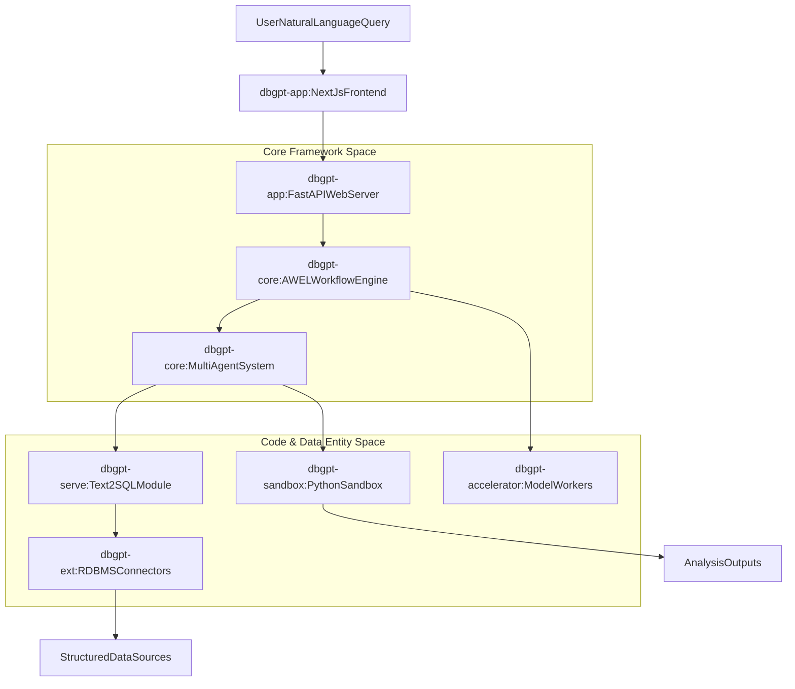

Sources: [README.md:69-70](), [README.ja.md:63-82]()

---

### Key Capabilities

- **Agentic Data Analysis:** Autonomous task planning, decomposition into steps, tool invocation, and iterative workflow execution through a multi-agent system [README.md:73-75]().

- **Autonomous SQL + Code Generation and Execution:** Natural language inputs yield SQL queries and Python code that can be executed for data retrieval, dataset cleanup, metric computation, and report generation [README.md:77-80]().

- **Multi-Source Data Access:** Support for structured and unstructured sources including relational databases, spreadsheet files, documents, and knowledge bases [README.md:82-85]().

- **Skills-Driven Extensibility:** Domain knowledge, analytical methods, and execution flows packaged as reusable skills that agents load and execute [README.md:87-90]().

- **Retrieval-Augmented Generation (RAG) & Knowledge Graphs:** Enables sophisticated retrieval over vector stores (Chroma, Milvus, PGVector, etc.) and graph databases (Neo4j, TuGraph) for knowledge-enhanced question answering [README.ja.md:71-82]().

- **Service-Oriented Multi-Model Management Framework (SMMF):** Manages both local AI models (vLLM, HuggingFace, llama.cpp) and cloud proxy LLMs (OpenAI, Moonshot/Kimi, MiniMax, DeepSeek, ZhipuAI, etc.) with distributed serving capabilities [README.ja.md:58](), [packages/dbgpt-accelerator/dbgpt-acc-auto/pyproject.toml:67-73]().

- **Sandboxed Execution Environment:** Runs code safely within isolated Python and JavaScript sandboxes powered by Lyric workers to avoid security risks and ensure reliable execution [README.md:96-98](), [pyproject.toml:31-40]().

Sources: [README.md:73-98](), [README.ja.md:58-82](), [packages/dbgpt-accelerator/dbgpt-acc-auto/pyproject.toml:67-73](), [pyproject.toml:31-40]()

---

## Monorepo Organization

DB-GPT’s source is organized as a modular monorepo managed with the `uv` workspace tool. This design breaks down the system into focused packages, each responsible for key aspects of the platform. This modularity simplifies development, testing, and deployment [pyproject.toml:31-40]().

| Package             | Description                                                                                                          |
|---------------------|----------------------------------------------------------------------------------------------------------------------|
| `dbgpt-core`        | Core framework: AWEL workflow engine, base agent classes, interfaces for LLM, storage, skill loading, serialization. |
| `dbgpt-app`         | Main application: FastAPI backend, Next.js frontend, built-in skills, web assets, and APIs.                           |
| `dbgpt-serve`       | Backend server: chat handling, data source and knowledge management, REST API routes.                                |
| `dbgpt-ext`         | Extensions: RAG subsystem, vector and graph database adapters, data source connectors.                               |
| `dbgpt-client`      | Python SDK client for programmatic access to chat, knowledge, workflows, and data source services.                   |
| `dbgpt-sandbox`     | Isolated environments for secure execution of Python/JS code with Lyric workers.                                    |
| `dbgpt-accelerator` | Hardware-aware model driver adapters and accelerators (e.g., vLLM, flash attention).                                 |

All packages use synchronized versioning for coordinated releases [packages/dbgpt-core/pyproject.toml:3](), [packages/dbgpt-client/src/dbgpt_client/_version.py:1](), [packages/dbgpt-ext/src/dbgpt_ext/_version.py:1]().

For details, see [Monorepo Package Structure](#1.3) on package roles and interdependencies.

Sources: [pyproject.toml:31-40](), [packages/dbgpt-core/pyproject.toml:3](), [packages/dbgpt-client/src/dbgpt_client/_version.py:1](), [packages/dbgpt-ext/src/dbgpt_ext/_version.py:1]()

---

## Bridging Natural Language with Code Entities

This diagram connects natural language concepts like user queries and skills with their core code implementations in DB-GPT:

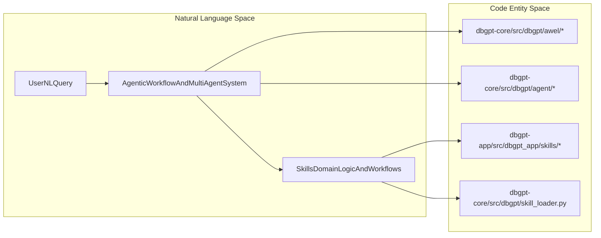

Sources: [README.md:63-70](), [pyproject.toml:31-40]()

---

## Mapping Models, Connectors, and Storage

This diagram outlines how DB-GPT abstracts connections to models, vector stores, and data sources, mapping interfaces to implementations:

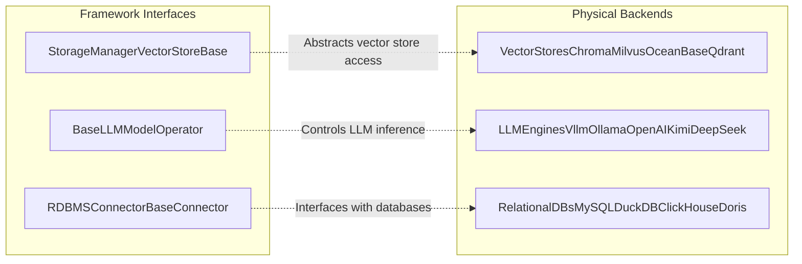

Sources: [README.ja.md:80-82](), [packages/dbgpt-accelerator/dbgpt-acc-auto/pyproject.toml:67-73]()

---

## Wiki Navigation

This overview page links out to detailed child pages covering installation, configuration, and the monorepo layout:

- **[Getting Started & Installation](#1.1)** — Installation from source, install.sh script, Docker usage, environment setup, running webserver, and development container guidance.

- **[Configuration Reference](#1.2)** — TOML-based config system, profiles (proxy, local, GraphRAG, BM25, cloud storage), environment variables, app config schema.

- **[Monorepo Package Structure](#1.3)** — Comprehensive layout of monorepo workspaces, package dependencies, testing and localization infrastructure.

Sources: [README.md:127-155](), [pyproject.toml:31-40]()

---

# Page: Getting Started & Installation

# Getting Started & Installation

<details>
<summary>Relevant source files</summary>

The following files were used as context for generating this wiki page:

- [README.hi.md](README.hi.md)
- [README.ja.md](README.ja.md)
- [README.ma.md](README.ma.md)
- [README.md](README.md)
- [README.ta.md](README.ta.md)
- [README.zh.md](README.zh.md)
- [assets/ding.jpg](assets/ding.jpg)
- [assets/wechat.jpg](assets/wechat.jpg)
- [docs/docs/application/advanced_tutorial/api.md](docs/docs/application/advanced_tutorial/api.md)
- [docs/docs/application/advanced_tutorial/cli.md](docs/docs/application/advanced_tutorial/cli.md)
- [docs/docs/application/fine_tuning_manual/text_to_sql.md](docs/docs/application/fine_tuning_manual/text_to_sql.md)
- [docs/docs/installation/sourcecode.md](docs/docs/installation/sourcecode.md)
- [docs/docs/quickstart.md](docs/docs/quickstart.md)
- [docs/sidebars.js](docs/sidebars.js)
- [docs/static/img/agentic-multi-file/file-preview-zh.jpg](docs/static/img/agentic-multi-file/file-preview-zh.jpg)
- [docs/static/img/knowledge/knowledge_reference_chat_zh.jpg](docs/static/img/knowledge/knowledge_reference_chat_zh.jpg)
- [examples/rag/retriever_evaluation_example.py](examples/rag/retriever_evaluation_example.py)
- [packages/dbgpt-core/src/dbgpt/storage/metadata/db_storage.py](packages/dbgpt-core/src/dbgpt/storage/metadata/db_storage.py)
- [scripts/install/install.sh](scripts/install/install.sh)
- [scripts/install/lib/common.sh](scripts/install/lib/common.sh)
- [scripts/setup_autodl_env.sh](scripts/setup_autodl_env.sh)

</details>


This page provides a comprehensive technical guide for installing and configuring DB-GPT from source, via the installation script, or through containerized environments. It covers environment preparation, dependency management using the `uv` package manager `[docs/docs/quickstart.md:29-30]`, configuration profiles, running the FastAPI webserver `[packages/dbgpt-app/src/dbgpt_app/dbgpt_server.py:1-50]`, and setting up a VS Code development container `[.devcontainer.json:1-52]`.

---

## 1. Environment Requirements

DB-GPT supports two primary execution modes depending on available hardware resources:

- **Proxy Model**: Relies on external LLM API providers such as OpenAI, DeepSeek, Moonshot, MiniMax, or SiliconFlow. This mode has minimal hardware requirements since inference happens remotely.
- **Local Model**: Runs inference locally on hardware using acceleration backends such as `vLLM`, Hugging Face transformers, or `llama.cpp`. This requires substantial CPU/GPU resources.

| Startup Mode | CPU * MEM | GPU | Remarks |
| :----------- | :------- | :-- | :------ |
| **Proxy Model** | 4C * 8G | None | Proxy models do not require local GPU hardware acceleration. Suitable for lightweight setups. |
| **Local Model** | 8C * 32G | 24G+ | Recommended for local execution of models like GLM-4 or Qwen-2.5 for smooth performance. |

The default embedded metadata persistence layer uses SQLite, requiring no external database services for basic deployments.

Sources: `[README.md:131-154]()`, `[README.zh.md:147-166]()`, `[docs/docs/installation/sourcecode.md:3-9]()`

---

## 2. Installation Methods

DB-GPT provides multiple installation workflows catering to different user preferences and environments:

- Automated one-line installer shell script.
- Manual source code installation with Python environment synchronization via the `uv` package manager.
- Containerized deployment using official Docker images.

### 2.1 One-Line Installer Script

The shell script located at `scripts/install/install.sh` automates environment preparation, system dependency installation, repository cloning, and sets environment variables. It supports profiles to pre-configure model access, e.g., OpenAI or Moonshot.

**Example commands:**

```bash
# Basic installation on macOS or Linux
curl -fsSL https://raw.githubusercontent.com/eosphoros-ai/DB-GPT/main/scripts/install/install.sh | bash

# Installation specifying OpenAI profile and API key
curl -fsSL https://raw.githubusercontent.com/eosphoros-ai/DB-GPT/main/scripts/install/install.sh \
  | OPENAI_API_KEY=sk-xxx bash -s -- --profile openai
```

This script also supports other profiles such as `kimi` (Moonshot API) and `minimax` (OpenAI-compatible).

Once installation completes, switch directory to the cloned repo and start the webserver with the selected profile.

Sources: `[README.md:127-154]()`, `[README.zh.md:147-166]()`, `[scripts/install/install.sh:1-50]()`

### 2.2 Installation from Source

For manual control, you can clone the repository and synchronize all dependencies with `uv`, a Python package environment manager focused on repeatable and isolated installs `[docs/docs/quickstart.md:29-30]`.

```bash
git clone https://github.com/eosphoros-ai/DB-GPT.git
cd DB-GPT

uv sync --all-packages \
  --extra "base" \
  --extra "proxy_openai" \
  --extra "rag" \
  --extra "storage_chromadb" \
  --extra "dbgpts"
```

This command installs core DB-GPT dependencies along with support for OpenAI proxy LLMs, retrieval-augmented generation (RAG), ChromaDB vector storage, and official dbgpts example skills.

Sources: `[docs/docs/quickstart.md:21-120]()`, `[docs/docs/installation/sourcecode.md:13-90]()`

---

## 3. Configuration & Startup

DB-GPT uses TOML configuration files stored in the `configs/` directory, which specify model providers, API keys, and other runtime options `[docs/docs/quickstart.md:124-142]`.

**Example partial configuration snippet:**

```toml
[models]
[[models.llms]]
name = "gpt-4o"
provider = "proxy/openai"
api_key = "your-openai-api-key"
```

To start the webserver using a configuration file, run:

```bash
uv run dbgpt start webserver --config configs/dbgpt-proxy-openai.toml
```

Alternatively, you can start the application server directly via Python entrypoints:

```bash
uv run python packages/dbgpt-app/src/dbgpt_app/dbgpt_server.py --config configs/dbgpt-proxy-openai.toml
```

After startup, the web UI is accessible at `http://localhost:5670` `[README.zh.md:174-174]`.

Sources: `[README.zh.md:168-174]()`, `[docs/docs/quickstart.md:122-147]()`, `[packages/dbgpt-app/src/dbgpt_app/dbgpt_server.py:1-50]()`

---

## 4. Containerized Deployment with Docker

DB-GPT provides official Dockerfiles for building container images optimized for CUDA-enabled GPUs or CPU-only environments. The multi-stage build process includes a builder stage that installs Python, Rust toolchain for native extensions, a Python virtual environment setup at `/app/.venv`, and dependency synchronization using `uv`.

The final runtime image copies the virtual environment and source code, and sets the entrypoint to launch the DB-GPT webserver.

### Docker Image Build Flow

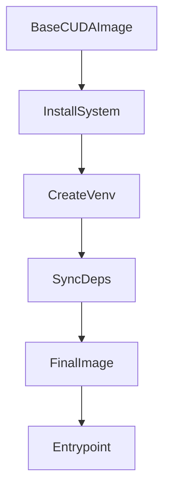

Sources: `[docker/base/Dockerfile:1-126]()`

---

## 5. VS Code Development Container Setup

The `.devcontainer` directory includes a development container configuration for consistent developer environments. The main configuration orchestrates builds using `Dockerfile.dev` `[.devcontainer.json:1-52]`.

The dev container setup:
- Loads environment variables from `.env`.
- Runs `uv sync --all-packages` to install dependencies.
- Provides the full source code inside the container.
- Launches the webserver or developer tools with the installed environment.

### Dev Container Initialization Flow

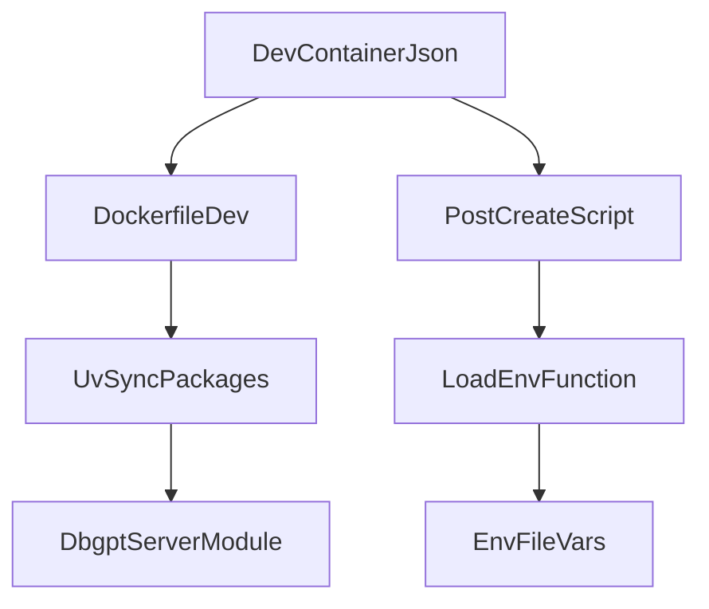

Sources: `[.devcontainer.json:1-52]()`, `[.devcontainer/Dockerfile.dev:1-56]()`, `[.devcontainer/post-create.sh:1-71]()`

---

## 6. Architecture Diagrams Bridging Natural Language Space and Code Entities

To clarify the installation and runtime flow from natural language user interaction to backend execution, two detailed diagrams below associate system components with concretely named code entities.

### 6.1 Installation and Startup Flow

```mermaid
graph LR
  Script["InstallScript[\"install.sh\"]"] --> Clone["GitClone[\"~/.dbgpt/DB-GPT\"]"]
  Clone --> Sync["UvSync[\"uv sync --all-packages\"]"]
  Sync --> Param["ParameterLoad[\"dbgpt/core/interface/parameter.py\"]"]
  Param --> SysApp["SystemRegistry[\"dbgpt.component.SystemApp\"]"]
  SysApp --> Server["WebServer[\"dbgpt_app/dbgpt_server.py\"]"]
  Server --> Manager["WorkerManager[\"dbgpt.model.cluster.worker.Manager\"]"]
```

Sources: `[README.md:131-160]()`, `[docker/base/Dockerfile:1-126]()`, `[packages/dbgpt-app/src/dbgpt_app/dbgpt_server.py:1-50]()`

### 6.2 User Query to Execution Flow

```mermaid
graph LR
  User["NaturalLanguageQuery[\"User Input\"]"] --> Frontend["NextJSClient[\"React Frontend\"]"]
  Frontend --> APIRouter["FastAPIRouter[\"dbgpt-serve REST API\"]"]
  APIRouter --> AgentCore["AgentFramework[\"dbgpt/agent\"]"]
  AgentCore --> LLMMgr["ModelManager[\"SMMF Proxy/Local\"]"]
  AgentCore --> RAG["KnowledgeRetriever[\"RAG Subsystem\"]"]
  AgentCore --> Sandbox["CodeSandbox[\"dbgpt-sandbox\"]"]
  Sandbox --> Result["ExecutionResult[\"Analysis Reports\"]"]
  Result --> Frontend
```

Sources: `[docker/base/Dockerfile:1-126]()`, `[README.md:1-155]()`

---

Sources:  
`[README.md:1-155]()`  
`[README.zh.md:147-174]()`  
`[scripts/install/install.sh:1-50]()`  
`[docs/docs/quickstart.md:1-150]()`  
`[docs/docs/installation/sourcecode.md:1-100]()`  
`[docker/base/Dockerfile:1-129]()`  
`[packages/dbgpt-app/src/dbgpt_app/dbgpt_server.py:1-50]()`  
`[.devcontainer.json:1-52]()`  
`[.devcontainer/Dockerfile.dev:1-56]()`  
`[.devcontainer/post-create.sh:1-71]()`

---

# Page: Configuration Reference

# Configuration Reference

<details>
<summary>Relevant source files</summary>

The following files were used as context for generating this wiki page:

- [configs/dbgpt-app-config.example.toml](configs/dbgpt-app-config.example.toml)
- [configs/dbgpt-graphrag.toml](configs/dbgpt-graphrag.toml)
- [configs/dbgpt-local-glm.toml](configs/dbgpt-local-glm.toml)
- [configs/dbgpt-local-llama-cpp-server.toml](configs/dbgpt-local-llama-cpp-server.toml)
- [configs/dbgpt-local-llama-cpp.toml](configs/dbgpt-local-llama-cpp.toml)
- [configs/dbgpt-local-qwen.toml](configs/dbgpt-local-qwen.toml)
- [configs/dbgpt-local-vllm.toml](configs/dbgpt-local-vllm.toml)
- [configs/dbgpt-proxy-aimlapi.toml](configs/dbgpt-proxy-aimlapi.toml)
- [configs/dbgpt-proxy-ollama.toml](configs/dbgpt-proxy-ollama.toml)
- [configs/dbgpt-proxy-openai.toml](configs/dbgpt-proxy-openai.toml)
- [configs/dbgpt-proxy-siliconflow-mysql.toml](configs/dbgpt-proxy-siliconflow-mysql.toml)
- [configs/dbgpt-proxy-siliconflow.toml](configs/dbgpt-proxy-siliconflow.toml)
- [configs/dbgpt-proxy-tongyi.toml](configs/dbgpt-proxy-tongyi.toml)
- [docs/docs/config-reference/llm/aimlapi_aimlapideploymodelparameters_a1b2c3.mdx](docs/docs/config-reference/llm/aimlapi_aimlapideploymodelparameters_a1b2c3.mdx)
- [docs/docs/config-reference/llm/index.mdx](docs/docs/config-reference/llm/index.mdx)
- [docs/docs/config-reference/llm/minimax_minimaxdeploymodelparameters_a1b2c4.mdx](docs/docs/config-reference/llm/minimax_minimaxdeploymodelparameters_a1b2c4.mdx)
- [docs/docs/installation/docker.md](docs/docs/installation/docker.md)
- [docs/docs/installation/docker_compose.md](docs/docs/installation/docker_compose.md)
- [docs/docs/installation/integrations/aimlapi_llm_install.md](docs/docs/installation/integrations/aimlapi_llm_install.md)
- [packages/dbgpt-app/src/dbgpt_app/config.py](packages/dbgpt-app/src/dbgpt_app/config.py)
- [packages/dbgpt-app/src/dbgpt_app/dbgpt_server.py](packages/dbgpt-app/src/dbgpt_app/dbgpt_server.py)
- [packages/dbgpt-core/src/dbgpt/model/cluster/apiserver/api.py](packages/dbgpt-core/src/dbgpt/model/cluster/apiserver/api.py)
- [packages/dbgpt-core/src/dbgpt/model/parameter.py](packages/dbgpt-core/src/dbgpt/model/parameter.py)
- [packages/dbgpt-core/src/dbgpt/model/proxy/llms/aimlapi.py](packages/dbgpt-core/src/dbgpt/model/proxy/llms/aimlapi.py)
- [packages/dbgpt-core/src/dbgpt/util/fastapi.py](packages/dbgpt-core/src/dbgpt/util/fastapi.py)
- [packages/dbgpt-core/src/dbgpt/util/tests/test_fastapi.py](packages/dbgpt-core/src/dbgpt/util/tests/test_fastapi.py)
- [packages/dbgpt-ext/src/dbgpt_ext/rag/embeddings/__init__.py](packages/dbgpt-ext/src/dbgpt_ext/rag/embeddings/__init__.py)
- [packages/dbgpt-ext/src/dbgpt_ext/rag/embeddings/aimlapi.py](packages/dbgpt-ext/src/dbgpt_ext/rag/embeddings/aimlapi.py)
- [packages/dbgpt-ext/src/dbgpt_ext/rag/embeddings/siliconflow.py](packages/dbgpt-ext/src/dbgpt_ext/rag/embeddings/siliconflow.py)

</details>


DB-GPT utilizes a hierarchical configuration system built on **TOML** files, supporting environment variable interpolation to enable dynamic, secure, and environment-specific settings. These configurations are parsed at runtime into strongly typed Python dataclasses following the `ApplicationConfig` schema (`packages/dbgpt-app/src/dbgpt_app/config.py`), offering structured, validated, and extensible app parameters.

This page details the full configuration system, including:
- The TOML format and defined profiles.
- Use of environment variables in configs.
- The main Python dataclasses schema.
- Injection into runtime components.
- Typical configuration profiles for proxy backends, local models, RAG setups, and cloud storage.
- Data flow visualizations linking natural language configuration concepts to code entities.

---

## TOML Configuration System

### Structure and Syntax

DB-GPT’s main configuration files use TOML format with a hierarchical section organization (`configs/dbgpt-app-config.example.toml`):

- **`[system]`**: Core system-level settings such as `language`, `log_level`, `api_keys`, and `encrypt_key` (`packages/dbgpt-app/src/dbgpt_app/config.py`).
- **`[service.web]`**: Webserver binding parameters for `host`, `port`, CORS origins (`cors_allowed_origins`), and database connection settings (`service.web.database`) (`configs/dbgpt-proxy-tongyi.toml`).
- **`[service.web.agent_context]`**: Controls agent conversation context-window token budget (`max_context_tokens`, `reserved_tokens`, thresholds) (`packages/dbgpt-app/src/dbgpt_app/config.py`).
- **`[rag]`** and **`[rag.storage]`**: Retrieval-Augmented Generation parameters including chunking options (`chunk_size`, `chunk_overlap`) and knowledge storage backends (`vector`, `graph`, `full_text`) (`packages/dbgpt-app/src/dbgpt_app/config.py`).
- **`[models]`**: Configurations for model groups such as `llms`, `embeddings`, and `rerankers` with provider and API key information (`configs/dbgpt-proxy-tongyi.toml`).

Sources:
- [configs/dbgpt-app-config.example.toml:1-58]()
- [packages/dbgpt-app/src/dbgpt_app/config.py:32-132]()

### Environment Variable Interpolation

TOML supports environment variable expansion using the syntax (`configs/dbgpt-proxy-tongyi.toml`):

```toml
key = "${env:ENV_VAR_NAME:-default_value}"
```

This enables sensitive configuration (e.g., API keys) and environment-specific overrides without modifying files directly.

Sources:
- [configs/dbgpt-proxy-tongyi.toml:3-56]()

### Proxy Profile Example (Tongyi Proxy)

```toml
[system]
language = "${env:DBGPT_LANG:-en}"
api_keys = []
encrypt_key = "your_secret_key"

[service.web]
host = "0.0.0.0"
port = 5670
cors_allowed_origins = "${env:DBGPT_CORS_ALLOWED_ORIGINS:-*}"

[service.web.agent_context]
max_context_tokens = 0
reserved_tokens = 4096
warning_threshold = 0.70
error_threshold = 0.90
critical_threshold = 0.95
max_parallel_subagents = 3

[service.web.database]
type = "sqlite"
path = "pilot/meta_data/dbgpt.db"

[rag.storage.vector]
type = "chroma"
persist_path = "pilot/data"

[models]
[[models.llms]]
name = "qwen-plus"
provider = "${env:LLM_MODEL_PROVIDER:-proxy/tongyi}"
api_base = "https://dashscope.aliyuncs.com/compatible-mode/v1"
api_key = "${env:DASHSCOPE_API_KEY}"

[[models.embeddings]]
name = "text-embedding-v3"
provider = "${env:EMBEDDING_MODEL_PROVIDER:-proxy/tongyi}"
api_url = "https://dashscope.aliyuncs.com/compatible-mode/v1/embeddings"
api_key = "${env:DASHSCOPE_API_KEY}"
```

Sources:
- [configs/dbgpt-proxy-tongyi.toml:1-56]()

---

## Configuration Parsing and Injection Flow

The following diagram bridges natural language configuration concepts to code entities (`ApplicationConfig`, `initialize_app`, `initialize_components`) during server startup:

Title: "Configuration Parsing and Runtime Injection Data Flow"
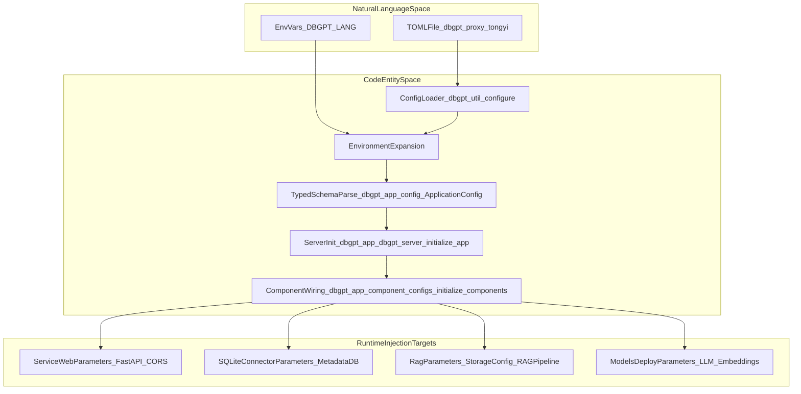

Sources:
- [packages/dbgpt-app/src/dbgpt_app/config.py:1-220]()
- [packages/dbgpt-app/src/dbgpt_app/dbgpt_server.py:137-175]()

---

## Configuration Profiles

DB-GPT supplies several TOML configuration profiles catering to different deployment needs:

### Proxy Model Profiles

| Profile Name | Description | Reference File |
|---|---|---|
| `proxy/tongyi` | Tongyi AI proxy LLM & embeddings | [configs/dbgpt-proxy-tongyi.toml]() |
| `proxy/openai` | OpenAI-compatible proxy | [configs/dbgpt-proxy-openai.toml]() |
| `proxy/siliconflow` | SiliconFlow proxy LLM & embeddings | [configs/dbgpt-proxy-siliconflow.toml]() |
| `proxy/siliconflow-mysql` | SiliconFlow proxy with MySQL DB | [configs/dbgpt-proxy-siliconflow-mysql.toml]() |
| `proxy/aimlapi` | AI/ML API proxy configuration | [configs/dbgpt-proxy-aimlapi.toml]() |

Sources:
- [configs/dbgpt-proxy-tongyi.toml:1-56]()
- [configs/dbgpt-proxy-openai.toml:1-52]()
- [configs/dbgpt-proxy-siliconflow.toml:1-58]()
- [configs/dbgpt-proxy-siliconflow-mysql.toml:1-45]()

### Local Model Profiles

Intended for self-hosted offline deployments running local LLM inference:

- `local-vllm`: Uses `VLLMDeployModelParameters` for local vLLM backend.
- `local-llama-cpp`: Uses `LlamaCppModelParameters` or `LlamaServerParameters` for quantized llama models.
- `local-qwen`: Loads local Qwen weights from disk via HuggingFace adapter (`HFLLMDeployModelParameters`).

Sources:
- [docs/docs/config-reference/llm/index.mdx:1-135]()

### GraphRAG and Hybrid Storage Profiles

RAG profiles extend the configuration with multi-modal knowledge storage backends (`configs/dbgpt-graphrag.toml`):

- **Vector Store**: `ChromaVectorConfig` (`persist_path`)
- **Knowledge Graph Store**: `TuGraphStoreConfig` (`host`, `port`, `username`, `password`)
- **Full-text Search Store**: `ElasticsearchStoreConfig` (`hosts`, optionally enabled)

These profiles enable hybrid storage for RAG via vector embeddings, knowledge graph querying, and full-text search indexing.

Sources:
- [configs/dbgpt-graphrag.toml:1-73]()
- [packages/dbgpt-app/src/dbgpt_app/config.py:63-84]()

---

## Environment Variables Usage

Key environment variables commonly referenced in configuration TOML files include:

| Env Variable | Purpose | Reference |
|---|---|---|
| `DBGPT_LANG` | Application language choice (`en`, `zh`, etc.) | [configs/dbgpt-proxy-openai.toml:3]() |
| `DBGPT_CORS_ALLOWED_ORIGINS` | CORS allowed origins policy | [configs/dbgpt-proxy-tongyi.toml:12]() |
| `OPENAI_API_KEY` | API key for OpenAI proxy LLM | [configs/dbgpt-proxy-openai.toml:46]() |
| `DASHSCOPE_API_KEY` | API key for Tongyi proxy LLM | [configs/dbgpt-proxy-tongyi.toml:50]() |
| `SILICONFLOW_API_KEY` | API key for SiliconFlow proxy | [configs/dbgpt-proxy-siliconflow.toml:47]() |
| `MYSQL_HOST`, `MYSQL_USER`, `MYSQL_PASSWORD` | MySQL metadata DB credentials | [configs/dbgpt-proxy-siliconflow-mysql.toml:16-20]() |

Sources:
- [configs/dbgpt-proxy-openai.toml:3-46]()
- [configs/dbgpt-proxy-tongyi.toml:12-50]()
- [configs/dbgpt-proxy-siliconflow.toml:47]()
- [configs/dbgpt-proxy-siliconflow-mysql.toml:16-20]()

---

## Application Configuration Schema (Python Dataclasses)

Configuration is represented declaratively via Python dataclasses in `dbgpt_app.config`. The following diagram maps these dataclasses and their aggregation relationships:

Title: "ApplicationConfig Dataclass Schema Aggregation"
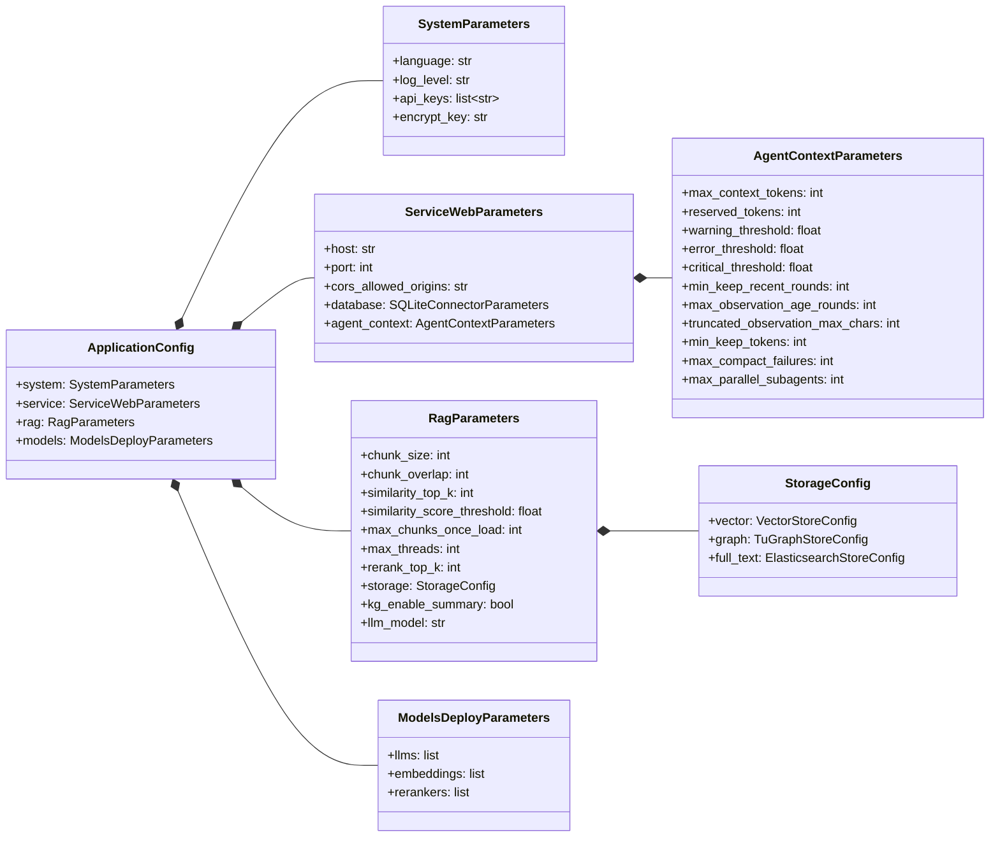

Sources:
- [packages/dbgpt-app/src/dbgpt_app/config.py:32-132]()

---

## Runtime Usage of Configuration

At runtime, the parsed `ApplicationConfig` dataclass is injected into core system components for:

- Webserver and API server setup (`ServiceWebParameters`).
- Metadata relational database connection (`SQLiteConnectorParameters`).
- Knowledge storage backends for retrieval augmentation (`RagParameters` with `StorageConfig`).
- Model deployment and API server management (`ModelsDeployParameters`).

Title: "Runtime Consumption of Configuration Objects"
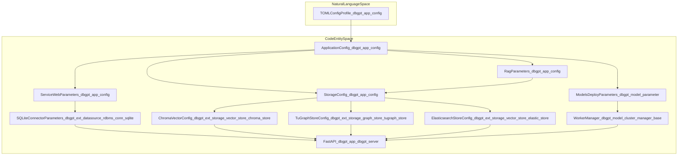

Sources:
- [packages/dbgpt-app/src/dbgpt_app/config.py:30-220]()
- [packages/dbgpt-app/src/dbgpt_app/dbgpt_server.py:137-175]()

---

## Implementation Details

### FastAPI Webserver Integration

The `ServiceWebParameters` configuration is passed to `initialize_app()` (`dbgpt_app.dbgpt_server`) which sets up the FastAPI app, mounts routers, and configures CORS using `build_cors_config()` (`dbgpt-core.util.fastapi`). This function interprets `cors_allowed_origins` with support for wildcards and origin restrictions.

Sources:
- [packages/dbgpt-app/src/dbgpt_app/dbgpt_server.py:137-170]()
- [packages/dbgpt-core/src/dbgpt/util/fastapi.py:1-50]()
- [packages/dbgpt-core/src/dbgpt/util/tests/test_fastapi.py:1-43]()

### Model and Provider Registrations

Models are configured under `[models.llms]`, `[models.embeddings]`, and `[models.rerankers]` sections in TOML. These entries are parsed into deployment parameter classes that control model loading, concurrency, and API parameters.

The providers (e.g., `proxy/tongyi`, `proxy/openai`, `local-llama-cpp`) correspond to specific model adapters implementing logic for inference or API calls.

The OpenAI-compatible RESTful API server in `dbgpt-core.model.cluster.apiserver.api` reflects these settings to expose model inference endpoints securely, with API key authorization and request validation.

Sources:
- [packages/dbgpt-core/src/dbgpt/model/cluster/apiserver/api.py:103-120]()

---

## Summary

DB-GPT’s TOML-based configuration system provides a structured mechanism for environment variable interpolation, type-safe Python dataclass parsing via `ApplicationConfig`, and runtime component injection across web services, storage backends, and model management frameworks. It supports diverse deployment profiles — from proxy-based cloud LLMs to local model runners and advanced RAG knowledge backends — providing flexibility and secure, manageable configuration for enterprise-grade operations.

Sources:
- [packages/dbgpt-app/src/dbgpt_app/config.py:1-220]()
- [configs/dbgpt-app-config.example.toml:1-70]()

---

# Page: Monorepo Package Structure

# Monorepo Package Structure

<details>
<summary>Relevant source files</summary>

The following files were used as context for generating this wiki page:

- [packages/dbgpt-accelerator/dbgpt-acc-auto/pyproject.toml](packages/dbgpt-accelerator/dbgpt-acc-auto/pyproject.toml)
- [packages/dbgpt-accelerator/dbgpt-acc-auto/src/dbgpt_acc_auto/_version.py](packages/dbgpt-accelerator/dbgpt-acc-auto/src/dbgpt_acc_auto/_version.py)
- [packages/dbgpt-accelerator/dbgpt-acc-flash-attn/pyproject.toml](packages/dbgpt-accelerator/dbgpt-acc-flash-attn/pyproject.toml)
- [packages/dbgpt-accelerator/dbgpt-acc-flash-attn/src/dbgpt_acc_flash_attn/_version.py](packages/dbgpt-accelerator/dbgpt-acc-flash-attn/src/dbgpt_acc_flash_attn/_version.py)
- [packages/dbgpt-app/pyproject.toml](packages/dbgpt-app/pyproject.toml)
- [packages/dbgpt-app/src/dbgpt_app/_version.py](packages/dbgpt-app/src/dbgpt_app/_version.py)
- [packages/dbgpt-client/pyproject.toml](packages/dbgpt-client/pyproject.toml)
- [packages/dbgpt-client/src/dbgpt_client/_version.py](packages/dbgpt-client/src/dbgpt_client/_version.py)
- [packages/dbgpt-core/pyproject.toml](packages/dbgpt-core/pyproject.toml)
- [packages/dbgpt-core/src/dbgpt/_version.py](packages/dbgpt-core/src/dbgpt/_version.py)
- [packages/dbgpt-ext/pyproject.toml](packages/dbgpt-ext/pyproject.toml)
- [packages/dbgpt-ext/src/dbgpt_ext/_version.py](packages/dbgpt-ext/src/dbgpt_ext/_version.py)
- [packages/dbgpt-serve/pyproject.toml](packages/dbgpt-serve/pyproject.toml)
- [packages/dbgpt-serve/src/dbgpt_serve/_version.py](packages/dbgpt-serve/src/dbgpt_serve/_version.py)
- [pyproject.toml](pyproject.toml)
- [uv.lock](uv.lock)

</details>


This page details the organization and package layout of the DB-GPT monorepo. DB-GPT employs a **uv workspace** monorepo strategy (`pyproject.toml`), enabling multiple interdependent yet modular Python packages to coexist with unified dependency management, versioning (`_version.py`), and development tooling. This modular decomposition supports project scalability, clear dependency boundaries, and selective installation of components.

Sources: [pyproject.toml:31-40]()

---

## Workspace Overview

At the root, the root `pyproject.toml` defines the uv workspace members and shared development dependencies. The monorepo organizes the primary packages under the `packages/` directory, each as individual workspace members:

| Package Name          | Directory                          | Role Description                                                                                     |
|-----------------------|----------------------------------|---------------------------------------------------------------------------------------------------|
| **dbgpt-core**        | `packages/dbgpt-core`             | Core foundational framework implementing AWEL engine, core interfaces, component system, utilities |
| **dbgpt-app**         | `packages/dbgpt-app`              | Main application container orchestrating all packages into a deployable unified system             |
| **dbgpt-serve**       | `packages/dbgpt-serve`            | Backend service layer exposing model serving, REST API endpoints, and conversation management      |
| **dbgpt-ext**         | `packages/dbgpt-ext`              | Extensions including RAG, knowledge graph, advanced datasource connectors                          |
| **dbgpt-client**      | `packages/dbgpt-client`           | Official Python client SDK for DB-GPT system APIs                                                 |
| **dbgpt-sandbox**     | `packages/dbgpt-sandbox`          | Secure isolated sandbox environment for safe code execution                                       |
| **dbgpt-accelerator** | `packages/dbgpt-accelerator/dbgpt-acc*` | Hardware acceleration packages including `dbgpt-acc-auto` and `dbgpt-acc-flash-attn`            |

Each package contains its own `pyproject.toml` to declare dependencies, build tooling, and metadata but is collectively managed in the uv workspace for synchronized dependency resolution, version locking (`uv.lock`), and consistent environment setup.

Sources: [pyproject.toml:15-40]()

---

## Dependency Relationships and Flow

The following graph visualizes the dependency topology and interaction flow between the packages. It shows how foundational packages underpin higher layers, and how application orchestration aggregates the components.

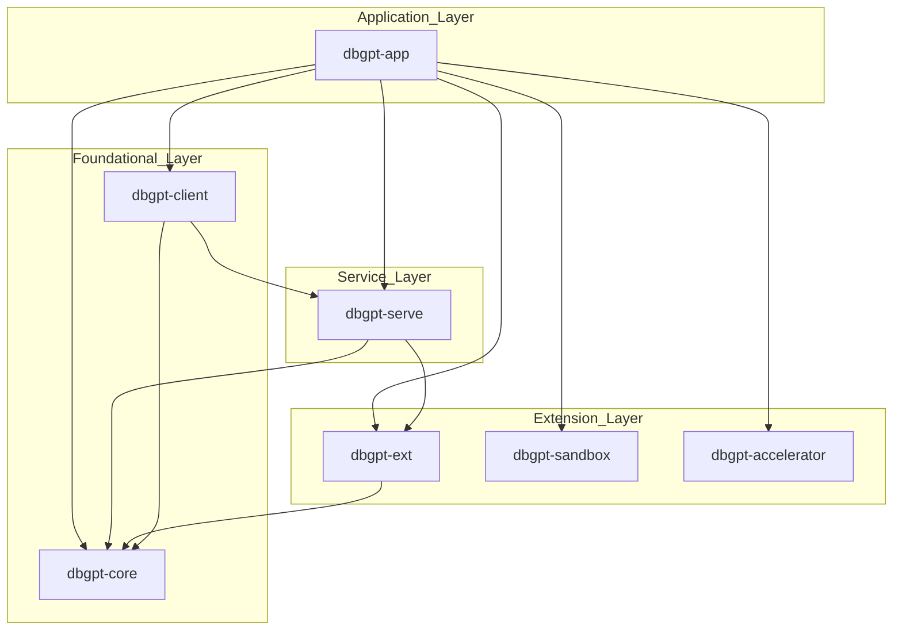

- `dbgpt-core` is the foundation with essential interfaces and workflow engine.
- `dbgpt-ext` builds on core providing advanced knowledge and datasource connectors.
- `dbgpt-serve` depends on core and ext to provide backend services.
- `dbgpt-client` depends on core and serve to implement client APIs.
- `dbgpt-app` integrates all upper layers, including sandbox and accelerator packages.
- `dbgpt-sandbox` runs isolated environments consumed by app.
- `dbgpt-accelerator` offers optimized ML runtimes mainly used by app.

Sources:  
[packages/dbgpt-app/pyproject.toml:12-22](),  
[packages/dbgpt-ext/pyproject.toml:12-15](),  
[packages/dbgpt-serve/pyproject.toml:1-15](),  
[pyproject.toml:15-40]()

---

## Package Roles & Technical Details

### 1. dbgpt-core (`packages/dbgpt-core`)

- **Role:** Core foundational framework providing the declarative AWEL workflow engine, core interfaces, component system, and utility libraries.
- **Implementation Highlights:**
  - **AWEL (Agentic Workflow Expression Language):** A DAG-based declarative engine that composes operators, triggers, and runners to automate agentic workflows.
  - **Core Interfaces/Data Models:** Abstractions such as `LLM`, `Message`, `Prompt`, `Embeddings`, `KnowledgeStore`, `Cache`, `File`, `Variable`, and `OutputParser`.
  - **Component System:** `SystemApp` registry manages component lifecycles, service registration, and dependency injection.
  - **CLI Entrypoint:** Exposes command-line interface via `dbgpt.cli.cli_scripts:main`.
- **Build & Dependencies:**
  - Uses `hatchling` build backend.
  - Dependencies include `typeguard` (runtime typing), `cloudpickle` (workflow serialization), and `apscheduler` (scheduling DAG runs).
- **Code Location:** `src/dbgpt`
- **Version:** 0.8.2

Sources:  
[packages/dbgpt-core/pyproject.toml:1-27](),  
[packages/dbgpt-core/src/dbgpt/_version.py:1]()

### 2. dbgpt-ext (`packages/dbgpt-ext`)

- **Role:** Extension package providing Retrieval-Augmented Generation (RAG), knowledge graph integration, and advanced datasource connectors.
- **Key Features:**
  - Implements document chunking, indexing, embedding, and RAG pipelines.
  - Integrates knowledge graphs via Neo4j and TuGraph adapters.
  - Supports many datasource connectors: MySQL, Postgres, Oracle, ClickHouse, Milvus, ChromaDB, Qdrant, Elasticsearch, Weaviate, and more.
  - Provides document format loaders for PDF, DOCX, PPTX, Markdown, CSV.
  - Optional cloud file storage backends support Aliyun OSS and AWS S3.
- **Dependency:** Depends on `dbgpt-core` package.
- **Extras:** Defines extras groups for RAG, graph RAG, storage, and datasources.
- **Code Location:** `src/dbgpt_ext`
- **Version:** 0.8.2

Sources:  
[packages/dbgpt-ext/pyproject.toml:12-91](),  
[packages/dbgpt-ext/src/dbgpt_ext/_version.py:1]()

### 3. dbgpt-serve (`packages/dbgpt-serve`)

- **Role:** Backend service layer offering model serving, REST API endpoints, conversation management, and chat scene orchestration.
- **Features:**
  - Hosts adapters for local and proxy LLM workers.
  - Implements REST APIs for chat, flow execution, datasource, and model management.
  - Manages persistent conversation state and session contexts.
- **Code Location:** `src/dbgpt_serve`
- **Version:** 0.8.2

Sources:  
[packages/dbgpt-serve/pyproject.toml:1-15](),  
[packages/dbgpt-serve/src/dbgpt_serve/_version.py:1]()

### 4. dbgpt-app (`packages/dbgpt-app`)

- **Role:** Monolithic orchestration package integrating core, extensions, service, client, sandbox, and accelerator packages into a deployable application.
- **Responsibilities:**
  - Aggregates all major packages and manages integration.
  - Implements OpenTelemetry observability and metrics.
  - Bundles built-in skills and pilot workspace template files for quick agent prototyping.
  - Manages Alembic-based database migrations for system metadata.
  - Supports optional features such as caching and observability extensions.
- **Code Location:** `src/dbgpt_app`
- **Version:** 0.8.2

Sources:  
[packages/dbgpt-app/pyproject.toml:12-22](),  
[packages/dbgpt-app/src/dbgpt_app/_version.py:1](),  
[packages/dbgpt-app/pyproject.toml:68-73]()

### 5. dbgpt-accelerator (`packages/dbgpt-accelerator`)

- **Role:** Hardware acceleration and optimized runtime packages tailored for ML inference workloads.
- **Description:**
  - Subpackages, including `dbgpt-acc-auto` and `dbgpt-acc-flash-attn`, dynamically select PyTorch, torchvision, torchaudio variants suitable for OS and CUDA versions.
  - Supports quantization backends such as `bitsandbytes`, `auto-gptq`, and `gptqmodel`.
  - Includes GPU inference runtimes such as `vllm`.
- **Implementation:**
  - Uses conditional dependency markers in `pyproject.toml` for platform-specific installs.
- **Code Location:** `dbgpt-accelerator/dbgpt-acc-auto`, `dbgpt-accelerator/dbgpt-acc-flash-attn`
- **Version:** 0.8.2 (per subpackage)

Sources:  
[packages/dbgpt-accelerator/dbgpt-acc-auto/pyproject.toml:1-61](),  
[packages/dbgpt-accelerator/dbgpt-acc-auto/src/dbgpt_acc_auto/_version.py:1]()

### 6. dbgpt-client (`packages/dbgpt-client`)

- **Role:** Official Python SDK client that idiomatically interacts with DB-GPT system REST APIs.
- **Capabilities:**
  - Enables chat interface, flow/app CRUD, knowledge store management, datasource access.
  - Supports async and sync usage patterns.
- **Code Location:** `src/dbgpt_client`
- **Version:** 0.8.2

Sources:  
[packages/dbgpt-client/pyproject.toml:1-5](),  
[packages/dbgpt-client/src/dbgpt_client/_version.py:1]()

### 7. dbgpt-sandbox (`packages/dbgpt-sandbox`)

- **Role:** Secure isolated sandbox environment for executing untrusted Python and JavaScript code safely.
- **Architecture Layers:**
  - **User Layer:** API surface for client interaction.
  - **Control Layer:** Permissions and security enforcement.
  - **Execution Layer:** Sandboxed interpreters and runtime environments.
  - **Display Layer:** Output capturing and formatting.
- **Entry Point:** `initialize_sandbox` bootstraps sandbox contexts.
- **Intended Use:** Primary code execution runtime for agent scripts with strong isolation.
- **Code Location:** `packages/dbgpt-sandbox`
- **Version:** 0.8.2

Sources:  
[pyproject.toml:23](),  
[packages/dbgpt-app/pyproject.toml:18]()

---

## i18n / locales and tests Layout

- **i18n:** Localization catalogs are organized in the `i18n/locales` directory following standard gettext structure. Supported languages include French (`fr`), Japanese (`ja`), Korean (`ko`), Russian (`ru`), and Simplified Chinese (`zh_CN`). These catalogs are used primarily for backend configuration descriptions and user-facing UI strings.
- **Tests:** Unit and integration tests reside in the `tests/` directory and package-level test suites, structured to cover embedding engines, vector stores, plugins, KBQA, and other core functionalities. This promotes thorough quality assurance and regression coverage.

Sources:  
[pyproject.toml:63-66]()

---

## Code Entity Mapping Diagrams

### Mapping Natural Language System Capabilities to Code Entities

This diagram bridges domain-level system capabilities to the specific code packages and modules implementing them:

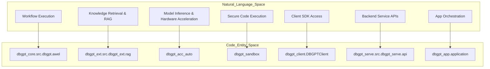

Sources:  
[packages/dbgpt-core/pyproject.toml:1-27](), [packages/dbgpt-ext/pyproject.toml:12-91](),  
[packages/dbgpt-accelerator/dbgpt-acc-auto/pyproject.toml:1-61](),  
[pyproject.toml:15-40](), [packages/dbgpt-client/pyproject.toml:1-5](),  
[packages/dbgpt-serve/pyproject.toml:1-15](), [packages/dbgpt-app/pyproject.toml:12-22]()

---

### Build Configuration and Versioning Relationship

This diagram illustrates the relationship between the root workspace `pyproject.toml` and `uv.lock` lockfile, the individual package build configs, and the internal version declaration files. This enforces consistent versioning and dependency management across the monorepo packages.

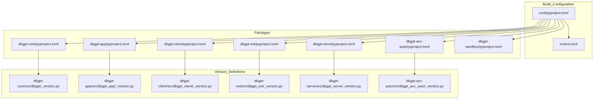

Sources:  
[pyproject.toml:31-40](), [uv.lock:1-4](),  
[packages/dbgpt-core/src/dbgpt/_version.py:1](), [packages/dbgpt-app/src/dbgpt_app/_version.py:1](),  
[packages/dbgpt-client/src/dbgpt_client/_version.py:1](), [packages/dbgpt-ext/src/dbgpt_ext/_version.py:1](),  
[packages/dbgpt-serve/src/dbgpt_serve/_version.py:1](), [packages/dbgpt-accelerator/dbgpt-acc-auto/src/dbgpt_acc_auto/_version.py:1]()

---

## Summary

The DB-GPT monorepo adopts a modular, multi-package architecture managed by the `uv` workspace tooling. This architecture:

- Enables clean separation of concerns among foundational, extension, service, client, sandbox, accelerator, and application packages.
- Supports synchronized dependency resolution, version locking, and unified build configurations.
- Facilitates selective deployment and incremental development workflows with clear dependency and interface boundaries.
- Structures localization and testing to maximize maintainability and quality assurance.

| Package             | Summary                                                            |
|---------------------|--------------------------------------------------------------------|
| `dbgpt-core`        | Core programming model, AWEL engine, and interface definitions     |
| `dbgpt-ext`         | Extensions: RAG, knowledge graphs, and datasource connectors       |
| `dbgpt-serve`       | Backend REST APIs, model serving, and conversation management      |
| `dbgpt-app`         | Orchestrator integrating all components for deployment             |
| `dbgpt-accelerator` | ML hardware acceleration and optimized runtime packages            |
| `dbgpt-client`      | Official Python SDK client library                                 |
| `dbgpt-sandbox`     | Secure sandbox for executing untrusted code                        |

Sources:  
[pyproject.toml:15-40]()

---

# Page: Core Framework (dbgpt-core)

# Core Framework (dbgpt-core)

<details>
<summary>Relevant source files</summary>

The following files were used as context for generating this wiki page:

- [packages/dbgpt-core/src/dbgpt/core/interface/llm.py](packages/dbgpt-core/src/dbgpt/core/interface/llm.py)
- [packages/dbgpt-core/src/dbgpt/model/adapter/loader.py](packages/dbgpt-core/src/dbgpt/model/adapter/loader.py)
- [packages/dbgpt-core/src/dbgpt/model/cluster/worker/default_worker.py](packages/dbgpt-core/src/dbgpt/model/cluster/worker/default_worker.py)
- [packages/dbgpt-core/src/dbgpt/model/llm/llm_out/hf_chat_llm.py](packages/dbgpt-core/src/dbgpt/model/llm/llm_out/hf_chat_llm.py)
- [packages/dbgpt-core/src/dbgpt/model/llm/llm_out/vllm_llm.py](packages/dbgpt-core/src/dbgpt/model/llm/llm_out/vllm_llm.py)
- [packages/dbgpt-core/src/dbgpt/model/llm/monkey_patch.py](packages/dbgpt-core/src/dbgpt/model/llm/monkey_patch.py)
- [packages/dbgpt-core/src/dbgpt/model/utils/hf_stream_utils.py](packages/dbgpt-core/src/dbgpt/model/utils/hf_stream_utils.py)
- [packages/dbgpt-core/src/dbgpt/model/utils/llm_metrics.py](packages/dbgpt-core/src/dbgpt/model/utils/llm_metrics.py)
- [packages/dbgpt-core/src/dbgpt/util/tracer/tracer_impl.py](packages/dbgpt-core/src/dbgpt/util/tracer/tracer_impl.py)

</details>


The `dbgpt-core` package serves as the foundational layer of the DB-GPT ecosystem. It provides essential abstractions, engine runtimes, core interfaces, the AWEL (Agentic Workflow Expression Language) engine for workflow orchestration, a component and dependency injection system, and numerous shared utilities. By decoupling core logic from specific implementations, `dbgpt-core` ensures modularity and extensibility, enabling seamless integration of various LLM providers, storage backends, and workflow mechanisms.

---

## Architecture Overview

The core framework functions as the bridge connecting **Natural Language Space**—which includes user intents, prompts, and chat messages—to **Code Entity Space**, represented by operators, DAGs, and components within the runtime. This layered architecture allows consistent interaction with diverse AI models and data sources by standardizing protocols and interfaces across subsystems.

### Natural Language to Code Entity Mapping (Workflows)

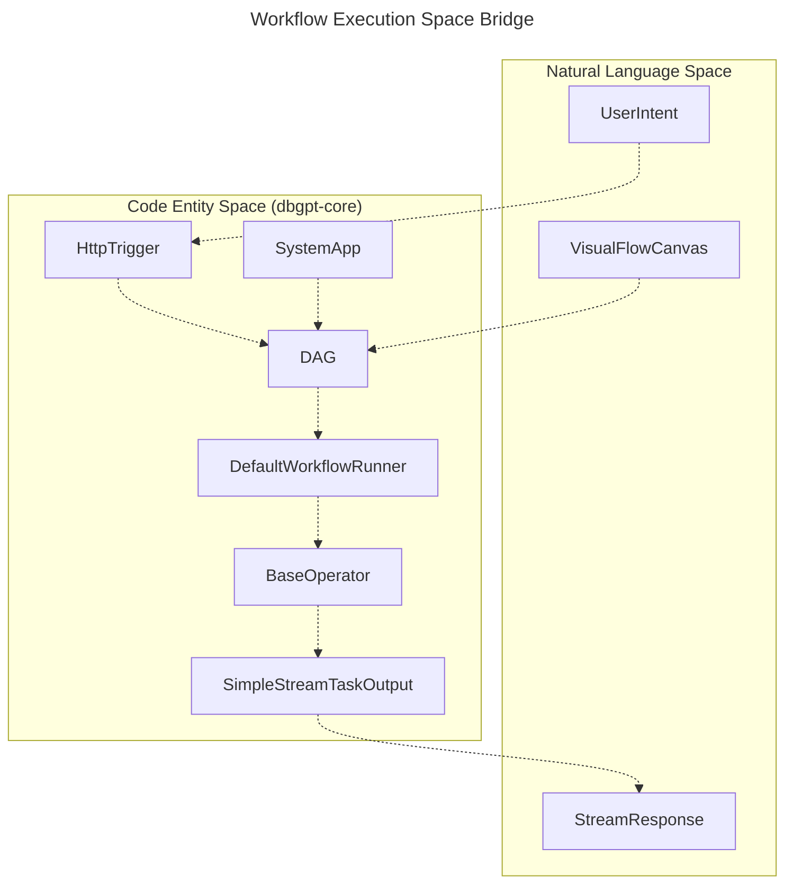

Sources:  
- [packages/dbgpt-core/src/dbgpt/core/awel/runner/local_runner.py:24-50]()  

---

## AWEL — Agentic Workflow Expression Language

AWEL is the core execution engine enabling declarative and agentic workflows expressed as Directed Acyclic Graphs (DAGs). It facilitates complex orchestration of AI workflows involving prompt chaining, branching logic, event triggers, and asynchronous streaming.

Key components include:

- **DAG & DAGContext**: Maintain shared execution context and variables for operators during runtime [packages/dbgpt-core/src/dbgpt/core/awel/runner/local_runner.py:43-90]().  
- **Operators**: Flexible workflow building blocks such as `MapOperator`, `ReduceStreamOperator`, `JoinOperator`, and branch operators.  
- **WorkflowRunner**: The orchestrator managing workflow scheduling and execution (e.g., `DefaultWorkflowRunner`) [packages/dbgpt-core/src/dbgpt/core/awel/runner/local_runner.py:24-50]().  
- **Triggers**: Event-driven inputs like `HttpTrigger` that invoke workflows based on incoming HTTP requests.

For detailed technical documentation of AWEL, see [AWEL — Agentic Workflow Expression Language](#2.1).

Sources:  
- [packages/dbgpt-core/src/dbgpt/core/awel/runner/local_runner.py:24-123]()  

---

## Core Interfaces & Data Models

To provide a vendor-neutral and uniform architecture, `dbgpt-core` defines foundational interfaces and data models that abstract key AI concepts such as LLM inference, messages, prompts, embeddings, knowledge, storage, and caching.

### Natural Language to Code Entity Mapping (Model Inference)

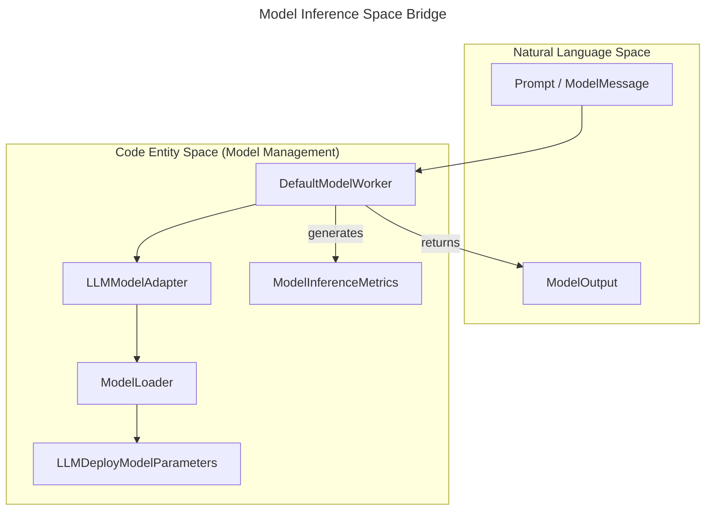

### Key Interfaces and Implementations

| Interface Category         | Representative Classes / Types                          | Description                                                                  |
|---------------------------|---------------------------------------------------------|------------------------------------------------------------------------------|
| **LLM Inference**         | `ModelOutput`, `ModelInferenceMetrics`                  | Encapsulate LLM response data and detailed inference metrics [packages/dbgpt-core/src/dbgpt/core/interface/llm.py:34-136]() |
| **Model Adapters**         | `LLMModelAdapter`, `HFLLMDeployModelParameters`         | Adapt and configure backend LLM providers [packages/dbgpt-core/src/dbgpt/model/adapter/loader.py:57-70]() |
| **Model Workers & Loaders** | `DefaultModelWorker`, `ModelLoader`                    | Load models, parse parameters, and execute inference; support streaming [packages/dbgpt-core/src/dbgpt/model/cluster/worker/default_worker.py:35-147]() |

For a comprehensive reference on core interfaces, see [Core Interfaces & Data Models](#2.2).

Sources:  
- [packages/dbgpt-core/src/dbgpt/core/interface/llm.py:34-136]()  
- [packages/dbgpt-core/src/dbgpt/model/cluster/worker/default_worker.py:35-147]()  
- [packages/dbgpt-core/src/dbgpt/model/adapter/loader.py:57-70]()

---

## Component & Dependency Injection System

`dbgpt-core` implements a component-based dependency injection system and lifecycle management framework that enables modular, loosely coupled service composition. This system underpins the runtime wiring of core subsystems and facilitates extensibility.

Core aspects include:
- **SystemApp Component Registry**: A centralized component registry that manages service registration, retrieval, and lifecycle events [packages/dbgpt-core/src/dbgpt/util/tracer/tracer_impl.py:28-42]().  
- **Service Registration & Initialization**: Core services declare themselves for auto-wiring and dependency injection.  
- **Configuration Injection**: Components receive strongly-typed configuration data sourced from environment variables and user profiles.

For full architectural and usage details, see [Component & Dependency Injection System](#2.3).

Sources:  
- [packages/dbgpt-core/src/dbgpt/util/tracer/tracer_impl.py:28-42]()

---

## Common Utilities & Support

`dbgpt-core` includes various utilities supporting efficient development, runtime operations, and observability:

- **Performance Monitoring**: The `PerformanceMonitoringStreamer` extends HuggingFace streaming to measure token-level inference metrics via `LLMPerformanceMonitor` [packages/dbgpt-core/src/dbgpt/model/llm/llm_out/hf_chat_llm.py:71-115](), [packages/dbgpt-core/src/dbgpt/model/utils/llm_metrics.py:63-138]().  
- **Model Loading & Adaptation**: `ModelLoader` and `LLMModelAdapter` provide unified logic for loading and preparing backend models [packages/dbgpt-core/src/dbgpt/model/adapter/loader.py:57-70]().  
- **Runtime Monkey Patching**: Includes patches such as replacing in-place attention operations in transformers for compatibility with Apple MPS hardware [packages/dbgpt-core/src/dbgpt/model/llm/monkey_patch.py:120-122]().  
- **Distributed Tracing**: The global `TracerManager` (`root_tracer`) and `Span` abstractions enable end-to-end tracing [packages/dbgpt-core/src/dbgpt/util/tracer/tracer_impl.py:204-204]().

Sources:  
- [packages/dbgpt-core/src/dbgpt/model/llm/llm_out/hf_chat_llm.py:71-115]()  
- [packages/dbgpt-core/src/dbgpt/model/utils/llm_metrics.py:63-138]()  
- [packages/dbgpt-core/src/dbgpt/model/adapter/loader.py:57-70]()  
- [packages/dbgpt-core/src/dbgpt/model/llm/monkey_patch.py:120-122]()  
- [packages/dbgpt-core/src/dbgpt/util/tracer/tracer_impl.py:204-204]()

---

This page provides a high-level overview of the `dbgpt-core` foundation. Detailed documentation of each primary subsystem is available on the respective child pages:

- [AWEL — Agentic Workflow Expression Language](#2.1)  
- [Core Interfaces & Data Models](#2.2)  
- [Component & Dependency Injection System](#2.3)

---

# Page: AWEL — Agentic Workflow Expression Language

# AWEL — Agentic Workflow Expression Language

<details>
<summary>Relevant source files</summary>

The following files were used as context for generating this wiki page:

- [docs/docs/agents/cookbook/calculator_with_agents.md](docs/docs/agents/cookbook/calculator_with_agents.md)
- [examples/__main__.py](examples/__main__.py)
- [examples/agents/auto_plan_agent_dialogue_example.py](examples/agents/auto_plan_agent_dialogue_example.py)
- [examples/agents/awel_layout_agents_chat_examples.py](examples/agents/awel_layout_agents_chat_examples.py)
- [examples/agents/custom_tool_agent_example.py](examples/agents/custom_tool_agent_example.py)
- [examples/agents/plugin_agent_dialogue_example.py](examples/agents/plugin_agent_dialogue_example.py)
- [examples/agents/retrieve_summary_agent_dialogue_example.py](examples/agents/retrieve_summary_agent_dialogue_example.py)
- [examples/agents/sandbox_code_agent_example.py](examples/agents/sandbox_code_agent_example.py)
- [examples/agents/single_agent_dialogue_example.py](examples/agents/single_agent_dialogue_example.py)
- [examples/agents/single_summary_agent_dialogue_example.py](examples/agents/single_summary_agent_dialogue_example.py)
- [examples/agents/sql_agent_dialogue_example.py](examples/agents/sql_agent_dialogue_example.py)
- [examples/awel/simple_rag_summary_example.py](examples/awel/simple_rag_summary_example.py)
- [packages/dbgpt-app/src/dbgpt_app/operators/datasource.py](packages/dbgpt-app/src/dbgpt_app/operators/datasource.py)
- [packages/dbgpt-app/src/dbgpt_app/operators/rag.py](packages/dbgpt-app/src/dbgpt_app/operators/rag.py)
- [packages/dbgpt-core/src/dbgpt/core/awel/flow/base.py](packages/dbgpt-core/src/dbgpt/core/awel/flow/base.py)
- [packages/dbgpt-core/src/dbgpt/core/awel/flow/compat.py](packages/dbgpt-core/src/dbgpt/core/awel/flow/compat.py)
- [packages/dbgpt-core/src/dbgpt/core/awel/flow/flow_factory.py](packages/dbgpt-core/src/dbgpt/core/awel/flow/flow_factory.py)
- [packages/dbgpt-core/src/dbgpt/core/awel/runner/local_runner.py](packages/dbgpt-core/src/dbgpt/core/awel/runner/local_runner.py)
- [packages/dbgpt-core/src/dbgpt/core/awel/tests/test_run_dag.py](packages/dbgpt-core/src/dbgpt/core/awel/tests/test_run_dag.py)
- [packages/dbgpt-core/src/dbgpt/model/proxy/llms/zhipu.py](packages/dbgpt-core/src/dbgpt/model/proxy/llms/zhipu.py)
- [packages/dbgpt-core/src/dbgpt/util/cli/flow_compat.py](packages/dbgpt-core/src/dbgpt/util/cli/flow_compat.py)
- [packages/dbgpt-core/src/dbgpt/vis/tags/vis_chart.py](packages/dbgpt-core/src/dbgpt/vis/tags/vis_chart.py)
- [packages/dbgpt-core/src/dbgpt/vis/tags/vis_dashboard.py](packages/dbgpt-core/src/dbgpt/vis/tags/vis_dashboard.py)
- [packages/dbgpt-ext/src/dbgpt_ext/rag/knowledge/url.py](packages/dbgpt-ext/src/dbgpt_ext/rag/knowledge/url.py)
- [packages/dbgpt-serve/src/dbgpt_serve/flow/compat/0.7.0_compat_flow.json](packages/dbgpt-serve/src/dbgpt_serve/flow/compat/0.7.0_compat_flow.json)
- [packages/dbgpt-serve/src/dbgpt_serve/flow/service/service.py](packages/dbgpt-serve/src/dbgpt_serve/flow/service/service.py)

</details>


## Purpose and Scope

Agentic Workflow Expression Language (AWEL) serves as the foundational orchestration engine of DB-GPT. It is designed to express, construct, and execute agentic workflows as Directed Acyclic Graphs (DAGs). AWEL abstracts complex AI workflows involving multi-agent collaboration, knowledge retrieval, LLM interaction, and external tool integration into modular, typed operators connected by data flows. This page details DAG construction, operators, execution triggers, workflow runners, the flow factory, visual canvas integration, and flow persistence/compatibility mechanisms.

---

## 1. AWEL DAG Construction and Operators

### 1.1 Core Concepts

AWEL models workflows as Directed Acyclic Graphs (DAGs) where nodes are operators that asynchronously process input data to produce outputs. Operators are composed and connected using Python's `>>` operator to form execution graphs. The runtime manages the `DAGContext`, which tracks execution states, shared data across operators, and task outputs [packages/dbgpt-core/src/dbgpt/core/awel/runner/local_runner.py:14-89]().

Workflows support transformations via `MapOperator` [examples/awel/simple_rag_summary_example.py:45-55](), branching logic via `BranchOperator` [packages/dbgpt-core/src/dbgpt/core/awel/tests/test_run_dag.py:129-131](), aggregations through `JoinOperator` [packages/dbgpt-core/src/dbgpt/core/awel/tests/test_run_dag.py:96-98](), and streaming data processing with `ReduceStreamOperator` [packages/dbgpt-core/src/dbgpt/core/awel/tests/test_run_dag.py:75-76]().

### 1.2 Operator Types and Metadata

- `BaseOperator`: The abstract base class defining core interfaces for inputs, outputs, parameters, and async execution logic [packages/dbgpt-core/src/dbgpt/core/awel/operators/base.py]().
- `MapOperator`: Maps input items individually to one output asynchronously [examples/awel/simple_rag_summary_example.py:45-55]().
- `JoinOperator`: Combines multiple upstream inputs into a single output [packages/dbgpt-core/src/dbgpt/core/awel/tests/test_run_dag.py:96-102]().
- `BranchOperator`: Routes inputs to downstream operators conditionally based on predicates [packages/dbgpt-core/src/dbgpt/core/awel/tests/test_run_dag.py:129-131]().

Operators expose metadata via `ViewMetadata` defining input/output ports, parameters, categories, and UI hints [packages/dbgpt-app/src/dbgpt_app/operators/rag.py:107-143]().

Sources:  
- `[examples/awel/simple_rag_summary_example.py:45-55]()`
- `[packages/dbgpt-core/src/dbgpt/core/awel/runner/local_runner.py:14-89]()`
- `[packages/dbgpt-app/src/dbgpt_app/operators/rag.py:34-143]()`
- `[packages/dbgpt-core/src/dbgpt/core/awel/tests/test_run_dag.py:24-131]()`

---

## 2. Triggers and Workflow Runners

### 2.1 Triggers

AWEL workflows utilize event-driven entrypoints:
- **`HttpTrigger`**: Exposes DAG start nodes as REST API endpoints [examples/awel/simple_rag_summary_example.py:58-60]().
- **Timer/Scheduled Triggers**: Integrates with APScheduler for cron-based workflow activation.

### 2.2 Workflow Runners

`DefaultWorkflowRunner` executes AWEL DAGs locally within the current process asynchronously [packages/dbgpt-core/src/dbgpt/core/awel/runner/local_runner.py:24-50](). It executes upstream dependencies recursively [packages/dbgpt-core/src/dbgpt/core/awel/runner/local_runner.py:141-150]() and manages `DAGContext` state [packages/dbgpt-core/src/dbgpt/core/awel/runner/local_runner.py:82-89]().

Title: "AWELWorkflowExecutionSequence"
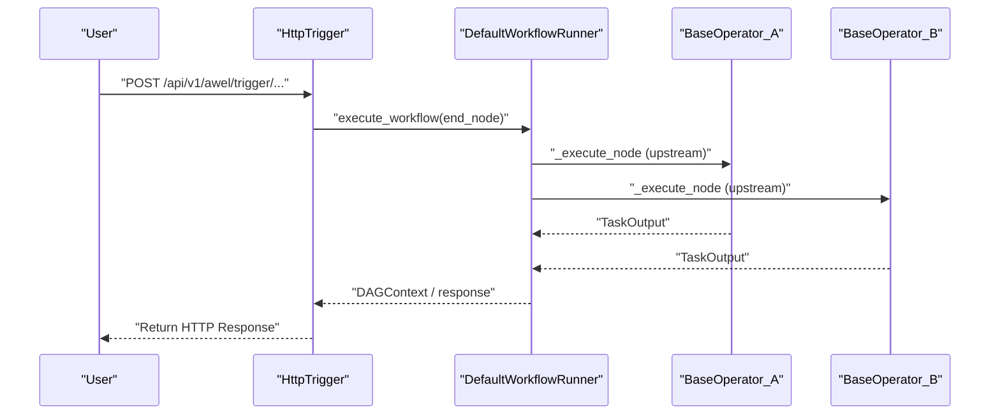

Sources:  
- `[packages/dbgpt-core/src/dbgpt/core/awel/runner/local_runner.py:24-171]()`
- `[examples/awel/simple_rag_summary_example.py:45-60]()`

---

## 3. Flow Factory and Visual Flow Canvas Integration

### 3.1 FlowFactory and Metadata

The `FlowFactory` dynamically scans modules, registering operator and resource classes by aggregating `ViewMetadata`, parameters, and IO schemas. This enables dynamic instantiation, parameter validation, and JSON serialization.

### 3.2 Visual Flow Canvas Integration

UI metadata (`ViewMetadata`) supplies labels, categories like `OperatorCategory.RAG`, parameters, and UI widgets (e.g., `ui.UISlider`) [packages/dbgpt-app/src/dbgpt_app/operators/rag.py:107-143](). This metadata powers the React Flow visual builder in `dbgpt-web`.

Sources:  
- `[packages/dbgpt-core/src/dbgpt/util/cli/flow_compat.py:125-190]()`
- `[packages/dbgpt-app/src/dbgpt_app/operators/rag.py:107-143]()`

---

## 4. Flow Persistence and Compatibility

AWEL workflows serialize operator configurations, unique instance identifiers, category tags, parameters, IO linkages, and version metadata [packages/dbgpt-serve/src/dbgpt_serve/flow/compat/0.7.0_compat_flow.json:1-38](). 

The CLI tool group `tool_flow_cli_group` provides commands (`gen_compat`) to generate compatibility mapping files and transform legacy JSON definitions [packages/dbgpt-core/src/dbgpt/util/cli/flow_compat.py:25-78]().

Sources:  
- `[packages/dbgpt-core/src/dbgpt/util/cli/flow_compat.py:19-213]()`
- `[packages/dbgpt-serve/src/dbgpt_serve/flow/compat/0.7.0_compat_flow.json:1-185]()`

---

## 5. Key Operators and Flow Examples

- `HOKnowledgeOperator`: Retrieves relevant knowledge chunks from a named knowledge space, supporting reranking and context injection [packages/dbgpt-app/src/dbgpt_app/operators/rag.py:97-209]().
- `HODatasourceRetrieverOperator`: Retrieves table schemas from selected database datasources for Text2SQL pipelines [packages/dbgpt-app/src/dbgpt_app/operators/datasource.py:199-208]().

Title: "SimpleRAGSummaryAWELFlowDAG"
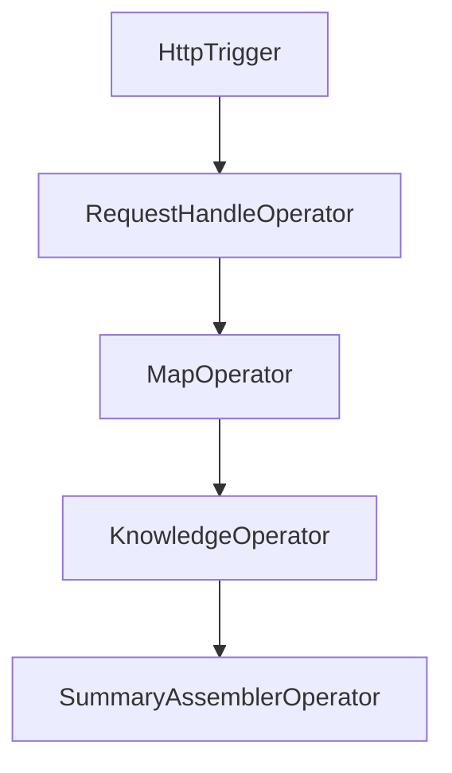

Sources:  
- `[examples/awel/simple_rag_summary_example.py:57-80]()`
- `[packages/dbgpt-app/src/dbgpt_app/operators/rag.py:97-209]()`
- `[packages/dbgpt-app/src/dbgpt_app/operators/datasource.py:199-208]()`

---

## 6. Bridging Natural Language Space to Code Entity Space

AWEL bridges natural language user prompts and visual UI graphs to concrete Python code entities and execution paths.

Title: "NaturalLanguageToAWELFactoryMapping"
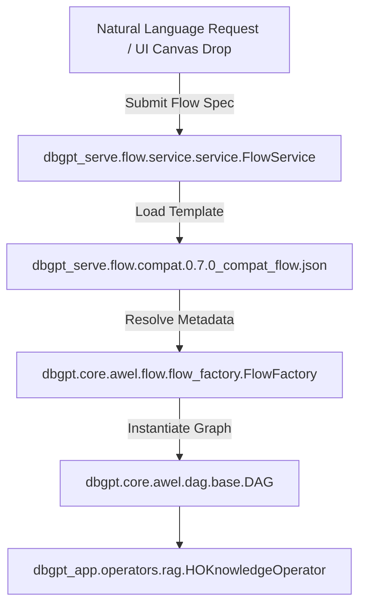

Title: "AWELRuntimeExecutionMapping"
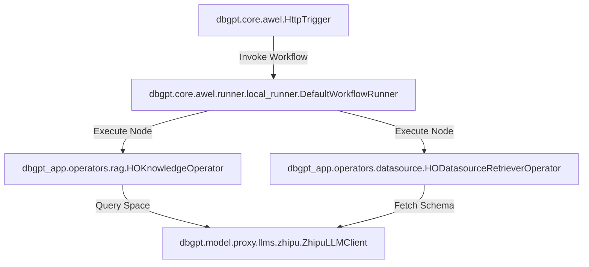

Sources:  
- `[packages/dbgpt-core/src/dbgpt/core/awel/runner/local_runner.py:24-171]()`
- `[packages/dbgpt-serve/src/dbgpt_serve/flow/compat/0.7.0_compat_flow.json:1-185]()`
- `[packages/dbgpt-app/src/dbgpt_app/operators/rag.py:97-209]()`
- `[packages/dbgpt-app/src/dbgpt_app/operators/datasource.py:199-208]()`
- `[packages/dbgpt-model/src/dbgpt/model/proxy/llms/zhipu.py:75-127]()`

---

# Page: Core Interfaces & Data Models

# Core Interfaces & Data Models

<details>
<summary>Relevant source files</summary>

The following files were used as context for generating this wiki page:

- [docs/docs/installation/advanced_usage/multimodal.md](docs/docs/installation/advanced_usage/multimodal.md)
- [docs/static/img/installation/advanced_usage/dbgpt-multimodal-local.jpg](docs/static/img/installation/advanced_usage/dbgpt-multimodal-local.jpg)
- [docs/static/img/installation/advanced_usage/dbgpt-multimodal-proxy.jpg](docs/static/img/installation/advanced_usage/dbgpt-multimodal-proxy.jpg)
- [packages/dbgpt-core/src/dbgpt/core/interface/file.py](packages/dbgpt-core/src/dbgpt/core/interface/file.py)
- [packages/dbgpt-core/src/dbgpt/core/interface/llm.py](packages/dbgpt-core/src/dbgpt/core/interface/llm.py)
- [packages/dbgpt-core/src/dbgpt/core/interface/output_parser.py](packages/dbgpt-core/src/dbgpt/core/interface/output_parser.py)
- [packages/dbgpt-core/src/dbgpt/core/interface/tests/test_file.py](packages/dbgpt-core/src/dbgpt/core/interface/tests/test_file.py)
- [packages/dbgpt-core/src/dbgpt/core/interface/tests/test_output_parser.py](packages/dbgpt-core/src/dbgpt/core/interface/tests/test_output_parser.py)
- [packages/dbgpt-core/src/dbgpt/core/interface/tests/test_variables.py](packages/dbgpt-core/src/dbgpt/core/interface/tests/test_variables.py)
- [packages/dbgpt-core/src/dbgpt/core/interface/variables.py](packages/dbgpt-core/src/dbgpt/core/interface/variables.py)
- [packages/dbgpt-core/src/dbgpt/model/adapter/loader.py](packages/dbgpt-core/src/dbgpt/model/adapter/loader.py)
- [packages/dbgpt-core/src/dbgpt/model/cluster/worker/default_worker.py](packages/dbgpt-core/src/dbgpt/model/cluster/worker/default_worker.py)
- [packages/dbgpt-core/src/dbgpt/model/llm/llm_out/hf_chat_llm.py](packages/dbgpt-core/src/dbgpt/model/llm/llm_out/hf_chat_llm.py)
- [packages/dbgpt-core/src/dbgpt/model/llm/llm_out/vllm_llm.py](packages/dbgpt-core/src/dbgpt/model/llm/llm_out/vllm_llm.py)
- [packages/dbgpt-core/src/dbgpt/model/llm/monkey_patch.py](packages/dbgpt-core/src/dbgpt/model/llm/monkey_patch.py)
- [packages/dbgpt-core/src/dbgpt/model/utils/hf_stream_utils.py](packages/dbgpt-core/src/dbgpt/model/utils/hf_stream_utils.py)
- [packages/dbgpt-core/src/dbgpt/model/utils/llm_metrics.py](packages/dbgpt-core/src/dbgpt/model/utils/llm_metrics.py)
- [packages/dbgpt-core/src/dbgpt/util/tracer/tracer_impl.py](packages/dbgpt-core/src/dbgpt/util/tracer/tracer_impl.py)
- [packages/dbgpt-ext/src/dbgpt_ext/storage/file/oss/oss_storage.py](packages/dbgpt-ext/src/dbgpt_ext/storage/file/oss/oss_storage.py)
- [packages/dbgpt-ext/src/dbgpt_ext/storage/file/s3/s3_storage.py](packages/dbgpt-ext/src/dbgpt_ext/storage/file/s3/s3_storage.py)
- [packages/dbgpt-serve/src/dbgpt_serve/file/serve.py](packages/dbgpt-serve/src/dbgpt_serve/file/serve.py)

</details>


## Purpose and Scope

This page documents the foundational interfaces, data models, and contracts primarily located in the `dbgpt-core` package under `dbgpt/core/interface` and associated storage and utility modules (`[packages/dbgpt-core/src/dbgpt/core/interface/llm.py:1-35]()`, `[packages/dbgpt-core/src/dbgpt/core/interface/variables.py:1-40]()`, `[packages/dbgpt-core/src/dbgpt/core/interface/file.py:1-35]()`). These components define unified abstractions and data schemas crucial for DB-GPT's core functionality: LLM inference, messaging, prompts, embeddings, knowledge structures, storage backends, caching layers, file management, variables & secrets, and object serialization. Understanding these interfaces and their implementations is essential when extending or integrating with the DB-GPT framework.

Sources:  
`packages/dbgpt-core/src/dbgpt/core/interface/llm.py:1-35`(),  
`packages/dbgpt-core/src/dbgpt/core/interface/variables.py:1-40`(),  
`packages/dbgpt-core/src/dbgpt/core/interface/file.py:1-35`()

---

## LLM & Inference Interfaces

The LLM subsystem provides the abstract contracts and data models essential to invoke, stream, and monitor large language models asynchronously or synchronously.

### The `LLM` Interface & `ModelInferenceMetrics`

- **Interface Overview**: The base LLM interface (defined in `[packages/dbgpt-core/src/dbgpt/core/interface/llm.py:1-35]()`) specifies how model calls are made, including prompt input, streaming token generation, and obtaining outputs. Implementation classes typically derive from this interface to standardize interaction regardless of backend framework or model type.
- **Performance Metrics Tracking**: `ModelInferenceMetrics` (`[packages/dbgpt-core/src/dbgpt/core/interface/llm.py:32-140]()`) captures runtime data including timestamps (start, first token, first completion, end), token counts (prompt, completion, total), throughput (tokens/s), and GPU memory usage snapshots. These metrics enable detailed analysis of latency, throughput, and resource efficiency for each inference request.

#### Data Flow Diagram: LLM Invocation and Metrics Data Flow
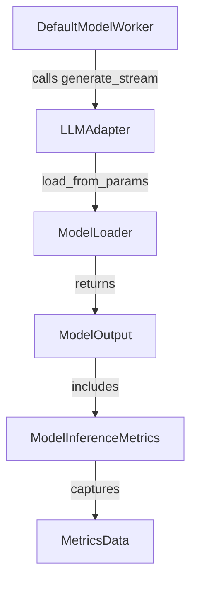

Sources:  
`packages/dbgpt-core/src/dbgpt/core/interface/llm.py:7-185`(),  
`packages/dbgpt-core/src/dbgpt/model/cluster/worker/default_worker.py:35-157`()

---

## Message & Media Models

DB-GPT utilizes a rich set of message abstractions that support multi-turn dialogues, role identification, tool invocation metadata, and multi-modal content like images, audio, and video.

### Core Message Classes

- `BaseMessage`: The fundamental class encapsulating turn index, textual content, role, and other metadata.
- `HumanMessage`, `AIMessage`, `SystemMessage`, `ViewMessage`: Role-specific message subclasses denoting origins such as user, AI, or system processes.
- `ModelMessage`: Designed for LLM server communication, it structures message roles as OpenAI-compatible enums (`"human"`, `"assistant"`, `"system"`), layered content blocks, and tool call metadata.
- Media content classes (`MediaContent`, `MediaObject`) manage multi-modal attachments either as URLs, base64 blobs, or raw bytes.

Sources:  
`packages/dbgpt-core/src/dbgpt/core/interface/llm.py:23-24`(),  
`packages/dbgpt-core/src/dbgpt/model/cluster/worker/default_worker.py:8-13`()

---

## Prompt & Embeddings Interfaces

- **Prompt Interface**: Manages the formatting, templating, and compilation of prompt strings injected into LLM requests, supporting variable substitution and message history reconstruction.
- **Embeddings Interface**: Defines the abstraction for vector embedding generation (`Embeddings`), mapping text documents or queries to dense vector representations consumed by vector stores and RAG retrieval pipelines.

Sources:  
`packages/dbgpt-core/src/dbgpt/core/interface/llm.py:1-30`()

---

## Knowledge & Storage Interfaces

- **Knowledge Interface**: Establishes models for knowledge documents, chunks, and spaces (`Knowledge`, `Document`, `Chunk`), facilitating ingestion, splitting, and vector synchronization.
- **Storage Interfaces**: `StorageInterface` and related specs (`QuerySpec`, `ResourceIdentifier`, `StorageItem`) define CRUD operations and key-value or relational access patterns used across metadata and caching stores (`[packages/dbgpt-core/src/dbgpt/core/interface/file.py:20-27]()`, `[packages/dbgpt-core/src/dbgpt/core/interface/variables.py:18-24]()`).

Sources:  
`packages/dbgpt-core/src/dbgpt/core/interface/file.py:20-27`(),  
`packages/dbgpt-core/src/dbgpt/core/interface/variables.py:18-24`()

---

## OutputParser Interface

The `BaseOutputParser` extends AWEL's `MapOperator`, enabling structured post-processing of LLM outputs (`[packages/dbgpt-core/src/dbgpt/core/interface/output_parser.py:31-62]()`).

Key features include:
- Streaming-aware parsing that removes prompt echoes and trims extraneous tokens (`[packages/dbgpt-core/src/dbgpt/core/interface/output_parser.py:87-121]()`).
- Extraction of embedded JSON code blocks from markdown fences (e.g., triple backticks enclosing JSON) (`[packages/dbgpt-core/src/dbgpt/core/interface/output_parser.py:153-201]()`).
- Flexible parsing both in streaming response mode (`parse_model_stream_resp_ex`) and non-streaming immediate responses (`parse_model_nostream_resp`), raising errors on failure (`[packages/dbgpt-core/src/dbgpt/core/interface/output_parser.py:122-142]()`).
- Built-in code cleanup heuristics to handle common malformed JSON output from LLMs (`[packages/dbgpt-core/src/dbgpt/core/interface/output_parser.py:143-151]()`).

Sources:  
`packages/dbgpt-core/src/dbgpt/core/interface/output_parser.py:31-201`()

---

## File Management System

DB-GPT supports abstracted, pluggable file and storage backends with unified metadata and URI schemes to facilitate persistence, retrieval, and deletion of data files (`[packages/dbgpt-core/src/dbgpt/core/interface/file.py:1-35]()`).

### Key Classes and Concepts

- **`StorageBackend`**: Abstract base for backend implementations with core methods: `save()`, `load()`, `delete()`, `list_files()` (`[packages/dbgpt-core/src/dbgpt/core/interface/file.py:186-219]()`).
- **`FileMetadata`**: Metadata model including file ID, bucket, filename, size, storage type, path, URI, file hash, and extended metadata (`[packages/dbgpt-core/src/dbgpt/core/interface/file.py:55-119]()`).
- **`FileStorageURI`**: Implements the `dbgpt-fs://` URI scheme parsing and serialization (`[packages/dbgpt-core/src/dbgpt/core/interface/file.py:132-184]()`). This encapsulates storage type (e.g., local, OSS, S3), bucket, file ID, optional version, and custom parameters.

Sources:  
`packages/dbgpt-core/src/dbgpt/core/interface/file.py:33-219`()

---

## Cache System

The cache subsystem manages temporary storage of query results, intermediate model outputs, and other ephemeral data to enhance performance.

- `CacheManager` (abstract) defines asynchronous methods: `set()`, `get()` for storing and retrieving cached values keyed by typed cache keys.
- `LocalCacheManager` is a concrete implementation utilizing specified cache storage backends and serializers (e.g., `JsonSerializer`) to serialize cache entries safely.

#### Cache Manager Data Flow Diagram
```mermaid
graph TD
    AWELApplication["AWELApplication"] -->|"invokes"| LocalCacheManager["LocalCacheManager"]
    LocalCacheManager -->|"serializes"| JsonSerializer["JsonSerializer"]
    JsonSerializer -->|"persists"| CacheStorage["CacheStorage"]
    CacheStorage -->|"stores"| CacheValue["CacheValue"]
```

Sources:  
`packages/dbgpt-core/src/dbgpt/core/interface/file.py:16-27`()

---

## Variables & Secrets Management

DB-GPT offers a secure, flexible variable storage interface with encryption support and scoped variable resolution (`[packages/dbgpt-core/src/dbgpt/core/interface/variables.py:1-40]()`).

### Encryption Abstraction

- `Encryption` (abstract) defines `encrypt(data:str, salt:str) -> str` and `decrypt(encrypted_data:str, salt:str) -> str` (`[packages/dbgpt-core/src/dbgpt/core/interface/variables.py:41-54]()`).
- Implementations:
  - `FernetEncryption`: AES-GCM symmetric encryption using the `cryptography` package (`[packages/dbgpt-core/src/dbgpt/core/interface/variables.py:75-131]()`).
  - `SimpleEncryption`: Lightweight XOR-based encryption for less stringent use cases (`[packages/dbgpt-core/src/dbgpt/core/interface/variables.py:133-166]()`).

### VariablesIdentifier & StorageVariables

- `VariablesIdentifier` parses and constructs string identifiers in the format `${key:name@scope:scope_key#sys_code%user_name}` (`[packages/dbgpt-core/src/dbgpt/core/interface/variables.py:169-198]()`).
- `StorageVariables` encapsulates variable data, type, label, and metadata.
- `StorageVariablesProvider` manages persistence and retrieval, transparently encrypting secrets before storage and decrypting upon retrieval.

#### Variables Encryption Flow Diagram
```mermaid
graph TD
    UserAssign["UserAssign"] -->|"VariablesIdentifier & Value"| StorageVariablesProvider["StorageVariablesProvider"]
    StorageVariablesProvider -->|"encrypts"| Encryption["Encryption"]
    Encryption -->|"saves"| StorageInterface["StorageInterface"]
    UserGet["UserGet"] -->|"variable key string"| StorageVariablesProvider
    StorageVariablesProvider -->|"loads"| StorageInterface
    StorageInterface -->|"encrypted item"| Encryption
    Encryption -->|"decrypts"| PlainValue["PlainValue"]
```

Sources:  
`packages/dbgpt-core/src/dbgpt/core/interface/variables.py:41-198`()

---

## Serialization Framework

DB-GPT provides robust serialization utilities (such as `JsonSerializer`) to convert complex data structures, interface models, and storage items into storable or transmissible payloads without data loss. These serializers are integrated into storage backends, caching mechanisms, and state persistence pipelines.

Sources:  
`packages/dbgpt-core/src/dbgpt/core/interface/file.py:1-35`()

---

## Natural Language Space ⇔ Code Entity Space Mapping

This section illustrates how key natural language concepts and configuration ideas correspond to implemented code entities within DB-GPT.

### Example 1: Model Deployment & Quantization Support

```mermaid
graph LR
    DeployQwen4bitModel["DeployQwen4bitModel"] -->|"maps to"| HFLLMDeployModelParameters["HFLLMDeployModelParameters"]
    HFLLMDeployModelParameters -->|"real_model_path"| QwenModelPath["QwenModelPath"]
    HFLLMDeployModelParameters -->|"quantization"| QuantConfig["QuantConfig"]
    HFLLMDeployModelParameters -->|"provider='hf'"| NewHFChatModelAdapter["NewHFChatModelAdapter"]
    NewHFChatModelAdapter -->|"load_from_params"| ModelLoader["ModelLoader"]
    ModelLoader -->|"calls"| huggingface_loader["huggingface_loader"]
    huggingface_loader -->|"returns"| PyTorchModelAndTokenizer["PyTorchModelAndTokenizer"]
```

Sources:  
`packages/dbgpt-core/src/dbgpt/model/adapter/loader.py:57-70`(),  
`packages/dbgpt-core/src/dbgpt/model/cluster/worker/default_worker.py:35-157`()

---

### Example 2: Cache Initialization & Storage Resolution

```mermaid
graph LR
    InitializeValkeyCache["InitializeValkeyCache"] -->|"configures"| ModelCacheParameters["ModelCacheParameters"]
    ModelCacheParameters -->|"storage_type='valkey'"| ValkeyCacheStorage["ValkeyCacheStorage"]
    ValkeyCacheStorage -->|"registers with"| LocalCacheManager["LocalCacheManager"]
    LocalCacheManager -->|"uses"| JsonSerializer["JsonSerializer"]
```

Sources:  
`packages/dbgpt-core/src/dbgpt/core/interface/file.py:1-25`()

---

# Page: Component & Dependency Injection System

# Component & Dependency Injection System

<details>
<summary>Relevant source files</summary>

The following files were used as context for generating this wiki page:

- [docs/docs/modules/observability.md](docs/docs/modules/observability.md)
- [docs/i18n/zh-CN/docusaurus-plugin-content-docs/current/modules/observability.md](docs/i18n/zh-CN/docusaurus-plugin-content-docs/current/modules/observability.md)
- [packages/dbgpt-app/src/dbgpt_app/component_configs.py](packages/dbgpt-app/src/dbgpt_app/component_configs.py)
- [packages/dbgpt-app/src/dbgpt_app/initialization/serve_initialization.py](packages/dbgpt-app/src/dbgpt_app/initialization/serve_initialization.py)
- [packages/dbgpt-app/src/dbgpt_app/operators/report.py](packages/dbgpt-app/src/dbgpt_app/operators/report.py)
- [packages/dbgpt-core/src/dbgpt/agent/core/agent.py](packages/dbgpt-core/src/dbgpt/agent/core/agent.py)
- [packages/dbgpt-core/src/dbgpt/agent/expand/__init__.py](packages/dbgpt-core/src/dbgpt/agent/expand/__init__.py)
- [packages/dbgpt-core/src/dbgpt/agent/expand/resources/search_tool.py](packages/dbgpt-core/src/dbgpt/agent/expand/resources/search_tool.py)
- [packages/dbgpt-core/src/dbgpt/agent/expand/resources/tests/__init__.py](packages/dbgpt-core/src/dbgpt/agent/expand/resources/tests/__init__.py)
- [packages/dbgpt-core/src/dbgpt/agent/expand/resources/tests/test_search_tool.py](packages/dbgpt-core/src/dbgpt/agent/expand/resources/tests/test_search_tool.py)
- [packages/dbgpt-core/src/dbgpt/agent/expand/tool_calling_agent.py](packages/dbgpt-core/src/dbgpt/agent/expand/tool_calling_agent.py)
- [packages/dbgpt-core/src/dbgpt/agent/resource/app.py](packages/dbgpt-core/src/dbgpt/agent/resource/app.py)
- [packages/dbgpt-core/src/dbgpt/util/pd_utils.py](packages/dbgpt-core/src/dbgpt/util/pd_utils.py)
- [packages/dbgpt-serve/src/dbgpt_serve/agent/resource/app.py](packages/dbgpt-serve/src/dbgpt_serve/agent/resource/app.py)
- [packages/dbgpt-serve/src/dbgpt_serve/flow/templates/en/chat-data-awel-flow-template.json](packages/dbgpt-serve/src/dbgpt_serve/flow/templates/en/chat-data-awel-flow-template.json)
- [packages/dbgpt-serve/src/dbgpt_serve/flow/templates/zh/chat-data-awel-flow-template.json](packages/dbgpt-serve/src/dbgpt_serve/flow/templates/zh/chat-data-awel-flow-template.json)

</details>


The Component and Dependency Injection (DI) system in DB-GPT provides a structured and reusable framework to manage system components, their registration, lifecycle, and interdependencies. It underlies the modular architecture of DB-GPT by enabling consistent component discovery, lazy instantiation, service registration, and lifecycle orchestration. The core of this mechanism is the `SystemApp` class, acting as a global component registry and DI container.

This page explains the design and implementation of the component system, how components and services are registered, retrieved, and initialized, and details the startup wiring of `dbgpt-app` that orchestrates the system composition.

Sources:  
- [packages/dbgpt-app/src/dbgpt_app/component_configs.py:14-64]()

---

## SystemApp: The Central Component Registry

`SystemApp` functions as the global singleton registry of all core system components. It wraps the FastAPI application instance, maintains maps of registered component classes and singleton instances, and provides an API for:

- **Component Registration:** by class or instance.
- **Lazy Instantiation:** components registered by class are instantiated on first request with optional constructor arguments.
- **Dependency Resolution:** inject or query component dependencies at runtime.
- **Lifecycle Management:** asynchronous hooks `on_init()` and `after_init()` invoke initialization and post-initialization logic for registered components.

This design enables low coupling, extensibility, and simple test mocking by centralizing component lifecycle and access.

Sources:  
- [packages/dbgpt-app/src/dbgpt_app/component_configs.py:14-64]()

---

## Component Registration and Retrieval

### Registration Patterns

- **Class-Based Registration:**  
  Use `system_app.register(component_class, *args, **kwargs)` to register a component by its class with optional constructor parameters. The component instance will be lazily created on first `get_component()` call.  
  Example components registered this way in startup:
  - `DefaultExecutorFactory` (thread pool executor factory).
  - `DefaultScheduler` (async job scheduler).
  - `ConnectorManager` (manages datasource connectors).
  - `StorageManager` (manages vector, graph, and full-text stores).  
  These registrations are done in the `initialize_components()` function during startup [packages/dbgpt-app/src/dbgpt_app/component_configs.py:14-64]().

- **Instance-Based Registration:**  
  Use `system_app.register_instance(existing_instance)` to register already created singleton objects. For example:
  - `controller` (model cluster controller singleton).
  - `multi_agents` (multi-agent orchestrator singleton).
  - `module_plugin` (plugin manager instance).  
  These instances are registered directly in the same initialization phase [packages/dbgpt-app/src/dbgpt_app/component_configs.py:37-47]().

### Retrieval

Components request dependencies at runtime by invoking `system_app.get_component(ComponentType)`. If the component was registered by class but not instantiated yet, `SystemApp` creates it lazily and caches the instance.

This provides transparent access to shared services across asynchronous contexts and operator executions without explicit wiring.

Sources:  
- [packages/dbgpt-app/src/dbgpt_app/component_configs.py:14-64]()

---

## Component Lifecycle Management

`SystemApp` manages two central asynchronous lifecycle phases during startup:

- **`on_init()`**: Invoked once after all components are registered. Used for asynchronous initialization logic like preparing executors, connectors, or loading cached states.

- **`after_init()`**: Called immediately after `on_init()`. Intended for finalizing setup steps such as database migrations, loading default configurations, or warming caches.

These hooks ensure synchronized readiness and sequential initialization of components across the system before serving requests.

Sources:  
- [packages/dbgpt-app/src/dbgpt_app/component_configs.py:14-64]()

---

## Initialization Wiring in `dbgpt-app`

The function:

```python
initialize_components(param: ApplicationConfig, system_app: SystemApp)
```

is the primary cold-start entrypoint for registering and wiring components into the global `SystemApp`. It receives the parsed application configuration and the shared `SystemApp` instance, then performs stepwise registration and initialization of essential services [packages/dbgpt-app/src/dbgpt_app/component_configs.py:14-64]().

### Main Initialization Steps

1. **Register Core Executors and Scheduler**
   - `DefaultExecutorFactory` registered with `max_workers` from config's thread pool size [packages/dbgpt-app/src/dbgpt_app/component_configs.py:33-35]().
   - `DefaultScheduler` registered to manage asynchronous scheduled jobs [packages/dbgpt-app/src/dbgpt_app/component_configs.py:36]().

2. **Register Model Cluster Controller and Managers**
   - Register singleton instance `controller` for model cluster management [packages/dbgpt-app/src/dbgpt_app/component_configs.py:37]().
   - Register `ConnectorManager` for datasource management [packages/dbgpt-app/src/dbgpt_app/component_configs.py:38]().
   - Register `StorageManager` for vector/graph/full-text storage layers [packages/dbgpt-app/src/dbgpt_app/component_configs.py:39]().

3. **Embedding and Rerank Model Initialization**
   - Initialize embeddings and reranking models lazily with helper functions [packages/dbgpt-app/src/dbgpt_app/component_configs.py:49-50]().

4. **AWEL Flow and Agent Resource Setup**
   - Initialize AWEL (Agentic Workflow Expression Language) DAG flow directories and registry [packages/dbgpt-app/src/dbgpt_app/component_configs.py:52]().
   - Initialize agent resources like `DatasourceResource`, `KnowledgeSpaceRetrieverResource`, `PluginToolPack`, `GptAppResource`, `MCPSSEToolPack`, and skill-related resources [packages/dbgpt-app/src/dbgpt_app/component_configs.py:103-146]().

5. **Register API Services and Operators**
   - Register editor API service (`EditorService`) [packages/dbgpt-app/src/dbgpt_app/component_configs.py:149-152]().
   - Scan and register AWEL operators dynamically [packages/dbgpt-app/src/dbgpt_app/component_configs.py:155-170]().
   - Initialize prompt templates and benchmark data [packages/dbgpt-app/src/dbgpt_app/component_configs.py:61-63]().
   - Register code execution server [packages/dbgpt-app/src/dbgpt_app/component_configs.py:60]().

6. **Register Serve Apps**
   - Register various serve modules such as prompt serve, conversation serve, rag serve, datasource serve, each with their configurations parsed dynamically from application config [packages/dbgpt-app/src/dbgpt_app/initialization/serve_initialization.py:79-201]().

### Initialization Flow Diagram

```mermaid
graph TD
    subgraph "dbgpt-app Startup"
        INIT["initialize_components(ApplicationConfig, SystemApp)"]
    end

    subgraph "SystemApp Registry"
        DEF_EXEC["DefaultExecutorFactory"]
        SCHED["DefaultScheduler"]
        CONTROLLER["controller (Model Cluster)"]
        CONN_MAN["ConnectorManager"]
        STOR_MAN["StorageManager"]
        EMB_MODEL["Embedding Models"]
        RERANK_MODEL["Rerank Models"]
        AGENT_RES["Agent Resources"]
        AWEL_REG["AWEL DAG Registry"]
        EDIT_SRV["EditorService API"]
        PROMPT_TPL["Prompt Templates"]
        CODE_SERV["Code Server"]
        BENCHMARK["Benchmark Data"]
    end

    INIT --> DEF_EXEC
    INIT --> SCHED
    INIT --> CONTROLLER
    INIT --> CONN_MAN
    INIT --> STOR_MAN
    INIT --> EMB_MODEL
    INIT --> RERANK_MODEL
    INIT --> AGENT_RES
    INIT --> AWEL_REG
    INIT --> EDIT_SRV
    INIT --> PROMPT_TPL
    INIT --> CODE_SERV
    INIT --> BENCHMARK
```

Sources:  
- [packages/dbgpt-app/src/dbgpt_app/component_configs.py:14-179]()

---

## Dependency Injection in Runtime Contexts

The `SystemApp` registry is accessible globally throughout the DB-GPT runtime, including within AWEL operator flows, agent execution, and API endpoints. This allows dynamic retrieval and lazy initialization of services and components without explicit wiring dependence in most business logic.

### Example: Bridging Natural Language to Code Components (Datasource Retrieval)

This diagram illustrates how a natural language task to retrieve database context flows through the component and DI system inside the `ReportAnalystOperator`. The operator queries `SystemApp` for configuration and dependent state.

```mermaid
graph LR
    subgraph "Natural_Language_Space"
        NL_QUERY["User: 'Analyze this database report and summarize'"]
        TASK["Report Analysis Task"]
    end

    subgraph "Code_Entity_Space"
        SAPP["dbgpt.component.SystemApp"]
        OP_REP["dbgpt_app.operators.report.ReportAnalystOperator"]
        LLM_CLIENT["dbgpt.core.interface.llm.LLMClient"]
        PROMPT_TPL["dbgpt.core.interface.prompt.ChatPromptTemplate"]
    end

    NL_QUERY --> OP_REP
    OP_REP -->|"Uses SystemApp config/services"| SAPP
    SAPP --> PROMPT_TPL
    SAPP --> LLM_CLIENT
    TASK --> OP_REP
```

Sources:  
- [packages/dbgpt-app/src/dbgpt_app/operators/report.py:77-182]()

---

## Agent Resource Registration Example

The DI system supports agent resource registration which enables agents to access various runtime capabilities such as database connectors, knowledge retrievers, plugins, and MCP tools. These resources are registered during initialization of the resource manager obtained from `SystemApp` [packages/dbgpt-app/src/dbgpt_app/component_configs.py:103-146]().

| Resource Class                     | Purpose                              | Registered In                                                       |
|----------------------------------|------------------------------------|-------------------------------------------------------------------|
| `DatasourceResource`              | Relational DB adapters for agents  | `_initialize_resource_manager()` [packages/dbgpt-app/src/dbgpt_app/component_configs.py:126]()    |
| `KnowledgeSpaceRetrieverResource`| Knowledge retrieval RAG retrievers | `_initialize_resource_manager()` [packages/dbgpt-app/src/dbgpt_app/component_configs.py:127]()    |
| `PluginToolPack`                  | Plugins and tool integrations       | `_initialize_resource_manager()` [packages/dbgpt-app/src/dbgpt_app/component_configs.py:128]()    |
| `GptAppResource`                 | Agent app access                   | `_initialize_resource_manager()` [packages/dbgpt-app/src/dbgpt_app/component_configs.py:129]()    |
| `MCPSSEToolPack`                 | MCP protocol support               | `_initialize_resource_manager()` [packages/dbgpt-app/src/dbgpt_app/component_configs.py:140]()    |

### Agent Resource Discovery Flow

```mermaid
graph TD
    subgraph "ConversableAgent Runtime"
        AGENT["ConversableAgent"]
        RM["ResourceManager"]
    end

    subgraph "SystemApp DI Container"
        SAPP["SystemApp"]
        RES_DS["DatasourceResource"]
        RES_KG["KnowledgeSpaceRetrieverResource"]
        RES_PLG["PluginToolPack"]
        RES_APP["GptAppResource"]
        RES_MCP["MCPSSEToolPack"]
    end

    AGENT -->|"Obtains resource manager"| RM
    RM --> SAPP
    SAPP --> RES_DS
    SAPP --> RES_KG
    SAPP --> RES_PLG
    SAPP --> RES_APP
    SAPP --> RES_MCP
```

Sources:
- [packages/dbgpt-app/src/dbgpt_app/component_configs.py:103-146]()

---

### Bridging Natural Language to Code Components (App Resource Execution)

This shows how a user's natural language request to interact with a sub-application is routed through the DI system and the agent app resource [packages/dbgpt-app/src/dbgpt_app/component_configs.py:103-146](), [packages/dbgpt-serve/src/dbgpt_serve/agent/resource/app.py:11-72]().

```mermaid
graph LR
    subgraph "Natural_Language_Space"
        NL_REQ["User: 'Interact with sub-application app_001'"]
        SUB_GOAL["Sub-agent Task Execution"]
    end

    subgraph "Code_Entity_Space"
        SAPP["dbgpt.component.SystemApp"]
        APP_RES["dbgpt_serve.agent.resource.app.GptAppResource"]
        APP_MGR["dbgpt_serve.agent.agents.app_agent_manage.AppManager"]
    end

    NL_REQ --> APP_RES
    APP_RES -->|"Gets app controller via AppManager"| APP_MGR
    APP_MGR --> SAPP
    SUB_GOAL --> APP_RES
```

Sources:  
- [packages/dbgpt-app/src/dbgpt_app/component_configs.py:103-146]()  
- [packages/dbgpt-serve/src/dbgpt_serve/agent/resource/app.py:11-72]()

---

## Server Startup Integration

During server startup, the FastAPI app is created, the global `SystemApp` instance is initialized with the FastAPI app, then `initialize_components()` is called with the parsed configuration and `SystemApp` [packages/dbgpt-app/src/dbgpt_app/component_configs.py:14-64](). This registers all components, instances, providers, and services into the DI system. Then lifecycle hooks `on_init()` and `after_init()` are awaited to finalize initialization.

### Server Startup Sequence Diagram

```mermaid
sequenceDiagram
    participant SERVE as dbgpt_server.py (main)
    participant FASTAPI as FastAPI_app
    participant SYSAPP as SystemApp
    participant INIT as initialize_components()

    SERVE->>FASTAPI: create_app()
    SERVE->>SYSAPP: SystemApp(FASTAPI)
    SERVE->>INIT: initialize_components(ApplicationConfig, SystemApp)
    INIT->>SYSAPP: register(component classes and instances)
    SERVE->>SYSAPP: await on_init()
    SERVE->>SYSAPP: await after_init()
```

Sources:  
- [packages/dbgpt-app/src/dbgpt_app/component_configs.py:14-64]()

---

# Summary

The Component & DI system centered on `SystemApp` enables DB-GPT to organize, instantiate, and manage its modular components reliably and efficiently. It supports:

- Lazy and instance-based component registration
- Service discovery and dependency injection
- Lifecycle callbacks during startup
- Centralized system wiring in `dbgpt-app`

This system fosters clean separation of concerns and extensibility in the DB-GPT architecture.

---

# References

- `packages/dbgpt-app/src/dbgpt_app/component_configs.py` [14-179]()  
- `packages/dbgpt-app/src/dbgpt_app/operators/report.py` [77-182]()  
- `packages/dbgpt-serve/src/dbgpt_serve/agent/resource/app.py` [11-72]()

---

# Page: LLM & Model Management (SMMF)

# LLM & Model Management (SMMF)

<details>
<summary>Relevant source files</summary>

The following files were used as context for generating this wiki page:

- [configs/dbgpt-local-mlx.toml](configs/dbgpt-local-mlx.toml)
- [docs/docs/installation/advanced_usage/mlx_inference.md](docs/docs/installation/advanced_usage/mlx_inference.md)
- [docs/yarn.lock](docs/yarn.lock)
- [packages/dbgpt-core/src/dbgpt/model/__init__.py](packages/dbgpt-core/src/dbgpt/model/__init__.py)
- [packages/dbgpt-core/src/dbgpt/model/adapter/base.py](packages/dbgpt-core/src/dbgpt/model/adapter/base.py)
- [packages/dbgpt-core/src/dbgpt/model/adapter/hf_adapter.py](packages/dbgpt-core/src/dbgpt/model/adapter/hf_adapter.py)
- [packages/dbgpt-core/src/dbgpt/model/adapter/mlx_adapter.py](packages/dbgpt-core/src/dbgpt/model/adapter/mlx_adapter.py)
- [packages/dbgpt-core/src/dbgpt/model/adapter/vllm_adapter.py](packages/dbgpt-core/src/dbgpt/model/adapter/vllm_adapter.py)
- [packages/dbgpt-core/src/dbgpt/model/base.py](packages/dbgpt-core/src/dbgpt/model/base.py)
- [packages/dbgpt-core/src/dbgpt/model/llm/llm_out/mlx_llm.py](packages/dbgpt-core/src/dbgpt/model/llm/llm_out/mlx_llm.py)

</details>


The **Service-Oriented Multi-Model Management Framework (SMMF)** is the core infrastructure within DB-GPT responsible for orchestrating the lifecycle, management, and serving of large language models (LLMs). It provides a unified, service-oriented architecture that integrates multiple model providers, deployment modes, and runtime environments. The framework supports both local execution and distributed clusters, bridging native backends and proxy cloud LLM providers for flexible usage scenarios.

Sources:  
[packages/dbgpt-core/src/dbgpt/model/proxy/__init__.py:34-72]()

---

## Overview

SMMF is designed to:

- Register and manage multiple LLMs from various providers and deployment contexts via a consistent interface.
- Dynamically load models with configurable device placement, memory usage, quantization, and runtime performance optimizations.
- Serve inference requests through workers supervised by a controller, enabling efficient request routing and concurrency management.
- Support extensive local backends such as vLLM, llama.cpp, HuggingFace Transformers, and MLX, alongside cloud and proxy LLM providers including OpenAI, DeepSeek, Zhipu, Tongyi, MiniMax, LiteLLM, OrcaRouter, SynthorAI, AIMLAPI, BurnCloud, Ollama, among others.
- Provide an OpenAI-compatible REST API server to facilitate client integrations using standardized protocols.

The framework is modular, with adapters encapsulating model-specific inference logic and worker abstractions managing execution lifecycles.

Sources:  
[packages/dbgpt-core/src/dbgpt/model/proxy/__init__.py:34-72]()

---

## Conceptual Architecture

This diagram bridges the natural language abstraction of user prompts with internal code entities managing model loading, execution, and response delivery:

```mermaid
graph TD
    subgraph "Natural Language Space"
        UserPrompt["UserPrompt"] --> ModelRequest["ModelRequest"]
    end

    subgraph "Model Cluster & Worker Management"
        ModelRequest -->|"route_request"| ModelController["ModelController"]
        ModelController -->|"dispatch"| DefaultModelWorker["DefaultModelWorker"]
        DefaultModelWorker -->|"persist state"| ModelStorage["ModelStorage"]
    end

    subgraph "Model Adapter Layer"
        DefaultModelWorker -->|"load_worker"| LLMAdapter["LLMModelAdapter"]
        LLMAdapter -->|"load_from_params"| ModelLoader["ModelLoader"]
    end

    subgraph "Backend Execution & Proxy Clients"
        ModelLoader --> LocalBackends["LocalBackends"]
        DefaultModelWorker --> ProxyClients["ProxyClients"]
    end
```

- **UserPrompt & ModelRequest:** Capture and normalize user inputs into requests for inference [packages/dbgpt-core/src/dbgpt/model/proxy/llms/proxy_model.py:1-45]().
- **ModelController & DefaultModelWorker:** Oversee request routing and model execution lifecycle control [packages/dbgpt-core/src/dbgpt/model/cluster/worker/default_worker.py:35-94]().
- **ModelStorage:** Maintains state persistence ensuring robustness and recovery [packages/dbgpt-core/src/dbgpt/model/cluster/storage.py:186-199]().
- **LLMModelAdapter & ModelLoader:** Abstract across diverse model formats and loading parameters including devices and quantization [packages/dbgpt-core/src/dbgpt/model/adapter/base.py:121-202](), [packages/dbgpt-core/src/dbgpt/model/adapter/loader.py:10-70]().
- **Local Backends:** Support various optimized local runtimes including vLLM, llama.cpp, MLX, and HF [packages/dbgpt-core/src/dbgpt/model/adapter/hf_adapter.py:24-113](), [packages/dbgpt-core/src/dbgpt/model/adapter/vllm_adapter.py:20-58](), [packages/dbgpt-core/src/dbgpt/model/adapter/mlx_adapter.py:17-55]().
- **Proxy Clients:** Integrate third-party cloud or vendor LLM endpoints through specialized clients supporting advanced routing [packages/dbgpt-core/src/dbgpt/model/proxy/llms/orcarouter.py:70-149](), [packages/dbgpt-core/src/dbgpt/model/proxy/llms/synthorai.py:70-135]().

Sources:  
[packages/dbgpt-core/src/dbgpt/model/proxy/llms/proxy_model.py:1-45]()  
[packages/dbgpt-core/src/dbgpt/model/cluster/worker/default_worker.py:35-94]()  
[packages/dbgpt-core/src/dbgpt/model/cluster/storage.py:186-199]()  
[packages/dbgpt-core/src/dbgpt/model/adapter/base.py:121-202]()  
[packages/dbgpt-core/src/dbgpt/model/adapter/loader.py:10-70]()  
[packages/dbgpt-core/src/dbgpt/model/adapter/hf_adapter.py:24-113]()  
[packages/dbgpt-core/src/dbgpt/model/adapter/vllm_adapter.py:20-58]()  
[packages/dbgpt-core/src/dbgpt/model/adapter/mlx_adapter.py:17-55]()  
[packages/dbgpt-core/src/dbgpt/model/proxy/llms/orcarouter.py:70-149]()  
[packages/dbgpt-core/src/dbgpt/model/proxy/llms/synthorai.py:70-135]()

---

## Key Features

- **Unified Multi-Model Management**  
  Supports a broad spectrum of inference providers and deployment targets:  
  - Local backends such as vLLM, llama.cpp, HuggingFace Transformers (including chat-optimized variants), and MLX [packages/dbgpt-core/src/dbgpt/model/base.py:12-23]().  
  - Proxy backends including OpenAI API, DeepSeek, Zhipu, Tongyi, MiniMax, LiteLLM, OrcaRouter, SynthorAI, AIMLAPI, BurnCloud, Ollama, etc. [packages/dbgpt-core/src/dbgpt/model/proxy/__init__.py:34-72]().  

- **Flexible Model Loading & Device Configuration**  
  Enables models to be loaded with parameters controlling device (CPU, GPU), quantization mode (4-bit, 8-bit), number of GPUs, memory restrictions, trust flags, and tokenizer options. Parameters are encapsulated in classes like `HFLLMDeployModelParameters` and `VLLMDeployModelParameters` [packages/dbgpt-core/src/dbgpt/model/adapter/hf_adapter.py:20-113](), [packages/dbgpt-core/src/dbgpt/model/adapter/vllm_adapter.py:16-147]().

- **Rich Performance Metrics & Monitoring**  
  `ModelInferenceMetrics` collects detailed latencies (prefill, decode start, decode end), token counts, decoding throughputs, and other timing data for inference requests [packages/dbgpt-core/src/dbgpt/core/interface/llm.py:34-82]().

- **Service-Oriented & Pluggable Architecture**  
  Model adapters, workers, and proxy clients register themselves dynamically into the framework's service registry for discovery and use during runtime workflows [packages/dbgpt-core/src/dbgpt/model/proxy/llms/orcarouter.py:36-43](), [packages/dbgpt-core/src/dbgpt/model/proxy/llms/synthorai.py:36-43]().

- **OpenAI-Compatible API Server**  
  SMMF supports a robust API server compatible with OpenAI's endpoint schema, lowering integration barriers for external clients and SDKs.

Sources:  
[packages/dbgpt-core/src/dbgpt/model/base.py:12-138]()  
[packages/dbgpt-core/src/dbgpt/core/interface/llm.py:34-82]()  
[packages/dbgpt-core/src/dbgpt/model/proxy/__init__.py:34-72]()  
[packages/dbgpt-core/src/dbgpt/model/proxy/llms/orcarouter.py:36-43]()  
[packages/dbgpt-core/src/dbgpt/model/proxy/llms/synthorai.py:36-43]()

---

## Core Subsystems

### 3.1 Local Model Adapters & Workers

This subsystem manages local model inference using adapters for HuggingFace Transformers (including chat models), vLLM, llama.cpp, and MLX. It uses worker classes like `DefaultWorker` and `EmbeddingWorker` that handle model execution lifecycle, loading, quantization, and monkey-patching.

For detailed exploration, see [Local Model Adapters & Workers](#3.1).

Sources:  
[packages/dbgpt-core/src/dbgpt/model/cluster/worker/default_worker.py:35-158]()  
[packages/dbgpt-core/src/dbgpt/model/adapter/loader.py:10-70]()  
[packages/dbgpt-core/src/dbgpt/model/adapter/hf_adapter.py:1-203]()  
[packages/dbgpt-core/src/dbgpt/model/adapter/vllm_adapter.py:1-184]()  
[packages/dbgpt-core/src/dbgpt/model/adapter/mlx_adapter.py:1-126]()

---

### 3.2 Proxy LLM Integrations

This layer handles cloud or remote LLM backends via proxy clients implementing OpenAI-compatible APIs across providers like OpenAI, DeepSeek, Zhipu, Tongyi, MiniMax, LiteLLM, OrcaRouter, SynthorAI, AIMLAPI, BurnCloud, and Ollama.

Key aspects:
- **Dynamic Proxy Registry:** Maintains references to proxy clients loaded at runtime.
- **Routing and Gateway Clients:** Specialized clients such as `OrcaRouterLLMClient` and `SynthoraiLLMClient` route requests to appropriate vendor models [packages/dbgpt-core/src/dbgpt/model/proxy/llms/orcarouter.py:70-149](), [packages/dbgpt-core/src/dbgpt/model/proxy/llms/synthorai.py:70-135]().

For full details, see [Proxy LLM Integrations](#3.2).

Sources:  
[packages/dbgpt-core/src/dbgpt/model/proxy/__init__.py:34-72]()  
[packages/dbgpt-core/src/dbgpt/model/proxy/llms/orcarouter.py:70-149]()  
[packages/dbgpt-core/src/dbgpt/model/proxy/llms/synthorai.py:70-135]()

---

### 3.3 Model Cluster & API Server

SMMF supports distributed, scalable model deployment with components including:
- Controller managing worker orchestration and request routing.
- Worker manager launching and supervising remote worker instances.
- Remote workers performing inference in isolated environments.
- Model registry tracking model availability and health.
- OpenAI-compatible REST API server exposing services externally.
- High-Availability deployment mode with fault tolerance.

See more in [Model Cluster & API Server](#3.3).

Sources:  
[packages/dbgpt-core/src/dbgpt/model/cluster/storage.py:71-199]()

---

## Inference Metrics & Monitoring

The following sequence illustrates how inference metrics are tracked from worker execution through to output monitoring during token streaming:

```mermaid
sequenceDiagram
    participant Worker as "DefaultModelWorker"
    participant Metrics as "ModelInferenceMetrics"
    participant Output as "ModelOutput"

    Worker->>Metrics: "start_prefill()"
    Metrics->>Metrics: "record prefill timestamp"
    Worker->>Worker: "generate_stream()"
    loop Token Stream
        Worker->>Metrics: "on_tokens_received(token_count)"
        Metrics->>Metrics: "update latency and throughput stats"
        Metrics-->>Worker: "cumulative metrics"
        Worker->>Output: "yield ModelOutput with partial text and metrics"
    end
    Worker->>Metrics: "end_generation()"
    Metrics->>Metrics: "finalize metrics"
```

This structure provides visibility on latency, token counts, throughput, and resource consumption critical for tuning.

Sources:  
[packages/dbgpt-core/src/dbgpt/core/interface/llm.py:34-82]()  
[packages/dbgpt-core/src/dbgpt/model/cluster/worker/default_worker.py:158-188]()

---

## Summary Table of Key Code Entities

| SMMF Component              | Code Path                                            | Description                                                                                      |
|----------------------------|-----------------------------------------------------|--------------------------------------------------------------------------------------------------|
| `ModelInferenceMetrics`    | `dbgpt/core/interface/llm.py`                        | Tracks detailed LLM inference metrics: latencies, token counts, decoding throughput [lines 34-82]() |
| `ModelLoader`               | `dbgpt/model/adapter/loader.py`                      | Responsible for loading models with device, quantization, and environment setup [lines 10-70]()     |
| `DefaultModelWorker`        | `dbgpt/model/cluster/worker/default_worker.py`      | Manages model lifecycle and streaming generation, handles request execution [lines 35-158]()        |
| `ModelStorage`              | `dbgpt/model/cluster/storage.py`                     | Persists startup requests and configuration for worker recovery and synchronization [lines 186-199]() |
| `OrcaRouterLLMClient`       | `dbgpt/model/proxy/llms/orcarouter.py`               | Multi-model routing proxy client supporting hundreds of models under single API gateway [lines 70-149]() |
| `SynthoraiLLMClient`        | `dbgpt/model/proxy/llms/synthorai.py`                | Unified gateway proxy client using simplified model IDs [lines 70-135]()                           |

Sources:  
[packages/dbgpt-core/src/dbgpt/core/interface/llm.py:34-82]()  
[packages/dbgpt-core/src/dbgpt/model/adapter/loader.py:10-70]()  
[packages/dbgpt-core/src/dbgpt/model/cluster/worker/default_worker.py:35-158]()  
[packages/dbgpt-core/src/dbgpt/model/cluster/storage.py:186-199]()  
[packages/dbgpt-core/src/dbgpt/model/proxy/llms/orcarouter.py:70-149]()  
[packages/dbgpt-core/src/dbgpt/model/proxy/llms/synthorai.py:70-135]()

---

## Related Child Pages

- [Local Model Adapters & Workers](#3.1) — Detailed coverage of local adapters for HuggingFace, vLLM, llama.cpp, MLX; worker types; loading, quantization, and patching techniques.
- [Proxy LLM Integrations](#3.2) — Comprehensive guides on cloud and proxy LLM backends; configuration; extension; client implementations.
- [Model Cluster & API Server](#3.3) — Distributed model cluster internals: controller, worker management, remote workers, model registry, OpenAI-compatible server, HA deployments.

Sources:  
[packages/dbgpt-core/src/dbgpt/model/proxy/__init__.py:34-72]()  
[packages/dbgpt-core/src/dbgpt/model/cluster/worker/default_worker.py:35-158]()  
[packages/dbgpt-core/src/dbgpt/model/adapter/loader.py:10-70]()  
[packages/dbgpt-core/src/dbgpt/model/proxy/llms/orcarouter.py:70-149]()  
[packages/dbgpt-core/src/dbgpt/model/proxy/llms/synthorai.py:70-135]()

---

# Page: Local Model Adapters & Workers

# Local Model Adapters & Workers

<details>
<summary>Relevant source files</summary>

The following files were used as context for generating this wiki page:

- [configs/dbgpt-local-mlx.toml](configs/dbgpt-local-mlx.toml)
- [configs/dbgpt-proxy-burncloud.toml](configs/dbgpt-proxy-burncloud.toml)
- [docs/docs/installation/advanced_usage/mlx_inference.md](docs/docs/installation/advanced_usage/mlx_inference.md)
- [docs/yarn.lock](docs/yarn.lock)
- [packages/dbgpt-core/src/dbgpt/cli/cli_scripts.py](packages/dbgpt-core/src/dbgpt/cli/cli_scripts.py)
- [packages/dbgpt-core/src/dbgpt/configs/model_config.py](packages/dbgpt-core/src/dbgpt/configs/model_config.py)
- [packages/dbgpt-core/src/dbgpt/core/interface/llm.py](packages/dbgpt-core/src/dbgpt/core/interface/llm.py)
- [packages/dbgpt-core/src/dbgpt/model/__init__.py](packages/dbgpt-core/src/dbgpt/model/__init__.py)
- [packages/dbgpt-core/src/dbgpt/model/adapter/base.py](packages/dbgpt-core/src/dbgpt/model/adapter/base.py)
- [packages/dbgpt-core/src/dbgpt/model/adapter/hf_adapter.py](packages/dbgpt-core/src/dbgpt/model/adapter/hf_adapter.py)
- [packages/dbgpt-core/src/dbgpt/model/adapter/loader.py](packages/dbgpt-core/src/dbgpt/model/adapter/loader.py)
- [packages/dbgpt-core/src/dbgpt/model/adapter/mlx_adapter.py](packages/dbgpt-core/src/dbgpt/model/adapter/mlx_adapter.py)
- [packages/dbgpt-core/src/dbgpt/model/adapter/vllm_adapter.py](packages/dbgpt-core/src/dbgpt/model/adapter/vllm_adapter.py)
- [packages/dbgpt-core/src/dbgpt/model/base.py](packages/dbgpt-core/src/dbgpt/model/base.py)
- [packages/dbgpt-core/src/dbgpt/model/cluster/worker/default_worker.py](packages/dbgpt-core/src/dbgpt/model/cluster/worker/default_worker.py)
- [packages/dbgpt-core/src/dbgpt/model/llm/llama_cpp/llama_cpp.py](packages/dbgpt-core/src/dbgpt/model/llm/llama_cpp/llama_cpp.py)
- [packages/dbgpt-core/src/dbgpt/model/llm/llama_cpp/llama_cpp_server.py](packages/dbgpt-core/src/dbgpt/model/llm/llama_cpp/llama_cpp_server.py)
- [packages/dbgpt-core/src/dbgpt/model/llm/llm_out/hf_chat_llm.py](packages/dbgpt-core/src/dbgpt/model/llm/llm_out/hf_chat_llm.py)
- [packages/dbgpt-core/src/dbgpt/model/llm/llm_out/mlx_llm.py](packages/dbgpt-core/src/dbgpt/model/llm/llm_out/mlx_llm.py)
- [packages/dbgpt-core/src/dbgpt/model/llm/llm_out/vllm_llm.py](packages/dbgpt-core/src/dbgpt/model/llm/llm_out/vllm_llm.py)
- [packages/dbgpt-core/src/dbgpt/model/llm/monkey_patch.py](packages/dbgpt-core/src/dbgpt/model/llm/monkey_patch.py)
- [packages/dbgpt-core/src/dbgpt/model/proxy/llms/burncloud.py](packages/dbgpt-core/src/dbgpt/model/proxy/llms/burncloud.py)
- [packages/dbgpt-core/src/dbgpt/model/utils/hf_stream_utils.py](packages/dbgpt-core/src/dbgpt/model/utils/hf_stream_utils.py)
- [packages/dbgpt-core/src/dbgpt/model/utils/llm_metrics.py](packages/dbgpt-core/src/dbgpt/model/utils/llm_metrics.py)
- [packages/dbgpt-core/src/dbgpt/util/dbgpts/cli.py](packages/dbgpt-core/src/dbgpt/util/dbgpts/cli.py)
- [packages/dbgpt-core/src/dbgpt/util/tracer/tracer_impl.py](packages/dbgpt-core/src/dbgpt/util/tracer/tracer_impl.py)

</details>


## Purpose and Scope
Local Model Adapters and Workers form a core subsystem within DB-GPT’s **Service-Oriented Multi-Model Management Framework (SMMF)**. They encapsulate local model inference backends such as HuggingFace Transformers, vLLM, llama.cpp, and MLX, providing standardized interfaces for model loading, quantization, inference, and streaming output.

Sources: 
[packages/dbgpt-core/src/dbgpt/model/cluster/worker/default_worker.py:35-176]()  
[packages/dbgpt-core/src/dbgpt/model/adapter/base.py:28-121]()

---

## Architecture Overview

DB-GPT adopts a **worker-adapter pattern** separating model runtime from backend specifics:

- `ModelWorker` instances manage the full lifecycle of a model runtime on local devices, handling loading, device assignment, caching, and streaming inference requests [packages/dbgpt-core/src/dbgpt/model/cluster/worker/default_worker.py:35-176]().
- `LLMModelAdapter` and `EmbeddingModelAdapter` abstract backend specifics for model loading, prompt conversion, quantization, and inference APIs [packages/dbgpt-core/src/dbgpt/model/adapter/base.py:28-121]().

### Data Flow: Request to Local Model Inference

```mermaid
graph TD
    subgraph "NaturalLanguageSpace"
        User["UserPrompt"]
    end

    subgraph "CodeEntitySpace:API&AppLayer"
        V2API["api_v2.py"]
        BaseChat["BaseChat"]
    end

    subgraph "CodeEntitySpace:ModelWorkerLayer"
        DMW["DefaultModelWorker"]
        ML["ModelLoader"]
        HFA["NewHFChatModelAdapter"]
    end

    User --> V2API
    V2API --> BaseChat
    BaseChat --> DMW
    DMW --> ML
    ML --> HFA
    HFA --> Inference["AutoModelForCausalLM"]
```
*Figure 1: Request flow from Natural Language prompt through API and model workers to local HuggingFace inference.*

Sources:  
[packages/dbgpt-core/src/dbgpt/model/cluster/worker/default_worker.py:35-176]()  
[packages/dbgpt-core/src/dbgpt/model/adapter/loader.py:57-71]()  
[packages/dbgpt-core/src/dbgpt/model/adapter/hf_adapter.py:115-203]()

---

## Model Adapters

Model Adapters provide uniform access to different local LLM and embedding inference engines by implementing loading, quantization, message templating, and runtime interaction.

### HuggingFace Adapter

`NewHFChatModelAdapter` is the primary adapter for HuggingFace Transformers-based chat models [packages/dbgpt-core/src/dbgpt/model/adapter/hf_adapter.py:115-122](). Key aspects include:

- **Model Parameters (`HFLLMDeployModelParameters`)**: Extends `LLMDeployModelParameters` with fields such as `path`, `device`, `trust_remote_code`, `quantization`, `torch_dtype`, `low_cpu_mem_usage`, `num_gpus`, `max_gpu_memory`, and `attn_implementation` [packages/dbgpt-core/src/dbgpt/model/adapter/hf_adapter.py:24-100]().
- **Model Matching**: `match()` confirms provider type is `"hf"` and calls `do_match()` with normalized model name or path [packages/dbgpt-core/src/dbgpt/model/adapter/hf_adapter.py:126-138]().
- **Dependency Validation**: Ensures `transformers` library is installed and its version is at least `4.34.0` [packages/dbgpt-core/src/dbgpt/model/adapter/hf_adapter.py:149-169]().
- **Model Loading**: Uses `transformers.AutoModelForCausalLM.from_pretrained()` with configured parameters [packages/dbgpt-core/src/dbgpt/model/adapter/hf_adapter.py:171-203]().

Sources:  
[packages/dbgpt-core/src/dbgpt/model/adapter/hf_adapter.py:1-203]()

### Supported Local Backend Adapters

| Backend         | Description                            | Adapter Class & File                                                        |
|-----------------|------------------------------------|----------------------------------------------------------------------------|
| HuggingFace HF  | HuggingFace Transformers-based chat model wrapper | `NewHFChatModelAdapter` in `packages/dbgpt-core/src/dbgpt/model/adapter/hf_adapter.py` [115-122]() |
| vLLM            | High-throughput async LLM inference engine           | `VLLMModelAdapter` in `packages/dbgpt-core/src/dbgpt/model/adapter/vllm_adapter.py` [20-58]()         |
| MLX             | Apple Silicon-optimized model inference               | `MLXModelAdapter` in `packages/dbgpt-core/src/dbgpt/model/adapter/mlx_adapter.py` [57-123]()          |
| llama.cpp       | Local C++ backend for LLaMA-family models             | Custom adapters/workers under `packages/dbgpt-core/src/dbgpt/model/llm/llama_cpp/`                    |

Sources:  
[packages/dbgpt-core/src/dbgpt/model/adapter/hf_adapter.py:115-122]()  
[packages/dbgpt-core/src/dbgpt/model/adapter/vllm_adapter.py:20-58]()  
[packages/dbgpt-core/src/dbgpt/model/adapter/mlx_adapter.py:57-123]()

### Embedding & Reranker Adapters

- `EmbeddingModelAdapter` is an abstract base class defining interfaces for loading embedding or reranker models that produce vector embeddings or relevance scores [packages/dbgpt-core/src/dbgpt/model/adapter/base.py:28-115]().

Sources:  
[packages/dbgpt-core/src/dbgpt/model/adapter/base.py:28-115]()

---

## Model Workers

Model Workers are dedicated asynchronous runtimes managing the entire lifecycle and inference process of local models.

### DefaultModelWorker

`DefaultModelWorker` is the primary local worker implementing in-process inference management for models loaded with adapters [packages/dbgpt-core/src/dbgpt/model/cluster/worker/default_worker.py:35-176]().

- **Initialization**: Sets `model_name`, `model_path`, `device`, tokenizer with fallback to `TiktokenProxyTokenizer`, and `context_len` [packages/dbgpt-core/src/dbgpt/model/cluster/worker/default_worker.py:36-50]().
- **Loading**: `load_worker()` verifies model parameters, determines real device and paths, and acquires the `LLMModelAdapter` [packages/dbgpt-core/src/dbgpt/model/cluster/worker/default_worker.py:51-83]().
- **Starting**: Invokes `ModelLoader.loader_with_params()` wrapped in distributed tracing spans [packages/dbgpt-core/src/dbgpt/model/cluster/worker/default_worker.py:104-147]().
- **Stopping**: Releases model references and clears GPU cache via `_clear_model_cache()` [packages/dbgpt-core/src/dbgpt/model/cluster/worker/default_worker.py:148-157]().
- **Streaming Generation**: `generate_stream()` yields incremental `ModelOutput` objects and tracks latency and throughput via `ModelInferenceMetrics` [packages/dbgpt-core/src/dbgpt/model/cluster/worker/default_worker.py:158-176]().

Sources:  
[packages/dbgpt-core/src/dbgpt/model/cluster/worker/default_worker.py:35-176]()  
[packages/dbgpt-core/src/dbgpt/core/interface/llm.py:34-136]()

### ModelLoader & Quantization Handling

`ModelLoader` handles low-level model loading details, device detection, and quantization [packages/dbgpt-core/src/dbgpt/model/adapter/loader.py:57-71]().

- **Device Setup**: Detects device (CPU, CUDA, MPS) and configures multi-GPU allocation [packages/dbgpt-core/src/dbgpt/model/adapter/loader.py:67-122]().
- **Monkey-Patching for MPS**: On MPS devices with older `transformers` versions (<4.35.0), applies `replace_llama_attn_with_non_inplace_operations()` [packages/dbgpt-core/src/dbgpt/model/adapter/loader.py:123-136]().
- **Quantization Handling**: Checks and loads 4-bit or 8-bit quantized weights on CUDA [packages/dbgpt-core/src/dbgpt/model/adapter/loader.py:23-40, 163-179]().

Sources:  
[packages/dbgpt-core/src/dbgpt/model/adapter/loader.py:23-40, 57-190]()

---

## Inference & Metrics Mapping

```mermaid
graph TD
    subgraph "NaturalLanguageSpace"
        User["UserQuery"]
        APIClient["APIClient"]
    end

    subgraph "CodeEntitySpace:WorkerAndMetrics"
        DMW["DefaultModelWorker"]
        MLoader["ModelLoader"]
        LLMAdapter["NewHFChatModelAdapter"]
        Metrics["ModelInferenceMetrics"]
    end

    User --> APIClient
    APIClient --> DMW
    DMW --> MLoader
    MLoader --> LLMAdapter
    LLMAdapter --> Metrics
```
*Figure 2: Mapping from user query to worker inference execution and performance metrics collection.*

Sources:  
[packages/dbgpt-core/src/dbgpt/model/cluster/worker/default_worker.py:35-176]()  
[packages/dbgpt-core/src/dbgpt/model/adapter/loader.py:57-71]()  
[packages/dbgpt-core/src/dbgpt/core/interface/llm.py:34-136]()

---

## Model Adapters Mapping

```mermaid
graph TD
    subgraph "LocalBackends"
        HuggingFace["HuggingFaceTransformers"]
        vLLM["vLLMEngine"]
        MLX["MLXFramework"]
        LlamaCpp["LlamaCppBackend"]
    end

    subgraph "DB-GPTAdapters"
        HFAdapter["NewHFChatModelAdapter"]
        vLLMAdapter["VLLMModelAdapter"]
        MLXAdapter["MLXModelAdapter"]
        LlamaCppAdapter["llama_cpp_adapter"]
    end

    HuggingFace --> HFAdapter
    vLLM --> vLLMAdapter
    MLX --> MLXAdapter
    LlamaCpp --> LlamaCppAdapter
```
*Figure 3: Mapping from local inference backends to DB-GPT adapter classes.*

Sources:  
[packages/dbgpt-core/src/dbgpt/model/adapter/hf_adapter.py:115-122]()  
[packages/dbgpt-core/src/dbgpt/model/adapter/vllm_adapter.py:20-58]()  
[packages/dbgpt-core/src/dbgpt/model/adapter/mlx_adapter.py:57-123]()

---

## Message & Content Abstractions

DB-GPT defines uniform message models bridging user frontends, API routers, workers, and model adapters:

- `ModelMessage` defines standard message structures passed between servers and LLM workers with roles like `system`, `human`, `ai`, `view`, and `tool` [packages/dbgpt-core/src/dbgpt/core/interface/message.py]().

Sources:  
[packages/dbgpt-core/src/dbgpt/core/interface/message.py]()

---

# Page: Proxy LLM Integrations

# Proxy LLM Integrations

<details>
<summary>Relevant source files</summary>

The following files were used as context for generating this wiki page:

- [configs/dbgpt-local-qwen3.example.toml](configs/dbgpt-local-qwen3.example.toml)
- [configs/dbgpt-proxy-infiniai.toml](configs/dbgpt-proxy-infiniai.toml)
- [configs/dbgpt-proxy-litellm.toml](configs/dbgpt-proxy-litellm.toml)
- [configs/dbgpt-proxy-orcarouter.toml](configs/dbgpt-proxy-orcarouter.toml)
- [configs/dbgpt-proxy-synthorai.toml](configs/dbgpt-proxy-synthorai.toml)
- [docs/docs/installation/integrations/orcarouter_llm_install.md](docs/docs/installation/integrations/orcarouter_llm_install.md)
- [docs/docs/installation/integrations/synthorai_llm_install.md](docs/docs/installation/integrations/synthorai_llm_install.md)
- [packages/dbgpt-core/src/dbgpt/model/adapter/embed_metadata.py](packages/dbgpt-core/src/dbgpt/model/adapter/embed_metadata.py)
- [packages/dbgpt-core/src/dbgpt/model/proxy/__init__.py](packages/dbgpt-core/src/dbgpt/model/proxy/__init__.py)
- [packages/dbgpt-core/src/dbgpt/model/proxy/llms/infiniai.py](packages/dbgpt-core/src/dbgpt/model/proxy/llms/infiniai.py)
- [packages/dbgpt-core/src/dbgpt/model/proxy/llms/litellm.py](packages/dbgpt-core/src/dbgpt/model/proxy/llms/litellm.py)
- [packages/dbgpt-core/src/dbgpt/model/proxy/llms/minimax.py](packages/dbgpt-core/src/dbgpt/model/proxy/llms/minimax.py)
- [packages/dbgpt-core/src/dbgpt/model/proxy/llms/orcarouter.py](packages/dbgpt-core/src/dbgpt/model/proxy/llms/orcarouter.py)
- [packages/dbgpt-core/src/dbgpt/model/proxy/llms/synthorai.py](packages/dbgpt-core/src/dbgpt/model/proxy/llms/synthorai.py)
- [packages/dbgpt-core/src/dbgpt/model/proxy/tests/__init__.py](packages/dbgpt-core/src/dbgpt/model/proxy/tests/__init__.py)
- [packages/dbgpt-core/src/dbgpt/model/proxy/tests/test_litellm.py](packages/dbgpt-core/src/dbgpt/model/proxy/tests/test_litellm.py)
- [packages/dbgpt-core/src/dbgpt/model/proxy/tests/test_minimax.py](packages/dbgpt-core/src/dbgpt/model/proxy/tests/test_minimax.py)
- [packages/dbgpt-core/src/dbgpt/rag/embedding/__init__.py](packages/dbgpt-core/src/dbgpt/rag/embedding/__init__.py)
- [packages/dbgpt-core/src/dbgpt/rag/embedding/embeddings.py](packages/dbgpt-core/src/dbgpt/rag/embedding/embeddings.py)
- [packages/dbgpt-core/src/dbgpt/rag/embedding/rerank.py](packages/dbgpt-core/src/dbgpt/rag/embedding/rerank.py)
- [tests/intetration_tests/datasource/test_conn_starrocks.py](tests/intetration_tests/datasource/test_conn_starrocks.py)

</details>


The Proxy LLM Integration layer in DB-GPT enables connecting to cloud-based and gateway-managed Large Language Model (LLM) backends — including OpenAI, DeepSeek, Claude, MiniMax, Gemini, Moonshot, Tongyi, Wenxin, SiliconFlow, SynthorAI, OrcaRouter, LiteLLM, Ollama, AIMLAPI, BurnCloud, and others — without requiring local GPU hardware. The subsystem abstracts diverse proprietary APIs behind a unified adapter interface, standardizing configuration, authentication, request serialization, and async streaming.

Sources: [`packages/dbgpt-core/src/dbgpt/model/proxy/__init__.py:1-102`](), [`packages/dbgpt-core/src/dbgpt/model/proxy/llms/minimax.py:1-197`](), [`packages/dbgpt-core/src/dbgpt/model/proxy/llms/litellm.py:1-183`]()

## Architecture and Data Flow

### Overview

Proxy models operate as part of the Service-Oriented Multi-Model Management Framework (SMMF). Unlike local inference workers (e.g., `DefaultWorker`), proxy models delegate execution to remote cloud endpoints via specialized client wrappers.

At runtime, `ProxyModel` acts as the facade. It processes incoming generation requests and routes them to a specific `LLMClient` implementation. Each client manages provider-specific concerns:
- Base URL resolution and API versioning
- Authentication headers and keys
- Request payload construction and parameter clamping (e.g., temperature bounds)
- Asynchronous response streaming (`generate_stream`)

Most third-party clients inherit from `OpenAILLMClient` when exposing OpenAI-compatible REST endpoints.

### Key Classes and Functions

- `ProxyModel` (`dbgpt.model.proxy.llms.proxy_model.ProxyModel`) — Orchestrates proxy request execution and client delegation.
- `OpenAILLMClient` (`dbgpt.model.proxy.llms.chatgpt.OpenAILLMClient`) — Base class for OpenAI-compatible proxy clients.
- `MiniMaxLLMClient` (`dbgpt.model.proxy.llms.minimax.MiniMaxLLMClient`) — MiniMax proxy client with custom temperature clamping [`packages/dbgpt-core/src/dbgpt/model/proxy/llms/minimax.py:69-118`]().
- `OrcaRouterLLMClient` (`dbgpt.model.proxy.llms.orcarouter.OrcaRouterLLMClient`) — Multi-model gateway client supporting 150+ models [`packages/dbgpt-core/src/dbgpt/model/proxy/llms/orcarouter.py:70-132`]().
- `SynthoraiLLMClient` (`dbgpt.model.proxy.llms.synthorai.SynthoraiLLMClient`) — Synthorai gateway client using bare model IDs [`packages/dbgpt-core/src/dbgpt/model/proxy/llms/synthorai.py:70-128`]().
- `LiteLLMClient` (`dbgpt.model.proxy.llms.litellm.LiteLLMClient`) — Embedded LiteLLM gateway client.
- `parse_model_request` — Normalizes parameters into `ModelRequest` objects [`packages/dbgpt-core/src/dbgpt/model/proxy/llms/minimax.py:60-66`]().

### Data Flow Diagram: User Request to Proxy LLM

```mermaid
flowchart TD
    UserRequest[""User Request: Generate Text""]
    ProxyModel[""ProxyModel [dbgpt.model.proxy.llms.proxy_model.ProxyModel]""]
    LLMClient[""LLMClient [dbgpt.model.proxy.llms.base.LLMClient]""]
    RemoteAPI[""Third-party LLM API Endpoint""]
    StreamOutput[""Streaming Output""]
    ResponseApp[""Application Receives Response""]

    UserRequest --> ProxyModel
    ProxyModel --> LLMClient
    LLMClient --> RemoteAPI
    RemoteAPI --> StreamOutput
    StreamOutput --> ProxyModel
    ProxyModel --> ResponseApp
```

Sources: [`packages/dbgpt-core/src/dbgpt/model/proxy/llms/minimax.py:60-66`](), [`packages/dbgpt-core/src/dbgpt/model/proxy/llms/litellm.py:87-94`]()

## Bridge Diagram: Natural Language Intent to Code Entities and Configuration Files

This diagram maps natural language configuration intent to implementing client classes, proxy models, and TOML configuration files.

```mermaid
graph TD
    subgraph "NaturalLanguageSpace"
        MiniMax[""Use MiniMax M3""]
        DeepSeek[""Configure DeepSeek""]
        Ollama[""Deploy Ollama Llama3""]
        Tongyi[""Use Tongyi Qwen""]
        LiteLLM[""Route through LiteLLM""]
        OrcaRouter[""Use OrcaRouter""]
        SynthorAI[""Use Synthorai""]
    end

    subgraph "CodeEntitySpace"
        MiniMaxClient[""MiniMaxLLMClient [dbgpt.model.proxy.llms.minimax.MiniMaxLLMClient]""]
        DeepSeekClient[""DeepseekLLMClient [dbgpt.model.proxy.llms.deepseek.DeepseekLLMClient]""]
        OllamaClient[""OllamaLLMClient [dbgpt.model.proxy.llms.ollama.OllamaLLMClient]""]
        ProxyModel[""ProxyModel [dbgpt.model.proxy.llms.proxy_model.ProxyModel]""]
        TongyiClient[""TongyiLLMClient [dbgpt.model.proxy.llms.tongyi.TongyiLLMClient]""]
        LiteLLMClient[""LiteLLMClient [dbgpt.model.proxy.llms.litellm.LiteLLMClient]""]
        OrcaRouterClient[""OrcaRouterLLMClient [dbgpt.model.proxy.llms.orcarouter.OrcaRouterLLMClient]""]
        SynthorAIClient[""SynthoraiLLMClient [dbgpt.model.proxy.llms.synthorai.SynthoraiLLMClient]""]
    end

    subgraph "ConfigurationSpace"
        ConfMiniMax[""dbgpt-proxy-minimax.toml""]
        ConfDeepSeek[""dbgpt-proxy-deepseek.toml""]
        ConfOllama[""dbgpt-proxy-ollama.toml""]
        ConfTongyi[""dbgpt-proxy-tongyi.toml""]
        ConfLiteLLM[""dbgpt-proxy-litellm.toml""]
        ConfOrcaRouter[""dbgpt-proxy-orcarouter.toml""]
        ConfSynthorAI[""dbgpt-proxy-synthorai.toml""]
    end

    MiniMax --> MiniMaxClient
    DeepSeek --> DeepSeekClient
    Ollama --> OllamaClient
    Tongyi --> TongyiClient
    LiteLLM --> LiteLLMClient
    OrcaRouter --> OrcaRouterClient
    SynthorAI --> SynthorAIClient

    MiniMaxClient --> ProxyModel
    DeepSeekClient --> ProxyModel
    OllamaClient --> ProxyModel
    TongyiClient --> ProxyModel
    LiteLLMClient --> ProxyModel
    OrcaRouterClient --> ProxyModel
    SynthorAIClient --> ProxyModel

    ConfMiniMax -.-> MiniMaxClient
    ConfDeepSeek -.-> DeepSeekClient
    ConfOllama -.-> OllamaClient
    ConfTongyi -.-> TongyiClient
    ConfLiteLLM -.-> LiteLLMClient
    ConfOrcaRouter -.-> OrcaRouterClient
    ConfSynthorAI -.-> SynthorAIClient
```

Sources: [`packages/dbgpt-core/src/dbgpt/model/proxy/__init__.py:34-72`](), [`packages/dbgpt-core/src/dbgpt/model/proxy/llms/minimax.py:30-69`](), [`configs/dbgpt-proxy-orcarouter.toml:1-24`](), [`configs/dbgpt-proxy-synthorai.toml:1-24`]()

## Supported Proxy LLM Providers and Configuration Reference

Proxy clients are dynamically loaded via lazy importing in `dbgpt.model.proxy.__init__.py` [`packages/dbgpt-core/src/dbgpt/model/proxy/__init__.py:34-72`]. Below is the registry of supported proxy providers:

| Provider | Client Class | Deploy Parameter Class | Key Notes |
|---|---|---|---|
| **OpenAI** | `OpenAILLMClient` | `OpenAICompatibleDeployModelParameters` | Baseline OpenAI-compatible client. |
| **DeepSeek** | `DeepseekLLMClient` | `DeepSeekDeployModelParameters` | Supports reasoning and thinking modes via custom headers. |
| **Claude** | `ClaudeLLMClient` | `ClaudeDeployModelParameters` | Anthropic Claude models. |
| **Gemini** | `GeminiLLMClient` | `GeminiDeployModelParameters` | Google Gemini API integration. |
| **MiniMax** | `MiniMaxLLMClient` | `MiniMaxDeployModelParameters` | Clamps temperature to `(0.0, 1.0]` [`packages/dbgpt-core/src/dbgpt/model/proxy/llms/minimax.py:134-145`()]. |
| **LiteLLM** | `LiteLLMClient` | `LiteLLMDeployModelParameters` | Multi-provider router using `litellm.acompletion`. |
| **OrcaRouter** | `OrcaRouterLLMClient` | `OrcaRouterDeployModelParameters` | Gateway supporting 150+ models with vendor prefixes [`packages/dbgpt-core/src/dbgpt/model/proxy/llms/orcarouter.py:70-78`()]. |
| **SynthorAI** | `SynthoraiLLMClient` | `SynthoraiDeployModelParameters` | Unified gateway using bare model IDs (`claude-opus-5`) [`packages/dbgpt-core/src/dbgpt/model/proxy/llms/synthorai.py:70-79`()]. |
| **Ollama** | `OllamaLLMClient` | `OllamaDeployModelParameters` | Local Ollama container proxy. |
| **Zhipu** | `ZhipuLLMClient` | `ZhipuDeployModelParameters` | Zhipu GLM integration. |
| **Tongyi** | `TongyiLLMClient` | `TongyiDeployModelParameters` | Aliyun Qwen models. |
| **AIMLAPI** | `AimlapiLLMClient` | `AimlapiDeployModelParameters` | Multi-model cloud API provider. |
| **BurnCloud** | `BurnCloudLLMClient` | `BurnCloudDeployModelParameters` | Cloud proxy backend. |

Sources: [`packages/dbgpt-core/src/dbgpt/model/proxy/__init__.py:34-72`](), [`packages/dbgpt-core/src/dbgpt/model/proxy/llms/minimax.py:30-58`](), [`packages/dbgpt-core/src/dbgpt/model/proxy/llms/litellm.py:41-84`]()

## Selected Client Implementations and Highlights

### MiniMax LLM Client
- Inherits from `OpenAILLMClient` [`packages/dbgpt-core/src/dbgpt/model/proxy/llms/minimax.py:69-75`()].
- Enforces temperature parameter clamping to ensure values fall within `(0.0, 1.0]` (disallowing `0`) [`packages/dbgpt-core/src/dbgpt/model/proxy/llms/minimax.py:134-145`()].
- Registers `"MiniMax-M3"`, `"MiniMax-M2.7"`, and `"MiniMax-M2.7-highspeed"` with 204800 context lengths [`packages/dbgpt-core/src/dbgpt/model/proxy/llms/minimax.py:160-197`()].

### LiteLLM Client
- Routes generation calls directly through `litellm.acompletion`.
- Automatically handles fallback credentials from environment variables and supports parameter filtering.

### OrcaRouter & Synthorai Gateways
- **OrcaRouterLLMClient**: Sends `"X-Title": "DB GPT"` headers and routes 150+ models retaining vendor prefixes (`openai/gpt-4o`, `deepseek/deepseek-chat`) [`packages/dbgpt-core/src/dbgpt/model/proxy/llms/orcarouter.py:21-78`]().
- **SynthoraiLLMClient**: Integrates multi-vendor models using bare model IDs (e.g. `claude-opus-5`, `deepseek-v4-pro`) with specialized parameter pass-through in `new_client` [`packages/dbgpt-core/src/dbgpt/model/proxy/llms/synthorai.py:70-161`()].

Sources: [`packages/dbgpt-core/src/dbgpt/model/proxy/llms/minimax.py:69-145`](), [`packages/dbgpt-core/src/dbgpt/model/proxy/llms/litellm.py:96-156`](), [`packages/dbgpt-core/src/dbgpt/model/proxy/llms/orcarouter.py:21-78`](), [`packages/dbgpt-core/src/dbgpt/model/proxy/llms/synthorai.py:70-161`]()

## Request Handling Lifecycle

```mermaid
sequenceDiagram
    autonumber
    participant App as Application / Agent
    participant Proxy as ProxyModel
    participant Client as LLMClient
    participant API as Remote Cloud API

    App->>Proxy: generate_stream(params)
    Proxy->>Client: parse_model_request(params)
    Client->>API: HTTP Async Request (Headers/Auth/Payload)
    API-->>Client: Streamed Response Chunks
    Client-->>Proxy: Async Token Generator
    Proxy-->>App: Yield Token Stream
```

Sources: [`packages/dbgpt-core/src/dbgpt/model/proxy/llms/minimax.py:60-67`](), [`packages/dbgpt-core/src/dbgpt/model/proxy/llms/litellm.py:87-94`]()

## Extending Proxy LLM Backends

To add a new proxy LLM provider:
1. **Define Deploy Parameters:** Create a dataclass inheriting from `OpenAICompatibleDeployModelParameters` and decorate with `@auto_register_resource` [`packages/dbgpt-core/src/dbgpt/model/proxy/llms/minimax.py:30-38`].
2. **Implement Client Class:** Subclass `OpenAILLMClient` or `ProxyLLMClient`, overriding request formatting or stream generation if needed [`packages/dbgpt-core/src/dbgpt/model/proxy/llms/minimax.py:69-118`].
3. **Register Metadata:** Use `register_proxy_model_adapter` to link the client to supported model definitions and context windows [`packages/dbgpt-core/src/dbgpt/model/proxy/llms/minimax.py:160-197`].
4. **Register Lazy Import:** Expose the client in `dbgpt.model.proxy.__init__.py` [`packages/dbgpt-core/src/dbgpt/model/proxy/__init__.py:34-72`].

Sources: [`packages/dbgpt-core/src/dbgpt/model/proxy/__init__.py:34-72`](), [`packages/dbgpt-core/src/dbgpt/model/proxy/llms/minimax.py:30-197`]()

## References and Source Files

- Proxy module lazy loading: [`packages/dbgpt-core/src/dbgpt/model/proxy/__init__.py:1-102`]()
- MiniMax client implementation: [`packages/dbgpt-core/src/dbgpt/model/proxy/llms/minimax.py:1-197`]()
- LiteLLM client implementation: [`packages/dbgpt-core/src/dbgpt/model/proxy/llms/litellm.py:1-183`]()
- OrcaRouter client implementation: [`packages/dbgpt-core/src/dbgpt/model/proxy/llms/orcarouter.py:20-150`]()
- Synthorai client implementation: [`packages/dbgpt-core/src/dbgpt/model/proxy/llms/synthorai.py:21-172`]()
- Configuration templates: [`configs/dbgpt-proxy-orcarouter.toml:1-24`](), [`configs/dbgpt-proxy-synthorai.toml:1-24`]()

---

# Page: Model Cluster & API Server

# Model Cluster & API Server

<details>
<summary>Relevant source files</summary>

The following files were used as context for generating this wiki page:

- [configs/dbgpt-app-config.example.toml](configs/dbgpt-app-config.example.toml)
- [configs/dbgpt-proxy-openai.toml](configs/dbgpt-proxy-openai.toml)
- [configs/dbgpt-proxy-siliconflow-mysql.toml](configs/dbgpt-proxy-siliconflow-mysql.toml)
- [configs/dbgpt-proxy-siliconflow.toml](configs/dbgpt-proxy-siliconflow.toml)
- [configs/dbgpt-proxy-tongyi.toml](configs/dbgpt-proxy-tongyi.toml)
- [docker/base/run_sqlite.sh](docker/base/run_sqlite.sh)
- [docker/compose_examples/cluster-docker-compose.yml](docker/compose_examples/cluster-docker-compose.yml)
- [docs/docs/installation/advanced_usage/OpenAI_SDK_call.md](docs/docs/installation/advanced_usage/OpenAI_SDK_call.md)
- [docs/docs/installation/advanced_usage/vLLM_inference.md](docs/docs/installation/advanced_usage/vLLM_inference.md)
- [docs/docs/installation/model_service/cluster.md](docs/docs/installation/model_service/cluster.md)
- [docs/docs/installation/model_service/stand_alone.md](docs/docs/installation/model_service/stand_alone.md)
- [packages/dbgpt-app/src/dbgpt_app/config.py](packages/dbgpt-app/src/dbgpt_app/config.py)
- [packages/dbgpt-app/src/dbgpt_app/dbgpt_server.py](packages/dbgpt-app/src/dbgpt_app/dbgpt_server.py)
- [packages/dbgpt-app/src/dbgpt_app/initialization/app_initialization.py](packages/dbgpt-app/src/dbgpt_app/initialization/app_initialization.py)
- [packages/dbgpt-app/src/dbgpt_app/scene/__init__.py](packages/dbgpt-app/src/dbgpt_app/scene/__init__.py)
- [packages/dbgpt-app/src/dbgpt_app/scene/base.py](packages/dbgpt-app/src/dbgpt_app/scene/base.py)
- [packages/dbgpt-app/src/dbgpt_app/scene/base_chat.py](packages/dbgpt-app/src/dbgpt_app/scene/base_chat.py)
- [packages/dbgpt-app/src/dbgpt_app/scene/chat_dashboard/chat.py](packages/dbgpt-app/src/dbgpt_app/scene/chat_dashboard/chat.py)
- [packages/dbgpt-core/src/dbgpt/agent/resource/tool/autogpt/plugins_util.py](packages/dbgpt-core/src/dbgpt/agent/resource/tool/autogpt/plugins_util.py)
- [packages/dbgpt-core/src/dbgpt/core/awel/dag/base.py](packages/dbgpt-core/src/dbgpt/core/awel/dag/base.py)
- [packages/dbgpt-core/src/dbgpt/model/cluster/apiserver/api.py](packages/dbgpt-core/src/dbgpt/model/cluster/apiserver/api.py)
- [packages/dbgpt-core/src/dbgpt/model/cluster/worker/manager.py](packages/dbgpt-core/src/dbgpt/model/cluster/worker/manager.py)
- [packages/dbgpt-core/src/dbgpt/model/parameter.py](packages/dbgpt-core/src/dbgpt/model/parameter.py)
- [packages/dbgpt-core/src/dbgpt/model/proxy/base.py](packages/dbgpt-core/src/dbgpt/model/proxy/base.py)
- [packages/dbgpt-core/src/dbgpt/model/utils/token_utils.py](packages/dbgpt-core/src/dbgpt/model/utils/token_utils.py)
- [packages/dbgpt-core/src/dbgpt/util/fastapi.py](packages/dbgpt-core/src/dbgpt/util/fastapi.py)
- [packages/dbgpt-core/src/dbgpt/util/model_utils.py](packages/dbgpt-core/src/dbgpt/util/model_utils.py)
- [packages/dbgpt-core/src/dbgpt/util/speech/eleven_labs.py](packages/dbgpt-core/src/dbgpt/util/speech/eleven_labs.py)
- [packages/dbgpt-core/src/dbgpt/util/tests/test_fastapi.py](packages/dbgpt-core/src/dbgpt/util/tests/test_fastapi.py)
- [packages/dbgpt-serve/src/dbgpt_serve/prompt/models/models.py](packages/dbgpt-serve/src/dbgpt_serve/prompt/models/models.py)

</details>


## Purpose & Scope
This page documents the distributed model cluster and OpenAI-compatible API server subsystem in DB-GPT. It covers the central controller, model registry, worker management architecture, remote model workers, inference routing, FastAPI integration, and high-availability (HA) deployment configurations.

---

## Architecture Overview

DB-GPT’s Model Cluster features a hub-and-spoke architecture comprising:

- A **Controller** for central coordination and registry [packages/dbgpt-core/src/dbgpt/model/cluster/registry.py:1-50]().
- **Worker Managers** for handling worker lifecycle and routing [packages/dbgpt-core/src/dbgpt/model/cluster/manager_base.py:30-50]().
- **Remote Workers** that host various model backends and execute inference [packages/dbgpt-core/src/dbgpt/model/cluster/worker_base.py:1-80]().
- An **OpenAI-compatible API Server** exposing RESTful endpoints [packages/dbgpt-core/src/dbgpt/model/cluster/apiserver/api.py:1-48]().

These components work collectively to achieve load balancing, service discovery, and fault tolerance.

```mermaid
---
title: "DB-GPT Model Cluster Architecture"
---
graph TD
    subgraph ControlPlane["Control Plane"]
        Registry["ModelRegistry\npackages/dbgpt-core/src/dbgpt/model/cluster/registry.py"]
        APIServer["APIServer\npackages/dbgpt-core/src/dbgpt/model/cluster/apiserver/api.py"]
        APIRouter["PriorityAPIRouter\npackages/dbgpt-core/src/dbgpt/util/fastapi.py"]
    end

    subgraph WorkerManagement["Worker Management"]
        WorkerManager["WorkerManagerFactory\npackages/dbgpt-core/src/dbgpt/model/cluster/manager_base.py"]
        LocalManager["LocalWorkerManager\npackages/dbgpt-core/src/dbgpt/model/cluster/worker/manager.py"]
    end

    subgraph WorkerExecution["Worker Execution"]
        DefaultWorker["ModelWorker\npackages/dbgpt-core/src/dbgpt/model/cluster/worker_base.py"]
    end

    APIRouter -->|"POST /v1/chat/completions"| APIServer
    APIServer -->|"Lookup Model Instances"| Registry
    APIServer -->|"Route Inference Requests"| WorkerManager
    WorkerManager -->|"Instantiate"| LocalManager
    LocalManager -->|"Manage Workers"| DefaultWorker
    DefaultWorker -->|"Register & Heartbeat"| Registry
```

- The `APIServer` implements OpenAI-compatible API endpoints to serve inference requests [packages/dbgpt-core/src/dbgpt/model/cluster/apiserver/api.py:1-48]().
- The `ModelRegistry` tracks registered models, worker statuses, and metadata [packages/dbgpt-core/src/dbgpt/model/cluster/registry.py:1-50]().
- The `WorkerManager` routes requests to appropriate workers [packages/dbgpt-core/src/dbgpt/model/cluster/manager_base.py:30-50]().
- The `ModelWorker` instances perform actual model inference and report heartbeats to the controller [packages/dbgpt-core/src/dbgpt/model/cluster/worker_base.py:1-80]().

Sources:  
- [packages/dbgpt-core/src/dbgpt/model/cluster/apiserver/api.py:1-48]()  
- [packages/dbgpt-core/src/dbgpt/model/cluster/manager_base.py:30-50]()  
- [packages/dbgpt-core/src/dbgpt/model/cluster/worker/manager.py:60-90]()  
- [packages/dbgpt-core/src/dbgpt/model/parameter.py:19-68]()  
- [packages/dbgpt-core/src/dbgpt/util/fastapi.py:10-50]()

---

## Distributed Model Controller & Registry

The `ModelRegistry` acts as the control plane’s cornerstone, responsible for:

- **Worker Registration:** Models and workers register themselves with metadata such as `worker_type` (e.g., `llm`, `text2vec`, `reranker`), model name, and network address. Workers receive unique identifiers via `WorkerType.to_worker_key()` [packages/dbgpt-core/src/dbgpt/model/parameter.py:19-44]().
- **Heartbeat Monitoring:** Workers send periodic heartbeats using asynchronous heartbeat tasks (`_async_heartbeat_sender()`) to confirm liveness. Heartbeat intervals and timeouts are configurable (`heartbeat_interval_secs` default 20s; `heartbeat_timeout_secs` default 60s) [packages/dbgpt-core/src/dbgpt/model/cluster/worker/manager.py:74-86](), [packages/dbgpt-core/src/dbgpt/model/parameter.py:112-124]().
- **Model Discovery:** The API Server queries the registry to obtain healthy model instances matching the requested model and worker type for request routing [packages/dbgpt-core/src/dbgpt/model/cluster/apiserver/api.py:1-48]().
- **Persistence:** Optionally, the registry can persist its state in a backend database configured via `DBModelRegistryParameters`, enabling durability across restarts [packages/dbgpt-core/src/dbgpt/model/parameter.py:91-98]().

Sources:  
- [packages/dbgpt-core/src/dbgpt/model/cluster/registry.py:1-105]()  
- [packages/dbgpt-core/src/dbgpt/model/cluster/worker/manager.py:74-86]()  
- [packages/dbgpt-core/src/dbgpt/model/parameter.py:19-124]()

---

## OpenAI-Compatible API Server

The `APIServer` provides a RESTful interface compatible with OpenAI API specifications, facilitating client integration with DB-GPT hosted models.

### Features & Implementation

- **Endpoints Supported:**  
  - Chat completions  
  - Embeddings generation  
  - Relevance (reranking) scoring  
  These use Pydantic request/response schemas defined under `dbgpt.core.schema.api` [packages/dbgpt-core/src/dbgpt/model/cluster/apiserver/api.py:24-48]().
  
- **API Key Authentication:**  
  Incoming requests are validated using bearer token authorization via `check_api_key()`. Configured API keys are stored in `api_settings.api_keys` [packages/dbgpt-core/src/dbgpt/model/cluster/apiserver/api.py:124-144]().
  
- **Request Validation:**  
  The server validates parameters (`max_tokens`, `n`, `temperature`, `top_p`, `top_k`) and returns structured JSON error responses if any parameters fall outside allowed ranges, using `check_requests()` [packages/dbgpt-core/src/dbgpt/model/cluster/apiserver/api.py:156-202]().
  
- **CORS Handling:**  
  CORS policies are set using `build_cors_config()` to accommodate browser-based clients [packages/dbgpt-core/src/dbgpt/util/fastapi.py:133-165]().
  
- **Tracing & Observability:**  
  Metadata such as token usage and call status are aggregated in `_llm_span_metadata()` to enrich tracing spans for performance monitoring [packages/dbgpt-core/src/dbgpt/model/cluster/apiserver/api.py:65-94]().

Sources:  
- [packages/dbgpt-core/src/dbgpt/model/cluster/apiserver/api.py:1-220]()  
- [packages/dbgpt-core/src/dbgpt/util/fastapi.py:130-165]()

---

## Inference Request Flow

The following sequence diagram describes the typical flow of a chat completion inference request via the API Server:

```mermaid
---
title: "Inference Request Flow Sequence"
---
sequenceDiagram
    participant Client as "Client / SDK"
    participant APIServer as "APIServer\npackages/dbgpt-core/src/dbgpt/model/cluster/apiserver/api.py"
    participant Registry as "ModelRegistry\npackages/dbgpt-core/src/dbgpt/model/cluster/registry.py"
    participant WorkerManager as "WorkerManager\npackages/dbgpt-core/src/dbgpt/model/cluster/manager_base.py"
    participant Worker as "ModelWorker\npackages/dbgpt-core/src/dbgpt/model/cluster/worker_base.py"

    Client->>APIServer: "POST /v1/chat/completions"
    APIServer->>APIServer: "check_api_key()"
    APIServer->>APIServer: "check_requests()"
    APIServer->>Registry: "Query healthy model instances"
    Registry-->>APIServer: "Return list of ModelInstance"
    APIServer->>WorkerManager: "Dispatch inference request to worker"
    WorkerManager->>Worker: "Forward model payload"
    Worker-->>APIServer: "Return ModelOutput"
    APIServer-->>Client: "Return ChatCompletionResponse"
```

Sources:  
- [packages/dbgpt-core/src/dbgpt/model/cluster/apiserver/api.py:1-220]()  
- [packages/dbgpt-core/src/dbgpt/model/cluster/manager_base.py:30-50]()

---

## High-Availability Deployment Patterns

DB-GPT supports highly available, scalable deployments by decoupling the controller, API server, and workers, often deployed as separate services communicating over HTTP.

```mermaid
---
title: "High-Availability Deployment Flow"
---
flowchart TD
    Controller["ModelControllerParameters\npackages/dbgpt-core/src/dbgpt/model/parameter.py"]
    APIServer["ModelAPIServerParameters\npackages/dbgpt-core/src/dbgpt/model/parameter.py"]
    LLMWorker["ModelWorkerParameters\npackages/dbgpt-core/src/dbgpt/model/parameter.py"]

    LLMWorker -->|"Register & Heartbeat"| Controller
    APIServer -->|"Query Controller Registry"| Controller
    APIServer -->|"Dispatch Inference"| LLMWorker
```

- **Controller Addressing:**  
  Workers and API servers locate the controller via the `--controller_addr` CLI parameter or configuration [packages/dbgpt-core/src/dbgpt/model/parameter.py:132-202]().
  
- **Standalone Workers:**  
  Workers may embed a local controller by setting `standalone=True` to operate without a separate controller service [packages/dbgpt-core/src/dbgpt/model/parameter.py:175-178]().

Sources:  
- [packages/dbgpt-core/src/dbgpt/model/parameter.py:101-202]()

---

## Natural Language Space to Code Entity Space Mappings

The following diagrams map abstract user-facing/system roles directly to their corresponding code entities in the monorepo.

### Diagram 1: Control Plane & Worker Entity Flow
```mermaid
---
title: "Control Plane to Code Entity Mapping"
---
graph LR
    UserSpace["User / Client SDK"] -->|"API Requests"| APIServerClass["APIServer\npackages/dbgpt-core/src/dbgpt/model/cluster/apiserver/api.py"]
    APIServerClass -->|"Registry Queries"| RegistryClass["ModelRegistry\npackages/dbgpt-core/src/dbgpt/model/cluster/registry.py"]
    APIServerClass -->|"Dispatch Requests"| WorkerManagerFactory["WorkerManagerFactory\npackages/dbgpt-core/src/dbgpt/model/cluster/manager_base.py"]
    WorkerManagerFactory -->|"Manage"| ModelWorkerClass["ModelWorker\npackages/dbgpt-core/src/dbgpt/model/cluster/worker_base.py"]
    ModelWorkerClass -->|"Heartbeat"| RegistryClass
```

Sources:  
- [packages/dbgpt-core/src/dbgpt/model/cluster/apiserver/api.py:1-48]()  
- [packages/dbgpt-core/src/dbgpt/model/cluster/registry.py:1-50]()  
- [packages/dbgpt-core/src/dbgpt/model/cluster/manager_base.py:20-70]()  
- [packages/dbgpt-core/src/dbgpt/model/cluster/worker_base.py:1-80]()

### Diagram 2: Application Server Integration
```mermaid
---
title: "Application Server Integration Mapping"
---
graph TD
    DBGPTApp["SystemApp / DBGPTServer\npackages/dbgpt-app/src/dbgpt_app/dbgpt_server.py"]
    FastAPIApp["FastAPI Web App\ncreate_app()"]
    APIRouters["API Routers\nmount_routers()"]
    APIServerCluster["Cluster API Server\nAPIServer component"]

    DBGPTApp --> FastAPIApp
    FastAPIApp --> APIRouters
    APIRouters --> APIServerCluster
```

Sources:  
- [packages/dbgpt-app/src/dbgpt_app/dbgpt_server.py:30-180]()

---

## Summary of Key Components

| Component           | Function                                     | Main Code Location                                   |
|---------------------|----------------------------------------------|-----------------------------------------------------|
| Controller          | Central registry, model & worker lifecycle   | `ModelRegistry` (`packages/dbgpt-core/src/dbgpt/model/cluster/registry.py`)                     |
| API Server          | OpenAI-compatible REST API surface            | `APIServer` (`packages/dbgpt-core/src/dbgpt/model/cluster/apiserver/api.py`)                     |
| Worker Manager      | Worker lifecycle management & request routing| `WorkerManagerFactory` (`packages/dbgpt-core/src/dbgpt/model/cluster/manager_base.py`)          |
| Model Worker        | Model inference execution                     | `ModelWorker` (`packages/dbgpt-core/src/dbgpt/model/cluster/worker_base.py`)                      |
| API Router          | FastAPI router with priority support          | `PriorityAPIRouter` (`packages/dbgpt-core/src/dbgpt/util/fastapi.py`)             |

Sources:  
- [packages/dbgpt-core/src/dbgpt/model/cluster/registry.py:1-105]()  
- [packages/dbgpt-core/src/dbgpt/model/cluster/apiserver/api.py:1-220]()  
- [packages/dbgpt-core/src/dbgpt/model/cluster/manager_base.py:20-70]()  
- [packages/dbgpt-core/src/dbgpt/model/cluster/worker_base.py:1-80]()  
- [packages/dbgpt-core/src/dbgpt/util/fastapi.py:10-50]()

---

# Page: RAG & Knowledge Management

# RAG & Knowledge Management

<details>
<summary>Relevant source files</summary>

The following files were used as context for generating this wiki page:

- [packages/dbgpt-app/src/dbgpt_app/openapi/api_v1/tools/kb_tools.py](packages/dbgpt-app/src/dbgpt_app/openapi/api_v1/tools/kb_tools.py)
- [packages/dbgpt-app/src/dbgpt_app/openapi/api_v1/tools/read_file.py](packages/dbgpt-app/src/dbgpt_app/openapi/api_v1/tools/read_file.py)
- [packages/dbgpt-core/src/dbgpt/agent/core/context/storage.py](packages/dbgpt-core/src/dbgpt/agent/core/context/storage.py)
- [packages/dbgpt-ext/src/dbgpt_ext/rag/knowledge/git_repo.py](packages/dbgpt-ext/src/dbgpt_ext/rag/knowledge/git_repo.py)
- [packages/dbgpt-serve/src/dbgpt_serve/evaluate/service/benchmark/data_compare_service.py](packages/dbgpt-serve/src/dbgpt_serve/evaluate/service/benchmark/data_compare_service.py)
- [packages/dbgpt-serve/src/dbgpt_serve/rag/service/git_repo_sync_service.py](packages/dbgpt-serve/src/dbgpt_serve/rag/service/git_repo_sync_service.py)
- [packages/dbgpt-serve/src/dbgpt_serve/rag/service/service.py](packages/dbgpt-serve/src/dbgpt_serve/rag/service/service.py)
- [packages/dbgpt-serve/src/dbgpt_serve/rag/tools/kb_file_tools.py](packages/dbgpt-serve/src/dbgpt_serve/rag/tools/kb_file_tools.py)
- [packages/dbgpt-serve/src/dbgpt_serve/rag/tools/semantic_search_tool.py](packages/dbgpt-serve/src/dbgpt_serve/rag/tools/semantic_search_tool.py)

</details>


The Retrieval-Augmented Generation (RAG) subsystem in DB-GPT, referred to as **Multi-Source RAG (MS-RAG)**, provides a comprehensive framework for managing private knowledge spaces and enriching language model outputs by incorporating external document data. It covers the entire knowledge lifecycle—from ingesting documents (PDF, Markdown, Excel, Git repositories, etc.), through chunking and embedding, to advanced retrieval and reranking using hybrid methods including knowledge graphs.

---

## Architecture Overview

DB-GPT’s RAG subsystem bridges the **Natural Language Space** (user documents and queries) and the **Code Entity Space** (storage backends, embedding models, graph adapters, retrieval and reranking components). The central orchestrator is the `StorageManager` singleton [packages/dbgpt-serve/src/dbgpt_serve/rag/storage_manager.py:18-148](), which manages flexible connectors for vector stores, full-text indexes, and knowledge graphs.

Key system phases include:

- **Indexing (Sync Time):** Documents enter the system through `KnowledgeFactory` selecting appropriate loaders and chunkers, then processed into embeddings and persisted by `EmbeddingAssembler` [packages/dbgpt-serve/src/dbgpt_serve/rag/service/service.py:29-29](). The `GitRepoSyncService` [packages/dbgpt-serve/src/dbgpt_serve/rag/service/git_repo_sync_service.py:29-112]() handles asynchronous cloning and incremental syncing of repositories.

- **Query Time (Conversation):** User queries enter retrievers such as `KnowledgeSpaceRetriever` [packages/dbgpt-serve/src/dbgpt_serve/rag/retriever/knowledge_space.py:1-50](), performing semantic and keyword retrieval. Rerankers like `RerankEmbeddingsRanker` [packages/dbgpt-serve/src/dbgpt_serve/rag/service/service.py:22-22]() refine results for relevance and accurate citation.

### System Entity Mapping Diagram

Mapping the natural language domain concepts to their code components clarifies data flow and architecture:

```mermaid
graph TD
    subgraph "NaturalLanguageSpace"
        Doc["UserDocument"]
        Query["UserNLQuery"]
    end

    subgraph "ServerCodeEntitySpace"
        KF["KnowledgeFactory\n(dbgpt_ext.rag.knowledge.factory)"]
        EA["EmbeddingAssembler\n(dbgpt_ext.rag.assembler)"]
        KSR["KnowledgeSpaceRetriever\n(dbgpt_serve.rag.retriever)"]
        SM["StorageManager\n(packages/dbgpt_serve/src/dbgpt_serve/rag/storage_manager.py)"]
        KS_DAO["KnowledgeSpaceDao\n(dbgpt_serve.rag.models.models)"]
        GSS["GitRepoSyncService\n(dbgpt_serve.rag.service.git_repo_sync_service)"]

        subgraph "StorageLayer"
            ISB["IndexStoreBase\n(dbgpt.storage.base)"]
            VSB["VectorStoreBase\n(dbgpt.storage.vector_store.base)"]
            BKG["BuiltinKnowledgeGraph\n(dbgpt_ext.storage.knowledge_graph)"]
        end

        subgraph "StorageBackends"
            VSC["VectorStores\nChroma,Milvus,PGVector"]
            TGS["TuGraphGraph\n(TuGraph adapter)"]
            CSKG["CommunitySummaryKnowledgeGraph\n(dbgpt_ext.storage.knowledge_graph.community_summary)"]
            ES["ElasticsearchStore"]
        end
    end

    Doc --> KF
    KF --> EA
    EA --> SM
    GSS --> KF
    Query --> KSR
    KSR --> SM
    SM --> VSC
    SM --> CSKG
    CSKG --> TGS
    SM --> ES
    KS_DAO --> SM
```

Sources:  
[packages/dbgpt-serve/src/dbgpt_serve/rag/storage_manager.py:18-148](),  
[packages/dbgpt-serve/src/dbgpt_serve/rag/service/service.py:29-32](),  
[packages/dbgpt-serve/src/dbgpt_serve/rag/service/git_repo_sync_service.py:29-66]()

---

## 4.1 Document Ingestion & Knowledge Pipeline

The ingestion subsystem handles transforming raw input files from various sources into vectorized, retrievable knowledge chunks.

- The `KnowledgeFactory` component orchestrates ingestion from local files, URLs, Excel sheets, PDFs, and Git repositories (`GitRepoKnowledge`) [packages/dbgpt-ext/src/dbgpt_ext/rag/knowledge/git_repo.py:74-126](), selecting suitable parsing and chunking strategies.

- Documents are sliced into semantically meaningful chunks using configurable chunking strategies (`ChunkStrategy`), which can leverage size limits or structural markers like Markdown headings.

- The `EmbeddingAssembler` component asynchronously embeds chunks with selected embedding models and indexes them into vector stores under the control of the `StorageManager` [packages/dbgpt-serve/src/dbgpt_serve/rag/service/service.py:29-192]().

- The `SyncStatus` Enum tracks ingestion lifecycle states (`TODO`, `RUNNING`, `FINISHED`, `FAILED`) allowing the system and clients to monitor sync progress, especially for long-running repository sync tasks [packages/dbgpt-serve/src/dbgpt_serve/rag/service/service.py:56-61]().

- The `GitRepoSyncService` manages asynchronous cloning and incremental sync of Git repo files and triggers the ingestion pipeline [packages/dbgpt-serve/src/dbgpt_serve/rag/service/git_repo_sync_service.py:29-188]().

For details, see [Document Ingestion & Knowledge Pipeline](#4.1).

Sources:  
[packages/dbgpt-serve/src/dbgpt_serve/rag/service/service.py:56-61, 161-192](),  
[packages/dbgpt-ext/src/dbgpt_ext/rag/knowledge/git_repo.py:74-126](),  
[packages/dbgpt-serve/src/dbgpt_serve/rag/service/git_repo_sync_service.py:29-188]()

---

## 4.2 Vector Stores & Storage Backends

DB-GPT's architecture supports multiple pluggable storage backends under the unified `StorageManager` facade [packages/dbgpt-serve/src/dbgpt_serve/rag/storage_manager.py:18-148]():

- **Vector Stores:** Interfaces extend `VectorStoreBase` for popular vector databases such as Chroma, Milvus, PGVector, Weaviate, OceanBase, Qdrant, and Valkey. These provide efficient similarity search on embeddings.

- **Knowledge Graph Stores:** Graph backends such as TuGraph and Neo4j are accessed via graph adapters encapsulated by the knowledge graph subsystem (`BuiltinKnowledgeGraph`, `CommunitySummaryKnowledgeGraph`).

- **Full-Text Search Engines:** Elasticsearch is supported for keyword and BM25 retrieval.

Storage connectors handle document chunk persistence, metadata filtering, and similarity search operations seamlessly.

For implementation details, configuration options, and supported backend comparisons, consult [Vector Stores & Storage Backends](#4.2).

Sources:  
[packages/dbgpt-serve/src/dbgpt_serve/rag/storage_manager.py:18-148]()

---

## 4.3 Knowledge Graph & GraphRAG

The knowledge graph subsystem augments raw text retrieval with relational and symbolic structures for deeper context understanding.

- Components like `BuiltinKnowledgeGraph` create triplet-based knowledge graphs using LLM triplet extraction.

- `CommunitySummaryKnowledgeGraph` extends this with multi-layer summaries and supports hybrid retrieval modes combining graph, embedding, and keyword search.

- Graph store adapters provide integration with high-performance graph databases such as TuGraph and Neo4j.

- Retrieval leverages graph queries (Text2GQL) and hybrid search strategies for rich, structured answers, improving over plain text or vector retrieval.

See [Knowledge Graph & GraphRAG](#4.3) for full details on graph construction, indexing, and retrieval methods.

Sources:  
[packages/dbgpt-serve/src/dbgpt_serve/rag/storage_manager.py:18-148]()

---

## 4.4 Retrieval Strategies & Reranking

The retrieval subsystem orchestrates a multi-step process to deliver the most relevant knowledge chunks during chat sessions:

- **EmbeddingRetriever:** Uses vector similarity on chunk embeddings from vector stores to find relevant content.

- **BM25 Retriever:** Provides keyword-based full-text retrieval.

- **TimeWeightedEmbeddingRetriever:** Incorporates recency by weighting embeddings over time to prioritize fresh documents [packages/dbgpt-core/src/dbgpt/rag/retriever/time_weighted.py:1-50]().

- **Rerankers:** Components like `RerankEmbeddingsRanker` [packages/dbgpt-serve/src/dbgpt_serve/rag/service/service.py:22-22]() apply cross-encoder or LLM-based reranking to refine retrieval order based on query context.

- Query rewriting, scoring thresholds, and metadata filters enhance recall and precision dynamically.

For retrieval algorithms, configurations, and reranking strategies, see [Retrieval Strategies & Reranking](#4.4).

Sources:  
[packages/dbgpt-core/src/dbgpt/rag/retriever/time_weighted.py:1-50](),  
[packages/dbgpt-serve/src/dbgpt_serve/rag/service/service.py:20-22]()

---

## Diagram: Document Ingestion to Storage Flow

Visualizing how documents flow from ingestion through embedding and storage mapping user needs to code modules:

```mermaid
graph LR
    UserDocs["NaturalLanguageDocuments"] --> KF["KnowledgeFactory\n(dbgpt_ext.rag.knowledge.factory)"]
    KF --> Loader_PDF["PDFLoader"]
    KF --> Loader_Excel["ExcelKnowledge"]
    KF --> Loader_Git["GitRepoKnowledge"]
    KF --> EA["EmbeddingAssembler\n(dbgpt_ext.rag.assembler.embedding)"]
    EA --> SM["StorageManager\n(packages/dbgpt_serve/src/dbgpt_serve/rag/storage_manager.py)"]
    SM --> Vector["VectorStoreBase\n(QdrantStore)"]
    SM --> KG["BuiltinKnowledgeGraph\n(CommunitySummaryKnowledgeGraph)"]
```

Sources:  
[packages/dbgpt-serve/src/dbgpt_serve/rag/storage_manager.py:18-148]()

---

## Summary

The RAG & Knowledge Management subsystem implements a modular and extensible pipeline that ingests heterogeneous documents into enriched knowledge spaces, indexes them as embeddings and graphs, and applies advanced retrieval and reranking to empower conversational AI with private domain knowledge.

For deep dives, refer to the child pages covering:

- [Document Ingestion & Knowledge Pipeline](#4.1)  
- [Vector Stores & Storage Backends](#4.2)  
- [Knowledge Graph & GraphRAG](#4.3)  
- [Retrieval Strategies & Reranking](#4.4)

Sources:  
[packages/dbgpt-serve/src/dbgpt_serve/rag/storage_manager.py:18-148](),  
[packages/dbgpt-serve/src/dbgpt_serve/rag/service/service.py:20-61,161-192]()

---

# Page: Document Ingestion & Knowledge Pipeline

# Document Ingestion & Knowledge Pipeline

<details>
<summary>Relevant source files</summary>

The following files were used as context for generating this wiki page:

- [examples/rag/doc_tree_retriever_example.py](examples/rag/doc_tree_retriever_example.py)
- [packages/dbgpt-app/src/dbgpt_app/knowledge/_cli/knowledge_client.py](packages/dbgpt-app/src/dbgpt_app/knowledge/_cli/knowledge_client.py)
- [packages/dbgpt-app/src/dbgpt_app/knowledge/api.py](packages/dbgpt-app/src/dbgpt_app/knowledge/api.py)
- [packages/dbgpt-app/src/dbgpt_app/scene/chat_knowledge/v1/chat.py](packages/dbgpt-app/src/dbgpt_app/scene/chat_knowledge/v1/chat.py)
- [packages/dbgpt-app/src/dbgpt_app/scene/chat_knowledge/v1/prompt.py](packages/dbgpt-app/src/dbgpt_app/scene/chat_knowledge/v1/prompt.py)
- [packages/dbgpt-app/src/dbgpt_app/tests/test_knowledge_space_scoping.py](packages/dbgpt-app/src/dbgpt_app/tests/test_knowledge_space_scoping.py)
- [packages/dbgpt-core/src/dbgpt/core/interface/knowledge.py](packages/dbgpt-core/src/dbgpt/core/interface/knowledge.py)
- [packages/dbgpt-core/src/dbgpt/rag/knowledge/base.py](packages/dbgpt-core/src/dbgpt/rag/knowledge/base.py)
- [packages/dbgpt-core/src/dbgpt/rag/text_splitter/tests/test_splitters.py](packages/dbgpt-core/src/dbgpt/rag/text_splitter/tests/test_splitters.py)
- [packages/dbgpt-core/src/dbgpt/rag/text_splitter/text_splitter.py](packages/dbgpt-core/src/dbgpt/rag/text_splitter/text_splitter.py)
- [packages/dbgpt-ext/src/dbgpt_ext/rag/graph_builder/repo_graph_builder.py](packages/dbgpt-ext/src/dbgpt_ext/rag/graph_builder/repo_graph_builder.py)
- [packages/dbgpt-ext/src/dbgpt_ext/rag/knowledge/excel.py](packages/dbgpt-ext/src/dbgpt_ext/rag/knowledge/excel.py)
- [packages/dbgpt-ext/src/dbgpt_ext/rag/knowledge/markdown.py](packages/dbgpt-ext/src/dbgpt_ext/rag/knowledge/markdown.py)
- [packages/dbgpt-ext/src/dbgpt_ext/rag/knowledge/tests/test_excel.py](packages/dbgpt-ext/src/dbgpt_ext/rag/knowledge/tests/test_excel.py)
- [packages/dbgpt-ext/src/dbgpt_ext/rag/knowledge/tests/test_markdown.py](packages/dbgpt-ext/src/dbgpt_ext/rag/knowledge/tests/test_markdown.py)
- [packages/dbgpt-serve/src/dbgpt_serve/evaluate/service/benchmark/sql_guard.py](packages/dbgpt-serve/src/dbgpt_serve/evaluate/service/benchmark/sql_guard.py)
- [packages/dbgpt-serve/src/dbgpt_serve/evaluate/tests/__init__.py](packages/dbgpt-serve/src/dbgpt_serve/evaluate/tests/__init__.py)
- [packages/dbgpt-serve/src/dbgpt_serve/evaluate/tests/test_benchmark_output_path.py](packages/dbgpt-serve/src/dbgpt_serve/evaluate/tests/test_benchmark_output_path.py)
- [packages/dbgpt-serve/src/dbgpt_serve/evaluate/tests/test_post_sql_query_guard.py](packages/dbgpt-serve/src/dbgpt_serve/evaluate/tests/test_post_sql_query_guard.py)
- [packages/dbgpt-serve/src/dbgpt_serve/evaluate/tests/test_sql_guard.py](packages/dbgpt-serve/src/dbgpt_serve/evaluate/tests/test_sql_guard.py)
- [packages/dbgpt-serve/src/dbgpt_serve/rag/api/git_repo_endpoints.py](packages/dbgpt-serve/src/dbgpt_serve/rag/api/git_repo_endpoints.py)
- [packages/dbgpt-serve/src/dbgpt_serve/rag/models/chunk_db.py](packages/dbgpt-serve/src/dbgpt_serve/rag/models/chunk_db.py)
- [packages/dbgpt-serve/src/dbgpt_serve/rag/service/codegraph_build_service.py](packages/dbgpt-serve/src/dbgpt_serve/rag/service/codegraph_build_service.py)
- [packages/dbgpt-serve/src/dbgpt_serve/rag/storage_manager.py](packages/dbgpt-serve/src/dbgpt_serve/rag/storage_manager.py)
- [web/components/chat/chat-content/ReferencesContent.tsx](web/components/chat/chat-content/ReferencesContent.tsx)

</details>


## Purpose and Scope
The Document Ingestion and Knowledge Pipeline in DB-GPT serves as the foundational subsystem that transforms diverse unstructured or semi-structured data inputs into semantically enriched, chunked documents. These chunks are then embedded and indexed for efficient retrieval in downstream RAG (Retrieval-Augmented Generation) operations or knowledge querying. The pipeline handles data ingestion from varied sources including files (PDF, Markdown, Excel, Word, CSV, PPT), URLs, textual input, and Git repositories. It orchestrates loading, text splitting, embedding assembly, synchronization status lifecycle management, git-repo synchronization, and knowledge graph construction.

---

## Knowledge Architecture

The system is built around the abstract base class `Knowledge` which defines a unified interface for loading and processing data into semantic documents and chunks. Each data source type (Markdown, Excel, Git Repo, etc.) implements a subclass of `Knowledge` that knows how to parse and load data appropriately.

### Core Data Entities

- **Document**: Represents a single logical source unit (a file, URL content, or a datasource) encapsulating the entire content and associated metadata `[packages/dbgpt-core/src/dbgpt/rag/knowledge/base.py:150-179]()`.
- **Chunk**: Represents a smaller segmented unit derived from a Document. Chunks (`DocumentChunkEntity`) are optimized for embedding and similarity search operations `[packages/dbgpt-serve/src/dbgpt_serve/rag/models/chunk_db.py:12-31]()`.

### Enumerations for Classification

- `KnowledgeType` classifies the ingestion source categories: `DOCUMENT`, `TEXT`, `URL`, `YUQUEURL`, and `GIT_REPO` `[packages/dbgpt-core/src/dbgpt/rag/knowledge/base.py:36-44]()`.
- `DocumentType` classifies document formats handled: PDF, CSV, Markdown, PPTX, DOCX, TXT, HTML, Datasource, Excel, DOC `[packages/dbgpt-core/src/dbgpt/rag/knowledge/base.py:21-34]()`.

These enums support dynamic and type-safe handling throughout the pipeline.

```mermaid
classDiagram
    class Knowledge {
        <<abstract>>
        +load() : List~Document~
        +extract(Documents, ChunkParameters) : List~Chunk~
        ..abstract methods..
        +_load() : List~Document~
    }

    class Document {
        content: str
        metadata: dict
    }

    class Chunk {
        content: str
        metadata: dict
    }

    Knowledge <|-- MarkdownKnowledge
    Knowledge <|-- ExcelKnowledge
    Knowledge <|-- GitRepoKnowledge

    Knowledge --> "1..*" Document
    Document --> "1..*" Chunk
```
Sources:
- `packages/dbgpt-core/src/dbgpt/rag/knowledge/base.py:21-44`
- `packages/dbgpt-core/src/dbgpt/rag/knowledge/base.py:150-179`
- `packages/dbgpt-serve/src/dbgpt_serve/rag/models/chunk_db.py:12-31`

---

## Document Loaders & KnowledgeFactory

In DB-GPT, the ingestion of documents is modularized via `KnowledgeFactory`, which acts as a dynamic factory to instantiate the appropriate `Knowledge` subclass based on file extension or source type.

### Notable Loaders

- **MarkdownKnowledge**: Handles `.md` files with support for hierarchical chunking based on markdown header semantics `[packages/dbgpt-core/src/dbgpt/rag/knowledge/base.py:130-135]()`.

- **ExcelKnowledge**: Loads `.xlsx` files elegantly handling `[packages/dbgpt-ext/src/dbgpt_ext/rag/knowledge/excel.py:17-48]`:
  - Detection of header rows by analyzing patterns in top rows using `_find_header_row` `[packages/dbgpt-ext/src/dbgpt_ext/rag/knowledge/excel.py:49-118]()`.
  - Handling merged cells by propagating merged values across their range `[packages/dbgpt-ext/src/dbgpt_ext/rag/knowledge/excel.py:158-167]()`.
  - Uses `openpyxl` to parse Excel files in data-only mode (fetching formula results, not formulas) `[packages/dbgpt-ext/src/dbgpt_ext/rag/knowledge/excel.py:127-131]()`.
  - Converts rows to documents with proper header mapping `[packages/dbgpt-ext/src/dbgpt_ext/rag/knowledge/excel.py:119-196]()`.

- **GitRepoKnowledge**: Manages cloning and scanning of Git repositories:
  - Supports full cloning and incremental syncing via git diffs `[packages/dbgpt-serve/src/dbgpt_serve/rag/api/git_repo_endpoints.py:75-102]()`.
  - Filters files according to skip/include directory and extension lists.
  - Deduplicates files via hashing.
  - Converts repo files (Markdown and code) into document chunks.

### Service Layer: KnowledgeService & Storage Management

Higher-level orchestration manages knowledge spaces, document life cycles, chunk persistence, synchronization state changes, and embedding dispatch `[packages/dbgpt-app/src/dbgpt_app/knowledge/api.py:69-132]()`. It communicates with the `KnowledgeFactory` to instantiate loaders and ties with storage backends for persistence via `StorageManager` `[packages/dbgpt-serve/src/dbgpt_serve/rag/storage_manager.py:18-88]()`. Additionally, client utilities like `KnowledgeApiClient` facilitate programmatic ingestion via CLI workflows `[packages/dbgpt-app/src/dbgpt_app/knowledge/_cli/knowledge_client.py:52-105]()`.

```mermaid
flowchart TD
    UserUpload["UserUploadAPI"]
    KnowledgeFactoryK["KnowledgeFactory.create_knowledge()"]
    KnowledgeSubclass["ExcelKnowledge / MarkdownKnowledge / GitRepoKnowledge"]
    LoadDocuments["Knowledge._load()"]
    ExtractChunks["Knowledge.extract()"]
    KnowledgeServiceCreate["KnowledgeService.create_knowledge_space()"]

    UserUpload --> KnowledgeServiceCreate
    KnowledgeServiceCreate --> KnowledgeFactoryK
    KnowledgeFactoryK --> KnowledgeSubclass
    KnowledgeSubclass --> LoadDocuments
    LoadDocuments --> ExtractChunks
```

Sources:
- `packages/dbgpt-ext/src/dbgpt_ext/rag/knowledge/excel.py:17-196`
- `packages/dbgpt-app/src/dbgpt_app/knowledge/api.py:69-132`
- `packages/dbgpt-serve/src/dbgpt_serve/rag/storage_manager.py:18-88`
- `packages/dbgpt-app/src/dbgpt_app/knowledge/_cli/knowledge_client.py:52-105`

---

## Text Splitters & Chunking Strategies

DB-GPT defines a rich `ChunkStrategy` enum to specify how documents are split into chunks `[packages/dbgpt-core/src/dbgpt/rag/knowledge/base.py:69-136]()`. Each strategy targets a different semantic or structural granularity and maps to specific `TextSplitter` implementations `[packages/dbgpt-core/src/dbgpt/rag/text_splitter/text_splitter.py:15-45]()`:

| Strategy                    | Splitter Class                | Description                                         |
|-----------------------------|------------------------------|-----------------------------------------------------|
| `CHUNK_BY_SIZE`             | RecursiveCharacterTextSplitter | Fixed-size chunks with overlaps preserving context.|
| `CHUNK_BY_PAGE`             | PageTextSplitter              | Splits large documents (e.g., PDFs) by pages.        |
| `CHUNK_BY_PARAGRAPH`        | ParagraphTextSplitter         | Splits text by paragraphs including a separator.    |
| `CHUNK_BY_SEPARATOR`        | SeparatorTextSplitter         | Splits on user-defined separators; supports merges. |
| `CHUNK_BY_MARKDOWN_HEADER`  | MarkdownHeaderTextSplitter    | Hierarchical splitting respecting markdown headers. |

Text splitting is performed by calling `split_text()` or `split_documents()` on the configured splitter instance `[packages/dbgpt-core/src/dbgpt/rag/text_splitter/text_splitter.py:47-81]()`. Text splitters handle chunk overlap, size limits, separators, and filters to produce semantically meaningful chunks for indexing `[packages/dbgpt-core/src/dbgpt/rag/text_splitter/text_splitter.py:90-144]()`.

```mermaid
classDiagram
    class ChunkStrategy {
        +match(**kwargs) : TextSplitter
    }
    class TextSplitter {
        +split_text(text:str, **kwargs) : List[str]
        +split_documents(documents:Iterable, **kwargs) : List[Chunk]
    }

    ChunkStrategy "1" --o "1" TextSplitter
```
Sources:
- `packages/dbgpt-core/src/dbgpt/rag/knowledge/base.py:69-148`
- `packages/dbgpt-core/src/dbgpt/rag/text_splitter/text_splitter.py:1-81`
- `packages/dbgpt-core/src/dbgpt/rag/text_splitter/text_splitter.py:90-144`

---

## EmbeddingAssembler & Synchronization Lifecycle

### EmbeddingAssembler

`EmbeddingAssembler` acts as the coordinator for embedding document chunks and persisting results in appropriate storage backends `[packages/dbgpt-ext/src/dbgpt_ext/rag/assembler/embedding.py:17-59]()`. It supports both synchronous and asynchronous batch operations and interacts with the `StorageManager` to obtain handles to various storage connectors:

- Vector stores for embedding indices `[packages/dbgpt-serve/src/dbgpt_serve/rag/storage_manager.py:89-108]()`.
- Knowledge graph stores for graph-based knowledge `[packages/dbgpt-serve/src/dbgpt_serve/rag/storage_manager.py:110-148]()`.
- Full-text search stores for BM25 retrieval `[packages/dbgpt-serve/src/dbgpt_serve/rag/storage_manager.py:68-85]()`.

### SyncStatus Lifecycle

In the document ingestion pipeline, document and embedding processing stages are tracked by a sync status system to guarantee pipeline observability and recovery:

- `TODO`: Document queued for processing.
- `RUNNING`: Document currently being ingested and embedded.
- `FAILED`: Processing encountered an error.
- `FINISHED`: Document successfully synced and indexed.

### StorageManager Component

`StorageManager` (`ComponentType.RAG_STORAGE_MANAGER`) is a singleton component responsible for `[packages/dbgpt-serve/src/dbgpt_serve/rag/storage_manager.py:18-28]()`:

- Instantiating and caching storage connectors for vector stores (`VectorStoreBase`), knowledge graph stores (`BuiltinKnowledgeGraph`, `CommunitySummaryKnowledgeGraph`), and full-text search (`ElasticDocumentStore`) `[packages/dbgpt-serve/src/dbgpt_serve/rag/storage_manager.py:39-87]()`.
- Retrieving configuration from app settings and providing factory methods to get or create storage connectors based on type `[packages/dbgpt-serve/src/dbgpt_serve/rag/storage_manager.py:34-38]()`.

```mermaid
graph TD
    EmbeddingAssembler["EmbeddingAssembler"]
    StorageManager["StorageManager"]
    VectorStore["VectorStoreBase"]
    KGStore["BuiltinKnowledgeGraph"]
    FullTextStore["ElasticDocumentStore"]

    EmbeddingAssembler --> StorageManager
    StorageManager --> VectorStore
    StorageManager --> KGStore
    StorageManager --> FullTextStore
```
Sources:
- `packages/dbgpt-ext/src/dbgpt_ext/rag/assembler/embedding.py:17-59`
- `packages/dbgpt-serve/src/dbgpt_serve/rag/storage_manager.py:18-148`

---

## Natural Language Space to Code Entity Space Bridge

The following diagram bridges user operations ("Natural Language Space") to concrete backend code entities and methods ("Code Entity Space"):

```mermaid
graph TD
    subgraph "NaturalLanguageSpace"
        UserUpload["User Space Document Upload"]
        GitSyncReq["Git Repository Sync Request"]
    end

    subgraph "CodeEntitySpace"
        UserUpload --> KnowledgeSvc["KnowledgeService.create_knowledge_space()"]
        GitSyncReq --> GitSyncSvc["GitRepoSyncService.sync_repo()"]
        KnowledgeSvc --> KFactory["KnowledgeFactory.create_knowledge()"]
        GitSyncSvc --> KFactory
        KFactory --> ExcelK["ExcelKnowledge / GitRepoKnowledge"]
        ExcelK --> TextSplitter["TextSplitter.split_documents()"]
        TextSplitter --> ChunkDao["DocumentChunkDao.create_documents_chunks()"]
        ChunkDao --> StorageMgr["StorageManager.create_vector_store()"]
    end
```
Sources:
- `packages/dbgpt-app/src/dbgpt_app/knowledge/api.py:86-98`
- `packages/dbgpt-serve/src/dbgpt_serve/rag/api/git_repo_endpoints.py:42-63`
- `packages/dbgpt-serve/src/dbgpt_serve/rag/storage_manager.py:89-108`
- `packages/dbgpt-serve/src/dbgpt_serve/rag/models/chunk_db.py:47-64`

---

## Git Repository Sync & Code Graph Building

DB-GPT supports full and incremental syncing of Git repositories as knowledge spaces, tightly integrated into the ingestion and embedding pipelines.

### Git Repository Sync

- Exposed via REST APIs (e.g., `/{space_id}/git/sync` and incremental sync endpoints) `[packages/dbgpt-serve/src/dbgpt_serve/rag/api/git_repo_endpoints.py:42-102]()`.
- Managed by `GitRepoSyncService` which:
  - Clones or pulls repositories.
  - Applies directory and extension filters.
  - Computes file content hashes to deduplicate.
  - Loads files as `Document` instances via `GitRepoKnowledge`.
  - Dispatches embedding via `EmbeddingAssembler`.

### Code Graph Building

- After indexing source code files from git repos or uploaded markdown/code docs, DB-GPT can build structural code graphs via `build_code_graph_from_knowledge_space()` or `build_code_graph_from_files()` `[packages/dbgpt-serve/src/dbgpt_serve/rag/service/codegraph_build_service.py:88-192]()`.
- Reconstructs file contents from stored chunks in `DocumentChunkDao` and builds the graph via `RepoGraphBuilder` `[packages/dbgpt-serve/src/dbgpt_serve/rag/service/codegraph_build_service.py:112-138]()`.
- Triggered via REST API `/knowledge/{space_id}/build-graph` `[packages/dbgpt-serve/src/dbgpt_serve/rag/api/git_repo_endpoints.py:121-147]()`.

```mermaid
sequenceDiagram
    participant API as GitRepoEndpoints
    participant SyncService as GitRepoSyncService
    participant KnowledgeFactory as KnowledgeFactory
    participant Loader as GitRepoKnowledge
    participant Assembler as EmbeddingAssembler
    participant CodeGraph as RepoGraphBuilder
    participant Storage as DocumentChunkDao

    API->>SyncService: sync_repo(repo_url, branch, filters)
    SyncService->>KnowledgeFactory: create_knowledge(GIT_REPO)
    KnowledgeFactory->>Loader: load files and docs from repo
    Loader->>Assembler: embed document chunks
    Assembler->>Storage: persist vectors and chunks
    API->>CodeGraph: build_knowledge_graph(space_id)
    CodeGraph->>Storage: retrieve chunks and docs
    CodeGraph->>CodeGraph: build graph, save results
```
Sources:
- `packages/dbgpt-serve/src/dbgpt_serve/rag/api/git_repo_endpoints.py:42-147`
- `packages/dbgpt-serve/src/dbgpt_serve/rag/service/codegraph_build_service.py:88-192`
- `packages/dbgpt-serve/src/dbgpt_serve/rag/models/chunk_db.py:66-104`

---

## Overall Document Ingestion Pipeline Data Flow

This second bridge diagram illustrates the end-to-end processing pipeline from knowledge ingestion requests through loading, chunking, storage management, and vector indexing.

```mermaid
graph TD
    subgraph "NaturalLanguageSpace"
        UserAPI["Knowledge Ingestion REST API"]
    end

    subgraph "CodeEntitySpace"
        UserAPI --> KnowledgeApi["knowledge/api.py router"]
        KnowledgeApi --> KnowledgeService["KnowledgeService methods"]
        KnowledgeService --> Factory["KnowledgeFactory.create_knowledge()"]
        Factory --> Load["Knowledge._load() -> List[Document]"]
        Load --> Splitter["TextSplitter.split_documents() -> List[Chunk]"]
        Splitter --> ChunkDao["DocumentChunkDao.create_documents_chunks()"]
        ChunkDao --> StorageManager["StorageManager.create_vector_store()"]
        StorageManager --> VectorStoreBase["VectorStoreBase persist()"]
    end
```
Sources:
- `packages/dbgpt-app/src/dbgpt_app/knowledge/api.py:86-132`
- `packages/dbgpt-core/src/dbgpt/rag/knowledge/base.py:150-179`
- `packages/dbgpt-core/src/dbgpt/rag/text_splitter/text_splitter.py:72-80`
- `packages/dbgpt-serve/src/dbgpt_serve/rag/storage_manager.py:89-108`
- `packages/dbgpt-serve/src/dbgpt_serve/rag/models/chunk_db.py:47-64`

---

# Page: Vector Stores & Storage Backends

# Vector Stores & Storage Backends

<details>
<summary>Relevant source files</summary>

The following files were used as context for generating this wiki page:

- [docker/compose_examples/dbgpt-oceanbase-docker-compose.yml](docker/compose_examples/dbgpt-oceanbase-docker-compose.yml)
- [docs/docs/application/advanced_tutorial/rag.md](docs/docs/application/advanced_tutorial/rag.md)
- [docs/docs/config-reference/app/config_storageconfig_028579.mdx](docs/docs/config-reference/app/config_storageconfig_028579.mdx)
- [docs/docs/config-reference/overview.mdx](docs/docs/config-reference/overview.mdx)
- [docs/docs/config-reference/utils/manager_modelcacheparameters_152367.mdx](docs/docs/config-reference/utils/manager_modelcacheparameters_152367.mdx)
- [docs/docs/config-reference/vector_store/index.mdx](docs/docs/config-reference/vector_store/index.mdx)
- [docs/docs/config-reference/vector_store/valkey_store_valkeyvectorconfig_a0fffb.mdx](docs/docs/config-reference/vector_store/valkey_store_valkeyvectorconfig_a0fffb.mdx)
- [docs/docs/faq/kbqa.md](docs/docs/faq/kbqa.md)
- [docs/docs/getting-started/cli-quickstart.md](docs/docs/getting-started/cli-quickstart.md)
- [docs/docs/installation/build_image.md](docs/docs/installation/build_image.md)
- [docs/docs/modules/rag.md](docs/docs/modules/rag.md)
- [docs/i18n/zh-CN/docusaurus-plugin-content-docs/current/config-reference/utils/manager_modelcacheparameters_152367.mdx](docs/i18n/zh-CN/docusaurus-plugin-content-docs/current/config-reference/utils/manager_modelcacheparameters_152367.mdx)
- [i18n/locales/zh_CN/LC_MESSAGES/dbgpt_storage.po](i18n/locales/zh_CN/LC_MESSAGES/dbgpt_storage.po)
- [packages/dbgpt-core/src/dbgpt/storage/base.py](packages/dbgpt-core/src/dbgpt/storage/base.py)
- [packages/dbgpt-core/src/dbgpt/storage/cache/manager.py](packages/dbgpt-core/src/dbgpt/storage/cache/manager.py)
- [packages/dbgpt-core/src/dbgpt/storage/full_text/base.py](packages/dbgpt-core/src/dbgpt/storage/full_text/base.py)
- [packages/dbgpt-core/src/dbgpt/storage/vector_store/base.py](packages/dbgpt-core/src/dbgpt/storage/vector_store/base.py)
- [packages/dbgpt-ext/src/dbgpt_ext/rag/assembler/db_schema.py](packages/dbgpt-ext/src/dbgpt_ext/rag/assembler/db_schema.py)
- [packages/dbgpt-ext/src/dbgpt_ext/rag/assembler/embedding.py](packages/dbgpt-ext/src/dbgpt_ext/rag/assembler/embedding.py)
- [packages/dbgpt-ext/src/dbgpt_ext/rag/assembler/summary.py](packages/dbgpt-ext/src/dbgpt_ext/rag/assembler/summary.py)
- [packages/dbgpt-ext/src/dbgpt_ext/rag/operators/db_schema.py](packages/dbgpt-ext/src/dbgpt_ext/rag/operators/db_schema.py)
- [packages/dbgpt-ext/src/dbgpt_ext/storage/__init__.py](packages/dbgpt-ext/src/dbgpt_ext/storage/__init__.py)
- [packages/dbgpt-ext/src/dbgpt_ext/storage/cache/__init__.py](packages/dbgpt-ext/src/dbgpt_ext/storage/cache/__init__.py)
- [packages/dbgpt-ext/src/dbgpt_ext/storage/cache/tests/__init__.py](packages/dbgpt-ext/src/dbgpt_ext/storage/cache/tests/__init__.py)
- [packages/dbgpt-ext/src/dbgpt_ext/storage/cache/tests/test_valkey_cache.py](packages/dbgpt-ext/src/dbgpt_ext/storage/cache/tests/test_valkey_cache.py)
- [packages/dbgpt-ext/src/dbgpt_ext/storage/cache/tests/test_valkey_cache_integration.py](packages/dbgpt-ext/src/dbgpt_ext/storage/cache/tests/test_valkey_cache_integration.py)
- [packages/dbgpt-ext/src/dbgpt_ext/storage/cache/valkey_cache.py](packages/dbgpt-ext/src/dbgpt_ext/storage/cache/valkey_cache.py)
- [packages/dbgpt-ext/src/dbgpt_ext/storage/full_text/elasticsearch.py](packages/dbgpt-ext/src/dbgpt_ext/storage/full_text/elasticsearch.py)
- [packages/dbgpt-ext/src/dbgpt_ext/storage/full_text/opensearch.py](packages/dbgpt-ext/src/dbgpt_ext/storage/full_text/opensearch.py)
- [packages/dbgpt-ext/src/dbgpt_ext/storage/vector_store/chroma_store.py](packages/dbgpt-ext/src/dbgpt_ext/storage/vector_store/chroma_store.py)
- [packages/dbgpt-ext/src/dbgpt_ext/storage/vector_store/elastic_store.py](packages/dbgpt-ext/src/dbgpt_ext/storage/vector_store/elastic_store.py)
- [packages/dbgpt-ext/src/dbgpt_ext/storage/vector_store/milvus_store.py](packages/dbgpt-ext/src/dbgpt_ext/storage/vector_store/milvus_store.py)
- [packages/dbgpt-ext/src/dbgpt_ext/storage/vector_store/oceanbase_store.py](packages/dbgpt-ext/src/dbgpt_ext/storage/vector_store/oceanbase_store.py)
- [packages/dbgpt-ext/src/dbgpt_ext/storage/vector_store/pgvector_store.py](packages/dbgpt-ext/src/dbgpt_ext/storage/vector_store/pgvector_store.py)
- [packages/dbgpt-ext/src/dbgpt_ext/storage/vector_store/qdrant_store.py](packages/dbgpt-ext/src/dbgpt_ext/storage/vector_store/qdrant_store.py)
- [packages/dbgpt-ext/src/dbgpt_ext/storage/vector_store/tests/__init__.py](packages/dbgpt-ext/src/dbgpt_ext/storage/vector_store/tests/__init__.py)
- [packages/dbgpt-ext/src/dbgpt_ext/storage/vector_store/valkey_store.py](packages/dbgpt-ext/src/dbgpt_ext/storage/vector_store/valkey_store.py)
- [packages/dbgpt-ext/src/dbgpt_ext/storage/vector_store/weaviate_store.py](packages/dbgpt-ext/src/dbgpt_ext/storage/vector_store/weaviate_store.py)
- [packages/dbgpt-serve/src/dbgpt_serve/datasource/service/db_summary_client.py](packages/dbgpt-serve/src/dbgpt_serve/datasource/service/db_summary_client.py)

</details>


The Vector Stores and Storage Backends subsystem in DB-GPT provides essential persistence infrastructure for Retrieval-Augmented Generation (RAG). It abstracts interactions with vector databases, knowledge graphs, and full-text search engines under unified interfaces, supporting semantically enriched document chunk storage and retrieval with advanced metadata filtering, scalability, and concurrency controls.

---

## Architecture & Core Abstractions

DB-GPT’s storage architecture defines a clear inheritance hierarchy enabling flexible integration of numerous backend types:

- **`IndexStoreBase`**: The foundational abstract base class for any document index backend [packages/dbgpt-core/src/dbgpt/storage/base.py:28-29](). It defines synchronous (`load_document`) and asynchronous (`aload_document`) document loading methods [packages/dbgpt-core/src/dbgpt/storage/base.py:47-69](), supports batch loading with fault tolerance (`load_document_with_limit` uses `_safe_load_group` to isolate partial failures) [packages/dbgpt-core/src/dbgpt/storage/base.py:115-188](), and declares similarity search interfaces with score filtering [packages/dbgpt-core/src/dbgpt/storage/base.py:72-89]().
- **`VectorStoreBase`**: Extends `IndexStoreBase` for vector database implementations specializing in similarity search using embeddings, introducing score threshold filtering, metadata filter translation, and default relevance scoring logic [packages/dbgpt-core/src/dbgpt/storage/vector_store/base.py:69-201]().
- **`VectorStoreConfig`**: A configuration dataclass containing connection parameters (URIs, authentication keys) and performance tunables (`max_chunks_once_load`, `max_threads`).

Storage backend classes and their config dataclasses are decorated with `@register_resource` from AWEL's resource registry system, providing automatic registration and configuration metadata. The function `scan_storage_configs` in `dbgpt_ext.storage` dynamically loads all known storage configs for runtime use [packages/dbgpt-ext/src/dbgpt_ext/storage/__init__.py:141-164]().

### Diagram: Natural Language Configuration to Code Entities (Milvus)

```mermaid
graph LR
    ConfigName[""Milvus Config""]
    StoreName[""Milvus Vector Store""]
    MilvusVectorConfig["MilvusVectorConfig"]
    MilvusStore["MilvusStore"]
    RegisterResource["@register_resource"]
    AWELRegistry["AWEL Resource Registry"]

    ConfigName -.-> MilvusVectorConfig
    StoreName -.-> MilvusStore
    MilvusVectorConfig --> RegisterResource
    MilvusStore --> RegisterResource
    RegisterResource --> AWELRegistry
```
Sources:
- packages/dbgpt-ext/src/dbgpt_ext/storage/vector_store/milvus_store.py:28-194
- packages/dbgpt-ext/src/dbgpt_ext/storage/__init__.py:141-164

---

## Supported Vector Store Implementations

DB-GPT supports a wide range of vector store backends in `dbgpt-ext`, each implementing `VectorStoreBase` and paired with a corresponding `VectorStoreConfig`:

| Backend           | Store Class          | Config Class          | Key Implementation Notes                                                                                 |
|-------------------|----------------------|-----------------------|----------------------------------------------------------------------------------------------------------|
| **Chroma**        | `ChromaStore`        | `ChromaVectorConfig`  | Local persistent vector DB using `PersistentClient`. Collection names sanitized to SHA-256 hex strings.  [packages/dbgpt-ext/src/dbgpt_ext/storage/vector_store/chroma_store.py:43-145]() |
| **Milvus**        | `MilvusStore`        | `MilvusVectorConfig`  | Distributed vector DB with flexible field mappings; direct `pymilvus` client integration.                 [packages/dbgpt-ext/src/dbgpt_ext/storage/vector_store/milvus_store.py:28-194]() |
| **PGVector**      | `PGVectorStore`      | `PGVectorConfig`      | Postgres vector extension; uses LangChain API for embedding-based search.                                [packages/dbgpt-ext/src/dbgpt_ext/storage/vector_store/pgvector_store.py:42-114]() |
| **OceanBase**     | `OceanBaseStore`     | `OceanBaseConfig`     | Enterprise RDBMS with HNSW vector search support; SQL-like metadata filters parsed.                      [packages/dbgpt-ext/src/dbgpt_ext/storage/vector_store/oceanbase_store.py:126-212]() |
| **ElasticSearch** | `ElasticStore`       | `ElasticsearchStoreConfig` | Hybrid full-text and vector storage; index names normalized to hexadecimal.                          [packages/dbgpt-ext/src/dbgpt_ext/storage/vector_store/elastic_store.py:77-200]() |
| **Qdrant**        | `QdrantStore`        | `QdrantVectorConfig`  | Cloud-native vector DB; converts chunk IDs to UUIDs for point IDs compliance.                           [packages/dbgpt-ext/src/dbgpt_ext/storage/vector_store/qdrant_store.py:32-37,108-207]() |
| **Weaviate**      | `WeaviateStore`      | `WeaviateVectorConfig`| Semantic graph-enabled vector DB with schema-driven metadata and content classes.                       [packages/dbgpt-ext/src/dbgpt_ext/storage/vector_store/weaviate_store.py:91-180]() |
| **Valkey**        | `ValkeyStore`        | `ValkeyVectorConfig`  | Redis-compatible vector store with HNSW/FLAT indices; advanced text-based metadata filtering DSL.        [packages/dbgpt-ext/src/dbgpt_ext/storage/vector_store/valkey_store.py:110-215]() |

Sources:
- packages/dbgpt-ext/src/dbgpt_ext/storage/vector_store/chroma_store.py:43-145
- packages/dbgpt-ext/src/dbgpt_ext/storage/vector_store/milvus_store.py:28-194
- packages/dbgpt-ext/src/dbgpt_ext/storage/vector_store/pgvector_store.py:42-114
- packages/dbgpt-ext/src/dbgpt_ext/storage/vector_store/oceanbase_store.py:126-212
- packages/dbgpt-ext/src/dbgpt_ext/storage/vector_store/elastic_store.py:77-200
- packages/dbgpt-ext/src/dbgpt_ext/storage/vector_store/qdrant_store.py:32-37,108-207
- packages/dbgpt-ext/src/dbgpt_ext/storage/vector_store/weaviate_store.py:91-180
- packages/dbgpt-ext/src/dbgpt_ext/storage/vector_store/valkey_store.py:110-215

---

## Full-Text Stores & Storage Selection

In addition to vector-based storage backends, DB-GPT supports full-text search engines via `FullTextStoreBase`, such as `ElasticDocumentStore` backed by Elasticsearch [packages/dbgpt-ext/src/dbgpt_ext/storage/full_text/elasticsearch.py:21-22](). 

The `_select_rag_storage` factory function in `dbgpt_ext.storage` dynamically resolves storage classes and configurations based on string identifiers like `"Chroma"`, `"Milvus"`, `"ElasticSearch"`, or `"FullText"` [packages/dbgpt-ext/src/dbgpt_ext/storage/__init__.py:109-136]().

### Diagram: Natural Language Storage Selection to Code Entities

```mermaid
graph LR
    SelectionName[""FullText / ElasticSearch Selection""]
    SelectFunc["_select_rag_storage"]
    ElasticDocStore["ElasticDocumentStore"]
    ElasticStore["ElasticStore"]
    ElasticConfig["ElasticsearchStoreConfig"]

    SelectionName -.-> SelectFunc
    SelectFunc -->|"name == 'FullText'"| ElasticDocStore
    SelectFunc -->|"name == 'ElasticSearch'"| ElasticStore
    ElasticDocStore --> ElasticConfig
    ElasticStore --> ElasticConfig
```
Sources:
- packages/dbgpt-ext/src/dbgpt_ext/storage/__init__.py:109-136
- packages/dbgpt-ext/src/dbgpt_ext/storage/full_text/elasticsearch.py:21-22
- packages/dbgpt-ext/src/dbgpt_ext/storage/vector_store/elastic_store.py:77-132

---

## Data Flow & Retrieval Logic

The storage subsystem manages document storage and retrieval with concurrency and partial failure handling:

1. **Document Loading and Batching**:
   - Documents are split into smaller groups limited by `max_chunks_once_load` for efficient insertion calls.
   - The method `_safe_load_group` attempts to load the entire batch, falling back to individual chunk retries on failure to isolate problematic chunks and maximize data integrity [packages/dbgpt-core/src/dbgpt/storage/base.py:115-188]().
2. **Similarity Search**:
   - User query text is embedded and queried via `similar_search_with_scores` provided by `VectorStoreBase` implementations [packages/dbgpt-core/src/dbgpt/storage/base.py:72-89]().
3. **Score Threshold Filtering**:
   - Retrieved results are pruned using score thresholds to exclude chunks below the specified relevance criteria [packages/dbgpt-core/src/dbgpt/storage/vector_store/base.py]().

### Diagram: Retrieval Data Flow

```mermaid
sequenceDiagram
    participant User as "UserQuery"
    participant Retriever as "EmbeddingRetriever"
    participant Store as "VectorStoreBase"
    participant BackendDB as "VectorDatabase"

    User->>Retriever: "retrieve(text, filters)"
    Retriever->>Store: "similar_search_with_scores(text, topk, threshold, filters)"
    Store->>Store: "convert_metadata_filters(filters)"
    Store->>BackendDB: "query(vector, filter_expression)"
    BackendDB-->>Store: "raw_results"
    Store->>Store: "_default_relevance_score_fn(distance)"
    Store->>Store: "filter_by_score_threshold(chunks, threshold)"
    Store-->>Retriever: "List[Chunk]"
    Retriever-->>User: "FinalContext"
```
Sources:
- packages/dbgpt-core/src/dbgpt/storage/base.py:72-89
- packages/dbgpt-core/src/dbgpt/storage/vector_store/base.py:1-201

---

## Metadata Filtering Implementation

Metadata filters translate generic specifications into backend-specific query expressions:
- **Milvus**: Translates filters into SQL-like WHERE clauses utilizing `FilterOperator` and `MetadataFilters` [packages/dbgpt-ext/src/dbgpt_ext/storage/vector_store/milvus_store.py:20]().
- **OceanBase**: Uses specialized SQL filter string parsing supporting exact matches, lists, and text pattern matching via `_parse_filter_value` [packages/dbgpt-ext/src/dbgpt_ext/storage/vector_store/oceanbase_store.py:44-60]().
- **Qdrant**: Converts metadata filters to Qdrant client Boolean filter models (`must`, `should`, `must_not`) [packages/dbgpt-ext/src/dbgpt_ext/storage/vector_store/qdrant_store.py:22-26]().
- **Valkey**: Accepts query DSL compliant with RediSearch query formats for nested boolean logic [packages/dbgpt-ext/src/dbgpt_ext/storage/vector_store/valkey_store.py:28-32]().

Sources:
- packages/dbgpt-ext/src/dbgpt_ext/storage/vector_store/milvus_store.py:20
- packages/dbgpt-ext/src/dbgpt_ext/storage/vector_store/oceanbase_store.py:44-60
- packages/dbgpt-ext/src/dbgpt_ext/storage/vector_store/qdrant_store.py:22-26
- packages/dbgpt-ext/src/dbgpt_ext/storage/vector_store/valkey_store.py:28-32

---

## Configuration & Environment

Vector store configurations can be managed and injected via environment variables and TOML configuration files:
- Use environment variables such as `VECTOR_STORE_TYPE` to select the active vector storage backend.
- Specific connection credentials are exposed via `VectorStoreConfig` subclasses, integrating with AWEL's resource registration framework [packages/dbgpt-ext/src/dbgpt_ext/storage/vector_store/milvus_store.py:28-101]().

Sources:
- packages/dbgpt-ext/src/dbgpt_ext/storage/vector_store/milvus_store.py:28-101

---

# References

- `VectorStoreBase` and `VectorStoreConfig` base abstractions: [packages/dbgpt-core/src/dbgpt/storage/vector_store/base.py:69-201]()
- `IndexStoreBase` general base class: [packages/dbgpt-core/src/dbgpt/storage/base.py:28-188]()
- Backend implementations:
  - Milvus: [packages/dbgpt-ext/src/dbgpt_ext/storage/vector_store/milvus_store.py:28-194]()
  - Chroma: [packages/dbgpt-ext/src/dbgpt_ext/storage/vector_store/chroma_store.py:43-145]()
  - PGVector: [packages/dbgpt-ext/src/dbgpt_ext/storage/vector_store/pgvector_store.py:42-114]()
  - OceanBase: [packages/dbgpt-ext/src/dbgpt_ext/storage/vector_store/oceanbase_store.py:126-212]()
  - ElasticSearch: [packages/dbgpt-ext/src/dbgpt_ext/storage/vector_store/elastic_store.py:77-200]()
  - Qdrant: [packages/dbgpt-ext/src/dbgpt_ext/storage/vector_store/qdrant_store.py:32-37,108-207]()
  - Weaviate: [packages/dbgpt-ext/src/dbgpt_ext/storage/vector_store/weaviate_store.py:91-180]()
  - Valkey: [packages/dbgpt-ext/src/dbgpt_ext/storage/vector_store/valkey_store.py:110-215]()
- Storage config scanning and registry: [packages/dbgpt-ext/src/dbgpt_ext/storage/__init__.py:109-164]()

---

# Page: Knowledge Graph & GraphRAG

# Knowledge Graph & GraphRAG

<details>
<summary>Relevant source files</summary>

The following files were used as context for generating this wiki page:

- [configs/dbgpt-bm25-rag.toml](configs/dbgpt-bm25-rag.toml)
- [docs/docs/cookbook/rag/graph_rag_app_develop.md](docs/docs/cookbook/rag/graph_rag_app_develop.md)
- [examples/rag/graph_rag_example.py](examples/rag/graph_rag_example.py)
- [packages/dbgpt-app/src/dbgpt_app/knowledge/service.py](packages/dbgpt-app/src/dbgpt_app/knowledge/service.py)
- [packages/dbgpt-core/src/dbgpt/rag/transformer/llm_extractor.py](packages/dbgpt-core/src/dbgpt/rag/transformer/llm_extractor.py)
- [packages/dbgpt-ext/src/dbgpt_ext/rag/retriever/graph_retriever/graph_retriever.py](packages/dbgpt-ext/src/dbgpt_ext/rag/retriever/graph_retriever/graph_retriever.py)
- [packages/dbgpt-ext/src/dbgpt_ext/rag/retriever/graph_retriever/text_based_graph_retriever.py](packages/dbgpt-ext/src/dbgpt_ext/rag/retriever/graph_retriever/text_based_graph_retriever.py)
- [packages/dbgpt-ext/src/dbgpt_ext/rag/transformer/graph_extractor.py](packages/dbgpt-ext/src/dbgpt_ext/rag/transformer/graph_extractor.py)
- [packages/dbgpt-ext/src/dbgpt_ext/rag/transformer/local_text2gql.py](packages/dbgpt-ext/src/dbgpt_ext/rag/transformer/local_text2gql.py)
- [packages/dbgpt-ext/src/dbgpt_ext/storage/graph_store/tugraph_store.py](packages/dbgpt-ext/src/dbgpt_ext/storage/graph_store/tugraph_store.py)
- [packages/dbgpt-ext/src/dbgpt_ext/storage/knowledge_graph/community_summary.py](packages/dbgpt-ext/src/dbgpt_ext/storage/knowledge_graph/community_summary.py)
- [packages/dbgpt-ext/src/dbgpt_ext/storage/knowledge_graph/knowledge_graph.py](packages/dbgpt-ext/src/dbgpt_ext/storage/knowledge_graph/knowledge_graph.py)
- [packages/dbgpt-serve/src/dbgpt_serve/rag/connector.py](packages/dbgpt-serve/src/dbgpt_serve/rag/connector.py)
- [tests/intetration_tests/graph_store/test_tugraph_store.py](tests/intetration_tests/graph_store/test_tugraph_store.py)
- [tests/unit_tests/graph/test_graph.py](tests/unit_tests/graph/test_graph.py)

</details>


The purpose of this page is to document the Knowledge Graph (KG) and GraphRAG subsystems in DB-GPT. This includes implementation details for TuGraph and Neo4j storage adapters, LLM-driven triplet and keyword extraction (`LLMExtractor`, `KeywordExtractor`), community detection and summarization (`CommunitySummaryKnowledgeGraph`), hybrid retrieval architectures (`GraphRetriever`), and GraphRAG configuration parameters.

Sources: 
[docs/docs/cookbook/rag/graph_rag_app_develop.md:1-6]()

---

## System Architecture & Data Flow

The Knowledge Graph subsystem processes unstructured documents into structured graph representations via a multi-stage pipeline:

1. **Ingestion & Parsing**: Documents are loaded via `KnowledgeFactory` and chunked into paragraph or header-based text segments [docs/docs/cookbook/rag/graph_rag_app_develop.md:178-180]().
2. **Assembler Initialization**: `EmbeddingAssembler` binds the knowledge source to an index store (graph or vector store) [docs/docs/cookbook/rag/graph_rag_app_develop.md:183-188]().
3. **Extraction & Transformation**: `BuiltinKnowledgeGraph` or `CommunitySummaryKnowledgeGraph` delegates extraction to `TripletExtractor` and `KeywordExtractor` using an underlying `LLMClient` [packages/dbgpt-ext/src/dbgpt_ext/storage/knowledge_graph/knowledge_graph.py:171-172]().
4. **Graph Persistence**: Extracted entities, relationships, documents, and chunks are persisted via `GraphStoreAdapter` implementations into graph storage backends like TuGraph [packages/dbgpt-ext/src/dbgpt_ext/storage/graph_store/tugraph_store.py:145-174]().

Diagram: "GraphRAG Natural Language to Code Entity Space Data Flow"
```mermaid
graph TD
    subgraph "NaturalLanguageSpace"
        DOC["DocumentMarkdownPDF"]
        TEXT["TextChunks"]
    end

    subgraph "CodeEntitySpace"
        KF["KnowledgeFactory.from_file_path()"]
        EA["EmbeddingAssembler.aload_from_knowledge()"]
        BKG["BuiltinKnowledgeGraph"]
        CSKG["CommunitySummaryKnowledgeGraph"]
        TE["TripletExtractor.extract()"]
        KE["KeywordExtractor.extract()"]
        
        subgraph "GraphStoreAdapters"
            GSA["GraphStoreAdapter"]
            TGS["TuGraphStore"]
            TGSA["TuGraphStoreAdapter"]
        end
    end

    subgraph "GraphStorePersistence"
        GN["EntityNode"]
        GR["RelationshipEdge"]
        GC["ChunkNode"]
    end

    DOC --> KF
    KF --> EA
    EA --> BKG
    EA --> CSKG
    BKG --> TE
    BKG --> KE
    TE --> GSA
    CSKG --> GSA
    GSA --> TGSA
    TGSA --> TGS
    TGS --> GN
    TEXT --> GC
```

Sources:
[docs/docs/cookbook/rag/graph_rag_app_develop.md:176-189](),
[packages/dbgpt-ext/src/dbgpt_ext/storage/knowledge_graph/knowledge_graph.py:152-184](),
[packages/dbgpt-ext/src/dbgpt_ext/storage/graph_store/tugraph_store.py:145-174]()

---

## Storage Adapters

DB-GPT abstracts graph databases behind the `GraphStoreBase` [packages/dbgpt-ext/src/dbgpt_ext/storage/graph_store/tugraph_store.py:145-145]() and `GraphStoreAdapter` [packages/dbgpt-ext/src/dbgpt_ext/storage/knowledge_graph/community/base.py:1-1]() interfaces.

### 1. TuGraph Adapter
- **`TuGraphStoreConfig`**: Defines connection properties including `host`, `port`, `username`, `password`, graph element type mappings, and plugin names (e.g. `leiden`) [packages/dbgpt-ext/src/dbgpt_ext/storage/graph_store/tugraph_store.py:60-130]().
- **`TuGraphStore`**: Manages the underlying `TuGraphConnector`, checks database existence, and uploads missing C++ plugins (such as Leiden community detection algorithms) [packages/dbgpt-ext/src/dbgpt_ext/storage/graph_store/tugraph_store.py:145-211]().
- **`TuGraphStoreAdapter`**: Implements graph traversal, triplet insertion, deletion, and Cypher query execution [tests/intetration_tests/graph_store/test_tugraph_store.py:25-71]().

### 2. Neo4j & Other Backends
- Integrated similarly through the `GraphStoreFactory` dispatch mechanism, mapping generic storage requests to vendor-specific Bolt/Cypher drivers.

Diagram: "Graph Store Adapters and Retrieval Flow"
```mermaid
graph TD
    subgraph "GraphStoreAdapters"
        TGS["TuGraphStore (tugraph_store.py)"]
        TGSA["TuGraphStoreAdapter (tugraph_store_adapter.py)"]
    end

    GS["GraphStoreAdapter (knowledge_graph.py)"]
    GR["GraphRetriever (graph_retriever.py)"]
    LLMC["LLMClient (dbgpt.core.interface.llm)"]

    GS --> TGSA
    TGSA --> TGS
    GR --> GS
    GR --> LLMC
```

Sources:
[packages/dbgpt-ext/src/dbgpt_ext/storage/graph_store/tugraph_store.py:60-211](),
[packages/dbgpt-ext/src/dbgpt_ext/storage/knowledge_graph/knowledge_graph.py:170-185](),
[tests/intetration_tests/graph_store/test_tugraph_store.py:25-71]()

---

## GraphRAG Implementation

GraphRAG combines vector similarity search with structured graph traversal and LLM-synthesized community summaries.

### Triplet & Keyword Extraction
- **`LLMExtractor` / `TripletExtractor`**: Subclasses of `ExtractorBase` that format prompt templates (`GRAPH_EXTRACT_PT_CN`), invoke `LLMClient.generate()`, and parse responses into `Vertex` and `Edge` objects [packages/dbgpt-core/src/dbgpt/rag/transformer/llm_extractor.py:14-100](), [packages/dbgpt-ext/src/dbgpt_ext/storage/knowledge_graph/knowledge_graph.py:171-171](). Supports `batch_extract()` with configurable batch sizes (`KNOWLEDGE_GRAPH_EXTRACTION_BATCH_SIZE`) [packages/dbgpt-core/src/dbgpt/rag/transformer/llm_extractor.py:27-51]().
- **`KeywordExtractor`**: Extracts keywords from user queries to seed graph traversal [packages/dbgpt-ext/src/dbgpt_ext/rag/retriever/graph_retriever/graph_retriever.py:115-116]().

### Community Summary Generation
- **`CommunitySummaryKnowledgeGraph`**: Extends `BuiltinKnowledgeGraph` to execute community detection algorithms (e.g., Leiden) over the graph store and generate hierarchical community summaries via `CommunitySummarizer` [packages/dbgpt-ext/src/dbgpt_ext/storage/knowledge_graph/community_summary.py:177-191]().

### Hybrid Retrieval Flow
`GraphRetriever` orchestrates multiple sub-retrievers (`KeywordBasedGraphRetriever`, `VectorBasedGraphRetriever`, `TextBasedGraphRetriever`, and `DocumentGraphRetriever`) to fetch relevant subgraphs and document chunks [packages/dbgpt-ext/src/dbgpt_ext/rag/retriever/graph_retriever/graph_retriever.py:32-144]().

Diagram: "GraphRAG Hybrid Retrieval Sequence"
```mermaid
sequenceDiagram
    participant U as "UserQuery"
    participant KS as "KnowledgeService"
    participant EA as "EmbeddingAssembler"
    participant GR as "GraphRetriever"
    participant CSKG as "CommunitySummaryKnowledgeGraph"
    participant TE as "TripletExtractor"
    participant GSA as "GraphStoreAdapter"
    participant LLMC as "LLMClient"

    U->>KS: "KnowledgeRetrieveRequest"
    KS->>EA: "aload_from_knowledge(index_store=CSKG)"
    EA->>GR: "as_retriever()"
    GR->>CSKG: "aretrieve_with_scores(question)"
    CSKG->>TE: "extract(question)"
    TE->>LLMC: "generate(prompt_template)"
    LLMC-->>TE: "Keywords"
    TE-->>CSKG: "Keywords"
    CSKG->>GSA: "search_triplets(keywords)"
    GSA-->>CSKG: "Relevant Triplets"
    CSKG->>CSKG: "Discover Communities & Summarize"
    CSKG-->>GR: "List[Chunk]"
    GR-->>KS: "Relevant Context Chunks"
    KS->>LLMC: "generate(ModelRequest with Context)"
    LLMC-->>U: "Final Answer"
```

Sources:
[packages/dbgpt-core/src/dbgpt/rag/transformer/llm_extractor.py:14-100](),
[packages/dbgpt-ext/src/dbgpt_ext/storage/knowledge_graph/community_summary.py:177-191](),
[packages/dbgpt-ext/src/dbgpt_ext/rag/retriever/graph_retriever/graph_retriever.py:32-144]()

---

## Configuration Reference

GraphRAG behavior and database connection parameters are controlled via environment variables or configuration files:

| Parameter | Description | Default | Source |
|---|---|---|---|
| `GRAPH_STORE_TYPE` | Graph database type backend | TuGraph | [docs/docs/cookbook/rag/graph_rag_app_develop.md:109-109]() |
| `TUGRAPH_HOST` | TuGraph host IP address | 127.0.0.1 | [docs/docs/cookbook/rag/graph_rag_app_develop.md:110-110]() |
| `TUGRAPH_PORT` | TuGraph Bolt port | 7687 | [docs/docs/cookbook/rag/graph_rag_app_develop.md:111-111]() |
| `GRAPH_COMMUNITY_SUMMARY_ENABLED` | Enable graph community summary feature | True | [docs/docs/cookbook/rag/graph_rag_app_develop.md:114-114]() |
| `TRIPLET_GRAPH_ENABLED` | Enable graph search for triplets | True | [docs/docs/cookbook/rag/graph_rag_app_develop.md:115-115]() |
| `DOCUMENT_GRAPH_ENABLED` | Enable graph search for documents and chunks | True | [docs/docs/cookbook/rag/graph_rag_app_develop.md:116-116]() |
| `KNOWLEDGE_GRAPH_CHUNK_SEARCH_TOP_SIZE` | Top size of knowledge graph chunk search | 5 | [docs/docs/cookbook/rag/graph_rag_app_develop.md:117-117]() |
| `KNOWLEDGE_GRAPH_EXTRACTION_BATCH_SIZE` | Batch size for triplet extraction from text | 20 | [docs/docs/cookbook/rag/graph_rag_app_develop.md:118-118]() |
| `COMMUNITY_SUMMARY_BATCH_SIZE` | Batch size for parallel community building process | 20 | [docs/docs/cookbook/rag/graph_rag_app_develop.md:119-119]() |

Sources:
[docs/docs/cookbook/rag/graph_rag_app_develop.md:108-120]()

---

## Key Classes and Roles

| Component Name | Description & Responsibilities | File Location |
|---|---|---|
| `BuiltinKnowledgeGraph` | Core knowledge graph connector managing triplet extraction, graph store initialization, and document loading | `packages/dbgpt-ext/src/dbgpt_ext/storage/knowledge_graph/knowledge_graph.py` |
| `CommunitySummaryKnowledgeGraph` | Enhanced knowledge graph supporting Leiden community detection and LLM-based community summarization | `packages/dbgpt-ext/src/dbgpt_ext/storage/knowledge_graph/community_summary.py` |
| `TuGraphStore` | TuGraph backend implementation managing connection pooling, plugin uploads, and Cypher execution | `packages/dbgpt-ext/src/dbgpt_ext/storage/graph_store/tugraph_store.py` |
| `TuGraphStoreAdapter` | Adapter layer for TuGraph supporting community discovery and subgraph traversal operations | `packages/dbgpt-ext/src/dbgpt_ext/storage/knowledge_graph/community/tugraph_store_adapter.py` |
| `LLMExtractor` / `TripletExtractor` | Abstract and concrete LLM text transformers parsing subject-predicate-object triplets from raw text chunks | `packages/dbgpt-core/src/dbgpt/rag/transformer/llm_extractor.py` |
| `KeywordExtractor` | LLM-based transformer extracting salient keywords for graph query expansion | `packages/dbgpt-ext/src/dbgpt_ext/rag/retriever/graph_retriever/graph_retriever.py` |
| `GraphRetriever` | Hybrid retrieval orchestrator combining keyword, vector, text, and document graph recall strategies | `packages/dbgpt-ext/src/dbgpt_ext/rag/retriever/graph_retriever/graph_retriever.py` |

Sources:
[packages/dbgpt-ext/src/dbgpt_ext/storage/knowledge_graph/knowledge_graph.py:152-184](),
[packages/dbgpt-ext/src/dbgpt_ext/storage/knowledge_graph/community_summary.py:177-191](),
[packages/dbgpt-ext/src/dbgpt_ext/storage/graph_store/tugraph_store.py:145-174](),
[packages/dbgpt-core/src/dbgpt/rag/transformer/llm_extractor.py:14-100](),
[packages/dbgpt-ext/src/dbgpt_ext/rag/retriever/graph_retriever/graph_retriever.py:32-60]()

---

## Natural Language Space to Code Entities Mapping

Diagram: "Natural Language Space to Code Entities Mapping"
```mermaid
graph LR
    DOC["DocumentMarkdownPDF"]
    KF["KnowledgeFactory.from_file_path()"]
    EA["EmbeddingAssembler.aload_from_knowledge()"]
    BKG["BuiltinKnowledgeGraph"]
    CSKG["CommunitySummaryKnowledgeGraph"]
    TE["TripletExtractor.extract()"]
    KE["KeywordExtractor.extract()"]
    GSA["GraphStoreAdapter"]

    DOC --> KF
    KF --> EA
    EA --> BKG
    EA --> CSKG
    BKG --> TE
    BKG --> KE
    TE --> GSA
    CSKG --> GSA
```

Sources:
[docs/docs/cookbook/rag/graph_rag_app_develop.md:125-150](),
[packages/dbgpt-ext/src/dbgpt_ext/storage/knowledge_graph/knowledge_graph.py:152-174]()

---

# Page: Retrieval Strategies & Reranking

# Retrieval Strategies & Reranking

<details>
<summary>Relevant source files</summary>

The following files were used as context for generating this wiki page:

- [assets/dbgpt.png](assets/dbgpt.png)
- [configs/dbgpt-local-qwen3.example.toml](configs/dbgpt-local-qwen3.example.toml)
- [configs/dbgpt-proxy-infiniai.toml](configs/dbgpt-proxy-infiniai.toml)
- [docs/docs/agents/modules/memory/hybrid_memory.md](docs/docs/agents/modules/memory/hybrid_memory.md)
- [docs/docs/agents/modules/memory/long_term_memory.md](docs/docs/agents/modules/memory/long_term_memory.md)
- [docs/docs/awel/cookbook/first_rag_with_awel.md](docs/docs/awel/cookbook/first_rag_with_awel.md)
- [docs/docs/awel/cookbook/write_your_chat_database.md](docs/docs/awel/cookbook/write_your_chat_database.md)
- [examples/awel/simple_nl_schema_sql_chart_example.py](examples/awel/simple_nl_schema_sql_chart_example.py)
- [examples/rag/embedding_rag_example.py](examples/rag/embedding_rag_example.py)
- [examples/rag/rag_embedding_api_example.py](examples/rag/rag_embedding_api_example.py)
- [examples/rag/simple_dbschema_retriever_example.py](examples/rag/simple_dbschema_retriever_example.py)
- [examples/rag/simple_rag_embedding_example.py](examples/rag/simple_rag_embedding_example.py)
- [examples/rag/simple_rag_retriever_example.py](examples/rag/simple_rag_retriever_example.py)
- [examples/sdk/chat_data_with_awel.py](examples/sdk/chat_data_with_awel.py)
- [packages/dbgpt-core/src/dbgpt/agent/resource/database.py](packages/dbgpt-core/src/dbgpt/agent/resource/database.py)
- [packages/dbgpt-core/src/dbgpt/model/adapter/embed_metadata.py](packages/dbgpt-core/src/dbgpt/model/adapter/embed_metadata.py)
- [packages/dbgpt-core/src/dbgpt/model/proxy/llms/infiniai.py](packages/dbgpt-core/src/dbgpt/model/proxy/llms/infiniai.py)
- [packages/dbgpt-core/src/dbgpt/rag/embedding/__init__.py](packages/dbgpt-core/src/dbgpt/rag/embedding/__init__.py)
- [packages/dbgpt-core/src/dbgpt/rag/embedding/embeddings.py](packages/dbgpt-core/src/dbgpt/rag/embedding/embeddings.py)
- [packages/dbgpt-core/src/dbgpt/rag/embedding/rerank.py](packages/dbgpt-core/src/dbgpt/rag/embedding/rerank.py)
- [packages/dbgpt-core/src/dbgpt/rag/evaluation/retriever.py](packages/dbgpt-core/src/dbgpt/rag/evaluation/retriever.py)
- [packages/dbgpt-core/src/dbgpt/rag/retriever/base.py](packages/dbgpt-core/src/dbgpt/rag/retriever/base.py)
- [packages/dbgpt-core/src/dbgpt/rag/retriever/embedding.py](packages/dbgpt-core/src/dbgpt/rag/retriever/embedding.py)
- [packages/dbgpt-ext/src/dbgpt_ext/rag/retriever/db_schema.py](packages/dbgpt-ext/src/dbgpt_ext/rag/retriever/db_schema.py)
- [packages/dbgpt-ext/src/dbgpt_ext/rag/retriever/doc_tree.py](packages/dbgpt-ext/src/dbgpt_ext/rag/retriever/doc_tree.py)
- [packages/dbgpt-ext/src/dbgpt_ext/rag/retriever/tests/test_db_struct.py](packages/dbgpt-ext/src/dbgpt_ext/rag/retriever/tests/test_db_struct.py)
- [packages/dbgpt-serve/src/dbgpt_serve/agent/evaluation/evaluation.py](packages/dbgpt-serve/src/dbgpt_serve/agent/evaluation/evaluation.py)
- [packages/dbgpt-serve/src/dbgpt_serve/rag/api/endpoints.py](packages/dbgpt-serve/src/dbgpt_serve/rag/api/endpoints.py)
- [packages/dbgpt-serve/src/dbgpt_serve/rag/retriever/knowledge_space.py](packages/dbgpt-serve/src/dbgpt_serve/rag/retriever/knowledge_space.py)
- [tests/intetration_tests/datasource/test_conn_starrocks.py](tests/intetration_tests/datasource/test_conn_starrocks.py)

</details>


Retrieval is the core mechanism for fetching the most relevant information from a knowledge base to provide contextual grounding for Large Language Models (LLMs). DB-GPT provides a modular, extensible retrieval and reranking architecture supporting dense vector similarity search, keyword matching, temporal weighting, structured database schema retrieval, tree-structured document traversals, and query rewriting. This page details these retriever implementations, reranking strategies, and evaluation workflows.

Sources:
- [packages/dbgpt-ext/src/dbgpt_ext/rag/retriever/db_schema.py:9-9]()

---

## Retriever Architecture

At the center of DB-GPT's retrieval subsystem is the `BaseRetriever` abstract base class, which specifies the contract for fetching knowledge chunks given a text query. Retrievers integrate seamlessly with Assembler classes and AWEL (Agentic Workflow Expression Language) operators to power end-to-end RAG pipelines.

Diagram: Retriever Architecture Flow
```mermaid
flowchart TD
    UserQuery["UserQuery"] --> QueryRewrite["QueryRewriteOperator"]
    QueryRewrite --> Retriever["EmbeddingRetriever"]
    Retriever --> Reranker["Ranker"]
    Reranker --> Context["TopKRetrievedChunks"]

    subgraph CodeEntitySpace ["Code Entity Space"]
        QueryRewrite
        Retriever
        Reranker
    end
```

Sources:  
- [packages/dbgpt-ext/src/dbgpt_ext/rag/retriever/db_schema.py:9-9]()

---

## Retrieval Strategies

DB-GPT implements diverse retrieval strategies tailored for specific knowledge types and query modalities:

### 1. EmbeddingRetriever
The default dense vector similarity search retriever uses embedding models and vector stores:
- **Implementation:** Uses embedding models (`Embeddings`) to encode queries and documents into vector representations and performs nearest neighbor search in a vector store [packages/dbgpt-core/src/dbgpt/rag/embedding/embeddings.py:164-206]().
- **Configurable Parameters:** `top_k`, similarity metrics, score thresholds.
- **Use Cases:** General document retrieval, knowledge base search, code repositories.

Sources:
- [packages/dbgpt-core/src/dbgpt/rag/embedding/embeddings.py:164-206]()

### 2. BM25Retriever
A lexical-based keyword matching retriever using the BM25 algorithm. Ideal for exact term matching in technical or structured content where semantic embeddings might be insufficient.

Sources:
- [packages/dbgpt-ext/src/dbgpt_ext/rag/retriever/db_schema.py:27-41]()

### 3. TimeWeightedRetriever
This retriever incorporates temporal decay weights on retrieved chunks to prioritize recent documents or memories. It is especially relevant in agent memory systems, such as long-term memory, combining vector similarity with recency weighting [docs/docs/agents/modules/memory/hybrid_memory.md:136-142]().

Sources:
- [docs/docs/agents/modules/memory/hybrid_memory.md:136-142]()

### 4. DBSchemaRetriever
Specialized for Text-to-SQL and database schema retrieval tasks, this retriever fetches structured schema documents (tables and fields) from vector stores or directly parses live RDBMS metadata when vector stores are not provided [packages/dbgpt-ext/src/dbgpt_ext/rag/retriever/db_schema.py:27-41]().
- **Class:** `DBSchemaRetriever` implements this behavior [packages/dbgpt-ext/src/dbgpt_ext/rag/retriever/db_schema.py:27-41]().
- **Features:**
  - Retrieves both table-level and field-level schema embeddings using separate vector store connectors.
  - When embeddings are unavailable, falls back to extracting database summary via live connector (`_parse_db_summary`) [packages/dbgpt-ext/src/dbgpt_ext/rag/retriever/db_schema.py:136-137]().
  - Supports query rewriting and reranking integration [packages/dbgpt-ext/src/dbgpt_ext/rag/retriever/db_schema.py:38-39]().

Sources:
- [packages/dbgpt-ext/src/dbgpt_ext/rag/retriever/db_schema.py:27-137]()

### 5. Document Tree Retriever (`doc-tree`)
Provides retrieval over hierarchical document trees, preserving parent-child relationships and context. This enables retrieval of not only the target chunk but also the relevant surrounding document structure to provide richer context [packages/dbgpt-ext/src/dbgpt_ext/rag/retriever/db_schema.py:27-41]().

Sources:
- [packages/dbgpt-ext/src/dbgpt_ext/rag/retriever/db_schema.py:27-41]()

---

## Reranking Strategies

Initial retrievers often fetch a broader candidate pool to maximize recall. Reranking applies more computationally intensive cross-encoder models or LLM evaluators to order candidates precisely by their relevance to the query.

### Cross-Encoder Reranking
Jointly evaluates pairs of `[query, candidate]` texts with a cross-encoder architecture to produce fine-grained relevance scores [packages/dbgpt-core/src/dbgpt/rag/embedding/rerank.py:148-166]().
- **Class:** `CrossEncoderRerankEmbeddings` wraps the HuggingFace `sentence_transformers.CrossEncoder` [packages/dbgpt-core/src/dbgpt/rag/embedding/rerank.py:88-116]().
- **Flow:** Composes query-candidate pairs and uses the cross-encoder model's `predict()` to return ranked float scores [packages/dbgpt-core/src/dbgpt/rag/embedding/rerank.py:160-165]().

### LLM & Proxy-Based Reranking
Supports models like `QwenRerankEmbeddings` that may deploy custom rerankers proxied through LLM APIs or local transformer models [packages/dbgpt-core/src/dbgpt/rag/embedding/rerank.py:169-208]().

Diagram: Reranking Hierarchy Class Diagram
```mermaid
classDiagram
    direction LR
    class RerankEmbeddings {
        <<interface>>
        predict(query: str, candidates: List[str]) -> List[float]
    }

    class CrossEncoderRerankEmbeddings {
        +client: Any
        +model_name: str
        +predict(query: str, candidates: List[str]) List[float]
    }

    class QwenRerankEmbeddings {
        +client: Any
        +model_name: str
        +predict(query: str, candidates: List[str]) List[float]
    }

    RerankEmbeddings <|-- CrossEncoderRerankEmbeddings
    RerankEmbeddings <|-- QwenRerankEmbeddings

    subgraph CodeEntitySpace ["Code Entity Space"]
        CrossEncoderRerankEmbeddings
        QwenRerankEmbeddings
    end
```

Sources:  
- [packages/dbgpt-core/src/dbgpt/rag/embedding/rerank.py:88-166]()  
- [packages/dbgpt-core/src/dbgpt_ext/rag/retriever/db_schema.py:9-9]()

---

## Query Rewriting

Query rewriting assists in refining input queries before retrieval:
- **Purpose:** Improves recall and precision by reformulating ambiguous or incomplete queries, expanding acronyms, or restructuring questions.
- **Implementation:** Handled as AWEL operators (`QueryRewriteOperator`) placed upstream of retrievers in execution DAGs [packages/dbgpt-ext/src/dbgpt_ext/rag/retriever/db_schema.py:38-38]().

Sources:
- [packages/dbgpt-ext/src/dbgpt_ext/rag/retriever/db_schema.py:38-38]()

---

## Retriever Evaluation

DB-GPT includes evaluation utilities to measure and benchmark retriever performance against ground-truth benchmarks.
- **Class:** `RetrieverEvaluator` runs evaluation against labeled datasets, computing retrieval quality metrics [packages/dbgpt-serve/src/dbgpt_serve/agent/evaluation/evaluation.py:170-176]().
- **Metrics:** Hit Rate, Mean Reciprocal Rank (MRR), Precision, Recall.

Diagram: Retriever Evaluation Flow
```mermaid
graph LR
    Dataset["Dataset"] --> Evaluator["RetrieverEvaluator"]
    Evaluator --> Retriever["BaseRetriever"]
    Retriever --> Metrics["EvaluationMetrics"]

    subgraph CodeEntitySpace ["Code Entity Space"]
        Evaluator
        Retriever
    end
```

Sources:  
- [packages/dbgpt-serve/src/dbgpt_serve/agent/evaluation/evaluation.py:170-176]()  
- [packages/dbgpt-ext/src/dbgpt_ext/rag/retriever/db_schema.py:9-9]()  

---

## Summary Diagram: Natural Language Query to Code Entities in Retrieval & Reranking

This diagram bridges the conceptual space of user natural language queries to the backend code entities implementing query rewriting, retrieval, reranking, and evaluation.

Diagram: Natural Language Space to Code Entity Space
```mermaid
flowchart TD
    NLUserQuery["NaturalLanguageQuerySpace"] --> QRewriteOp["QueryRewriteOperator"]
    QRewriteOp --> EmbRetriever["EmbeddingRetriever"]
    QRewriteOp --> DBSchemaRetriever["DBSchemaRetriever"]
    
    EmbRetriever --> Rerank["Ranker"]
    DBSchemaRetriever --> Rerank

    Rerank --> CrossEncoderRerank["CrossEncoderRerankEmbeddings"]
    Rerank --> QwenRerank["QwenRerankEmbeddings"]

    RetrieverEval["RetrieverEvaluator"] -. Evaluates .-> EmbRetriever
    RetrieverEval -. Evaluates .-> DBSchemaRetriever

    subgraph CodeEntitySpace ["Code Entity Space"]
        QRewriteOp
        EmbRetriever
        DBSchemaRetriever
        Rerank
        CrossEncoderRerank
        QwenRerank
        RetrieverEval
    end
```

Sources:  
- [packages/dbgpt-core/src/dbgpt/rag/embedding/rerank.py:1-208]()  
- [packages/dbgpt-core/src/dbgpt/rag/embedding/embeddings.py:1-206]()  
- [packages/dbgpt-ext/src/dbgpt_ext/rag/retriever/db_schema.py:9-200]()  
- [packages/dbgpt-serve/src/dbgpt_serve/agent/evaluation/evaluation.py:170-176]()

---

# Page: Agent Framework

# Agent Framework

<details>
<summary>Relevant source files</summary>

The following files were used as context for generating this wiki page:

- [packages/dbgpt-core/src/dbgpt/agent/core/action/base.py](packages/dbgpt-core/src/dbgpt/agent/core/action/base.py)
- [packages/dbgpt-core/src/dbgpt/agent/core/base_agent.py](packages/dbgpt-core/src/dbgpt/agent/core/base_agent.py)
- [packages/dbgpt-core/src/dbgpt/agent/core/context/__init__.py](packages/dbgpt-core/src/dbgpt/agent/core/context/__init__.py)
- [packages/dbgpt-core/src/dbgpt/agent/core/context/budget.py](packages/dbgpt-core/src/dbgpt/agent/core/context/budget.py)
- [packages/dbgpt-core/src/dbgpt/agent/core/context/compact.py](packages/dbgpt-core/src/dbgpt/agent/core/context/compact.py)
- [packages/dbgpt-core/src/dbgpt/agent/core/context/manager.py](packages/dbgpt-core/src/dbgpt/agent/core/context/manager.py)
- [packages/dbgpt-core/src/dbgpt/agent/core/role.py](packages/dbgpt-core/src/dbgpt/agent/core/role.py)
- [packages/dbgpt-core/src/dbgpt/agent/expand/actions/tool_action.py](packages/dbgpt-core/src/dbgpt/agent/expand/actions/tool_action.py)
- [packages/dbgpt-core/src/dbgpt/agent/expand/react_agent.py](packages/dbgpt-core/src/dbgpt/agent/expand/react_agent.py)
- [packages/dbgpt-core/src/dbgpt/agent/util/llm/llm_client.py](packages/dbgpt-core/src/dbgpt/agent/util/llm/llm_client.py)
- [packages/dbgpt-core/src/dbgpt/core/interface/prompt.py](packages/dbgpt-core/src/dbgpt/core/interface/prompt.py)

</details>


The purpose of this page is to provide a high-level overview of DB-GPT's multi-agent system, covering agent roles, memory systems, planning modules, action execution mechanisms, resource management, skills, and connectors. As a parent page, it introduces each major subsystem and points to dedicated child pages for detailed technical reference.

---

## Core Architecture

At the heart of the Agent Framework lies the `ConversableAgent` class (`[packages/dbgpt-core/src/dbgpt/agent/core/base_agent.py:39-64]()`), which extends low-level roles with multi-step conversational capabilities, memory integration, and action management. Each agent is defined primarily by a **Role** expressed via a `ProfileConfig` object (`[packages/dbgpt-core/src/dbgpt/agent/core/role.py:40-57]()`) that specifies identity, goals, prompt templates, constraints, and execution behavior.

Conversational context and reasoning outputs are managed and tracked using `AgentMemory`, supporting different memory types such as short-term, long-term, hybrid, and LLM-enhanced stores (`[packages/dbgpt-core/src/dbgpt/agent/core/role.py:49-49]()`).

Agents operate by selecting and performing `Action` instances (`[packages/dbgpt-core/src/dbgpt/agent/core/action/base.py:98-124]()`), which are discrete capability units including tool invocation, conversation steps, or planning commands. These actions are defined via the `Action` base class and specialized subclasses, and can depend on external resources.

To handle token limits in extended conversations, the agent framework incorporates a layered `ContextManager` (`[packages/dbgpt-core/src/dbgpt/agent/core/context/manager.py:27-52]()`) that progressively applies compaction strategies to truncate, summarize, or prune history while preserving relevant conversation and task details.

A central abstraction is the **Resource** system, encapsulating external capabilities such as tools, knowledge bases, databases, and connectors (`[packages/dbgpt-core/src/dbgpt/agent/expand/actions/tool_action.py:15-16]()`). Resources are organized into collections or packs, e.g. `ToolPack` for aggregated tools accessible by agents.

### Architecture Mapping: Natural Language to Code Entities
```mermaid
graph TD
  subgraph NL["Natural Language Space"]
    Role["Role (ProfileConfig): Identity & Goal"]
    UserQuery["User Task / Query"]
    Memory["Agent Memory & Conversation History"]
    Actions["Action Space / Tools"]
    Context["Chat Context & Token Budget"]
  end

  subgraph Code["Code Entity Space (dbgpt-core)"]
    CA["ConversableAgent (dbgpt.agent.core.base_agent)"]
    PC["ProfileConfig (dbgpt.agent.core.profile)"]
    AM["AgentMemory (dbgpt.agent.core.memory)"]
    AB["Action (dbgpt.agent.core.action.base)"]
    TP["ToolPack (dbgpt.agent.resource.tool.pack)"]
    BT["BaseTool (dbgpt.agent.resource.tool.base)"]
    CM["ContextManager (dbgpt.agent.core.context.manager)"]
  end

  Role --> CA
  CA --> PC
  CA --> AM
  Actions --> AB
  AB --> TP
  TP --> BT
  CA --> CM
```
Sources: 
`[packages/dbgpt-core/src/dbgpt/agent/core/base_agent.py:39-64]()`, 
`[packages/dbgpt-core/src/dbgpt/agent/core/role.py:40-57]()`, 
`[packages/dbgpt-core/src/dbgpt/agent/core/action/base.py:98-124]()`, 
`[packages/dbgpt-core/src/dbgpt/agent/core/context/manager.py:27-52]()`, 
`[packages/dbgpt-core/src/dbgpt/agent/expand/actions/tool_action.py:15-16]()`

---

## Key Subsystems Overview

### Agent Core: Roles, Actions & Planning

Agent roles encapsulate identity, goals, and prompting behavior through `ProfileConfig` and the `Role` class (`[packages/dbgpt-core/src/dbgpt/agent/core/role.py:40-57]()`). The core agent class `ConversableAgent` enables multi-turn conversation and task management. A prominent example is the `ReActAgent` (`[packages/dbgpt-core/src/dbgpt/agent/expand/react_agent.py:96-120]()`) which implements the ReAct paradigm—with iterative loops of reasoning ("Thought"), action selection, and execution from a defined action space.

This subsystem handles the selection and execution of actions (e.g., tool use, data insertion), context management including compaction for token budgeting, and multi-agent team workflows such as AutoPlan and AWEL-layout teams.

For full details, see [Agent Core: Roles, Actions & Planning](#5.1).

Sources: 
`[packages/dbgpt-core/src/dbgpt/agent/expand/react_agent.py:96-120]()`, 
`[packages/dbgpt-core/src/dbgpt/agent/core/role.py:40-57]()`

---

### Agent Memory System

The memory system integrates various layers of memory to retain agent state and conversation history. It includes short-term and long-term memory, hybrid models, and LLM-enhanced memory storage (`AgentMemory`).

The framework uses a multi-layered context management system (`ContextManager`) that orchestrates progressive compaction to manage token budgets during conversation (`[packages/dbgpt-core/src/dbgpt/agent/core/context/manager.py:27-52]()`):

- **Layer 1**: `ObservationMicroCompact` truncates old observations to reduce verbosity (`[packages/dbgpt-core/src/dbgpt/agent/core/context/compact.py:87-140]()`).
- **Layer 2**: `SessionMemoryCompact` drops older conversation rounds relying on the incremental task progress summary (`[packages/dbgpt-core/src/dbgpt/agent/core/context/compact.py:145-200]()`).
- **Layer 3**: `FullContextCompression` generates an LLM-based summary to compress history.
- **Layer 4**: `ReactiveCompact` applies emergency context trimming to avoid failing requests.

For detailed architecture and implementation, see [Agent Memory System](#5.2).

Sources: 
`[packages/dbgpt-core/src/dbgpt/agent/core/context/manager.py:27-52]()`, 
`[packages/dbgpt-core/src/dbgpt/agent/core/context/compact.py:87-140]()`, 
`[packages/dbgpt-core/src/dbgpt/agent/core/context/compact.py:145-200]()`

---

### Agent Resources: Tools, Knowledge & MCP

Agents interact with external systems via a resource abstraction layer. This includes collections such as `ToolPack`, which bundle tools like SQL query executors, code interpreters, or domain-specific analyzers, encapsulated by `BaseTool` classes (`[packages/dbgpt-core/src/dbgpt/agent/expand/actions/tool_action.py:15-16]()`).

The `ToolAction` class (`[packages/dbgpt-core/src/dbgpt/agent/expand/actions/tool_action.py:37-160]()`) defines the execution of these external tools by agents. The asynchronous `run_tool` function resolves the correct tool and runs it with provided input arguments, returning structured outputs (`[packages/dbgpt-core/src/dbgpt/agent/expand/actions/tool_action.py:162-193]()`).

Resources also include knowledge bases and application integrations, with MCP server integration for plugin and connector lifecycle.

For comprehensive details, see [Agent Resources: Tools, Knowledge & MCP](#5.3).

Sources: 
`[packages/dbgpt-core/src/dbgpt/agent/expand/actions/tool_action.py:15-16]()`, 
`[packages/dbgpt-core/src/dbgpt/agent/expand/actions/tool_action.py:37-160]()`, 
`[packages/dbgpt-core/src/dbgpt/agent/expand/actions/tool_action.py:162-193]()`

---

### Skills System

The skills subsystem provides a structured way to integrate reusable, high-level capabilities into agents. This includes skill definition (`SkillBase`), management (`SkillManager`), loading (`SkillLoader`), and building (`SkillBuilder`).

Skills can be found as independent modules (e.g., `csv-data-analysis`, `financial-report-analyzer`) and are accessible via UI components, enabling extensible agent functionalities for specialized tasks.

For in-depth explanations, see [Skills System](#5.4).

Sources: 
`[packages/dbgpt-core/src/dbgpt/agent/core/base_agent.py:39-64]()`

---

### Connector & External Integration Manager

This subsystem manages external API connectors, credentials, and integrations through the `ConnectorManager`. It includes discovery, lifecycle management, cataloging, and seamless integration with MCP servers to scale agent access to diverse data sources and services.

The manager supports caching, TTL, locking, and frontend UI for connector management and tool discovery.

For detailed information, see [Connector & External Integration Manager](#5.5).

Sources: 
`[packages/dbgpt-core/src/dbgpt/agent/core/base_agent.py:39-64]()`

---

### Agent Tool Endpoints & Interpreters

The agent framework exposes multiple HTTP endpoints under `api_v1/tools/*` to support executing shell commands, running code, interpreting HTML, executing SQL queries, retrieving knowledge, managing questions, and file loading.

This suite of interpreters and endpoints enables conversational agents to perform real-time data processing, analysis, and interaction with external systems via structured tool calls.

For details, see [Agent Tool Endpoints & Interpreters](#5.6).

Sources: 
`[packages/dbgpt-core/src/dbgpt/agent/expand/actions/tool_action.py:162-193]()`

---

## Agent Execution Flow

The agent operates in an iterative loop combining natural language understanding, planning, action execution, and memory update. It typically follows these stages:

- Receives user input or task query.
- Loads relevant conversation and memory context.
- Applies token budget management with layered context compaction.
- Generates internal reasoning steps ("Thought").
- Selects an appropriate action from its action space (including external tool invocations).
- Executes the action asynchronously.
- Records observations, updates memory, and optionally presents intermediate reasoning.
- Continues this loop until a termination action signals the final answer.

### Execution Mapping: Natural Language State to Code Entity Execution
```mermaid
graph TD
  subgraph NLFlow["Natural Language & Task Execution Space"]
    Init["User Task Input"]
    LoadCtx["Context Budget & History Loading"]
    Think["ReAct Reasoning Loop (Thought & Action)"]
    Exec["External Tool Execution & Observation"]
  end

  subgraph CodeFlow["Code Entity Execution Path"]
    UA["ConversableAgent._init_reply_message (dbgpt.agent.core.base_agent)"]
    CM["ContextManager.manage_context (dbgpt.agent.core.context.manager)"]
    Parser["ReActOutputParser (dbgpt.agent.util.react_parser)"]
    Action["ToolAction.run (dbgpt.agent.expand.actions.tool_action)"]
    ToolRun["run_tool (dbgpt.agent.expand.actions.tool_action)"]
  end

  Init --> UA
  UA --> CM
  CM --> Think
  Think --> Parser
  Parser --> Action
  Action --> ToolRun
```
Sources: 
`[packages/dbgpt-core/src/dbgpt/agent/expand/react_agent.py:96-120]()`, 
`[packages/dbgpt-core/src/dbgpt/agent/core/context/manager.py:27-52]()`, 
`[packages/dbgpt-core/src/dbgpt/agent/expand/actions/tool_action.py:37-160]()`, 
`[packages/dbgpt-core/src/dbgpt/agent/expand/actions/tool_action.py:162-193]()`

---

## Summary Table of Core Components

| Component | Code Symbol | Responsibility |
|---|---|---|
| **Agent Core** | `ConversableAgent` | Orchestrates LLM interaction, actions, planning, and memory management (`[packages/dbgpt-core/src/dbgpt/agent/core/base_agent.py:39-64]()`) |
| **Role & Profile** | `Role`, `ProfileConfig` | Defines agent identity, goals, and prompt templates (`[packages/dbgpt-core/src/dbgpt/agent/core/role.py:40-57]()`) |
| **Agent Memory** | `AgentMemory` | Manages conversation history and reasoning traces (`[packages/dbgpt-core/src/dbgpt/agent/core/role.py:49-49]()`) |
| **Actions** | `Action` | Defines executable capabilities and tool invocations (`[packages/dbgpt-core/src/dbgpt/agent/core/action/base.py:98-124]()`) |
| **Tool Execution** | `ToolAction`, `run_tool` | Executes external tools asynchronously within resource packs (`[packages/dbgpt-core/src/dbgpt/agent/expand/actions/tool_action.py:37-160]()`) |
| **Context Management** | `ContextManager` | Handles multi-layer token budget enforcement and context compaction (`[packages/dbgpt-core/src/dbgpt/agent/core/context/manager.py:27-52]()`) |

Sources: 
`[packages/dbgpt-core/src/dbgpt/agent/core/base_agent.py:39-64]()`, 
`[packages/dbgpt-core/src/dbgpt/agent/core/role.py:40-57]()`, 
`[packages/dbgpt-core/src/dbgpt/agent/core/action/base.py:98-124]()`, 
`[packages/dbgpt-core/src/dbgpt/agent/core/context/manager.py:27-52]()`, 
`[packages/dbgpt-core/src/dbgpt/agent/expand/actions/tool_action.py:37-160]()`

---

## Related Child Pages

More comprehensive information about each subsystem is available in the following child pages:

- [Agent Core: Roles, Actions & Planning](#5.1) — Details on `BaseAgent`, `ConversableAgent`, `Role`, ReAct agent and parser, action definitions, context management, and planning.
- [Agent Memory System](#5.2) — Overview of short-term, long-term, hybrid, and LLM-based memory strategies with chat persistence.
- [Agent Resources: Tools, Knowledge & MCP](#5.3) — Resource layer abstractions including `ToolPack`, databases, knowledge resources, and MCP server integration.
- [Skills System](#5.4) — Skill loading, management, and execution system with UI examples.
- [Connector & External Integration Manager](#5.5) — Connector lifecycle, catalog, credentials, integration with external APIs, and MCP server.
- [Agent Tool Endpoints & Interpreters](#5.6) — Agent-exposed API endpoints for shell/code/HTML interpreters, SQL queries, knowledge retrieval, and human-in-the-loop operations.

---

# Page: Agent Core: Roles, Actions & Planning

# Agent Core: Roles, Actions & Planning

<details>
<summary>Relevant source files</summary>

The following files were used as context for generating this wiki page:

- [configs/dbgpt-proxy-deepseek.toml](configs/dbgpt-proxy-deepseek.toml)
- [docs/docs/getting-started/providers/deepseek.md](docs/docs/getting-started/providers/deepseek.md)
- [docs/docs/getting-started/troubleshooting/llm.md](docs/docs/getting-started/troubleshooting/llm.md)
- [docs/docs/installation/advanced_usage/More_proxyllms.md](docs/docs/installation/advanced_usage/More_proxyllms.md)
- [docs/i18n/zh-CN/docusaurus-plugin-content-docs/current/getting-started/providers/deepseek.md](docs/i18n/zh-CN/docusaurus-plugin-content-docs/current/getting-started/providers/deepseek.md)
- [docs/i18n/zh-CN/docusaurus-plugin-content-docs/current/getting-started/troubleshooting/llm.md](docs/i18n/zh-CN/docusaurus-plugin-content-docs/current/getting-started/troubleshooting/llm.md)
- [examples/agents/auto_search_agent_example.py](examples/agents/auto_search_agent_example.py)
- [examples/agents/data_manus_example.py](examples/agents/data_manus_example.py)
- [examples/agents/db_create_example.py](examples/agents/db_create_example.py)
- [examples/agents/react_agent_example.py](examples/agents/react_agent_example.py)
- [packages/dbgpt-core/src/dbgpt/agent/core/action/base.py](packages/dbgpt-core/src/dbgpt/agent/core/action/base.py)
- [packages/dbgpt-core/src/dbgpt/agent/core/base_agent.py](packages/dbgpt-core/src/dbgpt/agent/core/base_agent.py)
- [packages/dbgpt-core/src/dbgpt/agent/core/context/__init__.py](packages/dbgpt-core/src/dbgpt/agent/core/context/__init__.py)
- [packages/dbgpt-core/src/dbgpt/agent/core/context/budget.py](packages/dbgpt-core/src/dbgpt/agent/core/context/budget.py)
- [packages/dbgpt-core/src/dbgpt/agent/core/context/compact.py](packages/dbgpt-core/src/dbgpt/agent/core/context/compact.py)
- [packages/dbgpt-core/src/dbgpt/agent/core/context/manager.py](packages/dbgpt-core/src/dbgpt/agent/core/context/manager.py)
- [packages/dbgpt-core/src/dbgpt/agent/core/memory/long_term.py](packages/dbgpt-core/src/dbgpt/agent/core/memory/long_term.py)
- [packages/dbgpt-core/src/dbgpt/agent/core/role.py](packages/dbgpt-core/src/dbgpt/agent/core/role.py)
- [packages/dbgpt-core/src/dbgpt/agent/expand/actions/insert_action.py](packages/dbgpt-core/src/dbgpt/agent/expand/actions/insert_action.py)
- [packages/dbgpt-core/src/dbgpt/agent/expand/actions/react_action.py](packages/dbgpt-core/src/dbgpt/agent/expand/actions/react_action.py)
- [packages/dbgpt-core/src/dbgpt/agent/expand/actions/tests/test_parallel_tool_action.py](packages/dbgpt-core/src/dbgpt/agent/expand/actions/tests/test_parallel_tool_action.py)
- [packages/dbgpt-core/src/dbgpt/agent/expand/actions/tests/test_tool_calling_agent.py](packages/dbgpt-core/src/dbgpt/agent/expand/actions/tests/test_tool_calling_agent.py)
- [packages/dbgpt-core/src/dbgpt/agent/expand/actions/tool_action.py](packages/dbgpt-core/src/dbgpt/agent/expand/actions/tool_action.py)
- [packages/dbgpt-core/src/dbgpt/agent/expand/actions/websearch_action.py](packages/dbgpt-core/src/dbgpt/agent/expand/actions/websearch_action.py)
- [packages/dbgpt-core/src/dbgpt/agent/expand/excel_table_agent.py](packages/dbgpt-core/src/dbgpt/agent/expand/excel_table_agent.py)
- [packages/dbgpt-core/src/dbgpt/agent/expand/react_agent.py](packages/dbgpt-core/src/dbgpt/agent/expand/react_agent.py)
- [packages/dbgpt-core/src/dbgpt/agent/expand/web_assistant_agent.py](packages/dbgpt-core/src/dbgpt/agent/expand/web_assistant_agent.py)
- [packages/dbgpt-core/src/dbgpt/agent/util/agent_errors.py](packages/dbgpt-core/src/dbgpt/agent/util/agent_errors.py)
- [packages/dbgpt-core/src/dbgpt/agent/util/llm/llm_client.py](packages/dbgpt-core/src/dbgpt/agent/util/llm/llm_client.py)
- [packages/dbgpt-core/src/dbgpt/agent/util/react_parser.py](packages/dbgpt-core/src/dbgpt/agent/util/react_parser.py)
- [packages/dbgpt-core/src/dbgpt/agent/util/tests/test_agent_errors.py](packages/dbgpt-core/src/dbgpt/agent/util/tests/test_agent_errors.py)
- [packages/dbgpt-core/src/dbgpt/agent/util/tests/test_react_parser.py](packages/dbgpt-core/src/dbgpt/agent/util/tests/test_react_parser.py)
- [packages/dbgpt-core/src/dbgpt/core/interface/prompt.py](packages/dbgpt-core/src/dbgpt/core/interface/prompt.py)
- [packages/dbgpt-core/src/dbgpt/model/cluster/base.py](packages/dbgpt-core/src/dbgpt/model/cluster/base.py)
- [packages/dbgpt-core/src/dbgpt/model/proxy/llms/deepseek.py](packages/dbgpt-core/src/dbgpt/model/proxy/llms/deepseek.py)
- [packages/dbgpt-core/src/dbgpt/model/proxy/tests/test_deepseek.py](packages/dbgpt-core/src/dbgpt/model/proxy/tests/test_deepseek.py)
- [packages/dbgpt-core/src/dbgpt/storage/graph_store/graph.py](packages/dbgpt-core/src/dbgpt/storage/graph_store/graph.py)
- [packages/dbgpt-ext/src/dbgpt_ext/storage/knowledge_graph/community/neo4j_store_adapter.py](packages/dbgpt-ext/src/dbgpt_ext/storage/knowledge_graph/community/neo4j_store_adapter.py)
- [packages/dbgpt-ext/src/dbgpt_ext/storage/knowledge_graph/community/tugraph_store_adapter.py](packages/dbgpt-ext/src/dbgpt_ext/storage/knowledge_graph/community/tugraph_store_adapter.py)
- [packages/dbgpt-serve/src/dbgpt_serve/agent/agents/expand/volatility_analysis_agent.py](packages/dbgpt-serve/src/dbgpt_serve/agent/agents/expand/volatility_analysis_agent.py)

</details>


The Agent Core in DB-GPT provides the foundational framework for creating autonomous and collaborative agents. It revolves around defining agent **Roles** that encapsulate identity, goals, and constraints, equipping agents with executable **Actions** (such as tool calls, chart generation, and data insertion), and employing various **Planning** paradigms including loop-driven ReAct reasoning, AutoPlan, and AWEL-layout multi-agent coordination.

---

## Base Architecture: Role & ConversableAgent

### Role Class

The `Role` class is an abstract base representing the identity and conversational persona of an agent. It encapsulates:

- A **`ProfileConfig`** containing configured metadata such as the agent's name, role, goals, constraints, and prompt templates [packages/dbgpt-core/src/dbgpt/agent/core/role.py:40-48]().
- An **`AgentMemory`** instance which stores the memory fragments of the conversation [packages/dbgpt-core/src/dbgpt/agent/core/role.py:49-49]().
- A **`SandboxedEnvironment`** from Jinja2 used for safely rendering prompt templates with dynamic variables [packages/dbgpt-core/src/dbgpt/agent/core/role.py:57-57]().

The class exposes properties dynamically reflecting the current profile's state, such as `name`, `role`, `goal`, `constraints`, and `expand_prompt`. Task progress is managed with an internal `_task_progress` list for multi-step operations, preserved across retries [packages/dbgpt-core/src/dbgpt/agent/core/role.py:59-62]().

Prompt building is performed by rendering either system or user templates with parameters including the current question, language, retry flags, and injected runtime variables [packages/dbgpt-core/src/dbgpt/agent/core/role.py:64-96]().

Key responsibilities:

- Store the conversational persona and config via `profile: ProfileConfig`.
- Manage memory fragments via `memory: AgentMemory`.
- Provide prompt template rendering using Jinja2 sandbox for system and user prompts.
- Track task progress internally during multi-step interaction.

_Primary code location_: `packages/dbgpt-core/src/dbgpt/agent/core/role.py:40-203`()

Sources:  
`packages/dbgpt-core/src/dbgpt/agent/core/role.py:40-203`()

---

### ConversableAgent Class

Building on `Role`, the `ConversableAgent` class adds operational semantics required for an interacting agent [packages/dbgpt-core/src/dbgpt/agent/core/base_agent.py:39-40](). Key responsibilities include:

- Managing **actions**: a list of executable `Action` instances describing capabilities such as tool invocation or data processing [packages/dbgpt-core/src/dbgpt/agent/core/base_agent.py:45-45]().
- Binding to **resources** like datasets or API toolkits [packages/dbgpt-core/src/dbgpt/agent/core/base_agent.py:46-46]().
- Holding an LLM client wrapper (`AIWrapper`) for interacting with large language models [packages/dbgpt-core/src/dbgpt/agent/core/base_agent.py:52-52]().
- Supporting multiple **run modes**, notably `AgentRunMode.LOOP` where the agent iteratively reasons and acts [packages/dbgpt-core/src/dbgpt/agent/core/base_agent.py:49-49]().
- Implementing **multi-layer context management** via a `ContextManager` which enforces token budget constraints and tool result persistence [packages/dbgpt-core/src/dbgpt/agent/core/base_agent.py:58-64]().
- Managing asynchronous execution via a thread pool executor or other executor implementation [packages/dbgpt-core/src/dbgpt/agent/core/base_agent.py:61-64]().
- Checking runtime availability including resource and action requirements [packages/dbgpt-core/src/dbgpt/agent/core/base_agent.py:146-173]().

Key features:

- An executor for asynchronous task running.
- `init_context_management()` to enable multi-layer context/budget management with persistent storage of tool results [packages/dbgpt-core/src/dbgpt/agent/core/base_agent.py:71-112]().
- `check_available()` enforcing preconditions such as resource availability and action registration [packages/dbgpt-core/src/dbgpt/agent/core/base_agent.py:146-173]().

_Primary code location_: `packages/dbgpt-core/src/dbgpt/agent/core/base_agent.py:39-173`()

Sources:  
`packages/dbgpt-core/src/dbgpt/agent/core/base_agent.py:39-173`()

---

### Agent Identity Mapping Diagram

This diagram maps the natural language agent concepts—such as named roles, goals, and constraints—to the core code entities (`ProfileConfig`, `Role`, `ConversableAgent`) that implement them.

Title: "Agent Identity and Concept Mapping"
```mermaid
graph TD
    subgraph "NaturalLanguageAgentConcepts"
        A["Role Name (e.g., 'ReActToolMaster')"]
        B["Agent Goal (e.g., ReAct default goal template)"]
        C["Constraints (e.g., max_steps)"]
    end

    subgraph "CodeEntitySpace"
        D["ProfileConfig (name, role, goal, constraints)"]
        E["Role (abstract class with prompt templates & memory)"]
        F["ConversableAgent (adds actions, LLM client, resources, context management)"]
        G["AgentContext (conversation runtime info)"]
        H["AgentMemory (conversational memory)"]
    end

    A --> D
    B --> D
    C --> D
    D -- "create_profile()" --> E
    E -- "inherits" --> F
    G -- "binds to" --> F
    H -- "binds to" --> F
```

Sources:  
`packages/dbgpt-core/src/dbgpt/agent/core/role.py:40-203`()  
`packages/dbgpt-core/src/dbgpt/agent/core/base_agent.py:39-114`()  
`packages/dbgpt-core/src/dbgpt/agent/expand/react_agent.py:100-119`()  

---

## Actions & Tool Execution

**Actions** form the operational building blocks of an agent's capabilities. An agent is configured with a list of `Action` instances that describe discrete functions it can invoke. These include tool calls, SQL chart generation, insert actions, and termination commands.

### Action Lifecycle & Types

- **Initialization**: Agents initialize their supported actions during construction, e.g. by calling `_init_actions()` with action classes [packages/dbgpt-core/src/dbgpt/agent/expand/react_agent.py:126-126]().
- **Execution**: Each action implements an asynchronous `run` method. This method takes the raw AI assistant message, parses parameters from the agent's reasoning output, and performs the concrete operation [packages/dbgpt-core/src/dbgpt/agent/expand/actions/react_action.py:134-141]().
- **Specialized Action Subclasses**:
  - `ToolAction`: Runs generic plugin tools from resource packs with JSON-based input parsing and fallback heuristics [packages/dbgpt-core/src/dbgpt/agent/expand/actions/tool_action.py:37-160]().
  - `ChartAction`: Executes SQL queries on database resources and renders resulting data as visual charts via the GPT-Vis protocol [packages/dbgpt-core/src/dbgpt/agent/expand/actions/chart_action.py:31-115]().
  - `Terminate`: Signals task completion or failure, outputting a final answer or reason [packages/dbgpt-core/src/dbgpt/agent/expand/actions/react_action.py:17-36]().
  - `ReActAction`: Specific to ReAct agent reasoning steps; it parses the structured ReAct output and executes the indicated action [packages/dbgpt-core/src/dbgpt/agent/expand/actions/react_action.py:108-173]().

### Key Action Classes Summary

| Class / Function   | Purpose                                              | File & Lines                              |
|--------------------|------------------------------------------------------|------------------------------------------|
| `Terminate`        | Signals end of task with final result or failure     | `packages/dbgpt-core/src/dbgpt/agent/expand/actions/react_action.py:17-36`()  |
| `ReActAction`      | Parses and executes ReAct reasoning steps            | `packages/dbgpt-core/src/dbgpt/agent/expand/actions/react_action.py:108-173`() |
| `ToolAction`       | Generic wrapper class for tool plugin actions        | `packages/dbgpt-core/src/dbgpt/agent/expand/actions/tool_action.py:37-160`()  |
| `ChartAction`      | Executes SQL on DBResource and formats chart outputs | `packages/dbgpt-core/src/dbgpt/agent/expand/actions/chart_action.py:31-116`() |
| `run_tool()`       | Executes a tool with argument parsing and fallbacks  | `packages/dbgpt-core/src/dbgpt/agent/expand/actions/tool_action.py:162-205`() |

Sources:  
`packages/dbgpt-core/src/dbgpt/agent/expand/react_agent.py:126-126`()  
`packages/dbgpt-core/src/dbgpt/agent/expand/actions/react_action.py:17-173`()  
`packages/dbgpt-core/src/dbgpt/agent/expand/actions/tool_action.py:37-205`()  
`packages/dbgpt-core/src/dbgpt/agent/expand/actions/chart_action.py:31-116`()  

---

### Action Execution Flow

When an agent receives a response from the LLM in the ReAct format, it uses `ReActOutputParser` to extract the current reasoning step, including `Thought`, `Phase`, `Action Intention`, `Action Reason`, `Action`, and `Action Input` [packages/dbgpt-core/src/dbgpt/agent/util/react_parser.py:33-46](). The agent will then:

1. Parse the action string and parameters from the LLM output [packages/dbgpt-core/src/dbgpt/agent/expand/actions/react_action.py:144-156]().
2. Identify the corresponding `Action` instance from its actions [packages/dbgpt-core/src/dbgpt/agent/expand/actions/react_action.py:157-159]().
3. Invoke the action's `run()` method asynchronously [packages/dbgpt-core/src/dbgpt/agent/expand/actions/react_action.py:157-157]().
4. Obtain an `ActionOutput` consisting of execution success, content, and optional visualization [packages/dbgpt-core/src/dbgpt/agent/expand/actions/react_action.py:32-36]().
5. Feed the result back as observation in subsequent reasoning iterations or to terminate the loop.

Sources:  
`packages/dbgpt-core/src/dbgpt/agent/expand/actions/react_action.py:17-173`()  
`packages/dbgpt-core/src/dbgpt/agent/expand/actions/tool_action.py:37-205`()  
`packages/dbgpt-core/src/dbgpt/agent/expand/actions/chart_action.py:31-116`()  
`packages/dbgpt-core/src/dbgpt/agent/util/react_parser.py:33-46`()  

---

## Planning Strategies

DB-GPT employs sophisticated agentic reasoning and planning mechanisms:

### 1. ReAct Agent & Output Parser

The `ReActAgent` embodies the classic "Reason + Act" loop:

- The agent's system prompt enforces strict response formatting where each output must contain one `Action` and an associated `Action Input` [packages/dbgpt-core/src/dbgpt/agent/expand/react_agent.py:33-78]().
- The prefix-based `ReActOutputParser` extracts individual structured reasoning steps safely, ignoring markdown fences or special tool calling tokens that may interfere with JSON parsing [packages/dbgpt-core/src/dbgpt/agent/util/react_parser.py:48-160]().

The planning loop is controlled by `AgentRunMode.LOOP`, iterating until reaching a terminal `Action: terminate` or hitting max retry counts [packages/dbgpt-core/src/dbgpt/agent/expand/react_agent.py:97-98]().

### 2. AutoPlan Coordination

`AutoPlanChatManager` implements higher-level plan construction and delegation, where a global task plan is drafted and split into subtasks. These subtasks are assigned to specialized subagents, such as code assistants or summary assistants, enabling modular and parallel workflows.

### 3. AWEL-Layout Multi-Agent Teams

AWEL (Agentic Workflow Expression Language) supports composing agents in DAG-based workflows with triggers, operators, and runners. This lets developers design complex, scalable multi-agent teams following declarative layouts. AWEL integrates retrieval, knowledge, and custom logic enabling enterprise-grade agent orchestration.

Sources:  
`packages/dbgpt-core/src/dbgpt/agent/expand/react_agent.py:33-98`()  
`packages/dbgpt-core/src/dbgpt/agent/util/react_parser.py:48-160`()  

---

### Planning Flow Diagram: ReAct vs AutoPlan

Title: "Agent Planning Strategies Data Flow"
```mermaid
graph TD
    subgraph "ReActAgentLoop"
        R1["LLM_Generate_Response"]
        R2["ReActOutputParser"]
        R3["ReActAction.run()"]
        R1 --> R2
        R2 -- "Parsed Action" --> R3
        R3 -- "Action Result as Observation" --> R1
    end

    subgraph "AutoPlanCoordination"
        P1["AutoPlanChatManager Makes Plan"]
        P2["Delegate to Specialized Agents"]
        P3["CodeAssistantAgent"]
        P4["SummaryAssistantAgent"]
        P5["Result Aggregation / Final Output"]
        P1 --> P2
        P2 --> P3
        P2 --> P4
        P3 & P4 --> P5
    end
```

Sources:  
`packages/dbgpt-core/src/dbgpt/agent/expand/react_agent.py:96-120`()  
`packages/dbgpt-core/src/dbgpt/agent/util/react_parser.py:48-205`()  

---

## Implementation Details: Context Management & Compaction

To support long-running interactive sessions and multi-step reasoning, DB-GPT agents are equipped with multi-layer context and memory management:

- **Multi-layer Context Manager**: Enabled via `ConversableAgent.init_context_management()`, it manages token budgets based on model limits, warning and error thresholds, and can push live context status events [packages/dbgpt-core/src/dbgpt/agent/core/base_agent.py:71-107](). It also supports multi-layered compaction strategies reducing context size while preserving important memory.

- **Tool Result Storage**: Persistent disk storage of bulky execution results (`ToolResultStorage`) is bound to an agent's conversation. It stores execution outputs separately from main chat memory, enabling efficient context token usage and retrieval for large history [packages/dbgpt-core/src/dbgpt/agent/core/base_agent.py:114-144]().

- **Context Compaction**: The `dbgpt.agent.core.context.compact` module contains implementations of memory summarization and fragment trimming, helping maintain essential information without exceeding LLM input limits.

Sources:  
`packages/dbgpt-core/src/dbgpt/agent/core/base_agent.py:71-144`()  

---

### Context Management & Memory Entities Mapping

Title: "Context Management and Memory Architecture"
```mermaid
graph TD
    subgraph "NaturalLanguageConcepts"
        NL1["Maintaining Context & Memory across Sessions"]
        NL2["Persisting Tool & Query Outputs"]
        NL3["Token Budgeting & Compaction"]
    end

    subgraph "CodeEntities"
        CE1["ConversableAgent (dbgpt.agent.core.base_agent.ConversableAgent)"]
        CE2["ContextManager (dbgpt.agent.core.context.manager.ContextManager)"]
        CE3["ToolResultStorage (dbgpt.agent.core.context.storage.ToolResultStorage)"]
        CE4["AgentMemory (dbgpt.agent.core.memory.agent_memory.AgentMemory)"]
    end

    NL1 --> CE1
    NL1 --> CE4
    NL2 --> CE3
    NL3 --> CE2
    CE1 -- "binds context and memory" --> CE2
    CE1 -- "binds memory instance" --> CE4
    CE2 -- "manages context budgets and compaction" --> CE3
```

Sources:  
`packages/dbgpt-core/src/dbgpt/agent/core/base_agent.py`()  
`packages/dbgpt-core/src/dbgpt/agent/core/context/manager.py`()  
`packages/dbgpt-core/src/dbgpt/agent/core/context/storage.py`()  
`packages/dbgpt-core/src/dbgpt/agent/core/memory/agent_memory.py`()  

---

## Summary

This section 5.1 provides a comprehensive technical walkthrough of DB-GPT’s agent core fundamentals:

- **Roles & ConversableAgents** define agent identity, goals, constraints, memory, and actions [packages/dbgpt-core/src/dbgpt/agent/core/role.py:40-48](), [packages/dbgpt-core/src/dbgpt/agent/core/base_agent.py:39-46]().
- **Actions** enable agents to invoke diverse capabilities — tools, SQL charting, insertions, and flow control (termination) [packages/dbgpt-core/src/dbgpt/agent/expand/actions/react_action.py:17-36](), [packages/dbgpt-core/src/dbgpt/agent/expand/actions/tool_action.py:37-59](), [packages/dbgpt-core/src/dbgpt/agent/expand/actions/chart_action.py:31-53]().
- **Planning** styles, especially the ReAct reasoning loop, AutoPlan multi-agent plans, and AWEL layout teams, orchestrate autonomous workflows [packages/dbgpt-core/src/dbgpt/agent/expand/react_agent.py:96-120]().
- **Context management & compaction** mechanisms ensure memory and interaction remain bounded within model token limits with robust persistent storage [packages/dbgpt-core/src/dbgpt/agent/core/base_agent.py:71-144]().

Together, these components form the foundational base for building powerful, interactive, and extensible autonomous agents in DB-GPT.

---

Sources Summary:  
- `packages/dbgpt-core/src/dbgpt/agent/core/role.py`()  
- `packages/dbgpt-core/src/dbgpt/agent/core/base_agent.py`()  
- `packages/dbgpt-core/src/dbgpt/agent/expand/react_agent.py`()  
- `packages/dbgpt-core/src/dbgpt/agent/expand/actions/react_action.py`()  
- `packages/dbgpt-core/src/dbgpt/agent/expand/actions/tool_action.py`()  
- `packages/dbgpt-core/src/dbgpt/agent/expand/actions/chart_action.py`()  
- `packages/dbgpt-core/src/dbgpt/agent/util/react_parser.py`()  
- `packages/dbgpt-core/src/dbgpt/agent/core/context/compact.py`()

---

# Page: Agent Memory System

# Agent Memory System

<details>
<summary>Relevant source files</summary>

The following files were used as context for generating this wiki page:

- [docs/blog/2025-04-29-db-gpt-qwen3-support.md](docs/blog/2025-04-29-db-gpt-qwen3-support.md)
- [packages/dbgpt-app/src/dbgpt_app/openapi/api_v2.py](packages/dbgpt-app/src/dbgpt_app/openapi/api_v2.py)
- [packages/dbgpt-app/src/dbgpt_app/scene/chat_db/professional_qa/chat.py](packages/dbgpt-app/src/dbgpt_app/scene/chat_db/professional_qa/chat.py)
- [packages/dbgpt-client/src/dbgpt_client/schema.py](packages/dbgpt-client/src/dbgpt_client/schema.py)
- [packages/dbgpt-core/src/dbgpt/agent/core/memory/hybrid.py](packages/dbgpt-core/src/dbgpt/agent/core/memory/hybrid.py)
- [packages/dbgpt-core/src/dbgpt/agent/resource/base.py](packages/dbgpt-core/src/dbgpt/agent/resource/base.py)
- [packages/dbgpt-core/src/dbgpt/agent/resource/pack.py](packages/dbgpt-core/src/dbgpt/agent/resource/pack.py)
- [packages/dbgpt-core/src/dbgpt/agent/resource/tool/base.py](packages/dbgpt-core/src/dbgpt/agent/resource/tool/base.py)
- [packages/dbgpt-core/src/dbgpt/agent/resource/tool/pack.py](packages/dbgpt-core/src/dbgpt/agent/resource/tool/pack.py)
- [packages/dbgpt-core/src/dbgpt/agent/util/mcp_utils.py](packages/dbgpt-core/src/dbgpt/agent/util/mcp_utils.py)
- [packages/dbgpt-core/src/dbgpt/core/interface/media.py](packages/dbgpt-core/src/dbgpt/core/interface/media.py)
- [packages/dbgpt-core/src/dbgpt/core/interface/message.py](packages/dbgpt-core/src/dbgpt/core/interface/message.py)
- [packages/dbgpt-core/src/dbgpt/util/json_utils.py](packages/dbgpt-core/src/dbgpt/util/json_utils.py)
- [packages/dbgpt-core/src/dbgpt/vis/tags/vis_thinking.py](packages/dbgpt-core/src/dbgpt/vis/tags/vis_thinking.py)
- [packages/dbgpt-serve/src/dbgpt_serve/agent/agents/controller.py](packages/dbgpt-serve/src/dbgpt_serve/agent/agents/controller.py)
- [packages/dbgpt-serve/src/dbgpt_serve/agent/agents/db_gpts_memory.py](packages/dbgpt-serve/src/dbgpt_serve/agent/agents/db_gpts_memory.py)
- [packages/dbgpt-serve/src/dbgpt_serve/agent/chat/tests/test_gpts_messages_db.py](packages/dbgpt-serve/src/dbgpt_serve/agent/chat/tests/test_gpts_messages_db.py)
- [packages/dbgpt-serve/src/dbgpt_serve/agent/db/gpts_app.py](packages/dbgpt-serve/src/dbgpt_serve/agent/db/gpts_app.py)
- [packages/dbgpt-serve/src/dbgpt_serve/agent/db/gpts_conversations_db.py](packages/dbgpt-serve/src/dbgpt_serve/agent/db/gpts_conversations_db.py)
- [packages/dbgpt-serve/src/dbgpt_serve/agent/db/gpts_messages_db.py](packages/dbgpt-serve/src/dbgpt_serve/agent/db/gpts_messages_db.py)
- [packages/dbgpt-serve/src/dbgpt_serve/agent/resource/mcp.py](packages/dbgpt-serve/src/dbgpt_serve/agent/resource/mcp.py)
- [packages/dbgpt-serve/src/dbgpt_serve/conversation/api/endpoints.py](packages/dbgpt-serve/src/dbgpt_serve/conversation/api/endpoints.py)
- [packages/dbgpt-serve/src/dbgpt_serve/conversation/api/schemas.py](packages/dbgpt-serve/src/dbgpt_serve/conversation/api/schemas.py)
- [packages/dbgpt-serve/src/dbgpt_serve/conversation/models/models.py](packages/dbgpt-serve/src/dbgpt_serve/conversation/models/models.py)
- [packages/dbgpt-serve/src/dbgpt_serve/datasource/manages/connect_config_db.py](packages/dbgpt-serve/src/dbgpt_serve/datasource/manages/connect_config_db.py)

</details>


The DB-GPT Agent Memory System provides a layered memory architecture for multi-agent workflows, managing short-term, long-term, hybrid, and LLM-driven memory components. It supports persistent chat history storage via relational databases, semantic vector retrieval, conversation context binding, and memory consolidation across sessions.

Sources: [packages/dbgpt-core/src/dbgpt/agent/core/memory/hybrid.py:31-65](), [packages/dbgpt-serve/src/dbgpt_serve/agent/agents/controller.py:97-100]()

---

## Memory Architecture Overview

The subsystem models cognitive memory layers using specialized abstractions to optimize agent context retention and retrieval performance.

| Memory Layer | Description | Key Code Entities |
| --- | --- | --- |
| **Sensory Memory** | Buffers raw conversational inputs or observations temporarily before processing or discarding. | `SensoryMemory` [packages/dbgpt-core/src/dbgpt/agent/core/memory/hybrid.py:22]() |
| **Short-Term Memory** | Holds recent conversational context within a sliding buffer window, integrating embeddings and thread executors. | `EnhancedShortTermMemory` [packages/dbgpt-core/src/dbgpt/agent/core/memory/hybrid.py:137-138]() |
| **Long-Term Memory** | Persistent vector store-backed memory for semantic retrieval and long-range information persistence. | `LongTermMemory` [packages/dbgpt-core/src/dbgpt/agent/core/memory/hybrid.py:139-143]() |
| **Hybrid Memory** | Coordinates sensory, short-term, and long-term memory components with write-through consolidation routines. | `HybridMemory` [packages/dbgpt-core/src/dbgpt/agent/core/memory/hybrid.py:31-65]() |
| **GPTs Memory Store** | Manages persistent conversation records, agent messaging history, and execution plans in the backend database. | `GptsMemory`, `MetaDbGptsMessageMemory`, `MetaDbGptsPlansMemory` [packages/dbgpt-serve/src/dbgpt_serve/agent/agents/controller.py:51-100]() |

Sources: [packages/dbgpt-core/src/dbgpt/agent/core/memory/hybrid.py:31-65](), [packages/dbgpt-serve/src/dbgpt_serve/agent/agents/controller.py:51-100]()

---

## Data Flow and Memory Consolidation

Memory data flows through multiple cognitive stages, moving from immediate sensory buffering to structured short-term and consolidated long-term stores.

### Writing and Consolidation Flow

1. **Sensory Ingestion**: Incoming user queries or observations are temporarily received by `SensoryMemory` [packages/dbgpt-core/src/dbgpt/agent/core/memory/hybrid.py:177-185]().
2. **Short-Term Buffering**: Context fragments pass into `EnhancedShortTermMemory`, where vector embeddings are computed and recent turns are maintained within a bounded buffer window (`buffer_size`) [packages/dbgpt-serve/src/dbgpt_serve/agent/agents/controller.py:150-152]().
3. **Long-Term Consolidation**: Utilizing LLM evaluation components (`ImportanceScorer`, `InsightExtractor`), critical fragments are indexed and committed to vector persistence layers managed by `LongTermMemory` [packages/dbgpt-core/src/dbgpt/agent/core/memory/hybrid.py:42-43,139-143]().
4. **Hybrid Orchestration**: `HybridMemory` coordinates read/write operations across all layers, providing a unified access point for agents [packages/dbgpt-core/src/dbgpt/agent/core/memory/hybrid.py:177-189]().

### Diagram: Natural Language Space to Code Entity Space (Memory Flow)

```mermaid
graph TD
    subgraph "NaturalLanguageSpace"
        NL_Observation["Recent Observation"]
        NL_Consolidation["Memory Consolidation"]
        NL_Recall["Semantic Recall"]
    end

    subgraph "CodeEntitySpace"
        SensoryMemory["dbgpt.agent.core.memory.hybrid.SensoryMemory"]
        EnhancedShortTermMemory["dbgpt.agent.core.memory.short_term.EnhancedShortTermMemory"]
        LongTermMemory["dbgpt.agent.core.memory.long_term.LongTermMemory"]
        HybridMemory["dbgpt.agent.core.memory.hybrid.HybridMemory"]
    end

    NL_Observation --> SensoryMemory
    SensoryMemory --> EnhancedShortTermMemory
    EnhancedShortTermMemory --> LongTermMemory
    NL_Consolidation --> HybridMemory
    NL_Recall --> LongTermMemory
```

Sources: [packages/dbgpt-core/src/dbgpt/agent/core/memory/hybrid.py:31-189](), [packages/dbgpt-serve/src/dbgpt_serve/agent/agents/controller.py:150-161]()

---

## Technical Implementation Details

### `HybridMemory` Initialization and Assembly

`HybridMemory` can be instantiated directly or through factories like `HybridMemory.from_vstore()` or `HybridMemory.from_chroma()` [packages/dbgpt-core/src/dbgpt/agent/core/memory/hybrid.py:70-144](). In multi-agent services (e.g., `MultiAgents`), hybrid memory instances are dynamically configured per conversation or application scope using vector store collections (`agent_memory_long_term`) and embedding factories [packages/dbgpt-serve/src/dbgpt_serve/agent/agents/controller.py:136-161]().

Sources: [packages/dbgpt-core/src/dbgpt/agent/core/memory/hybrid.py:70-144](), [packages/dbgpt-serve/src/dbgpt_serve/agent/agents/controller.py:136-161]()

### Persistent Chat History: `GptsMessagesDao`

Conversation messaging is backed by SQLAlchemy models defined in `GptsMessagesEntity` and managed via `GptsMessagesDao` [packages/dbgpt-serve/src/dbgpt_serve/agent/db/gpts_messages_db.py:29-143]().

Key implementation characteristics include:
- **Large Text Support**: Employs database-specific types, mapping `content` and `action_report` to `LONGTEXT` on MySQL while retaining portable `TEXT` types on SQLite and PostgreSQL [packages/dbgpt-serve/src/dbgpt_serve/agent/db/gpts_messages_db.py:26]().
- **Traceability**: Links individual message turns to distributed tracing spans via `trace_id` [packages/dbgpt-serve/src/dbgpt_serve/agent/db/gpts_messages_db.py:78-83]().
- **Custom Querying**: Supports retrieving messages by agent or conversation ID (`conv_id`), parsing numeric suffixes and dialogue rounds to maintain chronological integrity [packages/dbgpt-serve/src/dbgpt_serve/agent/db/gpts_messages_db.py:145-172]().

### Diagram: Natural Language Space to Code Entity Space (Storage & Retrieval)

```mermaid
graph TD
    subgraph "NaturalLanguageSpace"
        NL_Query["Persistent Query & History"]
        NL_Vector["Vector Semantic Search"]
    end

    subgraph "CodeEntitySpace"
        GptsMessagesDao["dbgpt_serve.agent.db.gpts_messages_db.GptsMessagesDao"]
        GptsMessagesEntity["dbgpt_serve.agent.db.gpts_messages_db.GptsMessagesEntity"]
        VectorStoreBase["dbgpt.storage.vector_store.base.VectorStoreBase"]
        LongTermMemory["dbgpt.agent.core.memory.long_term.LongTermMemory"]
    end

    NL_Query --> GptsMessagesDao
    GptsMessagesDao --> GptsMessagesEntity
    NL_Vector --> LongTermMemory
    LongTermMemory --> VectorStoreBase
```

Sources: [packages/dbgpt-core/src/dbgpt/agent/core/memory/long_term.py](), [packages/dbgpt-serve/src/dbgpt_serve/agent/db/gpts_messages_db.py:29-172]()

---

## Conversation Binding and Chat History Persistence

### Conversation Context Binding

Conversations are tracked using a unique identifier (`conv_id`). To handle multi-turn sub-discussions or delegated agent tasks, conversation identifiers support numeric suffix parsing (e.g., `conv_id_1`, `conv_id_2`) [packages/dbgpt-serve/src/dbgpt_serve/agent/db/gpts_messages_db.py:164-168](). This binding ensures that agents inherit precise conversational context and state boundaries during execution.

### `GptsMemory` Integration

The `GptsMemory` class encapsulates storage for plans and message histories (`MetaDbGptsMessageMemory` and `MetaDbGptsPlansMemory`), linking runtime agent decisions back to database entities [packages/dbgpt-serve/src/dbgpt_serve/agent/agents/controller.py:51-100](). This dual-store setup guarantees that both structured execution plans and unstructured dialogue histories persist across system restarts.

Sources: [packages/dbgpt-serve/src/dbgpt_serve/agent/agents/controller.py:51-100](), [packages/dbgpt-serve/src/dbgpt_serve/agent/db/gpts_messages_db.py:145-182]()

---

# Page: Agent Resources: Tools, Knowledge & MCP

# Agent Resources: Tools, Knowledge & MCP

<details>
<summary>Relevant source files</summary>

The following files were used as context for generating this wiki page:

- [packages/dbgpt-core/src/dbgpt/agent/core/memory/hybrid.py](packages/dbgpt-core/src/dbgpt/agent/core/memory/hybrid.py)
- [packages/dbgpt-core/src/dbgpt/agent/resource/base.py](packages/dbgpt-core/src/dbgpt/agent/resource/base.py)
- [packages/dbgpt-core/src/dbgpt/agent/resource/knowledge.py](packages/dbgpt-core/src/dbgpt/agent/resource/knowledge.py)
- [packages/dbgpt-core/src/dbgpt/agent/resource/pack.py](packages/dbgpt-core/src/dbgpt/agent/resource/pack.py)
- [packages/dbgpt-core/src/dbgpt/agent/resource/tool/base.py](packages/dbgpt-core/src/dbgpt/agent/resource/tool/base.py)
- [packages/dbgpt-core/src/dbgpt/agent/resource/tool/pack.py](packages/dbgpt-core/src/dbgpt/agent/resource/tool/pack.py)
- [packages/dbgpt-core/src/dbgpt/agent/util/mcp_utils.py](packages/dbgpt-core/src/dbgpt/agent/util/mcp_utils.py)
- [packages/dbgpt-core/src/dbgpt/util/dbgpts/repo.py](packages/dbgpt-core/src/dbgpt/util/dbgpts/repo.py)
- [packages/dbgpt-core/src/dbgpt/util/json_utils.py](packages/dbgpt-core/src/dbgpt/util/json_utils.py)
- [packages/dbgpt-core/src/dbgpt/util/tests/test_dbgpts_repo.py](packages/dbgpt-core/src/dbgpt/util/tests/test_dbgpts_repo.py)
- [packages/dbgpt-serve/src/dbgpt_serve/agent/agents/controller.py](packages/dbgpt-serve/src/dbgpt_serve/agent/agents/controller.py)
- [packages/dbgpt-serve/src/dbgpt_serve/agent/resource/mcp.py](packages/dbgpt-serve/src/dbgpt_serve/agent/resource/mcp.py)

</details>


## Purpose and Scope
This page details the agent resource abstraction layer in DB-GPT (`packages/dbgpt-core/src/dbgpt/agent/resource/`), which encapsulates external components, knowledge bases, structured databases, tools, applications, and remote Model Context Protocol (MCP) servers. The architecture provides a unified interface (`Resource`) for uniform management, prompt injection, and execution across heterogeneous capability types utilized by multi-agent workflows.

---

## 1. Resource Abstraction Layer

All agent resources inherit from the generic `Resource` base class (`[packages/dbgpt-core/src/dbgpt/agent/resource/base.py:90-120]()`), establishing a consistent contract for resource identification, parameter schema mapping (`ResourceParameters`), prompt generation (`get_prompt`), and asynchronous execution (`async_execute`). Resources are classified via the `ResourceType` enumeration (`[packages/dbgpt-core/src/dbgpt/agent/resource/base.py:40-59]()`).

- `ResourceType` defines concrete types including `Tool`, `Knowledge`, `DB`, `App`, `Connector`, and composite containers (`Pack`).
- Composite resources aggregate multiple underlying resources using `ResourcePack` (`[packages/dbgpt-core/src/dbgpt/agent/resource/pack.py:21-42]()`), allowing recursive traversal and batch prompt aggregation.

Sources: `[packages/dbgpt-core/src/dbgpt/agent/resource/base.py:40-120]()`, `[packages/dbgpt-core/src/dbgpt/agent/resource/pack.py:21-42]()`

---

## 2. Tools and ToolPack

### Tool Representation and Execution
Executable capabilities are represented via `BaseTool` (`[packages/dbgpt-core/src/dbgpt/agent/resource/tool/base.py:64-81]()`) and instantiated as either explicit tool subclasses or function wrappers (`FunctionTool`, `[packages/dbgpt-core/src/dbgpt/agent/resource/tool/base.py:140-166]()`) that inspect docstrings and type annotations to generate structured parameter schemas (`ToolParameter`).

### ToolPack Container
`ToolPack` extends `ResourcePack` (`[packages/dbgpt-core/src/dbgpt/agent/resource/tool/pack.py:79-88]()`) to aggregate tool collections:
- Normalizes heterogeneous inputs (single tools, callables, or nested packs) into a flat list of `BaseTool` instances (`[packages/dbgpt-core/src/dbgpt/agent/resource/tool/pack.py:37-67]()`).
- Provides legacy command registration (`add_command`) for backward compatibility with plugin ecosystems (`[packages/dbgpt-core/src/dbgpt/agent/resource/tool/pack.py:103-163]()`).
- Implements `parse_execute_args` to deserialize raw LLM strings into typed Python positional and keyword arguments (`[packages/dbgpt-core/src/dbgpt/agent/resource/tool/pack.py:180-185]()`).

### Diagram: Tool Execution Flow
```mermaid
graph TD
    subgraph "NaturalLanguageSpace"
        UserQuery["UserQuery"]
        LLMOutput["LLMOutput"]
    end

    subgraph "CodeEntitySpace"
        ConversableAgent["ConversableAgent"]
        ReActAction["ReActAction"]
        ToolPack["ToolPack"]
        BaseTool["BaseTool"]
        FunctionTool["FunctionTool"]
    end

    UserQuery --> ConversableAgent
    ConversableAgent --> LLMOutput
    LLMOutput --> ReActAction
    ReActAction -->|"async_execute"| ToolPack
    ToolPack -->|"_get_execution_tool"| BaseTool
    BaseTool -->|"parse_execute_args"| FunctionTool
```
*Figure 1: Bridging natural language tool selection to concrete Python execution via `ToolPack` and `FunctionTool`.*

Sources: `[packages/dbgpt-core/src/dbgpt/agent/resource/tool/pack.py:37-185]()`, `[packages/dbgpt-core/src/dbgpt/agent/resource/tool/base.py:64-180]()`

---

## 3. Knowledge Resources

`RetrieverResource` (`[packages/dbgpt-core/src/dbgpt/agent/resource/knowledge.py:30-35]()`) abstracts vector retrieval and knowledge bases for agents.

### Implementation Details
- Wraps a `BaseRetriever` implementation to perform asynchronous semantic search via `aretrieve_with_scores` (`[packages/dbgpt-core/src/dbgpt/agent/resource/knowledge.py:169-185]()`).
- Conditionally applies a reranking stage using `RerankEmbeddingsRanker` when system configuration specifies rerankers (`[packages/dbgpt-core/src/dbgpt/agent/resource/knowledge.py:41-50]()`).
- Formats retrieved chunks into localized system prompts (`get_prompt`) and compiles citation metadata dictionaries (`_get_references`) for UI traceability (`[packages/dbgpt-core/src/dbgpt/agent/resource/knowledge.py:83-161]()`).

### Diagram: Knowledge Retriever Flow
```mermaid
graph LR
    subgraph "NaturalLanguageSpace"
        Query["UserQuestion"]
        Prompt["AgentPromptSnippet"]
    end

    subgraph "CodeEntitySpace"
        RetrieverResource["RetrieverResource"]
        BaseRetriever["BaseRetriever"]
        RerankEmbeddingsRanker["RerankEmbeddingsRanker"]
    end

    Query --> RetrieverResource
    RetrieverResource -->|"aretrieve_with_scores"| BaseRetriever
    BaseRetriever -->|"List[Chunk]"| RetrieverResource
    RetrieverResource -->|"rank"| RerankEmbeddingsRanker
    RerankEmbeddingsRanker --> RetrieverResource
    RetrieverResource -->|"get_prompt"| Prompt
```
*Figure 2: Data flow from natural language query through `RetrieverResource`, vector retrieval, and reranking to agent prompt context.*

Sources: `[packages/dbgpt-core/src/dbgpt/agent/resource/knowledge.py:30-185]()`

---

## 4. Database & Application Resources

- **Database Resources (`DBResource`)**: Expose database schemas and support structured SQL execution pipelines through database connectors.
- **Application Resources (`GptAppResource`)**: Encapsulate DB-GPT applications and AWEL workflows, allowing agents to invoke nested multi-agent apps or structured task graphs (`[packages/dbgpt-serve/src/dbgpt_serve/agent/resource/app.py]()`).

Sources: `[packages/dbgpt-serve/src/dbgpt_serve/agent/resource/app.py]()`

---

## 5. Model Context Protocol (MCP) Integration

DB-GPT integrates with external tool servers adhering to the Model Context Protocol (MCP) over Server-Sent Events (SSE).

### MCPSSEToolPack
- `MCPSSEToolPack` (`[packages/dbgpt-serve/src/dbgpt_serve/agent/resource/mcp.py:50-52]()`) manages SSE-based connections to remote MCP servers.
- Handles authorization headers, Bearer tokens, custom SSL CA contexts, and transport-level configuration via `sse_client` (`[packages/dbgpt-core/src/dbgpt/agent/util/mcp_utils.py:25-31]()`).

Sources: `[packages/dbgpt-serve/src/dbgpt_serve/agent/resource/mcp.py:50-145]`, `[packages/dbgpt-core/src/dbgpt/agent/util/mcp_utils.py:25-60]()`

---

## 6. Resource Manager and Plugin Hub

The resource plugin hub manages dynamic loading and packaging of external extensions.
- Utilizes `_build_package` and `_install_wheel` utilities to build and install tool packs and plugins from repositories (`[packages/dbgpt-core/src/dbgpt/util/dbgpts/repo.py:87-146]()`).
- Registers providers during system initialization into the global `SystemApp` dependency container.

Sources: `[packages/dbgpt-core/src/dbgpt/util/dbgpts/repo.py:87-210]()`

---

## 7. JSON Utilities and Parsing Robustness

LLM tool outputs often contain unstructured text around JSON payloads. DB-GPT provides dedicated parsing routines (`[packages/dbgpt-core/src/dbgpt/util/json_utils.py:50-105]()`):
- `find_json_objects` scans raw output strings to isolate valid JSON structures with nested bracket and escape handling (`[packages/dbgpt-core/src/dbgpt/util/json_utils.py:50-95]()`).
- `parse_or_raise_error` parses extracted objects and raises precise decoding errors for agent feedback loops (`[packages/dbgpt-core/src/dbgpt/util/json_utils.py:98-105]()`).

Sources: `[packages/dbgpt-core/src/dbgpt/util/json_utils.py:50-105]()`

---

# Page: Skills System

# Skills System

<details>
<summary>Relevant source files</summary>

The following files were used as context for generating this wiki page:

- [packages/dbgpt-app/src/dbgpt_app/openapi/api_v1/agentic_data_api.py](packages/dbgpt-app/src/dbgpt_app/openapi/api_v1/agentic_data_api.py)
- [packages/dbgpt-app/src/dbgpt_app/tests/test_skill_upload_api.py](packages/dbgpt-app/src/dbgpt_app/tests/test_skill_upload_api.py)
- [packages/dbgpt-core/src/dbgpt/agent/skill/manage.py](packages/dbgpt-core/src/dbgpt/agent/skill/manage.py)
- [packages/dbgpt-core/src/dbgpt/agent/skill/tests/test_manage.py](packages/dbgpt-core/src/dbgpt/agent/skill/tests/test_manage.py)
- [web/components/chat/opencode-agent-chat-container.tsx](web/components/chat/opencode-agent-chat-container.tsx)
- [web/hooks/use-chat.ts](web/hooks/use-chat.ts)
- [web/hooks/use-react-agent-chat.ts](web/hooks/use-react-agent-chat.ts)
- [web/hooks/use-react-agent.ts](web/hooks/use-react-agent.ts)
- [web/locales/en/chat.ts](web/locales/en/chat.ts)
- [web/locales/zh/chat.ts](web/locales/zh/chat.ts)
- [web/new-components/chat/content/ManusLeftPanel.tsx](web/new-components/chat/content/ManusLeftPanel.tsx)
- [web/new-components/chat/content/ManusRightPanel.tsx](web/new-components/chat/content/ManusRightPanel.tsx)
- [web/new-components/chat/content/OpenCodeChatCompletion.tsx](web/new-components/chat/content/OpenCodeChatCompletion.tsx)
- [web/new-components/chat/content/QuestionDock.tsx](web/new-components/chat/content/QuestionDock.tsx)
- [web/new-components/chat/content/SessionTurn.tsx](web/new-components/chat/content/SessionTurn.tsx)
- [web/pages/chat/index.tsx](web/pages/chat/index.tsx)
- [web/pages/index.tsx](web/pages/index.tsx)

</details>


The Skills System in DB-GPT provides a modular and extensible framework to package, register, load, and manage reusable capabilities as **skills**. It enables agent workflows to leverage diverse skill types—ranging from coding interpreters and data analysis tools to knowledge Q&A and financial report analyzers—within a unified architecture that tightly integrates with agent reasoning, planning, and execution.

This page describes the key components of canyons of the Skills System, the workflow of skill lifecycle management, typical skill types with example skills from the `skills/` directory, the human-in-the-loop question tool, and the Skills UI page integration.

---

## 5.4.1 Core Architecture

### Key Components

- **SkillBase**:  
  An abstract base class that encapsulates the common interface and metadata that all skills must implement. It defines the execution API and core attributes to categorize skills by type and version. Every skill inherits from `SkillBase` to ensure a standard contract for invocation within the agent framework.  
  *(Defined in: `packages/dbgpt-core/src/dbgpt/agent/skill/manage.py:1-50`)* [packages/dbgpt-core/src/dbgpt/agent/skill/manage.py:1-50]()

- **RegisterSkill**:  
  A lightweight wrapper holding references to the skill class or instance along with its metadata (e.g., name, version, description). Used internally by the `SkillManager` for registration and lookups.  
  *(Defined in: `packages/dbgpt-core/src/dbgpt/agent/skill/manage.py:15-51`)* [packages/dbgpt-core/src/dbgpt/agent/skill/manage.py:15-51]()

- **SkillManager**:  
  The central orchestrator component responsible for managing the skill lifecycle. It registers skills, organizes them by type, performs lookups by name or type, and instantiates skill objects lazily or eagerly. It maintains internal registries keyed by skill identifiers for efficient management.  
  *(Defined in: `packages/dbgpt-core/src/dbgpt/agent/skill/manage.py:57-234`)* [packages/dbgpt-core/src/dbgpt/agent/skill/manage.py:57-234]()

- **SkillBuilder**:  
  A helper utility class that creates skill instances dynamically based on parameter maps or configurations, assisting with fluent skill instantiation especially during skill loading and registration phases.  
  *(Defined in: `packages/dbgpt-core/src/dbgpt/agent/skill/manage.py:237-270`)* [packages/dbgpt-core/src/dbgpt/agent/skill/manage.py:237-270]()

- **SkillLoader**:  
  This component or utility is responsible for discovering and loading skills from local file system paths, particularly the global `skills/` directory configured via the environment variable `SKILLS_DIR`, or from remote sources. It parses skill metadata and dynamically imports skill implementations for registration with the `SkillManager`.  
  *(Referenced in: `packages/dbgpt-app/src/dbgpt_app/openapi/api_v1/agentic_data_api.py:32-34`)* [packages/dbgpt-app/src/dbgpt_app/openapi/api_v1/agentic_data_api.py:32-34]()

### Class Responsibilities Summary

| Class           | Responsibility                                  | Source Location                                        |
|-----------------|------------------------------------------------|--------------------------------------------------------|
| `SkillBase`     | Base skill interface and metadata abstraction   | `packages/dbgpt-core/src/dbgpt/agent/skill/manage.py:11-30` [packages/dbgpt-core/src/dbgpt/agent/skill/manage.py:11-30]() |
| `RegisterSkill` | Wrapper for skill class/instance + metadata     | `packages/dbgpt-core/src/dbgpt/agent/skill/manage.py:15-51` [packages/dbgpt-core/src/dbgpt/agent/skill/manage.py:15-51]() |
| `SkillManager`  | Manages skill registration, lookup, lifecycle   | `packages/dbgpt-core/src/dbgpt/agent/skill/manage.py:57-234` [packages/dbgpt-core/src/dbgpt/agent/skill/manage.py:57-234]() |
| `SkillBuilder`  | Builds skill instances from parameters/config   | `packages/dbgpt-core/src/dbgpt/agent/skill/manage.py:237-270` [packages/dbgpt-core/src/dbgpt/agent/skill/manage.py:237-270]() |

### Architecture Diagram: Natural Language to Code Entity Mapping in Skills System

This diagram maps the natural language space to the concrete code entities involved in resolving and invoking skills.

```mermaid
graph TD
    NL[""Natural Language User Intent""]
    ConversableAgent[""dbgpt.agent.core.conversable.ConversableAgent""]
    SkillManager[""dbgpt.agent.skill.manage.SkillManager""]
    SkillBase[""dbgpt.agent.skill.manage.SkillBase""]
    FunctionTool[""dbgpt.agent.resource.tool.base.tool""]

    NL --> ConversableAgent
    ConversableAgent -- "get_skill_manager()" --> SkillManager
    ConversableAgent -- "invokes tool" --> FunctionTool
    FunctionTool -- "calls lookup" --> SkillManager
    SkillManager -- "instantiates" --> SkillBase
    SkillBase -- "execute()" --> FunctionTool
```

Sources:  
- `packages/dbgpt-core/src/dbgpt/agent/skill/manage.py:11-270` [packages/dbgpt-core/src/dbgpt/agent/skill/manage.py:11-270]()  
- `packages/dbgpt-app/src/dbgpt_app/openapi/api_v1/agentic_data_api.py:32-34` [packages/dbgpt-app/src/dbgpt_app/openapi/api_v1/agentic_data_api.py:32-34]()  

---

## 5.4.2 Human-in-the-Loop: The Question Tool

A specialized interactive skill within the Skills System is the **human-in-the-loop question tool**. It allows the agent to pause execution and seek user input for clarifications or confirmations.

### Backend Workflow

- The question tool creates a unique request ID and emits the `question.asked` event over Server-Sent Events (SSE).
- Agent execution is suspended asynchronously until a response is received.
- The user's answer is awaited via an `asyncio.Event` in the question manager, with a timeout to avoid indefinite blocking.
- Upon receiving a reply or rejection via API, the tool resumes agent execution with the user's input.  
*(Code location: `packages/dbgpt-app/src/dbgpt_app/openapi/api_v1/agentic_data_api.py:1-60`)* [packages/dbgpt-app/src/dbgpt_app/openapi/api_v1/agentic_data_api.py:1-60]()

### Frontend Components & Interaction

- The `QuestionDock` React component renders the question UI (`web/new-components/chat/content/QuestionDock.tsx:27-106`) [web/new-components/chat/content/QuestionDock.tsx:27-106](), showing single or multiple choice questions and optional custom input fields.
- The user selects answers or inputs a custom reply, which triggers API calls to submit responses.
- The frontend listens to question-related SSE events (`question.asked`, `question.replied`, `question.rejected`) via hooks `useChat` (`web/hooks/use-chat.ts:155-163`) [web/hooks/use-chat.ts:155-163]() to update UI state accordingly.  

### Data Flow Diagram: Natural Language Space to Code Entity Space (Question Tool)

```mermaid
sequenceDiagram
    participant LLM as "dbgpt.agent.core (ReAct / Conversable)"
    participant QT as "dbgpt_app.openapi.api_v1.agentic_data_api"
    participant FE as "web/new-components/chat/content/QuestionDock.tsx"

    LLM->>QT: question(questions_json)
    QT->>FE: SSE event "question.asked"
    Note over FE: User selects options or inputs custom answer
    FE->>QT: API reply (request_id, answers)
    QT->>LLM: resume with user answer chunks
```

Sources:  
- `packages/dbgpt-app/src/dbgpt_app/openapi/api_v1/agentic_data_api.py:1-60` [packages/dbgpt-app/src/dbgpt_app/openapi/api_v1/agentic_data_api.py:1-60]()  
- `web/new-components/chat/content/QuestionDock.tsx:27-106` [web/new-components/chat/content/QuestionDock.tsx:27-106]()  
- `web/hooks/use-chat.ts:155-163` [web/hooks/use-chat.ts:155-163]()  

---

## 5.4.3 Typical Skill Types and Sample Skills in `skills/` Directory

Skills in DB-GPT are categorized by their types via skill metadata. Common skill types include:

- **Coding Skills**: Interpreters or code manipulators (e.g., HTML/Python execution tools).
- **Data Analysis Skills**: Automate exploration, profiling, visualization of datasets and reports.
- **Web Search Skills**: Connect to web or external APIs as skill capabilities.
- **Knowledge QA Skills**: Integrate knowledge bases for question answering.

### Representative Example Skills Provided

- **csv-data-analysis**:  
  Automates exploratory data analysis workflows on CSV uploads.

- **financial-report-analyzer**:  
  Analyzes complex financial reports such as annual corporate statements, generating insights and visualizations.  
  *(Described in UI example: `web/locales/en/chat.ts:43-46`)* [web/locales/en/chat.ts:43-46]()

- **walmart-sales-analyzer**:  
  Performs retail sales analytics including trends, holiday effects, and economic factor correlations, outputting interactive web reports.  
  *(Described in UI example: `web/locales/en/chat.ts:35-38`)* [web/locales/en/chat.ts:35-38]()

- **skill-creator**:  
  An agent-based skill for programmatically generating and managing new SQL analysis skills.  
  *(Described in UI example: `web/locales/en/chat.ts:47-50`)* [web/locales/en/chat.ts:47-50]()

Sources:  
- `web/locales/en/chat.ts:35-60` [web/locales/en/chat.ts:35-60]()  

---

## 5.4.4 Skill Lifecycle Management and UI Integration

### Backend Skill Management

- The `SkillManager` (`packages/dbgpt-core/src/dbgpt/agent/skill/manage.py:57-234`) [packages/dbgpt-core/src/dbgpt/agent/skill/manage.py:57-234]() maintains a registry of all available skills, supporting registration by class or instance, retrieval by type or name, and managing metadata.  
- `SkillBuilder` (`packages/dbgpt-core/src/dbgpt/agent/skill/manage.py:237-270`) [packages/dbgpt-core/src/dbgpt/agent/skill/manage.py:237-270]() assists with instantiating skills dynamically from configuration or parameters.  
- `SkillLoader` discovers and dynamically imports skill modules from the configured `skills/` directory, utilizing environment variable `SKILLS_DIR` and integration points in `agentic_data_api.py` routes.

### Skills API and Import

- The backend provides APIs through `agentic_data_api.py` for uploading or registering new skills, including unpacking ZIP skill packages and mapping to user namespaces.  
- Validations protect against path traversal and unsupported filenames when uploading skill files (`packages/dbgpt-app/src/dbgpt_app/tests/test_skill_upload_api.py:40-192`) [packages/dbgpt-app/src/dbgpt_app/tests/test_skill_upload_api.py:40-192]().

### Frontend Skills UI Page

- The Next.js frontend exposes a Skills page to browse existing skills, import new ones, and manage skill lifecycles.
- Users can select skills to bind and activate them within chat sessions or workflows.
- Localization keys such as `use_skill` appear in the chat UI for skill selection (`web/locales/en/chat.ts:52`) [web/locales/en/chat.ts:52]().

### Skill Execution Interaction and Monitoring

- The `ManusLeftPanel` React component (`web/new-components/chat/content/ManusLeftPanel.tsx:60-191`) [web/new-components/chat/content/ManusLeftPanel.tsx:60-191]() visualizes skill invocation as discrete execution steps within the agent’s reasoning timeline.
- Steps display skill loading, execution phases, statuses, and outputs as part of an interactive user panel.

### Skills System Integration Diagram: Frontend & Backend

```mermaid
graph LR
    UI_SkillsPage[""web/pages/construct/skills""]
    API_SkillImport[""dbgpt_app.openapi.api_v1.agentic_data_api""]
    SkillManager[""dbgpt.agent.skill.manage.SkillManager""]
    SkillBase[""dbgpt.agent.skill.manage.SkillBase""]
    ManusLeftPanel[""web/new-components/chat/content/ManusLeftPanel.tsx""]

    UI_SkillsPage -- "import/upload" --> API_SkillImport
    API_SkillImport -- "register" --> SkillManager
    SkillManager -- "instantiate" --> SkillBase
    SkillBase -- "execute()" --> ManusLeftPanel
    ManusLeftPanel -- "render steps" --> UI_SkillsPage
```

Sources:  
- `packages/dbgpt-app/src/dbgpt_app/openapi/api_v1/agentic_data_api.py:1-40` [packages/dbgpt-app/src/dbgpt_app/openapi/api_v1/agentic_data_api.py:1-40]()  
- `packages/dbgpt-app/src/dbgpt_app/tests/test_skill_upload_api.py:40-192` [packages/dbgpt-app/src/dbgpt_app/tests/test_skill_upload_api.py:40-192]()  
- `web/new-components/chat/content/ManusLeftPanel.tsx:60-191` [web/new-components/chat/content/ManusLeftPanel.tsx:60-191]()  
- `packages/dbgpt-core/src/dbgpt/agent/skill/manage.py:57-270` [packages/dbgpt-core/src/dbgpt/agent/skill/manage.py:57-270]()  

---

# Summary

DB-GPT’s Skills System offers a robust, extensible backend framework around `SkillBase`, `SkillManager`, and `SkillBuilder` for modular skill development and management. Skills can be dynamically loaded from the `skills/` directory or uploaded via APIs, enabling rich agent functionalities such as data analysis, financial reporting, coding, and human-interactive questioning.

The human-in-the-loop question tool showcases synchronous user interaction by halting agent execution to collect user feedback. On the frontend, the Skills UI page allows exploration and import of new skills, while the Manus panels visualize skill execution steps, providing transparent insight into agent reasoning and skill activity.

---

# References to Key Source Files

- Skill core classes and management: `packages/dbgpt-core/src/dbgpt/agent/skill/manage.py:11-270` [packages/dbgpt-core/src/dbgpt/agent/skill/manage.py:11-270]()
- Skills API import and management: `packages/dbgpt-app/src/dbgpt_app/openapi/api_v1/agentic_data_api.py:1-40` [packages/dbgpt-app/src/dbgpt_app/openapi/api_v1/agentic_data_api.py:1-40]()
- Skill upload tests and path traversal protection: `packages/dbgpt-app/src/dbgpt_app/tests/test_skill_upload_api.py:40-192` [packages/dbgpt-app/src/dbgpt_app/tests/test_skill_upload_api.py:40-192]()
- Frontend skill execution UI: `web/new-components/chat/content/ManusLeftPanel.tsx:60-191` [web/new-components/chat/content/ManusLeftPanel.tsx:60-191]()
- Frontend human question UI: `web/new-components/chat/content/QuestionDock.tsx:27-106` [web/new-components/chat/content/QuestionDock.tsx:27-106]()
- Frontend chat skill integration & localization: `web/locales/en/chat.ts:35-60` [web/locales/en/chat.ts:35-60]()

---

# Page: Connector & External Integration Manager

# Connector & External Integration Manager

<details>
<summary>Relevant source files</summary>

The following files were used as context for generating this wiki page:

- [docs/docs/application/mcp_connectors.md](docs/docs/application/mcp_connectors.md)
- [docs/i18n/zh-CN/docusaurus-plugin-content-docs/current/application/mcp_connectors.md](docs/i18n/zh-CN/docusaurus-plugin-content-docs/current/application/mcp_connectors.md)
- [packages/dbgpt-ext/src/dbgpt_ext/connector/catalog.json](packages/dbgpt-ext/src/dbgpt_ext/connector/catalog.json)
- [packages/dbgpt-serve/src/dbgpt_serve/connector/api/endpoints.py](packages/dbgpt-serve/src/dbgpt_serve/connector/api/endpoints.py)
- [packages/dbgpt-serve/src/dbgpt_serve/connector/tests/test_endpoints.py](packages/dbgpt-serve/src/dbgpt_serve/connector/tests/test_endpoints.py)
- [web/new-components/connector/ConnectorCard.tsx](web/new-components/connector/ConnectorCard.tsx)
- [web/public/icons/connectors/keenable.svg](web/public/icons/connectors/keenable.svg)

</details>


The **Connector & External Integration Manager** subsystem in DB-GPT coordinates external integrations with diverse data sources, relational databases, analytical stores, and external services. It handles the complete lifecycle of connectors—including creation, caching, concurrent access control via locks, credential storage, configuration persistence, tool discovery, and execution. It also integrates with Model Context Protocol (MCP) servers for dynamic exposure of remote tool packs.

This subsystem unifies access to relational databases, graph stores, MCP servers, and other external resources, enabling agents to dynamically discover, invoke, and execute external tools. The Connectors UI page is backed by this manager, facilitating administration and interactive configuration for end users.

---

## Architecture & Data Flow

The connector subsystem acts as a bridge mapping natural language agent intents to concrete external systems by maintaining catalogs of connectors, persistent credential stores, and cached connector instances for efficient reuse.

### Connector Subsystem Architecture

```mermaid
graph TD
    subgraph "Natural_Language_Space"
        UserPrompt["UserPrompt"]
        ReActAction["ReActAction"]
        AgentPlan["AgentPlan"]
    end

    subgraph "Code_Entity_Space"
        ConnectorManager["ConnectorManager"]
        ConnectConfigDao["ConnectConfigDao"]
        ClientSession["ClientSession"]
        ToolPack["ToolPack"]
        BaseConnector["BaseConnector"]
        FunctionTool["FunctionTool"]
    end

    UserPrompt --> ReActAction
    ReActAction -- "Discover Tools" --> ConnectorManager
    ConnectorManager -- "Query stored configs" --> ConnectConfigDao
    ConnectorManager -- "Fetch MCP tools" --> ClientSession
    ClientSession -- "Provide remote tools" --> ToolPack
    ToolPack -- "Unpack to BaseTool/FunctionTool" --> FunctionTool
    FunctionTool -- "Execute calls" --> BaseConnector
    BaseConnector -- "Return results" --> AgentPlan
```

- Agents interpret user natural language into execution plans that may call external APIs or databases.
- `ConnectorManager` coordinates these operations: it queries internal datasource configs and uses `ClientSession` to fetch MCP server tool packs [packages/dbgpt-serve/src/dbgpt_serve/datasource/manages/connector_manager.py:30-112]() [packages/dbgpt-serve/src/dbgpt_serve/datasource/manages/connect_config_db.py]().
- Remote and local tools are wrapped as `ToolPack` and `FunctionTool` resources, which can be invoked seamlessly.
- The manager provides tool discovery, lifecycle management, and thread-safe concurrency control for connector instantiation.

Sources:  
- [packages/dbgpt-serve/src/dbgpt_serve/datasource/manages/connector_manager.py:30-112]()  
- [packages/dbgpt-serve/src/dbgpt_serve/datasource/manages/connect_config_db.py]()  

---

## ConnectorManager: Core Implementation & Lifecycle

### Class Overview

`ConnectorManager` inherits from `BaseComponent`, implementing connector lifecycle management and registered under component registries [packages/dbgpt-serve/src/dbgpt_serve/datasource/manages/connector_manager.py:30-34]().

Key responsibilities include:
- Managing a connector catalog that enumerates supported connector types and metadata (including templates like Feishu, DingTalk, GitHub, Notion, Tavily, Keenable, and DeepWiki) [packages/dbgpt-ext/src/dbgpt_ext/connector/catalog.json:1-94]().
- Persisting and retrieving connector configurations from SQLAlchemy-backed stores [packages/dbgpt-serve/src/dbgpt_serve/datasource/manages/connect_config_db.py]().
- Securely storing and resolving credential fields (such as tokens with `bearer`, `token`, or `none` auth types) [packages/dbgpt-serve/src/dbgpt_serve/connector/api/endpoints.py:100-158]().
- Creating live connector instances (`BaseConnector` subclasses) with thread-safe caching [packages/dbgpt-serve/src/dbgpt_serve/datasource/manages/connector_manager.py:66-112]().
- Integrating with MCP servers for dynamic tool discovery.

### Initialization & Connector Discovery

- During initialization (`on_init`), the manager dynamically imports and registers connector classes across RDBMS, analytical, and graph categories [packages/dbgpt-serve/src/dbgpt_serve/datasource/manages/connector_manager.py:66-112]() [packages/dbgpt_ext/src/dbgpt_ext/datasource/schema.py:17-38]().
- It exposes a catalog via `/api/v1/connector/types` containing connector type metadata, parameter schemas, and labels to frontend UI layers and API clients [packages/dbgpt-serve/src/dbgpt_serve/connector/api/endpoints.py:161-193]().

### Caching & Concurrency Control

- Connector creation involves expensive operations and database schema reflection calls.
- To optimize, `ConnectorManager` maintains an internal cache (`_connector_cache`) keyed by database name with a time-to-live (`_CONNECTOR_CACHE_DEFAULT_TTL` set to 1800 seconds) [packages/dbgpt-serve/src/dbgpt_serve/datasource/manages/connector_manager.py:35-53]().
- To prevent race conditions when multiple concurrent requests attempt to instantiate the same cold connector, a per-database creation lock dictionary (`_connector_creation_locks`) serializes initialization [packages/dbgpt-serve/src/dbgpt_serve/datasource/manages/connector_manager.py:50-57]().

Sources:  
- [packages/dbgpt-ext/src/dbgpt_ext/connector/catalog.json:1-94]()  
- [packages/dbgpt-serve/src/dbgpt_serve/datasource/manages/connector_manager.py:30-112]()  
- [packages/dbgpt-serve/src/dbgpt_serve/connector/api/endpoints.py:100-193]()  
- [packages/dbgpt_ext/src/dbgpt_ext/datasource/schema.py:17-38]()  

---

## MCP Server Integration & Tool Discovery

DB-GPT supports integration with external Model Context Protocol (MCP) servers using transports such as Server-Sent Events (`sse`) and `streamable_http`, broadening agent capabilities with remote tools.

### MCP Tool Discovery Flow

```mermaid
graph TD
    subgraph "Natural_Language_Space"
        AgentQueryPrompt["AgentQueryPrompt"]
    end

    subgraph "Code_Entity_Space"
        ClientSession["ClientSession"]
        ToolPack["ToolPack"]
        BaseTool["BaseTool"]
        FunctionTool["FunctionTool"]
        ExternalMCPService["ExternalMCPService"]
    end

    AgentQueryPrompt --> ClientSession
    ClientSession -- "List Tools stream" --> ToolPack
    ToolPack -- "Unpack tools" --> BaseTool
    BaseTool --> FunctionTool
    FunctionTool -- "Execute tool call" --> ExternalMCPService
```

- `ClientSession` opens streaming connections to MCP servers and fetches remote tool definitions [packages/dbgpt-core/src/dbgpt/agent/util/mcp_utils.py:20-140]().
- Built-in templates like Keenable Search (`https://api.keenable.ai/mcp`) or GitHub expose tools like `search_web_pages`, `fetch_page_content`, or issue management tools which are wrapped into `ToolPack` and associated `BaseTool`/`FunctionTool` objects [packages/dbgpt-ext/src/dbgpt_ext/connector/catalog.json:1-94]() [packages/dbgpt-core/src/dbgpt/agent/resource/tool/pack.py:15-185]() [packages/dbgpt-core/src/dbgpt/agent/resource/tool/base.py:60-209]().
- Agents invoke `FunctionTool.execute`, which sends requests to the external MCP service. Write actions (such as create/update/delete) trigger confirmation checkpoints via human-in-the-loop flows.

Sources:  
- [packages/dbgpt-ext/src/dbgpt_ext/connector/catalog.json:1-94]()  
- [packages/dbgpt-serve/src/dbgpt_serve/datasource/manages/connector_manager.py:30-112]()  
- [packages/dbgpt-core/src/dbgpt/agent/resource/tool/pack.py:15-185]()  
- [packages/dbgpt-core/src/dbgpt/agent/util/mcp_utils.py:20-140]()  

---

## Connector Tool Lifecycle: Create, Test, Delete

### Creation & Update

- Connectors are created and updated through REST API endpoints defined in `dbgpt_serve.connector.api.endpoints` backed by `ConnectorService` and `ConnectorManager` [packages/dbgpt-serve/src/dbgpt_serve/connector/api/endpoints.py:195-205]() [packages/dbgpt-serve/src/dbgpt_serve/datasource/service/service.py:101-196]().
- The service validates parameters, persists configuration via database DAOs, and handles encryption for tokens/credentials at rest.
- API key validation checks are enforced via `check_api_key` using HTTP Bearer tokens when configured [packages/dbgpt-serve/src/dbgpt_serve/connector/api/endpoints.py:55-98]() [packages/dbgpt-serve/src/dbgpt_serve/connector/tests/test_endpoints.py:58-93]().

### Connection Testing

- During creation or update, connectivity can be tested by instantiating the connector and verifying transport health or database engine binding.
- If a server or connection is offline at startup, the connector status reflects the error state (e.g., `needs_reactivation` or `error`), allowing users to re-test directly from the Connectors UI card.

Sources:  
- [packages/dbgpt-serve/src/dbgpt_serve/connector/api/endpoints.py:55-205]()  
- [packages/dbgpt-serve/src/dbgpt_serve/connector/tests/test_endpoints.py:58-93]()  
- [packages/dbgpt-serve/src/dbgpt_serve/datasource/service/service.py:101-196]()  

---

## Connectors UI Page & Frontend Metadata

### UI-Backend Data Flow

```mermaid
graph LR
    subgraph "Frontend"
        ConnectorsUI["ConnectorCard"]
        APIClient["APIClient"]
    end

    subgraph "Backend"
        Router["APIRouter"]
        ConnectorManager["ConnectorManager"]
        Endpoints["ConnectorService"]
    end

    ConnectorsUI --> APIClient
    APIClient --> Router
    Router --> ConnectorManager
    ConnectorManager --> Endpoints
    Endpoints --> Router
    Router --> APIClient
    APIClient --> ConnectorsUI
```

- The frontend presents connector templates (such as Feishu, DingTalk, Yuque, GitHub, Notion, Linear, Tavily, Keenable, DeepWiki) and custom MCP servers using distinct brand styling and cards in `ConnectorCard.tsx` [web/new-components/connector/ConnectorCard.tsx:1-120]().
- Users can filter by status (`active`, `needs_reactivation`, `error`, `disconnected`), inspect tool definitions via `ConnectorToolsModal`, and attach specific connectors per conversation composer session.

Sources:  
- [web/new-components/connector/ConnectorCard.tsx:1-120]()  
- [packages/dbgpt-serve/src/dbgpt_serve/connector/api/endpoints.py:161-193]()  

---

## Summary Table: Key Connector & Integration Classes

| Component / Class             | Role & Description                                                     | File & Lines                                      |
|------------------------------|------------------------------------------------------------------------|--------------------------------------------------|
| `ConnectorManager`            | Manages connector lifecycle, caching, concurrency, and supported types | `packages/dbgpt-serve/src/dbgpt_serve/datasource/manages/connector_manager.py:30-171` |
| `ConnectorService`            | Business logic for connector CRUD, test, and execution management     | `packages/dbgpt-serve/src/dbgpt_serve/datasource/service/service.py:35-164` |
| `Router` (`endpoints.py`)     | REST API routes for connector management, types, and pending confirms   | `packages/dbgpt-serve/src/dbgpt_serve/connector/api/endpoints.py:26-205` |
| `ClientSession`               | MCP client streaming session for fetching remote tool packs            | `packages/dbgpt-core/src/dbgpt/agent/util/mcp_utils.py:20-140` |
| `ToolPack`                   | Pack of resources (tools) returned from MCP or connector enumeration    | `packages/dbgpt-core/src/dbgpt/agent/resource/tool/pack.py:79-185` |
| `BaseTool` and `FunctionTool`| Tool abstraction for individual callable tools                         | `packages/dbgpt-core/src/dbgpt/agent/resource/tool/base.py:60-209` |
| `ConnectorCard`              | Frontend UI component rendering connector templates and instances     | `web/new-components/connector/ConnectorCard.tsx:1-175` |

Sources:  
- [packages/dbgpt-serve/src/dbgpt_serve/datasource/manages/connector_manager.py:30-171]()  
- [packages/dbgpt-serve/src/dbgpt_serve/datasource/service/service.py:35-164]()  
- [packages/dbgpt-serve/src/dbgpt_serve/connector/api/endpoints.py:26-205]()  
- [web/new-components/connector/ConnectorCard.tsx:1-175]()  

---

# Appendices: Connector-Related Components and Utilities

- The connector catalog (`catalog.json`) defines built-in integrations, their default transport protocols (`sse` or `streamable_http`), and confirmation actions required for write operations [packages/dbgpt-ext/src/dbgpt_ext/connector/catalog.json:1-94]().
- Endpoint security tests in `test_endpoints.py` verify API key authentication enforcement for sensitive operations like listing pending confirmations and approvals [packages/dbgpt-serve/src/dbgpt_serve/connector/tests/test_endpoints.py:58-122]().

Sources:  
- [packages/dbgpt-ext/src/dbgpt_ext/connector/catalog.json:1-94]()  
- [packages/dbgpt-serve/src/dbgpt_serve/connector/tests/test_endpoints.py:58-122]()

---

# Page: Agent Tool Endpoints & Interpreters

# Agent Tool Endpoints & Interpreters

<details>
<summary>Relevant source files</summary>

The following files were used as context for generating this wiki page:

- [docs/docs/sandbox/index.md](docs/docs/sandbox/index.md)
- [docs/docs/sandbox/runtime.md](docs/docs/sandbox/runtime.md)
- [docs/i18n/zh-CN/docusaurus-plugin-content-docs/current/sandbox/index.md](docs/i18n/zh-CN/docusaurus-plugin-content-docs/current/sandbox/index.md)
- [docs/i18n/zh-CN/docusaurus-plugin-content-docs/current/sandbox/runtime.md](docs/i18n/zh-CN/docusaurus-plugin-content-docs/current/sandbox/runtime.md)
- [packages/dbgpt-app/src/dbgpt_app/openapi/api_v1/python_upload_api.py](packages/dbgpt-app/src/dbgpt_app/openapi/api_v1/python_upload_api.py)
- [packages/dbgpt-app/src/dbgpt_app/openapi/api_v1/subagent/react_tools.py](packages/dbgpt-app/src/dbgpt_app/openapi/api_v1/subagent/react_tools.py)
- [packages/dbgpt-app/src/dbgpt_app/openapi/api_v1/tools/__init__.py](packages/dbgpt-app/src/dbgpt_app/openapi/api_v1/tools/__init__.py)
- [packages/dbgpt-app/src/dbgpt_app/openapi/api_v1/tools/_execution.py](packages/dbgpt-app/src/dbgpt_app/openapi/api_v1/tools/_execution.py)
- [packages/dbgpt-app/src/dbgpt_app/openapi/api_v1/tools/_helpers.py](packages/dbgpt-app/src/dbgpt_app/openapi/api_v1/tools/_helpers.py)
- [packages/dbgpt-app/src/dbgpt_app/openapi/api_v1/tools/code_interpreter.py](packages/dbgpt-app/src/dbgpt_app/openapi/api_v1/tools/code_interpreter.py)
- [packages/dbgpt-app/src/dbgpt_app/openapi/api_v1/tools/execute_analysis.py](packages/dbgpt-app/src/dbgpt_app/openapi/api_v1/tools/execute_analysis.py)
- [packages/dbgpt-app/src/dbgpt_app/openapi/api_v1/tools/execute_tool.py](packages/dbgpt-app/src/dbgpt_app/openapi/api_v1/tools/execute_tool.py)
- [packages/dbgpt-app/src/dbgpt_app/openapi/api_v1/tools/html_interpreter.py](packages/dbgpt-app/src/dbgpt_app/openapi/api_v1/tools/html_interpreter.py)
- [packages/dbgpt-app/src/dbgpt_app/openapi/api_v1/tools/knowledge_retrieve.py](packages/dbgpt-app/src/dbgpt_app/openapi/api_v1/tools/knowledge_retrieve.py)
- [packages/dbgpt-app/src/dbgpt_app/openapi/api_v1/tools/load_file.py](packages/dbgpt-app/src/dbgpt_app/openapi/api_v1/tools/load_file.py)
- [packages/dbgpt-app/src/dbgpt_app/openapi/api_v1/tools/load_tools.py](packages/dbgpt-app/src/dbgpt_app/openapi/api_v1/tools/load_tools.py)
- [packages/dbgpt-app/src/dbgpt_app/openapi/api_v1/tools/question.py](packages/dbgpt-app/src/dbgpt_app/openapi/api_v1/tools/question.py)
- [packages/dbgpt-app/src/dbgpt_app/openapi/api_v1/tools/question_manager.py](packages/dbgpt-app/src/dbgpt_app/openapi/api_v1/tools/question_manager.py)
- [packages/dbgpt-app/src/dbgpt_app/openapi/api_v1/tools/shell_interpreter.py](packages/dbgpt-app/src/dbgpt_app/openapi/api_v1/tools/shell_interpreter.py)
- [packages/dbgpt-app/src/dbgpt_app/openapi/api_v1/tools/skill_tools.py](packages/dbgpt-app/src/dbgpt_app/openapi/api_v1/tools/skill_tools.py)
- [packages/dbgpt-app/src/dbgpt_app/openapi/api_v1/tools/sql_query.py](packages/dbgpt-app/src/dbgpt_app/openapi/api_v1/tools/sql_query.py)
- [packages/dbgpt-app/src/dbgpt_app/openapi/api_v1/tools/tests/test_execution_docker_integration.py](packages/dbgpt-app/src/dbgpt_app/openapi/api_v1/tools/tests/test_execution_docker_integration.py)
- [packages/dbgpt-app/src/dbgpt_app/openapi/api_v1/tools/tests/test_execution_runtime.py](packages/dbgpt-app/src/dbgpt_app/openapi/api_v1/tools/tests/test_execution_runtime.py)
- [packages/dbgpt-app/src/dbgpt_app/openapi/api_v1/tools/todowrite.py](packages/dbgpt-app/src/dbgpt_app/openapi/api_v1/tools/todowrite.py)
- [packages/dbgpt-app/src/dbgpt_app/tests/test_python_upload_api.py](packages/dbgpt-app/src/dbgpt_app/tests/test_python_upload_api.py)

</details>


This section documents the core toolbox of API endpoints exposed under the `api_v1/tools/*` path in the `dbgpt-app` package. These tools form the essential interface agents use to perform external actions, evaluate code, query databases, retrieve knowledge, ask users clarifying questions, and manage state during execution.

---

## Purpose and Scope

The tools under `packages/dbgpt-app/src/dbgpt_app/openapi/api_v1/tools/` are implemented as asynchronous function tools (decorated with `@tool`) designed to be consumed by agents in the multi-agent framework. Each tool abstracts a domain-specific interpreter or endpoint such as a shell runner, Python code executor, SQL query engine, knowledge base retriever, or human-in-the-loop question manager.

Agents invoke these endpoints programmatically, passing structured JSON parameters and receiving rich multi-part JSON outputs containing textual, markdown, code, or image references. The architecture emphasizes safe execution boundaries, rate limits, interaction blocking, and output truncation with external persistence.

Sources:
- `packages/dbgpt-app/src/dbgpt_app/openapi/api_v1/tools/__init__.py:1-36`()

---

## Implementations Overview

The key tools and interpreters currently implemented include:

- **Shell Interpreter (`shell_interpreter`)**: Executes bash shell commands in a sandboxed environment with resource constraints. It is implemented as a factory function `make_shell_interpreter(react_state)` that returns an async tool function executing shell commands in isolated per-session directories with a 30-second timeout. It also performs output truncation and post-processes skill scripts to extract images and chart data for UI integration [packages/dbgpt-app/src/dbgpt_app/openapi/api_v1/tools/shell_interpreter.py:18-180]().

- **Python Code Interpreter (`code_interpreter`)**: Runs Python code snippets asynchronously in subprocesses using a temporary file in an isolated working directory. Each invocation is stateless and must contain all necessary imports and code. It sets environment variables like `PLOT_DIR`, `FILE_PATH`, and `FILES_JSON` to control execution context. Errors such as syntax errors and output truncation are handled gracefully [packages/dbgpt-app/src/dbgpt_app/openapi/api_v1/tools/code_interpreter.py:25-190]().

- **HTML Interpreter (`html_interpreter`)**: Renders interactive HTML reports from raw HTML strings, skill template files, or direct file paths. Provides placeholder replacement templating merging `react_state` values for charts and images. Protects against path traversal attacks by restricting template and file paths to under the skills directory or designated safe paths [packages/dbgpt-app/src/dbgpt_app/openapi/api_v1/tools/html_interpreter.py:15-178]().

- **SQL Query Executor (`sql_query`)**: Executes read-only SQL `SELECT` queries on the selected database connector. Validates that no mutation statements (INSERT, UPDATE, DELETE, DROP, etc.) are executed for safety. Returns tabular results formatted in Markdown, truncating after 50 rows or 20,000 characters to protect the LLM context. Uses the `database_connector.run()` API [packages/dbgpt-app/src/dbgpt_app/openapi/api_v1/tools/sql_query.py:9-112]().

- **Knowledge Retriever (`knowledge_retrieve`)**: Queries knowledge base resources asynchronously to retrieve relevant knowledge chunks. If no knowledge resources are available, returns a suitable message. Caps output sizes per chunk and in total, providing inline citations metadata for each chunk. The knowledge resources are expected to implement a `retrieve(query)` coroutine returning chunks [packages/dbgpt-app/src/dbgpt_app/openapi/api_v1/tools/knowledge_retrieve.py:10-136]().

- **Question Manager (`question`)**: Enables blocking human-in-the-loop interactions by sending structured questions to the frontend and awaiting user responses or rejection asynchronously. Internally uses a singleton `QuestionManager` that manages pending questions with `asyncio.Event`s. Communications occur via server-sent events (`question.asked`, `question.rejected`) [packages/dbgpt-app/src/dbgpt_app/openapi/api_v1/tools/question.py:40-156](), [packages/dbgpt-app/src/dbgpt_app/openapi/api_v1/tools/question_manager.py:1-110]().

- **Task List Manager (`todowrite`)**: Maintains a structured todo task list per session. Accepts full replacement of the todo list with items containing `content`, `status`, and `priority`. Enforces rules like only one task `in_progress` at a time [packages/dbgpt-app/src/dbgpt_app/openapi/api_v1/tools/todowrite.py:9-77]().

- **Tool Executor (`execute_tool`)**: Executes a registered tool by name with JSON arguments. Supports optional user confirmation interception for sensitive operations with timeouts. Implements fallbacks to connector manager active packs for execution of connector-provided tools [packages/dbgpt-app/src/dbgpt_app/openapi/api_v1/tools/execute_tool.py:12-163]().

- **File Upload & Load (`python_upload_api.py`, `load_file`)**: Provides secure file upload endpoints that restrict path traversal, symlink escapes, and require safe, alphanumeric owner user IDs. Files are stored under owner-specific directories, ensuring isolation and security [packages/dbgpt-app/src/dbgpt_app/openapi/api_v1/python_upload_api.py:20-106]().

Each tool is implemented as a factory function accepting the contextual `react_state` dictionary and resource handles, returning an async decorated callable function. This design facilitates session state sharing and dependency injection per agent session.

Sources:
- `packages/dbgpt-app/src/dbgpt_app/openapi/api_v1/tools/shell_interpreter.py:18-181`()
- `packages/dbgpt-app/src/dbgpt_app/openapi/api_v1/tools/code_interpreter.py:25-190`()
- `packages/dbgpt-app/src/dbgpt_app/openapi/api_v1/tools/html_interpreter.py:15-178`()
- `packages/dbgpt-app/src/dbgpt_app/openapi/api_v1/tools/sql_query.py:9-112`()
- `packages/dbgpt-app/src/dbgpt_app/openapi/api_v1/tools/knowledge_retrieve.py:10-136`()
- `packages/dbgpt-app/src/dbgpt_app/openapi/api_v1/tools/question.py:40-156`()
- `packages/dbgpt-app/src/dbgpt_app/openapi/api_v1/tools/question_manager.py:1-110`()
- `packages/dbgpt-app/src/dbgpt_app/openapi/api_v1/tools/todowrite.py:9-77`()
- `packages/dbgpt-app/src/dbgpt_app/openapi/api_v1/tools/execute_tool.py:12-163`()
- `packages/dbgpt-app/src/dbgpt_app/openapi/api_v1/python_upload_api.py:20-106`()

---

## Conceptual Data Flow

Title: Tool Execution Data Flow Architecture
```mermaid
flowchart LR
    A["NaturalLanguageInstruction"] --> B["AgentPlanningAndIntentExtraction"]
    B --> C["InvokeToolEndpoint"]
    C -->|JSONParameters| D["ToolInterpreter"]
    D --> E["UnderlyingExecutionAndResourceAccess"]
    E --> F["ProduceResponse"]
    F --> C
    C --> G["AgentReceivesToolOutput"]
    G --> A
```

Sources:
- `packages/dbgpt-app/src/dbgpt_app/openapi/api_v1/tools/__init__.py:1-36`()

---

## Detailed Tool Descriptions and Code Entities

### 1. Shell Interpreter

**Description:** Executes bash shell commands within a sandbox environment. Supports typical CLI tools and scripts, returning command output.

**Implementation Details:**

- `make_shell_interpreter(react_state: Dict[str, Any])` returns the async method `shell_interpreter(code: str) -> str` decorated as a tool [packages/dbgpt-app/src/dbgpt_app/openapi/api_v1/tools/shell_interpreter.py:18-29]().
- Commands run with resource constraints including timeouts [packages/dbgpt-app/src/dbgpt_app/openapi/api_v1/tools/shell_interpreter.py:54]().
- Execution occurs in a per-conversation temporary directory (`PILOT_PATH/tmp/{conv_id}`) [packages/dbgpt-app/src/dbgpt_app/openapi/api_v1/tools/shell_interpreter.py:39-41]().
- Outputs are captured and truncated at 50,000 characters to protect LLM context [packages/dbgpt-app/src/dbgpt_app/openapi/api_v1/tools/shell_interpreter.py:75-80]().
- Special post-processing recognizes skill scripts and chart generation commands, copying output images to static paths and injecting URLs into `react_state` [packages/dbgpt-app/src/dbgpt_app/openapi/api_v1/tools/shell_interpreter.py:90-152]().

**Key functions/classes:**

- `run_code` — executes shell/bash code via sandbox [packages/dbgpt-app/src/dbgpt_app/openapi/api_v1/tools/shell_interpreter.py:45-59]() (wrapped via `_execution.py`).
- `build_execution_env` — constructs sandbox environment variables for tooling context [packages/dbgpt-app/src/dbgpt_app/openapi/api_v1/tools/shell_interpreter.py:49-53]() (imported from `code_interpreter.py`).

Sources:
- `packages/dbgpt-app/src/dbgpt_app/openapi/api_v1/tools/shell_interpreter.py:18-181`()

---

### 2. Python Code Interpreter

**Description:** Executes Python code asynchronously in isolated, ephemeral subprocesses. Intended for data analysis and computation including pandas, numpy, matplotlib.

**Implementation Details:**

- `make_code_interpreter(react_state: Dict[str, Any])` returns `code_interpreter(code: str) -> str` [packages/dbgpt-app/src/dbgpt_app/openapi/api_v1/tools/code_interpreter.py:102-112]().
- Each call is isolated and stateless, delivering a full Python script including necessary imports [packages/dbgpt-app/src/dbgpt_app/openapi/api_v1/tools/code_interpreter.py:115-117]().
- Subprocess environment variables provided via `build_execution_env`:  
  - `PLOT_DIR`: output directory for generated plots/images [packages/dbgpt-app/src/dbgpt_app/openapi/api_v1/tools/code_interpreter.py:64]()  
  - `FILE_PATH`, `FILES_JSON`: paths to context files [packages/dbgpt-app/src/dbgpt_app/openapi/api_v1/tools/code_interpreter.py:65-68]()
- Uses temporary files in per-conversation working dirs under `PILOT_PATH/tmp/{conv_id}` [packages/dbgpt-app/src/dbgpt_app/openapi/api_v1/tools/code_interpreter.py:127-129]().
- Supports automatic repair attempts for truncated code snippets detected by syntax errors [packages/dbgpt-app/src/dbgpt_app/openapi/api_v1/tools/code_interpreter.py:75-99]().

Sources:
- `packages/dbgpt-app/src/dbgpt_app/openapi/api_v1/tools/code_interpreter.py:25-190`()

---

### 3. HTML Interpreter

**Description:** Renders complete HTML reports interactively. Supports raw HTML code, template-based rendering using skill templates plus data replacements, or reading from static files.

**Implementation Details:**

- Created by `make_html_interpreter(react_state: Dict[str, Any], skills_dir: str)` [packages/dbgpt-app/src/dbgpt_app/openapi/api_v1/tools/html_interpreter.py:15]().
- Three usage modes supported:  
  1. **Raw HTML:** Pass full HTML string plus optional title directly.  
  2. **Template mode:** Specify `template_path` and JSON `data` for key-based placeholder replacement (`{{KEY}}`). Templates constrained within the resolved skills directory for security [packages/dbgpt-app/src/dbgpt_app/openapi/api_v1/tools/html_interpreter.py:51-136]().  
  3. **File mode:** Load HTML content from local file path; supports fallback paths within conversation data dirs [packages/dbgpt-app/src/dbgpt_app/openapi/api_v1/tools/html_interpreter.py:140-166]().
- Performs path resolution checks to prevent directory traversal attacks [packages/dbgpt-app/src/dbgpt_app/openapi/api_v1/tools/html_interpreter.py:55-57]().
- Merges data from `react_state` keys such as `auto_data`, `ratio_data`, and `image_url_map` into template replacements [packages/dbgpt-app/src/dbgpt_app/openapi/api_v1/tools/html_interpreter.py:117-131]().

Sources:
- `packages/dbgpt-app/src/dbgpt_app/openapi/api_v1/tools/html_interpreter.py:15-178`()

---

### 4. SQL Query Tool

**Description:** Provides a read-only SQL query interface against the currently selected database connector; only supports `SELECT` statements for safety.

**Implementation Details:**

- Factory `make_sql_query(react_state, database_connector)` yields `sql_query(sql: str)` [packages/dbgpt-app/src/dbgpt_app/openapi/api_v1/tools/sql_query.py:9-16]().
- Validates the SQL string to prohibit mutation or DDL commands such as INSERT, UPDATE, DROP, ALTER, REVOKE, etc [packages/dbgpt-app/src/dbgpt_app/openapi/api_v1/tools/sql_query.py:31-57]().
- Executes trimmed SQL via `database_connector.run(sql)` [packages/dbgpt-app/src/dbgpt_app/openapi/api_v1/tools/sql_query.py:60]().
- Formats query results as a Markdown table, showing up to 50 rows [packages/dbgpt-app/src/dbgpt_app/openapi/api_v1/tools/sql_query.py:75-83]().
- Caps total output to 20,000 characters for LLM context preservation [packages/dbgpt-app/src/dbgpt_app/openapi/api_v1/tools/sql_query.py:87-93]().

Sources:
- `packages/dbgpt-app/src/dbgpt_app/openapi/api_v1/tools/sql_query.py:9-112`()

---

### 5. Knowledge Retrieve Tool

**Description:** Retrieves relevant documents and chunks from the integrated knowledge bases in response to search queries.

**Implementation Details:**

- `make_knowledge_retrieve(react_state, knowledge_resources)` returns async `knowledge_retrieve(query)` [packages/dbgpt-app/src/dbgpt_app/openapi/api_v1/tools/knowledge_retrieve.py:10-18]().
- If no knowledge resources are configured, returns a clear message [packages/dbgpt-app/src/dbgpt_app/openapi/api_v1/tools/knowledge_retrieve.py:19-31]().
- Retrieves chunks from the first knowledge resource asynchronously [packages/dbgpt-app/src/dbgpt_app/openapi/api_v1/tools/knowledge_retrieve.py:33-35]().
- Caps individual chunk content at 4000 characters and total combined content at 20,000 characters [packages/dbgpt-app/src/dbgpt_app/openapi/api_v1/tools/knowledge_retrieve.py:40-56]().
- Assembles references and citation metadata per chunk for traceability [packages/dbgpt-app/src/dbgpt_app/openapi/api_v1/tools/knowledge_retrieve.py:57-91]().

Sources:
- `packages/dbgpt-app/src/dbgpt_app/openapi/api_v1/tools/knowledge_retrieve.py:10-136`()

---

### 6. Question Manager

**Description:** Enables agents to ask the user questions interactively and block execution until answers are received or timeout occurs.

**Implementation Details:**

- Factory `make_question(react_state, stream_callback)` returns async `question(questions)` [packages/dbgpt-app/src/dbgpt_app/openapi/api_v1/tools/question.py:40-44]().
- Registers a `PendingQuestion` in `question_manager` with a unique request ID and `asyncio.Event` [packages/dbgpt-app/src/dbgpt_app/openapi/api_v1/tools/question.py:76-77](), [packages/dbgpt-app/src/dbgpt_app/openapi/api_v1/tools/question_manager.py:62-72]().
- Sends `question.asked` SSE event to frontend via `stream_callback`, carrying question payload [packages/dbgpt-app/src/dbgpt_app/openapi/api_v1/tools/question.py:80-87]().
- The coroutine waits asynchronously for the `event` to be set when user answers or rejects [packages/dbgpt-app/src/dbgpt_app/openapi/api_v1/tools/question.py:93-94]().
- Supports timeout of 300 seconds, after which execution proceeds without answers [packages/dbgpt-app/src/dbgpt_app/openapi/api_v1/tools/question.py:94-113]().

Sources:
- `packages/dbgpt-app/src/dbgpt_app/openapi/api_v1/tools/question.py:40-156`()
- `packages/dbgpt-app/src/dbgpt_app/openapi/api_v1/tools/question_manager.py:1-110`()

---

### 7. Task List Manager (todowrite)

**Description:** Maintains and updates a structured in-memory todo list tracked per session. Useful for planning and progress tracking of multi-step tasks.

**Implementation Details:**

- Factory `make_todowrite(todo_list, stream_callback)` returns sync tool `todowrite(todos)` [packages/dbgpt-app/src/dbgpt_app/openapi/api_v1/tools/todowrite.py:9-31]().
- Parses and validates JSON input for todo items with properties `content`, `status`, `priority` [packages/dbgpt-app/src/dbgpt_app/openapi/api_v1/tools/todowrite.py:33-46]().
- Updates the shared `todo_list` in-place [packages/dbgpt-app/src/dbgpt_app/openapi/api_v1/tools/todowrite.py:59-60]().
- Returns JSON with an aggregated status summary and the full todo list [packages/dbgpt-app/src/dbgpt_app/openapi/api_v1/tools/todowrite.py:64-75]().

Sources:
- `packages/dbgpt-app/src/dbgpt_app/openapi/api_v1/tools/todowrite.py:9-77`()

---

### 8. Tool Executor

**Description:** Generic dispatcher tool that runs any registered tool by name with arbitrary JSON arguments. Supports confirmation interception for sensitive operations.

**Implementation Details:**

- Factory `make_execute_tool(react_state)` returns async tool `execute_tool(tool_name, args)` [packages/dbgpt-app/src/dbgpt_app/openapi/api_v1/tools/execute_tool.py:12-14]().
- Attempts to intercept confirmations through `ConnectorManager` to require user approval for dangerous commands [packages/dbgpt-app/src/dbgpt_app/openapi/api_v1/tools/execute_tool.py:22-55]().
- Uses `ToolPack` to execute the target tool asynchronously [packages/dbgpt-app/src/dbgpt_app/openapi/api_v1/tools/execute_tool.py:73-80]().
- As fallback, routes execution via active connector packs if direct tool execution fails [packages/dbgpt-app/src/dbgpt_app/openapi/api_v1/tools/execute_tool.py:94-130]().

Sources:
- `packages/dbgpt-app/src/dbgpt_app/openapi/api_v1/tools/execute_tool.py:12-163`()

---

### 9. File Upload & Load

**Description:** Safely receives files uploaded via HTTP multipart/form-data uploads into per-user controlled directories, protecting against path traversal and symlink attacks.

**Implementation Details:**

- Validates `user_id` tokens to allow only alphanumeric, underscore, and hyphen characters [packages/dbgpt-app/src/dbgpt_app/openapi/api_v1/python_upload_api.py:19-39]().
- Resolves an isolated upload root directory under `python_uploads/{user_id}`, disallowing escapes beyond this root [packages/dbgpt-app/src/dbgpt_app/openapi/api_v1/python_upload_api.py:42-71]().
- Validates file paths for invalid characters, absolute paths, or symlink traversals before writing [packages/dbgpt-app/src/dbgpt_app/openapi/api_v1/python_upload_api.py:81-106]().
- Streams upload content in chunks to file with `os.open` syscall flags disabling symlink following [packages/dbgpt-app/src/dbgpt_app/openapi/api_v1/python_upload_api.py:149-166]().

Sources:
- `packages/dbgpt-app/src/dbgpt_app/openapi/api_v1/python_upload_api.py:1-184`()
- `packages/dbgpt-app/src/dbgpt_app/openapi/api_v1/tests/test_python_upload_api.py:1-206`()

---

## Summary Table of Tools, Primary Factories, and Key Responsibilities

| Tool Name          | Factory Function                   | Key Responsibilities                                                                                     | File Path & Lines                     |
|--------------------|----------------------------------|----------------------------------------------------------------------------------------------------------|-------------------------------------|
| Shell Interpreter  | `make_shell_interpreter`          | Run sandboxed bash commands with resource constraints and output post-processing                         | `packages/dbgpt-app/src/dbgpt_app/openapi/api_v1/tools/shell_interpreter.py:18-181` |
| Python Code Runner  | `make_code_interpreter`           | Execute isolated Python snippets asynchronously with captured outputs and environment variables           | `packages/dbgpt-app/src/dbgpt_app/openapi/api_v1/tools/code_interpreter.py:25-190`  |
| HTML Interpreter    | `make_html_interpreter`           | Render full HTML report from raw string, template, or file, injecting dynamic placeholders               | `packages/dbgpt-app/src/dbgpt_app/openapi/api_v1/tools/html_interpreter.py:15-178`  |
| SQL Query          | `make_sql_query`                  | Execute safe read-only SELECT queries on the active DB connector with result formatting                  | `packages/dbgpt-app/src/dbgpt_app/openapi/api_v1/tools/sql_query.py:9-112`           |
| Knowledge Retrieve  | `make_knowledge_retrieve`         | Search and return relevant documents from knowledge bases, manage output size and citations             | `packages/dbgpt-app/src/dbgpt_app/openapi/api_v1/tools/knowledge_retrieve.py:10-136`|
| Question Manager   | `make_question`                   | Block and wait for human user answers via SSE events, manage pending question state                      | `packages/dbgpt-app/src/dbgpt_app/openapi/api_v1/tools/question.py:40-156`           |
| Todo Write         | `make_todowrite`                  | Manage session-level structured todo lists with status & priority                                       | `packages/dbgpt-app/src/dbgpt_app/openapi/api_v1/tools/todowrite.py:9-77`            |
| Execute Tool       | `make_execute_tool`               | Generic tool dispatcher with user confirmation and fallbacks                                            | `packages/dbgpt-app/src/dbgpt_app/openapi/api_v1/tools/execute_tool.py:12-163`       |
| File Upload        | N/A (Direct API)                  | Secure file upload with path and symlink traversal protections                                          | `packages/dbgpt-app/src/dbgpt_app/openapi/api_v1/python_upload_api.py:1-184`         |

Sources:
- `packages/dbgpt-app/src/dbgpt_app/openapi/api_v1/tools/__init__.py:1-36`()

---

## Bridging Natural Language Requests to Code Entities

Title: Natural Language Instruction to Code Entities for Tool Execution Flow
```mermaid
flowchart TD
    NL["NaturalLanguageTask"]
    AGENT["AgentRoleAndPlanner"]
    API["ApiV1ToolsEndpoints"]
    EXEC["ExecutionEnvironment"]
    OUTPUT["OutputJsonResponse"]
    
    NL --> AGENT
    AGENT --> API["/api/v1/tools/*"]
    
    subgraph Tools
        Shell["make_shell_interpreter()\nshell_interpreter()"]
        Code["make_code_interpreter()\ncode_interpreter()"]
        SQL["make_sql_query()\nsql_query()"]
        Knowledge["make_knowledge_retrieve()\nknowledge_retrieve()"]
        Todo["make_todowrite()\ntodowrite()"]
        ExecuteTool["make_execute_tool()\nexecute_tool()"]
        HTML["make_html_interpreter()\nhtml_interpreter()"]
        Question["make_question()\nquestion()"]
    end
    
    API -->|Calls| Tools
    Tools -->|RunIn| EXEC
    EXEC -->|Produce| OUTPUT
    OUTPUT --> AGENT
```

Sources:
- `packages/dbgpt-app/src/dbgpt_app/openapi/api_v1/tools/__init__.py:1-36`()

---

Title: Tool Factories to Core Classes and Modules
```mermaid
graph LR
    subgraph dbgpt_app.openapi.api_v1.tools
        shell_interpreter["make_shell_interpreter\n(shell_interpreter)"]
        code_interpreter["make_code_interpreter\n(code_interpreter)"]
        html_interpreter["make_html_interpreter\n(html_interpreter)"]
        sql_query["make_sql_query\n(sql_query)"]
        knowledge_retrieve["make_knowledge_retrieve\n(knowledge_retrieve)"]
        todowrite["make_todowrite\n(todowrite)"]
        execute_tool["make_execute_tool\n(execute_tool)"]
        question["make_question\n(question)"]
    end

    subgraph dbgpt_sandbox
        LocalRuntime["run_code\n(_execution.py)"]
        SessionConfig["build_execution_env\n(code_interpreter.py)"]
    end

    subgraph question_module
        QuestionManager["QuestionManager\n(question_manager.py)"]
    end

    subgraph upload_module
        PythonUploadAPI["python_file_upload\n(python_upload_api.py)"]
    end

    shell_interpreter --> LocalRuntime
    shell_interpreter --> SessionConfig
    question --> QuestionManager
    PythonUploadAPI --> PythonUploadAPI
```

Sources:
- `packages/dbgpt-app/src/dbgpt_app/openapi/api_v1/tools/shell_interpreter.py:18-59`()
- `packages/dbgpt-app/src/dbgpt_app/openapi/api_v1/tools/question.py:40-44`()
- `packages/dbgpt-app/src/dbgpt_app/openapi/api_v1/tools/question_manager.py:1-110`()
- `packages/dbgpt-app/src/dbgpt_app/openapi/api_v1/python_upload_api.py:109-178`()

---

## Implementation Notes and Best Practices

- **Truncation & Persistence:**  
  Each tool caps output size to prevent LLM context window exhaustion. Larger outputs overflow to `ToolResultStorage` persistence on disk, managing per-turn and per-tool output budget gracefully [packages/dbgpt-app/src/dbgpt_app/openapi/api_v1/tools/shell_interpreter.py:72-80](), [packages/dbgpt-app/src/dbgpt_app/openapi/api_v1/tools/sql_query.py:84-93]().  

- **Security & Isolation:**  
  Shell and Python interpreters leverage sandbox runtimes with strict per-session execution directories, timeouts, and memory limits. File upload APIs enforce thorough path traversal and symlink protections, rejecting suspicious paths and disallowing invalid user IDs [packages/dbgpt-app/src/dbgpt_app/openapi/api_v1/python_upload_api.py:20-106](), [packages/dbgpt-app/src/dbgpt_app/openapi/api_v1/tools/shell_interpreter.py:24-28]().

- **Conversation Context:**  
  Tools receive `react_state` dict parameters, enabling persistent session integration, shared data injections (e.g. charts, ratio data), and UX coordination such as UI event triggers [packages/dbgpt-app/src/dbgpt_app/openapi/api_v1/tools/shell_interpreter.py:18-39]().

- **Human Interaction:**  
  The question tool manages blocking user input asynchronously via SSE events and `asyncio.Event`, enabling constrained multi-turn decision making inside an agent execution loop [packages/dbgpt-app/src/dbgpt_app/openapi/api_v1/tools/question.py:44-94]().

Sources:
- `packages/dbgpt-app/src/dbgpt_app/openapi/api_v1/python_upload_api.py:20-106`()
- `packages/dbgpt-app/src/dbgpt_app/openapi/api_v1/tools/shell_interpreter.py:18-80`()
- `packages/dbgpt-app/src/dbgpt_app/openapi/api_v1/tools/question.py:40-156`()

---

# Page: Application Scenes & Chat Modes

# Application Scenes & Chat Modes

<details>
<summary>Relevant source files</summary>

The following files were used as context for generating this wiki page:

- [packages/dbgpt-app/src/dbgpt_app/initialization/app_initialization.py](packages/dbgpt-app/src/dbgpt_app/initialization/app_initialization.py)
- [packages/dbgpt-app/src/dbgpt_app/scene/__init__.py](packages/dbgpt-app/src/dbgpt_app/scene/__init__.py)
- [packages/dbgpt-app/src/dbgpt_app/scene/base.py](packages/dbgpt-app/src/dbgpt_app/scene/base.py)
- [packages/dbgpt-app/src/dbgpt_app/scene/base_chat.py](packages/dbgpt-app/src/dbgpt_app/scene/base_chat.py)
- [packages/dbgpt-app/src/dbgpt_app/scene/chat_dashboard/chat.py](packages/dbgpt-app/src/dbgpt_app/scene/chat_dashboard/chat.py)
- [packages/dbgpt-core/src/dbgpt/agent/resource/tool/autogpt/plugins_util.py](packages/dbgpt-core/src/dbgpt/agent/resource/tool/autogpt/plugins_util.py)
- [packages/dbgpt-core/src/dbgpt/core/awel/dag/base.py](packages/dbgpt-core/src/dbgpt/core/awel/dag/base.py)
- [packages/dbgpt-core/src/dbgpt/model/cluster/worker/manager.py](packages/dbgpt-core/src/dbgpt/model/cluster/worker/manager.py)
- [packages/dbgpt-core/src/dbgpt/model/proxy/base.py](packages/dbgpt-core/src/dbgpt/model/proxy/base.py)
- [packages/dbgpt-core/src/dbgpt/model/utils/token_utils.py](packages/dbgpt-core/src/dbgpt/model/utils/token_utils.py)
- [packages/dbgpt-core/src/dbgpt/util/model_utils.py](packages/dbgpt-core/src/dbgpt/util/model_utils.py)
- [packages/dbgpt-core/src/dbgpt/util/speech/eleven_labs.py](packages/dbgpt-core/src/dbgpt/util/speech/eleven_labs.py)
- [packages/dbgpt-serve/src/dbgpt_serve/prompt/models/models.py](packages/dbgpt-serve/src/dbgpt_serve/prompt/models/models.py)

</details>


## Purpose & Scope
DB-GPT adopts a **scene-based chat architecture** that enables specialized conversations tailored to specific application domains or data types. Each **Chat Scene** serves as a distinct operational mode coordinating scene-specific logic, prompt templates, and integrations, such as natural language-to-SQL (NL2SQL) conversion with auto-execution, professional database question answering (QA), knowledge-base document retrieval and discussion, or dashboard/chart generation from data queries.

This page provides a high-level overview of this architecture and the main built-in application scenes. For detailed technical workflows, configuration, and API interfaces, consult the linked child pages.

Sources: [packages/dbgpt-app/src/dbgpt_app/scene/base.py:29-150](), [packages/dbgpt-app/src/dbgpt_app/scene/base_chat.py:113-195]()

---

## Scene-Based Chat Architecture

### Core Abstractions
The core architecture for scene-based chats revolves around the following components:

- **`ChatScene` enum**: Enumerates supported chat modes/scenes like `ChatWithDbExecute` (NL2SQL + auto-execute), `ChatWithDbQA` (pro database QA), `ChatDashboard` (visualizations), `ChatKnowledge` (RAG QA on documents), and `ChatExcel` (Excel file chat). Each scene also defines expected parameter types such as selected database, knowledge space, or file [packages/dbgpt-app/src/dbgpt_app/scene/base.py:29-150]().
- **`BaseChat` Abstract Class**: Serves as the base interface for all chat mode implementations (`packages/dbgpt-app/src/dbgpt_app/scene/base_chat.py:113-195]`). It initializes the chat session context, loads scene-specific prompt templates (via `AppScenePromptTemplateAdapter`), manages the selected language model (LLM), and provides streaming/non-streaming response APIs [packages/dbgpt-app/src/dbgpt_app/scene/base_chat.py:113-195]().
- **`ChatParam`**: Encapsulates input parameters for a chat session including session ID, current user prompt, LLM model name, active chat scene (mode), and any scene-specific option (e.g., database name or knowledge space) [packages/dbgpt-app/src/dbgpt_app/scene/base_chat.py:57-86]().
- **`StorageConversation`**: A persistence layer that stores chat history enriched with metadata about the active scene, parameters, and the user [packages/dbgpt-app/src/dbgpt_app/scene/base_chat.py:87-110]().

Sources: [packages/dbgpt-app/src/dbgpt_app/scene/base.py:29-150](), [packages/dbgpt-app/src/dbgpt_app/scene/base_chat.py:57-195]()

### High-Level Flow
User input in natural language is first wrapped as a `ChatParam` object capturing the context and selected scene. The DB-GPT `ChatFactory` dispatches this to a concrete `BaseChat` subclass corresponding to the chosen `ChatScene`. This chat scene instance executes:

1. Loading the appropriate **prompt template** for the scene and optionally a prompt code [packages/dbgpt-app/src/dbgpt_app/scene/base_chat.py:160-184]().
2. Preprocessing user input and scene parameters [packages/dbgpt-app/src/dbgpt_app/scene/base_chat.py:145-159]().
3. Interaction with external systems such as database connectors (`ConnectorManager`), knowledge retrievers, or file processors [packages/dbgpt-app/src/dbgpt_app/scene/chat_dashboard/chat.py:47-48]().
4. Calling the LLM backend (via `WorkerManager`/`LLMClient`) to generate answers [packages/dbgpt-app/src/dbgpt_app/scene/base_chat.py:154-156]().
5. Handling streaming or batch responses with structured output formats.
6. Persisting conversation history with full metadata [packages/dbgpt-app/src/dbgpt_app/scene/base_chat.py:87-110]().

Sources: [packages/dbgpt-app/src/dbgpt_app/scene/base.py:29-150](), [packages/dbgpt-app/src/dbgpt_app/scene/base_chat.py:57-195](), [packages/dbgpt-app/src/dbgpt_app/scene/chat_dashboard/chat.py:47-48]()

### Diagram: Scene Routing & Execution Flow

```mermaid
graph TD
    User[""UserNaturalLanguageInput""] --> ChatParam[""ChatParam""]
    ChatParam --> ChatFactory[""ChatFactory""]
    ChatFactory --> BaseChat[""BaseChat""]

    subgraph SceneImplementations ["ChatScene Implementations"]
        BaseChat --> ChatWithDbExecute[""ChatWithDbExecute""]
        BaseChat --> ChatWithDbQA[""ChatWithDbQA""]
        BaseChat --> ChatDashboard[""ChatDashboard""]
        BaseChat --> ChatKnowledge[""ChatKnowledge""]
        BaseChat --> ChatExcel[""ChatExcel""]
        BaseChat --> ChatAgent[""ChatAgent""]
    end

    ChatWithDbExecute --> DatasourceConnectors[""ConnectorManager""]
    ChatWithDbQA --> DBSummaryClientQA[""DBSummaryClient""]
    ChatDashboard --> DBSummaryClientDashboard[""DBSummaryClient""]
    DBSummaryClientQA --> ConnectorManager[""ConnectorManager""]
    DBSummaryClientDashboard --> ConnectorManager

    ConnectorManager --> DatabaseConnector[""DatabaseConnector""]

    ChatDashboard --> DashboardDataLoader[""DashboardDataLoader""]

    BaseChat -.-> PromptService[""PromptService""]
    PromptService --> ServeDao[""ServeDao""]
    ServeDao --> PromptDB[""prompt_manage""]

    ChatAgent -.-> AgenticAPI[""agentic_data_api""]
```
Sources: [packages/dbgpt-app/src/dbgpt_app/scene/base.py:29-150](), [packages/dbgpt-app/src/dbgpt_app/scene/base_chat.py:113-195](), [packages/dbgpt-app/src/dbgpt_app/scene/chat_dashboard/chat.py:23-128](), [packages/dbgpt-serve/src/dbgpt_serve/prompt/models/models.py:17-151]()

---

## Built-in Application Scenes

DB-GPT currently includes several preconfigured chat scenes, each optimized for specific workflows:

### 1. Chat Database (Text2SQL & Auto-Execute)
This scene enables users to query relational databases using natural language. It translates NL questions into SQL queries, executes them automatically against the selected datasource, and returns structured results. 

For comprehensive details on Text2SQL conversion, query auto-execution, mode toggles, and schema summarization, see the child page:  
**[Chat Database (Text2SQL & Auto-Execute)](#6.1)**

Sources: [packages/dbgpt-app/src/dbgpt_app/scene/base.py:30-55](), [packages/dbgpt-app/src/dbgpt_app/scene/base_chat.py:113-195]()

### 2. Chat Dashboard & Data Visualization
The dashboard scene builds upon database querying by generating visualization charts and reports from retrieved data using `DBSummaryClient`, `ConnectorManager`, and `DashboardDataLoader` [packages/dbgpt-app/src/dbgpt_app/scene/chat_dashboard/chat.py:47-108](). It integrates the GPT-Vis rendering protocol, enabling the frontend's `autoChart` component to display generated visualizations interactively.

For full architecture, report schema structures, chart generation, and frontend integration, consult:  
**[Chat Dashboard & Data Visualization](#6.2)**

Sources: [packages/dbgpt-app/src/dbgpt_app/scene/chat_dashboard/chat.py:23-128]()

### 3. Chat Knowledge & Chat Excel
- **ChatKnowledge:** RAG-based QA over private knowledge bases and document stores.
- **ChatExcel:** Specialized chat interface for Excel file analysis, learning, and structured data interaction.

For implementation details, pipeline workflows, and APIs, see:  
**[Chat Knowledge & Chat Excel](#6.3)**

Sources: [packages/dbgpt-app/src/dbgpt_app/scene/base.py:36-95]()

### 4. Agentic Data Assistant (ReAct Chat)
A multi-agent, skill-driven chat mode supporting complex goal-directed interactions via ReAct-style reasoning. It dynamically selects skills, connectors, and subagents, supports human-in-the-loop clarifications, and exposes an asynchronous streaming endpoint `agentic_data_api`.

For a full walkthrough, see:  
**[Agentic Data Assistant (ReAct Chat)](#6.4)**

Sources: [packages/dbgpt-app/src/dbgpt_app/scene/base.py:63-68]()

---

## Prompt & Template Management

Chat scene behavior depends heavily on dynamically loaded prompt templates stored in the backend `prompt_manage` table [packages/dbgpt-serve/src/dbgpt_serve/prompt/models/models.py:18](). The template system supports scene-specific, model-specific, and language-specific prompt variations [packages/dbgpt-serve/src/dbgpt_serve/prompt/models/models.py:30-47]().

- `BaseChat` initializes a scene's prompt template using the `AppScenePromptTemplateAdapter` by querying the `PromptService` [packages/dbgpt-app/src/dbgpt_app/scene/base_chat.py:160-169]().
- `PromptService` interacts with `ServeDao` to load prompt entities from the database [packages/dbgpt-serve/src/dbgpt_serve/prompt/models/models.py:73]().

Sources: [packages/dbgpt-app/src/dbgpt_app/scene/base_chat.py:160-184](), [packages/dbgpt-serve/src/dbgpt_serve/prompt/models/models.py:17-151]()

### Diagram: Prompt Template Retrieval Flow

```mermaid
graph LR
    subgraph StorageLayer
        PromptTable[""ServeEntity""]
    end

    subgraph LogicLayer
        PromptService[""PromptService""]
        ServeDao[""ServeDao""]
        TemplateAdapter[""AppScenePromptTemplateAdapter""]
    end

    BaseChatInstance[""BaseChat""] --> TemplateAdapter
    TemplateAdapter --> PromptService
    PromptService --> ServeDao
    ServeDao --> PromptTable
    PromptTable --> ServeDao
    ServeDao --> PromptService
    PromptService --> TemplateAdapter
    TemplateAdapter --> BaseChatInstance
```
Sources: [packages/dbgpt-serve/src/dbgpt_serve/prompt/models/models.py:17-151](), [packages/dbgpt-app/src/dbgpt_app/scene/base_chat.py:160-195]()

---

## Child Pages

For in-depth technical coverage of each primary chat scene, refer to:

| Page | Description |
| --- | --- |
| **[Chat Database (Text2SQL & Auto-Execute)](#6.1)** | Natural language to SQL conversion, auto-execution, pro QA mode, DB schema summarization, and SQL editor APIs. |
| **[Chat Dashboard & Data Visualization](#6.2)** | Report schema design, chart generation logic, GPT-Vis protocol integration, and frontend visualization components. |
| **[Chat Knowledge & Chat Excel](#6.3)** | RAG-based knowledge QA and Excel file interactive chat with structured data analysis workflows. |
| **[Agentic Data Assistant (ReAct Chat)](#6.4)** | Multi-skill agent chat flow with streaming API, skill selection, connector integrations, subagents, and human-in-the-loop orchestration. |

Sources: [packages/dbgpt-app/src/dbgpt_app/scene/base.py:29-150]()

---

## Summary Diagram: Mapping Natural Language Inputs to Code Entities

```mermaid
graph TD
    NLUser[""UserNaturalLanguageInput""] --> API[""chat_completions""]
    API --> ChatParam[""ChatParam""]
    ChatParam --> BaseChat[""BaseChat""]

    subgraph SceneImplementations
        BaseChat --> ChatWithDbExecute[""ChatWithDbExecute""]
        BaseChat --> ChatWithDbQA[""ChatWithDbQA""]
        BaseChat --> ChatDashboard[""ChatDashboard""]
        BaseChat --> ChatKnowledge[""ChatKnowledge""]
        BaseChat --> ChatExcel[""ChatExcel""]
        BaseChat --> ChatAgent[""ChatAgent""]
    end

    ChatWithDbQA --> DBSummaryClientQA[""DBSummaryClient""]
    ChatDashboard --> DBSummaryClientDashboard[""DBSummaryClient""]
    DBSummaryClientQA --> ConnectorManager[""ConnectorManager""]
    DBSummaryClientDashboard --> ConnectorManager
    ConnectorManager --> DatabaseConnector[""DatabaseConnector""]

    ChatDashboard --> DashDataLoader[""DashboardDataLoader""]

    BaseChat -.-> PromptService[""PromptService""]
    PromptService --> PromptDao[""ServeDao""]
    PromptDao --> PromptDB[""prompt_manage""]

    ChatWithDbExecute -.-> DatasourceConfig[""connect_config""]

    ChatAgent -.-> AgenticAPI[""agentic_data_api""]
```
Sources: [packages/dbgpt-app/src/dbgpt_app/scene/base.py:29-150](), [packages/dbgpt-app/src/dbgpt_app/scene/base_chat.py:57-195](), [packages/dbgpt-app/src/dbgpt_app/scene/chat_dashboard/chat.py:23-128](), [packages/dbgpt-serve/src/dbgpt_serve/prompt/models/models.py:17-151]()

---

# Page: Chat Database (Text2SQL & Auto-Execute)

# Chat Database (Text2SQL & Auto-Execute)

<details>
<summary>Relevant source files</summary>

The following files were used as context for generating this wiki page:

- [packages/dbgpt-app/src/dbgpt_app/openapi/api_v1/editor/_chat_history/meta_db_history.py](packages/dbgpt-app/src/dbgpt_app/openapi/api_v1/editor/_chat_history/meta_db_history.py)
- [packages/dbgpt-app/src/dbgpt_app/openapi/api_v1/editor/api_editor_v1.py](packages/dbgpt-app/src/dbgpt_app/openapi/api_v1/editor/api_editor_v1.py)
- [packages/dbgpt-app/src/dbgpt_app/openapi/api_v1/editor/service.py](packages/dbgpt-app/src/dbgpt_app/openapi/api_v1/editor/service.py)
- [packages/dbgpt-app/src/dbgpt_app/openapi/api_v1/editor/tests/__init__.py](packages/dbgpt-app/src/dbgpt_app/openapi/api_v1/editor/tests/__init__.py)
- [packages/dbgpt-app/src/dbgpt_app/openapi/api_v1/editor/tests/test_chart_run.py](packages/dbgpt-app/src/dbgpt_app/openapi/api_v1/editor/tests/test_chart_run.py)
- [packages/dbgpt-app/src/dbgpt_app/scene/chat_dashboard/prompt.py](packages/dbgpt-app/src/dbgpt_app/scene/chat_dashboard/prompt.py)
- [packages/dbgpt-app/src/dbgpt_app/scene/chat_data/chat_excel/excel_analyze/chat.py](packages/dbgpt-app/src/dbgpt_app/scene/chat_data/chat_excel/excel_analyze/chat.py)
- [packages/dbgpt-app/src/dbgpt_app/scene/chat_data/chat_excel/excel_analyze/prompt.py](packages/dbgpt-app/src/dbgpt_app/scene/chat_data/chat_excel/excel_analyze/prompt.py)
- [packages/dbgpt-app/src/dbgpt_app/scene/chat_db/auto_execute/chat.py](packages/dbgpt-app/src/dbgpt_app/scene/chat_db/auto_execute/chat.py)
- [packages/dbgpt-app/src/dbgpt_app/scene/chat_db/auto_execute/prompt.py](packages/dbgpt-app/src/dbgpt_app/scene/chat_db/auto_execute/prompt.py)
- [packages/dbgpt-core/src/dbgpt/agent/util/api_call.py](packages/dbgpt-core/src/dbgpt/agent/util/api_call.py)
- [packages/dbgpt-core/src/dbgpt/util/__init__.py](packages/dbgpt-core/src/dbgpt/util/__init__.py)
- [packages/dbgpt-core/src/dbgpt/util/sql_utils.py](packages/dbgpt-core/src/dbgpt/util/sql_utils.py)
- [packages/dbgpt-core/src/dbgpt/util/tests/test_sql_utils.py](packages/dbgpt-core/src/dbgpt/util/tests/test_sql_utils.py)
- [web/components/chat/db-editor.tsx](web/components/chat/db-editor.tsx)
- [web/components/chat/monaco-editor.tsx](web/components/chat/monaco-editor.tsx)
- [web/components/chat/ob-editor/ob-plugin.ts](web/components/chat/ob-editor/ob-plugin.ts)
- [web/components/chat/ob-editor/service.ts](web/components/chat/ob-editor/service.ts)
- [web/components/chat/ob-editor/theme.ts](web/components/chat/ob-editor/theme.ts)

</details>


## Purpose and Scope

The **Chat Database (ChatDB)** scene in DB-GPT facilitates interactive natural language (NL) to SQL conversion, automatic SQL execution on live databases, professional question answering (QA) over databases, database schema summarization, and an integrated SQL editor API. This module tightly integrates conversational AI with relational databases via database connectors managed by `ConnectorManager`. It serves as the core bridge between natural language queries and structured SQL code execution in DB-GPT.

Sources:
- `packages/dbgpt-app/src/dbgpt_app/scene/base_chat.py:56-110`
- `packages/dbgpt-app/src/dbgpt_app/scene/chat_db/auto_execute/prompt.py:16-128`

---

## Overview and Core Workflow

In the ChatDB scene, user queries expressed in natural language are parsed and converted into SQL statements using large language models (LLMs), optionally augmented by summarized database schema knowledge. Generated SQL can be auto-executed on connected databases, with results formatted and rendered back to users as tables or charts. The system also provides tooling for expert SQL editing and historical query rounds inspection.

### Data Flow: NL-to-SQL Generation & Auto-Execution

```mermaid
graph TD
    subgraph "NaturalLanguageSpace"
        User["UserQuery"]
        ChatScene["ChatWithDbExecute"]
        PromptAdapter["AppScenePromptTemplateAdapter"]
        LLM["LLMClient"]
        OutputParser["DbChatOutputParser"]
    end

    subgraph "CodeEntitySpace"
        ConnMgr["ConnectorManager"]
        Connector["RDBMSConnector"]
        DBSummary["DBSummaryClient"]
        EditorService["EditorService"]
    end

    User --> ChatScene
    ChatScene --> ConnMgr
    ConnMgr --> Connector
    ChatScene --> DBSummary
    DBSummary --> PromptAdapter
    PromptAdapter --> LLM
    LLM --> OutputParser
    OutputParser --> Connector
    Connector --> ChatScene
    ChatScene -->|ReturnAnswerTable| User

    User -.-> EditorService
    EditorService -.-> Connector
```

This architecture enables bidirectional interaction:

- From **Natural Language Queries** to **SQL Generation** by the LLM, enriched by database schema summarization.
- Then **Auto-Execution** of the generated SQL using database connectors.
- Finally, **Result Rendering** back in conversational form.

The `EditorService` manages conversation data and SQL editing workflows independently but interacts with the same database connectors.

Sources:
- `packages/dbgpt-app/src/dbgpt_app/scene/base_chat.py:56-110`
- `packages/dbgpt-app/src/dbgpt_app/scene/chat_db/auto_execute/prompt.py:108-128`
- `packages/dbgpt-app/src/dbgpt_app/openapi/api_v1/editor/service.py:40-103`

---

## Key Components & Implementation Details

### 1. ChatWithDbExecute Scene & Professional QA Mode

This is the core chat scene implementation responsible for the NL-to-SQL workflow, automatic query execution, and assembling the final response. It configures an LLM prompt template augmented with:

- Database dialect info and schema summaries retrieved via `DBSummaryClient` (`[packages/dbgpt-app/src/dbgpt_app/scene/chat_db/professional_qa/chat.py:53-85]()`).
- Execution parameters like row limits and filter templates.
- A structured JSON output parser (`DbChatOutputParser`) that extracts the SQL, execution instructions, and display metadata from the LLM response.

The prompt templates also handle "professional QA mode" (`ChatWithDbQA`) for concise, expert answers along with SQL generation and fallback schema exploration when dynamic summary retrieval fails (`[packages/dbgpt-app/src/dbgpt_app/scene/chat_db/professional_qa/chat.py:61-80]()`).

Sources:
- `packages/dbgpt-app/src/dbgpt_app/scene/chat_db/auto_execute/prompt.py:16-128`
- `packages/dbgpt-app/src/dbgpt_app/scene/chat_db/professional_qa/chat.py:12-85`

### 2. SQL Editor API & SQL Sanitization

The REST API endpoints under `/v1/editor/` expose SQL editing features for the frontend:

- `/db/tables`: Returns hierarchical database schema (database, tables, fields) as a tree for schema exploration (`[packages/dbgpt-app/src/dbgpt_app/openapi/api_v1/editor/api_editor_v1.py:77-101]()`).
- `/sql/rounds`: Retrieves rounds of conversation SQL history per conversation ID (`[packages/dbgpt-app/src/dbgpt_app/openapi/api_v1/editor/api_editor_v1.py:104-114]()`).
- `/sql`: Fetches specific SQL content by conversation ID and round (`[packages/dbgpt-app/src/dbgpt_app/openapi/api_v1/editor/api_editor_v1.py:117-125]()`).

These APIs use the `EditorService` class to query conversation storage and manage updates (`[packages/dbgpt-app/src/dbgpt_app/openapi/api_v1/editor/service.py:40-103]()`).

Before execution, SQL statements are sanitized by `sanitize_sql` (`[packages/dbgpt-app/src/dbgpt_app/openapi/api_v1/editor/api_editor_v1.py:128-189]()`), which removes comments, prevents multi-statement injections, blocks dangerous commands (`DROP DATABASE`, `EXEC`, `LOAD DATA`, etc.), and allows only a whitelist of operations: `SELECT`, `CREATE TABLE`, `INSERT INTO`, `UPDATE`, `DELETE FROM`, `ALTER TABLE`.

Sources:
- `packages/dbgpt-app/src/dbgpt_app/openapi/api_v1/editor/api_editor_v1.py:77-189`
- `packages/dbgpt-app/src/dbgpt_app/openapi/api_v1/editor/service.py:40-103`

### 3. Editor Frontend Component (`DbEditor`)

`DbEditor` is the React component rendering the SQL editor interface in the frontend (`[web/components/chat/db-editor.tsx:153-185]()`). 

Key features:

- Uses Monaco Editor with a schema-aware session providing table and column autocomplete from loaded schema data (`[web/components/chat/db-editor.tsx:96-122]()`).
- Displays live SQL text and allows user edits (`[web/components/chat/db-editor.tsx:131-138]()`).
- Shows query result tables and charts based on executed SQL (`[web/components/chat/db-editor.tsx:139-148]()`).
- Supports layout switch between top-bottom and left-right views (`[web/components/chat/db-editor.tsx:124-128]()`).
- Loads historical SQL rounds for the conversation and allows round switching.
- Performs schema tree fetching via API and renders database/table/fields hierarchy for user exploration.

Sources:
- `web/components/chat/db-editor.tsx:64-185`

---

## REST API SQL Editor Endpoints Summary

| Endpoint | Functionality | Key Code Location |
|---|---|---|
| `/v1/editor/db/tables` | Fetch database schema tree: db -> tables -> fields | `[packages/dbgpt-app/src/dbgpt_app/openapi/api_v1/editor/api_editor_v1.py:77-101]()` |
| `/v1/editor/sql/rounds` | List all SQL rounds (conversation query history) by conv | `[packages/dbgpt-app/src/dbgpt_app/openapi/api_v1/editor/api_editor_v1.py:104-114]()` |
| `/v1/editor/sql` | Get SQL text for a specific conversation & round | `[packages/dbgpt-app/src/dbgpt_app/openapi/api_v1/editor/api_editor_v1.py:117-125]()` |

These endpoints use the `EditorService` component for operation logic, which maps conversation rounds and messages to UI-friendly data.

Sources:
- `packages/dbgpt-app/src/dbgpt_app/openapi/api_v1/editor/api_editor_v1.py:77-126`
- `packages/dbgpt-app/src/dbgpt_app/openapi/api_v1/editor/service.py:40-103`

---

## Detailed Data Flow Diagram

### SQL Editor REST API Flow (Frontend to Code Entities)

```mermaid
graph TD
    subgraph "FrontendSpace"
        FE["DbEditor"]
    end

    subgraph "APISpace"
        API["get_editor_tables"]
        RoundsAPI["get_editor_sql_rounds"]
        SQLAPI["get_editor_sql"]
    end

    subgraph "CodeEntitySpace"
        EdSvc["EditorService"]
        ConnMgr["ConnectorManager"]
        RDBMSConn["RDBMSConnector"]
    end

    FE --> API
    FE --> RoundsAPI
    FE --> SQLAPI

    API --> ConnMgr
    ConnMgr --> RDBMSConn

    RoundsAPI --> EdSvc
    SQLAPI --> EdSvc

    EdSvc --> RDBMSConn
```

This diagram shows the journey from the frontend SQL editor React component querying REST APIs to the editor service component which manages conversations, and finally to the database connectors executing SQL or retrieving schema.

Sources:
- `packages/dbgpt-app/src/dbgpt_app/openapi/api_v1/editor/api_editor_v1.py:77-126`
- `packages/dbgpt-app/src/dbgpt_app/openapi/api_v1/editor/service.py:40-103`
- `web/components/chat/db-editor.tsx:64-185`

---

## Class and Function Summary

| Class / Function | Location | Role / Description |
|---|---|---|
| `ChatWithDbExecute` | `packages/dbgpt-app/src/dbgpt_app/scene/chat_db/auto_execute/chat.py` | Main chat scene coordinating NL-to-SQL, execution, and reply. |
| `ChatWithDbQA` | `packages/dbgpt-app/src/dbgpt_app/scene/chat_db/professional_qa/chat.py` | Professional QA mode utilizing schema summarization and database connections. |
| `DbChatOutputParser` | `packages/dbgpt-app/src/dbgpt_app/scene/chat_db/auto_execute/out_parser.py` | Parses LLM JSON output extracting SQL and display info. |
| `EditorService` | `packages/dbgpt-app/src/dbgpt_app/openapi/api_v1/editor/service.py` | Manages conversation historic SQL rounds, message updates. |
| `sanitize_sql` | `packages/dbgpt-app/src/dbgpt_app/openapi/api_v1/editor/api_editor_v1.py` | Validates and sanitizes SQL statements before execution. |
| `resolve_editor_db_name` | `packages/dbgpt-app/src/dbgpt_app/openapi/api_v1/editor/api_editor_v1.py` | Extracts db_name from request or conversation context. |
| `DbEditor` | `web/components/chat/db-editor.tsx` | Frontend SQL editor UI with schema and query result support. |

Sources:
- `packages/dbgpt-app/src/dbgpt_app/openapi/api_v1/editor/api_editor_v1.py:47-189`
- `packages/dbgpt-app/src/dbgpt_app/openapi/api_v1/editor/service.py:40-136`
- `packages/dbgpt-app/src/dbgpt_app/scene/chat_db/professional_qa/chat.py:12-85`
- `web/components/chat/db-editor.tsx:64-185`

---

# Page: Chat Dashboard & Data Visualization

# Chat Dashboard & Data Visualization

<details>
<summary>Relevant source files</summary>

The following files were used as context for generating this wiki page:

- [packages/dbgpt-app/src/dbgpt_app/initialization/app_initialization.py](packages/dbgpt-app/src/dbgpt_app/initialization/app_initialization.py)
- [packages/dbgpt-app/src/dbgpt_app/scene/__init__.py](packages/dbgpt-app/src/dbgpt_app/scene/__init__.py)
- [packages/dbgpt-app/src/dbgpt_app/scene/base.py](packages/dbgpt-app/src/dbgpt_app/scene/base.py)
- [packages/dbgpt-app/src/dbgpt_app/scene/base_chat.py](packages/dbgpt-app/src/dbgpt_app/scene/base_chat.py)
- [packages/dbgpt-app/src/dbgpt_app/scene/chat_dashboard/chat.py](packages/dbgpt-app/src/dbgpt_app/scene/chat_dashboard/chat.py)
- [packages/dbgpt-core/src/dbgpt/agent/resource/tool/autogpt/plugins_util.py](packages/dbgpt-core/src/dbgpt/agent/resource/tool/autogpt/plugins_util.py)
- [packages/dbgpt-core/src/dbgpt/core/awel/dag/base.py](packages/dbgpt-core/src/dbgpt/core/awel/dag/base.py)
- [packages/dbgpt-core/src/dbgpt/model/cluster/worker/manager.py](packages/dbgpt-core/src/dbgpt/model/cluster/worker/manager.py)
- [packages/dbgpt-core/src/dbgpt/model/proxy/base.py](packages/dbgpt-core/src/dbgpt/model/proxy/base.py)
- [packages/dbgpt-core/src/dbgpt/model/utils/token_utils.py](packages/dbgpt-core/src/dbgpt/model/utils/token_utils.py)
- [packages/dbgpt-core/src/dbgpt/util/model_utils.py](packages/dbgpt-core/src/dbgpt/util/model_utils.py)
- [packages/dbgpt-core/src/dbgpt/util/speech/eleven_labs.py](packages/dbgpt-core/src/dbgpt/util/speech/eleven_labs.py)
- [packages/dbgpt-serve/src/dbgpt_serve/prompt/models/models.py](packages/dbgpt-serve/src/dbgpt_serve/prompt/models/models.py)
- [web/app/i18n.ts](web/app/i18n.ts)
- [web/components/chart/autoChart/advisor/pipeline.ts](web/components/chart/autoChart/advisor/pipeline.ts)
- [web/components/chart/autoChart/charts/multi-line-chart.ts](web/components/chart/autoChart/charts/multi-line-chart.ts)
- [web/components/chart/autoChart/charts/multi-measure-line-chart.ts](web/components/chart/autoChart/charts/multi-measure-line-chart.ts)
- [web/components/chart/autoChart/charts/util.ts](web/components/chart/autoChart/charts/util.ts)
- [web/components/chart/autoChart/index.tsx](web/components/chart/autoChart/index.tsx)
- [web/components/chart/helpers/downloadChartImage.ts](web/components/chart/helpers/downloadChartImage.ts)

</details>


The purpose of this page is to detail the **Chat Dashboard** scene within DB-GPT (`ChatDashboard`), covering its report schema, backend chart generation logic, GPT-Vis protocol, visualization tags, and the `AutoChart` frontend component implementation.

---

## 1. Scene Architecture & Data Flow

The **ChatDashboard** scene is realized by the `ChatDashboard` class in `packages/dbgpt-app/src/dbgpt_app/scene/chat_dashboard/chat.py` [packages/dbgpt-app/src/dbgpt_app/scene/chat_dashboard/chat.py:23-48](), which inherits from the abstract base `BaseChat` in `packages/dbgpt-app/src/dbgpt_app/scene/base_chat.py` [packages/dbgpt-app/src/dbgpt_app/scene/base_chat.py:113-184](). This scene focuses on transforming user natural language inputs into dynamic multi-chart dashboard visualizations driven by SQL queries against relational databases.

### Key Components & Data Flow

- **User Input:** User provides a natural language query describing desired dashboard charts.
- **`ChatDashboard`:** Parses input, retrieves database schema summaries, orchestrates LLM prompts, and interprets chart generation responses [packages/dbgpt-app/src/dbgpt_app/scene/chat_dashboard/chat.py:63-98]().
- **`DBSummaryClient`:** Provides detailed table and schema info about the target database [packages/dbgpt-app/src/dbgpt_app/scene/chat_dashboard/chat.py:65-78]().
- **`DashboardDataLoader`:** Executes SQL queries generated by LLM, parses query output into structured chart data [packages/dbgpt-app/src/dbgpt_app/scene/chat_dashboard/chat.py:104-128]().
- **`ConnectorManager`:** Retrieves and manages connection objects to target databases (`dbgpt_serve/datasource/manages.py`) [packages/dbgpt-app/src/dbgpt_app/scene/chat_dashboard/chat.py:47-48]().
- **`AutoChart` React Component:** Client-side visualizer using AntV AVA for chart recommendation and G2-react for rendering (`web/components/chart/autoChart/index.tsx`) [web/components/chart/autoChart/index.tsx:17-170]().

```mermaid
graph TD
    UserQuery["NaturalLanguageUserQuery"] --> ChatDashboardClass["ChatDashboard"]
    ChatDashboardClass -->|"generate_input_values()"| DBSummaryClientClass["DBSummaryClient"]
    DBSummaryClientClass -->|"TableSchemaInfo"| ChatDashboardClass
    ChatDashboardClass -->|"LLMPromptExecution"| LLMModel["LLMModel"]
    ChatDashboardClass -->|"do_action()"| DashboardDataLoaderClass["DashboardDataLoader"]
    DashboardDataLoaderClass -->|"get_chart_values_by_conn()"| ConnectorManagerClass["ConnectorManager"]
    ConnectorManagerClass -->|"DatabaseConnector"| TargetDatabase["TargetDatabase"]
    TargetDatabase -->|"SQLResultSet"| DashboardDataLoaderClass
    DashboardDataLoaderClass -->|"ListChartData"| ChatDashboardClass
    ChatDashboardClass -->|"ReportDataJSON"| NextjsFrontend["NextjsFrontendClient"]
    
    subgraph FrontendRendering
        NextjsFrontend --> AutoChartComponent["AutoChart"]
        AutoChartComponent --> AVAAdvisor["Advisor"]
        AutoChartComponent --> G2React["Chart"]
    end
```

**Sources:**  
[packages/dbgpt-app/src/dbgpt_app/scene/chat_dashboard/chat.py:23-48]()  
[packages/dbgpt-app/src/dbgpt_app/scene/chat_dashboard/chat.py:63-98]()  
[packages/dbgpt-app/src/dbgpt_app/scene/chat_dashboard/chat.py:100-128]()  
[packages/dbgpt-app/src/dbgpt_app/scene/base_chat.py:113-184]()  
[web/components/chart/autoChart/index.tsx:17-170]()

---

## 2. Report Schema & Backend Chart Generation

### Report Data Models

DB-GPT uses dedicated data classes for report and chart representation, defined in the report schema module and imported into `chat_dashboard/chat.py` [packages/dbgpt-app/src/dbgpt_app/scene/chat_dashboard/chat.py:14-17]():

- **`ChartData`:** Represents an individual chart's metadata and data payload.
  - Fields include:
    - `chart_uid`: Unique identifier (UUID string).
    - `chart_name`: Chart title.
    - `chart_type`: Chart visualization type (e.g., line, pie).
    - `chart_desc`: Optional descriptive text.
    - `chart_sql`: SQL query producing chart data.
    - `column_name`: List of column names (field names).
    - `values`: Query result rows for rendering [packages/dbgpt-app/src/dbgpt_app/scene/chat_dashboard/chat.py:110-120]().

- **`ReportData`:** Aggregates multiple `ChartData` for a dashboard.
  - Includes:
    - `conv_uid`: Conversation session ID for contextual binding.
    - `template_name`: Dashboard template identifier.
    - `charts`: List of `ChartData` objects [packages/dbgpt-app/src/dbgpt_app/scene/chat_dashboard/chat.py:123-128]().

### Backend Processing Workflow

1. **Initialization:**
   - `ChatDashboard.__init__()` validates required parameters (e.g., database name) and initializes database connectors via `ConnectorManager` [packages/dbgpt-app/src/dbgpt_app/scene/chat_dashboard/chat.py:32-48]().
   - Loads dashboard template JSON describing supported chart types [packages/dbgpt-app/src/dbgpt_app/scene/chat_dashboard/chat.py:51-60]().

2. **Schema Retrieval:**
   - `generate_input_values()` is an async function querying `DBSummaryClient.get_db_summary()` to fetch top-k table schema summaries relevant to user input [packages/dbgpt-app/src/dbgpt_app/scene/chat_dashboard/chat.py:63-78]().
   - Upon failure, requests a fallback simple table schema info via `database.table_simple_info()` [packages/dbgpt-app/src/dbgpt_app/scene/chat_dashboard/chat.py:80-90]().

3. **Action Execution:**
   - Upon receiving the LLM prompt response containing chart descriptions and SQL queries, `do_action()` iterates over each chart descriptor [packages/dbgpt-app/src/dbgpt_app/scene/chat_dashboard/chat.py:100-105]().
   - Runs each SQL on the database via `DashboardDataLoader.get_chart_values_by_conn()` [packages/dbgpt-app/src/dbgpt_app/scene/chat_dashboard/chat.py:107-109]().
   - Wraps results into `ChartData` instances and aggregates them into a `ReportData` object [packages/dbgpt-app/src/dbgpt_app/scene/chat_dashboard/chat.py:110-128]().

```mermaid
graph LR
    subgraph BackendChartGeneration
    ChatDashboardDoAction["ChatDashboard.do_action()"] --> DashboardDataLoaderGetVals["DashboardDataLoader.get_chart_values_by_conn()"]
    DashboardDataLoaderGetVals --> SQLExec["ExecuteSQLOnTargetDB"]
    SQLExec --> DashboardDataLoaderGetVals
    DashboardDataLoaderGetVals --> ChartObj["ConstructChartData"]
    ChartObj --> ReportObj["AggregateIntoReportData"]
    end
```

**Sources:**  
[packages/dbgpt-app/src/dbgpt_app/scene/chat_dashboard/chat.py:14-17]()  
[packages/dbgpt-app/src/dbgpt_app/scene/chat_dashboard/chat.py:32-60]()  
[packages/dbgpt-app/src/dbgpt_app/scene/chat_dashboard/chat.py:63-90]()  
[packages/dbgpt-app/src/dbgpt_app/scene/chat_dashboard/chat.py:100-128]()  
[packages/dbgpt-app/src/dbgpt_app/scene/base_chat.py:57-86]()

---

## 3. GPT-Vis Protocol and Visualization Tags

DB-GPT uses an internal **GPT-Vis protocol** to semantically annotate visualizations emitted by agents or scenes for structured interpretation by the frontend:

- **`vis_chart`:** Tag representing a single chart configuration and data payload.
- **`vis_dashboard`:** Tag for multi-chart dashboards aggregating multiple `vis_chart` elements.
- Additional tags such as `vis_code`, `vis_plugin`, `vis_agent_plans`, and `vis_thinking` support extended rendering and agent interpretability.

These tags enable message streams from backend to frontend to carry rich structured visualization instructions. Backend handling of these capabilities is integrated into prompt responses and tool/action executions.

**Sources:**  
[packages/dbgpt-app/src/dbgpt_app/scene/chat_dashboard/chat.py:123-128]()

---

## 4. Frontend Component: `AutoChart`

The primary frontend visualization component for dashboards is the **`AutoChart` React component** located at `web/components/chart/autoChart/index.tsx` [web/components/chart/autoChart/index.tsx:17-170]().

### Core Responsibilities

- **Data Preprocessing:** Converts backend data to a visualization-friendly format by cleaning null-like placeholder values (`'-'`) using `processNilData` [web/components/chart/autoChart/charts/util.ts:76-84]().
  
- **Advisor Setup:** Initializes an AntV `Advisor` configured with custom chart definitions (such as `multi_line_chart` and `multi_measure_line_chart`) and rules based on AVA (AntV Visualization Advisor) technology [web/components/chart/autoChart/index.tsx:28-39](), [web/components/chart/autoChart/charts/multi-line-chart.ts:6-47](), [web/components/chart/autoChart/charts/multi-measure-line-chart.ts:6-44]().

- **Chart Recommendations & Merging:** Combines chart types suggested from LLM output and AVA advisor recommendations via `getVisAdvices()` and a custom merge function `getMergedAdvices()` [web/components/chart/autoChart/index.tsx:41-88]().

- **Rendering:** Utilizes the `@berryv/g2-react` `<Chart>` component to render charts dynamically from specification objects (`Specification`) derived from AVA advices [web/components/chart/autoChart/index.tsx:112-121]().

- **Chart Switching:** Provides a UI `Select` dropdown for switching visible chart types within the recommended set [web/components/chart/autoChart/index.tsx:134-152]().

- **Image Export:** Supports exporting currently displayed charts as PNG images via `downloadImage()` [web/components/chart/autoChart/index.tsx:155-161](), [web/components/chart/helpers/downloadChartImage.ts:24-40]().

- **Localization:** Integrates i18n for UI strings and chart names through `i18next` [web/app/i18n.ts:11-24]().

### Component Architecture

```mermaid
classDiagram
    class AutoChart {
        +data: Datum[]
        +chartType: ChartType
        +ruleConfig: object
        -advisor: Advisor
        -advices: Advice[]
        -renderChartType: ChartType
        +getMergedAdvices(avaAdvices: Advice[]): Advice[]
        +visComponent: JSX.Element
    }

    class Advisor {
        +dataAnalyzer: DataAnalyzer
        +specGenerator: SpecGenerator
        +execute(): Advice[]
    }

    class Chart {
        +options: Specification
        +autoFit: boolean
        +theme: string
        +height: number
        +ref: ChartRef
    }

    AutoChart --> Advisor : "Configures for chart advices"
    AutoChart --> Chart : "Renders chart spec"
```

### Specialized Utility Functions in Chart Rendering

- **`processDateEncode(field, dataProps)`:** Converts date-encoded fields to JavaScript `Date` objects for time axis rendering [web/components/chart/autoChart/charts/util.ts:11-18]().
  
- **`sortData({ data, chartType, xField })`:** Sorts datasets for line and step line charts based on date or numeric x-axis fields [web/components/chart/autoChart/charts/util.ts:52-74]().
  
- **`getLineSize(...)`:** Adjusts stroke width in line charts when only a single data point is present [web/components/chart/autoChart/charts/util.ts:35-50]().

**Sources:**  
[web/components/chart/autoChart/index.tsx:17-170]()  
[web/components/chart/autoChart/charts/util.ts:11-84]()  
[web/components/chart/autoChart/charts/multi-line-chart.ts:6-47]()  
[web/components/chart/autoChart/charts/multi-measure-line-chart.ts:6-44]()  
[web/components/chart/helpers/downloadChartImage.ts:24-40]()  
[web/app/i18n.ts:11-24]()

---

## 5. Natural Language Space to Code Entity Mapping

This section bridges the natural language user request domain with concrete code entities responsible for fulfilling requests end-to-end:

```mermaid
graph TD
    NLQuery["NaturalLanguageUserQuery"] --> ChatDashboardClass["ChatDashboard(packages/dbgpt-app/src/dbgpt_app/scene/chat_dashboard/chat.py)"]
    ChatDashboardClass --> DBSummaryClientClass["DBSummaryClient"]
    ChatDashboardClass --> LoaderClass["DashboardDataLoader"]
    LoaderClass --> ConnectorMgr["ConnectorManager(dbgpt_serve/datasource/manages.py)"]
    ConnectorMgr --> DBInstance["RelationalDatabaseConnector"]
    ChatDashboardClass --> ReportDataSchema["ReportDataAndChartDataSchema"]
    ReportDataSchema --> NextFrontend["NextjsFrontendClientApp"]
    NextFrontend --> AutoChartComponent["AutoChart(web/components/chart/autoChart/index.tsx)"]
    AutoChartComponent --> AVAAdvisor["Advisor(web/components/chart/autoChart/advisor/pipeline.ts)"]
    AutoChartComponent --> G2Renderer["Chart(@berryv/g2-react)"]
```

This flow enables a developer or engineer to trace from user intent (natural language) to backend data access, SQL execution, and frontend rendering.

**Sources:**  
[packages/dbgpt-app/src/dbgpt_app/scene/chat_dashboard/chat.py:23-128]()  
[web/components/chart/autoChart/index.tsx:17-170]()

# End of 6.2 Chat Dashboard & Data Visualization

---

# Page: Chat Knowledge & Chat Excel

# Chat Knowledge & Chat Excel

<details>
<summary>Relevant source files</summary>

The following files were used as context for generating this wiki page:

- [examples/rag/doc_tree_retriever_example.py](examples/rag/doc_tree_retriever_example.py)
- [packages/dbgpt-app/src/dbgpt_app/scene/chat_dashboard/prompt.py](packages/dbgpt-app/src/dbgpt_app/scene/chat_dashboard/prompt.py)
- [packages/dbgpt-app/src/dbgpt_app/scene/chat_data/chat_excel/excel_analyze/chat.py](packages/dbgpt-app/src/dbgpt_app/scene/chat_data/chat_excel/excel_analyze/chat.py)
- [packages/dbgpt-app/src/dbgpt_app/scene/chat_data/chat_excel/excel_analyze/prompt.py](packages/dbgpt-app/src/dbgpt_app/scene/chat_data/chat_excel/excel_analyze/prompt.py)
- [packages/dbgpt-app/src/dbgpt_app/scene/chat_db/auto_execute/chat.py](packages/dbgpt-app/src/dbgpt_app/scene/chat_db/auto_execute/chat.py)
- [packages/dbgpt-app/src/dbgpt_app/scene/chat_db/auto_execute/prompt.py](packages/dbgpt-app/src/dbgpt_app/scene/chat_db/auto_execute/prompt.py)
- [packages/dbgpt-app/src/dbgpt_app/scene/chat_knowledge/v1/chat.py](packages/dbgpt-app/src/dbgpt_app/scene/chat_knowledge/v1/chat.py)
- [packages/dbgpt-app/src/dbgpt_app/scene/chat_knowledge/v1/prompt.py](packages/dbgpt-app/src/dbgpt_app/scene/chat_knowledge/v1/prompt.py)
- [packages/dbgpt-core/src/dbgpt/agent/util/api_call.py](packages/dbgpt-core/src/dbgpt/agent/util/api_call.py)
- [packages/dbgpt-core/src/dbgpt/core/interface/knowledge.py](packages/dbgpt-core/src/dbgpt/core/interface/knowledge.py)
- [packages/dbgpt-core/src/dbgpt/rag/knowledge/base.py](packages/dbgpt-core/src/dbgpt/rag/knowledge/base.py)
- [packages/dbgpt-core/src/dbgpt/util/__init__.py](packages/dbgpt-core/src/dbgpt/util/__init__.py)
- [packages/dbgpt-core/src/dbgpt/util/sql_utils.py](packages/dbgpt-core/src/dbgpt/util/sql_utils.py)
- [packages/dbgpt-core/src/dbgpt/util/tests/test_sql_utils.py](packages/dbgpt-core/src/dbgpt/util/tests/test_sql_utils.py)
- [packages/dbgpt-ext/src/dbgpt_ext/rag/graph_builder/repo_graph_builder.py](packages/dbgpt-ext/src/dbgpt_ext/rag/graph_builder/repo_graph_builder.py)
- [packages/dbgpt-ext/src/dbgpt_ext/rag/knowledge/excel.py](packages/dbgpt-ext/src/dbgpt_ext/rag/knowledge/excel.py)
- [packages/dbgpt-ext/src/dbgpt_ext/rag/knowledge/markdown.py](packages/dbgpt-ext/src/dbgpt_ext/rag/knowledge/markdown.py)
- [packages/dbgpt-ext/src/dbgpt_ext/rag/knowledge/tests/test_excel.py](packages/dbgpt-ext/src/dbgpt_ext/rag/knowledge/tests/test_excel.py)
- [packages/dbgpt-serve/src/dbgpt_serve/rag/api/git_repo_endpoints.py](packages/dbgpt-serve/src/dbgpt_serve/rag/api/git_repo_endpoints.py)
- [packages/dbgpt-serve/src/dbgpt_serve/rag/service/codegraph_build_service.py](packages/dbgpt-serve/src/dbgpt_serve/rag/service/codegraph_build_service.py)
- [packages/dbgpt-serve/src/dbgpt_serve/rag/storage_manager.py](packages/dbgpt-serve/src/dbgpt_serve/rag/storage_manager.py)
- [web/components/chat/chat-content/ReferencesContent.tsx](web/components/chat/chat-content/ReferencesContent.tsx)

</details>


The Chat Knowledge and Chat Excel scenes provide specialized chat modes within DB-GPT designed respectively for advanced question answering over diverse knowledge spaces (RAG-based QA) and for interactive analysis and learning over Excel and structured tabular data using DuckDB-powered SQL queries. These scenes leverage core DB-GPT components such as configurable prompt templates, custom retrievers, and output parsers to bridge natural language input to effective knowledge retrieval or data analysis operations.

---

## 1. Chat Knowledge (RAG-based QA over Knowledge Spaces)

The Chat Knowledge scene (`ChatScene.ChatKnowledge`) enables users to ask natural language questions over indexed knowledge spaces that can contain documents, code, or knowledge graphs. It builds on the Retrieval-Augmented Generation (RAG) approach by retrieving relevant documents or structured knowledge fragments, optionally rewriting queries, reranking results, and integrating the retrieved evidence into the LLM response.

### Implementation and Data Flow

- **ChatKnowledge Scene Class**  
  Defined in `[packages/dbgpt-app/src/dbgpt_app/scene/chat_knowledge/v1/chat.py:30-171]()`, the `ChatKnowledge` class is a subclass of `BaseChat` specialized for KBQA. It is automatically selected by the chat endpoint when the scene type `ChatScene.ChatKnowledge` is detected.

- **Knowledge Space Resolution**  
  Upon initialization, `ChatKnowledge` fetches the knowledge space configuration using the space name or ID passed in `chat_param.select_param`. It uses `KnowledgeSpaceDao` to retrieve metadata for that space, throwing an exception if not found `[packages/dbgpt-app/src/dbgpt_app/scene/chat_knowledge/v1/chat.py:53-62]()`. This unlocks access to documents and chunks stored in the knowledge repository.

- **Retriever Setup**  
  It creates a `KnowledgeSpaceRetriever` instance configured with:
  - An embedding model for vector search.
  - Top-K retrieval size based on configuration or space-specific overrides.
  - Optional query rewriting via the `QueryRewrite` class if enabled in RAG config.
  - Optional reranking of retrieval results using `RerankEmbeddingsRanker` if the reranker plugin is available, with top_k values adjusted accordingly.  
  This setup is managed inside the constructor `[packages/dbgpt-app/src/dbgpt_app/scene/chat_knowledge/v1/chat.py:69-100]()`, balancing quality and relevance of retrieval.

- **Answer Citation and Postprocessing**  
  To enhance traceability, `ChatKnowledge` post-processes LLM responses to insert inline reference markers (`[n]`) indicating which retrieved knowledge chunks support each segment of the answer. This uses the `_auto_annotate_citations()` method that heuristically finds longest common substrings from chunks to answer text for citation placement, ensuring every cited chunk appears inline `[packages/dbgpt-app/src/dbgpt_app/scene/chat_knowledge/v1/chat.py:132-171]()`.

- **Knowledge Graph Building**  
  For code- or markdown-based knowledge spaces (e.g., git repo syncs), the system can rebuild a structural knowledge graph by reconstructing files from stored document chunks and analyzing their content for code structure or markdown heading hierarchies. This graph building is triggered through API endpoints invoking the async function `build_code_graph_from_knowledge_space` `[packages/dbgpt-serve/src/dbgpt_serve/rag/service/codegraph_build_service.py:88-148]()`. The graph builder orchestrates vertex/edge extraction by the `RepoGraphBuilder` class `[packages/dbgpt-ext/src/dbgpt_ext/rag/graph_builder/repo_graph_builder.py:41-192]()`.

### Key Classes and Utilities

| Name | Responsibility | Source |
|------|----------------|--------|
| `ChatKnowledge` | RAG KBQA chat scene logic managing retrieval, query rewrite, rerank, and answer citation | `[packages/dbgpt-app/src/dbgpt_app/scene/chat_knowledge/v1/chat.py:30-171]()` |
| `KnowledgeSpaceRetriever` | Retriever integrating vector search, query rewrite, and reranking | `[packages/dbgpt-app/src/dbgpt_app/scene/chat_knowledge/v1/chat.py:92-100]()` |
| `QueryRewrite` | Optionally rewrites user natural language queries | `[packages/dbgpt-app/src/dbgpt_app/scene/chat_knowledge/v1/chat.py:71-77]()` |
| `RerankEmbeddingsRanker` | Reranks retrieved documents based on embedding similarity | `[packages/dbgpt-app/src/dbgpt_app/scene/chat_knowledge/v1/chat.py:79-91]()` |
| `GitRepoSyncService` | Syncs git repositories as knowledge spaces and triggers indexing | `[packages/dbgpt-serve/src/dbgpt_serve/rag/api/git_repo_endpoints.py:34-39]()` |
| `build_code_graph_from_knowledge_space` | Rebuilds source files from indexed chunks and constructs code graphs | `[packages/dbgpt-serve/src/dbgpt_serve/rag/service/codegraph_build_service.py:88-148]()` |
| `RepoGraphBuilder` | Builds AST and markdown heading graphs from source text/files | `[packages/dbgpt-ext/src/dbgpt_ext/rag/graph_builder/repo_graph_builder.py:41-192]()` |

### Chat Knowledge Execution Flow (Natural Language to Code Entity Space)

```mermaid
graph TD
    subgraph Natural_Language_Space
        U["UserQuery"] -->|"Chat Request"| CS["ChatKnowledge"]
    end

    subgraph Code_Entity_Space
        CS -->|"Initialize"| KSDao["KnowledgeSpaceDao"]
        CS -->|"Retrieve"| KSR["KnowledgeSpaceRetriever"]
        KSR -->|"Rewrite Query"| QR["QueryRewrite"]
        KSR -->|"Vector Search"| VS["VectorStoreBase"]
        KSR -->|"Rerank"| Rerank["RerankEmbeddingsRanker"]
        Rerank -->|"Annotated Chunks"| Format["ChatKnowledge._auto_annotate_citations"]
        Format -->|"Final Response"| User["User"]
    end
```

Sources:  
`[packages/dbgpt-app/src/dbgpt_app/scene/chat_knowledge/v1/chat.py:30-171]()`,  
`[packages/dbgpt-serve/src/dbgpt_serve/rag/service/codegraph_build_service.py:88-148]()`,  
`[packages/dbgpt-ext/src/dbgpt_ext/rag/graph_builder/repo_graph_builder.py:41-192]()`,  
`[packages/dbgpt-serve/src/dbgpt_serve/rag/api/git_repo_endpoints.py:42-120]()`

---

## 2. Chat Excel (Excel Analysis & Structured Data Chat)

The Chat Excel scene (`ChatScene.ChatExcel`) provides a powerful interface for analyzing tabular data from Excel files by interacting with an ephemeral DuckDB database. This enables precise, scalable SQL-based data analysis driven by natural language inputs, avoiding reliance on the LLM's internal reasoning and improving fidelity for data exploration and report generation.

### Implementation and Data Flow

- **Excel Knowledge Ingestion & Header Detection**  
  Excel files are processed via `ExcelKnowledge` (`[packages/dbgpt-ext/src/dbgpt_ext/rag/knowledge/excel.py:17-196]()`) which utilizes `openpyxl` with `data_only=True` to read cached formula results rather than raw formulas. It features intelligent header detection (`_find_header_row`) and merged cell unmerging to map sheets into tabular structures suitable for querying via DuckDB.

- **ChatExcel Scene Components**  
  The interaction logic for Chat Excel resides in the scene implementation which:
  - Parses Excel data structures.
  - Constructs DuckDB SQL schemas reflecting the Excel table columns `[packages/dbgpt-app/src/dbgpt_app/scene/chat_data/chat_excel/excel_analyze/prompt.py:17-37]()`.
  - Prepares prompt templates injecting sample rows and schema definitions to guide the LLM in SQL generation `[packages/dbgpt-app/src/dbgpt_app/scene/chat_data/chat_excel/excel_analyze/prompt.py:17-108]()`.
  - Parses LLM outputs that embed `<api-call>` XML-like tags encapsulating executable SQL statements and display options `[packages/dbgpt-app/src/dbgpt_app/scene/chat_data/chat_excel/excel_analyze/prompt.py:55-58]()`.
  - Executes the generated SQL against the DuckDB connector and returns formatted results to the frontend.

### Chat Excel Execution Flow (Natural Language to Code Entity Space)

```mermaid
graph TD
    subgraph Natural_Language_Space
        UQ["UserQuestion"] -->|"LLM Prompt"| LLMResponse["LLMAnswerWithApiCall"]
    end

    subgraph Code_Entity_Space
        LLMResponse -->|"Load Excel"| EK["ExcelKnowledge._load"]
        EK -->|"Parse Sheets"| OpenPyXL["openpyxl.load_workbook"]
        LLMResponse -->|"Parse Output"| Parser["ChatExcelOutputParser"]
        Parser -->|"Extract API Call"| ApiCall["ApiCallUtility"]
        ApiCall -->|"Execute Query"| DuckDBExec["DuckDbConnector"]
        DuckDBExec -->|"Tabular Data"| Renderer["AutoChartFrontend"]
    end
```

Sources:  
`[packages/dbgpt-ext/src/dbgpt_ext/rag/knowledge/excel.py:17-196]()`,  
`[packages/dbgpt-app/src/dbgpt_app/scene/chat_data/chat_excel/excel_analyze/prompt.py:17-108]()`

---

## 3. Output Parsing & Structured API Call Handling

Both Chat Knowledge and Chat Excel scenes rely on structured output parsing mechanisms to decode LLM responses and safely extract commands or SQL queries.

- **`ApiCall` Class**  
  This utility parses custom XML-like tags (`<api-call>`, `<name>`, `<args>`) embedded in LLM text outputs `[packages/dbgpt-core/src/dbgpt/agent/util/api_call.py]()`. It extracts parameters such as SQL statements or display methods, enabling a structured programming interface from natural language responses.

- **ChatExcel Output Parser**  
  Specialized for Chat Excel to extract DuckDB SQL queries and display options from the parsed `ApiCall` object, allowing the chat backend to execute the requested query and return results formatted as tables or charts.

- **Annotation and Citation Handling**  
  In Chat Knowledge, the inline citation inserter `_auto_annotate_citations()` matches answer fragments to retrieved chunks and adds `[n]` markers for traceability, ensuring answers cite their sources as mandated by knowledge QA constraints `[packages/dbgpt-app/src/dbgpt_app/scene/chat_knowledge/v1/chat.py:132-171]()`. On the frontend, `ReferencesContent` and `ReferencesContentView` render these references in an interactive tabbed drawer component (`[web/components/chat/chat-content/ReferencesContent.tsx:8-82]()`).

Sources:  
`[packages/dbgpt-core/src/dbgpt/agent/util/api_call.py]()`,  
`[packages/dbgpt-app/src/dbgpt_app/scene/chat_knowledge/v1/chat.py:132-171]()`,  
`[web/components/chat/chat-content/ReferencesContent.tsx:8-82]()`

---

## 4. Knowledge Management & Git Repo Sync API

DB-GPT supports maintaining knowledge spaces sourced from git repositories, enabling continuous retrieval augmentation from code and documentation.

- **API Endpoints**  
  The REST API router defined in `[packages/dbgpt-serve/src/dbgpt_serve/rag/api/git_repo_endpoints.py:42-120]()` exposes endpoints to:
  - Start a full git repository sync into a knowledge space (`POST /{space_id}/git/sync`).
  - Perform incremental updates to existing synced knowledge (`POST /{space_id}/git/incremental-sync`).
  - Retrieve sync indexing progress (`GET /{space_id}/git/sync-status`).
  - Build a knowledge graph from indexed files (`POST /{space_id}/build-graph`).

- **Code Graph Building from Chunks**  
  The service functions asynchronously reconstruct documents from chunk DB entries and use the `RepoGraphBuilder` class to create semantic code structure graphs including AST nodes and markdown header hierarchies `[packages/dbgpt-serve/src/dbgpt_serve/rag/service/codegraph_build_service.py:88-148]()`, `[packages/dbgpt-ext/src/dbgpt_ext/rag/graph_builder/repo_graph_builder.py:41-192]()`. Storage components like `StorageManager` coordinate vector, full-text, and graph stores (`[packages/dbgpt-serve/src/dbgpt_serve/rag/storage_manager.py:18-108]()`).

Sources:  
`[packages/dbgpt-serve/src/dbgpt_serve/rag/api/git_repo_endpoints.py:42-120]()`,  
`[packages/dbgpt-serve/src/dbgpt_serve/rag/service/codegraph_build_service.py:88-148]()`,  
`[packages/dbgpt-ext/src/dbgpt_ext/rag/graph_builder/repo_graph_builder.py:41-192]()`,  
`[packages/dbgpt-serve/src/dbgpt_serve/rag/storage_manager.py:18-108]()`

---

# Page: Agentic Data Assistant (ReAct Chat)

# Agentic Data Assistant (ReAct Chat)

<details>
<summary>Relevant source files</summary>

The following files were used as context for generating this wiki page:

- [docs/docs/sandbox/index.md](docs/docs/sandbox/index.md)
- [docs/docs/sandbox/runtime.md](docs/docs/sandbox/runtime.md)
- [docs/i18n/zh-CN/docusaurus-plugin-content-docs/current/sandbox/index.md](docs/i18n/zh-CN/docusaurus-plugin-content-docs/current/sandbox/index.md)
- [docs/i18n/zh-CN/docusaurus-plugin-content-docs/current/sandbox/runtime.md](docs/i18n/zh-CN/docusaurus-plugin-content-docs/current/sandbox/runtime.md)
- [packages/dbgpt-app/src/dbgpt_app/openapi/api_v1/agentic_data_api.py](packages/dbgpt-app/src/dbgpt_app/openapi/api_v1/agentic_data_api.py)
- [packages/dbgpt-app/src/dbgpt_app/openapi/api_v1/subagent/react_tools.py](packages/dbgpt-app/src/dbgpt_app/openapi/api_v1/subagent/react_tools.py)
- [packages/dbgpt-app/src/dbgpt_app/openapi/api_v1/tools/_execution.py](packages/dbgpt-app/src/dbgpt_app/openapi/api_v1/tools/_execution.py)
- [packages/dbgpt-app/src/dbgpt_app/openapi/api_v1/tools/tests/test_execution_docker_integration.py](packages/dbgpt-app/src/dbgpt_app/openapi/api_v1/tools/tests/test_execution_docker_integration.py)
- [packages/dbgpt-app/src/dbgpt_app/openapi/api_v1/tools/tests/test_execution_runtime.py](packages/dbgpt-app/src/dbgpt_app/openapi/api_v1/tools/tests/test_execution_runtime.py)
- [packages/dbgpt-app/src/dbgpt_app/tests/test_skill_upload_api.py](packages/dbgpt-app/src/dbgpt_app/tests/test_skill_upload_api.py)
- [web/components/chat/opencode-agent-chat-container.tsx](web/components/chat/opencode-agent-chat-container.tsx)
- [web/hooks/use-chat.ts](web/hooks/use-chat.ts)
- [web/hooks/use-react-agent-chat.ts](web/hooks/use-react-agent-chat.ts)
- [web/hooks/use-react-agent.ts](web/hooks/use-react-agent.ts)
- [web/locales/en/chat.ts](web/locales/en/chat.ts)
- [web/locales/zh/chat.ts](web/locales/zh/chat.ts)
- [web/new-components/chat/content/ManusLeftPanel.tsx](web/new-components/chat/content/ManusLeftPanel.tsx)
- [web/new-components/chat/content/ManusRightPanel.tsx](web/new-components/chat/content/ManusRightPanel.tsx)
- [web/new-components/chat/content/OpenCodeChatCompletion.tsx](web/new-components/chat/content/OpenCodeChatCompletion.tsx)
- [web/new-components/chat/content/QuestionDock.tsx](web/new-components/chat/content/QuestionDock.tsx)
- [web/new-components/chat/content/SessionTurn.tsx](web/new-components/chat/content/SessionTurn.tsx)
- [web/pages/chat/index.tsx](web/pages/chat/index.tsx)
- [web/pages/index.tsx](web/pages/index.tsx)

</details>


## Purpose and Scope

This section documents the **Agentic Data Assistant** implemented using a ReAct (Reasoning + Acting) style chat agent in DB-GPT. It centers on the `agentic_data_api` streaming REST endpoint (`[packages/dbgpt-app/src/dbgpt_app/openapi/api_v1/agentic_data_api.py]()`) and the end-to-end agentic chat flow that combines skill selection, connector integration, session file management, subagents, human-in-the-loop questioning via `[web/new-components/chat/content/QuestionDock.tsx]()`, and final answer composition.

Sources:
- `packages/dbgpt-app/src/dbgpt_app/openapi/api_v1/agentic_data_api.py:1-204`
- `web/new-components/chat/content/QuestionDock.tsx:1-166`

---

## 1. Overview of the Agentic Data API Endpoint & Streaming Architecture

The Agentic Data Assistant provides a composable, multi-agent ReAct chat experience tailored for data analysis scenarios. It orchestrates agents that reason and act by dynamically selecting and invoking skills and connectors, handling session-scoped files, spawning subagents for parallel subtasks, and soliciting human feedback when ambiguity arises.

### Key Implementation Details

- **Streaming REST Endpoint**: The core REST router defined as `router = APIRouter()` (`[packages/dbgpt-app/src/dbgpt_app/openapi/api_v1/agentic_data_api.py:63]()`) serves `POST` requests with natural language input plus metadata and streams responses as Server-Sent-Events (SSE). The server side orchestrates the reasoning and acting cycle in streaming fashion.

- **Context Budget Management**: Token budget and warning thresholds are resolved from configuration and runtime LLM model metadata by `_load_context_budget_config()` (`[packages/dbgpt-app/src/dbgpt_app/openapi/api_v1/agentic_data_api.py:116]()`) that returns a `ContextBudgetConfig` structure (`[packages/dbgpt/_private/pydantic.py]()`). Model context length may be resolved asynchronously from model metadata APIs via `_resolve_model_context_tokens()` (`[packages/dbgpt-app/src/dbgpt_app/openapi/api_v1/agentic_data_api.py:97-113]()`).

- **Generic Data Marker Extraction**: The function `_extract_auto_data_markers()` (`[packages/dbgpt-app/src/dbgpt_app/openapi/api_v1/agentic_data_api.py:185]()`) uses a regex pattern `AUTO_DATA_MARKER_PATTERN` (`[packages/dbgpt-app/src/dbgpt_app/openapi/api_v1/agentic_data_api.py:75]()`) to parse specially formatted output blocks in the text of the form `###KEY_START### ... ###KEY_END###` to extract key-value pairs useful for script outputs or automatic data passing.

- **Filename Validation**: Protection against malicious upload paths is ensured by `_validate_upload_filename(filename: str)` (`[packages/dbgpt-app/src/dbgpt_app/openapi/api_v1/agentic_data_api.py:80-94]()`) which rejects null bytes, absolute paths, or directory traversal attempts in uploaded files and skill packages (tested extensively in `[packages/dbgpt-app/src/dbgpt_app/tests/test_skill_upload_api.py:41-192]()`).

Sources:
- `packages/dbgpt-app/src/dbgpt_app/openapi/api_v1/agentic_data_api.py:15-204`
- `packages/dbgpt-app/src/dbgpt_app/tests/test_skill_upload_api.py:41-192`

---

## 2. Agentic Chat Flow Detail: Skill Selection, Connectors, Session Files, Subagents

The agentic data assistant's chat flow coordinates multiple subsystems, forming a powerful data analysis and chat orchestration platform.

### 2.1 Skill Selection

- The agent dynamically loads and manages skills via the global skill manager instance obtained from `get_skill_manager` (`[packages/dbgpt-app/src/dbgpt_app/openapi/api_v1/agentic_data_api.py:32]()`).
- Skills encode domain-specific logic, e.g., SQL query generation, charting rendering, PDF interpretation, or financial report analysis.
- Skills are organized under a configured directory (`DEFAULT_SKILLS_DIR = SKILLS_DIR`, `[packages/dbgpt-app/src/dbgpt_app/openapi/api_v1/agentic_data_api.py:34-74]()`), and can be uploaded by users, validated, and installed.

### 2.2 Datasource Connectors (MCP Integration)

- Datasource connectors are managed via a `ConnectorManager` (`[packages/dbgpt-app/src/dbgpt_app/openapi/api_v1/agentic_data_api.py:42]()`) and selected dynamically based on user input or execution context.
- Agent steps may invoke queries on relational databases, graph stores, or Model-Context-Protocol (MCP) tool servers.
- Connector IDs and credentials are extracted and injected dynamically from request extension info.

### 2.3 Session Files and Attachments

- The chat accepts file uploads (CSV, Excel, PDF, text, images). Files are processed via attachment adapters (`[packages/dbgpt-app/src/dbgpt_app/openapi/api_v1/attachment_react_adapter.py]()`) and normalized as immutable display snapshots for consistent referencing in UI and agent memory (`[web/modules/session-files/index.ts]()`).
- Session files enable multi-modal reasoning across text, tabular, and document data and are integrated into agent context.

### 2.4 Subagents and Parallel Tasks

- Subagents are spawned via subagent dispatchers (`[packages/dbgpt-app/src/dbgpt_app/openapi/api_v1/subagent/dispatcher.py]()`) to decompose complex queries into subqueries or subtasks that can execute concurrently.
- Subagent execution history, step status, and outputs are tracked and merged back into the primary conversation timeline via history snapshot utilities (`[packages/dbgpt-app/src/dbgpt_app/openapi/api_v1/subagent/history.py:57-61]()`).

Sources:
- `packages/dbgpt-app/src/dbgpt_app/openapi/api_v1/agentic_data_api.py:32-61`
- `web/modules/session-files/index.ts:1-28`

---

## 3. Human-in-the-Loop & Final Answer Assembly

Human interaction is vital for clarifications and confirmations during ambiguous or uncertain reasoning phases.

### 3.1 Question and Confirmation Flow

- When the agent encounters ambiguity or needs validation, it raises a `question.asked` SSE event (`[web/hooks/use-chat.ts:156-159]()`, `[web/hooks/use-react-agent.ts:49]()`) describing a set of questions to the frontend.
- The React UI component `QuestionDock` (`[web/new-components/chat/content/QuestionDock.tsx:27-106]()`) visualizes questions with selectable options and/or custom input fields.
- User responses are submitted via `replyQuestion(requestId, answers)` or dismissed via `rejectQuestion(requestId)` (`[web/new-components/chat/content/QuestionDock.tsx:76-87]()`), which resume or guide the agentic assistant's execution.

### 3.2 ReAct Parsing and Termination

- Agent output over the streaming connection is parsed by frontend and backend parsers to extract thought phases, tool actions, and observations.
- Final answer assembly is handled by `FinalAnswerAssembler` (`[packages/dbgpt-app/src/dbgpt_app/openapi/api_v1/react_final.py:55]()`) and decoded via client utilities (`[web/utils/react-agent-final.ts:1-56]()`), combining raw text content with structured citations (`AgentCitation`).

Sources:
- `web/hooks/use-chat.ts:156-163`
- `web/new-components/chat/content/QuestionDock.tsx:27-166`
- `packages/dbgpt-app/src/dbgpt_app/openapi/api_v1/react_final.py:55`

---

## 4. Key Classes and Functions Reference

| Symbol | Description | Location |
|---|---|---|
| `_resolve_model_context_tokens(llm_client, model_name)` | Asynchronously obtains model token limits from metadata | `[packages/dbgpt-app/src/dbgpt_app/openapi/api_v1/agentic_data_api.py:97-113]()` |
| `_load_context_budget_config(llm_client?, model_name?)` | Creates `ContextBudgetConfig` from config + model data | `[packages/dbgpt-app/src/dbgpt_app/openapi/api_v1/agentic_data_api.py:116-183]()` |
| `_extract_auto_data_markers(text)` | Parses generic marker blocks in script output text | `[packages/dbgpt-app/src/dbgpt_app/openapi/api_v1/agentic_data_api.py:185-204]()` |
| `_validate_upload_filename(filename)` | Validates safe plain filename for skill uploads | `[packages/dbgpt-app/src/dbgpt_app/openapi/api_v1/agentic_data_api.py:80-94]()` |
| `FinalAnswerAssembler` | Assembles final answers and citations from agent output | `[packages/dbgpt-app/src/dbgpt_app/openapi/api_v1/react_final.py:55]()` |
| `QuestionDock` | Human-in-the-loop question and option selection component | `[web/new-components/chat/content/QuestionDock.tsx:27-166]()` |
| `useReActAgent` | Custom React hook handling ReAct agent SSE streams | `[web/hooks/use-react-agent.ts:69-113]()` |

Sources:
- `packages/dbgpt-app/src/dbgpt_app/openapi/api_v1/agentic_data_api.py:80-204`
- `web/new-components/chat/content/QuestionDock.tsx:27-166`
- `web/hooks/use-react-agent.ts:69-113`

---

## 5. Frontend Integration & State Management

The frontend chat experience with ReAct Agent mode is managed through several hooks and UI components:

- **`useChat()`** (`[web/hooks/use-chat.ts:62-191]()`) handles SSE streaming with the backend, parses special events like `question.asked`, tracks context usage, and delegates chat message consumption.
- **`useReActAgent()`** (`[web/hooks/use-react-agent.ts:69-223]()`) manages state for ReAct execution steps, parts, final answers, and cancellation.
- **`QuestionDock`** (`[web/new-components/chat/content/QuestionDock.tsx:27-166]()`) renders interactive forms when `question.asked` events arrive.
- **`OpenCodeAgentChatContainer`** (`[web/components/chat/opencode-agent-chat-container.tsx:44-210]()`) integrates the ReAct agent chat stream with conversational history and OpenCode-style UI rendering.

Sources:
- `web/hooks/use-chat.ts:62-191`
- `web/hooks/use-react-agent.ts:69-223`
- `web/new-components/chat/content/QuestionDock.tsx:27-166`
- `web/components/chat/opencode-agent-chat-container.tsx:44-210`

---

## 6. Data Flow and Sequence Diagram

```mermaid
sequenceDiagram
  participant User as "User"
  participant Hook as "useChat"
  participant API as "agentic_data_api"
  participant UI as "QuestionDock"

  User->>Hook: "Submit chat instruction & files"
  Hook->>API: "POST /api/v1/chat/react-agent (SSE)"
  API->>API: "_load_context_budget_config() & resolve connectors"
  alt Ambiguity / Missing Input
    API-->>Hook: "Push SSE event (question.asked)"
    Hook->>UI: "Render QuestionDock"
    User->>UI: "Select options & confirm"
    UI->>Hook: "replyQuestion(request_id, answers)"
    Hook->>API: "Resume execution with answer"
  end
  API-->>Hook: "Stream final answer & artifacts"
  Hook->>User: "Display formatted response & citations"
```

Sources:
- `packages/dbgpt-app/src/dbgpt_app/openapi/api_v1/agentic_data_api.py:1-204`
- `web/hooks/use-chat.ts:62-191`
- `web/new-components/chat/content/QuestionDock.tsx:27-166`

---

## 7. Natural Language to Code Entity Space Mapping

```mermaid
graph TD
  NLQuery["Natural Language Data Query"] --> Hook["useChat (web/hooks/use-chat.ts)"]
  Hook --> Endpoint["router / agentic_data_api (agentic_data_api.py)"]
  Endpoint --> BudgetConfig["_load_context_budget_config()"]
  Endpoint --> MarkerExtract["_extract_auto_data_markers()"]
  Endpoint --> SkillMgr["get_skill_manager()"]
  Endpoint --> ConnectorMgr["ConnectorManager"]
  Endpoint --> SSEEvent["SSE Event: question.asked"]
  SSEEvent --> QuestionDock["QuestionDock (QuestionDock.tsx)"]
```

Sources:
- `packages/dbgpt-app/src/dbgpt_app/openapi/api_v1/agentic_data_api.py:32-204`
- `web/hooks/use-chat.ts:156-163`
- `web/new-components/chat/content/QuestionDock.tsx:27-106`

```mermaid
graph TD
  UserAction["User Interaction"] --> UseAgent["useReActAgent (use-react-agent.ts)"]
  UseAgent --> SSEParser["parseSSELine / ReActSSEState"]
  SSEParser --> FinalAssembler["FinalAnswerAssembler (react_final.py)"]
  UseAgent --> ChatContainer["OpenCodeAgentChatContainer (opencode-agent-chat-container.tsx)"]
  ChatContainer --> LeftPanel["ManusLeftPanel (ManusLeftPanel.tsx)"]
  ChatContainer --> RightPanel["ManusRightPanel (ManusRightPanel.tsx)"]
```

Sources:
- `web/hooks/use-react-agent.ts:1-223`
- `web/components/chat/opencode-agent-chat-container.tsx:44-210`
- `packages/dbgpt-app/src/dbgpt_app/openapi/api_v1/react_final.py:55`

---

## 8. Module Roles Summary Table

| Module / Component | Role & Responsibility | Code Reference |
|---|---|---|
| `agentic_data_api.py` | ReAct streaming REST endpoint, context budget & connector parsing | `[packages/dbgpt-app/src/dbgpt_app/openapi/api_v1/agentic_data_api.py]()` |
| `use-chat.ts` | Frontend SSE stream manager, context status tracking, event dispatch | `[web/hooks/use-chat.ts]()` |
| `use-react-agent.ts` | Custom hook for managing ReAct agent requests and SSE states | `[web/hooks/use-react-agent.ts]()` |
| `QuestionDock.tsx` | Human-in-the-loop UI component for user confirmation and answers | `[web/new-components/chat/content/QuestionDock.tsx]()` |
| `react_final.py` | Final answer assembly and citation formatting | `[packages/dbgpt-app/src/dbgpt_app/openapi/api_v1/react_final.py]()` |

Sources:
- `packages/dbgpt-app/src/dbgpt_app/openapi/api_v1/agentic_data_api.py:1-204`
- `web/hooks/use-chat.ts:1-191`
- `web/hooks/use-react-agent.ts:1-223`
- `web/new-components/chat/content/QuestionDock.tsx:1-166`
- `packages/dbgpt-app/src/dbgpt_app/openapi/api_v1/react_final.py:1-55`

---

# Summary

The Agentic Data Assistant powered by a streaming ReAct chat agent provides a robust backend endpoint and frontend integration for conversational data querying, multi-skill coordination, and interactive human-in-the-loop validation. Its design carefully manages context budget, extensible skills, connector integration, session artifacts, subagent delegation, and final answer synthesis with citations.

---

# References

- `packages/dbgpt-app/src/dbgpt_app/openapi/api_v1/agentic_data_api.py:1-204`
- `web/hooks/use-chat.ts:62-191`
- `web/hooks/use-react-agent.ts:69-223`
- `web/new-components/chat/content/QuestionDock.tsx:27-166`
- `web/components/chat/opencode-agent-chat-container.tsx:44-210`
- `packages/dbgpt-app/src/dbgpt_app/openapi/api_v1/react_final.py:1-55`
- `packages/dbgpt-app/src/dbgpt_app/tests/test_skill_upload_api.py:41-192`

---

# Page: Datasource Connectors

# Datasource Connectors

<details>
<summary>Relevant source files</summary>

The following files were used as context for generating this wiki page:

- [packages/dbgpt-ext/src/dbgpt_ext/datasource/rdbms/conn_maxcompute.py](packages/dbgpt-ext/src/dbgpt_ext/datasource/rdbms/conn_maxcompute.py)
- [packages/dbgpt-ext/src/dbgpt_ext/datasource/schema.py](packages/dbgpt-ext/src/dbgpt_ext/datasource/schema.py)
- [packages/dbgpt-serve/src/dbgpt_serve/datasource/manages/connector_manager.py](packages/dbgpt-serve/src/dbgpt_serve/datasource/manages/connector_manager.py)
- [packages/dbgpt-serve/src/dbgpt_serve/datasource/service/service.py](packages/dbgpt-serve/src/dbgpt_serve/datasource/service/service.py)
- [web/public/icons/maxcompute.png](web/public/icons/maxcompute.png)
- [web/types/db.ts](web/types/db.ts)
- [web/utils/constants.ts](web/utils/constants.ts)

</details>


DB-GPT provides a unified datasource abstraction layer enabling seamless interaction with various databases and data stores under a consistent programming model. This abstraction bridges the gap between the **Natural Language Space**, where user queries and LLM operations occur, and the **Code Entity Space**, where concrete data source connectors and drivers execute database operations.

The foundational class underlying these connectors is `BaseConnector`, which defines the common interface for connector implementations including schema introspection, query execution, lifecycle management, and dialect-specific behavior. These connectors are orchestrated by the `ConnectorManager` component, which handles discovery, caching, locking, and instantiation of connector instances keyed by database types defined in the `DBType` enumeration [packages/dbgpt-serve/src/dbgpt_serve/datasource/manages/connector_manager.py:30-113]().

---

## Architecture Overview

The datasource connectors are centrally managed by the `ConnectorManager`. On startup, it loads all available connector classes, including relational (RDBMS) and non-relational/graph connectors. It exposes the supported database types and factory methods to instantiate connectors by type, ensuring extensibility and modularity [packages/dbgpt-serve/src/dbgpt_serve/datasource/manages/connector_manager.py:30-113]().

Connectors implement the `BaseConnector` interface, or extend from specialized base classes such as `RDBMSConnector` for relational databases. These classes encapsulate connection details, SQL dialect quirks, metadata reflection, and query execution with underlying database drivers (e.g., SQLAlchemy engines) [packages/dbgpt-core/src/dbgpt/datasource/rdbms/base.py:114-169]().

### Natural Language Space to Code Entity Space: Datasource Routing

```mermaid
graph TD
    subgraph "NaturalLanguageSpace"
        UserQuery["User Query / ChatDB Request"]
        Service["Service\n(packages/dbgpt_serve/datasource/service/service.py)"]
    end

    subgraph "ConnectorSystem"
        CM["ConnectorManager\n(packages/dbgpt_serve/datasource/manages/connector_manager.py)"]
        DBTypeEnum["DBType Schema\n(packages/dbgpt-ext/src/dbgpt_ext/datasource/schema.py)"]
    end

    subgraph "CodeEntitySpace"
        BaseConn["BaseConnector Interface"]
        RDBMS["RDBMSConnector\n(packages/dbgpt-core/src/dbgpt/datasource/rdbms/base.py)"]
        Oracle["OracleConnector\n(packages/dbgpt_ext/src/dbgpt_ext/datasource/rdbms/conn_oracle.py)"]
        MaxCompute["MaxComputeConnector\n(packages/dbgpt-ext/src/dbgpt_ext/datasource/rdbms/conn_maxcompute.py)"]
    end

    UserQuery --> Service
    Service --> CM
    CM --> DBTypeEnum
    CM --> BaseConn
    BaseConn --> RDBMS
    RDBMS --> Oracle
    RDBMS --> MaxCompute
```

Sources:  
- [packages/dbgpt-serve/src/dbgpt_serve/datasource/service/service.py:35-100]()  
- [packages/dbgpt-serve/src/dbgpt_serve/datasource/manages/connector_manager.py:30-60]()  
- [packages/dbgpt-ext/src/dbgpt_ext/datasource/schema.py:17-38]()  
- [packages/dbgpt-core/src/dbgpt/datasource/rdbms/base.py:114-169]()  

---

## Connector Management & Lifecycle

The `ConnectorManager` is responsible for the lifecycle and caching of connector instances. Because constructing relational connectors involves expensive introspection (e.g., SQLAlchemy `MetaData.reflect`), the manager caches connector instances keyed by database name with a default TTL of 30 minutes [packages/dbgpt-serve/src/dbgpt_serve/datasource/manages/connector_manager.py:30-60]().

It enforces thread-safe cache access and uses per-database "creation" locks to avoid concurrent connector construction under heavy load. These design choices improve performance for multi-user or multi-chat concurrent access patterns [packages/dbgpt-serve/src/dbgpt_serve/datasource/manages/connector_manager.py:30-60]().

### Natural Language Space to Code Entity Space: Lifecycle & Caching

```mermaid
graph TD
    subgraph "NaturalLanguageSpace"
        ChatScene["Agent / Chat Request"]
    end

    subgraph "CodeEntitySpace"
        Manager["ConnectorManager\n(connector_manager.py)"]
        Cache["_connector_cache\n(Dictionary TTL 1800s)"]
        Dao["ConnectConfigDao\n(connect_config_db.py)"]
        SQLAlchemyEngine["SQLAlchemy Engine & Inspector"]
    end

    ChatScene --> Manager
    Manager --> Cache
    Cache -- "Cache Miss" --> Dao
    Dao --> SQLAlchemyEngine
    SQLAlchemyEngine -- "Reflect Metadata" --> Manager
```

Sources:  
- [packages/dbgpt-serve/src/dbgpt_serve/datasource/manages/connector_manager.py:30-60]()  
- [packages/dbgpt-serve/src/dbgpt_serve/datasource/manages/connect_config_db.py:1-25]()  

---

## Supported Datasource Types & Child Pages Overview

DB-GPT supports a broad variety of datasource types grouped into three main categories: relational databases (RDBMS), non-relational & graph datasources, and lifecycle & management services. The key classification and their associated connector implementations are:

- **7.1 Relational Database Connectors (RDBMS)**  
  RDBMS connectors extend the `RDBMSConnector` base class implementing SQL dialect specifics, connection parameters, and schema introspection. Supported systems include MySQL, PostgreSQL, SQLite, DuckDB, ClickHouse, Doris, StarRocks, OceanBase, Oracle, MSSQL, Hive, Vertica, GaussDB, and MaxCompute [packages/dbgpt-ext/src/dbgpt_ext/datasource/schema.py:17-38]().  
  
  For instance, the `MaxComputeConnector` connects to Alibaba Cloud MaxCompute using a specialized SQLAlchemy dialect and maps its unique connection parameters to the common datasource schema [packages/dbgpt-ext/src/dbgpt_ext/datasource/rdbms/conn_maxcompute.py:1-185]().

  For detailed discussion on parameter schemas, connection details, and implementation, see [Relational Database Connectors (RDBMS)](#7.1).

- **7.2 Non-Relational & Graph Datasources**  
  Includes connectors to graph databases like Neo4j and TuGraph, distributed data platforms like Spark, caching layers such as Redis, and their integration in the knowledge graph and retrieval augmented generation (RAG) subsystems [packages/dbgpt-ext/src/dbgpt_ext/datasource/schema.py:17-38]().

  For more information, see [Non-Relational & Graph Datasources](#7.2).

- **7.3 Datasource Service & Connector Lifecycle**  
  The service layer built on top of datasources offers CRUD APIs for datasource management, connection testing, and asynchronous background tasks like database summary embedding refresh [packages/dbgpt-serve/src/dbgpt_serve/datasource/service/service.py:101-163]().  

  This layer leverages the `ConnectorManager` for caching, locking, and connector instance lifecycle management [packages/dbgpt-serve/src/dbgpt_serve/datasource/manages/connector_manager.py:30-60]().  

  For comprehensive details, see [Datasource Service & Connector Lifecycle](#7.3).

---

### See Also

- [Relational Database Connectors (RDBMS)](#7.1)  
- [Non-Relational & Graph Datasources](#7.2)  
- [Datasource Service & Connector Lifecycle](#7.3)  

---

**Sources:**  
- [packages/dbgpt-core/src/dbgpt/datasource/rdbms/base.py:114-169]()  
- [packages/dbgpt-serve/src/dbgpt_serve/datasource/manages/connector_manager.py:30-113]()  
- [packages/dbgpt-ext/src/dbgpt_ext/datasource/schema.py:17-38]()  
- [packages/dbgpt-serve/src/dbgpt_serve/datasource/service/service.py:35-163]()  
- [packages/dbgpt-ext/src/dbgpt_ext/datasource/rdbms/conn_maxcompute.py:1-185]()

---

# Page: Relational Database Connectors (RDBMS)

# Relational Database Connectors (RDBMS)

<details>
<summary>Relevant source files</summary>

The following files were used as context for generating this wiki page:

- [docs/docs/application/datasources.md](docs/docs/application/datasources.md)
- [docs/docs/application/fine_tuning_manual/dbgpt_hub.md](docs/docs/application/fine_tuning_manual/dbgpt_hub.md)
- [docs/docs/installation/integrations.md](docs/docs/installation/integrations.md)
- [docs/docs/installation/integrations/opengauss_install.md](docs/docs/installation/integrations/opengauss_install.md)
- [docs/i18n/zh-CN/docusaurus-plugin-content-docs/current/application/datasources.md](docs/i18n/zh-CN/docusaurus-plugin-content-docs/current/application/datasources.md)
- [docs/i18n/zh-CN/docusaurus-plugin-content-docs/current/installation/integrations.md](docs/i18n/zh-CN/docusaurus-plugin-content-docs/current/installation/integrations.md)
- [docs/i18n/zh-CN/docusaurus-plugin-content-docs/current/installation/integrations/opengauss_install.md](docs/i18n/zh-CN/docusaurus-plugin-content-docs/current/installation/integrations/opengauss_install.md)
- [docs/static/img/ft/baseline.png](docs/static/img/ft/baseline.png)
- [packages/dbgpt-app/src/dbgpt_app/scene/chat_data/chat_excel/excel_learning/chat.py](packages/dbgpt-app/src/dbgpt_app/scene/chat_data/chat_excel/excel_learning/chat.py)
- [packages/dbgpt-core/src/dbgpt/datasource/rdbms/base.py](packages/dbgpt-core/src/dbgpt/datasource/rdbms/base.py)
- [packages/dbgpt-ext/src/dbgpt_ext/datasource/rdbms/conn_doris.py](packages/dbgpt-ext/src/dbgpt_ext/datasource/rdbms/conn_doris.py)
- [packages/dbgpt-ext/src/dbgpt_ext/datasource/rdbms/conn_duckdb.py](packages/dbgpt-ext/src/dbgpt_ext/datasource/rdbms/conn_duckdb.py)
- [packages/dbgpt-ext/src/dbgpt_ext/datasource/rdbms/conn_mssql.py](packages/dbgpt-ext/src/dbgpt_ext/datasource/rdbms/conn_mssql.py)
- [packages/dbgpt-ext/src/dbgpt_ext/datasource/rdbms/conn_openGauss.py](packages/dbgpt-ext/src/dbgpt_ext/datasource/rdbms/conn_openGauss.py)
- [packages/dbgpt-ext/src/dbgpt_ext/datasource/rdbms/conn_oracle.py](packages/dbgpt-ext/src/dbgpt_ext/datasource/rdbms/conn_oracle.py)
- [packages/dbgpt-ext/src/dbgpt_ext/datasource/rdbms/conn_sqlite.py](packages/dbgpt-ext/src/dbgpt_ext/datasource/rdbms/conn_sqlite.py)
- [packages/dbgpt-ext/src/dbgpt_ext/datasource/rdbms/tests/test_conn_openGauss.py](packages/dbgpt-ext/src/dbgpt_ext/datasource/rdbms/tests/test_conn_openGauss.py)
- [packages/dbgpt-ext/src/dbgpt_ext/datasource/rdbms/tests/test_conn_sqlite.py](packages/dbgpt-ext/src/dbgpt_ext/datasource/rdbms/tests/test_conn_sqlite.py)
- [tests/intetration_tests/datasource/__init__.py](tests/intetration_tests/datasource/__init__.py)
- [tests/intetration_tests/datasource/test_conn_clickhouse.py](tests/intetration_tests/datasource/test_conn_clickhouse.py)
- [tests/intetration_tests/datasource/test_conn_doris.py](tests/intetration_tests/datasource/test_conn_doris.py)
- [tests/intetration_tests/datasource/test_conn_mysql.py](tests/intetration_tests/datasource/test_conn_mysql.py)
- [tests/intetration_tests/datasource/test_conn_oracle.py](tests/intetration_tests/datasource/test_conn_oracle.py)

</details>


This page documents the architecture, implementation, and integration details of the Relational Database Management System (RDBMS) connectors in DB-GPT. It covers the foundational `RDBMSConnector` base class, the parameter configuration system via `RDBMSDatasourceParameters`, and specialized implementations tailored for various databases including MySQL, PostgreSQL, SQLite, DuckDB, ClickHouse, Doris, StarRocks, OceanBase, Oracle, MSSQL, Hive, Vertica, GaussDB, and MaxCompute.

---

## Overview and Architecture

DB-GPT provides a unified datasource abstraction layer allowing seamless integration with multiple SQL engines via SQLAlchemy. This abstraction enables consistent execution of raw and parameterized SQL, metadata inspection, schema reflection, sampling, and privilege auditing across heterogeneous relational databases.

### Core Components

- **`BaseConnector`**: The abstract superclass interface for all datasource connectors within DB-GPT [packages/dbgpt-core/src/dbgpt/datasource/rdbms/base.py:35]().
- **`RDBMSDatasourceParameters`**: A dataclass that encapsulates connection parameters such as host, port, user credentials, driver selection, and connection pool tuning parameters (`pool_size`, `max_overflow`, `pool_timeout`, `pool_recycle`, `pool_pre_ping`) enabling unified configuration management [packages/dbgpt-core/src/dbgpt/datasource/rdbms/base.py:51-88]().
- **`RDBMSConnector`**: A concrete SQLAlchemy-based connector wrapping the engine, session management, metadata reflection, and schema introspection functionalities [packages/dbgpt-core/src/dbgpt/datasource/rdbms/base.py:114-168]().

### Supported RDBMS Implementations

| Database       | Connector Class       | Default Driver        | Dialect    |
|----------------|----------------------|-----------------------|------------|
| MySQL          | `MySQLConnector`     | `mysql+pymysql`       | `mysql`    |
| PostgreSQL     | `PostgreSQLConnector`| `postgresql+psycopg2` | `postgresql`|
| Oracle         | `OracleConnector`    | `oracle+oracledb`     | `oracle`   |
| Apache Doris   | `DorisConnector`     | `mysql+pymysql`       | `mysql`    |
| SQLite         | `SQLiteConnector`    | `sqlite`              | `sqlite`   |
| DuckDB         | `DuckDbConnector`    | `duckdb`              | `duckdb`   |
| ClickHouse     | `ClickHouseConnector`| `clickhouse`          | `clickhouse`|
| OceanBase      | `OceanBaseConnector` | `mysql+pymysql`       | `oceanbase`|
| StarRocks      | `StarRocksConnector` | `mysql+pymysql`       | `mysql`    |
| MSSQL          | `MSSQLConnector`     | `mssql+pymssql`       | `mssql`    |
| Hive           | `HiveConnector`      | `hive`                | `hive`     |
| Vertica        | `VerticaConnector`   | `vertica+vertica_python`| `vertica`|
| GaussDB        | `GaussDBConnector`   | `postgresql+psycopg2` | `postgresql`|
| MaxCompute     | `MaxComputeConnector`| —                     | —          |

---

### Diagram: Natural Language Space to Code Entity Space Runtime Routing

```mermaid
graph TD
    subgraph NaturalLanguageSpace["Natural Language Space"]
        UserPrompt["\"Query active users in Oracle\""]
        NLSchema["Table & Column Context"]
    end

    subgraph CodeEntitySpace["Code Entity Space (dbgpt-core & dbgpt-ext)"]
        BaseConn["RDBMSConnector (base.py)"]
        Params["RDBMSDatasourceParameters (base.py)"]
        Engine["sqlalchemy.engine.Engine"]
        Session["sqlalchemy.orm.scoped_session"]
        
        subgraph ConnectorSubclasses["Connector Subclasses"]
            Oracle["OracleConnector (conn_oracle.py)"]
            Doris["DorisConnector (conn_doris.py)"]
            MSSQL["MSSQLConnector (conn_mssql.py)"]
            SQLite["SQLiteConnector (conn_sqlite.py)"]
            DuckDB["DuckDbConnector (conn_duckdb.py)"]
        end
    end

    UserPrompt -->| "Agent Dispatch" | Oracle
    Oracle -->| "Extends" | BaseConn
    Oracle -->| "Configured_By" | Params
    Params -->| "Creates" | Engine
    BaseConn -->| "Manages" | Session
    Session -->| "Executes SQL" | Engine
    NLSchema ---| "Reflected via" | BaseConn
```

Sources:  
[packages/dbgpt-core/src/dbgpt/datasource/rdbms/base.py:35-112](),  
[packages/dbgpt-ext/src/dbgpt_ext/datasource/rdbms/conn_oracle.py:27-77](),  
[packages/dbgpt-ext/src/dbgpt_ext/datasource/rdbms/conn_doris.py:28-55]()

---

## The RDBMSConnector Base Class

The `RDBMSConnector` class provides the foundational implementation that wraps a SQLAlchemy engine, manages sessions, and reflects database schema metadata. It offers a thread-safe session factory and utility functions for querying and introspecting the database schema.

### Key Methods and Functionality

- **Constructor `__init__`**: Initializes with a SQLAlchemy `engine`, sets up an `Inspector` for schema introspection, and configures a thread-safe `scoped_session` factory. The connector automatically reflects tables and views into `self._metadata` [packages/dbgpt-core/src/dbgpt/datasource/rdbms/base.py:117-166]().
- **`from_parameters()`**: Instantiates the connector from an `RDBMSDatasourceParameters` object, building the database URL and engine arguments [packages/dbgpt-core/src/dbgpt/datasource/rdbms/base.py:176-180]().
- **`session_scope()`**: A context manager yielding transactional SQLAlchemy `Session` objects with commit/rollback semantics ensuring safe lifecycle management of sessions [packages/dbgpt-core/src/dbgpt/datasource/rdbms/base.py:270-285]().
- **`run()`**: Executes arbitrary SQL statements inside a managed session, returning results as a list of tuples for downstream consumption [packages/dbgpt-core/src/dbgpt/datasource/rdbms/base.py:316-351]().
- **`get_table_info()`**: Synthesizes DDL statements combined with sample rows of a table to deliver rich textual schema context to downstream LLM components [packages/dbgpt-core/src/dbgpt/datasource/rdbms/base.py:494-521]().

---

### Diagram: Session and Query Execution Flow

```mermaid
sequenceDiagram
    participant Caller as Application / Agent
    participant Conn as RDBMSConnector
    participant Scope as session_scope()
    participant Eng as SQLAlchemy Engine

    Caller->>Conn: run(sql_string)
    Conn->>Scope: Enter session scope
    Scope->>Eng: session.execute(text(sql))
    Eng-->>Scope: CursorResult rows
    Scope-->>Conn: Fetched records / tuples
    Conn-->>Caller: Processed result list
    Note over Conn,Scope: Session closes automatically on exit
```

Sources:  
[packages/dbgpt-core/src/dbgpt/datasource/rdbms/base.py:114-168, 270-285, 316-351]()

---

## Database Connector Implementations

Individual RDBMS connectors extend `RDBMSConnector` to handle database-specific protocols, custom metadata queries, and vendor-specific optimizations. Each implementation registers itself as a resource via `@auto_register_resource` with metadata including label, category, and descriptions.

### Apache Doris

- Implements using the MySQL-compatible driver `mysql+pymysql` [packages/dbgpt-ext/src/dbgpt_ext/datasource/rdbms/conn_doris.py:36-43]().
- Overrides the constructor to avoid automatic SQLAlchemy metadata reflection which can cause Doris type-parsing issues [packages/dbgpt-ext/src/dbgpt_ext/datasource/rdbms/conn_doris.py:69-103]().
- Synchronizes tables via `information_schema.tables` scoped to `database()` and parses `SHOW GRANTS` output [packages/dbgpt-ext/src/dbgpt_ext/datasource/rdbms/conn_doris.py:126-150]().

Sources:  
[packages/dbgpt-ext/src/dbgpt_ext/datasource/rdbms/conn_doris.py:28-150]()

### Oracle

- Uses the modern `oracle+oracledb` driver leveraging `python-oracledb` [packages/dbgpt-ext/src/dbgpt_ext/datasource/rdbms/conn_oracle.py:27-37]().
- Constructs connection strings with support for either `service_name` or `sid` (System Identifier), generating a valid Oracle DSN [packages/dbgpt-ext/src/dbgpt_ext/datasource/rdbms/conn_oracle.py:39-68]().
- Introspects schema and metadata using Oracle data dictionary views such as `user_tab_columns` and `user_col_comments` [packages/dbgpt-ext/src/dbgpt_ext/datasource/rdbms/conn_oracle.py:117-167]().

Sources:  
[packages/dbgpt-ext/src/dbgpt_ext/datasource/rdbms/conn_oracle.py:27-167]()

### Microsoft SQL Server (MSSQL)

- Uses driver `mssql+pymssql` [packages/dbgpt-ext/src/dbgpt_ext/datasource/rdbms/conn_mssql.py:30-35]().
- Overrides `get_fields()` to fetch column comments through `sys.extended_properties` using MS convention `MS_Description` [packages/dbgpt-ext/src/dbgpt_ext/datasource/rdbms/conn_mssql.py:81-140]().
- Inspects user logins via `sys.server_principals` and permissions via `sys.server_permissions` [packages/dbgpt-ext/src/dbgpt_ext/datasource/rdbms/conn_mssql.py:142-172]().

Sources:  
[packages/dbgpt-ext/src/dbgpt_ext/datasource/rdbms/conn_mssql.py:25-172]()

### SQLite and DuckDB

- **SQLiteConnector**: Uses local file or in-memory DB with the `sqlite` driver [packages/dbgpt-ext/src/dbgpt_ext/datasource/rdbms/conn_sqlite.py:32-69](). Supports thread-safety configurations and schema inspection via `sqlite_master` and `PRAGMA` queries [packages/dbgpt-ext/src/dbgpt_ext/datasource/rdbms/conn_sqlite.py:106-136]().
- **DuckDbConnector**: Manages in-memory or persistent analytical storage using the `duckdb` driver, inheriting inspection patterns compatible with SQLite [packages/dbgpt-ext/src/dbgpt_ext/datasource/rdbms/conn_duckdb.py:25-133]().

Sources:  
[packages/dbgpt-ext/src/dbgpt_ext/datasource/rdbms/conn_sqlite.py:31-136](),  
[packages/dbgpt-ext/src/dbgpt_ext/datasource/rdbms/conn_duckdb.py:25-133]()

---

### Diagram: Connector Initialization Flow (Config to Runtime)

```mermaid
graph TD
    subgraph ParameterConfigSpace["Parameter Config Space"]
        BaseParams["RDBMSDatasourceParameters (base.py)"]
        DorisParams["DorisParameters (conn_doris.py)"]
        OracleParams["OracleParameters (conn_oracle.py)"]
        MSSQLParams["MSSQLParameters (conn_mssql.py)"]
        SQLiteParams["SQLiteConnectorParameters (conn_sqlite.py)"]
    end

    subgraph InstantiationMethods["Instantiation Methods"]
        CreateConn["create_connector()"]
        FromParams["from_parameters()"]
        FromURI["from_uri() / from_uri_db()"]
    end

    subgraph RuntimeEntities["Runtime Entities"]
        Engine["sqlalchemy.engine.Engine"]
        ConnectorInstance["Concrete RDBMSConnector Instance"]
    end

    DorisParams -- "Inherits" --> BaseParams
    OracleParams -- "Inherits" --> BaseParams
    MSSQLParams -- "Inherits" --> BaseParams
    SQLiteParams -- "Inherits" --> BaseParams

    BaseParams --> CreateConn
    CreateConn --> FromParams
    FromParams --> FromURI
    FromURI --> Engine
    Engine --> ConnectorInstance
```

Sources:  
[packages/dbgpt-core/src/dbgpt/datasource/rdbms/base.py:51-112, 176-180](),  
[packages/dbgpt-ext/src/dbgpt_ext/datasource/rdbms/conn_doris.py:28-47](),  
[packages/dbgpt-ext/src/dbgpt_ext/datasource/rdbms/conn_oracle.py:27-70]()

---

## Integration Testing Lifecycle

Integration tests in the test suite validate the connection initialization, metadata introspection, and statement execution workflow for different RDBMS drivers.

```mermaid
sequenceDiagram
    participant TestRunner as PyTest Runner
    participant Fixture as Database Fixture
    participant Conn as Concrete Connector (e.g. OracleConnector)
    participant DB as Target RDBMS

    TestRunner->>Fixture: Initialize connection parameters
    Fixture->>Conn: from_uri_db() / from_file_path()
    Conn->>DB: Establish engine & session pool
    TestRunner->>Conn: run("CREATE TABLE test (...)")
    Conn->>DB: Execute DDL statement
    TestRunner->>Conn: get_usable_table_names() / get_fields()
    Conn->>DB: Introspect catalog metadata
    TestRunner->>Conn: run("DROP TABLE test")
    Conn->>DB: Cleanup test artifacts
    Conn-->>TestRunner: Assertions verified
```

Sources:  
[tests/intetration_tests/datasource/test_conn_oracle.py:31-60](),  
[tests/intetration_tests/datasource/test_conn_mysql.py:32-49](),  
[tests/intetration_tests/datasource/test_conn_sqlite.py:13-39]()

---

## Summary

The DB-GPT RDBMS connector framework provides a robust infrastructure for connecting to heterogeneous relational databases. By leveraging SQLAlchemy, it unifies connection pooling, schema reflection, session scoping, and query execution across embedded, OLTP, and analytical systems. Subclasses tailor dialect-specific operations to support downstream features like Text2SQL generation and schema caching.

Sources:  
[packages/dbgpt-core/src/dbgpt/datasource/rdbms/base.py:35-196]()

---

# Page: Non-Relational & Graph Datasources

# Non-Relational & Graph Datasources

<details>
<summary>Relevant source files</summary>

The following files were used as context for generating this wiki page:

- [configs/dbgpt-bm25-rag.toml](configs/dbgpt-bm25-rag.toml)
- [packages/dbgpt-app/src/dbgpt_app/knowledge/service.py](packages/dbgpt-app/src/dbgpt_app/knowledge/service.py)
- [packages/dbgpt-core/src/dbgpt/rag/transformer/llm_extractor.py](packages/dbgpt-core/src/dbgpt/rag/transformer/llm_extractor.py)
- [packages/dbgpt-ext/src/dbgpt_ext/datasource/conn_neo4j.py](packages/dbgpt-ext/src/dbgpt_ext/datasource/conn_neo4j.py)
- [packages/dbgpt-ext/src/dbgpt_ext/rag/retriever/graph_retriever/graph_retriever.py](packages/dbgpt-ext/src/dbgpt_ext/rag/retriever/graph_retriever/graph_retriever.py)
- [packages/dbgpt-ext/src/dbgpt_ext/rag/retriever/graph_retriever/text_based_graph_retriever.py](packages/dbgpt-ext/src/dbgpt_ext/rag/retriever/graph_retriever/text_based_graph_retriever.py)
- [packages/dbgpt-ext/src/dbgpt_ext/rag/transformer/graph_extractor.py](packages/dbgpt-ext/src/dbgpt_ext/rag/transformer/graph_extractor.py)
- [packages/dbgpt-ext/src/dbgpt_ext/rag/transformer/local_text2gql.py](packages/dbgpt-ext/src/dbgpt_ext/rag/transformer/local_text2gql.py)
- [packages/dbgpt-ext/src/dbgpt_ext/storage/graph_store/neo4j_store.py](packages/dbgpt-ext/src/dbgpt_ext/storage/graph_store/neo4j_store.py)
- [packages/dbgpt-ext/src/dbgpt_ext/storage/graph_store/tugraph_store.py](packages/dbgpt-ext/src/dbgpt_ext/storage/graph_store/tugraph_store.py)
- [packages/dbgpt-ext/src/dbgpt_ext/storage/knowledge_graph/community/factory.py](packages/dbgpt-ext/src/dbgpt_ext/storage/knowledge_graph/community/factory.py)
- [packages/dbgpt-ext/src/dbgpt_ext/storage/knowledge_graph/community_summary.py](packages/dbgpt-ext/src/dbgpt_ext/storage/knowledge_graph/community_summary.py)
- [packages/dbgpt-ext/src/dbgpt_ext/storage/knowledge_graph/knowledge_graph.py](packages/dbgpt-ext/src/dbgpt_ext/storage/knowledge_graph/knowledge_graph.py)
- [packages/dbgpt-serve/src/dbgpt_serve/rag/connector.py](packages/dbgpt-serve/src/dbgpt_serve/rag/connector.py)
- [web/package-lock.json](web/package-lock.json)
- [web/package.json](web/package.json)
- [web/public/icons/neo4j.png](web/public/icons/neo4j.png)
- [web/yarn.lock](web/yarn.lock)

</details>


This page documents the support for non-relational, distributed, and graph databases within DB-GPT. While DB-GPT provides extensive support for RDBMS, it also integrates deeply with graph databases to power advanced features like GraphRAG and community-based knowledge retrieval, as well as distributed engines, caching systems, and high-performance vector stores.

Sources:  
[packages/dbgpt-ext/src/dbgpt_ext/storage/knowledge_graph/knowledge_graph.py:152-185]()

---

## 1. Architecture Overview

Non-relational datasources in DB-GPT are managed through connector factories and storage adapters that dynamically load drivers for different database types. These connectors bridge natural language (NL) queries and RAG pipelines into specific database protocols, such as Cypher for Neo4j, binary protocols for TuGraph, or distributed computation contexts for Spark and Redis.

Key subsystems involved include:
- **Knowledge Graph subsystem:** Integrates triplet extraction and community summarization with graph stores for semantic retrieval [packages/dbgpt-ext/src/dbgpt_ext/storage/knowledge_graph/knowledge_graph.py:152-185](), [packages/dbgpt-ext/src/dbgpt_ext/storage/knowledge_graph/community_summary.py:177-191]().
- **Vector Store subsystem:** Hosts embedding-based storage for high-performance semantic search, supporting hybrid and graph-enhanced queries via the `VectorStoreConnector` and `VectorStoreBase` interfaces [packages/dbgpt-serve/src/dbgpt_serve/rag/connector.py:24-89]().
- **Datasource connectors:** Manage lifecycle, configuration, connection pooling, and session control for non-relational targets [packages/dbgpt-ext/src/dbgpt_ext/datasource/conn_neo4j.py:61-112]().

### Data Flow: NL to Graph Retrieval

The following diagram illustrates the data flow from a natural language question to a knowledge graph query, bridging the Natural Language Space to concrete code entities in the codebase.

```mermaid
graph TD
    subgraph "Natural_Language_Space"
        UserQuery["User NL Query: What is the relationship between TuGraph and DB-GPT?"]
    end

    subgraph "Code_Entity_Space"
        Retriever["KnowledgeSpaceRetriever (dbgpt_serve/rag/retriever/knowledge_space.py)"]
        Assembler["StorageManager (dbgpt_serve/rag/storage_manager.py)"]
        Factory["GraphStoreFactory (dbgpt_ext/storage/graph_store/factory.py)"]
        Neo4jStore["Neo4jStore (dbgpt_ext/storage/graph_store/neo4j_store.py)"]
        TuGraphStore["TuGraphStore (dbgpt_ext/storage/graph_store/tugraph_store.py)"]
        ConnectorNeo4j["Neo4jConnector (dbgpt_ext/datasource/conn_neo4j.py)"]
        ConnectorTuGraph["TuGraphConnector (dbgpt_ext/datasource/conn_tugraph.py)"]
    end

    UserQuery --> Retriever
    Retriever --> Assembler
    Assembler --> Factory
    Factory --> Neo4jStore
    Factory --> TuGraphStore
    Neo4jStore --> ConnectorNeo4j
    TuGraphStore --> ConnectorTuGraph
```

Sources:  
[packages/dbgpt-serve/src/dbgpt_serve/rag/retriever/knowledge_space.py:1-50](),  
[packages/dbgpt-ext/src/dbgpt_ext/storage/graph_store/tugraph_store.py:145-174](),  
[packages/dbgpt-ext/src/dbgpt_ext/datasource/conn_neo4j.py:61-119]()

---

## 2. Supported Graph Datasources

DB-GPT treats graph databases as specialized storage backends for its Knowledge Graph subsystem. The `BuiltinKnowledgeGraph` class is the core implementation interfacing graph data ingestion and querying, enabling extraction of semantic triplets and storage into graph stores [packages/dbgpt-ext/src/dbgpt_ext/storage/knowledge_graph/knowledge_graph.py:152-185]().

### 2.1 TuGraph

- TuGraph is a high-performance graph database optimized for GraphRAG and community summary analytics within DB-GPT.
- `TuGraphStore` manages graph operations, plugin uploads (such as Leiden community detection), and connection states via `TuGraphConnector` [packages/dbgpt-ext/src/dbgpt_ext/storage/graph_store/tugraph_store.py:145-211]().
- `TuGraphStoreConfig` defines essential connection parameters like host, port, username, and password [packages/dbgpt-ext/src/dbgpt_ext/storage/graph_store/tugraph_store.py:60-143]().
- The lifecycle and factory pattern for graph stores instantiate TuGraph connections dynamically based on the configured `graph_store_type` [packages/dbgpt-ext/src/dbgpt_ext/storage/knowledge_graph/knowledge_graph.py:176-181]().

**TuGraph Integration Overview**

```mermaid
flowchart LR
    subgraph "Code_Entity_Space"
        BuiltinKG["BuiltinKnowledgeGraph (packages/dbgpt-ext/src/dbgpt_ext/storage/knowledge_graph/knowledge_graph.py)"]
        GraphFactory["GraphStoreFactory (dbgpt_ext/storage/graph_store/factory.py)"]
        TuGraphStore["TuGraphStore (packages/dbgpt-ext/src/dbgpt_ext/storage/graph_store/tugraph_store.py)"]
        TuGraphConnector["TuGraphConnector (dbgpt_ext/datasource/conn_tugraph.py)"]
    end

    BuiltinKG -->|Creates GraphStore| GraphFactory
    GraphFactory -->|Instantiates| TuGraphStore
    TuGraphStore -->|Executes GQL| TuGraphConnector
```

Sources:  
[packages/dbgpt-ext/src/dbgpt_ext/storage/knowledge_graph/knowledge_graph.py:152-185](),  
[packages/dbgpt-ext/src/dbgpt_ext/storage/graph_store/tugraph_store.py:60-174](),  
[packages/dbgpt-ext/src/dbgpt_ext/datasource/conn_tugraph.py:1-20]()

---

### 2.2 Neo4j

- Neo4j integration provides property graph storage through the Bolt protocol.
- The low-level connection is managed by `Neo4jConnector` found in `dbgpt_ext/datasource/conn_neo4j.py` [packages/dbgpt-ext/src/dbgpt_ext/datasource/conn_neo4j.py:61-119]().
- `Neo4jStore` encapsulates configuration, connection pooling, and graph operations [packages/dbgpt-ext/src/dbgpt_ext/storage/graph_store/neo4j_store.py:150-191]().
- Neo4j store exposes AWEL resource parameters for configuration such as host, port, username, and password allowing declarative setup in configs [packages/dbgpt-ext/src/dbgpt_ext/storage/graph_store/neo4j_store.py:16-63]().

| Parameter        | Default     | Description                  | File Reference                                                  |
|------------------|-------------|------------------------------|----------------------------------------------------------------|
| `host`           | `127.0.0.1` | Neo4j server host            | [packages/dbgpt-ext/src/dbgpt_ext/storage/graph_store/neo4j_store.py:23-28]() |
| `port`           | `7687`      | Neo4j Bolt protocol port     | [packages/dbgpt-ext/src/dbgpt_ext/storage/graph_store/neo4j_store.py:31-35]() |
| `username`       | `neo4j`     | Login username               | [packages/dbgpt-ext/src/dbgpt_ext/storage/graph_store/neo4j_store.py:39-43]() |
| `password`       | `neo4j`     | Login password               | [packages/dbgpt-ext/src/dbgpt_ext/storage/graph_store/neo4j_store.py:48-53]() |
| `database`       | `neo4j`     | Neo4j database name          | [packages/dbgpt-ext/src/dbgpt_ext/storage/graph_store/neo4j_store.py:54-60]() |
| `enable_summary` | `True`      | Enable graph community summary| [packages/dbgpt-ext/src/dbgpt_ext/storage/graph_store/neo4j_store.py:136-141]() |
| `enable_similarity_search` | `False` | Enable similarity search   | [packages/dbgpt-ext/src/dbgpt_ext/storage/graph_store/neo4j_store.py:142-147]() |

**Neo4j Connector & Store Interaction**

```mermaid
graph TD
    subgraph "Query_Space"
        UserNL["User NL Query / Graph Retrieval"]
    end

    subgraph "Code_Entity_Space"
        Neo4jConnector["Neo4jConnector (dbgpt_ext/datasource/conn_neo4j.py)"]
        Neo4jStore["Neo4jStore (dbgpt_ext/storage/graph_store/neo4j_store.py)"]
        StoreAdapter["BuiltinKnowledgeGraph (dbgpt_ext/storage/knowledge_graph/knowledge_graph.py)"]
    end

    UserNL --> StoreAdapter
    StoreAdapter --> Neo4jStore
    Neo4jStore --> Neo4jConnector
```

Sources:  
[packages/dbgpt-ext/src/dbgpt_ext/storage/graph_store/neo4j_store.py:16-191](),  
[packages/dbgpt-ext/src/dbgpt_ext/datasource/conn_neo4j.py:61-119]()

---

## 3. Distributed & Caching Non-Relational Connectors (Spark, Redis & Others)

Besides graph databases, DB-GPT supports additional non-relational data sources for distributed computation and caching.

### 3.1 Redis & Key-Value Stores

- Redis is used for high-performance caching, session storage, and async task management.
- It supports integration with AWEL and SQLAlchemyJobStore for distributed scheduling and lightweight caching layers.
- Connectors handle connection details including URIs, authentication, and connection pooling.

### 3.2 Spark & Distributed Engines

- Spark integration enables DB-GPT to perform distributed ETL jobs, large-scale data processing, and data ingestion pipelines.
- Spark connectors expose APIs to execute queries against big data sources in a scalable manner.
- Used especially when accessing distributed datasets or performing heavy analytical operations during RAG ingestion.

Sources:  
[packages/dbgpt-core/src/dbgpt/storage/base.py:28-41]()

---

## 4. Vector Stores & Non-Relational Storage Backends

Vector stores are critical backends supporting semantic similarity search of documents through embeddings, often intersecting with non-relational storage configurations.

### 4.1 Vector Store Base Interface

`VectorStoreBase` is an abstraction over vector store implementations defining consistent APIs for document loading and similarity searches:
- `load_document(chunks: List[Chunk]) -> List[str]` — ingest document chunks [packages/dbgpt-serve/src/dbgpt_serve/rag/connector.py:128-147]().
- `similar_search(text: str, topk: int, filters: Optional[MetadataFilters]) -> List[Chunk]` — vector similarity search with optional metadata filtering [packages/dbgpt-serve/src/dbgpt_serve/rag/connector.py:168-180]().

### 4.2 Specific Vector Store Implementations

DB-GPT supports multiple vector backends through `VectorStoreConnector`:
- **Chroma** — Local disk-backed store supporting persistent embeddings.
- **Milvus** — High-performance distributed vector store supporting multiple deployment modes.
- **OceanBase Vector** — Leverages OceanBase for vector indexing.
- **Elasticsearch** — Full-text + vector hybrid search support.
- **Weaviate** — Cloud-native vector search using official Weaviate SDK.
- **PGVector** — PostgreSQL extension for vector similarity.

Sources:  
[packages/dbgpt-serve/src/dbgpt_serve/rag/connector.py:24-180]()

---

## 5. Knowledge Graph Integration Pipeline

The Knowledge Graph subsystem incorporates document chunk ingestion, triplet/keyphrase extraction, and persistence into underlying graph databases such as Neo4j and TuGraph.

Key classes and processes include:
- `BuiltinKnowledgeGraph` is the main interface coordinating extraction and storage [packages/dbgpt-ext/src/dbgpt_ext/storage/knowledge_graph/knowledge_graph.py:152-195]().
- `CommunitySummaryKnowledgeGraph` extends the builtin knowledge graph to support graph community summarization workflows [packages/dbgpt-ext/src/dbgpt_ext/storage/knowledge_graph/community_summary.py:177-191]().
- `TripletExtractor` leverages LLM extractors (`LLMExtractor`) to produce subject-predicate-object triplets asynchronously from text chunks [packages/dbgpt-core/src/dbgpt/rag/transformer/llm_extractor.py:14-51](), [packages/dbgpt-ext/src/dbgpt_ext/storage/knowledge_graph/knowledge_graph.py:198-200]().
- `GraphRetriever` handles multi-strategy graph retrieval including keyword-based, text-based, and vector-based graph search [packages/dbgpt-ext/src/dbgpt_ext/rag/retriever/graph_retriever/graph_retriever.py:32-146]().

**Knowledge Graph Pipeline (Natural Language to Code Entities)**

```mermaid
graph TD
    subgraph "Natural_Language_Space"
        NLInput["User Query: Extract and query graph knowledge"]
    end

    subgraph "Code_Entity_Space"
        GraphRetriever["GraphRetriever (dbgpt_ext/rag/retriever/graph_retriever/graph_retriever.py)"]
        TripletExtractor["TripletExtractor (packages/dbgpt-ext/src/dbgpt_ext/storage/knowledge_graph/knowledge_graph.py)"]
        BuiltinKG["BuiltinKnowledgeGraph (packages/dbgpt-ext/src/dbgpt_ext/storage/knowledge_graph/knowledge_graph.py)"]
        CommunityKG["CommunitySummaryKnowledgeGraph (dbgpt_ext/storage/knowledge_graph/community_summary.py)"]
        TuGraphStore["TuGraphStore (dbgpt_ext/storage/graph_store/tugraph_store.py)"]
    end

    NLInput --> GraphRetriever
    GraphRetriever --> BuiltinKG
    BuiltinKG --> TripletExtractor
    BuiltinKG --> CommunityKG
    CommunityKG --> TuGraphStore
```

Sources:  
[packages/dbgpt-ext/src/dbgpt_ext/storage/knowledge_graph/knowledge_graph.py:152-200](),  
[packages/dbgpt-ext/src/dbgpt_ext/storage/knowledge_graph/community_summary.py:177-191](),  
[packages/dbgpt-ext/src/dbgpt_ext/rag/retriever/graph_retriever/graph_retriever.py:32-146](),  
[packages/dbgpt-core/src/dbgpt/rag/transformer/llm_extractor.py:14-51]()

---

# Page: Datasource Service & Connector Lifecycle

# Datasource Service & Connector Lifecycle

<details>
<summary>Relevant source files</summary>

The following files were used as context for generating this wiki page:

- [packages/dbgpt-core/src/dbgpt/storage/base.py](packages/dbgpt-core/src/dbgpt/storage/base.py)
- [packages/dbgpt-core/src/dbgpt/storage/vector_store/base.py](packages/dbgpt-core/src/dbgpt/storage/vector_store/base.py)
- [packages/dbgpt-ext/src/dbgpt_ext/datasource/rdbms/conn_maxcompute.py](packages/dbgpt-ext/src/dbgpt_ext/datasource/rdbms/conn_maxcompute.py)
- [packages/dbgpt-ext/src/dbgpt_ext/datasource/schema.py](packages/dbgpt-ext/src/dbgpt_ext/datasource/schema.py)
- [packages/dbgpt-ext/src/dbgpt_ext/storage/vector_store/chroma_store.py](packages/dbgpt-ext/src/dbgpt_ext/storage/vector_store/chroma_store.py)
- [packages/dbgpt-ext/src/dbgpt_ext/storage/vector_store/elastic_store.py](packages/dbgpt-ext/src/dbgpt_ext/storage/vector_store/elastic_store.py)
- [packages/dbgpt-ext/src/dbgpt_ext/storage/vector_store/milvus_store.py](packages/dbgpt-ext/src/dbgpt_ext/storage/vector_store/milvus_store.py)
- [packages/dbgpt-ext/src/dbgpt_ext/storage/vector_store/oceanbase_store.py](packages/dbgpt-ext/src/dbgpt_ext/storage/vector_store/oceanbase_store.py)
- [packages/dbgpt-ext/src/dbgpt_ext/storage/vector_store/pgvector_store.py](packages/dbgpt-ext/src/dbgpt_ext/storage/vector_store/pgvector_store.py)
- [packages/dbgpt-ext/src/dbgpt_ext/storage/vector_store/weaviate_store.py](packages/dbgpt-ext/src/dbgpt_ext/storage/vector_store/weaviate_store.py)
- [packages/dbgpt-serve/src/dbgpt_serve/datasource/manages/connector_manager.py](packages/dbgpt-serve/src/dbgpt_serve/datasource/manages/connector_manager.py)
- [packages/dbgpt-serve/src/dbgpt_serve/datasource/service/db_summary_client.py](packages/dbgpt-serve/src/dbgpt_serve/datasource/service/db_summary_client.py)
- [packages/dbgpt-serve/src/dbgpt_serve/datasource/service/service.py](packages/dbgpt-serve/src/dbgpt_serve/datasource/service/service.py)
- [web/public/icons/maxcompute.png](web/public/icons/maxcompute.png)
- [web/types/db.ts](web/types/db.ts)
- [web/utils/constants.ts](web/utils/constants.ts)

</details>


This page documents the detailed technical implementation of the Datasource Service and the Connector lifecycle within DB-GPT. It focuses on the management of connectors, cache and locking strategies, CRUD operations on datasource entities, the `DBType` schema, connection testing, and refresh of database summary embeddings. The reader will gain an in-depth understanding of the key classes, data flows, and the integration between different components handling datasource connections.

---

## 1. Overview

The datasource handling in DB-GPT is orchestrated mainly by two components:

- **`ConnectorManager`**: Responsible for creating, caching, and managing live database connector instances across the system. It employs caching with TTL (Time-To-Live) semantics and locking to prevent redundant expensive connector creations [packages/dbgpt-serve/src/dbgpt_serve/datasource/manages/connector_manager.py:30-60]().

- **Datasource Service (`Service`)**: Provides CRUD (Create, Read, Update, Delete) operations for datasource metadata and configuration, backed by persistent storage (`ConnectConfigDao`). It delegates connector creation to `ConnectorManager` and triggers asynchronous refreshes of embeddings for knowledge summarization [packages/dbgpt-serve/src/dbgpt_serve/datasource/manages/connector_manager.py:30-125]().

The datasource lifecycle spans:
- Creation of datasource metadata entry (connection parameters, schema, description).
- Connector instantiation or reuse from cache for querying.
- Connection testing to verify validity.
- Periodic and on-demand refresh of DB schema summaries and embedding updates.

The key schema capturing supported database types is the `DBType` enum, which associates identifiers, labels, and file-based flags for each supported datasource [packages/dbgpt-ext/src/dbgpt_ext/datasource/schema.py:17-46]().

Sources:
- `packages/dbgpt-serve/src/dbgpt_serve/datasource/manages/connector_manager.py:30-60`
- `packages/dbgpt-ext/src/dbgpt_ext/datasource/schema.py:17-46`

---

## 2. ConnectorManager: Cache, TTL, and Locking

`ConnectorManager` is a singleton system component overseeing all connectors. It is registered with the component system as `ComponentType.CONNECTOR_MANAGER` and is created with the system app context [packages/dbgpt-serve/src/dbgpt_serve/datasource/manages/connector_manager.py:30-33]().

Its main responsibility is to efficiently manage connector instances keyed by datasource name while avoiding expensive re-instantiation and reflection costs.

### 2.1 Connector Caching and TTL

- **Cache Structure:**  
  `ConnectorManager` maintains an internal dictionary `_connector_cache` mapping from `db_name` (string) to a tuple `(created_at_unix_timestamp: float, connector_instance: BaseConnector)` [packages/dbgpt-serve/src/dbgpt_serve/datasource/manages/connector_manager.py:49-53](). This stores the cached connector instance along with its creation time.

- **TTL Logic:**  
  The default TTL period `_CONNECTOR_CACHE_DEFAULT_TTL` is set to 1800 seconds (30 minutes) [packages/dbgpt-serve/src/dbgpt_serve/datasource/manages/connector_manager.py:41](). When a connector is requested, if it exists in cache and its creation time is within the TTL period, it is reused. Otherwise, the connector is recreated on demand. This mechanism prevents the overhead of repeated expensive metadata reflection calls during connector construction.

- **Cache Synchronization:**  
  All access and modifications to `_connector_cache` are guarded by a mutex lock `_connector_cache_lock` to ensure thread safety and avoid race conditions [packages/dbgpt-serve/src/dbgpt_serve/datasource/manages/connector_manager.py:53]().

### 2.2 Connector Creation Locking

- Besides the cache lock, a "creation" lock per database name is used to prevent multiple concurrent threads from redundantly recreating the same connector simultaneously [packages/dbgpt-serve/src/dbgpt_serve/datasource/manages/connector_manager.py:54-57](). 

- This uses a dictionary `_connector_creation_locks` keyed by `db_name` storing `threading.Lock` instances. When a connector needs to be created or refreshed, the thread acquires this lock. Other threads requesting that same connector wait until this initialization completes. This improves efficiency especially for large RDBMS with lengthy SQLAlchemy reflection (e.g., MSSQL, Oracle with many tables).

### 2.3 Initialization and Supported Connectors

- The `on_init()` method dynamically imports all supported connector classes for relational and graph/non-relational databases, including various connectors for MySQL, PostgreSQL, SQLite, OceanBase, ClickHouse, Neo4j, TuGraph, Spark, and others [packages/dbgpt-serve/src/dbgpt_serve/datasource/manages/connector_manager.py:66-113]().

- Supported resource types (database types and their parameter schemas) are exposed via `get_supported_types()` returning `ResourceTypes` metadata suitable for UI and configuration usage [packages/dbgpt-serve/src/dbgpt_serve/datasource/manages/connector_manager.py:148-162]().

- A deprecated method `get_all_completed_types()` is retained for backward compatibility [packages/dbgpt-serve/src/dbgpt_serve/datasource/manages/connector_manager.py:136-146]().

Sources:
- `packages/dbgpt-serve/src/dbgpt_serve/datasource/manages/connector_manager.py:30-162`

---

## 3. Datasource Service: CRUD and Integration

The `Service` class handles higher-level datasource management operations, interfacing with storage and connector creation.

### 3.1 Metadata DAO and Persistence

- The service uses `ConnectConfigDao` as the data access object to persist datasource configuration metadata [packages/dbgpt-serve/src/dbgpt_serve/datasource/manages/connector_manager.py:45]().

- Datasource metadata fields include name, host, user, password, database type (`type`), port, description, and any extended configuration as JSON (`ext_config`).

- When creating or updating a datasource, user parameters are transformed into connector-specific parameter classes (`BaseDatasourceParameters` subclasses) to ensure type consistency.

### 3.2 ConnectorManager Access and Embedding Refresh

- The service class accesses the `ConnectorManager` singleton via the property `datasource_manager`.

- When a datasource is created or updated, an asynchronous background task is submitted to refresh the database summary embedding for RAG purposes through `DBSummaryClient`. This allows the knowledge index to stay current with schema changes [packages/dbgpt-serve/src/dbgpt_serve/datasource/manages/connector_manager.py:114-125]().

### 3.3 Connection Testing and Other Operations

- The service exposes typical CRUD methods for datasource entities: create, update, delete, and list.
- It also permits connection testing by attempting to instantiate connectors through `ConnectorManager`.

Sources:
- `packages/dbgpt-serve/src/dbgpt_serve/datasource/manages/connector_manager.py:45-125`

---

## 4. DBType Schema Definition

The `DBType` enum class models all recognized database types and embeds metadata about each [packages/dbgpt-ext/src/dbgpt_ext/datasource/schema.py:17-46]().

- Declared in `dbgpt_ext.datasource.schema`, `DBType` enumerates types like MySQL, OceanBase, DuckDb, SQLite, Oracle, MSSQL, Postgresql, GaussDB, openGauss, Vertica, Clickhouse, StarRocks, Spark, Doris, Hive, MaxCompute, TuGraph and Neo4j [packages/dbgpt-ext/src/dbgpt_ext/datasource/schema.py:17-37]().

- Each enum entry wraps a `DbInfo` object holding:
  - `name`: canonical string identifier (e.g., `"mysql"`, `"maxcompute"`).
  - `is_file_db`: boolean flag indicating if the database is a local file-based embedded DB (e.g., SQLite, DuckDB, Spark) [packages/dbgpt-ext/src/dbgpt_ext/datasource/schema.py:8-15]().

- Utility methods provided:
  - `value()` returns string type name [packages/dbgpt-ext/src/dbgpt_ext/datasource/schema.py:39-41]().
  - `is_file_db()` returns whether it is a file database [packages/dbgpt-ext/src/dbgpt_ext/datasource/schema.py:43-45]().
  - Static `of_db_type(db_type: str)` converts string names to enum items [packages/dbgpt-ext/src/dbgpt_ext/datasource/schema.py:47-60]().
  - Static method `parse_file_db_name_from_path(db_type, local_db_path)` extracts a suitable logical DB name from a file path for embedded DB types [packages/dbgpt-ext/src/dbgpt_ext/datasource/schema.py:62-69]().

Sources:
- `packages/dbgpt-ext/src/dbgpt_ext/datasource/schema.py:8-69`

---

## 5. Data Flow Diagram of Datasource Lifecycle

Title: Datasource Lifecycle & Caching Flow

```mermaid
flowchart TD
    A["User/API Request to Create/Update DB"] -->|"1. Calls"| B["Service.create"]
    B -->|"2. Transform Params"| C["ConnectorManager._create_parameters"]
    C --> D["BaseDatasourceParameters"]
    B -->|"3. Persist metadata"| E["ConnectConfigDao"]
    B -->|"4. Async submit"| F["DBSummaryClient.db_summary_embedding"]
    B -->|"5. Return"| G["DatasourceQueryResponse"]

    subgraph ConnectorManager_Lifecycle ["ConnectorManager Cache & Lock Lifecycle"]
      H["Check _connector_cache for db_name"]
      I["Cache miss or TTL expired (>1800s)?"]
      J["Acquire _connector_creation_locks[db_name]"]
      K["Instantiate BaseConnector SQLAlchemy MetaData.reflect"]
      L["Update _connector_cache"]
      M["Release Lock"]
      N["Return BaseConnector instance"]
    end

    G -->|"During query/chat use"| H
    H -->|"Miss"| I
    I --> J
    J --> K
    K --> L
    L --> M
    M --> N
```

Description:  
When a create or update API call occurs, the datasource service converts parameters into concrete classes, then persists them via the DAO. It submits an asynchronous background task to refresh DB schema embeddings through the `DBSummaryClient` for up-to-date RAG knowledge. Runtime queries or chat actions invoke `ConnectorManager` which manages connector instances with cache TTL and per-DB locks to avoid duplicated expensive creation [packages/dbgpt-serve/src/dbgpt_serve/datasource/manages/connector_manager.py:30-125]().

Sources:
- `packages/dbgpt-serve/src/dbgpt_serve/datasource/manages/connector_manager.py:30-125`

---

## 6. Natural Language to Code Entity Association Diagrams

### 6.1 Datasource Service & CRUD Integration

Title: Natural Language Space to Code Entities for Datasource Operations

```mermaid
flowchart TD
    NL1["User Request: Create/Manage Datasource"] -->|"HTTP POST /api/v1/datasource"| API["fastapi_router"]
    API -->|"Calls service method"| SVC["dbgpt_serve.datasource.service.Service"]
    SVC -->|"Persists configuration"| DAO["dbgpt_serve.datasource.manages.connect_config_db.ConnectConfigDao"]
    SVC -->|"Creates parameters"| CM["dbgpt_serve.datasource.manages.connector_manager.ConnectorManager"]
    SVC -->|"Submits background task"| EX["dbgpt.util.executor_utils.ExecutorFactory"]
    EX --> EMB["dbgpt_serve.datasource.service.db_summary_client.DBSummaryClient.db_summary_embedding"]
```

Sources:
- `packages/dbgpt-serve/src/dbgpt_serve/datasource/manages/connector_manager.py:30-125`

### 6.2 ConnectorManager Caching & Reflection

Title: Runtime Connector Resolution and Caching Flow

```mermaid
flowchart TD
    REQ["AWEL / Chat Engine Request for Database Connector"] -->|Calls| GETCONN["ConnectorManager.get_connector"]
    GETCONN -->|Inspects| CACHE["ConnectorManager._connector_cache"]
    CACHE -->|Miss / Expired| LOCK["ConnectorManager._connector_creation_locks"]
    LOCK -->|Builds| CONN["BaseConnector subclass MySQLConnector MaxComputeConnector"]
    CONN -->|SQLAlchemy Engine Bind| REF["SQLAlchemy MetaData.reflect"]
    REF -->|Stores in cache| CACHE
    CACHE -->|Returns instance| RESP["Active BaseConnector"]
```

Sources:
- `packages/dbgpt-serve/src/dbgpt_serve/datasource/manages/connector_manager.py:30-125`

---

## 7. Summary Table: Classes and Modules

| Component | Location | Role |
|---|---|---|
| `ConnectorManager` | `dbgpt_serve/datasource/manages/connector_manager.py` | Cache, create, and manage connector instances with TTL and locking [packages/dbgpt-serve/src/dbgpt_serve/datasource/manages/connector_manager.py:30-60]() |
| `Service` (Datasource) | `dbgpt_serve/datasource/service/service.py` | Datasource metadata CRUD, connector orchestration, and refresh of DB summary embeddings |
| `ConnectConfigDao` | `dbgpt_serve/datasource/manages/connect_config_db.py` | DAO persisting datasource configuration metadata |
| `DBSummaryClient` | `dbgpt_serve/datasource/service/db_summary_client.py` | Asynchronous refresh of DB schema embeddings for RAG knowledge |
| `DBType` | `dbgpt_ext/datasource/schema.py` | Enum for supported DB types and file-based DB flags [packages/dbgpt-ext/src/dbgpt_ext/datasource/schema.py:17-46]() |
| `BaseConnector` | `dbgpt/datasource/base.py` | Abstract base class for database connectors |
| `BaseDatasourceParameters` | `dbgpt/datasource/parameter.py` | Base class for typed datasource connection parameters and URI building |

Sources:
- `packages/dbgpt-serve/src/dbgpt_serve/datasource/manages/connector_manager.py:30-60`
- `packages/dbgpt-ext/src/dbgpt_ext/datasource/schema.py:17-46`
- `web/types/db.ts:1-82`

---

# Page: Web Frontend (Next.js)

# Web Frontend (Next.js)

<details>
<summary>Relevant source files</summary>

The following files were used as context for generating this wiki page:

- [packages/dbgpt-ext/src/dbgpt_ext/datasource/conn_neo4j.py](packages/dbgpt-ext/src/dbgpt_ext/datasource/conn_neo4j.py)
- [packages/dbgpt-ext/src/dbgpt_ext/storage/graph_store/neo4j_store.py](packages/dbgpt-ext/src/dbgpt_ext/storage/graph_store/neo4j_store.py)
- [packages/dbgpt-ext/src/dbgpt_ext/storage/knowledge_graph/community/factory.py](packages/dbgpt-ext/src/dbgpt_ext/storage/knowledge_graph/community/factory.py)
- [web/app/chat-context.tsx](web/app/chat-context.tsx)
- [web/components/layout/side-bar.tsx](web/components/layout/side-bar.tsx)
- [web/package-lock.json](web/package-lock.json)
- [web/package.json](web/package.json)
- [web/public/icons/neo4j.png](web/public/icons/neo4j.png)
- [web/yarn.lock](web/yarn.lock)

</details>


The DB-GPT web frontend is a modern, responsive application built with **Next.js** [web/package.json:1-75](). It provides the primary user interface for interacting with DB-GPT's multi-model management, knowledge bases, agentic workflows (AWEL), and data analysis tools. The frontend is architected with a component-based modular design that supports capabilities such as visual workflow creation, real-time multi-turn chat with streaming agent responses, knowledge space management with embedded chat, and internationalization (i18n).

The frontend communicates with the backend via REST APIs and is styled using **Ant Design** and **Tailwind CSS** [web/package.json:27-51](). It leverages advanced editors like **Monaco Editor** [web/package.json:41-69]().

---

### System Architecture Overview

The frontend consists of several key functional subsystems that map directly to Next.js pages, React components, and hooks. The major functional areas include the Chat Interface, Flow Canvas / App Builder, and Knowledge Management UI, coordinated via application context providers such as `ChatContextProvider` [web/app/chat-context.tsx:79-188]() and layout components like `SideBar` [web/components/layout/side-bar.tsx:66-192]().

Title: "System Architecture & Feature Mapping"
```mermaid
graph TD
    subgraph "NaturalLanguageSpace"
        ChatUI["ChatPage"]
        FlowCanvas["FlowCanvasPage"]
        KnowledgeUI["KnowledgeDetailPage"]
        EmbeddedChat["EmbeddedChatComponent"]
    end

    subgraph "CodeEntitySpace"
        UseChatContext["ChatContextProvider web/app/chat-context.tsx"]
        SideBar["SideBarComponent web/components/layout/side-bar.tsx"]
        SpaceForm["SpaceForm web/components/knowledge/space-form.tsx"]
        DocPanel["DocPanel web/components/knowledge/doc-panel.tsx"]
    end

    subgraph "BackendAPIModules"
        KnowledgeAPI["KnowledgeAPIClient"]
        DatasourceAPI["DatasourceAPIRequest"]
    end

    KnowledgeUI --> SpaceForm
    KnowledgeUI --> DocPanel
    ChatUI --> UseChatContext
    SideBar --> ChatUI
    SpaceForm --> KnowledgeAPI
    DocPanel --> KnowledgeAPI
    SpaceForm -.-> DatasourceAPI
```

Sources: [web/app/chat-context.tsx:79-188](), [web/components/layout/side-bar.tsx:66-192]()

---

### Core Functional Modules

#### 1. Chat & Conversation UI

This module encompasses the user interface for multi-turn chat sessions with one or more agents, supporting streaming responses, intermediate reasoning steps, and tool invocation visualization. State management and shared configurations across chat views are handled by `ChatContext` [web/app/chat-context.tsx:13-43]().

For comprehensive details on the chat UI components, hooks, and integration patterns, see child page [Chat & Conversation UI](#8.1).

Sources: [web/app/chat-context.tsx:13-43]()

#### 2. Flow Canvas & App Builder UI

This module covers visual programming of workflows and orchestration of agentic workflows defined in AWEL (Agentic Workflow Expression Language). Key aspects include drag-and-drop flow canvases, custom node renderers, add-nodes sidebars, app construction pages, prompt management, and embedded notebook components [web/package.json:1-93]().

Refer to [Flow Canvas & App Builder UI](#8.2) for in-depth details about components and page designs.

Sources: [web/package.json:1-93]()

#### 3. Knowledge Management UI

The Knowledge Management UI handles creation, configuration, and detailed inspection of knowledge spaces — collections of documents, embeddings, code graphs, and metadata underpinning DB-GPT's RAG capabilities. Sidebar navigation routes users directly to knowledge and datasource configuration views [web/components/layout/side-bar.tsx:153-192]().

Please consult [Knowledge Management UI](#8.3) for comprehensive component and page descriptions.

Sources: [web/components/layout/side-bar.tsx:153-192]()

#### 4. Internationalization (i18n)

DB-GPT frontend uses `react-i18next` for internationalization, allowing multiple languages to be supported seamlessly [web/package.json:62-79]().

- Locale resource files reside under `web/locales`, with namespace routing managed via React i18n hooks [web/components/layout/side-bar.tsx:78-151]().
- Dynamic language switching updates both UI strings and moment.js localizations on the fly [web/components/layout/side-bar.tsx:145-151]().

Sources: [web/package.json:62-79](), [web/components/layout/side-bar.tsx:78-151]()

---

### Technology Stack & Component Layers

The frontend uses a layered component and technology stack integrating well-known libraries with custom-built UI parts:

Title: "Frontend Technology Stack & Layers"
```mermaid
graph LR
    subgraph "NaturalLanguageSpace"
        GPTVis["GPTVisComponent @antv/gpt-vis"]
        Monaco["MonacoEditor monaco-editor"]
    end

    subgraph "CodeEntitySpace"
        AntdUI["AntDesignComponents antd"]
        TailwindCSS["TailwindStyles tailwindcss"]
        NextFramework["NextFramework next"]
    end

    subgraph "InfrastructureLayer"
        PackageConfig["PackageJSON web/package.json"]
        ChatContextProv["ChatContextProvider web/app/chat-context.tsx"]
    end

    PackageConfig --> NextFramework
    NextFramework --> AntdUI
    NextFramework --> TailwindCSS
    AntdUI --> GPTVis
    Monaco --> ChatContextProv
```

Sources: [web/package.json:1-145](), [web/app/chat-context.tsx:79-188]()

- **Next.js** provides the underlying React SSR and routing framework [web/package.json:72]() along with script optimizations [web/package.json:13-25]().
- **Ant Design** and **Tailwind CSS** form the main UI component library and styling system [web/package.json:49-90]().
- **Monaco Editor** is integrated for rich SQL and code editing [web/package.json:41]().
- **@antv/gpt-vis** enables rendering of agent thought processes and visualization charts [web/package.json:34]().

Sources: [web/package.json:34-72]()

---

### Child Pages

- [Chat & Conversation UI](#8.1) — Detailed coverage of chat index pages, chat-container & chat-content components, session handling, document upload, and hooks.
- [Flow Canvas & App Builder UI](#8.2) — In-depth look at the AWEL visual flow canvas, node renderers, add-node sidebar, prompt & skill management, and connectors.
- [Knowledge Management UI](#8.3) — Detailed documentation of knowledge space pages, creation form, document panel, knowledge tree, search tools, and knowledge API clients.

Sources: [web/package.json:1-145]()

---

# Page: Chat & Conversation UI

# Chat & Conversation UI

<details>
<summary>Relevant source files</summary>

The following files were used as context for generating this wiki page:

- [packages/dbgpt-app/src/dbgpt_app/openapi/api_v1/agentic_data_api.py](packages/dbgpt-app/src/dbgpt_app/openapi/api_v1/agentic_data_api.py)
- [packages/dbgpt-app/src/dbgpt_app/openapi/api_v1/editor/_chat_history/meta_db_history.py](packages/dbgpt-app/src/dbgpt_app/openapi/api_v1/editor/_chat_history/meta_db_history.py)
- [packages/dbgpt-app/src/dbgpt_app/openapi/api_v1/editor/api_editor_v1.py](packages/dbgpt-app/src/dbgpt_app/openapi/api_v1/editor/api_editor_v1.py)
- [packages/dbgpt-app/src/dbgpt_app/openapi/api_v1/editor/service.py](packages/dbgpt-app/src/dbgpt_app/openapi/api_v1/editor/service.py)
- [packages/dbgpt-app/src/dbgpt_app/openapi/api_v1/editor/tests/__init__.py](packages/dbgpt-app/src/dbgpt_app/openapi/api_v1/editor/tests/__init__.py)
- [packages/dbgpt-app/src/dbgpt_app/openapi/api_v1/editor/tests/test_chart_run.py](packages/dbgpt-app/src/dbgpt_app/openapi/api_v1/editor/tests/test_chart_run.py)
- [packages/dbgpt-app/src/dbgpt_app/tests/test_skill_upload_api.py](packages/dbgpt-app/src/dbgpt_app/tests/test_skill_upload_api.py)
- [web/components/chat/agent-content.tsx](web/components/chat/agent-content.tsx)
- [web/components/chat/chat-content/VisResponse.tsx](web/components/chat/chat-content/VisResponse.tsx)
- [web/components/chat/chat-content/agent-messages.tsx](web/components/chat/chat-content/agent-messages.tsx)
- [web/components/chat/chat-content/agent-plans.tsx](web/components/chat/chat-content/agent-plans.tsx)
- [web/components/chat/chat-content/config.tsx](web/components/chat/chat-content/config.tsx)
- [web/components/chat/chat-content/index.tsx](web/components/chat/chat-content/index.tsx)
- [web/components/chat/chat-content/vis-code.tsx](web/components/chat/chat-content/vis-code.tsx)
- [web/components/chat/chat-content/vis-plugin.tsx](web/components/chat/chat-content/vis-plugin.tsx)
- [web/components/chat/db-editor.tsx](web/components/chat/db-editor.tsx)
- [web/components/chat/monaco-editor.tsx](web/components/chat/monaco-editor.tsx)
- [web/components/chat/ob-editor/ob-plugin.ts](web/components/chat/ob-editor/ob-plugin.ts)
- [web/components/chat/ob-editor/service.ts](web/components/chat/ob-editor/service.ts)
- [web/components/chat/ob-editor/theme.ts](web/components/chat/ob-editor/theme.ts)
- [web/components/chat/opencode-agent-chat-container.tsx](web/components/chat/opencode-agent-chat-container.tsx)
- [web/hooks/use-chat.ts](web/hooks/use-chat.ts)
- [web/hooks/use-react-agent-chat.ts](web/hooks/use-react-agent-chat.ts)
- [web/hooks/use-react-agent.ts](web/hooks/use-react-agent.ts)
- [web/locales/en/chat.ts](web/locales/en/chat.ts)
- [web/locales/zh/chat.ts](web/locales/zh/chat.ts)
- [web/new-components/chat/content/ChatContent.tsx](web/new-components/chat/content/ChatContent.tsx)
- [web/new-components/chat/content/ManusLeftPanel.tsx](web/new-components/chat/content/ManusLeftPanel.tsx)
- [web/new-components/chat/content/ManusRightPanel.tsx](web/new-components/chat/content/ManusRightPanel.tsx)
- [web/new-components/chat/content/OpenCodeChatCompletion.tsx](web/new-components/chat/content/OpenCodeChatCompletion.tsx)
- [web/new-components/chat/content/QuestionDock.tsx](web/new-components/chat/content/QuestionDock.tsx)
- [web/new-components/chat/content/SessionTurn.tsx](web/new-components/chat/content/SessionTurn.tsx)
- [web/new-components/common/MarkdownContext.tsx](web/new-components/common/MarkdownContext.tsx)
- [web/pages/chat/index.tsx](web/pages/chat/index.tsx)
- [web/pages/index.tsx](web/pages/index.tsx)

</details>


The Chat & Conversation UI in DB-GPT is a comprehensive Next.js frontend architecture [web/pages/chat/index.tsx:1-468]() designed to support multi-modal conversational workflows, including Text2SQL database querying, RAG knowledge retrieval, advanced chart visualization, and multi-agent execution tracking. This page details chat components, data flows, hook abstractions (`useChat`, `useReActAgent`), Manus execution panels, `QuestionDock`, `SessionTurn` components, the Monaco-powered DB editor, session file management, and localization.

---

## Architecture & Data Flow

The chat UI acts as a bridge between user interactions in the natural language space and backend conversational and agentic services. User inputs flow through React hooks (`useChat`, `useReActAgent`) that manage Server-Sent Events (SSE) streaming from REST API endpoints. Incoming message streams are parsed and rendered into structured UI elements such as markdown blocks, tables, charts, and agentic step executions.

### Natural Language to Code Entity Mapping: Chat Stream & ReAct Agents

```mermaid
graph TD
    subgraph Natural_Language_Space ["Natural Language Space"]
        UserInput["User Chat Prompt / Query"]
        AgentGoal["Multi-Agent Autonomous Execution"]
    end

    subgraph Code_Entity_Space ["Code Entity Space"]
        UseChatHook["useChat() in web/hooks/use-chat.ts"]
        UseReActAgent["useReActAgent() in web/hooks/use-react-agent.ts"]
        ChatCompletionsRoute["POST /api/v1/chat/completions"]
        ReactAgentRoute["POST /api/v1/chat/react-agent"]
        FetchEventSource["fetchEventSource() @microsoft/fetch-event-source"]
    end

    UserInput --> UseChatHook
    UserInput --> UseReActAgent
    UseChatHook --> FetchEventSource
    UseReActAgent --> FetchEventSource
    FetchEventSource --> ChatCompletionsRoute
    FetchEventSource --> ReactAgentRoute
```

**Data Flow Explanation:**

- User inputs enter the chat UI and are routed through either `useChat` for standard chat completions or `useReActAgent` for agentic multi-step workflows [web/hooks/use-chat.ts:62-98](), [web/hooks/use-react-agent.ts:163-193]().
- Both hooks use the Microsoft `fetch-event-source` library to maintain SSE connections for incremental streaming data [web/hooks/use-chat.ts:92]().
- Responses stream from the respective backend API routes: `/api/v1/chat/completions` for standard LLM chat and `/api/v1/chat/react-agent` for the ReAct multi-agent system [web/hooks/use-chat.ts:62](), [web/hooks/use-react-agent.ts:71]().

Sources: [web/hooks/use-chat.ts:62-98](), [web/hooks/use-react-agent.ts:1-223](), [web/pages/chat/index.tsx:1-468]()

---

## Core Hooks: useChat & useReActAgent

### useChat Hook

The `useChat` hook manages standard chat message streaming with robust context token budgeting and human-in-the-loop question handling [web/hooks/use-chat.ts:62-163]().

- **Endpoint:** Sends POST requests to `/api/v1/chat/completions` [web/hooks/use-chat.ts:62]().
- **Streaming:** Uses `fetchEventSource` to handle SSE, parsing message chunks and JSON payloads [web/hooks/use-chat.ts:92-121]().
- **Context Status:** Detects incoming `context_status` events from the backend's token management layer and exposes UI state (`ChatContextStatus`) such as token usage and warning/error levels [web/hooks/use-chat.ts:38-60](), [web/hooks/use-chat.ts:130-152]().
- **Question Handling:** Listens for human confirmation questions (`question.asked` SSE events) and manages a `pendingQuestion` state for components like `QuestionDock` [web/hooks/use-chat.ts:155-163]().

Sources: [web/hooks/use-chat.ts:1-245]()

### useReActAgent Hook

The `useReActAgent` hook orchestrates communication with the ReAct multi-agent backend endpoint and processes streaming agentic events [web/hooks/use-react-agent.ts:1-223]().

- **Endpoint:** POST requests to `/api/v1/chat/react-agent` with authority to abort and reset [web/hooks/use-react-agent.ts:71](), [web/hooks/use-react-agent.ts:85-112]().
- **Parsing Logic:** Uses a ReAct-specific SSE parser to accumulate events into typed message parts (`MessagePart`, `ReasoningPart`, `ToolPart`) and extracts final answers, error states, and execution metadata [web/hooks/use-react-agent.ts:8-10](), [web/hooks/use-react-agent.ts:114-161]().
- **State:** Maintains incremental parts and an `isWorking` flag indicating processing status [web/hooks/use-react-agent.ts:23-35]().
- **Human-in-the-loop:** Tracks agent requests for clarification questions and supports reply/reject callbacks [web/hooks/use-react-agent.ts:47-55](), [web/hooks/use-react-agent.ts:123-125]().

Sources: [web/hooks/use-react-agent.ts:1-223]()

---

## Core UI Components & SessionTurn

- **ChatContainer & ChatContentContainer**: These are root React containers handling chat history navigation, input panels, and the main viewport rendering the sequence of message turns [web/pages/chat/index.tsx:1-23](), [web/pages/chat/index.tsx:95-170](). These containers integrate model selection, reply loading states, and contextual environment info.
- **SessionTurn & OpenCodeSessionTurn**: The `SessionTurn` component renders individual chat turns (messages) including complex subcomponents for agentic workflows [web/pages/index.tsx:42-49](). `OpenCodeSessionTurn` extends this to handle specialized parts like code blocks, tool calls, and reasoning segments, presenting rich formatted output with collapsible sections and custom markdown rendering.

Sources: [web/pages/chat/index.tsx:1-468](), [web/pages/index.tsx:32-49]()

---

## Manus Panels (Execution Visualization)

Manus panels visualize the multi-step execution flows of agentic workflows in a structured, interactive manner.

### ManusLeftPanel
- Displays a detailed chronological list of individual `ExecutionStep` objects, each typed by `StepType` (`read`, `edit`, `write`, `bash`, `python`, `sql`, `question`, `kb`, `code_graph`, etc.) [web/new-components/chat/content/ManusLeftPanel.tsx:63-81](), [web/new-components/chat/content/ManusLeftPanel.tsx:46-61]().
- Shows visual statuses: `pending`, `running`, `completed`, and `error` with intuitive Ant Design icons [web/new-components/chat/content/ManusLeftPanel.tsx:44](), [web/new-components/chat/content/ManusLeftPanel.tsx:155-191]().
- Supports interaction callbacks to highlight and navigate execution steps [web/new-components/chat/content/ManusLeftPanel.tsx:103-106]().
- Supports additional features such as viewing attached files, knowledge bases, skills, and database connectors related to a step [web/new-components/chat/content/ManusLeftPanel.tsx:127-144]().
- Implements task plan cards within sections and shows "thinking" sections with expandable execution steps [web/new-components/chat/content/ManusLeftPanel.tsx:83-89]().

### ManusRightPanel
- Shows detailed execution outputs for an active step with grouping for code executions, tables, charts, HTML tabs, markdown, errors, images, and thought texts [web/new-components/chat/content/ManusRightPanel.tsx:78-87](), [web/new-components/chat/content/ManusRightPanel.tsx:96-163]().
- Integrates AntV GPTVis for rich visualizations of charts and dashboards linked to execution outputs [web/new-components/chat/content/ManusRightPanel.tsx:47]().
- Contains inline interactive controls for rerun, share, scheduling, and artifact management [web/new-components/chat/content/ManusRightPanel.tsx:176-187]().
- Handles image URL normalization for backend resource linking, supporting preview and download of artifacts [web/new-components/chat/content/ManusRightPanel.tsx:60-76]().

Sources: [web/new-components/chat/content/ManusLeftPanel.tsx:1-216](), [web/new-components/chat/content/ManusRightPanel.tsx:1-187]()

---

## Human-in-the-Loop via QuestionDock

Human-in-the-loop interactions are facilitated by the `QuestionDock` component that appears dynamically when the backend agent requires user input confirmation or additional answers [web/new-components/chat/content/QuestionDock.tsx:1-27]().

### Natural Language to Code Entity Mapping: Question Workflow

```mermaid
graph TD
    subgraph Natural_Language_Space ["Natural Language Space"]
        AgentPrompt["Agent Requests Clarification / Input"]
        UserChoice["User Selects Options or Enters Custom Text"]
    end

    subgraph Code_Entity_Space ["Code Entity Space"]
        QuestionTool["question tool in packages/dbgpt-app/src/dbgpt_app/openapi/api_v1/tools/question.py"]
        SSEEvent["question.asked SSE Event"]
        QuestionDockComp["QuestionDock in web/new-components/chat/content/QuestionDock.tsx"]
        ReplyHandler["onReply(request_id, answers) -> Resume Execution"]
    end

    AgentPrompt --> QuestionTool
    QuestionTool --> SSEEvent
    SSEEvent --> QuestionDockComp
    UserChoice --> QuestionDockComp
    QuestionDockComp --> ReplyHandler
```

- `QuestionDock` floats above the chat input panel while the `pendingQuestion` state is non-null, presenting the user with interactive single/multi-choice questions and optional custom answer inputs [web/new-components/chat/content/QuestionDock.tsx:27-87]().
- The UI neatly groups choices into responsive grids with buttons showing state icons [web/new-components/chat/content/QuestionDock.tsx:123-164]().
- Callback handlers `onReply` and `onReject` propagate user answers back to the backend to continue or cancel the agentic workflow [web/new-components/chat/content/QuestionDock.tsx:21-25](), [web/new-components/chat/content/QuestionDock.tsx:76-87]().
- Supports custom input per question when `custom !== false`, providing user flexibility [web/new-components/chat/content/QuestionDock.tsx:165-200]().

Sources: [web/new-components/chat/content/QuestionDock.tsx:1-205](), [web/hooks/use-chat.ts:155-163]()

---

## DB Editor & SQL Interaction

DB-GPT provides a dedicated `DbEditor` component for interactive SQL exploration and editing inside chat scenarios [web/pages/chat/index.tsx:19-21]():

- **Monaco Editor Integration:** A sophisticated Monaco editor wrapper enriches the SQL editing experience with schema awareness, code completion, and syntax highlighting based on active database schemas and table metadata.
- **Side-by-Side Layout:** Supports configurable layouts for displaying SQL editor, tabular query outputs, and graphical visualizations with smooth toggle options.
- **Backend API Connectivity:** SQL execution and metadata retrieval occur through FastAPI editor routes, including `/v1/editor/sql` and `/v1/editor/db/tables` for secure, server-managed query processing and schema discovery [packages/dbgpt-app/src/dbgpt_app/openapi/api_v1/editor/api_editor_v1.py:77-126]().

Sources: [web/components/chat/db-editor.tsx:1-203](), [packages/dbgpt-app/src/dbgpt_app/openapi/api_v1/editor/api_editor_v1.py:77-126]()

---

## Document Upload & Session Files

Multi-modal conversations leverage an advanced session file management system:

- **Session File Snapshots:** Immutable `SessionFileSnapshot` objects represent files uploaded during chat, preserving metadata and content for replay and consistent state rendering [web/new-components/chat/content/ManusLeftPanel.tsx:124-127]().
- **Supported File Types:** UI handlers and helper functions identify and display file types including CSV, Excel, PDFs, images, Word and text documents for preview and interaction within chat turns [web/pages/index.tsx:135-168]().
- **UI Elements:** Attachment rails, preview drawers, upload progress, and error states are user-friendly and responsive. Upload constraints, plain filename validations, and duplicate checks are enforced client-side and server-side [web/pages/index.tsx:11-28](), [packages/dbgpt-app/src/dbgpt_app/openapi/api_v1/agentic_data_api.py:80-94]().

Sources: [web/pages/index.tsx:1-196](), [web/new-components/chat/content/ManusLeftPanel.tsx:1-137](), [packages/dbgpt-app/src/dbgpt_app/openapi/api_v1/agentic_data_api.py:80-94]()

---

## Internationalization (i18n) & Mobile Support

- **Internationalization:** The chat UI uses `react-i18next` with translation catalogs in English (`web/locales/en/chat.ts`) and Chinese (`web/locales/zh/chat.ts`). These cover all UI labels, step types, upload messages, replay tooltips, and interactive button texts, ensuring global usability [web/locales/en/chat.ts:1-137](), [web/locales/zh/chat.ts:1-183]().
- **Mobile Adaptation:** The UI employs responsive Ant Design layout containers, collapsible sidebars, and touch-optimized controls that adapt well to mobile devices, maintaining full chat functionality on smaller screens [web/pages/index.tsx:95-101]().

Sources: [web/locales/en/chat.ts:1-137](), [web/locales/zh/chat.ts:1-183](), [web/pages/chat/index.tsx:1-468]()

---

## Summary

The Chat & Conversation UI architecture combines modular Next.js components, robust streaming hooks (`useChat`, `useReActAgent`), advanced execution tracking (Manus panels), and interactive human-in-the-loop controls (`QuestionDock`) to deliver an extensible, user-friendly conversational interface for DB-GPT. It supports multi-modal input, database-aware editing, and rich agentic workflows across desktop and mobile environments.

---

## References

- [web/pages/chat/index.tsx:1-468]()
- [web/hooks/use-chat.ts:1-245]()
- [web/hooks/use-react-agent.ts:1-223]()
- [web/new-components/chat/content/ManusLeftPanel.tsx:1-216]()
- [web/new-components/chat/content/ManusRightPanel.tsx:1-187]()
- [web/new-components/chat/content/QuestionDock.tsx:1-205]()
- [web/components/chat/db-editor.tsx:1-203]()
- [packages/dbgpt-app/src/dbgpt_app/openapi/api_v1/editor/api_editor_v1.py:77-126]()
- [web/locales/en/chat.ts:1-137]()
- [web/locales/zh/chat.ts:1-183]()

---

# Page: Flow Canvas & App Builder UI

# Flow Canvas & App Builder UI

<details>
<summary>Relevant source files</summary>

The following files were used as context for generating this wiki page:

- [docs/docs/application/mcp_connectors.md](docs/docs/application/mcp_connectors.md)
- [docs/i18n/zh-CN/docusaurus-plugin-content-docs/current/application/mcp_connectors.md](docs/i18n/zh-CN/docusaurus-plugin-content-docs/current/application/mcp_connectors.md)
- [packages/dbgpt-app/src/dbgpt_app/static/web/404.html](packages/dbgpt-app/src/dbgpt_app/static/web/404.html)
- [packages/dbgpt-app/src/dbgpt_app/static/web/404/index.html](packages/dbgpt-app/src/dbgpt_app/static/web/404/index.html)
- [packages/dbgpt-app/src/dbgpt_app/static/web/chat/index.html](packages/dbgpt-app/src/dbgpt_app/static/web/chat/index.html)
- [packages/dbgpt-app/src/dbgpt_app/static/web/construct/agent/index.html](packages/dbgpt-app/src/dbgpt_app/static/web/construct/agent/index.html)
- [packages/dbgpt-app/src/dbgpt_app/static/web/construct/app/components/create-app-modal/index.html](packages/dbgpt-app/src/dbgpt_app/static/web/construct/app/components/create-app-modal/index.html)
- [packages/dbgpt-app/src/dbgpt_app/static/web/construct/app/extra/components/AwelLayout/index.html](packages/dbgpt-app/src/dbgpt_app/static/web/construct/app/extra/components/AwelLayout/index.html)
- [packages/dbgpt-app/src/dbgpt_app/static/web/construct/app/extra/components/NativeApp/index.html](packages/dbgpt-app/src/dbgpt_app/static/web/construct/app/extra/components/NativeApp/index.html)
- [packages/dbgpt-app/src/dbgpt_app/static/web/construct/app/extra/components/RecommendQuestions/index.html](packages/dbgpt-app/src/dbgpt_app/static/web/construct/app/extra/components/RecommendQuestions/index.html)
- [packages/dbgpt-app/src/dbgpt_app/static/web/construct/app/extra/components/auto-plan/DetailsCard/index.html](packages/dbgpt-app/src/dbgpt_app/static/web/construct/app/extra/components/auto-plan/DetailsCard/index.html)
- [packages/dbgpt-app/src/dbgpt_app/static/web/construct/app/extra/components/auto-plan/PromptSelect/index.html](packages/dbgpt-app/src/dbgpt_app/static/web/construct/app/extra/components/auto-plan/PromptSelect/index.html)
- [packages/dbgpt-app/src/dbgpt_app/static/web/construct/app/extra/components/auto-plan/ResourceContent/index.html](packages/dbgpt-app/src/dbgpt_app/static/web/construct/app/extra/components/auto-plan/ResourceContent/index.html)
- [packages/dbgpt-ext/src/dbgpt_ext/connector/catalog.json](packages/dbgpt-ext/src/dbgpt_ext/connector/catalog.json)
- [web/app/chat-context.tsx](web/app/chat-context.tsx)
- [web/components/layout/side-bar.tsx](web/components/layout/side-bar.tsx)
- [web/new-components/connector/ConnectorCard.tsx](web/new-components/connector/ConnectorCard.tsx)
- [web/public/icons/connectors/keenable.svg](web/public/icons/connectors/keenable.svg)

</details>


The purpose of this page is to detail the technical architecture, component layout, and data flow of DB-GPT's visual **Flow Canvas**, **App Builder UI**, **Prompt Management**, **Connectors and Skills pages**, and embedded **Libro Notebook** (`/construct/*` routes). These Next.js/React modules enable users to visually construct AWEL workflows, manage agent teams, configure knowledge spaces and datasources, edit prompt templates, and interact with execution runtimes.

---

## Visual AWEL Flow Canvas

The Flow Canvas (`/construct/flow/canvas`) is a graphical Directed Acyclic Graph (DAG) editor that allows developers and users to assemble AWEL workflows visually.

### Node Renderer & Metadata Integration

Every node rendered on the canvas maps directly to a backend `BaseOperator` or its concrete implementations (e.g., `HOKnowledgeOperator` in `packages/dbgpt-app/src/dbgpt_app/operators/rag.py`). Operators define metadata attributes—such as category (`RAG`, `AGENT`, `TRIGGER`), input/output types, and dynamic configuration definitions (`FunctionDynamicOptions`). The frontend node renderer reads this metadata to dynamically build form controls, sliders, and parameter input fields without hardcoded UI definitions.

```mermaid
title FlowCanvasNodeRenderingAndDataFlow

graph TD
  subgraph "NaturalLanguageSpace"
    FC["FlowCanvasUI"] --> ND["FlowNodeDataState"]
    ND --> FD["FlowDataJSONPayload"]
  end

  subgraph "CodeEntitySpace"
    FD --> FS["FlowServiceAPI"]
    FS --> DB["dbgpt_serve_flow"]
    DB --> FCT["FlowService.load_flow"]
    FCT --> FF["FlowFactory.build_dag"]
    FF --> DAG["dbgpt.core.awel.DAG"]
    DAG --> DM["DAGManager"]
  end

  style FC stroke-dasharray: 5 5
  style DM stroke-width: 4px
```

Sources:
- `packages/dbgpt-app/src/dbgpt_app/operators/rag.py:7-145`()
- `packages/dbgpt-serve/src/dbgpt_serve/flow/service/service.py:8-48`()
- `packages/dbgpt-core/src/dbgpt/core/awel/flow/flow_factory.py:10-52`()

### Data Flow & Persistence

- The frontend manages graph state via `FlowData`, containing lists of `FlowNodeData` nodes and `FlowEdgeData` edges.
- When saving, the graph state is serialized and sent via `POST` to the flow persistence service (`packages/dbgpt-serve/src/dbgpt_serve/flow/service/service.py`).
- The backend stores the flow definition inside the `dbgpt_serve_flow` database table.
- At execution time, `FlowFactory` deserializes the stored definition into executable AWEL `DAG` objects managed by `DAGManager`.

Sources:
- `packages/dbgpt-serve/src/dbgpt_serve/flow/service/service.py:8-48`()
- `packages/dbgpt-core/src/dbgpt/core/awel/flow/flow_factory.py:10-52`()

---

## Add-Nodes Sidebar & Component Registry

The add-nodes sidebar allows users to drag and drop operators onto the canvas. It queries backend operator registration registries to present categorized lists of available components.

### Sidebar Architecture

- Fetches operator metadata catalogs from backend API routes.
- Renders search filters and category tabs (`Trigger`, `Operator`, `Agent`, `RAG`).
- Manages drag-and-drop state payloads containing operator class names and default parameter schemas.

```mermaid
title AddNodesSidebarRegistryFlow

graph TD
  subgraph "NaturalLanguageSpace"
    SB["AddNodesSidebarUI"] -->|SearchQuery| REQ["OperatorCatalogAPI"]
  end

  subgraph "CodeEntitySpace"
    REQ --> REG["OperatorRegistry"]
    REG --> OP["BaseOperatorSubclasses"]
    OP --> META["FunctionDynamicOptions"]
    META --> SB
  end

  style SB stroke-dasharray: 5 5
  style REG stroke-width: 4px
```

Sources:
- `packages/dbgpt-app/src/dbgpt_app/operators/rag.py:7-145`()
- `packages/dbgpt-serve/src/dbgpt_serve/flow/service/service.py:8-48`()

---

## App Construction Pages & Prompt Management

The App Builder suite provides orchestration pages under `/construct/app`, `/construct/agent`, `/construct/prompt`, and `/construct/models`. Global routing and layout structures are controlled by `ConstructLayout` (`web/new-components/layout/Construct.tsx`).

### Application Types & Layout Routing

The platform supports multiple construction workflows:
- **Native Apps**: Standalone chat interfaces backed by specific prompt configurations and pre-defined runtime settings.
- **Agent Teams**: Multi-agent topologies coordinated via AWEL layouts with roles, plans, and shared tool memory.
- **AWEL Flows**: Custom data and control flow graphs built on the Flow Canvas.

### Prompt Management Integration

- Interfaces with the `prompt_manage` metadata table to handle prompt versioning, templates, and categories.
- Provides test-run interfaces where prompt parameters can be evaluated against connected LLM models.

Sources:
- `web/new-components/layout/Construct.tsx:17-150`()
- `web/next.config.js:3-54`()

---

## Connectors and Skills Pages

The construct section includes dedicated management pages for external integrations and agent capabilities under `/construct/connectors` and `/construct/skills`.

### Connectors Page

- Manages external service integrations, credential stores, and MCP (Model Context Protocol) server configurations.
- Interfaces with the `ConnectorManager` and catalog definitions to validate and test database or API endpoints.

### Skills Page

- Orchestrates custom agent skills (e.g., data analysis, financial report generators, web scrapers).
- Provides UI forms for defining skill metadata, input schemas, and execution handlers stored in the skills repository.

Sources:
- `web/components/layout/side-bar.tsx:164-190`()
- `packages/dbgpt-ext/src/dbgpt_ext/connector/catalog.json:1-50`()

---

## Embedded Libro Notebook & Editor Integration

To support advanced users who require programmatic customization inside application construction pages, DB-GPT embeds an interactive **Libro Notebook** and **Monaco Editor** environment.

### Notebook & Code Execution

- Embedded Libro notebook cells allow writing and executing Python snippets within the app construction lifecycle.
- Monaco Editor is configured in `web/next.config.js`, embedding Monaco workers for SQL and scripting syntax highlighting.

Sources:
- `web/next.config.js:3-54`()

---

## Technical Implementation Summary

| Component | UI Route | Description | Key Code Entities |
| --- | --- | --- | --- |
| **Flow Canvas** | `/construct/flow/canvas` | Visual AWEL DAG editor | `FlowNodeData`, `FlowService`, `FlowFactory`, `DAGManager` |
| **Add-Nodes Sidebar** | Side panel in canvas | Operator registry and drag-and-drop catalog | `OperatorRegistry`, `BaseOperator`, `FunctionDynamicOptions` |
| **App Builder** | `/construct/app` | Application and agent orchestration | `ConstructLayout`, `prompt_manage`, Monaco Editor |
| **Prompt Management**| `/construct/prompt` | Prompt versioning and template configuration | `prompt_manage`, Prompt templates |
| **Connectors UI** | `/construct/connectors` | External datasources & MCP server management | `ConnectorManager`, `catalog.json` |
| **Skills UI** | `/construct/skills` | Agent capability and skill definition | `SkillManager`, `SkillBase` |

Sources:
- `web/new-components/layout/Construct.tsx`()
- `web/client/api/knowledge/index.ts`()
- `web/next.config.js`()
- `web/components/layout/side-bar.tsx`()

---

## I18n and Localization Notes

All user-facing strings across the Flow Canvas, App Builder, Prompt Management, Connectors, and Skills modules are internationalized using `react-i18next`. Translation catalogs reside under:
- English: `web/locales/en/common.ts`
- Simplified Chinese: `web/locales/zh/common.ts`

Sources:
- `web/locales/en/common.ts:1-170`()
- `web/locales/zh/common.ts:9-212`()

---

# Page: Knowledge Management UI

# Knowledge Management UI

<details>
<summary>Relevant source files</summary>

The following files were used as context for generating this wiki page:

- [web/client/api/knowledge/index.ts](web/client/api/knowledge/index.ts)
- [web/client/api/request.ts](web/client/api/request.ts)
- [web/components/knowledge/cat-result-viewer.tsx](web/components/knowledge/cat-result-viewer.tsx)
- [web/components/knowledge/doc-panel.tsx](web/components/knowledge/doc-panel.tsx)
- [web/components/knowledge/embedded-chat.tsx](web/components/knowledge/embedded-chat.tsx)
- [web/components/knowledge/knowledge-tree.tsx](web/components/knowledge/knowledge-tree.tsx)
- [web/components/knowledge/search-tools-panel.tsx](web/components/knowledge/search-tools-panel.tsx)
- [web/components/knowledge/space-form.tsx](web/components/knowledge/space-form.tsx)
- [web/locales/en/common.ts](web/locales/en/common.ts)
- [web/locales/zh/common.ts](web/locales/zh/common.ts)
- [web/new-components/chat/content/OpenCodeSessionTurn.tsx](web/new-components/chat/content/OpenCodeSessionTurn.tsx)
- [web/new-components/chat/icons/ToolIcon.tsx](web/new-components/chat/icons/ToolIcon.tsx)
- [web/new-components/common/blurredCard/index.tsx](web/new-components/common/blurredCard/index.tsx)
- [web/new-components/layout/Construct.tsx](web/new-components/layout/Construct.tsx)
- [web/next.config.js](web/next.config.js)
- [web/pages/construct/knowledge/detail.tsx](web/pages/construct/knowledge/detail.tsx)
- [web/pages/construct/knowledge/index.tsx](web/pages/construct/knowledge/index.tsx)
- [web/utils/react-sse-parser.ts](web/utils/react-sse-parser.ts)

</details>


The Knowledge Management UI within the DB-GPT Next.js web frontend (`web/pages/construct/knowledge/`) provides a comprehensive interface for managing knowledge spaces, uploading documents, configuring chunking strategies, executing retrieval queries via `SearchToolsPanel`, inspecting file contents via `CatResultViewer`, and conducting interactive Q&A through an `EmbeddedChat` interface backed by ReAct streaming agents and code graph visualizations.

---

## 1. Knowledge Space List and Detail Pages

### Overview

The list and detail pages serve as the primary user endpoints for interacting with knowledge spaces:

- **Knowledge List Page (`web/pages/construct/knowledge/index.tsx`)**: Displays a searchable, paginated grid of knowledge spaces. Each space card renders metadata such as name, description, domain type, vector type, and asynchronously fetched graph statistics (vertex and edge counts) [web/pages/construct/knowledge/index.tsx:26-67]().
- **Knowledge Detail Page (`web/pages/construct/knowledge/detail.tsx`)**: Renders a tabbed interface for a single knowledge space, housing views for document management (`DocPanel`), interactive Q&A (`EmbeddedChat`), and visual code graph inspection (`getCodeGraphVisualizeHtml`) [web/pages/construct/knowledge/detail.tsx:61-144]().

### Implementation Details

- **List Page (`web/pages/construct/knowledge/index.tsx`)**: Utilizes `useState` and `useEffect` to fetch space lists via `getSpaceList()` and stats via `getKnowledgeSpaceStats()` [web/pages/construct/knowledge/index.tsx:43-67](). Debounced search inputs filter spaces by name [web/pages/construct/knowledge/index.tsx:113-115](). Deletion is protected by an Ant Design confirmation modal triggering `delSpace()` [web/pages/construct/knowledge/index.tsx:98-111]().
- **Detail Page (`web/pages/construct/knowledge/detail.tsx`)**: Manages view switching (`files`, `chat`, `graph`), document selection (`IDocument`), chunk loading (`getChunkList`), and file content inspection (`kbCat`) [web/pages/construct/knowledge/detail.tsx:68-180]().

### Diagram: Knowledge List and Detail Data Flow
```mermaid
flowchart TD
  subgraph KnowledgeListPage[""Knowledge List Page (web/pages/construct/knowledge/index.tsx)""]
    UI[""User Interface: search & cards""]
    APIgetSpaceList[""getSpaceList() API""]
    APIgetSpaceStats[""getKnowledgeSpaceStats() API""]
    UI --> APIgetSpaceList
    APIgetSpaceList -->|"ISpace[] data"| UI
    UI --> APIgetSpaceStats
    APIgetSpaceStats -->|"graph stats"| UI
  end

  subgraph KnowledgeDetailPage[""Knowledge Detail Page (web/pages/construct/knowledge/detail.tsx)""]
    Tabs[""Tabs: files, chat, graph""]
    APIgetDocList[""getDocumentList() API""]
    APIgetChunkList[""getChunkList() API""]
    APIkbCat[""kbCat() API""]
    APICodeGraph[""getCodeGraphVisualizeHtml() API""]
    UI2[""Document selection & Code Graph viewer""]
    Tabs --> APIgetDocList
    Tabs --> APICodeGraph
    UI2 --> APIgetChunkList
    UI2 --> APIkbCat
  end

  KnowledgeListPage -->|"router.push()"| KnowledgeDetailPage
```

Sources: `web/pages/construct/knowledge/index.tsx:26-191`, `web/pages/construct/knowledge/detail.tsx:61-221`

---

## 2. SpaceForm: Knowledge Space Creation Flow

The `SpaceForm` component (`web/components/knowledge/space-form.tsx`) implements the multi-step creation wizard for knowledge spaces:

- **Basic Metadata**: Space name, owner, and description [web/components/knowledge/space-form.tsx:44-47]().
- **Index Methods**: Controlled multi-select supporting `VectorStore`, `FullText`, `Wiki`, and `KnowledgeGraph` [web/components/knowledge/space-form.tsx:84-89]().
- **Data Source Types**: Card-style selector supporting `DOCUMENT`, `GIT_REPO`, `TEXT`, `FEISHU_WIKI`, `YUQUE`, `RSS`, and `NOTION` [web/components/knowledge/space-form.tsx:42, 111-185]().
- **Chunking Strategy**: Configuration of chunk size, overlap, and retrieval strategy [web/components/knowledge/space-form.tsx:66-74]().

### Implementation Details

- Integrates with backend connectors and storage configs via `addSpace()`, `uploadDocument()`, and `syncGitRepo()` [web/components/knowledge/space-form.tsx:3-11]().
- Uses Ant Design Form validation and state callbacks (`handleStepChange`) to coordinate wizard progression [web/components/knowledge/space-form.tsx:21-30, 92]().

### Diagram: SpaceForm Component Wiring
```mermaid
graph LR
  User --> SpaceForm[""SpaceForm (web/components/knowledge/space-form.tsx)""]
  SpaceForm --> addSpace[""addSpace() API""]
  SpaceForm --> uploadDocument[""uploadDocument() API""]
  SpaceForm --> syncGitRepo[""syncGitRepo() API""]
  SpaceForm --> getChunkStrategies[""getChunkStrategies() API""]
```

Sources: `web/components/knowledge/space-form.tsx:1-185`

---

## 3. DocPanel: Document Management in Detail View

The `DocPanel` component (`web/components/knowledge/doc-panel.tsx`) manages documents within a knowledge space:

- Renders a paginated/infinite-scroll list of documents using `getDocumentList()` [web/components/knowledge/doc-panel.tsx:83-158]().
- Provides document deletion via `delDocument()` and manual re-indexing via `syncDocument()` [web/components/knowledge/doc-panel.tsx:50-76, 160-164]().
- Displays status tags (`TODO`, `RUNNING`, `FINISHED`, `FAILED`) with tooltips [web/components/knowledge/doc-panel.tsx:177-201]().

Sources: `web/components/knowledge/doc-panel.tsx:1-238`

---

## 4. KnowledgeTree: Knowledge Space Hierarchical Navigator

The `KnowledgeTree` component (`web/components/knowledge/knowledge-tree.tsx`) provides sidebar tree navigation inside the knowledge detail page:

- Renders hierarchical file and document nodes.
- Supports selection callbacks to trigger content loading in `DocPanel` or `CatResultViewer`.

Sources: `web/pages/construct/knowledge/detail.tsx:191-198`

---

## 5. Search Tools Panel

The `SearchToolsPanel` component (`web/components/knowledge/search-tools-panel.tsx`) acts as an advanced retrieval and inspection utility:

- **Supported Tools**:
  - `grep`: Content search across files with path and pattern filters [web/components/knowledge/search-tools-panel.tsx:38-49]().
  - `semantic`: Vector similarity search with `top_k` and `score_threshold` parameters [web/components/knowledge/search-tools-panel.tsx:51-62]().
  - `ls`: Directory listing in JSON format [web/components/knowledge/search-tools-panel.tsx:64-75]().
  - `glob`: Pattern-based file matching [web/components/knowledge/search-tools-panel.tsx:77-88]().
  - `cat`: File content inspection with line range support [web/components/knowledge/search-tools-panel.tsx:90-101]().

- Clicking file entries in `ls`/`glob` automatically switches tool mode to `cat` and loads the file content [web/components/knowledge/search-tools-panel.tsx:129-141]().

### Diagram: Search Tools Execution Flow
```mermaid
graph TD
  User --> SearchToolsPanel[""SearchToolsPanel (web/components/knowledge/search-tools-panel.tsx)""]
  SearchToolsPanel --> kbGrep[""kbGrep() API""]
  SearchToolsPanel --> kbSemantic[""kbSemanticSearch() API""]
  SearchToolsPanel --> kbLs[""kbLsJson() API""]
  SearchToolsPanel --> kbGlob[""kbGlob() API""]
  SearchToolsPanel --> kbCat[""kbCat() API""]
  kbCat --> CatResultViewer[""CatResultViewer Component""]
```

Sources: `web/components/knowledge/search-tools-panel.tsx:1-220`

---

## 6. CatResultViewer: File Content Display

The `CatResultViewer` component (`web/components/knowledge/cat-result-viewer.tsx`) renders raw text and code outputs from the `kbCat` API:

- Parses headers (`path (lang, lines count)`) and displays line numbers with alternating row backgrounds [web/components/knowledge/cat-result-viewer.tsx:41-52, 97-128]().
- Includes clipboard copy utilities and truncation warnings [web/components/knowledge/cat-result-viewer.tsx:75-93, 130-135]().

Sources: `web/components/knowledge/cat-result-viewer.tsx:1-141`

---

## 7. Embedded Chat Component

The `EmbeddedChat` component (`web/components/knowledge/embedded-chat.tsx`) embeds a conversational Q&A interface in the knowledge detail page:

- **Layout**: Left pane for chat history and streaming turns; right pane for file reference citations (`toFileReferences`) [web/components/knowledge/embedded-chat.tsx:63-70, 116-145]().
- **Streaming & SSE**: Integrates with the ReAct agent streaming API using `ReActSSEState` (`web/utils/react-sse-parser.ts`) to parse `step.start`, `step.chunk`, `step.meta`, and `final` events [web/utils/react-sse-parser.ts:1-206]().
- **Turn Renderer**: Renders turns using `OpenCodeSessionTurn` (`web/new-components/chat/content/OpenCodeSessionTurn.tsx`), supporting tool execution steps, reasoning parts, and file snapshots [web/new-components/chat/content/OpenCodeSessionTurn.tsx:48-70]().

### Diagram: Embedded Chat and SSE Parsing Flow
```mermaid
flowchart TD
  User --> EmbeddedChat[""EmbeddedChat (web/components/knowledge/embedded-chat.tsx)""]
  EmbeddedChat --> newDialogue[""newDialogue() API""]
  EmbeddedChat --> ReActSSEState[""ReActSSEState Parser (web/utils/react-sse-parser.ts)""]
  ReActSSEState --> OpenCodeSessionTurn[""OpenCodeSessionTurn (OpenCodeSessionTurn.tsx)""]
  OpenCodeSessionTurn --> ReferencePanel[""File References Sidebar""]
```

Sources: `web/components/knowledge/embedded-chat.tsx:1-192`, `web/utils/react-sse-parser.ts:1-246`, `web/new-components/chat/content/OpenCodeSessionTurn.tsx:1-70`

---

## 8. Code Graph Tab

The Code Graph tab in `web/pages/construct/knowledge/detail.tsx` provides graphical exploration of code spaces:

- Fetches visualization HTML via `getCodeGraphVisualizeHtml(spaceName)` [web/pages/construct/knowledge/detail.tsx:133]().
- Renders the resulting HTML graph inside the detail view iframe container.

Sources: `web/pages/construct/knowledge/detail.tsx:70-144`

---

## 9. Knowledge API Client Integration

All UI components interact with backend endpoints through the API client module located in `web/client/api/`:
- Space Operations: `getSpaceList()`, `getSpaceConfig()`, `addSpace()`, `delSpace()` [web/pages/construct/knowledge/index.tsx:1]().
- Document Operations: `getDocumentList()`, `delDocument()`, `syncDocument()`, `uploadDocument()` [web/components/knowledge/doc-panel.tsx:1-9]().
- Search & Retrieval: `kbCat()`, `kbGlob()`, `kbGrep()`, `kbLsJson()`, `kbSemanticSearch()`, `getChunkList()` [web/components/knowledge/search-tools-panel.tsx:1]().
- Visualization: `getCodeGraphVisualizeHtml()` [web/pages/construct/knowledge/detail.tsx:4]().

Sources: `web/components/knowledge/space-form.tsx:1-11`, `web/components/knowledge/doc-panel.tsx:1-9`, `web/components/knowledge/search-tools-panel.tsx:1-9`

---

## 10. Data Flow and Component Relationships Diagram

### Diagram: Component and API Client Architecture
```mermaid
flowchart TB
  subgraph UI[""UI Components Layer""]
    SpaceListPage[""web/pages/construct/knowledge/index.tsx""]
    SpaceForm[""web/components/knowledge/space-form.tsx""]
    DetailPage[""web/pages/construct/knowledge/detail.tsx""]
    DocPanel[""web/components/knowledge/doc-panel.tsx""]
    SearchToolsPanel[""web/components/knowledge/search-tools-panel.tsx""]
    EmbeddedChat[""web/components/knowledge/embedded-chat.tsx""]
  end

  subgraph API_Client[""Client API Layer""]
    getSpaceList[""getSpaceList()""]
    addSpace[""addSpace()""]
    getDocumentList[""getDocumentList()""]
    kbGrep[""kbGrep()""]
    kbCat[""kbCat()""]
    newDialogue[""newDialogue()""]
    getCodeGraph[""getCodeGraphVisualizeHtml()""]
  end

  SpaceListPage --> getSpaceList
  SpaceForm --> addSpace
  DetailPage --> getDocumentList
  DetailPage --> getCodeGraph
  DocPanel --> getDocumentList
  SearchToolsPanel --> kbGrep
  SearchToolsPanel --> kbCat
  EmbeddedChat --> newDialogue
  EmbeddedChat --> kbCat
```

Sources: `web/pages/construct/knowledge/index.tsx`, `web/pages/construct/knowledge/detail.tsx`, `web/components/knowledge/space-form.tsx`, `web/components/knowledge/doc-panel.tsx`, `web/components/knowledge/search-tools-panel.tsx`, `web/components/knowledge/embedded-chat.tsx`

---

## 11. Summary: Natural Language to Code Entity Alignment

### Diagram: Knowledge Space Management — Natural Language UI to Code/API
```mermaid
graph LR
  UIList[""User views Knowledge Space List""] -->|"invokes"| getSpaceList[""getSpaceList() in web/pages/construct/knowledge/index.tsx""]
  UIDetail[""User opens Space Detail""] -->|"navigates via router.push"| DetailPage[""KnowledgeDetailPage in web/pages/construct/knowledge/detail.tsx""]
  UICreation[""User submits SpaceForm""] -->|"calls"| addSpace[""addSpace() in web/components/knowledge/space-form.tsx""]
  UIDelete[""User deletes space""] -->|"triggers"| delSpace[""delSpace() in web/pages/construct/knowledge/index.tsx""]
```

### Diagram: Retrieval & Chat Operations — Natural Language UI to Code/API
```mermaid
graph LR
  UISearch[""User queries SearchToolsPanel""] -->|"executes"| searchAPIs[""kbGrep(), kbCat(), kbSemanticSearch() in web/components/knowledge/search-tools-panel.tsx""]
  UIChat[""User chats in EmbeddedChat""] -->|"streams via"| sseParser[""ReActSSEState in web/utils/react-sse-parser.ts""]
  UIRender[""User inspects code/chunks""] -->|"renders via"| catViewer[""CatResultViewer in web/components/knowledge/cat-result-viewer.tsx""]
```

Sources: `web/pages/construct/knowledge/index.tsx`, `web/pages/construct/knowledge/detail.tsx`, `web/components/knowledge/space-form.tsx`, `web/components/knowledge/search-tools-panel.tsx`, `web/utils/react-sse-parser.ts`, `web/components/knowledge/cat-result-viewer.tsx`

---

# Page: REST API & Client SDK

# REST API & Client SDK

<details>
<summary>Relevant source files</summary>

The following files were used as context for generating this wiki page:

- [packages/dbgpt-app/src/dbgpt_app/openapi/api_v1/api_v1.py](packages/dbgpt-app/src/dbgpt_app/openapi/api_v1/api_v1.py)
- [packages/dbgpt-app/src/dbgpt_app/operators/llm.py](packages/dbgpt-app/src/dbgpt_app/operators/llm.py)
- [packages/dbgpt-core/src/dbgpt/core/awel/trigger/http_trigger.py](packages/dbgpt-core/src/dbgpt/core/awel/trigger/http_trigger.py)
- [packages/dbgpt-core/src/dbgpt/util/configure/manager.py](packages/dbgpt-core/src/dbgpt/util/configure/manager.py)
- [packages/dbgpt-core/src/dbgpt/util/configure/markdown.py](packages/dbgpt-core/src/dbgpt/util/configure/markdown.py)
- [packages/dbgpt-core/src/dbgpt/util/parameter_utils.py](packages/dbgpt-core/src/dbgpt/util/parameter_utils.py)
- [packages/dbgpt-ext/src/dbgpt_ext/storage/knowledge_graph/open_spg.py](packages/dbgpt-ext/src/dbgpt_ext/storage/knowledge_graph/open_spg.py)

</details>


This page provides a high-level overview of the communication interfaces available in DB-GPT. The system exposes a comprehensive REST API for universal language integration and a dedicated Python Client SDK (`dbgpt-client`) for streamlined interaction within Python environments.

For in-depth technical details, refer to the child pages:
- [OpenAPI Endpoints (v1 & v2)](#9.1)
- [Python Client SDK (dbgpt-client)](#9.2)

---

## Overview

DB-GPT follows a service-oriented architecture where backend functionality is exposed via FastAPI-based HTTP endpoints [packages/dbgpt-app/src/dbgpt_app/openapi/api_v1/api_v1.py:12-56]() and routed to core service managers. 

The following diagram bridges natural language administration intents to exact REST API route implementations in the codebase:

```mermaid
graph TD
    subgraph "Natural_Language_Space"
        "NL_List_DB"[""Show me all connected databases""]
        "NL_Add_DB"[""Connect a new relational database""]
    end

    subgraph "Code_Entity_Space"
        "Route_DB_List"["router.get('/v1/chat/db/list') in packages/dbgpt-app/src/dbgpt_app/openapi/api_v1/api_v1.py"]
        "Route_DB_Add"["router.post('/v1/chat/db/add') in packages/dbgpt-app/src/dbgpt_app/openapi/api_v1/api_v1.py"]
    end

    "NL_List_DB" -- "invokes route" --> "Route_DB_List"
    "NL_Add_DB" -- "invokes route" --> "Route_DB_Add"
```

Sources:  
[packages/dbgpt-app/src/dbgpt_app/openapi/api_v1/api_v1.py:12-56](),  
[packages/dbgpt-app/src/dbgpt_app/openapi/api_v1/api_v1.py:174-198]()

---

## OpenAPI Endpoints (v1 & v2)

DB-GPT organizes its HTTP interface into two primary version tiers:
- **v1 API:** Focuses on legacy and internal utility routes such as custom datasource connection lists, user permission checks, and database configuration management [packages/dbgpt-app/src/dbgpt_app/openapi/api_v1/api_v1.py:174-212]().
- **v2 API:** Provides OpenAI-compatible chat completion endpoints and modern resource management APIs (knowledge bases, AWEL flows, apps, and model clusters).

Authentication relies on Bearer token verification handled by FastAPI dependency injections [packages/dbgpt-app/src/dbgpt_app/openapi/api_v1/api_v1.py:177]().

For a complete breakdown of routers, request/response models, and schemas, see [OpenAPI Endpoints (v1 & v2)](#9.1).

Sources:  
[packages/dbgpt-app/src/dbgpt_app/openapi/api_v1/api_v1.py:174-212]()

---

## Python Client SDK (dbgpt-client)

The `dbgpt-client` package provides an asynchronous, type-safe client library to interact with DB-GPT server instances programmatically.

The following diagram maps high-level client tasks to specific SDK code entities:

```mermaid
graph LR
    subgraph "Natural_Language_Space"
        "NL_Chat_K"[""Chat with my Knowledge Space""]
        "NL_Delete_Flow"[""Delete my AWEL flow""]
    end

    subgraph "Code_Entity_Space"
        "Chat_Knowledge_Call"["DBGPTClient.chat_stream(..., chat_mode='chat_knowledge')"]
        "Flow_Delete_Call"["delete_flow(client=client, flow_id=flow_id) in packages/dbgpt-client/src/dbgpt_client/flow.py"]
    end

    "NL_Chat_K" -- "maps to" --> "Chat_Knowledge_Call"
    "NL_Delete_Flow" -- "maps to" --> "Flow_Delete_Flow"
```

For tutorials, reference implementation guides, and complete client models, see [Python Client SDK (dbgpt-client)](#9.2).

Sources:  
[packages/dbgpt-client/src/dbgpt_client/flow.py:13-128](),  
[packages/dbgpt-client/src/dbgpt_client/datasource.py:12-121]()

---

## Summary of Communication Modes

| Mode                      | Protocol     | Target Audience    | Primary Use Case                                    |
|---------------------------|--------------|--------------------|----------------------------------------------------|
| **OpenAI Compatible (v2)**| HTTP/SSE     | Ecosystem Developers| Integration with OpenAI client SDK and tools       |
| **Python Client SDK**      | Async Python | Developers         | Rapid Python app development & streaming           |
| **App Management**         | HTTP/JSON    | System Admins      | Programmatic CRUD of agent apps                    |
| **Flow Management**        | HTTP/JSON    | Workflow Developers| CRUD and execution of AWEL flows                   |
| **Datasource Management**  | HTTP/JSON    | Data Engineers     | Manage DB connectors and lifecycles                |

Sources:  
[packages/dbgpt-app/src/dbgpt_app/openapi/api_v1/api_v1.py:174-212](),  
[packages/dbgpt-client/src/dbgpt_client/flow.py:13-126]()

---

# Page: OpenAPI Endpoints (v1 & v2)

# OpenAPI Endpoints (v1 & v2)

<details>
<summary>Relevant source files</summary>

The following files were used as context for generating this wiki page:

- [docs/blog/2025-04-29-db-gpt-qwen3-support.md](docs/blog/2025-04-29-db-gpt-qwen3-support.md)
- [packages/dbgpt-app/src/dbgpt_app/openapi/api_v1/api_v1.py](packages/dbgpt-app/src/dbgpt_app/openapi/api_v1/api_v1.py)
- [packages/dbgpt-app/src/dbgpt_app/openapi/api_v1/examples_api.py](packages/dbgpt-app/src/dbgpt_app/openapi/api_v1/examples_api.py)
- [packages/dbgpt-app/src/dbgpt_app/openapi/api_v2.py](packages/dbgpt-app/src/dbgpt_app/openapi/api_v2.py)
- [packages/dbgpt-app/src/dbgpt_app/operators/llm.py](packages/dbgpt-app/src/dbgpt_app/operators/llm.py)
- [packages/dbgpt-app/src/dbgpt_app/scene/chat_db/professional_qa/chat.py](packages/dbgpt-app/src/dbgpt_app/scene/chat_db/professional_qa/chat.py)
- [packages/dbgpt-app/src/dbgpt_app/tests/test_examples_api.py](packages/dbgpt-app/src/dbgpt_app/tests/test_examples_api.py)
- [packages/dbgpt-client/src/dbgpt_client/schema.py](packages/dbgpt-client/src/dbgpt_client/schema.py)
- [packages/dbgpt-core/src/dbgpt/core/awel/trigger/http_trigger.py](packages/dbgpt-core/src/dbgpt/core/awel/trigger/http_trigger.py)
- [packages/dbgpt-core/src/dbgpt/core/interface/media.py](packages/dbgpt-core/src/dbgpt/core/interface/media.py)
- [packages/dbgpt-core/src/dbgpt/core/interface/message.py](packages/dbgpt-core/src/dbgpt/core/interface/message.py)
- [packages/dbgpt-core/src/dbgpt/util/configure/manager.py](packages/dbgpt-core/src/dbgpt/util/configure/manager.py)
- [packages/dbgpt-core/src/dbgpt/util/configure/markdown.py](packages/dbgpt-core/src/dbgpt/util/configure/markdown.py)
- [packages/dbgpt-core/src/dbgpt/util/parameter_utils.py](packages/dbgpt-core/src/dbgpt/util/parameter_utils.py)
- [packages/dbgpt-ext/src/dbgpt_ext/storage/knowledge_graph/open_spg.py](packages/dbgpt-ext/src/dbgpt_ext/storage/knowledge_graph/open_spg.py)
- [packages/dbgpt-serve/src/dbgpt_serve/agent/agents/db_gpts_memory.py](packages/dbgpt-serve/src/dbgpt_serve/agent/agents/db_gpts_memory.py)
- [packages/dbgpt-serve/src/dbgpt_serve/agent/chat/tests/test_gpts_messages_db.py](packages/dbgpt-serve/src/dbgpt_serve/agent/chat/tests/test_gpts_messages_db.py)
- [packages/dbgpt-serve/src/dbgpt_serve/agent/db/gpts_app.py](packages/dbgpt-serve/src/dbgpt_serve/agent/db/gpts_app.py)
- [packages/dbgpt-serve/src/dbgpt_serve/agent/db/gpts_conversations_db.py](packages/dbgpt-serve/src/dbgpt_serve/agent/db/gpts_conversations_db.py)
- [packages/dbgpt-serve/src/dbgpt_serve/agent/db/gpts_messages_db.py](packages/dbgpt-serve/src/dbgpt_serve/agent/db/gpts_messages_db.py)
- [packages/dbgpt-serve/src/dbgpt_serve/datasource/manages/connect_config_db.py](packages/dbgpt-serve/src/dbgpt_serve/datasource/manages/connect_config_db.py)

</details>


## Purpose and Scope

This page details the RESTful API surface of DB-GPT, covering legacy version 1 (`v1`) endpoints, the enhanced version 2 (`v2`) service-oriented architecture, application and flow management APIs, datasource connectors, knowledge spaces, model management, feedback, and editor APIs. It describes FastAPI router organization, request/response validation models, authentication mechanisms, and internal routing logic.

---

## API Architecture and Router Organization

DB-GPT leverages the **FastAPI** framework to expose its HTTP REST interface. The API surface is partitioned into multiple routers handling core LLM chat interactions, domain-specific services, and utility operations.

### Router Structure

- **V1 Router**: Defined in `[packages/dbgpt-app/src/dbgpt_app/openapi/api_v1/api_v1.py]()`, exposing legacy endpoints including chat completions, database connector management, and knowledge space APIs [packages/dbgpt-app/src/dbgpt_app/openapi/api_v1/api_v1.py:56-212]().
- **V2 Router**: Defined in `[packages/dbgpt-app/src/dbgpt_app/openapi/api_v2.py]()`, providing a unified service-oriented `POST /v2/chat/completions` endpoint supporting multiple chat modes with streaming or non-streaming execution and API key validation [packages/dbgpt-app/src/dbgpt_app/openapi/api_v2.py:38-168]().
- **Examples API**: Defined in `[packages/dbgpt-app/src/dbgpt_app/openapi/api_v1/examples_api.py]()`, exposing `POST /v1/examples/use` to copy bundled example files into user upload directories [packages/dbgpt-app/src/dbgpt_app/openapi/api_v1/examples_api.py:118-160]().

### Authorization Mechanism

- `v2` endpoints secure access via an API key bearer token scheme implemented through FastAPI's dependency injection (`HTTPBearer`) [packages/dbgpt-app/src/dbgpt_app/openapi/api_v2.py:8-46]().
- The `check_api_key` function validates the bearer token against keys configured in the `FlowService` component, raising an HTTP 401 Unauthorized exception on failure [packages/dbgpt-app/src/dbgpt_app/openapi/api_v2.py:43-68]().

### Natural Language to Code Entity Bridge: Router Architecture

```mermaid
graph TD
    subgraph "NaturalLanguageSpace"
        User["UserOrClientSDK"]
    end

    subgraph "FastAPIRouters"
        V1R["api_v1.py:router"]
        V2R["api_v2.py:router"]
        ExR["examples_api.py:router"]
    end

    subgraph "CodeEntitySpace"
        ChatF["ChatFactory"]
        AgentC["multi_agents"]
        FlowS["FlowService"]
        ExMgr["use_example_file"]
    end

    User -- "POST /v1/chat/completions" --> V1R
    User -- "POST /v2/chat/completions" --> V2R
    User -- "POST /v1/examples/use" --> ExR

    V2R -- "chat_mode=chat_normal/knowledge/db_qa" --> ChatF
    V2R -- "chat_mode=chat_app" --> AgentC
    V2R -- "chat_mode=chat_flow" --> FlowS
    ExR --> ExMgr
```

Sources:
- [packages/dbgpt-app/src/dbgpt_app/openapi/api_v1/api_v1.py:56-212]()
- [packages/dbgpt-app/src/dbgpt_app/openapi/api_v2.py:38-168]()
- [packages/dbgpt-app/src/dbgpt_app/openapi/api_v1/examples_api.py:118-160]()

---

## Chat & Completion APIs (v1 & v2)

### Endpoint Summary

| Version | Endpoint | Description |
|---------|----------|-------------|
| v1 | `POST /v1/chat/completions` | Legacy chat completion endpoint for standard chat and database queries [packages/dbgpt-app/src/dbgpt_app/openapi/api_v1/api_v1.py]() |
| v2 | `POST /v2/chat/completions` | Unified multi-mode chat completions endpoint supporting streaming and routing [packages/dbgpt-app/src/dbgpt_app/openapi/api_v2.py]() |

### `v2` Chat Completions Endpoint Detail

- **Path:** `/v2/chat/completions`
- **Method:** `POST`
- **Authorization:** Bearer token checked via `check_api_key` dependency [packages/dbgpt-app/src/dbgpt_app/openapi/api_v2.py:43-68]().
- **Payload Schema:** `ChatCompletionRequestBody` pydantic model specifying messages, model, chat mode, stream flag, and conversation UID [packages/dbgpt-client/src/dbgpt_client/schema.py:16-86]().

### Supported Chat Modes Routing Table

| Chat Mode String | Backend Handler / Class | Notes |
|------------------|-------------------------|-------|
| `chat_app` | `multi_agents` | Streaming-only multi-agent graph execution [packages/dbgpt-app/src/dbgpt_app/openapi/api_v2.py:96-115]() |
| `chat_flow` | `FlowService` | AWEL flow execution supporting sync/stream [packages/dbgpt-serve/src/dbgpt_serve/flow/api/endpoints.py]() |
| `chat_normal` | `ChatFactory` | Standard LLM chat interaction [packages/dbgpt-app/src/dbgpt_app/openapi/api_v1/api_v1.py:58]() |
| `chat_knowledge` | `ChatFactory` + RAG Retriever | Knowledge space augmented QA |
| `chat_data` | `ChatFactory` | Mapped internally to database execution mode (`ChatWithDbExecute`) [packages/dbgpt-app/src/dbgpt_app/openapi/api_v2.py:187-188]() |
| `chat_db_qa` (alias `chat_with_db_qa`) | `ChatFactory` | Professional database schema QA mode (`ChatWithDbQA`) [packages/dbgpt-app/src/dbgpt_app/scene/chat_db/professional_qa/chat.py:12-19]() |
| `chat_dashboard` | `ChatFactory` | GPT-Vis data visualization dashboard generation |

- If `chat_mode` is omitted, it defaults to `chat_normal` [packages/dbgpt-app/src/dbgpt_app/openapi/api_v2.py:180-181]().
- Invalid or unsupported modes raise an HTTP 400 error response [packages/dbgpt-app/src/dbgpt_app/openapi/api_v2.py:156-167]().

### Chat Completion v2 Dispatch Flow Diagram

```mermaid
flowchart TD
  Req["POST /v2/chat/completions"] --> CheckAuth["check_api_key()"]
  CheckAuth --> ParseReq["Validate & parse ChatCompletionRequestBody"]
  ParseReq --> CheckMode{"Evaluate chat_mode"}

  CheckMode -- "chat_app" --> ChatApp["multi_agents streaming execution"]
  CheckMode -- "chat_flow" --> FlowService["FlowService: sync or stream handler"]
  CheckMode -- "chat_normal / knowledge / data" --> GetChat["ChatFactory get_chat_instance()"]

  GetChat --> StreamDecision{"stream flag?"}
  StreamDecision -- "True" --> StreamGen["stream_generator()"]
  StreamDecision -- "False" --> NoStream["no_stream_wrapper()"]

  CheckMode -- "invalid" --> Err["Raise HTTPException 400"]
```

Sources:
- [packages/dbgpt-app/src/dbgpt_app/openapi/api_v2.py:38-194]()
- [packages/dbgpt-client/src/dbgpt_client/schema.py:16-98]()

---

## Domain Service APIs (Knowledge, Datasource, Flow, App, Model Management)

DB-GPT exposes comprehensive serve endpoints via FastAPI routers registered dynamically or statically through the `SystemApp` component architecture.

### Knowledge Management APIs
- Endpoint group: `/knowledge/*`
- Managed via `KnowledgeService` [packages/dbgpt-app/src/dbgpt_app/knowledge/service.py]() to handle knowledge spaces, document additions, chunk listings, and vector similarity retrieval for RAG.

### Datasource Management APIs
- Endpoints under `/v1/chat/db/*` [packages/dbgpt-app/src/dbgpt_app/openapi/api_v1/api_v1.py:174-212]():
  - `GET /v1/chat/db/list`: Retrieves registered databases, filtering out internal system schemas (e.g., `auth`, `dbgpt`, `test`, `public`) [packages/dbgpt-app/src/dbgpt_app/openapi/api_v1/api_v1.py:174-190]().
  - `POST /v1/chat/db/add`: Adds a new database connection configuration using `DBConfig` and `ConnectConfigDao` [packages/dbgpt-app/src/dbgpt_app/openapi/api_v1/api_v1.py:192-198](), [packages/dbgpt-serve/src/dbgpt_serve/datasource/manages/connect_config_db.py:58-120]().
  - `POST /v1/chat/db/edit`: Updates existing connection properties [packages/dbgpt-app/src/dbgpt_app/openapi/api_v1/api_v1.py:208-212]().

### AWEL Flow & App APIs
- Exposed via `dbgpt_serve.flow` and `dbgpt_serve.agent` serve packages.
- Allows CRUD operations on AWEL DAG flows, visualization parameters, team configurations, and published multi-agent applications (`GptsApp`).

### Model Management & Cluster APIs
- Exposed via SMMF (Service-Oriented Multi-Model Management Framework) router endpoints.
- Manages model controller status, worker registration, inference proxy settings, and OpenAI-compatible model metadata listings (`/v1/models`).

### Feedback & Editor APIs
- Feedback endpoints capture user ratings and review scores on conversation turns (`gpts_messages`).
- Editor APIs support database schema inspection, query execution, and SQL editing interfaces.

---

## Utility and Example Files API

- `POST /v1/examples/use`: Copies bundled example files (CSV datasets, PDF reports, or text skills) into the user's upload directory for testing and demonstration [packages/dbgpt-app/src/dbgpt_app/openapi/api_v1/examples_api.py:118-160]().
- Includes strict filename validation (`_validate_example_filename`) to prevent path traversal vulnerabilities [packages/dbgpt-app/src/dbgpt_app/openapi/api_v1/examples_api.py:65-79]().
- Resolves files across source development trees (`docker/examples/`) and installed package wheels (`_builtin_examples/`) [packages/dbgpt-app/src/dbgpt_app/openapi/api_v1/examples_api.py:82-116]().

### Natural Language to Code Entity Bridge: Utility and Datasource Operations

```mermaid
graph TD
    subgraph "NaturalLanguageSpace"
        Client["ClientSDK / User"]
    end

    subgraph "FastAPIRouters"
        ApiV1["api_v1.py:router"]
        ExApi["examples_api.py:router"]
    end

    subgraph "CodeEntitySpace"
        DbList["db_connect_list()"]
        DbAdd["db_connect_add()"]
        UseEx["use_example_file()"]
        CfgDao["ConnectConfigDao"]
    end

    Client -- "GET /v1/chat/db/list" --> ApiV1
    Client -- "POST /v1/chat/db/add" --> ApiV1
    Client -- "POST /v1/examples/use" --> ExApi

    ApiV1 --> DbList
    ApiV1 --> DbAdd
    DbAdd --> CfgDao
    ExApi --> UseEx
```

Sources:
- [packages/dbgpt-app/src/dbgpt_app/openapi/api_v1/api_v1.py:174-212]()
- [packages/dbgpt-app/src/dbgpt_app/openapi/api_v1/examples_api.py:118-160]()
- [packages/dbgpt-serve/src/dbgpt_serve/datasource/manages/connect_config_db.py:58-120]()

---

## Schemas and Data Models

- Chat request and response schemas mirror OpenAI specifications, defined in `dbgpt.core.schema.api` and wrapped by `ChatCompletionRequestBody` [packages/dbgpt-client/src/dbgpt_client/schema.py:16-86]().
- Conversation message persistence relies on SQLAlchemy ORM entities such as `GptsMessagesEntity` and `ConnectConfigEntity` [packages/dbgpt-serve/src/dbgpt_serve/agent/db/gpts_messages_db.py:29-92](), [packages/dbgpt-serve/src/dbgpt_serve/datasource/manages/connect_config_db.py:28-55]().

Sources:
- [packages/dbgpt-app/src/dbgpt_app/openapi/api_v2.py:11-23]()
- [packages/dbgpt-client/src/dbgpt_client/schema.py:1-98]()
- [packages/dbgpt-serve/src/dbgpt_serve/agent/db/gpts_messages_db.py:29-92]()
- [packages/dbgpt-serve/src/dbgpt_serve/datasource/manages/connect_config_db.py:28-55]()

---

# Page: Python Client SDK (dbgpt-client)

# Python Client SDK (dbgpt-client)

<details>
<summary>Relevant source files</summary>

The following files were used as context for generating this wiki page:

- [docs/docs/api/app.md](docs/docs/api/app.md)
- [docs/docs/api/chat.md](docs/docs/api/chat.md)
- [docs/docs/api/flow.md](docs/docs/api/flow.md)
- [docs/docs/api/introduction.md](docs/docs/api/introduction.md)
- [docs/docs/api/knowledge.md](docs/docs/api/knowledge.md)
- [docs/i18n/zh-CN/docusaurus-plugin-content-docs/current/api/flow.md](docs/i18n/zh-CN/docusaurus-plugin-content-docs/current/api/flow.md)
- [examples/client/app_crud_example.py](examples/client/app_crud_example.py)
- [examples/client/client_chat_example.py](examples/client/client_chat_example.py)
- [examples/client/flow_crud_example.py](examples/client/flow_crud_example.py)
- [examples/client/knowledge_crud_example.py](examples/client/knowledge_crud_example.py)
- [packages/dbgpt-client/src/dbgpt_client/datasource.py](packages/dbgpt-client/src/dbgpt_client/datasource.py)
- [packages/dbgpt-client/src/dbgpt_client/flow.py](packages/dbgpt-client/src/dbgpt_client/flow.py)
- [packages/dbgpt-client/src/dbgpt_client/knowledge.py](packages/dbgpt-client/src/dbgpt_client/knowledge.py)
- [packages/dbgpt-client/src/dbgpt_client/tests/test_datasource.py](packages/dbgpt-client/src/dbgpt_client/tests/test_datasource.py)
- [packages/dbgpt-client/src/dbgpt_client/tests/test_flow.py](packages/dbgpt-client/src/dbgpt_client/tests/test_flow.py)
- [packages/dbgpt-client/src/dbgpt_client/tests/test_knowledge.py](packages/dbgpt-client/src/dbgpt_client/tests/test_knowledge.py)

</details>


The `dbgpt-client` package provides a comprehensive asynchronous Python SDK to interact with the DB-GPT server seamlessly. It encapsulates the underlying REST API operations into convenient async functions, data models, and streaming interfaces. This enables developers to perform chat interactions, manage knowledge spaces, AWEL flows, applications, and datasource connectors programmatically.

Sources: `[packages/dbgpt-client/src/dbgpt_client/client.py:1-50]()`, `[examples/client/client_chat_example.py:1-50]()`

---

## Core Client Architecture

### `Client` Class

The paramount entity in the SDK is the `Client` class which wraps `httpx.AsyncClient`. Major features include:

- Bearer token authentication for secure communication.
- Configurable base URL targeting the DB-GPT server instance.
- Support for standard HTTP methods (`get`, `post`, `put`, `delete`).
- Asynchronous chat completion streaming to handle server sent events efficiently.

Because the client manages connection pooling, explicit closure via `await client.aclose()` after usage is necessary to avoid event loop errors.

Sources: `[examples/client/client_chat_example.py:51-76]()`, `[packages/dbgpt-client/src/dbgpt_client/client.py:1-100]()`

---

## Chat and Multi-Mode Interaction

The SDK supports various chat interaction modes reflecting different backend scenarios. The primary method for chatting is via `Client.chat()` for single-shot and `Client.chat_stream()` for streamed responses.

| Chat Mode       | Description                                    | Corresponding Server Scene       |
|-----------------|------------------------------------------------|---------------------------------|
| `chat_normal`   | Regular conversational mode                      | Base ChatScene                  |
| `chat_knowledge`| Retrieval-Augmented Generation with knowledge   | KnowledgeSpaceScene             |
| `chat_app`      | Multi-agent application chat                      | AppScene                       |
| `chat_flow`     | AWEL agentic workflow execution                  | FlowScene                      |

### Chat Interaction Data Flow Diagram (Natural Language ➔ Code Entity)

```mermaid
graph TD
    subgraph "NaturalLanguageSpace"
        UserPrompt["User NL Prompt\n'Introduce AWEL'"]
        ChatMode["Chat Mode\nchat_flow"]
    end

    subgraph "ClientCodeEntitySpace"
        Client["Client(api_key)"]
        ChatStream["chat_stream(messages, chat_mode, chat_param)"]
    end

    subgraph "ServerCodeEntitySpace"
        HTTPPOST["POST /api/v2/chat/completions"]
        Handler["chat_completions() handler"]
        FlowSceneExec["FlowScene Executor\n(get_chat_instance)"]
    end

    UserPrompt --> ChatStream
    ChatMode --> ChatStream
    Client --> ChatStream
    ChatStream -->|HTTP Request| HTTPPOST
    HTTPPOST --> Handler
    Handler --> FlowSceneExec
```
Sources: `[examples/client/client_chat_example.py:1-76]()`, `[docs/docs/api/chat.md:7-196]()`

---

## Knowledge Management (RAG)

`dbgpt_client.knowledge` offers asynchronous CRUD operations for knowledge spaces and documents which form the backbone of the retrieval-augmented generation (RAG) capabilities.

### Supported Knowledge APIs (CRUD)

| Function            | Description                     |
|---------------------|---------------------------------|
| `create_space()`    | Create a knowledge space        |
| `update_space()`    | Update an existing space        |
| `delete_space()`    | Delete a space by ID            |
| `get_space()`       | Retrieve a space by ID          |
| `list_space()`      | List all spaces                 |
| `create_document()` | Add documents to spaces         |
| `get_document()`    | Get a document by ID            |
| `list_document()`   | List documents                  |
| `delete_document()` | Remove a document               |
| `sync_document()`   | Trigger document syncing/chunking|

Example usage includes creating, updating, getting, and deleting knowledge entities asynchronously.

Sources: `[examples/client/knowledge_crud_example.py:1-128]()`, `[docs/docs/api/knowledge.md:1-170]()`

---

## Application and Flow Management

The SDK exposes CRUD operations and execution utilities for both multi-agent applications (`dbgpt_client.app`) and AWEL flows (`dbgpt_client.flow`).

### Flow Management Functions

- `create_flow(client, flow: FlowPanel)` - Create new AWEL flow.
- `update_flow(client, flow: FlowPanel)` - Update existing flow (requires `uid`).
- `delete_flow(client, flow_id: str)` - Delete flow by ID.
- `get_flow(client, flow_id: str)` - Get flow details by ID.
- `list_flow(client)` - List all flows.
- `run_flow_cmd(client, name: str | None, uid: str | None, data: dict)` - Execute a flow trigger with optional callbacks.

### Flow CRUD & Execution Data Flow (Natural Language ➔ Code Entity)

```mermaid
graph TD
    subgraph "NaturalLanguageSpace"
        UserFlowRequest["User Flow Definition / Trigger Data"]
    end

    subgraph "ClientCodeEntitySpace"
        FlowModel["FlowPanel Model\n(name, uid, label, metadata)"]
        CreateFlow["create_flow(client, FlowPanel)"]
        RunFlow["run_flow_cmd(client, uid, data)"]
    end

    subgraph "ServerCodeEntitySpace"
        FlowAPI["POST /api/v2/serve/awel/flows"]
        FlowTriggerHandler["_run_flow_trigger()"]
    end

    UserFlowRequest --> FlowModel
    FlowModel --> CreateFlow
    UserFlowRequest --> RunFlow
    CreateFlow -->|HTTP POST| FlowAPI
    RunFlow -->|HTTP GET and trigger POST| FlowTriggerHandler
```
Sources: `[packages/dbgpt-client/src/dbgpt_client/flow.py:13-215]()`, `[examples/client/flow_crud_example.py:1-49]()`, `[docs/docs/api/flow.md:5-311]()`

---

## Datasource Management

The `dbgpt_client.datasource` module manages datasource configurations (database connectors) which are essential for database agent scenes, Text2SQL, and schema introspection.

### Datasource Operations

| Function                 | Purpose                     |
|--------------------------|-----------------------------|
| `create_datasource()`    | Add a new DB datasource      |
| `update_datasource()`    | Update existing datasource   |
| `delete_datasource()`    | Delete datasource by ID      |
| `get_datasource()`       | Retrieve datasource by ID    |
| `list_datasource()`      | List all datasources         |

These functions wrap the underlying REST endpoints and return or accept the Pydantic `DatasourceModel` instances.

Sources: `[packages/dbgpt-client/src/dbgpt_client/datasource.py:12-121]()`

---

## Evaluation Client

The evaluation client facilitates benchmark execution and metric verification against the DB-GPT server evaluation pipelines.

Sources: `[packages/dbgpt-client/src/dbgpt_client/client.py:1-100]()`

---

## Usage Examples

### Simple Chat Streaming Example

```python
import asyncio
from dbgpt_client import Client

async def main():
    client = Client(api_key="dbgpt")
    try:
        # Streaming chat with "Qwen2.5-72B-Instruct" model example
        async for data in client.chat_stream(
            model="Qwen2.5-72B-Instruct",
            messages="hello",
            chat_mode="chat_normal"
        ):
            print(data)
    finally:
        await client.aclose()

if __name__ == "__main__":
    asyncio.run(main())
```

This example shows basic client initialization, streaming chat interaction, and graceful client closure.

Sources: `[examples/client/client_chat_example.py:51-76]()`

---

# Appendix: Key Class and Function References

| Code Entity                | Purpose/Role                                       | Defined In                             |
|----------------------------|--------------------------------------------------|--------------------------------------|
| `Client`                   | Core HTTP async client with chat streaming       | `dbgpt_client/client.py`              |
| `DBGPTClientException`     | Exception for client operation errors             | `dbgpt_client/client.py`              |
| `create_flow()`            | Create a new AWEL flow                             | `dbgpt_client/flow.py:13-29`          |
| `update_flow()`            | Update an existing flow (must have `uid`)         | `dbgpt_client/flow.py:31-55`          |
| `delete_flow()`            | Delete an AWEL flow by ID                          | `dbgpt_client/flow.py:57-78`          |
| `get_flow()`               | Get flow details by ID                             | `dbgpt_client/flow.py:80-101`         |
| `list_flow()`              | List AWEL flows                                   | `dbgpt_client/flow.py:103-127`        |
| `run_flow_cmd()`           | Run a flow trigger by name or uid                 | `dbgpt_client/flow.py:128-175`        |
| `create_datasource()`      | Create a datasource record                         | `dbgpt_client/datasource.py:12-30`    |
| `update_datasource()`      | Update a datasource record                         | `dbgpt_client/datasource.py:32-55`    |
| `delete_datasource()`      | Delete datasource by ID                            | `dbgpt_client/datasource.py:56-77`    |
| `get_datasource()`         | Get datasource details by ID                       | `dbgpt_client/datasource.py:79-100`   |
| `list_datasource()`        | List all datasource records                        | `dbgpt_client/datasource.py:102-122`  |

Sources: `[packages/dbgpt-client/src/dbgpt_client/client.py:1-100]()`, `[packages/dbgpt-client/src/dbgpt_client/flow.py:1-215]()`, `[packages/dbgpt-client/src/dbgpt_client/datasource.py:1-121]()`

---

# Diagram: Mapping System Names to Code Entities

```mermaid
graph TD
    NLSpace["Natural Language Space"]
    CodeEntitySpace["Python Client SDK Entities"]

    NLSpace -->|Chat with mode| ChatModeDef["Chat modes: chat_normal, chat_knowledge, chat_app, chat_flow"]
    NLSpace -->|Manage| CRUDOps["CRUD Operations for Knowledge, Flow, App, Datasource"]

    ChatModeDef --> ClientClass["Client class\nin dbgpt_client.client"]
    CRUDOps --> FlowModule["dbgpt_client.flow module"]
    CRUDOps --> KnowledgeModule["dbgpt_client.knowledge module"]
    CRUDOps --> DatasourceModule["dbgpt_client.datasource module"]
    CRUDOps --> AppModule["dbgpt_client.app module"]

    ClientClass --- FlowModule
    ClientClass --- KnowledgeModule
    ClientClass --- DatasourceModule
    ClientClass --- AppModule
```
Sources: `[examples/client/client_chat_example.py:1-76]()`, `[packages/dbgpt-client/src/dbgpt_client/flow.py:1-215]()`, `[packages/dbgpt-client/src/dbgpt_client/datasource.py:1-121]()`

---

# Diagram: Chat Flow Detailed Mapping

```mermaid
graph TB
    NLUser["User Natural Language Query\n'Introduce AWEL'"]
    ClientInst["Client(api_key) instance"]
    ChatStreamMethod["client.chat_stream(...) calls"]
    HTTPReq["HTTP POST /api/v2/chat/completions with parameters\n - messages\n - model\n - chat_mode\n - chat_param"]
    ServerHandler["FastAPI Endpoint: chat_completions()"]
    SceneSelector["Scene Selector Logic\n(chat_mode determines scene)"]
    SceneExecutor["Executes Selected Scene\n e.g. FlowScene, AppScene, KnowledgeSpaceScene"]

    NLUser --> ChatStreamMethod
    ClientInst --> ChatStreamMethod
    ChatStreamMethod --> HTTPReq
    HTTPReq --> ServerHandler
    ServerHandler --> SceneSelector
    SceneSelector --> SceneExecutor
```
Sources: `[examples/client/client_chat_example.py:1-76]()`, `[docs/docs/api/chat.md:7-196]()`

---

## Sources

- `[examples/client/client_chat_example.py:1-76]()`
- `[examples/client/knowledge_crud_example.py:1-128]()`
- `[examples/client/flow_crud_example.py:1-49]()`
- `[examples/client/app_crud_example.py:1-34]()`
- `[packages/dbgpt-client/src/dbgpt_client/flow.py:1-215]()`
- `[packages/dbgpt-client/src/dbgpt_client/datasource.py:1-121]()`
- `[docs/docs/api/chat.md:1-219]()`
- `[docs/docs/api/flow.md:1-311]()`
- `[docs/docs/api/knowledge.md:1-170]()`
- `[docs/docs/api/app.md:1-264]()`

---

# Page: Sandbox & Code Execution

# Sandbox & Code Execution

<details>
<summary>Relevant source files</summary>

The following files were used as context for generating this wiki page:

- [packages/dbgpt-sandbox/src/dbgpt_sandbox/sandbox/config.py](packages/dbgpt-sandbox/src/dbgpt_sandbox/sandbox/config.py)
- [packages/dbgpt-sandbox/src/dbgpt_sandbox/sandbox/execution_layer/base.py](packages/dbgpt-sandbox/src/dbgpt_sandbox/sandbox/execution_layer/base.py)
- [packages/dbgpt-sandbox/src/dbgpt_sandbox/sandbox/execution_layer/docker_runtime.py](packages/dbgpt-sandbox/src/dbgpt_sandbox/sandbox/execution_layer/docker_runtime.py)
- [packages/dbgpt-sandbox/src/dbgpt_sandbox/sandbox/execution_layer/local_runtime.py](packages/dbgpt-sandbox/src/dbgpt_sandbox/sandbox/execution_layer/local_runtime.py)
- [packages/dbgpt-sandbox/src/dbgpt_sandbox/sandbox/execution_layer/nerdctl_runtime.py](packages/dbgpt-sandbox/src/dbgpt_sandbox/sandbox/execution_layer/nerdctl_runtime.py)
- [packages/dbgpt-sandbox/src/dbgpt_sandbox/sandbox/execution_layer/podman_runtime.py](packages/dbgpt-sandbox/src/dbgpt_sandbox/sandbox/execution_layer/podman_runtime.py)
- [packages/dbgpt-sandbox/src/dbgpt_sandbox/sandbox/execution_layer/runtime_factory.py](packages/dbgpt-sandbox/src/dbgpt_sandbox/sandbox/execution_layer/runtime_factory.py)
- [packages/dbgpt-sandbox/src/docs/architecture.md](packages/dbgpt-sandbox/src/docs/architecture.md)
- [packages/dbgpt-sandbox/src/docs/usage.md](packages/dbgpt-sandbox/src/docs/usage.md)
- [packages/dbgpt-sandbox/tests/test_runtime_factory.py](packages/dbgpt-sandbox/tests/test_runtime_factory.py)

</details>


The purpose of this page is to provide a high-level overview of the `dbgpt-sandbox` package, which delivers secure, isolated code execution for LLM-generated code and DB-GPT agent workflows [packages/dbgpt-sandbox/src/docs/architecture.md:1-4](). For granular technical details, refer to the child pages:
- [Sandbox Architecture & Layers](#10.1) — covers layers, runtime factory, worker integration, initialization, and security models.
- [Docker & Deployment](#10.2) — covers Docker images, compose configs, and publishing workflows.

---

## High-Level Architecture

The sandbox package uses a layered architecture to transition natural language tasks into isolated runtime executions:

1. **User Layer**: Receives client requests and structures them into `TaskObject` configurations [packages/dbgpt-sandbox/src/docs/architecture.md:22-23]().
2. **Control Layer**: Managed by `ControlLayer`, coordinating session states, execution tasks, and concurrency [packages/dbgpt-sandbox/src/docs/architecture.md:18-19](), [packages/dbgpt-sandbox/src/dbgpt_sandbox/sandbox/control_layer/control_layer.py:15-46]().
3. **Execution Layer**: Implemented via `SandboxRuntime` and `SandboxSession` abstractions, selected through `RuntimeFactory` [packages/dbgpt-sandbox/src/dbgpt_sandbox/sandbox/execution_layer/runtime_factory.py:15-54](), [packages/dbgpt-sandbox/src/dbgpt_sandbox/sandbox/execution_layer/base.py:72-166]().
4. **Display Layer**: Encapsulates results via `DisplayResult` [packages/dbgpt-sandbox/src/docs/architecture.md:20-21](), [packages/dbgpt-sandbox/src/dbgpt_sandbox/sandbox/display_layer/display_layer.py:9-39]().

### Diagram: Natural Language to Code Entity Space (Execution Flow)

```mermaid
graph TD
    subgraph "Natural_Language_Space"
        NLUser["UserAgentRequest"] --> TS["TaskObject"]
    end

    subgraph "Control_And_Orchestration_Space"
        TS --> CL["ControlLayer"]
        CL --> HM["TaskDispatcher"]
    end

    subgraph "Code_Entity_Space"
        HM --> RF["RuntimeFactory.create"]
        RF --> SR["SandboxRuntime"]
        SR --> SS["SandboxSession"]
        SS --> ER["ExecutionResult"]
        ER --> DL["DisplayLayer"]
    end
```
Sources: [packages/dbgpt-sandbox/src/docs/architecture.md:11-25](), [packages/dbgpt-sandbox/src/dbgpt_sandbox/sandbox/execution_layer/runtime_factory.py:15-54](), [packages/dbgpt-sandbox/src/dbgpt_sandbox/sandbox/execution_layer/base.py:72-166]()

---

## Core Components Overview

| Component | Class / Symbol | Role / Responsibility |
| --- | --- | --- |
| **Runtime Factory** | `RuntimeFactory` | Instantiates containerized (`DockerRuntime`, `PodmanRuntime`, `NerdctlRuntime`) or `LocalRuntime` backends [packages/dbgpt-sandbox/src/dbgpt_sandbox/sandbox/execution_layer/runtime_factory.py:15-54](). |
| **Control Layer** | `ControlLayer` | Manages task lifecycle, session state, and concurrency [packages/dbgpt-sandbox/src/docs/architecture.md:18-19](). |
| **Execution Layer** | `SandboxRuntime`, `SandboxSession` | Base abstractions for session lifecycle and code execution [packages/dbgpt-sandbox/src/dbgpt_sandbox/sandbox/execution_layer/base.py:72-166](). |
| **Display Layer** | `DisplayLayer`, `DisplayResult` | Wraps execution output for clients [packages/dbgpt-sandbox/src/docs/architecture.md:20-21](). |

For details, see [Sandbox Architecture & Layers](#10.1).

Sources: [packages/dbgpt-sandbox/src/dbgpt_sandbox/sandbox/execution_layer/runtime_factory.py:15-54](), [packages/dbgpt-sandbox/src/dbgpt_sandbox/sandbox/execution_layer/base.py:72-166]()

---

## Security and Isolation

The sandbox enforces resource constraints and runtime isolation to protect the host system:
- **Runtime Strictness**: Unconfigured runtimes default to `LocalRuntime`. Explicitly requested container backends (Docker, Podman, Nerdctl) fail closed if unavailable rather than falling back to local host execution [packages/dbgpt-sandbox/src/dbgpt_sandbox/sandbox/execution_layer/runtime_factory.py:25-54](), [packages/dbgpt-sandbox/src/docs/usage.md:13-23]().
- **Resource Limits**: Enforces limits on memory (256MB), CPU percentage or cores, timeout (30s), and max file sizes [packages/dbgpt-sandbox/src/dbgpt_sandbox/sandbox/config.py:31-37]().

### Diagram: Natural Language to Code Entity Space (Isolation Boundary)

```mermaid
graph LR
    subgraph "Natural_Language_Space"
        Prompt["LLMGeneratedCodePrompt"] --> AgentApp["DBGPTAppService"]
    end

    subgraph "Code_Entity_Space"
        AgentApp -->|"TaskObject"| Ctrl["ControlLayer"]
        Ctrl --> Fact["RuntimeFactory.create"]
        Fact --> Drv["DockerRuntime / PodmanRuntime / NerdctlRuntime"]
        Drv --> Sess["SandboxSession"]
    end
```
Sources: [packages/dbgpt-sandbox/src/dbgpt_sandbox/sandbox/execution_layer/runtime_factory.py:15-54](), [packages/dbgpt-sandbox/src/dbgpt_sandbox/sandbox/execution_layer/docker_runtime.py:33-85](), [packages/dbgpt-sandbox/src/dbgpt_sandbox/sandbox/config.py:31-37]()

---

## Multi-Language Support and Code Execution

Supported languages map to container images and execution commands via configuration functions [packages/dbgpt-sandbox/src/dbgpt_sandbox/sandbox/config.py:3-28]():
- `python`, `bash`, `javascript`, `java`, `cpp`, `go`, `rust`, and `python-vnc` [packages/dbgpt-sandbox/src/dbgpt_sandbox/sandbox/config.py:3-12]().

Sources: [packages/dbgpt-sandbox/src/dbgpt_sandbox/sandbox/config.py:3-28]()

---

## Containerized Deployment

Code runs in containerized environments by default when `SANDBOX_RUNTIME` is configured [packages/dbgpt-sandbox/src/docs/usage.md:11-25](). For comprehensive details on Docker images, multi-container compose setups, and CI/CD workflows, see [Docker & Deployment](#10.2).

Sources: [packages/dbgpt-sandbox/src/docs/usage.md:11-25]()

---

## Child Pages

- [Sandbox Architecture & Layers](#10.1)
- [Docker & Deployment](#10.2)

Sources: [packages/dbgpt-sandbox/src/docs/architecture.md:1-35](), [packages/dbgpt-sandbox/src/docs/usage.md:1-75]()

---

# Page: Sandbox Architecture & Layers

# Sandbox Architecture & Layers

<details>
<summary>Relevant source files</summary>

The following files were used as context for generating this wiki page:

- [docs/docs/sandbox/index.md](docs/docs/sandbox/index.md)
- [docs/docs/sandbox/runtime.md](docs/docs/sandbox/runtime.md)
- [docs/i18n/zh-CN/docusaurus-plugin-content-docs/current/sandbox/index.md](docs/i18n/zh-CN/docusaurus-plugin-content-docs/current/sandbox/index.md)
- [docs/i18n/zh-CN/docusaurus-plugin-content-docs/current/sandbox/runtime.md](docs/i18n/zh-CN/docusaurus-plugin-content-docs/current/sandbox/runtime.md)
- [packages/dbgpt-app/src/dbgpt_app/openapi/api_v1/subagent/react_tools.py](packages/dbgpt-app/src/dbgpt_app/openapi/api_v1/subagent/react_tools.py)
- [packages/dbgpt-app/src/dbgpt_app/openapi/api_v1/tools/_execution.py](packages/dbgpt-app/src/dbgpt_app/openapi/api_v1/tools/_execution.py)
- [packages/dbgpt-app/src/dbgpt_app/openapi/api_v1/tools/tests/test_execution_docker_integration.py](packages/dbgpt-app/src/dbgpt_app/openapi/api_v1/tools/tests/test_execution_docker_integration.py)
- [packages/dbgpt-app/src/dbgpt_app/openapi/api_v1/tools/tests/test_execution_runtime.py](packages/dbgpt-app/src/dbgpt_app/openapi/api_v1/tools/tests/test_execution_runtime.py)
- [packages/dbgpt-sandbox/src/dbgpt_sandbox/sandbox/config.py](packages/dbgpt-sandbox/src/dbgpt_sandbox/sandbox/config.py)
- [packages/dbgpt-sandbox/src/dbgpt_sandbox/sandbox/execution_layer/base.py](packages/dbgpt-sandbox/src/dbgpt_sandbox/sandbox/execution_layer/base.py)
- [packages/dbgpt-sandbox/src/dbgpt_sandbox/sandbox/execution_layer/docker_runtime.py](packages/dbgpt-sandbox/src/dbgpt_sandbox/sandbox/execution_layer/docker_runtime.py)
- [packages/dbgpt-sandbox/src/dbgpt_sandbox/sandbox/execution_layer/local_runtime.py](packages/dbgpt-sandbox/src/dbgpt_sandbox/sandbox/execution_layer/local_runtime.py)
- [packages/dbgpt-sandbox/src/dbgpt_sandbox/sandbox/execution_layer/nerdctl_runtime.py](packages/dbgpt-sandbox/src/dbgpt_sandbox/sandbox/execution_layer/nerdctl_runtime.py)
- [packages/dbgpt-sandbox/src/dbgpt_sandbox/sandbox/execution_layer/podman_runtime.py](packages/dbgpt-sandbox/src/dbgpt_sandbox/sandbox/execution_layer/podman_runtime.py)
- [packages/dbgpt-sandbox/src/dbgpt_sandbox/sandbox/execution_layer/runtime_factory.py](packages/dbgpt-sandbox/src/dbgpt_sandbox/sandbox/execution_layer/runtime_factory.py)
- [packages/dbgpt-sandbox/src/docs/architecture.md](packages/dbgpt-sandbox/src/docs/architecture.md)
- [packages/dbgpt-sandbox/src/docs/usage.md](packages/dbgpt-sandbox/src/docs/usage.md)
- [packages/dbgpt-sandbox/tests/test_runtime_factory.py](packages/dbgpt-sandbox/tests/test_runtime_factory.py)

</details>


## Purpose and Scope
This page details the architecture, layer responsibilities, runtime selection mechanisms, execution flow, entrypoints, and security model of the `dbgpt-sandbox` package (`packages/dbgpt-sandbox`). The DB-GPT Sandbox provides a secure, isolated execution environment for untrusted code generated by agents, preventing data leakage and host system compromise while supporting multiple container runtimes and local execution.

Sources:
- [packages/dbgpt-sandbox/src/dbgpt_sandbox/sandbox/execution_layer/runtime_factory.py:15-54]()
- [packages/dbgpt-sandbox/src/dbgpt_sandbox/sandbox/config.py:1-44]()
- [packages/dbgpt-sandbox/src/dbgpt_sandbox/sandbox/display_layer/display_layer.py:9-39]()

---

## High-Level Architecture & Layers

The sandbox is architected into four distinct layers:

| Layer            | Role & Responsibility                                                                                               | Key Components / Classes                             |
|------------------|---------------------------------------------------------------------------------------------------------------------|-----------------------------------------------------|
| **User Layer**   | Entry point for agents and users submitting code execution requests via tools and language interpreters.            | `code_interpreter`, `shell_interpreter`, `make_react_tools` (in `dbgpt-app`) |
| **Control Layer** | Orchestrates task lifecycle management, concurrency locking, routing requests to sandbox sessions, and dependency installation. | `ControlLayer` class managing task dispatch and session lifecycle in `control_layer.py` |
| **Execution Layer** | Provides isolated runtime environments supporting multiple container backends (Docker, Podman, Nerdctl) and local execution, managing session lifecycles and resource constraints. | `RuntimeFactory`, `DockerRuntime`, `LocalRuntime`, `PodmanRuntime`, `NerdctlRuntime`, `SandboxSession`, `SessionConfig` |
| **Display Layer** | Captures, formats, and stores execution outputs, exit codes, logs, and GUI rendering artifacts for presentation.  | `DisplayLayer`, `DisplayResult` dataclass            |

Each layer cleanly separates responsibilities, enabling extensibility and maintainability.

Sources:
- [packages/dbgpt-sandbox/src/dbgpt_sandbox/sandbox/execution_layer/runtime_factory.py:15-54]()
- [packages/dbgpt-sandbox/src/dbgpt_sandbox/sandbox/display_layer/display_layer.py:9-39]()

---

### Architecture Diagram: Natural Language Space to Code Entity Space Mapping

This diagram bridges natural language inputs from agents down to concrete sandbox execution entities and display outputs using explicit codebase identifiers.

```mermaid
graph TD
    subgraph "NaturalLanguageSpace"
        ConversableAgent["ConversableAgent"]
        AgentTool["make_react_tools() / run_code()"]
        ConversableAgent -->|invokes| AgentTool
    end

    subgraph "ControlLogicSpace"
        AgentTool -->|invokes| SessionConfig["SessionConfig (language, working_dir, limits)"]
        SessionConfig -->|dispatches to| ControlLayer["ControlLayer / _execution.run_code()"]
    end

    subgraph "CodeEntitySpace"
        ControlLayer -->|calls| RuntimeFactory["RuntimeFactory.create()"]
        RuntimeFactory -->|instantiates| LocalRuntime["LocalRuntime / DockerRuntime / PodmanRuntime / NerdctlRuntime"]
        LocalRuntime -->|creates| SandboxSession["SandboxSession (e.g. DockerSandboxSession / LocalSandboxSession)"]
        SandboxSession -->|executes| SubprocessOrContainer["Subprocess / Container.exec_run()"]
    end

    subgraph "DisplaySpace"
        SubprocessOrContainer -->|returns output| ExecutionResult["ExecutionResult / DisplayResult"]
        ExecutionResult -->|formatted into| UIOutput["JSON Chunks / Markdown / Artifacts"]
    end
```

Sources:
- [packages/dbgpt-app/src/dbgpt_app/openapi/api_v1/subagent/react_tools.py:72-100]()
- [packages/dbgpt-app/src/dbgpt_app/openapi/api_v1/tools/_execution.py:63-116]()
- [packages/dbgpt-sandbox/src/dbgpt_sandbox/sandbox/execution_layer/runtime_factory.py:15-54]()

---

## Runtime Factory & Runtime Selection (`RuntimeFactory`)

The `RuntimeFactory` class (`packages/dbgpt-sandbox/src/dbgpt_sandbox/sandbox/execution_layer/runtime_factory.py`) encapsulates selection of the sandbox runtime backend based on an explicit parameter, the environment variable `SANDBOX_RUNTIME`, or defaults to local execution. The supported runtimes include:

- **local**: Executes code in the host OS environment using `LocalRuntime`.
- **docker**: Runs containerized sessions via Docker API with `DockerRuntime`.
- **podman**: Uses Podman CLI and containers with `PodmanRuntime`.
- **nerdctl**: Uses nerdctl CLI against containerd with `NerdctlRuntime`.

### RuntimeFactory Behavior

- If the explicit preference or environment variable is unset or `"local"`, it returns `LocalRuntime`.
- For container runtimes (`docker`, `podman`, `nerdctl`):
  - Validates the backend is available and responsive (e.g., `docker_client.ping()`).
  - If unavailable, *fails closed* by raising `RuntimeError` rather than falling back to local execution.
- Unknown strings raise `ValueError`.

```mermaid
graph TD
    Start["RuntimeFactory.create(runtime_preference)"] --> EnvCheck{"Preference / SANDBOX_RUNTIME set?"}
    EnvCheck -- "Yes / local" --> UseLocal["Return LocalRuntime()"]
    EnvCheck -- "docker" --> Docker["Initialize DockerRuntime()"]
    EnvCheck -- "podman" --> Podman["Check EnvironmentDetector & PodmanRuntime()"]
    EnvCheck -- "nerdctl" --> Nerdctl["Check EnvironmentDetector & NerdctlRuntime()"]

    Docker -->|ping() == True| UseDocker["Return DockerRuntime"]
    Docker -->|ping() fails / error| FailDocker["Raise RuntimeError (Fail Closed)"]

    Podman -->|Available| UsePodman["Return PodmanRuntime"]
    Podman -->|Unavailable| FailPodman["Raise RuntimeError (Fail Closed)"]

    Nerdctl -->|Available| UseNerdctl["Return NerdctlRuntime"]
    Nerdctl -->|Unavailable| FailNerdctl["Raise RuntimeError (Fail Closed)"]
```

Sources:
- [packages/dbgpt-sandbox/src/dbgpt_sandbox/sandbox/execution_layer/runtime_factory.py:15-54]()
- [packages/dbgpt-sandbox/tests/test_runtime_factory.py:1-129]()

---

## Control Layer & Task Lifecycle Management

The Control Layer (`control_layer.py`) acts as the orchestrator for sandbox lifecycle operations:

- Manages per-task locks (`asyncio.Lock`) to prevent concurrency conflicts.
- Normalizes language parameters (e.g., mapping aliases) for compatibility.
- Manages session creation, execution requests, dependency installation, and status queries.
- Coordinates with the execution layer backend runtime via the `RuntimeFactory` interface.

Sources:
- [packages/dbgpt-sandbox/src/dbgpt_sandbox/sandbox/control_layer/control_layer.py:15-165]()

---

## Execution Layer & Resource Constraints

The Execution Layer implements concrete sandbox runtime backends conforming to base abstractions defined in `packages/dbgpt-sandbox/src/dbgpt_sandbox/sandbox/execution_layer/base.py`:

- `SandboxRuntime`: Abstract runtime managing multiple sandbox sessions.
- `SandboxSession`: Abstract per-execution-session instance interface for code execution lifecycle (`start()`, `execute()`, `stop()`, `install_dependencies()`).

### Supported Runtimes & Resource Bounding

Limits are enforced to safeguard host resources and provide safe sandboxes:

| Resource          | Limit / Configuration                                       |
|-------------------|-------------------------------------------------------------|
| Max Memory        | 256MB (`MAX_MEMORY` in `config.py`, 512MB for Python agents) |
| Max CPU Percentage| 50.0% (`MAX_CPU_PERCENT`)                                   |
| Max Execution Time| 30 seconds (`MAX_EXECUTION_TIME`)                           |
| Max File Size     | 10MB (`MAX_FILE_SIZE`)                                      |
| Max Processes     | 10 (`MAX_PROCESSES`)                                        |
| Network Disabled  | Configurable per-session (`network_disabled`)               |

### Diagram: Tool Execution to Sandbox Session Bridge

This diagram illustrates how an agent tool invocation flows through runtime creation and session execution.

```mermaid
graph TD
    subgraph "NaturalLanguageSpace"
        ToolCall["code_interpreter() / shell_interpreter()"] --> RunCode["_execution.run_code()"]
    end

    subgraph "ControlLogicSpace"
        RunCode -->|instantiates| SessionConfig["SessionConfig(language, working_dir, timeout)"]
        SessionConfig -->|requests| RuntimeFactory["RuntimeFactory.create()"]
    end

    subgraph "CodeEntitySpace"
        RuntimeFactory -->|returns| Runtime["SandboxRuntime (DockerRuntime / LocalRuntime)"]
        Runtime -->|create_session()| Session["SandboxSession.start()"]
        Session -->|execute(code)| Execution["Subprocess / Container exec_run()"]
    end

    subgraph "DisplaySpace"
        Execution -->|returns| Result["ExecutionResult / DisplayResult"]
        Result -->|collected| Artifacts["Artifact Collector & Output Chunks"]
    end
```

Sources:
- [packages/dbgpt-sandbox/src/dbgpt_sandbox/sandbox/config.py:31-38]()
- [packages/dbgpt-sandbox/src/dbgpt_sandbox/sandbox/execution_layer/base.py:23-166]()
- [packages/dbgpt-app/src/dbgpt_app/openapi/api_v1/tools/_execution.py:63-116]()

---

## Display Layer & Results Formatting

The Display Layer encapsulates execution metadata, outputs, and artifacts into a structured result for presentation and storage.

### `DisplayResult` Dataclass

- Holds terminal output, error messages, exit code, execution time, and optional GUI-rendered results.
- Includes file path lists for outputs generated during execution for easy retrieval and download.

### History Management

- `DisplayLayer` maintains an in-memory dictionary mapping `session_id → DisplayResult`.
- Supports retrieval, update, and clean-up of execution results per session for UI components or APIs to consume.

Sources:
- [packages/dbgpt-sandbox/src/dbgpt_sandbox/sandbox/display_layer/display_layer.py:9-39]()

---

## Lyric Workers & Tool Integration

Sub-agents and tools (such as those defined in `packages/dbgpt-app/src/dbgpt_app/openapi/api_v1/subagent/react_tools.py`) utilize the sandbox execution runtimes for task execution within an agent framework. The helper module `packages/dbgpt-app/src/dbgpt_app/openapi/api_v1/tools/_execution.py` provides `run_code()`, which resolves input file paths (`_input_paths`), initializes a `SessionConfig`, invokes `RuntimeFactory.create()`, executes the code, and disposes of the session cleanly.

Sources:
- [packages/dbgpt-app/src/dbgpt_app/openapi/api_v1/subagent/react_tools.py:72-100]()
- [packages/dbgpt-app/src/dbgpt_app/openapi/api_v1/tools/_execution.py:22-116]()

---

## Entrypoint: `initialize_sandbox`

The sandbox initialization and session wiring rely on the following entrypoints:

- `RuntimeFactory.create(runtime_preference)`: Primary entrypoint for runtime instantiation.
- `SandboxRuntime.create_session(session_id, config)`: Provisions a new isolated session (container or local process).
- `SandboxSession.execute(code)`: Executes user or agent code within the isolated boundary.
- `_execution.run_code()`: Orchestrates end-to-end execution for agent tools including artifact collection and cleanup.

Sources:
- [packages/dbgpt-sandbox/src/dbgpt_sandbox/sandbox/execution_layer/runtime_factory.py:15-54]()
- [packages/dbgpt-sandbox/src/dbgpt_sandbox/sandbox/execution_layer/base.py:124-166]()
- [packages/dbgpt-app/src/dbgpt_app/openapi/api_v1/tools/_execution.py:63-116]()

---

## Security Model & Robustness

The sandbox applies defense-in-depth security measures:

1. **Container Isolation**: By default, user code runs inside isolated containers (`DockerRuntime`, `PodmanRuntime`, `NerdctlRuntime`), protecting host filesystems and processes.
2. **Fail-Closed Container Backends**: Explicit container configurations do not silently fall back to host execution if the daemon or CLI is unavailable.
3. **Resource Bounding**: Strict limits on memory (`max_memory`), CPU (`max_cpus`), execution time (`timeout`), and process counts prevent denial-of-service.
4. **Code Safety Validation**: Pre-execution security scans via `SecurityUtils.validate_code()` check for unauthorized operations where enabled.
5. **Session Lifecycle Discipline**: Sessions are ephemeral. Containers or temporary working directories are cleaned up immediately upon completion or cancellation.

Sources:
- [packages/dbgpt-sandbox/src/dbgpt_sandbox/sandbox/execution_layer/runtime_factory.py:15-54]()
- [packages/dbgpt-sandbox/src/dbgpt_sandbox/sandbox/config.py:31-38]()
- [packages/dbgpt-sandbox/src/dbgpt_sandbox/sandbox/execution_layer/local_runtime.py:104-115]()

---

## Summary Table of Key Classes

| Class Name         | Module Path                                                  | Role                                                   |
|--------------------|--------------------------------------------------------------|--------------------------------------------------------|
| `RuntimeFactory`   | `dbgpt_sandbox.sandbox.execution_layer.runtime_factory`     | Factory selecting and instantiating runtime backends. |
| `LocalRuntime`     | `dbgpt_sandbox.sandbox.execution_layer.local_runtime`       | Local host execution driver using subprocesses.        |
| `DockerRuntime`    | `dbgpt_sandbox.sandbox.execution_layer.docker_runtime`      | Docker container execution runtime.                     |
| `PodmanRuntime`    | `dbgpt_sandbox.sandbox.execution_layer.podman_runtime`      | Podman container execution runtime.                     |
| `NerdctlRuntime`   | `dbgpt_sandbox.sandbox.execution_layer.nerdctl_runtime`     | Nerdctl container execution runtime.                    |
| `DisplayLayer`     | `dbgpt_sandbox.sandbox.display_layer.display_layer`         | Manages presentation and storage of execution results.  |
| `DisplayResult`    | `dbgpt_sandbox.sandbox.display_layer.display_layer`         | Data model for execution outputs and artifacts.         |
| `SandboxSession`   | `dbgpt_sandbox.sandbox.execution_layer.base`                 | Abstract session interface for sandbox execution.       |
| `SessionConfig`    | `dbgpt_sandbox.sandbox.execution_layer.base`                 | Configuration model for session parameters.             |

Sources:
- [packages/dbgpt-sandbox/src/dbgpt_sandbox/sandbox/execution_layer/runtime_factory.py:15-54]()
- [packages/dbgpt-sandbox/src/dbgpt_sandbox/sandbox/execution_layer/local_runtime.py:1-209]()
- [packages/dbgpt-sandbox/src/dbgpt_sandbox/sandbox/execution_layer/base.py:72-166]()
- [packages/dbgpt-sandbox/src/dbgpt_sandbox/sandbox/display_layer/display_layer.py:9-39]()

---

# Page: Docker & Deployment

# Docker & Deployment

<details>
<summary>Relevant source files</summary>

The following files were used as context for generating this wiki page:

- [.dockerignore](.dockerignore)
- [.github/workflows/docker-image-publish-openai.yml](.github/workflows/docker-image-publish-openai.yml)
- [.github/workflows/docker-image-publish.yml](.github/workflows/docker-image-publish.yml)
- [.github/workflows/python-publish.yml](.github/workflows/python-publish.yml)
- [docker-compose.yml](docker-compose.yml)
- [docker/allinone/Dockerfile](docker/allinone/Dockerfile)
- [docker/allinone/allinone-entrypoint.sh](docker/allinone/allinone-entrypoint.sh)
- [docker/allinone/build_image.sh](docker/allinone/build_image.sh)
- [docker/allinone/run.sh](docker/allinone/run.sh)
- [docker/allinone/run_proxyllm.sh](docker/allinone/run_proxyllm.sh)
- [docker/base/Dockerfile](docker/base/Dockerfile)
- [docker/base/build_image.sh](docker/base/build_image.sh)
- [docker/base/run_sqlite.sh](docker/base/run_sqlite.sh)
- [docker/build_all_images.sh](docker/build_all_images.sh)
- [docker/compose_examples/cluster-docker-compose.yml](docker/compose_examples/cluster-docker-compose.yml)
- [docker/examples/my.cnf](docker/examples/my.cnf)
- [docs/docs/installation/advanced_usage/OpenAI_SDK_call.md](docs/docs/installation/advanced_usage/OpenAI_SDK_call.md)
- [docs/docs/installation/advanced_usage/vLLM_inference.md](docs/docs/installation/advanced_usage/vLLM_inference.md)
- [docs/docs/installation/model_service/cluster.md](docs/docs/installation/model_service/cluster.md)
- [docs/docs/installation/model_service/stand_alone.md](docs/docs/installation/model_service/stand_alone.md)

</details>


The purpose and scope of this page is to document the containerized deployment ecosystem of DB-GPT. This includes multi-stage Docker image construction (`docker/base/Dockerfile`), specialized runtime variants (such as `allinone`, `webserver`, and `llmserver`), orchestration configurations (`docker-compose.yml`, `cluster-docker-compose.yml`), image build automation scripts (`docker/base/build_image.sh`, `docker/build_all_images.sh`), and CI/CD publishing workflows.

---

## Docker Architecture & Image Types

DB-GPT utilizes a multi-stage Docker build process to minimize final image size while providing comprehensive environments for LLM serving, RAG components, and agentic application workflows.

### Image Variants

The build system produces several distinct image types based on the `DB_GPT_INSTALL_MODE` and `EXTRAS` parameters defined in `docker/base/build_image.sh` [docker/base/build_image.sh:14-41]().

| **Image Variant** | **Base Image** | **Key Extras / Capabilities** |
|-------------------|---------------------------------------|----------------------------------------------------------------------|
| **Default** | `nvidia/cuda:12.4.0-devel-ubuntu22.04` | `base`, `proxy_openai`, `rag`, `graph_rag`, `storage_chromadb`, `dbgpts` |
| **OpenAI/Proxy** | `ubuntu:22.04` | Lightweight proxy adapters (`proxy_openai`, `proxy_ollama`, `proxy_zhipuai`, etc.) |
| **vLLM** | `nvidia/cuda:12.4.0-devel-ubuntu22.04` | Includes `vllm` for high-performance local inference |
| **Llama-CPP** | `nvidia/cuda:12.4.0-devel-ubuntu22.04` | Includes `llama-cpp-python` with CUDA acceleration |
| **Full** | `nvidia/cuda:12.4.0-devel-ubuntu22.04` | Combines `vllm`, `llama-cpp`, and all proxy adapters |

The extras enable selective installation of optional components such as CUDA-accelerated libraries, proxy adapters for cloud LLMs, and various knowledge retrieval plugins allowing flexible deployment scenarios.

Sources:
[docker/base/build_image.sh:14-41]()

---

### Multi-Stage Build Process

The `docker/base/Dockerfile` implements a two-stage build that separates development dependencies from the runtime environment for optimized image size [docker/base/Dockerfile:5-126]():

- **Builder Stage (`builder`)**:
  - Uses a NVIDIA CUDA or specified base image.
  - Installs system dependencies: Python 3.11, Git, Rust toolchain (conditionally), SQLite3, MySQL client libraries, and build tools.
  - Sets environment variables for trusted PyPI and mirrors.
  - Creates a Python virtual environment in `/app/.venv`.
  - Installs all Python package dependencies using `uv sync`, supporting optional extras controlled by build arguments.
  - Caches dependency installations to speed up rebuilds.

- **Final Stage**:
  - Based on the same base image but minimal install footprint—only Python runtime and minimal system libraries.
  - Copies the prepared Python virtual environment from the builder stage into `/opt/.uv.venv`.
  - Adjusts script shebangs for `dbgpt` and `pip` to correct virtual environment paths.
  - Sets default entrypoint command to start the webserver with a proxy configuration file (modifiable).

Sources:
[docker/base/Dockerfile:5-126]()

---

### Diagram: Docker Build Flow & Code Entities

```mermaid
graph TD
    subgraph "NaturalLanguageSpace"
        BuildMode["UserSelectsInstallMode"] --> ScriptInput["docker/base/build_image.sh"]
    end

    subgraph "CodeEntitySpace"
        ScriptInput --> DockerfileStage["docker/base/Dockerfile:builderStage"]
        DockerfileStage --> SystemDeps["InstallsSystemDeps"]
        SystemDeps --> VenvCreate["CreatesVenv /app/.venv"]
        VenvCreate --> PackageInstall["RunsUvSyncPackages"]
        PackageInstall --> FinalStage["docker/base/Dockerfile:finalStage"]
        FinalStage --> CopyVenv["CopyVenvTo /opt/.uv.venv"]
        CopyVenv --> ShebangPatch["PatchShebangsForVenv"]
        ShebangPatch --> EntrypointCmd["DefaultCmdDbgptStartWebserver"]
    end

    EntrypointCmd --> RuntimeExec["RuntimeExecutionServer"]
```

Sources:
[docker/base/build_image.sh:14-41](), [docker/base/Dockerfile:5-126]()

---

## All-in-One & Specialized Images

### All-in-One Image

The `docker/allinone/Dockerfile` encapsulates both the DB-GPT runtime and a MySQL database server into one container to simplify standalone deployment scenarios [docker/allinone/Dockerfile:1-31]().

- **Base Image:** Inherits from the primary DB-GPT image (`eosphorosai/dbgpt:latest`).
- **MySQL Setup:**
  - Installs `mysql-server` and related dependencies.
  - Configures MySQL for remote access by changing `bind-address` to `0.0.0.0`.
  - Enforces UTF-8 encoding as default for full Unicode support.
  - Initializes MySQL root user with no host restrictions for easy local access.
- **Initialization:**
  - Copies schema SQL files for DB-GPT into MySQL initialization directory to bootstrap database.
- **Entrypoint:**
  - Uses a custom script (`docker/allinone/allinone-entrypoint.sh`) that starts the MySQL server and then launches DB-GPT in the container.

Sources:
[docker/allinone/Dockerfile:1-31]()

---

### Sandbox Isolation

DB-GPT uses the `dbgpt-sandbox` package for secure execution of arbitrary agent-generated code and user-submitted scripts. This ensures that untrusted Python or shell evaluations occur within containerized or isolated sandboxes, preventing system compromise.

Sources:
[docker/allinone/Dockerfile:1-31]()

---

## Build Scripts & CI/CD Pipelines

### build_image.sh & build_all_images.sh

- `docker/base/build_image.sh`: Core script to build the base Docker image. It supports multiple installation modes (e.g. `default`, `openai`, `vllm`, `llama-cpp`, `full`) with environment variables, custom extras, and optional Tsinghua mirrors for Ubuntu and PyPI [docker/base/build_image.sh:1-205]().
- `docker/build_all_images.sh`: Automates sequential building of the base image and then the all-in-one image [docker/build_all_images.sh:1-19]().

Sources:
[docker/base/build_image.sh:1-205](), [docker/build_all_images.sh:1-19]()

---

### GitHub Actions Integration

Multiple CI/CD workflows automate building, packaging, and publishing artifacts:

- **Docker Image Publishing (`.github/workflows/docker-image-publish.yml`):** 
  - Triggers on release creation or manual dispatch.
  - Uses QEMU for multi-architecture builds and Docker Buildx.
  - Logs into Docker Hub with credentials from secrets.
  - Builds and pushes the main DB-GPT Docker images tagged by Git references and `latest` [.github/workflows/docker-image-publish.yml:1-47]().
  
- **OpenAI Proxy Image Publishing (`.github/workflows/docker-image-publish-openai.yml`):**
  - Similar flow targeting the lightweight openai/proxy image variant [.github/workflows/docker-image-publish-openai.yml:1-48]().
  
- **Python Package Publishing (`.github/workflows/python-publish.yml`):**
  - Uploads PyPI package on release or manual workflow dispatch.
  - Handles version synchronization across source files.
  - Builds wheel distributions using `uv`.
  - Supports publishing to TestPyPI or PyPI with secure tokens [.github/workflows/python-publish.yml:1-88]().

Sources:
[.github/workflows/docker-image-publish.yml:1-47](), [.github/workflows/docker-image-publish-openai.yml:1-48](), [.github/workflows/python-publish.yml:1-88]()

---

## Docker Compose Configurations

Local multi-container deployments and GPU cluster orchestrations are facilitated using Docker Compose files.

### Local Development Compose (`docker-compose.yml`)

Defines a simple stack for local dev and testing [docker-compose.yml:1-54]():

- **Services:**
  - `db`: MySQL server with user/database setup, using mounted volumes for persistence.
  - `webserver`: Runs the DB-GPT backend, configured to connect to the MySQL database service, mounts configurations and model data.
- **Volumes:** Persist MySQL data, DB-GPT app data, and message logs.
- **Networks:** Single dedicated bridge network `dbgptnet` to isolate services.

Sources:
[docker-compose.yml:1-54]()

---

### Cluster Compose Example (`cluster-docker-compose.yml`)

Supports a multi-node, GPU-accelerated deployment for scalable model serving [docker/compose_examples/cluster-docker-compose.yml:1-102]() with services:

- `controller`: Cluster orchestration service (`dbgpt start controller`).
- `api-server`: OpenAI-compatible API Gateway linked to controller.
- `llm-worker`: Model inference worker running on GPU with access to local model directory.
- `embedding-worker`: Separate worker for embedding models.
- `webserver`: Frontend backend connecting to the controller and workers.

Sources:
[docker/compose_examples/cluster-docker-compose.yml:1-102]()

---

### Diagram: Service Dependency & Data Flow

```mermaid
graph LR
    subgraph "NaturalLanguageSpace"
        UserClient["UserBrowserOrSDK"] --> WebserverSvc["webserver service"]
    end

    subgraph "CodeEntitySpace"
        WebserverSvc -->|SQLQueries| DatabaseSvc["db service: mysql/mysql-server"]
        WebserverSvc -->|ModelInferenceAPI| ControllerSvc["controller service: dbgpt start controller"]
        ControllerSvc --> WorkerSvc["llm-worker service: dbgpt start worker"]
        ControllerSvc --> EmbeddingWorker["embedding-worker service"]
    end

    subgraph "StorageVolumes"
        DatabaseSvc -.-> VolMysql["Volume: dbgpt-myql-db"]
        WebserverSvc -.-> VolData["Volume: dbgpt-data"]
        WebserverSvc -.-> VolMsg["Volume: dbgpt-message"]
    end
```

Sources:
[docker-compose.yml:1-54](), [docker/compose_examples/cluster-docker-compose.yml:1-102]()

---

## Summary

The DB-GPT containerization and deployment subsystem provides multi-stage Docker image builds [docker/base/Dockerfile:5-126](), specialized images [docker/allinone/Dockerfile:1-31](), automation scripts [docker/base/build_image.sh:1-205](), [docker/build_all_images.sh:1-19](), robust Docker Compose configurations [docker-compose.yml:1-54](), [docker/compose_examples/cluster-docker-compose.yml:1-102](), and automated CI/CD workflows [.github/workflows/python-publish.yml:1-88](), [.github/workflows/docker-image-publish.yml:1-47]().

Sources:
[docker/base/Dockerfile:1-126](), [docker/allinone/Dockerfile:1-31](), [docker/base/build_image.sh:1-205](), [docker/build_all_images.sh:1-19](), [docker-compose.yml:1-54](), [docker/compose_examples/cluster-docker-compose.yml:1-102](), [.github/workflows/python-publish.yml:1-88](), [.github/workflows/docker-image-publish.yml:1-47]()

---

# Page: Evaluation & Benchmarking

# Evaluation & Benchmarking

<details>
<summary>Relevant source files</summary>

The following files were used as context for generating this wiki page:

- [packages/dbgpt-core/src/dbgpt/util/benchmarks/StorageUtil.py](packages/dbgpt-core/src/dbgpt/util/benchmarks/StorageUtil.py)
- [packages/dbgpt-serve/src/dbgpt_serve/evaluate/api/schemas.py](packages/dbgpt-serve/src/dbgpt_serve/evaluate/api/schemas.py)
- [packages/dbgpt-serve/src/dbgpt_serve/evaluate/service/benchmark/__init__.py](packages/dbgpt-serve/src/dbgpt_serve/evaluate/service/benchmark/__init__.py)
- [packages/dbgpt-serve/src/dbgpt_serve/evaluate/service/benchmark/benchmark_service.py](packages/dbgpt-serve/src/dbgpt_serve/evaluate/service/benchmark/benchmark_service.py)
- [packages/dbgpt-serve/src/dbgpt_serve/evaluate/service/benchmark/ext/__init__.py](packages/dbgpt-serve/src/dbgpt_serve/evaluate/service/benchmark/ext/__init__.py)
- [packages/dbgpt-serve/src/dbgpt_serve/evaluate/service/benchmark/ext/excel_file_parse.py](packages/dbgpt-serve/src/dbgpt_serve/evaluate/service/benchmark/ext/excel_file_parse.py)
- [packages/dbgpt-serve/src/dbgpt_serve/evaluate/service/benchmark/ext/falcon_file_parse.py](packages/dbgpt-serve/src/dbgpt_serve/evaluate/service/benchmark/ext/falcon_file_parse.py)
- [packages/dbgpt-serve/src/dbgpt_serve/evaluate/service/benchmark/file_parse_service.py](packages/dbgpt-serve/src/dbgpt_serve/evaluate/service/benchmark/file_parse_service.py)
- [packages/dbgpt-serve/src/dbgpt_serve/evaluate/service/benchmark/models.py](packages/dbgpt-serve/src/dbgpt_serve/evaluate/service/benchmark/models.py)
- [packages/dbgpt-serve/src/dbgpt_serve/evaluate/service/benchmark/task/benchmark_agent_task.py](packages/dbgpt-serve/src/dbgpt_serve/evaluate/service/benchmark/task/benchmark_agent_task.py)
- [packages/dbgpt-serve/src/dbgpt_serve/evaluate/service/benchmark/user_input_execute_service.py](packages/dbgpt-serve/src/dbgpt_serve/evaluate/service/benchmark/user_input_execute_service.py)
- [packages/dbgpt-serve/src/dbgpt_serve/evaluate/service/fetchdata/benchmark_data_manager.py](packages/dbgpt-serve/src/dbgpt_serve/evaluate/service/fetchdata/benchmark_data_manager.py)

</details>


The Evaluation & Benchmarking subsystem in DB-GPT provides a robust framework for assessing the performance of Large Language Models (LLMs), retrieval-augmented generation (RAG) systems, and autonomous agents. It encompasses the `BenchmarkService`, benchmark data manager, file parsers for benchmark datasets, agent task benchmarks, and retriever evaluation components.

## System Architecture

The central component is the **`BenchmarkService`**, responsible for orchestrating benchmark task lifecycle management — including data acquisition, multi-round task execution, and results comparison using diverse matching strategies.

### Evaluation Execution Flow & Entity Mapping

```mermaid
graph TD
    subgraph "NaturalLanguageSpace"
        "UserRequest"["EvaluateServeRequest"]
        "BenchmarkDatasets"["Falcon/Excel Benchmark Datasets"]
    end

    subgraph "CodeEntitySpace"
        BS["BenchmarkService\n(packages/dbgpt_serve/evaluate/service/benchmark/benchmark_service.py)"]
        BDM["BenchmarkDataManager\n(packages/dbgpt_serve/evaluate/service/fetchdata/benchmark_data_manager.py)"]
        UIES["UserInputExecuteService\n(packages/dbgpt_serve/evaluate/service/benchmark/user_input_execute_service.py)"]
        FPS["FileParseService and extensions\n(ext/falcon_file_parse.py, ext/excel_file_parse.py)"]
        BAT["BenchmarkAgentTask\n(task/benchmark_agent_task.py)"]
        BLT["BenchmarkLLMTask\n(task/benchmark_llm_task.py)"]
    end

    subgraph "StorageSpace"
        SDAO["ServeDao\n(packages/dbgpt_serve/evaluate/service/benchmark/benchmark_service.py)"]
        BDB["BenchmarkResultDao\n(benchmark_result_dao.py)"]
        SQLC["SQLiteConnector\n(packages/dbgpt_ext/datasource/rdbms/conn_sqlite.py)"]
    end

    "UserRequest" --> BS
    BS -- "initialize" --> BDM
    BS -- "dispatch execution" --> UIES
    UIES -- "parse inputs" --> FPS
    UIES -- "execute tasks" --> BAT
    UIES -- "execute tasks" --> BLT
    
    BDM -- "fetch benchmark data" --> "BenchmarkDatasets"
    BDM -- "init DB connector" --> SQLC
    
    BS -- "store metadata & status" --> SDAO
    UIES -- "save results" --> BDB
```

This diagram maps the primary components and their interactions during benchmark execution: from receiving user evaluation requests to producing and storing result reports.

Sources:  
- [packages/dbgpt-serve/src/dbgpt_serve/evaluate/service/benchmark/benchmark_service.py:69-110]()  
- [packages/dbgpt-serve/src/dbgpt_serve/evaluate/service/fetchdata/benchmark_data_manager.py:133-181]()  
- [packages/dbgpt-serve/src/dbgpt_serve/evaluate/service/benchmark/user_input_execute_service.py:37-60]()  
- [packages/dbgpt-serve/src/dbgpt_serve/evaluate/service/benchmark/task/benchmark_agent_task.py:91-140]()  
- [packages/dbgpt-serve/src/dbgpt_serve/evaluate/service/benchmark/task/benchmark_llm_task.py:1-27]()  
- [packages/dbgpt-serve/src/dbgpt_serve/evaluate/service/benchmark/file_parse_service.py:25-56]()

### Benchmark Data Lifecycle

```mermaid
graph LR
    subgraph "NaturalLanguageSpace"
        "GitHubRepo"["Falcon Benchmark Repo"]
        "LocalExcel"["Excel Benchmark Files"]
    end

    subgraph "CodeEntitySpace"
        BDM["BenchmarkDataManager\n(packages/dbgpt_serve/evaluate/service/fetchdata/benchmark_data_manager.py)"]
        SU["StorageUtil\n(packages/dbgpt_core/util/benchmarks/StorageUtil.py)"]
        FFPS["FalconFileParseService\n(ext/falcon_file_parse.py)"]
        EFPS["ExcelFileParseService\n(ext/excel_file_parse.py)"]
    end

    subgraph "StorageSpace"
        SQLC["SQLiteConnector\n(packages/dbgpt_ext/datasource/rdbms/conn_sqlite.py)"]
        FStore["File System for Results\n(BENCHMARK_OUTPUT_RESULT_PATH)"]
    end

    "GitHubRepo" --> BDM
    "LocalExcel" --> SU
    SU --> FFPS
    SU --> EFPS
    BDM --> SQLC
    FFPS --> FStore
```

This diagram illustrates the flow of benchmark data from external sources (e.g., GitHub Falcon repo or local Excel files), through parse service selection via `StorageUtil`, to database connector initialization and finally result output storage.

Sources:  
- [packages/dbgpt-serve/src/dbgpt_serve/evaluate/service/fetchdata/benchmark_data_manager.py:133-154]()  
- [packages/dbgpt-core/src/dbgpt/util/benchmarks/StorageUtil.py:15-36]()  
- [packages/dbgpt-serve/src/dbgpt_serve/evaluate/service/benchmark/ext/falcon_file_parse.py:183-203]()  
- [packages/dbgpt-serve/src/dbgpt_serve/evaluate/service/benchmark/ext/excel_file_parse.py:22-60]()  
- [packages/dbgpt-serve/src/dbgpt_serve/evaluate/service/benchmark/benchmark_service.py:69-110]()

## Core Components Overview

### BenchmarkService

The `BenchmarkService` acts as the primary interface for benchmark execution. It manages the full lifecycle of benchmark tasks by coordinating with internal services like `RagService`, `PromptService`, and the `UserInputExecuteService`. It creates, persists, and controls benchmark executions while handling concurrency with thread pools.

- Uses `get_file_parse_type` to determine dataset source type for parsing
- Supports generation of benchmark tasks for different scenes and models (LLM or Agent)
- Stores benchmark metadata persistently via `ServeDao`

Implemented in:  
`packages/dbgpt-serve/src/dbgpt_serve/evaluate/service/benchmark/benchmark_service.py:121-200`

### BenchmarkDataManager

`BenchmarkDataManager` oversees benchmark datasets including fetching from repositories (e.g., Falcon dataset on GitHub), local caching, data transformations, and providing a consistent read interface for downstream consumers.

- Initializes SQLite database connector for managing metadata
- Supports async lifecycle and resource cleanup
- Caches dataset files and manages expiry for freshness

Implemented in:  
`packages/dbgpt-serve/src/dbgpt_serve/evaluate/service/fetchdata/benchmark_data_manager.py:133-199`

### File Parsers

The evaluation system supports multiple input data formats through a polymorphic parsing interface defined by `FileParseService`. Key implementations include:

- **FalconFileParseService**  
  Parses JSONL/JSON formatted benchmark datasets specifically structured for Text-to-SQL tasks using Falcon repo schema. Provides dataset and table DDL parsing with specialized prompt templates.  
  Location: `packages/dbgpt-serve/src/dbgpt_serve/evaluate/service/benchmark/ext/falcon_file_parse.py`

- **ExcelFileParseService**  
  Supports parsing of benchmark datasets from Excel files in `.xlsx` format, converting rows into structured `AnswerExecuteModel` instances suitable for evaluation and comparison.  
  Location: `packages/dbgpt-serve/src/dbgpt_serve/evaluate/service/benchmark/ext/excel_file_parse.py`

The abstract base defines methods for reading inputs, LLM outputs, and writing benchmark comparison results.

Sources:  
- [packages/dbgpt-serve/src/dbgpt_serve/evaluate/service/benchmark/file_parse_service.py:25-56]()  
- [packages/dbgpt-serve/src/dbgpt_serve/evaluate/service/benchmark/ext/falcon_file_parse.py:183-203]()  
- [packages/dbgpt-serve/src/dbgpt_serve/evaluate/service/benchmark/ext/excel_file_parse.py:22-85]()

### Evaluation Tasks

- **BenchmarkLLMTask**  
  Designed for benchmarking raw LLM model performance by directly invoking LLM prompts and collecting results.  
  Location: `packages/dbgpt-serve/src/dbgpt_serve/evaluate/service/benchmark/task/benchmark_llm_task.py`

- **BenchmarkAgentTask**  
  Evaluates agentic behavior by sending requests to remote agent APIs with configurable URL, headers, and parsing strategies. It handles retries, parses JSON responses using JSON path or direct methods, and maps results into benchmark format.  
  Location: `packages/dbgpt-serve/src/dbgpt_serve/evaluate/service/benchmark/task/benchmark_agent_task.py:91-140`

- **AgentApiConfig**  
  Defines agent API endpoint, HTTP method, headers, parsing strategy, retry configs, and response mapping for flexible remote agent invocation.  
  Location: `packages/dbgpt-serve/src/dbgpt_serve/evaluate/service/benchmark/models.py:188-228`

Sources:  
- [packages/dbgpt-serve/src/dbgpt_serve/evaluate/service/benchmark/benchmark_service.py:22-28]()  
- [packages/dbgpt-serve/src/dbgpt_serve/evaluate/service/benchmark/task/benchmark_agent_task.py:91-140]()  
- [packages/dbgpt-serve/src/dbgpt_serve/evaluate/service/benchmark/models.py:188-228]()

### Evaluation Metrics & Comparison

The evaluation subsystem supports multiple result comparison strategies customized per benchmark task:

| Strategy       | Description                                                  | Implemented As                      |
|----------------|--------------------------------------------------------------|-----------------------------------|
| EXACT_MATCH    | Strict equality comparison of output or execution results    | `DataCompareStrategyConfig`        |
| CONTAIN_MATCH  | Checks if expected results are contained within outputs      | `DataCompareStrategyConfig`        |
| JSON_PATH      | Extracts specific agent JSON fields via JSON path expressions| `ResponseParseStrategy` enumeration|

Comparison outcomes are classified as `RIGHT`, `WRONG`, `FAILED`, or `EXCEPTION`.

Sources:  
- [packages/dbgpt-serve/src/dbgpt_serve/evaluate/service/benchmark/benchmark_service.py:69-110]()  
- [packages/dbgpt-serve/src/dbgpt_serve/evaluate/service/benchmark/models.py:22-61]()  
- [packages/dbgpt-serve/src/dbgpt_serve/evaluate/service/benchmark/models.py:181-187]()  

### Storage Utilities

- **StorageUtil** detects the appropriate file parser type by inspecting file path prefixes (`github.com/eosphoros-ai/Falcon` for GitHub Falcon repo or default to Excel).  
- **ServeDao** persists benchmark task metadata and evaluation states.
- Benchmark output results are saved under a configured root directory in a confined, safe path naming scheme to secure result file integrity.  
- Results are stored as structured JSON-like `AnswerExecuteModel` objects and optionally exported as Excel.

Sources:  
- [packages/dbgpt-core/src/dbgpt/util/benchmarks/StorageUtil.py:15-36]()  
- [packages/dbgpt-serve/src/dbgpt_serve/evaluate/service/benchmark/benchmark_service.py:69-110]()  
- [packages/dbgpt-serve/src/dbgpt_serve/evaluate/service/benchmark/benchmark_service.py:130-168]()  
- [packages/dbgpt-serve/src/dbgpt_serve/evaluate/service/benchmark/models.py:64-100]()

---

## Child Pages

This page provides a high-level overview of the Evaluation & Benchmarking subsystem. For detailed technical documentation and user guides refer to:

- [LLM & RAG Benchmarks](#11.1) — In-depth coverage of LLM inference benchmarks, RAG retriever evaluation metrics, agent task benchmarking, dataset parsing mechanisms, and how to run and interpret benchmark results.

- [Fine-Tuning & Training (DB-GPT-Hub)](#11.2) — Comprehensive guide on fine-tuning Text2SQL models using the Spider dataset, integration of parameter-efficient fine-tuning methods (LoRA/PEFT), and usage of the external DB-GPT-Hub repository focused on training pipelines.

---

This modular design supports extensibility in evaluation scenarios, covering multiple model types, data formats, and evaluation goals within a unified framework.

Sources:  
- [packages/dbgpt-serve/src/dbgpt_serve/evaluate/service/benchmark/benchmark_service.py]()  
- [packages/dbgpt-serve/src/dbgpt_serve/evaluate/service/fetchdata/benchmark_data_manager.py]()  
- [packages/dbgpt-serve/src/dbgpt_serve/evaluate/service/benchmark/user_input_execute_service.py]()  
- [packages/dbgpt-serve/src/dbgpt_serve/evaluate/service/benchmark/file_parse_service.py]()  
- [packages/dbgpt-serve/src/dbgpt_serve/evaluate/service/benchmark/ext/falcon_file_parse.py]()  
- [packages/dbgpt-serve/src/dbgpt_serve/evaluate/service/benchmark/ext/excel_file_parse.py]()  
- [packages/dbgpt-serve/src/dbgpt_serve/evaluate/service/benchmark/task/benchmark_agent_task.py]()  
- [packages/dbgpt-serve/src/dbgpt_serve/evaluate/service/benchmark/models.py]()  
- [packages/dbgpt-core/src/dbgpt/util/benchmarks/StorageUtil.py]()

---

# Page: LLM & RAG Benchmarks

# LLM & RAG Benchmarks

<details>
<summary>Relevant source files</summary>

The following files were used as context for generating this wiki page:

- [assets/dbgpt.png](assets/dbgpt.png)
- [docs/docs/agents/modules/memory/hybrid_memory.md](docs/docs/agents/modules/memory/hybrid_memory.md)
- [docs/docs/agents/modules/memory/long_term_memory.md](docs/docs/agents/modules/memory/long_term_memory.md)
- [docs/docs/awel/cookbook/first_rag_with_awel.md](docs/docs/awel/cookbook/first_rag_with_awel.md)
- [docs/docs/awel/cookbook/write_your_chat_database.md](docs/docs/awel/cookbook/write_your_chat_database.md)
- [examples/awel/simple_nl_schema_sql_chart_example.py](examples/awel/simple_nl_schema_sql_chart_example.py)
- [examples/sdk/chat_data_with_awel.py](examples/sdk/chat_data_with_awel.py)
- [packages/dbgpt-app/src/dbgpt_app/knowledge/_cli/knowledge_client.py](packages/dbgpt-app/src/dbgpt_app/knowledge/_cli/knowledge_client.py)
- [packages/dbgpt-app/src/dbgpt_app/knowledge/api.py](packages/dbgpt-app/src/dbgpt_app/knowledge/api.py)
- [packages/dbgpt-app/src/dbgpt_app/tests/test_knowledge_space_scoping.py](packages/dbgpt-app/src/dbgpt_app/tests/test_knowledge_space_scoping.py)
- [packages/dbgpt-core/src/dbgpt/agent/resource/database.py](packages/dbgpt-core/src/dbgpt/agent/resource/database.py)
- [packages/dbgpt-core/src/dbgpt/rag/evaluation/retriever.py](packages/dbgpt-core/src/dbgpt/rag/evaluation/retriever.py)
- [packages/dbgpt-core/src/dbgpt/rag/retriever/embedding.py](packages/dbgpt-core/src/dbgpt/rag/retriever/embedding.py)
- [packages/dbgpt-core/src/dbgpt/util/benchmarks/StorageUtil.py](packages/dbgpt-core/src/dbgpt/util/benchmarks/StorageUtil.py)
- [packages/dbgpt-ext/src/dbgpt_ext/rag/retriever/db_schema.py](packages/dbgpt-ext/src/dbgpt_ext/rag/retriever/db_schema.py)
- [packages/dbgpt-ext/src/dbgpt_ext/rag/retriever/tests/test_db_struct.py](packages/dbgpt-ext/src/dbgpt_ext/rag/retriever/tests/test_db_struct.py)
- [packages/dbgpt-serve/src/dbgpt_serve/agent/evaluation/evaluation.py](packages/dbgpt-serve/src/dbgpt_serve/agent/evaluation/evaluation.py)
- [packages/dbgpt-serve/src/dbgpt_serve/evaluate/api/schemas.py](packages/dbgpt-serve/src/dbgpt_serve/evaluate/api/schemas.py)
- [packages/dbgpt-serve/src/dbgpt_serve/evaluate/service/benchmark/__init__.py](packages/dbgpt-serve/src/dbgpt_serve/evaluate/service/benchmark/__init__.py)
- [packages/dbgpt-serve/src/dbgpt_serve/evaluate/service/benchmark/benchmark_service.py](packages/dbgpt-serve/src/dbgpt_serve/evaluate/service/benchmark/benchmark_service.py)
- [packages/dbgpt-serve/src/dbgpt_serve/evaluate/service/benchmark/ext/__init__.py](packages/dbgpt-serve/src/dbgpt_serve/evaluate/service/benchmark/ext/__init__.py)
- [packages/dbgpt-serve/src/dbgpt_serve/evaluate/service/benchmark/ext/excel_file_parse.py](packages/dbgpt-serve/src/dbgpt_serve/evaluate/service/benchmark/ext/excel_file_parse.py)
- [packages/dbgpt-serve/src/dbgpt_serve/evaluate/service/benchmark/ext/falcon_file_parse.py](packages/dbgpt-serve/src/dbgpt_serve/evaluate/service/benchmark/ext/falcon_file_parse.py)
- [packages/dbgpt-serve/src/dbgpt_serve/evaluate/service/benchmark/file_parse_service.py](packages/dbgpt-serve/src/dbgpt_serve/evaluate/service/benchmark/file_parse_service.py)
- [packages/dbgpt-serve/src/dbgpt_serve/evaluate/service/benchmark/models.py](packages/dbgpt-serve/src/dbgpt_serve/evaluate/service/benchmark/models.py)
- [packages/dbgpt-serve/src/dbgpt_serve/evaluate/service/benchmark/sql_guard.py](packages/dbgpt-serve/src/dbgpt_serve/evaluate/service/benchmark/sql_guard.py)
- [packages/dbgpt-serve/src/dbgpt_serve/evaluate/service/benchmark/task/benchmark_agent_task.py](packages/dbgpt-serve/src/dbgpt_serve/evaluate/service/benchmark/task/benchmark_agent_task.py)
- [packages/dbgpt-serve/src/dbgpt_serve/evaluate/service/benchmark/user_input_execute_service.py](packages/dbgpt-serve/src/dbgpt_serve/evaluate/service/benchmark/user_input_execute_service.py)
- [packages/dbgpt-serve/src/dbgpt_serve/evaluate/service/fetchdata/benchmark_data_manager.py](packages/dbgpt-serve/src/dbgpt_serve/evaluate/service/fetchdata/benchmark_data_manager.py)
- [packages/dbgpt-serve/src/dbgpt_serve/evaluate/tests/__init__.py](packages/dbgpt-serve/src/dbgpt_serve/evaluate/tests/__init__.py)
- [packages/dbgpt-serve/src/dbgpt_serve/evaluate/tests/test_benchmark_output_path.py](packages/dbgpt-serve/src/dbgpt_serve/evaluate/tests/test_benchmark_output_path.py)
- [packages/dbgpt-serve/src/dbgpt_serve/evaluate/tests/test_post_sql_query_guard.py](packages/dbgpt-serve/src/dbgpt_serve/evaluate/tests/test_post_sql_query_guard.py)
- [packages/dbgpt-serve/src/dbgpt_serve/evaluate/tests/test_sql_guard.py](packages/dbgpt-serve/src/dbgpt_serve/evaluate/tests/test_sql_guard.py)
- [packages/dbgpt-serve/src/dbgpt_serve/rag/models/chunk_db.py](packages/dbgpt-serve/src/dbgpt_serve/rag/models/chunk_db.py)

</details>


## Purpose and Scope

The DB-GPT Evaluation and Benchmarking subsystem provides a robust framework for quantitatively assessing the performance of Large Language Models (LLMs) and Retrieval-Augmented Generation (RAG) components. It supports:

- LLM inference benchmarking by executing prompts and capturing outputs.
- RAG retriever evaluation using specialized metrics for assessing retrieval accuracy and relevance.
- Benchmark agent tasks that can invoke local or remote agent APIs for black-box evaluation.
- Automated loading and parsing of evaluation datasets from diverse sources like GitHub Falcon dataset and Excel benchmark files.
- Comparison of generated outputs against golden (standard) answers using configurable strategies.
- Exporting detailed benchmark results in Excel or JSON formats for reporting and analysis.

This page documents the technical implementation, data flow, core classes, and how to invoke and interpret results for the LLM & RAG benchmark framework within DB-GPT.

Sources: [packages/dbgpt-serve/src/dbgpt_serve/evaluate/service/benchmark/benchmark_service.py:13-110](), [packages/dbgpt-serve/src/dbgpt_serve/evaluate/service/fetchdata/benchmark_data_manager.py:1-218]()

---

## Architecture Overview

The benchmarking process is orchestrated by the `BenchmarkService` class, which coordinates dataset loading, task execution, and result comparison. It invokes LLM inference via `DefaultLLMClient` and agent calls via `BenchmarkAgentTask`. The `BenchmarkDataManager` handles fetching and caching benchmark datasets. The `UserInputExecuteService` parses input files and processes execution results.

The following diagram illustrates the high-level data flow and core code entities mapping to natural language concepts:

```mermaid
%% Diagram: Benchmark Task Execution Flow
graph TD
    "UI_Request"["User Request (EvaluateServeRequest)"] --> "BenchmarkSvc"["BenchmarkService\n(create_benchmark_task, run)"]
    "BenchmarkSvc" --> "DataMgr"["BenchmarkDataManager\n(load_data, get_connector)"]
    "DataMgr" --> "FileParsers"["FileParseService Subclasses\nFalconFileParseService, ExcelFileParseService"]
    "FileParsers" --> "InputSets"["BenchmarkDataSets (Parsed Input Data)"]
    "BenchmarkSvc" --> "TaskExec"["BenchmarkLLMTask / BenchmarkAgentTask (Executor)"]
    "TaskExec" --> "LLMClient"["DefaultLLMClient / agent invocation"]
    "LLMClient" --> "AnswerModel"["AnswerExecuteModel (Outputs)"]
    "AnswerModel" --> "CompareSvc"["DataCompareService (Compare gold vs prediction)"]
    "CompareSvc" --> "PersistDao"["ServeDao\n(Persist results to DB)"]
```

Sources: [packages/dbgpt-serve/src/dbgpt_serve/evaluate/service/benchmark/benchmark_service.py:121-180](), [packages/dbgpt-serve/src/dbgpt_serve/evaluate/service/fetchdata/benchmark_data_manager.py:133-218]()

---

## Key Components

### BenchmarkService

- **Location:** `packages/dbgpt-serve/src/dbgpt_serve/evaluate/service/benchmark/benchmark_service.py` [121-180]()
- **Role:** Core coordinator of benchmark tasks. Initializes dependent components like RAG service, prompt service, data comparison, and user input services. Provides the interface to create benchmark tasks, invoke local or remote executions, and handle parallelism.
- **LLM Client Integration:** Uses `DefaultLLMClient`, created from the system app's `WorkerManagerFactory` which manages multiple local or cluster workers.
- **Concurrency:** Uses a `ThreadPoolExecutor` internally to handle parallel task execution and file IO.
- **Key Methods:** 
  - `create_benchmark_task()` — Receives benchmark task config, input/output paths, and metadata, persists the task for execution.
  - `run_benchmark()` — Executes a benchmark by loading input data, invoking LLMs or agents, comparing outputs, and writing results.
- **Security:** Contains safe path generation for writing results avoiding path traversal vulnerabilities.

### BenchmarkDataManager

- **Location:** `packages/dbgpt-serve/src/dbgpt_serve/evaluate/service/fetchdata/benchmark_data_manager.py` [133-218]()
- **Role:** Retrieves and caches benchmark datasets. Supports loading from remote GitHub repositories (e.g. Falcon dataset), locally cached SQLite databases, and manages concurrent access.
- **Features:** 
  - Async HTTP session management for remote fetching.
  - SQLite connector initialization to support dataset ingestion.
  - Cache directory management and expiry.
  - Dataset parsing and indexing.
- **Configuration:** Specified by `BenchmarkDataConfig` which declares repo URLs, cache directories, and database schema paths.

### UserInputExecuteService

- **Location:** `packages/dbgpt-serve/src/dbgpt_serve/evaluate/service/benchmark/user_input_execute_service.py` [37-184]()
- **Role:** Reads benchmark input files, dispatches model execution requests, and compares results.
- **File Parsing:** Selects file parse service based on configured type (e.g. `FalconFileParseService` for GitHub JSONL, `ExcelFileParseService` for Excel files).
- **Post Dispatch:** Supports different benchmark modes:
  - `BUILD` mode for constructing the gold standard.
  - `EXECUTE` mode for running model inference and comparing with gold.
- **Comparison Logic:** Uses `DataCompareService` to compare model outputs using configured strategies, such as exact or fuzzy matching.

Sources: [packages/dbgpt-serve/src/dbgpt_serve/evaluate/service/benchmark/benchmark_service.py:121-180](), [packages/dbgpt-serve/src/dbgpt_serve/evaluate/service/fetchdata/benchmark_data_manager.py:133-204](), [packages/dbgpt-serve/src/dbgpt_serve/evaluate/service/benchmark/user_input_execute_service.py:37-134]()

---

## Data Parsing and Input Formats

The benchmarking system supports multiple input file formats through an extensible `FileParseService` interface.

| Format / Source | Parser Class | Description |
|-----------------|--------------|-------------|
| Falcon Dataset (GitHub JSONL) | `FalconFileParseService` | Parses Text-to-SQL benchmark datasets, containing DB schema, sample data, questions, SQL answers as JSON lines. Supports DEV and TEST environments with separate files. |
| Excel Benchmarks | `ExcelFileParseService` | Supports tabular spreadsheet benchmarks with detailed result comparison export, including standard answers in Excel and report generation. |

### Data Model Highlights

- `BaseInputModel`: Base data model representing one input row, including serial number and question text.
- `AnswerExecuteModel`: Model for LLM or agent output for an input, including output text, execution results, error messages, strategy configs, and execution costs.
- `BenchmarkDataSets`: Composite parsed dataset holding multiple `BaseInputModel` instances.

```mermaid
classDiagram
    class "FileParseService" {
        +parse_input_sets(input_path, env)
        +parse_standard_benchmark_sets(file_path, env)
        +write_data_compare_result()
    }
    class "FalconFileParseService" {
        +parse_input_sets()
        +_get_env_data()
    }
    class "ExcelFileParseService" {
        +parse_input_sets()
        +parse_standard_benchmark_sets()
        +write_data_compare_result()
    }
    "FileParseService" <|-- "FalconFileParseService"
    "FileParseService" <|-- "ExcelFileParseService"

    class "BaseInputModel" {
        +serial_no: int
        +question: str
    }
    class "AnswerExecuteModel" {
        +serialNo: int
        +llmOutput: str
        +executeResult: dict
        +errorMsg: str
    }

    "FalconFileParseService" ..> "BaseInputModel" : creates
    "ExcelFileParseService" ..> "AnswerExecuteModel" : parses
```

Sources: [packages/dbgpt-serve/src/dbgpt_serve/evaluate/service/benchmark/file_parse_service.py:20-47](), [packages/dbgpt-serve/src/dbgpt_serve/evaluate/service/benchmark/ext/falcon_file_parse.py:183-250](), [packages/dbgpt-serve/src/dbgpt_serve/evaluate/service/benchmark/ext/excel_file_parse.py:20-60](), [packages/dbgpt-serve/src/dbgpt_serve/evaluate/service/benchmark/models.py:40-121]()

---

## RAG Retriever Evaluation Metrics

DB-GPT provides RAG retrieval evaluation components to quantitatively measure retriever quality against labeled datasets.

- **DBSchemaRetriever**: Specialized retriever for database schema knowledge (tables and fields), supporting vector search with optional reranking.
- **RetrieverEvaluator**: Wraps retriever operators with evaluation metrics for scoring and comparison.
- **Key Metrics Implemented:**
  - `RetrieverHitRateMetric`: Measures proportion of queries retrieving relevant schema objects in top-k [examples/rag/retriever_evaluation_example.py:80-82]().
  - `RetrieverMRRMetric` (Mean Reciprocal Rank): Evaluates rank position of the first relevant item [examples/rag/retriever_evaluation_example.py:83]().
  - `RetrieverSimilarityMetric`: Computes semantic similarity between retrieved vectors and gold contexts [examples/rag/retriever_evaluation_example.py:84]().

These metrics assist in diagnosing retriever accuracy, crucial for downstream LLM tasks like Text2SQL or question answering.

Sources: [examples/rag/retriever_evaluation_example.py:70-84]()

---

## Benchmark Agent Task

The `BenchmarkAgentTask` class enables evaluation of remote agent microservices exposing an HTTP API endpoint for completion.

- **Configuration via `AgentApiConfig`** includes:
  - API URL, HTTP method (POST/GET), timeout, headers.
  - Response parsing strategy (`JSON_PATH`, `DIRECT`), with customizable JSON path extraction.
  - Retry policy and SSL verification.
- **Invocation Flow:**
  - Builds request payload using prompt and additional parameters.
  - Executes HTTP API call with retry and timeout.
  - Parses response using the configured strategy to extract usable answers (e.g., generated SQL).
  - Returns a `ReasoningResponse` object encapsulating results or None on failure.
- **Use Cases:** Enables black-box evaluation of real agent systems or third-party LLM APIs as part of the benchmark pipeline.

```mermaid
sequenceDiagram
    participant "BenchmarkAgentTask"
    participant "RemoteAgentAPI"
    participant "ResponseParser"

    "BenchmarkAgentTask"->>"RemoteAgentAPI": HTTP POST/GET with prompt
    "RemoteAgentAPI" -->> "BenchmarkAgentTask": JSON or raw response
    "BenchmarkAgentTask"->>"ResponseParser": Parse using JSON_PATH or DIRECT
    "ResponseParser" -->> "BenchmarkAgentTask": Extracted content
    "BenchmarkAgentTask" -->> "BenchmarkService": Return ReasoningResponse or None
```

Sources: [packages/dbgpt-serve/src/dbgpt_serve/evaluate/service/benchmark/task/benchmark_agent_task.py:25-140](), [packages/dbgpt-serve/src/dbgpt_serve/evaluate/service/benchmark/models.py:189-228]()

---

## Evaluation Metrics & Result Comparison

The LLM and RAG benchmarking framework includes a comparison service to evaluate output correctness against golden references:

- `DataCompareService` provides mechanisms to compare model or agent outputs to ground truth answers.
- Supports comparison strategies defined in `DataCompareStrategyConfig`:
  - `EXACT_MATCH`: Strict string equality or JSON equality.
  - `CONTAIN_MATCH`: Partial or substring matches allowed.
  - SQL execution-based comparison to validate query result sets.
- Outcome states are enumerated by `DataCompareResultEnum`: `RIGHT`, `WRONG`, `FAILED`, `EXCEPTION`.
- Comparisons propagate detailed result objects with scores and messages for reporting.

This ensures rigorous verification of benchmark results beyond simple string matching.

Sources: [packages/dbgpt-serve/src/dbgpt_serve/evaluate/service/benchmark/models.py:23-40](), [packages/dbgpt-serve/src/dbgpt_serve/evaluate/service/benchmark/user_input_execute_service.py:120-184]()

---

## Running Benchmarks & Interpreting Results

### Configuring and Starting Benchmarks

- Benchmarks are configured using `BenchmarkExecuteConfig`, specifying:
  - Execution mode: `LLM` (direct inference) or `AGENT` (remote API).
  - Evaluation environment: `DEV` or `TEST`.
  - Input dataset file paths.
  - Output result export paths.
  - Model or agent lists to evaluate.
- Invoke via `BenchmarkService.create_benchmark_task()` or API endpoints with `EvaluateServeRequest` schemas [packages/dbgpt-serve/src/dbgpt_serve/evaluate/service/benchmark/benchmark_service.py:121-199]().

### Result Outputs

- Results are exported as Excel files or JSON summaries.
- Output formats include per-input prediction and reference answers with comparison results.
- Aggregate metrics are computed for overall benchmark performance.

### Interpreting Outputs

- Excel result sheets contain multiple rounds of benchmark outputs with pass/fail status.
- JSON comparison results facilitate automated metric extraction and visualization.
- Logs provide timing, errors, and retry details for diagnosing benchmarks.

```python
# Example snippet: Running a benchmark task
benchmark_service = system_app.get_component("dbgpt_serve_evaluate_benchmark_service")
benchmark_service.create_benchmark_task(
    config=benchmark_config,
    evaluate_code="my_eval_001",
    scene_key="Text2SQL",
    scene_value="Spider",
    input_file_path="data/spider_test.jsonl",
    output_file_path="/tmp/benchmark_output"
)
```

Sources: [packages/dbgpt-serve/src/dbgpt_serve/evaluate/service/benchmark/benchmark_service.py:121-199]()

---

# Summary Diagrams Bridging Natural Language Concepts to Code Entities

## Benchmark Components Mapping

```mermaid
graph LR
    "User"["User/Client Request"] --> "BenchmarkAPI"["API Layer\n(evaluate/api/schemas.py)"]
    "BenchmarkAPI" --> "BenchmarkService"["BenchmarkService\n(packages/dbgpt-serve)"]
    "BenchmarkService" --> "BenchmarkDataMgr"["BenchmarkDataManager\n(data fetching/cache)"]
    "BenchmarkDataMgr" --> "FalconParser"["FalconFileParseService\n(GitHub JSONL files)"]
    "BenchmarkDataMgr" --> "ExcelParser"["ExcelFileParseService\n(Spreadsheet files)"]
    "BenchmarkService" --> "LLMExecutor"["BenchmarkLLMTask\n(Local LLM Execution)"]
    "BenchmarkService" --> "AgentExecutor"["BenchmarkAgentTask\n(Remote Agent API)"]
    "LLMExecutor" --> "LLMClient"["DefaultLLMClient\n(LLM client)"]
    "AgentExecutor" --> "BenchmarkService"
    "LLMExecutor" --> "Datasource"["DataCompareService\n(Result Comparison)"]
    "AgentExecutor" --> "Datasource"
    "Datasource" --> "ResultDB"["ServeDao\n(Database persistence)"]
```

Sources: [packages/dbgpt-serve/src/dbgpt_serve/evaluate/service/benchmark/benchmark_service.py:121-180](), [packages/dbgpt-serve/src/dbgpt_serve/evaluate/service/fetchdata/benchmark_data_manager.py:133-218]()

## RAG Retriever Benchmarking in the System

```mermaid
graph TD
    "RetrieverEvaluator"["RetrieverEvaluator\n(Evaluator Operator)"] --> "EmbeddingRetriever"["EmbeddingRetrieverOperator"]
    "EmbeddingRetriever" --> "DBSchemaRetriever"["DBSchemaRetriever\n(packages/dbgpt-ext)"]
    "RetrieverEvaluator" --> "RetrieverMetrics"["Retriever Metrics\n(Hit Rate, MRR, Similarity)"]
    "RetrieverEvaluator" --> "BenchmarkDatasets"["BenchmarkDatasets"]
    "DBSchemaRetriever" --> "VectorStoreConnector"["VectorStoreConnector"]
    "VectorStoreConnector" --> "EmbeddingModel"["Embeddings"]
```

Sources: [examples/rag/retriever_evaluation_example.py:70-84]()

---

# References

- `BenchmarkService`: manages benchmark task lifecycle, concurrency, and integrates LLM and RAG components [packages/dbgpt-serve/src/dbgpt_serve/evaluate/service/benchmark/benchmark_service.py]()
- `BenchmarkDataManager`: handles data fetching, caching, SQLite connector [packages/dbgpt-serve/src/dbgpt_serve/evaluate/service/fetchdata/benchmark_data_manager.py]()
- `UserInputExecuteService`: dispatches executions and performs result comparison [packages/dbgpt-serve/src/dbgpt_serve/evaluate/service/benchmark/user_input_execute_service.py]()
- `FalconFileParseService` and `ExcelFileParseService`: parse benchmark input and output files [packages/dbgpt-serve/src/dbgpt_serve/evaluate/service/benchmark/ext/falcon_file_parse.py](), [packages/dbgpt-serve/src/dbgpt_serve/evaluate/service/benchmark/ext/excel_file_parse.py]()
- `BenchmarkAgentTask`: remote agent evaluation task processing [packages/dbgpt-serve/src/dbgpt_serve/evaluate/service/benchmark/task/benchmark_agent_task.py]()
- `DataCompareService` and models for result validation [packages/dbgpt-serve/src/dbgpt_serve/evaluate/service/benchmark/models.py]()

For full code details, see the cited source lines in the respective files.

---

# Page: Fine-Tuning & Training (DB-GPT-Hub)

# Fine-Tuning & Training (DB-GPT-Hub)

<details>
<summary>Relevant source files</summary>

The following files were used as context for generating this wiki page:

- [docs/docs/application/advanced_tutorial/api.md](docs/docs/application/advanced_tutorial/api.md)
- [docs/docs/application/advanced_tutorial/cli.md](docs/docs/application/advanced_tutorial/cli.md)
- [docs/docs/application/fine_tuning_manual/dbgpt_hub.md](docs/docs/application/fine_tuning_manual/dbgpt_hub.md)
- [docs/docs/application/fine_tuning_manual/text_to_sql.md](docs/docs/application/fine_tuning_manual/text_to_sql.md)
- [docs/docs/installation/sourcecode.md](docs/docs/installation/sourcecode.md)
- [docs/docs/quickstart.md](docs/docs/quickstart.md)
- [docs/sidebars.js](docs/sidebars.js)
- [docs/static/img/ft/baseline.png](docs/static/img/ft/baseline.png)
- [packages/dbgpt-ext/src/dbgpt_ext/datasource/rdbms/conn_doris.py](packages/dbgpt-ext/src/dbgpt_ext/datasource/rdbms/conn_doris.py)
- [tests/intetration_tests/datasource/__init__.py](tests/intetration_tests/datasource/__init__.py)
- [tests/intetration_tests/datasource/test_conn_clickhouse.py](tests/intetration_tests/datasource/test_conn_clickhouse.py)
- [tests/intetration_tests/datasource/test_conn_doris.py](tests/intetration_tests/datasource/test_conn_doris.py)

</details>


The fine-tuning and training subsystem in DB-GPT is primarily centered around the **DB-GPT-Hub** external repository and the associated `dbgpt_hub` module. This specialized pipeline is designed for Text2SQL tasks, enabling developers to optimize Large Language Models (LLMs) for natural language to structured query language translation using the Spider dataset and various Parameter-Efficient Fine-Tuning (PEFT) techniques [docs/docs/application/fine_tuning_manual/text_to_sql.md:1-12]().

## 1. DB-GPT-Hub Architecture & Integration

DB-GPT-Hub is a lightweight, automated fine-tuning framework that streamlines the Text2SQL production line. It bridges the gap between raw datasets and optimized model weights by providing standardized modules for data processing, training, prediction, and evaluation [docs/docs/application/fine_tuning_manual/text_to_sql.md:4-12]().

### Fine-Tuning Pipeline Flow
The following diagram illustrates the data flow from raw data ingestion to the generation of a fine-tuned adapter, mapping natural language inputs to the code entities responsible for processing them.

**DB-GPT-Hub Fine-Tuning Data Flow**
```mermaid
graph TD
    subgraph "Natural_Language_Space"
        A["Spider_Dataset_JSON"] --> B["preprocess_sft_data"]
        C["Custom_SQL_Data"] --> B
    end

    subgraph "Code_Entity_Space"
        B --> D["dbgpt_hub.train.sft_train.py"]
        E["Base_LLM_e.g._CodeLlama"] --> D
        D --> F["PEFT_LoRA_Adapter"]
        F --> G["dbgpt_hub.predict.start_predict"]
        G --> H["dbgpt_hub.eval.start_evaluate"]
    end

    subgraph "Output_Space"
        H --> I["Execution_Accuracy_EX"]
        H --> J["Test_Suite_Accuracy_TS"]
    end
```
Sources: [docs/docs/application/fine_tuning_manual/text_to_sql.md:4-12](), [docs/docs/application/fine_tuning_manual/dbgpt_hub.md:20-27]()

## 2. Implementation Details

The fine-tuning process is divided into distinct phases, each managed by specific modules within the `dbgpt_hub` ecosystem. This allows for high-performance Text-to-SQL workflows by applying Supervised Fine-Tuning (SFT) [docs/docs/application/fine_tuning_manual/text_to_sql.md:4-12]().

### 2.1 Data Processing & Information Matching

The core logic for data preparation involves an "Information Matching" method which combines table structures, column information, and foreign keys into the prompt to help the model understand relational schemas [docs/docs/application/fine_tuning_manual/text_to_sql.md:41-44]().

Key components include:

- **`ProcessSqlData`**: The main class for handling dataset transformations, defined in `dbgpt_hub/data_process/sql_data_process.py` [docs/docs/application/fine_tuning_manual/text_to_sql.md:64-65]().
- **`decode_json_file()`**: Function that parses Spider-format JSON and extracts database metadata into a prompt-friendly dictionary [docs/docs/application/fine_tuning_manual/text_to_sql.md:65-67]().
- **`INSTRUCTION_PROMPT`**: A prompt template that wraps database schema information and user queries into a format for supervised fine-tuning [docs/docs/application/fine_tuning_manual/text_to_sql.md:73-76]().

The utility function `preprocess_sft_data` encapsulates this logic and prepares the data into the fine-tuning format required by the training scripts [docs/docs/application/fine_tuning_manual/dbgpt_hub.md:30-50]().

Sources: [docs/docs/application/fine_tuning_manual/text_to_sql.md:41-76](), [docs/docs/application/fine_tuning_manual/dbgpt_hub.md:30-50]()

### 2.2 Model Training (SFT)

Training supports efficient Parameter-Efficient Fine-Tuning techniques such as LoRA and QLoRA to reduce hardware resource demands. It supports numerous LLMs like LLaMA, BLOOM, Falcon, Baichuan, and CodeLlama [docs/docs/application/fine_tuning_manual/dbgpt_hub.md:53-60](). Training is primarily executed by the function `train_sft` or `start_sft` in `dbgpt_hub.train.sft_train.py` which wraps HuggingFace Trainer utilities and LoRA modules.

Important training parameters include:

- `finetuning_type`: Typically set to `"lora"` for LoRA fine-tuning [docs/docs/application/fine_tuning_manual/text_to_sql.md:96-96]().
- `lora_target`: Specifies the parts of the model to apply LoRA adapters to, e.g., `"q_proj,v_proj"` [docs/docs/application/fine_tuning_manual/text_to_sql.md:97-97]().
- `template`: The prompt template used, e.g., `"llama2"` or others [docs/docs/application/fine_tuning_manual/text_to_sql.md:98-98]().

Sample fine-tuning command arguments include batch sizes, learning rate scheduler, gradient accumulation, epoch counts, and precision flags (e.g., `bf16`) to optimize training efficiency [docs/docs/application/fine_tuning_manual/text_to_sql.md:86-113]().

Sources: [docs/docs/application/fine_tuning_manual/text_to_sql.md:86-113](), [docs/docs/application/fine_tuning_manual/dbgpt_hub.md:53-60]()

### 2.3 Model Prediction

After training completes, `start_predict` from `dbgpt_hub.predict` can be invoked to generate SQL queries for evaluation or deployment. It loads the trained adapter weights and produces model output on held-out evaluation data [docs/docs/application/fine_tuning_manual/dbgpt_hub.md:83-96]().

Sources: [docs/docs/application/fine_tuning_manual/dbgpt_hub.md:83-96]()

### 2.4 Evaluation and Validation

Evaluation uses `start_evaluate` from `dbgpt_hub.eval` to compare predicted SQL statements against gold sets. It can execute generated SQL on real databases to verify execution correctness along with syntactic accuracy [docs/docs/application/fine_tuning_manual/dbgpt_hub.md:98-114]().

To integrate with real database backends, the DB-GPT extended datasource module includes specialized connectors such as `DorisConnector`, an implementation of `RDBMSConnector`. It handles connections to Apache Doris, a modern real-time data warehouse, with adaptations to avoid problematic metadata reflection calls common to Doris [packages/dbgpt-ext/src/dbgpt_ext/datasource/rdbms/conn_doris.py:50-102]().

**SQL Execution & Validation Bridge**
```mermaid
graph TD
    subgraph "Natural_Language_Space"
        NL1["Spider_Dev_Questions"] --> NL2["Predicted_SQL_Output"]
        NL2 --> NL3["Gold_SQL_Standards"]
    end

    subgraph "Code_Entity_Space"
        NL3 --> A["start_evaluate"]
        A --> B["RDBMSConnector"]
        B --> C["DorisConnector"]
        B --> D["ClickhouseConnector"]
        C --> E["_sync_tables_from_db"]
        D --> F["get_table_names"]
    end

    subgraph "Execution_Space"
        E --> G["Database_Execution_Validation"]
        F --> G
    end
```
Sources: [packages/dbgpt-ext/src/dbgpt_ext/datasource/rdbms/conn_doris.py:50-102](), [docs/docs/application/fine_tuning_manual/dbgpt_hub.md:99-114](), [tests/intetration_tests/datasource/test_conn_clickhouse.py:23-23]()

## 3. Key Capabilities

| Capability              | Description                                                                                                   |
|-------------------------|---------------------------------------------------------------------------------------------------------------|
| **LoRA/PEFT Integration** | Supports efficient fine-tuning by updating a small subset of network parameters such as `q_proj` and `v_proj` [docs/docs/application/fine_tuning_manual/text_to_sql.md:87-99](). |
| **Spider Dataset Support** | Native pipeline for the challenging cross-domain Spider Text2SQL benchmark containing 10,181 question-SQL pairs [docs/docs/application/fine_tuning_manual/text_to_sql.md:37-39](). |
| **Doris Integration**    | Custom `DorisConnector` handles Apache Doris database for SQL execution during evaluation, circumventing reflection issues [packages/dbgpt-ext/src/dbgpt_ext/datasource/rdbms/conn_doris.py:21-26](). |
| **Multi-DB Support**     | Evaluation supports various connectors including Doris, ClickHouse, and MySQL to ensure comprehensive SQL validation [packages/dbgpt-ext/src/dbgpt_ext/datasource/rdbms/conn_doris.py:50-102](). |

Sources: [docs/docs/application/fine_tuning_manual/text_to_sql.md:1-12](), [packages/dbgpt-ext/src/dbgpt_ext/datasource/rdbms/conn_doris.py:50-102]()

## 4. External Repository: DB-GPT-Hub

While the core DB-GPT repository manages application logic and model serving, the specialized training logic is encapsulated in the separate **DB-GPT-Hub** repository and its Python package distribution.

- **Standalone Module**: DB-GPT-Hub delivers a focused, maintainable Text2SQL fine-tuning pipeline using Supervised Fine-Tuning (SFT), covering data preprocessing, training, prediction, and evaluation workflows [docs/docs/application/fine_tuning_manual/text_to_sql.md:1-2]().
- **Integration with DB-GPT**: Fine-tuned LoRA adapters produced by DB-GPT-Hub can be loaded into the DB-GPT SMMF (Service-Oriented Multi-Model Management Framework) for downstream inference and deployment, enabling smooth operational transitions [docs/docs/application/advanced_tutorial/api.md:9-10]().
- **Installation and Setup**: The recommended environment setup uses `conda` and `poetry` for dependency management, or the package can be conveniently installed via pip: `pip install dbgpt_hub` [docs/docs/application/fine_tuning_manual/dbgpt_hub.md:6-15](). 
- **Baseline Performance Visualization**: The package includes a baseline visualization helper allowing users to display benchmark scores quickly [docs/docs/application/fine_tuning_manual/dbgpt_hub.md:12-15]().

Sources: [docs/docs/application/fine_tuning_manual/text_to_sql.md:1-32](), [docs/docs/application/fine_tuning_manual/dbgpt_hub.md:1-15](), [docs/docs/quickstart.md:27-30]()

---

# Page: Database Schema & Migrations

# Database Schema & Migrations

<details>
<summary>Relevant source files</summary>

The following files were used as context for generating this wiki page:

- [assets/schema/dbgpt.sql](assets/schema/dbgpt.sql)
- [assets/schema/upgrade/v0_7_1/upgrade_to_v0.7.1.sql](assets/schema/upgrade/v0_7_1/upgrade_to_v0.7.1.sql)
- [assets/schema/upgrade/v0_7_1/v0.7.0.sql](assets/schema/upgrade/v0_7_1/v0.7.0.sql)
- [assets/schema/upgrade/v0_8_0/v0.8.0.sql](assets/schema/upgrade/v0_8_0/v0.8.0.sql)
- [assets/schema/upgrade/v0_8_1/upgrade_to_v0.8.1.sql](assets/schema/upgrade/v0_8_1/upgrade_to_v0.8.1.sql)
- [install_help.py](install_help.py)
- [packages/dbgpt-core/src/dbgpt/agent/core/agent_manage.py](packages/dbgpt-core/src/dbgpt/agent/core/agent_manage.py)
- [web/.env.template](web/.env.template)

</details>


DB-GPT utilizes a relational metadata database to persist system state, including knowledge base metadata, conversation histories, agent configurations, and workflow definitions. The system supports both **SQLite** (for local development) and **MySQL** (for production environments) with a default database name (commonly `dbgpt`, configurable via `.env` and environment variables) [assets/schema/dbgpt.sql:1-6](). Schema management and versioning are maintained via **Alembic** tooling, offering safe, incremental upgrades of the database schema [assets/schema/dbgpt.sql:8-13]().

This page provides a high-level overview of the backend metadata storage architecture. For in-depth descriptions of individual tables, see [Core Schema Tables](#12.1). To understand the upgrade process and migration scripts, see [Schema Upgrades & Migration Guide](#12.2).

---

### Metadata Database Architecture

The metadata database serves as the authoritative operational store for various DB-GPT components. While the vector embeddings for semantic search and RAG workflows typically reside in dedicated vector stores, the relational database tracks:

- Knowledge base definitions and document ingest status
- Conversation histories and messages
- Agent application states and AWEL flow definitions
- Datasource connection configurations
- Scheduled task definitions and runtime records
- Connector instances for external services (MCP)

The database access is layered with Data Access Objects (DAOs) and managed by core service components, such as the `AgentManager` which handles agent registrations and interactions [packages/dbgpt-core/src/dbgpt/agent/core/agent_manage.py:47-86]().

#### Natural Language to Code Entity Mapping

The following diagram bridges the **natural language space** of conceptual entities to their associated **code components** and finally to the **database layer** tables that persist their state.

Title: "Natural Language to Code Entity and Database Mapping"
```mermaid
graph TD
    subgraph "NaturalLanguageSpace"
        A["KnowledgeSpace"]
        B["ChatHistory"]
        C["AWELFlow"]
        D["DatabaseConnection"]
        E["AgentFeedback"]
        F["MCPConnector"]
        G["ScheduledTask"]
    end

    subgraph "CodeEntitySpace"
        M1["AgentManager"]
        S1["ModelScanner"]
        A1["LongTermMemory"]
        B1["LongTermRetriever"]
        C1["ServeFlow"]
        F1["ConnectorManager"]
        G1["ScheduledTaskService"]
    end

    subgraph "DatabaseLayer"
        A2["knowledge_space_table"]
        B2["chat_history_table"]
        C2["dbgpt_serve_flow_table"]
        D2["connect_config_table"]
        E2["chat_feed_back_table"]
        F2["connector_instance_table"]
        G2["dbgpt_serve_scheduled_task_table"]
        H2["alembic_version_table"]
    end

    A --> A1 --> A2
    B --> B1 --> B2
    C --> C1 --> C2
    D --> D2
    E --> E2
    F --> F1 --> F2
    G --> G1 --> G2
    M1 --> S1
    S1 --> B2
    H2 --> A2
```
Sources: [assets/schema/dbgpt.sql:15-121](), [packages/dbgpt-core/src/dbgpt/agent/core/agent_manage.py:47-86](), [packages/dbgpt-core/src/dbgpt/agent/core/agent_manage.py:158-176](), [assets/schema/upgrade/v0_8_1/upgrade_to_v0.8.1.sql:7-44]()

---

### Core Schema Tables

The metadata database schema is divided along functional domains, with the major tables summarized below:

| Domain | Primary Tables | Description |
|--------|----------------|-------------|
| **RAG / Knowledge Management** | `knowledge_space`, `knowledge_document`, `document_chunk` | Maintain knowledge space metadata, document ingestion and chunking status including vector embeddings and summaries. Tables store documents' sync states and chunk details [assets/schema/dbgpt.sql:15-64](). |
| **Conversations & Messaging** | `chat_history`, `chat_history_message`, `chat_feed_back` | Store multi-turn conversation logs with message details as JSON, user feedback, and interaction metadata [assets/schema/dbgpt.sql:89-121](). |
| **Agentic Flows & Applications** | `dbgpt_serve_flow`, `gpts_app`, `gpts_conversations`, `gpts_messages` | Persist AWEL workflow definitions, multi-agent application states, and message action reports [assets/schema/upgrade/v0_7_1/upgrade_to_v0.7.1.sql:5-9](). |
| **Connectors & Scheduled Tasks** | `connector_instance`, `dbgpt_serve_scheduled_task`, `dbgpt_serve_scheduled_run` | Manage MCP connector credentials, transport configs, plus cron-based scheduling and run histories for automation tasks like chat replay [assets/schema/upgrade/v0_8_1/upgrade_to_v0.8.1.sql:7-61](). |
| **Infrastructure & Database Config** | `connect_config`, `alembic_version` | Store external datasource connection details, user/system info, and track current DB schema version for migrations [assets/schema/dbgpt.sql:67-87](), [assets/schema/dbgpt.sql:9-12](). |

For complete field definitions, foreign keys, constraints, and indexing strategies, consult the child page [Core Schema Tables](#12.1).

Sources: [assets/schema/dbgpt.sql:15-121](), [assets/schema/upgrade/v0_7_1/v0.7.0.sql:14-117](), [assets/schema/upgrade/v0_7_1/upgrade_to_v0.7.1.sql:5-9](), [assets/schema/upgrade/v0_8_1/upgrade_to_v0.8.1.sql:7-61]()

---

### Schema Upgrades & Migration Guide

DB-GPT uses **Alembic**, a well-established database migration tool, to safely evolve the metadata database schema across versions. Alembic tracks the current schema state within the `alembic_version` table and applies upgrades using versioned scripts located in `assets/schema/upgrade/` [assets/schema/dbgpt.sql:8-13](), [assets/schema/upgrade/v0_7_1/upgrade_to_v0.7.1.sql:1-2]().

#### Migration Workflow

- On server startup, the Alembic system checks the `alembic_version` table to determine the installed schema version.
- If the version is older than the currently supported schema, the system applies incremental upgrade SQL scripts sequentially.
- Upgrade scripts typically include `ALTER TABLE` and `CREATE TABLE` statements to add columns, tables, or modify data types without loss.
- Upon successful completion of each script, the `alembic_version` table is updated to reflect the new schema version.

Title: "Migration Logic Flow"
```mermaid
graph LR
    subgraph "MigrationTrigger"
        Start["ServerStartup"] --> Check["alembic_version"]
    end

    subgraph "AlembicEngine"
        Check --> Script["ApplyUpgradeScript"]
        Script --> DB["MetadataDB"]
    end

    subgraph "VersionTracking"
        DB --> Update["UpdateVersionNum"]
        Update --> F2["alembic_version"]
    end
```
Sources: [assets/schema/upgrade/v0_7_1/upgrade_to_v0.7.1.sql:1-9](), [assets/schema/upgrade/v0_8_0/v0.8.0.sql:15-87](), [assets/schema/upgrade/v0_8_1/upgrade_to_v0.8.1.sql:1-61](), [assets/schema/dbgpt.sql:8-13]()

#### Notable Recent Schema Changes

- **v0.7.1:** Expanded `action_report` column in `gpts_messages` and made `flow_data` in `dbgpt_serve_flow` a `longtext` for storing detailed JSON [assets/schema/upgrade/v0_7_1/upgrade_to_v0.7.1.sql:5-9]().
- **v0.8.0:** Consolidated core schema baseline, including tables for knowledge spaces, documents, chunks, chat history, and connector configs [assets/schema/upgrade/v0_8_0/v0.8.0.sql:15-87]().
- **v0.8.1:** Added `connector_instance` for encrypted MCP connector credentials and task scheduling tables (`dbgpt_serve_scheduled_task`, `dbgpt_serve_scheduled_run`) for cron-based automation [assets/schema/upgrade/v0_8_1/upgrade_to_v0.8.1.sql:7-61]().
  
For safe upgrade procedures, version-specific SQL patches, and troubleshooting, see [Schema Upgrades & Migration Guide](#12.2).

Sources: [assets/schema/upgrade/v0_7_1/upgrade_to_v0.7.1.sql:1-9](), [assets/schema/upgrade/v0_8_0/v0.8.0.sql:15-87](), [assets/schema/upgrade/v0_8_1/upgrade_to_v0.8.1.sql:1-61](), [assets/schema/dbgpt.sql:8-13]()

---

### Configuration & Initialization

DB-GPT’s metadata database connectivity is configured mainly via environment variables such as `LOCAL_DB_NAME` (default `dbgpt`), which can be set in `.env` or through local profiles. The connection may point to an SQLite file-based database for dev or a MySQL server for production [assets/schema/dbgpt.sql:1-6]().

The package includes helper utilities (e.g., `install_help.py`) to facilitate installation and runtime configuration through interactive presets and command generation for various runtime environments and deployment modes [install_help.py:64-76](), [install_help.py:87-107]().

- **SQLite:** Typically initialized automatically within the local data folder; suitable for lightweight local testing.
- **MySQL:** Requires explicit DB connection configuration with credentials, commonly set via environment vars.
- **Alembic:** Migration runs are automatically triggered on server startup if schema upgrades are required.

Sources: [assets/schema/dbgpt.sql:1-6](), [install_help.py:64-76](), [install_help.py:87-107]()

---

This summary guides you through the key concepts and components of DB-GPT’s backend schema and its migration tooling environment. For further technical details, explore the child pages:

- [Core Schema Tables](#12.1) — Detailed schema field definitions, indexes, and table relationships.
- [Schema Upgrades & Migration Guide](#12.2) — Step-by-step Alembic workflow, upgrade scripts, and safe upgrade procedures.

---

# Page: Core Schema Tables

# Core Schema Tables

<details>
<summary>Relevant source files</summary>

The following files were used as context for generating this wiki page:

- [assets/schema/dbgpt.sql](assets/schema/dbgpt.sql)
- [assets/schema/upgrade/v0_7_1/upgrade_to_v0.7.1.sql](assets/schema/upgrade/v0_7_1/upgrade_to_v0.7.1.sql)
- [assets/schema/upgrade/v0_7_1/v0.7.0.sql](assets/schema/upgrade/v0_7_1/v0.7.0.sql)
- [assets/schema/upgrade/v0_8_0/v0.8.0.sql](assets/schema/upgrade/v0_8_0/v0.8.0.sql)
- [assets/schema/upgrade/v0_8_1/upgrade_to_v0.8.1.sql](assets/schema/upgrade/v0_8_1/upgrade_to_v0.8.1.sql)
- [docs/blog/2025-04-29-db-gpt-qwen3-support.md](docs/blog/2025-04-29-db-gpt-qwen3-support.md)
- [install_help.py](install_help.py)
- [packages/dbgpt-app/src/dbgpt_app/openapi/api_v2.py](packages/dbgpt-app/src/dbgpt_app/openapi/api_v2.py)
- [packages/dbgpt-app/src/dbgpt_app/scene/chat_db/professional_qa/chat.py](packages/dbgpt-app/src/dbgpt_app/scene/chat_db/professional_qa/chat.py)
- [packages/dbgpt-client/src/dbgpt_client/schema.py](packages/dbgpt-client/src/dbgpt_client/schema.py)
- [packages/dbgpt-core/src/dbgpt/agent/core/agent_manage.py](packages/dbgpt-core/src/dbgpt/agent/core/agent_manage.py)
- [packages/dbgpt-core/src/dbgpt/core/interface/media.py](packages/dbgpt-core/src/dbgpt/core/interface/media.py)
- [packages/dbgpt-core/src/dbgpt/core/interface/message.py](packages/dbgpt-core/src/dbgpt/core/interface/message.py)
- [packages/dbgpt-serve/src/dbgpt_serve/agent/agents/db_gpts_memory.py](packages/dbgpt-serve/src/dbgpt_serve/agent/agents/db_gpts_memory.py)
- [packages/dbgpt-serve/src/dbgpt_serve/agent/chat/tests/test_gpts_messages_db.py](packages/dbgpt-serve/src/dbgpt_serve/agent/chat/tests/test_gpts_messages_db.py)
- [packages/dbgpt-serve/src/dbgpt_serve/agent/db/gpts_app.py](packages/dbgpt-serve/src/dbgpt_serve/agent/db/gpts_app.py)
- [packages/dbgpt-serve/src/dbgpt_serve/agent/db/gpts_conversations_db.py](packages/dbgpt-serve/src/dbgpt_serve/agent/db/gpts_conversations_db.py)
- [packages/dbgpt-serve/src/dbgpt_serve/agent/db/gpts_messages_db.py](packages/dbgpt-serve/src/dbgpt_serve/agent/db/gpts_messages_db.py)
- [packages/dbgpt-serve/src/dbgpt_serve/datasource/manages/connect_config_db.py](packages/dbgpt-serve/src/dbgpt_serve/datasource/manages/connect_config_db.py)
- [web/.env.template](web/.env.template)

</details>


This page provides a detailed technical overview of the primary database tables used by DB-GPT to manage application metadata, conversation state, knowledge bases, agent workflows, prompts, and scheduled tasks. DB-GPT supports both SQLite and MySQL as metadata backends, managed via SQLAlchemy models and Alembic migrations [assets/schema/dbgpt.sql:1-13]().

## 1. Application and Conversation Schema

The application schema manages custom GPT applications' lifecycle and their associated conversation histories. This system bridges high-level user interactions with persisted state.

### 1.1 `gpts_app`
The `gpts_app` table stores configuration and metadata for custom GPT applications. It defines the identity and execution parameters of an agentic application, including its team collaboration mode, model strategy, and associated resources.

- Represented by the `GptsApp` class [packages/dbgpt-serve/src/dbgpt_serve/agent/db/gpts_app.py:111-135]() which includes serialization helpers to convert between dicts and model instances.
- Key fields include `app_code` (unique string identifier), `app_name`, `app_describe` (description), `team_mode` (e.g., `AWEL_LAYOUT`, `NATIVE`), `language`, and conversation context retention settings (`keep_start_rounds`, `keep_end_rounds`).

| Column | Type | Description |
| :---   | :--- | :---        |
| `app_code` | `VARCHAR(255)` | Unique identifier for the GPT application [packages/dbgpt-serve/src/dbgpt_serve/agent/db/gpts_app.py:114]() |
| `app_name` | `VARCHAR(255)` | Human-readable app name [packages/dbgpt-serve/src/dbgpt_serve/agent/db/gpts_app.py:115]() |
| `app_describe` | `TEXT` | Textual description detailing application purpose [packages/dbgpt-serve/src/dbgpt_serve/agent/db/gpts_app.py:116]() |
| `team_mode` | `VARCHAR(255)` | Agent collaboration mode [packages/dbgpt-serve/src/dbgpt_serve/agent/db/gpts_app.py:117]() |
| `language` | `VARCHAR(100)` | Language locale of the GPT app [packages/dbgpt-serve/src/dbgpt_serve/agent/db/gpts_app.py:118]() |
| `keep_end_rounds` | `INT` | Number of recent conversation rounds to retain for context (default 2) [packages/dbgpt-serve/src/dbgpt_serve/agent/db/gpts_app.py:177]() |

Sources:  
[packages/dbgpt-serve/src/dbgpt_serve/agent/db/gpts_app.py:111-135]()

### 1.2 `gpts_conversations` & `gpts_messages`

- These tables handle the persistence of complex multi-agent conversations with rich metadata.
- `gpts_conversations` tracks session state, binding a unique `conv_uid` to an application (`app_code`), team collaboration mode, and includes a conversation summary [packages/dbgpt-serve/src/dbgpt_serve/agent/db/gpts_conversations_db.py:18-52]().
- `gpts_messages` stores individual message turns within conversations. It includes fields like `sender`, `receiver`, `rounds` (dialogue turn count), and `trace_id` for observability span correlation. The `content` and `action_report` columns use `LONGTEXT` on MySQL to store large outputs such as agent thoughts, tool calls, markdown, or charts [packages/dbgpt-serve/src/dbgpt_serve/agent/db/gpts_messages_db.py:29-92](), [assets/schema/upgrade/v0_8_1/upgrade_to_v0.8.1.sql:4-5]().

**Data Flow: Agent Message Persistence**

```mermaid
graph TD
    subgraph "CodeEntitySpace"
        BaseAgent["BaseAgent.receive()"]
        AgentMemory["AgentMemory.persist()"]
        MessagesDao["GptsMessagesDao.append()"]
        BaseAgent -->|calls| AgentMemory
        AgentMemory -->|calls| MessagesDao
    end

    subgraph "DatabaseSpace"
        MessagesEntity["GptsMessagesEntity"]
        MessagesDao -->|INSERT| MessagesEntity
        MessagesEntity -->|FK conv_id| Conversations["gpts_conversations"]
    end
```

Sources:  
[packages/dbgpt-serve/src/dbgpt_serve/agent/db/gpts_messages_db.py:29-138](),  
[packages/dbgpt-serve/src/dbgpt_serve/agent/db/gpts_conversations_db.py:18-52](),  
[assets/schema/upgrade/v0_8_1/upgrade_to_v0.8.1.sql:4-5]().

---

## 2. Knowledge Management Schema

This schema manages the ingestion, splitting, embedding, and retrieval of unstructured and structured knowledge for RAG (Retrieval-Augmented Generation) applications.

### 2.1 `knowledge_space`
Defines logical containers for knowledge, representing domains or collections of documents with vector store characteristics.

- Includes fields such as `name`, `vector_type` (e.g., Chroma, Milvus), `domain_type`, `desc` (description), `owner`, and JSON `index_methods` specifying indexing strategies [assets/schema/dbgpt.sql:15-29]().

Sources:  
[assets/schema/dbgpt.sql:15-29]()

### 2.2 `knowledge_document` & `document_chunk`
- `knowledge_document` maintains metadata about ingested documents, including file paths, type, vector indexing sync status (`TODO`, `RUNNING`, `FAILED`, `FINISHED`), embedding sync results (`content`), and summaries [assets/schema/dbgpt.sql:31-50]().
- `document_chunk` stores atomic fragments of documents created by text splitters during ingestion. Each chunk links to a document via `document_id` and contains chunk text, metadata, and questions associated with the chunk [assets/schema/dbgpt.sql:52-65]().

**Technical Mapping: Natural Language Input to Knowledge Ingestion Code**

```mermaid
graph LR
    subgraph "NaturalLanguageSpace"
        UserDoc["User Document (PDF, CSV, etc.)"]
    end

    subgraph "CodeEntitySpace"
        APIv2["api_v2.py::chat_completions"]
        ChatKnowledge["ChatWithKnowledge"]
        DBSummaryClient["DBSummaryClient"]
        APIv2 -->|chat_mode=CHAT_KNOWLEDGE| ChatKnowledge
        ChatKnowledge -->|uses| DBSummaryClient
        DBSummaryClient -->|get_db_summary| KnowledgeDoc["knowledge_document"]
    end

    subgraph "DatabaseSchema"
        KnowledgeDoc -->|split_into| DocChunks["document_chunk"]
        KnowledgeSpace["knowledge_space"] -->|contains| KnowledgeDoc
    end
```

Sources:  
[assets/schema/dbgpt.sql:31-65](),  
[packages/dbgpt-app/src/dbgpt_app/openapi/api_v2.py:128-138](),  
[packages/dbgpt-app/src/dbgpt_app/scene/chat_db/professional_qa/chat.py:55-69]().

---

## 3. Workflow, Prompt, and Scheduled Task Schema

These tables encompass AWEL workflows, prompt template storage, and scheduled tasks execution.

### 3.1 `dbgpt_serve_flow`
Stores serialized Directed Acyclic Graphs (DAGs) representing AWEL workflows and agent teams for complex application logic orchestration.

- The `flow_data` column is a `LONGTEXT` JSON string containing nodes and edges [assets/schema/upgrade/v0_7_1/v0.7.0.sql:8-9]().

Sources:  
[assets/schema/upgrade/v0_7_1/v0.7.0.sql:8-9]()

### 3.2 `prompt_manage`
Central table managing saved prompt templates for flexible injection during chat or task execution.

| Column | Type | Description |
| :---   | :--- | :---        |
| `prompt_name` | `VARCHAR(100)` | Unique identifier for prompt templates [assets/schema/dbgpt.sql:142]() |
| `content`     | `LONGTEXT`      | Raw prompt template content with placeholders [assets/schema/dbgpt.sql:146]() |

Sources:  
[assets/schema/dbgpt.sql:139-160]()

### 3.3 `dbgpt_serve_scheduled_task` & `dbgpt_serve_scheduled_run`
Introduced in version 0.8.1 to support cron-based scheduled background tasks such as chat replay or report generation.

- `dbgpt_serve_scheduled_task` stores metadata about scheduled jobs, including cron expressions, payload snapshots (conversation states), and enable flags [assets/schema/upgrade/v0_8_1/upgrade_to_v0.8.1.sql:27-44]().
- `dbgpt_serve_scheduled_run` records execution history of scheduled tasks, logging start/finish times, status, error messages, and references output conversation UIDs [assets/schema/upgrade/v0_8_1/upgrade_to_v0.8.1.sql:47-61]().

Sources:  
[assets/schema/upgrade/v0_8_1/upgrade_to_v0.8.1.sql:26-61]()

---

## 4. Datasource and Connector Schema

The metadata layer storing connection configurations for relational databases, data warehouses, and MCP connector plugin instances supporting various chat and retrieval modes.

### 4.1 `connect_config`
Contains connection information such as database type, host, port, credentials, and extended JSON configs.

- Managed by `ConnectConfigDao` that supports add, update, and query operations [assets/schema/dbgpt.sql:67-88](), [packages/dbgpt-serve/src/dbgpt_serve/datasource/manages/connect_config_db.py:28-160]().

| Column     | Type          | Description                        |
|------------|---------------|----------------------------------|
| `db_name`  | `VARCHAR(255)`| Unique database or alias name [assets/schema/dbgpt.sql:72]() |
| `db_type`  | `VARCHAR(255)`| Database dialect (mysql, postgresql, tugraph, etc.) [assets/schema/dbgpt.sql:71]() |
| `ext_config` | `TEXT`       | Extended JSON configuration parameters [assets/schema/dbgpt.sql:84]() |

Sources:  
[assets/schema/dbgpt.sql:67-88](),  
[packages/dbgpt-serve/src/dbgpt_serve/datasource/manages/connect_config_db.py:28-160]()

### 4.2 `connector_instance`
Stores MCP connector instances with encrypted credentials, salt values, transport configs, and lifecycle status flags [assets/schema/upgrade/v0_8_1/upgrade_to_v0.8.1.sql:7-24]().

Sources:  
[assets/schema/upgrade/v0_8_1/upgrade_to_v0.8.1.sql:7-24]()

---

## 5. Relationship Overview

The following Entity Relationship Diagram (ERD) outlines foreign key relationships and logical connections between core tables managing applications, conversations, knowledge, workflows, and scheduled tasks:

```mermaid
erDiagram
    knowledge_space ||--o{ knowledge_document : "contains"
    knowledge_document ||--o{ document_chunk : "split_into"
    gpts_app ||--o{ gpts_conversations : "runs"
    gpts_conversations ||--o{ gpts_messages : "logs"
    connect_config ||--o{ knowledge_space : "source_for"
    dbgpt_serve_flow ||--o{ gpts_app : "defines_logic"
    dbgpt_serve_scheduled_task ||--o{ dbgpt_serve_scheduled_run : "triggers"

    gpts_app {
        string app_code PK
        string team_mode
    }
    gpts_messages {
        string conv_id FK
        longtext action_report
        int rounds
    }
    document_chunk {
        int id PK
        int document_id FK
        longtext content
    }
    dbgpt_serve_scheduled_task {
        string task_id PK
        string cron_expression
        text payload_json
    }
```

This ERD emphasizes the layered architecture:  
- Applications launch conversations, which record messages.  
- Knowledge spaces own documents, split into chunks for embeddings.  
- Connectors configure data sources feeding knowledge spaces.  
- Workflows (`dbgpt_serve_flow`) define app logic.  
- Scheduled task tables manage asynchronous orchestration.

Sources:  
[assets/schema/dbgpt.sql:15-118](),  
[packages/dbgpt-serve/src/dbgpt_serve/agent/db/gpts_messages_db.py:29-83](),  
[assets/schema/upgrade/v0_8_1/upgrade_to_v0.8.1.sql:26-61](),  
[packages/dbgpt-serve/src/dbgpt_serve/agent/db/gpts_app.py:111-135]()

---

# Summary

This page covered the central schema tables critical to DB-GPT’s architecture:

- **Application and conversation tables** managing agentic apps and multi-agent dialogue storage.  
- **Knowledge schema** enabling advanced document ingestion and vector retrieval.  
- **Workflow and prompt management** supporting complex AWEL DAG execution and dynamic prompt templates.  
- **Datasource connection tables** maintaining the configuration of relational and MCP connectors.  
- **Scheduled tasks** infrastructure for cron-driven background processing.

These structured database models ensure flexible, extensible, and robust metadata management enabling DB-GPT’s core capabilities in multi-agent orchestration and RAG-driven knowledge retrieval.

---

# Appendix: Core Schema Naming & Code Entities Bridge

To help locate code entities managing these tables, below are two mermaid diagrams illustrating the mapping from natural language concepts to their concrete repository implementations.

## Natural Language > Database > Code Entity (Conversation Schema)

```mermaid
graph TD
    NL[/"User Chat Conversation"/]
    ConversationTable["gpts_conversations"]
    MessageTable["gpts_messages"]
    DaoConversations["gpts_conversations_db.py (DAO)"]
    DaoMessages["gpts_messages_db.py (DAO)"]
    AgentMemory["AgentMemory.persist()"]
    BaseAgent["BaseAgent.receive()"]

    NL --> ConversationTable
    NL --> MessageTable
    ConversationTable --> DaoConversations
    MessageTable --> DaoMessages
    DaoMessages --> AgentMemory
    AgentMemory --> BaseAgent
```

Sources:
[packages/dbgpt-serve/src/dbgpt_serve/agent/db/gpts_conversations_db.py:18-52](),
[packages/dbgpt-serve/src/dbgpt_serve/agent/db/gpts_messages_db.py:29-138]()

## Natural Language > Database > Code Entity (Knowledge & Workflow)

```mermaid
graph LR
    UserDoc[/"User Documents (Text, PDF, Code)"/]
    KnowledgeSpace["knowledge_space"]
    KnowledgeDoc["knowledge_document"]
    DocChunks["document_chunk"]
    FlowTable["dbgpt_serve_flow"]
    PromptTable["prompt_manage"]

    ChatKnowledge["ChatWithKnowledge (Chat Scene)"]
    DBSummaryClient["DBSummaryClient (RAG Client)"]
    FlowService["dbgpt_serve.flow.api.endpoints::get_service"]
    PromptService["prompt_manage API / UI"]

    UserDoc --> KnowledgeDoc
    KnowledgeSpace --> KnowledgeDoc --> DocChunks
    FlowTable --> FlowService
    PromptTable --> PromptService
    ChatKnowledge --> DBSummaryClient
    DBSummaryClient --> KnowledgeDoc
```

Sources:
[assets/schema/dbgpt.sql:15-65](),
[packages/dbgpt-app/src/dbgpt_app/openapi/api_v2.py:128-138]()

---

# End of Section 12.1 "Core Schema Tables"  

Sources:  
[assets/schema/dbgpt.sql](),  
[packages/dbgpt-serve/src/dbgpt_serve/agent/db/gpts_app.py:111-135](),  
[packages/dbgpt-serve/src/dbgpt_serve/agent/db/gpts_messages_db.py:29-172](),  
[packages/dbgpt-serve/src/dbgpt_serve/agent/db/gpts_conversations_db.py:18-52](),  
[assets/schema/upgrade/v0_8_1/upgrade_to_v0.8.1.sql:4-61](),  
[packages/dbgpt-serve/src/dbgpt_serve/datasource/manages/connect_config_db.py:28-160](),  
[packages/dbgpt-app/src/dbgpt_app/openapi/api_v2.py:72-154](),  
[packages/dbgpt-app/src/dbgpt_app/scene/chat_db/professional_qa/chat.py:50-85]()

---

# Page: Schema Upgrades & Migration Guide

# Schema Upgrades & Migration Guide

<details>
<summary>Relevant source files</summary>

The following files were used as context for generating this wiki page:

- [assets/schema/dbgpt.sql](assets/schema/dbgpt.sql)
- [assets/schema/upgrade/v0_7_1/upgrade_to_v0.7.1.sql](assets/schema/upgrade/v0_7_1/upgrade_to_v0.7.1.sql)
- [assets/schema/upgrade/v0_7_1/v0.7.0.sql](assets/schema/upgrade/v0_7_1/v0.7.0.sql)
- [assets/schema/upgrade/v0_8_0/v0.8.0.sql](assets/schema/upgrade/v0_8_0/v0.8.0.sql)
- [assets/schema/upgrade/v0_8_1/upgrade_to_v0.8.1.sql](assets/schema/upgrade/v0_8_1/upgrade_to_v0.8.1.sql)
- [install_help.py](install_help.py)
- [packages/dbgpt-core/src/dbgpt/agent/core/agent_manage.py](packages/dbgpt-core/src/dbgpt/agent/core/agent_manage.py)
- [pilot/meta_data/alembic.ini](pilot/meta_data/alembic.ini)
- [pilot/meta_data/alembic/env.py](pilot/meta_data/alembic/env.py)
- [web/.env.template](web/.env.template)

</details>


DB-GPT relies on **Alembic** as its core database migration framework to systematically manage schema evolutions, ensure metadata consistency across relational backends (such as SQLite and MySQL), and support continuous feature expansion—including Knowledge Spaces, AWEL flows, multi-agent conversations, and external connectors. This guide outlines the migration workflow, version-specific SQL upgrade scripts, metadata table layout, and safe upgrade procedures.

---

## Migration Architecture

The migration framework bridges logical Python SQLAlchemy ORM data models with physical database schemas. When DB-GPT starts up, it reads the current schema revision from the `alembic_version` table [assets/schema/dbgpt.sql:9-13]() and executes any pending migration scripts sequentially. Configuration for Alembic is managed via `pilot/meta_data/alembic.ini` [pilot/meta_data/alembic.ini:1-81]() and environment bindings in `pilot/meta_data/alembic/env.py` [pilot/meta_data/alembic/env.py:1-75]().

### Technical Data Flow: Natural Language to Code Entity Space

This diagram maps user-level schema modification requests down to SQLAlchemy models, Alembic revision scripts, upgrade SQL scripts, and physical execution on the metadata database.

```mermaid
graph TD
    subgraph "Natural Language Space"
        User["\"Add new field or table to support multi-file agent workflows\""]
    end

    subgraph "Code Entity Space"
        Model["SQLAlchemyModel: dbgpt/storage/metadata/db_models.py"]
        EnvPy["AlembicEnvironment: pilot/meta_data/alembic/env.py"]
        RevisionScript["AlembicRevisionScript: pilot/meta_data/alembic/versions/*.py"]
        SQLScript["SQLUpgradeScript: assets/schema/upgrade/v0_8_2/upgrade_to_v0.8.2.sql"]
        CLICommand["CLIUtility: install_help.py"]
        MetadataDB["MetadataDB: alembic_version table & relational tables"]
    end

    User --> Model
    Model --> EnvPy
    EnvPy -- "Generate revision" --> RevisionScript
    RevisionScript -- "Compiles to DDL" --> SQLScript
    CLICommand -- "Executes upgrade" --> SQLScript
    SQLScript -- "Applies schema changes" --> MetadataDB
```

Sources: [pilot/meta_data/alembic/env.py:1-75](), [pilot/meta_data/alembic.ini:1-15](), [assets/schema/dbgpt.sql:9-13]()

---

## Version-Specific Upgrade Scripts

DB-GPT maintains structured SQL upgrade scripts under `assets/schema/upgrade/` corresponding to release milestones.

### v0.7.1 Migration Highlights
The v0.7.1 release refined column widths and table constraints for robust message logging and AWEL flow persistence:
- Upgraded `action_report` in `gpts_messages` to `LONGTEXT` for larger agent execution payloads [assets/schema/upgrade/v0_7_1/upgrade_to_v0.7.1.sql:5-6]().
- Upgraded `flow_data` in `dbgpt_serve_flow` to `LONGTEXT` [assets/schema/upgrade/v0_7_1/upgrade_to_v0.7.1.sql:8-9]().
- Ensured the `alembic_version` tracking table is present [assets/schema/upgrade/v0_7_1/v0.7.0.sql:8-12]().

Sources: [assets/schema/upgrade/v0_7_1/upgrade_to_v0.7.1.sql:1-9](), [assets/schema/upgrade/v0_7_1/v0.7.0.sql:8-12]()

### v0.8.0 Baseline Schema
The v0.8.0 baseline establishes core tables for knowledge management, chat histories, connection configs, and user feedback mechanisms [assets/schema/upgrade/v0_8_0/v0.8.0.sql:15-122]().

Sources: [assets/schema/upgrade/v0_8_0/v0.8.0.sql:1-122]()

### v0.8.1 Migration Details
The v0.8.1 update introduced new operational capabilities:
- `connector_instance`: Persists MCP connector instances, encrypted credentials, salt, lifecycle status, and config JSON [assets/schema/upgrade/v0_8_1/upgrade_to_v0.8.1.sql:7-24]().
- `dbgpt_serve_scheduled_task` and `dbgpt_serve_scheduled_run`: Support cron-based scheduled chat replay tasks and run execution history [assets/schema/upgrade/v0_8_1/upgrade_to_v0.8.1.sql:27-61]().

Sources: [assets/schema/upgrade/v0_8_1/upgrade_to_v0.8.1.sql:1-61]()

### v0.8.2 Migration Focus
The v0.8.2 update introduces enhancements for multi-file workflows and code graph RAG analysis:
- Adds `index_methods` JSON column to `knowledge_space` [assets/schema/dbgpt.sql:24-24]().
- Adds tables for session-scoped file storage and AST-extracted code graphs (`code_graph_vertex`, `code_graph_edge`) for code repository RAG.

Sources: [assets/schema/dbgpt.sql:9-28]()

---

## Key Managed Tables Overview

| Table Name | Description | Source File & Lines |
| :--- | :--- | :--- |
| `alembic_version` | Tracks current applied database revision version | [assets/schema/dbgpt.sql:9-13]() |
| `knowledge_space` | Metadata for knowledge spaces, vector types, and index methods | [assets/schema/dbgpt.sql:15-29]() |
| `connect_config` | Database connection profiles and RDBMS configuration credentials | [assets/schema/dbgpt.sql:68-88]() |
| `connector_instance` | MCP and third-party external connector instance records & credentials | [assets/schema/upgrade/v0_8_1/upgrade_to_v0.8.1.sql:7-24]() |
| `dbgpt_serve_scheduled_task` | Cron-based scheduled task definitions and frozen conversation payloads | [assets/schema/upgrade/v0_8_1/upgrade_to_v0.8.1.sql:27-44]() |
| `dbgpt_serve_scheduled_run` | Execution history logs and run status for scheduled tasks | [assets/schema/upgrade/v0_8_1/upgrade_to_v0.8.1.sql:47-61]() |

Sources: [assets/schema/dbgpt.sql:9-88](), [assets/schema/upgrade/v0_8_1/upgrade_to_v0.8.1.sql:7-61]()

---

## Upgrade Implementation & Safety

DB-GPT performs migration checks automatically upon server startup via CLI commands (such as `dbgpt start webserver`).

### Migration Execution Sequence

This sequence diagram illustrates how startup routines invoke Alembic to verify and apply pending database DDL migrations.

```mermaid
sequenceDiagram
    participant CLI as "CLIUtility: install_help.py"
    participant Server as "DBGPTWebServer"
    participant AlembicCtx as "AlembicEnv: pilot/meta_data/alembic/env.py"
    participant DB as "MetadataDatabase"

    CLI->>Server: "Start webserver command"
    Server->>AlembicCtx: "Initialize run_migrations_online()"
    AlembicCtx->>DB: "Query alembic_version table"
    DB-->>AlembicCtx: "Return current version_num"
    AlembicCtx->>DB: "Execute pending DDL migration scripts"
    DB-->>AlembicCtx: "Confirm schema update success"
    AlembicCtx-->>Server: "Migration completed"
    Server-->>CLI: "Server operational"
```

Sources: [pilot/meta_data/alembic/env.py:49-75](), [install_help.py:16-43]()

### Safe Upgrade Procedures
1. **Database Backup**: Back up your metadata database prior to applying upgrades (`mysqldump` for MySQL, file copy for SQLite).
2. **Environment Verification**: Ensure `LOCAL_DB_NAME` and connection parameters in `.env` or configuration files correctly point to your target instance [assets/schema/dbgpt.sql:1-2]().
3. **Incremental Application**: Apply version-specific upgrade scripts in chronological order (`v0_7_1` → `v0_8_1` → `v0_8_2`) if migrating manually.
4. **Dependency Consistency**: Use helper utilities like `install_help.py` to synchronize python package extras [install_help.py:40-75]().

Sources: [assets/schema/dbgpt.sql:1-6](), [install_help.py:40-75]()

---

## Agent & Metadata Management Integration

Database migrations work closely with application-layer managers like `AgentManager` defined in `packages/dbgpt-core/src/dbgpt/agent/core/agent_manage.py` [packages/dbgpt-core/src/dbgpt/agent/core/agent_manage.py:47-125](), which dynamically scans agent expansions (`scan_agents()`) [packages/dbgpt-core/src/dbgpt/agent/core/agent_manage.py:158-176]() and synchronizes them with persistent storage structures.

```mermaid
graph TD
    subgraph "Agent & Task Layer"
        AgentMgr["AgentManager: packages/dbgpt-core/src/dbgpt/agent/core/agent_manage.py"]
        Scan["scan_agents: dbgpt.agent.expand"]
    end

    subgraph "Persistent Storage Tables"
        ConnectorTbl["connector_instance table"]
        TaskTbl["dbgpt_serve_scheduled_task table"]
        ChatTbl["chat_history table"]
    end

    AgentMgr --> Scan
    AgentMgr -- "Persists connector state" --> ConnectorTbl
    AgentMgr -- "Persists scheduled tasks" --> TaskTbl
    AgentMgr -- "Binds agent conversations" --> ChatTbl
```

Sources: [packages/dbgpt-core/src/dbgpt/agent/core/agent_manage.py:47-176](), [assets/schema/upgrade/v0_8_1/upgrade_to_v0.8.1.sql:7-44]()

---

## Troubleshooting Common Issues

- **Version Drift**: Manual table alterations without Alembic tracking cause version mismatch exceptions. Always update `alembic_version` to match the target release hash if applying manual DDL.
- **Column Length Limits**: Ensure MySQL instances use `utf8mb4` encoding so that `LONGTEXT` column alterations succeed without index length overflow errors.
- **Connection Interruption**: Never interrupt active migration transactions; always restore from database backups if an upgrade fails midway.

Sources: [assets/schema/dbgpt.sql:9-13](), [assets/schema/upgrade/v0_8_1/upgrade_to_v0.8.1.sql:4-4]()

---

# Page: Observability & Tracing

# Observability & Tracing

<details>
<summary>Relevant source files</summary>

The following files were used as context for generating this wiki page:

- [docs/docs/modules/observability.md](docs/docs/modules/observability.md)
- [docs/i18n/zh-CN/docusaurus-plugin-content-docs/current/modules/observability.md](docs/i18n/zh-CN/docusaurus-plugin-content-docs/current/modules/observability.md)
- [packages/dbgpt-app/src/dbgpt_app/initialization/serve_initialization.py](packages/dbgpt-app/src/dbgpt_app/initialization/serve_initialization.py)
- [packages/dbgpt-core/src/dbgpt/agent/core/agent.py](packages/dbgpt-core/src/dbgpt/agent/core/agent.py)
- [packages/dbgpt-core/src/dbgpt/agent/expand/__init__.py](packages/dbgpt-core/src/dbgpt/agent/expand/__init__.py)
- [packages/dbgpt-core/src/dbgpt/agent/expand/tool_calling_agent.py](packages/dbgpt-core/src/dbgpt/agent/expand/tool_calling_agent.py)

</details>


DB-GPT provides a comprehensive observability suite designed to trace, measure, and monitor the execution of complex, asynchronous, and distributed AI workflows. This system enables detailed insight into the lifecycle of requests as they traverse AWEL operators, multi-agent orchestrations, and LLM inference calls.

At a high level, observability in DB-GPT combines structured distributed tracing, detailed logging, and performance metrics to ensure every phase—from natural language input to final output—is transparent and measurable.

For details on tracing internals, span models, storage backends, and the tracer CLI, see [Tracing Internals & Tracer CLI](#13.1). For structured JSON logging, metrics, and external monitoring integrations, see [Logging & Metrics](#13.2).

---

### System Overview & Tracing Architecture

The core concept of the tracing system is the `Span`, which represents a single unit of work within the system. Spans record metadata such as trace IDs, parent-child relationships, timestamps, and contextual tags. They are managed by a `Tracer` implementation that maintains execution context and orchestrates span lifecycle.

A `SpanStorage` backend persists these spans and enables further analysis and visualization.

#### Mapping Natural Language Inputs to Trace Entities

```mermaid
graph TD
    User["User Request (Natural Language)"] -->|Triggers| AWEL["AWEL DAG Execution (dbgpt-serve)"]

    subgraph "Code Entity Space"
        AWEL -->|Starts Span| Span1["Span (dbgpt.util.tracer.base.Span)"]
        Span1 -->|Child Span| Span2["LLM Call (DefaultModelWorker.generate_stream)"]
        Span1 -->|Child Span| Span3["Agent Action (dbgpt.agent.core.agent.Agent.act)"]

        TracerImpl["DefaultTracer (dbgpt.util.tracer.tracer_impl.DefaultTracer)"] -->|Manages| Span1
        TracerImpl -->|Persists Spans| SpanStorage["SpanStorage (dbgpt.util.tracer.base.SpanStorage)"]
    end

    SpanStorage -->|Visualized by| WebUI["Observability Dashboard (/observability)"]
    SpanStorage -->|Queried by| CLI["Tracer CLI (dbgpt trace)"]
```
Sources: [packages/dbgpt-core/src/dbgpt/util/tracer/tracer_impl.py:28-85](), [packages/dbgpt-core/src/dbgpt/model/cluster/worker/default_worker.py:158-161]()

---

### Logging & Metrics Integration

Complementing tracing, DB-GPT’s observability system collects detailed metrics and structured logs across model inference and application layers.

| Feature               | Description                                                     | Key Code Entity(s)                                                                |
|-----------------------|-----------------------------------------------------------------|-----------------------------------------------------------------------------------|
| **Inference Metrics**  | Captures token counts, latency (e.g., first token latency), and throughput (prefill & decode speeds). | `ModelInferenceMetrics` [packages/dbgpt-core/src/dbgpt/core/interface/llm.py:34-82]()                    |
| **Performance Monitor**| Real-time measurement of LLM streaming performance including phase timings and tokens per second. | `LLMPerformanceMonitor` [packages/dbgpt-core/src/dbgpt/model/utils/llm_metrics.py:63-170]()             |
| **Streaming Token Usage** | Updates usage metrics continuously during generation streaming, enables precise performance logging. | `PerformanceMonitoringStreamer` [packages/dbgpt-core/src/dbgpt/model/utils/hf_stream_utils.py:10-70]()  |
| **Model Output Usage** | Standardized output structure for prompt/completion token counts, integrated into LLM results. | `ModelOutput.usage` [packages/dbgpt-core/src/dbgpt/model/llm/llm_out/hf_chat_llm.py:141-155]()           |

For details of logging, JSON format handlers, LLM specific metric collection, and integration with external monitoring stacks, see **[Logging & Metrics](#13.2)**.

Sources:  
- [packages/dbgpt-core/src/dbgpt/core/interface/llm.py:34-82]()  
- [packages/dbgpt-core/src/dbgpt/model/cluster/worker/default_worker.py:158-175]()  
- [packages/dbgpt-core/src/dbgpt/model/llm/llm_out/hf_chat_llm.py:141-155]()  
- [packages/dbgpt-core/src/dbgpt/model/utils/llm_metrics.py:63-170]()  
- [packages/dbgpt-core/src/dbgpt/model/utils/hf_stream_utils.py:10-70]()

---

### Observability in Production Deployment

In production scenarios, observability delivers actionable insights through dashboards and tracing tools integrated within DB-GPT.

```mermaid
graph LR
    subgraph "Execution Layer"
        Agent["Agent (dbgpt.agent.core.agent.Agent)"]
        Worker["ModelWorker (dbgpt.model.cluster.worker_base.ModelWorker)"]
    end

    subgraph "Tracing Core"
        Tracer["root_tracer (dbgpt.util.tracer.tracer_impl.TracerManager)"]
        Storage["MemorySpanStorage / SQLite / Custom Backend"]
    end

    Agent -->|start_span()| Tracer
    Worker -->|start_span()| Tracer
    Tracer -->|append_span()| Storage

    subgraph "Observability UIs"
        Dash["Overview Dashboard (/observability)"]
        TraceList["Trace List (/observability/traces)"]
        TraceTree["Span Tree Viewer"]
    end

    Storage --> Dash
    Storage --> TraceList
    TraceList --> TraceTree
```
Sources:  
- [packages/dbgpt-core/src/dbgpt/util/tracer/tracer_impl.py:204]()  
- [packages/dbgpt-core/src/dbgpt/model/cluster/worker/default_worker.py:117-119]()

For more details on span models, storage backends, and UI pages, see **[Tracing Internals & Tracer CLI](#13.1)**.

---

### Summary and Next Steps

Observability and tracing form a foundational pillar supporting the reliability and maintainability of DB-GPT’s complex workflows. For further technical details, explore the child pages:
- **[Tracing Internals & Tracer CLI](#13.1)** — Span model, span storage backends, TracerImpl and context propagation, dbgpt trace CLI, observability UI pages.
- **[Logging & Metrics](#13.2)** — Structured JSON logging, log handlers, LLM metrics collection, integration with external monitoring stacks.

---

# Page: Tracing Internals & Tracer CLI

# Tracing Internals & Tracer CLI

<details>
<summary>Relevant source files</summary>

The following files were used as context for generating this wiki page:

- [configs/dbgpt-proxy-burncloud.toml](configs/dbgpt-proxy-burncloud.toml)
- [packages/dbgpt-core/src/dbgpt/cli/cli_scripts.py](packages/dbgpt-core/src/dbgpt/cli/cli_scripts.py)
- [packages/dbgpt-core/src/dbgpt/configs/model_config.py](packages/dbgpt-core/src/dbgpt/configs/model_config.py)
- [packages/dbgpt-core/src/dbgpt/core/interface/llm.py](packages/dbgpt-core/src/dbgpt/core/interface/llm.py)
- [packages/dbgpt-core/src/dbgpt/model/adapter/loader.py](packages/dbgpt-core/src/dbgpt/model/adapter/loader.py)
- [packages/dbgpt-core/src/dbgpt/model/cluster/worker/default_worker.py](packages/dbgpt-core/src/dbgpt/model/cluster/worker/default_worker.py)
- [packages/dbgpt-core/src/dbgpt/model/llm/llama_cpp/llama_cpp.py](packages/dbgpt-core/src/dbgpt/model/llm/llama_cpp/llama_cpp.py)
- [packages/dbgpt-core/src/dbgpt/model/llm/llama_cpp/llama_cpp_server.py](packages/dbgpt-core/src/dbgpt/model/llm/llama_cpp/llama_cpp_server.py)
- [packages/dbgpt-core/src/dbgpt/model/llm/llm_out/hf_chat_llm.py](packages/dbgpt-core/src/dbgpt/model/llm/llm_out/hf_chat_llm.py)
- [packages/dbgpt-core/src/dbgpt/model/llm/llm_out/vllm_llm.py](packages/dbgpt-core/src/dbgpt/model/llm/llm_out/vllm_llm.py)
- [packages/dbgpt-core/src/dbgpt/model/llm/monkey_patch.py](packages/dbgpt-core/src/dbgpt/model/llm/monkey_patch.py)
- [packages/dbgpt-core/src/dbgpt/model/proxy/llms/burncloud.py](packages/dbgpt-core/src/dbgpt/model/proxy/llms/burncloud.py)
- [packages/dbgpt-core/src/dbgpt/model/utils/hf_stream_utils.py](packages/dbgpt-core/src/dbgpt/model/utils/hf_stream_utils.py)
- [packages/dbgpt-core/src/dbgpt/model/utils/llm_metrics.py](packages/dbgpt-core/src/dbgpt/model/utils/llm_metrics.py)
- [packages/dbgpt-core/src/dbgpt/util/dbgpts/cli.py](packages/dbgpt-core/src/dbgpt/util/dbgpts/cli.py)
- [packages/dbgpt-core/src/dbgpt/util/tracer/tracer_impl.py](packages/dbgpt-core/src/dbgpt/util/tracer/tracer_impl.py)

</details>


This page provides a comprehensive technical overview of DB-GPT's tracing system internals, focusing on the `Span` model, span storage backends, the default tracer implementation (`DefaultTracer`) including context propagation mechanisms, the tracing command-line tooling, and how tracing data integrates with observability UI pages.

---

## Span Model

The fundamental unit of tracing is the `Span` class, representing a single operation within an execution trace. A trace aggregates multiple spans that chronologically and hierarchically represent a complete workflow.

**Key attributes of `Span` include:**
- `trace_id`: ID identifying the entire trace [packages/dbgpt-core/src/dbgpt/util/tracer/base.py:16-35]().
- `span_id`: Unique ID for the span instance [packages/dbgpt-core/src/dbgpt/util/tracer/base.py:16-35]().
- `parent_span_id`: ID of the parent span, enabling parent-child hierarchy [packages/dbgpt-core/src/dbgpt/util/tracer/base.py:16-35]().
- `operation_name`: Descriptive name of the operation performed [packages/dbgpt-core/src/dbgpt/util/tracer/base.py:16-35]().
- `span_type`: Categorizes the kind of operation (e.g., `SpanType.RUN`, LLM inference) [packages/dbgpt-core/src/dbgpt/util/tracer/base.py:16-35]().
- `start_time_ns`, `end_time_ns`: Nanosecond-precision timestamps marking span boundaries [packages/dbgpt-core/src/dbgpt/util/tracer/base.py:16-35]().
- `metadata`: Arbitrary dictionary for span-specific data [packages/dbgpt-core/src/dbgpt/util/tracer/base.py:16-35]().

Additionally, `Span` supports registering "end callers," which are callback functions triggered when the span ends. One key use is to append the finished span to a storage backend [packages/dbgpt-core/src/dbgpt/util/tracer/tracer_impl.py:69-74]().

Sources: [packages/dbgpt-core/src/dbgpt/util/tracer/base.py:16-68](), [packages/dbgpt-core/src/dbgpt/util/tracer/tracer_impl.py:69-74]()

---

## Span Storage Backends

`SpanStorage` provides persistence and retrieval for spans. DB-GPT defines storage timing policies via the `SpanStorageType` enum:
- `ON_CREATE`: Store spans immediately upon creation [packages/dbgpt-core/src/dbgpt/util/tracer/tracer_impl.py:75-79]().
- `ON_END`: Store spans only once ended [packages/dbgpt-core/src/dbgpt/util/tracer/tracer_impl.py:69-73]().
- `ON_CREATE_END`: Store spans both on creation and on end [packages/dbgpt-core/src/dbgpt/util/tracer/tracer_impl.py:69-79]().

The default storage backend is `MemorySpanStorage`, which holds spans in an in-memory list suitable for debugging and testing [packages/dbgpt-core/src/dbgpt/util/tracer/tracer_impl.py:38-40](). More scalable or persistent backends can be implemented by extending `SpanStorage`.

Sources: [packages/dbgpt-core/src/dbgpt/util/tracer/base.py:17-45](), [packages/dbgpt-core/src/dbgpt/util/tracer/tracer_impl.py:38-40]()

---

## TracerImpl and Context Propagation

### DefaultTracer

The primary tracer implementation is `DefaultTracer`, managing span lifecycles and context propagation for nested operations [packages/dbgpt-core/src/dbgpt/util/tracer/tracer_impl.py:28-104]().
- **Span Stack Context:** `DefaultTracer` maintains an internal span stack using a `ContextVar` (`_span_stack_var`) [packages/dbgpt-core/src/dbgpt/util/tracer/tracer_impl.py:36](). This enables seamless context propagation across coroutines and threads, correctly handling nested spans.
- **Span Creation:** `start_span()` generates a new `Span` [packages/dbgpt-core/src/dbgpt/util/tracer/tracer_impl.py:46-85](). If a `parent_span_id` is given, the trace context is reused; otherwise, a new trace begins. The span is pushed onto the stack.
- **Span Ending:** `end_span()` records the end time and triggers registered callbacks, like appending the span to storage [packages/dbgpt-core/src/dbgpt/util/tracer/tracer_impl.py:87-90]().
- **Current Span Access:** `get_current_span()` inspects the top of the span stack for the active span [packages/dbgpt-core/src/dbgpt/util/tracer/tracer_impl.py:97-99]().

Sources: [packages/dbgpt-core/src/dbgpt/util/tracer/tracer_impl.py:28-104]()

### TracerManager and Global Access

`TracerManager` acts as a singleton façade to the tracer system:
- Holds a `SystemApp` reference for component access [packages/dbgpt-core/src/dbgpt/util/tracer/tracer_impl.py:107-116]().
- Manages a `ContextVar` for `TracerContext` (`_trace_context_var`), storing global trace metadata like current span IDs [packages/dbgpt-core/src/dbgpt/util/tracer/tracer_impl.py:112-115]().
- Provides methods like `start_span()`, `end_span()`, and `get_current_span()` which delegate to `DefaultTracer` [packages/dbgpt-core/src/dbgpt/util/tracer/tracer_impl.py:129-164]().
- Implements a utility `wrapper_async_stream()` to wrap asynchronous generators with a span context automatically [packages/dbgpt-core/src/dbgpt/util/tracer/tracer_impl.py:181-201]().

The global instance `root_tracer` allows system-wide uniform tracing, accessed freely from anywhere in the app [packages/dbgpt-core/src/dbgpt/util/tracer/tracer_impl.py:204]().

Sources: [packages/dbgpt-core/src/dbgpt/util/tracer/tracer_impl.py:107-204]()

### Context Propagation in Action

Tracing context propagation is crucial for linking spans in complex flows, including async coroutines and distributed calls.
- The async-local span stack (`_span_stack_var`) pushes/pops spans per execution context [packages/dbgpt-core/src/dbgpt/util/tracer/tracer_impl.py:36,80-84]().
- `TracerContext` stored in `_trace_context_var` propagates top-level span metadata [packages/dbgpt-core/src/dbgpt/util/tracer/tracer_impl.py:112-115,169-170]().
- Functions and coroutines decorated with `@trace` or using `root_tracer.start_span()` automatically inherit the current span as their parent [packages/dbgpt-core/src/dbgpt/util/tracer/tracer_impl.py:130-151,207-212]().
- Distributed components like `DefaultModelWorker` pass span IDs in parameters and create nested spans, linking invocation traces together [packages/dbgpt-core/src/dbgpt/model/cluster/worker/default_worker.py:158-161]().

Sources: [packages/dbgpt-core/src/dbgpt/util/tracer/tracer_impl.py:36,112-115,130-151](), [packages/dbgpt-core/src/dbgpt/model/cluster/worker/default_worker.py:158-161]()

---

### Diagram: Tracer Context Propagation & Related Code Entities

```mermaid
graph TD
    UserRequest["User Request (HTTP API)"] -->|Calls route handler| WebServerRoute["dbgpt.app or FastAPI Route Handlers"]
    WebServerRoute -->|Invokes| TracerManagerStart["TracerManager.start_span()"]
    TracerManagerStart -->|Delegates to| DefaultTracerStart["DefaultTracer.start_span()"]
    DefaultTracerStart -->|Pushes to| SpanStackVar["ContextVar:_span_stack_var (stack of Spans)"]
    SpanStackVar -->|Propagates context| DefaultModelWorker["DefaultModelWorker.generate_stream()"]
```

**Explanation:**
Incoming user API calls trigger a route handler which invokes `TracerManager.start_span()`. This delegates to `DefaultTracer.start_span()`, pushing the span onto the async-local context variable stack (`_span_stack_var`). The context is then propagated into downstream execution contexts such as `DefaultModelWorker.generate_stream()`.

Sources: [packages/dbgpt-core/src/dbgpt/util/tracer/tracer_impl.py:28-104,107-204](), [packages/dbgpt-core/src/dbgpt/model/cluster/worker/default_worker.py:158-161]()

---

## The `dbgpt trace` CLI & Performance Metrics

DB-GPT includes command-line infrastructure and metrics tracking to support operational introspection of execution traces and model performance.

Timing and usage metrics emitted by the LLM model workers integrate closely with the tracing subsystem. The `ModelInferenceMetrics` dataclass collects detailed inference statistics such as:
- First token latency (`first_token_time_ms - start_time_ms`) [packages/dbgpt-core/src/dbgpt/core/interface/llm.py:152-156]()
- Token counts: prompt, completion, total [packages/dbgpt-core/src/dbgpt/core/interface/llm.py:58-65]()
- Speeds: tokens per second for prefill and decode phases [packages/dbgpt-core/src/dbgpt/core/interface/llm.py:67-75]()
- GPU usage info (`current_gpu_infos`, `avg_gpu_infos`) [packages/dbgpt-core/src/dbgpt/core/interface/llm.py:77-81]()

The `to_printable_string()` method formats these metrics for CLI or log displays, while model workers like `DefaultModelWorker.generate_stream` instantiate and update metrics during streaming generation [packages/dbgpt-core/src/dbgpt/core/interface/llm.py:138-185](), [packages/dbgpt-core/src/dbgpt/model/cluster/worker/default_worker.py:174]().

Sources: [packages/dbgpt-core/src/dbgpt/core/interface/llm.py:34-136](), [packages/dbgpt-core/src/dbgpt/model/cluster/worker/default_worker.py:174]()

---

## Observability UI Pages

DB-GPT integrates tracing data collection with observability UI components to facilitate visual insights into distributed workflows. The observability service application is registered under `/api/v1/observability`.

Typical observability UI features include:
- **Trace List**: Displays recent traces with root operation names, trace IDs, and timing.
- **Trace Detail View**: Hierarchical waterfall/Gantt charts showing parent-child spans and timelines.
- **Span Details**: Expandable metadata showing span types, durations, and custom data such as LLM metrics and GPU info.
- **Filtering/Search**: Query traces by operation name, duration, or error presence.

The integration relies on components within the serve layer exposing REST APIs to fetch span data from storage backends, while `ModelInferenceMetrics` enrich the observability UI with LLM-specific performance data [packages/dbgpt-core/src/dbgpt/core/interface/llm.py:34-136]().

Sources: [packages/dbgpt-app/src/dbgpt_app/initialization/serve_initialization.py:135-149]()

---

### Diagram: Tracing Data Flow to Observability UI

```mermaid
graph TD
    AppRuntime["DB-GPT Application Runtime"] -->|Starts spans| RootTracer["root_tracer.start_span()"]
    RootTracer --> TracerMgr["TracerManager Singleton"]
    TracerMgr --> DefaultTracerImpl["DefaultTracer Implementation"]
    DefaultTracerImpl --> MemStorage["MemorySpanStorage.append_span()"]
    MemStorage --> PersistentBackend["SpanStorage Backend (e.g. DB)"]
    PersistentBackend --> ObservabilityAPI["dbgpt_serve.observability REST API"]
    ObservabilityAPI --> FrontendUI["Next.js Observability UI Component"]
```

**Explanation:**
The application runtime generates spans via the global `root_tracer`. Spans are managed and stored through the `TracerManager` and `DefaultTracer` implementations. Stored span data in memory or persistent backends is exposed via the observability REST API (`dbgpt_serve.observability`), allowing the frontend UI to fetch and render trace information.

Sources: [packages/dbgpt-core/src/dbgpt/util/tracer/tracer_impl.py:28-104,107-204](), [packages/dbgpt-core/src/dbgpt/model/cluster/worker/default_worker.py:158-161](), [packages/dbgpt-core/src/dbgpt/core/interface/llm.py:34-136](), [packages/dbgpt-app/src/dbgpt_app/initialization/serve_initialization.py:135-149]()

---

# Summary

DB-GPT’s tracing system provides robust and flexible tracking for distributed and asynchronous workflows, granting deep observability into critical paths like LLM inference. The core `Span` model, flexible storage backends, and `DefaultTracer` with async context propagation ensure that spans are correctly linked across execution contexts. Integrations with command-line tools and observability UI pages complete the monitoring ecosystem.

Sources:  
- [packages/dbgpt-core/src/dbgpt/util/tracer/base.py:16-68,17-45]()  
- [packages/dbgpt-core/src/dbgpt/util/tracer/tracer_impl.py:28-104,107-204]()  
- [packages/dbgpt-core/src/dbgpt/model/cluster/worker/default_worker.py:158-161,174]()  
- [packages/dbgpt-core/src/dbgpt/core/interface/llm.py:34-136]()
- [packages/dbgpt-app/src/dbgpt_app/initialization/serve_initialization.py:135-149]()

---

# Page: Logging & Metrics

# Logging & Metrics

<details>
<summary>Relevant source files</summary>

The following files were used as context for generating this wiki page:

- [docker/base/run_sqlite.sh](docker/base/run_sqlite.sh)
- [docker/compose_examples/cluster-docker-compose.yml](docker/compose_examples/cluster-docker-compose.yml)
- [docs/docs/installation/advanced_usage/OpenAI_SDK_call.md](docs/docs/installation/advanced_usage/OpenAI_SDK_call.md)
- [docs/docs/installation/advanced_usage/vLLM_inference.md](docs/docs/installation/advanced_usage/vLLM_inference.md)
- [docs/docs/installation/model_service/cluster.md](docs/docs/installation/model_service/cluster.md)
- [docs/docs/installation/model_service/stand_alone.md](docs/docs/installation/model_service/stand_alone.md)
- [docs/docs/modules/observability.md](docs/docs/modules/observability.md)
- [docs/i18n/zh-CN/docusaurus-plugin-content-docs/current/modules/observability.md](docs/i18n/zh-CN/docusaurus-plugin-content-docs/current/modules/observability.md)
- [packages/dbgpt-app/src/dbgpt_app/initialization/serve_initialization.py](packages/dbgpt-app/src/dbgpt_app/initialization/serve_initialization.py)
- [packages/dbgpt-core/src/dbgpt/agent/core/agent.py](packages/dbgpt-core/src/dbgpt/agent/core/agent.py)
- [packages/dbgpt-core/src/dbgpt/agent/expand/__init__.py](packages/dbgpt-core/src/dbgpt/agent/expand/__init__.py)
- [packages/dbgpt-core/src/dbgpt/agent/expand/tool_calling_agent.py](packages/dbgpt-core/src/dbgpt/agent/expand/tool_calling_agent.py)

</details>


This leaf page details the observability infrastructure of DB-GPT, focusing on structured JSON logging, log handlers, LLM metrics collection, and integration with external monitoring stacks. It covers how performance metrics for LLM inference are collected and exposed, how logging is implemented consistently across key model components (`DefaultModelWorker`, `LLMPerformanceMonitor`, etc.), and how these observability signals are made available for monitoring and debugging.

Sources:
[packages/dbgpt-core/src/dbgpt/core/interface/llm.py:34-82](),
[packages/dbgpt-core/src/dbgpt/model/utils/llm_metrics.py:10-137](),
[packages/dbgpt-core/src/dbgpt/model/cluster/worker/default_worker.py:29-176](),
[packages/dbgpt-core/src/dbgpt/model/utils/hf_stream_utils.py:10-59]()

---

## 13.2.1 LLM Performance Metrics

DB-GPT implements a detailed metrics subsystem to capture LLM inference performance, distinguishing key phases of token generation and measuring token throughput and latency [packages/dbgpt-core/src/dbgpt/core/interface/llm.py:34-82]().

### Data Models for Metrics

- **`ModelInferenceMetrics`** (defined in `packages/dbgpt-core/src/dbgpt/core/interface/llm.py`) is a dataclass for measuring latency and throughput of inference in a structured way [packages/dbgpt-core/src/dbgpt/core/interface/llm.py:34-82](). It tracks timestamps, token counts, speeds, and GPU memory usage [packages/dbgpt-core/src/dbgpt/core/interface/llm.py:45-82]().  
- **`LLMPerformanceMetrics`** and **`LLMPerformanceMonitor`** (in `packages/dbgpt-core/src/dbgpt/model/utils/llm_metrics.py`) provide nanosecond precision timing and perform ongoing tracking of phases with methods to start prefill, update on tokens received, and end generation [packages/dbgpt-core/src/dbgpt/model/utils/llm_metrics.py:10-137]().

| Metric Name             | Description                                                                                                | Code/Location                                  |
|------------------------|------------------------------------------------------------------------------------------------------------|------------------------------------------------|
| First Token Latency     | Time from start until the first token is generated (ms).                                                  | `ModelInferenceMetrics.first_token_time_ms` [packages/dbgpt-core/src/dbgpt/core/interface/llm.py:49-50]() |
| Prefill Speed          | Speed of initial prompt processing (tokens/sec).                                                         | `ModelInferenceMetrics.prefill_tokens_per_second` [packages/dbgpt-core/src/dbgpt/core/interface/llm.py:71-72]() |
| Decode Speed           | Speed during token decoding/generation (tokens/sec).                                                     | `ModelInferenceMetrics.decode_tokens_per_second` [packages/dbgpt-core/src/dbgpt/core/interface/llm.py:74-75]() |
| Token Counts           | Counts for prompt tokens, generated completion tokens, and total tokens.                                  | `ModelInferenceMetrics.prompt_tokens`, etc. [packages/dbgpt-core/src/dbgpt/core/interface/llm.py:58-62]()  |
| GPU Info               | Snapshots and averages of GPU metrics during inference.                                                  | `ModelInferenceMetrics.current_gpu_infos` [packages/dbgpt-core/src/dbgpt/core/interface/llm.py:77-81]()    |

### Metrics Collection Workflow

Metric tracking begins with the creation of a `ModelInferenceMetrics` instance and a corresponding `LLMPerformanceMonitor` instance [packages/dbgpt-core/src/dbgpt/model/utils/llm_metrics.py:63-95](). The monitor receives lifecycle events via `start_prefill()` and `on_tokens_received()` to compute throughput rates and latencies [packages/dbgpt-core/src/dbgpt/model/utils/llm_metrics.py:75-137]().

**Metrics Data Flow: Natural Language to Code Entity Space**

```mermaid
graph TD
    subgraph NaturalLanguageSpace ["Natural Language & Runtime Space"]
        NL1["User Inference Request"] --> NL2["Model Token Streaming Output"]
    end

    subgraph CodeEntitySpace ["Code Entity Space"]
        NL2 --> CE1["DefaultModelWorker.generate_stream"]
        CE1 --> CE2["LLMPerformanceMonitor.start_prefill"]
        CE2 --> CE3["LLMPerformanceMonitor.on_tokens_received"]
        CE3 --> CE4["ModelInferenceMetrics"]
        CE4 --> CE5["ModelOutput.usage"]
    end
```
Sources:
[packages/dbgpt-core/src/dbgpt/core/interface/llm.py:34-82](),
[packages/dbgpt-core/src/dbgpt/model/utils/llm_metrics.py:10-137](),
[packages/dbgpt-core/src/dbgpt/model/utils/hf_stream_utils.py:10-59](),
[packages/dbgpt-core/src/dbgpt/model/llm/llm_out/vllm_llm.py:20-152](),
[packages/dbgpt-core/src/dbgpt/model/llm/llm_out/hf_chat_llm.py:20-156]()

---

## 13.2.2 Implementation Details

### The `LLMPerformanceMonitor` Class

- Initializes input token counts and tracks nanosecond-precision timestamps using `time.time_ns()` [packages/dbgpt-core/src/dbgpt/model/utils/llm_metrics.py:63-74]().
- Separates inference phases into **prefill** and **decode** [packages/dbgpt-core/src/dbgpt/model/utils/llm_metrics.py:75-137]().
- Automatically detects phase transitions and calculates token speeds [packages/dbgpt-core/src/dbgpt/model/utils/llm_metrics.py:82-137]().

Key methods:
- `start_prefill()`: marks the start of prompt evaluation [packages/dbgpt-core/src/dbgpt/model/utils/llm_metrics.py:75-80]().
- `on_tokens_received(current_token_count)`: updates runtime metrics as tokens stream in [packages/dbgpt-core/src/dbgpt/model/utils/llm_metrics.py:82-137]().
- `end_generation()`: finalizes metrics computation [packages/dbgpt-core/src/dbgpt/model/utils/llm_metrics.py:162-170]().

### Integration in Model Workers

- `DefaultModelWorker` integrates metrics collection inside `generate_stream()` [packages/dbgpt-core/src/dbgpt/model/cluster/worker/default_worker.py:158-176]().
- HuggingFace adapters use `PerformanceMonitoringStreamer` to hook into generation callbacks [packages/dbgpt-core/src/dbgpt/model/utils/hf_stream_utils.py:10-59]().
- vLLM backends wrap async generators to invoke `LLMPerformanceMonitor.on_tokens_received()` [packages/dbgpt-core/src/dbgpt/model/llm/llm_out/vllm_llm.py:20-152]().

### Structured Logging in Model Workers

`DefaultModelWorker` logs lifecycle events, model loading parameters, and execution metadata using centralized tracers (`root_tracer`) and Python loggers [packages/dbgpt-core/src/dbgpt/model/cluster/worker/default_worker.py:51-119]().

**DefaultModelWorker Lifecycle & Logging Architecture**

```mermaid
sequenceDiagram
    participant S as "SystemApp"
    participant W as "DefaultModelWorker"
    participant T as "root_tracer (TracerManager)"
    participant L as "logging.getLogger"

    S->>W: "load_worker(model_name, deploy_model_params)"
    W->>L: "info(model_name, model_path)"
    W->>T: "start_span(DefaultModelWorker.start, metadata)"
    W->>L: "info(Begin load model with params)"
    Note over W,L: "Retrieves system info via get_system_info()"
    W->>W: "ModelLoader.loader_with_params()"
    W->>L: "info(Parsed model max length)"
    W->>T: "end_span()"
```
Sources:
[packages/dbgpt-core/src/dbgpt/model/cluster/worker/default_worker.py:29-176](),
[packages/dbgpt-core/src/dbgpt/model/utils/llm_metrics.py:75-170](),
[packages/dbgpt-core/src/dbgpt/model/utils/hf_stream_utils.py:10-59]()

---

## 13.2.3 Structured Logging & Log Handlers

- DB-GPT relies on the Python standard `logging` library configured to emit structured log records [packages/dbgpt-core/src/dbgpt/model/cluster/worker/default_worker.py:1-30]().
- Log levels are configured dynamically via the `DBGPT_LOG_LEVEL` environment variable [docker/compose_examples/cluster-docker-compose.yml:24-24]().
- Core components such as `DefaultModelWorker`, model controllers, and application services attach context attributes (model parameters, device configurations, request identifiers) directly to log records [packages/dbgpt-core/src/dbgpt/model/cluster/worker/default_worker.py:51-119]().
- Logs are directed to console handlers or integrated file handlers depending on the deployment profile.

Sources:
[packages/dbgpt-core/src/dbgpt/model/cluster/worker/default_worker.py:1-30]()

---

## 13.2.4 Integration with External Monitoring Stacks

- LLM metrics populate the `ModelOutput.usage` dictionary, exposing inference stats through FastAPI endpoints and the `dbgpt-client` SDK [packages/dbgpt-core/src/dbgpt/core/interface/llm.py:142-185]().
- Distributed tracing uses `root_tracer` (managed by `TracerManager`) to create `Span` hierarchies for asynchronous and synchronous workflows [packages/dbgpt-core/src/dbgpt/util/tracer/tracer_impl.py:28-204]().
- Spans capture metadata such as execution phase, model parameters, and resource consumption [packages/dbgpt-core/src/dbgpt/model/cluster/worker/default_worker.py:108-119]().
- Tracing context propagation supports export to OpenTelemetry and compatible monitoring backends [packages/dbgpt-core/src/dbgpt/util/tracer/tracer_impl.py:28-100]().
- Printable formatting helpers (`ModelInferenceMetrics.to_printable_string()`) generate human-readable summaries for CLI tools [packages/dbgpt-core/src/dbgpt/core/interface/llm.py:142-185]().

**Observability Integration: Natural Language to Code Entity Space**

```mermaid
graph LR
    subgraph NaturalLanguageSpace ["Monitoring & External Stack"]
        NS1["Distributed Tracing Backends"] --> NS2["Log Aggregation & Prometheus"]
    end

    subgraph CodeEntitySpace ["Code Entity Space"]
        NS1 -.-> CE1["root_tracer (TracerManager)"]
        NS2 -.-> CE2["DefaultModelWorker (logging.getLogger)"]
        CE1 --> CE3["tracer_impl.py:Span"]
        CE2 --> CE4["dbgpt.model.cluster.worker.default_worker"]
        CE4 --> CE5["ModelInferenceMetrics"]
    end
```
Sources:
[packages/dbgpt-core/src/dbgpt/util/tracer/tracer_impl.py:28-204](),
[packages/dbgpt-core/src/dbgpt/core/interface/llm.py:142-185]()

---

## 13.2.5 Summary of Key Classes and Files

| Class / Entity                | Role                                                    | File Path/Lines                           |
|------------------------------|---------------------------------------------------------|------------------------------------------|
| `ModelInferenceMetrics`      | Dataclass for public-facing LLM inference metrics       | `packages/dbgpt-core/src/dbgpt/core/interface/llm.py:34-137`     |
| `LLMPerformanceMetrics`       | Internal nanosecond-precision metrics data container    | `packages/dbgpt-core/src/dbgpt/model/utils/llm_metrics.py:10-60`|
| `LLMPerformanceMonitor`       | Logic tracking prefill and decode performance phases    | `packages/dbgpt-core/src/dbgpt/model/utils/llm_metrics.py:63-137`|
| `DefaultModelWorker`          | Model worker that logs lifecycle and integrates metrics | `packages/dbgpt-core/src/dbgpt/model/cluster/worker/default_worker.py:29-176` |
| `PerformanceMonitoringStreamer` | Streaming wrapper for HuggingFace LLM with metric hooks | `packages/dbgpt-core/src/dbgpt/model/utils/hf_stream_utils.py:10-59` |
| `root_tracer`                 | Global tracer manager for distributed spans             | `packages/dbgpt-core/src/dbgpt/util/tracer/tracer_impl.py:28-204` |

Sources:
[packages/dbgpt-core/src/dbgpt/core/interface/llm.py:34-185](),
[packages/dbgpt-core/src/dbgpt/model/utils/llm_metrics.py:10-170](),
[packages/dbgpt-core/src/dbgpt/model/cluster/worker/default_worker.py:29-176](),
[packages/dbgpt-core/src/dbgpt/model/utils/hf_stream_utils.py:10-59](),
[packages/dbgpt-core/src/dbgpt/util/tracer/tracer_impl.py:28-204]()

---

# Page: GPT-Vis Visualization Protocol

# GPT-Vis Visualization Protocol

<details>
<summary>Relevant source files</summary>

The following files were used as context for generating this wiki page:

- [packages/dbgpt-core/src/dbgpt/vis/tags/vis_thinking.py](packages/dbgpt-core/src/dbgpt/vis/tags/vis_thinking.py)
- [packages/dbgpt-serve/src/dbgpt_serve/conversation/api/endpoints.py](packages/dbgpt-serve/src/dbgpt_serve/conversation/api/endpoints.py)
- [packages/dbgpt-serve/src/dbgpt_serve/conversation/api/schemas.py](packages/dbgpt-serve/src/dbgpt_serve/conversation/api/schemas.py)
- [packages/dbgpt-serve/src/dbgpt_serve/conversation/models/models.py](packages/dbgpt-serve/src/dbgpt_serve/conversation/models/models.py)

</details>


## Purpose and Scope

The **GPT-Vis Visualization Protocol** defines a standardized communication framework bridging DB-GPT agents (*Natural Language Space*) and the web frontend (*Code Entity Space*). By emitting specialized markdown-wrapped JSON and XML-like tags (known as `vis` tags such as `vis-chart`, `vis-dashboard`, and `vis-thinking`), LLMs and backend agents can pass rich, structured visualization payloads that the frontend intercepts and renders as interactive UI components [packages/dbgpt-core/src/dbgpt/vis/tags/vis_thinking.py:4-24]().

As a PARENT page, this document provides a high-level architectural overview of the GPT-Vis protocol, its core workflows, and the mapping between system components and code entities. For detailed descriptions, usage, and internals of vis tags and rendering pipelines, see the dedicated child pages:
- [Vis Tags & VisClient](#14.1) — Catalog of vis tags, VisClient mechanics, and serialization of agent outputs.
- [Chart & Dashboard Rendering](#14.2) — AutoChart component, chart advisor pipeline, rendering types, and dashboard data flow.

Sources: [packages/dbgpt-core/src/dbgpt/vis/tags/vis_thinking.py:4-24]()

---

## Protocol Architecture & Overview

The GPT-Vis protocol translates text-based model outputs into structured visual components via tags embedded in generated content. These tags enclose payloads parsed by frontend renderers and specialized visualization handlers.

### Diagram: Natural Language Space to Code Entity Space

```mermaid
---
title: "GPT-Vis Protocol Flow from Natural Language to Frontend"
---
graph TD
    subgraph "NaturalLanguageSpace"
        UserQuery["UserQuery"]
        LLMChatCompletion["LLMChatCompletion"]
    end

    subgraph "CodeEntitySpace_Backend"
        VisThinking["packages/dbgpt-core/src/dbgpt/vis/tags/vis_thinking.py::VisThinking"]
        ServeDao["packages/dbgpt-serve/src/dbgpt_serve/conversation/models/models.py::ServeDao"]
    end

    subgraph "CodeEntitySpace_Frontend"
        AutoChart["AutoChartComponent"]
    end

    UserQuery --> LLMChatCompletion
    LLMChatCompletion --> VisThinking
    VisThinking --> ServeDao
    ServeDao --> AutoChart
```

**Explanation:**
- User queries initiate chat completions within the LLM layer.
- Backend components such as `VisThinking` (`packages/dbgpt-core/src/dbgpt/vis/tags/vis_thinking.py`) format structured visualization text blocks [packages/dbgpt-core/src/dbgpt/vis/tags/vis_thinking.py:4-16]().
- Conversation storage and response mapping are handled via DAOs like `ServeDao` (`packages/dbgpt-serve/src/dbgpt_serve/conversation/models/models.py`) before reaching frontend visualization bindings [packages/dbgpt-serve/src/dbgpt_serve/conversation/models/models.py:18-83]().

Sources: [packages/dbgpt-core/src/dbgpt/vis/tags/vis_thinking.py:4-24](), [packages/dbgpt-serve/src/dbgpt_serve/conversation/models/models.py:18-83]()

---

## Visualization Tags (Vis Tags) Overview

Vis tags act as the transport mechanism for tabular, graphical, and auxiliary data structures. The backend and frontend coordinate via custom markdown code blocks mapped to specific parser classes.

| Tag Type       | Component Reference / File                                      | Purpose                                                        |
|----------------|-----------------------------------------------------------------|----------------------------------------------------------------|
| `vis-chart`    | `packages/dbgpt-core/src/dbgpt/vis/tags/vis_thinking.py` (Base) | Single analytical chart rendering from SQL or data results     |
| `vis-dashboard`| `packages/dbgpt-serve/src/dbgpt_serve/conversation/api/schemas.py`| Multi-chart dashboard and report layout schemas                |
| `vis-thinking` | `packages/dbgpt-core/src/dbgpt/vis/tags/vis_thinking.py::VisThinking` | Chain-of-thought or intermediate reasoning visualization   |

For a comprehensive catalog and serialization guidelines, refer to [Vis Tags & VisClient](#14.1).

Sources: [packages/dbgpt-core/src/dbgpt/vis/tags/vis_thinking.py:4-24](), [packages/dbgpt-serve/src/dbgpt_serve/conversation/api/schemas.py:1-48]()

---

## Chart & Dashboard Pipeline Overview

Charts and dashboards transform structured database or dataframe query outputs into visual widgets through managed API endpoints and response schemas.

### Diagram: Visualization Data Serialization and Flow

```mermaid
---
title: "Visualization Data Serialization and Flow"
---
graph LR
    subgraph "NaturalLanguageSpace"
        AgentTextOutput["AgentTextOutput"]
    end

    subgraph "CodeEntitySpace_Backend"
        ConversationEndpoints["packages/dbgpt-serve/src/dbgpt_serve/conversation/api/endpoints.py::query"]
        ServeDao["packages/dbgpt-serve/src/dbgpt_serve/conversation/models/models.py::ServeDao"]
    end

    subgraph "CodeEntitySpace_Frontend"
        MessageVo["packages/dbgpt-serve/src/dbgpt_serve/conversation/api/schemas.py::MessageVo"]
    end

    AgentTextOutput --> ConversationEndpoints
    ConversationEndpoints --> ServeDao
    ServeDao --> MessageVo
```

**Notes:**
- Workflow endpoints such as `query` (`packages/dbgpt-serve/src/dbgpt_serve/conversation/api/endpoints.py`) process conversation requests [packages/dbgpt-serve/src/dbgpt_serve/conversation/api/endpoints.py:110-122]().
- Data models like `MessageVo` (`packages/dbgpt-serve/src/dbgpt_serve/conversation/api/schemas.py`) structure conversation messages for client consumption [packages/dbgpt-serve/src/dbgpt_serve/conversation/api/schemas.py:132-183]().

For detailed mechanics on chart advisor pipelines, multi-measure chart types, and dashboard rendering flows, see [Chart & Dashboard Rendering](#14.2).

Sources: [packages/dbgpt-serve/src/dbgpt_serve/conversation/api/endpoints.py:110-122](), [packages/dbgpt-serve/src/dbgpt_serve/conversation/api/schemas.py:132-183]()

---

## Frontend Component Registry & Processing

The frontend relies on markdown processors and custom language renderers to transform text representations of `vis` tags into active UI components. It performs tag interception, payload deserialization, and dynamic widget injection.

For full implementation details, see the child pages.

Sources: [packages/dbgpt-core/src/dbgpt/vis/tags/vis_thinking.py:4-24]()

---

# Navigation Links to Child Pages

- [Vis Tags & VisClient](#14.1) — Detailed catalog of vis tag types, the VisClient implementation, and output serialization.
- [Chart & Dashboard Rendering](#14.2) — Explanation of the autoChart component, chart advisor logic, and dashboard data flows from SQL queries to final views.

---

# Page: Vis Tags & VisClient

# Vis Tags & VisClient

<details>
<summary>Relevant source files</summary>

The following files were used as context for generating this wiki page:

- [packages/dbgpt-core/src/dbgpt/agent/expand/actions/chart_action.py](packages/dbgpt-core/src/dbgpt/agent/expand/actions/chart_action.py)
- [packages/dbgpt-core/src/dbgpt/vis/tags/vis_thinking.py](packages/dbgpt-core/src/dbgpt/vis/tags/vis_thinking.py)
- [packages/dbgpt-serve/src/dbgpt_serve/conversation/api/endpoints.py](packages/dbgpt-serve/src/dbgpt_serve/conversation/api/endpoints.py)
- [packages/dbgpt-serve/src/dbgpt_serve/conversation/api/schemas.py](packages/dbgpt-serve/src/dbgpt_serve/conversation/api/schemas.py)
- [packages/dbgpt-serve/src/dbgpt_serve/conversation/models/models.py](packages/dbgpt-serve/src/dbgpt_serve/conversation/models/models.py)
- [web/components/chat/agent-content.tsx](web/components/chat/agent-content.tsx)
- [web/components/chat/chat-content/VisResponse.tsx](web/components/chat/chat-content/VisResponse.tsx)
- [web/components/chat/chat-content/agent-messages.tsx](web/components/chat/chat-content/agent-messages.tsx)
- [web/components/chat/chat-content/agent-plans.tsx](web/components/chat/chat-content/agent-plans.tsx)
- [web/components/chat/chat-content/config.tsx](web/components/chat/chat-content/config.tsx)
- [web/components/chat/chat-content/index.tsx](web/components/chat/chat-content/index.tsx)
- [web/components/chat/chat-content/vis-code.tsx](web/components/chat/chat-content/vis-code.tsx)
- [web/components/chat/chat-content/vis-plugin.tsx](web/components/chat/chat-content/vis-plugin.tsx)
- [web/new-components/chat/content/ChatContent.tsx](web/new-components/chat/content/ChatContent.tsx)
- [web/new-components/common/MarkdownContext.tsx](web/new-components/common/MarkdownContext.tsx)

</details>


This page details the visualization (Vis) tags used in DB-GPT chat agents to embed structured interactive content, the backend serialization mechanism, and the `VisClient` or action render protocols (`VisChart`, `VisThinking`, etc.) that convert agent data into markdown-compatible tag structures. It catalogs all supported Vis tags (`vis_chart`, `vis_dashboard`, `vis_code`, `vis_plugin`, `vis_agent_plans`, `vis_thinking`), describes frontend parsing via `GPTVis`, and outlines end-to-end data flows from natural language to code entities and UI rendering.

---

## 1. Vis Tags Overview

Vis tags are specialized markdown code blocks emitted by backend components and agents (such as `ChartAction`) to encapsulate structured visual content. Instead of plain text, agents output serialized payloads wrapped in custom tag identifiers. 

At runtime, the frontend React application processes these blocks using the `GPTVis` component from `@antv/gpt-vis` [web/components/chat/chat-content/config.tsx:5-5](), [web/components/chat/chat-content/index.tsx:12-12](). The base class for all visualization handlers in python is `Vis` (found in `dbgpt.core.vis.base`), which subclasses extend to implement tag-specific formatting methods like `vis_tag()`, `build_message()`, and `sync_display()` [packages/dbgpt-core/src/dbgpt/vis/tags/vis_thinking.py:4-24]().

Sources: [web/components/chat/chat-content/config.tsx:1-27](), [web/components/chat/chat-content/index.tsx:1-189](), [packages/dbgpt-core/src/dbgpt/vis/tags/vis_thinking.py:1-24]()

---

## 2. Catalog of Vis Tags

The following table catalogs the core Vis tags supported across the backend and frontend:

| Vis Tag            | Description                                           | Backend Class (Python)                          | Frontend Component (React)                     |
|--------------------|-------------------------------------------------------|-----------------------------------------------|------------------------------------------------|
| `vis-chart`        | Chart visualizations (bar, line, etc.)                 | `VisChart`                                    | `VisChart` [web/components/chat/chat-content/config.tsx:143-152]()           |
| `vis-dashboard`    | Multi-chart dashboards                                | `VisDashboard`                                | `VisDashboard` [web/components/chat/chat-content/config.tsx:133-142]()       |
| `vis-code`         | Syntax-highlighted code snippets and terminal logs    | `VisCode`                                     | `VisCode` [web/components/chat/chat-content/config.tsx:163-171]()            |
| `vis-plugin`       | Plugin execution state and results                    | `VisPlugin`                                   | `VisPlugin` [web/components/chat/chat-content/index.tsx:41-58]()             |
| `vis-agent-plans`  | Agent execution steps and plans                       | `AgentPlans` (custom block)                   | `AgentPlans` [web/components/chat/chat-content/config.tsx:98-112]()          |
| `vis-thinking`     | Internal agent reasoning and thought process          | `VisThinking` [packages/dbgpt-core/src/dbgpt/vis/tags/vis_thinking.py:4-24](). | `VisThinking` [web/components/chat/chat-content/config.tsx:26-26]()          |

### 2.1 `vis-chart` (`VisChart`)
Emitted by chart actions like `ChartAction` [packages/dbgpt-core/src/dbgpt/agent/expand/actions/chart_action.py:31-38]() to render SQL query results as interactive charts using Ant Design Charts / `AutoChart`.

### 2.2 `vis-dashboard` (`VisDashboard`)
Bundles multiple chart panels into a cohesive dashboard view [web/components/chat/chat-content/config.tsx:133-142]().

### 2.3 `vis-code` (`VisCode`)
Renders multi-file code execution snippets along with terminal output logs and success indicators [web/components/chat/chat-content/vis-code.tsx:12-74]().

### 2.4 `vis-plugin` (`VisPlugin`)
Displays tool/plugin execution steps mapped through `pluginViewStatusMapper` for statuses (`todo`, `runing`, `failed`, `completed`) [web/components/chat/chat-content/index.tsx:41-58]().

### 2.5 `vis-agent-plans` (`AgentPlans`)
Visualizes hierarchical agent task planning and execution state via an Ant Design `Collapse` component [web/components/chat/chat-content/agent-plans.tsx:21-48]().

### 2.6 `vis-thinking` (`VisThinking`)
Represents internal LLM chain-of-thought blocks [packages/dbgpt-core/src/dbgpt/vis/tags/vis_thinking.py:4-24](). Example structure:
```markdown
``````vis-thinking
Executing SQL query on target database...
``````
```

Sources: [web/components/chat/chat-content/config.tsx:1-171](), [packages/dbgpt-core/src/dbgpt/agent/expand/actions/chart_action.py:31-38](), [packages/dbgpt-core/src/dbgpt/vis/tags/vis_thinking.py:4-24](), [web/components/chat/chat-content/vis-code.tsx:12-74](), [web/components/chat/chat-content/agent-plans.tsx:21-48]()

---

## 3. Frontend Rendering Pipeline & Component Mapping

The frontend routing of Vis tags is coordinated by `GPTVis` [web/components/chat/chat-content/index.tsx:12-12]() combined with custom language renderers defined in `codeComponents` [web/components/chat/chat-content/config.tsx:90-171]().

### Diagram: Natural Language & Agent Output to Code Entity Mapping
```mermaid
graph TD
    subgraph "NaturalLanguageSpace"
        A["AgentMarkdownOutput"] --> B["GPTVisParser"]
    end
    subgraph "CodeEntitySpace"
        B --> C["codeComponents_config.tsx"]
        C --> D["VisChart_vis-db-chart"]
        C --> E["VisDashboard_vis-dashboard"]
        C --> F["VisCode_vis-code"]
        C --> G["VisPlugin_vis-plugin"]
        C --> H["AgentPlans_agent-plans"]
        C --> I["VisThinking_vis-thinking"]
    end
```
Sources: [web/components/chat/chat-content/config.tsx:90-171](), [web/components/chat/chat-content/index.tsx:12-12]()

### Preprocessing Utilities
Before rendering, raw markdown undergoes preprocessing via `preprocessLaTeX()` to normalize LaTeX block/inline delimiters for KaTeX [web/components/chat/chat-content/config.tsx:49-83](), and custom HTML tags like `<dbgpt-view>` are transformed into `<custom-view>` components [web/components/chat/chat-content/index.tsx:87-104]().

Sources: [web/components/chat/chat-content/config.tsx:49-83](), [web/components/chat/chat-content/index.tsx:87-104]()

---

## 4. Backend Serialization: Actions & Vis Protocols

Backend actions construct vis-tagged responses by invoking render protocol instances. For instance, `ChartAction` instantiates `VisChart` [packages/dbgpt-core/src/dbgpt/agent/expand/actions/chart_action.py:37-37](), queries the database [packages/dbgpt-core/src/dbgpt/agent/expand/actions/chart_action.py:83-83](), and calls `render_protocol.display()` to generate the view payload [packages/dbgpt-core/src/dbgpt/agent/expand/actions/chart_action.py:84-86]().

### Diagram: Backend Serialization Sequence
```mermaid
sequenceDiagram
    participant AI as "LLMModel"
    participant Action as "ChartAction"
    participant Proto as "VisChart"
    participant DB as "DBResource"
    
    AI->>Action: "run(ai_message)"
    Action->>DB: "query_to_df(param.sql)"
    DB-->>Action: "data_df"
    Action->>Proto: "display(chart, data_df)"
    Proto-->>Action: "rendered_view_markup"
    Action-->>AI: "ActionOutput(content, view)"
```
Sources: [packages/dbgpt-core/src/dbgpt/agent/expand/actions/chart_action.py:31-115]()

---

## 5. End-to-End Data Flow

### Diagram: End-to-End Vis Pipeline
```mermaid
graph LR
    subgraph "ExecutionSpace"
        NL["UserNaturalLanguageQuery"] --> CA["ChartAction_chart_action.py"]
        CA --> VC["VisChart_vis_chart.py"]
    end
    subgraph "TransportSpace"
        VC --> API["MessageVo_schemas.py"]
    end
    subgraph "RenderingSpace"
        API --> CC["ChatContent_index.tsx"]
        CC --> GV["GPTVis_config.tsx"]
        GV --> UI["ReactUIComponent"]
    end
```
Sources: [packages/dbgpt-core/src/dbgpt/agent/expand/actions/chart_action.py:31-115](), [packages/dbgpt-serve/src/dbgpt_serve/conversation/api/schemas.py:132-183](), [web/components/chat/chat-content/config.tsx:1-171](), [web/components/chat/chat-content/index.tsx:1-189]()

---

## 6. Summary

- Vis tags bridge backend structured agent outputs and frontend React components via markdown-style custom code fences.
- Specialized Python classes (`VisChart`, `VisThinking`, etc.) format data payloads into tag structures.
- The frontend uses `GPTVis` [web/components/chat/chat-content/index.tsx:12-12]() and `codeComponents` mappings [web/components/chat/chat-content/config.tsx:90-171]() to hydrate visual components.

Sources: [web/components/chat/chat-content/config.tsx:1-171](), [web/components/chat/chat-content/index.tsx:1-189](), [packages/dbgpt-core/src/dbgpt/vis/tags/vis_thinking.py:1-24]()

---

# Page: Chart & Dashboard Rendering

# Chart & Dashboard Rendering

<details>
<summary>Relevant source files</summary>

The following files were used as context for generating this wiki page:

- [packages/dbgpt-app/src/dbgpt_app/operators/datasource.py](packages/dbgpt-app/src/dbgpt_app/operators/datasource.py)
- [packages/dbgpt-app/src/dbgpt_app/operators/rag.py](packages/dbgpt-app/src/dbgpt_app/operators/rag.py)
- [packages/dbgpt-core/src/dbgpt/core/awel/flow/base.py](packages/dbgpt-core/src/dbgpt/core/awel/flow/base.py)
- [packages/dbgpt-core/src/dbgpt/core/awel/flow/compat.py](packages/dbgpt-core/src/dbgpt/core/awel/flow/compat.py)
- [packages/dbgpt-core/src/dbgpt/core/awel/flow/flow_factory.py](packages/dbgpt-core/src/dbgpt/core/awel/flow/flow_factory.py)
- [packages/dbgpt-core/src/dbgpt/util/cli/flow_compat.py](packages/dbgpt-core/src/dbgpt/util/cli/flow_compat.py)
- [packages/dbgpt-core/src/dbgpt/vis/tags/vis_chart.py](packages/dbgpt-core/src/dbgpt/vis/tags/vis_chart.py)
- [packages/dbgpt-core/src/dbgpt/vis/tags/vis_dashboard.py](packages/dbgpt-core/src/dbgpt/vis/tags/vis_dashboard.py)
- [packages/dbgpt-serve/src/dbgpt_serve/flow/compat/0.7.0_compat_flow.json](packages/dbgpt-serve/src/dbgpt_serve/flow/compat/0.7.0_compat_flow.json)
- [packages/dbgpt-serve/src/dbgpt_serve/flow/service/service.py](packages/dbgpt-serve/src/dbgpt_serve/flow/service/service.py)
- [web/app/i18n.ts](web/app/i18n.ts)
- [web/components/chart/autoChart/advisor/pipeline.ts](web/components/chart/autoChart/advisor/pipeline.ts)
- [web/components/chart/autoChart/charts/multi-line-chart.ts](web/components/chart/autoChart/charts/multi-line-chart.ts)
- [web/components/chart/autoChart/charts/multi-measure-line-chart.ts](web/components/chart/autoChart/charts/multi-measure-line-chart.ts)
- [web/components/chart/autoChart/charts/util.ts](web/components/chart/autoChart/charts/util.ts)
- [web/components/chart/autoChart/index.tsx](web/components/chart/autoChart/index.tsx)
- [web/components/chart/helpers/downloadChartImage.ts](web/components/chart/helpers/downloadChartImage.ts)

</details>


The Chart and Dashboard rendering subsystem in DB-GPT transforms raw structured data (typically SQL query results) into interactive visual representations. It utilizes the **GPT-Vis** protocol to bridge LLM-generated structured content with frontend visualization components. The core of this system is the `AutoChart` component, which leverages an intelligent chart advisor pipeline to recommend and render the most appropriate visualizations.

---

## Backend Chart Generation & Action

Before rendering occurs on the frontend, the backend handles the execution of generated SQL and the preparation of the visualization protocol through specialized agent actions.

### ChartAction

The `ChartAction` class is the primary backend controller for individual chart generation within the agent framework. It is defined at `packages/dbgpt-core/src/dbgpt/agent/expand/actions/chart_action.py`.

- **Input Model**: Uses `SqlInput` which contains `display_type`, `sql`, and `thought` (`packages/dbgpt-core/src/dbgpt/agent/expand/actions/chart_action.py:17-28`()).
- **Resource Requirement**: Requires a database resource (`ResourceType.DB`) to run SQL queries (`packages/dbgpt-core/src/dbgpt/agent/expand/actions/chart_action.py:40-42`()).
- **Execution Flow**:
  1. Converts the AI message string to the `SqlInput` model (`packages/dbgpt-core/src/dbgpt/agent/expand/actions/chart_action.py:63-70`()).
  2. Validates resource and render protocol presence (`packages/dbgpt-core/src/dbgpt/agent/expand/actions/chart_action.py:72-76`()).
  3. Extracts the database resource and runs the SQL query asynchronously to get a DataFrame (`packages/dbgpt-core/src/dbgpt/agent/expand/actions/chart_action.py:78-83`()).
  4. Uses the `VisChart` protocol to generate a visualization view (`packages/dbgpt-core/src/dbgpt/agent/expand/actions/chart_action.py:84-86`()).
  5. Serializes the DataFrame into JSON and packages it with metadata (`packages/dbgpt-core/src/dbgpt/agent/expand/actions/chart_action.py:88-101`()).
  6. Returns an `ActionOutput` (`packages/dbgpt-core/src/dbgpt/agent/expand/actions/chart_action.py:103-109`()).

```mermaid
graph TD
    NaturalLanguageQuery["NaturalLanguageQuery"] --> SqlInput["SqlInput"]
    SqlInput --> ChartRun["ChartAction.run()"]
    ChartRun --> DBQuery["DBResource.query_to_df()"]
    DBQuery --> VisRender["VisChart.display()"]
    VisRender --> ActionOut["ActionOutput"]

    subgraph "Natural Language to Code Space Bridge"
        NaturalLanguageQuery
        SqlInput
        ChartRun
        DBQuery
        VisRender
        ActionOut
    end
```
Sources: [packages/dbgpt-core/src/dbgpt/agent/expand/actions/chart_action.py:17-115]()

---

## AutoChart Component

The `AutoChart` component is the primary React frontend component for rendering individual visualizations [web/components/chart/autoChart/index.tsx:17-170]().

### Key Responsibilities

- **Data Cleaning**: Transforms backend-returned empty strings like `'-'` into `null` values using `processNilData` [web/components/chart/autoChart/index.tsx:19-20](), [web/components/chart/autoChart/charts/util.ts:77-84]().
- **Advisor Initialization**: Initializes a chart `Advisor` instance by customizing AntV AVA with `customCharts` [web/components/chart/autoChart/index.tsx:28-39]().
- **Recommendation Merging**: Combines AVA's recommendations via `getVisAdvices()` with explicit model chart types [web/components/chart/autoChart/index.tsx:41-75]().
- **Chart Rendering**: Renders charts using `@berryv/g2-react` with proper sorting and tooltip configuration [web/components/chart/autoChart/index.tsx:90-125]().
- **User Interaction**: Provides chart type switching and image downloading [web/components/chart/autoChart/index.tsx:127-166]().

```mermaid
graph TD
    JSONRecords["JSONRecords"] --> processNil["processNilData()"]
    processNil --> AutoChartProps["AutoChartProps"]
    AutoChartProps --> getVisAdvices["getVisAdvices()"]
    getVisAdvices --> getMerged["getMergedAdvices()"]
    getMerged --> visComponent["visComponent"]
    visComponent --> G2ChartRender["Chart"]

    subgraph "Frontend Components and Utilities"
        JSONRecords
        processNil
        AutoChartProps
        getVisAdvices
        getMerged
        visComponent
        G2ChartRender
    end
```
Sources: [web/components/chart/autoChart/index.tsx:17-170](), [web/components/chart/autoChart/charts/util.ts:77-84]()

---

## Chart Advisor Pipeline

DB-GPT employs the AntV AVA chart advisor engine to analyze data schemas and generate visualization recommendations.

### Custom Advisor Configuration

- The `customizeAdvisor` function configures inclusion/exclusion of charts via `scopeOfCharts` and builds a customized `Advisor` instance [web/components/chart/autoChart/advisor/pipeline.ts:11-65]().
- Decorates chart `toSpec()` functions to ensure `dataProps` are included in the generated `Specification` [web/components/chart/autoChart/advisor/pipeline.ts:11-31]().

Sources: [web/components/chart/autoChart/advisor/pipeline.ts:11-105]()

---

## Specialized Chart Types

DB-GPT extends standard AVA chart types with custom multi-line and multi-measure charts.

### Multi-Line Chart

- Identified by `multi_line_chart` [web/components/chart/autoChart/charts/multi-line-chart.ts:6-46]().
- Plots multiple lines representing different measures over a single ordinal or time dimension.
- Encodes color by a nominal dimension [web/components/chart/autoChart/charts/multi-line-chart.ts:6-45]().

### Multi-Measure Line Chart

- Identified by `multi_measure_line_chart` [web/components/chart/autoChart/charts/multi-measure-line-chart.ts:6-39]().
- Plots multiple numeric measures on the same chart with a single nominal/time dimension as the X-axis.

### Chart Data Utilities

- `processDateEncode`, `sortData`, `processNilData`, and `getLineSize` handle data preprocessing for proper rendering [web/components/chart/autoChart/charts/util.ts:1-84]().

Sources: [web/components/chart/autoChart/charts/multi-line-chart.ts:1-67](), [web/components/chart/autoChart/charts/multi-measure-line-chart.ts:1-63](), [web/components/chart/autoChart/charts/util.ts:1-84]()

---

## Image Export & Download

The `downloadImage` helper supports exporting the current visible chart as a PNG image by extracting the canvas data URL [web/components/chart/helpers/downloadChartImage.ts:1-40]().

Sources: [web/components/chart/helpers/downloadChartImage.ts:1-40]()

---

## System Entity Mapping

```mermaid
classDiagram
    class ChartAction {
        +run(ai_message)
        +resource_need: ResourceType
    }
    class AutoChart {
        +renderChartType: ChartType
        +advices: Advice[]
        +getMergedAdvices()
    }
    class AdvisorPipeline {
        +customizeAdvisor()
        +getVisAdvices()
    }
    class CustomCharts {
        +multi_line_chart
        +multi_measure_line_chart
    }
    class ChartUtils {
        +sortData()
        +processNilData()
    }

    ChartAction --> AutoChart : "provides query result data"
    AutoChart --> AdvisorPipeline : "performs chart type recommendation"
    AdvisorPipeline --> CustomCharts : "registers specialized charts"
    AutoChart --> ChartUtils : "cleans and sorts data"

    subgraph "System Entity Mapping Space"
        ChartAction
        AutoChart
        AdvisorPipeline
        CustomCharts
        ChartUtils
    end
```
Sources: [packages/dbgpt-core/src/dbgpt/agent/expand/actions/chart_action.py:31-115](), [web/components/chart/autoChart/index.tsx:17-170](), [web/components/chart/autoChart/advisor/pipeline.ts:11-65]()

---

# Page: Scheduled Tasks

# Scheduled Tasks

<details>
<summary>Relevant source files</summary>

The following files were used as context for generating this wiki page:

- [packages/dbgpt-app/src/dbgpt_app/component_configs.py](packages/dbgpt-app/src/dbgpt_app/component_configs.py)
- [packages/dbgpt-app/src/dbgpt_app/operators/report.py](packages/dbgpt-app/src/dbgpt_app/operators/report.py)
- [packages/dbgpt-core/src/dbgpt/agent/expand/resources/search_tool.py](packages/dbgpt-core/src/dbgpt/agent/expand/resources/search_tool.py)
- [packages/dbgpt-core/src/dbgpt/agent/expand/resources/tests/__init__.py](packages/dbgpt-core/src/dbgpt/agent/expand/resources/tests/__init__.py)
- [packages/dbgpt-core/src/dbgpt/agent/expand/resources/tests/test_search_tool.py](packages/dbgpt-core/src/dbgpt/agent/expand/resources/tests/test_search_tool.py)
- [packages/dbgpt-core/src/dbgpt/agent/resource/app.py](packages/dbgpt-core/src/dbgpt/agent/resource/app.py)
- [packages/dbgpt-core/src/dbgpt/util/pd_utils.py](packages/dbgpt-core/src/dbgpt/util/pd_utils.py)
- [packages/dbgpt-serve/src/dbgpt_serve/agent/resource/app.py](packages/dbgpt-serve/src/dbgpt_serve/agent/resource/app.py)
- [packages/dbgpt-serve/src/dbgpt_serve/flow/templates/en/chat-data-awel-flow-template.json](packages/dbgpt-serve/src/dbgpt_serve/flow/templates/en/chat-data-awel-flow-template.json)
- [packages/dbgpt-serve/src/dbgpt_serve/flow/templates/zh/chat-data-awel-flow-template.json](packages/dbgpt-serve/src/dbgpt_serve/flow/templates/zh/chat-data-awel-flow-template.json)

</details>


The Scheduled Tasks subsystem in DB-GPT provides a robust framework for automated execution of LLM-driven workflows and chat replays orchestrated on a schedule. It enables scheduling of chat replays, AWEL flows, and other automated tasks using cron expressions. The system is designed with strong consistency guarantees by dual-writing task definitions into both the persistent metadata database and the APScheduler runtime job store.

## System Overview

At a high level, scheduled tasks are CRUD-managed through REST endpoints and the frontend UI, and ultimately executed by APScheduler job triggers. The `ScheduledTaskService` is the core coordinating service that maintains consistency between the SQL metadata tables (`scheduled_task` and related run history tables) and the in-memory scheduler jobs. It supports complex scheduling through standard cron syntax, validates schedules, and integrates with the chat conversation replay and AWEL flow execution engines.

This subsystem bridges the natural language intent of recurring jobs to exact code and infrastructure components, ensuring reliability and visibility of scheduling.

### Scheduled Task Execution Lifecycle

```mermaid
graph TD
    subgraph "NaturalLanguageSpace"
        Intent[""Run this report every Monday at 8AM""]
    end

    subgraph "FrontendSpace"
        UI["ScheduledTasksUI"]
        CronComp["CronInputComponent"]
        Hook["use-scheduled-task hook"]
    end

    subgraph "CodeEntitySpace"
        API["APIRouter /v1/chat/db/list"]
        STS["ScheduledTaskService"]
        APS["APScheduler SQLAlchemyJobStore"]
        FS["FlowService"]
    end

    subgraph "ExecutionSpace"
        CRR["ChatReplayRunner"]
        AWEL["BaseOperator"]
    end

    Intent --> UI
    UI -- "POST /v2/serve/scheduled-tasks" --> API
    API -- "Invoke CRUD methods" --> STS
    STS -- "Persist to scheduled_task table" --> DB[("scheduled_task DB table")]
    STS -- "Add/Update job in APScheduler" --> APS
    APS -- "Trigger by cron" --> CRR
    APS -- "Trigger by cron" --> AWEL
    CRR -- "Replay chat or task execution" --> LLM["LLMClient"]
```

Sources:  
- [packages/dbgpt-app/src/dbgpt_app/component_configs.py:24-36]()  
- [packages/dbgpt-core/src/dbgpt/core/awel/trigger/http_trigger.py:43-47]()  

---

## 15.1 Scheduled Task Service & Scheduler

The `ScheduledTaskService` is the backbone of the scheduled tasks subsystem. It ensures that scheduled tasks are always in sync between the SQL metadata store and the APScheduler job store, implementing a dual-write pattern to avoid drift:

- **Dual-write consistency**: Changes to tasks (create, update, delete) atomically reflect in both the `scheduled_task` database table and the APScheduler's `SQLAlchemyJobStore`. This synchronization guarantees that what is visible in the UI matches the job scheduler’s runtime state.
- **Cron expression validation**: Schedules expressed as cron strings are validated before saving to avoid execution errors.
- **Task lifecycle management**: The service handles task CRUD operations, run history querying, and manages task states such as paused or active.
- **Invocation runners**: Specialized runners like `ChatReplayRunner` re-execute stored conversations at scheduled times. For AWEL flows, the service integrates with `FlowService` to trigger complex workflows.
- **SQLAlchemyJobStore**: APScheduler uses a SQLAlchemy-backed JobStore that lets scheduled jobs persist across service restarts, tightly coupling the runtime scheduler with the relational DB.

This service is callable from REST API endpoints and the UI layer to coordinate the entire task scheduling lifecycle.

For details, see [Scheduled Task Service & Scheduler](#15.1).

Sources:  
- [packages/dbgpt-app/src/dbgpt_app/component_configs.py:24-36]()  

---

## 15.2 Scheduled Tasks UI

The DB-GPT frontend includes dedicated pages and components for managing scheduled tasks, aimed at simplifying task creation and monitoring. Key UI features:

- **ScheduledTasksUI pages**: Allow users to list, create, edit, pause, or delete scheduled tasks in a centralized interface.
- **CronInput component**: Provides real-time cron string validation and a readable description for the schedule, improving UX and reducing configuration errors.
- **SaveAsScheduledTaskDrawer**: This drawer in the chat interface lets users convert a current chat session into a scheduled task for replay or automation.
- **EditScheduledTaskDrawer**: Enables detailed editing of existing scheduled tasks including cron expression and task parameters.
- **TaskRunsTable**: Displays historic run data from the database for each scheduled task, showing timestamps, status, and outputs.
- **Hooks** such as `use-scheduled-task` tie the UI components to the backend APIs efficiently.

The UI thus forms a vital front door for users to interactively manage scheduled workflows with immediate feedback on schedule correctness and run status.

For details, see [Scheduled Tasks UI](#15.2).

Sources:  
- [packages/dbgpt-app/src/dbgpt_app/operators/report.py:108-122]()  

---

## Data Schema Association

To relate the high-level concepts of scheduled tasks with their implementation entities:

```mermaid
classDiagram
    class ScheduledTaskEntity {
        <<Database Table>>
        +int id
        +string task_name
        +string cron_expr
        +string task_type
        +text task_param
    }

    class ScheduledTaskService {
        <<Service Class>>
        +create_task()
        +update_task()
        +get_run_history()
    }

    class APScheduler {
        <<Library JobStore>>
        +add_job()
        +remove_job()
    }

    class ChatReplayRunner {
        <<Execution Component>>
        +run(conv_uid)
    }

    class FlowService {
        <<AWEL Flow Service>>
        +get_instance(system_app)
    }

    ScheduledTaskService --> ScheduledTaskEntity : "Persists to"
    ScheduledTaskService --> APScheduler : "Schedules in"
    APScheduler --> ChatReplayRunner : "Invokes"
    FlowService ..> ScheduledTaskEntity : "Manages AWEL task links"
```

This mapping shows how scheduled task requests flow through service layer, persist in the DB, and result in executable jobs managed by APScheduler.

Sources:  
- [packages/dbgpt-app/src/dbgpt_app/component_configs.py:24-36]()  

---

This overview covers the design and interaction of the Scheduled Tasks subsystem in DB-GPT. For detailed technical documentation and implementation specifics, please see the child pages:

- **[Scheduled Task Service & Scheduler](#15.1)** — Implementation details of dual-write task management, cron validation, run history, ChatReplayRunner, and APScheduler integration.  
- **[Scheduled Tasks UI](#15.2)** — Frontend components for task scheduling, cron input validation, task editing interfaces, and task run monitoring.

---

# Page: Scheduled Task Service & Scheduler

# Scheduled Task Service & Scheduler

<details>
<summary>Relevant source files</summary>

The following files were used as context for generating this wiki page:

- [assets/schema/dbgpt.sql](assets/schema/dbgpt.sql)
- [assets/schema/upgrade/v0_7_1/upgrade_to_v0.7.1.sql](assets/schema/upgrade/v0_7_1/upgrade_to_v0.7.1.sql)
- [assets/schema/upgrade/v0_7_1/v0.7.0.sql](assets/schema/upgrade/v0_7_1/v0.7.0.sql)
- [assets/schema/upgrade/v0_8_0/v0.8.0.sql](assets/schema/upgrade/v0_8_0/v0.8.0.sql)
- [assets/schema/upgrade/v0_8_1/upgrade_to_v0.8.1.sql](assets/schema/upgrade/v0_8_1/upgrade_to_v0.8.1.sql)
- [install_help.py](install_help.py)
- [packages/dbgpt-app/src/dbgpt_app/component_configs.py](packages/dbgpt-app/src/dbgpt_app/component_configs.py)
- [packages/dbgpt-app/src/dbgpt_app/operators/report.py](packages/dbgpt-app/src/dbgpt_app/operators/report.py)
- [packages/dbgpt-core/src/dbgpt/agent/core/agent_manage.py](packages/dbgpt-core/src/dbgpt/agent/core/agent_manage.py)
- [packages/dbgpt-core/src/dbgpt/agent/expand/resources/search_tool.py](packages/dbgpt-core/src/dbgpt/agent/expand/resources/search_tool.py)
- [packages/dbgpt-core/src/dbgpt/agent/expand/resources/tests/__init__.py](packages/dbgpt-core/src/dbgpt/agent/expand/resources/tests/__init__.py)
- [packages/dbgpt-core/src/dbgpt/agent/expand/resources/tests/test_search_tool.py](packages/dbgpt-core/src/dbgpt/agent/expand/resources/tests/test_search_tool.py)
- [packages/dbgpt-core/src/dbgpt/agent/resource/app.py](packages/dbgpt-core/src/dbgpt/agent/resource/app.py)
- [packages/dbgpt-core/src/dbgpt/util/pd_utils.py](packages/dbgpt-core/src/dbgpt/util/pd_utils.py)
- [packages/dbgpt-serve/src/dbgpt_serve/agent/resource/app.py](packages/dbgpt-serve/src/dbgpt_serve/agent/resource/app.py)
- [packages/dbgpt-serve/src/dbgpt_serve/flow/templates/en/chat-data-awel-flow-template.json](packages/dbgpt-serve/src/dbgpt_serve/flow/templates/en/chat-data-awel-flow-template.json)
- [packages/dbgpt-serve/src/dbgpt_serve/flow/templates/zh/chat-data-awel-flow-template.json](packages/dbgpt-serve/src/dbgpt_serve/flow/templates/zh/chat-data-awel-flow-template.json)
- [web/.env.template](web/.env.template)

</details>


The Scheduled Task Service in DB-GPT provides a robust mechanism to execute recurring jobs such as automated data analysis, periodic report generation, or chat replays. It employs a dual-write consistency approach between the backend metadata database and an active APScheduler instance. This design ensures persistence and reliability of scheduled tasks while providing immediate in-memory scheduling accuracy and fault tolerance.

Sources: [assets/schema/upgrade/v0_8_1/upgrade_to_v0.8.1.sql:27-61]()

## Architecture Overview

The scheduled task subsystem comprises three main architectural pillars:

1. **Metadata Persistence**  
   Task definitions and execution histories are persisted in dedicated database tables introduced in version v0.8.1:  
   - `dbgpt_serve_scheduled_task` for scheduled task metadata.  
   - `dbgpt_serve_scheduled_run` for recording each task's execution logs and results.  
   These tables provide auditability and durability of scheduled operations.  
   Sources: [assets/schema/upgrade/v0_8_1/upgrade_to_v0.8.1.sql:27-61]()

2. **APScheduler & SQLAlchemyJobStore Integration**  
   APScheduler is configured with an SQLAlchemy job store (`SQLAlchemyJobStore`), which allows the in-memory job scheduler to reflect persisted scheduled tasks, assuring survival across server restarts. Job IDs correspond directly to persistent `task_id`s in the database.  
   Sources: [assets/schema/upgrade/v0_8_1/upgrade_to_v0.8.1.sql:27-44]()

3. **Task Runners (`ChatReplayRunner`)**  
   Runners implement the execution logic triggered by APScheduler jobs. A `ChatReplayRunner` executes a frozen chat payload extracted from stored JSON, replaying conversations or agent workflows on schedule. Runners also handle execution logging, tracking status, start/end times, and error handling within run history tables.

### High-Level Data Flow & Code Entity Bridge

```mermaid
graph TD
    User["UserActionAPIOrUI"] -->|"POST /api/v1/serve/scheduled_task/new"| Controller["ScheduledTaskController"]
    Controller -->|"validate_cron() & create_task()"| Service["ScheduledTaskService"]

    subgraph "ServiceLayerAndPersistence"
        Service -->|"1. save_task()"| DB["MetadataDBTable_dbgpt_serve_scheduled_task"]
        Service -->|"2. add_job()"| APS["APSchedulerInstance_SQLAlchemyJobStore"]
    end

    APS -->|"TriggerJobEvent"| Runner["ChatReplayRunner"]
    Runner -->|"execute_task()"| Agent["AgentConversationSubsystem"]
    Runner -->|"log_run()"| RunHistory["TaskRunsTable_dbgpt_serve_scheduled_run"]

    DB -.->|"ReloadJobsOnStartup"| APS
```

*Figure 1: High-level data flow mapping natural language actions and API requests to underlying code entities like `ScheduledTaskController`, `ScheduledTaskService`, and `ChatReplayRunner`.*

Sources: [assets/schema/upgrade/v0_8_1/upgrade_to_v0.8.1.sql:26-61]()

## Key Components

### ScheduledTaskService

This service class forms the core API for managing scheduled tasks and ensures **dual-write consistency** between the metadata database and the in-memory APScheduler job store. It provides the following capabilities:

- **Cron Validation**  
  Before accepting task definitions, cron expressions are validated to prevent misconfiguration errors that break runtime job triggering.  
- **Task CRUD**  
  Create, update, enable/disable, and delete operations embedded with transactional guarantees affecting both the database and scheduler.  
- **Dual-write Consistency Handling**  
  When a change occurs in task metadata, `ScheduledTaskService` ensures the equivalent job is respectively added, updated, or removed in APScheduler, maintaining synchronization.  
- **Run History Recording**  
  On job execution, run records including start/finish timestamps, status codes (`running`, `success`, `failed`, `timeout`), summaries, and error messages are persisted.

Sources: [assets/schema/upgrade/v0_8_1/upgrade_to_v0.8.1.sql:27-61]()

### ChatReplayRunner

A dedicated runner that executes the scheduled task logic upon APScheduler triggering. It specializes in:

- **Deserializing Payload**  
  Reads the frozen conversation payload JSON stored in `payload_json` and reconstructs the chat or agent state to be replayed.  
- **Context Setup**  
  Applies user context and system codes (`user_name`, `sys_code`) associated with the task for proper authorization and audit trail.  
- **Execution and Error Handling**  
  Wraps the chat replay execution with logging to `dbgpt_serve_scheduled_run`. It updates run status and writes error explanations upon failures like timeouts.  

Sources: [assets/schema/upgrade/v0_8_1/upgrade_to_v0.8.1.sql:26-61]()

### SQLAlchemyJobStore Use

APScheduler uses `SQLAlchemyJobStore` configured to persist jobs in the same metadata database used by DB-GPT. This integration enables:

- **Persistence of Jobs Across Restarts**  
  On system startup, the scheduler loads all persisted jobs, allowing seamless resumption.  
- **Job ID Mapping**  
  Job IDs in APScheduler correspond one-to-one with `task_id` in the `dbgpt_serve_scheduled_task` table.  
- **Fault Tolerance and Logging**  
  Failure in job execution is captured and persisted, keeping the run history consistent with actual processing outcomes.

Sources: [assets/schema/upgrade/v0_8_1/upgrade_to_v0.8.1.sql:27-61]()

## Code Entity Map — Natural Language to Code Entities

```mermaid
graph TD
    UserInput["ClientRequest"] -->|CreateUpdateDelete| Controller["ScheduledTaskControllerAPI"]
    Controller -->|CallMethods| Service["ScheduledTaskServiceCoreLogic"]

    Service -->|DB_CRUD| DB["DBTable_dbgpt_serve_scheduled_task"]
    Service -->|RegisterJobs| Scheduler["APScheduler_SQLAlchemyJobStore"]

    Scheduler -->|Trigger| Runner["ChatReplayRunnerExecution"]
    Runner -->|Executes| Agent["AgentConversationSubsystem"]

    Runner -->|LogRun| RunHistory["DBTable_dbgpt_serve_scheduled_run"]
```

*Figure 2: Component interaction map detailing the relationships between `ScheduledTaskControllerAPI`, `ScheduledTaskServiceCoreLogic`, `ChatReplayRunnerExecution`, and persistence tables.*

- `ScheduledTaskController` is the REST API handler that receives client requests.  
- `ScheduledTaskService` contains the core business logic for CRUD and consistency.  
- `APScheduler` manages timed job invocations backed by `SQLAlchemyJobStore`.  
- `ChatReplayRunner` executes the scheduled logic and records run results.  
- The metadata tables `dbgpt_serve_scheduled_task` and `dbgpt_serve_scheduled_run` provide persistent storage.

Sources: [assets/schema/upgrade/v0_8_1/upgrade_to_v0.8.1.sql:26-61]()

## Scheduled Task Persistence Schema

The scheduler subsystem persists task data and execution logs in two principal tables:

| Table Name                      | Description                                              | Key Columns / Notes                                         |
|--------------------------------|----------------------------------------------------------|-------------------------------------------------------------|
| `dbgpt_serve_scheduled_task`   | Stores scheduled task definitions and cron configurations| `task_id` (PK), `task_name`, `description`, `task_type`, `cron_expression`, `payload_json` (frozen chat payload), `enabled` flag, user info, system code, timestamps. [assets/schema/upgrade/v0_8_1/upgrade_to_v0.8.1.sql:27-44]() |
| `dbgpt_serve_scheduled_run`    | Tracks each triggered run of a scheduled task            | `run_id` (PK), `task_id` (FK), `started_at`, `finished_at`, `status` (`running`, `success`, `failed`, `timeout`), `result_summary`, `error_message`, output conversation UID (if generated). [assets/schema/upgrade/v0_8_1/upgrade_to_v0.8.1.sql:47-61]() |

Sources: [assets/schema/upgrade/v0_8_1/upgrade_to_v0.8.1.sql:27-61]()

## Summary

The Scheduled Task Service & Scheduler in DB-GPT seamlessly integrates database-persisted task definitions with a live APScheduler instance using `SQLAlchemyJobStore`. This dual-write pattern ensures that task metadata and scheduling state remain consistent and durable. The system supports comprehensive cron validation, reliable CRUD operations, historical execution logging, and specialized runners like `ChatReplayRunner` for executing predefined chat scenarios or agent workflows.

Sources: [assets/schema/upgrade/v0_8_1/upgrade_to_v0.8.1.sql:26-61]()

---

# Page: Scheduled Tasks UI

# Scheduled Tasks UI

<details>
<summary>Relevant source files</summary>

The following files were used as context for generating this wiki page:

- [web/app/chat-context.tsx](web/app/chat-context.tsx)
- [web/client/api/knowledge/index.ts](web/client/api/knowledge/index.ts)
- [web/client/api/request.ts](web/client/api/request.ts)
- [web/components/knowledge/doc-panel.tsx](web/components/knowledge/doc-panel.tsx)
- [web/components/knowledge/embedded-chat.tsx](web/components/knowledge/embedded-chat.tsx)
- [web/components/knowledge/space-form.tsx](web/components/knowledge/space-form.tsx)
- [web/components/layout/side-bar.tsx](web/components/layout/side-bar.tsx)
- [web/locales/en/common.ts](web/locales/en/common.ts)
- [web/locales/zh/common.ts](web/locales/zh/common.ts)
- [web/new-components/chat/content/OpenCodeSessionTurn.tsx](web/new-components/chat/content/OpenCodeSessionTurn.tsx)
- [web/new-components/chat/icons/ToolIcon.tsx](web/new-components/chat/icons/ToolIcon.tsx)
- [web/new-components/common/blurredCard/index.tsx](web/new-components/common/blurredCard/index.tsx)
- [web/new-components/layout/Construct.tsx](web/new-components/layout/Construct.tsx)
- [web/next.config.js](web/next.config.js)
- [web/pages/construct/knowledge/detail.tsx](web/pages/construct/knowledge/detail.tsx)
- [web/utils/react-sse-parser.ts](web/utils/react-sse-parser.ts)

</details>


## Purpose and Scope

The Scheduled Tasks UI provides the frontend management interface for recurring AI-driven tasks within DB-GPT. Located under construction views and integrated via `[web/new-components/layout/Construct.tsx:77-81]()`, it enables users to construct, edit, execute, and monitor cron-based scheduled jobs. This subsystem bridges user scheduling intents with backend API endpoints defined via `[web/client/api/request.ts:1-20]()`.

Sources: [web/new-components/layout/Construct.tsx:77-81](), [web/client/api/request.ts:1-20]()

---

## Core Component Architecture

The Scheduled Tasks UI relies on modular React components and custom hooks to encapsulate form handling, cron expression parsing, and execution history tracking.

- **`CronInput`**: A specialized input control for formulating and validating cron schedule expressions with preset dropdowns.
- **`EditScheduledTaskDrawer`**: A slide-out drawer component enabling modification of existing task configurations, including schedule expressions, target prompts, and execution parameters.
- **`SaveAsScheduledTaskDrawer`**: A drawer designed to capture active chat session contexts—such as conversation UID, model parameters, and prompt configurations—and persist them as recurring tasks.
- **`TaskRunsTable`**: A structured table component displaying historical execution runs, including timestamps, run durations, and status badges.
- **`useScheduledTask`**: Encapsulates all data mutation, retrieval, and state lifecycle logic interacting with backend REST APIs via `[web/client/api/request.ts:1-20]()`.

Title: "Scheduled Tasks Component Architecture"
```mermaid
graph TD
    subgraph "Frontend_Components"
        ConstructLayout["ConstructLayout"]
        TaskPage["ScheduledTasksPage"]
        EditDrawer["EditScheduledTaskDrawer"]
        SaveDrawer["SaveAsScheduledTaskDrawer"]
        CronInputComp["CronInput"]
        RunsTable["TaskRunsTable"]
    end

    subgraph "State_And_API_Layer"
        Hook["useScheduledTaskHook"]
        ApiClient["apiInterceptors"]
    end

    ConstructLayout -->|"Renders"| TaskPage
    TaskPage -->|"Contains"| RunsTable
    TaskPage -->|"Triggers"| EditDrawer
    TaskPage -->|"Triggers"| SaveDrawer
    EditDrawer -->|"Embeds"| CronInputComp
    SaveDrawer -->|"Embeds"| CronInputComp
    EditDrawer -->|"Invokes"| Hook
    SaveDrawer -->|"Invokes"| Hook
    Hook -->|"Executes"| ApiClient
```
Sources: [web/new-components/layout/Construct.tsx:77-81](), [web/client/api/request.ts:1-20]()

---

## Data Flow and Execution Tracking

The interaction loop between the frontend drawers, hooks, and API layer follows a standardized CRUD lifecycle:

1. **Initialization & Fetching**: `useScheduledTask` fetches existing scheduled tasks upon mounting the `ScheduledTasksPage`.
2. **Mutation & Creation**: When saving a new task via `SaveAsScheduledTaskDrawer` or updating via `EditScheduledTaskDrawer`, form payloads containing cron expressions and parameters are validated and sent through `apiInterceptors` [web/client/api/request.ts:1-20]().
3. **Run History Monitoring**: `TaskRunsTable` polls or retrieves execution logs, mapping raw status strings to localized UI tags.

### Status Mapping Table

| Backend Status | UI Status Tag | Color Code / Style |
| :--- | :--- | :--- |
| `FINISHED` / `SUCCESS` | `cyan` / `success` | Completed successfully |
| `RUNNING` | `blue` / `processing` | Active execution |
| `FAILED` | `red` / `error` | Execution failure |
| `TODO` / `PENDING` | `gold` / `warning` | Queued or pending |

Sources: [web/locales/en/common.ts:47-52](), [web/locales/zh/common.ts:177-195]()

---

## Natural Language Space to Code Entity Space Bridge

### Bridge Diagram 1: Schedule Creation Flow

Title: "Natural Language to Code Bridge: Schedule Creation"
```mermaid
graph LR
    subgraph "Natural_Language_Space"
        NL_Schedule["User_cron_description"]
        NL_Parameters["Chat_Session_Prompt_Context"]
    end

    subgraph "Code_Entity_Space"
        CronInput["CronInput"]
        SaveDrawer["SaveAsScheduledTaskDrawer"]
        HookLayer["useScheduledTask"]
        APIClient["apiInterceptors"]
    end

    NL_Schedule --> CronInput
    NL_Parameters --> SaveDrawer
    CronInput --> SaveDrawer
    SaveDrawer --> HookLayer
    HookLayer --> APIClient
```
Sources: [web/new-components/layout/Construct.tsx:77-81](), [web/client/api/request.ts:1-20]()

### Bridge Diagram 2: Execution Monitoring Flow

Title: "Natural Language to Code Bridge: Execution Monitoring"
```mermaid
graph TD
    subgraph "Natural_Language_Space"
        UserMonitoring["User_reviews_execution_logs"]
    end

    subgraph "Code_Entity_Space"
        RunsTable["TaskRunsTable"]
        APIRequest["apiInterceptors"]
        Locales["CommonEn_CommonZh"]
    end

    UserMonitoring --> RunsTable
    RunsTable --> APIRequest
    RunsTable --> Locales
```
Sources: [web/locales/en/common.ts:1-50](), [web/client/api/request.ts:1-20]()

---

## Localization and Internationalization

The Scheduled Tasks UI integrates with DB-GPT's i18n translation framework, supporting keys across English and Chinese localization catalogs [web/locales/en/common.ts:1-170](), [web/locales/zh/common.ts:1-212](). This ensures status indicators, form labels, and drawer headers render correctly based on user preferences.

Sources: [web/locales/en/common.ts:1-170](), [web/locales/zh/common.ts:1-212]()

---

# Page: Documentation, i18n & Contributing

# Documentation, i18n & Contributing

<details>
<summary>Relevant source files</summary>

The following files were used as context for generating this wiki page:

- [.devcontainer.json](.devcontainer.json)
- [.devcontainer/Dockerfile.dev](.devcontainer/Dockerfile.dev)
- [.devcontainer/README.md](.devcontainer/README.md)
- [.devcontainer/init_env.sh](.devcontainer/init_env.sh)
- [.devcontainer/post-create.sh](.devcontainer/post-create.sh)
- [.github/workflows/test-python.yml](.github/workflows/test-python.yml)
- [CONTRIBUTING.md](CONTRIBUTING.md)
- [docs/docs/application/advanced_tutorial/api.md](docs/docs/application/advanced_tutorial/api.md)
- [docs/docs/application/advanced_tutorial/cli.md](docs/docs/application/advanced_tutorial/cli.md)
- [docs/docs/application/fine_tuning_manual/text_to_sql.md](docs/docs/application/fine_tuning_manual/text_to_sql.md)
- [docs/docs/installation/sourcecode.md](docs/docs/installation/sourcecode.md)
- [docs/docs/quickstart.md](docs/docs/quickstart.md)
- [docs/sidebars.js](docs/sidebars.js)
- [packages/dbgpt-ext/src/dbgpt_ext/rag/knowledge/__init__.py](packages/dbgpt-ext/src/dbgpt_ext/rag/knowledge/__init__.py)
- [requirements/dev-requirements.txt](requirements/dev-requirements.txt)

</details>


This page provides a high-level overview of the DB-GPT project's documentation site, internationalization (i18n) efforts, and contributor workflow. For comprehensive and detailed information on these topics, please refer to the child pages: [Docs Site & Localization](#16.1) and [Contributing, Testing & Tooling](#16.2).

---

## Documentation Site Overview

DB-GPT’s documentation is maintained as a structured site powered by Docusaurus. It serves as the authoritative resource for users and developers, covering essential topics such as installation, getting started guides, advanced architecture concepts, detailed API references, and troubleshooting. The documentation layout is organized into logical categories including:

- Getting Started
- Model Providers
- Tools & Plugins
- Troubleshooting
- Web UI Overview
- Core Concepts and Architecture
- Deployment

The site uses a sidebar-driven navigation defined in [`docs/sidebars.js`](docs/sidebars.js:5-172)() to organize documents effectively. It supports versioned releases and incremental updates to maintain clarity over evolving functionality.

For comprehensive technical details on the Docusaurus site structure, sidebar configuration, versioning strategy, and supported localization (including Chinese), see [Docs Site & Localization](#16.1).

Sources: [`docs/sidebars.js`](docs/sidebars.js:5-172)()

---

## Internationalization (i18n)

DB-GPT supports a multilingual user and developer experience through internationalization of both documentation content and backend system messages.

- **Documentation i18n**: The project uses Docusaurus’s built-in i18n system to provide localized documentation pages such as for `zh-CN` (Simplified Chinese). This enables non-English speakers to access comprehensive guidance tailored to their language preference.

- **Backend Configuration & Messages**: The backend uses Gettext translation catalogs for configuration descriptions and user-facing messages. Current translation catalogs cover several languages: French, Japanese, Korean, Russian, and Chinese (`zh_CN`), enhancing the accessibility of system configuration and status information globally.

For full insights into how i18n is implemented for both docs and backend configurations, including catalog management and tooling, refer to [Docs Site & Localization](#16.1).

Sources: [`docs/sidebars.js`](docs/sidebars.js:5-172)()

---

## Contributing to DB-GPT

DB-GPT welcomes contributions from the community, with a clear and robust developer workflow to maintain code quality and project consistency.

### Contributor Workflow Overview

The typical contribution lifecycle involves:

1. **Forking** the repository and cloning the fork locally.
2. **Setting up the development environment**, primarily using the `uv` package manager to synchronize dependencies and virtual environments.
3. **Implementing changes** in a new Git branch — code, documentation, or tests.
4. **Running validation steps** including:
   - Code formatting: `make fmt`
   - Unit and integration testing: `make test`
   - Static type checking: `make mypy`
   - Lint checks: `make fmt-check`
5. **Committing and pushing changes** to the forked repository.
6. **Creating a pull request** for review and integration.

All Git hooks and pre-commit checks help ensure that contributions meet project standards before submission.

Title: "Contributor Workflow and Quality Checks"
```mermaid
graph TD
    A["Start: Identify an Issue/Feature"] --> B["Fork Repository"];
    B --> C["Clone Forked Repo"];
    C --> D["Create Dev Environment"];
    D -- "uv sync --all-packages" --> D1["Install Dependencies"];
    D1 -- "uv run pre-commit install" --> D2["Install Pre-commit Hooks"];
    D --> E["Create New Branch"];
    E --> F["Make Changes (Code/Docs)"];
    F --> G["Add/Update Tests"];
    G -- "make fmt" --> H["Format Code"];
    H -- "make test" --> I["Run Tests"];
    I -- "make mypy" --> J["Check Types"];
    J -- "make fmt-check" --> K["Check Lint"];
    K -- "All Checks Pass?" --> L["Commit Changes"];
    L -- "git add & git commit" --> M["Push to Forked Repo"];
    M --> N["Create Pull Request (PR)"];
    N --> O["Review & Feedback"];
    O -- "Approved" --> P["Merge to Main"];
    P --> Q["End: Contribution Complete"];

    subgraph "Development Environment Setup"
        D1
        D2
    end

    subgraph "Code Quality Checks"
        H
        I
        J
        K
    end
```

Sources: [`CONTRIBUTING.md`](CONTRIBUTING.md:8-164)(), [`docs/docs/quickstart.md`](docs/docs/quickstart.md:76-95)(), [`docs/docs/installation/sourcecode.md`](docs/docs/installation/sourcecode.md:30-59)()

---

### Development Environment & Tooling

- **Dependency Management**: The project primarily uses `uv` for package and environment sync (`uv sync --all-packages`), which streamlines dependency installation combining core, proxy, RAG, storage, and dbgpts packages.
- **Dev Containers**: For isolated and consistent development setups, a VS Code Dev Container configuration is provided ([`.devcontainer.json`](.devcontainer.json:1-79)(), [`.devcontainer/Dockerfile.dev`](.devcontainer.json:1-56)()). This container is pre-installed with dependencies, LLM and GPU support, and localization settings.
- **Quality Assurance Tools**:
  - **Testing**: `pytest` and `pytest-asyncio` cover unit and integration tests.
  - **Linting & Formatting**: `ruff` enforces code style while also integrated with formatting and lint checks.
  - **Type Checking**: `mypy` ensures static type correctness.
  - **GitHub Actions**: A CI pipeline automatically runs the test suite across Python versions 3.10 and 3.11 on Linux and macOS environments ([.github/workflows/test-python.yml](.github/workflows/test-python.yml:1-36)()).

Developers are advised to always run tests and checks locally using the provided Makefile commands before pushing changes for review.

Sources: [`.devcontainer.json`](.devcontainer.json:1-79)(), [`.devcontainer/Dockerfile.dev`](.devcontainer/Dockerfile.dev:1-56)(), [`requirements/dev-requirements.txt`](requirements/dev-requirements.txt:1-18)(), [`.github/workflows/test-python.yml`](.github/workflows/test-python.yml:1-36)()

---

## Bridging Docs and Code Entities: System Overview Diagrams

The following diagrams illustrate the relationship between the natural language conceptual space of documentation, internationalization, and contribution, and the codebase entities involved.

### Diagram 1: Documentation Structure to Code & Config Artifacts

Title: "Documentation Structure and Localization Mapping"
```mermaid
graph TB
    DocsSite["Docusaurus Docs Site (docs)"] --> Sidebar["docs/sidebars.js"]
    DocsSite --> DocPages["Docs Markdown Files (.md)"]
    DocsSite --> Versioning["Versioned docs patches"]
    DocsSite --> i18nDocs["Localized Docs (e.g. zh-CN)"]

    i18nDocs --> LocaleFiles["i18n/locales/*.po Catalogs"]
    LocaleFiles --> BackendConfigDescs["Backend Config Descriptions (via Gettext)"]
```

- The documentation site relies on the sidebar config [`docs/sidebars.js`](docs/sidebars.js:5-172)() to organize markdown content.
- Internationalization includes docs translations and translation catalogs for backend configuration descriptions in multiple languages.
- Gettext catalogs enable runtime translation of config params and UI strings in the backend.

Sources: [`docs/sidebars.js`](docs/sidebars.js:5-172)()

---

### Diagram 2: Contributor Workflow Tools & Code Entities

Title: "Contributor Tools and CI Pipeline Integration"
```mermaid
graph LR
    Fork["GitHub Fork"] --> Clone["Local Clone"]
    Clone --> EnvSetup["Dev Environment Setup"]
    EnvSetup --> UV["uv package manager"]
    EnvSetup --> DevContainer["VSCode Dev Container (.devcontainer)"]
    UV --> InstallDeps["Dependency Sync (uv sync)"]

    DevContainer -.-> InstallDeps
    EnvSetup --> PreCommit["Pre-commit Hook Installation (uv run pre-commit install)"]

    DevEnvFlow["Dev Workflow"] --> Branch["New Git Branch"]
    Branch --> CodeDocs["Code/Doc Changes"]
    CodeDocs --> Tests["Add/Update Tests"]

    Tests --> RunFmt["make fmt"]
    RunFmt --> RunTest["make test"]
    RunTest --> RunMypy["make mypy"]
    RunMypy --> RunLint["make fmt-check"]

    RunLint --> Commit["Git Commit & Push"]
    Commit --> PR["Create Pull Request"]

    GitHubActions["GitHub Actions CI (.github/workflows)"] --> RunTest
```

- Developers fork, clone, and set up their environment primarily using `uv`.
- Optional VS Code Dev Container ensures consistent, isolated dev environment.
- Make commands manage formatting, testing, type checking, and linting.
- CI workflow runs tests on PRs to catch regressions before merging.

Sources: [`CONTRIBUTING.md`](CONTRIBUTING.md:8-164)(), [`.devcontainer.json`](.devcontainer.json:1-79)(), [`.github/workflows/test-python.yml`](.github/workflows/test-python.yml:1-36)()

---

For detailed information on the documentation site structure, localization pipelines, and i18n catalogs, see the child page:  
- [Docs Site & Localization](#16.1)

For an in-depth guide to contributing, testing strategy, tooling, dev container, and continuous integration:  
- [Contributing, Testing & Tooling](#16.2)

Sources:  
- [`docs/sidebars.js`](docs/sidebars.js:5-172)()  
- [`CONTRIBUTING.md`](CONTRIBUTING.md:8-164)()  
- [`docs/docs/quickstart.md`](docs/docs/quickstart.md:76-95)()  
- [`docs/docs/installation/sourcecode.md`](docs/docs/installation/sourcecode.md:30-59)()  
- [`.devcontainer.json`](.devcontainer.json:1-79)()  
- [`.devcontainer/Dockerfile.dev`](.devcontainer/Dockerfile.dev:1-56)()  
- [`requirements/dev-requirements.txt`](requirements/dev-requirements.txt:1-18)()  
- [`.github/workflows/test-python.yml`](.github/workflows/test-python.yml:1-36)()

---

# Page: Docs Site & Localization

# Docs Site & Localization

<details>
<summary>Relevant source files</summary>

The following files were used as context for generating this wiki page:

- [.github/workflows/doc-image-publish.yml](.github/workflows/doc-image-publish.yml)
- [docs/Dockerfile-deploy](docs/Dockerfile-deploy)
- [docs/blog/2024-07-24-db-gpt-llama-3.1-support.md](docs/blog/2024-07-24-db-gpt-llama-3.1-support.md)
- [docs/blog/authors.yml](docs/blog/authors.yml)
- [docs/blog/tags.yml](docs/blog/tags.yml)
- [docs/docs/application/advanced_tutorial/api.md](docs/docs/application/advanced_tutorial/api.md)
- [docs/docs/application/advanced_tutorial/cli.md](docs/docs/application/advanced_tutorial/cli.md)
- [docs/docs/application/advanced_tutorial/smmf.md](docs/docs/application/advanced_tutorial/smmf.md)
- [docs/docs/application/fine_tuning_manual/text_to_sql.md](docs/docs/application/fine_tuning_manual/text_to_sql.md)
- [docs/docs/installation/sourcecode.md](docs/docs/installation/sourcecode.md)
- [docs/docs/quickstart.md](docs/docs/quickstart.md)
- [docs/docusaurus.config.js](docs/docusaurus.config.js)
- [docs/patchs/fix_0.6.3.patch](docs/patchs/fix_0.6.3.patch)
- [docs/patchs/fix_0.7.4.patch](docs/patchs/fix_0.7.4.patch)
- [docs/patchs/fix_0.7.5.patch](docs/patchs/fix_0.7.5.patch)
- [docs/sidebars.js](docs/sidebars.js)

</details>


This page details the structure and localization aspects of the DB-GPT documentation site and backend configuration catalogs. It covers the Docusaurus site layout under `docs/`, sidebar navigation configurations in `docs/sidebars.js`, versioned documentation patches under `docs/patchs/`, Simplified Chinese (`zh-CN`) documentation internationalization, and gettext translation catalogs across multiple languages (`fr`, `ja`, `ko`, `ru`, `zh_CN`) for backend configuration parameter descriptions.

Sources: [docs/sidebars.js:1-172](), [docs/docusaurus.config.js:1-231](), [docs/Dockerfile-deploy:1-115]()

## Docusaurus Site Layout

DB-GPT utilizes [Docusaurus](https://docusaurus.io) as its static site generator for technical documentation. The core source files reside under the `docs/` directory, organizing Markdown and MDX content, configuration files, and assets as configured in `docs/docusaurus.config.js` [docs/docusaurus.config.js:1-231]().

Key components of the documentation directory structure:
- `docs/docs/` — Primary Markdown and MDX content files powering the site.
- `docs/sidebars.js` — Sidebar navigation definitions [docs/sidebars.js:1-172]().
- `docs/patchs/` — Version-specific patch files (`.patch`) used during build/release pipelines to adjust formatting or images [docs/patchs/fix_0.7.5.patch:1-216]().
- `docs/static/` — Static assets, including architecture diagrams and screenshots.
- `docs/i18n/` — Internationalization files for localized site UI and translated documentation sets.

Sources: [docs/sidebars.js:1-172](), [docs/docusaurus.config.js:1-231](), [docs/Dockerfile-deploy:1-115]()

## Sidebars Configuration

Sidebar navigation is defined inside `docs/sidebars.js`, exporting a `SidebarsConfig` object containing the `docsSidebar` array [docs/sidebars.js:1-172](). Each item in the array represents either an individual document (`type: "doc"`) or a collapsible category (`type: "category"`) with nested items or autogenerated directory trees (`type: "autogenerated"`).

### Example Sidebar Definition Snippet

```javascript
// docs/sidebars.js
/** @type {import('@docusaurus/plugin-content-docs').SidebarsConfig} */
const sidebars = {
  docsSidebar: [
    { type: "doc", id: "overview", label: "Overview" },
    {
      type: "category",
      label: "Getting Started",
      collapsed: false,
      collapsible: true,
      items: [
        { type: "autogenerated", dirName: "getting-started" },
        { type: "doc", id: "quickstart", label: "Quickstart" },
      ],
      link: { type: "doc", id: "getting-started/index" },
    },
    {
      type: "category",
      label: "Model Providers",
      collapsed: true,
      collapsible: true,
      items: [
        { type: "doc", id: "modules/smmf", label: "SMMF Overview" },
        { type: "doc", id: "application/llms", label: "LLMs" },
      ],
    },
  ],
};
```

### Sidebar Generation Data Flow

Diagram: Sidebar Generation Data Flow
```mermaid
graph TD
    A["docs/sidebars.js"] --> B["DocusaurusBuildProcess"]
    B --> C["docsSidebarConfig"]
    C --> D["CategoryGettingStarted"]
    C --> E["CategoryModelProviders"]
    D --> D1["AutogeneratedDirNameGettingStarted"]
    D --> D2["DocQuickstart"]
    E --> E1["DocSmmfOverview"]
    E --> E2["DocLlms"]
```

Sources: [docs/sidebars.js:1-172]()

## Versioned Patches for Documentation

The `docs/patchs/` directory manages patches (such as `docs/patchs/fix_0.7.5.patch` and `docs/patchs/fix_0.7.4.patch`) that modify documentation source files to fix rendering quirks, adjust image widths, or fix sidebar exports across distinct release versions [docs/patchs/fix_0.7.5.patch:1-216](), [docs/patchs/fix_0.7.4.patch:1-10](). In `docs/Dockerfile-deploy`, these patches are automatically applied during multi-version builds when checking out git tags [docs/Dockerfile-deploy:1-115]().

Sources: [docs/Dockerfile-deploy:1-115](), [docs/patchs/fix_0.7.5.patch:1-216](), [docs/patchs/fix_0.7.4.patch:1-10]()

## Chinese (zh-CN) Internationalization for Documentation

Localized Simplified Chinese documentation files are maintained under the Docusaurus i18n tree:
```
docs/i18n/zh-CN/docusaurus-plugin-content-docs/current/
```
In tandem with localized markdown pages, MDX files utilize Docusaurus theme components like `<Tabs>` and `<TabItem>` (as seen in `docs/docs/quickstart.md` and `docs/docs/installation/sourcecode.md`) to allow users to toggle between different environment setups, installation tools (`uv`), and model providers seamlessly [docs/docs/quickstart.md:1-208](), [docs/docs/installation/sourcecode.md:1-216]().

Sources: [docs/docs/quickstart.md:1-208](), [docs/docs/installation/sourcecode.md:1-216]()

## Gettext Catalogs for Backend Configuration Descriptions

Backend configuration parameter descriptions (for models, embeddings, and vector stores) support internationalization via gettext `.po` catalogs and translation utility functions defined across core and extension packages.

### Localization Architecture & Data Flow
1. **Parameter Metadata**: Model parameter classes declare help metadata wrapped with translation helpers [docs/docusaurus.config.js:1-231]().
2. **Translation Extraction**: Strings are extracted into gettext `.po` templates.
3. **Locale Catalogs**: Catalogs exist under `i18n/locales/{lang}/LC_MESSAGES/` for French (`fr`), Japanese (`ja`), Korean (`ko`), Russian (`ru`), and Simplified Chinese (`zh_CN`).
4. **Runtime Resolution**: At runtime, parameter help strings are dynamically translated based on the active locale before being exposed via REST APIs or CLI interfaces.

Sources: [docs/docusaurus.config.js:1-231]()

---

# Bridging Concepts: Natural Language Space to Code Entity Space

The following diagrams map natural language documentation concepts and configuration descriptions directly to the underlying code entities and files within the DB-GPT repository.

### Diagram 1: Documentation Artifacts to Code Entities

Diagram: Documentation Artifacts to Code Entities Map
```mermaid
graph TD
    NlDocs["NaturalLanguageDocsContent"] --> CodeMdx["docs/docs/*.md and *.mdx"]
    NlSidebars["NaturalLanguageNavigationSidebar"] --> CodeSidebars["docs/sidebars.js"]
    NlAssets["NaturalLanguageStaticAssets"] --> CodeAssets["docs/static/*"]
    NlPatches["NaturalLanguageReleaseFixes"] --> CodePatches["docs/patchs/*.patch"]
```

Sources: [docs/sidebars.js:1-172](), [docs/patchs/fix_0.7.5.patch:1-216]()

### Diagram 2: Configuration Parameter Help Strings to Gettext Catalogs

Diagram: Configuration Parameter Help Strings to Gettext Catalogs Map
```mermaid
graph TD
    NlHelp["NaturalLanguageParameterHelpString"] --> CodeParamClass["SiliconFlowEmbeddingDeployModelParameters"]
    CodeParamClass --> CodeI18n["dbgpt.util.i18n_utils._()"]
    CodeI18n --> CodeGettext["GettextPoExtraction"]
    CodeGettext --> CodeLocals["i18n/locales/{lang}/LC_MESSAGES/dbgpt_storage.po"]
    CodeLocals --> CodeRuntime["RuntimeGettextCatalogLoader"]
```

Sources: [docs/docusaurus.config.js:1-231]()

# End of 16.1 Docs Site & Localization

Sources: [docs/sidebars.js:1-172](), [docs/docs/quickstart.md:1-208](), [docs/docs/installation/sourcecode.md:1-216](), [docs/patchs/fix_0.7.5.patch:1-216](), [docs/patchs/fix_0.7.4.patch:1-10](), [docs/docusaurus.config.js:1-231](), [docs/Dockerfile-deploy:1-115]()

---

# Page: Contributing, Testing & Tooling

# Contributing, Testing & Tooling

<details>
<summary>Relevant source files</summary>

The following files were used as context for generating this wiki page:

- [.devcontainer.json](.devcontainer.json)
- [.devcontainer/Dockerfile.dev](.devcontainer/Dockerfile.dev)
- [.devcontainer/README.md](.devcontainer/README.md)
- [.devcontainer/init_env.sh](.devcontainer/init_env.sh)
- [.devcontainer/post-create.sh](.devcontainer/post-create.sh)
- [.github/ISSUE_TEMPLATE/bug-report.yml](.github/ISSUE_TEMPLATE/bug-report.yml)
- [.github/ISSUE_TEMPLATE/documentation-related.yml](.github/ISSUE_TEMPLATE/documentation-related.yml)
- [.github/ISSUE_TEMPLATE/feature-request.yml](.github/ISSUE_TEMPLATE/feature-request.yml)
- [.github/release-drafter.yml](.github/release-drafter.yml)
- [.github/workflows/pr-labeler.yml](.github/workflows/pr-labeler.yml)
- [.github/workflows/release-drafter.yml](.github/workflows/release-drafter.yml)
- [.github/workflows/test-python.yml](.github/workflows/test-python.yml)
- [.mypy.ini](.mypy.ini)
- [CONTRIBUTING.md](CONTRIBUTING.md)
- [Makefile](Makefile)
- [packages/dbgpt-ext/src/dbgpt_ext/rag/knowledge/__init__.py](packages/dbgpt-ext/src/dbgpt_ext/rag/knowledge/__init__.py)
- [requirements/dev-requirements.txt](requirements/dev-requirements.txt)
- [tests/intetration_tests/kbqa/__init__.py](tests/intetration_tests/kbqa/__init__.py)
- [tests/intetration_tests/vector_store/__init__.py](tests/intetration_tests/vector_store/__init__.py)
- [tests/unit_tests/embedding_engine/document_test.py](tests/unit_tests/embedding_engine/document_test.py)
- [tests/unit_tests/embedding_engine/url_test.py](tests/unit_tests/embedding_engine/url_test.py)
- [tests/unit_tests/test_plugins.py](tests/unit_tests/test_plugins.py)
- [tests/unit_tests/vector_store/test_pgvector.py](tests/unit_tests/vector_store/test_pgvector.py)

</details>


This page details the developer workflow, testing procedures, and tooling setup used in the DB-GPT project. It covers the recommended contribution workflow, the VS Code dev container, the Makefile targets for development, configuration of code quality tools (`ruff`, `mypy`), the GitHub Actions continuous integration pipeline for testing, and the organization of the `tests/` directory containing both unit and integration tests.

---

## 1. Contributing Workflow

### Fork, Clone & Setup Development Environment

Contributors begin by forking the repository and cloning their fork locally [CONTRIBUTING.md:8-16]():

```bash
git clone https://github.com/<YOUR-GITHUB-USERNAME>/DB-GPT
```

They create and activate a Python virtual environment (recommended Python ≥ 3.10) [CONTRIBUTING.md:20-27]():

```bash
conda create -n dbgpt_env python=3.10
conda activate dbgpt_env
```

Then install the `uv` package manager, which manages the complete DB-GPT workspace dependencies [CONTRIBUTING.md:34-54]():

- Recommended installation using `pipx` [CONTRIBUTING.md:38-44]()
- Alternative via `curl` install script for macOS/Linux [CONTRIBUTING.md:46-49]()

With `uv` installed, install all packages including development dependencies [CONTRIBUTING.md:56-66]():

```bash
uv sync --all-packages --extra "base" --extra "proxy_openai" --extra "rag" --extra "storage_chromadb" --extra "dbgpts"
```

For users in China, alternate PyPI mirror configurations can be applied to speed up installations [CONTRIBUTING.md:68-81]().

Finally, install git pre-commit hooks to enforce code quality checks before commits [CONTRIBUTING.md:83-86]():

```bash
uv run pre-commit install
```

All development commands should be executed inside the `uv` managed environment, either by prefixing with `uv run` or by activating `.venv/bin/activate` directly [CONTRIBUTING.md:88-94]().

### Making Changes & Running Checks

1. Create a new feature branch [CONTRIBUTING.md:100-105]():

```bash
git checkout -b <branch-name>
```

2. Make your code and documentation changes [CONTRIBUTING.md:108]().

3. Add relevant tests if needed [CONTRIBUTING.md:110]().

4. Format your code using the Makefile command [CONTRIBUTING.md:112-115]():

```bash
make fmt
```

5. Run automated tests [CONTRIBUTING.md:117-120]():

```bash
make test
```

6. Perform static type checks [CONTRIBUTING.md:122-125]():

```bash
make mypy
```

7. Check lint and formatting without fixes [CONTRIBUTING.md:127-130]():

```bash
make fmt-check
```

8. Commit your changes following the typical git add/commit/push workflow [CONTRIBUTING.md:132-151]():

```bash
git add <files>
git commit -m "Meaningful commit message"
git push origin <branch-name>
```

9. Open a Pull Request on GitHub targeting the main repository [CONTRIBUTING.md:153-161]().

Sources:
- `CONTRIBUTING.md:1-169`

---

## 2. Development Container (VS Code Devcontainer)

For seamless local development, DB-GPT provides a ready-to-use VS Code dev container [.devcontainer/README.md]() configured with the following key components:

- Based on image `eosphorosai/dbgpt-full:latest`, including Python 3.11 and core dependencies [.devcontainer/Dockerfile.dev:1-56]()
- Installs `uv`, development tools, Zsh shell, `autojump`, `Oh My Zsh` plugins and Powerlevel10k theme with mirror fallback support [.devcontainer/post-create.sh:1-70]()
- Local user UID/GID matching inside the container set up to avoid permission issues [.devcontainer/Dockerfile.dev:10-17](), [.devcontainer/init_env.sh:1-19]()
- Configured locales support UTF-8 Chinese with appropriate fonts
- The `.devcontainer.json` file mounts the project and model cache directories to maintain live sync between host and container [.devcontainer.json:1-80]()
- Default shell is Zsh with plugins enabled and environment variables loaded on shell startup [.devcontainer/post-create.sh:37-69]()

Sources:
- `.devcontainer/Dockerfile.dev:1-56`
- `.devcontainer/post-create.sh:1-70`
- `.devcontainer/init_env.sh:1-19`
- `.devcontainer.json:1-80`

---

## 3. Makefile Targets

The `Makefile` provides a comprehensive set of commands to support environment setup, code formatting, linting, testing, and packaging across platforms. Important targets include:

| Target         | Description                                               | Citation           |
|----------------|-----------------------------------------------------------|--------------------|
| `setup`        | Create Python virtual environment and install dependencies using `uv` | [Makefile:13-23]() |
| `testenv`      | Setup environment with all required packages installed    | [Makefile:25-48]() |
| `fmt`          | Format Python code using `ruff`, including import sorting | [Makefile:50-69]() |
| `fmt-check`    | Check formatting and imports without making changes       | [Makefile:73-83]() |
| `pre-commit`   | Run formatting, linting, tests and type checks (used before commit) | [Makefile:85-86]() |
| `test`         | Run all unit tests with `pytest`                           | [Makefile:88-89]() |
| `test-doc`     | Run doctests                                                | [Makefile:91-94]() |
| `mypy`         | Run static type checking with `mypy`                       | [Makefile:96-104]()|
| `coverage`     | Run tests and produce coverage reports                      | [Makefile:106-108]()|
| `clean`        | Remove virtual environment and Python cache files          | [Makefile:110-117]()|
| `clean-dist`   | Remove build distributions                                  | [Makefile:118-121]()|
| `build`        | Compile and package the project                             | [Makefile:122-124]()|
| `publish`      | Upload package to PyPI                                      | [Makefile:126-128]()|
| `publish-test` | Upload package to Test PyPI                                 | [Makefile:130-132]()|
| `help`         | Display all available commands                              | [Makefile:134-137]()|

Sources:
- `Makefile:1-137`

---

## 4. Ruff and Mypy Configuration

### Ruff

`ruff` is the main tool for linting and formatting Python code, enforced through Makefile targets:

- Code formatting (`make fmt`) runs `ruff format` and sorts imports
- Style checking (`make fmt-check`) runs `ruff` in check mode without fixing
- Operates on `packages/`, `examples/` (excluding notebooks), and scripts
- Ignores certain errors in `dbgpt-serve` subpackages for flexibility

### Mypy

Static type checking is configured via `.mypy.ini`, which has tailored settings:

- Excludes all `tests/` from type checking
- Skips or ignores missing imports for many third-party dependencies (e.g., `sentence_transformers`, `llama_index`, `langchain`)
- Enables strict optional checks selectively disabled for `dbgpt.rag.*`
- Primarily focuses on core packages for type safety enforcement

Example snippet from `.mypy.ini`:

```ini
[mypy]
exclude = /tests/
[mypy-dbgpt.rag.*]
strict_optional = False
ignore_missing_imports = True
follow_imports = skip
```

Sources:
- `.mypy.ini:1-130`
- `Makefile:50-104`

---

## 5. GitHub Actions: Test Pipeline

The continuous integration pipeline automatically runs tests and coverage on the main branch for all pull requests and pushes:

- Defined in `.github/workflows/test-python.yml`
- Runs on Ubuntu and macOS platforms
- Tests Python versions 3.10 and 3.11 for compatibility
- Steps performed:
  1. Checkout repository [`actions/checkout@v4`]
  2. Setup Python environment [`actions/setup-python@v4`]
  3. Install project editable with `[openai]` extra plus dev dependencies from `requirements/dev-requirements.txt`
  4. Run `pytest` on `dbgpt` package with coverage measurement, and produce XML/HTML reports
  5. Summarize coverage and test results logging key metrics
  6. Upload artifacts including coverage reports and junit test summaries

Sources:
- `.github/workflows/test-python.yml:1-99`
- `requirements/dev-requirements.txt:1-18`

---

## 6. Tests Suite Organization

DB-GPT uses `pytest` with various plugins (asyncio, mock, benchmark, etc.) specified in `requirements/dev-requirements.txt`.

The `tests/` directory is organized as follows:

- **Unit Tests:**
  - Located in `tests/unit_tests/`
  - Tests individual modules and functions for isolated correctness
  - Example: `tests/unit_tests/embedding_engine/url_test.py` tests embedding integration of URL knowledge sources using the `EmbeddingEngine` class and `KnowledgeType` enum [tests/unit_tests/embedding_engine/url_test.py:1-20]()

- **Integration Tests:**
  - Located in `tests/intetration_tests/`
  - Tests full component workflows such as vector stores, knowledge base QA, or multi-module interactions.

Sources:
- `requirements/dev-requirements.txt:1-18`
- `tests/unit_tests/embedding_engine/url_test.py:1-21`

---

## 7. Natural Language to Code Entity Mapping Diagrams

### Diagram 1: Contribution Workflow to Key Code Entities

```mermaid
flowchart TB
  subgraph NaturalLanguage["Contributor Actions Space"]
    FORK["Fork repository on GitHub"]
    CLONE["Clone repository locally"]
    ENV_SETUP["Setup virtual environment"]
    UV_INSTALL["Install uv package manager"]
    SYNC_PACKAGES["Run uv sync with extras"]
    PRE_COMMIT["Install pre-commit hooks"]
    MAKE_CMDS["Makefile commands (fmt, test, mypy, etc)"]
    PR_CREATE["Create Pull Request on GitHub"]
  end

  subgraph CodeEntitySpace["Code Entity & Configuration Space"]
    REPO["GitHub Repo: eosphoros-ai/DB-GPT"]
    MAKEFILE["Makefile:1-140"]
    CONTRIB_MD["CONTRIBUTING.md:1-169"]
  end

  FORK --> CLONE --> ENV_SETUP --> UV_INSTALL --> SYNC_PACKAGES --> PRE_COMMIT --> MAKE_CMDS --> PR_CREATE

  CONTRIB_MD --> FORK
  CONTRIB_MD --> ENV_SETUP
  CONTRIB_MD --> UV_INSTALL
  CONTRIB_MD --> PR_CREATE

  MAKEFILE -. "Defines setup & testing targets" .-> MAKE_CMDS
  MAKEFILE -. "Implements setup target" .-> ENV_SETUP
  REPO -. "Host for code & docs" .-> CONTRIB_MD
```

Sources:
- `CONTRIBUTING.md:1-169`
- `Makefile:1-140`

### Diagram 2: Tooling - Dev Container and CI Pipeline to Code Entities

```mermaid
flowchart LR
  subgraph DevFlow["Developer Workflow"]
    VSCODE["VS Code IDE"]
    DEV_CTN["Dev Container Environment"]
    CI_PIPE["GitHub Actions CI Pipeline"]
  end

  subgraph CodeEntities["Codebase Files & Tools"]
    DOCKERFILE[".devcontainer/Dockerfile.dev:1-56"]
    DEV_JSON[".devcontainer.json:1-80"]
    POST_CREATE[".devcontainer/post-create.sh:1-70"]
    INIT_ENV[".devcontainer/init_env.sh:1-62"]
    CI_YML[".github/workflows/test-python.yml:1-99"]
    MAKEFILE_LOCAL["Makefile:1-140"]
  end

  VSCODE --> DEV_CTN
  DEV_CTN --> DOCKERFILE
  DEV_CTN --> DEV_JSON
  DEV_CTN --> POST_CREATE
  DEV_CTN --> INIT_ENV

  CI_PIPE --> CI_YML
  CI_YML --> MAKEFILE_LOCAL
```

Sources:
- `.devcontainer/Dockerfile.dev:1-56`
- `.devcontainer.json:1-80`
- `.devcontainer/post-create.sh:1-70`
- `.devcontainer/init_env.sh:1-62`
- `.github/workflows/test-python.yml:1-99`
- `Makefile:1-140`

---

Sources:
- `CONTRIBUTING.md:1-169`
- `Makefile:1-137`
- `.mypy.ini:1-130`
- `.devcontainer/Dockerfile.dev:1-56`
- `.devcontainer.json:1-80`
- `.devcontainer/post-create.sh:1-70`
- `.devcontainer/init_env.sh:1-62`
- `.github/workflows/test-python.yml:1-99`
- `requirements/dev-requirements.txt:1-18`
- `tests/unit_tests/embedding_engine/url_test.py:1-21`

---

# Page: Glossary

# Glossary

<details>
<summary>Relevant source files</summary>

The following files were used as context for generating this wiki page:

- [README.hi.md](README.hi.md)
- [README.ja.md](README.ja.md)
- [README.ma.md](README.ma.md)
- [README.md](README.md)
- [README.ta.md](README.ta.md)
- [README.zh.md](README.zh.md)
- [assets/ding.jpg](assets/ding.jpg)
- [assets/wechat.jpg](assets/wechat.jpg)
- [docs/docs/application/advanced_tutorial/api.md](docs/docs/application/advanced_tutorial/api.md)
- [docs/docs/application/advanced_tutorial/cli.md](docs/docs/application/advanced_tutorial/cli.md)
- [docs/docs/application/fine_tuning_manual/text_to_sql.md](docs/docs/application/fine_tuning_manual/text_to_sql.md)
- [docs/docs/installation/sourcecode.md](docs/docs/installation/sourcecode.md)
- [docs/docs/quickstart.md](docs/docs/quickstart.md)
- [docs/sidebars.js](docs/sidebars.js)
- [docs/static/img/agentic-multi-file/file-preview-zh.jpg](docs/static/img/agentic-multi-file/file-preview-zh.jpg)
- [docs/static/img/knowledge/knowledge_reference_chat_zh.jpg](docs/static/img/knowledge/knowledge_reference_chat_zh.jpg)
- [examples/rag/retriever_evaluation_example.py](examples/rag/retriever_evaluation_example.py)
- [packages/dbgpt-core/src/dbgpt/storage/metadata/db_storage.py](packages/dbgpt-core/src/dbgpt/storage/metadata/db_storage.py)
- [scripts/install/install.sh](scripts/install/install.sh)
- [scripts/install/lib/common.sh](scripts/install/lib/common.sh)

</details>


This page provides a comprehensive reference for technical terms, architectural components, abbreviations, and domain-specific concepts used throughout the DB-GPT codebase. It is intended to help onboarding engineers navigate the "Natural Language Space" of documentation and map it to the corresponding "Code Entity Space" of implementation.

Sources: [README.md:57-70](), [README.zh.md:55-68]()

## Core Architectural Frameworks

### AWEL (Agentic Workflow Expression Language)
AWEL is a domain-specific language and engine designed for orchestrating agentic workflows. It allows developers to define Directed Acyclic Graphs (DAGs) where nodes represent operators (LLM calls, data processing, tool invocation) and edges represent data flow.

- **Implementation**: Defined in core packages [README.ja.md:56-58]().
- **Key Class**: `dbgpt.core.awel.dag.DAG`.

Sources: [README.ja.md:56-58]()

### SMMF (Service-oriented Multi-Model Management Framework)
A modular framework managing multiple Large Language Models (LLMs) lifecycles including deployment, scaling, loading, and API serving.

- Supports local models (backed by vLLM, llama.cpp, MLX) and cloud/proxy models (OpenAI, DeepSeek, Kimi, MiniMax, etc.).
- **Key Components**: `WorkerManager`, `ModelController`.
- Enables uniform API access and load balancing of LLMs.

Sources: [README.md:69-70](), [README.ja.md:58-60]()

## Agent & Execution Concepts

### Agent
Autonomous entities capable of conversational interaction, multi-step planning, tool invocation, and workflow execution.

- **Base Class**: `dbgpt.agent.core.base_agent.ConversableAgent` — provides core agent interface and conversation machinery [packages/dbgpt-core/src/dbgpt/agent/core/base_agent.py:39-40]().
- **Role & Action Model**: Agents embody a `Role` and execute predefined `Action`s to fulfill tasks [packages/dbgpt-core/src/dbgpt/agent/core/base_agent.py:66-70](), [packages/dbgpt-core/src/dbgpt/agent/expand/react_agent.py:96-126]().
- **ConversableAgent**: Supports multi-turn conversations with memory, context management, and resource integration [packages/dbgpt-core/src/dbgpt/agent/core/base_agent.py:71-113]().

Sources: [README.md:59-69](), [README.zh.md:57-67](), [packages/dbgpt-core/src/dbgpt/agent/expand/react_agent.py:96-126](), [packages/dbgpt-core/src/dbgpt/agent/core/base_agent.py:39-40]()

### ReAct (Reasoning and Acting) Paradigm
An interaction paradigm where agents interleave reasoning (thoughts) and actions in their responses, enabling stepwise problem-solving.

- **Implementation**: `ReActAgent` extends `ConversableAgent`, using `ReActAction` and `Terminate` actions to control workflow [packages/dbgpt-core/src/dbgpt/agent/expand/react_agent.py:96-126]().
- **Parsing**: Uses `ReActOutputParser` to extract agent intents, actions, and inputs from generated text [packages/dbgpt-core/src/dbgpt/agent/expand/react_agent.py:27-78]().

Sources: [packages/dbgpt-core/src/dbgpt/agent/expand/react_agent.py:27-78](), [packages/dbgpt-core/src/dbgpt/agent/expand/react_agent.py:96-126]()

### Sandbox
An isolated environment designed for safely executing code and tools called by agents to avoid security risks or side effects.

- **Package**: `dbgpt-sandbox` handles runtime isolation for Python and code execution [README.md:96-98]().
- Provides secure runtime for skills, code execution steps, and external tool invocations.

Sources: [README.md:96-98](), [README.zh.md:89-91]()

### Skill
Reusable, packaged domain knowledge or analysis workflows that agents can load and execute.

- Encapsulates domain-specific analysis methods or actions for reuse across tasks.
- Skills are loaded and executed via agent resource mechanisms [packages/dbgpt-core/src/dbgpt/agent/expand/react_agent.py:142-157]().

Sources: [README.md:65-65](), [packages/dbgpt-core/src/dbgpt/agent/expand/react_agent.py:142-157]()

## Data & RAG (Retrieval Augmented Generation)

### Knowledge Space
Logical container grouping knowledge documents and their corresponding vector embeddings.

- Supports querying and retrieval for knowledge-driven applications.
- Connects structured and unstructured data sources to agent workflows.

Sources: [README.md:62-63](), [README.ja.md:71-72]()

### Vector Store
A specialized datastore to index, store, and perform similarity search on high-dimensional vector embeddings for unstructured data retrieval.

- **Base interface**: `VectorStoreBase`.
- **Implementations**:
  - `MilvusStore` utilizing Milvus client integration.
  - `ChromaStore` backed by persistent local storage [examples/rag/retriever_evaluation_example.py:32-40]().
  - `ElasticStore` for Elasticsearch-based vector storage.
  - `OceanBaseStore` vector functionality in OceanBase DB.

Sources: [README.md:60-63](), [examples/rag/retriever_evaluation_example.py:32-40]()

### Chunk
Basic unit of textual content in the RAG pipeline, typically a fragment derived from documents along with contextual metadata.

- Used in document ingestion to load data into indexing and vector storage layers [examples/rag/retriever_evaluation_example.py:48-55]().

Sources: [README.md:62-63](), [examples/rag/retriever_evaluation_example.py:48-55]()

### Connector Manager
Manages lifecycle, caching, and connection pooling of datasource drivers, especially for relational databases.

- Handles datasource connections and caching mechanisms.

Sources: [README.md:62-63]()

## Code Entity Mapping Diagrams

### Diagram: RAG Data Ingestion Flow (Natural Language to Code Entity Space)
This diagram bridges the conceptual process of ingesting user documents into vector storage with key code entities responsible for loading, chunking, and storing in vector databases.

```mermaid
graph TD
    subgraph "NaturalLanguageSpace"
        UserDocument["UserDocument"]
        SimilaritySearch["SimilaritySearch"]
    end

    subgraph "CodeEntitySpace"
        DocumentLoader["DocumentLoader"]
        Chunk["Chunk"]
        IndexStoreBase["IndexStoreBase"]
        VectorStoreConfig["VectorStoreConfig"]
        MilvusStore["MilvusStore"]
        ChromaStore["ChromaStore"]
        ElasticStore["ElasticStore"]
        OceanBaseStore["OceanBaseStore"]
    end

    UserDocument --> DocumentLoader
    DocumentLoader --> Chunk
    Chunk --> IndexStoreBase
    VectorStoreConfig --> MilvusStore
    VectorStoreConfig --> ChromaStore
    VectorStoreConfig --> ElasticStore
    VectorStoreConfig --> OceanBaseStore
    MilvusStore --> IndexStoreBase
    ChromaStore --> IndexStoreBase
    ElasticStore --> IndexStoreBase
    OceanBaseStore --> IndexStoreBase
    SimilaritySearch --> MilvusStore
    SimilaritySearch --> ChromaStore
    SimilaritySearch --> ElasticStore
    SimilaritySearch --> OceanBaseStore
```
Sources: [README.md:60-65](), [examples/rag/retriever_evaluation_example.py:32-40]()

### Diagram: Agent ReAct Workflow (Natural Language to Code Entity Space)
This diagram illustrates the flow of user queries through the ReAct agent model, highlighting key classes and how the agent produces iterative reasoning and actions toward the final answer.

```mermaid
graph TD
    subgraph "NaturalLanguageSpace"
        UserQuestion["UserQuestion"]
        TaskReasoning["TaskReasoning"]
        FinalAnswer["FinalAnswer"]
    end

    subgraph "CodeEntitySpace"
        ReActAgent["ReActAgent"]
        ReActOutputParser["ReActOutputParser"]
        ReActAction["ReActAction"]
        Terminate["Terminate"]
        AgentMessage["AgentMessage"]
    end

    UserQuestion --> ReActAgent
    ReActAgent --> ReActOutputParser
    ReActOutputParser --> TaskReasoning
    ReActAgent --> ReActAction
    ReActAction --> Terminate
    Terminate --> FinalAnswer
    ReActAgent --> AgentMessage
```
Sources: [packages/dbgpt-core/src/dbgpt/agent/expand/react_agent.py:96-126](), [packages/dbgpt-core/src/dbgpt/agent/expand/react_agent.py:135-168]()

## Package & Workspace Terms

| Term | Definition | Code Pointer |
| :--- | :--- | :--- |
| **uv workspace** | Monorepo management system used for coordinating multiple packages and dependencies in DB-GPT. Enables consistent environment setup. | [README.ja.md:125-130]() |
| **dbgpt-core** | The foundational package containing the core framework: AWEL flow engine, Agent interface, Role and Action models, Prompt and Embedding interfaces, and storage abstractions. | [README.ja.md:125-125]() |
| **dbgpt-serve** | Packages standardized service implementations for domain modules like RAG, Datasource connectors, and Evaluation tooling. | [README.ja.md:126-126]() |
| **dbgpt-ext** | Repository of third-party extensions such as vector stores, datasource connectors, and other plugins. | [README.ja.md:129-129]() |
| **dbgpt-client** | Python SDK package for programmatic interaction with the DB-GPT service API. | [README.ja.md:127-127]() |
| **dbgpt-app** | The main application integrating core, serve, and extensions providing the Web UI, API server, and the orchestration of agent workflows. | [README.ja.md:124-124]() |

Sources: [README.ja.md:124-130]()

---

This Glossary should be used alongside the full documentation and codebase to understand the mapping between user-facing concepts and the underlying implementation, enabling efficient onboarding and contribution to DB-GPT.