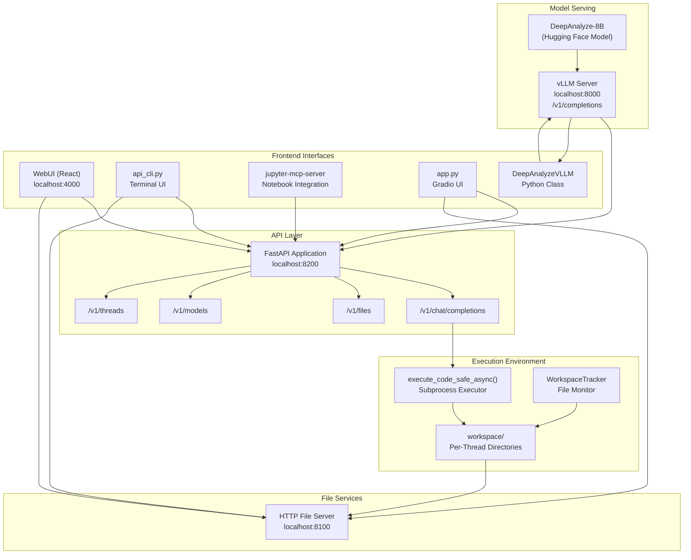
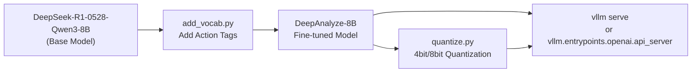
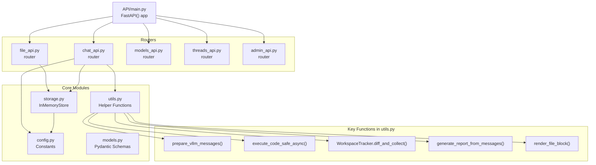
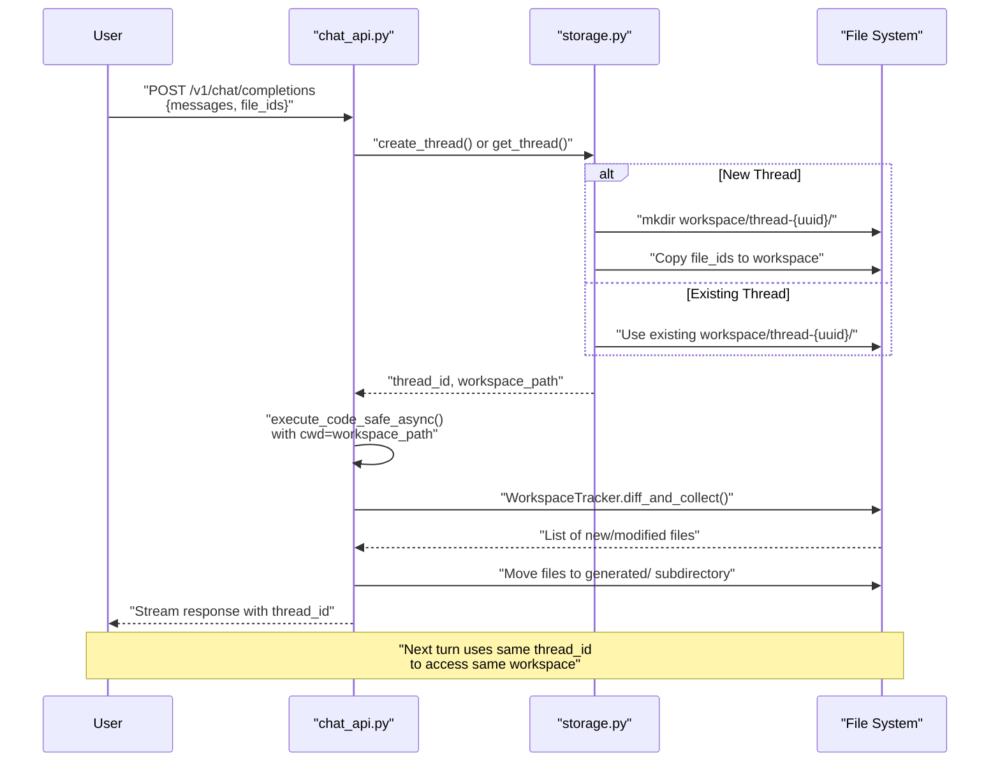
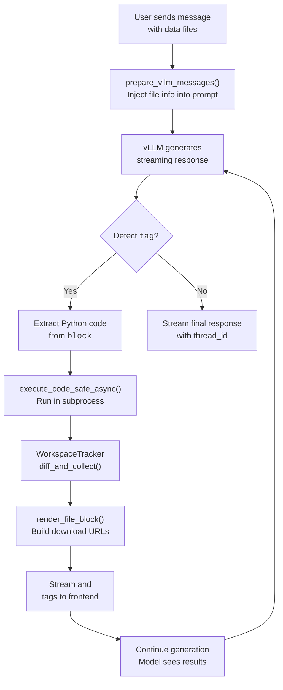
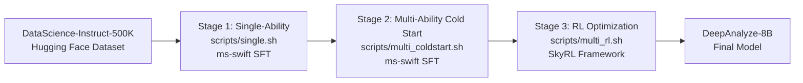

<!-- source: DeepWiki mcp.deepwiki.com · repo ruc-datalab/DeepAnalyze · page 1 Home · fetched 2026-10-26 -->

# Home

<details>
<summary>Relevant source files</summary>

The following files were used as context for generating this wiki page:

- [README.md](README.md)
- [assets/wechat.jpg](assets/wechat.jpg)
- [docs/DeepAnalyze_API_Key_Usage_Guide.md](docs/DeepAnalyze_API_Key_Usage_Guide.md)
- [docs/DeepAnalyze_API_Key_Usage_Guide_ZH.md](docs/DeepAnalyze_API_Key_Usage_Guide_ZH.md)
- [example/README.md](example/README.md)
- [quantize.py](quantize.py)
- [requirements.txt](requirements.txt)

</details>


This page provides an overview of **DeepAnalyze**, an agentic large language model system for autonomous data science. It covers the system's purpose, core capabilities, high-level architecture, and key differences from traditional LLMs. For deployment instructions, see [Getting Started](#2). For detailed API documentation, see [API Server Architecture](#6). For usage examples, see [Example Use Cases](#8).

---

## What is DeepAnalyze?

**DeepAnalyze** is an open-source system that enables autonomous data science through agentic LLM capabilities. Unlike traditional chatbots that only generate text, DeepAnalyze can:

- Execute Python code in sandboxed environments
- Analyze diverse data sources (CSV, Excel, JSON, databases, unstructured text)
- Generate visualizations and reports automatically
- Iterate on its own work by inspecting execution results
- Manage multi-turn conversations with persistent workspaces

The system consists of three primary layers:

1. **Model Layer**: DeepAnalyze-8B, an 8-billion parameter model fine-tuned from DeepSeek-R1 using curriculum-based training
2. **Inference & API Layer**: vLLM server and FastAPI endpoints providing OpenAI-compatible interfaces
3. **Frontend Layer**: Five different interfaces (WebUI, CLI, JupyterUI, Gradio, Python SDK) for various use cases

**Sources**: [README.md:1-29]()

---

## Core Capabilities

DeepAnalyze supports the entire data science pipeline through **agentic actions** encoded in special XML-like tags:

| Capability | Action Tags | Description |
|------------|-------------|-------------|
| **Analysis Planning** | `<Analyze>` | Structured reasoning about data characteristics and analysis strategies |
| **Code Generation** | `<Code>` | Python code for data processing, modeling, and visualization |
| **Code Execution** | `<Execute>` | Sandboxed execution results (stdout, stderr, generated files) |
| **Understanding** | `<Understand>` | Interpretation of execution results and data patterns |
| **Answering** | `<Answer>` | Final conclusions and recommendations |

The model generates these tags during inference, and the system parses them to trigger appropriate actions. For example, when `<Code>` tags are detected, the API server extracts the Python code and executes it in a subprocess with the thread's workspace as the working directory.

**Sources**: [README.md:21-24](), [README.md:78]()

---

## System Architecture Overview

The following diagram illustrates how the major components interact:



**Key Flow**:
1. Frontends send chat requests to `/v1/chat/completions` on the FastAPI server
2. API server forwards requests to vLLM at `localhost:8000`
3. When vLLM generates `<Code>` tags, `execute_code_safe_async()` runs the code in a subprocess
4. `WorkspaceTracker` monitors filesystem changes in the thread's workspace directory
5. Generated files (plots, CSVs) are served via the HTTP file server at `localhost:8100`
6. Results stream back to the frontend with download URLs

**Sources**: [README.md:56-100](), Diagram 1 from provided context

---

## Key Components and Code Entities

### Model and Inference



- **Model Path**: Hugging Face repository `RUC-DataLab/DeepAnalyze-8B`
- **Base Model**: `DeepSeek-R1-0528-Qwen3-8B`
- **Vocabulary Extension**: [deepanalyze/add_vocab.py:1-330]() adds special tokens like `<Analyze>`, `<Code>`, `<Execute>`
- **Quantization**: [quantize.py:1-145]() creates 4-bit and 8-bit versions using `BitsAndBytesConfig`
- **Serving**: vLLM with `--served-model-name DeepAnalyze-8B` on port 8000

**Sources**: [README.md:131-210](), [quantize.py:1-145]()

### API Server Components



- **Entry Point**: [API/main.py]() initializes FastAPI application and includes all routers
- **Configuration**: [API/config.py]() defines `VLLM_BASE_URL = "http://localhost:8000"`, `API_PORT = 8200`, `FILE_SERVER_PORT = 8100`
- **Storage**: [API/storage.py]() maintains in-memory dictionaries for threads, files, and messages
- **Data Models**: [API/models.py]() defines Pydantic classes `FileObject`, `ThreadObject`, `MessageObject` for OpenAI compatibility
- **Core Logic**: [API/utils.py]() contains:
  - `prepare_vllm_messages()`: Injects file context into prompts
  - `execute_code_safe_async()`: Subprocess execution with timeout
  - `WorkspaceTracker`: Filesystem diff monitoring class
  - `generate_report_from_messages()`: Markdown report extraction
  - `render_file_block()`: URL construction for file downloads

**Sources**: [API/main.py](), [API/config.py](), [API/storage.py](), [API/models.py](), [API/utils.py](), Diagram 2 from provided context

### Frontend Interfaces

| Interface | Entry Point | Port | Use Case |
|-----------|-------------|------|----------|
| **WebUI** | `demo/chat/frontend/` (React) | 4000 | Full-featured browser UI with three panels |
| **CLI** | `demo/cli/api_cli.py` or `api_cli_ZH.py` | - | Terminal-based interaction with Rich library |
| **JupyterUI** | `demo/jupyter/` (MCP server) | - | Notebook integration with cell output |
| **Gradio** | `demo/deepanalyze_general/app.py` or `app_ZH.py` | 8080 | Simplified local deployment |
| **Python SDK** | `deepanalyze/DeepAnalyzeVLLM` class | - | Direct programmatic access to vLLM |

The **Python SDK** is unique: it bypasses the API server and communicates directly with vLLM. The class `DeepAnalyzeVLLM` has a `generate(prompt, workspace)` method that returns a dictionary with the full reasoning trace.

**Sources**: [README.md:48-106](), Diagram 4 from provided context

---

## Workspace and Thread Management

DeepAnalyze implements **thread-based workspace isolation** to support stateful multi-turn conversations:



**Directory Structure**:
```
workspace/
├── thread-abc123/
│   ├── uploaded_file1.csv
│   ├── uploaded_file2.xlsx
│   ├── generated/
│   │   ├── plot_001.png
│   │   ├── analysis_results.csv
│   │   └── report.md
```

Each thread gets its own isolated directory where:
1. Uploaded files are copied at thread creation
2. Code executes with this directory as the working directory
3. Generated artifacts are moved to the `generated/` subdirectory
4. Files persist across multiple turns of the conversation

**Sources**: [API/storage.py](), [API/utils.py](), Diagram 3 from provided context

---

## Agentic Workflow: Code Execution Loop

What makes DeepAnalyze "agentic" is its ability to execute code and observe results autonomously:



**Key Functions**:
- **`prepare_vllm_messages()`**: Adds file information to the system prompt so the model knows what data is available
- **`execute_code_safe_async()`**: Uses `asyncio.create_subprocess_exec()` to run Python code with:
  - Working directory set to the thread's workspace
  - 60-second timeout
  - Stdout/stderr capture
- **`WorkspaceTracker.diff_and_collect()`**: Compares filesystem state before and after execution to identify new files
- **`render_file_block()`**: Constructs download URLs like `http://localhost:8100/thread-{id}/generated/{filename}`

This creates a **perception-action loop** where the model generates code, observes execution results, and adjusts its approach—the core of agentic behavior.

**Sources**: [API/chat_api.py](), [API/utils.py](), Diagram 3 from provided context

---

## Training Pipeline

DeepAnalyze uses a **curriculum-based training approach** in three stages:



1. **Stage 1**: Fine-tune on individual data science tasks using supervised learning
2. **Stage 2**: Combine capabilities and train on multi-step workflows
3. **Stage 3**: Reinforce autonomous behavior through RL with reward signals

The dataset is hosted at `RUC-DataLab/DataScience-Instruct-500K` on Hugging Face. Training uses:
- **ms-swift** framework for supervised fine-tuning (SFT)
- **SkyRL** framework for reinforcement learning (RL)

For details on reproducing the training, see [Training Pipeline](#3.2).

**Sources**: [README.md:317-341](), Diagram 5 from provided context

---

## Deployment Options

DeepAnalyze offers flexible deployment based on available GPU memory:

| GPU Memory | Model Type | Max Context | Command Example |
|------------|------------|-------------|-----------------|
| **16GB** | 4-bit quantized | 49K tokens | `vllm serve /path/to/4bit --max-model-len 49152 --kv-cache-dtype fp8` |
| **24GB** | 4-bit quantized | 131K tokens | `vllm serve /path/to/4bit --max-model-len 131072 --kv-cache-dtype fp8` |
| **40GB+** | Full model | 131K tokens | `vllm serve /path/to/model --max-model-len 131072` |

Key vLLM parameters:
- `--served-model-name DeepAnalyze-8B`: Sets the model identifier for API requests
- `--gpu-memory-utilization 0.95`: Aggressive memory usage for maximum context
- `--port 8000`: Default port for OpenAI-compatible API
- `--kv-cache-dtype fp8`: Enables FP8 KV cache compression for longer contexts

For quantization instructions, see [Model Quantization](#4.2). For vLLM setup, see [vLLM Server Setup](#4.1).

**Sources**: [README.md:136-210](), [quantize.py:1-145]()

---

## How DeepAnalyze Differs from Traditional LLMs

| Aspect | Traditional LLMs | DeepAnalyze |
|--------|------------------|-------------|
| **Output** | Text only | Text + Executable code + Artifacts |
| **Execution** | No execution | Sandboxed Python execution with `execute_code_safe_async()` |
| **Iteration** | Single-pass generation | Perception-action loop (generate → execute → observe → adjust) |
| **File Handling** | File uploads ignored | Files copied to thread workspace, accessible to code |
| **Statefulness** | Stateless (context window only) | Persistent workspaces via thread-based isolation |
| **Artifacts** | N/A | Automatic capture and serving of plots, CSVs, reports |
| **Action Tags** | N/A | Structured output with `<Analyze>`, `<Code>`, `<Execute>`, etc. |

The **agentic architecture** enables DeepAnalyze to function as an autonomous data analyst rather than just a conversational assistant. The system automatically:
- Inspects data files to understand their structure
- Generates appropriate analysis code
- Executes code and captures results
- Refines its approach based on outputs
- Produces publication-quality reports and visualizations

This is achieved through the tight integration between the model (trained to use action tags), the API server (which parses and executes these actions), and the workspace system (which maintains state across turns).

**Sources**: [README.md:21-24](), Diagram 1 and 3 from provided context

---

## Getting Started

To start using DeepAnalyze:

1. **Download the model** from Hugging Face: `RUC-DataLab/DeepAnalyze-8B`
2. **Deploy with vLLM**: See [vLLM Server Setup](#4.1) for deployment commands
3. **Choose a frontend**:
   - [WebUI](#5.1) for full-featured browser interface
   - [CLI](#5.2) for terminal-based interaction
   - [JupyterUI](#5.3) for notebook integration
   - [Gradio Apps](#5.4) for simplified local deployment
   - [Python SDK](#5.5) for programmatic access
4. **Try an example**: See [Example Use Cases](#8) for complete walkthroughs

For a step-by-step tutorial, see [Quick Start Guide](#7.1).

Alternatively, apply for hosted API access at https://forms.gle/YxVkCzczqq8jeciw9 (see [API Key Configuration](#7.2) for details).

**Sources**: [README.md:114-313](), [docs/DeepAnalyze_API_Key_Usage_Guide.md:1-191]()

---

## Repository Structure

The codebase is organized as follows:

```
DeepAnalyze/
├── API/                    # FastAPI server (main.py, chat_api.py, utils.py)
├── demo/                   # Frontend implementations
│   ├── chat/              # WebUI (React + TypeScript)
│   ├── cli/               # Terminal CLI (api_cli.py, api_cli_ZH.py)
│   ├── jupyter/           # JupyterUI MCP server integration
│   └── deepanalyze_general/  # Gradio apps (app.py, app_ZH.py)
├── deepanalyze/           # Model training code
│   ├── ms-swift/          # Supervised fine-tuning framework
│   ├── SkyRL/             # Reinforcement learning framework
│   └── add_vocab.py       # Special token addition script
├── scripts/               # Training scripts (single.sh, multi_coldstart.sh, multi_rl.sh)
├── quantize.py            # Model quantization utility
└── requirements.txt       # Core dependencies
```

For detailed project structure, see [Project Structure](#9.1).

**Sources**: [README.md:1-403](), [requirements.txt:1-16]()

---

## Additional Resources

- **Paper**: [arXiv:2510.16872](https://arxiv.org/abs/2510.16872)
- **Model**: [RUC-DataLab/DeepAnalyze-8B on Hugging Face](https://huggingface.co/RUC-DataLab/DeepAnalyze-8B)
- **Dataset**: [RUC-DataLab/DataScience-Instruct-500K on Hugging Face](https://huggingface.co/datasets/RUC-DataLab/DataScience-Instruct-500K)
- **Homepage**: [https://ruc-deepanalyze.github.io/](https://ruc-deepanalyze.github.io)
- **GitHub**: [https://github.com/ruc-datalab/DeepAnalyze](https://github.com/ruc-datalab/DeepAnalyze)

For contribution guidelines, see [Contributing Guidelines](#9.3).

**Sources**: [README.md:6-11](), [README.md:374-388]()

---

