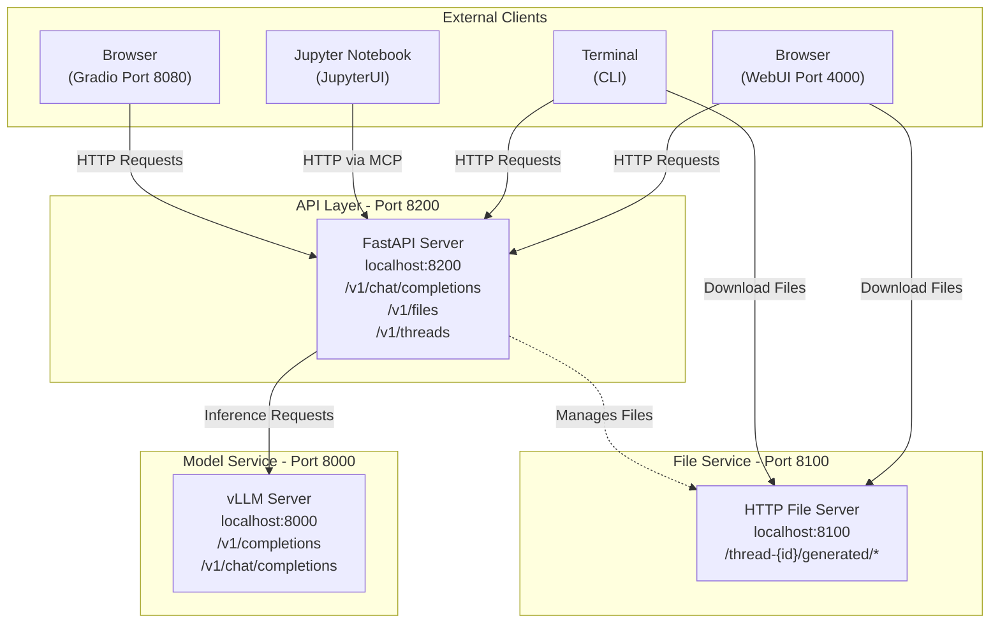
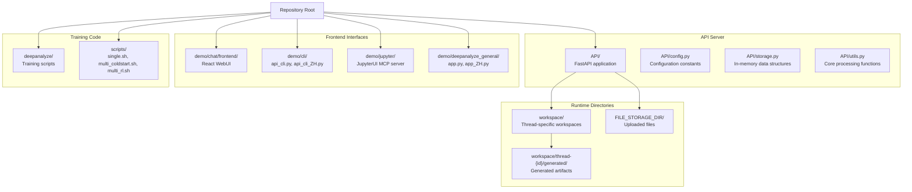
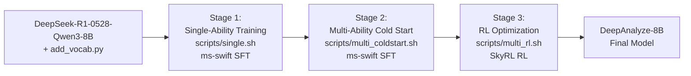
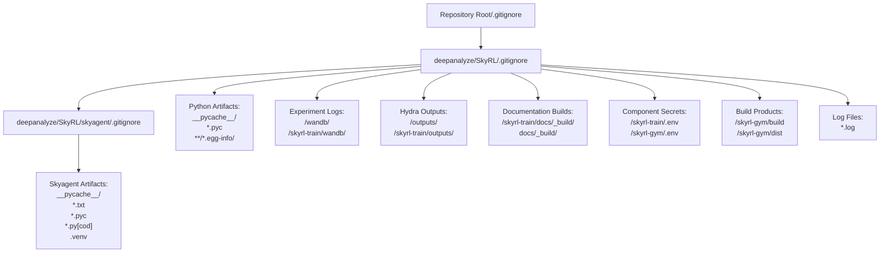
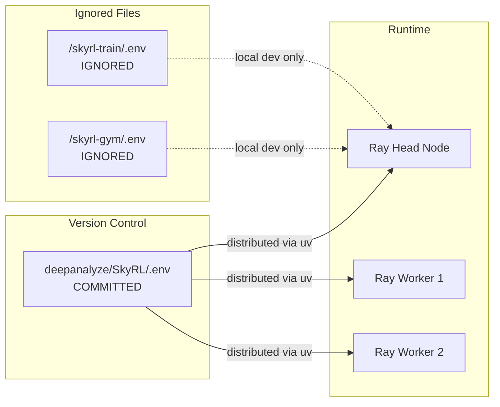
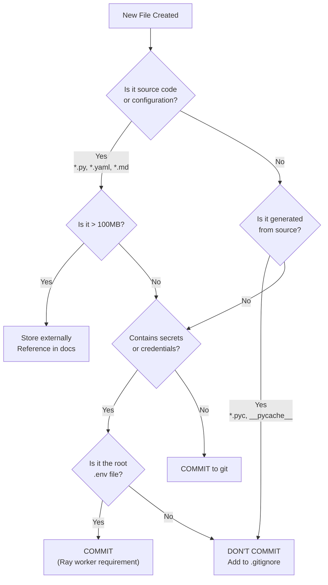
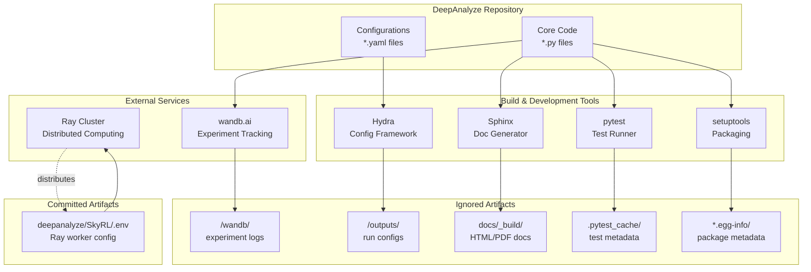

<!-- source: DeepWiki mcp.deepwiki.com · repo ruc-datalab/DeepAnalyze · page 10 Reference · fetched 2026-10-26 -->

# Reference

<details>
<summary>Relevant source files</summary>

The following files were used as context for generating this wiki page:

- [README.md](README.md)
- [assets/wechat.jpg](assets/wechat.jpg)
- [docs/DeepAnalyze_API_Key_Usage_Guide.md](docs/DeepAnalyze_API_Key_Usage_Guide.md)
- [docs/DeepAnalyze_API_Key_Usage_Guide_ZH.md](docs/DeepAnalyze_API_Key_Usage_Guide_ZH.md)
- [example/README.md](example/README.md)
- [quantize.py](quantize.py)
- [requirements.txt](requirements.txt)

</details>


This section provides technical reference materials for DeepAnalyze, including configuration tables, API specifications, special action tags, and licensing information. Use this section for quick lookups during development and deployment.

## Overview

The Reference section is organized into the following subsections:

| Section | Purpose | Key Content |
|---------|---------|-------------|
| **API Endpoints Reference** (10.1) | Complete API specification | All endpoints with parameters, request/response formats |
| **Configuration Options** (10.2) | Configuration constants and environment variables | Ports, paths, timeouts, model settings |
| **Action Tags Reference** (10.3) | Special XML-like tags used by DeepAnalyze | `<Analyze>`, `<Code>`, `<Execute>`, `<File>`, etc. |
| **License and Citation** (10.4) | License terms and academic citation | MIT License, BibTeX citation format |

This page provides quick reference tables for common deployment scenarios, model configurations, and system architecture.

## Model Variants and Quantization

DeepAnalyze-8B is available in multiple formats to support different hardware configurations.

### Available Model Formats

| Format | Size | Quantization Method | Use Case |
|--------|------|---------------------|----------|
| **Original** | ~16GB | bf16/fp32 | Best quality, requires 24GB+ VRAM |
| **8-bit Quantized** | ~8GB | bitsandbytes INT8 with outlier detection | Balanced quality/efficiency |
| **4-bit Quantized** | ~4GB | NF4 quantization with double quantization | Maximum compression for limited VRAM |

### Quantization Configuration

The `quantize.py` script provides two quantization functions:

**4-bit Quantization** ([quantize.py:12-53]()):
```python
quantize_model_4bit(model_path, output_path, use_double_quant=True)
```
- Uses NF4 (Normal Float 4) quantization type
- Computation dtype: `torch.bfloat16`
- Optional double quantization for further compression

**8-bit Quantization** ([quantize.py:56-94]()):
```python
quantize_model_8bit(model_path, output_path)
```
- Uses INT8 quantization
- Outlier threshold: 6.0
- Better preserves model quality than 4-bit

**Command-line Usage** ([quantize.py:97-142]()):
```bash
python quantize.py \
  --model_path /path/to/original/model \
  --output_dir /path/to/output/dir \
  --quant_type both  # Options: 4bit, 8bit, both
```

Sources: [quantize.py:1-145]()

## GPU Memory and Context Length Matrix

This table shows recommended configurations for different GPU memory sizes.

| GPU Memory | Model Type | max-model-len | FP8 KV Cache | Context Length | Typical GPU |
|------------|------------|---------------|--------------|----------------|-------------|
| **16GB** | 8-bit Quantized | 8192 | ✓ Required | ~8K tokens | RTX 3090, 4080 |
| **16GB** | 4-bit Quantized | 49152 | ✓ Required | ~49K tokens | RTX 3090, 4080 |
| **24GB** | Original Model | 16384 | ✓ Required | ~16K tokens | RTX 4090, A5000 |
| **24GB** | 8-bit Quantized | 98304 | ✓ Required | ~98K tokens | RTX 4090, A5000 |
| **24GB** | 4-bit Quantized | 131072 | ✓ Required | ~131K tokens | RTX 4090, A5000 |
| **40GB** | Original Model | 131072 | ✓ Optional | ~131K tokens | A100-40GB |
| **40GB** | 8-bit Quantized | 131072 | ✗ Optional | ~131K tokens | A100-40GB |
| **80GB** | Original Model | 131072 | ✗ Not needed | ~131K tokens | A100-80GB, H100 |

**Selection Guidelines**:
- **Limited Memory (<24GB)**: Use 4-bit quantization with FP8 KV cache
- **Balanced Configuration (24-40GB)**: Choose based on context length needs
- **Sufficient Memory (≥40GB)**: Use original model for best precision

Sources: [README.md:136-147]()

## vLLM Deployment Commands

### Command Template

**General vLLM Launch Command** ([README.md:152-162]()):
```bash
python -m vllm.entrypoints.openai.api_server \
  --model <model_path> \
  --served-model-name DeepAnalyze-8B \
  --max-model-len <select_from_table_above> \
  --gpu-memory-utilization 0.95 \
  --port 8000 \
  <add_fp8_if_required> \
  --trust-remote-code
```

### Scenario-Specific Commands

**Scenario 1: 16GB GPU with 4-bit Quantization** ([README.md:166-177]()):
```bash
python -m vllm.entrypoints.openai.api_server \
  --model /path/to/deepanalyze/4bit \
  --served-model-name DeepAnalyze-8B \
  --max-model-len 49152 \
  --gpu-memory-utilization 0.95 \
  --port 8000 \
  --kv-cache-dtype fp8 \
  --trust-remote-code
```

**Scenario 2: 24GB GPU with Maximum Context** ([README.md:179-190]()):
```bash
python -m vllm.entrypoints.openai.api_server \
  --model /path/to/deepanalyze/4bit \
  --served-model-name DeepAnalyze-8B \
  --max-model-len 131072 \
  --gpu-memory-utilization 0.95 \
  --port 8000 \
  --kv-cache-dtype fp8 \
  --trust-remote-code
```

**Scenario 3: 80GB GPU with Best Performance** ([README.md:192-202]()):
```bash
python -m vllm.entrypoints.openai.api_server \
  --model /path/to/original/model \
  --served-model-name DeepAnalyze-8B \
  --max-model-len 131072 \
  --gpu-memory-utilization 0.95 \
  --port 8000 \
  --trust-remote-code
```

Sources: [README.md:150-210]()

## System Port Mappings

DeepAnalyze uses multiple ports for different services. Understanding this mapping is essential for deployment and firewall configuration.

### Port Allocation Table

| Port | Service | Purpose | Configuration File |
|------|---------|---------|-------------------|
| **8000** | vLLM Server | Model inference with OpenAI-compatible API | vLLM launch command |
| **8200** | FastAPI Server | Chat completions, file management, threads | `API/config.py` |
| **8100** | File Server | Serves generated artifacts (plots, CSVs) | `API/config.py` |
| **4000** | WebUI Frontend | React SPA for browser-based interaction | `demo/chat/frontend/lib/config.ts` |
| **8080** | Gradio Apps | Simplified Gradio web interfaces | `demo/deepanalyze_general/app.py` |

### Service Communication Pattern

**Port-based Service Architecture**



**Note**: The Python SDK (`DeepAnalyzeVLLM`) bypasses the FastAPI server and communicates directly with vLLM on port 8000.

Sources: [README.md:56-58, 89-94, 283-313]()

## Core Dependencies

DeepAnalyze requires specific Python packages for inference and API services.

### Minimal Inference Requirements

| Package | Minimum Version | Purpose |
|---------|----------------|---------|
| `vllm` | ≥0.8.5 | High-throughput LLM inference engine |
| `torch` | Latest stable | PyTorch deep learning framework |
| `transformers` | Latest stable | Hugging Face model loading and tokenization |
| `numpy` | Latest stable | Numerical computing |
| `pandas` | Latest stable | Data manipulation |
| `scikit-learn` | Latest stable | Machine learning utilities |
| `seaborn` | Latest stable | Statistical visualization |
| `matplotlib` | Latest stable | Plotting library |

### API and UI Dependencies

| Package | Purpose |
|---------|---------|
| `fastapi` | API server framework |
| `uvicorn` | ASGI server for FastAPI |
| `openai` | OpenAI Python client for API compatibility |
| `requests` | HTTP client library |
| `websockets` | WebSocket support for streaming |
| `python-multipart` | Multipart form data parsing (file uploads) |

**Installation Commands** ([README.md:214-227]()):
```bash
# Create environment
conda create -n deepanalyze python=3.12 -y
conda activate deepanalyze

# Install inference dependencies
pip install -r requirements.txt

# For training (separate environment recommended)
cd ./deepanalyze/ms-swift/ && pip install -e .
cd ./deepanalyze/SkyRL/ && pip install -e .
```

Sources: [requirements.txt:1-16](), [README.md:212-227]()

## File System Paths

Understanding DeepAnalyze's file system structure is important for workspace management and debugging.

### Directory Structure

**DeepAnalyze File System Layout**



### Key Path Constants

These paths are typically defined in `API/config.py`:

| Constant | Default Value | Purpose |
|----------|---------------|---------|
| `FILE_STORAGE_DIR` | `workspace/uploaded_files/` | Stores uploaded files before thread assignment |
| `WORKSPACE_BASE_DIR` | `workspace/` | Base directory for all thread workspaces |
| `THREAD_WORKSPACE_PATTERN` | `workspace/thread-{thread_id}/` | Per-thread isolated workspace |
| `GENERATED_FILES_SUBDIR` | `generated/` | Subdirectory within thread workspace for generated artifacts |
| `HTTP_FILE_SERVER_BASE` | `http://localhost:8100/` | Base URL for file downloads |

**Thread Workspace Example**:
```
workspace/
├── uploaded_files/          # Initial file uploads
│   ├── file-abc123.csv
│   └── file-def456.xlsx
└── thread-xyz789/           # Thread-specific workspace
    ├── data.csv             # Copied from uploaded_files
    ├── analysis.xlsx        # Copied from uploaded_files
    └── generated/           # Generated during execution
        ├── plot1.png
        ├── summary.csv
        └── report.md
```

Sources: README context about API structure and workspace management

## Command-Line Interface Quick Reference

DeepAnalyze provides bilingual CLI interfaces for terminal-based interaction.

### CLI File Management Commands

| Command | Syntax | Purpose |
|---------|--------|---------|
| `upload` | `upload <file_path> [file_path ...]` | Upload one or more files |
| `files` | `files` | List all uploaded files |
| `delete` | `delete <file_id>` | Delete a specific file |
| `download` | `download <url>` | Download a generated file |
| `clear` | `clear` | Clear the chat history |
| `exit` | `exit` or `quit` | Exit the CLI |

### CLI Startup

**English Interface** ([README.md:89-106]()):
```bash
# Terminal 1: Start API server
cd API
python start_server.py

# Terminal 2: Launch CLI
cd demo/cli
python api_cli.py
```

**Chinese Interface** ([README.md:89-106]()):
```bash
# Terminal 1: Start API server (same as above)
cd API
python start_server.py

# Terminal 2: Launch Chinese CLI
cd demo/cli
python api_cli_ZH.py
```

The CLI uses the `rich` library for formatted output, progress bars, and syntax highlighting.

Sources: [README.md:83-106]()

## API Quick Start Examples

### File Upload and Analysis

**Using curl** ([README.md:289-311]()):
```bash
# Upload file
FILE_RESPONSE=$(curl -s -X POST "http://localhost:8200/v1/files" \
    -F "file=@data.csv" \
    -F "purpose=file-extract")

# Extract file ID
FILE_ID=$(echo $FILE_RESPONSE | jq -r '.id')

# Send analysis request
curl -X POST http://localhost:8200/v1/chat/completions \
     -H "Content-Type: application/json" \
     -d "{
        \"model\": \"DeepAnalyze-8B\",
        \"messages\": [
          {
            \"role\": \"user\",
            \"content\": \"Generate a data science report.\",
            \"file_ids\": [\"$FILE_ID\"]
          }
        ]
      }"
```

### Python SDK Usage

**Direct vLLM Access** ([README.md:237-262]()):
```python
from deepanalyze import DeepAnalyzeVLLM

prompt = """# Instruction
Generate a data science report.

# Data
File 1: {"name": "data.csv", "size": "10.6KB"}
"""

workspace = "/path/to/workspace/"

deepanalyze = DeepAnalyzeVLLM("/path/to/DeepAnalyze-8B")
answer = deepanalyze.generate(prompt, workspace=workspace)
print(answer["reasoning"])
```

**Note**: The `DeepAnalyzeVLLM` class bypasses the API server and connects directly to vLLM for programmatic access.

Sources: [README.md:229-313]()

## Training Pipeline Reference

DeepAnalyze uses a three-stage curriculum-based training approach.

### Training Stages

**Training Stage Progression**



### Training Scripts

| Script | Stage | Framework | Purpose |
|--------|-------|-----------|---------|
| `scripts/single.sh` | Stage 1 | ms-swift | Train individual data science abilities using LoRA |
| `scripts/multi_coldstart.sh` | Stage 2 | ms-swift | Joint multi-ability training with supervised fine-tuning |
| `scripts/multi_rl.sh` | Stage 3 | SkyRL | Reinforcement learning for autonomous behavior optimization |

### Special Token Addition

Before training from the base model, special tokens must be added ([README.md:320-330]()):

```bash
MODEL_PATH=path_to_DeepSeek-R1-0528-Qwen3-8B
SAVE_PATH=path_to_save_DeepSeek-R1-0528-Qwen3-8B-addvocab

python deepanalyze/add_vocab.py \
  --model_path "$MODEL_PATH" \
  --save_path "$SAVE_PATH" \
  --add_tags
```

This adds special action tags like `<Analyze>`, `<Code>`, `<Execute>`, etc. to the model's vocabulary.

Sources: [README.md:316-345]()

## Dataset Reference

### DataScience-Instruct-500K

The training dataset contains 500K instruction-following examples for data science tasks.

**Dataset Structure**:
- **SFT Portion**: Supervised fine-tuning examples for Stages 1 and 2
- **RL Portion**: Reward signals for Stage 3 (stored in `data.zip`)

**Download Locations** ([README.md:332-334]()):
- Hugging Face: [RUC-DataLab/DataScience-Instruct-500K](https://huggingface.co/datasets/RUC-DataLab/DataScience-Instruct-500K)
- ModelScope: [RUC-DataLab/DataScience-Instruct-500K](https://www.modelscope.cn/datasets/RUC-DataLab/DataScience-Instruct-500K)

**Note**: The RL portion must be unzipped before training: `unzip DataScience-Instruct-500K/RL/data.zip`

### Dataset Sources

The training data is derived from multiple benchmark datasets ([README.md:367]()):
- [Reasoning-Table](https://github.com/MJinXiang/Reasoning-Table)
- [Spider](https://yale-lily.github.io/spider)
- [BIRD](https://bird-bench.github.io)
- [DABStep](https://huggingface.co/blog/dabstep)

Sources: [README.md:332-367]()

## Contribution Guidelines

DeepAnalyze welcomes contributions in multiple categories.

### Contribution Types

| Category | Examples | Location |
|----------|----------|----------|
| **Code & Model** | Docker packaging, model quantization, UI improvements | Submit PR directly |
| **Use Cases** | Analysis examples, case studies, feedback | `example/` directory |
| **Benchmarks** | Evaluation datasets, comparison studies | `playground/` directory |

### Case Study Structure

When contributing use cases, follow this structure ([example/README.md:12-16]()):

```
example/your_case_name/
├── data/              # Uploaded data files
├── prompt.txt         # Input instructions
└── README.md          # Documentation with:
                       # - Input description
                       # - DeepAnalyze output
                       # - Comparison with other LLMs (optional)
                       # - Evaluation/comments
```

**Note**: Cases where DeepAnalyze performs slightly worse than closed-source LLMs are also valuable for improvement.

Sources: [example/README.md:1-16]()

## License and Citation

### License

DeepAnalyze is licensed under the **MIT License**.

**Permissions**:
- ✓ Commercial use
- ✓ Modification
- ✓ Distribution
- ✓ Private use

**Conditions**:
- Must include copyright notice and license in all copies

**Limitations**:
- No warranty provided

### Citation

If you use DeepAnalyze in academic work, please cite ([README.md:374-388]()):

```bibtex
@misc{deepanalyze,
      title={DeepAnalyze: Agentic Large Language Models for Autonomous Data Science}, 
      author={Shaolei Zhang and Ju Fan and Meihao Fan and Guoliang Li and Xiaoyong Du},
      year={2025},
      eprint={2510.16872},
      archivePrefix={arXiv},
      primaryClass={cs.AI},
      url={https://arxiv.org/abs/2510.16872}, 
}
```

### Contact

For questions or issues:
- Submit a GitHub issue
- Email: `zhangshaolei98@ruc.edu.cn`

Sources: [README.md:374-390]()

## External Resources

### Official Links

| Resource | URL |
|----------|-----|
| **Homepage** | [https://ruc-deepanalyze.github.io/](https://ruc-deepanalyze.github.io) |
| **Paper** | [https://arxiv.org/abs/2510.16872](https://arxiv.org/abs/2510.16872) |
| **Model (HF)** | [https://huggingface.co/RUC-DataLab/DeepAnalyze-8B](https://huggingface.co/RUC-DataLab/DeepAnalyze-8B) |
| **Model (ModelScope)** | [https://www.modelscope.cn/models/RUC-DataLab/DeepAnalyze-8B](https://www.modelscope.cn/models/RUC-DataLab/DeepAnalyze-8B) |
| **Dataset (HF)** | [https://huggingface.co/datasets/RUC-DataLab/DataScience-Instruct-500K](https://huggingface.co/datasets/RUC-DataLab/DataScience-Instruct-500K) |
| **GitHub** | [https://github.com/ruc-datalab/DeepAnalyze](https://github.com/ruc-datalab/DeepAnalyze) |

### API Key Application

To use the hosted DeepAnalyze API service, apply for a key via:
- **Primary Form**: [Google Form](https://forms.gle/YxVkCzczqq8jeciw9)
- **Alternative Form**: [Feishu Form](https://heywhale.feishu.cn/share/base/shrcnnBRgO0x2qhx40yq4m1HxUg)

**Documentation**:
- [English Guide](./docs/DeepAnalyze_API_Key_Usage_Guide.md)
- [Chinese Guide (Feishu)](https://heywhale.feishu.cn/wiki/TcVmw314liwCiKkxnttc2CnInfg)

Sources: [README.md:6-13, 116-128](), [docs/DeepAnalyze_API_Key_Usage_Guide.md:1-7](), [docs/DeepAnalyze_API_Key_Usage_Guide_ZH.md:1-7]()

## Version Control Patterns

The repository uses multiple `.gitignore` files at different levels to manage version control. Understanding these patterns is essential for contributing to the project.

### Gitignore File Locations

**Gitignore File Hierarchy**



Sources: [deepanalyze/SkyRL/.gitignore:1-41](), [deepanalyze/SkyRL/skyagent/.gitignore:1-8]()

### Ignored Artifact Categories

#### Python Build Artifacts

| Pattern | Purpose | Location |
|---------|---------|----------|
| `__pycache__/` | Compiled Python bytecode cache | All levels |
| `*.pyc`, `*.pyo` | Compiled Python files | All levels |
| `**/*.egg-info/` | Python package metadata | SkyRL, skyagent |
| `.venv` | Virtual environment directory | skyagent |

Sources: [deepanalyze/SkyRL/.gitignore:1-4](), [deepanalyze/SkyRL/skyagent/.gitignore:1-7]()

#### Experiment Tracking Artifacts

The repository uses Weights & Biases (wandb) for experiment tracking, generating logs that should not be committed:

```
/wandb/                    # Root-level wandb logs
/skyrl-train/wandb/        # skyrl-train specific logs
```

Sources: [deepanalyze/SkyRL/.gitignore:2-3]()

#### Hydra Configuration Outputs

Hydra framework generates output directories during experiments ([deepanalyze/SkyRL/.gitignore:5-7]()):

```
/outputs/                  # Root-level Hydra outputs
/skyrl-train/outputs/      # skyrl-train specific outputs
```

These directories contain experiment configurations and results but are regenerated on each run.

Sources: [deepanalyze/SkyRL/.gitignore:5-7]()

#### Documentation Build Artifacts

Documentation systems generate multiple types of build artifacts ([deepanalyze/SkyRL/.gitignore:10-23]()):

| Pattern | Description |
|---------|-------------|
| `/skyrl-train/docs/_build/` | Sphinx build output |
| `docs/_build/` | Alternative build location |
| `docs/_static/`, `docs/_templates/` | Sphinx generated static files |
| `docs/_autosummary/` | Auto-generated API documentation |
| `docs/api/_autosummary/` | API-specific autosummary |
| `docs/generated/` | Generated documentation files |
| `docs/_spelling/` | Spell check artifacts |
| `.doctrees/` | Doctree cache |
| `.cache/`, `.pytest_cache/` | Test and cache directories |

Sources: [deepanalyze/SkyRL/.gitignore:10-23]()

#### Environment Configuration Files

**Critical Design Decision**: The repository uses a **selective `.env` ignore strategy** ([deepanalyze/SkyRL/.gitignore:25-32]()):

```
# Root .env → COMMITTED (for Ray workers)
deepanalyze/SkyRL/.env

# Component .env → IGNORED (for local secrets)  
/skyrl-train/.env
/skyrl-gym/.env
```

**Rationale** ([deepanalyze/SkyRL/.gitignore:25-28]()):
> Don't add .env to gitignore. .env file when passed to uv is used to set env vars for each ray worker process. If it's in .gitignore then it won't be a part of the working directory shipped by uv and your env vars will not be set.

**Environment Variable Distribution Pattern**



This design ensures distributed Ray workers receive necessary environment variables while protecting component-specific secrets.

Sources: [deepanalyze/SkyRL/.gitignore:25-32]()

#### Build and Distribution Artifacts

Package build artifacts are ignored ([deepanalyze/SkyRL/.gitignore:37-39]()):

```
/skyrl-gym/build          # Build directory for skyrl-gym
/skyrl-gym/dist           # Distribution packages
```

Sources: [deepanalyze/SkyRL/.gitignore:37-39]()

#### Log Files

All log files are ignored repository-wide: `*.log` ([deepanalyze/SkyRL/.gitignore:41]())

Sources: [deepanalyze/SkyRL/.gitignore:41]()

### Gitignore Pattern Specificity

The repository uses **path-specific patterns** (leading `/`) to avoid overly broad exclusions:

| Pattern | Scope | Example |
|---------|-------|---------|
| `__pycache__/` | All directories named `__pycache__` anywhere | `foo/bar/__pycache__/` |
| `/wandb/` | Only `wandb/` in the same directory as `.gitignore` | `deepanalyze/SkyRL/wandb/` only |
| `/skyrl-train/wandb/` | Only `skyrl-train/wandb/` relative to `.gitignore` | `deepanalyze/SkyRL/skyrl-train/wandb/` only |
| `**/*.egg-info/` | All `.egg-info` directories recursively | Any depth |

This prevents accidentally ignoring legitimate files in unrelated directories.

Sources: [deepanalyze/SkyRL/.gitignore:1-41]()

### Skyagent-Specific Patterns

The skyagent component has additional exclusions ([deepanalyze/SkyRL/skyagent/.gitignore:1-8]()):

```
*.txt                     # Text file outputs (possibly task results)
*.py[cod]                # All Python compiled variants (.pyc, .pyo, .pyd)
```

The `*.txt` pattern suggests skyagent may generate text outputs during execution that shouldn't be committed.

Sources: [deepanalyze/SkyRL/skyagent/.gitignore:1-8]()

## Artifact Management Guidelines

### Files That Should Be Committed

Based on the ignore patterns, the following **should** be in version control:

| Category | Examples | Rationale |
|----------|----------|-----------|
| Source code | `*.py` (not compiled) | Core intellectual property |
| Configuration templates | `config.yaml`, `agent_config.yaml` | Reproducibility |
| Documentation source | `*.rst`, `*.md` | Knowledge base |
| Root `.env` | `deepanalyze/SkyRL/.env` | Required for Ray workers ([deepanalyze/SkyRL/.gitignore:25-28]()) |
| Build specifications | `Dockerfile`, `requirements.txt`, `pyproject.toml` | Environment setup |
| Tests | `test_*.py` | Quality assurance |

### Files That Should Not Be Committed

| Category | Examples | Rationale |
|----------|----------|-----------|
| Compiled artifacts | `*.pyc`, `__pycache__/` | Regenerable from source |
| Experiment logs | `/wandb/`, `/outputs/` | Large, transient data |
| Build products | `build/`, `dist/`, `*.egg-info/` | Regenerable |
| Component secrets | `/skyrl-train/.env`, `/skyrl-gym/.env` | Security |
| Documentation builds | `docs/_build/` | Regenerable from source |
| Log files | `*.log` | Transient runtime data |

### Data Directory Management

The pattern `/data/lcb` ([deepanalyze/SkyRL/.gitignore:8]()) suggests specific datasets are ignored. Large datasets should typically be:
- Stored externally (S3, Hugging Face Hub, etc.)
- Referenced via download scripts
- Documented in README files

Sources: [deepanalyze/SkyRL/.gitignore:8]()

## Development Best Practices

### Adding New Gitignore Patterns

When contributing gitignore patterns:

| Guideline | Example | Rationale |
|-----------|---------|-----------|
| **Use specific paths** | `/wandb/` instead of `wandb/` | Prevents overly broad matches ([deepanalyze/SkyRL/.gitignore:2]()) |
| **Add comments** | See [deepanalyze/SkyRL/.gitignore:25-28]() | Explains non-obvious decisions |
| **Test patterns** | `git check-ignore -v <file>` | Verifies pattern behavior |
| **Consider hierarchy** | Component-level vs. root-level | Appropriate scope for patterns |
| **Use path-specific syntax** | `/skyrl-train/wandb/` | Avoids accidental matches elsewhere |

### Environment Variable Management

The repository follows a specific environment variable pattern:

**Environment File Strategy**

| File | Status | Purpose | Distribution |
|------|--------|---------|--------------|
| `deepanalyze/SkyRL/.env` | **COMMITTED** | Ray worker environment variables | Distributed to all Ray workers via `uv` |
| `/skyrl-train/.env` | **IGNORED** | Component-specific secrets | Local development only |
| `/skyrl-gym/.env` | **IGNORED** | Component-specific secrets | Local development only |

**Critical Rule**: Never move the root `.env` to `.gitignore`. Ray workers require this file for distributed execution ([deepanalyze/SkyRL/.gitignore:25-28]()).

Sources: [deepanalyze/SkyRL/.gitignore:25-32]()

### File Commit Decision Matrix

**Determining Whether to Commit a File**



Sources: [deepanalyze/SkyRL/.gitignore:1-41]()

### External System Dependencies

**System Dependencies Revealed by Gitignore Patterns**



The repository integrates with multiple external systems. Ignore patterns document these dependencies and their artifact outputs.

Sources: [deepanalyze/SkyRL/.gitignore:1-41]()

## Repository Health Indicators

The `.gitignore` files serve as documentation of the repository's tooling ecosystem. The presence of specific patterns indicates:

| Pattern | Indicates Use Of |
|---------|------------------|
| `/wandb/` | Weights & Biases experiment tracking |
| `/outputs/` | Hydra configuration framework |
| `docs/_build/` | Sphinx documentation system |
| `.pytest_cache/` | pytest testing framework |
| `.venv` | Python virtual environments |
| `*.egg-info/` | Setuptools packaging |
| `/skyrl-gym/dist` | Package distribution |

This information can help new contributors understand the project's infrastructure without reading setup documentation.

Sources: [deepanalyze/SkyRL/.gitignore:1-41](), [deepanalyze/SkyRL/skyagent/.gitignore:1-8]()

---

