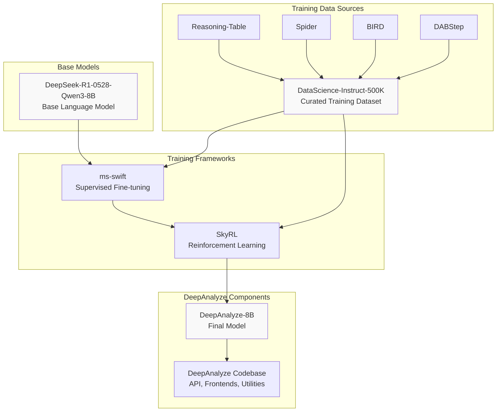

<!-- source: DeepWiki mcp.deepwiki.com · repo ruc-datalab/DeepAnalyze · page 10.4 License and Citation · fetched 2026-10-26 -->

# License and Citation

<details>
<summary>Relevant source files</summary>

The following files were used as context for generating this wiki page:

- [README.md](README.md)
- [assets/wechat.jpg](assets/wechat.jpg)
- [docs/DeepAnalyze_API_Key_Usage_Guide.md](docs/DeepAnalyze_API_Key_Usage_Guide.md)
- [docs/DeepAnalyze_API_Key_Usage_Guide_ZH.md](docs/DeepAnalyze_API_Key_Usage_Guide_ZH.md)
- [example/README.md](example/README.md)
- [quantize.py](quantize.py)
- [requirements.txt](requirements.txt)

</details>


This document provides information about DeepAnalyze's licensing terms, proper citation format for academic use, acknowledgements of third-party contributions, and dependency attributions. This information is essential for users who wish to use, cite, or extend DeepAnalyze in their own work.

For information about contributing code or use cases, see [Contributing Guidelines](#9.3). For training data details, see [DataScience-Instruct-500K Dataset](#3.3).

---

## License

DeepAnalyze is released as a **fully open-source project**, with all core components available for public use:

| Component | Availability | Location |
|-----------|-------------|----------|
| **Model** | Public | [Hugging Face Model Hub](https://huggingface.co/RUC-DataLab/DeepAnalyze-8B) |
| **Code** | Public | [GitHub Repository](https://github.com/ruc-datalab/DeepAnalyze) |
| **Training Data** | Public | [Hugging Face Datasets](https://huggingface.co/datasets/RUC-DataLab/DataScience-Instruct-500K) |
| **Demo** | Public | Included in repository under `demo/` directories |

The project enables users to deploy, modify, and extend DeepAnalyze for their own data analysis needs without workflow restrictions or dependencies on closed-source APIs.

**Note**: While the main DeepAnalyze components are open-source, users should be aware that:
- Base model dependencies (e.g., DeepSeek-R1-0528-Qwen3-8B) have their own licensing terms
- Third-party frameworks and libraries listed below have their respective licenses
- Commercial API services (such as the HeyWhale-hosted API) may have separate terms of service

**Sources**: [README.md:24]()

---

## Citation

If you use DeepAnalyze in your research or academic work, please cite the following paper:

### BibTeX Format

```bibtex
@misc{deepanalyze,
      title={DeepAnalyze: Agentic Large Language Models for Autonomous Data Science}, 
      author={Shaolei Zhang and Ju Fan and Meihao Fan and Guoliang Li and Xiaoyong Du},
      year={2025},
      eprint={2510.16872},
      archivePrefix={arXiv},
      primaryClass={cs.AI},
      url={https://arxiv.org/abs/2510.16872}, 
}
```

### Publication Details

| Field | Value |
|-------|-------|
| **Title** | DeepAnalyze: Agentic Large Language Models for Autonomous Data Science |
| **Authors** | Shaolei Zhang, Ju Fan, Meihao Fan, Guoliang Li, Xiaoyong Du |
| **Institutions** | Renmin University of China, Tsinghua University |
| **Year** | 2025 |
| **ArXiv ID** | 2510.16872 |
| **Primary Category** | cs.AI (Artificial Intelligence) |

### Author Contact

For questions or collaboration inquiries, contact:
- **Primary Contact**: `zhangshaolei98@ruc.edu.cn`
- **Project Lead**: Shaolei Zhang ([Homepage](https://zhangshaolei1998.github.io))
- **Advisor**: Ju Fan ([Homepage](http://iir.ruc.edu.cn/~fanj))

**Sources**: [README.md:374-390]()

---

## Model Lineage and Attribution

The following diagram illustrates the lineage from base models and data sources to the final DeepAnalyze-8B model:



**Attribution Requirements**:

When using or extending DeepAnalyze, please acknowledge:

1. **Base Model**: DeepSeek-R1-0528-Qwen3-8B by DeepSeek AI
2. **Training Data Contributors**:
   - Reasoning-Table: Table-based reasoning dataset
   - Spider: Text-to-SQL dataset from Yale
   - BIRD: Large-scale text-to-SQL benchmark
   - DABStep: Data analysis benchmark from Hugging Face
3. **Training Infrastructure**:
   - ms-swift: ModelScope's Swift framework for efficient fine-tuning
   - SkyRL: NovaSky AI's reinforcement learning framework

**Sources**: [README.md:363-372]()

---

## Acknowledgements

### Training Frameworks

DeepAnalyze's training pipeline depends on two specialized frameworks:

| Framework | Purpose | Repository | Usage in DeepAnalyze |
|-----------|---------|------------|----------------------|
| **ms-swift** | Supervised Fine-tuning | [GitHub](https://github.com/modelscope/ms-swift) | Stage 1 (Single-ability) and Stage 2 (Multi-ability cold start) training |
| **SkyRL** | Reinforcement Learning | [GitHub](https://github.com/NovaSky-AI/SkyRL) | Stage 3 (RL optimization) for autonomous behavior |

Installation commands for training dependencies are provided in [README.md:220-223]():

```bash
(cd ./deepanalyze/ms-swift/ && pip install -e .)
(cd ./deepanalyze/SkyRL/ && pip install -e .)
```

### Training Data Sources

The DataScience-Instruct-500K dataset incorporates data from multiple sources:

| Source | Type | Contribution |
|--------|------|--------------|
| **Reasoning-Table** | Table reasoning | Structured reasoning over tabular data |
| **Spider** | Text-to-SQL | SQL query generation from natural language ([Yale LILY](https://yale-lily.github.io/spider)) |
| **BIRD** | Text-to-SQL | Large-scale cross-domain SQL benchmark ([BIRD-Bench](https://bird-bench.github.io)) |
| **DABStep** | Data analysis | Step-by-step data analysis workflows ([Hugging Face](https://huggingface.co/blog/dabstep)) |

### API Services

| Service Provider | Contribution | Details |
|-----------------|--------------|---------|
| **HeyWhale Community** | API Key & Hosting Services | Provides cloud-hosted DeepAnalyze API with authentication. HeyWhale (www.heywhale.com) is a leading Chinese AI community with nearly one million practitioners, offering data resources, practical cases, and learning materials. |

**Deployment Developer**: Li Haoming (GitHub: [@LHMQ878](https://github.com/LHMQ878)), AI Data Engineer at HeyWhale Technology, responsible for ModelWhale platform integration, API deployment, and Gradio frontend development.

**Sources**: [README.md:363-372](), [docs/DeepAnalyze_API_Key_Usage_Guide.md:7]()

---

## Runtime Dependencies

DeepAnalyze's inference environment requires the following core dependencies:

### Core Dependencies Table

| Package | Minimum Version | Purpose |
|---------|----------------|---------|
| `vllm` | ≥ 0.8.5 | High-throughput LLM inference engine |
| `torch` | (latest stable) | PyTorch deep learning framework |
| `transformers` | (latest stable) | Hugging Face model loading and tokenization |
| `numpy` | (latest stable) | Numerical computations |
| `pandas` | (latest stable) | Data manipulation and analysis |
| `scikit-learn` | (latest stable) | Machine learning utilities |
| `seaborn` | (latest stable) | Statistical data visualization |
| `matplotlib` | (latest stable) | Plotting and visualization |

### API Server Dependencies

| Package | Purpose |
|---------|---------|
| `fastapi` | ASGI web framework for API server |
| `uvicorn` | ASGI server for FastAPI |
| `openai` | OpenAI SDK compatibility layer |
| `requests` | HTTP client for external requests |
| `websockets` | WebSocket support for streaming |
| `python-multipart` | Multipart form data parsing for file uploads |

### Dependency Installation

```bash
# Minimal inference dependencies
pip install -r requirements.txt

# Training dependencies (separate environment recommended)
(cd ./deepanalyze/ms-swift/ && pip install -e .)
(cd ./deepanalyze/SkyRL/ && pip install -e .)
```

### Dependency Isolation

The project recommends **separating inference and training environments** to avoid dependency conflicts, as noted in [README.md:226]():

```bash
# Inference environment
conda create -n deepanalyze python=3.12 -y
conda activate deepanalyze
pip install -r requirements.txt

# Training environment (separate)
conda create -n deepanalyze-train python=3.12 -y
conda activate deepanalyze-train
(cd ./deepanalyze/ms-swift/ && pip install -e .)
(cd ./deepanalyze/SkyRL/ && pip install -e .)
```

**Training Dependencies**: For complete training requirements, refer to:
- [./deepanalyze/ms-swift/requirements.txt]()
- [./deepanalyze/SkyRL/pyproject.toml]()

**Sources**: [requirements.txt:1-16](), [README.md:214-227]()

---

## Dependency Graph

The following diagram shows the relationship between DeepAnalyze components and their external dependencies:

```mermaid
graph TB
    subgraph "DeepAnalyze Core"
        DEEPANALYZE["DeepAnalyze System"]
    end
    
    subgraph "Inference Dependencies"
        VLLM["vllm>=0.8.5<br/>Inference Engine"]
        TORCH["torch<br/>Deep Learning Framework"]
        TRANSFORMERS["transformers<br/>Model Loading"]
        
        NUMPY["numpy<br/>Numerical Computing"]
        PANDAS["pandas<br/>Data Manipulation"]
        SKLEARN["scikit-learn<br/>ML Utilities"]
        
        MPL["matplotlib<br/>Visualization"]
        SEABORN["seaborn<br/>Statistical Plots"]
    end
    
    subgraph "API Server Dependencies"
        FASTAPI["fastapi<br/>Web Framework"]
        UVICORN["uvicorn<br/>ASGI Server"]
        OPENAI["openai<br/>SDK Compatibility"]
        REQUESTS["requests<br/>HTTP Client"]
        WEBSOCKETS["websockets<br/>Streaming"]
        MULTIPART["python-multipart<br/>File Uploads"]
    end
    
    subgraph "Training Dependencies"
        MSSWIFT["ms-swift<br/>SFT Framework"]
        SKYRL["SkyRL<br/>RL Framework"]
    end
    
    DEEPANALYZE --> VLLM
    DEEPANALYZE --> TORCH
    DEEPANALYZE --> TRANSFORMERS
    
    DEEPANALYZE --> NUMPY
    DEEPANALYZE --> PANDAS
    DEEPANALYZE --> SKLEARN
    
    DEEPANALYZE --> MPL
    DEEPANALYZE --> SEABORN
    
    DEEPANALYZE --> FASTAPI
    DEEPANALYZE --> UVICORN
    DEEPANALYZE --> OPENAI
    DEEPANALYZE --> REQUESTS
    DEEPANALYZE --> WEBSOCKETS
    DEEPANALYZE --> MULTIPART
    
    DEEPANALYZE -.Training Only.-> MSSWIFT
    DEEPANALYZE -.Training Only.-> SKYRL
```



**Sources**: [requirements.txt:1-16](), [README.md:220-225]()

---

## Quantization Tools

DeepAnalyze provides a quantization utility for creating memory-efficient model versions:

### Quantization Script: `quantize.py`

The script supports creating 4-bit and 8-bit quantized versions using the `bitsandbytes` library:

**Key Functions**:
- `quantize_model_4bit()`: Creates NF4-quantized model with optional double quantization ([quantize.py:12-53]())
- `quantize_model_8bit()`: Creates INT8-quantized model with outlier detection ([quantize.py:56-94]())

**Quantization Methods**:

| Quantization Type | Method | Compression | Technique |
|-------------------|--------|-------------|-----------|
| 4-bit | NF4 (Normal Float 4) | ~4GB | Double quantization optional |
| 8-bit | INT8 with outliers | ~8GB | Threshold-based outlier detection (6.0) |

**Usage Example**:

```bash
python quantize.py \
  --model_path /path/to/original/model \
  --output_dir /path/to/output/dir \
  --quant_type both  # Options: 4bit, 8bit, both
```

**Attribution**: The quantization implementation uses:
- `bitsandbytes` library for quantization algorithms
- `transformers.BitsAndBytesConfig` for configuration
- `torch.bfloat16` as computation dtype

**Sources**: [quantize.py:1-145]()

---

## Community and Support

### Community Channels

| Channel | Purpose | Link |
|---------|---------|------|
| **GitHub Issues** | Bug reports, feature requests | [GitHub Issues](https://github.com/ruc-datalab/DeepAnalyze/issues) |
| **WeChat Group** | Chinese community discussion | See [README.md assets/wechat.jpg]() |
| **Homepage** | Use cases and examples | [https://ruc-deepanalyze.github.io/](https://ruc-deepanalyze.github.io) |

### Contribution Recognition

All merged pull requests are listed as contributors, as stated in [README.md:347](). For contribution guidelines, see [Contributing Guidelines](#9.3) and [CONTRIBUTION.md]().

**Notable Contributors**:
- [@LIUyizheSDU](https://github.com/LIUyizheSDU): OpenAI-style API endpoints and CLI terminal UI
- [@ChengJiale150](https://github.com/ChengJiale150): JupyterUI integration with MCP server
- [@LHMQ878](https://github.com/LHMQ878): Gradio frontend and HeyWhale API deployment

### Project Metrics

As of the latest update:
- **GitHub Stars**: 1K+ within the first week
- **Twitter Views**: 200K+ within the first week
- **Community Size**: Nearly 1 million AI practitioners via HeyWhale Community

**Sources**: [README.md:36-44](), [README.md:346-362](), [README.md:392-402]()

---

## Version History

| Date | Event | Details |
|------|-------|---------|
| 2025.10.21 | Initial Release | Paper, code, model, and training data released |
| 2025.10.27 | Community Milestone | 1K+ GitHub stars, 200K+ Twitter views |
| 2025.10.28 | Contribution Guidelines | CONTRIBUTION.md published |
| 2025.11.08 | JupyterUI | Integration with jupyter-mcp-server |
| 2025.11.13 | OpenAI API & CLI | API endpoints and terminal UI |
| 2025.12.28 | API Keys Available | Public API key application system launched |

**Sources**: [README.md:31-44]()

---

## Legal and Compliance

### Usage Terms

- **Research Use**: DeepAnalyze is designed for research and educational purposes in data science and AI
- **Commercial Use**: Users should review the licenses of base models and dependencies for commercial deployment
- **Data Privacy**: When using cloud-hosted APIs (e.g., HeyWhale), review the service provider's data handling policies
- **Export Control**: Users are responsible for compliance with applicable export control regulations when deploying AI models

### Disclaimer

DeepAnalyze is provided "as-is" for research purposes. The authors and institutions:
- Make no warranties regarding the accuracy, completeness, or suitability of outputs
- Are not liable for any damages arising from the use of the system
- Recommend human review of all generated analyses, code, and reports

**Sources**: Inferred from standard open-source research project practices