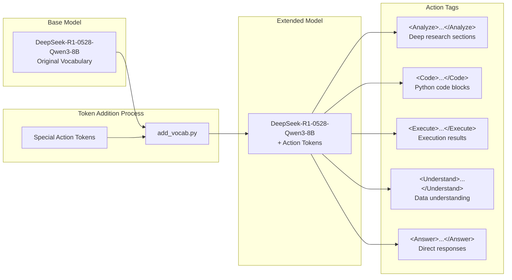
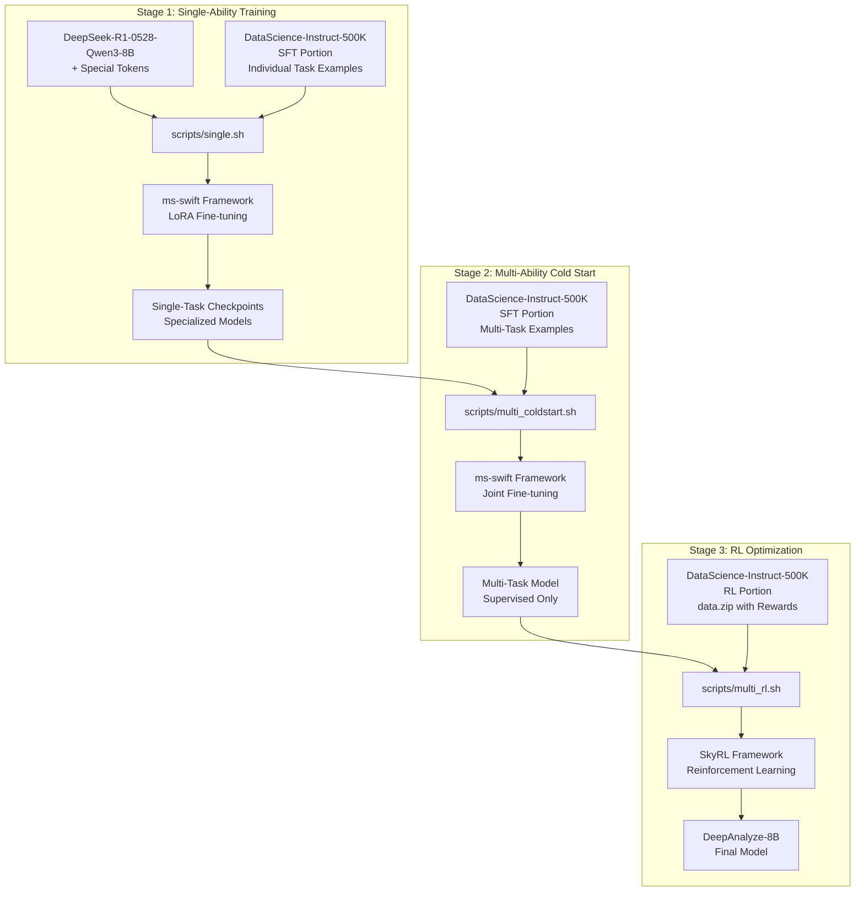
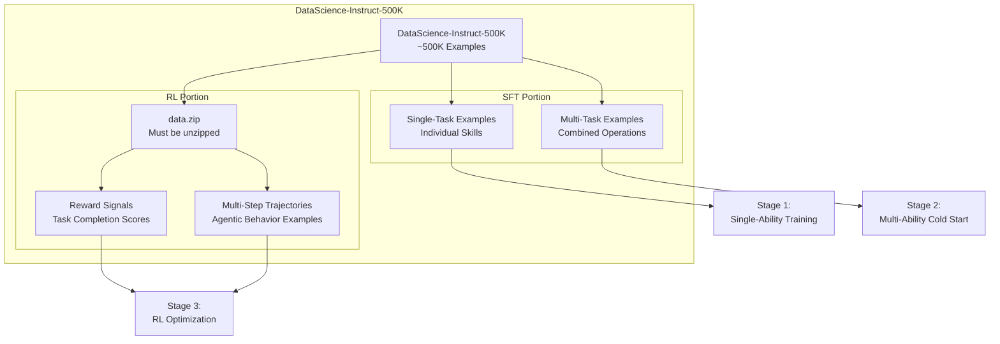
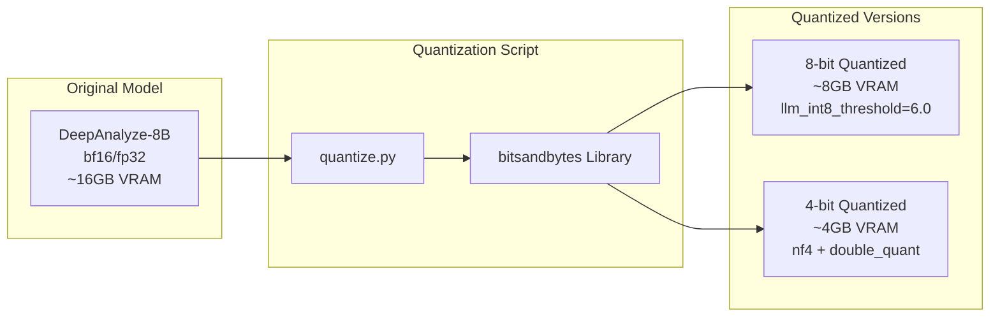
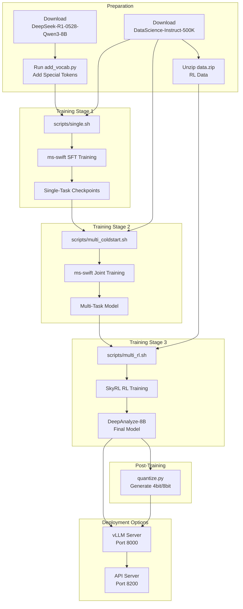

<!-- source: DeepWiki mcp.deepwiki.com · repo ruc-datalab/DeepAnalyze · page 3 Model and Training · fetched 2026-10-26 -->

# Model and Training

<details>
<summary>Relevant source files</summary>

The following files were used as context for generating this wiki page:

- [README.md](README.md)
- [assets/wechat.jpg](assets/wechat.jpg)
- [docs/DeepAnalyze_API_Key_Usage_Guide.md](docs/DeepAnalyze_API_Key_Usage_Guide.md)
- [docs/DeepAnalyze_API_Key_Usage_Guide_ZH.md](docs/DeepAnalyze_API_Key_Usage_Guide_ZH.md)
- [example/README.md](example/README.md)
- [quantize.py](quantize.py)
- [requirements.txt](requirements.txt)

</details>


## Purpose and Scope

This document provides technical documentation for the **DeepAnalyze-8B** model, its training methodology, and the dataset used to train it. The page covers:

- Model architecture, base model selection, and special tokens
- The curriculum-based training pipeline with three distinct stages
- The DataScience-Instruct-500K dataset structure and composition
- Model quantization and deployment configurations

For information about deploying the model using vLLM, see [Deployment](#4). For details about using the model through various interfaces, see [Frontend Interfaces](#5). For specific training scripts and evaluation procedures, see [Development and Contributing](#9).

---

## Model Overview

**DeepAnalyze-8B** is an 8-billion parameter agentic language model fine-tuned specifically for autonomous data science tasks. The model extends the **DeepSeek-R1-0528-Qwen3-8B** base model with specialized capabilities for data analysis, code generation, and autonomous task execution.

### Base Model and Architecture

The model is built on top of [DeepSeek-R1-0528-Qwen3-8B](https://huggingface.co/deepseek-ai/DeepSeek-R1-0528-Qwen3-8B), a pre-trained language model with:

- **8 billion parameters**
- **131K maximum context length** (when deployed with sufficient GPU memory)
- **Qwen3 architecture** with advanced reasoning capabilities
- **DeepSeek-R1 reasoning chain-of-thought** training

### Special Token Extensions

DeepAnalyze extends the base model's vocabulary with specialized action tokens that enable structured output and agentic behavior. These tokens must be added before training using the `add_vocab.py` script.



**Diagram: Special Token Extension Process**

The special tokens enable the model to produce **structured, parseable outputs** that the execution engine can interpret:

| Token Pair | Purpose | Used By |
|------------|---------|---------|
| `<Analyze>...</Analyze>` | Deep analytical reasoning sections | Report generation, research tasks |
| `<Code>...</Code>` | Python code to be executed | Data processing, visualization |
| `<Execute>...</Execute>` | Execution results and stdout | Code execution feedback loop |
| `<Understand>...</Understand>` | Data comprehension sections | Initial data exploration |
| `<Answer>...</Answer>` | Direct question responses | Conversational queries |

These tokens are added to the model vocabulary via [deepanalyze/add_vocab.py:322-330](), which modifies the tokenizer configuration before training begins.

**Sources:** [README.md:318-330](), [README.md:78](), Diagram 1 and 5 from system overview

---

## Training Methodology

DeepAnalyze employs a **curriculum-based training approach** with three progressive stages, each building upon the previous stage's capabilities. This methodology enables the model to learn increasingly complex agentic behaviors.



**Diagram: Three-Stage Curriculum Training Pipeline**

### Stage 1: Single-Ability Training

The first stage trains the model on **individual data science capabilities** using supervised fine-tuning (SFT).

**Training Configuration:**
- **Framework:** [ms-swift](https://github.com/modelscope/ms-swift) with LoRA adapters
- **Script:** [scripts/single.sh]()
- **Data Source:** SFT portion of DataScience-Instruct-500K
- **Objective:** Learn specialized skills independently (e.g., data cleaning, visualization, statistical analysis)

This stage produces **single-task checkpoints** that excel at specific data science operations but lack the ability to coordinate multiple skills autonomously.

### Stage 2: Multi-Ability Cold Start

The second stage combines single-task checkpoints and trains the model to **handle multiple data science tasks jointly**.

**Training Configuration:**
- **Framework:** ms-swift with joint fine-tuning
- **Script:** [scripts/multi_coldstart.sh]()
- **Data Source:** SFT portion with multi-task examples
- **Objective:** Learn to switch between different data science operations within a single conversation

The output is a **multi-task model** that can perform various data science operations but still relies on supervised examples rather than autonomous decision-making.

### Stage 3: Reinforcement Learning Optimization

The final stage applies **reinforcement learning** to develop autonomous agentic behavior.

**Training Configuration:**
- **Framework:** [SkyRL](https://github.com/NovaSky-AI/SkyRL)
- **Script:** [scripts/multi_rl.sh]()
- **Data Source:** RL portion of DataScience-Instruct-500K (requires unzipping `data.zip`)
- **Objective:** Optimize for multi-step reasoning, autonomous exploration, and task completion without human intervention

This produces the final **DeepAnalyze-8B** model with full agentic capabilities for autonomous data science.

**Training Frameworks:**

| Framework | Stage | Purpose | Repository |
|-----------|-------|---------|------------|
| ms-swift | 1 & 2 | Supervised fine-tuning with LoRA | [modelscope/ms-swift](https://github.com/modelscope/ms-swift) |
| SkyRL | 3 | Reinforcement learning for agentic behavior | [NovaSky-AI/SkyRL](https://github.com/NovaSky-AI/SkyRL) |

**Sources:** [README.md:337-341](), [README.md:221-223](), [README.md:365-366](), Diagram 5 from system overview

---

## Dataset: DataScience-Instruct-500K

The **DataScience-Instruct-500K** dataset contains approximately 500,000 training examples designed specifically for data science tasks. It is publicly available on [Hugging Face](https://huggingface.co/datasets/RUC-DataLab/DataScience-Instruct-500K).

### Dataset Structure

The dataset is divided into two portions with different training objectives:



**Diagram: Dataset Structure and Training Stage Mapping**

### Data Sources

The dataset is synthesized from multiple established data science benchmarks:

| Source | Type | Purpose |
|--------|------|---------|
| [Reasoning-Table](https://github.com/MJinXiang/Reasoning-Table) | Tabular reasoning tasks | Complex analytical reasoning on structured data |
| [Spider](https://yale-lily.github.io/spider) | Text-to-SQL | Database query generation and execution |
| [BIRD](https://bird-bench.github.io) | Text-to-SQL | Advanced database reasoning with real-world complexity |
| [DABStep](https://huggingface.co/blog/dabstep) | Step-by-step analysis | Multi-step data analysis workflows |

### SFT Portion

The **Supervised Fine-Tuning (SFT) portion** contains instruction-response pairs for data science tasks:

- **Format:** `{instruction, input_data, expected_output}`
- **Task Types:** Data cleaning, EDA, visualization, statistical analysis, modeling, report generation
- **Data Formats:** CSV, Excel, JSON, XML, TXT, Markdown
- **Complexity:** Ranges from single-step operations to multi-step workflows

### RL Portion

The **Reinforcement Learning (RL) portion** contains multi-turn trajectories with reward signals:

- **Format:** `{initial_state, action_sequence, intermediate_states, final_reward}`
- **Storage:** Compressed in `data.zip` (must be unzipped before training: [README.md:334]())
- **Reward Function:** Based on task completion, code correctness, output quality
- **Trajectory Length:** Variable, supporting complex multi-step autonomous workflows

**Sources:** [README.md:332-334](), [README.md:367](), Diagram 5 from system overview

---

## Model Quantization

To support deployment across different GPU memory configurations, DeepAnalyze-8B can be quantized using the `quantize.py` script. Quantization reduces model size and memory footprint while maintaining acceptable performance.



**Diagram: Model Quantization Pipeline**

### Quantization Methods

The [quantize.py]() script provides two quantization methods using the `bitsandbytes` library:

#### 4-bit Quantization

**Function:** [quantize.py:12-53]()

**Configuration:**
- **Quantization Type:** NF4 (Normal Float 4-bit)
- **Compute dtype:** `torch.bfloat16`
- **Double Quantization:** Enabled by default (can be disabled with `--no_double_quant`)
- **Memory Reduction:** ~75% (16GB → ~4GB)

**Command:**
```bash
python quantize.py \
  --model_path /path/to/DeepAnalyze-8B \
  --output_dir /path/to/output \
  --quant_type 4bit
```

#### 8-bit Quantization

**Function:** [quantize.py:56-94]()

**Configuration:**
- **Quantization Type:** LLM.int8 with outlier detection
- **Outlier Threshold:** 6.0 (`llm_int8_threshold`)
- **Memory Reduction:** ~50% (16GB → ~8GB)

**Command:**
```bash
python quantize.py \
  --model_path /path/to/DeepAnalyze-8B \
  --output_dir /path/to/output \
  --quant_type 8bit
```

### GPU Memory Configuration Matrix

The following table shows recommended deployment configurations based on available GPU memory:

| GPU Memory | Model Version | max-model-len | FP8 KV Cache | Context Length |
|------------|---------------|---------------|--------------|----------------|
| **16GB** | 4-bit | 49152 | ✓ Required | ~49K tokens |
| **16GB** | 8-bit | 8192 | ✓ Required | ~8K tokens |
| **24GB** | Full bf16 | 16384 | ✓ Recommended | ~16K tokens |
| **24GB** | 8-bit | 98304 | ✓ Recommended | ~98K tokens |
| **24GB** | 4-bit | 131072 | ✓ Recommended | ~131K tokens |
| **40GB+** | Full bf16 | 131072 | Optional | ~131K tokens |
| **80GB** | Full bf16 | 131072 | Not needed | ~131K tokens |

**Trade-offs:**
- **4-bit:** Maximum memory efficiency, slight quality degradation, suitable for consumer GPUs
- **8-bit:** Balanced efficiency and quality, minimal performance impact
- **Full precision:** Best quality, requires high-end GPUs (A100, H100)

**Sources:** [README.md:136-147](), [README.md:148-209](), [quantize.py:1-144]()

---

## Complete Training-to-Deployment Workflow

The following diagram illustrates the complete pipeline from base model selection through training, quantization, and deployment:



**Diagram: End-to-End Training and Deployment Workflow**

### Step-by-Step Training Instructions

**1. Download and Prepare Base Model:**
```bash
# Download DeepSeek-R1-0528-Qwen3-8B from Hugging Face
MODEL_PATH=/path/to/DeepSeek-R1-0528-Qwen3-8B
SAVE_PATH=/path/to/DeepSeek-R1-0528-Qwen3-8B-addvocab

# Add special tokens
python deepanalyze/add_vocab.py \
  --model_path "$MODEL_PATH" \
  --save_path "$SAVE_PATH" \
  --add_tags
```

**2. Download and Prepare Dataset:**
```bash
# Download from Hugging Face: RUC-DataLab/DataScience-Instruct-500K
# Unzip the RL portion
cd DataScience-Instruct-500K/RL/
unzip data.zip
```

**3. Execute Training Stages:**
```bash
# Stage 1: Single-ability training
bash scripts/single.sh

# Stage 2: Multi-ability cold start
bash scripts/multi_coldstart.sh

# Stage 3: RL optimization
bash scripts/multi_rl.sh
```

**4. Quantize Model (Optional):**
```bash
python quantize.py \
  --model_path /path/to/DeepAnalyze-8B \
  --output_dir /path/to/quantized \
  --quant_type both
```

**5. Deploy with vLLM:**
```bash
# Example: 24GB GPU with 4-bit quantization
python -m vllm.entrypoints.openai.api_server \
  --model /path/to/DeepAnalyze-8B/4bit \
  --served-model-name DeepAnalyze-8B \
  --max-model-len 131072 \
  --gpu-memory-utilization 0.95 \
  --kv-cache-dtype fp8 \
  --port 8000 \
  --trust-remote-code
```

**Sources:** [README.md:315-341](), [README.md:150-203](), Diagram 5 from system overview

---

## Training Requirements and Dependencies

### Environment Setup

Training DeepAnalyze requires a separate environment from inference to avoid dependency conflicts:

```bash
# Create training environment
conda create -n deepanalyze-train python=3.12 -y
conda activate deepanalyze-train

# Install ms-swift framework
cd deepanalyze/ms-swift/
pip install -e .

# Install SkyRL framework
cd ../SkyRL/
pip install -e .
```

### Framework Dependencies

**ms-swift requirements:** [deepanalyze/ms-swift/requirements.txt]()

**SkyRL requirements:** [deepanalyze/SkyRL/pyproject.toml]()

**Inference-only requirements:** [requirements.txt:1-16]()

### Hardware Requirements

| Training Stage | Recommended GPU | Minimum VRAM | Training Time (Est.) |
|----------------|-----------------|--------------|---------------------|
| Stage 1 (SFT) | A100 40GB or better | 32GB | Hours to days |
| Stage 2 (SFT) | A100 40GB or better | 32GB | Hours to days |
| Stage 3 (RL) | A100 80GB or better | 64GB | Days to weeks |

**Note:** Training times depend on dataset size, batch size, and number of epochs. The exact training configurations used for the released DeepAnalyze-8B model are specified in the training scripts.

**Sources:** [README.md:212-227](), [requirements.txt:1-16]()

---

## Model Artifacts and Distribution

### Official Release Channels

The DeepAnalyze-8B model and its quantized variants are distributed through:

| Platform | URL | Contents |
|----------|-----|----------|
| **Hugging Face** | [RUC-DataLab/DeepAnalyze-8B](https://huggingface.co/RUC-DataLab/DeepAnalyze-8B) | Full model (bf16), model card, usage examples |
| **ModelScope** | [RUC-DataLab/DeepAnalyze-8B](https://www.modelscope.cn/models/RUC-DataLab/DeepAnalyze-8B/summary) | Mirror for users in mainland China |

### Model Files

The released model includes:
- **Model weights:** `pytorch_model.bin` or safetensors format
- **Tokenizer configuration:** `tokenizer_config.json`, `tokenizer.json`
- **Model configuration:** `config.json` with extended vocabulary size
- **Generation configuration:** `generation_config.json`

### License and Citation

The model, code, and training data are released under an open-source license. For citation information, see [License and Citation](#10.4).

**Sources:** [README.md:131-133](), [README.md:374-388]()

---

