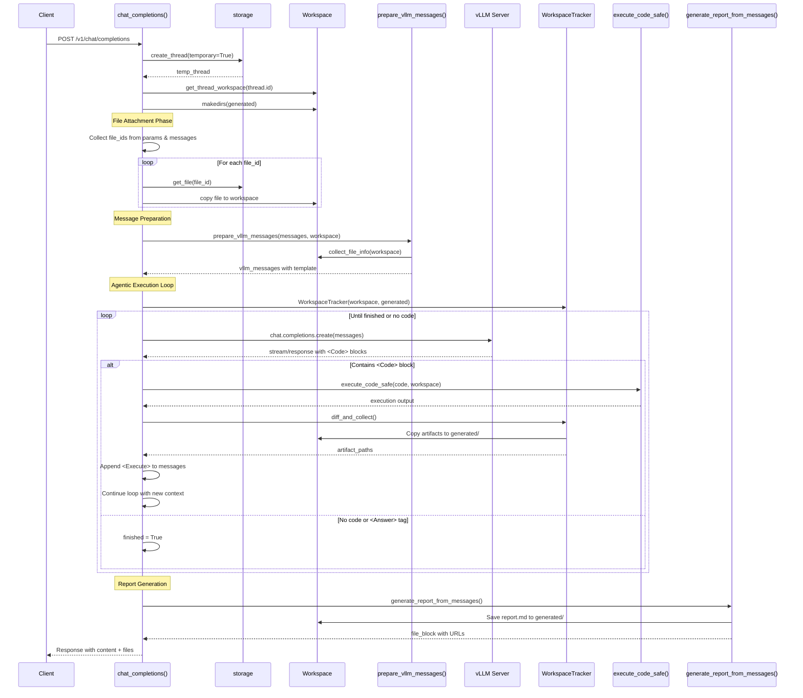
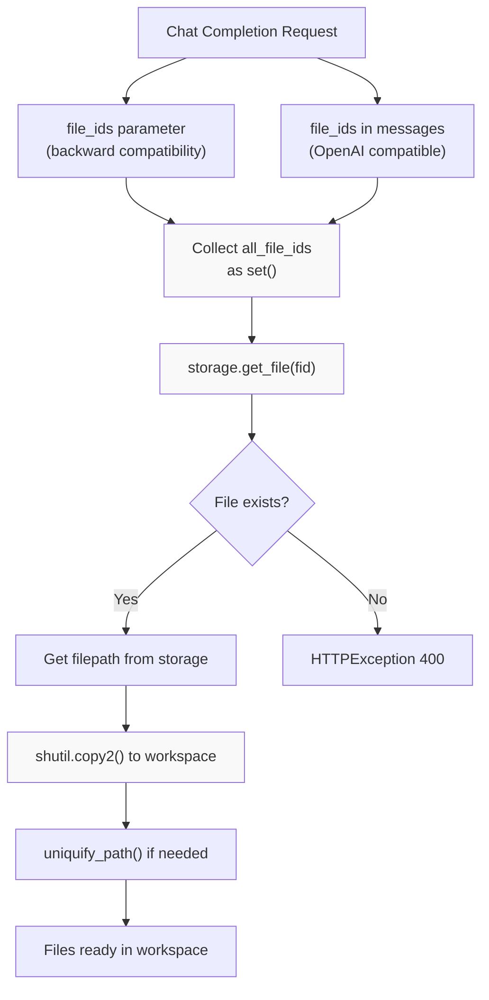
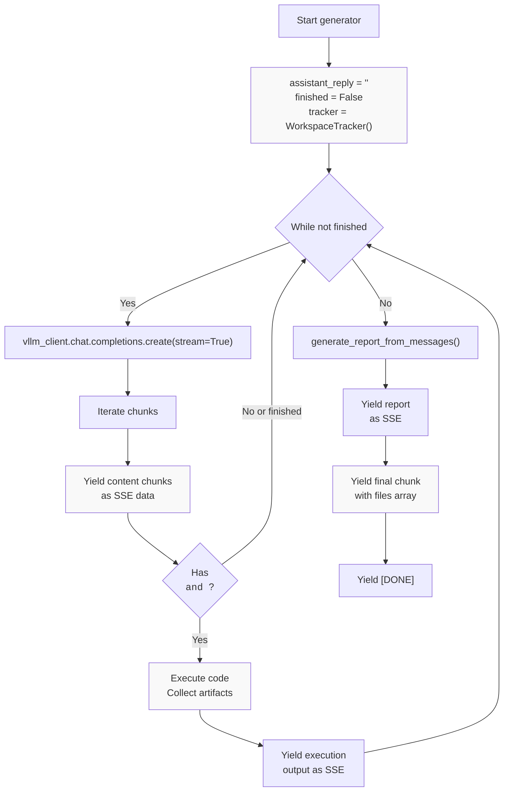

<!-- source: DeepWiki mcp.deepwiki.com · repo ruc-datalab/DeepAnalyze · page 6.6 Chat Completions API · fetched 2026-10-26 -->

# Chat Completions API

<details>
<summary>Relevant source files</summary>

The following files were used as context for generating this wiki page:

- [API/chat_api.py](API/chat_api.py)
- [API/example/exampleOpenAI.py](API/example/exampleOpenAI.py)
- [API/example/exampleRequest.py](API/example/exampleRequest.py)
- [API/utils.py](API/utils.py)

</details>


## Purpose and Scope

This page documents the `/v1/chat/completions` endpoint, which is the primary interface for submitting data analysis requests to DeepAnalyze. This endpoint extends the OpenAI Chat Completions API with file attachment capabilities and autonomous code execution. When invoked, the system creates an isolated workspace, executes an agentic analysis loop, and returns results with generated artifacts.

For details about the code execution mechanics and agentic loop implementation, see [Code Execution and Agentic Loop](#3.3.1). For information about how conversation histories are compiled into markdown reports, see [Report Generation](#3.3.2). For file management operations, see [File Management API](#3.1).

## Endpoint Definition

**Route:** `POST /v1/chat/completions`

**Handler:** `chat_completions()` function in [API/chat_api.py:38-356]()

**Router:** Registered under the `/v1/chat` prefix with tag `"chat"`

**Dependencies:**
- vLLM inference server (configured via `API_BASE`)
- File storage system (see [Storage Layer](#2.4))
- Workspace directory infrastructure

Sources: [API/chat_api.py:34-36]()

## Request Parameters

The endpoint accepts the following parameters via JSON request body:

| Parameter | Type | Required | Default | Description |
|-----------|------|----------|---------|-------------|
| `model` | string | Yes | - | Model name (e.g., "DeepAnalyze-8B") |
| `messages` | List[Dict] | Yes | - | Conversation history with role and content |
| `file_ids` | List[string] | No | None | File IDs to attach (backward compatibility) |
| `temperature` | float | No | 0.4 | Sampling temperature for model inference |
| `stream` | bool | No | False | Enable streaming response |

### Message Format

Messages support two formats for file attachment:

**OpenAI-Compatible Format (Recommended):**
```json
{
  "role": "user",
  "content": "Analyze this data",
  "file_ids": ["file-abc123"]
}
```

**Parameter-Level Format (Backward Compatibility):**
```json
{
  "messages": [...],
  "file_ids": ["file-abc123"]
}
```

Both formats can be used simultaneously. The system collects all file IDs from both sources.

Sources: [API/chat_api.py:39-44](), [API/chat_api.py:68-81](), [API/README.md:280-294]()

## Response Format

### Non-Streaming Response

```json
{
  "id": "chatcmpl-xyz789...",
  "object": "chat.completion",
  "created": 1704067200,
  "model": "DeepAnalyze-8B",
  "choices": [
    {
      "index": 0,
      "message": {
        "role": "assistant",
        "content": "Analysis result...",
        "files": [
          {
            "name": "chart.png",
            "url": "http://localhost:8100/thread-123/generated/chart.png"
          }
        ]
      },
      "finish_reason": "stop"
    }
  ],
  "generated_files": [...],
  "attached_files": [...]
}
```

**Key Fields:**
- `choices[0].message.files` - Generated artifacts (OpenAI-compatible location)
- `generated_files` - Backward compatibility field with same content
- `attached_files` - Input files that were attached

Sources: [API/chat_api.py:333-353](), [API/README.md:296-327]()

### Streaming Response

Server-Sent Events (SSE) format with `data:` prefix:

```
data: {"id": "chatcmpl-...", "object": "chat.completion.chunk", "choices": [{"delta": {"content": "分析"}}]}
data: {"id": "chatcmpl-...", "object": "chat.completion.chunk", "choices": [{"delta": {"files": [...]}, "finish_reason": "stop"}]}
data: [DONE]
```

**Chunk Structure:**
- Content chunks: `{"delta": {"content": "..."}}`
- Final chunk: `{"delta": {"files": [...]}, "finish_reason": "stop"}`
- Terminator: `[DONE]`

Sources: [API/chat_api.py:223-247](), [API/README.md:329-334]()

## Request Processing Flow



**Flow Summary:**

1. **Thread Creation**: Create temporary thread for isolation [API/chat_api.py:62-65]()
2. **File Attachment**: Copy attached files to thread workspace [API/chat_api.py:68-92]()
3. **Message Preparation**: Inject file context and DeepAnalyze template [API/chat_api.py:94-96]()
4. **Agentic Loop**: Execute model → extract code → execute → feed back results [API/chat_api.py:106-201]()
5. **Report Generation**: Compile conversation into structured markdown [API/chat_api.py:203-221]()
6. **Response**: Return content with generated file URLs [API/chat_api.py:223-247]()

Sources: [API/chat_api.py:38-356]()

## File Attachment System

### File Collection Process



**Implementation Details:**

- File IDs collected from both sources using `set()` to avoid duplicates [API/chat_api.py:68-81]()
- Files validated against storage before copying [API/chat_api.py:84-86]()
- Source paths retrieved from `storage.files[fid]["filepath"]` [API/chat_api.py:87-88]()
- Files copied to workspace root using `shutil.copy2()` [API/chat_api.py:89-91]()
- Filename conflicts handled by `uniquify_path()` [API/utils.py:42-44]()

Sources: [API/chat_api.py:68-92](), [API/utils.py:42-44]()

## Message Processing and Template Injection

The `prepare_vllm_messages()` function transforms incoming messages into the DeepAnalyze format:

```mermaid
graph LR
    Input["Input messages"]
    Normalize["_normalize_openai_message_content()"]
    Build["Build vllm_messages list"]
    FindLast["Find last user message"]
    
    CollectFiles["collect_file_info(workspace)"]
    Template["Wrap with # Instruction<br/>+ # Data sections"]
    Output["vllm_messages"]
    
    Input --> Normalize
    Normalize --> Build
    Build --> FindLast
    
    FindLast --> CollectFiles
    CollectFiles --> Template
    Template --> Output
    
    style Normalize fill:#f9f9f9
    style CollectFiles fill:#f9f9f9
    style Template fill:#f9f9f9
```



**Template Structure:**

```
# Instruction
[User's original content]

# Data
File 1:
{
    "name": "data.csv",
    "size": "45.2KB"
}

File 2:
{
    "name": "config.json",
    "size": "1.3KB"
}
```

**Processing Steps:**

1. Normalize OpenAI-style content (handles both string and structured formats) [API/utils.py:47-59]()
2. Build message list with role and content [API/utils.py:100-106]()
3. Locate last user message [API/utils.py:109-113]()
4. Collect file metadata from workspace [API/utils.py:71-86]()
5. Inject template with instruction and data sections [API/utils.py:116-126]()

Sources: [API/utils.py:91-127](), [API/utils.py:47-59](), [API/utils.py:71-86]()

## Streaming vs Non-Streaming Modes

### Mode Comparison

| Aspect | Streaming | Non-Streaming |
|--------|-----------|---------------|
| Response Type | `StreamingResponse` | JSON dict |
| Client Type | `vllm_client` (sync) | `vllm_client_async` (async) |
| Generator | `generate_stream_with_execution()` | Inline async processing |
| Real-time Output | Yes (SSE chunks) | No (waits for completion) |
| Code Lines | [102-249]() | [251-353]() |

### Streaming Implementation

**Generator Function:** `generate_stream_with_execution()` [API/chat_api.py:103-248]()



Sources: [API/chat_api.py:103-249]()

### Non-Streaming Implementation

Uses async/await pattern with `vllm_client_async`:

- Async iteration over response chunks [API/chat_api.py:275-283]()
- Non-blocking code execution with `execute_code_safe_async()` [API/chat_api.py:304]()
- Accumulates full response before returning [API/chat_api.py:321-353]()

Sources: [API/chat_api.py:251-353]()

## OpenAI SDK Compatibility

### Supported Client Initialization

```python
import openai

client = openai.OpenAI(
    base_url="http://localhost:8200/v1",
    api_key="dummy"
)
```

### File Attachment Formats

**Method 1: Message-Level (OpenAI Standard)**
```python
response = client.chat.completions.create(
    model="DeepAnalyze-8B",
    messages=[
        {
            "role": "user",
            "content": "Analyze this data",
            "file_ids": ["file-abc123"]  # OpenAI-compatible
        }
    ]
)
```

**Method 2: Parameter-Level (DeepAnalyze Extension)**
```python
response = client.chat.completions.create(
    model="DeepAnalyze-8B",
    messages=[...],
    file_ids=["file-abc123"]  # Backward compatibility
)
```

### Response Access Patterns

**Content Access:**
```python
content = response.choices[0].message.content
```

**Generated Files (New Format):**
```python
if hasattr(response.choices[0].message, 'files'):
    for file_info in response.choices[0].message.files:
        print(f"{file_info['name']}: {file_info['url']}")
```

**Generated Files (Backward Compatibility):**
```python
if hasattr(response, 'generated_files'):
    for file_info in response.generated_files:
        print(f"{file_info['name']}: {file_info['url']}")
```

Sources: [API/README.md:120-142](), [API/README_ZH.md:120-141]()

## Generated Files Structure

### File Metadata Format

Each generated file is represented as a dictionary:

```python
{
    "name": "chart.png",
    "url": "http://localhost:8100/thread-123/generated/chart.png"
}
```

### Location in Response

**Primary Location (OpenAI-compatible):**
- `response.choices[0].message.files` - Array of file metadata [API/chat_api.py:330]()

**Secondary Location (Backward compatibility):**
- `response.generated_files` - Same array [API/chat_api.py:348-349]()

**Streaming Mode:**
- Sent in final chunk before `[DONE]` [API/chat_api.py:226-244]()

### URL Construction

Generated file URLs follow the pattern:

```
http://localhost:{HTTP_SERVER_PORT}/{thread_id}/generated/{filename}
```

Built by `build_download_url()` function [API/utils.py:33-39]():
- Thread ID identifies the workspace
- `generated/` subdirectory contains all artifacts
- Filenames are URL-encoded using `quote()` [API/utils.py:36]()

Sources: [API/utils.py:33-39](), [API/chat_api.py:324-331]()

## Configuration Parameters

Key configuration values from [config.py]():

| Parameter | Default | Description |
|-----------|---------|-------------|
| `API_BASE` | `"http://localhost:8000/v1"` | vLLM server endpoint |
| `DEFAULT_TEMPERATURE` | `0.4` | Default sampling temperature |
| `MAX_NEW_TOKENS` | `32768` | Maximum tokens per generation |
| `STOP_TOKEN_IDS` | `[32000, 32007]` | Special stop tokens |

These are used in inference calls via `extra_body` parameter [API/chat_api.py:114-118]().

Sources: [API/config.py](), [API/chat_api.py:20]()

## Code Entity Reference

### Main Router and Handler

- **Router:** `router = APIRouter(prefix="/v1/chat", tags=["chat"])` [API/chat_api.py:35]()
- **Handler:** `async def chat_completions(...)` [API/chat_api.py:38]()
- **Decorator:** `@router.post("/completions")` [API/chat_api.py:38]()

### Client Instances

- **Sync Client:** `vllm_client = openai.OpenAI(...)` [API/chat_api.py:31]()
- **Async Client:** `vllm_client_async = openai.AsyncOpenAI(...)` [API/chat_api.py:32]()

### Key Functions Called

| Function | Module | Purpose |
|----------|--------|---------|
| `storage.create_thread()` | storage | Create temporary thread [API/chat_api.py:62]() |
| `get_thread_workspace()` | utils | Get/create workspace directory [API/chat_api.py:63]() |
| `prepare_vllm_messages()` | utils | Inject DeepAnalyze template [API/chat_api.py:94-96]() |
| `WorkspaceTracker()` | utils | Track file changes [API/chat_api.py:106]() |
| `extract_code_from_segment()` | utils | Parse code from tags [API/chat_api.py:170]() |
| `execute_code_safe()` | utils | Sandbox code execution [API/chat_api.py:172]() |
| `generate_report_from_messages()` | utils | Create markdown report [API/chat_api.py:203-205]() |
| `render_file_block()` | utils | Format file metadata [API/chat_api.py:175-177]() |

Sources: [API/chat_api.py:23-27]()

## Error Handling

### File Not Found

When a referenced file doesn't exist:

```python
file_obj = storage.get_file(fid)
if not file_obj:
    raise HTTPException(status_code=400, detail=f"File {fid} not found")
```

Returns HTTP 400 with descriptive error message [API/chat_api.py:84-86]().

### Execution Timeout

Code execution timeouts are handled in `execute_code_safe()` [API/utils.py:158-159]():

```
[Timeout]: execution exceeded 120 seconds
```

### Thread Cleanup

Temporary threads are marked with `metadata={"temporary": True}` [API/chat_api.py:62]() but cleanup is deferred:

```python
finally:
    # Clean up temporary thread after some time (optional)
    pass
```

Actual cleanup can be triggered via Admin API (see [Admin API](#3.4)).

Sources: [API/chat_api.py:354-356](), [API/chat_api.py:84-86](), [API/utils.py:158-159]()

---

