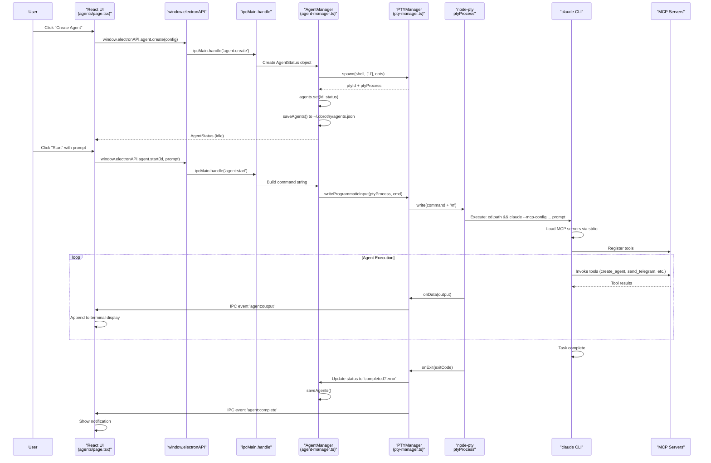
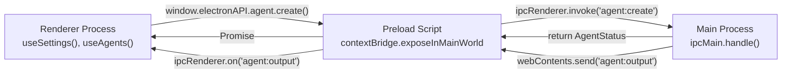

<!-- source: DeepWiki mcp.deepwiki.com · repo Charlie85270/Dorothy · page 1 Overview · fetched 2026-10-26 -->

# Overview

<details>
<summary>Relevant source files</summary>

The following files were used as context for generating this wiki page:

- [README.md](README.md)
- [__tests__/mcp/mcp-socialdata.test.ts](__tests__/mcp/mcp-socialdata.test.ts)
- [__tests__/mcp/mcp-vault.test.ts](__tests__/mcp/mcp-vault.test.ts)
- [electron/main.ts](electron/main.ts)
- [landing/public/kanban.png](landing/public/kanban.png)
- [landing/public/ollama-icon.svg](landing/public/ollama-icon.svg)
- [landing/src/app/page.tsx](landing/src/app/page.tsx)
- [screenshots/kanban.png](screenshots/kanban.png)

</details>


Dorothy is an Electron-based desktop application that orchestrates multiple AI coding agents (Claude Code, Codex, Gemini, and local models) in parallel. It removes the single-agent limitation of CLI tools by enabling simultaneous execution of 10+ agents across different projects, with support for automations, remote control, task management, and persistent knowledge storage.

This page provides a high-level architectural overview of the entire system. For detailed information on specific subsystems, see:
- Agent lifecycle and execution: [Agents](#3)
- MCP tool ecosystem: [MCP Ecosystem](#4)
- User interface organization: [User Interface](#5)
- Build and release pipeline: [Build and Release](#12)

---

## Core Concepts

### Agents

An **agent** is a Claude CLI process running in an isolated PTY (pseudo-terminal) session. Each agent operates independently with its own project path, skills, and configuration. Agents are represented in code by the `AgentStatus` interface and managed by the `agents` Map in [electron/core/agent-manager.ts:34](). 

**Status states**: `idle` → `running` → `completed` / `error` / `waiting`

### MCP (Model Context Protocol)

MCP servers expose **tools** that agents can invoke to interact with external systems. Dorothy includes five MCP servers with 40+ tools:
- `mcp-orchestrator`: Agent management, messaging, scheduling, automations (26+ tools)
- `mcp-vault`: Document storage with full-text search (10 tools)
- `mcp-kanban`: Task management (8 tools)
- `mcp-telegram`: Media messaging (4 tools)
- `mcp-socialdata`: Twitter/X data access (5 tools)

Each MCP server runs as a separate Node.js process communicating via stdio.

### Super Agent

A specialized agent (`isSuperAgent()` returns true) with access to all MCP orchestrator tools. It delegates tasks to other agents, monitors progress, and handles remote control commands from Telegram/Slack.

Sources: [README.md:1-796](), [electron/main.ts:1-603](), [electron/core/agent-manager.ts:1-50]()

---

## System Architecture

Dorothy follows a **three-tier architecture**: Electron main process (backend services), renderer process (React UI), and external MCP ecosystem.

### Architecture Diagram: Main Components

```mermaid
graph TB
    subgraph ElectronApp["Electron Application"]
        MainProcess["Main Process<br/>(electron/main.ts)"]
        RendererProcess["Renderer Process<br/>(Next.js + React)"]
        PreloadScript["Preload Script<br/>(electron/preload.ts)"]
        
        MainProcess <-->|"IPC<br/>(ipcMain/ipcRenderer)"| PreloadScript
        PreloadScript <-->|"window.electronAPI"| RendererProcess
    end
    
    subgraph MainProcessServices["Main Process Services"]
        AgentManager["AgentManager<br/>(agent-manager.ts)<br/>agents Map, PTY lifecycle"]
        PTYManager["PTYManager<br/>(pty-manager.ts)<br/>ptyProcesses Map"]
        TelegramBot["TelegramBot<br/>(telegram-bot.ts)"]
        SlackBot["SlackBot<br/>(slack-bot.ts)"]
        APIServer["HTTP API Server<br/>(api-server.ts)<br/>Port 31415"]
        AutomationService["AutomationService<br/>(automation-handlers.ts)"]
        VaultDB["VaultDB<br/>(vault-db.ts)<br/>SQLite + FTS5"]
        UpdateChecker["UpdateChecker<br/>(update-checker.ts)<br/>electron-updater"]
    end
    
    subgraph MCPServers["MCP Servers (stdio)"]
        MCPOrch["mcp-orchestrator<br/>src/tools/*.ts<br/>26+ tools"]
        MCPTelegram["mcp-telegram<br/>src/index.ts<br/>4 tools"]
        MCPKanban["mcp-kanban<br/>src/index.ts<br/>8 tools"]
        MCPVault["mcp-vault<br/>src/index.ts<br/>10 tools"]
        MCPSocial["mcp-socialdata<br/>src/index.ts<br/>5 tools"]
    end
    
    subgraph RendererPages["Renderer Pages (src/app)"]
        AgentsDashboard["agents/page.tsx"]
        KanbanBoard["kanban/page.tsx"]
        AutomationsPage["automations/page.tsx"]
        VaultPage["vault/page.tsx"]
        SettingsPage["settings/page.tsx"]
    end
    
    MainProcess --> AgentManager
    MainProcess --> PTYManager
    MainProcess --> TelegramBot
    MainProcess --> SlackBot
    MainProcess --> APIServer
    MainProcess --> AutomationService
    MainProcess --> VaultDB
    MainProcess --> UpdateChecker
    
    RendererProcess --> AgentsDashboard
    RendererProcess --> KanbanBoard
    RendererProcess --> AutomationsPage
    RendererProcess --> VaultPage
    RendererProcess --> SettingsPage
    
    PTYManager -->|"spawns node-pty"| ClaudeCLI["claude CLI<br/>per agent"]
    ClaudeCLI <-->|stdio| MCPOrch
    ClaudeCLI <-->|stdio| MCPTelegram
    ClaudeCLI <-->|stdio| MCPKanban
    ClaudeCLI <-->|stdio| MCPVault
    ClaudeCLI <-->|stdio| MCPSocial
    
    MCPOrch -->|HTTP| APIServer
```



Sources: [electron/main.ts:13-603](), [README.md:575-645]()

### Tier Breakdown

| Tier | Technology | Primary Responsibilities | Key Files |
|------|-----------|-------------------------|-----------|
| **Main Process** | Node.js + Electron | Service orchestration, agent lifecycle, PTY management, IPC handlers | [electron/main.ts](), [electron/core/agent-manager.ts](), [electron/core/pty-manager.ts]() |
| **Renderer Process** | Next.js 14 + React 19 | User interface, state management, real-time updates | [src/app/]() pages, [src/components/]() |
| **MCP Ecosystem** | @modelcontextprotocol/sdk | Tool handlers, external API integration, data persistence | [mcp-orchestrator/](), [mcp-vault/](), [mcp-kanban/]() |

Sources: [electron/main.ts:1-603](), [README.md:575-645]()

---

## Data Flow: Agent Execution Pipeline

### Sequence: User Creates and Starts Agent



Sources: [electron/main.ts:214-265](), [electron/handlers/ipc-handlers.ts](), [electron/core/agent-manager.ts:1-50](), [electron/core/pty-manager.ts:1-50]()

---

## Key Components

### Agent Manager

**Purpose**: Maintains agent state, orchestrates PTY lifecycle, handles status transitions.

**Core Data Structures**:
- `agents: Map<string, AgentStatus>` — Global agent registry [electron/core/agent-manager.ts:34]()
- `ptyProcesses: Map<string, IPty>` — Active PTY sessions [electron/core/pty-manager.ts:44]()

**Key Functions**:
| Function | Location | Purpose |
|----------|----------|---------|
| `initAgentPty()` | [electron/core/agent-manager.ts:36]() | Spawns PTY, attaches event handlers |
| `loadAgents()` | [electron/core/agent-manager.ts:34]() | Loads persisted state from `~/.dorothy/agents.json` |
| `saveAgents()` | [electron/core/agent-manager.ts:35]() | Persists state to disk |
| `handleStatusChangeNotification()` | [electron/core/agent-manager.ts:37]() | Triggers notifications on status changes |

Sources: [electron/core/agent-manager.ts:1-50](), [electron/main.ts:32-40]()

### PTY Manager

**Purpose**: Manages pseudo-terminal sessions using `node-pty`.

**Process Lifecycle**:
1. `pty.spawn(shell, ['-l'], { cwd, env })` — Spawn login shell [electron/main.ts:410-421]()
2. `ptyProcess.onData()` — Stream output to UI via IPC [electron/main.ts:443-456]()
3. `ptyProcess.onExit()` — Detect completion, update status [electron/main.ts:458-481]()
4. `ptyProcess.write()` — Send input programmatically [electron/core/pty-manager.ts:48]()

**Additional PTY Collections**:
- `quickPtyProcesses` — One-off command executions [electron/main.ts:44]()
- `skillPtyProcesses` — Skill installation processes [electron/main.ts:45]()
- `pluginPtyProcesses` — Plugin installation processes [electron/main.ts:46]()

Sources: [electron/core/pty-manager.ts:43-49](), [electron/main.ts:410-481]()

### IPC Communication Layer

**Architecture**: Type-safe bridge between main and renderer processes.



**Handler Registration Pattern**:
```typescript
// electron/main.ts:318-319
const deps = createIpcDependencies();
registerIpcHandlers(deps);
```

**Key Handler Modules**:
| Module | Handlers | Purpose |
|--------|----------|---------|
| `ipc-handlers.ts` | `agent:create`, `agent:start`, `agent:stop`, etc. | Agent CRUD operations |
| `scheduler-handlers.ts` | `scheduler:list`, `scheduler:create`, etc. | Recurring task management |
| `automation-handlers.ts` | `automation:list`, `automation:create`, etc. | Automation CRUD |
| `kanban-handlers.ts` | `kanban:list`, `kanban:create`, etc. | Task board operations |
| `vault-handlers.ts` | `vault:list`, `vault:create`, etc. | Document storage |

Sources: [electron/handlers/ipc-handlers.ts:82-265](), [electron/main.ts:82-91](), [electron/preload.ts]()

### Services Layer

**HTTP API Server**: Express server on port 31415 for MCP tool access [electron/services/api-server.ts:52]()

**Telegram Bot**: `node-telegram-bot-api` integration with command handlers [electron/services/telegram-bot.ts:54-59]()

**Slack Bot**: `@slack/bolt` Socket Mode integration [electron/services/slack-bot.ts:62-65]()

**Automation Service**: Polls GitHub (via `gh` CLI) and JIRA (REST API), spawns ephemeral agents [electron/handlers/automation-handlers.ts:84]()

**Vault Database**: `better-sqlite3` with FTS5 full-text search [electron/services/vault-db.ts:89]()

Sources: [electron/services/api-server.ts:52](), [electron/services/telegram-bot.ts:54-59](), [electron/services/slack-bot.ts:62-65](), [electron/services/vault-db.ts:89]()

---

## Configuration and Storage

### Configuration Files

| Path | Purpose | Format | Managed By |
|------|---------|--------|------------|
| `~/.dorothy/app-settings.json` | Dorothy preferences, API keys, integration tokens | JSON | Settings UI [src/app/settings/]() |
| `~/.dorothy/cli-paths.json` | CLI tool path overrides | JSON | CLI Paths settings section |
| `~/.claude/settings.json` | Claude Code configuration, MCP servers | JSON | Permissions settings section |

Sources: [electron/constants.ts:22](), [README.md:726-733]()

### Persistent Data

| Path | Contents | Persistence Strategy |
|------|----------|---------------------|
| `~/.dorothy/agents.json` | All agent states, PTY IDs, output history | Write on create/update/delete [electron/main.ts:107-172]() |
| `~/.dorothy/kanban-tasks.json` | Task board state, column assignments | Write on task mutations |
| `~/.dorothy/automations.json` | Automation definitions, schedules, processed item hashes | Write on CRUD operations |
| `~/.dorothy/vault.db` | SQLite database with `documents`, `folders`, `attachments` tables + FTS5 index | Transactional writes via `better-sqlite3` |
| `~/.claude/projects/*/memory/` | Claude Code native memory files (`MEMORY.md`, topic files) | Managed by Claude CLI |

Sources: [README.md:735-752](), [electron/main.ts:107-172](), [electron/services/vault-db.ts:89]()

### Storage Initialization

**Data Directory Setup** [electron/main.ts:293-303]():
```typescript
ensureDataDir();              // Create ~/.dorothy/ if needed
ensureDorothyClaudeMd();      // Write CLAUDE.md system prompt
migrateFromClaudeManager();   // Migrate legacy data
loadAgents();                 // Load agents.json
initVaultDb();                // Initialize SQLite schema
```

Sources: [electron/main.ts:293-303](), [electron/utils.ts:99-102]()

---

## Technology Stack

### Core Technologies

| Category | Technology | Version | Usage |
|----------|-----------|---------|-------|
| **Desktop Runtime** | Electron | 33 | Application shell, native APIs |
| **UI Framework** | React | 19 | Component architecture |
| **Meta-Framework** | Next.js | 14 (App Router) | Routing, API routes, SSR |
| **Terminal Emulation** | xterm.js | 5.x | UI terminal display |
| **PTY Management** | node-pty | 1.1.x | Pseudo-terminal spawning |
| **Database** | better-sqlite3 | 11.x | Vault storage |
| **State Management** | Zustand | 5.x | Client-side state |
| **Styling** | Tailwind CSS | 4.x | Utility-first CSS |
| **MCP SDK** | @modelcontextprotocol/sdk | 1.0.x | Tool handlers, stdio transport |

Sources: [README.md:705-722](), [package.json]()

### Build and Distribution

**Build Script**: `npm run electron:build` [README.md:551-558]()

**Pipeline Stages**:
1. Next.js production build (excludes API routes for Electron)
2. TypeScript compilation (`tsc` for main process + MCP servers)
3. MCP module builds (7 independent `tsc` invocations)
4. `electron-builder` packaging (DMG for macOS, installer for Windows)
5. macOS notarization via [scripts/notarize.js]()

**Output Artifacts**:
- macOS: `release/mac-arm64/Dorothy.app` (Apple Silicon) or `release/mac/Dorothy.app` (Intel)
- DMG installer for distribution
- ZIP archive for direct download

Sources: [README.md:548-572](), [electron-builder.json5]()

### Update Mechanism

**Auto-Update System**: `electron-updater` checks GitHub Releases [electron/services/update-checker.ts:90]()

**Update Flow**:
1. App checks for updates on startup (5s delay) [electron/main.ts:556-564]()
2. `checkForUpdates()` queries GitHub API [electron/services/update-checker.ts:90]()
3. Progress events sent to renderer via IPC: `app:update-available`, `app:update-progress`, `app:update-downloaded`
4. UI shows download progress in Settings > General [src/app/settings/GeneralSection.tsx]()
5. User clicks "Restart & Install" to apply update

Sources: [electron/services/update-checker.ts:90-91](), [electron/main.ts:556-564]()

---

## Entry Points and Initialization

### Main Process Initialization Sequence

**Entry Point**: [electron/main.ts:293]()

```typescript
app.whenReady().then(async () => {
  ensureDataDir();                    // 1. Create ~/.dorothy/
  ensureDorothyClaudeMd();            // 2. Write CLAUDE.md
  migrateFromClaudeManager();         // 3. Migrate legacy data
  loadAgents();                       // 4. Load agents.json
  setupProtocolHandler();             // 5. Register dorothy:// protocol
  createWindow();                     // 6. Spawn BrowserWindow
  setUtilsMainWindow(getMainWindow());// 7. Set global window ref
  
  // Register all IPC handlers
  const deps = createIpcDependencies();
  registerIpcHandlers(deps);          // 8a. Agent handlers
  registerSchedulerHandlers(...);     // 8b. Scheduler handlers
  registerAutomationHandlers();       // 8c. Automation handlers
  registerKanbanHandlers(...);        // 8d. Kanban handlers
  registerVaultHandlers(...);         // 8e. Vault handlers
  
  initVaultDb();                      // 9. Initialize SQLite
  initKanbanAutomation(...);          // 10. Start task watcher
  initTelegramBot();                  // 11. Start Telegram bot
  initSlackBot(...);                  // 12. Start Slack bot
  initApiServer();                    // 13. Start HTTP API (port 31415)
  
  await setupMcpOrchestrator(...);    // 14. Setup MCP servers
  await configureStatusHooks();       // 15. Setup status hooks
  
  initAutoUpdater(...);               // 16. Setup auto-updater
  checkForUpdates();                  // 17. Check for updates
});
```

Sources: [electron/main.ts:293-567]()

### Renderer Initialization

**Entry Point**: [src/app/layout.tsx]()

**Key Providers**:
1. `ThemeProvider` — Dark mode management [src/components/theme-provider.tsx]()
2. Zustand stores — Agent state, settings state [src/store/]()
3. IPC event listeners — Real-time updates from main process

**Protected Routes**: All pages check for `window.electronAPI` presence to ensure Electron context.

Sources: [src/app/layout.tsx](), [src/store/]()

---

## Debugging and Development

### Development Mode

**Start Development Server**:
```bash
npm run electron:dev  # Concurrent Next.js dev server + Electron
```

**Features**:
- Hot reload for renderer changes
- DevTools enabled by default
- localhost certificate error bypassing [electron/main.ts:593-600]()

### Logging Patterns

**Main Process**: `console.log()` outputs to terminal
**Renderer Process**: Browser DevTools console
**PTY Output**: Streamed to UI via `agent:output` IPC events

### Common File Locations for Debugging

| Issue | Check Files |
|-------|-------------|
| Agent not starting | `~/.dorothy/agents.json`, PTY spawn logs in terminal |
| MCP tools not working | `~/.claude/settings.json` (MCP server registration) |
| Settings not persisting | `~/.dorothy/app-settings.json` |
| Vault queries failing | `~/.dorothy/vault.db` (use sqlite3 CLI) |
| Automation not triggering | `~/.dorothy/automations.json`, processed items hash |

Sources: [electron/main.ts:593-600](), [README.md:726-752]()

---

## Landing Page and Analytics

**Separate Next.js Application**: [landing/src/app/page.tsx:1-267]()

**Download Tracking**:
- `/api/download` endpoint redirects to GitHub Releases and logs downloads to Upstash Redis [landing/src/app/api/download/route.ts]()
- `/api/stats` endpoint returns total download count [landing/src/app/api/stats/route.ts]()

**Deployment**: Independent from Electron app, deployed as static site

Sources: [landing/src/app/page.tsx:1-267](), [README.md:1-5]()

---

