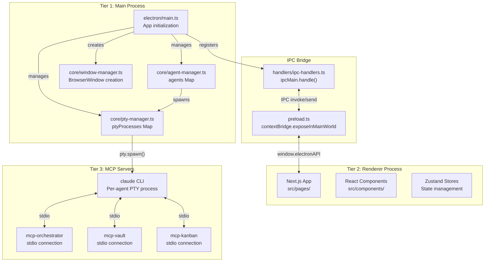
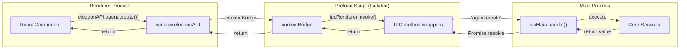
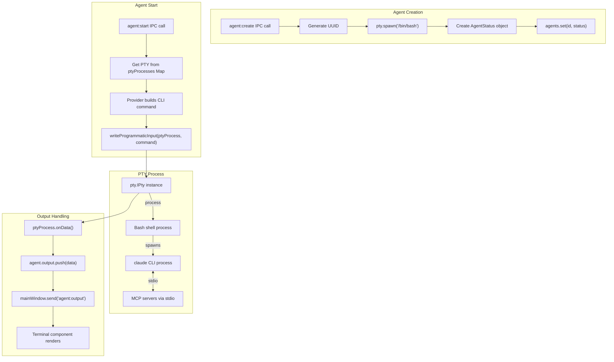
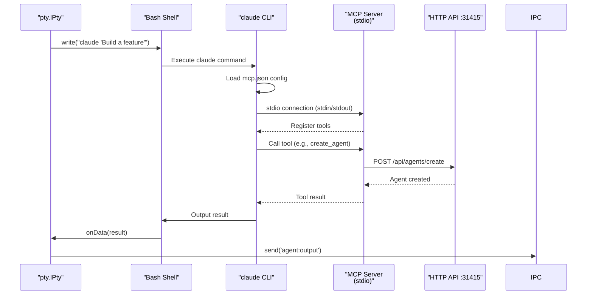
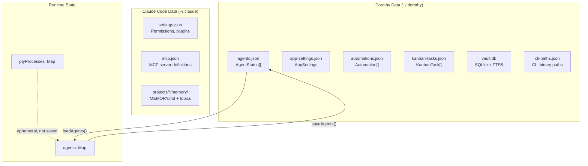
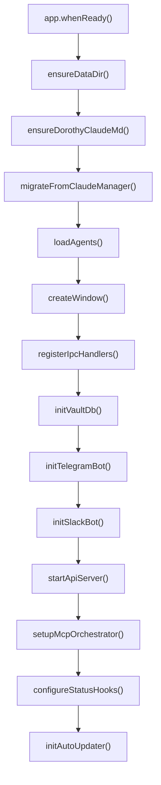

<!-- source: DeepWiki mcp.deepwiki.com · repo Charlie85270/Dorothy · page 1.2 System Architecture · fetched 2026-10-26 -->

# System Architecture

<details>
<summary>Relevant source files</summary>

The following files were used as context for generating this wiki page:

- [electron/core/agent-manager.ts](electron/core/agent-manager.ts)
- [electron/handlers/ipc-handlers.ts](electron/handlers/ipc-handlers.ts)
- [electron/main.ts](electron/main.ts)
- [electron/preload.ts](electron/preload.ts)
- [src/components/Settings/index.ts](src/components/Settings/index.ts)
- [src/types/electron.d.ts](src/types/electron.d.ts)

</details>


## Purpose and Scope

This document explains Dorothy's three-tier architecture: the Electron main process, the renderer process, and the MCP (Model Context Protocol) ecosystem. It covers how these layers interact, the core components within each layer, and the data flow between them.

For details on specific subsystems, see:
- Agent execution details: [Agent Execution Model](#3.2)
- IPC handler registration: [IPC Communication](#11.2)
- MCP server tool documentation: [MCP Ecosystem](#4)
- Build and packaging: [Build Pipeline](#12.1)

---

## Architectural Overview

Dorothy is built on a three-tier architecture that separates concerns between process isolation, UI rendering, and AI agent orchestration.

### Three-Tier Architecture Diagram



**Sources:** [electron/main.ts:1-603](), [electron/preload.ts:1-635](), [electron/handlers/ipc-handlers.ts:1-77]()

---

## Tier 1: Electron Main Process

The main process hosts all privileged operations, manages system resources, and orchestrates external services.

### Main Process Initialization Sequence

[electron/main.ts:293-567]() defines the initialization sequence:

1. **Protocol registration** ([electron/main.ts:291]())
2. **Data directory creation** ([electron/main.ts:297]())
3. **CLAUDE.md deployment** ([electron/main.ts:300]())
4. **Migration from legacy paths** ([electron/main.ts:303]())
5. **Agent state loading** ([electron/main.ts:306]())
6. **Window creation** ([electron/main.ts:312]())
7. **IPC handler registration** ([electron/main.ts:318-331]())
8. **Service initialization** ([electron/main.ts:541-551]())

### Core Service Components

| Service | File Path | Purpose |
|---------|-----------|---------|
| **Agent Manager** | [electron/core/agent-manager.ts]() | Maintains `agents: Map<string, AgentStatus>` with lifecycle state |
| **PTY Manager** | [electron/core/pty-manager.ts]() | Manages `ptyProcesses: Map<string, pty.IPty>` for terminal sessions |
| **Window Manager** | [electron/core/window-manager.ts]() | Creates and manages the single `BrowserWindow` instance |
| **API Server** | [electron/services/api-server.ts]() | HTTP server on port 31415 for MCP tool integration |
| **Telegram Bot** | [electron/services/telegram-bot.ts]() | `node-telegram-bot-api` for remote control |
| **Slack Bot** | [electron/services/slack-bot.ts]() | `@slack/bolt` Socket Mode integration |
| **Vault DB** | [electron/services/vault-db.ts]() | SQLite database with FTS5 for document storage |
| **Update Checker** | [electron/services/update-checker.ts]() | `electron-updater` auto-update integration |

**Sources:** [electron/main.ts:24-92](), [electron/core/agent-manager.ts:14](), [electron/core/pty-manager.ts:10-16]()

### Main Process Dependency Injection

The `createIpcDependencies()` function ([electron/main.ts:214-265]()) assembles a dependency object passed to all IPC handlers:

```typescript
interface IpcHandlerDependencies {
  // State maps
  ptyProcesses: Map<string, pty.IPty>;
  agents: Map<string, AgentStatus>;
  skillPtyProcesses: Map<string, pty.IPty>;
  quickPtyProcesses: Map<string, pty.IPty>;
  pluginPtyProcesses: Map<string, pty.IPty>;

  // Core functions
  getMainWindow: () => BrowserWindow | null;
  getAppSettings: () => AppSettings;
  setAppSettings: (settings: AppSettings) => void;
  saveAppSettings: (settings: AppSettings) => void;
  saveAgents: () => void;
  initAgentPty: (agent: AgentStatus) => Promise<string>;
  // ... additional functions
}
```

**Sources:** [electron/handlers/ipc-handlers.ts:22-55](), [electron/main.ts:214-265]()

---

## Tier 2: IPC Communication Layer

Dorothy uses a type-safe IPC bridge to enable communication between the isolated main and renderer processes.

### IPC Architecture Diagram



**Sources:** [electron/preload.ts:18-634](), [electron/handlers/ipc-handlers.ts:60-77]()

### IPC Handler Registration

[electron/handlers/ipc-handlers.ts:60-77]() registers handlers in functional groups:

```typescript
export function registerIpcHandlers(deps: IpcHandlerDependencies): void {
  registerPtyHandlers(deps);           // pty:create, pty:write, pty:resize, pty:kill
  registerAgentHandlers(deps);         // agent:create, agent:start, agent:stop, ...
  registerSkillHandlers(deps);         // skill:install-start, skill:list-installed, ...
  registerPluginHandlers(deps);        // plugin:install-start, plugin:install-write, ...
  registerClaudeDataHandlers(deps);    // claude:getData
  registerSettingsHandlers(deps);      // settings:get, settings:save
  registerAppSettingsHandlers(deps);   // app:getSettings, app:saveSettings
  registerUpdateHandlers();            // app:checkForUpdates, app:downloadUpdate
  registerTasmaniaHandlers(deps);      // tasmania:test, tasmania:loadModel, ...
  registerFileSystemHandlers(deps);    // fs:list-projects
  registerShellHandlers(deps);         // shell:exec, shell:openTerminal
  registerMemoryHandlers();            // memory:list-projects, memory:readFile, ...
  registerObsidianHandlers(deps);      // obsidian:scan, obsidian:readFile, ...
  registerGwsHandlers(deps);           // gws:detect, gws:authStatus, ...
  registerApiTokenHandler();           // api:getToken
}
```

### IPC Type Safety

The `ElectronAPI` interface ([src/types/electron.d.ts:152-785]()) provides compile-time type safety for all IPC calls:

| Namespace | Key Methods | Return Types |
|-----------|-------------|--------------|
| `agent` | `create`, `start`, `stop`, `list` | `Promise<AgentStatus>` |
| `pty` | `create`, `write`, `resize`, `kill` | `Promise<{ id: string }>` |
| `skill` | `installStart`, `listInstalled` | `Promise<string[]>` |
| `vault` | `listDocuments`, `createDocument`, `search` | `Promise<VaultDocumentElectron[]>` |
| `kanban` | `list`, `create`, `move` | `Promise<KanbanTaskElectron[]>` |
| `scheduler` | `listTasks`, `createTask`, `runTask` | `Promise<{ tasks: Task[] }>` |
| `automation` | `list`, `create`, `run` | `Promise<{ automations: Automation[] }>` |

**Sources:** [src/types/electron.d.ts:152-785](), [electron/preload.ts:44-478]()

### IPC Event Streams

In addition to request-response patterns, the IPC layer supports event streaming for real-time updates:

```typescript
// Renderer subscribes to agent output
const unsubscribe = window.electronAPI.agent.onOutput((event) => {
  console.log(event.agentId, event.data);
});

// Main process emits events
mainWindow.webContents.send('agent:output', {
  type: 'output',
  agentId: id,
  ptyId,
  data: outputString,
  timestamp: new Date().toISOString(),
});
```

**Sources:** [electron/preload.ts:83-107](), [electron/handlers/ipc-handlers.ts:330-354]()

---

## Tier 3: Renderer Process

The renderer process runs a Next.js application with React components and client-side state management.

### Renderer Stack

| Layer | Technology | Purpose |
|-------|------------|---------|
| **Framework** | Next.js 14 | Server-side rendering, routing, API routes (disabled in Electron build) |
| **UI Library** | React 18 | Component-based UI |
| **State Management** | Zustand | Global stores for agents, settings, UI state |
| **Styling** | Tailwind CSS | Utility-first CSS framework |
| **Terminal** | xterm.js | Terminal emulator for PTY output |
| **3D Rendering** | Three.js + React Three Fiber | Agent World visualization |

**Sources:** [package.json](), [src/components/]()

### Key UI Components

[src/components/Settings/index.ts:1-33]() exports 15 settings sections:

- `GeneralSection`: Default provider, update settings
- `TerminalSection`: Font size, theme preferences
- `ObsidianSection`: Vault path configuration
- `GitSection`: Worktree settings
- `NotificationsSection`: System notification triggers
- `TelegramSection`: Bot token, authentication
- `SlackSection`: Socket Mode app token, channel
- `JiraSection`: Domain, credentials, JQL queries
- `SocialDataSection`: Twitter/X API integration
- `TasmaniaSection`: Local LLM server configuration
- `GoogleWorkspaceSection`: GWS CLI integration
- `PermissionsSection`: Claude Code permissions
- `SkillsSection`: Skill/plugin installation
- `CLIPathsSection`: Binary path overrides
- `SystemSection`: Version info, diagnostics

**Sources:** [src/components/Settings/index.ts:1-33]()

---

## Agent Execution Architecture

Agents execute through a sophisticated PTY-based model where each agent has a dedicated pseudo-terminal running a Claude CLI instance.

### Agent Lifecycle and PTY Management



**Sources:** [electron/handlers/ipc-handlers.ts:172-377](), [electron/handlers/ipc-handlers.ts:380-589](), [electron/core/agent-manager.ts:223-355]()

### Agent State Machine

Each `AgentStatus` object ([src/types/electron.d.ts:115-135]()) tracks the following states:

| Status | Meaning | Triggers |
|--------|---------|----------|
| `idle` | Agent created but not running | Initial state, or after manual stop |
| `running` | Claude CLI actively executing | After `agent:start` command sent to PTY |
| `waiting` | Claude CLI waiting for user input | Detected by status detection hooks |
| `completed` | PTY exited with code 0 | `ptyProcess.onExit({ exitCode: 0 })` |
| `error` | PTY exited with non-zero code | `ptyProcess.onExit({ exitCode: != 0 })` |

**Sources:** [electron/types.ts](), [electron/core/agent-manager.ts:40-139]()

### PTY Environment Variables

Each PTY spawned for an agent receives environment variables via the provider system:

```typescript
// From electron/handlers/ipc-handlers.ts:271-284
const providerEnvVars = agentProvider.getPtyEnvVars(id, config.projectPath, allSkills);

ptyProcess = pty.spawn(shell, ['-l'], {
  cwd,
  env: {
    ...cleanEnv,
    PATH: fullPath,
    ...providerEnvVars,
    // Additional environment vars
  },
});
```

Claude provider sets ([electron/providers/claude-provider.ts]()):
- `CLAUDE_AGENT_ID`: Agent UUID
- `CLAUDE_PROJECT_PATH`: Project directory
- `CLAUDE_SKILLS`: Comma-separated skill list

**Sources:** [electron/handlers/ipc-handlers.ts:269-290](), [electron/providers/claude-provider.ts]()

---

## MCP Integration

Dorothy agents interact with MCP servers through stdio connections managed by the Claude CLI.

### MCP Server Communication Flow



**Sources:** [electron/services/api-server.ts](), [mcp-orchestrator/]()

### MCP Configuration Path Resolution

Agents using the Claude provider receive MCP configuration via the `--mcp-config` flag:

```typescript
// From electron/handlers/ipc-handlers.ts:526-534
if (cliProvider.getMcpConfigStrategy() === 'flag') {
  const possibleMcpPath = path.join(app.getPath('home'), '.claude', 'mcp.json');
  if (fs.existsSync(possibleMcpPath)) {
    mcpConfigPath = possibleMcpPath;
  }
}
```

The MCP config file (`~/.claude/mcp.json`) defines stdio servers:

```json
{
  "mcpServers": {
    "orchestrator": {
      "command": "node",
      "args": ["/path/to/mcp-orchestrator/build/index.js"]
    },
    "vault": {
      "command": "node",
      "args": ["/path/to/mcp-vault/build/index.js"]
    }
  }
}
```

**Sources:** [electron/handlers/ipc-handlers.ts:526-534](), [electron/services/mcp-orchestrator.ts]()

### MCP Tool Access via HTTP API

MCP servers can interact with Dorothy services through the HTTP API server on port 31415:

| Endpoint | Method | Purpose |
|----------|--------|---------|
| `/api/agents` | GET | List all agents |
| `/api/agents/create` | POST | Create ephemeral agent |
| `/api/agents/:id/start` | POST | Start agent with prompt |
| `/api/agents/:id/output` | GET | Get agent output buffer |
| `/api/telegram/send` | POST | Send Telegram message |
| `/api/slack/send` | POST | Send Slack message |

**Sources:** [electron/services/api-server.ts]()

---

## Data Persistence Strategy

Dorothy uses a hybrid persistence model with JSON files, SQLite databases, and integration with Claude Code's native storage.

### Persistence Model Diagram



**Sources:** [electron/constants.ts](), [electron/core/agent-manager.ts:141-170]()

### File Locations Reference

| File Path | Purpose | Format | Managed By |
|-----------|---------|--------|------------|
| `~/.dorothy/agents.json` | Agent state persistence | JSON array | [agent-manager.ts:141-170]() |
| `~/.dorothy/app-settings.json` | Dorothy configuration | JSON object | [main.ts:108-172]() |
| `~/.dorothy/automations.json` | Automation definitions | JSON array | [automation-handlers.ts]() |
| `~/.dorothy/kanban-tasks.json` | Kanban board state | JSON array | [kanban-handlers.ts]() |
| `~/.dorothy/vault.db` | Document vault | SQLite | [vault-db.ts]() |
| `~/.dorothy/cli-paths.json` | Binary path overrides | JSON object | [cli-paths-handlers.ts]() |
| `~/.claude/settings.json` | Claude Code settings | JSON object | Claude Code + Dorothy |
| `~/.claude/mcp.json` | MCP server config | JSON object | Dorothy setup |
| `~/.claude/projects/*/memory/` | Project memory files | Markdown | Claude Code |

**Sources:** [electron/constants.ts:7-14](), [electron/core/agent-manager.ts:8]()

### Agent State Persistence

[electron/core/agent-manager.ts:141-170]() implements agent persistence with output truncation and status normalization:

```typescript
export function saveAgents() {
  const agentsArray = Array.from(agents.values()).map(agent => ({
    ...agent,
    ptyId: undefined,              // PTYs are ephemeral, recreated on load
    pathMissing: undefined,        // Revalidated on load
    output: agent.output.slice(-100),  // Keep last 100 output chunks
    status: agent.status === 'running' ? 'idle' : agent.status,  // Normalize running → idle
  }));

  fs.writeFileSync(AGENTS_FILE, JSON.stringify(agentsArray, null, 2));
}
```

On app startup, [electron/core/agent-manager.ts:172-221]() loads agents and validates paths:

```typescript
export function loadAgents() {
  const agentsArray = JSON.parse(data) as AgentStatus[];

  for (const agent of agentsArray) {
    const workingPath = agent.worktreePath || agent.projectPath;
    if (!fs.existsSync(workingPath)) {
      agent.pathMissing = true;  // Flag for UI display
    }
    agent.status = 'idle';       // All restored agents start idle
    agent.ptyId = undefined;     // PTY recreated on first use
    agents.set(agent.id, agent);
  }
}
```

**Sources:** [electron/core/agent-manager.ts:141-221]()

### Vault Database Schema

The vault uses SQLite with FTS5 full-text search ([electron/services/vault-db.ts]()):

```sql
CREATE TABLE documents (
  id TEXT PRIMARY KEY,
  title TEXT NOT NULL,
  content TEXT NOT NULL,
  folder_id TEXT,
  author TEXT NOT NULL,
  agent_id TEXT,
  tags TEXT,  -- JSON array
  created_at TEXT NOT NULL,
  updated_at TEXT NOT NULL
);

CREATE VIRTUAL TABLE documents_fts USING fts5(
  title, content, tags,
  content='documents',
  content_rowid='rowid'
);
```

**Sources:** [electron/services/vault-db.ts]()

---

## Service Orchestration

Multiple background services run in the main process, coordinated by [electron/main.ts]().

### Service Initialization Order



**Sources:** [electron/main.ts:293-567]()

### HTTP API Server

The API server ([electron/services/api-server.ts]()) runs on port 31415 and provides REST endpoints for MCP tools:

```typescript
const app = express();
app.use(express.json());
app.use(cors());

// Authentication middleware
app.use((req, res, next) => {
  const token = req.headers.authorization?.replace('Bearer ', '');
  if (token !== API_TOKEN) {
    return res.status(401).json({ error: 'Unauthorized' });
  }
  next();
});

app.listen(31415, () => {
  console.log('API server listening on port 31415');
});
```

**Sources:** [electron/services/api-server.ts]()

### Remote Control Integration

Both Telegram and Slack bots share a common architecture:

1. **Direct Commands**: `/start_agent`, `/stop_agent`, `/status` → interact with Agent Manager directly
2. **Conversational Messages**: Route to Super Agent (orchestrator) with MCP tool access
3. **File Upload Handling**: Download files locally, pass file paths to Super Agent

The Super Agent receives special instruction files:
- `super-agent-instructions.md`: General orchestration guidelines
- `telegram-instructions.md`: Telegram-specific response formatting

**Sources:** [electron/services/telegram-bot.ts](), [electron/services/slack-bot.ts]()

---

## Process Lifecycle

### App Startup

1. Electron main process starts
2. `app.whenReady()` fires
3. Data migration from `~/.claude-manager` (legacy rebrand)
4. Window creation with Next.js dev server (dev) or bundled HTML (production)
5. IPC handlers registered
6. Services initialized in sequence
7. Auto-update check scheduled (5s delay)

**Sources:** [electron/main.ts:293-567]()

### App Shutdown

[electron/main.ts:585-590]() handles graceful shutdown:

```typescript
app.on('before-quit', () => {
  saveAgents();      // Persist agent state
  killAllPty();      // Terminate all PTY processes
  closeVaultDb();    // Close SQLite connection
});
```

**Sources:** [electron/main.ts:585-590]()

### PTY Cleanup

[electron/core/pty-manager.ts]() exports `killAllPty()`:

```typescript
export function killAllPty() {
  for (const [id, pty] of ptyProcesses) {
    pty.kill();
  }
  for (const [id, pty] of skillPtyProcesses) {
    pty.kill();
  }
  for (const [id, pty] of quickPtyProcesses) {
    pty.kill();
  }
}
```

**Sources:** [electron/core/pty-manager.ts]()

---

