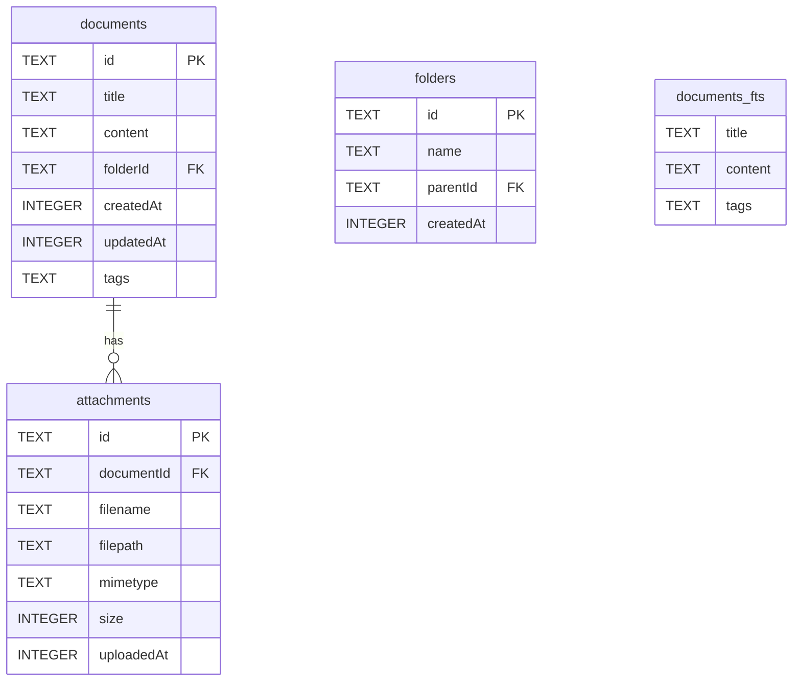
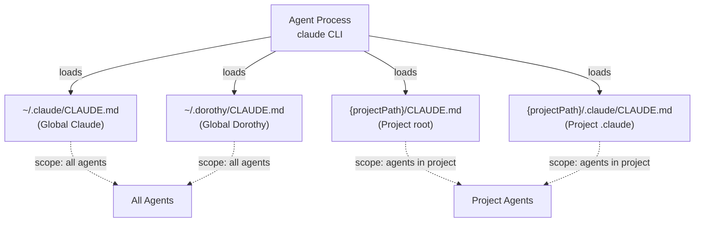

<!-- source: DeepWiki mcp.deepwiki.com · repo Charlie85270/Dorothy · page 11.5 Data Persistence · fetched 2026-10-26 -->

# Data Persistence

<details>
<summary>Relevant source files</summary>

The following files were used as context for generating this wiki page:

- [CLAUDE.md](CLAUDE.md)
- [bun.lock](bun.lock)
- [electron/handlers/memory-handlers.ts](electron/handlers/memory-handlers.ts)
- [electron/main.ts](electron/main.ts)
- [src/app/memory/page.tsx](src/app/memory/page.tsx)
- [src/app/recurring-tasks/page.tsx](src/app/recurring-tasks/page.tsx)
- [src/components/Memory/AgentKnowledgeGraph.tsx](src/components/Memory/AgentKnowledgeGraph.tsx)

</details>


This document describes Dorothy's data persistence architecture, including JSON state files, SQLite databases, and integration with Claude Code's native memory system. For information about how the UI interacts with this data, see [State Management](#11.6). For details about the vault's document management features, see [Vault](#6.3).

---

## Overview

Dorothy employs a **hybrid persistence strategy** combining three storage mechanisms:

1. **JSON files** for simple application state (agents, settings, automations, kanban tasks)
2. **SQLite database** with FTS5 full-text search for the document vault
3. **Claude Code's native memory system** for project context and learnings

All user data resides in two directories:
- `~/.dorothy/` — Dorothy-specific state and configuration
- `~/.claude/` — Claude Code projects, settings, and memory files

**Sources:** [electron/main.ts:104-172](), [CLAUDE.md:1-12]()

---

## Storage Architecture

```mermaid
graph TB
    subgraph "Dorothy Data (~/.dorothy)"
        AgentJSON["agents.json<br/>Map<id, AgentStatus>"]
        AppSettings["app-settings.json<br/>AppSettings"]
        KanbanJSON["kanban-tasks.json<br/>Task[]"]
        AutoJSON["automations.json<br/>Automation[]"]
        AutoProcessed["automations-processed.json<br/>{ [automationId]: itemHashes }"]
        AutoRuns["automations-runs.json<br/>{ [automationId]: runs[] }"]
        CLIPaths["cli-paths.json<br/>CLIPathsConfig"]
        VaultDB["vault.db<br/>SQLite + FTS5"]
        DorothyClaude["CLAUDE.md<br/>Global instructions"]
    end
    
    subgraph "Claude Code Data (~/.claude)"
        ClaudeSettings["settings.json<br/>Claude permissions, plugins"]
        MCPConfig["mcp.json<br/>Global MCP servers"]
        ProjectDirs["projects/<br/>Per-project dirs"]
        GlobalClaude["CLAUDE.md<br/>Global instructions"]
    end
    
    subgraph "Project Memory (~/.claude/projects)"
        MemoryDir["<encoded-path>/memory/"]
        MemoryMD["MEMORY.md<br/>Entrypoint"]
        TopicFiles["topic1.md<br/>topic2.md<br/>..."]
        ProjectClaude["../.claude/CLAUDE.md"]
    end
    
    Main[electron/main.ts] --> AgentJSON
    Main --> AppSettings
    Main --> VaultDB
    Main --> DorothyClaude
    
    AgentManager[agent-manager.ts] --> AgentJSON
    SettingsHandlers[ipc-handlers.ts] --> AppSettings
    SettingsHandlers --> ClaudeSettings
    SettingsHandlers --> CLIPaths
    
    KanbanHandlers[kanban-handlers.ts] --> KanbanJSON
    AutoHandlers[automation-handlers.ts] --> AutoJSON
    AutoHandlers --> AutoProcessed
    AutoHandlers --> AutoRuns
    
    VaultHandlers[vault-handlers.ts] --> VaultDB
    MemoryHandlers[memory-handlers.ts] --> MemoryDir
    
    ProjectDirs --> MemoryDir
    MemoryDir --> MemoryMD
    MemoryDir --> TopicFiles
```



**Sources:** [electron/main.ts:1-602](), [electron/constants.ts](), Diagram 3 from high-level overview

---

## JSON State Files

### agents.json

Stores all agent definitions and runtime state. Loaded on startup via `loadAgents()` and persisted via `saveAgents()` after every state change.

**Structure:**
```typescript
// Map serialized as array of [id, AgentStatus] tuples
{
  "agents": [
    [
      "uuid-v4-string",
      {
        "id": "string",
        "status": "idle" | "running" | "completed" | "error",
        "projectPath": "string",
        "worktreePath": "string?",
        "skills": ["string"],
        "output": ["string"],
        "lastActivity": "ISO8601",
        "ptyId": "string?",
        "character": "robot" | "ninja" | ...,
        "name": "string",
        "currentTask": "string?",
        "skipPermissions": "boolean?"
      }
    ]
  ]
}
```

**File Location:** `~/.dorothy/agents.json`

**Key Functions:**
- `loadAgents()` — [electron/core/agent-manager.ts]()
- `saveAgents()` — [electron/core/agent-manager.ts]()

**Persistence Triggers:**
- Agent creation: [electron/main.ts:439]()
- Status changes: [electron/core/agent-manager.ts]()
- PTY exit: [electron/main.ts:463]()

**Sources:** [electron/main.ts:306](), [electron/core/agent-manager.ts](), [electron/types.ts]()

---

### app-settings.json

Application-wide configuration including integration credentials, notification preferences, and default provider.

**Structure:**
```typescript
{
  "notificationsEnabled": boolean,
  "notifyOnWaiting": boolean,
  "notifyOnComplete": boolean,
  "notifyOnError": boolean,
  
  "telegramEnabled": boolean,
  "telegramBotToken": string,
  "telegramChatId": string,
  "telegramAuthToken": string,
  "telegramAuthorizedChatIds": string[],
  "telegramRequireMention": boolean,
  
  "slackEnabled": boolean,
  "slackBotToken": string,
  "slackAppToken": string,
  "slackSigningSecret": string,
  "slackChannelId": string,
  
  "jiraEnabled": boolean,
  "jiraDomain": string,
  "jiraEmail": string,
  "jiraApiToken": string,
  
  "socialDataEnabled": boolean,
  "socialDataApiKey": string,
  
  "xPostingEnabled": boolean,
  "xApiKey": string,
  "xApiSecret": string,
  "xAccessToken": string,
  "xAccessTokenSecret": string,
  
  "tasmaniaEnabled": boolean,
  "tasmaniaServerPath": string,
  
  "gwsEnabled": boolean,
  "gwsSkillsInstalled": boolean,
  
  "verboseModeEnabled": boolean,
  "autoCheckUpdates": boolean,
  "defaultProvider": "claude" | "codex" | "gemini" | "local",
  
  "cliPaths": {
    "claude": string,
    "codex": string,
    "gemini": string,
    "gws": string,
    "gcloud": string,
    "gh": string,
    "node": string,
    "additionalPaths": string[]
  }
}
```

**File Location:** `~/.dorothy/app-settings.json`

**Key Functions:**
- `loadAppSettings()` — [electron/main.ts:108-163]()
- `saveAppSettingsToFile(settings)` — [electron/main.ts:165-172]()

**Persistence Triggers:**
- Settings page saves: [electron/handlers/ipc-handlers.ts]()
- Bot initialization: [electron/main.ts:241]()

**Sources:** [electron/main.ts:108-172](), [electron/types.ts](), [electron/constants.ts:14]()

---

### kanban-tasks.json

Kanban board tasks with status tracking, agent associations, and JIRA sync metadata.

**Structure:**
```typescript
{
  "tasks": [
    {
      "id": "string",
      "title": "string",
      "description": "string?",
      "status": "todo" | "in-progress" | "done" | "blocked",
      "priority": "low" | "medium" | "high" | "critical",
      "tags": string[],
      "createdAt": "ISO8601",
      "updatedAt": "ISO8601",
      "dueDate": "ISO8601?",
      "assignedAgent": "string?",
      "jiraKey": "string?",
      "jiraUrl": "string?",
      "metadata": { [key: string]: any }
    }
  ]
}
```

**File Location:** `~/.dorothy/kanban-tasks.json`

**Key Functions:**
- `loadKanbanTasks()` — [electron/handlers/kanban-handlers.ts]()
- `saveKanbanTasks()` — [electron/handlers/kanban-handlers.ts]()

**Persistence Triggers:**
- Task CRUD operations: [electron/handlers/kanban-handlers.ts]()
- JIRA automation creates tasks: [electron/services/automation-service.ts]()
- Agent completion syncs status: [electron/services/kanban-automation.ts]()

**Sources:** [electron/handlers/kanban-handlers.ts](), Diagram 5 from high-level overview

---

### Automation Files

Three separate JSON files track automation definitions, processed items, and execution history.

#### automations.json

```typescript
{
  "automations": [
    {
      "id": "string",
      "name": "string",
      "enabled": boolean,
      "source": "github" | "jira" | "rss" | "twitter",
      "sourceConfig": {
        // GitHub: { repo, prFilter, issueFilter }
        // JIRA: { jql, projectKey }
        // etc.
      },
      "triggers": {
        "keywords": string[],
        "authorFilter": string[],
        "labelFilter": string[]
      },
      "actions": {
        "createAgent": boolean,
        "agentPrompt": "string?",
        "createKanbanTask": boolean,
        "sendTelegram": boolean,
        "sendSlack": boolean,
        "postToJira": boolean,
        "webhook": "string?"
      },
      "schedule": "string", // cron expression
      "lastRun": "ISO8601?",
      "nextRun": "ISO8601?"
    }
  ]
}
```

#### automations-processed.json

Deduplication tracking using content hashes.

```typescript
{
  "automationId1": ["hash1", "hash2", ...],
  "automationId2": ["hash3", "hash4", ...]
}
```

#### automations-runs.json

Execution log with capped history (1000 entries max).

```typescript
{
  "automationId1": [
    {
      "timestamp": "ISO8601",
      "itemsFound": 5,
      "itemsProcessed": 2,
      "itemsSkipped": 3,
      "success": true,
      "error": "string?",
      "duration": 1234 // ms
    }
  ]
}
```

**File Locations:**
- `~/.dorothy/automations.json`
- `~/.dorothy/automations-processed.json`
- `~/.dorothy/automations-runs.json`

**Key Functions:**
- `loadAutomations()` — [electron/handlers/automation-handlers.ts]()
- `saveAutomations()` — [electron/handlers/automation-handlers.ts]()
- Content hashing for deduplication — [electron/services/automation-service.ts]()

**Sources:** [electron/handlers/automation-handlers.ts](), Diagram 5 from high-level overview

---

### cli-paths.json

Tool path discovery results cached for performance.

**Structure:**
```typescript
{
  "claude": "/usr/local/bin/claude",
  "codex": "/usr/local/bin/codex",
  "gemini": "/usr/local/bin/gemini",
  "gws": "/usr/local/bin/gws",
  "gcloud": "/usr/local/bin/gcloud",
  "gh": "/usr/local/bin/gh",
  "node": "/usr/local/bin/node",
  "additionalPaths": ["/opt/homebrew/bin"]
}
```

**File Location:** `~/.dorothy/cli-paths.json`

**Key Functions:**
- `loadCLIPaths()` — [electron/handlers/cli-paths-handlers.ts]()
- `saveCLIPaths()` — [electron/handlers/cli-paths-handlers.ts]()
- `findExecutable()` — Path resolution with caching

**Sources:** [electron/handlers/cli-paths-handlers.ts](), [electron/constants.ts]()

---

## SQLite Database: vault.db

The vault uses **better-sqlite3** with **FTS5 full-text search** for structured document storage accessible through both UI and MCP tools.

### Database Schema



### Table Definitions

**documents:**
```sql
CREATE TABLE documents (
  id TEXT PRIMARY KEY,
  title TEXT NOT NULL,
  content TEXT,
  folderId TEXT,
  createdAt INTEGER NOT NULL,
  updatedAt INTEGER NOT NULL,
  tags TEXT,
  FOREIGN KEY (folderId) REFERENCES folders(id) ON DELETE SET NULL
);
```

**folders:**
```sql
CREATE TABLE folders (
  id TEXT PRIMARY KEY,
  name TEXT NOT NULL,
  parentId TEXT,
  createdAt INTEGER NOT NULL,
  FOREIGN KEY (parentId) REFERENCES folders(id) ON DELETE CASCADE
);
```

**attachments:**
```sql
CREATE TABLE attachments (
  id TEXT PRIMARY KEY,
  documentId TEXT NOT NULL,
  filename TEXT NOT NULL,
  filepath TEXT NOT NULL,
  mimetype TEXT,
  size INTEGER,
  uploadedAt INTEGER NOT NULL,
  FOREIGN KEY (documentId) REFERENCES documents(id) ON DELETE CASCADE
);
```

**documents_fts (FTS5 Virtual Table):**
```sql
CREATE VIRTUAL TABLE documents_fts USING fts5(
  title, 
  content, 
  tags,
  content='documents',
  content_rowid='rowid'
);
```

### Vault Operations

**Initialization:**
- `initVaultDb()` — [electron/services/vault-db.ts]()
  - Creates tables if not exist
  - Sets up FTS5 triggers for auto-indexing
  - Called on app startup: [electron/main.ts:383]()

**Shutdown:**
- `closeVaultDb()` — [electron/services/vault-db.ts]()
  - Called on app quit: [electron/main.ts:589]()

**Access Methods:**
1. **IPC Handlers** — UI access: [electron/handlers/vault-handlers.ts]()
2. **MCP Tools** — Agent access via `mcp-vault` server: [mcp-vault/src/index.ts]()
3. **HTTP API** — MCP orchestrator bridge: [electron/services/api-server.ts]()

**Sources:** [electron/services/vault-db.ts](), [electron/handlers/vault-handlers.ts](), [electron/main.ts:383-389](), Diagram 3 from high-level overview

---

## Claude Code Memory Integration

Dorothy exposes but does not modify Claude Code's native memory system located at `~/.claude/projects/`.

### Memory Directory Structure

```
~/.claude/projects/
└── <encoded-project-path>/          # e.g., "Users-alice-dev-myproject"
    └── memory/
        ├── MEMORY.md                 # Entrypoint (required)
        ├── architecture.md           # Topic file (optional)
        ├── debugging.md              # Topic file (optional)
        └── api-conventions.md        # Topic file (optional)
```

### Path Encoding

Project paths are encoded to folder names:
- `/Users/alice/dev/myproject` → `Users-alice-dev-myproject`
- Slashes replaced with dashes
- Case-sensitive

### MEMORY.md Format

The entrypoint file contains:
1. **Project context** — Architecture, key files, patterns
2. **Links to topic files** — References to detailed notes
3. **Recent changes** — Session-specific discoveries

**Best Practices (per CLAUDE.md):**
- Keep MEMORY.md under 200 lines
- Create topic files for detailed notes
- Update after corrections or discoveries

**Sources:** [CLAUDE.md:1-12]()

### Memory Operations

**Read-only access via UI:**
- List projects: `listProjectMemories()` — [electron/services/memory-service.ts]()
- Read files: `readMemoryFileContent()` — [electron/services/memory-service.ts]()
- Display in Memory page: [src/app/memory/page.tsx:1-630]()

**IPC Handlers:**
```typescript
'memory:list-projects'   // Returns ProjectMemory[]
'memory:read-file'       // Returns { content, error }
'memory:write-file'      // Updates existing file
'memory:create-file'     // Creates new topic file
'memory:delete-file'     // Removes non-entrypoint files
```

**Sources:** [electron/handlers/memory-handlers.ts:1-36](), [electron/services/memory-service.ts]()

---

## Instruction Files (CLAUDE.md)

Multiple `CLAUDE.md` files provide context to agents at different scopes.

### Instruction Hierarchy



### Loading Order

1. **Global instructions** (loaded for all agents):
   - `~/.claude/CLAUDE.md`
   - `~/.dorothy/CLAUDE.md` (written by `ensureDorothyClaudeMd()`)

2. **Project instructions** (loaded when agent's `projectPath` matches):
   - `{projectPath}/CLAUDE.md`
   - `{projectPath}/.claude/CLAUDE.md`

**Initialization:**
- Dorothy's global CLAUDE.md created on startup: [electron/main.ts:300]()
- Contains Dorothy-specific context and best practices

**Discovery:**
- Knowledge graph discovers instruction files: [src/components/Memory/AgentKnowledgeGraph.tsx:580-613]()
- Uses shell commands to check file existence

**Sources:** [electron/utils.ts]() (`ensureDorothyClaudeMd()`), [src/components/Memory/AgentKnowledgeGraph.tsx:580-613](), [electron/main.ts:300]()

---

## Data Migration

### Claude Manager Rebrand

Dorothy migrates data from previous installation (`~/.claude-manager/`) if present.

**Migration Function:**
```typescript
function migrateFromClaudeManager(): void {
  const oldDir = path.join(os.homedir(), '.claude-manager');
  const newDir = path.join(os.homedir(), '.dorothy');
  
  if (fs.existsSync(oldDir) && !fs.existsSync(newDir)) {
    fs.renameSync(oldDir, newDir);
    console.log('Migrated data from ~/.claude-manager to ~/.dorothy');
  }
}
```

**Files Migrated:**
- `agents.json`
- `app-settings.json`
- `kanban-tasks.json`
- `automations.json`
- `vault.db`
- All other JSON state files

**Trigger:**
- Called once on app startup: [electron/main.ts:303]()

**Sources:** [electron/utils.ts]() (`migrateFromClaudeManager()`), [electron/main.ts:303]()

---

## File Location Reference

| File | Location | Purpose | Format |
|------|----------|---------|--------|
| **Agent State** | `~/.dorothy/agents.json` | Agent definitions and runtime state | JSON |
| **App Settings** | `~/.dorothy/app-settings.json` | Integration credentials, preferences | JSON |
| **Kanban Tasks** | `~/.dorothy/kanban-tasks.json` | Task board state | JSON |
| **Automations** | `~/.dorothy/automations.json` | Automation definitions | JSON |
| **Processed Items** | `~/.dorothy/automations-processed.json` | Deduplication hashes | JSON |
| **Automation Runs** | `~/.dorothy/automations-runs.json` | Execution history (capped) | JSON |
| **CLI Paths** | `~/.dorothy/cli-paths.json` | Cached tool locations | JSON |
| **Vault Database** | `~/.dorothy/vault.db` | Document storage with FTS5 | SQLite |
| **Dorothy Instructions** | `~/.dorothy/CLAUDE.md` | Global agent context | Markdown |
| **Claude Settings** | `~/.claude/settings.json` | Permissions, plugins | JSON |
| **MCP Config** | `~/.claude/mcp.json` | Global MCP servers | JSON |
| **Project Memory** | `~/.claude/projects/*/memory/` | Per-project context files | Markdown |
| **Claude Instructions** | `~/.claude/CLAUDE.md` | Global agent context | Markdown |

**Sources:** [electron/constants.ts](), [electron/main.ts:1-602](), [electron/utils.ts]()

---

## Persistence Patterns

### Synchronous Writes

Most persistence operations use **synchronous writes** to ensure data integrity:

```typescript
// Example: saveAgents()
fs.writeFileSync(AGENTS_FILE, JSON.stringify(data, null, 2));
```

**Files using synchronous writes:**
- `agents.json` — [electron/core/agent-manager.ts]()
- `app-settings.json` — [electron/main.ts:168]()
- `kanban-tasks.json` — [electron/handlers/kanban-handlers.ts]()
- All automation JSON files

**Rationale:** State consistency is critical; async writes could lose data on crashes.

### Database Transactions

SQLite operations use **synchronous better-sqlite3** with automatic transactions:

```typescript
// Example: Create document with FTS update
db.prepare(`
  INSERT INTO documents (id, title, content, ...) 
  VALUES (?, ?, ?, ...)
`).run(id, title, content, ...);

// FTS trigger automatically updates documents_fts
```

**Transaction Guarantees:**
- All vault operations are atomic
- FTS index stays synchronized via triggers
- No manual transaction management needed

**Sources:** [electron/services/vault-db.ts]()

### Save Triggers

| Event | Files Saved | Trigger Location |
|-------|-------------|------------------|
| Agent created | `agents.json` | [electron/main.ts:439]() |
| Agent status change | `agents.json` | [electron/core/agent-manager.ts]() |
| PTY exit | `agents.json` | [electron/main.ts:463]() |
| Settings updated | `app-settings.json`, `settings.json` | [electron/handlers/ipc-handlers.ts]() |
| Task CRUD | `kanban-tasks.json` | [electron/handlers/kanban-handlers.ts]() |
| Automation CRUD | `automations.json` | [electron/handlers/automation-handlers.ts]() |
| Automation run | `automations-processed.json`, `automations-runs.json` | [electron/services/automation-service.ts]() |
| Vault operation | `vault.db` | [electron/services/vault-db.ts]() |
| App quit | All dirty state | [electron/main.ts:585-590]() |

### Shutdown Sequence

On `before-quit` event:
```typescript
app.on('before-quit', () => {
  console.log('App quitting, saving agents and killing all PTY processes...');
  saveAgents();           // Ensure latest state persisted
  killAllPty();           // Clean up processes
  closeVaultDb();         // Close database connection
});
```

**Sources:** [electron/main.ts:585-590]()

---

## Data Directory Setup

### Initialization Sequence

On app startup:

1. **Ensure data directory exists:**
   ```typescript
   function ensureDataDir(): void {
     const dorothyDir = path.join(os.homedir(), '.dorothy');
     if (!fs.existsSync(dorothyDir)) {
       fs.mkdirSync(dorothyDir, { recursive: true });
     }
   }
   ```
   Called at: [electron/main.ts:297]()

2. **Migrate from old installation:**
   ```typescript
   migrateFromClaudeManager();
   ```
   Called at: [electron/main.ts:303]()

3. **Load JSON state files:**
   ```typescript
   const appSettings = loadAppSettings();  // Default values if missing
   loadAgents();                            // Empty map if missing
   ```

4. **Initialize database:**
   ```typescript
   initVaultDb();  // Creates tables + FTS if needed
   ```
   Called at: [electron/main.ts:383]()

5. **Write Dorothy's CLAUDE.md:**
   ```typescript
   ensureDorothyClaudeMd();  // Creates if not exists
   ```
   Called at: [electron/main.ts:300]()

**Sources:** [electron/main.ts:293-310](), [electron/utils.ts]()

---

## Performance Considerations

### JSON File Sizes

**Small files (<10KB):**
- `app-settings.json` — ~2KB
- `cli-paths.json` — <1KB
- Synchronous I/O is acceptable

**Medium files (10-100KB):**
- `agents.json` — Scales with agent count
- `kanban-tasks.json` — Scales with task count
- Still synchronous; writes take <10ms

**Large files (>100KB):**
- `automations-runs.json` — Capped at 1000 entries
- Oldest runs discarded when limit reached

### Database Performance

**Optimizations:**
- **Synchronous mode** — No async overhead
- **FTS5 index** — Fast full-text search
- **Prepared statements** — Query plan caching
- **No ORM** — Direct SQL for performance

**Bottlenecks:**
- FTS updates on document creation (negligible for <10K docs)
- Folder hierarchy queries (recursive CTEs)

### Memory Caching

**In-memory state:**
- `agents` Map — Never exceeds RAM; typical <1000 agents
- `appSettings` object — <10KB
- No caching for vault data (direct SQLite queries)

**Sources:** [electron/services/vault-db.ts](), [electron/core/agent-manager.ts]()

---

## Error Handling

### JSON Parse Failures

All JSON loads wrapped in try-catch with defaults:

```typescript
function loadAppSettings(): AppSettings {
  const defaults: AppSettings = { /* ... */ };
  try {
    if (fs.existsSync(APP_SETTINGS_FILE)) {
      const saved = JSON.parse(fs.readFileSync(APP_SETTINGS_FILE, 'utf-8'));
      return { ...defaults, ...saved };
    }
  } catch (err) {
    console.error('Failed to load app settings:', err);
  }
  return defaults;
}
```

**Behavior:** Invalid JSON results in default values, logged error.

**Sources:** [electron/main.ts:154-163]()

### Database Errors

SQLite errors propagated to IPC handlers:

```typescript
ipcMain.handle('vault:create-document', async (_event, doc) => {
  try {
    const result = createVaultDocument(doc);
    return { success: true, data: result };
  } catch (err) {
    return { 
      success: false, 
      error: err instanceof Error ? err.message : 'Unknown error' 
    };
  }
});
```

**UI Handling:** Error displayed to user; operation can be retried.

**Sources:** [electron/handlers/vault-handlers.ts]()

### File Permission Issues

Write failures logged but not retried:

```typescript
function saveAppSettingsToFile(settings: AppSettings) {
  try {
    ensureDataDir();
    fs.writeFileSync(APP_SETTINGS_FILE, JSON.stringify(settings, null, 2));
  } catch (err) {
    console.error('Failed to save app settings:', err);
  }
}
```

**Recovery:** User must fix permissions manually; app continues with in-memory state.

**Sources:** [electron/main.ts:165-172]()

---

