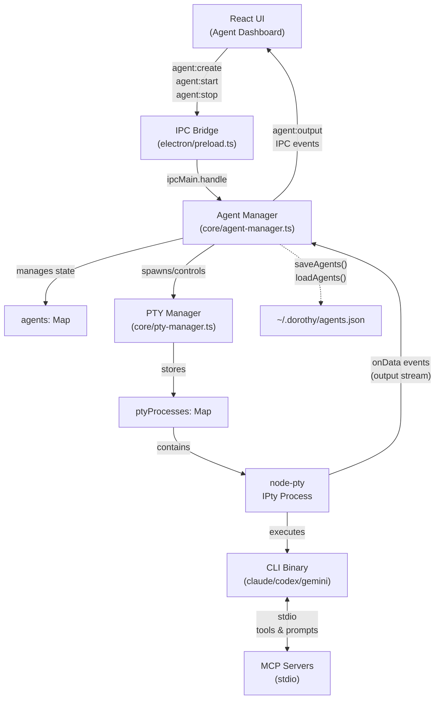
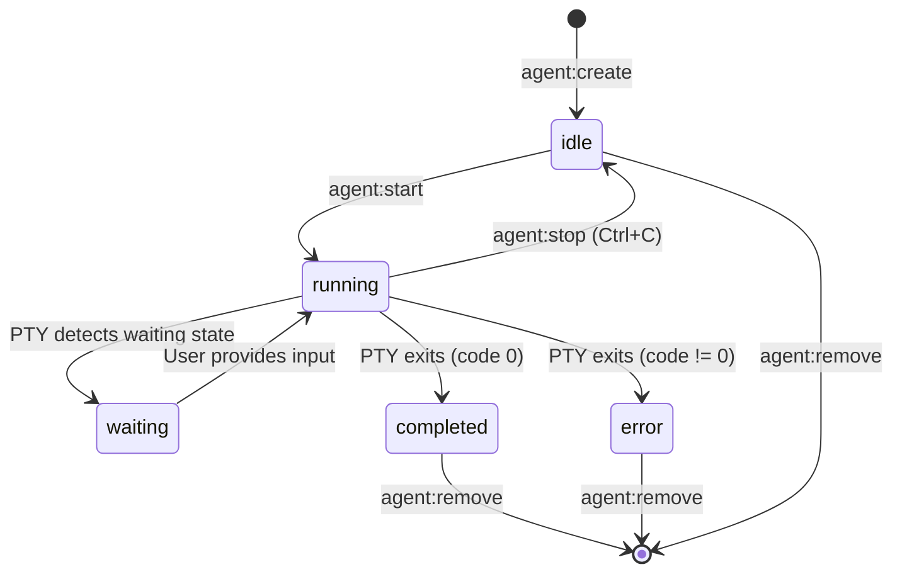
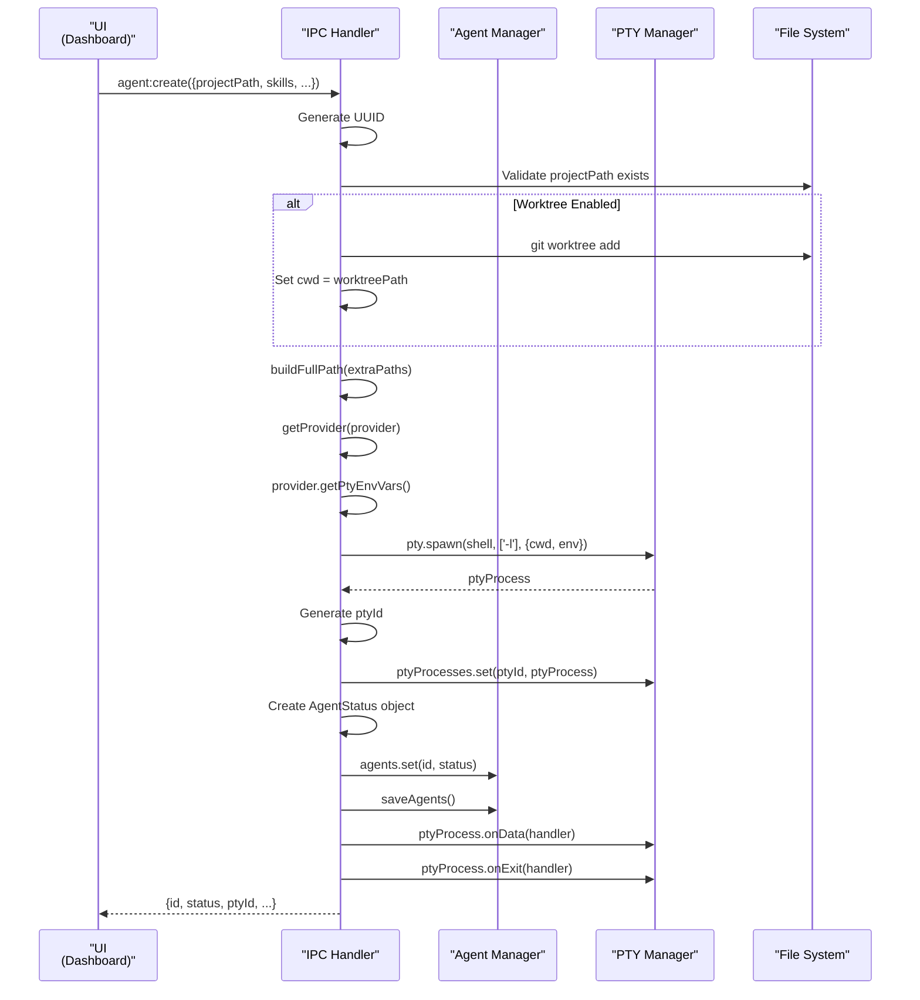
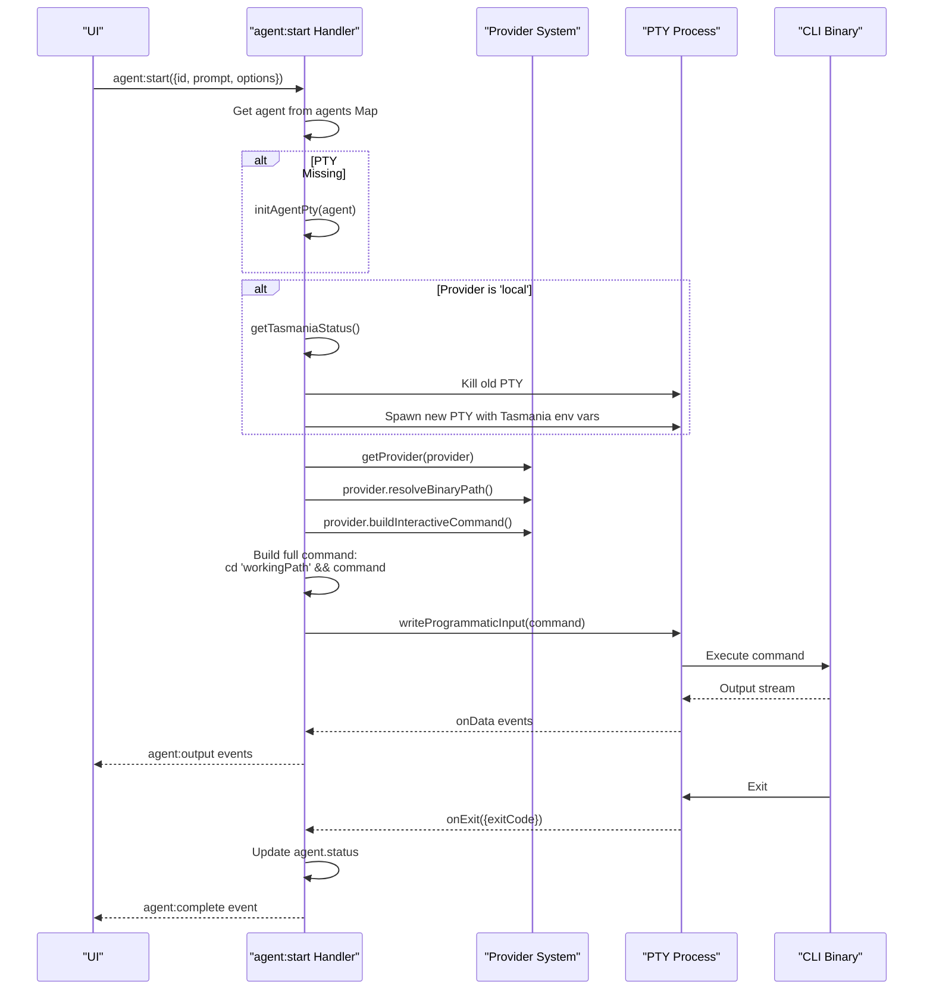

<!-- source: DeepWiki mcp.deepwiki.com · repo Charlie85270/Dorothy · page 3 Agents · fetched 2026-10-26 -->

# Agents

<details>
<summary>Relevant source files</summary>

The following files were used as context for generating this wiki page:

- [electron/core/agent-manager.ts](electron/core/agent-manager.ts)
- [electron/handlers/ipc-handlers.ts](electron/handlers/ipc-handlers.ts)
- [electron/main.ts](electron/main.ts)
- [electron/preload.ts](electron/preload.ts)
- [src/components/Settings/index.ts](src/components/Settings/index.ts)
- [src/types/electron.d.ts](src/types/electron.d.ts)

</details>


Agents are the core execution units in Dorothy. An agent represents an autonomous AI assistant running in a dedicated pseudo-terminal (PTY) process, communicating with AI providers (Claude, Codex, Gemini, or local LLMs) and equipped with skills to perform tasks in a specific project context.

This page covers agent architecture, lifecycle, configuration, and execution mechanics. For information about the MCP tools available to agents, see [MCP Ecosystem](#4). For UI elements related to agent management, see [Agent Dashboard](#5.2).

---

## Agent Architecture

Agents in Dorothy follow a PTY-based architecture where each agent runs as an isolated process with its own terminal session.

### Core Components



**Sources:** [electron/core/agent-manager.ts:1-356](), [electron/core/pty-manager.ts:1-100](), [electron/handlers/ipc-handlers.ts:156-775]()

### AgentStatus Data Structure

Each agent is represented by an `AgentStatus` object containing its complete state:

| Field | Type | Description |
|-------|------|-------------|
| `id` | `string` | Unique UUID identifier |
| `status` | `'idle' \| 'running' \| 'completed' \| 'error' \| 'waiting'` | Current execution state |
| `projectPath` | `string` | Primary project directory |
| `secondaryProjectPath` | `string?` | Optional additional project mounted via `--add-dir` |
| `worktreePath` | `string?` | Git worktree path if worktree mode enabled |
| `branchName` | `string?` | Git branch name for worktree |
| `skills` | `string[]` | List of enabled skill names |
| `currentTask` | `string?` | Current task prompt (first 100 chars) |
| `output` | `string[]` | Terminal output buffer (last 100 lines) |
| `lastActivity` | `string` | ISO timestamp of last activity |
| `error` | `string?` | Error message if status is 'error' |
| `ptyId` | `string?` | Reference to PTY process ID (runtime only) |
| `character` | `AgentCharacter?` | Visual character representation |
| `name` | `string?` | Human-readable agent name |
| `pathMissing` | `boolean?` | True if project path no longer exists |
| `skipPermissions` | `boolean?` | Use `--dangerously-skip-permissions` flag |
| `provider` | `AgentProvider?` | Provider: `'claude' \| 'codex' \| 'gemini' \| 'local'` |
| `localModel` | `string?` | Tasmania model name when provider is 'local' |
| `obsidianVaultPaths` | `string[]?` | Obsidian vaults mounted as read-only |

**Sources:** [src/types/electron.d.ts:115-135](), [electron/types.ts]()

---

## Agent Lifecycle

Agents transition through well-defined states during their lifetime:

### State Diagram



**Sources:** [electron/core/agent-manager.ts:40-139](), [electron/handlers/ipc-handlers.ts:380-589]()

### State Transitions

- **idle**: Agent created but not executing any task. PTY exists but shell is at prompt.
- **running**: Agent actively executing a task. CLI process running.
- **waiting**: Agent needs user input (detected by status detection hooks).
- **completed**: Task finished successfully (PTY exit code 0).
- **error**: Task failed (PTY exit code non-zero).

**Sources:** [electron/core/agent-manager.ts:40-139]()

---

## Agent Creation Flow

When a user creates a new agent, the following sequence executes:



**Sources:** [electron/handlers/ipc-handlers.ts:172-377]()

### Creation Parameters

Agents are created via the `agent:create` IPC handler with the following configuration:

```typescript
{
  projectPath: string;              // Primary working directory
  skills: string[];                 // Enabled skills (e.g., ["git", "github"])
  worktree?: {                      // Git worktree configuration
    enabled: boolean;
    branchName: string;
  };
  character?: AgentCharacter;       // Visual representation
  name?: string;                    // Human-readable name
  secondaryProjectPath?: string;    // Additional project via --add-dir
  skipPermissions?: boolean;        // Skip permission prompts
  provider?: AgentProvider;         // 'claude' | 'codex' | 'gemini' | 'local'
  localModel?: string;              // Tasmania model name
  obsidianVaultPaths?: string[];    // Read-only Obsidian vaults
}
```

**Sources:** [electron/handlers/ipc-handlers.ts:172-183](), [electron/preload.ts:45-56]()

### PTY Initialization

Each agent spawns a PTY process using the `node-pty` library:

1. **Shell Selection**: Uses `/bin/bash` with `-l` (login shell) flag
2. **Working Directory**: Set to `worktreePath` (if enabled) or `projectPath`
3. **Environment Variables**: Provider-specific env vars injected
4. **PATH Construction**: Includes user-configured CLI paths via `buildFullPath()`

**Key Environment Variables:**

- `CLAUDE_AGENT_ID`: Agent's unique ID
- `CLAUDE_PROJECT_PATH`: Project path
- `CLAUDE_SKILLS`: Comma-separated skill names
- `CLAUDE_CODE_ADDITIONAL_DIRECTORIES_CLAUDE_MD`: Enables loading CLAUDE.md from `--add-dir` directories
- **Local Provider Only:**
  - `ANTHROPIC_BASE_URL`: Tasmania server endpoint (without `/v1` suffix)
  - `ANTHROPIC_MODEL`: Local model name
  - `CLAUDE_CODE_DISABLE_NONESSENTIAL_TRAFFIC`: Disables telemetry

**Sources:** [electron/handlers/ipc-handlers.ts:244-304](), [electron/core/agent-manager.ts:223-355]()

---

## Agent Execution Model

### Starting an Agent

The `agent:start` handler builds and executes a CLI command in the agent's PTY:



**Sources:** [electron/handlers/ipc-handlers.ts:380-589]()

### Command Construction

The CLI command is built by the provider's `buildInteractiveCommand()` method. For Claude provider:

```
claude [--dangerously-skip-permissions] [--verbose] \
  [--mcp-config ~/.claude/mcp.json] \
  [--system-prompt /path/to/super-agent-instructions.md] \
  [--add-dir secondaryProjectPath] \
  [--add-dir obsidianVault1] \
  'PROMPT_WITH_SKILLS'
```

**Prompt Enhancement**: If skills are configured, the prompt is prefixed with:
```
[IMPORTANT: Use these skills for this session: skill1, skill2. 
 Invoke them with /<skill-name> when relevant to the task.] {original prompt}
```

**Sources:** [electron/handlers/ipc-handlers.ts:516-559](), [electron/providers/claude.ts]()

### Local Provider Special Handling

When `provider` is `'local'`, the handler recreates the PTY with Tasmania environment variables baked into the process environment:

1. Check Tasmania status via `getTasmaniaStatus()`
2. Kill existing PTY
3. Spawn new PTY with `ANTHROPIC_BASE_URL` and `ANTHROPIC_MODEL` env vars
4. Re-attach event handlers
5. Continue with command execution

**Rationale**: Writing `export ...` to a running shell is racy. Baking vars into `pty.spawn()` guarantees they're in the environment from the start.

**Sources:** [electron/handlers/ipc-handlers.ts:402-510]()

---

## Provider System

Dorothy supports multiple AI provider backends through a provider abstraction layer:

### Provider Interface

Each provider implements:
- `id`: Provider identifier (`'claude' | 'codex' | 'gemini' | 'local'`)
- `resolveBinaryPath()`: Returns CLI binary path
- `buildInteractiveCommand()`: Constructs CLI command with flags
- `getPtyEnvVars()`: Returns environment variables for PTY
- `getSkillDirectories()`: Returns skill installation directories
- `getInstalledSkills()`: Returns list of installed skills
- `getMcpConfigStrategy()`: Returns `'flag'` or `'env'` for MCP config passing

**Sources:** [electron/providers/index.ts](), [electron/providers/claude.ts]()

### Supported Providers

| Provider | Binary | MCP Strategy | Notes |
|----------|--------|--------------|-------|
| `claude` | `claude` CLI | `'flag'` | Default provider, uses `~/.claude/mcp.json` |
| `codex` | `codex` CLI | `'flag'` | Uses `~/.codex/mcp.json` |
| `gemini` | `gemini` CLI | `'flag'` | Uses `~/.gemini/mcp.json` |
| `local` | `claude` CLI | `'flag'` | Uses Tasmania + Claude CLI with env vars |

**Sources:** [electron/providers/index.ts](), [electron/handlers/ipc-handlers.ts:398-463]()

### Provider Selection

Providers are selected in order of precedence:
1. `agent.provider` (agent-level configuration)
2. `options.provider` (start-time override)
3. `'claude'` (default fallback)

**Sources:** [electron/handlers/ipc-handlers.ts:398-399]()

---

## Agent Management Operations

### Update Agent

The `agent:update` handler allows modifying agent properties without recreating:

**Updatable Fields:**
- `skills`: Update enabled skills list
- `secondaryProjectPath`: Add/remove secondary project
- `skipPermissions`: Toggle permission prompts
- `name`: Change agent name
- `character`: Change visual representation

**Sources:** [electron/handlers/ipc-handlers.ts:612-652]()

### Stop Agent

Stopping an agent sends Ctrl+C (`\x03`) to the PTY and updates status to `'idle'`:

```typescript
ptyProcess.kill();
agent.status = 'idle';
agent.currentTask = undefined;
agent.ptyId = undefined;
```

**Sources:** [electron/handlers/ipc-handlers.ts:655-680]()

### Remove Agent

Removing an agent:
1. Kills PTY process
2. Removes git worktree (if exists) via `git worktree remove --force`
3. Deletes agent from `agents` Map
4. Saves updated agents to disk

**Sources:** [electron/handlers/ipc-handlers.ts:683-712]()

### Send Input

Direct input to agent's PTY via `agent:input`:

```typescript
ptyProcess.write(input);
```

**Sources:** [electron/handlers/ipc-handlers.ts:741-756]()

---

## Data Persistence

### Storage File

Agents are persisted to `~/.dorothy/agents.json` using JSON serialization.

**Persistence Strategy:**
- **On Save**: Output buffer trimmed to last 100 lines
- **Running Agents**: Status changed to `'idle'` on save
- **PTY IDs**: Not persisted (runtime-only)
- **Backup**: Previous state saved to `agents.backup.json` before overwrite

**Sources:** [electron/core/agent-manager.ts:141-170]()

### Loading from Disk

On app startup, `loadAgents()` reads `agents.json`:

1. Parse JSON array
2. Validate project paths exist (set `pathMissing` flag if not)
3. Reset status to `'idle'`
4. Clear `ptyId` (PTY recreated on demand)
5. Store in `agents` Map

**Backup Recovery**: If `agents.json` is empty or corrupted, restores from `agents.backup.json`.

**Sources:** [electron/core/agent-manager.ts:172-221](), [electron/main.ts:306]()

### Agent Restoration

When accessing a restored agent (e.g., `agent:get` or `agent:start`), if the agent has no PTY:

```typescript
if (!agent.ptyId || !ptyProcesses.has(agent.ptyId)) {
  const ptyId = await initAgentPty(agent);
  agent.ptyId = ptyId;
}
```

This lazy initialization recreates the PTY on demand.

**Sources:** [electron/handlers/ipc-handlers.ts:389-395](), [electron/handlers/ipc-handlers.ts:597-601]()

---

## Git Worktree Support

Agents can operate in isolated git worktrees, enabling parallel work on different branches:

### Worktree Creation

When `worktree.enabled` is true during creation:

1. Validate branch name (alphanumeric + `._-/`)
2. Create `.worktrees/` directory in project root
3. Check if branch exists:
   - **Exists**: `git worktree add path branch`
   - **New**: `git worktree add -b branch path`
4. Set `agent.worktreePath` to worktree directory
5. Use worktree path as PTY working directory

**Sources:** [electron/handlers/ipc-handlers.ts:198-242]()

### Worktree Cleanup

On `agent:remove`, if worktree exists:

```bash
git worktree remove 'worktreePath' --force
```

**Sources:** [electron/handlers/ipc-handlers.ts:694-704]()

---

## Skills System

Skills extend agent capabilities by providing specialized tools and commands.

### Skill Configuration

- **World-Builder Skill**: Always included automatically (`world-builder`)
- **User Skills**: Specified during agent creation or via `agent:update`
- **Environment Variable**: Skills passed as comma-separated list in `CLAUDE_SKILLS`

**Sources:** [electron/handlers/ipc-handlers.ts:267-268](), [electron/handlers/ipc-handlers.ts:409]()

### Skill Installation

Skills are installed via the Skills section in Settings:

1. User provides repo URL (format: `owner/repo` or `owner/repo/skill-name`)
2. System spawns `npx skills add https://github.com/owner/repo [--skill skill-name]`
3. Interactive PTY captures output and user input
4. Skills installed to provider-specific directories (e.g., `~/.claude/skills/`)

**Sources:** [electron/handlers/ipc-handlers.ts:779-892]()

### Multi-Provider Skill Linking

Skills can be linked from Claude to other providers via `skill:link-to-provider`:

```typescript
// Source: ~/.claude/skills/skill-name
// Target: ~/.codex/skills/skill-name (symlink)
fs.symlinkSync(sourcePath, targetPath, 'dir');
```

**Sources:** [electron/handlers/ipc-handlers.ts:924-967]()

---

## Super Agent

The "Super Agent" is a special orchestration agent with access to all MCP tools for remote control via Telegram/Slack.

### Identification

An agent is a Super Agent if:
```typescript
agent.name?.toLowerCase().includes('super agent') ||
agent.name?.toLowerCase().includes('orchestrator')
```

**Sources:** [electron/handlers/ipc-handlers.ts:522-523]()

### Special Handling

- **System Prompt**: Loads `~/.dorothy/super-agent-instructions.md`
- **Output Buffering**: Terminal output captured to `superAgentOutputBuffer`
- **Telegram Integration**: Sends responses back to Telegram on completion
- **Notifications**: Suppressed for Super Agent to avoid spam

**Sources:** [electron/handlers/ipc-handlers.ts:537-543](), [electron/core/agent-manager.ts:90-131]()

---

## Event Streaming

Agents communicate with the UI through IPC events:

### Event Types

| Event | Payload | Description |
|-------|---------|-------------|
| `agent:output` | `{agentId, ptyId, data, timestamp}` | Terminal output chunk |
| `agent:status` | `{agentId, status, timestamp}` | Status change |
| `agent:complete` | `{agentId, ptyId, exitCode, timestamp}` | Task completion |

**Sources:** [electron/handlers/ipc-handlers.ts:347-354](), [electron/handlers/ipc-handlers.ts:365-371]()

### Output Buffer

Each agent maintains an output buffer:
- **Runtime**: Unbounded (all output stored)
- **Persistence**: Last 100 lines saved to disk
- **Transmission**: Streamed to UI in real-time via IPC

**Sources:** [electron/core/agent-manager.ts:149-155]()

---

## Notification System

Agents trigger notifications on state changes:

### Notification Logic

Notifications fire after a 5-second delay to avoid spam during rapid state transitions:

```typescript
const timeoutId = setTimeout(() => {
  if (newStatus === 'waiting' && appSettings.notifyOnWaiting) {
    sendNotification(/* ... *);
  }
  if (newStatus === 'completed' && appSettings.notifyOnComplete) {
    sendNotification(/* ... *);
  }
  if (newStatus === 'error' && appSettings.notifyOnError) {
    sendNotification(/* ... *);
  }
}, 5000);
```

**Debouncing**: If status changes again within 5 seconds, previous timeout is cleared.

**Sources:** [electron/core/agent-manager.ts:40-139]()

### Notification Channels

- **Desktop**: Native Electron notifications
- **Telegram**: Via Telegram bot (if enabled)
- **Slack**: Via Slack bot (if enabled)

**Sources:** [electron/core/agent-manager.ts:92-131]()

---

## Agent Storage Schema

### In-Memory Representation

```typescript
// Global agents Map
const agents: Map<string, AgentStatus> = new Map();

// PTY processes Map
const ptyProcesses: Map<string, IPty> = new Map();
```

**Sources:** [electron/core/agent-manager.ts:14](), [electron/core/pty-manager.ts]()

### On-Disk Format

```json
[
  {
    "id": "uuid-v4",
    "status": "idle",
    "projectPath": "/path/to/project",
    "secondaryProjectPath": "/path/to/docs",
    "worktreePath": "/path/to/project/.worktrees/feature-branch",
    "branchName": "feature-branch",
    "skills": ["git", "github", "world-builder"],
    "currentTask": null,
    "output": ["last", "100", "lines"],
    "lastActivity": "2024-01-15T10:30:00.000Z",
    "character": "robot",
    "name": "My Agent",
    "skipPermissions": false,
    "provider": "claude",
    "obsidianVaultPaths": ["/path/to/vault"]
  }
]
```

**Sources:** [electron/core/agent-manager.ts:149-155]()

---

