# Page: Overview

# Overview

<details>
<summary>Relevant source files</summary>

The following files were used as context for generating this wiki page:

- [README.md](README.md)
- [__tests__/mcp/mcp-socialdata.test.ts](__tests__/mcp/mcp-socialdata.test.ts)
- [__tests__/mcp/mcp-vault.test.ts](__tests__/mcp/mcp-vault.test.ts)
- [electron/main.ts](electron/main.ts)
- [landing/public/kanban.png](landing/public/kanban.png)
- [landing/public/ollama-icon.svg](landing/public/ollama-icon.svg)
- [landing/src/app/page.tsx](landing/src/app/page.tsx)
- [screenshots/kanban.png](screenshots/kanban.png)

</details>


Dorothy is an Electron-based desktop application that orchestrates multiple AI coding agents (Claude Code, Codex, Gemini, and local models) in parallel. It removes the single-agent limitation of CLI tools by enabling simultaneous execution of 10+ agents across different projects, with support for automations, remote control, task management, and persistent knowledge storage.

This page provides a high-level architectural overview of the entire system. For detailed information on specific subsystems, see:
- Agent lifecycle and execution: [Agents](#3)
- MCP tool ecosystem: [MCP Ecosystem](#4)
- User interface organization: [User Interface](#5)
- Build and release pipeline: [Build and Release](#12)

---

## Core Concepts

### Agents

An **agent** is a Claude CLI process running in an isolated PTY (pseudo-terminal) session. Each agent operates independently with its own project path, skills, and configuration. Agents are represented in code by the `AgentStatus` interface and managed by the `agents` Map in [electron/core/agent-manager.ts:34](). 

**Status states**: `idle` → `running` → `completed` / `error` / `waiting`

### MCP (Model Context Protocol)

MCP servers expose **tools** that agents can invoke to interact with external systems. Dorothy includes five MCP servers with 40+ tools:
- `mcp-orchestrator`: Agent management, messaging, scheduling, automations (26+ tools)
- `mcp-vault`: Document storage with full-text search (10 tools)
- `mcp-kanban`: Task management (8 tools)
- `mcp-telegram`: Media messaging (4 tools)
- `mcp-socialdata`: Twitter/X data access (5 tools)

Each MCP server runs as a separate Node.js process communicating via stdio.

### Super Agent

A specialized agent (`isSuperAgent()` returns true) with access to all MCP orchestrator tools. It delegates tasks to other agents, monitors progress, and handles remote control commands from Telegram/Slack.

Sources: [README.md:1-796](), [electron/main.ts:1-603](), [electron/core/agent-manager.ts:1-50]()

---

## System Architecture

Dorothy follows a **three-tier architecture**: Electron main process (backend services), renderer process (React UI), and external MCP ecosystem.

### Architecture Diagram: Main Components

```mermaid
graph TB
    subgraph ElectronApp["Electron Application"]
        MainProcess["Main Process<br/>(electron/main.ts)"]
        RendererProcess["Renderer Process<br/>(Next.js + React)"]
        PreloadScript["Preload Script<br/>(electron/preload.ts)"]
        
        MainProcess <-->|"IPC<br/>(ipcMain/ipcRenderer)"| PreloadScript
        PreloadScript <-->|"window.electronAPI"| RendererProcess
    end
    
    subgraph MainProcessServices["Main Process Services"]
        AgentManager["AgentManager<br/>(agent-manager.ts)<br/>agents Map, PTY lifecycle"]
        PTYManager["PTYManager<br/>(pty-manager.ts)<br/>ptyProcesses Map"]
        TelegramBot["TelegramBot<br/>(telegram-bot.ts)"]
        SlackBot["SlackBot<br/>(slack-bot.ts)"]
        APIServer["HTTP API Server<br/>(api-server.ts)<br/>Port 31415"]
        AutomationService["AutomationService<br/>(automation-handlers.ts)"]
        VaultDB["VaultDB<br/>(vault-db.ts)<br/>SQLite + FTS5"]
        UpdateChecker["UpdateChecker<br/>(update-checker.ts)<br/>electron-updater"]
    end
    
    subgraph MCPServers["MCP Servers (stdio)"]
        MCPOrch["mcp-orchestrator<br/>src/tools/*.ts<br/>26+ tools"]
        MCPTelegram["mcp-telegram<br/>src/index.ts<br/>4 tools"]
        MCPKanban["mcp-kanban<br/>src/index.ts<br/>8 tools"]
        MCPVault["mcp-vault<br/>src/index.ts<br/>10 tools"]
        MCPSocial["mcp-socialdata<br/>src/index.ts<br/>5 tools"]
    end
    
    subgraph RendererPages["Renderer Pages (src/app)"]
        AgentsDashboard["agents/page.tsx"]
        KanbanBoard["kanban/page.tsx"]
        AutomationsPage["automations/page.tsx"]
        VaultPage["vault/page.tsx"]
        SettingsPage["settings/page.tsx"]
    end
    
    MainProcess --> AgentManager
    MainProcess --> PTYManager
    MainProcess --> TelegramBot
    MainProcess --> SlackBot
    MainProcess --> APIServer
    MainProcess --> AutomationService
    MainProcess --> VaultDB
    MainProcess --> UpdateChecker
    
    RendererProcess --> AgentsDashboard
    RendererProcess --> KanbanBoard
    RendererProcess --> AutomationsPage
    RendererProcess --> VaultPage
    RendererProcess --> SettingsPage
    
    PTYManager -->|"spawns node-pty"| ClaudeCLI["claude CLI<br/>per agent"]
    ClaudeCLI <-->|stdio| MCPOrch
    ClaudeCLI <-->|stdio| MCPTelegram
    ClaudeCLI <-->|stdio| MCPKanban
    ClaudeCLI <-->|stdio| MCPVault
    ClaudeCLI <-->|stdio| MCPSocial
    
    MCPOrch -->|HTTP| APIServer
```

Sources: [electron/main.ts:13-603](), [README.md:575-645]()

### Tier Breakdown

| Tier | Technology | Primary Responsibilities | Key Files |
|------|-----------|-------------------------|-----------|
| **Main Process** | Node.js + Electron | Service orchestration, agent lifecycle, PTY management, IPC handlers | [electron/main.ts](), [electron/core/agent-manager.ts](), [electron/core/pty-manager.ts]() |
| **Renderer Process** | Next.js 14 + React 19 | User interface, state management, real-time updates | [src/app/]() pages, [src/components/]() |
| **MCP Ecosystem** | @modelcontextprotocol/sdk | Tool handlers, external API integration, data persistence | [mcp-orchestrator/](), [mcp-vault/](), [mcp-kanban/]() |

Sources: [electron/main.ts:1-603](), [README.md:575-645]()

---

## Data Flow: Agent Execution Pipeline

### Sequence: User Creates and Starts Agent

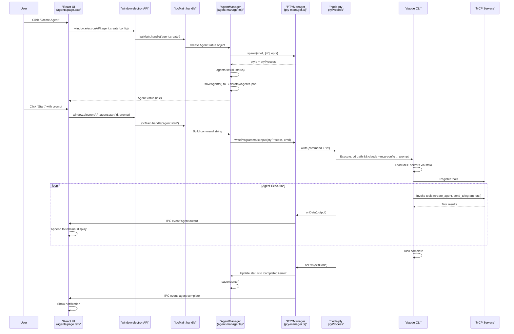

Sources: [electron/main.ts:214-265](), [electron/handlers/ipc-handlers.ts](), [electron/core/agent-manager.ts:1-50](), [electron/core/pty-manager.ts:1-50]()

---

## Key Components

### Agent Manager

**Purpose**: Maintains agent state, orchestrates PTY lifecycle, handles status transitions.

**Core Data Structures**:
- `agents: Map<string, AgentStatus>` — Global agent registry [electron/core/agent-manager.ts:34]()
- `ptyProcesses: Map<string, IPty>` — Active PTY sessions [electron/core/pty-manager.ts:44]()

**Key Functions**:
| Function | Location | Purpose |
|----------|----------|---------|
| `initAgentPty()` | [electron/core/agent-manager.ts:36]() | Spawns PTY, attaches event handlers |
| `loadAgents()` | [electron/core/agent-manager.ts:34]() | Loads persisted state from `~/.dorothy/agents.json` |
| `saveAgents()` | [electron/core/agent-manager.ts:35]() | Persists state to disk |
| `handleStatusChangeNotification()` | [electron/core/agent-manager.ts:37]() | Triggers notifications on status changes |

Sources: [electron/core/agent-manager.ts:1-50](), [electron/main.ts:32-40]()

### PTY Manager

**Purpose**: Manages pseudo-terminal sessions using `node-pty`.

**Process Lifecycle**:
1. `pty.spawn(shell, ['-l'], { cwd, env })` — Spawn login shell [electron/main.ts:410-421]()
2. `ptyProcess.onData()` — Stream output to UI via IPC [electron/main.ts:443-456]()
3. `ptyProcess.onExit()` — Detect completion, update status [electron/main.ts:458-481]()
4. `ptyProcess.write()` — Send input programmatically [electron/core/pty-manager.ts:48]()

**Additional PTY Collections**:
- `quickPtyProcesses` — One-off command executions [electron/main.ts:44]()
- `skillPtyProcesses` — Skill installation processes [electron/main.ts:45]()
- `pluginPtyProcesses` — Plugin installation processes [electron/main.ts:46]()

Sources: [electron/core/pty-manager.ts:43-49](), [electron/main.ts:410-481]()

### IPC Communication Layer

**Architecture**: Type-safe bridge between main and renderer processes.

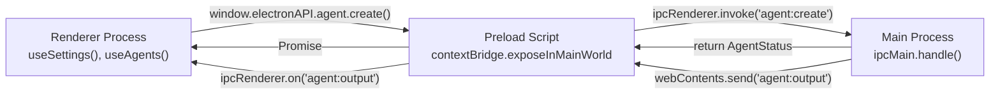

**Handler Registration Pattern**:
```typescript
// electron/main.ts:318-319
const deps = createIpcDependencies();
registerIpcHandlers(deps);
```

**Key Handler Modules**:
| Module | Handlers | Purpose |
|--------|----------|---------|
| `ipc-handlers.ts` | `agent:create`, `agent:start`, `agent:stop`, etc. | Agent CRUD operations |
| `scheduler-handlers.ts` | `scheduler:list`, `scheduler:create`, etc. | Recurring task management |
| `automation-handlers.ts` | `automation:list`, `automation:create`, etc. | Automation CRUD |
| `kanban-handlers.ts` | `kanban:list`, `kanban:create`, etc. | Task board operations |
| `vault-handlers.ts` | `vault:list`, `vault:create`, etc. | Document storage |

Sources: [electron/handlers/ipc-handlers.ts:82-265](), [electron/main.ts:82-91](), [electron/preload.ts]()

### Services Layer

**HTTP API Server**: Express server on port 31415 for MCP tool access [electron/services/api-server.ts:52]()

**Telegram Bot**: `node-telegram-bot-api` integration with command handlers [electron/services/telegram-bot.ts:54-59]()

**Slack Bot**: `@slack/bolt` Socket Mode integration [electron/services/slack-bot.ts:62-65]()

**Automation Service**: Polls GitHub (via `gh` CLI) and JIRA (REST API), spawns ephemeral agents [electron/handlers/automation-handlers.ts:84]()

**Vault Database**: `better-sqlite3` with FTS5 full-text search [electron/services/vault-db.ts:89]()

Sources: [electron/services/api-server.ts:52](), [electron/services/telegram-bot.ts:54-59](), [electron/services/slack-bot.ts:62-65](), [electron/services/vault-db.ts:89]()

---

## Configuration and Storage

### Configuration Files

| Path | Purpose | Format | Managed By |
|------|---------|--------|------------|
| `~/.dorothy/app-settings.json` | Dorothy preferences, API keys, integration tokens | JSON | Settings UI [src/app/settings/]() |
| `~/.dorothy/cli-paths.json` | CLI tool path overrides | JSON | CLI Paths settings section |
| `~/.claude/settings.json` | Claude Code configuration, MCP servers | JSON | Permissions settings section |

Sources: [electron/constants.ts:22](), [README.md:726-733]()

### Persistent Data

| Path | Contents | Persistence Strategy |
|------|----------|---------------------|
| `~/.dorothy/agents.json` | All agent states, PTY IDs, output history | Write on create/update/delete [electron/main.ts:107-172]() |
| `~/.dorothy/kanban-tasks.json` | Task board state, column assignments | Write on task mutations |
| `~/.dorothy/automations.json` | Automation definitions, schedules, processed item hashes | Write on CRUD operations |
| `~/.dorothy/vault.db` | SQLite database with `documents`, `folders`, `attachments` tables + FTS5 index | Transactional writes via `better-sqlite3` |
| `~/.claude/projects/*/memory/` | Claude Code native memory files (`MEMORY.md`, topic files) | Managed by Claude CLI |

Sources: [README.md:735-752](), [electron/main.ts:107-172](), [electron/services/vault-db.ts:89]()

### Storage Initialization

**Data Directory Setup** [electron/main.ts:293-303]():
```typescript
ensureDataDir();              // Create ~/.dorothy/ if needed
ensureDorothyClaudeMd();      // Write CLAUDE.md system prompt
migrateFromClaudeManager();   // Migrate legacy data
loadAgents();                 // Load agents.json
initVaultDb();                // Initialize SQLite schema
```

Sources: [electron/main.ts:293-303](), [electron/utils.ts:99-102]()

---

## Technology Stack

### Core Technologies

| Category | Technology | Version | Usage |
|----------|-----------|---------|-------|
| **Desktop Runtime** | Electron | 33 | Application shell, native APIs |
| **UI Framework** | React | 19 | Component architecture |
| **Meta-Framework** | Next.js | 14 (App Router) | Routing, API routes, SSR |
| **Terminal Emulation** | xterm.js | 5.x | UI terminal display |
| **PTY Management** | node-pty | 1.1.x | Pseudo-terminal spawning |
| **Database** | better-sqlite3 | 11.x | Vault storage |
| **State Management** | Zustand | 5.x | Client-side state |
| **Styling** | Tailwind CSS | 4.x | Utility-first CSS |
| **MCP SDK** | @modelcontextprotocol/sdk | 1.0.x | Tool handlers, stdio transport |

Sources: [README.md:705-722](), [package.json]()

### Build and Distribution

**Build Script**: `npm run electron:build` [README.md:551-558]()

**Pipeline Stages**:
1. Next.js production build (excludes API routes for Electron)
2. TypeScript compilation (`tsc` for main process + MCP servers)
3. MCP module builds (7 independent `tsc` invocations)
4. `electron-builder` packaging (DMG for macOS, installer for Windows)
5. macOS notarization via [scripts/notarize.js]()

**Output Artifacts**:
- macOS: `release/mac-arm64/Dorothy.app` (Apple Silicon) or `release/mac/Dorothy.app` (Intel)
- DMG installer for distribution
- ZIP archive for direct download

Sources: [README.md:548-572](), [electron-builder.json5]()

### Update Mechanism

**Auto-Update System**: `electron-updater` checks GitHub Releases [electron/services/update-checker.ts:90]()

**Update Flow**:
1. App checks for updates on startup (5s delay) [electron/main.ts:556-564]()
2. `checkForUpdates()` queries GitHub API [electron/services/update-checker.ts:90]()
3. Progress events sent to renderer via IPC: `app:update-available`, `app:update-progress`, `app:update-downloaded`
4. UI shows download progress in Settings > General [src/app/settings/GeneralSection.tsx]()
5. User clicks "Restart & Install" to apply update

Sources: [electron/services/update-checker.ts:90-91](), [electron/main.ts:556-564]()

---

## Entry Points and Initialization

### Main Process Initialization Sequence

**Entry Point**: [electron/main.ts:293]()

```typescript
app.whenReady().then(async () => {
  ensureDataDir();                    // 1. Create ~/.dorothy/
  ensureDorothyClaudeMd();            // 2. Write CLAUDE.md
  migrateFromClaudeManager();         // 3. Migrate legacy data
  loadAgents();                       // 4. Load agents.json
  setupProtocolHandler();             // 5. Register dorothy:// protocol
  createWindow();                     // 6. Spawn BrowserWindow
  setUtilsMainWindow(getMainWindow());// 7. Set global window ref
  
  // Register all IPC handlers
  const deps = createIpcDependencies();
  registerIpcHandlers(deps);          // 8a. Agent handlers
  registerSchedulerHandlers(...);     // 8b. Scheduler handlers
  registerAutomationHandlers();       // 8c. Automation handlers
  registerKanbanHandlers(...);        // 8d. Kanban handlers
  registerVaultHandlers(...);         // 8e. Vault handlers
  
  initVaultDb();                      // 9. Initialize SQLite
  initKanbanAutomation(...);          // 10. Start task watcher
  initTelegramBot();                  // 11. Start Telegram bot
  initSlackBot(...);                  // 12. Start Slack bot
  initApiServer();                    // 13. Start HTTP API (port 31415)
  
  await setupMcpOrchestrator(...);    // 14. Setup MCP servers
  await configureStatusHooks();       // 15. Setup status hooks
  
  initAutoUpdater(...);               // 16. Setup auto-updater
  checkForUpdates();                  // 17. Check for updates
});
```

Sources: [electron/main.ts:293-567]()

### Renderer Initialization

**Entry Point**: [src/app/layout.tsx]()

**Key Providers**:
1. `ThemeProvider` — Dark mode management [src/components/theme-provider.tsx]()
2. Zustand stores — Agent state, settings state [src/store/]()
3. IPC event listeners — Real-time updates from main process

**Protected Routes**: All pages check for `window.electronAPI` presence to ensure Electron context.

Sources: [src/app/layout.tsx](), [src/store/]()

---

## Debugging and Development

### Development Mode

**Start Development Server**:
```bash
npm run electron:dev  # Concurrent Next.js dev server + Electron
```

**Features**:
- Hot reload for renderer changes
- DevTools enabled by default
- localhost certificate error bypassing [electron/main.ts:593-600]()

### Logging Patterns

**Main Process**: `console.log()` outputs to terminal
**Renderer Process**: Browser DevTools console
**PTY Output**: Streamed to UI via `agent:output` IPC events

### Common File Locations for Debugging

| Issue | Check Files |
|-------|-------------|
| Agent not starting | `~/.dorothy/agents.json`, PTY spawn logs in terminal |
| MCP tools not working | `~/.claude/settings.json` (MCP server registration) |
| Settings not persisting | `~/.dorothy/app-settings.json` |
| Vault queries failing | `~/.dorothy/vault.db` (use sqlite3 CLI) |
| Automation not triggering | `~/.dorothy/automations.json`, processed items hash |

Sources: [electron/main.ts:593-600](), [README.md:726-752]()

---

## Landing Page and Analytics

**Separate Next.js Application**: [landing/src/app/page.tsx:1-267]()

**Download Tracking**:
- `/api/download` endpoint redirects to GitHub Releases and logs downloads to Upstash Redis [landing/src/app/api/download/route.ts]()
- `/api/stats` endpoint returns total download count [landing/src/app/api/stats/route.ts]()

**Deployment**: Independent from Electron app, deployed as static site

Sources: [landing/src/app/page.tsx:1-267](), [README.md:1-5]()

---

# Page: Key Features

# Key Features

<details>
<summary>Relevant source files</summary>

The following files were used as context for generating this wiki page:

- [README.md](README.md)
- [__tests__/mcp/mcp-socialdata.test.ts](__tests__/mcp/mcp-socialdata.test.ts)
- [__tests__/mcp/mcp-vault.test.ts](__tests__/mcp/mcp-vault.test.ts)
- [electron/main.ts](electron/main.ts)
- [landing/public/kanban.png](landing/public/kanban.png)
- [landing/public/ollama-icon.svg](landing/public/ollama-icon.svg)
- [landing/src/app/page.tsx](landing/src/app/page.tsx)
- [screenshots/kanban.png](screenshots/kanban.png)

</details>


This page provides a comprehensive overview of Dorothy's core capabilities. Each feature is described with its primary use case, underlying implementation details, and relevant code locations. For detailed implementation architecture, see [System Architecture](#1.2). For setup and configuration of specific features, see [Settings](#5.3).

---

## Feature Overview

Dorothy provides 15 major feature areas organized into three tiers: **Agent Operations**, **Integrations & Automation**, and **Knowledge Management**.

### Feature Classification

| Category | Features |
|----------|----------|
| **Agent Operations** | Multi-Agent Management, Super Agent Orchestrator, Provider Abstraction, Skills & Plugins |
| **Integrations & Automation** | GitHub/JIRA Automations, Scheduler, Telegram Bot, Slack Bot, Google Workspace, SocialData/Twitter |
| **Knowledge Management** | Vault, Memory System, Kanban Board, Usage Tracking |
| **Visualization** | 3D Agent World, Agent Knowledge Graph |

**Sources:** [landing/src/app/page.tsx:117-151](), [README.md:9-28]()

---

## Feature Map: Natural Language to Code Entities

This diagram maps user-facing features to their primary implementation locations.

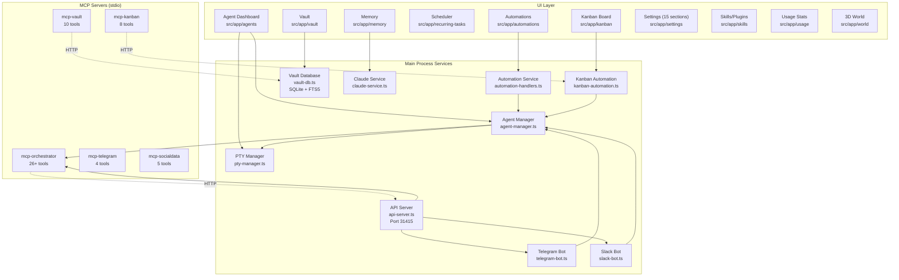

**Sources:** [electron/main.ts:1-603](), [README.md:647-701]()

---

## 1. Multi-Agent Management

Dorothy spawns and manages unlimited concurrent agents, each running in an isolated PTY (pseudo-terminal) session. Each agent is a `claude` CLI process with its own working directory, skills, and project context.

### Agent Lifecycle States

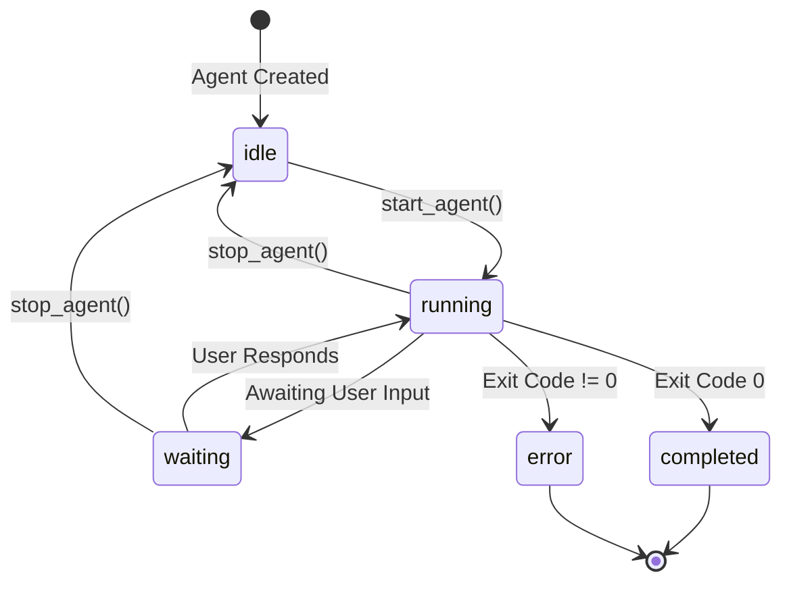

### Core Components

| Component | File | Purpose |
|-----------|------|---------|
| **Agent Manager** | [electron/core/agent-manager.ts:1-400]() | Agent state map (`Map<string, AgentStatus>`), lifecycle orchestration |
| **PTY Manager** | [electron/core/pty-manager.ts:1-200]() | Terminal multiplexing (`ptyProcesses`, `quickPtyProcesses`, `skillPtyProcesses`) |
| **IPC Handlers** | [electron/handlers/ipc-handlers.ts:1-600]() | Renderer ↔ main process communication for CRUD operations |

### Agent Properties

```typescript
interface AgentStatus {
  id: string;                    // UUID
  status: 'idle' | 'running' | 'waiting' | 'completed' | 'error';
  projectPath: string;           // Working directory
  skills: string[];              // Skill names (e.g., 'world-builder')
  output: string[];              // Terminal output buffer
  ptyId?: string;                // Reference to PTY process
  character?: string;            // Visual character (robot, wizard, etc.)
  name?: string;                 // Display name
  currentTask?: string;          // Active task description
  skipPermissions?: boolean;     // Autonomous mode flag
  worktreePath?: string;         // Git worktree override
  secondaryProjectPath?: string; // Additional --add-dir path
}
```

### Persistence

Agents persist to `~/.dorothy/agents.json` via `saveAgents()` [electron/core/agent-manager.ts:50-100](). State reloads on app startup via `loadAgents()` [electron/main.ts:306]().

**Sources:** [electron/core/agent-manager.ts:1-500](), [electron/core/pty-manager.ts:1-200](), [README.md:46-64]()

---

## 2. Super Agent (Orchestrator)

A special meta-agent with programmatic control over all other agents via MCP tools. It runs with access to `mcp-orchestrator` tools and is identified by name matching "super" (case-insensitive).

### Super Agent Identification

```typescript
// electron/utils.ts
function isSuperAgent(agent: AgentStatus): boolean {
  return agent.name?.toLowerCase().includes('super') ?? false;
}
```

### Orchestration Tools Available

The Super Agent has exclusive access to these MCP tools via `mcp-orchestrator`:

| Tool Category | Tools | Purpose |
|---------------|-------|---------|
| **Agent Management** | `list_agents`, `get_agent`, `create_agent`, `start_agent`, `send_message`, `stop_agent`, `remove_agent`, `wait_for_agent` | Full CRUD + monitoring |
| **Messaging** | `send_telegram`, `send_slack` | Remote notification |
| **Scheduler** | `list_scheduled_tasks`, `create_scheduled_task`, `run_scheduled_task` | Task automation |
| **Automations** | `create_automation`, `run_automation`, `get_automation_logs` | External source polling |

### Integration with Remote Control

When messages arrive via Telegram or Slack without direct commands, they route to the Super Agent's PTY. The agent responds using `send_telegram` or `send_slack` tools [electron/services/telegram-bot.ts:200-400](), [electron/services/slack-bot.ts:100-300]().

**Sources:** [electron/utils.ts:100-150](), [electron/services/telegram-bot.ts:1-600](), [mcp-orchestrator/src/tools/agents.ts:1-300](), [README.md:66-76]()

---

## 3. Automations

Poll-based workflow engine that monitors external sources (GitHub, JIRA), filters items, and spawns ephemeral agents to process each item autonomously.

### Automation Pipeline Flow

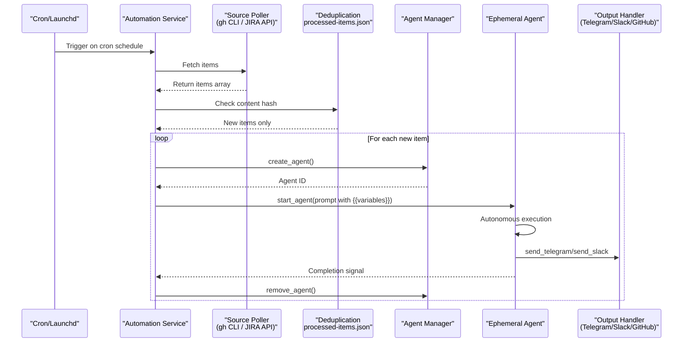

### Supported Sources

| Source | Implementation | Polling Method |
|--------|---------------|----------------|
| **GitHub** | [electron/handlers/automation-handlers.ts:100-300]() | `gh` CLI (`gh pr list`, `gh issue list`) |
| **JIRA** | [electron/handlers/automation-handlers.ts:300-500]() | REST API v3 + JQL queries |
| Pipedrive | Planned | — |
| Twitter/RSS | Planned | — |

### Template Variables

Prompts and output templates support variable interpolation:

**GitHub Variables:** `{{title}}`, `{{url}}`, `{{author}}`, `{{body}}`, `{{labels}}`, `{{repo}}`, `{{number}}`, `{{type}}`

**JIRA Variables:** `{{key}}`, `{{summary}}`, `{{status}}`, `{{issueType}}`, `{{priority}}`, `{{assignee}}`, `{{reporter}}`, `{{url}}`, `{{body}}`

### Deduplication Strategy

Content hashing via SHA256 of item key + timestamp. Processed items store in `~/.dorothy/automations-processed.json` [electron/handlers/automation-handlers.ts:400-500]().

**Sources:** [electron/handlers/automation-handlers.ts:1-800](), [README.md:100-192]()

---

## 4. Kanban Task Management

SQLite-backed task board with automatic agent assignment based on skill matching. Tasks flow through four columns: `backlog` → `planned` → `ongoing` → `done`.

### Task-to-Agent Matching Algorithm

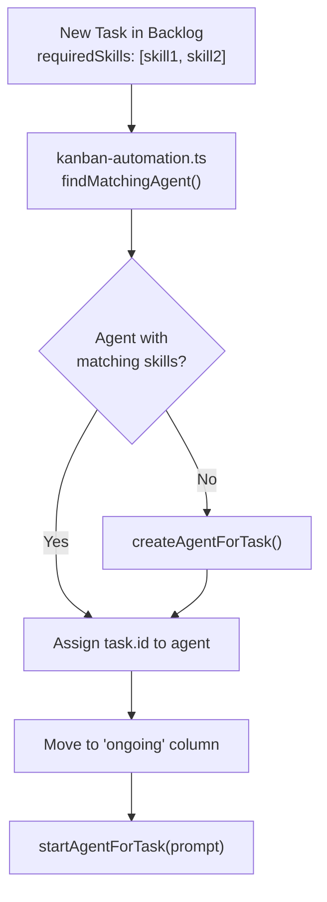

### Storage Schema

Tasks persist to `~/.dorothy/kanban-tasks.json`:

```typescript
interface KanbanTask {
  id: string;
  title: string;
  description: string;
  column: 'backlog' | 'planned' | 'ongoing' | 'done';
  priority: 'low' | 'medium' | 'high';
  progress: number;              // 0-100
  labels: string[];
  requiredSkills: string[];
  assignedAgentId?: string;
  projectPath?: string;
  createdAt: string;
  updatedAt: string;
  completedAt?: string;
  agentSummary?: string;
}
```

### MCP Tools for Programmatic Access

The `mcp-kanban` server exposes 8 tools [mcp-kanban/src/index.ts:1-500]():

- `list_tasks`, `get_task`, `create_task`, `move_task`
- `update_task_progress`, `mark_task_done`, `assign_task`, `delete_task`

**Sources:** [electron/services/kanban-automation.ts:1-300](), [electron/handlers/kanban-handlers.ts:1-400](), [README.md:195-224]()

---

## 5. Scheduler (Recurring Tasks)

Cron-based task runner using platform-native schedulers: `launchd` on macOS, `cron` on Linux. Tasks execute Claude CLI commands on a schedule.

### Platform Integration

| Platform | Scheduler | Config Location | Script Location |
|----------|-----------|----------------|-----------------|
| **macOS** | `launchd` | `~/Library/LaunchAgents/*.plist` | `~/.dorothy/scripts/*.sh` |
| **Linux** | `cron` | Crontab entries | `~/.dorothy/scripts/*.sh` |

### Task Definition

Tasks store in `~/.claude/schedules.json`:

```typescript
interface ScheduledTask {
  id: string;
  prompt: string;
  schedule: string;              // Cron expression (e.g., "0 9 * * *")
  projectPath: string;
  autonomous: boolean;           // --dangerously-skip-permissions flag
  enabled: boolean;
  createdAt: string;
  lastRun?: string;
}
```

### Cron Expression Format

```
┌─── minute (0-59)
│ ┌─── hour (0-23)
│ │ ┌─── day of month (1-31)
│ │ │ ┌─── month (1-12)
│ │ │ │ ┌─── day of week (0-7, Sunday=0,7)
* * * * *
```

### IPC Handler: Task Creation

[electron/handlers/scheduler-handlers.ts:50-200]() handles `scheduler:create-task`, generates shell script, and registers with OS scheduler.

**Sources:** [electron/handlers/scheduler-handlers.ts:1-400](), [README.md:227-261]()

---

## 6. Remote Control (Telegram & Slack)

Bidirectional bot integrations enabling agent control from mobile/desktop chat clients. Both bots support identical command sets.

### Bot Command Mapping

| Command | Handler | Action |
|---------|---------|--------|
| `/status`, `status` | [telegram-bot.ts:200-250]() | List all agents with status |
| `/agents`, `agents` | [telegram-bot.ts:250-300]() | Detailed agent list |
| `/start_agent`, `start` | [telegram-bot.ts:300-350]() | Create + start agent |
| `/stop_agent`, `stop` | [telegram-bot.ts:350-400]() | Stop running agent |
| `/usage`, `usage` | [telegram-bot.ts:400-450]() | Claude API usage stats |
| (text without command) | [telegram-bot.ts:500-600]() | Route to Super Agent |

### Telegram Media Support

The `mcp-telegram` server provides media upload tools [mcp-telegram/src/index.ts:1-300]():

- `send_telegram_photo` - Images
- `send_telegram_video` - Videos
- `send_telegram_document` - Files

### Slack Socket Mode Architecture

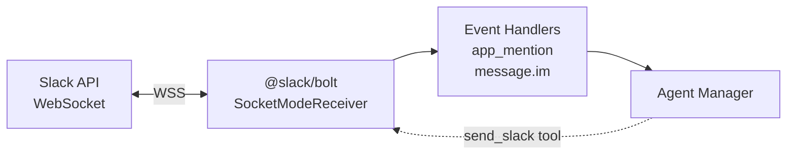

**Sources:** [electron/services/telegram-bot.ts:1-700](), [electron/services/slack-bot.ts:1-500](), [README.md:264-316]()

---

## 7. Vault (Document Management)

SQLite database with FTS5 (Full-Text Search) for persistent document storage accessible to all agents via MCP tools.

### Database Schema

```sql
-- electron/services/vault-db.ts
CREATE TABLE folders (
  id TEXT PRIMARY KEY,
  name TEXT NOT NULL,
  parent_id TEXT,
  created_at TEXT,
  updated_at TEXT
);

CREATE TABLE documents (
  id TEXT PRIMARY KEY,
  title TEXT NOT NULL,
  content TEXT,
  folder_id TEXT,
  author TEXT,
  agent_id TEXT,
  tags TEXT,                    -- JSON array
  created_at TEXT,
  updated_at TEXT,
  FOREIGN KEY (folder_id) REFERENCES folders(id)
);

CREATE TABLE attachments (
  id TEXT PRIMARY KEY,
  document_id TEXT NOT NULL,
  filename TEXT NOT NULL,
  mimetype TEXT,
  size INTEGER,
  file_path TEXT,
  created_at TEXT,
  FOREIGN KEY (document_id) REFERENCES documents(id)
);

CREATE VIRTUAL TABLE documents_fts USING fts5(
  title, content, tags,
  content='documents',
  content_rowid='rowid'
);
```

### MCP Tools (mcp-vault)

10 tools exposed via `mcp-vault` server [mcp-vault/src/index.ts:1-700]():

**Document Operations:**
- `vault_create_document` - Auto-creates folders if needed
- `vault_update_document` - Partial updates supported
- `vault_get_document` - Full content + attachments
- `vault_list_documents` - Filter by folder/tags
- `vault_delete_document` - Cascade delete attachments
- `vault_attach_file` - Binary file upload
- `vault_search` - FTS5 with Boolean operators

**Folder Operations:**
- `vault_create_folder` - Nested hierarchies
- `vault_list_folders` - Tree structure
- `vault_delete_folder` - Recursive option

### Search Query Syntax

Supports SQLite FTS5 query syntax:
- `report AND weekly` - Boolean AND
- `report OR analysis` - Boolean OR
- `report NOT draft` - Boolean NOT
- `"exact phrase"` - Phrase matching

**Sources:** [electron/services/vault-db.ts:1-500](), [mcp-vault/src/index.ts:1-700](), [README.md:319-347]()

---

## 8. Usage Tracking

Monitors Claude API consumption by parsing `~/.claude/statsig_metadata.json` and conversation history.

### Data Sources

| Source | File | Data Points |
|--------|------|-------------|
| **Statsig Metadata** | `~/.claude/statsig_metadata.json` | Total input/output tokens, API calls |
| **Project History** | `~/.claude/projects/*/history/*.json` | Per-conversation breakdowns |
| **Cache Stats** | Derived from metadata | Cache read/write tokens |

### Stats Computation

[electron/services/claude-service.ts:100-300]() aggregates:

```typescript
interface ClaudeStats {
  totalInputTokens: number;
  totalOutputTokens: number;
  totalCacheReadTokens: number;
  totalCacheWriteTokens: number;
  totalApiCalls: number;
  estimatedCost: number;        // Calculated from token counts
}
```

### UI Integration

[src/app/usage/page.tsx:1-400]() displays:
- Token usage charts (Recharts library)
- Cost breakdown by model tier (Sonnet/Opus/Haiku)
- Historical trends
- Per-project breakdowns

**Sources:** [electron/services/claude-service.ts:1-400](), [src/app/usage/page.tsx:1-500]()

---

## 9. Skills & Plugins

Extension system integrating with [skills.sh](https://skills.sh) marketplace and Claude Code's native plugin system.

### Skill Types

| Type | Installation | Detection |
|------|-------------|-----------|
| **Community Skills** | `claude install <skill>` | `~/.claude/skills/` directory scan |
| **MCP Servers** | Manual registration | `~/.claude/settings.json` parsing |
| **GWS Skills** | `npm install -g @googleworkspace/gws-*` | Global npm package scan |

### Skill Assignment to Agents

Skills attach via environment variable `CLAUDE_SKILLS=skill1,skill2` when spawning PTY [electron/core/agent-manager.ts:150-200]():

```typescript
const ptyProcess = pty.spawn(shell, ['-l'], {
  env: {
    ...process.env,
    CLAUDE_SKILLS: agent.skills.join(','),
    CLAUDE_AGENT_ID: agent.id,
  }
});
```

### Skill Discovery

[electron/handlers/ipc-handlers.ts:200-400]() scans:
1. `~/.claude/skills/*` - Community skills
2. `~/.claude/settings.json` - Installed plugins
3. `npm list -g` - GWS skills (match pattern `@googleworkspace/gws-*`)

**Sources:** [electron/handlers/ipc-handlers.ts:1-600](), [README.md:84-93]()

---

## 10. MCP Ecosystem

Five standalone MCP servers communicating via stdio, exposing 40+ tools to Claude CLI agents.

### Server Inventory

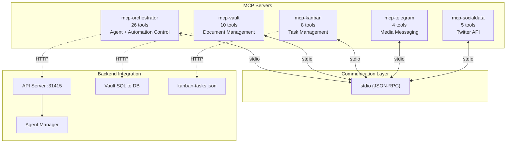

### Tool Count Breakdown

| Server | Tools | Primary Use Case |
|--------|-------|------------------|
| `mcp-orchestrator` | 26 | Agent lifecycle, messaging, scheduling, automations |
| `mcp-vault` | 10 | Document CRUD, folder management, full-text search |
| `mcp-kanban` | 8 | Task board operations, agent assignment |
| `mcp-telegram` | 4 | Media uploads (photo, video, document) |
| `mcp-socialdata` | 5 | Twitter search, user profiles, tweet details |

### Server Registration

Each agent's PTY spawns with `--mcp-config` pointing to dynamically generated config [electron/services/mcp-orchestrator.ts:50-200]():

```json
{
  "mcpServers": {
    "orchestrator": {
      "command": "node",
      "args": ["/path/to/mcp-orchestrator/build/index.js"]
    },
    "vault": {
      "command": "node",
      "args": ["/path/to/mcp-vault/build/index.js"]
    }
  }
}
```

**Sources:** [mcp-orchestrator/src/index.ts:1-200](), [mcp-vault/src/index.ts:1-100](), [mcp-kanban/src/index.ts:1-100](), [README.md:409-532]()

---

## 11. Settings Management (15 Sections)

Centralized configuration UI with 15 specialized sections, persisting to `~/.dorothy/app-settings.json` and `~/.claude/settings.json`.

### Settings Sections

| Section | Purpose | File |
|---------|---------|------|
| **General** | Auto-updates, default provider | [src/app/settings/general/page.tsx]() |
| **Terminal** | Font, theme, shell | [src/app/settings/terminal/page.tsx]() |
| **Obsidian** | Vault paths (read-only integration) | [src/app/settings/obsidian/page.tsx]() |
| **Git** | Worktree config | [src/app/settings/git/page.tsx]() |
| **Notifications** | Trigger settings (waiting/complete/error) | [src/app/settings/notifications/page.tsx]() |
| **Telegram** | Bot token, chat IDs, auth token | [src/app/settings/telegram/page.tsx]() |
| **Slack** | App token, bot token, channel ID | [src/app/settings/slack/page.tsx]() |
| **JIRA** | Domain, email, API token | [src/app/settings/jira/page.tsx]() |
| **SocialData** | API key | [src/app/settings/socialdata/page.tsx]() |
| **Tasmania** | Local AI server path | [src/app/settings/tasmania/page.tsx]() |
| **Google Workspace** | GWS CLI setup, OAuth | [src/app/settings/gws/page.tsx]() |
| **Permissions** | Claude permission defaults | [src/app/settings/permissions/page.tsx]() |
| **Skills** | Skill installation, marketplace | [src/app/settings/skills/page.tsx]() |
| **CLI Paths** | Tool path overrides | [src/app/settings/cli-paths/page.tsx]() |
| **System** | App info, diagnostics | [src/app/settings/system/page.tsx]() |

### Settings Persistence Strategy

[electron/handlers/ipc-handlers.ts:400-600]() separates concerns:

```typescript
// Dorothy-specific settings → ~/.dorothy/app-settings.json
{
  notificationsEnabled: boolean;
  telegramBotToken: string;
  jiraDomain: string;
  defaultProvider: 'claude' | 'codex' | 'gemini';
  // ... 40+ fields
}

// Claude Code settings → ~/.claude/settings.json
{
  permissions: { ... };
  mcpServers: { ... };
  plugins: [ ... ];
}

// CLI path overrides → ~/.dorothy/cli-paths.json
{
  claude: string;
  codex: string;
  gh: string;
  node: string;
  additionalPaths: string[];
}
```

**Sources:** [electron/handlers/ipc-handlers.ts:400-800](), [electron/main.ts:104-173]()

---

## 12. Google Workspace Integration

Registers `gws mcp` as an MCP server, exposing 10-80 Google API tools per service (Gmail, Drive, Sheets, Calendar, Docs).

### Setup Flow

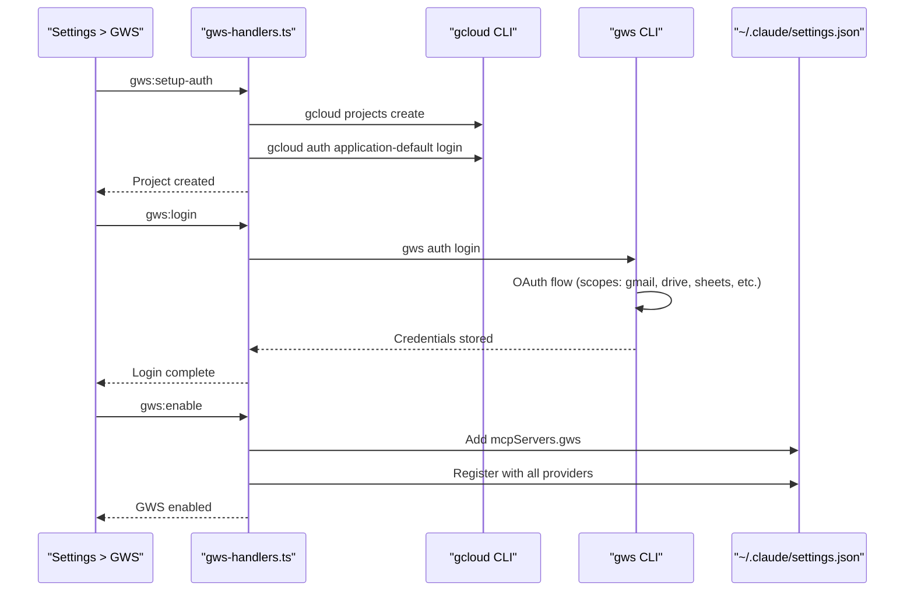

### Service Detection

[electron/handlers/gws-handlers.ts:100-300]() parses `gws service list` output to populate service badges:

```typescript
interface GWSService {
  name: string;              // "Gmail", "Drive", "Sheets"
  scopes: string[];          // OAuth scopes
  access: 'READ' | 'R/W';    // Derived from scope names
  toolCount: number;         // Parsed from CLI output
}
```

### MCP Server Config

```json
{
  "gws": {
    "command": "gws",
    "args": ["mcp"]
  }
}
```

Registered in `~/.claude/settings.json` for all configured providers (Claude, Codex, Gemini).

**Sources:** [electron/handlers/gws-handlers.ts:1-500](), [README.md:372-405]()

---

## 13. SocialData (Twitter/X)

REST API integration via [socialdata.tools](https://socialdata.tools) for Twitter data retrieval without official API credentials.

### API Endpoints

| Tool | Endpoint | Rate Limit |
|------|----------|------------|
| `twitter_search` | `/twitter/search` | Cursor-based pagination |
| `twitter_get_tweet` | `/twitter/tweets/{id}` | Single tweet detail |
| `twitter_get_tweet_comments` | `/twitter/tweets/{id}/comments` | Cursor-based pagination |
| `twitter_get_user` | `/twitter/user/{username}` | Single user profile |
| `twitter_get_user_tweets` | `/twitter/user/{id}/tweets` | Cursor-based pagination |

### Search Operators

Supports Twitter advanced search syntax:
- `from:username` - Tweets from specific user
- `to:username` - Tweets mentioning user
- `min_faves:100` - Minimum like count
- `filter:images` - Tweets with images
- `since:2024-01-01` - Date filtering

### Error Handling

[mcp-socialdata/src/index.ts:50-150]() handles API-specific error codes:

```typescript
// 402 - Insufficient credits
if (response.status === 402) {
  return 'Insufficient SocialData API credits. Please top up your account.';
}

// 404 - Not found
if (response.status === 404) {
  return 'Resource not found on Twitter/X.';
}

// 422 - Validation error
if (response.status === 422) {
  const detail = await response.json();
  return `Validation error: ${JSON.stringify(detail)}`;
}
```

**Sources:** [mcp-socialdata/src/index.ts:1-500](), [__tests__/mcp/mcp-socialdata.test.ts:1-800](), [README.md:349-370]()

---

## 14. Memory System & Knowledge Graph

Integrates with Claude Code's native project memory system (`~/.claude/projects/*/memory/`) and provides a visual force-directed graph showing relationships between agents, skills, memory files, and MCP servers.

### Memory File Structure

```
~/.claude/projects/{project-id}/
├── memory/
│   ├── MEMORY.md              # Entrypoint with topic index
│   ├── project-overview.md
│   ├── technical-decisions.md
│   └── agent-notes.md
└── CLAUDE.md                  # Project instructions
```

### Knowledge Graph Algorithm

[src/app/memory/components/knowledge-graph.tsx:100-400]() builds graph via `buildGraph()`:

```typescript
interface GraphNode {
  id: string;
  type: 'agent' | 'skill' | 'memory' | 'mcp' | 'claude-md';
  label: string;
  x: number;                   // Force-directed layout position
  y: number;
  vx: number;                  // Velocity
  vy: number;
}

interface GraphEdge {
  source: string;              // Node ID
  target: string;              // Node ID
  type: 'uses' | 'contains' | 'references';
}
```

### Force-Directed Layout

Physics simulation with:
- **Repulsion:** Nodes repel (inverse square law)
- **Attraction:** Edges pull connected nodes together (spring force)
- **Damping:** Velocity decay for stability
- **Center gravity:** Weak pull to canvas center

Canvas rendering at 60 FPS [src/app/memory/components/knowledge-graph.tsx:300-500]().

**Sources:** [src/app/memory/components/knowledge-graph.tsx:1-600](), [README.md:695-720]()

---

## 15. 3D Agent World

WebGL-based visualization rendering agents as animated characters in a 3D office environment using Three.js.

### World Generation

[src/app/world/components/world.tsx:100-500]() generates:
- **Floor:** Grid plane
- **Agents:** Character models positioned by agent count
- **Office Objects:** Desks, chairs, monitors (procedural placement)
- **Lighting:** Ambient + directional lights

### Agent Character Models

| Character | Model File | Animation States |
|-----------|-----------|------------------|
| `robot` | `/models/robot.glb` | idle, walking, working |
| `wizard` | `/models/wizard.glb` | idle, casting, meditating |
| `ninja` | `/models/ninja.glb` | idle, running, attacking |
| `cat` | `/models/cat.glb` | idle, sitting, playing |

### Status-to-Animation Mapping

```typescript
// src/app/world/components/world.tsx
const animationMap: Record<AgentStatus, string> = {
  idle: 'idle',
  running: 'working',
  waiting: 'idle',
  completed: 'celebrating',
  error: 'error_pose',
};
```

Animations loop based on agent status updates from IPC events.

**Sources:** [src/app/world/components/world.tsx:1-700]()

---

## Feature Dependencies

Many features depend on external CLI tools or services:

| Feature | Required Tool/Service | Installation |
|---------|----------------------|--------------|
| **Multi-Agent** | `claude` CLI | `npm install -g @anthropic-ai/claude-code` |
| **GitHub Automations** | `gh` CLI | `brew install gh` |
| **JIRA Automations** | — | API token only |
| **Google Workspace** | `gcloud`, `gws` CLI | `brew install google-cloud-sdk`, `npm install -g @googleworkspace/cli` |
| **SocialData** | — | API key from [socialdata.tools](https://socialdata.tools) |
| **Vault** | — | Built-in SQLite |
| **Scheduler** | `launchd` / `cron` | System-native |

**Sources:** [README.md:534-542]()

---

# Page: System Architecture

# System Architecture

<details>
<summary>Relevant source files</summary>

The following files were used as context for generating this wiki page:

- [electron/core/agent-manager.ts](electron/core/agent-manager.ts)
- [electron/handlers/ipc-handlers.ts](electron/handlers/ipc-handlers.ts)
- [electron/main.ts](electron/main.ts)
- [electron/preload.ts](electron/preload.ts)
- [src/components/Settings/index.ts](src/components/Settings/index.ts)
- [src/types/electron.d.ts](src/types/electron.d.ts)

</details>


## Purpose and Scope

This document explains Dorothy's three-tier architecture: the Electron main process, the renderer process, and the MCP (Model Context Protocol) ecosystem. It covers how these layers interact, the core components within each layer, and the data flow between them.

For details on specific subsystems, see:
- Agent execution details: [Agent Execution Model](#3.2)
- IPC handler registration: [IPC Communication](#11.2)
- MCP server tool documentation: [MCP Ecosystem](#4)
- Build and packaging: [Build Pipeline](#12.1)

---

## Architectural Overview

Dorothy is built on a three-tier architecture that separates concerns between process isolation, UI rendering, and AI agent orchestration.

### Three-Tier Architecture Diagram

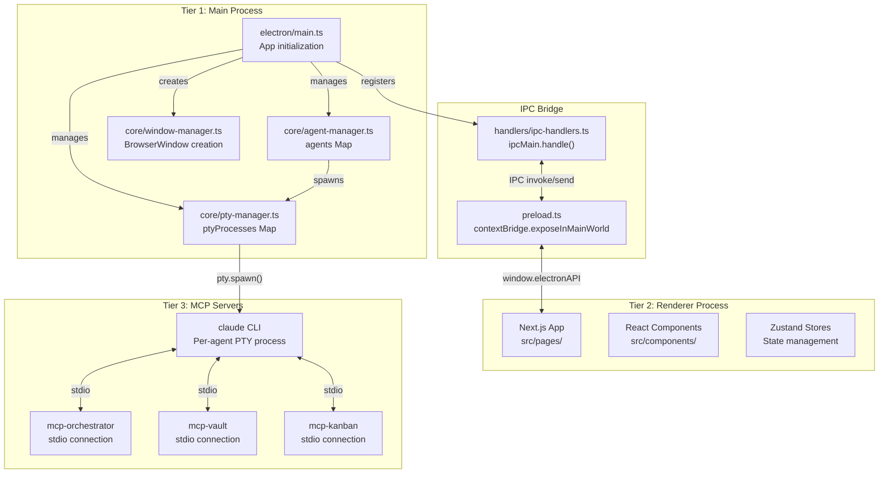

**Sources:** [electron/main.ts:1-603](), [electron/preload.ts:1-635](), [electron/handlers/ipc-handlers.ts:1-77]()

---

## Tier 1: Electron Main Process

The main process hosts all privileged operations, manages system resources, and orchestrates external services.

### Main Process Initialization Sequence

[electron/main.ts:293-567]() defines the initialization sequence:

1. **Protocol registration** ([electron/main.ts:291]())
2. **Data directory creation** ([electron/main.ts:297]())
3. **CLAUDE.md deployment** ([electron/main.ts:300]())
4. **Migration from legacy paths** ([electron/main.ts:303]())
5. **Agent state loading** ([electron/main.ts:306]())
6. **Window creation** ([electron/main.ts:312]())
7. **IPC handler registration** ([electron/main.ts:318-331]())
8. **Service initialization** ([electron/main.ts:541-551]())

### Core Service Components

| Service | File Path | Purpose |
|---------|-----------|---------|
| **Agent Manager** | [electron/core/agent-manager.ts]() | Maintains `agents: Map<string, AgentStatus>` with lifecycle state |
| **PTY Manager** | [electron/core/pty-manager.ts]() | Manages `ptyProcesses: Map<string, pty.IPty>` for terminal sessions |
| **Window Manager** | [electron/core/window-manager.ts]() | Creates and manages the single `BrowserWindow` instance |
| **API Server** | [electron/services/api-server.ts]() | HTTP server on port 31415 for MCP tool integration |
| **Telegram Bot** | [electron/services/telegram-bot.ts]() | `node-telegram-bot-api` for remote control |
| **Slack Bot** | [electron/services/slack-bot.ts]() | `@slack/bolt` Socket Mode integration |
| **Vault DB** | [electron/services/vault-db.ts]() | SQLite database with FTS5 for document storage |
| **Update Checker** | [electron/services/update-checker.ts]() | `electron-updater` auto-update integration |

**Sources:** [electron/main.ts:24-92](), [electron/core/agent-manager.ts:14](), [electron/core/pty-manager.ts:10-16]()

### Main Process Dependency Injection

The `createIpcDependencies()` function ([electron/main.ts:214-265]()) assembles a dependency object passed to all IPC handlers:

```typescript
interface IpcHandlerDependencies {
  // State maps
  ptyProcesses: Map<string, pty.IPty>;
  agents: Map<string, AgentStatus>;
  skillPtyProcesses: Map<string, pty.IPty>;
  quickPtyProcesses: Map<string, pty.IPty>;
  pluginPtyProcesses: Map<string, pty.IPty>;

  // Core functions
  getMainWindow: () => BrowserWindow | null;
  getAppSettings: () => AppSettings;
  setAppSettings: (settings: AppSettings) => void;
  saveAppSettings: (settings: AppSettings) => void;
  saveAgents: () => void;
  initAgentPty: (agent: AgentStatus) => Promise<string>;
  // ... additional functions
}
```

**Sources:** [electron/handlers/ipc-handlers.ts:22-55](), [electron/main.ts:214-265]()

---

## Tier 2: IPC Communication Layer

Dorothy uses a type-safe IPC bridge to enable communication between the isolated main and renderer processes.

### IPC Architecture Diagram

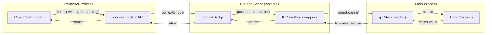

**Sources:** [electron/preload.ts:18-634](), [electron/handlers/ipc-handlers.ts:60-77]()

### IPC Handler Registration

[electron/handlers/ipc-handlers.ts:60-77]() registers handlers in functional groups:

```typescript
export function registerIpcHandlers(deps: IpcHandlerDependencies): void {
  registerPtyHandlers(deps);           // pty:create, pty:write, pty:resize, pty:kill
  registerAgentHandlers(deps);         // agent:create, agent:start, agent:stop, ...
  registerSkillHandlers(deps);         // skill:install-start, skill:list-installed, ...
  registerPluginHandlers(deps);        // plugin:install-start, plugin:install-write, ...
  registerClaudeDataHandlers(deps);    // claude:getData
  registerSettingsHandlers(deps);      // settings:get, settings:save
  registerAppSettingsHandlers(deps);   // app:getSettings, app:saveSettings
  registerUpdateHandlers();            // app:checkForUpdates, app:downloadUpdate
  registerTasmaniaHandlers(deps);      // tasmania:test, tasmania:loadModel, ...
  registerFileSystemHandlers(deps);    // fs:list-projects
  registerShellHandlers(deps);         // shell:exec, shell:openTerminal
  registerMemoryHandlers();            // memory:list-projects, memory:readFile, ...
  registerObsidianHandlers(deps);      // obsidian:scan, obsidian:readFile, ...
  registerGwsHandlers(deps);           // gws:detect, gws:authStatus, ...
  registerApiTokenHandler();           // api:getToken
}
```

### IPC Type Safety

The `ElectronAPI` interface ([src/types/electron.d.ts:152-785]()) provides compile-time type safety for all IPC calls:

| Namespace | Key Methods | Return Types |
|-----------|-------------|--------------|
| `agent` | `create`, `start`, `stop`, `list` | `Promise<AgentStatus>` |
| `pty` | `create`, `write`, `resize`, `kill` | `Promise<{ id: string }>` |
| `skill` | `installStart`, `listInstalled` | `Promise<string[]>` |
| `vault` | `listDocuments`, `createDocument`, `search` | `Promise<VaultDocumentElectron[]>` |
| `kanban` | `list`, `create`, `move` | `Promise<KanbanTaskElectron[]>` |
| `scheduler` | `listTasks`, `createTask`, `runTask` | `Promise<{ tasks: Task[] }>` |
| `automation` | `list`, `create`, `run` | `Promise<{ automations: Automation[] }>` |

**Sources:** [src/types/electron.d.ts:152-785](), [electron/preload.ts:44-478]()

### IPC Event Streams

In addition to request-response patterns, the IPC layer supports event streaming for real-time updates:

```typescript
// Renderer subscribes to agent output
const unsubscribe = window.electronAPI.agent.onOutput((event) => {
  console.log(event.agentId, event.data);
});

// Main process emits events
mainWindow.webContents.send('agent:output', {
  type: 'output',
  agentId: id,
  ptyId,
  data: outputString,
  timestamp: new Date().toISOString(),
});
```

**Sources:** [electron/preload.ts:83-107](), [electron/handlers/ipc-handlers.ts:330-354]()

---

## Tier 3: Renderer Process

The renderer process runs a Next.js application with React components and client-side state management.

### Renderer Stack

| Layer | Technology | Purpose |
|-------|------------|---------|
| **Framework** | Next.js 14 | Server-side rendering, routing, API routes (disabled in Electron build) |
| **UI Library** | React 18 | Component-based UI |
| **State Management** | Zustand | Global stores for agents, settings, UI state |
| **Styling** | Tailwind CSS | Utility-first CSS framework |
| **Terminal** | xterm.js | Terminal emulator for PTY output |
| **3D Rendering** | Three.js + React Three Fiber | Agent World visualization |

**Sources:** [package.json](), [src/components/]()

### Key UI Components

[src/components/Settings/index.ts:1-33]() exports 15 settings sections:

- `GeneralSection`: Default provider, update settings
- `TerminalSection`: Font size, theme preferences
- `ObsidianSection`: Vault path configuration
- `GitSection`: Worktree settings
- `NotificationsSection`: System notification triggers
- `TelegramSection`: Bot token, authentication
- `SlackSection`: Socket Mode app token, channel
- `JiraSection`: Domain, credentials, JQL queries
- `SocialDataSection`: Twitter/X API integration
- `TasmaniaSection`: Local LLM server configuration
- `GoogleWorkspaceSection`: GWS CLI integration
- `PermissionsSection`: Claude Code permissions
- `SkillsSection`: Skill/plugin installation
- `CLIPathsSection`: Binary path overrides
- `SystemSection`: Version info, diagnostics

**Sources:** [src/components/Settings/index.ts:1-33]()

---

## Agent Execution Architecture

Agents execute through a sophisticated PTY-based model where each agent has a dedicated pseudo-terminal running a Claude CLI instance.

### Agent Lifecycle and PTY Management

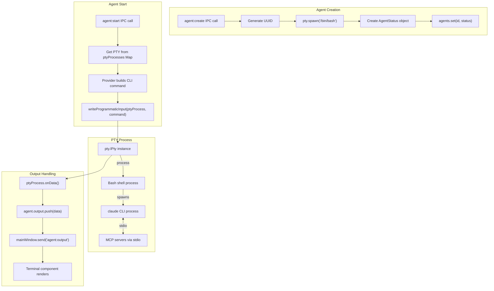

**Sources:** [electron/handlers/ipc-handlers.ts:172-377](), [electron/handlers/ipc-handlers.ts:380-589](), [electron/core/agent-manager.ts:223-355]()

### Agent State Machine

Each `AgentStatus` object ([src/types/electron.d.ts:115-135]()) tracks the following states:

| Status | Meaning | Triggers |
|--------|---------|----------|
| `idle` | Agent created but not running | Initial state, or after manual stop |
| `running` | Claude CLI actively executing | After `agent:start` command sent to PTY |
| `waiting` | Claude CLI waiting for user input | Detected by status detection hooks |
| `completed` | PTY exited with code 0 | `ptyProcess.onExit({ exitCode: 0 })` |
| `error` | PTY exited with non-zero code | `ptyProcess.onExit({ exitCode: != 0 })` |

**Sources:** [electron/types.ts](), [electron/core/agent-manager.ts:40-139]()

### PTY Environment Variables

Each PTY spawned for an agent receives environment variables via the provider system:

```typescript
// From electron/handlers/ipc-handlers.ts:271-284
const providerEnvVars = agentProvider.getPtyEnvVars(id, config.projectPath, allSkills);

ptyProcess = pty.spawn(shell, ['-l'], {
  cwd,
  env: {
    ...cleanEnv,
    PATH: fullPath,
    ...providerEnvVars,
    // Additional environment vars
  },
});
```

Claude provider sets ([electron/providers/claude-provider.ts]()):
- `CLAUDE_AGENT_ID`: Agent UUID
- `CLAUDE_PROJECT_PATH`: Project directory
- `CLAUDE_SKILLS`: Comma-separated skill list

**Sources:** [electron/handlers/ipc-handlers.ts:269-290](), [electron/providers/claude-provider.ts]()

---

## MCP Integration

Dorothy agents interact with MCP servers through stdio connections managed by the Claude CLI.

### MCP Server Communication Flow

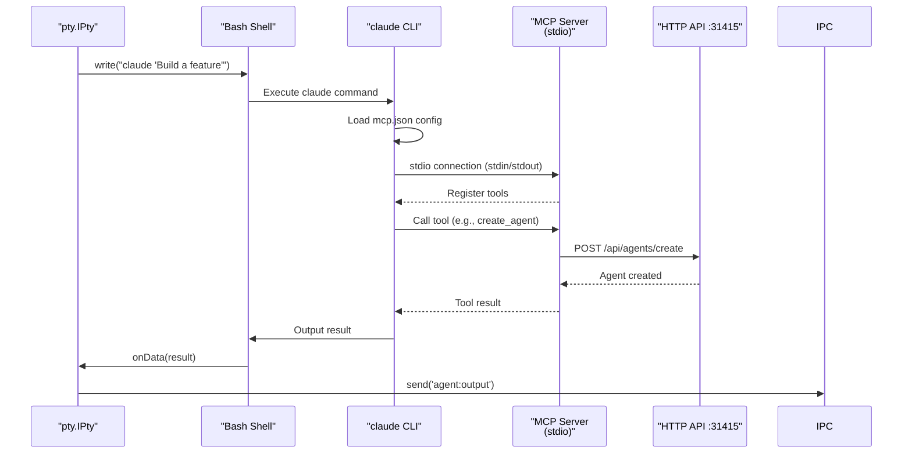

**Sources:** [electron/services/api-server.ts](), [mcp-orchestrator/]()

### MCP Configuration Path Resolution

Agents using the Claude provider receive MCP configuration via the `--mcp-config` flag:

```typescript
// From electron/handlers/ipc-handlers.ts:526-534
if (cliProvider.getMcpConfigStrategy() === 'flag') {
  const possibleMcpPath = path.join(app.getPath('home'), '.claude', 'mcp.json');
  if (fs.existsSync(possibleMcpPath)) {
    mcpConfigPath = possibleMcpPath;
  }
}
```

The MCP config file (`~/.claude/mcp.json`) defines stdio servers:

```json
{
  "mcpServers": {
    "orchestrator": {
      "command": "node",
      "args": ["/path/to/mcp-orchestrator/build/index.js"]
    },
    "vault": {
      "command": "node",
      "args": ["/path/to/mcp-vault/build/index.js"]
    }
  }
}
```

**Sources:** [electron/handlers/ipc-handlers.ts:526-534](), [electron/services/mcp-orchestrator.ts]()

### MCP Tool Access via HTTP API

MCP servers can interact with Dorothy services through the HTTP API server on port 31415:

| Endpoint | Method | Purpose |
|----------|--------|---------|
| `/api/agents` | GET | List all agents |
| `/api/agents/create` | POST | Create ephemeral agent |
| `/api/agents/:id/start` | POST | Start agent with prompt |
| `/api/agents/:id/output` | GET | Get agent output buffer |
| `/api/telegram/send` | POST | Send Telegram message |
| `/api/slack/send` | POST | Send Slack message |

**Sources:** [electron/services/api-server.ts]()

---

## Data Persistence Strategy

Dorothy uses a hybrid persistence model with JSON files, SQLite databases, and integration with Claude Code's native storage.

### Persistence Model Diagram

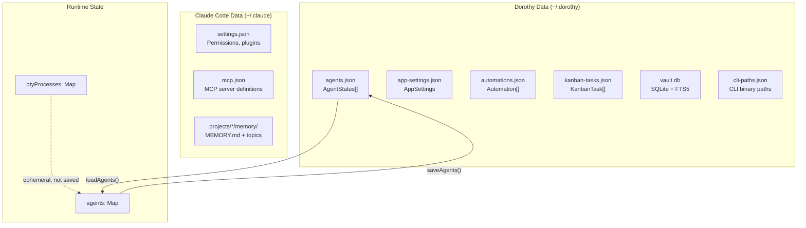

**Sources:** [electron/constants.ts](), [electron/core/agent-manager.ts:141-170]()

### File Locations Reference

| File Path | Purpose | Format | Managed By |
|-----------|---------|--------|------------|
| `~/.dorothy/agents.json` | Agent state persistence | JSON array | [agent-manager.ts:141-170]() |
| `~/.dorothy/app-settings.json` | Dorothy configuration | JSON object | [main.ts:108-172]() |
| `~/.dorothy/automations.json` | Automation definitions | JSON array | [automation-handlers.ts]() |
| `~/.dorothy/kanban-tasks.json` | Kanban board state | JSON array | [kanban-handlers.ts]() |
| `~/.dorothy/vault.db` | Document vault | SQLite | [vault-db.ts]() |
| `~/.dorothy/cli-paths.json` | Binary path overrides | JSON object | [cli-paths-handlers.ts]() |
| `~/.claude/settings.json` | Claude Code settings | JSON object | Claude Code + Dorothy |
| `~/.claude/mcp.json` | MCP server config | JSON object | Dorothy setup |
| `~/.claude/projects/*/memory/` | Project memory files | Markdown | Claude Code |

**Sources:** [electron/constants.ts:7-14](), [electron/core/agent-manager.ts:8]()

### Agent State Persistence

[electron/core/agent-manager.ts:141-170]() implements agent persistence with output truncation and status normalization:

```typescript
export function saveAgents() {
  const agentsArray = Array.from(agents.values()).map(agent => ({
    ...agent,
    ptyId: undefined,              // PTYs are ephemeral, recreated on load
    pathMissing: undefined,        // Revalidated on load
    output: agent.output.slice(-100),  // Keep last 100 output chunks
    status: agent.status === 'running' ? 'idle' : agent.status,  // Normalize running → idle
  }));

  fs.writeFileSync(AGENTS_FILE, JSON.stringify(agentsArray, null, 2));
}
```

On app startup, [electron/core/agent-manager.ts:172-221]() loads agents and validates paths:

```typescript
export function loadAgents() {
  const agentsArray = JSON.parse(data) as AgentStatus[];

  for (const agent of agentsArray) {
    const workingPath = agent.worktreePath || agent.projectPath;
    if (!fs.existsSync(workingPath)) {
      agent.pathMissing = true;  // Flag for UI display
    }
    agent.status = 'idle';       // All restored agents start idle
    agent.ptyId = undefined;     // PTY recreated on first use
    agents.set(agent.id, agent);
  }
}
```

**Sources:** [electron/core/agent-manager.ts:141-221]()

### Vault Database Schema

The vault uses SQLite with FTS5 full-text search ([electron/services/vault-db.ts]()):

```sql
CREATE TABLE documents (
  id TEXT PRIMARY KEY,
  title TEXT NOT NULL,
  content TEXT NOT NULL,
  folder_id TEXT,
  author TEXT NOT NULL,
  agent_id TEXT,
  tags TEXT,  -- JSON array
  created_at TEXT NOT NULL,
  updated_at TEXT NOT NULL
);

CREATE VIRTUAL TABLE documents_fts USING fts5(
  title, content, tags,
  content='documents',
  content_rowid='rowid'
);
```

**Sources:** [electron/services/vault-db.ts]()

---

## Service Orchestration

Multiple background services run in the main process, coordinated by [electron/main.ts]().

### Service Initialization Order

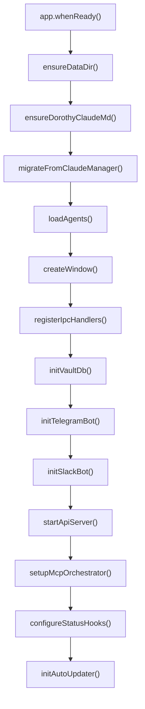

**Sources:** [electron/main.ts:293-567]()

### HTTP API Server

The API server ([electron/services/api-server.ts]()) runs on port 31415 and provides REST endpoints for MCP tools:

```typescript
const app = express();
app.use(express.json());
app.use(cors());

// Authentication middleware
app.use((req, res, next) => {
  const token = req.headers.authorization?.replace('Bearer ', '');
  if (token !== API_TOKEN) {
    return res.status(401).json({ error: 'Unauthorized' });
  }
  next();
});

app.listen(31415, () => {
  console.log('API server listening on port 31415');
});
```

**Sources:** [electron/services/api-server.ts]()

### Remote Control Integration

Both Telegram and Slack bots share a common architecture:

1. **Direct Commands**: `/start_agent`, `/stop_agent`, `/status` → interact with Agent Manager directly
2. **Conversational Messages**: Route to Super Agent (orchestrator) with MCP tool access
3. **File Upload Handling**: Download files locally, pass file paths to Super Agent

The Super Agent receives special instruction files:
- `super-agent-instructions.md`: General orchestration guidelines
- `telegram-instructions.md`: Telegram-specific response formatting

**Sources:** [electron/services/telegram-bot.ts](), [electron/services/slack-bot.ts]()

---

## Process Lifecycle

### App Startup

1. Electron main process starts
2. `app.whenReady()` fires
3. Data migration from `~/.claude-manager` (legacy rebrand)
4. Window creation with Next.js dev server (dev) or bundled HTML (production)
5. IPC handlers registered
6. Services initialized in sequence
7. Auto-update check scheduled (5s delay)

**Sources:** [electron/main.ts:293-567]()

### App Shutdown

[electron/main.ts:585-590]() handles graceful shutdown:

```typescript
app.on('before-quit', () => {
  saveAgents();      // Persist agent state
  killAllPty();      // Terminate all PTY processes
  closeVaultDb();    // Close SQLite connection
});
```

**Sources:** [electron/main.ts:585-590]()

### PTY Cleanup

[electron/core/pty-manager.ts]() exports `killAllPty()`:

```typescript
export function killAllPty() {
  for (const [id, pty] of ptyProcesses) {
    pty.kill();
  }
  for (const [id, pty] of skillPtyProcesses) {
    pty.kill();
  }
  for (const [id, pty] of quickPtyProcesses) {
    pty.kill();
  }
}
```

**Sources:** [electron/core/pty-manager.ts]()

---

# Page: Installation and Setup

# Installation and Setup

<details>
<summary>Relevant source files</summary>

The following files were used as context for generating this wiki page:

- [landing/package-lock.json](landing/package-lock.json)
- [landing/package.json](landing/package.json)
- [landing/src/app/api/download/route.ts](landing/src/app/api/download/route.ts)
- [landing/src/app/api/stats/route.ts](landing/src/app/api/stats/route.ts)
- [landing/src/app/layout.tsx](landing/src/app/layout.tsx)
- [package-lock.json](package-lock.json)
- [package.json](package.json)
- [public/atlassian-jira-svgrepo-com.svg](public/atlassian-jira-svgrepo-com.svg)
- [scripts/notarize.js](scripts/notarize.js)
- [src/components/Settings/GeneralSection.tsx](src/components/Settings/GeneralSection.tsx)

</details>


This page provides an overview of installing Dorothy on your system and completing initial configuration. Dorothy is distributed as pre-built binaries for macOS and can also be built from source for development or customization purposes.

**Scope**: This page covers installation methods, system requirements, and the update mechanism. For detailed download instructions, see [Download and Install](#2.1). For building from source, see [Building from Source](#2.2). For first-time configuration after installation, see [Initial Configuration](#2.3).

---

## Installation Overview

Dorothy offers two primary installation paths:

1. **Pre-built binaries**: Download notarized DMG/ZIP files from GitHub Releases
2. **Build from source**: Clone the repository and run the build pipeline locally

The application is currently packaged for macOS (both arm64 and x64 architectures). After installation, Dorothy automatically checks for updates using `electron-updater` and can install updates with user consent.

---

## System Requirements

Dorothy requires:

| Component | Requirement |
|-----------|-------------|
| **Operating System** | macOS 10.15+ (Catalina or later) |
| **Architecture** | arm64 (Apple Silicon) or x64 (Intel) |
| **Node.js** (for building) | >= 18.18.0 |
| **CLI Tools** | Claude CLI, Codex CLI, or Gemini CLI (at least one provider) |
| **Memory** | 4GB RAM minimum, 8GB recommended |
| **Disk Space** | 500MB for application, additional space for agent projects |

**Sources**: [package.json:1-189](), [package.json:20-135]()

---

## Installation Methods

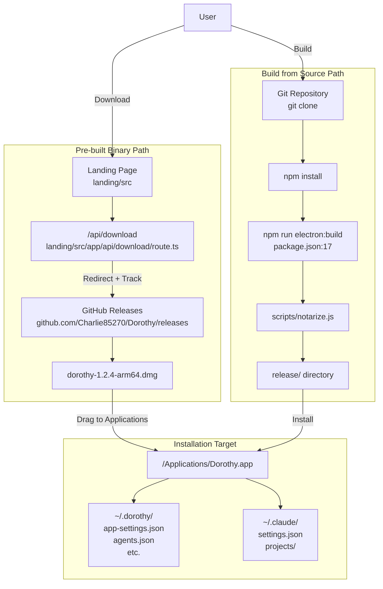

**Sources**: [landing/src/app/api/download/route.ts:1-49](), [package.json:17-18](), [scripts/notarize.js:1-33]()

---

## Pre-built Binary Installation

The simplest installation method downloads a notarized DMG from GitHub Releases via the landing page API:

1. The `/api/download` endpoint tracks downloads in Upstash Redis
2. Redirects to the latest release URL (currently v1.2.4)
3. User downloads `dorothy-{version}-arm64.dmg`
4. User mounts DMG and drags `Dorothy.app` to `/Applications`

The download URL is hardcoded at [landing/src/app/api/download/route.ts:13]():

```typescript
const DOWNLOAD_URL = 'https://github.com/Charlie85270/dorothy/releases/download/1.2.4/dorothy-1.2.4-arm64.dmg';
```

Download tracking uses Redis keys:
- `downloads:total` - Total download count
- `downloads:daily:{YYYY-MM-DD}` - Daily download count
- `downloads:platform:{platform}` - Platform-specific count

For detailed installation steps, see [Download and Install](#2.1).

**Sources**: [landing/src/app/api/download/route.ts:12-48](), [landing/src/app/api/stats/route.ts:1-50]()

---

## Build from Source Installation

Building Dorothy from source involves a multi-stage pipeline defined in `electron:build` script:

### Build Pipeline Stages

```mermaid
graph LR
    subgraph "Stage 1: UI Build"
        APIBackup["Backup API routes<br/>mv src/app/api src/app/_api_backup"]
        NextBuild["Next.js Build<br/>ELECTRON_BUILD=1 next build"]
        NextOut["out/ directory<br/>Static HTML/JS"]
    end
    
    subgraph "Stage 2: Main Process"
        TSC["TypeScript Compilation<br/>tsc -p electron/tsconfig.json"]
        ElectronDist["electron/dist/main.js"]
    end
    
    subgraph "Stage 3: MCP Servers"
        MCPOrch["mcp-orchestrator<br/>npm install && npm run build"]
        MCPTelegram["mcp-telegram<br/>npm install && npm run build"]
        MCPKanban["mcp-kanban<br/>npm install && npm run build"]
        MCPVault["mcp-vault<br/>npm install && npm run build"]
        MCPSocial["mcp-socialdata<br/>npm install && npm run build"]
        MCPX["mcp-x<br/>npm install && npm run build"]
        MCPWorld["mcp-world<br/>npm install && npm run build"]
    end
    
    subgraph "Stage 4: Packaging"
        ElectronBuilder["electron-builder --mac<br/>package.json:20-135"]
        ASAR["app.asar<br/>Packaged app code"]
        Resources["Resources<br/>MCP bundles, skills, hooks"]
    end
    
    subgraph "Stage 5: Notarization"
        NotarizeScript["scripts/notarize.js<br/>@electron/notarize"]
        AppleCheck["Apple Notarization Service"]
        SignedApp["Notarized Dorothy.app"]
    end
    
    APIBackup --> NextBuild
    NextBuild --> NextOut
    NextOut --> TSC
    TSC --> ElectronDist
    ElectronDist --> MCPOrch
    MCPOrch --> MCPTelegram
    MCPTelegram --> MCPKanban
    MCPKanban --> MCPVault
    MCPVault --> MCPSocial
    MCPSocial --> MCPX
    MCPX --> MCPWorld
    MCPWorld --> ElectronBuilder
    ElectronBuilder --> ASAR
    ElectronBuilder --> Resources
    ASAR --> NotarizeScript
    Resources --> NotarizeScript
    NotarizeScript --> AppleCheck
    AppleCheck --> SignedApp
```

**Sources**: [package.json:17](), [package.json:20-135](), [scripts/notarize.js:1-33]()

### Build Command

```bash
npm run electron:build
```

This script executes the following sequence [package.json:17]():

1. **API Route Backup**: Moves `src/app/api` to `src/app/_api_backup` (API routes aren't needed in Electron)
2. **Next.js Build**: `ELECTRON_BUILD=1 next build` generates static output in `out/`
3. **TypeScript Compilation**: `tsc -p electron/tsconfig.json` compiles main process to `electron/dist/`
4. **MCP Builds**: Seven MCP servers are built sequentially (orchestrator, telegram, kanban, vault, socialdata, x, world)
5. **Electron Builder**: Packages the app into DMG and ZIP formats for macOS
6. **Notarization**: `scripts/notarize.js` submits to Apple for notarization

### electron-builder Configuration

The build configuration is defined at [package.json:20-135]():

| Setting | Value | Purpose |
|---------|-------|---------|
| `appId` | `io.dorothy.app` | Application identifier |
| `productName` | `Dorothy` | Display name |
| `directories.output` | `release` | Output directory |
| `files` | `electron/dist`, `out/`, `skills/`, etc. | Files to include |
| `asarUnpack` | `better-sqlite3`, `node-pty`, etc. | Native modules to exclude from ASAR |
| `extraResources` | MCP server bundles | Bundled as `resources/` |
| `afterSign` | `scripts/notarize.js` | Post-build notarization hook |

### Notarization Process

The `scripts/notarize.js` script handles macOS notarization [scripts/notarize.js:1-33]():

```javascript
// Two authentication methods supported:
// 1. Keychain profile (default): keychainProfile: 'Dorothy'
// 2. Environment variables: APPLE_ID, APPLE_APP_PASSWORD, APPLE_TEAM_ID
```

Notarization requires:
- Apple Developer account
- App-specific password or keychain profile
- Team ID

For complete build instructions and troubleshooting, see [Building from Source](#2.2).

**Sources**: [package.json:17-18](), [scripts/notarize.js:1-33]()

---

## Post-Installation Directory Structure

After installation, Dorothy creates the following directory structure:

```
~/.dorothy/
├── app-settings.json          # Application configuration
├── agents.json                # Agent definitions and state
├── automations.json           # Automation definitions
├── automations-processed.json # Deduplication tracking
├── automations-runs.json      # Execution history
├── kanban-tasks.json          # Kanban board tasks
├── cli-paths.json             # CLI tool locations
├── vault.db                   # SQLite document database
└── scripts/                   # Scheduled task scripts

~/.claude/
├── settings.json              # Claude CLI settings
└── projects/                  # Agent project directories
    └── {project-name}/
        ├── CLAUDE.md          # Project configuration
        └── memory/            # Memory files
            └── MEMORY.md      # Entrypoint memory file

/Applications/Dorothy.app/
└── Contents/
    ├── MacOS/Dorothy          # Executable
    ├── Resources/
    │   ├── app.asar           # Main application code
    │   ├── mcp-orchestrator/  # MCP server bundles
    │   ├── mcp-telegram/
    │   ├── mcp-kanban/
    │   ├── mcp-vault/
    │   ├── mcp-socialdata/
    │   ├── mcp-x/
    │   └── mcp-world/
    └── Frameworks/            # Electron framework
```

These directories are automatically created on first launch.

**Sources**: [package.json:31-105]()

---

## Update Mechanism

Dorothy uses `electron-updater` for automatic updates, implemented in `GeneralSection` component:

### Update Flow

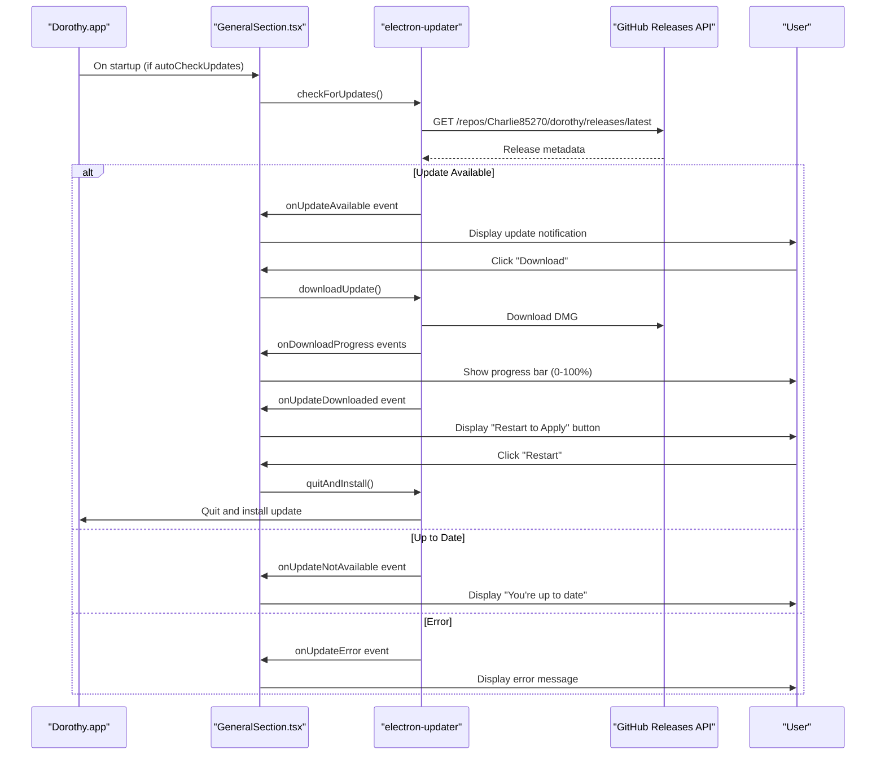

**Sources**: [src/components/Settings/GeneralSection.tsx:85-150]()

### Update Settings

The `GeneralSection` component provides update controls [src/components/Settings/GeneralSection.tsx:173-183]():

- **Auto-check for updates**: Toggle at [GeneralSection.tsx:178-181]()
- **Manual check**: Button at [GeneralSection.tsx:190-201]()
- **Download progress**: Progress bar at [GeneralSection.tsx:239-251]()
- **Quit and install**: Button at [GeneralSection.tsx:274-282]()

### Update State Machine

| State | Description | UI Action |
|-------|-------------|-----------|
| `idle` | No update check performed | Show "Check for Updates" button |
| `checking` | Checking GitHub for updates | Show loading spinner |
| `up-to-date` | Current version is latest | Show green checkmark |
| `update-available` | New version found | Show "Download" button |
| `downloading` | Download in progress | Show progress bar |
| `downloaded` | Update ready to install | Show "Restart to Apply" button |
| `error` | Update check/download failed | Show error message |

The updater configuration is defined in `package.json` [package.json:23-27]():

```json
"publish": {
  "provider": "github",
  "owner": "Charlie85270",
  "repo": "dorothy"
}
```

**Sources**: [src/components/Settings/GeneralSection.tsx:31-150](), [package.json:23-27]()

---

## Initial Configuration

After installation, Dorothy requires minimal configuration to start:

1. **CLI Path Detection**: Dorothy automatically detects installed CLI tools (Claude, Codex, Gemini)
2. **Default Provider**: Select the default CLI provider for automations and scheduled tasks
3. **Data Directory Creation**: `~/.dorothy/` and `~/.claude/` directories are created automatically
4. **Optional Integrations**: Telegram, Slack, JIRA, GitHub can be configured later

The `GeneralSection` component performs CLI detection on mount [src/components/Settings/GeneralSection.tsx:46-56]():

```typescript
useEffect(() => {
  window.electronAPI?.cliPaths?.detect().then((paths) => {
    if (paths) {
      setInstalledProviders({
        claude: !!paths.claude,
        codex: !!paths.codex,
        gemini: !!paths.gemini,
      });
    }
  });
}, []);
```

For detailed first-time configuration steps, see [Initial Configuration](#2.3).

**Sources**: [src/components/Settings/GeneralSection.tsx:46-56](), [src/components/Settings/GeneralSection.tsx:305-326]()

---

## Verification

After installation, verify Dorothy is working correctly:

### Check Application Launch

```bash
# Check if Dorothy.app exists
ls -la /Applications/Dorothy.app

# Launch Dorothy
open /Applications/Dorothy.app
```

### Verify Data Directories

```bash
# Check Dorothy data directory
ls -la ~/.dorothy/

# Check Claude directory
ls -la ~/.claude/
```

### Check Version

In the Dorothy UI, navigate to Settings → General to verify:
- Application version matches downloaded version
- Update check functionality works
- CLI providers are detected

### Verify CLI Tools

Dorothy requires at least one CLI provider. Check installations:

```bash
# Claude CLI
which claude

# Codex CLI (if installed)
which codex

# Gemini CLI (if installed)
which gemini
```

If no CLI tools are found, Dorothy will display warnings in the Settings → CLI Paths section.

**Sources**: [src/components/Settings/GeneralSection.tsx:161-169]()

---

## Troubleshooting

### Application Won't Open on macOS

If Dorothy won't open due to security restrictions:

```bash
# Clear quarantine attribute
xattr -d com.apple.quarantine /Applications/Dorothy.app

# Or right-click → Open (bypasses Gatekeeper)
```

### Build Failures

Common build issues:

| Issue | Solution |
|-------|----------|
| `tsc` errors | Ensure TypeScript 5.x is installed |
| MCP build failures | Run `npm install` in each MCP directory |
| Notarization timeout | Check Apple Developer credentials |
| `electron-builder` errors | Verify all dependencies in `package.json` are installed |

### Update Check Fails

If update checking doesn't work [src/components/Settings/GeneralSection.tsx:93-97]():

```typescript
// Dev mode restriction
if (result?.devMode) {
  setUpdateError('Update check is only available in the production build.');
}
```

Update checking is disabled in development builds. Use production DMG for updates.

**Sources**: [src/components/Settings/GeneralSection.tsx:85-103](), [scripts/notarize.js:1-33]()

---

## Next Steps

After successful installation:

1. **Configure CLI Paths**: See [Initial Configuration](#2.3) for provider setup
2. **Create Your First Agent**: See [Creating and Managing Agents](#3.1)
3. **Set Up Integrations**: See [Telegram Bot](#9.1), [Slack Bot](#9.2), or [Automations](#7)
4. **Explore MCP Tools**: See [MCP Ecosystem](#4) for available tools

**Sources**: [package.json:1-189](), [landing/src/app/api/download/route.ts:1-49](), [src/components/Settings/GeneralSection.tsx:1-346]()

---

# Page: Download and Install

# Download and Install

<details>
<summary>Relevant source files</summary>

The following files were used as context for generating this wiki page:

- [landing/package-lock.json](landing/package-lock.json)
- [landing/package.json](landing/package.json)
- [landing/src/app/api/download/route.ts](landing/src/app/api/download/route.ts)
- [landing/src/app/api/stats/route.ts](landing/src/app/api/stats/route.ts)
- [landing/src/app/layout.tsx](landing/src/app/layout.tsx)
- [package-lock.json](package-lock.json)
- [package.json](package.json)
- [public/atlassian-jira-svgrepo-com.svg](public/atlassian-jira-svgrepo-com.svg)
- [scripts/notarize.js](scripts/notarize.js)
- [src/components/Settings/GeneralSection.tsx](src/components/Settings/GeneralSection.tsx)

</details>


This page explains how to download and install pre-built Dorothy binaries. It covers platform support, the download process via the landing page, installation steps, and the integrated auto-update system. For building Dorothy from source, see [Building from Source](#2.2). For first-time setup and configuration, see [Initial Configuration](#2.3).

---

## Platform Support

Dorothy currently distributes official pre-built binaries for **macOS only**. The build system targets both Intel and Apple Silicon architectures.

| Platform | Architecture | Format | Status |
|----------|-------------|--------|--------|
| macOS | arm64 (Apple Silicon) | DMG, ZIP | ✅ Supported |
| macOS | x64 (Intel) | DMG, ZIP | ✅ Supported |
| Windows | - | - | ❌ Not distributed |
| Linux | - | - | ❌ Not distributed |

The application is built using `electron-builder` with macOS-specific configuration including code signing and notarization for Gatekeeper compatibility.

**Sources:** [package.json:108-119]()

---

## System Requirements

- **macOS:** 10.13 (High Sierra) or later
- **Node.js:** >= 18.18.0 (for Electron runtime)
- **Disk Space:** ~200 MB for application bundle
- **Memory:** Minimum 2 GB RAM recommended

---

## Download Process

### Landing Page and Download API

Dorothy uses a Next.js landing page that routes downloads through a tracking API before redirecting to GitHub Releases.

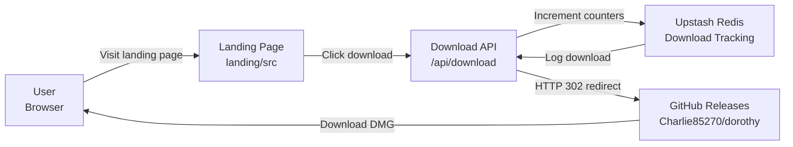

The download API performs the following operations:

1. **Platform Detection**: Extracts `platform` query parameter (defaults to `mac`)
2. **Metrics Tracking**: Increments Redis counters if configured:
   - `downloads:total` - All-time download count
   - `downloads:daily:{YYYY-MM-DD}` - Daily download count
   - `downloads:platform:{platform}` - Per-platform count
   - `downloads:log` - Circular buffer of last 1000 downloads (timestamp, platform, user-agent)
3. **Redirect**: Issues HTTP 302 redirect to GitHub release URL

The hardcoded download URL points to the latest release:

```
https://github.com/Charlie85270/dorothy/releases/download/1.2.4/dorothy-1.2.4-arm64.dmg
```

**Sources:** [landing/src/app/api/download/route.ts:1-49](), [landing/src/app/api/stats/route.ts:1-50]()

### Direct GitHub Releases

Users can also download directly from GitHub Releases without tracking:

```
https://github.com/Charlie85270/Dorothy/releases
```

Each release includes:
- **DMG file**: Disk image with application bundle (drag-to-install)
- **ZIP file**: Compressed application bundle (extract-and-run)
- **Release notes**: Markdown-formatted changelog

**Sources:** [package.json:23-27](), [landing/src/app/api/download/route.ts:13]()

---

## Installation Steps

### macOS Installation (DMG)

The DMG installer provides a standard macOS installation experience:

1. **Download**: Obtain `dorothy-{version}-arm64.dmg` via landing page or GitHub
2. **Mount**: Double-click the DMG file to mount the disk image
3. **Install**: Drag `Dorothy.app` to the `Applications` folder
4. **Eject**: Unmount the DMG after installation
5. **Launch**: Open Dorothy from Applications or Spotlight

### macOS Installation (ZIP)

Alternative installation method using the ZIP archive:

1. **Download**: Obtain `dorothy-{version}-arm64.zip`
2. **Extract**: Unzip the archive (double-click or `unzip` command)
3. **Move**: Move `Dorothy.app` to `/Applications`
4. **Launch**: Open Dorothy

### Gatekeeper and Notarization

Dorothy is code-signed and notarized for macOS Gatekeeper. The notarization process ensures the application can be opened without security warnings.

```mermaid
graph TB
    Build["electron-builder<br/>Build Process"]
    Sign["Code Signing<br/>Apple Developer ID"]
    Notarize["Notarization<br/>scripts/notarize.js"]
    Upload["Upload to<br/>GitHub Releases"]
    Download["User Download"]
    Gatekeeper["macOS Gatekeeper<br/>Verification"]
    
    Build --> Sign
    Sign --> Notarize
    Notarize --> Upload
    Upload --> Download
    Download --> Gatekeeper
    Gatekeeper -->|"Verified"| Launch["Launch Dorothy"]
```

The notarization script supports two authentication modes:

- **Keychain Profile**: Uses stored credentials (`keychainProfile: 'Dorothy'`)
- **Environment Variables**: Uses `APPLE_ID`, `APPLE_APP_PASSWORD`, `APPLE_TEAM_ID`

**Sources:** [scripts/notarize.js:1-33](), [package.json:107-114]()

---

## Installation Artifacts

Once installed, Dorothy creates the following directory structure:

| Path | Contents | Purpose |
|------|----------|---------|
| `/Applications/Dorothy.app` | Application bundle | Main executable |
| `~/.dorothy/` | Application data | Configuration, agents, automations |
| `~/.claude/` | Claude Code data | Projects, memory, settings |

The application bundle structure:

```mermaid
graph TB
    DorothyApp["Dorothy.app"]
    Contents["Contents/"]
    MacOS["MacOS/Dorothy<br/>Executable"]
    Resources["Resources/"]
    Frameworks["Frameworks/<br/>Electron + Node"]
    
    DorothyApp --> Contents
    Contents --> MacOS
    Contents --> Resources
    Contents --> Frameworks
    
    Resources --> ElectronDist["electron/dist/<br/>Main process"]
    Resources --> Out["out/<br/>Next.js build"]
    Resources --> MCP["MCP servers<br/>7 bundles"]
    Resources --> Skills["skills/<br/>Plugin system"]
    
    ElectronDist --> MainJS["main.js<br/>Entry point"]
```

**Sources:** [package.json:31-48](), [package.json:49-106]()

---

## First Launch

On first launch, Dorothy:

1. **Creates directories**: Initializes `~/.dorothy/` structure
2. **Detects CLI tools**: Scans for `claude`, `codex`, `gemini` in PATH
3. **Prompts for configuration**: Guides user through initial setup (covered in [Initial Configuration](#2.3))

The main process initialization sequence:

```mermaid
sequenceDiagram
    participant User
    participant DorothyApp as "Dorothy.app"
    participant Main as "electron/main.ts"
    participant AgentMgr as "Agent Manager"
    participant Settings as "Settings System"
    
    User->>DorothyApp: Launch application
    DorothyApp->>Main: Initialize Electron
    Main->>Main: Create app directories
    Main->>Settings: Load app-settings.json
    Settings-->>Main: Settings or defaults
    Main->>AgentMgr: Initialize agent manager
    Main->>Main: Register IPC handlers
    Main->>Main: Create main window
    Main-->>User: Show UI
```

**Sources:** [package.json:5]()

---

## Auto-Update System

Dorothy includes an integrated auto-update mechanism using `electron-updater`. The update system checks GitHub Releases for new versions and can download/install updates without requiring a manual re-download.

### Update Flow

```mermaid
graph TB
    GeneralSection["GeneralSection Component<br/>Settings UI"]
    UpdateAPI["electron-updater API<br/>Main process"]
    GitHubReleases["GitHub Releases API<br/>latest.yml"]
    DownloadUpdate["Download .dmg/.zip"]
    InstallUpdate["Install on restart"]
    
    GeneralSection -->|"Check for updates"| UpdateAPI
    UpdateAPI -->|"Fetch release info"| GitHubReleases
    GitHubReleases -->|"Version + changelog"| UpdateAPI
    UpdateAPI -->|"update-available event"| GeneralSection
    GeneralSection -->|"User clicks download"| UpdateAPI
    UpdateAPI --> DownloadUpdate
    DownloadUpdate -->|"update-downloaded event"| GeneralSection
    GeneralSection -->|"User clicks restart"| InstallUpdate
```

### Update States

The update system tracks the following states in `GeneralSection`:

| State | Description | UI Behavior |
|-------|-------------|-------------|
| `idle` | Initial state | "Check for Updates" button enabled |
| `checking` | Checking for updates | Spinner, button disabled |
| `up-to-date` | No updates available | Green checkmark, current version shown |
| `update-available` | New version found | Download button, release notes displayed |
| `downloading` | Downloading update | Progress bar with percentage |
| `downloaded` | Ready to install | "Restart to Apply" button |
| `error` | Update failed | Error message, retry available |

### Auto-Check on Startup

The `autoCheckUpdates` setting controls whether Dorothy automatically checks for updates on launch:

```typescript
// Default behavior: auto-check enabled
appSettings.autoCheckUpdates !== false
```

This setting can be toggled in the General Settings section.

**Sources:** [src/components/Settings/GeneralSection.tsx:1-346](), [package.json:165]()

### Update Events and Handlers

The update system uses IPC events for communication between main and renderer processes:

**Main Process Events (sent to renderer):**
- `update-available` - New version detected
- `update-not-available` - Already on latest version
- `download-progress` - Download progress percentage
- `update-downloaded` - Update ready to install
- `update-error` - Update check/download failed

**Renderer to Main Methods:**
- `updates.check()` - Trigger update check
- `updates.download()` - Start downloading update
- `updates.quitAndInstall()` - Install update and restart
- `updates.openExternal(url)` - Open release URL in browser (fallback)

### Development Mode Limitation

Update checking is disabled in development mode (unpacked apps). The UI displays an error message if update check is attempted in dev mode:

```
"Update check is only available in the production build."
```

**Sources:** [src/components/Settings/GeneralSection.tsx:85-103](), [src/components/Settings/GeneralSection.tsx:106-132]()

### Release Notes Display

When an update is available, the UI displays the first 300 characters of the release notes (HTML stripped):

```mermaid
graph LR
    ReleaseAPI["GitHub API<br/>Release body"]
    stripHtml["stripHtml function<br/>Remove HTML tags"]
    Display["UI Display<br/>Plain text preview"]
    
    ReleaseAPI -->|"HTML markdown"| stripHtml
    stripHtml -->|"Plain text"| Display
```

The `stripHtml` function performs:
1. Convert `<br>` to newlines
2. Convert closing tags to newlines
3. Strip all remaining HTML tags
4. Decode HTML entities
5. Collapse multiple newlines
6. Truncate to 300 characters with ellipsis

**Sources:** [src/components/Settings/GeneralSection.tsx:6-20]()

---

## Verification

To verify a successful installation:

1. **Launch Dorothy**: Application should open without security warnings
2. **Check version**: Settings → General shows current version (e.g., `1.2.4`)
3. **Verify directories**: `~/.dorothy/` directory exists
4. **CLI detection**: Settings → CLI Paths shows detected tools

---

## Troubleshooting

### Gatekeeper Blocks Application

If macOS prevents launching with "unidentified developer" warning:

```bash
# Remove quarantine attribute
xattr -d com.apple.quarantine /Applications/Dorothy.app
```

### Update Check Fails

- **Dev mode**: Update checking is disabled in unpacked apps
- **Network**: Ensure connection to GitHub API
- **Permissions**: Check firewall settings for outbound HTTPS

---

## Next Steps

After installation:
- Proceed to [Initial Configuration](#2.3) to set up CLI paths and integrations
- See [Creating and Managing Agents](#3.1) to start using Dorothy

---

**Sources:** [landing/src/app/api/download/route.ts:1-49](), [package.json:1-189](), [src/components/Settings/GeneralSection.tsx:1-346](), [scripts/notarize.js:1-33](), [landing/src/app/layout.tsx:1-29]()

---

# Page: Building from Source

# Building from Source

<details>
<summary>Relevant source files</summary>

The following files were used as context for generating this wiki page:

- [landing/src/app/api/download/route.ts](landing/src/app/api/download/route.ts)
- [package-lock.json](package-lock.json)
- [package.json](package.json)
- [public/atlassian-jira-svgrepo-com.svg](public/atlassian-jira-svgrepo-com.svg)
- [scripts/notarize.js](scripts/notarize.js)
- [src/components/Settings/GeneralSection.tsx](src/components/Settings/GeneralSection.tsx)

</details>


This page provides comprehensive instructions for building Dorothy from source code. It covers all dependencies, build scripts, MCP module compilation, and the electron-builder packaging process. For information about downloading pre-built binaries, see [Download and Install](#2.1). For configuration after building, see [Initial Configuration](#2.3).

---

## Prerequisites

Building Dorothy from source requires the following tools and dependencies:

| Tool | Version | Purpose |
|------|---------|---------|
| **Node.js** | ≥18.x | JavaScript runtime |
| **npm** | ≥8.x | Package manager |
| **TypeScript** | ^5.x | TypeScript compiler |
| **Python** | 2.7 or ≥3.6 | Required for native module compilation |
| **Xcode Command Line Tools** | Latest (macOS) | C++ compiler for native modules |
| **Apple Developer Account** | (Optional) | Required for code signing and notarization |

**Native Modules**: Dorothy includes two critical native modules that require compilation:
- `better-sqlite3` - SQLite database interface
- `node-pty` - Pseudo-terminal management for agent execution

These modules are rebuilt during installation using `@electron/rebuild`.

**Sources**: [package.json:1-188](), [package.json:136-166](), [package.json:167-187]()

---

## Build Pipeline Overview

The Dorothy build process consists of multiple stages executed sequentially by the `electron:build` script. This diagram shows the complete flow:

```mermaid
graph TD
    Start["npm run electron:build"]
    BackupAPI["Backup API Routes<br/>src/app/api → src/app/_api_backup"]
    BackupIcon["Backup icon.tsx<br/>src/app/icon.tsx → src/app/_icon_backup.tsx"]
    NextBuild["Next.js Build<br/>ELECTRON_BUILD=1 next build"]
    TSCompile["TypeScript Compilation<br/>tsc -p electron/tsconfig.json"]
    
    MCPOrch["MCP Orchestrator<br/>npm install && npm run build"]
    MCPTelegram["MCP Telegram<br/>npm install && npm run build"]
    MCPKanban["MCP Kanban<br/>npm install && npm run build"]
    MCPVault["MCP Vault<br/>npm install && npm run build"]
    MCPSocial["MCP Social Data<br/>npm install && npm run build"]
    MCPX["MCP X<br/>npm install && npm run build"]
    MCPWorld["MCP World<br/>npm install && npm run build"]
    
    ElectronBuilder["electron-builder --mac"]
    Notarize["scripts/notarize.js<br/>Apple notarization"]
    RestoreAPI["Restore API Routes<br/>_api_backup → api"]
    RestoreIcon["Restore icon.tsx<br/>_icon_backup.tsx → icon.tsx"]
    
    Release["Output: release/ directory<br/>DMG + ZIP artifacts"]
    
    Start --> BackupAPI
    BackupAPI --> BackupIcon
    BackupIcon --> NextBuild
    NextBuild --> TSCompile
    TSCompile --> MCPOrch
    MCPOrch --> MCPTelegram
    MCPTelegram --> MCPKanban
    MCPKanban --> MCPVault
    MCPVault --> MCPSocial
    MCPSocial --> MCPX
    MCPX --> MCPWorld
    MCPWorld --> ElectronBuilder
    ElectronBuilder --> Notarize
    Notarize --> RestoreAPI
    RestoreAPI --> RestoreIcon
    RestoreIcon --> Release
```

**Key Characteristics**:

- **API Route Exclusion**: Next.js API routes in `src/app/api/` are temporarily moved to prevent inclusion in the Electron build, as they are only used by the standalone landing page
- **Sequential MCP Builds**: Seven MCP servers are built in sequence, each producing a bundled `dist/bundle.js`
- **Automatic Restoration**: The bash trap mechanism ensures API routes and icon are restored even if the build fails

**Sources**: [package.json:17]()

---

## Step-by-Step Build Instructions

### 1. Clone and Install Dependencies

```bash
# Clone repository
git clone https://github.com/Charlie85270/Dorothy.git
cd Dorothy

# Install root dependencies
npm install
```

This installs all dependencies listed in [package.json:136-187](), including both production dependencies (Electron runtime, native modules, UI libraries) and development dependencies (build tools, TypeScript, electron-builder).

**Sources**: [package.json:136-187]()

### 2. Build Next.js Frontend

The Next.js build is handled automatically by `electron:build`, but can be run manually:

```bash
# Manual Next.js build (excluding API routes)
mv src/app/api src/app/_api_backup
ELECTRON_BUILD=1 next build
mv src/app/_api_backup src/app/api
```

The `ELECTRON_BUILD=1` environment variable signals to Next.js configuration that this is an Electron build, which may affect output directory (`out/`) and static export settings.

**Output**: `out/` directory containing static Next.js export

**Sources**: [package.json:17]()

### 3. Compile Electron Main Process

```bash
# Compile TypeScript in electron/ directory
tsc -p electron/tsconfig.json
```

This compiles all TypeScript files in the `electron/` directory using the project-specific TypeScript configuration. The main entry point is `electron/main.ts`, which is compiled to `electron/dist/main.js`.

**Output**: `electron/dist/` directory

**Sources**: [package.json:17](), [package.json:5]()

### 4. Build MCP Modules

Each MCP module must be built individually. The build script automates this:

```bash
# Build all MCP modules sequentially
cd mcp-orchestrator && npm install && npm run build && cd ..
cd mcp-telegram && npm install && npm run build && cd ..
cd mcp-kanban && npm install && npm run build && cd ..
cd mcp-vault && npm install && npm run build && cd ..
cd mcp-socialdata && npm install && npm run build && cd ..
cd mcp-x && npm install && npm run build && cd ..
cd mcp-world && npm install && npm run build && cd ..
```

Each MCP module:
- Has its own `package.json` with dependencies
- Produces a single bundled file: `dist/bundle.js`
- Is included in the final package as an `extraResource`

**Sources**: [package.json:17](), [package.json:49-106]()

### 5. Package with electron-builder

```bash
# Create macOS DMG and ZIP
electron-builder --mac
```

This executes electron-builder with the configuration in [package.json:20-134](), producing:
- **DMG installer**: `release/dorothy-1.2.4-arm64.dmg`
- **ZIP archive**: `release/dorothy-1.2.4-arm64-mac.zip`

**Sources**: [package.json:17](), [package.json:20-134]()

### 6. Complete Build Command

To execute the entire build pipeline in one command:

```bash
npm run electron:build
```

This runs the complete bash script defined in [package.json:17](), including all stages and cleanup traps.

**Sources**: [package.json:17]()

---

## Build Configuration Details

This diagram maps the electron-builder configuration structure to the output package:

```mermaid
graph TB
    Config["electron-builder config<br/>package.json:20-134"]
    
    subgraph "File Inclusion Rules"
        FilesArray["files array<br/>package.json:31-41"]
        AsarUnpack["asarUnpack array<br/>package.json:42-48"]
        ExtraRes["extraResources array<br/>package.json:49-106"]
    end
    
    subgraph "Output Package Structure"
        AppBundle["Dorothy.app"]
        Contents["Contents/"]
        Resources["Resources/"]
        Asar["app.asar"]
        AsarUnpacked["app.asar.unpacked/"]
        MCPFolder["mcp-orchestrator/<br/>mcp-telegram/<br/>mcp-kanban/<br/>..."]
    end
    
    subgraph "macOS Specific"
        MacConfig["mac config<br/>package.json:108-119"]
        Entitlements["entitlements.mac.plist"]
        AfterSign["afterSign hook<br/>scripts/notarize.js"]
    end
    
    Config --> FilesArray
    Config --> AsarUnpack
    Config --> ExtraRes
    Config --> MacConfig
    
    FilesArray --> Asar
    AsarUnpack --> AsarUnpacked
    ExtraRes --> MCPFolder
    
    Asar --> Resources
    AsarUnpacked --> Resources
    MCPFolder --> Resources
    Resources --> Contents
    Contents --> AppBundle
    
    MacConfig --> Entitlements
    MacConfig --> AfterSign
    AfterSign --> AppBundle
```

### File Inclusion Configuration

The `files` array specifies which files are included in the ASAR archive:

| Pattern | Description |
|---------|-------------|
| `electron/dist/**/*` | Compiled main process code |
| `electron/resources/**/*` | Static resources for main process |
| `out/**/*` | Next.js static export |
| `node_modules/**/*` | All dependencies |
| `!node_modules/@next/swc*` | Exclude Next.js SWC binaries |
| `skills/**/*` | Agent skills definitions |
| `hooks/**/*` | Hook scripts |

**Sources**: [package.json:31-41]()

### ASAR Unpack Configuration

Certain files must be unpacked from the ASAR archive to function correctly:

```javascript
"asarUnpack": [
  "out/**/*",              // Next.js output (static files)
  "hooks/**/*",            // Hook execution scripts
  "electron/resources/**/*", // Resources needed at runtime
  "node_modules/better-sqlite3/**/*", // Native SQLite module
  "node_modules/node-pty/**/*"        // Native PTY module
]
```

**Rationale**: Native modules with `.node` binaries and dynamic resources cannot be loaded from within the ASAR archive.

**Sources**: [package.json:42-48]()

### Extra Resources Configuration

MCP modules are included as extra resources, placed in `Resources/` alongside the ASAR:

```javascript
{
  "from": "mcp-orchestrator",
  "to": "mcp-orchestrator",
  "filter": ["package.json", "dist/bundle.js"]
}
```

Each MCP module contributes only:
- `package.json` - Module metadata
- `dist/bundle.js` - Bundled code

This pattern repeats for all seven MCP servers: orchestrator, telegram, kanban, vault, socialdata, x, and world.

**Sources**: [package.json:49-106]()

---

## macOS Signing and Notarization

Dorothy implements Apple's code signing and notarization requirements for distribution outside the Mac App Store.

### Code Signing Configuration

```javascript
"mac": {
  "category": "public.app-category.developer-tools",
  "icon": "public/icon.icns",
  "hardenedRuntime": true,
  "gatekeeperAssess": false,
  "entitlements": "build/entitlements.mac.plist",
  "entitlementsInherit": "build/entitlements.mac.plist"
}
```

**Key Settings**:
- **hardenedRuntime**: Enables hardened runtime with entitlements
- **entitlements**: Specifies required permissions (e.g., network access, JIT compilation)
- **gatekeeperAssess**: Disabled to allow notarization without Gatekeeper assessment

**Sources**: [package.json:108-119]()

### Notarization Process

The notarization script at `scripts/notarize.js` executes after signing:

```mermaid
graph LR
    ElectronBuilder["electron-builder<br/>signs app"]
    AfterSign["afterSign hook<br/>scripts/notarize.js"]
    CheckPlatform["Check platform<br/>darwin only"]
    CheckCredentials["Check credentials<br/>Keychain profile or env vars"]
    
    subgraph "Keychain Method"
        KeychainNotarize["notarize with<br/>keychainProfile: 'Dorothy'"]
    end
    
    subgraph "Environment Variable Method"
        EnvNotarize["notarize with<br/>APPLE_ID, APPLE_APP_PASSWORD,<br/>APPLE_TEAM_ID"]
    end
    
    Complete["Notarization complete"]
    
    ElectronBuilder --> AfterSign
    AfterSign --> CheckPlatform
    CheckPlatform -->|"electronPlatformName === 'darwin'"| CheckCredentials
    CheckCredentials -->|"!process.env.APPLE_ID"| KeychainNotarize
    CheckCredentials -->|"process.env.APPLE_ID exists"| EnvNotarize
    KeychainNotarize --> Complete
    EnvNotarize --> Complete
```

**Implementation Details**:

The notarization script supports two authentication methods:

1. **Keychain Profile** (preferred for local builds):
   ```javascript
   await notarize({
     appPath: `${appOutDir}/${appName}.app`,
     keychainProfile: 'Dorothy',
   });
   ```

2. **Environment Variables** (for CI/CD):
   ```javascript
   await notarize({
     appPath: `${appOutDir}/${appName}.app`,
     appleId: process.env.APPLE_ID,
     appleIdPassword: process.env.APPLE_APP_PASSWORD,
     teamId: process.env.APPLE_TEAM_ID,
   });
   ```

The script automatically selects the method based on whether `APPLE_ID` is set.

**Sources**: [scripts/notarize.js:1-32](), [package.json:107]()

### Setting Up Notarization Credentials

**Option 1: Keychain Profile (Recommended)**

```bash
# Store credentials in keychain
xcrun notarytool store-credentials "Dorothy" \
  --apple-id "your@email.com" \
  --team-id "TEAM_ID" \
  --password "app-specific-password"
```

**Option 2: Environment Variables**

```bash
export APPLE_ID="your@email.com"
export APPLE_APP_PASSWORD="app-specific-password"
export APPLE_TEAM_ID="TEAM_ID"
```

**Sources**: [scripts/notarize.js:8-26]()

---

## MCP Module Build Architecture

The MCP module build process is critical to Dorothy's functionality. This diagram shows the build flow for a single MCP module:

```mermaid
graph TB
    Source["mcp-orchestrator/src/<br/>TypeScript source files"]
    PackageJSON["mcp-orchestrator/package.json"]
    NPMInstall["npm install<br/>Install dependencies"]
    Build["npm run build<br/>Bundler (esbuild/webpack)"]
    Bundle["mcp-orchestrator/dist/bundle.js<br/>Single bundled file"]
    
    ElectronBuilder["electron-builder<br/>extraResources config"]
    FinalPackage["Dorothy.app/Contents/Resources/<br/>mcp-orchestrator/package.json<br/>mcp-orchestrator/dist/bundle.js"]
    
    Runtime["Agent PTY spawns<br/>node mcp-orchestrator/dist/bundle.js"]
    
    Source --> NPMInstall
    PackageJSON --> NPMInstall
    NPMInstall --> Build
    Build --> Bundle
    Bundle --> ElectronBuilder
    PackageJSON --> ElectronBuilder
    ElectronBuilder --> FinalPackage
    FinalPackage --> Runtime
```

**Module List and Purposes**:

| Module | Tools Count | Primary Purpose |
|--------|-------------|-----------------|
| `mcp-orchestrator` | 26+ | Agent management, messaging, scheduling, automations |
| `mcp-telegram` | 4 | Telegram media support |
| `mcp-kanban` | 8 | Task management |
| `mcp-vault` | 10 | Document and folder management |
| `mcp-socialdata` | 5 | Twitter API integration |
| `mcp-x` | - | X/Twitter posting |
| `mcp-world` | - | 3D world visualization |

Each module is built independently but follows the same pattern:
1. Install dependencies in module directory
2. Run module-specific build script
3. Produce `dist/bundle.js`
4. Copy to application resources

**Sources**: [package.json:17](), [package.json:49-106]()

---

## Build Artifacts and Distribution

After a successful build, the following artifacts are created:

```mermaid
graph TB
    ReleaseDir["release/ directory"]
    
    DMG["dorothy-1.2.4-arm64.dmg<br/>DMG installer with app bundle"]
    ZIP["dorothy-1.2.4-arm64-mac.zip<br/>Compressed app bundle"]
    BlockMap["dorothy-1.2.4-arm64.dmg.blockmap<br/>electron-updater delta file"]
    YML["latest-mac.yml<br/>Update manifest"]
    
    ReleaseDir --> DMG
    ReleaseDir --> ZIP
    ReleaseDir --> BlockMap
    ReleaseDir --> YML
    
    GitHubRelease["GitHub Releases<br/>Charlie85270/Dorothy"]
    DownloadAPI["Landing page API<br/>landing/src/app/api/download/route.ts"]
    
    DMG --> GitHubRelease
    ZIP --> GitHubRelease
    BlockMap --> GitHubRelease
    YML --> GitHubRelease
    
    GitHubRelease --> DownloadAPI
    DownloadAPI -->|"redirects to"| Users["End Users"]
```

**Distribution Flow**:

1. **Upload to GitHub Releases**: Artifacts are manually uploaded to GitHub Releases with version tag (e.g., `v1.2.4`)
2. **Landing Page API**: The Next.js landing page at `/api/download` tracks downloads and redirects to GitHub
3. **Auto-Updater Integration**: The `latest-mac.yml` file enables the electron-updater system to check for updates

**Sources**: [package.json:20-134](), [landing/src/app/api/download/route.ts:1-48]()

---

## Development vs. Production Builds

### Development Build

For active development, use the `electron:dev` script:

```bash
npm run electron:dev
```

This runs:
1. Next.js development server (`npm run dev`)
2. TypeScript compilation in watch mode
3. Electron launch pointed at `localhost:3000`

**Characteristics**:
- Hot module reloading
- Source maps enabled
- No packaging or signing
- Faster iteration cycle

**Sources**: [package.json:15-16]()

### Production Build

The `electron:build` script creates a full production build:

```bash
npm run electron:build
```

**Characteristics**:
- Minified and optimized code
- ASAR packaging
- Code signing and notarization
- Slower build time (~5-10 minutes)

**Sources**: [package.json:17]()

---

## Troubleshooting Common Build Issues

### Native Module Compilation Failures

**Symptom**: Errors mentioning `better-sqlite3` or `node-pty` during `npm install`

**Solution**:
```bash
# Ensure Python and build tools are installed
xcode-select --install  # macOS

# Rebuild native modules for Electron
npm run postinstall  # If configured
# or manually:
./node_modules/.bin/electron-rebuild
```

**Sources**: [package.json:136-166]()

### MCP Module Build Failures

**Symptom**: Individual MCP module fails to build

**Solution**:
```bash
# Build individual module to see detailed error
cd mcp-orchestrator
npm install
npm run build
```

Check for:
- Missing dependencies
- TypeScript errors
- Bundler configuration issues

**Sources**: [package.json:17]()

### Notarization Timeouts

**Symptom**: Notarization script hangs or times out

**Solution**:
- Verify Apple credentials are correct
- Check Apple Developer account status
- Use environment variables for more visibility:
  ```bash
  export DEBUG=electron-notarize*
  npm run electron:build
  ```

**Sources**: [scripts/notarize.js:27-29]()

### API Route Inclusion Error

**Symptom**: Build fails with errors about Next.js API routes being incompatible with Electron

**Solution**: The `electron:build` script should automatically exclude API routes. If the trap fails, manually restore:
```bash
mv src/app/_api_backup src/app/api
mv src/app/_icon_backup.tsx src/app/icon.tsx
```

**Sources**: [package.json:17]()

---

## Build System Architecture Summary

The complete build system can be visualized as a multi-stage pipeline:

```mermaid
graph TB
    subgraph "Stage 1: Frontend Build"
        NextJS["Next.js<br/>Static Export"]
        Out["out/ directory"]
    end
    
    subgraph "Stage 2: Main Process Build"
        TSC["TypeScript Compiler"]
        ElectronDist["electron/dist/"]
    end
    
    subgraph "Stage 3: MCP Builds (7x)"
        MCPBuild["MCP Module Builders"]
        MCPDist["7x dist/bundle.js"]
    end
    
    subgraph "Stage 4: Package Assembly"
        ElectronBuilder["electron-builder"]
        ASAR["app.asar<br/>+ unpacked files"]
        Resources["extraResources<br/>7 MCP modules"]
    end
    
    subgraph "Stage 5: Signing & Distribution"
        CodeSign["Code Signing<br/>Apple Developer ID"]
        Notarize["Notarization<br/>scripts/notarize.js"]
        Release["DMG + ZIP<br/>release/ directory"]
    end
    
    NextJS --> Out
    Out --> ElectronBuilder
    
    TSC --> ElectronDist
    ElectronDist --> ElectronBuilder
    
    MCPBuild --> MCPDist
    MCPDist --> ElectronBuilder
    
    ElectronBuilder --> ASAR
    ElectronBuilder --> Resources
    
    ASAR --> CodeSign
    Resources --> CodeSign
    
    CodeSign --> Notarize
    Notarize --> Release
```

**Build Time Estimates**:

| Stage | Duration | Notes |
|-------|----------|-------|
| Frontend Build | 30-60s | Depends on Next.js cache |
| Main Process Compile | 10-15s | TypeScript compilation |
| MCP Builds (all 7) | 2-3 min | Sequential builds |
| electron-builder Package | 1-2 min | ASAR creation, file copy |
| Code Signing | 10-20s | Certificate validation |
| Notarization | 2-5 min | Apple server processing |
| **Total** | **6-10 min** | Full production build |

**Sources**: [package.json:1-188]()

---

# Page: Initial Configuration

# Initial Configuration

<details>
<summary>Relevant source files</summary>

The following files were used as context for generating this wiki page:

- [electron/types/index.ts](electron/types/index.ts)
- [src/app/settings/page.tsx](src/app/settings/page.tsx)
- [src/components/Settings/constants.ts](src/components/Settings/constants.ts)
- [src/components/Settings/types.ts](src/components/Settings/types.ts)

</details>


This document guides you through the first-time setup of Dorothy after installation. It covers essential configuration steps including selecting your default AI provider, configuring CLI tool paths, and setting basic preferences. For information about specific integrations (Telegram, Slack, JIRA, etc.), see [Settings](#5.3).

---

## Configuration Storage Model

Dorothy stores configuration across three distinct JSON files, each serving a specific purpose:

**Configuration File Structure**

```mermaid
graph TB
    subgraph "Configuration Files"
        AppSettings["~/.dorothy/app-settings.json<br/>Dorothy-specific settings"]
        ClaudeSettings["~/.claude/settings.json<br/>Claude CLI settings"]
        CLIPathsFile["~/.dorothy/cli-paths.json<br/>Tool locations"]
    end
    
    subgraph "Settings Sections"
        General["General Section"]
        Terminal["Terminal Section"]
        CLIPaths["CLI Paths Section"]
        Permissions["Permissions Section"]
        Integrations["Integration Sections<br/>(Telegram, Slack, JIRA, etc)"]
    end
    
    subgraph "Services"
        AgentMgr["Agent Manager"]
        ProviderSystem["Provider System"]
        TelegramBot["Telegram Bot"]
        SlackBot["Slack Bot"]
    end
    
    General -->|writes| AppSettings
    Terminal -->|writes| AppSettings
    CLIPaths -->|writes| CLIPathsFile
    Permissions -->|writes| ClaudeSettings
    Integrations -->|writes| AppSettings
    
    AppSettings -->|consumed by| AgentMgr
    AppSettings -->|consumed by| TelegramBot
    AppSettings -->|consumed by| SlackBot
    CLIPathsFile -->|consumed by| ProviderSystem
    ClaudeSettings -->|consumed by| AgentMgr
```

**Sources:** [electron/types/index.ts:46-84](), [src/components/Settings/types.ts:38-76]()

| File | Purpose | Key Contents |
|------|---------|--------------|
| `~/.dorothy/app-settings.json` | Dorothy application settings | Default provider, integrations, notifications, terminal preferences |
| `~/.claude/settings.json` | Claude CLI permissions and plugins | Permission allow/deny lists, enabled plugins, environment variables |
| `~/.dorothy/cli-paths.json` | Tool executable locations | Paths to `claude`, `codex`, `gemini`, `gh`, `node`, etc. |

---

## Default Settings

On first launch, Dorothy initializes with the following defaults:

**Default Configuration Values**

| Setting | Default Value | Description |
|---------|---------------|-------------|
| `defaultProvider` | `"claude"` | AI provider for agent execution |
| `autoCheckUpdates` | `true` | Automatically check for application updates |
| `terminalFontSize` | `11` | Terminal font size in pixels |
| `terminalTheme` | `"dark"` | Terminal color scheme |
| `notificationsEnabled` | `true` | System notifications for agent events |
| `verboseModeEnabled` | `false` | Extended logging output |

**Sources:** [src/components/Settings/constants.ts:37-84]()

---

## General Settings: Provider Selection

The most critical initial configuration is selecting your default AI provider. This determines which CLI tool Dorothy invokes when starting agents.

**Provider Configuration Flow**

```mermaid
graph LR
    UI["GeneralSection Component"]
    Hook["useSettings Hook"]
    IPC["Preload IPC Bridge"]
    Handler["settings:saveAppSettings"]
    Storage["app-settings.json"]
    AgentMgr["Agent Manager"]
    
    UI -->|"updateLocalAppSettings(defaultProvider)"| Hook
    Hook -->|"handleSaveAppSettings()"| IPC
    IPC -->|"window.electronAPI.settings.saveAppSettings()"| Handler
    Handler -->|"persist"| Storage
    Storage -->|"read on agent start"| AgentMgr
```

**Sources:** [src/app/settings/page.tsx:53-68](), [src/components/Settings/types.ts:72]()

### Available Providers

Dorothy supports four provider types, each mapped to a specific CLI executable:

| Provider | CLI Tool | Description |
|----------|----------|-------------|
| `claude` | `claude` | Anthropic's Claude CLI (default) |
| `codex` | `codex` | OpenAI Codex CLI |
| `gemini` | `gemini` | Google Gemini CLI |
| `local` | Tasmania server | Local AI via Tasmania |

**Sources:** [electron/types/index.ts:8]()

### Setting the Default Provider

1. Navigate to **Settings > General**
2. Locate the "Default Provider" dropdown
3. Select your preferred provider
4. Click "Save Changes"

The `defaultProvider` field in `AppSettings` is stored as an `AgentProvider` enum value and consumed by the Agent Manager when constructing CLI commands for agent execution.

**Sources:** [electron/types/index.ts:8](), [electron/types/index.ts:80]()

---

## CLI Paths Configuration

Dorothy requires absolute paths to various CLI tools. The CLI Paths section allows you to specify these locations, with automatic detection for common installation paths.

**CLI Path Resolution Architecture**

```mermaid
graph TB
    CLISection["CLIPathsSection Component"]
    PathsFile["~/.dorothy/cli-paths.json"]
    AgentMgr["Agent Manager"]
    ProviderCmd["buildAgentCommand()"]
    
    subgraph "CLI Paths Storage"
        ClaudePath["cliPaths.claude"]
        CodexPath["cliPaths.codex"]
        GeminiPath["cliPaths.gemini"]
        GWSPath["cliPaths.gws"]
        GCloudPath["cliPaths.gcloud"]
        GHPath["cliPaths.gh"]
        NodePath["cliPaths.node"]
        AdditionalPaths["cliPaths.additionalPaths[]"]
    end
    
    CLISection -->|"save"| PathsFile
    PathsFile --> ClaudePath
    PathsFile --> CodexPath
    PathsFile --> GeminiPath
    PathsFile --> GWSPath
    PathsFile --> GCloudPath
    PathsFile --> GHPath
    PathsFile --> NodePath
    PathsFile --> AdditionalPaths
    
    AgentMgr -->|"reads"| PathsFile
    PathsFile -->|"resolves provider CLI"| ProviderCmd
```

**Sources:** [electron/types/index.ts:35-44](), [src/components/Settings/types.ts:27-36]()

### Required CLI Tools

The following CLI paths are tracked in the `CLIPaths` interface:

```typescript
interface CLIPaths {
  claude: string;        // Anthropic Claude CLI
  codex: string;         // OpenAI Codex CLI
  gemini: string;        // Google Gemini CLI
  gws: string;           // Google Workspace CLI
  gcloud: string;        // Google Cloud CLI
  gh: string;            // GitHub CLI
  node: string;          // Node.js runtime
  additionalPaths: string[];  // Custom PATH additions
}
```

**Sources:** [electron/types/index.ts:35-44]()

### Path Auto-Detection

Dorothy attempts to locate CLI tools in standard locations:
- `/usr/local/bin/`
- `/opt/homebrew/bin/`
- `~/.local/bin/`
- User-specified `additionalPaths`

### Manual Path Configuration

1. Navigate to **Settings > CLI Paths**
2. For each tool, enter the absolute path or click "Browse" to select
3. Use the "Test" button to verify each path resolves to a valid executable
4. Add custom directories to `additionalPaths` if your tools are in non-standard locations
5. Click "Save Changes"

**Sources:** [src/app/settings/page.tsx:139-145](), [src/components/Settings/constants.ts:74-83]()

---

## Terminal Appearance Settings

The Terminal section controls the visual presentation of agent output within Dorothy's embedded terminal emulator (based on xterm.js).

**Terminal Settings Structure**

| Setting | Type | Default | Purpose |
|---------|------|---------|---------|
| `terminalFontSize` | `number` | `11` | Font size in pixels |
| `terminalTheme` | `'dark' \| 'light'` | `'dark'` | Color scheme |

**Sources:** [electron/types/index.ts:82-83](), [src/components/Settings/types.ts:74-75]()

These settings are stored in `app-settings.json` and applied when rendering terminal components throughout the application (agent dashboard, installation modals, etc.).

**Sources:** [src/app/settings/page.tsx:74-75]()

---

## Permissions Configuration

While not strictly required for initial setup, the Permissions section allows you to configure Claude CLI's file system and command execution permissions. This section modifies `~/.claude/settings.json` directly.

**Permission Storage Model**

```mermaid
graph LR
    PermissionsSection["PermissionsSection Component"]
    IPC["Preload IPC"]
    Handler["settings:save handler"]
    ClaudeSettings["~/.claude/settings.json"]
    ClaudeCLI["claude CLI Runtime"]
    
    PermissionsSection -->|"updateSettings()"| IPC
    IPC -->|"window.electronAPI.settings.save()"| Handler
    Handler -->|"persist"| ClaudeSettings
    ClaudeSettings -->|"loaded by"| ClaudeCLI
    
    subgraph "Permissions Structure"
        Allow["permissions.allow[]"]
        Deny["permissions.deny[]"]
    end
    
    ClaudeSettings --> Allow
    ClaudeSettings --> Deny
```

**Sources:** [src/components/Settings/types.ts:1-7](), [src/app/settings/page.tsx:136]()

The `ClaudeSettings` interface includes:

```typescript
interface ClaudeSettings {
  enabledPlugins: Record<string, boolean>;
  env: Record<string, string>;
  hooks: Record<string, unknown>;
  includeCoAuthoredBy: boolean;
  permissions: { 
    allow: string[];   // Allowed paths/commands
    deny: string[];    // Blocked paths/commands
  };
}
```

**Sources:** [src/components/Settings/types.ts:1-7]()

---

## Auto-Update Configuration

Dorothy includes an integrated update mechanism using electron-updater. The General section controls update behavior.

**Update Settings**

| Setting | Field | Default | Description |
|---------|-------|---------|-------------|
| Auto-Check Updates | `autoCheckUpdates` | `true` | Check GitHub Releases for new versions on startup |

When enabled, Dorothy checks for updates on launch and displays notifications when new versions are available. Users can view release notes and download updates directly from the Settings > General section.

For details on the update mechanism, see [Auto-Update System](#12.4).

**Sources:** [electron/types/index.ts:78](), [src/components/Settings/constants.ts:69]()

---

## Settings Page Architecture

The settings system is implemented through a centralized hook and section components:

**Settings Component Hierarchy**

```mermaid
graph TB
    Page["SettingsPage<br/>src/app/settings/page.tsx"]
    Hook["useSettings Hook"]
    Sidebar["SettingsSidebar"]
    
    subgraph "Section Components"
        GeneralSection["GeneralSection"]
        TerminalSection["TerminalSection"]
        CLIPathsSection["CLIPathsSection"]
        PermissionsSection["PermissionsSection"]
        OtherSections["11 Other Sections"]
    end
    
    subgraph "IPC Handlers"
        FetchHandler["settings:fetch"]
        SaveHandler["settings:save"]
        SaveAppHandler["settings:saveAppSettings"]
    end
    
    Page -->|"useSettings()"| Hook
    Page --> Sidebar
    Page --> GeneralSection
    Page --> TerminalSection
    Page --> CLIPathsSection
    Page --> PermissionsSection
    Page --> OtherSections
    
    Hook -->|"fetchSettings()"| FetchHandler
    Hook -->|"handleSave()"| SaveHandler
    Hook -->|"handleSaveAppSettings()"| SaveAppHandler
    
    GeneralSection -->|"onSaveAppSettings()"| Hook
    TerminalSection -->|"onSaveAppSettings()"| Hook
    CLIPathsSection -->|"onSaveAppSettings()"| Hook
    PermissionsSection -->|"updateSettings()"| Hook
```

**Sources:** [src/app/settings/page.tsx:1-261](), [src/app/settings/page.tsx:53-68]()

### Settings Sections

The settings interface is divided into 15 sections, defined in `SECTIONS`:

```typescript
const SECTIONS = [
  { id: 'general', label: 'General', icon: Settings },
  { id: 'terminal', label: 'Terminal', icon: Terminal },
  { id: 'obsidian', label: 'Obsidian', icon: ObsidianIcon },
  { id: 'git', label: 'Git', icon: GitCommit },
  { id: 'notifications', label: 'Notifications', icon: Bell },
  { id: 'telegram', label: 'Telegram', icon: Send },
  { id: 'slack', label: 'Slack', icon: SlackIcon },
  { id: 'jira', label: 'JIRA', icon: JiraIcon },
  { id: 'socialdata', label: 'X (Twitter)', icon: Twitter },
  { id: 'tasmania', label: 'Tasmania', icon: TasmaniaIcon },
  { id: 'google-workspace', label: 'Google Workspace', icon: Cloud },
  { id: 'permissions', label: 'Permissions', icon: Shield },
  { id: 'skills', label: 'Skills & Plugins', icon: Sparkles },
  { id: 'cli', label: 'CLI Paths', icon: Terminal },
  { id: 'system', label: 'System', icon: Monitor }
];
```

**Sources:** [src/components/Settings/constants.ts:19-35]()

---

## Initial Setup Checklist

After installing Dorothy, complete these configuration steps in order:

1. **Launch Dorothy** - Opens to the Agent Dashboard
2. **Navigate to Settings** - Click the gear icon in the sidebar
3. **General Section**:
   - Select your default AI provider (`claude`, `codex`, `gemini`, or `local`)
   - Verify auto-update preference (default: enabled)
4. **CLI Paths Section**:
   - Verify detected paths for required tools
   - Manually specify any missing tool locations
   - Test each path to ensure executable resolution
5. **Terminal Section** _(optional)_:
   - Adjust font size if default is too small/large
   - Switch theme if you prefer light mode
6. **Permissions Section** _(optional)_:
   - Review and adjust Claude CLI file system permissions
   - Add allowed/denied paths as needed
7. **Save Changes** - Click the "Save Changes" button at the top of the page

After completing these steps, Dorothy is ready to create and run agents.

---

## Configuration Persistence

All settings changes are persisted immediately when the "Save Changes" button is clicked. The `useSettings` hook manages synchronization between the UI, IPC bridge, and file system:

**Data Flow: Settings Persistence**

```mermaid
sequenceDiagram
    participant User
    participant UI as "Settings Component"
    participant Hook as "useSettings Hook"
    participant IPC as "Preload IPC"
    participant Main as "Main Process Handler"
    participant FS as "File System"
    
    User->>UI: "Modify setting value"
    UI->>Hook: "updateLocalAppSettings(field, value)"
    Hook->>Hook: "Update local state"
    Note over Hook: "hasChanges = true"
    
    User->>UI: "Click Save Changes"
    UI->>Hook: "handleSaveAppSettings()"
    Hook->>IPC: "window.electronAPI.settings.saveAppSettings()"
    IPC->>Main: "ipcMain.handle('settings:saveAppSettings')"
    Main->>FS: "Write to ~/.dorothy/app-settings.json"
    FS-->>Main: "Success"
    Main-->>IPC: "Return success"
    IPC-->>Hook: "Promise resolves"
    Hook->>Hook: "Update saved state"
    Note over Hook: "saved = true, hasChanges = false"
    Hook-->>UI: "Display success indicator"
```

**Sources:** [src/app/settings/page.tsx:53-68](), [src/app/settings/page.tsx:192-219]()

The settings page tracks unsaved changes via the `hasChanges` state and disables the save button when no modifications are pending. A success indicator (checkmark) displays briefly after successful persistence.

**Sources:** [src/app/settings/page.tsx:200-218]()

---

# Page: Agents

# Agents

<details>
<summary>Relevant source files</summary>

The following files were used as context for generating this wiki page:

- [electron/core/agent-manager.ts](electron/core/agent-manager.ts)
- [electron/handlers/ipc-handlers.ts](electron/handlers/ipc-handlers.ts)
- [electron/main.ts](electron/main.ts)
- [electron/preload.ts](electron/preload.ts)
- [src/components/Settings/index.ts](src/components/Settings/index.ts)
- [src/types/electron.d.ts](src/types/electron.d.ts)

</details>


Agents are the core execution units in Dorothy. An agent represents an autonomous AI assistant running in a dedicated pseudo-terminal (PTY) process, communicating with AI providers (Claude, Codex, Gemini, or local LLMs) and equipped with skills to perform tasks in a specific project context.

This page covers agent architecture, lifecycle, configuration, and execution mechanics. For information about the MCP tools available to agents, see [MCP Ecosystem](#4). For UI elements related to agent management, see [Agent Dashboard](#5.2).

---

## Agent Architecture

Agents in Dorothy follow a PTY-based architecture where each agent runs as an isolated process with its own terminal session.

### Core Components

```mermaid
graph TB
    UI["React UI<br/>(Agent Dashboard)"]
    IPC["IPC Bridge<br/>(electron/preload.ts)"]
    AgentMgr["Agent Manager<br/>(core/agent-manager.ts)"]
    AgentsMap["agents: Map<string, AgentStatus>"]
    PTYMgr["PTY Manager<br/>(core/pty-manager.ts)"]
    PTYMap["ptyProcesses: Map<string, IPty>"]
    PTYProc["node-pty<br/>IPty Process"]
    CLIBinary["CLI Binary<br/>(claude/codex/gemini)"]
    MCPServers["MCP Servers<br/>(stdio)"]
    
    UI -->|"agent:create<br/>agent:start<br/>agent:stop"| IPC
    IPC -->|"ipcMain.handle"| AgentMgr
    AgentMgr -->|"manages state"| AgentsMap
    AgentMgr -->|"spawns/controls"| PTYMgr
    PTYMgr -->|"stores"| PTYMap
    PTYMap -->|"contains"| PTYProc
    PTYProc -->|"executes"| CLIBinary
    CLIBinary <-->|"stdio<br/>tools & prompts"| MCPServers
    PTYProc -->|"onData events<br/>(output stream)"| AgentMgr
    AgentMgr -->|"agent:output<br/>IPC events"| UI
    
    AgentsFile["~/.dorothy/agents.json"]
    AgentMgr -.->|"saveAgents()<br/>loadAgents()"| AgentsFile
```

**Sources:** [electron/core/agent-manager.ts:1-356](), [electron/core/pty-manager.ts:1-100](), [electron/handlers/ipc-handlers.ts:156-775]()

### AgentStatus Data Structure

Each agent is represented by an `AgentStatus` object containing its complete state:

| Field | Type | Description |
|-------|------|-------------|
| `id` | `string` | Unique UUID identifier |
| `status` | `'idle' \| 'running' \| 'completed' \| 'error' \| 'waiting'` | Current execution state |
| `projectPath` | `string` | Primary project directory |
| `secondaryProjectPath` | `string?` | Optional additional project mounted via `--add-dir` |
| `worktreePath` | `string?` | Git worktree path if worktree mode enabled |
| `branchName` | `string?` | Git branch name for worktree |
| `skills` | `string[]` | List of enabled skill names |
| `currentTask` | `string?` | Current task prompt (first 100 chars) |
| `output` | `string[]` | Terminal output buffer (last 100 lines) |
| `lastActivity` | `string` | ISO timestamp of last activity |
| `error` | `string?` | Error message if status is 'error' |
| `ptyId` | `string?` | Reference to PTY process ID (runtime only) |
| `character` | `AgentCharacter?` | Visual character representation |
| `name` | `string?` | Human-readable agent name |
| `pathMissing` | `boolean?` | True if project path no longer exists |
| `skipPermissions` | `boolean?` | Use `--dangerously-skip-permissions` flag |
| `provider` | `AgentProvider?` | Provider: `'claude' \| 'codex' \| 'gemini' \| 'local'` |
| `localModel` | `string?` | Tasmania model name when provider is 'local' |
| `obsidianVaultPaths` | `string[]?` | Obsidian vaults mounted as read-only |

**Sources:** [src/types/electron.d.ts:115-135](), [electron/types.ts]()

---

## Agent Lifecycle

Agents transition through well-defined states during their lifetime:

### State Diagram

```mermaid
stateDiagram-v2
    [*] --> idle: agent:create
    idle --> running: agent:start
    running --> waiting: PTY detects waiting state
    running --> completed: PTY exits (code 0)
    running --> error: PTY exits (code != 0)
    running --> idle: agent:stop (Ctrl+C)
    waiting --> running: User provides input
    completed --> [*]: agent:remove
    error --> [*]: agent:remove
    idle --> [*]: agent:remove
```

**Sources:** [electron/core/agent-manager.ts:40-139](), [electron/handlers/ipc-handlers.ts:380-589]()

### State Transitions

- **idle**: Agent created but not executing any task. PTY exists but shell is at prompt.
- **running**: Agent actively executing a task. CLI process running.
- **waiting**: Agent needs user input (detected by status detection hooks).
- **completed**: Task finished successfully (PTY exit code 0).
- **error**: Task failed (PTY exit code non-zero).

**Sources:** [electron/core/agent-manager.ts:40-139]()

---

## Agent Creation Flow

When a user creates a new agent, the following sequence executes:

```mermaid
sequenceDiagram
    participant UI as "UI<br/>(Dashboard)"
    participant IPC as "IPC Handler"
    participant AgentMgr as "Agent Manager"
    participant PTYMgr as "PTY Manager"
    participant FS as "File System"
    
    UI->>IPC: agent:create({projectPath, skills, ...})
    IPC->>IPC: Generate UUID
    IPC->>FS: Validate projectPath exists
    
    alt Worktree Enabled
        IPC->>FS: git worktree add
        IPC->>IPC: Set cwd = worktreePath
    end
    
    IPC->>IPC: buildFullPath(extraPaths)
    IPC->>IPC: getProvider(provider)
    IPC->>IPC: provider.getPtyEnvVars()
    
    IPC->>PTYMgr: pty.spawn(shell, ['-l'], {cwd, env})
    PTYMgr-->>IPC: ptyProcess
    IPC->>IPC: Generate ptyId
    IPC->>PTYMgr: ptyProcesses.set(ptyId, ptyProcess)
    
    IPC->>IPC: Create AgentStatus object
    IPC->>AgentMgr: agents.set(id, status)
    IPC->>AgentMgr: saveAgents()
    
    IPC->>PTYMgr: ptyProcess.onData(handler)
    IPC->>PTYMgr: ptyProcess.onExit(handler)
    
    IPC-->>UI: {id, status, ptyId, ...}
```

**Sources:** [electron/handlers/ipc-handlers.ts:172-377]()

### Creation Parameters

Agents are created via the `agent:create` IPC handler with the following configuration:

```typescript
{
  projectPath: string;              // Primary working directory
  skills: string[];                 // Enabled skills (e.g., ["git", "github"])
  worktree?: {                      // Git worktree configuration
    enabled: boolean;
    branchName: string;
  };
  character?: AgentCharacter;       // Visual representation
  name?: string;                    // Human-readable name
  secondaryProjectPath?: string;    // Additional project via --add-dir
  skipPermissions?: boolean;        // Skip permission prompts
  provider?: AgentProvider;         // 'claude' | 'codex' | 'gemini' | 'local'
  localModel?: string;              // Tasmania model name
  obsidianVaultPaths?: string[];    // Read-only Obsidian vaults
}
```

**Sources:** [electron/handlers/ipc-handlers.ts:172-183](), [electron/preload.ts:45-56]()

### PTY Initialization

Each agent spawns a PTY process using the `node-pty` library:

1. **Shell Selection**: Uses `/bin/bash` with `-l` (login shell) flag
2. **Working Directory**: Set to `worktreePath` (if enabled) or `projectPath`
3. **Environment Variables**: Provider-specific env vars injected
4. **PATH Construction**: Includes user-configured CLI paths via `buildFullPath()`

**Key Environment Variables:**

- `CLAUDE_AGENT_ID`: Agent's unique ID
- `CLAUDE_PROJECT_PATH`: Project path
- `CLAUDE_SKILLS`: Comma-separated skill names
- `CLAUDE_CODE_ADDITIONAL_DIRECTORIES_CLAUDE_MD`: Enables loading CLAUDE.md from `--add-dir` directories
- **Local Provider Only:**
  - `ANTHROPIC_BASE_URL`: Tasmania server endpoint (without `/v1` suffix)
  - `ANTHROPIC_MODEL`: Local model name
  - `CLAUDE_CODE_DISABLE_NONESSENTIAL_TRAFFIC`: Disables telemetry

**Sources:** [electron/handlers/ipc-handlers.ts:244-304](), [electron/core/agent-manager.ts:223-355]()

---

## Agent Execution Model

### Starting an Agent

The `agent:start` handler builds and executes a CLI command in the agent's PTY:

```mermaid
sequenceDiagram
    participant UI as "UI"
    participant Handler as "agent:start Handler"
    participant Provider as "Provider System"
    participant PTY as "PTY Process"
    participant CLI as "CLI Binary"
    
    UI->>Handler: agent:start({id, prompt, options})
    Handler->>Handler: Get agent from agents Map
    
    alt PTY Missing
        Handler->>Handler: initAgentPty(agent)
    end
    
    alt Provider is 'local'
        Handler->>Handler: getTasmaniaStatus()
        Handler->>PTY: Kill old PTY
        Handler->>PTY: Spawn new PTY with Tasmania env vars
    end
    
    Handler->>Provider: getProvider(provider)
    Handler->>Provider: provider.resolveBinaryPath()
    Handler->>Provider: provider.buildInteractiveCommand()
    
    Handler->>Handler: Build full command:<br/>cd 'workingPath' && command
    Handler->>PTY: writeProgrammaticInput(command)
    
    PTY->>CLI: Execute command
    CLI-->>PTY: Output stream
    PTY-->>Handler: onData events
    Handler-->>UI: agent:output events
    
    CLI->>PTY: Exit
    PTY-->>Handler: onExit({exitCode})
    Handler->>Handler: Update agent.status
    Handler-->>UI: agent:complete event
```

**Sources:** [electron/handlers/ipc-handlers.ts:380-589]()

### Command Construction

The CLI command is built by the provider's `buildInteractiveCommand()` method. For Claude provider:

```
claude [--dangerously-skip-permissions] [--verbose] \
  [--mcp-config ~/.claude/mcp.json] \
  [--system-prompt /path/to/super-agent-instructions.md] \
  [--add-dir secondaryProjectPath] \
  [--add-dir obsidianVault1] \
  'PROMPT_WITH_SKILLS'
```

**Prompt Enhancement**: If skills are configured, the prompt is prefixed with:
```
[IMPORTANT: Use these skills for this session: skill1, skill2. 
 Invoke them with /<skill-name> when relevant to the task.] {original prompt}
```

**Sources:** [electron/handlers/ipc-handlers.ts:516-559](), [electron/providers/claude.ts]()

### Local Provider Special Handling

When `provider` is `'local'`, the handler recreates the PTY with Tasmania environment variables baked into the process environment:

1. Check Tasmania status via `getTasmaniaStatus()`
2. Kill existing PTY
3. Spawn new PTY with `ANTHROPIC_BASE_URL` and `ANTHROPIC_MODEL` env vars
4. Re-attach event handlers
5. Continue with command execution

**Rationale**: Writing `export ...` to a running shell is racy. Baking vars into `pty.spawn()` guarantees they're in the environment from the start.

**Sources:** [electron/handlers/ipc-handlers.ts:402-510]()

---

## Provider System

Dorothy supports multiple AI provider backends through a provider abstraction layer:

### Provider Interface

Each provider implements:
- `id`: Provider identifier (`'claude' | 'codex' | 'gemini' | 'local'`)
- `resolveBinaryPath()`: Returns CLI binary path
- `buildInteractiveCommand()`: Constructs CLI command with flags
- `getPtyEnvVars()`: Returns environment variables for PTY
- `getSkillDirectories()`: Returns skill installation directories
- `getInstalledSkills()`: Returns list of installed skills
- `getMcpConfigStrategy()`: Returns `'flag'` or `'env'` for MCP config passing

**Sources:** [electron/providers/index.ts](), [electron/providers/claude.ts]()

### Supported Providers

| Provider | Binary | MCP Strategy | Notes |
|----------|--------|--------------|-------|
| `claude` | `claude` CLI | `'flag'` | Default provider, uses `~/.claude/mcp.json` |
| `codex` | `codex` CLI | `'flag'` | Uses `~/.codex/mcp.json` |
| `gemini` | `gemini` CLI | `'flag'` | Uses `~/.gemini/mcp.json` |
| `local` | `claude` CLI | `'flag'` | Uses Tasmania + Claude CLI with env vars |

**Sources:** [electron/providers/index.ts](), [electron/handlers/ipc-handlers.ts:398-463]()

### Provider Selection

Providers are selected in order of precedence:
1. `agent.provider` (agent-level configuration)
2. `options.provider` (start-time override)
3. `'claude'` (default fallback)

**Sources:** [electron/handlers/ipc-handlers.ts:398-399]()

---

## Agent Management Operations

### Update Agent

The `agent:update` handler allows modifying agent properties without recreating:

**Updatable Fields:**
- `skills`: Update enabled skills list
- `secondaryProjectPath`: Add/remove secondary project
- `skipPermissions`: Toggle permission prompts
- `name`: Change agent name
- `character`: Change visual representation

**Sources:** [electron/handlers/ipc-handlers.ts:612-652]()

### Stop Agent

Stopping an agent sends Ctrl+C (`\x03`) to the PTY and updates status to `'idle'`:

```typescript
ptyProcess.kill();
agent.status = 'idle';
agent.currentTask = undefined;
agent.ptyId = undefined;
```

**Sources:** [electron/handlers/ipc-handlers.ts:655-680]()

### Remove Agent

Removing an agent:
1. Kills PTY process
2. Removes git worktree (if exists) via `git worktree remove --force`
3. Deletes agent from `agents` Map
4. Saves updated agents to disk

**Sources:** [electron/handlers/ipc-handlers.ts:683-712]()

### Send Input

Direct input to agent's PTY via `agent:input`:

```typescript
ptyProcess.write(input);
```

**Sources:** [electron/handlers/ipc-handlers.ts:741-756]()

---

## Data Persistence

### Storage File

Agents are persisted to `~/.dorothy/agents.json` using JSON serialization.

**Persistence Strategy:**
- **On Save**: Output buffer trimmed to last 100 lines
- **Running Agents**: Status changed to `'idle'` on save
- **PTY IDs**: Not persisted (runtime-only)
- **Backup**: Previous state saved to `agents.backup.json` before overwrite

**Sources:** [electron/core/agent-manager.ts:141-170]()

### Loading from Disk

On app startup, `loadAgents()` reads `agents.json`:

1. Parse JSON array
2. Validate project paths exist (set `pathMissing` flag if not)
3. Reset status to `'idle'`
4. Clear `ptyId` (PTY recreated on demand)
5. Store in `agents` Map

**Backup Recovery**: If `agents.json` is empty or corrupted, restores from `agents.backup.json`.

**Sources:** [electron/core/agent-manager.ts:172-221](), [electron/main.ts:306]()

### Agent Restoration

When accessing a restored agent (e.g., `agent:get` or `agent:start`), if the agent has no PTY:

```typescript
if (!agent.ptyId || !ptyProcesses.has(agent.ptyId)) {
  const ptyId = await initAgentPty(agent);
  agent.ptyId = ptyId;
}
```

This lazy initialization recreates the PTY on demand.

**Sources:** [electron/handlers/ipc-handlers.ts:389-395](), [electron/handlers/ipc-handlers.ts:597-601]()

---

## Git Worktree Support

Agents can operate in isolated git worktrees, enabling parallel work on different branches:

### Worktree Creation

When `worktree.enabled` is true during creation:

1. Validate branch name (alphanumeric + `._-/`)
2. Create `.worktrees/` directory in project root
3. Check if branch exists:
   - **Exists**: `git worktree add path branch`
   - **New**: `git worktree add -b branch path`
4. Set `agent.worktreePath` to worktree directory
5. Use worktree path as PTY working directory

**Sources:** [electron/handlers/ipc-handlers.ts:198-242]()

### Worktree Cleanup

On `agent:remove`, if worktree exists:

```bash
git worktree remove 'worktreePath' --force
```

**Sources:** [electron/handlers/ipc-handlers.ts:694-704]()

---

## Skills System

Skills extend agent capabilities by providing specialized tools and commands.

### Skill Configuration

- **World-Builder Skill**: Always included automatically (`world-builder`)
- **User Skills**: Specified during agent creation or via `agent:update`
- **Environment Variable**: Skills passed as comma-separated list in `CLAUDE_SKILLS`

**Sources:** [electron/handlers/ipc-handlers.ts:267-268](), [electron/handlers/ipc-handlers.ts:409]()

### Skill Installation

Skills are installed via the Skills section in Settings:

1. User provides repo URL (format: `owner/repo` or `owner/repo/skill-name`)
2. System spawns `npx skills add https://github.com/owner/repo [--skill skill-name]`
3. Interactive PTY captures output and user input
4. Skills installed to provider-specific directories (e.g., `~/.claude/skills/`)

**Sources:** [electron/handlers/ipc-handlers.ts:779-892]()

### Multi-Provider Skill Linking

Skills can be linked from Claude to other providers via `skill:link-to-provider`:

```typescript
// Source: ~/.claude/skills/skill-name
// Target: ~/.codex/skills/skill-name (symlink)
fs.symlinkSync(sourcePath, targetPath, 'dir');
```

**Sources:** [electron/handlers/ipc-handlers.ts:924-967]()

---

## Super Agent

The "Super Agent" is a special orchestration agent with access to all MCP tools for remote control via Telegram/Slack.

### Identification

An agent is a Super Agent if:
```typescript
agent.name?.toLowerCase().includes('super agent') ||
agent.name?.toLowerCase().includes('orchestrator')
```

**Sources:** [electron/handlers/ipc-handlers.ts:522-523]()

### Special Handling

- **System Prompt**: Loads `~/.dorothy/super-agent-instructions.md`
- **Output Buffering**: Terminal output captured to `superAgentOutputBuffer`
- **Telegram Integration**: Sends responses back to Telegram on completion
- **Notifications**: Suppressed for Super Agent to avoid spam

**Sources:** [electron/handlers/ipc-handlers.ts:537-543](), [electron/core/agent-manager.ts:90-131]()

---

## Event Streaming

Agents communicate with the UI through IPC events:

### Event Types

| Event | Payload | Description |
|-------|---------|-------------|
| `agent:output` | `{agentId, ptyId, data, timestamp}` | Terminal output chunk |
| `agent:status` | `{agentId, status, timestamp}` | Status change |
| `agent:complete` | `{agentId, ptyId, exitCode, timestamp}` | Task completion |

**Sources:** [electron/handlers/ipc-handlers.ts:347-354](), [electron/handlers/ipc-handlers.ts:365-371]()

### Output Buffer

Each agent maintains an output buffer:
- **Runtime**: Unbounded (all output stored)
- **Persistence**: Last 100 lines saved to disk
- **Transmission**: Streamed to UI in real-time via IPC

**Sources:** [electron/core/agent-manager.ts:149-155]()

---

## Notification System

Agents trigger notifications on state changes:

### Notification Logic

Notifications fire after a 5-second delay to avoid spam during rapid state transitions:

```typescript
const timeoutId = setTimeout(() => {
  if (newStatus === 'waiting' && appSettings.notifyOnWaiting) {
    sendNotification(/* ... *);
  }
  if (newStatus === 'completed' && appSettings.notifyOnComplete) {
    sendNotification(/* ... *);
  }
  if (newStatus === 'error' && appSettings.notifyOnError) {
    sendNotification(/* ... *);
  }
}, 5000);
```

**Debouncing**: If status changes again within 5 seconds, previous timeout is cleared.

**Sources:** [electron/core/agent-manager.ts:40-139]()

### Notification Channels

- **Desktop**: Native Electron notifications
- **Telegram**: Via Telegram bot (if enabled)
- **Slack**: Via Slack bot (if enabled)

**Sources:** [electron/core/agent-manager.ts:92-131]()

---

## Agent Storage Schema

### In-Memory Representation

```typescript
// Global agents Map
const agents: Map<string, AgentStatus> = new Map();

// PTY processes Map
const ptyProcesses: Map<string, IPty> = new Map();
```

**Sources:** [electron/core/agent-manager.ts:14](), [electron/core/pty-manager.ts]()

### On-Disk Format

```json
[
  {
    "id": "uuid-v4",
    "status": "idle",
    "projectPath": "/path/to/project",
    "secondaryProjectPath": "/path/to/docs",
    "worktreePath": "/path/to/project/.worktrees/feature-branch",
    "branchName": "feature-branch",
    "skills": ["git", "github", "world-builder"],
    "currentTask": null,
    "output": ["last", "100", "lines"],
    "lastActivity": "2024-01-15T10:30:00.000Z",
    "character": "robot",
    "name": "My Agent",
    "skipPermissions": false,
    "provider": "claude",
    "obsidianVaultPaths": ["/path/to/vault"]
  }
]
```

**Sources:** [electron/core/agent-manager.ts:149-155]()

---

# Page: Creating and Managing Agents

# Creating and Managing Agents

<details>
<summary>Relevant source files</summary>

The following files were used as context for generating this wiki page:

- [electron/core/agent-manager.ts](electron/core/agent-manager.ts)
- [electron/handlers/ipc-handlers.ts](electron/handlers/ipc-handlers.ts)
- [electron/main.ts](electron/main.ts)
- [electron/preload.ts](electron/preload.ts)
- [src/components/Settings/index.ts](src/components/Settings/index.ts)
- [src/types/electron.d.ts](src/types/electron.d.ts)

</details>


## Purpose and Scope

This document describes the agent system in Dorothy: how agents are created, configured, started, managed, and persisted. An agent is Dorothy's fundamental execution unit—a PTY-backed process running an AI CLI (Claude, Codex, Gemini, or local LLM) with specific configuration, skills, and project context.

For information about agent execution internals and PTY management, see [Agent Execution Model](#3.2). For provider configuration and differences, see [Providers](#3.3). For skills system details, see [Skills and Plugins](#3.4).

---

## What is an Agent?

An **agent** in Dorothy is a long-lived, stateful process that:
- Runs an AI provider CLI (e.g., `claude`) in a pseudo-terminal (PTY)
- Is bound to a specific project directory (and optionally additional directories)
- Has a collection of skills that extend its capabilities
- Maintains persistent state across sessions
- Can work in git worktrees for isolated development
- Supports multiple AI providers (Claude, Codex, Gemini, Tasmania/local)

Each agent runs independently in its own PTY process, allowing multiple agents to work concurrently on different tasks or projects.

**Sources:** [electron/core/agent-manager.ts:1-356](), [electron/types.ts:115-135]()

---

## Agent Properties

The `AgentStatus` interface defines all agent properties tracked by Dorothy:

| Property | Type | Description |
|----------|------|-------------|
| `id` | `string` | Unique UUID identifier |
| `name` | `string` | Human-readable agent name (default: "Agent {id-prefix}") |
| `status` | `'idle' \| 'running' \| 'completed' \| 'error' \| 'waiting'` | Current execution state |
| `character` | `AgentCharacter` | Visual character (robot, ninja, wizard, astronaut, etc.) |
| `projectPath` | `string` | Primary project directory |
| `secondaryProjectPath` | `string?` | Optional additional project via `--add-dir` |
| `worktreePath` | `string?` | Git worktree path if worktree enabled |
| `branchName` | `string?` | Git branch name for worktree |
| `skills` | `string[]` | List of installed skill names |
| `currentTask` | `string?` | Active task description (first 100 chars of prompt) |
| `output` | `string[]` | PTY output buffer (last 100 lines persisted) |
| `lastActivity` | `string` | ISO timestamp of last activity |
| `error` | `string?` | Error message if status is 'error' |
| `ptyId` | `string?` | PTY process identifier (runtime only) |
| `pathMissing` | `boolean?` | True if project path doesn't exist |
| `skipPermissions` | `boolean?` | If true, uses `--dangerously-skip-permissions` |
| `provider` | `AgentProvider?` | Provider: 'claude', 'codex', 'gemini', 'local' (default: 'claude') |
| `localModel` | `string?` | Tasmania model name when provider is 'local' |
| `obsidianVaultPaths` | `string[]?` | Obsidian vaults to mount read-only via `--add-dir` |

**Sources:** [src/types/electron.d.ts:115-135](), [electron/types.ts:115-135]()

---

## Agent Lifecycle States

```mermaid
stateDiagram-v2
    [*] --> idle: Agent Created
    idle --> running: agent:start
    running --> waiting: Needs Input
    running --> completed: Exit Code 0
    running --> error: Exit Code != 0
    running --> idle: agent:stop
    waiting --> running: User Input
    completed --> idle: New Task
    error --> idle: New Task
    idle --> [*]: agent:remove
```

**State Transitions:**

- **idle**: Agent exists but no CLI process is running. PTY may be initialized (login shell) but no command executing.
- **running**: Claude CLI (or other provider) is actively executing a task.
- **waiting**: Agent is blocked waiting for user input or approval.
- **completed**: Task finished successfully (exit code 0).
- **error**: Task failed (non-zero exit code).

The status transitions are detected via PTY exit events ([electron/handlers/ipc-handlers.ts:356-374]()) and sent to the renderer via `agent:status` IPC events.

**Sources:** [electron/core/agent-manager.ts:40-139](), [electron/handlers/ipc-handlers.ts:356-374]()

---

## Creating Agents

### Creation Flow

```mermaid
sequenceDiagram
    participant UI as "React UI<br/>(Dashboard/Kanban)"
    participant IPC as "Preload IPC Bridge"
    participant Handler as "agent:create Handler<br/>ipc-handlers.ts"
    participant PTY as "node-pty"
    participant AgentMgr as "agents Map<br/>agent-manager.ts"
    participant Disk as "agents.json"

    UI->>IPC: window.electronAPI.agent.create({<br/>projectPath, skills, ...})
    IPC->>Handler: ipcMain.handle('agent:create')
    
    Handler->>Handler: Generate UUID
    Handler->>Handler: Validate projectPath exists
    
    alt Worktree Enabled
        Handler->>Handler: Create git worktree<br/>at .worktrees/{branchName}
        Handler->>Handler: Set cwd to worktreePath
    end
    
    Handler->>Handler: Build PATH with CLI paths
    Handler->>Handler: Get provider env vars
    Handler->>PTY: pty.spawn(shell, ['-l'], {cwd, env})
    PTY-->>Handler: PTY process created
    
    Handler->>Handler: Create AgentStatus object
    Handler->>AgentMgr: agents.set(id, status)
    Handler->>Disk: saveAgents()
    
    Handler->>PTY: Setup onData handler
    Handler->>PTY: Setup onExit handler
    
    Handler-->>UI: Return AgentStatus + ptyId
    UI->>UI: Display agent in dashboard
```

### Creation Implementation

The `agent:create` handler ([electron/handlers/ipc-handlers.ts:172-377]()) performs these steps:

1. **Generate ID**: Creates a new UUID for the agent
2. **Validate Path**: Checks if `projectPath` exists, falls back to home directory if missing
3. **Worktree Setup** (if enabled):
   - Creates `.worktrees/` directory in project root
   - Runs `git worktree add` with specified branch name
   - Uses worktree path as agent's working directory
4. **Build Environment**:
   - Constructs `PATH` including CLI paths from settings ([electron/handlers/ipc-handlers.ts:248-258]())
   - Gets provider-specific env vars via `getProvider(config.provider).getPtyEnvVars()` ([electron/handlers/ipc-handlers.ts:270-271]())
   - Adds `world-builder` skill automatically ([electron/handlers/ipc-handlers.ts:267]())
5. **Spawn PTY**:
   - Creates bash login shell with 120x30 terminal
   - Passes constructed environment variables
   - Stores PTY in `ptyProcesses` map ([electron/handlers/ipc-handlers.ts:275-285]())
6. **Create AgentStatus**:
   - Initializes status object with all properties
   - Defaults: `status='idle'`, `character='robot'`
   - Sets `skipPermissions` flag if specified ([electron/handlers/ipc-handlers.ts:306-323]())
7. **Setup Event Handlers**:
   - `onData`: Forwards output to renderer via `agent:output` event ([electron/handlers/ipc-handlers.ts:331-354]())
   - `onExit`: Updates status to 'completed' or 'error', sends `agent:complete` event ([electron/handlers/ipc-handlers.ts:356-374]())
8. **Persist**: Saves agents to `~/.dorothy/agents.json` ([electron/core/agent-manager.ts:141-170]())

**Secondary Project Paths**: If `secondaryProjectPath` is provided and exists, it's stored and will be passed to the CLI as `--add-dir` ([electron/handlers/ipc-handlers.ts:296-304]()).

**Obsidian Vaults**: `obsidianVaultPaths` array is stored and each path will be mounted read-only via `--add-dir` flags.

**Sources:** [electron/handlers/ipc-handlers.ts:172-377](), [electron/core/agent-manager.ts:141-170]()

---

## Starting Agents

### Start Execution Flow

```mermaid
sequenceDiagram
    participant UI as "React UI"
    participant Handler as "agent:start Handler"
    participant Provider as "Provider Interface"
    participant PTY as "PTY Process"
    participant CLI as "claude/codex/gemini"

    UI->>Handler: agent:start(id, prompt, options)
    Handler->>Handler: Get agent from agents Map
    
    alt PTY Not Initialized
        Handler->>Handler: initAgentPty(agent)
    end
    
    alt Provider is 'local'
        Handler->>Handler: Get Tasmania status
        Handler->>Handler: Kill existing PTY
        Handler->>Handler: Recreate PTY with ANTHROPIC_BASE_URL env
    end
    
    Handler->>Handler: Determine provider (agent.provider || options.provider)
    Handler->>Provider: resolveBinaryPath(appSettings)
    Provider-->>Handler: /path/to/cli
    
    Handler->>Handler: Check if Super Agent
    alt Is Super Agent
        Handler->>Handler: Load super-agent-instructions.md
    end
    
    Handler->>Handler: Build MCP config path (~/.claude/mcp.json)
    Handler->>Provider: buildInteractiveCommand({<br/>binaryPath, prompt, model,<br/>skipPermissions, mcpConfigPath,<br/>skills, systemPromptFile})
    Provider-->>Handler: Full command string
    
    Handler->>Handler: Update agent.status = 'running'
    Handler->>Handler: Set agent.currentTask = prompt.slice(0,100)
    
    Handler->>Handler: Build: cd 'worktreePath' && command
    Handler->>PTY: writeProgrammaticInput(command)
    
    PTY->>CLI: Execute command
    CLI->>CLI: Load MCP servers
    CLI->>CLI: Start interactive session
```

### Start Implementation

The `agent:start` handler ([electron/handlers/ipc-handlers.ts:380-589]()) executes these steps:

1. **Retrieve Agent**: Gets agent from `agents` Map by ID
2. **Initialize PTY**: If agent doesn't have a PTY (e.g., restored from disk), calls `initAgentPty()` ([electron/handlers/ipc-handlers.ts:389-395]())
3. **Provider Selection**: Determines provider from `agent.provider` → `options.provider` → default 'claude' ([electron/handlers/ipc-handlers.ts:398-399]())
4. **Local Provider Special Handling**: For Tasmania/local provider:
   - Fetches Tasmania status to get endpoint and model ([electron/handlers/ipc-handlers.ts:402-408]())
   - Kills existing PTY and recreates with `ANTHROPIC_BASE_URL` and `ANTHROPIC_MODEL` env vars baked in ([electron/handlers/ipc-handlers.ts:417-463]())
   - This ensures env vars are in the process environment, not just shell exports
5. **Resolve Binary**: Calls `provider.resolveBinaryPath(appSettings)` to get CLI path ([electron/handlers/ipc-handlers.ts:519]())
6. **Super Agent Detection**: Checks if agent name contains "super agent" or "orchestrator" ([electron/handlers/ipc-handlers.ts:522-523]())
7. **Build MCP Config Path**: Checks for `~/.claude/mcp.json` if provider uses flag strategy ([electron/handlers/ipc-handlers.ts:528-534]())
8. **Super Agent Instructions**: For Super Agent, loads `super-agent-instructions.md` as system prompt ([electron/handlers/ipc-handlers.ts:537-543]())
9. **Build Command**: Calls `provider.buildInteractiveCommand()` with all parameters ([electron/handlers/ipc-handlers.ts:547-559]())
10. **Update Status**: Sets `agent.status = 'running'`, `agent.currentTask = prompt.slice(0, 100)` ([electron/handlers/ipc-handlers.ts:562-564]())
11. **Execute**: Writes command to PTY with `cd` to working path first ([electron/handlers/ipc-handlers.ts:567-583]())
12. **Delay for Fresh PTY**: If PTY was just created or provider is 'local', waits 500ms before writing command to ensure shell is ready ([electron/handlers/ipc-handlers.ts:573-580]())

**Resume Support**: The `options.resume` flag is passed but not currently used by the providers.

**Model Override**: `options.model` overrides the default model for the session (not applicable for local provider).

**Sources:** [electron/handlers/ipc-handlers.ts:380-589](), [electron/providers/index.ts:1-50]()

---

## Managing Agents

### Update Operations

The `agent:update` handler ([electron/handlers/ipc-handlers.ts:612-652]()) allows updating agent properties:

**Updatable Fields:**
- `skills`: Replace entire skills array
- `secondaryProjectPath`: Add/remove secondary project (validated to exist)
- `skipPermissions`: Toggle dangerous mode
- `name`: Change display name
- `character`: Change visual character

**Update Logic:**
```typescript
// Example: Update skills
window.electronAPI.agent.update({
  id: agentId,
  skills: ['browser', 'mcp-vault']
})

// Example: Remove secondary project
window.electronAPI.agent.update({
  id: agentId,
  secondaryProjectPath: null
})
```

Updates are persisted immediately via `saveAgents()` ([electron/handlers/ipc-handlers.ts:649]()).

**Sources:** [electron/handlers/ipc-handlers.ts:612-652]()

### Stop Operation

The `agent:stop` handler ([electron/handlers/ipc-handlers.ts:655-680]()) terminates the agent's PTY:

1. Kills PTY process via `ptyProcess.kill()`
2. Removes PTY from `ptyProcesses` map
3. Clears `agent.ptyId`
4. Sets `agent.status = 'idle'`
5. Clears `agent.currentTask`
6. Marks agent with `_manuallyStoppedAt` timestamp to prevent status detection from overriding
7. Sends `agent:status` event to renderer immediately

**Sources:** [electron/handlers/ipc-handlers.ts:655-680]()

### Remove Operation

The `agent:remove` handler ([electron/handlers/ipc-handlers.ts:683-712]()) performs cleanup:

1. Kills PTY if running
2. Removes PTY from map
3. **Worktree Cleanup**: If agent has a worktree:
   - Executes `git worktree remove {path} --force` ([electron/handlers/ipc-handlers.ts:697-699]())
   - Continues even if worktree removal fails
4. Deletes agent from `agents` map
5. Persists via `saveAgents()`

**Sources:** [electron/handlers/ipc-handlers.ts:683-712]()

### Send Input

The `agent:input` handler ([electron/handlers/ipc-handlers.ts:741-756]()) writes data directly to the agent's PTY:

```typescript
// Example: Send 'y' to approve a permission prompt
window.electronAPI.agent.sendInput({
  id: agentId,
  input: 'y\n'
})
```

This is used for interactive prompts when the agent is in 'waiting' state.

**Sources:** [electron/handlers/ipc-handlers.ts:741-756]()

---

## Data Persistence

### Storage Format

Agents are persisted to `~/.dorothy/agents.json` with the following transformations:

**On Save** ([electron/core/agent-manager.ts:141-170]()):
- `ptyId` → `undefined` (PTY is runtime-only)
- `pathMissing` → `undefined` (recalculated on load)
- `output` → last 100 lines only (prevents file bloat)
- `status` → 'idle' if 'running' (no processes survive restarts)

**On Load** ([electron/core/agent-manager.ts:172-221]()):
- Validates `projectPath` and `worktreePath` exist, sets `pathMissing = true` if not
- Resets `status = 'idle'` for all agents
- Clears `ptyId` (PTY will be recreated on first use)

**Backup Mechanism**: Before writing, current file is copied to `agents.backup.json`. If `agents.json` is empty on load, backup is restored ([electron/core/agent-manager.ts:184-193]()).

**Example agents.json:**
```json
[
  {
    "id": "a1b2c3d4-e5f6-7890-abcd-ef1234567890",
    "name": "Frontend Agent",
    "status": "idle",
    "projectPath": "/Users/dev/my-project",
    "secondaryProjectPath": "/Users/dev/shared-lib",
    "skills": ["browser", "mcp-vault", "world-builder"],
    "character": "ninja",
    "output": ["Last terminal lines..."],
    "lastActivity": "2024-01-15T10:30:00.000Z",
    "skipPermissions": false,
    "provider": "claude"
  }
]
```

**Sources:** [electron/core/agent-manager.ts:141-221](), [electron/constants.ts:5-10]()

---

## Worktree Support

### Git Worktree Integration

Dorothy supports creating agents in git worktrees for isolated branch work. This is configured during agent creation:

**Worktree Configuration:**
```typescript
{
  worktree: {
    enabled: true,
    branchName: 'feature/new-feature'
  }
}
```

**Worktree Creation Flow:**

```mermaid
flowchart TD
    A["agent:create with worktree config"] --> B["Validate branch name<br/>(alphanumeric, -, _, /, .)"]
    B --> C["Create .worktrees/ dir<br/>in project root"]
    C --> D{"Worktree path<br/>exists?"}
    D -->|Yes| E["Reuse existing worktree"]
    D -->|No| F{"Branch exists?"}
    F -->|Yes| G["git worktree add {path} {branch}"]
    F -->|No| H["git worktree add -b {branch} {path}"]
    G --> I["Set agent.cwd = worktreePath"]
    H --> I
    E --> I
    I --> J["agent.worktreePath = path<br/>agent.branchName = branch"]
```

**Implementation Details:**

1. **Branch Name Validation**: Must match `/^[a-zA-Z0-9._\-\/]+$/` ([electron/handlers/ipc-handlers.ts:200-202]())
2. **Worktree Location**: `.worktrees/{branchName}` relative to project root ([electron/handlers/ipc-handlers.ts:203-204]())
3. **Branch Creation**: If branch doesn't exist, creates with `-b` flag ([electron/handlers/ipc-handlers.ts:222-230]())
4. **Working Directory**: Agent's `cwd` is set to worktree path, all commands execute there ([electron/handlers/ipc-handlers.ts:235]())
5. **Cleanup**: On `agent:remove`, worktree is removed with `git worktree remove --force` ([electron/handlers/ipc-handlers.ts:694-703]())

**Worktree Priority**: When starting an agent, the working path resolution is `agent.worktreePath || agent.projectPath` ([electron/handlers/ipc-handlers.ts:567]()).

**Sources:** [electron/handlers/ipc-handlers.ts:195-242](), [electron/handlers/ipc-handlers.ts:694-703]()

---

## Provider System

### Multi-Provider Support

Dorothy supports multiple AI providers through an abstraction layer:

| Provider | Binary | Config Strategy | Notes |
|----------|--------|-----------------|-------|
| `claude` | `claude` | MCP via `--mcp-config` flag | Default, uses ~/.claude/mcp.json |
| `codex` | `codex` | Environment variables | Codex-specific MCP setup |
| `gemini` | `gemini` | Environment variables | Gemini-specific MCP setup |
| `local` | `claude` | Environment override | Uses Tasmania server, sets ANTHROPIC_BASE_URL |

**Provider Interface** ([electron/providers/index.ts:7-28]()):

```typescript
interface Provider {
  id: AgentProvider;
  name: string;
  resolveBinaryPath(settings: AppSettings): string;
  buildInteractiveCommand(params: CommandParams): string;
  getPtyEnvVars(agentId: string, projectPath: string, skills: string[]): Record<string, string>;
  getMcpConfigStrategy(): 'flag' | 'env';
  getSkillDirectories(): string[];
  getInstalledSkills(): string[];
}
```

**Provider Selection**: During `agent:start`, the provider is resolved as:
1. `agent.provider` (stored with agent)
2. `options.provider` (passed in start call)
3. Default: `'claude'`

For details on provider-specific behavior, see [Providers](#3.3).

**Local Provider Special Case**: The Tasmania/local provider uses the Claude binary but overrides the API endpoint:
- Recreates PTY with `ANTHROPIC_BASE_URL` pointing to Tasmania server ([electron/handlers/ipc-handlers.ts:402-463]())
- Sets `ANTHROPIC_MODEL` to the loaded local model
- Sets `CLAUDE_CODE_DISABLE_NONESSENTIAL_TRAFFIC=1` to reduce cloud calls

**Sources:** [electron/providers/index.ts:1-50](), [electron/handlers/ipc-handlers.ts:398-510]()

---

## Agent IPC API Reference

### IPC Methods

**Creation:**
```typescript
window.electronAPI.agent.create({
  projectPath: string;
  skills: string[];
  worktree?: { enabled: boolean; branchName: string };
  character?: AgentCharacter;
  name?: string;
  secondaryProjectPath?: string;
  skipPermissions?: boolean;
  provider?: AgentProvider;
  localModel?: string;
  obsidianVaultPaths?: string[];
}): Promise<AgentStatus & { ptyId: string }>
```

**Management:**
```typescript
agent.start({ id: string; prompt: string; options?: {...} }): Promise<{ success: boolean }>
agent.stop(id: string): Promise<{ success: boolean }>
agent.remove(id: string): Promise<{ success: boolean }>
agent.update({ id: string; skills?: string[]; ... }): Promise<{ success: boolean; agent?: AgentStatus }>
agent.sendInput({ id: string; input: string }): Promise<{ success: boolean }>
```

**Query:**
```typescript
agent.get(id: string): Promise<AgentStatus | null>
agent.list(): Promise<AgentStatus[]>
```

**Events:**
```typescript
agent.onOutput((event: AgentEvent) => void): () => void
agent.onComplete((event: AgentEvent) => void): () => void
agent.onStatus((event: { type: string; agentId: string; status: string; timestamp: string }) => void): () => void
```

**Sources:** [src/types/electron.d.ts:164-198](), [electron/preload.ts:44-108]()

---

## Agent State Management in UI

### React Integration

The UI interacts with agents through Electron IPC and maintains reactive state:

**Agent List Fetching:**
```typescript
const [agents, setAgents] = useState<AgentStatus[]>([]);

useEffect(() => {
  window.electronAPI.agent.list().then(setAgents);
}, []);
```

**Real-time Updates**: The UI subscribes to IPC events:
- `agent:output` - Terminal output streaming
- `agent:status` - Status transitions (idle → running → completed)
- `agent:complete` - Task completion with exit code

**Event Handling Pattern:**
```typescript
useEffect(() => {
  const unsubscribe = window.electronAPI.agent.onStatus((event) => {
    setAgents(prev => prev.map(a => 
      a.id === event.agentId 
        ? { ...a, status: event.status } 
        : a
    ));
  });
  return unsubscribe;
}, []);
```

The Agent Dashboard ([page 5.2](#5.2)) provides the primary UI for viewing and controlling agents.

**Sources:** [src/types/electron.d.ts:193-197](), [electron/preload.ts:83-107]()

---

## Code Entity Map

### Key Files and Their Roles

```mermaid
graph TB
    subgraph "IPC Layer"
        A["electron/preload.ts<br/>agent.* methods"]
        B["electron/handlers/ipc-handlers.ts<br/>registerAgentHandlers()"]
    end
    
    subgraph "Core Management"
        C["electron/core/agent-manager.ts<br/>agents: Map<string, AgentStatus>"]
        D["electron/core/pty-manager.ts<br/>ptyProcesses: Map<string, IPty>"]
    end
    
    subgraph "Provider System"
        E["electron/providers/index.ts<br/>getProvider(id)"]
        F["electron/providers/claude.ts<br/>ClaudeProvider"]
        G["electron/providers/local.ts<br/>LocalProvider"]
    end
    
    subgraph "Persistence"
        H["~/.dorothy/agents.json<br/>JSON array of agents"]
    end
    
    subgraph "Type Definitions"
        I["electron/types.ts<br/>AgentStatus interface"]
        J["src/types/electron.d.ts<br/>ElectronAPI.agent"]
    end
    
    A --> B
    B --> C
    B --> D
    B --> E
    C --> H
    E --> F
    E --> G
    I -.defines.-> C
    J -.defines.-> A
```

**Sources:** [electron/handlers/ipc-handlers.ts:156-775](), [electron/core/agent-manager.ts:1-356](), [electron/providers/index.ts:1-50]()

---

# Page: Agent Execution Model

# Agent Execution Model

<details>
<summary>Relevant source files</summary>

The following files were used as context for generating this wiki page:

- [electron/core/agent-manager.ts](electron/core/agent-manager.ts)
- [electron/handlers/ipc-handlers.ts](electron/handlers/ipc-handlers.ts)
- [electron/main.ts](electron/main.ts)
- [electron/preload.ts](electron/preload.ts)
- [src/components/Settings/index.ts](src/components/Settings/index.ts)
- [src/types/electron.d.ts](src/types/electron.d.ts)

</details>


## Purpose and Scope

This document describes how Dorothy executes agents through a PTY-based architecture. It covers the agent status state machine, PTY (pseudo-terminal) infrastructure, provider abstraction, command construction, and MCP server integration during agent execution.

For information about creating and managing agents, see [Creating and Managing Agents](#3.1). For details on the provider abstraction layer, see [Providers](#3.3). For MCP server tools and capabilities, see [MCP Ecosystem](#4).

---

## Agent Status States

Agents transition through five distinct status states during their lifecycle:

| Status | Description | Transition From | Transition To |
|--------|-------------|-----------------|---------------|
| `idle` | Agent exists but no task is running | Initial state, `completed`, `error`, manual stop | `running` |
| `running` | Agent is actively executing a task | `idle` | `waiting`, `completed`, `error` |
| `waiting` | Agent needs user input or approval | `running` | `running`, `completed`, `error` |
| `completed` | Agent finished task successfully (exit code 0) | `running`, `waiting` | `idle` (new task) |
| `error` | Agent encountered an error (non-zero exit code) | `running`, `waiting` | `idle` (new task) |

### Status State Machine

```mermaid
stateDiagram-v2
    [*] --> idle: "agent:create"
    idle --> running: "agent:start"
    running --> waiting: "Claude prompts user"
    waiting --> running: "User provides input"
    running --> completed: "PTY exit code 0"
    running --> error: "PTY exit code != 0"
    waiting --> completed: "PTY exit code 0"
    waiting --> error: "PTY exit code != 0"
    completed --> idle: "New task"
    error --> idle: "New task"
    running --> idle: "agent:stop (manual)"
```

**Sources:** [src/types/electron.d.ts:115-135](), [electron/core/agent-manager.ts:40-139]()

---

## PTY-Based Execution Architecture

Each agent executes in a dedicated pseudo-terminal (PTY) process. The PTY spawns a bash login shell (`/bin/bash -l`) in the agent's project directory, providing an interactive environment for the Claude CLI.

### PTY Process Map

Dorothy maintains several PTY process maps for different execution contexts:

```typescript
// From electron/core/pty-manager.ts
export const ptyProcesses: Map<string, pty.IPty>;      // Agent PTYs
export const quickPtyProcesses: Map<string, pty.IPty>; // Quick terminal PTYs
export const skillPtyProcesses: Map<string, pty.IPty>; // Skill installation PTYs
export const pluginPtyProcesses: Map<string, pty.IPty>; // Plugin installation PTYs
```

### PTY Environment Variables

Each PTY is spawned with a customized environment that includes:

- **PATH**: Enhanced to include CLI paths from `app-settings.json` (Claude, Codex, Gemini, GWS, gh, node)
- **Provider-specific env vars**: `CLAUDE_AGENT_ID`, `CLAUDE_PROJECT_PATH`, `CLAUDE_SKILLS`
- **Tasmania env vars** (local provider): `ANTHROPIC_BASE_URL`, `ANTHROPIC_MODEL`
- **MCP configuration**: `CLAUDE_CODE_ADDITIONAL_DIRECTORIES_CLAUDE_MD=1`

**Sources:** [electron/handlers/ipc-handlers.ts:244-285](), [electron/core/agent-manager.ts:223-303]()

---

## Agent Lifecycle

### Agent Creation Flow

```mermaid
sequenceDiagram
    participant UI as "React UI"
    participant IPC as "IPC Handler"
    participant AM as "Agent Manager"
    participant PTY as "PTY Process"
    participant FS as "File System"

    UI->>IPC: "agent:create({projectPath, skills, ...})"
    IPC->>IPC: "Generate UUID"
    IPC->>IPC: "Validate projectPath"
    
    alt "Worktree Enabled"
        IPC->>FS: "git worktree add"
        FS-->>IPC: "worktreePath"
    end
    
    IPC->>IPC: "Build PATH with CLI paths"
    IPC->>IPC: "Get provider env vars"
    IPC->>PTY: "pty.spawn('/bin/bash', ['-l'])"
    PTY-->>IPC: "ptyProcess, ptyId"
    
    IPC->>IPC: "Create AgentStatus"
    IPC->>AM: "agents.set(id, status)"
    IPC->>AM: "saveAgents()"
    
    IPC->>PTY: "Attach onData handler"
    IPC->>PTY: "Attach onExit handler"
    
    IPC-->>UI: "AgentStatus + ptyId"
```

**Key Steps:**

1. **UUID Generation**: Each agent receives a unique ID via `uuid.v4()`
2. **Path Validation**: Verify `projectPath` exists, fall back to home directory
3. **Worktree Creation** (optional): Create git worktree at `.worktrees/<branchName>`
4. **PATH Construction**: Build enhanced PATH from `cliPaths` in app settings
5. **Provider Environment**: Get provider-specific env vars (e.g., `CLAUDE_AGENT_ID`)
6. **PTY Spawn**: Create bash login shell with customized environment
7. **Event Handlers**: Attach `onData` (output streaming) and `onExit` (completion detection)
8. **Persistence**: Save agent state to `~/.dorothy/agents.json`

**Sources:** [electron/handlers/ipc-handlers.ts:172-377](), [electron/core/agent-manager.ts:141-170]()

---

### Starting an Agent

When a user starts an agent with a prompt, Dorothy builds and executes a CLI command in the agent's PTY.

#### Start Command Flow

```mermaid
graph TB
    Start["agent:start(id, prompt, options)"]
    GetAgent["Get agent from agents Map"]
    CheckPTY{"PTY exists?"}
    InitPTY["initAgentPty(agent)"]
    GetProvider["getProvider(agent.provider)"]
    
    subgraph "Local Provider Special Handling"
        CheckLocal{"provider === 'local'?"}
        GetTasmania["getTasmaniaStatus()"]
        KillOldPTY["Kill existing PTY"]
        CreateNewPTY["Spawn new PTY with ANTHROPIC_BASE_URL"]
    end
    
    ResolveBinary["provider.resolveBinaryPath()"]
    BuildCommand["provider.buildInteractiveCommand()"]
    CheckSuper{"Is Super Agent?"}
    AddSystemPrompt["Add super-agent-instructions.md"]
    BuildFullCommand["cd projectPath && command"]
    WriteCommand["writeProgrammaticInput(ptyProcess, command)"]
    UpdateStatus["agent.status = 'running'"]
    
    Start --> GetAgent
    GetAgent --> CheckPTY
    CheckPTY -->|No| InitPTY
    CheckPTY -->|Yes| GetProvider
    InitPTY --> GetProvider
    
    GetProvider --> CheckLocal
    CheckLocal -->|Yes| GetTasmania
    GetTasmania --> KillOldPTY
    KillOldPTY --> CreateNewPTY
    CreateNewPTY --> ResolveBinary
    CheckLocal -->|No| ResolveBinary
    
    ResolveBinary --> BuildCommand
    BuildCommand --> CheckSuper
    CheckSuper -->|Yes| AddSystemPrompt
    CheckSuper -->|No| BuildFullCommand
    AddSystemPrompt --> BuildFullCommand
    BuildFullCommand --> WriteCommand
    WriteCommand --> UpdateStatus
```

**Local Provider Special Case:**

For the `local` provider (Tasmania), Dorothy recreates the PTY with Tasmania environment variables baked into the process environment:

```typescript
// Tasmania env vars must be in process.env, not exported in shell
env: {
  ...cleanEnv,
  PATH: fullPath,
  ...providerEnvVars,
  ANTHROPIC_BASE_URL: endpoint,      // Without /v1 suffix
  ANTHROPIC_MODEL: model,             // Local model name
  CLAUDE_CODE_DISABLE_NONESSENTIAL_TRAFFIC: '1',
}
```

This ensures the variables are available before the Claude CLI starts, avoiding race conditions with shell `export` commands.

**Sources:** [electron/handlers/ipc-handlers.ts:380-589]()

---

### Command Construction

The provider system constructs CLI commands via the `buildInteractiveCommand` method:

```mermaid
graph LR
    Input["buildInteractiveCommand(params)"]
    
    subgraph "Provider Interface"
        Claude["ClaudeProvider"]
        Codex["CodexProvider"]
        Gemini["GeminiProvider"]
        Local["LocalProvider"]
    end
    
    subgraph "Command Parts"
        Binary["Binary Path"]
        MCPFlag["--mcp-config ~/.claude/mcp.json"]
        SkipPerms["--dangerously-skip-permissions"]
        Verbose["--verbose"]
        SecondaryDir["--add-dir <path>"]
        ObsidianDirs["--add-dir <vault> (read-only)"]
        SystemPrompt["--system <file>"]
        Prompt["'prompt text'"]
    end
    
    Input --> Claude
    Input --> Codex
    Input --> Gemini
    Input --> Local
    
    Claude --> Binary
    Binary --> MCPFlag
    MCPFlag --> SkipPerms
    SkipPerms --> Verbose
    Verbose --> SecondaryDir
    SecondaryDir --> ObsidianDirs
    ObsidianDirs --> SystemPrompt
    SystemPrompt --> Prompt
```

**Example Command:**

```bash
cd '/Users/dev/project' && claude \
  --mcp-config ~/.claude/mcp.json \
  --dangerously-skip-permissions \
  --verbose \
  --add-dir /Users/dev/other-project \
  --add-dir /Users/dev/Obsidian/Vault \
  --system ~/.dorothy/super-agent-instructions.md \
  'Implement the feature described in issue #123'
```

**Sources:** [electron/handlers/ipc-handlers.ts:516-559](), [electron/providers/claude-provider.ts]()

---

## MCP Server Integration

When an agent starts, the Claude CLI loads MCP servers configured in `~/.claude/mcp.json`. These servers communicate with the CLI via stdio.

### MCP Loading Process

```mermaid
sequenceDiagram
    participant PTY as "Agent PTY"
    participant CLI as "claude CLI"
    participant MCP1 as "mcp-orchestrator"
    participant MCP2 as "mcp-vault"
    participant MCP3 as "mcp-kanban"
    participant HTTP as "HTTP API :31415"

    PTY->>CLI: "cd project && claude --mcp-config ~/.claude/mcp.json 'task'"
    CLI->>CLI: "Parse mcp.json"
    
    par "Spawn MCP Servers"
        CLI->>MCP1: "Spawn stdio process"
        CLI->>MCP2: "Spawn stdio process"
        CLI->>MCP3: "Spawn stdio process"
    end
    
    par "Register Tools"
        MCP1-->>CLI: "26+ tools available"
        MCP2-->>CLI: "10 vault tools available"
        MCP3-->>CLI: "8 kanban tools available"
    end
    
    CLI->>CLI: "Start task execution"
    
    loop "Agent Execution"
        CLI->>MCP1: "Call create_agent tool"
        MCP1->>HTTP: "POST /api/agents"
        HTTP-->>MCP1: "Agent created"
        MCP1-->>CLI: "Tool result"
        
        CLI->>MCP2: "Call vault_search tool"
        MCP2-->>CLI: "Search results"
    end
    
    CLI->>PTY: "Task complete (exit code)"
```

**MCP Configuration Path Resolution:**

```typescript
// For Claude provider (flag strategy)
if (cliProvider.getMcpConfigStrategy() === 'flag') {
  const mcpPath = path.join(app.getPath('home'), '.claude', 'mcp.json');
  if (fs.existsSync(mcpPath)) {
    mcpConfigPath = mcpPath;
  }
}
```

**Sources:** [electron/handlers/ipc-handlers.ts:526-534](), [electron/services/mcp-orchestrator.ts]()

---

## Output Streaming and IPC Communication

Agent output streams from the PTY to the renderer process in real-time through IPC events.

### Output Flow Architecture

```mermaid
graph TB
    subgraph "Main Process"
        PTY["PTY Process<br/>(bash + claude)"]
        OnData["ptyProcess.onData(data)"]
        AgentMap["agents.get(id)"]
        OutputBuffer["agent.output.push(data)"]
        IPCSend["webContents.send('agent:output')"]
    end
    
    subgraph "IPC Bridge"
        PreloadListener["ipcRenderer.on('agent:output')"]
    end
    
    subgraph "Renderer Process"
        ReactCallback["onOutput callback"]
        TerminalComponent["TerminalView component"]
        XtermWrite["xterm.write(data)"]
    end
    
    PTY -->|"Data chunk"| OnData
    OnData --> AgentMap
    AgentMap --> OutputBuffer
    OutputBuffer --> IPCSend
    IPCSend -->|"IPC channel"| PreloadListener
    PreloadListener --> ReactCallback
    ReactCallback --> TerminalComponent
    TerminalComponent --> XtermWrite
```

**PTY Data Handler:**

The data handler in [electron/handlers/ipc-handlers.ts:330-354]() performs:

1. **Output Buffering**: Append data to `agent.output` array
2. **Activity Tracking**: Update `agent.lastActivity` timestamp
3. **Super Agent Capture**: If Super Agent + Telegram task, buffer for response
4. **IPC Emission**: Send `agent:output` event to renderer

**Event Structure:**

```typescript
{
  type: 'output',
  agentId: string,
  ptyId: string,
  data: string,
  timestamp: string
}
```

**Sources:** [electron/handlers/ipc-handlers.ts:330-354](), [electron/preload.ts:83-87]()

---

## PTY Exit and Completion

When the Claude CLI exits, the PTY emits an `onExit` event with the exit code, triggering status updates and notifications.

### Exit Handler Flow

```mermaid
graph TD
    Exit["ptyProcess.onExit({exitCode})"]
    GetAgent["agents.get(agentId)"]
    CheckPTY{"agent.ptyId === ptyId?"}
    
    subgraph "Status Update"
        DetermineStatus["newStatus = exitCode === 0 ? 'completed' : 'error'"]
        UpdateAgent["agent.status = newStatus"]
        UpdateActivity["agent.lastActivity = now"]
    end
    
    NotifyHandler["handleStatusChangeNotification(agent, newStatus)"]
    
    subgraph "Notifications"
        CheckSettings{"Notifications enabled?"}
        DesktopNotify["Desktop notification"]
        TelegramNotify["Telegram message"]
        SlackNotify["Slack message"]
    end
    
    IPCComplete["webContents.send('agent:complete')"]
    CleanupPTY["ptyProcesses.delete(ptyId)"]
    SaveAgents["saveAgents()"]
    
    Exit --> GetAgent
    GetAgent --> CheckPTY
    CheckPTY -->|"No (replaced)"| CleanupPTY
    CheckPTY -->|"Yes"| DetermineStatus
    DetermineStatus --> UpdateAgent
    UpdateAgent --> UpdateActivity
    UpdateActivity --> NotifyHandler
    NotifyHandler --> CheckSettings
    CheckSettings -->|"Yes"| DesktopNotify
    CheckSettings -->|"Yes"| TelegramNotify
    CheckSettings -->|"Yes"| SlackNotify
    CheckSettings --> IPCComplete
    IPCComplete --> CleanupPTY
    CleanupPTY --> SaveAgents
```

**Notification Debouncing:**

Status change notifications are debounced by 5 seconds to avoid false positives from brief state transitions:

```typescript
const timeoutId = setTimeout(() => {
  // Verify agent still has this status after 5 seconds
  const currentAgent = agents.get(agent.id);
  if (currentAgent?.status === newStatus) {
    // Send notification
  }
}, 5000);
```

**Sources:** [electron/handlers/ipc-handlers.ts:356-374](), [electron/core/agent-manager.ts:40-139]()

---

## Agent State Persistence

Agent state persists to `~/.dorothy/agents.json` after each modification:

### Saved State

```typescript
{
  id: string,
  status: 'idle' | 'completed' | 'error',  // running → idle on save
  projectPath: string,
  secondaryProjectPath?: string,
  worktreePath?: string,
  branchName?: string,
  skills: string[],
  currentTask?: string,
  output: string[],  // Last 100 items only
  lastActivity: string,
  character: AgentCharacter,
  name: string,
  skipPermissions: boolean,
  provider: AgentProvider,
  localModel?: string,
  obsidianVaultPaths: string[]
  // ptyId is excluded (ephemeral)
}
```

**On Application Restart:**

1. Load agents from `agents.json`
2. Set all agents to `idle` status
3. Clear `ptyId` (PTYs are ephemeral)
4. Mark agents with missing paths as `pathMissing: true`

When an agent is accessed after restart, Dorothy calls `initAgentPty()` to recreate the PTY process.

**Sources:** [electron/core/agent-manager.ts:141-221]()

---

## Provider-Specific Execution Differences

### Claude Provider

- **Binary**: `claude` (from PATH or `cliPaths.claude`)
- **MCP Strategy**: Flag-based (`--mcp-config`)
- **Env Vars**: `CLAUDE_AGENT_ID`, `CLAUDE_PROJECT_PATH`, `CLAUDE_SKILLS`

### Codex Provider

- **Binary**: `codex` (from PATH or `cliPaths.codex`)
- **MCP Strategy**: Flag-based (`--mcp-config`)
- **Env Vars**: Similar to Claude

### Gemini Provider

- **Binary**: `gemini` (from PATH or `cliPaths.gemini`)
- **MCP Strategy**: Flag-based (`--mcp-config`)
- **Env Vars**: Similar to Claude

### Local Provider (Tasmania)

- **Binary**: `claude` (uses Claude CLI with overridden endpoints)
- **MCP Strategy**: Flag-based
- **Env Vars**: 
  - All Claude env vars
  - `ANTHROPIC_BASE_URL`: Tasmania endpoint (without `/v1` suffix)
  - `ANTHROPIC_MODEL`: Local model name
  - `CLAUDE_CODE_DISABLE_NONESSENTIAL_TRAFFIC: '1'`
- **Special Handling**: PTY recreated on each start with Tasmania env vars baked in

**Sources:** [electron/handlers/ipc-handlers.ts:402-510](), [electron/providers/]()

---

# Page: Providers

# Providers

<details>
<summary>Relevant source files</summary>

The following files were used as context for generating this wiki page:

- [electron/core/agent-manager.ts](electron/core/agent-manager.ts)
- [electron/handlers/ipc-handlers.ts](electron/handlers/ipc-handlers.ts)
- [electron/preload.ts](electron/preload.ts)
- [electron/types/index.ts](electron/types/index.ts)
- [src/components/Settings/constants.ts](src/components/Settings/constants.ts)
- [src/components/Settings/index.ts](src/components/Settings/index.ts)
- [src/components/Settings/types.ts](src/components/Settings/types.ts)
- [src/types/electron.d.ts](src/types/electron.d.ts)

</details>


## Purpose and Scope

This document describes Dorothy's **provider abstraction system**, which enables agents to use different AI CLI tools and local LLM servers. Providers handle binary path resolution, environment variable configuration, PTY initialization, and CLI command construction for each supported AI backend.

For information about creating and managing agents that use these providers, see [Creating and Managing Agents](#3.1). For Tasmania-specific setup and configuration, see the Tasmania integration documentation in [Settings](#5.3).

---

## Overview

Dorothy implements a provider abstraction to support multiple AI CLI backends within a unified agent execution model. Each agent can specify which provider to use, allowing heterogeneous agent deployments where different agents use different AI models or backends.

**Sources:** [electron/types/index.ts:8](), [src/types/electron.d.ts:113](), [electron/handlers/ipc-handlers.ts:18]()

---

## Supported Providers

Dorothy supports four provider types, defined by the `AgentProvider` type:

| Provider | CLI Binary | Description | MCP Support |
|----------|-----------|-------------|-------------|
| `claude` | `claude` | Anthropic's Claude Code CLI (default) | Full MCP via `--mcp-config` flag |
| `codex` | `codex` | Codex CLI | Full MCP via `--mcp-config` flag |
| `gemini` | `gemini` | Google's Gemini CLI | Full MCP via `--mcp-config` flag |
| `local` | `claude` | Tasmania local LLM server | Full MCP (uses Claude CLI with custom endpoint) |

**Sources:** [electron/types/index.ts:8](), [src/types/electron.d.ts:113]()

### Provider Type Definition

```typescript
export type AgentProvider = 'claude' | 'codex' | 'gemini' | 'local';
```

Agents store their provider configuration in the `AgentStatus` interface:

```typescript
provider?: AgentProvider;   // 'claude' (default) or 'local' (Tasmania)
localModel?: string;        // Tasmania model name when provider is 'local'
```

**Sources:** [electron/types/index.ts:8-9](), [electron/types/index.ts:30-31]()

---

## Provider Interface

Each provider implements a standardized interface that handles the provider-specific aspects of agent execution:

```mermaid
graph TB
    subgraph "Provider Interface"
        getPtyEnvVars["getPtyEnvVars(agentId, projectPath, skills)"]
        resolveBinaryPath["resolveBinaryPath(appSettings)"]
        getMcpConfigStrategy["getMcpConfigStrategy()"]
        buildInteractiveCommand["buildInteractiveCommand(options)"]
    end
    
    subgraph "Returns"
        envVars["Environment Variables<br/>(Record<string, string>)"]
        binaryPath["CLI Binary Path<br/>(string)"]
        strategy["MCP Strategy<br/>('flag' | 'env')"]
        command["CLI Command<br/>(string)"]
    end
    
    getPtyEnvVars --> envVars
    resolveBinaryPath --> binaryPath
    getMcpConfigStrategy --> strategy
    buildInteractiveCommand --> command
```

**Provider Interface Methods**

### `getPtyEnvVars(agentId: string, projectPath: string, skills: string[]): Record<string, string>`

Returns environment variables to inject into the agent's PTY process. This method is called during PTY creation to configure provider-specific environment settings.

**Sources:** [electron/handlers/ipc-handlers.ts:270-271](), [electron/core/agent-manager.ts:287-288]()

### `resolveBinaryPath(appSettings: AppSettings): string`

Resolves the file system path to the CLI binary for this provider. Uses `appSettings.cliPaths` configuration to locate provider-specific binaries.

**Sources:** [electron/handlers/ipc-handlers.ts:518-519]()

### `getMcpConfigStrategy(): 'flag' | 'env'`

Returns the strategy for providing MCP configuration to the CLI:
- `'flag'`: MCP config passed via `--mcp-config` command-line flag
- `'env'`: MCP config passed via environment variables

**Sources:** [electron/handlers/ipc-handlers.ts:528]()

### `buildInteractiveCommand(options): string`

Constructs the complete CLI command string with all necessary flags and arguments. Options include:

- `binaryPath`: Resolved CLI binary path
- `prompt`: User prompt for the agent
- `model`: Optional model override (ignored for local provider)
- `verbose`: Enable verbose logging
- `skipPermissions`: Skip permission checks
- `secondaryProjectPath`: Additional project directory
- `obsidianVaultPaths`: Read-only Obsidian vault paths
- `mcpConfigPath`: Path to MCP configuration file
- `systemPromptFile`: Custom system prompt file (for Super Agent)
- `skills`: Array of skill names to load
- `isSuperAgent`: Whether this is the Super Agent

**Sources:** [electron/handlers/ipc-handlers.ts:547-559]()

---

## Provider Resolution and Selection

Provider selection follows a hierarchical fallback strategy:

```mermaid
graph LR
    Start["Agent Start Request"]
    AgentLevel["Agent-Level Provider<br/>(agent.provider)"]
    OptionsLevel["Options Provider<br/>(options.provider)"]
    Default["Default Provider<br/>('claude')"]
    Selected["Selected Provider"]
    
    Start --> AgentLevel
    AgentLevel -->|exists| Selected
    AgentLevel -->|undefined| OptionsLevel
    OptionsLevel -->|exists| Selected
    OptionsLevel -->|undefined| Default
    Default --> Selected
```

**Selection Logic**

The provider is determined at agent start time using this precedence:

1. **Agent-level provider** (`agent.provider`): Set during agent creation and persisted
2. **Options provider** (`options.provider`): Specified in the start request
3. **Default fallback**: `'claude'` if no provider is specified

**Sources:** [electron/handlers/ipc-handlers.ts:398-399]()

---

## Binary Path Resolution

Each provider's CLI binary path is resolved from `AppSettings.cliPaths`:

```typescript
interface CLIPaths {
  claude: string;
  codex: string;
  gemini: string;
  gws: string;
  gcloud: string;
  gh: string;
  node: string;
  additionalPaths: string[];
}
```

The `resolveBinaryPath()` method maps the provider type to the corresponding path:

- `claude` → `cliPaths.claude`
- `codex` → `cliPaths.codex`
- `gemini` → `cliPaths.gemini`
- `local` → `cliPaths.claude` (reuses Claude binary with custom endpoint)

Paths are auto-detected during initial setup and can be manually configured in Settings → CLI Paths.

**Sources:** [electron/types/index.ts:35-44](), [src/components/Settings/types.ts:27-36]()

---

## Environment Variable Configuration

Providers inject environment variables into the PTY process to configure the AI CLI runtime. This happens at two stages:

### PTY Creation (agent:create)

When an agent is created, the provider's `getPtyEnvVars()` method is called to get baseline environment variables:

```
1. Get provider instance via getProvider(config.provider)
2. Call provider.getPtyEnvVars(id, projectPath, skills)
3. Spawn PTY with merged environment:
   - Base process.env (cleaned)
   - PATH with CLI tool directories
   - Provider-specific env vars
```

**Sources:** [electron/handlers/ipc-handlers.ts:270-284]()

### Agent Start (agent:start)

For the **local provider only**, the PTY is recreated with Tasmania-specific environment variables baked into the process environment:

```
ANTHROPIC_BASE_URL=<Tasmania endpoint without /v1>
ANTHROPIC_MODEL=<local model name>
CLAUDE_CODE_DISABLE_NONESSENTIAL_TRAFFIC=1
```

This ensures the Claude CLI connects to the local Tasmania server instead of Anthropic's API.

**Sources:** [electron/handlers/ipc-handlers.ts:402-509]()

---

## Local Provider: Tasmania Integration

The `local` provider is a special case that enables agents to use locally-hosted LLM servers via Tasmania. Unlike other providers, it:

1. **Reuses the Claude CLI binary** but redirects it to a local endpoint
2. **Recreates the PTY** at agent start time to inject Tasmania environment variables
3. **Requires Tasmania to be running** before the agent can start

### PTY Lifecycle for Local Provider

```mermaid
sequenceDiagram
    participant UI as UI
    participant Handler as IPC Handler
    participant Tasmania as Tasmania Service
    participant PTY as PTY Manager
    
    UI->>Handler: agent:create(provider='local')
    Handler->>PTY: Spawn initial PTY (baseline env)
    Handler-->>UI: Agent created (idle)
    
    UI->>Handler: agent:start()
    Handler->>Tasmania: getTasmaniaStatus()
    Tasmania-->>Handler: {status: 'running', endpoint, modelName}
    
    Note over Handler: Kill existing PTY
    Handler->>PTY: Kill old PTY
    
    Note over Handler: Recreate with Tasmania env vars
    Handler->>PTY: Spawn new PTY with:<br/>ANTHROPIC_BASE_URL=endpoint<br/>ANTHROPIC_MODEL=modelName
    
    Handler->>PTY: Write claude command
    PTY-->>UI: Output stream
```

**Why PTY Recreation is Necessary**

Environment variables must be in the process environment from spawn time. Writing `export ANTHROPIC_BASE_URL=...` to an already-running shell is racy—the shell may not process the export before the `claude` command runs. Baking variables into `pty.spawn()` guarantees they're available from the start.

**Sources:** [electron/handlers/ipc-handlers.ts:402-509]()

### Tasmania Endpoint Handling

Tasmania's endpoint requires special processing to avoid double-pathing:

```
Tasmania reports: http://127.0.0.1:8080/v1
Claude SDK appends: /v1/messages
Result without stripping: http://127.0.0.1:8080/v1/v1/messages ❌

Solution: Strip /v1 suffix from endpoint
Correct result: http://127.0.0.1:8080/v1/messages ✓
```

**Sources:** [electron/handlers/ipc-handlers.ts:414](), [electron/core/agent-manager.ts:272]()

---

## MCP Configuration Strategy

Providers use different strategies to provide MCP server configuration to the CLI:

### Flag Strategy (`'flag'`)

Used by Claude, Codex, and Gemini providers. MCP configuration is passed via the `--mcp-config` command-line flag:

```bash
claude --mcp-config ~/.claude/mcp.json <prompt>
```

The MCP config file path is resolved from `~/.claude/mcp.json` and only included if the file exists.

**Sources:** [electron/handlers/ipc-handlers.ts:525-533]()

### Environment Strategy (`'env'`)

Alternative strategy where MCP config is provided via environment variables instead of flags. (Implementation details not shown in provided files.)

---

## Command Construction

The `buildInteractiveCommand()` method constructs the complete CLI invocation with all necessary flags:

### Common Command Structure

```bash
<binary_path> [--verbose] [--dangerously-skip-permissions] \
  [--add-dir <secondary_path>] \
  [--add-dir <obsidian_vault_1>] ... \
  [--mcp-config <mcp_path>] \
  [--system-prompt <prompt_file>] \
  <prompt>
```

### Example Commands

**Claude Provider (Default)**
```bash
claude --mcp-config ~/.claude/mcp.json "Implement feature X"
```

**Claude Provider with Skills**
```bash
claude --verbose --add-dir ~/.claude/projects/skill-project \
  --mcp-config ~/.claude/mcp.json "Deploy to production"
```

**Super Agent with System Prompt**
```bash
claude --mcp-config ~/.claude/mcp.json \
  --system-prompt ~/.dorothy/super-agent-instructions.md \
  "Check agent status"
```

**Local Provider (Tasmania)**
```bash
# Same command structure, but env vars redirect to local server:
# ANTHROPIC_BASE_URL=http://127.0.0.1:8080
# ANTHROPIC_MODEL=llama-3.1-70b-instruct
claude --mcp-config ~/.claude/mcp.json "Analyze codebase"
```

**Sources:** [electron/handlers/ipc-handlers.ts:547-569]()

---

## Provider Registration and Access

### Accessing Providers

Providers are accessed via the `getProvider()` and `getAllProviders()` functions imported from `../providers`:

```typescript
import { getProvider, getAllProviders } from '../providers';

// Get specific provider
const provider = getProvider('claude');
const envVars = provider.getPtyEnvVars(agentId, projectPath, skills);

// Get all providers
const allProviders = getAllProviders();
```

**Sources:** [electron/handlers/ipc-handlers.ts:18](), [electron/handlers/ipc-handlers.ts:270](), [electron/handlers/ipc-handlers.ts:518]()

---

## Default Provider Configuration

The default provider for new agents is configured in `AppSettings`:

```typescript
defaultProvider?: AgentProvider;
```

This setting is managed through Settings → General and defaults to `'claude'` if not specified.

When creating an agent without specifying a provider, the default provider from app settings is used.

**Sources:** [electron/types/index.ts:80](), [src/components/Settings/constants.ts:70]()

---

## File Structure

Provider implementation is organized in the `electron/providers` directory:

```
electron/
├── providers/
│   ├── index.ts              # Provider registration and getProvider()
│   ├── base-provider.ts      # Base provider interface/abstract class
│   ├── claude-provider.ts    # Claude Code implementation
│   ├── codex-provider.ts     # Codex implementation
│   ├── gemini-provider.ts    # Gemini implementation
│   └── local-provider.ts     # Tasmania local LLM implementation
```

(Note: Exact file structure inferred from import patterns. Implementation details not included in provided files.)

**Sources:** [electron/handlers/ipc-handlers.ts:18](), [electron/core/agent-manager.ts:12]()

---

## Provider-Specific Features

### Skills and Provider Linking

Skills can be linked to specific providers, allowing the same skill to have provider-specific implementations. This is managed through the `skill:linkToProvider` IPC handler.

**Sources:** [src/types/electron.d.ts:209]()

### Model Override

When starting an agent with a specific provider, an optional model parameter can override the default model for that provider. This is ignored for the local provider, which uses the model loaded in Tasmania.

```typescript
agent.start({
  id: agentId,
  prompt: "Task description",
  options: {
    model: "claude-3-5-sonnet-20241022",  // Override default model
    provider: "claude"
  }
});
```

**Sources:** [electron/handlers/ipc-handlers.ts:380-383](), [electron/handlers/ipc-handlers.ts:550]()

---

## Summary

The provider system enables Dorothy to support multiple AI backends through a clean abstraction layer:

1. **Four providers**: Claude (default), Codex, Gemini, and Local (Tasmania)
2. **Standardized interface**: All providers implement the same methods
3. **Flexible selection**: Per-agent, per-request, or global default
4. **Binary resolution**: Auto-detected or manually configured CLI paths
5. **Environment configuration**: Provider-specific PTY environment variables
6. **Command construction**: Unified command building with provider-specific flags
7. **MCP integration**: Full MCP support across all providers

The local provider's special PTY recreation mechanism demonstrates the system's flexibility in adapting to different backend requirements while maintaining a consistent agent execution model.

**Sources:** [electron/handlers/ipc-handlers.ts:156-775](), [electron/core/agent-manager.ts:1-355](), [electron/types/index.ts:1-85]()

---

# Page: Skills and Plugins

# Skills and Plugins

<details>
<summary>Relevant source files</summary>

The following files were used as context for generating this wiki page:

- [electron/types/index.ts](electron/types/index.ts)
- [src/app/plugins/page.tsx](src/app/plugins/page.tsx)
- [src/components/PokemonGame/interiors/PluginShopContent.tsx](src/components/PokemonGame/interiors/PluginShopContent.tsx)
- [src/components/Settings/constants.ts](src/components/Settings/constants.ts)
- [src/components/Settings/types.ts](src/components/Settings/types.ts)
- [src/lib/plugins-database.ts](src/lib/plugins-database.ts)

</details>


This page documents Dorothy's extensibility mechanisms: **skills** (agent capability extensions) and **plugins** (Claude Code marketplace integrations). Skills define reusable capabilities that agents can invoke, while plugins extend the Claude CLI with additional tools and features. For configuration details, see [Settings](#5.3).

---

## Skills System

Skills are named capabilities that extend what agents can do. Dorothy supports three skill sources:

| Source | Location | Scope | Example |
|--------|----------|-------|---------|
| Project | `<project>/.claude/skills/` | Single project | Project-specific workflows |
| User | `~/.claude/skills/` | All projects | Personal tools and utilities |
| Plugin | Via Claude Code plugins | All projects | Marketplace extensions |

### Skill Interface

Skills are identified by their source and path in the `Skill` interface:

[src/components/Settings/types.ts:19-25]()

```typescript
interface Skill {
  name: string;
  source: 'project' | 'user' | 'plugin';
  path: string;
  description?: string;
  projectName?: string;  // For project-scoped skills
}
```

### Skills in Agent Configuration

Agents specify which skills to load via the `skills` array in `AgentStatus`:

[electron/types/index.ts:10-33]()

Skills are passed to the Claude CLI at agent execution time, enabling the CLI to load and make those capabilities available during task execution.

**Sources:**
- [electron/types/index.ts:10-33]()
- [src/components/Settings/types.ts:19-25]()

---

## Plugins System

Plugins are Claude Code-specific extensions that add new tools, output styles, integrations, and capabilities to the Claude CLI. **Plugins are only available for the Claude provider** - Codex and Gemini do not support plugins.

### Plugin Compatibility

[src/app/plugins/page.tsx:562-566]()

The plugin marketplace displays a banner indicating Claude-only support. When agents use non-Claude providers, plugins in their configuration are ignored.

### Plugin Interface

Plugins are defined in the `Plugin` interface:

[src/lib/plugins-database.ts:8-18]()

```typescript
interface Plugin {
  name: string;
  description: string;
  category: string;           // e.g., "Code Intelligence", "External Integrations"
  marketplace: string;        // Source identifier (e.g., "anthropics-claude-code")
  author?: string;
  tags?: string[];
  homepage?: string;
  binaryRequired?: string;    // External CLI dependency
  installCommand?: string;
}
```

**Sources:**
- [src/lib/plugins-database.ts:8-18]()
- [src/app/plugins/page.tsx:562-566]()

---

## Plugin Marketplace Architecture

The plugin marketplace aggregates plugins from multiple sources, caches them in localStorage, and provides a searchable UI for installation.

### Plugin Database Flow Diagram

```mermaid
graph TB
    subgraph "Remote Sources"
        GH["GitHub Raw<br/>claudemarketplaces.com<br/>/lib/data/plugins.json"]
    end
    
    subgraph "Data Pipeline"
        Fetch["fetchSource()"]
        Cache["localStorage<br/>dorothy-plugins-src-*"]
        TTL["TTL: 24 hours"]
        Map["mapRemotePlugin()"]
        Filter["FILTERS array"]
        Dedup["Deduplicate by<br/>name@marketplace"]
    end
    
    subgraph "Derived Data"
        Plugins["cachedPlugins: Plugin[]"]
        Categories["deriveCategories()"]
        Markets["deriveMarketplaces()"]
        Authors["deriveAuthors()"]
    end
    
    subgraph "React Hook"
        Hook["usePluginsDatabase()"]
        State["plugins<br/>categories<br/>marketplaces<br/>authors"]
    end
    
    GH -->|"SOURCES.fetch()"| Fetch
    Fetch -->|"Check TTL"| TTL
    TTL -->|"Miss"| GH
    TTL -->|"Hit"| Cache
    Fetch --> Cache
    Cache --> Map
    Map --> Filter
    Filter --> Dedup
    Dedup --> Plugins
    Plugins --> Categories
    Plugins --> Markets
    Plugins --> Authors
    
    Categories --> Hook
    Markets --> Hook
    Authors --> Hook
    Plugins --> Hook
    Hook --> State
```

**Sources:**
- [src/lib/plugins-database.ts:45-76]()
- [src/lib/plugins-database.ts:86-114]()
- [src/lib/plugins-database.ts:168-187]()
- [src/lib/plugins-database.ts:197-236]()

### Multi-Source Aggregation

The plugin database supports multiple remote sources defined in the `SOURCES` array:

[src/lib/plugins-database.ts:64-76]()

Each source has:
- **id**: Cache key suffix (`dorothy-plugins-src-{id}`)
- **name**: Human-readable label
- **fetch**: Async function returning `RemotePlugin[]`
- **ttl**: Cache lifetime (default: 24 hours)

### Cache Strategy

Per-source localStorage caching with TTL:

[src/lib/plugins-database.ts:86-114]()

The `fetchSource` function:
1. Checks cache freshness using TTL
2. Returns cached data if fresh
3. Fetches from remote on cache miss
4. Falls back to stale cache on fetch failure
5. Writes successful fetches to cache

**Sources:**
- [src/lib/plugins-database.ts:45-76]()
- [src/lib/plugins-database.ts:86-114]()
- [src/lib/plugins-database.ts:168-187]()

---

## Plugin Installation

Plugins are installed using the command format: `/plugin install <name>@<marketplace>`. Dorothy provides two installation mechanisms depending on the execution environment.

### Installation Flow Diagram

```mermaid
sequenceDiagram
    participant User
    participant UI as "PluginsPage"
    participant Electron as "window.electronAPI"
    participant PTY as "PTY Manager"
    participant XTerm as "xterm.js Terminal"
    participant Claude as "claude CLI"
    
    User->>UI: "Click Install button"
    UI->>UI: "getInstallCommand(plugin)"
    Note over UI: "/plugin install name@marketplace"
    
    alt Electron Environment
        UI->>Electron: "plugin.installStart({ command })"
        Electron->>PTY: "Spawn PTY with shell"
        PTY-->>Electron: "{ id: ptyId }"
        Electron-->>UI: "{ id: ptyId }"
        UI->>XTerm: "Initialize Terminal"
        XTerm->>PTY: "Setup onData handler"
        PTY->>Claude: "Execute: /plugin install ..."
        
        loop Command Execution
            Claude->>PTY: "stdout/stderr data"
            PTY->>Electron: "plugin:pty-data event"
            Electron->>XTerm: "terminal.write(data)"
            XTerm->>User: "Display output"
        end
        
        Claude->>PTY: "Process exit"
        PTY->>Electron: "plugin:pty-exit { id, exitCode }"
        Electron->>UI: "setInstallComplete(true)"
        UI->>User: "Show completion status"
    else Web Environment
        UI->>UI: "copyInstallCommand(plugin)"
        UI->>Navigator: "clipboard.writeText(command)"
        UI->>User: "Show toast: Run in Claude Code"
    end
```

**Sources:**
- [src/app/plugins/page.tsx:475-513]()
- [src/app/plugins/page.tsx:299-324]()
- [src/app/plugins/page.tsx:862-936]()

### Electron Installation with Terminal UI

When running in Electron, clicking "Install" opens a terminal modal that executes the plugin installation command in a PTY:

[src/app/plugins/page.tsx:862-936]()

The installation flow:
1. User clicks "Install" → `handleInstall()`
2. Command is queued in `pendingInstallCommand`
3. xterm.js terminal initializes → `setTerminalReady(true)`
4. PTY spawns with command → `installStart()`
5. PTY output streams to terminal → `onPtyData` listener
6. Process exits → `onPtyExit` updates completion state

### Terminal Initialization

[src/app/plugins/page.tsx:219-297]()

The xterm.js terminal:
- Uses custom theme matching Dorothy's color scheme
- Configures FitAddon for responsive sizing
- Handles bidirectional I/O (user input → PTY, PTY output → terminal)
- Notifies PTY of resize events for proper rendering

### Web Installation (Copy Command)

In non-Electron environments (e.g., landing page preview), the Install button copies the command to clipboard:

[src/app/plugins/page.tsx:479-498]()

**Sources:**
- [src/app/plugins/page.tsx:475-513]()
- [src/app/plugins/page.tsx:219-297]()
- [src/app/plugins/page.tsx:862-936]()

---

## Plugin Marketplace UI

The plugin marketplace provides search, filtering, and category navigation for browsing and installing plugins.

### Filtering and Search

The UI supports multiple filter dimensions:

| Filter | Type | Implementation |
|--------|------|----------------|
| Search | Text | Name, description, category, tags |
| Category | Dropdown | 6 categories (Code Intelligence, External Integrations, etc.) |
| Marketplace | Dropdown | Source filter (anthropics-claude-code, custom) |
| Author | Dropdown | Plugin author filter |

[src/app/plugins/page.tsx:421-457]()

The filtering logic:
1. Applies text search (debounced 200ms)
2. Filters by selected category/marketplace/author
3. Sorts installed plugins first using O(1) Set lookups

### Installed Plugin Detection

Installed plugins are detected by checking `enabledPlugins` in Claude settings:

[src/app/plugins/page.tsx:363-389]()

The `installedLookup` creates three O(1) lookup Sets:
- `exact`: Exact match on `name@marketplace`
- `lower`: Case-insensitive match
- `byName`: Match by name only (ignoring marketplace)

### Custom Plugin Entries

Plugins installed outside the database (e.g., local or unlisted plugins) are displayed as "Custom" entries:

[src/app/plugins/page.tsx:392-418]()

Custom plugins:
- Show "Custom" badge
- Display marketplace as "custom"
- Tagged with `['custom', 'installed']`

**Sources:**
- [src/app/plugins/page.tsx:421-457]()
- [src/app/plugins/page.tsx:363-389]()
- [src/app/plugins/page.tsx:392-418]()

---

## Plugin Categories and Icons

Plugins are categorized with visual icons and color coding:

[src/app/plugins/page.tsx:34-50]()

```typescript
const CATEGORY_ICONS: Record<string, typeof Code2> = {
  'Code Intelligence': Code2,
  'External Integrations': Globe,
  'Development Workflows': Wrench,
  'Output Styles': Palette,
  'Security': Shield,
  'Productivity': Zap,
};

const CATEGORY_COLORS: Record<string, string> = {
  'Code Intelligence': 'text-blue-400 bg-blue-500/20',
  'External Integrations': 'text-primary bg-primary/20',
  // ... etc
};
```

Categories are derived from plugin data:

[src/lib/plugins-database.ts:131-138]()

Only categories starting with a capital letter are exposed in the UI to filter out internal/system categories.

**Sources:**
- [src/app/plugins/page.tsx:34-50]()
- [src/lib/plugins-database.ts:131-138]()

---

## Configuration and Settings

Plugin and skill configuration is managed through multiple settings files and the Settings UI.

### Settings Integration

The "Skills & Plugins" section appears in settings:

[src/components/Settings/constants.ts:32]()

### Enabled Plugins Storage

Enabled plugins are stored in `~/.claude/settings.json`:

[src/components/Settings/types.ts:1-7]()

```typescript
interface ClaudeSettings {
  enabledPlugins: Record<string, boolean>;  // { "plugin@marketplace": true }
  env: Record<string, string>;
  hooks: Record<string, unknown>;
  includeCoAuthoredBy: boolean;
  permissions: { allow: string[]; deny: string[] };
}
```

The `enabledPlugins` map tracks which plugins are active. Plugin names follow the format `name@marketplace`.

### CLI Paths Configuration

CLI tool paths required by some plugins are configured in settings:

[src/components/Settings/types.ts:27-36]()

These paths are persisted to `~/.dorothy/cli-paths.json` and used for provider system CLI path resolution.

**Sources:**
- [src/components/Settings/constants.ts:32]()
- [src/components/Settings/types.ts:1-7]()
- [src/components/Settings/types.ts:27-36]()

---

## Integration with Pokemon World

Dorothy's Pokemon-themed 3D world includes a Plugin Shop interior where users can browse and install plugins in a retro game interface:

[src/components/PokemonGame/interiors/PluginShopContent.tsx:8-91]()

The shop uses the same plugin database and installation logic as the main marketplace, rendering plugins as menu items with install/leave actions.

**Sources:**
- [src/components/PokemonGame/interiors/PluginShopContent.tsx:8-91]()

---

## Summary

**Skills** extend agent capabilities through three sources (project, user, plugin) and are specified per-agent. **Plugins** extend the Claude CLI with marketplace-distributed tools and features, using a multi-source database with localStorage caching. Installation is handled through PTY-based terminal execution in Electron or clipboard copy in web environments. Both systems integrate with Dorothy's settings for configuration and activation tracking.

---

# Page: MCP Ecosystem

# MCP Ecosystem

<details>
<summary>Relevant source files</summary>

The following files were used as context for generating this wiki page:

- [README.md](README.md)
- [__tests__/mcp/mcp-socialdata.test.ts](__tests__/mcp/mcp-socialdata.test.ts)
- [__tests__/mcp/mcp-vault.test.ts](__tests__/mcp/mcp-vault.test.ts)
- [electron/main.ts](electron/main.ts)
- [landing/public/kanban.png](landing/public/kanban.png)
- [landing/public/ollama-icon.svg](landing/public/ollama-icon.svg)
- [landing/src/app/page.tsx](landing/src/app/page.tsx)
- [screenshots/kanban.png](screenshots/kanban.png)

</details>


This document describes Dorothy's Model Context Protocol (MCP) ecosystem, which provides 40+ programmatic tools for agent orchestration, task management, document storage, messaging, and social data access. These tools are exposed through five MCP servers that communicate with agents via stdio, enabling sophisticated agent workflows and cross-agent coordination.

For information about agent creation and management, see [Agents](#3). For automation configuration that uses MCP tools, see [Automations](#7). For the internal HTTP API server that bridges MCP servers to Electron services, see [HTTP API Server](#11.4).

---

## Overview

Dorothy implements five primary MCP servers, each providing specialized functionality:

| Server | Tools | Purpose | Storage |
|--------|-------|---------|---------|
| `mcp-orchestrator` | 26+ | Agent management, messaging, scheduling, automations | HTTP API (port 31415) |
| `mcp-vault` | 10 | Document storage with full-text search | SQLite (`~/.dorothy/vault.db`) |
| `mcp-kanban` | 8 | Task management across workflow columns | JSON (`~/.dorothy/kanban-tasks.json`) |
| `mcp-telegram` | 4 | Media-rich Telegram messaging | HTTPS API |
| `mcp-socialdata` | 5 | Twitter/X data retrieval | External API |

All MCP servers use the `@modelcontextprotocol/sdk` library and communicate exclusively via stdio. Tool parameters are validated using Zod schemas. Servers are registered in each agent's Claude CLI process through MCP config files, making tools available to all running agents.

**Sources:** [README.md:409-531](), [electron/main.ts:1-103]()

---

## Communication Architecture

### Stdio Protocol

MCP servers communicate with Claude CLI processes through standard input/output streams. Each agent spawns a dedicated Claude CLI instance that establishes stdio connections to all configured MCP servers.

**Agent-to-MCP Communication Flow:**

```mermaid
graph TB
    subgraph "Agent PTY Process"
        ClaudeCLI["claude CLI<br/>(spawned per agent)"]
    end
    
    subgraph "MCP Servers (stdio)"
        Orchestrator["mcp-orchestrator<br/>Node.js process"]
        Vault["mcp-vault<br/>Node.js process"]
        Kanban["mcp-kanban<br/>Node.js process"]
        Telegram["mcp-telegram<br/>Node.js process"]
        SocialData["mcp-socialdata<br/>Node.js process"]
    end
    
    subgraph "Data Layer"
        API["HTTP API Server<br/>127.0.0.1:31415"]
        VaultDB["vault.db<br/>SQLite + FTS5"]
        KanbanJSON["kanban-tasks.json"]
        TelegramAPI["Telegram HTTPS API"]
        SocialAPI["SocialData API"]
    end
    
    ClaudeCLI <-->|"stdin/stdout<br/>JSON-RPC"| Orchestrator
    ClaudeCLI <-->|"stdin/stdout<br/>JSON-RPC"| Vault
    ClaudeCLI <-->|"stdin/stdout<br/>JSON-RPC"| Kanban
    ClaudeCLI <-->|"stdin/stdout<br/>JSON-RPC"| Telegram
    ClaudeCLI <-->|"stdin/stdout<br/>JSON-RPC"| SocialData
    
    Orchestrator -->|HTTP POST/GET| API
    Vault -->|SQL queries| VaultDB
    Kanban -->|fs.readFileSync<br/>fs.writeFileSync| KanbanJSON
    Telegram -->|fetch| TelegramAPI
    SocialData -->|fetch| SocialAPI
```

**Sources:** [README.md:576-644](), [electron/core/agent-manager.ts:1-50]()

### MCP Configuration

MCP servers are registered in agent PTY processes through the `--mcp-config` flag passed to the Claude CLI. Configuration includes the stdio transport type and server launch command.

The Agent Manager builds MCP configurations dynamically based on available servers:

[electron/core/agent-manager.ts:100-250]()

**Sources:** [electron/core/agent-manager.ts:1-300]()

---

## mcp-orchestrator

The primary orchestration server providing 26+ tools across four categories: agent management, messaging, scheduling, and automations. This server enables the Super Agent to programmatically control Dorothy's entire agent fleet.

### Architecture

```mermaid
graph TB
    subgraph "mcp-orchestrator Server"
        Index["index.ts<br/>MCP server setup"]
        AgentTools["tools/agents.ts<br/>9 tools"]
        MessagingTools["tools/messaging.ts<br/>2 tools"]
        SchedulerTools["tools/scheduler.ts<br/>5 tools"]
        AutomationTools["tools/automations.ts<br/>10+ tools"]
    end
    
    subgraph "HTTP API Bridge"
        APIServer["api-server.ts<br/>127.0.0.1:31415"]
        Routes["Express routes<br/>/api/agents/*<br/>/api/automations/*<br/>/api/scheduler/*"]
    end
    
    subgraph "Electron Services"
        AgentMgr["agent-manager.ts<br/>agents Map"]
        PTYMgr["pty-manager.ts<br/>ptyProcesses Map"]
        AutoSvc["automation service"]
        SchedSvc["scheduler service"]
    end
    
    AgentTools -->|"POST /api/agents/create<br/>POST /api/agents/start<br/>GET /api/agents"| Routes
    AutomationTools -->|"POST /api/automations/create<br/>POST /api/automations/run"| Routes
    SchedulerTools -->|"POST /api/scheduler/tasks<br/>GET /api/scheduler/logs"| Routes
    MessagingTools -->|"POST /api/telegram/send<br/>POST /api/slack/send"| Routes
    
    Routes --> AgentMgr
    Routes --> PTYMgr
    Routes --> AutoSvc
    Routes --> SchedSvc
```

**Sources:** [mcp-orchestrator/src/index.ts:1-100](), [electron/services/api-server.ts:1-100]()

### Agent Management Tools

| Tool | Parameters | Description |
|------|-----------|-------------|
| `list_agents` | — | Returns all agents with status, ID, name, project path, current task |
| `get_agent` | `id: string` | Retrieves detailed agent info including full output history |
| `get_agent_output` | `id: string`<br/>`lines?: number` | Reads recent terminal output (default: 100 lines) |
| `create_agent` | `projectPath: string`<br/>`name?: string`<br/>`skills?: string[]`<br/>`character?: string`<br/>`skipPermissions?: boolean`<br/>`secondaryProjectPath?: string` | Creates new agent in idle state (skipPermissions defaults to true) |
| `start_agent` | `id: string`<br/>`prompt: string`<br/>`model?: string` | Starts idle agent or sends message to running agent |
| `send_message` | `id: string`<br/>`message: string` | Sends input to running agent's PTY (auto-starts idle agents) |
| `stop_agent` | `id: string` | Sends Ctrl+C to terminate running agent (returns to idle) |
| `remove_agent` | `id: string` | Permanently deletes agent and kills PTY process |
| `wait_for_agent` | `id: string`<br/>`timeoutSeconds?: number`<br/>`pollIntervalSeconds?: number` | Polls agent status until completion/error/waiting (timeout default: 300s) |

All agent tools communicate with the HTTP API server at `127.0.0.1:31415`, which forwards requests to the Agent Manager in the Electron main process.

**Sources:** [README.md:418-429](), [mcp-orchestrator/src/tools/agents.ts:1-500]()

### Messaging Tools

| Tool | Parameters | Description |
|------|-----------|-------------|
| `send_telegram` | `message: string` | Sends text to configured Telegram chat (truncates at 4096 chars) |
| `send_slack` | `message: string` | Sends text to configured Slack channel (truncates at 4000 chars) |

These tools enable agents to deliver results directly to messaging platforms. The Super Agent uses these extensively when responding to remote control commands.

**Sources:** [README.md:431-437](), [mcp-orchestrator/src/tools/messaging.ts:1-200]()

### Scheduler Tools

| Tool | Parameters | Description |
|------|-----------|-------------|
| `list_scheduled_tasks` | — | Returns all recurring tasks with cron schedule and next run time |
| `create_scheduled_task` | `prompt: string`<br/>`schedule: string`<br/>`projectPath: string`<br/>`autonomous?: boolean` | Creates recurring task (cron format, autonomous defaults to true) |
| `delete_scheduled_task` | `taskId: string` | Removes scheduled task and its launchd/cron entry |
| `run_scheduled_task` | `taskId: string` | Executes task immediately (bypasses schedule) |
| `get_scheduled_task_logs` | `taskId: string`<br/>`lines?: number` | Retrieves execution logs (default: 50 lines) |

Tasks are stored in `~/.claude/schedules.json`. Scripts are generated in `~/.dorothy/scripts/` and registered with launchd (macOS) or cron (Linux).

**Sources:** [README.md:438-446](), [electron/handlers/scheduler-handlers.ts:1-300]()

### Automation Tools

Automations poll external sources (GitHub, JIRA) and spawn agents to process items.

| Tool | Parameters | Description |
|------|-----------|-------------|
| `list_automations` | — | Returns all automations with status, source type, schedule |
| `get_automation` | `id: string` | Retrieves automation details including recent run history |
| `create_automation` | `name: string`<br/>`sourceType: string`<br/>`sourceConfig: string`<br/>[+ 20 optional fields](#automation-parameters) | Creates new automation with polling and agent processing |
| `update_automation` | `id: string`<br/>[+ optional fields] | Updates automation configuration |
| `delete_automation` | `id: string` | Removes automation and stops polling |
| `run_automation` | `id: string` | Triggers automation immediately (bypasses schedule) |
| `pause_automation` | `id: string` | Pauses scheduled execution |
| `resume_automation` | `id: string` | Resumes paused automation |
| `run_due_automations` | — | Checks all automations and runs due ones (called by scheduler) |
| `get_automation_logs` | `id: string`<br/>`limit?: number` | Retrieves execution history (default: 10 runs) |
| `update_jira_issue` | `issueKey: string`<br/>`transitionName?: string`<br/>`comment?: string` | Updates JIRA issue status and/or adds comment |

#### Automation Parameters

When calling `create_automation`, these parameters configure the automation:

| Parameter | Type | Required | Description |
|-----------|------|----------|-------------|
| `name` | string | Yes | Human-readable automation name |
| `sourceType` | enum | Yes | `github`, `jira`, `pipedrive`, `twitter`, `rss`, `custom` |
| `sourceConfig` | JSON string | Yes | Source-specific config (e.g., repos, JQL query) |
| `scheduleMinutes` | number | No | Poll interval in minutes (default: 30) |
| `scheduleCron` | string | No | Cron expression (alternative to interval) |
| `eventTypes` | string[] | No | Filter by event type (e.g., `["pr", "issue"]`) |
| `onNewItem` | boolean | No | Trigger on new items (default: true) |
| `onUpdatedItem` | boolean | No | Trigger on updated items |
| `agentEnabled` | boolean | No | Enable agent processing (default: true) |
| `agentPrompt` | string | No | Prompt template with `{{variables}}` |
| `agentProjectPath` | string | No | Project path for spawned agents |
| `agentModel` | enum | No | `sonnet`, `opus`, or `haiku` |
| `outputTelegram` | boolean | No | Post results to Telegram |
| `outputSlack` | boolean | No | Post results to Slack |
| `outputGitHubComment` | boolean | No | Post results as GitHub PR/issue comment |
| `outputJiraComment` | boolean | No | Post results as JIRA issue comment |
| `outputJiraTransition` | boolean | No | Transition JIRA issue status after processing |
| `outputTemplate` | string | No | Custom output message template |

Automations are stored in `~/.dorothy/automations.json`. Processed items are tracked in `~/.dorothy/automations-processed.json` using content hashing for deduplication.

**Sources:** [README.md:448-485](), [electron/handlers/automation-handlers.ts:1-500]()

---

## mcp-vault

Document management server with SQLite-backed storage and FTS5 full-text search. Provides persistent, searchable knowledge base accessible across all agents.

### Database Schema

The vault uses SQLite with three main tables:

```mermaid
erDiagram
    documents ||--o{ attachments : has
    documents }o--|| folders : "belongs to"
    
    documents {
        string id PK
        string title
        text content
        string folder_id FK
        string author
        string agent_id
        string tags
        datetime created_at
        datetime updated_at
    }
    
    folders {
        string id PK
        string name
        string parent_id FK
        datetime created_at
        datetime updated_at
    }
    
    attachments {
        string id PK
        string document_id FK
        string filename
        string mimetype
        integer size
        blob data
        datetime created_at
    }
    
    documents_fts {
        text title
        text content
        text tags
    }
```

The `documents_fts` table is a virtual FTS5 table that indexes `title`, `content`, and `tags` columns for full-text search. It's automatically synchronized with the `documents` table via triggers.

**Sources:** [electron/services/vault-db.ts:1-150]()

### Document Tools

| Tool | Parameters | Description |
|------|-----------|-------------|
| `vault_create_document` | `title: string`<br/>`content: string`<br/>`folder: string`<br/>`tags?: string[]` | Creates document (auto-creates folder if doesn't exist) |
| `vault_update_document` | `document_id: string`<br/>`title?: string`<br/>`content?: string`<br/>`tags?: string[]`<br/>`folder_id?: string` | Updates existing document (partial update) |
| `vault_get_document` | `document_id: string` | Retrieves document with full content and metadata |
| `vault_list_documents` | `folder_id?: string`<br/>`tags?: string[]` | Lists documents with optional filters |
| `vault_delete_document` | `document_id: string` | Permanently deletes document and attachments |
| `vault_attach_file` | `document_id: string`<br/>`file_path: string` | Attaches file to document (stores as blob) |

Documents derive `author` from `CLAUDE_AGENT_NAME` environment variable (set by Agent Manager). Tags are stored as JSON-stringified arrays in the database.

**Sources:** [README.md:335-346](), [__tests__/mcp/mcp-vault.test.ts:1-250]()

### Folder Tools

| Tool | Parameters | Description |
|------|-----------|-------------|
| `vault_create_folder` | `name: string`<br/>`parent_id?: string` | Creates folder (supports nesting) |
| `vault_list_folders` | — | Returns all folders as hierarchical tree structure |
| `vault_delete_folder` | `folder_id: string`<br/>`recursive?: boolean` | Deletes folder (recursive: deletes contents, non-recursive: moves docs to root) |

Folders support unlimited nesting depth. The `vault_list_folders` tool returns a tree structure where child folders are nested under their parents.

**Sources:** [__tests__/mcp/mcp-vault.test.ts:367-433]()

### Search Tool

| Tool | Parameters | Description |
|------|-----------|-------------|
| `vault_search` | `query: string`<br/>`limit?: number` | Full-text search across title, content, tags (default limit: 20) |

The search tool uses SQLite's FTS5 for advanced full-text queries:
- **Boolean operators:** `query AND term`, `query OR term`, `NOT query`
- **Phrase matching:** `"exact phrase"`
- **Prefix matching:** `prefix*`

Search results include snippets with `<mark>` tags highlighting matched terms. The MCP tool strips these tags and replaces them with `**` for markdown bold.

**Sources:** [__tests__/mcp/mcp-vault.test.ts:470-545]()

### HTTP API Bridge

The vault MCP server communicates with the Electron vault service via HTTP:

```mermaid
graph LR
    VaultMCP["mcp-vault<br/>Node.js process"]
    API["127.0.0.1:31415<br/>/api/vault/*"]
    VaultDB["vault.db<br/>SQLite + FTS5"]
    
    VaultMCP -->|"POST /api/vault/documents<br/>GET /api/vault/documents/:id<br/>PUT /api/vault/documents/:id<br/>DELETE /api/vault/documents/:id<br/>POST /api/vault/documents/:id/attach"| API
    VaultMCP -->|"POST /api/vault/folders<br/>GET /api/vault/folders<br/>DELETE /api/vault/folders/:id"| API
    VaultMCP -->|"GET /api/vault/search?q=query"| API
    
    API -->|"better-sqlite3<br/>SQL queries"| VaultDB
```

**Sources:** [electron/handlers/vault-handlers.ts:1-200](), [electron/services/vault-db.ts:1-300]()

---

## mcp-kanban

Task management server with workflow columns and agent assignment. Tasks persist in JSON and integrate with the kanban automation service.

### Workflow States

Tasks flow through four columns:

```
backlog → planned → ongoing → done
```

| Column | Description | Auto-assignment |
|--------|-------------|-----------------|
| `backlog` | Unscheduled tasks awaiting planning | Yes (if skills match) |
| `planned` | Scheduled for future work | No |
| `ongoing` | Currently being worked on | Yes (agent working on task) |
| `done` | Completed tasks with summary | No |

**Sources:** [README.md:195-224]()

### Task Tools

| Tool | Parameters | Description |
|------|-----------|-------------|
| `list_tasks` | `column?: string`<br/>`assigned_to_me?: boolean` | Lists tasks with optional filters |
| `get_task` | `task_id: string` | Retrieves full task details (supports prefix matching) |
| `create_task` | `title: string`<br/>`description: string`<br/>`project_path?: string`<br/>`priority?: string`<br/>`labels?: string[]` | Creates task in backlog column |
| `move_task` | `task_id: string`<br/>`column: string` | Moves task between columns |
| `update_task_progress` | `task_id: string`<br/>`progress: number` | Sets progress (0-100%) |
| `mark_task_done` | `task_id: string`<br/>`summary: string` | Completes task and moves to done column |
| `assign_task` | `task_id: string`<br/>`agent_id?: string` | Assigns task to agent (uses current agent if omitted) |
| `delete_task` | `task_id: string` | Permanently removes task |

Tasks are identified by UUID, but all tools support prefix matching on `task_id` (e.g., `"abcd1234"` matches `"abcd1234-5678-90ab-cdef-1234567890ab"`).

**Sources:** [README.md:507-518]()

### Auto-assignment Integration

The Kanban Automation service watches for new backlog tasks and automatically:

1. Matches task skill requirements against available agents
2. Creates new agent if no match found
3. Assigns task to agent and moves to `ongoing`
4. Monitors agent progress via PTY exit events
5. Moves task to `done` when agent completes

This integration is registered in the main process initialization:

[electron/main.ts:391-539]()

**Sources:** [electron/services/kanban-automation.ts:1-300](), [electron/main.ts:391-539]()

### Storage Format

Tasks are stored in `~/.dorothy/kanban-tasks.json`:

```json
{
  "tasks": [
    {
      "id": "abcd1234-5678-90ab-cdef-1234567890ab",
      "title": "Implement authentication",
      "description": "Add JWT-based auth to API",
      "column": "backlog",
      "priority": "high",
      "progress": 0,
      "labels": ["backend", "security"],
      "project_path": "/Users/dev/myproject",
      "assigned_to": null,
      "skills_required": ["backend", "security"],
      "created_at": "2024-01-15T10:00:00.000Z",
      "updated_at": "2024-01-15T10:00:00.000Z"
    }
  ]
}
```

**Sources:** [electron/handlers/kanban-handlers.ts:1-300]()

---

## mcp-telegram

Standalone MCP server for Telegram messaging with media support. Communicates directly with Telegram's HTTPS Bot API.

### Media Tools

| Tool | Parameters | Description |
|------|-----------|-------------|
| `send_telegram` | `message: string`<br/>`chat_id?: string` | Sends text message (supports markdown) |
| `send_telegram_photo` | `photo_path: string`<br/>`chat_id?: string`<br/>`caption?: string` | Uploads and sends photo/image |
| `send_telegram_video` | `video_path: string`<br/>`chat_id?: string`<br/>`caption?: string` | Uploads and sends video |
| `send_telegram_document` | `document_path: string`<br/>`chat_id?: string`<br/>`caption?: string` | Uploads and sends document/file |

All media tools use multipart form-data for file uploads. The `chat_id` parameter defaults to the configured chat ID in app settings if omitted.

**Sources:** [README.md:488-499]()

### Configuration

The server reads Telegram credentials from app settings:

[electron/main.ts:114-119]()

These settings are managed in the Telegram section of the Settings UI. The bot token is required; the chat ID is auto-populated when users send `/start` to the bot.

**Sources:** [electron/main.ts:114-119](), [src/app/settings/telegram/page.tsx:1-200]()

---

## mcp-socialdata

Twitter/X data retrieval server using the SocialData API. Provides search, user profiles, and engagement metrics.

### Twitter Tools

| Tool | Parameters | Description |
|------|-----------|-------------|
| `twitter_search` | `query: string`<br/>`type?: string`<br/>`cursor?: string` | Searches tweets with advanced operators (`from:`, `min_faves:`, `filter:images`) |
| `twitter_get_tweet` | `tweet_id: string` | Retrieves full tweet details with engagement metrics |
| `twitter_get_tweet_comments` | `tweet_id: string`<br/>`cursor?: string` | Fetches replies/comments on a tweet |
| `twitter_get_user` | `username: string` | Retrieves user profile (strips leading `@` if present) |
| `twitter_get_user_tweets` | `user_id: string`<br/>`include_replies?: boolean`<br/>`cursor?: string` | Fetches recent tweets from user |

All tools support cursor-based pagination for large result sets. The `type` parameter in `twitter_search` accepts `"Top"` or `"Latest"`.

**Sources:** [README.md:350-369](), [__tests__/mcp/mcp-socialdata.test.ts:1-400]()

### Search Query Operators

The `twitter_search` tool supports Twitter's advanced search operators:

| Operator | Example | Description |
|----------|---------|-------------|
| `from:` | `from:elonmusk` | Tweets from specific user |
| `to:` | `to:support` | Tweets mentioning user |
| `min_faves:` | `min_faves:100` | Minimum like count |
| `min_retweets:` | `min_retweets:50` | Minimum retweet count |
| `filter:images` | `filter:images` | Only tweets with images |
| `filter:videos` | `filter:videos` | Only tweets with videos |
| `filter:links` | `filter:links` | Only tweets with URLs |
| `lang:` | `lang:en` | Language filter |
| `-filter:retweets` | — | Exclude retweets |

Operators can be combined: `from:user min_faves:100 filter:images`

**Sources:** [__tests__/mcp/mcp-socialdata.test.ts:441-466]()

### API Configuration

The server reads the SocialData API key from app settings:

[electron/main.ts:129-130]()

Error handling includes specific messages for common API errors:
- **402 Payment Required:** "Insufficient SocialData API credits. Please top up your account."
- **404 Not Found:** "Resource not found on Twitter/X."
- **422 Unprocessable Entity:** "Validation error: [details]"

**Sources:** [__tests__/mcp/mcp-socialdata.test.ts:335-381]()

---

## Tool Registration Flow

### MCP Server Initialization

When Dorothy launches, it sets up MCP servers and registers them with the MCP orchestrator:

```mermaid
sequenceDiagram
    participant Main as main.ts
    participant Setup as setupMcpOrchestrator
    participant Hooks as configureStatusHooks
    participant AgentMgr as agent-manager.ts
    
    Main->>Setup: setupMcpOrchestrator(appSettings)
    Setup->>Setup: Detect available MCP servers
    Setup->>Setup: Build config JSON
    Setup->>Setup: Write to ~/.dorothy/mcp-config.json
    
    Main->>Hooks: configureStatusHooks()
    Hooks->>Hooks: Register status change listeners
    
    Main->>AgentMgr: createAgent()
    AgentMgr->>AgentMgr: Load MCP config
    AgentMgr->>AgentMgr: Build claude CLI command with --mcp-config
    AgentMgr->>AgentMgr: Spawn PTY with MCP servers
```

The `setupMcpOrchestrator` function detects which MCP servers are available and builds a configuration file that's passed to all agent processes:

[electron/services/mcp-orchestrator.ts:1-200]()

**Sources:** [electron/main.ts:549-551](), [electron/services/mcp-orchestrator.ts:1-200]()

### Agent PTY with MCP

When an agent starts, the Agent Manager includes MCP configuration in the Claude CLI command:

[electron/core/agent-manager.ts:100-300]()

The PTY process spawns with environment variables including `CLAUDE_AGENT_NAME` and `CLAUDE_AGENT_ID`, which MCP tools use to identify the calling agent.

**Sources:** [electron/core/agent-manager.ts:100-300]()

---

## HTTP API Bridge

The internal HTTP API server at `127.0.0.1:31415` bridges MCP servers to Electron services that can't communicate via stdio (agent management, automations, scheduler).

### API Routes

| Route | Method | Purpose | Handler |
|-------|--------|---------|---------|
| `/api/agents` | GET | List all agents | `AgentManager.agents` |
| `/api/agents/create` | POST | Create new agent | `AgentManager.createAgent` |
| `/api/agents/:id/start` | POST | Start agent with prompt | `AgentManager.startAgent` |
| `/api/agents/:id/stop` | POST | Stop running agent | Send Ctrl+C to PTY |
| `/api/agents/:id/output` | GET | Get agent terminal output | `AgentStatus.output` |
| `/api/automations` | GET | List automations | Load from JSON |
| `/api/automations/create` | POST | Create automation | Save to JSON |
| `/api/automations/:id/run` | POST | Run automation now | Trigger poller |
| `/api/scheduler/tasks` | GET | List scheduled tasks | Load from JSON |
| `/api/scheduler/tasks` | POST | Create task | Save to JSON + register cron |
| `/api/vault/*` | * | Vault operations | Forward to vault-db service |
| `/api/telegram/send` | POST | Send Telegram message | Call bot.sendMessage |
| `/api/slack/send` | POST | Send Slack message | Call app.client.chat.postMessage |

Authentication is enforced via `X-API-Key` header. The key is randomly generated at startup and shared only with MCP servers running on localhost.

**Sources:** [electron/services/api-server.ts:1-300]()

### Security Model

The API server implements basic security:
1. **Localhost only:** Binds to `127.0.0.1`, not accessible from network
2. **API key authentication:** Required for all requests
3. **Process isolation:** Runs in Electron main process, separate from renderer

MCP servers receive the API key through environment variables when spawned, ensuring only Dorothy-managed servers can access the API.

**Sources:** [electron/services/api-server.ts:1-100]()

---

# Page: mcp-orchestrator

# mcp-orchestrator

<details>
<summary>Relevant source files</summary>

The following files were used as context for generating this wiki page:

- [README.md](README.md)
- [__tests__/mcp/mcp-socialdata.test.ts](__tests__/mcp/mcp-socialdata.test.ts)
- [__tests__/mcp/mcp-vault.test.ts](__tests__/mcp/mcp-vault.test.ts)
- [electron/services/api-server.ts](electron/services/api-server.ts)
- [landing/public/kanban.png](landing/public/kanban.png)
- [landing/public/ollama-icon.svg](landing/public/ollama-icon.svg)
- [landing/src/app/page.tsx](landing/src/app/page.tsx)
- [mcp-orchestrator/src/tools/automations.ts](mcp-orchestrator/src/tools/automations.ts)
- [mcp-orchestrator/src/tools/index.ts](mcp-orchestrator/src/tools/index.ts)
- [mcp-orchestrator/src/utils/api.ts](mcp-orchestrator/src/utils/api.ts)
- [mcp-orchestrator/src/utils/automations.ts](mcp-orchestrator/src/utils/automations.ts)
- [mcp-orchestrator/src/utils/index.ts](mcp-orchestrator/src/utils/index.ts)
- [screenshots/kanban.png](screenshots/kanban.png)

</details>


## Purpose and Scope

The `mcp-orchestrator` MCP server provides 26+ tools that enable programmatic control of Dorothy's agent management, messaging, scheduling, and automation systems. It serves as the primary interface for Claude agents to create, start, stop, and monitor other agents, send messages to Telegram and Slack, manage scheduled tasks, and configure automations that poll external sources like GitHub and JIRA.

This server communicates with Dorothy's Electron main process via an HTTP API server running on port 31415, bridging the gap between Claude's MCP tool execution and Dorothy's core services.

**Related pages:**
- For vault document management tools, see [mcp-vault](#4.2)
- For kanban task management tools, see [mcp-kanban](#4.3)
- For automation configuration in the UI, see [Creating Automations](#7.1)

---

## Architecture

### Communication Model

```mermaid
graph TB
    ClaudeCLI["Claude CLI Process"]
    MCPOrch["mcp-orchestrator<br/>(stdio MCP server)"]
    APIServer["HTTP API Server<br/>:31415"]
    AgentMgr["AgentManager"]
    TgBot["TelegramBot"]
    SlackBot["SlackApp"]
    AutoSvc["AutomationService"]
    
    ClaudeCLI <-->|"stdio<br/>(MCP protocol)"| MCPOrch
    MCPOrch -->|"HTTP + Bearer token"| APIServer
    APIServer --> AgentMgr
    APIServer --> TgBot
    APIServer --> SlackBot
    APIServer --> AutoSvc
    
    style MCPOrch fill:#f9f9f9
    style APIServer fill:#f9f9f9
```

**Sources:** [electron/services/api-server.ts:1-199](), [mcp-orchestrator/src/utils/api.ts:1-62]()

The orchestrator operates as a stdio-based MCP server spawned by each Claude CLI instance. Tools make authenticated HTTP requests to Dorothy's internal API server at `http://127.0.0.1:31415`, using a Bearer token stored in `~/.dorothy/api-token`.

### Authentication Mechanism

| Component | Location | Purpose |
|-----------|----------|---------|
| `API_TOKEN_FILE` | `~/.dorothy/api-token` | Auto-generated 64-char hex token |
| `apiRequest()` | [mcp-orchestrator/src/utils/api.ts:21-61]() | Reads token and injects `Authorization` header |
| `initApiToken()` | [electron/services/api-server.ts:21-40]() | Generates token on first run with mode `0o600` |

**Sources:** [mcp-orchestrator/src/utils/api.ts:1-62](), [electron/services/api-server.ts:21-47]()

The API server exempts certain local-only endpoints from authentication: `/api/local-file`, `/api/health`, `/api/hooks/*`, `/api/kanban/complete`, and `/api/scheduler/status`.

---

## Tool Categories and Registration

### Tool Registration Architecture

```mermaid
graph LR
    IndexTS["index.ts<br/>main entry"]
    AgentsTS["agents.ts<br/>registerAgentTools()"]
    MessagingTS["messaging.ts<br/>registerMessagingTools()"]
    SchedulerTS["scheduler.ts<br/>registerSchedulerTools()"]
    AutomationsTS["automations.ts<br/>registerAutomationTools()"]
    
    IndexTS --> AgentsTS
    IndexTS --> MessagingTS
    IndexTS --> SchedulerTS
    IndexTS --> AutomationsTS
    
    AgentsTS -.->|"9 tools"| Server["McpServer instance"]
    MessagingTS -.->|"2 tools"| Server
    SchedulerTS -.->|"5 tools"| Server
    AutomationsTS -.->|"10 tools"| Server
```

**Sources:** [mcp-orchestrator/src/tools/index.ts:1-5]()

---

## Agent Management Tools

### Tool Inventory

| Tool Name | HTTP Endpoint | Purpose |
|-----------|---------------|---------|
| `list_agents` | `GET /api/agents` | List all agents with status, name, project |
| `get_agent` | `GET /api/agents/:id` | Get detailed agent info including output |
| `get_agent_output` | `GET /api/agents/:id/output` | Read recent terminal output (default: 100 lines) |
| `create_agent` | `POST /api/agents` | Create new agent in idle state |
| `start_agent` | `POST /api/agents/:id/start` | Start agent with task prompt |
| `send_message` | `POST /api/agents/:id/message` | Send input to running agent |
| `stop_agent` | `POST /api/agents/:id/stop` | Terminate running agent |
| `remove_agent` | `POST /api/agents/:id/remove` | Permanently delete agent |
| `wait_for_agent` | `GET /api/agents/:id/wait` | Long-poll until completion (default timeout: 300s) |

**Sources:** [README.md:418-429]()

### Agent Lifecycle Flow

```mermaid
sequenceDiagram
    participant Tool as "MCP Tool Handler"
    participant API as "API Server :31415"
    participant AgentMgr as "AgentManager"
    participant PTY as "PTY Process"
    
    Tool->>API: POST /api/agents<br/>{projectPath, name, skills}
    API->>AgentMgr: Create AgentStatus object
    AgentMgr->>AgentMgr: Generate UUID, set status='idle'
    AgentMgr->>AgentMgr: Persist to agents.json
    API-->>Tool: {agent: {id, status, name}}
    
    Tool->>API: POST /api/agents/:id/start<br/>{prompt, model}
    API->>AgentMgr: Get agent by ID
    AgentMgr->>PTY: Spawn claude CLI with MCP config
    PTY-->>AgentMgr: Stream output
    API-->>Tool: {success: true}
    
    Tool->>API: GET /api/agents/:id/wait?timeout=300
    API->>AgentMgr: Subscribe to agent status changes
    AgentMgr-->>API: Status change event (completed/error)
    API-->>Tool: {agent: {status: 'completed'}}
```

**Sources:** [README.md:613-622](), [Diagram 8 from high-level architecture]()

### Key Parameters

#### `create_agent` Parameters

```typescript
{
  projectPath: string,           // Absolute path to project directory
  name?: string,                 // Display name (auto-generated if omitted)
  skills?: string[],             // Skills to install (e.g., ["gws-gmail"])
  character?: string,            // Character/personality template
  skipPermissions?: boolean,     // Default: true for autonomous execution
  secondaryProjectPath?: string  // Additional context directory (--add-dir)
}
```

#### `start_agent` Parameters

```typescript
{
  prompt: string,                // Task description
  model?: "sonnet" | "opus" | "haiku", // Claude model variant
  skipPermissions?: boolean      // Override permissions check
}
```

**Sources:** [README.md:424-427]()

### Agent Status States

| State | Description | Terminal State |
|-------|-------------|----------------|
| `idle` | Agent created but not started | No |
| `running` | Actively executing task | No |
| `waiting` | Waiting for user input | No |
| `completed` | Task finished successfully | Yes |
| `error` | Execution failed | Yes |

**Sources:** [README.md:59]()

---

## Messaging Tools

### Tool Inventory

| Tool Name | Endpoint | Max Length | Truncation |
|-----------|----------|------------|------------|
| `send_telegram` | `POST /api/telegram/send` | 4096 chars | Auto-truncate |
| `send_slack` | `POST /api/slack/send` | 4000 chars | Auto-truncate |

**Sources:** [README.md:432-436]()

### Message Delivery Flow

```mermaid
graph TB
    MCPTool["MCP Tool:<br/>send_telegram / send_slack"]
    APIEndpoint["API Endpoint:<br/>/api/telegram/send<br/>/api/slack/send"]
    TgBot["TelegramBot Instance"]
    SlackApp["SlackApp Instance"]
    TgAPI["Telegram API"]
    SlackAPI["Slack API"]
    
    MCPTool -->|"apiRequest()"| APIEndpoint
    APIEndpoint -->|"getTelegramBot()"| TgBot
    APIEndpoint -->|"getSlackApp()"| SlackApp
    TgBot -->|"bot.sendMessage()"| TgAPI
    SlackApp -->|"app.client.chat.postMessage()"| SlackAPI
    
    style MCPTool fill:#f9f9f9
```

**Sources:** [electron/services/api-server.ts:73-99](), [README.md:432-436]()

Both tools check if the respective integration is enabled in `~/.dorothy/app-settings.json` before attempting to send messages. If the bot token is not configured, the API returns an error.

---

## Scheduler Tools

### Tool Inventory

| Tool Name | Endpoint | Purpose |
|-----------|----------|---------|
| `list_scheduled_tasks` | `GET /api/scheduler/tasks` | List all recurring tasks with cron schedule |
| `create_scheduled_task` | `POST /api/scheduler/tasks` | Create new cron-based task |
| `delete_scheduled_task` | `DELETE /api/scheduler/tasks/:id` | Remove scheduled task |
| `run_scheduled_task` | `POST /api/scheduler/tasks/:id/run` | Execute task immediately |
| `get_scheduled_task_logs` | `GET /api/scheduler/tasks/:id/logs` | Retrieve execution logs (default: 50 lines) |

**Sources:** [README.md:438-446]()

### Cron Expression Format

```
┌───────────── minute (0-59)
│ ┌───────────── hour (0-23)
│ │ ┌───────────── day of month (1-31)
│ │ │ ┌───────────── month (1-12)
│ │ │ │ ┌───────────── day of week (0-7, 0 and 7 = Sunday)
│ │ │ │ │
* * * * *
```

**Common patterns:**

| Expression | Description |
|------------|-------------|
| `0 9 * * *` | Daily at 9:00 AM |
| `0 9 * * 1-5` | Weekdays at 9:00 AM |
| `*/15 * * * *` | Every 15 minutes |
| `0 */2 * * *` | Every 2 hours |
| `30 14 * * 1` | Mondays at 2:30 PM |

**Sources:** [README.md:231-249]()

### Task Storage and Execution

| Platform | Scheduler | Script Location | Log Location |
|----------|-----------|-----------------|--------------|
| macOS | `launchd` | `~/.dorothy/scripts/` | `~/.claude/logs/` |
| Linux | `cron` | `~/.dorothy/scripts/` | `~/.claude/logs/` |

**Sources:** [README.md:252-260]()

Scheduled tasks persist to `~/.claude/schedules.json`. Each task generates a shell script that invokes the Claude CLI with the configured prompt and project path. The scheduler service monitors these scripts and registers them with the OS-level scheduler.

---

## Automation Tools

### Tool Inventory

| Tool Name | Purpose |
|-----------|---------|
| `list_automations` | List all automations with status, source type, schedule |
| `get_automation` | Get details including recent runs |
| `create_automation` | Create new automation with source, triggers, and outputs |
| `update_automation` | Modify automation configuration |
| `delete_automation` | Remove automation |
| `run_automation` | Trigger immediate execution |
| `pause_automation` | Disable scheduled execution |
| `resume_automation` | Re-enable paused automation |
| `run_due_automations` | Check and run all due automations |
| `get_automation_logs` | Retrieve execution history (default limit: 10) |
| `update_jira_issue` | Update JIRA issue status/comment (used by automations) |

**Sources:** [README.md:448-462]()

### Automation Architecture

```mermaid
graph TB
    subgraph "Automation Definition"
        AutoConfig["Automation Config<br/>~/.dorothy/automations.json"]
        Schedule["Schedule:<br/>cron or interval"]
        Source["Source:<br/>GitHub, JIRA, etc"]
        Trigger["Trigger:<br/>filters, event types"]
        Agent["Agent Config:<br/>prompt, model, project"]
        Outputs["Output Config:<br/>Telegram, Slack, etc"]
    end
    
    subgraph "Execution Pipeline"
        Scheduler["Cron/Interval Timer"]
        Poller["Source Poller:<br/>pollGitHub(), pollJira()"]
        Filter["Filter & Dedupe:<br/>processedItems.json"]
        AgentSpawn["Spawn Temporary Agent"]
        Execute["Agent Executes Task"]
        OutputSend["Send Outputs:<br/>sendOutput()"]
        Cleanup["Cleanup Agent"]
    end
    
    subgraph "State Tracking"
        Processed["Processed Items<br/>~/.dorothy/automations-processed.json"]
        Runs["Run History<br/>~/.dorothy/automations-runs.json"]
    end
    
    AutoConfig --> Scheduler
    Schedule --> Scheduler
    Scheduler --> Poller
    Source --> Poller
    Poller --> Filter
    Trigger --> Filter
    Filter --> AgentSpawn
    Agent --> AgentSpawn
    AgentSpawn --> Execute
    Execute --> OutputSend
    Outputs --> OutputSend
    OutputSend --> Cleanup
    
    Filter -.->|"markItemProcessed()"| Processed
    Scheduler -.->|"addRun()"| Runs
    
    style AutoConfig fill:#f9f9f9
    style Processed fill:#f9f9f9
    style Runs fill:#f9f9f9
```

**Sources:** [mcp-orchestrator/src/tools/automations.ts:1-954](), [README.md:100-192]()

### Source Pollers

#### GitHub Poller

```typescript
// Via gh CLI
async function pollGitHub(config: GitHubSourceConfig) {
  for (const repo of config.repos) {
    for (const pollFor of config.pollFor) {
      if (pollFor === "pull_requests") {
        const { stdout } = await execAsync(
          `gh pr list --repo ${repo} --state open --json number,title,url,author,body,labels,createdAt,updatedAt,headRefOid --limit 20`
        );
        // Parse JSON and create items
      }
      // Similar for "issues", "releases"
    }
  }
}
```

**Sources:** [mcp-orchestrator/src/tools/automations.ts:170-254]()

#### JIRA Poller

```typescript
// Via REST API v3
async function pollJira(config: JiraSourceConfig) {
  const { domain, email, apiToken } = loadJiraCredentials(config);
  const jql = config.jql || `project IN (${projectKeys}) ORDER BY updated DESC`;
  
  const res = await fetch(`https://${domain}.atlassian.net/rest/api/3/search/jql`, {
    method: "POST",
    headers: jiraAuthHeaders(email, apiToken),
    body: JSON.stringify({
      jql,
      maxResults: 20,
      fields: ["summary", "description", "status", "issuetype", ...]
    })
  });
  // Parse issues and create items
}
```

**Sources:** [mcp-orchestrator/src/tools/automations.ts:377-453]()

### Item Deduplication

Items are deduplicated using a combination of ID and content hash:

```typescript
function createItemId(source: string, repo: string, type: string, number: string): string {
  return `${source}:${repo}:${type}:${number}`;
}

function hashContent(content: string): string {
  return createHash("sha256").update(content).digest("hex");
}
```

**Sources:** [mcp-orchestrator/src/utils/automations.ts:234-250]()

For GitHub PRs, the hash includes the `headRefOid` (commit SHA) and `updatedAt` timestamp. For JIRA issues, it uses only `updatedAt`. This allows detection of updates to existing items when `onUpdatedItem: true`.

### Template Variable Interpolation

Automation prompts and output templates support variable substitution:

#### GitHub Variables

| Variable | Source Field |
|----------|--------------|
| `{{title}}` | `pr.title` or `issue.title` |
| `{{url}}` | Item URL |
| `{{author}}` | `pr.author.login` |
| `{{body}}` | `pr.body` or `issue.body` |
| `{{labels}}` | Comma-separated label names |
| `{{repo}}` | Repository name |
| `{{number}}` | PR or issue number |
| `{{type}}` | `"pr"`, `"issue"`, or `"release"` |

#### JIRA Variables

| Variable | Source Field |
|----------|--------------|
| `{{key}}` | Issue key (e.g., `PROJ-123`) |
| `{{summary}}` | `fields.summary` |
| `{{status}}` | `fields.status.name` |
| `{{issueType}}` | `fields.issuetype.name` |
| `{{priority}}` | `fields.priority.name` |
| `{{assignee}}` | `fields.assignee.displayName` |
| `{{reporter}}` | `fields.reporter.displayName` |
| `{{url}}` | Issue URL |
| `{{body}}` | Extracted ADF text from `fields.description` |

**Sources:** [README.md:129-156](), [mcp-orchestrator/src/tools/automations.ts:658-683]()

### JIRA Kanban Integration

JIRA automations automatically create kanban tasks:

```typescript
function createKanbanTaskFromJiraItem(item: PollResult["items"][0], automation: Automation) {
  const jiraKey = item.raw.key as string;
  // Check for existing task with label "jira:PROJ-123"
  const existingTask = tasks.find(t => t.labels?.includes(`jira:${jiraKey}`));
  if (existingTask) return;
  
  // Map JIRA priority to kanban priority (high/medium/low)
  const priority = mapJiraPriority(item.raw.priority);
  
  const newTask = {
    id: generateId() + generateId(),
    title: `[${jiraKey}] ${item.title}`,
    description: `**JIRA Issue:** ${item.url}\n...\n${item.body}`,
    column: "backlog",
    projectPath: automation.agent.projectPath,
    priority,
    labels: [`jira:${jiraKey}`, "jira", item.type],
    // ...
  };
  
  tasks.push(newTask);
  fs.writeFileSync(KANBAN_FILE, JSON.stringify(tasks, null, 2));
}
```

**Sources:** [mcp-orchestrator/src/tools/automations.ts:263-337]()

### Output Types

#### Telegram Output

```typescript
case "telegram":
  await apiRequest("/api/telegram/send", "POST", { message: finalMessage });
  break;
```

#### Slack Output

```typescript
case "slack":
  await apiRequest("/api/slack/send", "POST", { message: finalMessage });
  break;
```

#### GitHub Comment Output

```typescript
case "github_comment":
  const cmd = type === "issue"
    ? `gh issue comment ${number} --repo ${repo} --body '${finalMessage}'`
    : `gh pr comment ${number} --repo ${repo} --body '${finalMessage}'`;
  await execAsync(cmd);
  break;
```

#### JIRA Comment Output

```typescript
case "jira_comment":
  await fetch(`https://${domain}.atlassian.net/rest/api/3/issue/${issueKey}/comment`, {
    method: "POST",
    headers: jiraAuthHeaders(email, apiToken),
    body: JSON.stringify({
      body: {
        type: "doc",
        version: 1,
        content: [{ type: "paragraph", content: [{ type: "text", text: finalMessage }] }]
      }
    })
  });
  break;
```

#### JIRA Transition Output

```typescript
case "jira_transition":
  // Fetch available transitions
  const transRes = await fetch(`https://${domain}.atlassian.net/rest/api/3/issue/${issueKey}/transitions`);
  const transData = await transRes.json();
  const transition = transData.transitions.find(t => t.name.toLowerCase() === targetTransition.toLowerCase());
  
  // Apply transition
  await fetch(`https://${domain}.atlassian.net/rest/api/3/issue/${issueKey}/transitions`, {
    method: "POST",
    body: JSON.stringify({ transition: { id: transition.id } })
  });
  break;
```

**Sources:** [mcp-orchestrator/src/tools/automations.ts:478-576]()

### Webhook Output Security

Webhook URLs are validated to prevent SSRF attacks:

```typescript
function isAllowedWebhookUrl(urlString: string): boolean {
  const parsed = new URL(urlString);
  if (parsed.protocol !== 'https:') return false;
  
  // Block localhost, 127.0.0.1, ::1
  if (hostname === 'localhost' || hostname === '[::1]') return false;
  
  // Block private IP ranges (10.0.0.0/8, 172.16.0.0/12, 192.168.0.0/16)
  // Block link-local (169.254.0.0/16)
  // ...
  
  return true;
}
```

**Sources:** [mcp-orchestrator/src/tools/automations.ts:44-74]()

Only HTTPS URLs to public internet hosts are allowed.

### Execution Flow with Agent Instructions

When `agent.enabled: true`, the automation injects output instructions into the agent prompt:

```typescript
const outputInstructions: string[] = [];
for (const output of automation.outputs) {
  if (output.enabled) {
    if (output.type === "telegram") {
      outputInstructions.push("- Use the send_telegram MCP tool to send your final result to Telegram");
    }
    if (output.type === "github_comment") {
      outputInstructions.push(`- Post your result as a comment on GitHub PR #${number} in ${repo} using: gh pr comment ${number} --repo ${repo} --body "YOUR_CONTENT"`);
    }
    if (output.type === "jira_comment") {
      outputInstructions.push(`- When done, update the JIRA issue ${issueKey} by calling the update_jira_issue MCP tool with a comment containing your results`);
    }
    // ...
  }
}

const prompt = `${basePrompt}

IMPORTANT INSTRUCTIONS:
- Work autonomously without asking for user feedback
- Generate your content and then send it using the tools below
${outputInstructions.join("\n")}
- Do NOT output explanations or multiple options - just create and send the final content`;
```

**Sources:** [mcp-orchestrator/src/tools/automations.ts:688-722]()

This ensures the agent knows how to deliver its output using the appropriate MCP tools.

---

## CLI Path Resolution

The orchestrator needs to execute external CLI tools like `gh` (GitHub CLI) and `claude`. It resolves paths using a shared configuration:

```typescript
const CLI_PATHS_CONFIG_FILE = path.join(os.homedir(), ".dorothy", "cli-paths.json");

function buildFullPath(): string {
  const config = loadCLIPathsConfig();
  if (config?.fullPath) {
    return config.fullPath;
  }
  
  // Fallback: construct PATH from common locations
  const additionalPaths = [
    "/opt/homebrew/bin",
    "/usr/local/bin",
    path.join(homeDir, ".local/bin"),
    // NVM node versions, etc.
  ];
  
  return [...new Set([...additionalPaths, ...existingPath.split(":")])].join(":");
}
```

**Sources:** [mcp-orchestrator/src/tools/automations.ts:76-136]()

This shared configuration is written by the Electron app's settings page (see [CLI Paths Settings](#13.3)) and ensures that automation pollers can find tools like `gh` even when running in non-interactive shell contexts.

---

## Data Persistence

### Storage Locations

| File | Purpose | Format |
|------|---------|--------|
| `~/.dorothy/api-token` | API authentication token | Plain text (64-char hex) |
| `~/.dorothy/automations.json` | Automation definitions | JSON array of `Automation` |
| `~/.dorothy/automations-processed.json` | Deduplication tracking | JSON map of `ProcessedItem` |
| `~/.dorothy/automations-runs.json` | Execution history (capped at 1000) | JSON array of `AutomationRun` |
| `~/.claude/schedules.json` | Scheduled task definitions | JSON array |

**Sources:** [mcp-orchestrator/src/utils/automations.ts:147-150](), [README.md:736-744]()

### Automation State Types

```typescript
export interface Automation {
  id: string;
  name: string;
  enabled: boolean;
  schedule: { type: "cron" | "interval"; cron?: string; intervalMinutes?: number };
  source: { type: SourceType; config: SourceConfig };
  trigger: { eventTypes: string[]; filters?: FilterRule[]; onNewItem: boolean; onUpdatedItem?: boolean };
  agent: { enabled: boolean; projectPath?: string; prompt: string; model?: "sonnet" | "opus" | "haiku"; timeout?: number };
  outputs: OutputConfig[];
}

export interface ProcessedItem {
  id: string;           // e.g., "github:owner/repo:pr:42"
  sourceType: SourceType;
  itemType: string;     // "pr", "issue", "release"
  itemId: string;
  lastProcessedAt: string;
  lastHash?: string;    // For update detection
}

export interface AutomationRun {
  id: string;
  automationId: string;
  startedAt: string;
  completedAt?: string;
  status: "running" | "completed" | "error";
  itemsFound: number;
  itemsProcessed: number;
  error?: string;
  agentOutput?: string;
}
```

**Sources:** [mcp-orchestrator/src/utils/automations.ts:73-141]()

### Run History Capping

To prevent unbounded growth, the run history is capped:

```typescript
export function addRun(run: AutomationRun): void {
  const state = loadState();
  state.runs.push(run);
  // Cap at 1000 most recent runs
  if (state.runs.length > 1000) {
    state.runs = state.runs.slice(-1000);
  }
  saveState(state);
}
```

**Sources:** [mcp-orchestrator/src/utils/automations.ts:219-228]()

---

## Error Handling

### Long-Poll Timeout

The `wait_for_agent` tool uses a long-poll mechanism with configurable timeout:

```typescript
// In apiRequest()
const isLongPoll = endpoint.includes("/wait");
const timeoutMs = isLongPoll ? 600_000 : 30_000; // 10 min for long-poll, 30s default

const controller = new AbortController();
const timer = setTimeout(() => controller.abort(), timeoutMs);
```

**Sources:** [mcp-orchestrator/src/utils/api.ts:34-38]()

If the agent doesn't complete within the timeout, the request is aborted and the tool handler receives a timeout error.

### Automation Error Recovery

When an automation run fails, the error is captured in the run record:

```typescript
try {
  // Automation execution logic
} catch (error) {
  run.status = "error";
  run.error = error instanceof Error ? error.message : String(error);
  run.completedAt = new Date().toISOString();
  updateRun(run);
}
```

**Sources:** [mcp-orchestrator/src/tools/automations.ts:582-789]()

Failed runs are logged and do not block subsequent executions. The automation remains enabled unless explicitly paused.

---

## Integration with Super Agent

The Super Agent (see [Super Agent](#9.3)) has access to all mcp-orchestrator tools, enabling high-level orchestration:

**Example workflow:**
1. Super Agent receives Telegram message: "Review all open PRs in myorg/myrepo"
2. Calls `create_automation` with:
   - Source: GitHub (`repos: ["myorg/myrepo"]`, `pollFor: ["pull_requests"]`)
   - Trigger: New PRs only
   - Agent: Review prompt with model `sonnet`
   - Output: GitHub comments + Telegram summary
3. Calls `run_automation` to trigger immediate execution
4. Monitors execution via `get_automation_logs`
5. Reports results via `send_telegram`

This pattern allows the Super Agent to dynamically create and manage automations based on natural language requests.

**Sources:** [README.md:66-75](), [Diagram 6 from high-level architecture]()

---

# Page: mcp-vault

# mcp-vault

<details>
<summary>Relevant source files</summary>

The following files were used as context for generating this wiki page:

- [CLAUDE.md](CLAUDE.md)
- [bun.lock](bun.lock)
- [electron/handlers/memory-handlers.ts](electron/handlers/memory-handlers.ts)
- [mcp-vault/src/tools/documents.ts](mcp-vault/src/tools/documents.ts)
- [src/app/globals.css](src/app/globals.css)
- [src/app/memory/page.tsx](src/app/memory/page.tsx)
- [src/app/recurring-tasks/page.tsx](src/app/recurring-tasks/page.tsx)
- [src/app/vault/page.tsx](src/app/vault/page.tsx)
- [src/components/ClientLayout.tsx](src/components/ClientLayout.tsx)
- [src/components/Memory/AgentKnowledgeGraph.tsx](src/components/Memory/AgentKnowledgeGraph.tsx)
- [src/components/Sidebar.tsx](src/components/Sidebar.tsx)
- [src/components/VaultView/components/FolderTree.tsx](src/components/VaultView/components/FolderTree.tsx)
- [src/components/VaultView/index.tsx](src/components/VaultView/index.tsx)

</details>


**mcp-vault** is an MCP (Model Context Protocol) server that provides agents with programmatic access to Dorothy's SQLite-based document vault. It exposes 10 tools for creating, reading, updating, deleting, and searching structured documents with folders, tags, and file attachments. Unlike the native Claude Code memory system (covered in [6.1](#6.1)), the vault is Dorothy-specific and designed for storing reports, research findings, and persistent knowledge that agents generate during their work.

For UI-based vault access, see [6.3](#6.3). For the broader MCP ecosystem overview, see [4](#4).

---

## Architecture and Communication

**mcp-vault** runs as a stdio-based MCP server spawned per agent. It does not directly access the SQLite database; instead, it communicates with Dorothy's HTTP API server (port 31415) to perform all operations. This architecture ensures consistent access control and real-time event propagation to the UI.

```mermaid
graph TB
    Agent["Agent PTY Process<br/>(claude CLI)"]
    MCPVault["mcp-vault<br/>stdio MCP server"]
    APIServer["HTTP API Server<br/>:31415"]
    VaultDB["~/.dorothy/vault.db<br/>SQLite + FTS5"]
    UI["Renderer Process<br/>VaultView UI"]
    
    Agent -->|"stdio"| MCPVault
    MCPVault -->|"apiRequest()<br/>HTTP POST/GET/PUT/DELETE"| APIServer
    APIServer -->|"better-sqlite3"| VaultDB
    APIServer -->|"IPC events<br/>document:created<br/>document:updated<br/>document:deleted"| UI
    UI -->|"IPC handlers<br/>vault:listDocuments<br/>vault:getDocument<br/>etc."| APIServer
    
    style MCPVault fill:#4ade80
    style VaultDB fill:#10b981
    style APIServer fill:#f97316
```

**Sources:** High-level diagram 3 (Agent Execution and MCP Tool Ecosystem), [mcp-vault/src/tools/documents.ts:1-85]()

---

## Database Schema

The vault database (`~/.dorothy/vault.db`) uses SQLite with three main tables and an FTS5 virtual table for full-text search:

| Table | Columns | Purpose |
|-------|---------|---------|
| `documents` | `id`, `title`, `content`, `folder_id`, `author`, `agent_id`, `tags` (JSON), `created_at`, `updated_at` | Core document storage with markdown content |
| `folders` | `id`, `name`, `parent_id`, `created_at`, `updated_at` | Hierarchical folder structure (unlimited nesting) |
| `attachments` | `id`, `document_id`, `filename`, `mimetype`, `size`, `file_path`, `created_at` | File attachments linked to documents |
| `documents_fts` (virtual) | FTS5 index on `title` and `content` | Full-text search powered by SQLite FTS5 |

**Key characteristics:**
- Documents support markdown content (rendered in UI via `MarkdownRenderer`)
- Tags stored as JSON array strings (e.g., `'["report", "weekly"]'`)
- `folder_id` nullable (root-level documents)
- `parent_id` nullable (root-level folders)
- `agent_id` tracks which agent created a document (from `CLAUDE_AGENT_ID` env var)
- Attachments reference files on disk; actual file data not stored in DB

**Sources:** [mcp-vault/src/tools/documents.ts:5-23](), High-level diagram 3

---

## MCP Tool Registration

All vault tools are registered via `registerDocumentTools()` in a single registration function. Each tool follows the same pattern: validate inputs with Zod schemas, call `apiRequest()` helper, return formatted results.

```mermaid
graph LR
    RegFunc["registerDocumentTools()<br/>documents.ts:42"]
    Server["McpServer instance"]
    CreateTool["vault_create_document<br/>:44-86"]
    UpdateTool["vault_update_document<br/>:88-125"]
    GetTool["vault_get_document<br/>:128-163"]
    ListTool["vault_list_documents<br/>:166-210"]
    DeleteTool["vault_delete_document<br/>:213-238"]
    AttachTool["vault_attach_file<br/>:241-271"]
    
    RegFunc --> Server
    Server --> CreateTool
    Server --> UpdateTool
    Server --> GetTool
    Server --> ListTool
    Server --> DeleteTool
    Server --> AttachTool
```

**Sources:** [mcp-vault/src/tools/documents.ts:42-271]()

---

## Document Tools

### vault_create_document

Creates a new document with automatic folder resolution. If a folder name is specified, the tool searches for an existing folder with that name (case-insensitive) or creates a new root-level folder.

**Inputs:**
- `title` (string): Document title
- `content` (string): Markdown content
- `folder` (string): Folder name (not ID) — automatically resolved or created
- `tags` (string[], optional): Tag array for categorization

**Folder resolution flow:**

```mermaid
graph TD
    Input["vault_create_document<br/>with folder name"]
    Resolve["resolveFolder()<br/>documents.ts:28"]
    ListAPI["GET /api/vault/folders"]
    Match{"Folder exists?<br/>(case-insensitive)"}
    CreateAPI["POST /api/vault/folders<br/>{name}"]
    CreateDoc["POST /api/vault/documents<br/>{title, content, folder_id, tags}"]
    
    Input --> Resolve
    Resolve --> ListAPI
    ListAPI --> Match
    Match -->|Yes| CreateDoc
    Match -->|No| CreateAPI
    CreateAPI --> CreateDoc
```

**Example invocation:**
```typescript
// Agent calls via MCP
vault_create_document({
  title: "Twitter Analysis Report",
  content: "# Findings\n\n...",
  folder: "Weekly Reports",
  tags: ["report", "twitter", "competitor"]
})
```

**Implementation details:**
- `resolveFolder()` helper at [mcp-vault/src/tools/documents.ts:28-40]()
- Main tool implementation at [mcp-vault/src/tools/documents.ts:44-86]()
- Author extracted from `process.env.CLAUDE_AGENT_NAME` or `CLAUDE_AGENT_ID`
- `agent_id` stored if available for audit trail

**Sources:** [mcp-vault/src/tools/documents.ts:44-86]()

---

### vault_update_document

Updates an existing document. All fields are optional — only specified fields are updated.

**Inputs:**
- `document_id` (string): Target document ID
- `title` (string, optional): New title
- `content` (string, optional): New content (replaces entire content)
- `tags` (string[], optional): New tags (replaces existing)
- `folder_id` (string, optional): Move to different folder

**Implementation:** [mcp-vault/src/tools/documents.ts:88-125]()

---

### vault_get_document

Retrieves a single document with full content and attachment metadata.

**Inputs:**
- `document_id` (string): Document to retrieve

**Output format:**
```
Title: <title>
ID: <id>
Author: <author>
Folder: <folder_id or "Root">
Tags: <tag1, tag2, ...>
Created: <ISO timestamp>
Updated: <ISO timestamp>
Attachments:
  - <filename> (<mimetype>, <size> bytes)

---

<content markdown>
```

**Implementation:** [mcp-vault/src/tools/documents.ts:128-163]()

---

### vault_list_documents

Lists documents with optional filtering by folder or tags.

**Inputs:**
- `folder_id` (string, optional): Filter by folder
- `tags` (string[], optional): Filter by tags (matches any)

**Query construction:**
```typescript
// Example: filter by folder and tags
path = "/api/vault/documents?folder_id=abc123&tags=report,weekly"
```

**Output:** Summary list with truncated metadata per document:
```
Found N document(s):
- [<id-prefix>] <title> (by <author>, <date>, tags: <tag1, tag2>)
```

**Implementation:** [mcp-vault/src/tools/documents.ts:166-210]()

---

### vault_delete_document

Permanently deletes a document and all its attachments.

**Inputs:**
- `document_id` (string): Document to delete

**Implementation:** [mcp-vault/src/tools/documents.ts:213-238]()

---

### vault_attach_file

Attaches a file from the filesystem to a document. The file is copied to Dorothy's attachment storage.

**Inputs:**
- `document_id` (string): Target document
- `file_path` (string): Absolute path to file

**API endpoint:** `POST /api/vault/documents/:id/attach`

**Output:**
```
File attached successfully!
Attachment ID: <id>
Filename: <filename>
Type: <mimetype>
Size: <bytes> bytes
```

**Implementation:** [mcp-vault/src/tools/documents.ts:241-271]()

**Sources:** [mcp-vault/src/tools/documents.ts:241-271]()

---

## Folder Management

While folder tools are not shown in the provided `documents.ts` excerpt, the system supports hierarchical folder organization. From the UI code and high-level diagrams, folder tools include:

1. **vault_create_folder**: Creates a folder with optional `parent_id`
2. **vault_list_folders**: Lists all folders
3. **vault_delete_folder**: Deletes a folder (documents must be moved first)

Folders support unlimited nesting depth. The `resolveFolder()` helper automatically creates root-level folders when needed.

**Folder hierarchy example:**

```mermaid
graph TD
    Root["(root)"]
    Reports["Reports"]
    Weekly["Weekly Reports"]
    Research["Research"]
    Twitter["Twitter Analysis"]
    
    Root --> Reports
    Root --> Research
    Reports --> Weekly
    Research --> Twitter
    
    Doc1["twitter-report.md<br/>folder_id=Weekly"]
    Doc2["competitor-analysis.md<br/>folder_id=Twitter"]
    
    Weekly -.-> Doc1
    Twitter -.-> Doc2
```

**Sources:** High-level diagram 3, [src/components/VaultView/components/FolderTree.tsx:1-370]()

---

## Full-Text Search (FTS5)

The vault uses SQLite FTS5 for fast full-text search across document titles and content. Search is exposed via the `vault_search` tool (not in provided documents.ts excerpt but referenced in system diagrams).

**Search capabilities:**
- Title and content indexed
- Boolean queries supported (AND, OR, NOT)
- Phrase matching with quotes
- Ranked results by relevance
- Snippet generation for result previews

**Example search invocation:**
```typescript
vault_search({ query: "twitter AND competitor" })
// Returns ranked list of matching documents
```

**UI integration:** Search bar in VaultView at [src/components/VaultView/index.tsx:349-374]() triggers `window.electronAPI.vault.search()`.

**Sources:** High-level diagram 3, [src/components/VaultView/index.tsx:199-217]()

---

## HTTP API Integration

All MCP tools communicate with Dorothy's HTTP API server via the `apiRequest()` helper. The API layer handles:

1. **Authentication:** Validates requests (token-based or local-only)
2. **Database operations:** Executes SQLite queries via `better-sqlite3`
3. **Event emission:** Broadcasts IPC events for real-time UI updates
4. **Error handling:** Returns structured error responses

**API request flow:**

```mermaid
sequenceDiagram
    participant Tool as vault_create_document
    participant Helper as apiRequest()
    participant API as HTTP API :31415
    participant DB as vault.db (SQLite)
    participant UI as VaultView
    
    Tool->>Helper: apiRequest("POST", "/api/vault/documents", body)
    Helper->>API: HTTP POST with JSON body
    API->>DB: INSERT INTO documents
    DB-->>API: { document: {...} }
    API->>UI: IPC: vault:document-created
    API-->>Helper: JSON response
    Helper-->>Tool: { success: true, document: {...} }
    Tool-->>Agent: "Document created! ID: abc123..."
```

**API endpoints used by mcp-vault:**

| Method | Endpoint | Purpose |
|--------|----------|---------|
| GET | `/api/vault/documents` | List documents (with filters) |
| POST | `/api/vault/documents` | Create document |
| GET | `/api/vault/documents/:id` | Get single document |
| PUT | `/api/vault/documents/:id` | Update document |
| DELETE | `/api/vault/documents/:id` | Delete document |
| POST | `/api/vault/documents/:id/attach` | Attach file |
| GET | `/api/vault/folders` | List folders |
| POST | `/api/vault/folders` | Create folder |
| DELETE | `/api/vault/folders/:id` | Delete folder |

**Sources:** [mcp-vault/src/tools/documents.ts:29](), [mcp-vault/src/tools/documents.ts:61](), [mcp-vault/src/tools/documents.ts:107]()

---

## Real-Time UI Synchronization

When agents create or modify vault documents, the UI updates immediately without polling. This is achieved through IPC event listeners registered in `VaultView`.

**Event flow:**

```mermaid
graph LR
    Agent["Agent uses<br/>vault_create_document"]
    API["HTTP API<br/>handles request"]
    DB["SQLite INSERT"]
    Emit["IPC emit<br/>vault:document-created"]
    Listener["VaultView listener<br/>onDocumentCreated()"]
    UIUpdate["documents state<br/>updated"]
    
    Agent --> API
    API --> DB
    DB --> Emit
    Emit --> Listener
    Listener --> UIUpdate
```

**Listener registration in VaultView:**

[src/components/VaultView/index.tsx:151-180]()
- `onDocumentCreated`: Prepends new document to list
- `onDocumentUpdated`: Updates document in place
- `onDocumentDeleted`: Removes document from list

**Unread document tracking:**

The UI tracks which documents have been viewed using `localStorage` (`vault-read-docs` key). When an agent creates a document via MCP, it appears with an unread badge until the user opens it. Badge count synced to sidebar via Zustand store.

**Sources:** [src/components/VaultView/index.tsx:151-180](), [src/components/Sidebar.tsx:110-125]()

---

## Usage Patterns

### Agent Workflow: Creating a Report

```mermaid
graph TD
    Start["Agent completes task"]
    Gather["Gather findings"]
    Format["Format as markdown"]
    Create["vault_create_document<br/>{title, content, folder, tags}"]
    Store["Document stored<br/>ID returned"]
    Attach{"Need to attach<br/>files/screenshots?"}
    AttachFiles["vault_attach_file<br/>for each file"]
    Done["Report visible in UI"]
    
    Start --> Gather
    Gather --> Format
    Format --> Create
    Create --> Store
    Store --> Attach
    Attach -->|Yes| AttachFiles
    Attach -->|No| Done
    AttachFiles --> Done
```

### Example: Weekly Twitter Analysis

```typescript
// 1. Create report document
const doc = await vault_create_document({
  title: "Twitter Competitor Analysis - Week 12",
  content: `# Executive Summary\n\n...`,
  folder: "Weekly Reports",
  tags: ["report", "twitter", "competitors", "week12"]
});

// 2. Attach supporting data
await vault_attach_file({
  document_id: doc.id,
  file_path: "/tmp/twitter-metrics.csv"
});

// 3. Update with additional findings later
await vault_update_document({
  document_id: doc.id,
  content: doc.content + "\n\n## Addendum\n\n..."
});
```

**Sources:** [mcp-vault/src/tools/documents.ts:44-86](), [mcp-vault/src/tools/documents.ts:241-271]()

---

## Comparison with Memory System

Dorothy provides two distinct knowledge storage systems:

| Feature | **Vault** (mcp-vault) | **Memory** ([6.1](#6.1)) |
|---------|----------------------|-------------------------|
| Storage | SQLite (`~/.dorothy/vault.db`) | Claude Code native (`~/.claude/projects/*/memory/`) |
| Structure | Documents with folders, tags, attachments | Markdown files (MEMORY.md + topic files) |
| Access | MCP tools + UI | File I/O + UI browser |
| Search | FTS5 full-text search | Manual file search |
| Scope | Dorothy-specific | Claude Code-wide |
| Use case | Reports, structured research, artifacts | Project context, patterns, architectural notes |
| Agent creation | Explicit (vault_create_document) | Automatic (Claude Code writes memory) |

**When to use vault:**
- Storing discrete reports or analyses
- Organizing by topic with folders/tags
- Attaching reference files
- Sharing knowledge across agents

**When to use memory:**
- Recording project-specific learnings
- Documenting code patterns
- Maintaining context for a single agent

**Sources:** High-level diagram 7, [CLAUDE.md:1-12]()

---

## Configuration and Initialization

**mcp-vault** is loaded per agent via MCP config. Each agent's `mcp.json` includes:

```json
{
  "mcpServers": {
    "vault": {
      "command": "node",
      "args": ["~/.dorothy/mcp-servers/mcp-vault/dist/index.js"]
    }
  }
}
```

The server initializes by:
1. Importing tool registration functions
2. Calling `registerDocumentTools(server)`
3. Starting stdio transport for MCP communication

**Environment variables used:**
- `CLAUDE_AGENT_NAME`: Agent name (for author field)
- `CLAUDE_AGENT_ID`: Agent ID (for agent_id field)
- `DOROTHY_API_URL`: HTTP API base URL (defaults to `http://localhost:31415`)

**Database initialization:** The SQLite database is created automatically by the HTTP API server on first access if it doesn't exist.

**Sources:** High-level diagram 3, [mcp-vault/src/tools/documents.ts:55-56]()

---

## Error Handling

All tools follow a consistent error handling pattern:

1. Wrap operations in try-catch
2. Return structured error responses with `isError: true`
3. Include descriptive error messages

**Example from vault_create_document:**

[mcp-vault/src/tools/documents.ts:76-84]()
```typescript
} catch (error) {
  return {
    content: [{
      type: "text" as const,
      text: `Error creating document: ${error instanceof Error ? error.message : String(error)}`,
    }],
    isError: true,
  };
}
```

**Common error scenarios:**
- Document not found (404 from API)
- Invalid folder ID
- File attachment path doesn't exist
- SQLite constraint violations (e.g., duplicate folder names)

**Sources:** [mcp-vault/src/tools/documents.ts:76-84]()

---

# Page: mcp-kanban

# mcp-kanban

<details>
<summary>Relevant source files</summary>

The following files were used as context for generating this wiki page:

- [README.md](README.md)
- [__tests__/mcp/mcp-socialdata.test.ts](__tests__/mcp/mcp-socialdata.test.ts)
- [__tests__/mcp/mcp-vault.test.ts](__tests__/mcp/mcp-vault.test.ts)
- [electron/main.ts](electron/main.ts)
- [landing/public/kanban.png](landing/public/kanban.png)
- [landing/public/ollama-icon.svg](landing/public/ollama-icon.svg)
- [landing/src/app/page.tsx](landing/src/app/page.tsx)
- [screenshots/kanban.png](screenshots/kanban.png)

</details>


**mcp-kanban** is an MCP (Model Context Protocol) server that provides programmatic task management capabilities for Dorothy's Kanban board. It exposes 8 tools that allow agents to create, read, update, delete, and organize tasks across workflow columns. This system enables autonomous task assignment, progress tracking, and agent-task coordination.

For general Kanban board UI features, see [Kanban Task Management](#5.2). For automation integration (GitHub/JIRA → Kanban tasks), see [Automations](#7). For the Super Agent's task orchestration capabilities, see [Super Agent](#9.3).

---

## System Overview

The mcp-kanban server operates as a standalone MCP server that communicates with Dorothy's main process via HTTP API. Agents access Kanban functionality through MCP tools registered in their Claude CLI sessions, while the UI interacts with tasks through Electron IPC handlers.

### Architecture Diagram

```mermaid
graph TB
    subgraph "Agent Process"
        ClaudeCLI["claude CLI<br/>(PTY session)"]
        MCPKanban["mcp-kanban<br/>(stdio)"]
        
        ClaudeCLI <-->|"stdio"| MCPKanban
    end
    
    subgraph "Electron Main Process"
        KanbanHandlers["kanban-handlers.ts<br/>IPC registration"]
        KanbanAutomation["kanban-automation.ts<br/>Auto-assignment service"]
        AgentManager["agent-manager.ts<br/>Agent lifecycle"]
        APIServer["api-server.ts<br/>:31415"]
    end
    
    subgraph "Renderer Process"
        KanbanUI["Kanban Board UI<br/>src/app/kanban"]
        AgentDashboard["Agent Dashboard<br/>src/app/agents"]
    end
    
    subgraph "Storage"
        KanbanJSON["~/.dorothy/kanban-tasks.json<br/>Task definitions"]
    end
    
    MCPKanban -->|"HTTP POST"| APIServer
    APIServer --> KanbanHandlers
    
    KanbanUI -->|"IPC"| KanbanHandlers
    AgentDashboard -->|"IPC"| KanbanHandlers
    
    KanbanHandlers -.->|"read/write"| KanbanJSON
    
    KanbanAutomation -->|"polls tasks"| KanbanJSON
    KanbanAutomation -->|"creates agents"| AgentManager
    KanbanAutomation -->|"starts agents"| AgentManager
    
    AgentManager -.->|"status updates"| KanbanAutomation
    
    style MCPKanban fill:#4ade80
    style APIServer fill:#f97316
    style KanbanAutomation fill:#8b5cf6
```

**Sources:** [README.md:502-519](), [electron/main.ts:86-380]()

---

## Workflow and Columns

Tasks flow through a four-column Kanban board representing their lifecycle state:

| Column | Status | Description |
|--------|--------|-------------|
| **Backlog** | `backlog` | New tasks waiting to be planned or auto-assigned |
| **Planned** | `planned` | Tasks scheduled for execution but not yet started |
| **Ongoing** | `ongoing` | Tasks currently being worked on by agents |
| **Done** | `done` | Completed tasks with optional summary |

### State Transitions

```mermaid
stateDiagram-v2
    [*] --> Backlog: create_task
    Backlog --> Planned: move_task
    Backlog --> Ongoing: Auto-assignment<br/>(matches agent skills)
    Planned --> Ongoing: Agent starts work
    Ongoing --> Done: mark_task_done
    Backlog --> [*]: delete_task
    Planned --> [*]: delete_task
    Ongoing --> [*]: Agent error/stop
    Done --> [*]: delete_task
    
    note right of Backlog
        kanban-automation service
        continuously watches backlog
        for tasks with matching agents
    end note
```

**Sources:** [README.md:195-224](), [electron/main.ts:332-380]()

---

## Data Model

### Task Structure

Tasks are stored as JSON objects with the following schema:

```typescript
interface KanbanTask {
  id: string;                    // UUID v4
  title: string;                 // Task title/summary
  description: string;           // Detailed description
  column: 'backlog' | 'planned' | 'ongoing' | 'done';
  priority: 'low' | 'medium' | 'high';
  progress: number;              // 0-100
  labels: string[];              // Tags for categorization
  assignedAgentId?: string;      // Agent currently working on task
  projectPath?: string;          // Project directory for agent
  requiredSkills?: string[];     // Skills needed to complete task
  completionSummary?: string;    // Agent's final report
  createdAt: string;             // ISO 8601 timestamp
  updatedAt: string;             // ISO 8601 timestamp
  source?: string;               // 'jira', 'manual', 'automation', etc.
  externalId?: string;           // JIRA key or external reference
}
```

### Storage Format

Tasks persist to `~/.dorothy/kanban-tasks.json` as a JSON array. The file is read/written atomically by the IPC handlers, with auto-save on every mutation.

**Example file content:**

```json
[
  {
    "id": "550e8400-e29b-41d4-a716-446655440000",
    "title": "Review PR #123: Add authentication",
    "description": "Review security implications and test coverage",
    "column": "ongoing",
    "priority": "high",
    "progress": 60,
    "labels": ["security", "code-review"],
    "assignedAgentId": "agent-001",
    "projectPath": "/Users/dev/myrepo",
    "requiredSkills": ["code-review", "security-audit"],
    "createdAt": "2024-01-15T10:00:00Z",
    "updatedAt": "2024-01-15T11:30:00Z",
    "source": "github-automation"
  }
]
```

**Sources:** [README.md:195-224](), [electron/main.ts:332-380]()

---

## MCP Tools Reference

All mcp-kanban tools communicate with Dorothy's HTTP API server at `http://127.0.0.1:31415`. The MCP server constructs HTTP requests, handles responses, and formats output for the agent.

### Tool Catalog

| Tool | Purpose | Parameters |
|------|---------|------------|
| `list_tasks` | Query tasks by filter | `column?`, `assigned_to_me?` |
| `get_task` | Retrieve full task details | `task_id` (prefix matching) |
| `create_task` | Create new task in backlog | `title`, `description`, `project_path?`, `priority?`, `labels?` |
| `move_task` | Change task column | `task_id`, `column` |
| `update_task_progress` | Set completion percentage | `task_id`, `progress` (0-100) |
| `mark_task_done` | Complete task with summary | `task_id`, `summary` |
| `assign_task` | Assign to agent | `task_id`, `agent_id?` (optional self-assignment) |
| `delete_task` | Remove task permanently | `task_id` |

**Sources:** [README.md:502-519]()

### list_tasks

Lists tasks with optional filtering by column or agent assignment.

**Parameters:**
- `column` (optional): Filter by column name (`backlog`, `planned`, `ongoing`, `done`)
- `assigned_to_me` (optional, boolean): Filter tasks assigned to the calling agent

**Returns:** Formatted list of tasks with IDs (first 8 chars), title, priority, progress, and assignment status.

**Example output:**
```
Found 3 tasks in column "ongoing":

- [550e8400] Review PR #123 (Priority: high, Progress: 60%, Assigned: agent-001)
- [661f9511] Fix bug in auth flow (Priority: medium, Progress: 30%, Assigned: agent-002)
- [772f0622] Update documentation (Priority: low, Progress: 10%, Unassigned)
```

**Agent usage:**
```
list_tasks({ column: "backlog" })
list_tasks({ assigned_to_me: true })
```

**Sources:** [README.md:507-519]()

---

### get_task

Retrieves complete details for a specific task. Supports prefix matching on task IDs (minimum 8 characters).

**Parameters:**
- `task_id` (required): Full UUID or 8+ character prefix

**Returns:** Comprehensive task details including all metadata, history, and associated agent information.

**Example output:**
```
Task Details:
ID: 550e8400-e29b-41d4-a716-446655440000
Title: Review PR #123: Add authentication
Description: Review security implications and test coverage for the new JWT implementation.
Column: ongoing
Priority: high
Progress: 60%
Labels: security, code-review
Assigned Agent: agent-001 (Security Reviewer)
Project Path: /Users/dev/myrepo
Required Skills: code-review, security-audit
Created: 2024-01-15T10:00:00Z
Updated: 2024-01-15T11:30:00Z
Source: github-automation
External ID: github:myorg/myrepo#123
```

**Agent usage:**
```
get_task({ task_id: "550e8400" })
```

**Sources:** [README.md:507-519]()

---

### create_task

Creates a new task in the `backlog` column. Auto-generates UUID, sets timestamps, and applies default values.

**Parameters:**
- `title` (required): Task title/summary
- `description` (required): Detailed description of work required
- `project_path` (optional): Project directory for agent execution
- `priority` (optional): `low`, `medium`, or `high` (default: `medium`)
- `labels` (optional): Array of string tags

**Returns:** Confirmation message with created task ID and properties.

**Example output:**
```
Task created successfully!
ID: 550e8400-e29b-41d4-a716-446655440000
Title: Review PR #123: Add authentication
Column: backlog
Priority: high
Labels: security, code-review

The task is now in the backlog. If it has required skills and a matching agent exists, it may be auto-assigned.
```

**Agent usage:**
```
create_task({
  title: "Refactor authentication module",
  description: "Extract JWT logic into separate service with proper error handling",
  project_path: "/Users/dev/myrepo",
  priority: "high",
  labels: ["refactoring", "security"]
})
```

**Sources:** [README.md:507-519]()

---

### move_task

Moves a task to a different column. Used for manual workflow transitions when auto-assignment doesn't apply.

**Parameters:**
- `task_id` (required): Task UUID or prefix
- `column` (required): Target column (`backlog`, `planned`, `ongoing`, `done`)

**Returns:** Confirmation message with updated column.

**Example output:**
```
Task 550e8400 moved to column "ongoing".
```

**Agent usage:**
```
move_task({ task_id: "550e8400", column: "planned" })
```

**Sources:** [README.md:507-519]()

---

### update_task_progress

Updates the completion percentage for a task. Typically called by agents as they make progress on work.

**Parameters:**
- `task_id` (required): Task UUID or prefix
- `progress` (required): Integer between 0 and 100

**Returns:** Confirmation message with new progress value.

**Example output:**
```
Task 550e8400 progress updated to 75%.
```

**Agent usage:**
```
update_task_progress({ task_id: "550e8400", progress: 75 })
```

**Sources:** [README.md:507-519]()

---

### mark_task_done

Completes a task by moving it to the `done` column and attaching a completion summary. This is the preferred way to finish work rather than using `move_task`.

**Parameters:**
- `task_id` (required): Task UUID or prefix
- `summary` (required): Agent's report of work completed

**Returns:** Confirmation message with task ID and summary.

**Example output:**
```
Task 550e8400 marked as done.

Completion Summary:
Reviewed PR #123. Security implementation looks good - JWT signing uses proper algorithms, token expiry is set correctly, and refresh token rotation is implemented. Suggested minor refactoring in error handling. Approved with comments.
```

**Agent usage:**
```
mark_task_done({
  task_id: "550e8400",
  summary: "Completed code review. Found 2 security issues, filed tickets PROJ-456 and PROJ-457. Overall architecture is sound."
})
```

**Sources:** [README.md:507-519]()

---

### assign_task

Assigns a task to a specific agent or self-assigns to the calling agent.

**Parameters:**
- `task_id` (required): Task UUID or prefix
- `agent_id` (optional): Target agent UUID. If omitted, assigns to calling agent (via `CLAUDE_AGENT_ID` env var)

**Returns:** Confirmation message with assignment details.

**Example output:**
```
Task 550e8400 assigned to agent agent-001 (Security Reviewer).
```

**Agent usage:**
```
# Self-assign
assign_task({ task_id: "550e8400" })

# Assign to specific agent
assign_task({ task_id: "550e8400", agent_id: "agent-002" })
```

**Sources:** [README.md:507-519]()

---

### delete_task

Permanently removes a task from the Kanban board. Irreversible operation.

**Parameters:**
- `task_id` (required): Task UUID or prefix

**Returns:** Confirmation message.

**Example output:**
```
Task 550e8400 deleted successfully.
```

**Agent usage:**
```
delete_task({ task_id: "550e8400" })
```

**Sources:** [README.md:507-519]()

---

## IPC Handlers

The Electron main process registers Kanban IPC handlers to bridge the UI with task data and agent operations. These handlers are registered in `registerKanbanHandlers` and provide dependencies for agent lifecycle management.

### Handler Registration

```mermaid
graph LR
    MainProcess["electron/main.ts<br/>app.whenReady()"]
    RegisterFunc["registerKanbanHandlers()"]
    Deps["Handler Dependencies"]
    
    MainProcess -->|"calls"| RegisterFunc
    RegisterFunc -->|"receives"| Deps
    
    subgraph "Dependencies Object"
        GetMainWindow["getMainWindow<br/>() => BrowserWindow"]
        FindMatchingAgent["findMatchingAgent<br/>(skills) => AgentStatus?"]
        CreateAgentForTask["createAgentForTask<br/>(config) => AgentStatus"]
        StartAgent["startAgent<br/>(agentId, prompt)"]
        StopAgent["stopAgent<br/>(agentId)"]
        DeleteAgent["deleteAgent<br/>(agentId)"]
        GetAgentOutput["getAgentOutput<br/>(agentId) => string[]"]
    end
    
    Deps --> GetMainWindow
    Deps --> FindMatchingAgent
    Deps --> CreateAgentForTask
    Deps --> StartAgent
    Deps --> StopAgent
    Deps --> DeleteAgent
    Deps --> GetAgentOutput
```

**Sources:** [electron/main.ts:332-380]()

### Handler Dependencies

The Kanban handlers receive a dependency object that enables tight integration with agent management:

| Dependency | Type | Purpose |
|------------|------|---------|
| `getMainWindow` | `() => BrowserWindow \| null` | Get main window for IPC events |
| `findMatchingAgent` | `(skills: string[]) => AgentStatus \| undefined` | Find agent with required skills |
| `createAgentForTask` | `(config: AgentConfig) => Promise<AgentStatus>` | Create new agent for task |
| `startAgent` | `(agentId: string, prompt: string) => Promise<void>` | Start agent with task prompt |
| `stopAgent` | `(agentId: string) => Promise<void>` | Stop running agent (Ctrl+C) |
| `deleteAgent` | `(agentId: string) => Promise<void>` | Delete agent and clean up PTY |
| `getAgentOutput` | `(agentId: string) => string[]` | Retrieve agent's terminal output |

### IPC Event Flow

When the UI creates or modifies tasks, the following sequence occurs:

```mermaid
sequenceDiagram
    participant UI as "Kanban UI<br/>(Renderer)"
    participant IPC as "Preload Bridge"
    participant Handler as "kanban-handlers.ts"
    participant Storage as "kanban-tasks.json"
    participant Automation as "kanban-automation.ts"
    participant AgentMgr as "agent-manager.ts"
    
    UI->>IPC: kanban:create-task({ title, description, ... })
    IPC->>Handler: ipcMain.handle('kanban:create-task')
    Handler->>Storage: Read tasks array
    Handler->>Handler: Generate UUID, set timestamps
    Handler->>Storage: Write updated tasks
    Handler-->>UI: Return new task object
    
    Note over Automation: Polling loop (every 5s)
    
    Automation->>Storage: Read tasks
    Automation->>Automation: Filter backlog with skills
    Automation->>AgentMgr: findMatchingAgent(skills)
    
    alt Agent exists
        Automation->>Handler: assign_task(taskId, agentId)
        Automation->>Handler: move_task(taskId, 'ongoing')
        Automation->>AgentMgr: startAgent(agentId, prompt)
    else No agent exists
        Automation->>AgentMgr: createAgentForTask(config)
        AgentMgr-->>Automation: New agent created
        Automation->>Handler: assign_task(taskId, newAgentId)
        Automation->>Handler: move_task(taskId, 'ongoing')
        Automation->>AgentMgr: startAgent(newAgentId, prompt)
    end
    
    Handler->>UI: IPC event: task:updated
    UI->>UI: Update Kanban board display
```

**Sources:** [electron/main.ts:332-380]()

---

## Kanban Automation Service

The `kanban-automation` service (`initKanbanAutomation` in [electron/main.ts:391-539]()) continuously monitors the backlog for tasks with skill requirements and automatically assigns them to capable agents or creates new agents on demand.

### Auto-Assignment Algorithm

```mermaid
graph TD
    Start["Polling Tick<br/>(every 5s)"]
    ReadTasks["Read kanban-tasks.json"]
    FilterBacklog["Filter tasks:<br/>column === 'backlog'<br/>AND requiredSkills.length > 0"]
    
    Start --> ReadTasks
    ReadTasks --> FilterBacklog
    
    subgraph "For Each Task"
        FindAgent["findMatchingAgent<br/>(task.requiredSkills)"]
        AgentExists{Agent<br/>Found?}
        CreateAgent["createAgentForTask<br/>{ name, skills, projectPath }"]
        AssignTask["assign_task<br/>(taskId, agentId)"]
        MoveOngoing["move_task<br/>(taskId, 'ongoing')"]
        BuildPrompt["Build prompt:<br/>title + description"]
        StartAgent["startAgent<br/>(agentId, prompt)"]
        
        FindAgent --> AgentExists
        AgentExists -->|Yes| AssignTask
        AgentExists -->|No| CreateAgent
        CreateAgent --> AssignTask
        AssignTask --> MoveOngoing
        MoveOngoing --> BuildPrompt
        BuildPrompt --> StartAgent
    end
    
    FilterBacklog -->|"For each backlog task"| FindAgent
```

### Agent Matching Logic

The `findMatchingAgent` function searches for an idle agent whose skill set overlaps with the task's required skills:

1. **Filter idle agents**: `status === 'idle'`
2. **Match skills**: `agent.skills.some(s => task.requiredSkills.includes(s))`
3. **Return first match** or `undefined`

If no match is found, `createAgentForTask` spawns a new agent with:
- **Name**: Derived from task title
- **Skills**: Task's `requiredSkills` array + `world-builder` (always included)
- **Project Path**: Task's `projectPath` or `~/`
- **Skip Permissions**: Always `true` for autonomous operation

### Integration with Agent Manager

The automation service interacts with the agent system at [electron/main.ts:391-539]():

```typescript
initKanbanAutomation({
  agents,                        // Map<string, AgentStatus>
  createAgent: async (config) => {
    // Spawns PTY process, registers agent
    // Returns AgentStatus object
  },
  startAgent: async (agentId, prompt) => {
    // Builds claude command with --dangerously-skip-permissions
    // Writes command to agent's PTY
    // Updates agent status to 'running'
  },
  saveAgents,                    // Persist agent state to disk
});
```

### Status Monitoring

Agents emit status events via IPC when they complete or error. The Kanban UI listens for these events to update task progress automatically:

| IPC Event | When Emitted | Task Update |
|-----------|--------------|-------------|
| `agent:status` | Agent status changes | Check if agent's task should move columns |
| `agent:complete` | Agent exits with code 0 | Auto-call `mark_task_done` if configured |
| `agent:output` | Agent produces output | Extract progress indicators (optional) |

**Sources:** [electron/main.ts:391-539](), [electron/main.ts:458-481]()

---

## JIRA Integration

When JIRA automations create Kanban tasks (see [JIRA Automations](#7.3)), they populate additional fields:

| Field | Source | Example |
|-------|--------|---------|
| `source` | Always `'jira'` | `"jira"` |
| `externalId` | JIRA issue key | `"PROJ-123"` |
| `title` | JIRA summary | `"[PROJ-123] Fix login bug"` |
| `description` | JIRA description + metadata | Full issue body + priority + assignee |
| `priority` | Mapped from JIRA priority | `"high"`, `"medium"`, `"low"` |
| `labels` | JIRA labels + issue type | `["bug", "backend", "authentication"]` |
| `projectPath` | Automation config | From automation's `agentProjectPath` |

JIRA tasks automatically trigger the auto-assignment flow, allowing agents to pick up JIRA issues as if they were manually created tasks.

**Sources:** [README.md:176-192]()

---

## Storage and Persistence

### File Format

Tasks are stored at `~/.dorothy/kanban-tasks.json` as a JSON array with no schema versioning. The file is:

- **Read synchronously** on handler initialization
- **Written atomically** after each mutation (create, update, delete, move)
- **Locked** during writes (in-memory queue prevents concurrent modification)

### Data Integrity

The handlers ensure data integrity through:

1. **UUID validation**: All task IDs are validated as UUIDv4 or 8+ character prefixes
2. **Enum validation**: `column` and `priority` fields are validated against allowed values
3. **Timestamp management**: `createdAt` is immutable; `updatedAt` is set on every mutation
4. **Prefix matching**: `get_task`, `delete_task`, etc. support 8+ character prefixes for convenience

### Migration Strategy

No formal migration system exists. If the JSON file is corrupted or missing:

1. The file is recreated as an empty array `[]`
2. All existing tasks are lost (no backup mechanism)
3. The UI displays an empty Kanban board

**Sources:** [electron/main.ts:332-380]()

---

## Error Handling

### MCP Tool Errors

When an MCP tool encounters an error, it returns:

```json
{
  "content": [
    {
      "type": "text",
      "text": "Error performing operation: <error message>"
    }
  ],
  "isError": true
}
```

Common error scenarios:

| Error | Cause | Resolution |
|-------|-------|------------|
| `Task not found` | Invalid task ID or prefix | Verify ID with `list_tasks` |
| `Invalid column` | Column name typo | Use: `backlog`, `planned`, `ongoing`, `done` |
| `Agent not found` | Invalid agent ID in `assign_task` | Check agent exists with agent management tools |
| `API server unreachable` | Dorothy not running or port conflict | Ensure Dorothy is running on port 31415 |
| `Invalid progress value` | Progress < 0 or > 100 | Use integer between 0-100 |

### IPC Handler Errors

IPC handlers catch and log errors but return error responses to the UI:

```typescript
try {
  // Perform operation
} catch (error) {
  console.error('Kanban handler error:', error);
  return { success: false, error: error.message };
}
```

The UI displays error toasts and reverts optimistic updates on failure.

**Sources:** [electron/main.ts:332-380]()

---

## Testing

The mcp-kanban tool handlers can be tested using the pattern established in `__tests__/mcp/mcp-vault.test.ts` and `__tests__/mcp/mcp-socialdata.test.ts`. Key test categories:

1. **Tool parameter validation**: Zod schema validation for required/optional fields
2. **Prefix matching logic**: 8-character UUID prefix resolution
3. **Column transitions**: Valid/invalid state machine transitions
4. **Output formatting**: Verify human-readable tool responses
5. **Error handling**: API errors, missing tasks, invalid input
6. **Auto-assignment logic**: Skill matching algorithm correctness

**Sources:** [__tests__/mcp/mcp-vault.test.ts:1-612](), [__tests__/mcp/mcp-socialdata.test.ts:1-850]()

---

## Configuration

The mcp-kanban server requires no explicit configuration. It derives all necessary information from:

1. **Environment variables**:
   - `CLAUDE_AGENT_ID`: Used for self-assignment in `assign_task` (optional)
   - `CLAUDE_AGENT_NAME`: Used for task assignment display names (optional)

2. **Dorothy API server**: Hardcoded to `http://127.0.0.1:31415`

3. **Storage path**: Hardcoded to `~/.dorothy/kanban-tasks.json`

The server is automatically registered in agent MCP configs when Dorothy starts, requiring no manual setup.

**Sources:** [README.md:502-519](), [electron/main.ts:332-380]()

---

# Page: Other MCP Servers

# Other MCP Servers

<details>
<summary>Relevant source files</summary>

The following files were used as context for generating this wiki page:

- [README.md](README.md)
- [__tests__/mcp/mcp-socialdata.test.ts](__tests__/mcp/mcp-socialdata.test.ts)
- [__tests__/mcp/mcp-vault.test.ts](__tests__/mcp/mcp-vault.test.ts)
- [electron/resources/telegram-instructions.md](electron/resources/telegram-instructions.md)
- [electron/services/slack-bot.ts](electron/services/slack-bot.ts)
- [electron/services/telegram-bot.ts](electron/services/telegram-bot.ts)
- [electron/utils/index.ts](electron/utils/index.ts)
- [landing/public/kanban.png](landing/public/kanban.png)
- [landing/public/ollama-icon.svg](landing/public/ollama-icon.svg)
- [landing/src/app/page.tsx](landing/src/app/page.tsx)
- [screenshots/kanban.png](screenshots/kanban.png)
- [src/components/Settings/TelegramSection.tsx](src/components/Settings/TelegramSection.tsx)
- [src/components/Settings/Toggle.tsx](src/components/Settings/Toggle.tsx)

</details>


This page documents the supplementary MCP servers in Dorothy's ecosystem: `mcp-telegram`, `mcp-socialdata`, `mcp-x`, and `mcp-world`. These servers extend agent capabilities beyond the core orchestration, vault, and kanban functionality covered in sections [4.1](#4.1), [4.2](#4.2), and [4.3](#4.3).

---

## MCP Server Ecosystem

Dorothy integrates seven MCP servers, with three primary servers (orchestrator, vault, kanban) and four supplementary servers providing specialized capabilities.

```mermaid
graph TB
    subgraph "Core MCP Servers"
        Orch["mcp-orchestrator<br/>26+ tools<br/>Agent mgmt, messaging, scheduling"]
        Vault["mcp-vault<br/>10 tools<br/>Document storage, search"]
        Kanban["mcp-kanban<br/>8 tools<br/>Task management"]
    end
    
    subgraph "Media & Communication"
        Telegram["mcp-telegram<br/>4 tools<br/>Telegram media uploads"]
    end
    
    subgraph "External Data"
        Social["mcp-socialdata<br/>5 tools<br/>Twitter/X API"]
        X["mcp-x<br/>Status: Planned"]
    end
    
    subgraph "Visualization"
        World["mcp-world<br/>3D agent world"]
    end
    
    Agent["Claude CLI Agent<br/>stdio communication"]
    
    Agent -->|stdio| Orch
    Agent -->|stdio| Vault
    Agent -->|stdio| Kanban
    Agent -->|stdio| Telegram
    Agent -->|stdio| Social
    Agent -->|stdio| X
    Agent -->|stdio| World
    
    Telegram -->|HTTPS| TelegramAPI["Telegram Bot API"]
    Social -->|HTTPS| SocialDataAPI["SocialData API<br/>socialdata.tools"]
```

**Sources:** [README.md:409-531](), [Diagram 1 from high-level overview]()

---

## mcp-telegram

The `mcp-telegram` server provides MCP tools for uploading media files to Telegram. It complements the orchestrator's `send_telegram` text messaging tool by enabling photo, video, and document uploads.

### Architecture

```mermaid
graph LR
    Agent["Agent calls<br/>send_telegram_photo"]
    Server["mcp-telegram<br/>Server"]
    FormData["multipart/form-data<br/>builder"]
    API["Telegram Bot API<br/>sendPhoto endpoint"]
    
    Agent -->|"tool params:<br/>photo_path, caption"| Server
    Server -->|"read file from disk"| File["Local file"]
    Server -->|"build form"| FormData
    FormData -->|"HTTPS POST"| API
    API -->|"response: message"| Server
    Server -->|"formatted result"| Agent
```

### Tool Reference

| Tool | Parameters | Description |
|------|-----------|-------------|
| `send_telegram` | `message`, `chat_id?` | Send text message (Markdown supported, 4096 char limit) |
| `send_telegram_photo` | `photo_path`, `chat_id?`, `caption?` | Upload and send image file |
| `send_telegram_video` | `video_path`, `chat_id?`, `caption?` | Upload and send video file |
| `send_telegram_document` | `document_path`, `chat_id?`, `caption?` | Upload and send document/file |

**Sources:** [README.md:488-500]()

### Configuration

The server reads the Telegram bot token from Dorothy's app settings:

```mermaid
graph LR
    Settings["~/.dorothy/app-settings.json"]
    Server["mcp-telegram server"]
    Token["telegramBotToken"]
    
    Settings -->|"read on startup"| Token
    Token -->|"used for API auth"| Server
    Server -->|"Authorization: Bearer token"| API["Telegram API"]
```

Chat ID resolution:
- If `chat_id` parameter is provided, use it directly
- Otherwise, use `telegramAuthorizedChatIds[0]` from app settings
- Fallback to `telegramChatId` for backward compatibility

**Sources:** [electron/services/telegram-bot.ts:64-93](), [src/components/Settings/TelegramSection.tsx:268-328]()

### File Download Flow

When the Telegram bot receives media from users, Dorothy downloads files locally before passing them to agents:

```mermaid
sequenceDiagram
    participant User
    participant Bot as Telegram Bot
    participant API as Telegram API
    participant FS as File System
    participant Agent as Super Agent
    
    User->>Bot: Send photo message
    Bot->>API: getFile(fileId)
    API->>Bot: file_path
    Bot->>API: GET /file/bot{token}/{file_path}
    API->>Bot: file bytes
    Bot->>FS: Write to ~/.dorothy/telegram-downloads/
    FS->>Bot: local_path
    Bot->>Agent: Start with prompt + file path
    Agent->>Agent: Process file locally
```

File naming convention: `{timestamp}-{originalBaseName}{ext}`

Example: `1705315200000-image.jpg`

**Sources:** [electron/services/telegram-bot.ts:294-345]()

### File Type Detection

The server includes heuristics to describe file types for agents:

| MIME Type / Extension | Description |
|----------------------|-------------|
| `image/*`, `.jpg`, `.png` | `image` |
| `video/*`, `.mp4`, `.mov` | `video` |
| `application/pdf`, `.pdf` | `PDF document` |
| `.doc`, `.docx`, `.odt` | `document` |
| `.xls`, `.xlsx`, `.csv` | `spreadsheet` |
| `.js`, `.ts`, `.py` | `code file` |

Full logic: [electron/services/telegram-bot.ts:348-374]()

### Implementation Details

- **Transport:** Direct HTTPS calls to `https://api.telegram.org`
- **Multipart uploads:** Uses Node.js `fs.createWriteStream` for downloads, `FormData` for uploads
- **Markdown support:** Telegram's Markdown format in text messages and captions
- **Truncation:** Messages truncated at 4000 chars with `_(truncated)_` suffix

**Sources:** [README.md:488-500](), [electron/services/telegram-bot.ts:64-374]()

---

## mcp-socialdata

The `mcp-socialdata` server provides read-only access to Twitter/X data via the SocialData API. Agents can search tweets, retrieve user profiles, and analyze engagement metrics.

### Tool Reference

| Tool | Parameters | Description |
|------|-----------|-------------|
| `twitter_search` | `query`, `type?`, `cursor?` | Search tweets with advanced operators |
| `twitter_get_tweet` | `tweet_id` | Get full tweet details with engagement metrics |
| `twitter_get_tweet_comments` | `tweet_id`, `cursor?` | Get replies/comments on a tweet |
| `twitter_get_user` | `username` | Get user profile (bio, followers, stats) |
| `twitter_get_user_tweets` | `user_id`, `include_replies?`, `cursor?` | Get recent tweets from a user |

All tools support cursor-based pagination for large result sets.

**Sources:** [README.md:359-369](), [__tests__/mcp/mcp-socialdata.test.ts:1-10]()

### Configuration

```mermaid
graph LR
    Settings["~/.dorothy/app-settings.json"]
    Server["mcp-socialdata server"]
    Key["socialDataApiKey"]
    
    Settings -->|"read via getApiKey()"| Key
    Key -->|"Authorization: Bearer"| API["SocialData API<br/>api.socialdata.tools"]
    
    NoKey["Missing API key"] -->|"throw error"| ErrorMsg["Error: SocialData API key<br/>not configured"]
```

Setup steps:
1. Obtain API key from [socialdata.tools](https://socialdata.tools)
2. Add to **Settings → SocialData API Key**
3. Saved to `~/.dorothy/app-settings.json` as `socialDataApiKey`

**Sources:** [README.md:355-357](), [__tests__/mcp/mcp-socialdata.test.ts:243-257]()

### API Request Flow

```mermaid
sequenceDiagram
    participant Agent
    participant Server as mcp-socialdata
    participant Settings as app-settings.json
    participant API as SocialData API
    
    Agent->>Server: twitter_search("from:elonmusk", "Top")
    Server->>Settings: Read socialDataApiKey
    Settings->>Server: API key
    Server->>Server: Build URL + query params
    Server->>API: GET /twitter/search?query=...&type=Top
    Note over Server,API: Authorization: Bearer {apiKey}
    API->>Server: {"tweets": [...], "next_cursor": "..."}
    Server->>Server: Format tweets
    Server->>Agent: Formatted text with cursor
```

**Sources:** [__tests__/mcp/mcp-socialdata.test.ts:294-333]()

### Search Query Operators

Twitter search supports advanced operators in the `query` parameter:

| Operator | Example | Description |
|----------|---------|-------------|
| `from:` | `from:elonmusk` | Tweets from specific user |
| `min_faves:` | `min_faves:100` | Minimum like count |
| `filter:images` | `filter:images` | Only tweets with images |
| `filter:videos` | `filter:videos` | Only tweets with videos |
| `filter:links` | `filter:links` | Only tweets with URLs |
| `-filter:retweets` | `-filter:retweets` | Exclude retweets |

Operators can be combined: `"from:elonmusk min_faves:100 filter:images"`

**Sources:** [README.md:359-369]()

### Response Formatting

The server formats API responses into human-readable text for agents:

#### Tweet Format

```
@username (Display Name) — 2024-01-15T10:00:00Z
Tweet text content here...
  ❤️ 25  🔁 5  💬 3  👁 500  🔖 2
  Tweet ID: 1729591119699124560
```

**Sources:** [__tests__/mcp/mcp-socialdata.test.ts:171-178]()

#### Tweet Detail Format

Includes additional metadata: hashtags, URLs, media, mentions, reply context, author stats.

Example:
```
Tweet by @username (Display Name)
Date: 2024-01-15T10:00:00Z
Tweet ID: 1729591119699124560

Tweet text content here...

Engagement:
  ❤️ Likes: 25
  🔁 Retweets: 5
  💬 Replies: 3
  🔄 Quotes: 1
  👁 Views: 500
  🔖 Bookmarks: 2

Hashtags: #AI #Tech
Links: https://example.com
Media: photo: https://pbs.twimg.com/media/...
Mentions: @user1 @user2

Author: @username — 1,000 followers, 500 following
```

**Sources:** [__tests__/mcp/mcp-socialdata.test.ts:180-216]()

#### User Profile Format

```
Display Name (@username)
User ID: 12345678

Bio text here...

📍 Location: San Francisco
🔗 URL: https://example.com
📅 Joined: 2010-01-01T00:00:00Z

👥 Followers: 10,000
👤 Following: 500
📝 Tweets: 2,000
❤️ Likes: 5,000
📋 Listed: 100

Protected: No
Verified: Yes
Can DM: Yes
```

**Sources:** [__tests__/mcp/mcp-socialdata.test.ts:218-240]()

### Pagination

All listing tools return a `next_cursor` when more results are available:

```
Found 20 tweets:

[tweet 1]
---
[tweet 2]
...

📄 More results available. Use cursor: "DAABCgABGPmw__8" to get the next page.
```

To fetch the next page, pass the cursor value to the same tool call.

**Sources:** [__tests__/mcp/mcp-socialdata.test.ts:422-439]()

### Error Handling

The server maps HTTP status codes to specific error messages:

| Status Code | Error Message |
|-------------|---------------|
| 402 | `Insufficient SocialData API credits. Please top up your account.` |
| 404 | `Resource not found on Twitter/X.` |
| 422 | `Validation error: {detail}` |
| 500+ | `SocialData API error (HTTP {code}): {body}` |

**Sources:** [__tests__/mcp/mcp-socialdata.test.ts:335-381]()

### Implementation Details

- **Base URL:** `https://api.socialdata.tools`
- **Authentication:** Bearer token in `Authorization` header
- **Rate limiting:** Subject to SocialData API limits
- **Response format:** JSON
- **Query encoding:** URLSearchParams for query strings

Example URL construction:
```
https://api.socialdata.tools/twitter/search?query=from%3Aelonmusk&type=Top
```

**Sources:** [__tests__/mcp/mcp-socialdata.test.ts:294-323]()

---

## mcp-x

The `mcp-x` server is mentioned in the landing page feature list but appears to be in planning or early development stages. No implementation details are currently available in the codebase.

**Status:** Planned

**Sources:** [landing/src/app/page.tsx:1-266]()

---

## mcp-world

The `mcp-world` server provides a 3D visualization of agents in an animated office environment. This is a visual feature rather than a tool-based MCP server.

**Features:**
- 3D rendered agent world
- Visual representation of agent activity
- Interactive display in Dorothy UI

**Status:** Implemented (UI feature)

**Sources:** [landing/src/app/page.tsx:121](), [README.md:141](), [Diagram 1 from high-level overview]()

---

## Server Registration

All MCP servers are registered in the agent's configuration through the `~/.claude/settings.json` file. Dorothy automatically configures this during agent creation:

```json
{
  "mcpServers": {
    "mcp-orchestrator": {
      "command": "node",
      "args": ["/path/to/mcp-orchestrator/build/index.js"],
      "transport": "stdio"
    },
    "mcp-telegram": {
      "command": "node",
      "args": ["/path/to/mcp-telegram/build/index.js"],
      "transport": "stdio"
    },
    "mcp-socialdata": {
      "command": "node",
      "args": ["/path/to/mcp-socialdata/build/index.js"],
      "transport": "stdio"
    }
  }
}
```

**Sources:** [README.md:411-531](), [Diagram 3 from high-level overview]()

---

## Usage Examples

### Example: Tweet Analysis Agent

```
Task: "Analyze sentiment of recent tweets about @anthropic"

Agent workflow:
1. twitter_search("@anthropic", type="Latest")
2. Collect 50 recent tweets
3. Parse engagement metrics
4. Generate sentiment report
5. vault_create_document("Anthropic Sentiment Report", content)
```

### Example: Media Response

```
Task: "Find the top tweet about AI today and send it to Telegram"

Agent workflow:
1. twitter_search("AI filter:images", type="Top")
2. twitter_get_tweet(top_result.id)
3. Format tweet details
4. send_telegram(formatted_text)
```

**Sources:** [README.md:350-369](), [README.md:488-500]()

---

# Page: User Interface

# User Interface

<details>
<summary>Relevant source files</summary>

The following files were used as context for generating this wiki page:

- [electron/core/agent-manager.ts](electron/core/agent-manager.ts)
- [electron/handlers/ipc-handlers.ts](electron/handlers/ipc-handlers.ts)
- [electron/preload.ts](electron/preload.ts)
- [mcp-vault/src/tools/documents.ts](mcp-vault/src/tools/documents.ts)
- [src/app/globals.css](src/app/globals.css)
- [src/app/vault/page.tsx](src/app/vault/page.tsx)
- [src/components/ClientLayout.tsx](src/components/ClientLayout.tsx)
- [src/components/Settings/index.ts](src/components/Settings/index.ts)
- [src/components/Sidebar.tsx](src/components/Sidebar.tsx)
- [src/components/VaultView/components/FolderTree.tsx](src/components/VaultView/components/FolderTree.tsx)
- [src/components/VaultView/index.tsx](src/components/VaultView/index.tsx)
- [src/types/electron.d.ts](src/types/electron.d.ts)

</details>


Dorothy's user interface is a React/Next.js application running in Electron's renderer process. The UI provides a desktop-native experience with a sidebar navigation model, real-time updates via IPC events, and a warm retro aesthetic featuring a cream-and-teal color scheme. The interface is fully responsive, adapting from desktop multi-panel layouts to mobile drawer navigation.

For details on specific UI sections, see:
- Application Shell and layout structure: [#5.1](#5.1)
- Agent Dashboard interface: [#5.2](#5.2)
- Settings configuration: [#5.3](#5.3)
- Memory and Vault interfaces: [#6](#6)
- Kanban board: [#4.3](#4.3)

---

## Architecture Overview

### Renderer Process Structure

```mermaid
graph TB
    subgraph "Browser Window"
        NextApp["Next.js App<br/>src/app"]
        ClientLayout["ClientLayout<br/>src/components/ClientLayout.tsx"]
        Sidebar["Sidebar<br/>src/components/Sidebar.tsx"]
        Pages["Page Components<br/>Dashboard, Kanban, Vault, etc."]
    end
    
    subgraph "Preload Bridge"
        PreloadScript["preload.ts<br/>electron/preload.ts"]
        WindowAPI["window.electronAPI<br/>Type-safe IPC bridge"]
    end
    
    subgraph "State Management"
        ZustandStore["Zustand Store<br/>src/store"]
        LocalStorage["localStorage<br/>Dark mode, read docs, etc."]
    end
    
    subgraph "Main Process"
        IPCHandlers["IPC Handlers<br/>electron/handlers/ipc-handlers.ts"]
        AgentManager["Agent Manager"]
        VaultDB["Vault SQLite DB"]
        KanbanJSON["Kanban JSON"]
    end
    
    NextApp --> ClientLayout
    ClientLayout --> Sidebar
    ClientLayout --> Pages
    
    Pages --> WindowAPI
    WindowAPI --> PreloadScript
    PreloadScript -->|IPC invoke/on| IPCHandlers
    
    Pages --> ZustandStore
    Pages --> LocalStorage
    
    IPCHandlers --> AgentManager
    IPCHandlers --> VaultDB
    IPCHandlers --> KanbanJSON
    
    IPCHandlers -->|IPC events| PreloadScript
    PreloadScript -->|Callbacks| Pages
    
    style WindowAPI fill:#f9f9f9
    style PreloadScript fill:#f9f9f9
    style ZustandStore fill:#f9f9f9
```

**Sources:** [src/components/ClientLayout.tsx:1-350](), [electron/preload.ts:1-634](), [electron/handlers/ipc-handlers.ts:1-86](), [src/types/electron.d.ts:1-794]()

The UI follows a strict separation between the renderer process (React UI) and main process (Node.js services). Communication happens exclusively through the IPC bridge exposed as `window.electronAPI`.

---

## IPC Communication Pattern

### Type-Safe Bridge Architecture

```mermaid
graph LR
    subgraph "Renderer Process"
        Component["React Component"]
        ElectronAPI["window.electronAPI"]
    end
    
    subgraph "Preload Script (Sandboxed)"
        ContextBridge["contextBridge.exposeInMainWorld"]
        IPCRenderer["ipcRenderer.invoke / on"]
    end
    
    subgraph "Main Process"
        IPCMain["ipcMain.handle"]
        Handler["Handler Function"]
        Service["Service Layer"]
    end
    
    Component -->|"electronAPI.agent.list()"| ElectronAPI
    ElectronAPI --> ContextBridge
    ContextBridge --> IPCRenderer
    IPCRenderer -->|"invoke('agent:list')"| IPCMain
    IPCMain --> Handler
    Handler --> Service
    Service -->|"AgentStatus[]"| Handler
    Handler -->|"Promise"| IPCMain
    IPCMain --> IPCRenderer
    IPCRenderer --> ElectronAPI
    ElectronAPI -->|"Promise<AgentStatus[]>"| Component
```

**Sources:** [electron/preload.ts:18-634](), [electron/handlers/ipc-handlers.ts:60-77](), [src/types/electron.d.ts:152-785]()

### IPC Handler Categories

| Category | Namespace | Handler Examples | Purpose |
|----------|-----------|------------------|---------|
| Agent Management | `agent` | `agent:create`, `agent:start`, `agent:list`, `agent:stop` | Control agent lifecycle and PTY processes |
| Vault | `vault` | `vault:listDocuments`, `vault:createDocument`, `vault:search` | Document storage and retrieval |
| Kanban | `kanban` | `kanban:list`, `kanban:create`, `kanban:move` | Task board operations |
| Settings | `appSettings` | `app:getSettings`, `app:saveSettings` | Configuration management |
| Skills | `skill` | `skill:install-start`, `skill:list-installed` | Skill installation and linking |
| Memory | `memory` | `memory:list-projects`, `memory:read-file` | Claude Code memory file access |
| Obsidian | `obsidian` | `obsidian:scan`, `obsidian:readFile` | Obsidian vault integration |
| Scheduler | `scheduler` | `scheduler:listTasks`, `scheduler:createTask` | Recurring task scheduling |
| Automation | `automation` | `automation:list`, `automation:create`, `automation:run` | Automation management |

**Sources:** [electron/preload.ts:44-634](), [src/types/electron.d.ts:152-785]()

### Real-Time Event Flow

```mermaid
sequenceDiagram
    participant Service as Main Process Service
    participant Handler as IPC Handler
    participant Preload as Preload Bridge
    participant Callback as React useEffect Hook
    participant UI as React Component
    
    Note over Service: Agent status changes
    Service->>Handler: Update agent state
    Handler->>Preload: webContents.send('agent:output', data)
    Preload->>Callback: ipcRenderer.on('agent:output', callback)
    Callback->>UI: setState(newData)
    UI->>UI: Re-render with new state
```

**Sources:** [electron/handlers/ipc-handlers.ts:330-375](), [electron/preload.ts:83-107](), [src/components/ClientLayout.tsx:72-108]()

Dorothy uses a bi-directional IPC model:
- **Request-Response**: `ipcRenderer.invoke()` + `ipcMain.handle()` for queries and commands
- **Event Streaming**: `webContents.send()` + `ipcRenderer.on()` for real-time updates (agent output, vault changes, kanban updates)

---

## Layout Structure

### Component Hierarchy

```mermaid
graph TB
    Root["app/layout.tsx<br/>Root Layout"]
    ClientLayout["ClientLayout<br/>Global wrapper"]
    Sidebar["Sidebar<br/>Navigation"]
    MainContent["main<br/>Page content area"]
    
    Pages["Page Components"]
    Dashboard["Dashboard"]
    AgentList["Agent List"]
    Kanban["Kanban Board"]
    Vault["Vault View"]
    Settings["Settings"]
    
    UpdateDialog["Update Dialog<br/>Auto-updater UI"]
    
    Root --> ClientLayout
    ClientLayout --> Sidebar
    ClientLayout --> MainContent
    ClientLayout --> UpdateDialog
    
    MainContent --> Pages
    Pages --> Dashboard
    Pages --> AgentList
    Pages --> Kanban
    Pages --> Vault
    Pages --> Settings
    
    style ClientLayout fill:#f9f9f9
    style UpdateDialog fill:#f9f9f9
```

**Sources:** [src/components/ClientLayout.tsx:61-350](), [src/components/Sidebar.tsx:1-280]()

### Responsive Layout Modes

```mermaid
graph LR
    subgraph "Desktop (>= 1024px)"
        DesktopSidebar["Sidebar<br/>Fixed left, 240px or 72px collapsed"]
        DesktopMain["Main Content<br/>margin-left: sidebar width"]
    end
    
    subgraph "Mobile (< 1024px)"
        MobileHeader["Mobile Header<br/>Fixed top, 56px"]
        MobileDrawer["Sidebar Drawer<br/>Overlay, 240px"]
        MobileMain["Main Content<br/>Full width, top padding"]
    end
    
    DesktopSidebar -.->|"Collapse/Expand"| DesktopMain
    MobileHeader -.->|"Toggle"| MobileDrawer
```

**Sources:** [src/components/ClientLayout.tsx:181-229](), [src/components/Sidebar.tsx:50-280]()

The layout adapts based on screen width:
- **Desktop**: Fixed sidebar with collapse/expand toggle, main content margin adjusts via Framer Motion
- **Mobile**: Hamburger menu in header, sidebar becomes a drawer overlay with backdrop, main content full-width

### Window Drag Regions (macOS)

[src/components/ClientLayout.tsx:186-187]() defines a window drag bar at the top for macOS traffic light buttons:

```typescript
<div className="window-drag hidden lg:block fixed top-0 left-0 right-0 h-7 z-[60]" />
```

The `.window-drag` class in [src/app/globals.css:617-619]() enables `-webkit-app-region: drag` for native window dragging.

**Sources:** [src/components/ClientLayout.tsx:186-187](), [src/app/globals.css:617-623]()

---

## Theme System

### Color Palette

Dorothy uses a warm retro aesthetic inspired by 1960s print design. The theme is defined in [src/app/globals.css:61-214]() with dual light/dark modes.

#### Light Mode Colors

| Token | Value | Usage |
|-------|-------|-------|
| `--background` | `#F0E8D5` | Warm cream, page background |
| `--foreground` | `#2C2418` | Dark brown, primary text |
| `--card` | `#FAF4EA` | Off-white, card surfaces |
| `--primary` | `#3D9B94` | Vibrant teal, accent color |
| `--accent` | `#CD7F4A` | Copper/orange, secondary accent |
| `--border` | `#D5CAB4` | Warm tan, borders |

#### Dark Mode Colors

| Token | Value | Usage |
|-------|-------|-------|
| `--background` | `#1A1714` | Deep warm gray, page background |
| `--foreground` | `#E8DEC8` | Warm cream, primary text |
| `--card` | `#242019` | Dark warm gray, card surfaces |
| `--primary` | `#4DB8B0` | Brighter teal for dark bg |
| `--accent` | `#CD7F4A` | Same copper, stays warm |
| `--border` | `#3A342B` | Dark warm border |

**Sources:** [src/app/globals.css:61-214]()

### Dark Mode Toggle

[src/components/ClientLayout.tsx:132-143]() manages dark mode state:

```typescript
// Initialize from localStorage on mount
useEffect(() => {
  const saved = localStorage.getItem('dorothy-dark-mode');
  if (saved === 'true') setDarkMode(true);
}, [setDarkMode]);

// Sync to DOM and localStorage
useEffect(() => {
  document.documentElement.classList.toggle('dark', darkMode);
  localStorage.setItem('dorothy-dark-mode', String(darkMode));
}, [darkMode]);
```

The Zustand store [src/store:1-50]() provides `darkMode`, `toggleDarkMode()`, and `setDarkMode()` for global access.

**Sources:** [src/components/ClientLayout.tsx:132-143](), [src/components/Sidebar.tsx:160-165]()

### Typography

[src/app/globals.css:1-2]() imports DM Serif Display for retro headings:

```css
@import url('https://fonts.googleapis.com/css2?family=DM+Serif+Display:ital@0;1&display=swap');
```

Body text uses Geist Sans with tabular numerals for data tables [src/app/globals.css:307-331]().

**Sources:** [src/app/globals.css:1-331]()

---

## Navigation and Routing

### Sidebar Navigation Structure

```mermaid
graph TB
    Sidebar["Sidebar Component"]
    
    Nav["Navigation Items"]
    Dashboard["Dashboard<br/>'/'"]
    Agents["Agents<br/>'/agents'"]
    Kanban["Kanban<br/>'/kanban'"]
    Vault["Vault<br/>'/vault'"]
    Projects["Projects<br/>'/projects'"]
    Skills["Skills<br/>'/skills'"]
    Plugins["Plugins<br/>'/plugins'"]
    RecurringTasks["Scheduled Tasks<br/>'/recurring-tasks'"]
    Automations["Automations<br/>'/automations'"]
    Usage["Usage<br/>'/usage'"]
    Memory["Memory<br/>'/memory'"]
    PalletTown["ClaudeMon<br/>'/pallet-town'"]
    
    Footer["Footer Actions"]
    Settings["Settings<br/>'/settings'"]
    DarkMode["Dark Mode Toggle"]
    Collapse["Collapse Toggle"]
    
    Sidebar --> Nav
    Nav --> Dashboard
    Nav --> Agents
    Nav --> Kanban
    Nav --> Vault
    Nav --> Projects
    Nav --> Skills
    Nav --> Plugins
    Nav --> RecurringTasks
    Nav --> Automations
    Nav --> Usage
    Nav --> Memory
    Nav --> PalletTown
    
    Sidebar --> Footer
    Footer --> Settings
    Footer --> DarkMode
    Footer --> Collapse
    
    style Vault fill:#f9f9f9
    style Settings fill:#f9f9f9
```

**Sources:** [src/components/Sidebar.tsx:31-44](), [src/components/Sidebar.tsx:145-179]()

### Active Route Detection

[src/components/Sidebar.tsx:93-95]() determines active state:

```typescript
const isActive = item.href === '/'
  ? pathname === '/'
  : pathname === item.href || pathname.startsWith(`${item.href}/`);
```

This ensures sub-routes (e.g., `/settings/telegram`) highlight their parent navigation item.

**Sources:** [src/components/Sidebar.tsx:93-95]()

### Unread Badges

The Vault navigation item displays an unread document count. [src/components/ClientLayout.tsx:145-172]() tracks this globally:

```typescript
useEffect(() => {
  // Compute initial unread count on app start
  const initUnread = async () => {
    const result = await window.electronAPI!.vault!.listDocuments();
    if (result?.documents) {
      const readIds = loadVaultReadDocs();
      const unread = result.documents.filter(d => !readIds.has(d.id)).length;
      setVaultUnreadCount(unread);
    }
  };
  initUnread();

  // Listen for real-time document creation
  const unsub = window.electronAPI!.vault!.onDocumentCreated(() => {
    setVaultUnreadCount(useStore.getState().vaultUnreadCount + 1);
  });
  return unsub;
}, [setVaultUnreadCount]);
```

[src/components/Sidebar.tsx:110-114]() and [src/components/Sidebar.tsx:121-125]() render the badge differently for collapsed vs. expanded states.

**Sources:** [src/components/ClientLayout.tsx:145-172](), [src/components/Sidebar.tsx:110-125]()

---

## State Management

### Zustand Store Schema

[src/store:1-50]() defines the global client-side state:

```typescript
interface StoreState {
  sidebarCollapsed: boolean;
  toggleSidebar: () => void;
  mobileMenuOpen: boolean;
  setMobileMenuOpen: (open: boolean) => void;
  darkMode: boolean;
  toggleDarkMode: () => void;
  setDarkMode: (mode: boolean) => void;
  vaultUnreadCount: number;
  setVaultUnreadCount: (count: number) => void;
}
```

This store is intentionally minimal — most state lives in React component state or is fetched/streamed from the main process via IPC.

**Sources:** [src/store:1-50]()

### Local Storage Keys

| Key | Type | Purpose |
|-----|------|---------|
| `dorothy-dark-mode` | `'true' \| 'false'` | Persist dark mode preference |
| `vault-read-docs` | `string[]` (JSON) | Track which vault documents have been read |

[src/components/ClientLayout.tsx:49-58]() and [src/components/VaultView/index.tsx:28-46]() manage these keys.

**Sources:** [src/components/ClientLayout.tsx:49-58](), [src/components/VaultView/index.tsx:28-46]()

### Real-Time Updates

Components subscribe to IPC events using `useEffect` hooks with cleanup:

```typescript
useEffect(() => {
  if (!window.electronAPI?.vault) return;

  const unsubCreated = window.electronAPI.vault.onDocumentCreated((doc) => {
    setDocuments(prev => [doc, ...prev]);
  });

  const unsubUpdated = window.electronAPI.vault.onDocumentUpdated((doc) => {
    setDocuments(prev => prev.map(d => d.id === doc.id ? doc : d));
  });

  return () => {
    unsubCreated();
    unsubUpdated();
  };
}, []);
```

This pattern is used throughout:
- [src/components/VaultView/index.tsx:150-180]() for vault documents
- [src/components/ClientLayout.tsx:72-108]() for app updates
- Agent dashboard (referenced in [#5.2](#5.2))

**Sources:** [src/components/VaultView/index.tsx:150-180](), [src/components/ClientLayout.tsx:72-108]()

---

## Auto-Update UI Flow

### Update State Machine

```mermaid
stateDiagram-v2
    [*] --> Idle
    Idle --> Available: Update detected
    Available --> Downloading: User clicks Download
    Available --> Dismissed: User clicks Later
    Downloading --> Ready: Download complete
    Downloading --> Available: Download error
    Ready --> Restarting: User clicks Restart
    Restarting --> [*]: App quits and installs
    Dismissed --> Idle
```

**Sources:** [src/components/ClientLayout.tsx:47-129]()

### Update Dialog Implementation

[src/components/ClientLayout.tsx:233-346]() renders a modal dialog with progress tracking:

| State | UI Display |
|-------|------------|
| `available` | "Download Update" button, release notes |
| `downloading` | Progress bar, download speed, percent |
| `ready` | "Restart to Apply" button (green) |
| `restarting` | Loading spinner, "Restarting..." |

The dialog auto-appears when `window.electronAPI.updates.onUpdateAvailable` fires [src/components/ClientLayout.tsx:76-84]().

For fallback updates (no in-app download available), the download button opens the browser to the GitHub release URL [src/components/ClientLayout.tsx:112-124]().

**Sources:** [src/components/ClientLayout.tsx:233-346](), [src/components/ClientLayout.tsx:76-84](), [src/components/ClientLayout.tsx:112-124]()

---

## Vault Interface Components

### Vault View Architecture

```mermaid
graph TB
    VaultPage["app/vault/page.tsx"]
    TabSwitch["Tab Switcher<br/>Dorothy | Obsidian"]
    
    DorothyVault["VaultView<br/>src/components/VaultView"]
    ObsidianVault["ObsidianVaultView"]
    
    FolderTree["FolderTree<br/>Hierarchical sidebar"]
    DocumentList["DocumentList<br/>Grid/list view"]
    DocumentViewer["DocumentViewer<br/>Read mode"]
    DocumentEditor["DocumentEditor<br/>Edit mode"]
    SearchResults["SearchResults<br/>FTS5 search"]
    
    VaultPage --> TabSwitch
    TabSwitch --> DorothyVault
    TabSwitch --> ObsidianVault
    
    DorothyVault --> FolderTree
    DorothyVault --> DocumentList
    DorothyVault --> DocumentViewer
    DorothyVault --> DocumentEditor
    DorothyVault --> SearchResults
    
    style DorothyVault fill:#f9f9f9
    style FolderTree fill:#f9f9f9
```

**Sources:** [src/app/vault/page.tsx:1-59](), [src/components/VaultView/index.tsx:48-505](), [src/components/VaultView/components/FolderTree.tsx:1-371]()

### View Mode State Machine

[src/components/VaultView/index.tsx:26-500]() manages view modes:

```typescript
type ViewMode = 'list' | 'view' | 'edit' | 'search';
```

| Mode | Trigger | Display |
|------|---------|---------|
| `list` | Default, folder selection, search cancel | Document list/grid |
| `view` | Document selected | Read-only viewer with markdown rendering |
| `edit` | "New Document" or "Edit" clicked | WYSIWYG editor with folder selector |
| `search` | Search query submitted | FTS5 results with snippets |

**Sources:** [src/components/VaultView/index.tsx:26-500]()

### Folder Tree Unread Count Logic

[src/components/VaultView/components/FolderTree.tsx:43-56]() recursively counts unread documents in folders:

```typescript
function countUnreadInFolder(
  folderId: string,
  allFolders: VaultFolderElectron[],
  documents: VaultDocumentElectron[],
  readDocIds: Set<string>
): number {
  let count = documents.filter(d => d.folder_id === folderId && !readDocIds.has(d.id)).length;
  const children = allFolders.filter(f => f.parent_id === folderId);
  for (const child of children) {
    count += countUnreadInFolder(child.id, allFolders, documents, readDocIds);
  }
  return count;
}
```

This ensures parent folders show the aggregate unread count of all descendants.

**Sources:** [src/components/VaultView/components/FolderTree.tsx:43-56](), [src/components/VaultView/components/FolderTree.tsx:93-96]()

---

## Styling and CSS Architecture

### CSS Layers

[src/app/globals.css:1-636]() is organized into sections:

1. **CSS Variables (`:root`)**: Light theme tokens [src/app/globals.css:61-135]()
2. **Dark Theme Overrides (`.dark`)**: Dark mode tokens [src/app/globals.css:140-214]()
3. **Base Styles**: Typography, focus outlines, heading styles [src/app/globals.css:307-352]()
4. **Rounded Corner Overrides**: Force rounded corners globally [src/app/globals.css:360-380]()
5. **Scrollbar Styling**: Professional squared scrollbars [src/app/globals.css:385-412]()
6. **Utility Classes**: Status colors, hover effects, transitions [src/app/globals.css:416-501]()
7. **Animations**: Fade-in, slide-up, pulse [src/app/globals.css:506-547]()

**Sources:** [src/app/globals.css:1-636]()

### Rounded Corner Enforcement

Dorothy's retro aesthetic requires rounded corners everywhere. [src/app/globals.css:361-380]() overrides hardcoded `rounded-none` classes:

```css
/* Override rounded-none on cards, panels, modals */
.rounded-none:not(.xterm *):not([class*="xterm"]):not(canvas) {
  border-radius: 14px !important;
}

/* Buttons - match card rounding */
button, [role="button"] {
  border-radius: 14px;
}
```

**Sources:** [src/app/globals.css:361-380]()

### Scrollbar Theming

[src/app/globals.css:385-411]() styles scrollbars to match the theme:

```css
* {
  scrollbar-width: thin;
  scrollbar-color: #C4B89A #E8DEC8; /* thumb track */
}

*::-webkit-scrollbar-thumb:hover {
  background: #3D9B94; /* Primary teal on hover */
}
```

Dark mode overrides at [src/app/globals.css:217-235]().

**Sources:** [src/app/globals.css:385-411](), [src/app/globals.css:217-235]()

---

## Settings Interface

Settings are organized into 15 sections exported from [src/components/Settings/index.ts:1-33]():

| Section Component | Purpose | IPC Namespace |
|-------------------|---------|---------------|
| `GeneralSection` | Default provider, auto-updates | `updates`, `appSettings` |
| `TerminalSection` | Font size, theme | `appSettings` |
| `ObsidianSection` | Vault paths | `obsidian`, `appSettings` |
| `GitSection` | Worktree config | `appSettings` |
| `NotificationsSection` | Desktop notifications | `appSettings` |
| `TelegramSection` | Bot token, auth | `telegram`, `appSettings` |
| `SlackSection` | App token, channel | `slack`, `appSettings` |
| `JiraSection` | Domain, credentials | `jira`, `appSettings` |
| `SocialDataSection` | API keys | `socialData`, `appSettings` |
| `TasmaniaSection` | Local LLM server | `tasmania`, `appSettings` |
| `GoogleWorkspaceSection` | GWS CLI setup | `gws`, `appSettings` |
| `PermissionsSection` | Claude permissions | `settings` (Claude) |
| `SkillsSection` | Skill marketplace, installs | `skill` |
| `CLIPathsSection` | Binary path detection | `cliPaths` |
| `SystemSection` | Version info | `settings` |

Each section uses the `useSettings` hook pattern to fetch/save configuration via IPC. For detailed settings documentation, see [#5.3](#5.3).

**Sources:** [src/components/Settings/index.ts:1-33]()

---

## Keyboard Shortcuts

The sidebar defines numeric shortcuts for navigation [src/components/Sidebar.tsx:31-44]():

| Shortcut | Destination |
|----------|-------------|
| `1` | Dashboard |
| `2` | Agents |
| `3` | Kanban |
| `4` | Vault |
| `5` | Projects |
| `6` | Skills |
| `7` | Plugins |
| `8` | Scheduled Tasks |
| `9` | Automations |
| `0` | Usage |
| `M` | Memory |

These shortcuts are not currently implemented in the UI but are defined in the `navItems` array for future keyboard navigation support.

**Sources:** [src/components/Sidebar.tsx:31-44]()

---

## Error Boundaries and Loading States

Components use conditional rendering for Electron availability:

```typescript
function isElectron(): boolean {
  return typeof window !== 'undefined' && !!window.electronAPI?.vault;
}

if (!isElectron()) {
  return (
    <VaultEmptyState
      icon={Archive}
      title="Vault"
      description="Available in the desktop app"
    />
  );
}
```

[src/components/VaultView/index.tsx:22-332]() demonstrates this pattern. Most features gracefully degrade or show placeholders when running outside Electron (e.g., web preview mode).

**Sources:** [src/components/VaultView/index.tsx:22-332]()

Loading states use Framer Motion for smooth transitions:

```typescript
<AnimatePresence mode="wait">
  {viewMode === 'list' && (
    <motion.div
      key="list"
      initial={{ opacity: 0 }}
      animate={{ opacity: 1 }}
      exit={{ opacity: 0 }}
    >
      <DocumentList />
    </motion.div>
  )}
</AnimatePresence>
```

[src/components/VaultView/index.tsx:422-499]() shows this pattern for view mode transitions.

**Sources:** [src/components/VaultView/index.tsx:422-499]()

---

# Page: Application Shell

# Application Shell

<details>
<summary>Relevant source files</summary>

The following files were used as context for generating this wiki page:

- [mcp-vault/src/tools/documents.ts](mcp-vault/src/tools/documents.ts)
- [src/app/globals.css](src/app/globals.css)
- [src/app/vault/page.tsx](src/app/vault/page.tsx)
- [src/components/ClientLayout.tsx](src/components/ClientLayout.tsx)
- [src/components/Sidebar.tsx](src/components/Sidebar.tsx)
- [src/components/VaultView/components/FolderTree.tsx](src/components/VaultView/components/FolderTree.tsx)
- [src/components/VaultView/index.tsx](src/components/VaultView/index.tsx)

</details>


The Application Shell provides the foundational layout structure, navigation system, and global UI features for Dorothy's desktop interface. It encompasses the sidebar navigation, dark/light theme system, mobile responsiveness, update notification dialogs, and the overall page layout that wraps all application views.

For information about specific UI pages (Dashboard, Vault, etc.), see [User Interface](#5). For state management implementation details, see [State Management](#11.6).

---

## Layout Architecture

The Application Shell follows a three-layer component hierarchy with `ClientLayout` as the root wrapper, `Sidebar` as the navigation panel, and dynamic page content in the main area.

**Component Structure Diagram**

```mermaid
graph TB
    RootLayout["app/layout.tsx<br/>Next.js Root Layout"]
    ClientLayout["ClientLayout.tsx<br/>Application Shell"]
    Sidebar["Sidebar.tsx<br/>Navigation Panel"]
    MainContent["Main Content Area<br/>{children}"]
    
    subgraph "Global State (Zustand)"
        SidebarState["sidebarCollapsed: boolean"]
        MobileState["mobileMenuOpen: boolean"]
        DarkModeState["darkMode: boolean"]
        VaultUnread["vaultUnreadCount: number"]
    end
    
    subgraph "UI Components"
        WindowDrag["Window Drag Region<br/>macOS traffic lights"]
        MobileHeader["Mobile Header<br/>Menu toggle + logo"]
        MobileOverlay["Mobile Overlay<br/>Drawer backdrop"]
        UpdateDialog["Update Dialog<br/>Download & install UI"]
    end
    
    RootLayout --> ClientLayout
    ClientLayout --> Sidebar
    ClientLayout --> MainContent
    ClientLayout --> WindowDrag
    ClientLayout --> MobileHeader
    ClientLayout --> MobileOverlay
    ClientLayout --> UpdateDialog
    
    ClientLayout -.reads/writes.-> SidebarState
    ClientLayout -.reads/writes.-> MobileState
    ClientLayout -.reads/writes.-> DarkModeState
    ClientLayout -.reads.-> VaultUnread
    
    Sidebar -.reads/writes.-> SidebarState
    Sidebar -.reads/writes.-> MobileState
    Sidebar -.reads/writes.-> DarkModeState
    Sidebar -.reads.-> VaultUnread
```

**Sources:** [src/components/ClientLayout.tsx:61-350](), [src/components/Sidebar.tsx:50-280]()

### ClientLayout Component

`ClientLayout` is the primary shell component that provides:

- **Responsive Layout**: Dynamic margin calculation based on sidebar state and screen size
- **Theme Management**: Dark mode initialization from `localStorage` and synchronization to DOM
- **Update UI**: Full-screen modal dialog for app updates with download progress
- **Vault Badge**: Real-time unread document count tracking
- **Mobile Support**: Hamburger menu, drawer overlay, and touch-optimized header

The layout uses Framer Motion for smooth sidebar width transitions:

| State | Desktop Sidebar Width | Mobile Sidebar Width | Main Margin Left |
|-------|----------------------|---------------------|------------------|
| Expanded | 240px | 240px | 240px |
| Collapsed | 72px | N/A | 72px |
| Mobile Closed | Hidden | N/A | 0px |

**Sources:** [src/components/ClientLayout.tsx:181-230](), [src/components/ClientLayout.tsx:61-62]()

### Sidebar Component

The `Sidebar` component renders differently based on viewport size:

- **Desktop (≥1024px)**: Fixed position sidebar with collapse functionality
- **Mobile (<1024px)**: Animated drawer that slides in from left

Navigation items are defined in a static array with icons, labels, and keyboard shortcuts:

```typescript
const navItems = [
  { href: '/', icon: LayoutDashboard, label: 'Dashboard', shortcut: '1' },
  { href: '/agents', icon: Bot, label: 'Agents', shortcut: '2' },
  { href: '/kanban', icon: Columns, label: 'Kanban', shortcut: '3' },
  // ... 11 total items
];
```

**Sources:** [src/components/Sidebar.tsx:31-44](), [src/components/Sidebar.tsx:66-181]()

---

## Theme System

Dorothy implements a dual-theme system with warm retro colors inspired by 1960s print aesthetics. The theme is defined entirely through CSS custom properties, allowing instant switching without CSS recompilation.

**Theme Variable Structure**

```mermaid
graph LR
    subgraph "CSS Custom Properties"
        Root[":root<br/>(Light Theme)"]
        Dark[".dark<br/>(Dark Theme)"]
    end
    
    subgraph "Color Categories"
        Surfaces["Surfaces<br/>--background<br/>--card<br/>--popover"]
        Text["Text<br/>--foreground<br/>--muted-foreground"]
        Primary["Primary<br/>--primary (teal)<br/>--primary-foreground"]
        Accents["Accents<br/>--accent (copper)<br/>--destructive<br/>--success/warning"]
        Borders["Borders<br/>--border<br/>--input<br/>--ring"]
    end
    
    subgraph "DOM Application"
        HTML["document.documentElement"]
        ClassToggle["classList.toggle('dark')"]
        LocalStorage["localStorage<br/>'dorothy-dark-mode'"]
    end
    
    Root --> Surfaces
    Root --> Text
    Root --> Primary
    Root --> Accents
    Root --> Borders
    
    Dark --> Surfaces
    Dark --> Text
    Dark --> Primary
    Dark --> Accents
    Dark --> Borders
    
    HTML --> ClassToggle
    ClassToggle --> LocalStorage
```

**Sources:** [src/app/globals.css:61-136](), [src/app/globals.css:140-214]()

### Color Palette

The theme uses a warm cream/beige base in light mode with vibrant teal (`#3D9B94`) as the primary accent and copper (`#CD7F4A`) as the secondary accent:

| Variable | Light Value | Dark Value | Usage |
|----------|-------------|------------|-------|
| `--background` | `#F0E8D5` | `#1A1714` | Page background |
| `--foreground` | `#2C2418` | `#E8DEC8` | Primary text |
| `--card` | `#FAF4EA` | `#242019` | Card backgrounds |
| `--primary` | `#3D9B94` | `#4DB8B0` | Interactive elements |
| `--accent` | `#CD7F4A` | `#CD7F4A` | Copper highlights |
| `--border` | `#D5CAB4` | `#3A342B` | Dividers |

**Sources:** [src/app/globals.css:62-92](), [src/app/globals.css:142-171]()

### Dark Mode Implementation

Dark mode state flows through three layers:

1. **Zustand Store**: `darkMode` boolean state ([src/store/index.ts]())
2. **LocalStorage**: Persistent `'dorothy-dark-mode'` key
3. **DOM Class**: `dark` class on `<html>` element

The synchronization happens in `ClientLayout`:

```typescript
// Initialize from localStorage on mount
useEffect(() => {
  const saved = localStorage.getItem('dorothy-dark-mode');
  if (saved === 'true') setDarkMode(true);
}, [setDarkMode]);

// Sync to DOM and persist whenever changed
useEffect(() => {
  document.documentElement.classList.toggle('dark', darkMode);
  localStorage.setItem('dorothy-dark-mode', String(darkMode));
}, [darkMode]);
```

**Sources:** [src/components/ClientLayout.tsx:132-143]()

---

## Navigation System

The navigation system supports both mouse/touch interaction and visual feedback for active routes. Each navigation item displays an icon, label (when expanded), and optional badge.

**Navigation State Flow**

```mermaid
sequenceDiagram
    participant User
    participant Link as "Next.js Link"
    participant Router as "usePathname"
    participant Sidebar
    participant Store as "useStore"
    
    User->>Link: Click navigation item
    Link->>Router: Navigate to href
    Router-->>Sidebar: pathname updated
    Sidebar->>Sidebar: Check isActive logic
    
    alt pathname matches
        Sidebar->>Sidebar: Apply active styles<br/>bg-primary/20 + border-l-2
    else pathname doesn't match
        Sidebar->>Sidebar: Apply default styles<br/>text-muted-foreground
    end
    
    alt Mobile
        Link->>Store: setMobileMenuOpen(false)
        Store-->>Sidebar: mobileMenuOpen = false
        Sidebar->>Sidebar: Close drawer
    end
```

**Sources:** [src/components/Sidebar.tsx:92-128](), [src/components/Sidebar.tsx:59-63]()

### Active State Logic

Route matching uses exact matching for root and prefix matching for sub-routes:

```typescript
const isActive = item.href === '/'
  ? pathname === '/'
  : pathname === item.href || pathname.startsWith(`${item.href}/`);
```

Active items receive distinct styling:
- Background: `bg-primary/20`
- Text: `text-primary font-medium`
- Border: `border-l-2 border-primary` (left accent)

**Sources:** [src/components/Sidebar.tsx:93-95](), [src/components/Sidebar.tsx:102-105]()

### Unread Badge System

The Vault navigation item displays an unread document count badge. The count is managed globally through Zustand and updated in real-time:

1. **Initial Load**: Compute unread count by comparing all documents against `localStorage` read IDs
2. **Real-Time Updates**: Listen to `vault:document-created` IPC events and increment counter
3. **Mark as Read**: When user opens a document, add its ID to `localStorage` set

**Badge Rendering Logic:**

```mermaid
graph TD
    VaultItem["Vault Nav Item"]
    ShowBadge{"vaultUnreadCount > 0?"}
    SidebarState{"showLabels?"}
    CollapsedBadge["Small badge<br/>on icon corner<br/>14px × 14px"]
    ExpandedBadge["Badge next to label<br/>20px × 20px"]
    
    VaultItem --> ShowBadge
    ShowBadge -->|Yes| SidebarState
    ShowBadge -->|No| NoBadge["No badge"]
    SidebarState -->|No| CollapsedBadge
    SidebarState -->|Yes| ExpandedBadge
```

**Sources:** [src/components/Sidebar.tsx:110-125](), [src/components/ClientLayout.tsx:146-172]()

---

## Mobile Responsiveness

The Application Shell adapts to small screens (<1024px) with a completely different interaction model.

**Mobile vs Desktop Layout**

| Feature | Desktop (≥1024px) | Mobile (<1024px) |
|---------|------------------|------------------|
| Sidebar | Always visible, collapsible | Hidden drawer |
| Header | None (window drag region) | Fixed header with hamburger |
| Menu Toggle | Collapse button in sidebar | Hamburger in header |
| Overlay | N/A | Semi-transparent backdrop |
| Navigation | Sidebar stays open | Drawer closes on selection |

**Mobile State Machine**

```mermaid
stateDiagram-v2
    [*] --> MenuClosed
    MenuClosed --> MenuOpen: User taps hamburger
    MenuOpen --> MenuClosed: User taps overlay
    MenuOpen --> MenuClosed: User taps nav item
    MenuOpen --> MenuClosed: Screen resizes to desktop
    
    state MenuClosed {
        [*] --> HeaderVisible
        HeaderVisible --> SidebarHidden
    }
    
    state MenuOpen {
        [*] --> SidebarVisible
        SidebarVisible --> OverlayVisible
    }
```

**Sources:** [src/components/ClientLayout.tsx:189-203](), [src/components/ClientLayout.tsx:206-217]()

### Mobile Header

The mobile header (`lg:hidden`) contains:
- Hamburger/close icon toggle button
- Dorothy logo (8×8 image, scaled 150%)
- App name in serif font

**Sources:** [src/components/ClientLayout.tsx:189-203]()

### Responsive Sidebar

The sidebar uses AnimatePresence for smooth drawer animations:

```typescript
// Mobile: slide in from left
<motion.aside
  initial={{ x: -sidebarWidth }}
  animate={{ x: 0 }}
  exit={{ x: -sidebarWidth }}
  transition={{ duration: 0.2, ease: 'easeInOut' }}
  className="fixed left-0 top-0 h-screen z-50 lg:hidden"
/>
```

**Sources:** [src/components/Sidebar.tsx:185-194]()

---

## Update Notification System

The Application Shell includes a comprehensive update UI that handles the entire electron-updater flow: checking, downloading, and installing updates.

**Update Flow State Machine**

```mermaid
stateDiagram-v2
    [*] --> Checking: App launch
    Checking --> NoUpdate: No new version
    Checking --> Available: Update found
    Available --> Downloading: User clicks Download
    Downloading --> Downloading: Progress updates
    Downloading --> Ready: Download complete
    Downloading --> Available: Download error
    Ready --> Restarting: User clicks Restart
    Restarting --> [*]: App restarts
    Available --> Dismissed: User clicks Later
    Dismissed --> [*]: Dialog closes
```

**Sources:** [src/components/ClientLayout.tsx:47-48](), [src/components/ClientLayout.tsx:66-67]()

### Update Dialog Components

The update dialog displays different UI based on `updateFlowState`:

| State | Button | Icon | Behavior |
|-------|--------|------|----------|
| `available` | "Download Update" | Download or ExternalLink | Starts download or opens browser |
| `downloading` | "Downloading..." (disabled) | Loader2 (spinning) | Shows progress bar |
| `ready` | "Restart to Apply" | RotateCw | Calls quitAndInstall |
| `restarting` | "Restarting..." (disabled) | Loader2 (spinning) | App closing |

**Progress Bar Display:**

During download, a progress bar shows percentage and speed:

```typescript
<div className="flex items-center justify-between">
  <span>Downloading... {downloadPercent.toFixed(0)}%</span>
  <span>{(downloadSpeed / 1024 / 1024).toFixed(1)} MB/s</span>
</div>
<div className="h-2 bg-secondary rounded-full">
  <div style={{ width: `${downloadPercent}%` }} />
</div>
```

**Sources:** [src/components/ClientLayout.tsx:278-292]()

### IPC Event Listeners

The dialog responds to four update-related IPC events:

```mermaid
graph LR
    Main["Main Process<br/>Auto-Updater"]
    
    subgraph "IPC Events"
        Available["onUpdateAvailable<br/>{ hasUpdate, version, releaseNotes }"]
        Progress["onDownloadProgress<br/>{ percent, bytesPerSecond }"]
        Downloaded["onUpdateDownloaded"]
        Error["onUpdateError"]
    end
    
    ClientLayout["ClientLayout Component"]
    
    Main -->|emit| Available
    Main -->|emit| Progress
    Main -->|emit| Downloaded
    Main -->|emit| Error
    
    Available --> ClientLayout
    Progress --> ClientLayout
    Downloaded --> ClientLayout
    Error --> ClientLayout
    
    ClientLayout -->|setState| UpdateInfo["updateInfo"]
    ClientLayout -->|setState| FlowState["updateFlowState"]
    ClientLayout -->|setState| DownloadProgress["downloadPercent<br/>downloadSpeed"]
```

**Sources:** [src/components/ClientLayout.tsx:72-107]()

### Fallback Mode

If `electron-updater` cannot perform in-app downloads (e.g., unsigned builds), the dialog switches to "fallback mode":

- Detected by presence of `updateInfo.downloadUrl`
- "Download Update" button has ExternalLink icon
- Clicking opens default browser to download page
- Dialog auto-dismisses after click

**Sources:** [src/components/ClientLayout.tsx:110-124]()

---

## State Management Integration

The Application Shell integrates with Dorothy's Zustand store for global UI state. The store is accessed via the `useStore` hook.

**Shell State Variables**

```mermaid
graph TB
    Store["useStore<br/>Zustand Store"]
    
    subgraph "State Variables"
        SC["sidebarCollapsed: boolean<br/>Default: false"]
        MM["mobileMenuOpen: boolean<br/>Default: false"]
        DM["darkMode: boolean<br/>Default: false"]
        VU["vaultUnreadCount: number<br/>Default: 0"]
    end
    
    subgraph "Actions"
        TS["toggleSidebar()"]
        SMM["setMobileMenuOpen(boolean)"]
        TDM["toggleDarkMode()"]
        SDM["setDarkMode(boolean)"]
        SVU["setVaultUnreadCount(number)"]
    end
    
    Store --> SC
    Store --> MM
    Store --> DM
    Store --> VU
    
    Store --> TS
    Store --> SMM
    Store --> TDM
    Store --> SDM
    Store --> SVU
    
    TS -.toggles.-> SC
    SMM -.updates.-> MM
    TDM -.toggles.-> DM
    SDM -.updates.-> DM
    SVU -.updates.-> VU
```

**Sources:** [src/components/ClientLayout.tsx:62](), [src/components/Sidebar.tsx:52]()

### Sidebar Collapse Synchronization

When sidebar collapse state changes, the main content area's left margin animates:

```typescript
const mainMarginLeft = isMobile ? 0 : (sidebarCollapsed ? 72 : 240);

<motion.main
  animate={{ marginLeft: mainMarginLeft }}
  transition={{ duration: 0.2, ease: 'easeInOut' }}
>
  {children}
</motion.main>
```

Both sidebar width and main margin animate simultaneously for a cohesive transition.

**Sources:** [src/components/ClientLayout.tsx:181](), [src/components/ClientLayout.tsx:223-227]()

---

## Window Integration (Electron)

The Application Shell integrates with Electron's window chrome to provide a native-feeling experience on macOS with hidden titlebar.

**Window Drag Regions**

```mermaid
graph TB
    subgraph "macOS Window (hiddenInset titlebar)"
        TrafficLights["Traffic Lights<br/>Top-left corner"]
        
        subgraph "Drag Regions"
            TopDrag["Full-width drag bar<br/>.window-drag class<br/>height: 28px (7 × 4px)<br/>z-index: 60"]
            SidebarDrag["Sidebar drag region<br/>height: 28px<br/>covers traffic lights"]
        end
        
        Content["Application Content<br/>.window-no-drag"]
    end
    
    CSS["-webkit-app-region: drag"]
    
    TopDrag --> CSS
    SidebarDrag --> CSS
    Content -.prevents.-> CSS
```

**Implementation Details:**

1. **Full-Width Bar**: A fixed-position div at the top of the viewport (`hidden lg:block`) allows dragging the window from any horizontal position
2. **Sidebar Drag Area**: The sidebar includes its own 28px drag region that covers the macOS traffic light area
3. **Interactive Elements**: All buttons, links, and inputs have `window-no-drag` class to prevent interfering with clicks

**Sources:** [src/components/ClientLayout.tsx:186](), [src/components/Sidebar.tsx:75](), [src/app/globals.css:617-623]()

### CSS Implementation

The drag functionality uses webkit-specific properties:

```css
.window-drag {
  -webkit-app-region: drag;
}

.window-no-drag {
  -webkit-app-region: no-drag;
}
```

All interactive elements inherit `-webkit-app-region: no-drag` to remain clickable within drag regions.

**Sources:** [src/app/globals.css:617-623]()

---

## Styling System

The Application Shell enforces global styling conventions through `globals.css`.

**Global Style Layers**

| Layer | Purpose | Key Features |
|-------|---------|--------------|
| Theme Variables | Color definitions | CSS custom properties, light/dark variants |
| Base Styles | Typography, focus | Geist fonts, serif headings, focus outlines |
| Shape Overrides | Border radius | Force 14px radius on cards, 10px on inputs |
| Scrollbar | Custom scrollbars | Squared design, teal highlight on hover |
| Utilities | Helper classes | `.text-success`, `.card-hover`, `.shadow-elevated` |
| Animations | Motion | `@keyframes` for fade-in, slide-up, pulse |

**Sources:** [src/app/globals.css:1-636]()

### Forced Rounded Corners

The design enforces generous rounded corners (14px for cards, 10px for inputs) even when components use `rounded-none`:

```css
/* Override rounded-none globally (except terminal canvas) */
.rounded-none:not(.xterm *):not([class*="xterm"]):not(canvas) {
  border-radius: 14px !important;
}

button, [role="button"] {
  border-radius: 14px;
}

input, textarea, select {
  border-radius: 10px;
}
```

**Sources:** [src/app/globals.css:361-380]()

### Scrollbar Styling

Custom scrollbars use professional squared design with theme colors:

```css
*::-webkit-scrollbar {
  width: 10px;
  height: 10px;
}

*::-webkit-scrollbar-thumb {
  background: #C4B89A; /* Light mode */
  border-radius: 5px;
}

*::-webkit-scrollbar-thumb:hover {
  background: #3D9B94; /* Teal highlight */
}
```

Dark mode overrides these with darker shades.

**Sources:** [src/app/globals.css:385-411](), [src/app/globals.css:217-234]()

---

## Summary

The Application Shell provides:

- **Unified Layout**: Consistent sidebar + content structure across all pages
- **Theme System**: CSS variable-based dual theme with instant switching
- **Responsive Design**: Mobile drawer pattern with touch-optimized UI
- **Navigation**: Active route highlighting with keyboard shortcuts
- **Update Management**: Complete electron-updater integration with progress UI
- **Window Integration**: macOS-native drag regions for hidden titlebar
- **Global Styling**: Enforced design system through CSS overrides

All shell components are client-side React components using Framer Motion for animations and Next.js App Router for routing.

**Key Files:**
- [src/components/ClientLayout.tsx]() - Main shell wrapper
- [src/components/Sidebar.tsx]() - Navigation component
- [src/app/globals.css]() - Theme and global styles
- [src/store/index.ts]() - UI state management

---

# Page: Agent Dashboard

# Agent Dashboard

<details>
<summary>Relevant source files</summary>

The following files were used as context for generating this wiki page:

- [electron/core/agent-manager.ts](electron/core/agent-manager.ts)
- [electron/handlers/ipc-handlers.ts](electron/handlers/ipc-handlers.ts)
- [electron/preload.ts](electron/preload.ts)
- [mcp-vault/src/tools/documents.ts](mcp-vault/src/tools/documents.ts)
- [src/app/globals.css](src/app/globals.css)
- [src/app/vault/page.tsx](src/app/vault/page.tsx)
- [src/components/ClientLayout.tsx](src/components/ClientLayout.tsx)
- [src/components/Settings/index.ts](src/components/Settings/index.ts)
- [src/components/Sidebar.tsx](src/components/Sidebar.tsx)
- [src/components/VaultView/components/FolderTree.tsx](src/components/VaultView/components/FolderTree.tsx)
- [src/components/VaultView/index.tsx](src/components/VaultView/index.tsx)
- [src/types/electron.d.ts](src/types/electron.d.ts)

</details>


## Purpose and Scope

The Agent Dashboard is the primary user interface for viewing, monitoring, and controlling AI agents in Dorothy. It displays a real-time list of all agents, their current status, output streams, and provides controls for starting, stopping, and managing agents. The dashboard connects to the Electron main process via IPC to access agent state and PTY processes.

This document covers the dashboard UI layer and its integration with the agent management system. For details on creating and configuring agents, see [Creating and Managing Agents](#3.1). For the underlying PTY execution model, see [Agent Execution Model](#3.2). For the overall application layout, see [Application Shell](#5.1).

---

## Agent Data Model

### AgentStatus Interface

The dashboard operates on the `AgentStatus` interface, which represents the complete state of an agent:

| Field | Type | Description |
|-------|------|-------------|
| `id` | `string` | Unique agent identifier (UUID) |
| `status` | `'idle' \| 'running' \| 'completed' \| 'error' \| 'waiting'` | Current execution state |
| `projectPath` | `string` | Primary project directory |
| `secondaryProjectPath` | `string?` | Optional second project (via `--add-dir`) |
| `worktreePath` | `string?` | Git worktree path if using isolated branch |
| `branchName` | `string?` | Git branch name for worktree |
| `skills` | `string[]` | Installed skills (e.g. `['gh', 'jira']`) |
| `currentTask` | `string?` | Current task prompt (truncated) |
| `output` | `string[]` | Terminal output lines (last 100 saved) |
| `lastActivity` | `string` | ISO timestamp of last update |
| `error` | `string?` | Error message if status is `'error'` |
| `ptyId` | `string?` | PTY process ID (ephemeral, not persisted) |
| `character` | `AgentCharacter?` | Avatar character |
| `name` | `string?` | Display name |
| `pathMissing` | `boolean?` | True if project path no longer exists |
| `skipPermissions` | `boolean?` | Uses `--dangerously-skip-permissions` flag |
| `provider` | `AgentProvider?` | `'claude' \| 'codex' \| 'gemini' \| 'local'` |
| `localModel` | `string?` | Tasmania model name when provider is `'local'` |
| `obsidianVaultPaths` | `string[]?` | Obsidian vaults mounted via `--add-dir` |

**Sources:** [src/types/electron.d.ts:115-135]()

---

## Dashboard Architecture

The dashboard follows Dorothy's three-tier architecture: React UI → IPC Bridge → Electron Main Process.

### Component Data Flow

```mermaid
graph TB
    subgraph "Renderer Process"
        Dashboard["Agent Dashboard<br/>(React Component)"]
        ElectronAPI["window.electronAPI.agent"]
    end
    
    subgraph "Preload Bridge"
        PreloadAgent["agent IPC handlers<br/>electron/preload.ts"]
    end
    
    subgraph "Main Process"
        IPCHandlers["registerAgentHandlers()<br/>ipc-handlers.ts"]
        AgentManager["agents: Map<string, AgentStatus><br/>agent-manager.ts"]
        PTYManager["ptyProcesses: Map<string, IPty><br/>pty-manager.ts"]
    end
    
    subgraph "External Processes"
        PTY["PTY Shell Process<br/>(bash -l)"]
        Claude["claude CLI<br/>(with MCP servers)"]
    end
    
    Dashboard -->|"agent.list()<br/>agent.start()"| ElectronAPI
    ElectronAPI -->|"ipcRenderer.invoke()"| PreloadAgent
    PreloadAgent -->|"'agent:list'<br/>'agent:start'"| IPCHandlers
    IPCHandlers -->|read/write| AgentManager
    IPCHandlers -->|spawn/write| PTYManager
    PTYManager -->|node-pty| PTY
    PTY -->|"cd && claude ..."| Claude
    
    PTY -->|"onData()"| PTYManager
    PTYManager -->|"agent:output event"| PreloadAgent
    PreloadAgent -->|"onOutput callback"| Dashboard
```

**Sources:** [electron/preload.ts:44-108](), [electron/handlers/ipc-handlers.ts:156-170](), [electron/core/agent-manager.ts:14]()

---

## Agent Lifecycle States

Agents transition through five primary states, managed by the `status` field:

```mermaid
stateDiagram-v2
    [*] --> idle: agent.create()
    idle --> running: agent.start(prompt)
    running --> waiting: User input required
    waiting --> running: agent.sendInput()
    running --> completed: Exit code 0
    running --> error: Exit code ≠ 0
    completed --> idle: New task
    error --> idle: New task
    running --> idle: agent.stop()
    idle --> [*]: agent.remove()
```

### State Descriptions

| Status | Description | Triggers |
|--------|-------------|----------|
| `idle` | Agent exists but not running, PTY may be uninitialized | Created, stopped, or ready for next task |
| `running` | Claude CLI is actively executing a task | `agent.start()` called, command written to PTY |
| `waiting` | Agent paused, awaiting user input | Claude prompts with `[yes/no]` or needs clarification |
| `completed` | Task finished successfully | PTY exits with code 0 |
| `error` | Task failed | PTY exits with non-zero code |

**Status Detection:** The main process monitors PTY exit events to transition from `running` to `completed`/`error`. The `waiting` state is inferred by parsing terminal output for known prompts (e.g. `[yes/no]`).

**Sources:** [src/types/electron.d.ts:117](), [electron/handlers/ipc-handlers.ts:356-375]()

---

## Real-time Updates

The dashboard receives real-time agent updates via IPC events:

### Event Flow

```mermaid
sequenceDiagram
    participant PTY as PTY Process
    participant Main as Main Process
    participant Preload as Preload Bridge
    participant UI as Dashboard UI
    
    PTY->>Main: onData(output)
    Main->>Main: Update agent.output[]
    Main->>Preload: send('agent:output')
    Preload->>UI: onOutput callback
    UI->>UI: Append to terminal display
    
    PTY->>Main: onExit(exitCode)
    Main->>Main: Set status = 'completed'/'error'
    Main->>Preload: send('agent:complete')
    Preload->>UI: onComplete callback
    UI->>UI: Show completion notification
```

### IPC Event Types

| Event | Payload | Purpose |
|-------|---------|---------|
| `agent:output` | `{ type, agentId, ptyId, data, timestamp }` | Terminal output chunk |
| `agent:error` | `{ type, agentId, data, timestamp, exitCode? }` | Error occurred |
| `agent:complete` | `{ type, agentId, ptyId, exitCode, timestamp }` | Task finished |
| `agent:tool_use` | `{ type, agentId, data, timestamp }` | MCP tool invocation (parsed from output) |
| `agent:status` | `{ type, agentId, status, timestamp }` | Status change (e.g. idle → running) |

**Event Listeners:** The dashboard registers callbacks via `window.electronAPI.agent.onOutput()`, `onError()`, `onComplete()`, etc. These return cleanup functions to unsubscribe.

**Sources:** [electron/preload.ts:83-107](), [src/types/electron.d.ts:1-8](), [electron/handlers/ipc-handlers.ts:330-354]()

---

## Agent Operations

### Creating an Agent

```mermaid
sequenceDiagram
    participant UI as Dashboard UI
    participant IPC as IPC Handler
    participant Manager as Agent Manager
    participant PTYMgr as PTY Manager
    
    UI->>IPC: agent.create({ projectPath, skills })
    IPC->>IPC: Generate UUID
    IPC->>IPC: Validate projectPath exists
    IPC->>IPC: Create git worktree (if enabled)
    IPC->>PTYMgr: spawn('/bin/bash', ['-l'])
    PTYMgr-->>IPC: ptyId
    IPC->>Manager: agents.set(id, AgentStatus)
    IPC->>IPC: saveAgents()
    IPC-->>UI: { ...status, ptyId }
```

**Key Steps:**
1. **UUID Generation:** Each agent gets a unique ID via `uuidv4()`
2. **Path Validation:** Checks if `projectPath` exists; falls back to home directory if missing
3. **Worktree Creation:** If `worktree.enabled`, creates `.worktrees/<branchName>` directory and git worktree
4. **PTY Spawn:** Creates bash PTY with login shell (`-l`) to load environment
5. **Environment Setup:** Injects provider-specific env vars (e.g. `CLAUDE_AGENT_ID`, `CLAUDE_AGENT_NAME`)
6. **State Persistence:** Saves to `~/.dorothy/agents.json`

**Sources:** [electron/handlers/ipc-handlers.ts:172-377]()

---

### Starting an Agent

```mermaid
sequenceDiagram
    participant UI as Dashboard UI
    participant IPC as IPC Handler
    participant Provider as Provider System
    participant PTY as PTY Process
    
    UI->>IPC: agent.start({ id, prompt, options })
    IPC->>IPC: Get agent by ID
    IPC->>IPC: Initialize PTY if missing
    IPC->>Provider: resolveBinaryPath(appSettings)
    Provider-->>IPC: "/usr/local/bin/claude"
    IPC->>Provider: buildInteractiveCommand({ prompt, skills, ... })
    Provider-->>IPC: "claude --mcp-config ... 'prompt'"
    IPC->>IPC: cd worktreePath && command
    IPC->>PTY: write(fullCommand)
    PTY->>PTY: Execute claude CLI
    IPC->>IPC: Set status = 'running'
    IPC->>IPC: saveAgents()
    IPC-->>UI: { success: true }
```

**Command Construction:**
- **Provider Selection:** Defaults to `'claude'`, can override per agent
- **MCP Config:** Passes `~/.claude/mcp.json` via `--mcp-config` flag (Claude provider only)
- **Skills:** Injects skills via `--add-skill` flags
- **System Prompt:** Super Agent gets special `super-agent-instructions.md`
- **Directory Context:** Uses `cd 'worktreePath' && ...` to set working directory

**Provider-Specific Behavior:**
- **Local Provider (Tasmania):** Recreates PTY with `ANTHROPIC_BASE_URL` and `ANTHROPIC_MODEL` env vars baked in
- **Codex/Gemini:** Uses different binary paths and command syntax

**Sources:** [electron/handlers/ipc-handlers.ts:380-589](), [electron/providers/index.ts]()

---

### Stopping an Agent

```mermaid
graph LR
    UI["Dashboard UI"] -->|"agent.stop(id)"| IPC["IPC Handler"]
    IPC -->|"ptyProcess.kill()"| PTY["PTY Process"]
    IPC -->|"Set status = 'idle'"| State["Agent State"]
    IPC -->|"saveAgents()"| Disk["agents.json"]
    IPC -->|"send('agent:status')"| UI
```

**Behavior:**
1. Kills the PTY process via `ptyProcess.kill()`
2. Sets `status = 'idle'` and clears `currentTask`
3. Marks as manually stopped to prevent status detection from re-running
4. Emits `agent:status` event to UI immediately
5. Persists state to disk

**Sources:** [electron/handlers/ipc-handlers.ts:655-680]()

---

### Removing an Agent

**Cleanup Operations:**
1. **Kill PTY:** Terminates the PTY process if running
2. **Remove Worktree:** Executes `git worktree remove --force` if worktree exists
3. **Delete State:** Removes from `agents` Map and persists to disk
4. **No UI Notification:** Deletion is immediate, UI polls or re-fetches list

**Sources:** [electron/handlers/ipc-handlers.ts:683-712]()

---

## Data Persistence

### Storage Location

Agents are persisted to `~/.dorothy/agents.json` as a JSON array. The file is written on every state change (create, update, stop, remove).

### Serialization Strategy

```typescript
const agentsArray = Array.from(agents.values()).map(agent => ({
  ...agent,
  ptyId: undefined,           // Ephemeral, not saved
  pathMissing: undefined,     // Recomputed on load
  output: agent.output.slice(-100), // Truncate to last 100 lines
  status: agent.status === 'running' ? 'idle' : agent.status, // Reset running agents
}));
```

**Key Points:**
- **No PTY IDs:** PTY processes are ephemeral; agents initialize new PTYs on startup
- **Output Truncation:** Keeps only last 100 output lines to prevent file bloat
- **Status Reset:** Running agents are saved as `'idle'` since PTY is gone
- **Backup System:** Creates `agents.backup.json` before overwriting main file

**Sources:** [electron/core/agent-manager.ts:141-170]()

### Loading on Startup

```mermaid
graph TB
    Start["App Launch"] --> Check["Check agents.json exists"]
    Check -->|No| Fresh["agentsLoaded = true<br/>Empty state"]
    Check -->|Yes| Read["Read agents.json"]
    Read --> Empty{"Empty or []?"}
    Empty -->|Yes| Backup["Check agents.backup.json"]
    Backup -->|Exists| Restore["Restore from backup"]
    Restore --> Parse
    Empty -->|No| Parse["Parse JSON array"]
    Parse --> Validate["Validate project paths"]
    Validate --> Init["Set status = 'idle'<br/>ptyId = undefined"]
    Init --> Store["Store in agents Map"]
    Store --> Done["agentsLoaded = true"]
    Backup -->|Missing| Done
```

**Path Validation:** On load, each agent's `worktreePath` or `projectPath` is checked. If missing, `pathMissing = true` flag is set, and the dashboard can show a warning.

**Sources:** [electron/core/agent-manager.ts:172-221]()

---

## Status Detection and Notifications

### Notification System

The agent manager monitors status changes and triggers system notifications after a 5-second debounce delay. This prevents rapid status flickers from spamming notifications.

```mermaid
graph TB
    Change["Status Change Detected"] --> Pending{"Pending<br/>notification<br/>exists?"}
    Pending -->|Yes| Clear["Clear old timeout"]
    Pending -->|No| New["Create new timeout"]
    Clear --> New
    New --> Wait["Wait 5 seconds"]
    Wait --> Check{"Status still<br/>matches?"}
    Check -->|No| Abort["Abort notification"]
    Check -->|Yes| Notify["Send Notification"]
    Notify --> CheckType{"Status type?"}
    CheckType -->|waiting| WaitNotif["'Agent needs attention'"]
    CheckType -->|completed| DoneNotif["'Agent completed'"]
    CheckType -->|error| ErrNotif["'Agent error'"]
```

**Notification Triggers:**
- **Waiting State:** Desktop notification + Telegram message (if enabled)
- **Completed:** Desktop notification only (unless Super Agent)
- **Error:** Desktop notification + Telegram message (if enabled)

**Super Agent Behavior:** When the Super Agent completes a Telegram task, its output buffer is sent back to Telegram instead of a generic notification.

**Sources:** [electron/core/agent-manager.ts:40-139]()

---

## Dashboard UI Components

### Agent List View

The dashboard typically displays agents in a grid or list layout with the following information per agent:

| Element | Data Source | Description |
|---------|-------------|-------------|
| Avatar | `agent.character` | Visual identifier (robot, ninja, wizard, etc.) |
| Name | `agent.name` | Display name or default "Agent {id}" |
| Status Badge | `agent.status` | Colored badge (idle/running/completed/error) |
| Project Path | `agent.projectPath` | Truncated path display |
| Current Task | `agent.currentTask` | First 50-100 chars of prompt |
| Last Activity | `agent.lastActivity` | Relative time (e.g. "2 minutes ago") |
| Output Preview | `agent.output.slice(-5)` | Last few lines of terminal |

### Action Buttons

- **Start:** Opens prompt input modal, calls `agent.start()`
- **Stop:** Calls `agent.stop()`, disables if not running
- **View Output:** Expands terminal view with full output stream
- **Edit:** Opens agent configuration modal, calls `agent.update()`
- **Delete:** Confirmation dialog, calls `agent.remove()`

**Sources:** Inferred from IPC API structure

---

## Agent Dashboard API Reference

### IPC Methods

| Method | Parameters | Returns | Description |
|--------|------------|---------|-------------|
| `agent.create()` | `{ projectPath, skills, worktree?, character?, name?, ... }` | `AgentStatus & { ptyId }` | Create new agent with PTY |
| `agent.list()` | None | `AgentStatus[]` | Get all agents |
| `agent.get()` | `id: string` | `AgentStatus \| null` | Get single agent by ID |
| `agent.start()` | `{ id, prompt, options? }` | `{ success: boolean }` | Start agent with task |
| `agent.stop()` | `id: string` | `{ success: boolean }` | Stop running agent |
| `agent.remove()` | `id: string` | `{ success: boolean }` | Delete agent permanently |
| `agent.update()` | `{ id, skills?, name?, character?, ... }` | `{ success, agent? }` | Update agent configuration |
| `agent.sendInput()` | `{ id, input }` | `{ success: boolean }` | Send input to agent PTY |
| `agent.resize()` | `{ id, cols, rows }` | `{ success: boolean }` | Resize agent terminal |

### Event Listeners

| Listener | Callback Signature | Description |
|----------|-------------------|-------------|
| `agent.onOutput()` | `(event: AgentEvent) => void` | Terminal output received |
| `agent.onError()` | `(event: AgentEvent) => void` | Error occurred |
| `agent.onComplete()` | `(event: AgentEvent) => void` | Task completed/failed |
| `agent.onToolUse()` | `(event: AgentEvent) => void` | MCP tool invoked |
| `agent.onStatus()` | `(event: { agentId, status, timestamp }) => void` | Status changed |

All listeners return cleanup functions to unsubscribe.

**Sources:** [src/types/electron.d.ts:164-198](), [electron/preload.ts:44-108]()

---

## Integration with Other Systems

### Kanban Board

Agents can be assigned to Kanban tasks. When a task moves to the "Ongoing" column, Dorothy automatically:
1. Checks if agent with matching skills exists
2. If not, creates new agent via `agent.create()`
3. Starts agent with task description via `agent.start()`
4. Links agent ID to task (`task.assignedAgentId`)

**Sources:** Referenced in Kanban workflow (see [Kanban Board](#5.3))

### Automations

Automations can spawn ephemeral agents to process external triggers (GitHub PRs, JIRA issues). These agents:
- Are created with temporary names (e.g. "PR #123 Automation")
- Run autonomously without user interaction
- Are automatically removed after completion
- Have outputs sent to configured channels (Telegram, Slack)

**Sources:** Referenced in automation system (see [Automations](#7))

### Remote Control

The Super Agent appears in the dashboard like any other agent but has special behavior:
- Name contains "super agent" or "orchestrator"
- Has access to `send_telegram` and `send_slack` MCP tools
- Output buffer is captured for Telegram responses
- Can control other agents via `create_agent`, `start_agent`, etc. MCP tools

**Sources:** [electron/core/agent-manager.ts:9](), referenced in [Super Agent](#9.3)

---

# Page: Settings

# Settings

<details>
<summary>Relevant source files</summary>

The following files were used as context for generating this wiki page:

- [electron/types/index.ts](electron/types/index.ts)
- [src/app/settings/page.tsx](src/app/settings/page.tsx)
- [src/components/Settings/constants.ts](src/components/Settings/constants.ts)
- [src/components/Settings/types.ts](src/components/Settings/types.ts)

</details>


The Settings system in Dorothy provides a centralized configuration interface for all aspects of the application. It manages three distinct configuration files: `app-settings.json` for Dorothy-specific preferences, `settings.json` for Claude CLI configuration, and `cli-paths.json` for tool path resolution. The system is organized into 15 sections, each managing a specific domain of functionality.

For information about how settings are consumed by services at runtime, see [Technical Architecture](#11). For details on the automation-specific settings, see [Automations](#7).

---

## Settings Architecture

The settings system follows a layered architecture where the React UI communicates with the Electron main process via IPC to read and persist configuration across multiple files.

**Settings UI and State Management Flow**

```mermaid
graph TB
    subgraph "Renderer Process"
        SettingsPage["SettingsPage<br/>(src/app/settings/page.tsx)"]
        useSettingsHook["useSettings Hook<br/>(src/hooks/useSettings.ts)"]
        Sections["15 Section Components<br/>GeneralSection, TerminalSection, etc."]
    end
    
    subgraph "IPC Bridge"
        PreloadAPI["window.electronAPI<br/>settings namespace"]
    end
    
    subgraph "Main Process"
        SettingsHandlers["IPC Handlers<br/>settings:get, settings:save<br/>app-settings:get, app-settings:save<br/>cli-paths:get, cli-paths:save"]
    end
    
    subgraph "File System"
        AppSettingsFile["~/.dorothy/app-settings.json<br/>AppSettings type"]
        ClaudeSettingsFile["~/.claude/settings.json<br/>ClaudeSettings type"]
        CLIPathsFile["~/.dorothy/cli-paths.json<br/>CLIPaths type"]
    end
    
    SettingsPage --> useSettingsHook
    SettingsPage --> Sections
    Sections --> useSettingsHook
    
    useSettingsHook --> PreloadAPI
    
    PreloadAPI --> SettingsHandlers
    
    SettingsHandlers --> AppSettingsFile
    SettingsHandlers --> ClaudeSettingsFile
    SettingsHandlers --> CLIPathsFile
```

Sources: [src/app/settings/page.tsx:1-261](), [src/components/Settings/constants.ts:19-35](), [electron/types/index.ts:46-84]()

---

## Settings Page Structure

The main settings page at [src/app/settings/page.tsx]() implements a sidebar navigation pattern with 15 sections. The page uses URL query parameters for deep-linking (e.g., `?section=telegram`) and tracks unsaved changes.

**Page Components and Layout**

| Component | Purpose | Location |
|-----------|---------|----------|
| `SettingsPageInner` | Main container, manages active section state | [src/app/settings/page.tsx:39-261]() |
| `SettingsSidebar` | Section navigation, displays all 15 sections | Imported from Settings components |
| `renderContent()` | Switch function returning active section component | [src/app/settings/page.tsx:70-157]() |
| `InstallTerminalModal` | Modal for running installation commands | Imported from Settings components |

**State Management via useSettings Hook**

The `useSettings` hook centralizes all settings operations:

```typescript
const {
  settings,           // ClaudeSettings from ~/.claude/settings.json
  appSettings,        // AppSettings from ~/.dorothy/app-settings.json
  info,               // ClaudeInfo system information
  skills,             // Skill[] available skills
  loading,            // Initial load state
  saving,             // Save operation in progress
  error,              // Error message string
  saved,              // Success indicator
  hasChanges,         // Unsaved changes flag
  fetchSettings,      // Reload all settings
  handleSave,         // Save ClaudeSettings
  handleSaveAppSettings,  // Save AppSettings
  updateSettings,     // Update ClaudeSettings locally
  updateLocalAppSettings  // Update AppSettings locally
} = useSettings();
```

Sources: [src/app/settings/page.tsx:53-68](), [src/hooks/useSettings.ts]()

---

## Settings Sections

The settings interface is divided into 15 distinct sections, each managing specific configuration domains.

**Section Registry**

```mermaid
graph LR
    subgraph "Core Settings"
        General["General<br/>icon: Settings"]
        Terminal["Terminal<br/>icon: Terminal"]
        System["System<br/>icon: Monitor"]
        Permissions["Permissions<br/>icon: Shield"]
        Skills["Skills & Plugins<br/>icon: Sparkles"]
        CLIPaths["CLI Paths<br/>icon: Terminal"]
    end
    
    subgraph "Integrations"
        Obsidian["Obsidian<br/>icon: ObsidianIcon"]
        Git["Git<br/>icon: GitCommit"]
        Telegram["Telegram<br/>icon: Send"]
        Slack["Slack<br/>icon: SlackIcon"]
        JIRA["JIRA<br/>icon: JiraIcon"]
        SocialData["X Twitter<br/>icon: Twitter"]
        Tasmania["Tasmania<br/>icon: TasmaniaIcon"]
        GWS["Google Workspace<br/>icon: Cloud"]
    end
    
    subgraph "Notifications"
        Notifications["Notifications<br/>icon: Bell"]
    end
    
    SECTIONS["SECTIONS constant<br/>(constants.ts:19-35)"] --> General
    SECTIONS --> Terminal
    SECTIONS --> Obsidian
    SECTIONS --> Git
    SECTIONS --> Notifications
    SECTIONS --> Telegram
    SECTIONS --> Slack
    SECTIONS --> JIRA
    SECTIONS --> SocialData
    SECTIONS --> Tasmania
    SECTIONS --> GWS
    SECTIONS --> Permissions
    SECTIONS --> Skills
    SECTIONS --> CLIPaths
    SECTIONS --> System
```

Sources: [src/components/Settings/constants.ts:19-35]()

### Section Configuration Surface

Each section exposes different configuration fields stored in different files:

| Section | Primary File | Key Fields | Type Reference |
|---------|--------------|------------|----------------|
| **General** | app-settings.json | `autoCheckUpdates`, `defaultProvider`, `verboseModeEnabled` | [AppSettings]() |
| **Terminal** | app-settings.json | `terminalFontSize`, `terminalTheme` | [AppSettings]() |
| **Obsidian** | app-settings.json | `obsidianVaultPaths` | [AppSettings]() |
| **Git** | settings.json | (Git worktree config in Claude settings) | [ClaudeSettings]() |
| **Notifications** | app-settings.json | `notificationsEnabled`, `notifyOnWaiting`, `notifyOnComplete`, `notifyOnError` | [AppSettings]() |
| **Telegram** | app-settings.json | `telegramEnabled`, `telegramBotToken`, `telegramAuthToken`, `telegramAuthorizedChatIds`, `telegramRequireMention` | [AppSettings]() |
| **Slack** | app-settings.json | `slackEnabled`, `slackBotToken`, `slackAppToken`, `slackSigningSecret`, `slackChannelId` | [AppSettings]() |
| **JIRA** | app-settings.json | `jiraEnabled`, `jiraDomain`, `jiraEmail`, `jiraApiToken` | [AppSettings]() |
| **Social Data** | app-settings.json | `socialDataEnabled`, `socialDataApiKey`, `xPostingEnabled`, `xApiKey`, `xApiSecret`, `xAccessToken`, `xAccessTokenSecret` | [AppSettings]() |
| **Tasmania** | app-settings.json | `tasmaniaEnabled`, `tasmaniaServerPath` | [AppSettings]() |
| **Google Workspace** | app-settings.json | `gwsEnabled`, `gwsSkillsInstalled` | [AppSettings]() |
| **Permissions** | settings.json | `permissions.allow`, `permissions.deny` | [ClaudeSettings]() |
| **Skills** | settings.json | `enabledPlugins` | [ClaudeSettings]() |
| **CLI Paths** | cli-paths.json | `claude`, `codex`, `gemini`, `gws`, `gcloud`, `gh`, `node`, `additionalPaths` | [CLIPaths]() |
| **System** | (read-only) | Platform info, versions, paths | [ClaudeInfo]() |

Sources: [electron/types/index.ts:46-84](), [src/components/Settings/types.ts:38-76]()

---

## Configuration Files

Dorothy uses three distinct configuration files, each with a specific purpose and structure.

**Configuration File Structure**

```mermaid
graph TB
    subgraph "Dorothy Configuration"
        AppSettings["~/.dorothy/app-settings.json<br/>---<br/>Type: AppSettings<br/>Fields: 30+"]
        
        AppSettings --> Integrations["Integration Credentials<br/>Telegram, Slack, JIRA<br/>Social Data, Tasmania, GWS"]
        AppSettings --> NotificationSettings["Notification Settings<br/>enabled, triggers"]
        AppSettings --> UIPrefs["UI Preferences<br/>terminal theme/font<br/>verbose mode"]
        AppSettings --> DefaultProvider["Default Provider<br/>claude, codex, gemini, local"]
        AppSettings --> ObsidianPaths["Obsidian Vault Paths<br/>obsidianVaultPaths[]"]
        AppSettings --> CLIPathsRef["CLI Paths Reference<br/>cliPaths: CLIPaths"]
    end
    
    subgraph "Claude Code Configuration"
        ClaudeSettings["~/.claude/settings.json<br/>---<br/>Type: ClaudeSettings<br/>Native Claude Code format"]
        
        ClaudeSettings --> EnabledPlugins["enabledPlugins<br/>Record<string, boolean>"]
        ClaudeSettings --> Environment["env<br/>Record<string, string>"]
        ClaudeSettings --> Permissions["permissions<br/>allow[], deny[]"]
        ClaudeSettings --> Hooks["hooks<br/>Record<string, unknown>"]
        ClaudeSettings --> CoAuthored["includeCoAuthoredBy<br/>boolean"]
    end
    
    subgraph "CLI Path Resolution"
        CLIPathsFile["~/.dorothy/cli-paths.json<br/>---<br/>Type: CLIPaths<br/>Tool locations"]
        
        CLIPathsFile --> StandardTools["Standard CLI Tools<br/>claude, codex, gemini<br/>gws, gcloud, gh, node"]
        CLIPathsFile --> AdditionalPaths["additionalPaths[]<br/>Custom PATH entries"]
    end
```

Sources: [electron/types/index.ts:35-84](), [src/components/Settings/types.ts:1-76]()

### AppSettings Default Values

The system defines comprehensive defaults for all settings:

```typescript
// From constants.ts:37-84
DEFAULT_APP_SETTINGS = {
  notificationsEnabled: true,
  notifyOnWaiting: true,
  notifyOnComplete: true,
  notifyOnError: true,
  telegramEnabled: false,
  telegramBotToken: '',
  telegramChatId: '',
  telegramAuthToken: '',
  telegramAuthorizedChatIds: [],
  telegramRequireMention: false,
  slackEnabled: false,
  slackBotToken: '',
  slackAppToken: '',
  slackSigningSecret: '',
  slackChannelId: '',
  jiraEnabled: false,
  jiraDomain: '',
  jiraEmail: '',
  jiraApiToken: '',
  socialDataEnabled: false,
  socialDataApiKey: '',
  xPostingEnabled: false,
  xApiKey: '',
  xApiSecret: '',
  xAccessToken: '',
  xAccessTokenSecret: '',
  tasmaniaEnabled: false,
  tasmaniaServerPath: '',
  gwsEnabled: false,
  gwsSkillsInstalled: false,
  verboseModeEnabled: false,
  autoCheckUpdates: true,
  defaultProvider: 'claude',
  obsidianVaultPaths: [],
  terminalFontSize: 11,
  terminalTheme: 'dark',
  cliPaths: {
    claude: '',
    codex: '',
    gemini: '',
    gws: '',
    gcloud: '',
    gh: '',
    node: '',
    additionalPaths: [],
  },
}
```

Sources: [src/components/Settings/constants.ts:37-84]()

---

## Settings Sections Detail

### General Section

Manages core Dorothy preferences including auto-updates, default AI provider, and verbose mode.

**Configuration Fields:**
- `autoCheckUpdates`: Enable automatic update checking (boolean)
- `defaultProvider`: Default AI provider (`'claude' | 'codex' | 'gemini' | 'local'`)
- `verboseModeEnabled`: Enable verbose logging (boolean)

The General section also displays the current version and provides an "Check for Updates" button that triggers the `electron-updater` flow.

Sources: [src/app/settings/page.tsx:73](), [electron/types/index.ts:8](), [src/components/Settings/types.ts:72]()

### Terminal Section

Configures terminal display preferences for agent output.

**Configuration Fields:**
- `terminalFontSize`: Font size in pixels (number, default: 11)
- `terminalTheme`: Color scheme (`'dark' | 'light'`, default: `'dark'`)

These settings affect the xterm.js instances used throughout Dorothy's agent terminals.

Sources: [src/app/settings/page.tsx:75](), [electron/types/index.ts:82-83]()

### Obsidian Section

Manages integration with Obsidian vaults for read-only reference material.

**Configuration Fields:**
- `obsidianVaultPaths`: Array of absolute paths to Obsidian vaults (string[])

These paths are mounted as read-only directories in agent execution contexts via the `--add-dir` flag, allowing agents to reference vault content without modification.

Sources: [src/app/settings/page.tsx:77](), [electron/types/index.ts:81]()

### Git Section

Configures Git worktree behavior for agents.

**Configuration Fields:**
Stored in `ClaudeSettings` (Claude Code native format), not in `AppSettings`.

Sources: [src/app/settings/page.tsx:79](), [electron/types/index.ts:1-4]()

### Notifications Section

Controls desktop notification triggers for agent state changes.

**Configuration Fields:**
- `notificationsEnabled`: Master toggle for notifications (boolean)
- `notifyOnWaiting`: Notify when agent enters waiting state (boolean)
- `notifyOnComplete`: Notify when agent completes successfully (boolean)
- `notifyOnError`: Notify when agent encounters error (boolean)

Sources: [src/app/settings/page.tsx:82-86](), [electron/types/index.ts:47-50]()

### Telegram Section

Configures Telegram bot integration for remote control. See [Telegram Bot](#9.1) for operational details.

**Configuration Fields:**
- `telegramEnabled`: Enable Telegram integration (boolean)
- `telegramBotToken`: Bot token from @BotFather (string)
- `telegramChatId`: Legacy field, kept for backwards compatibility (string)
- `telegramAuthToken`: Secret token for user authentication (string)
- `telegramAuthorizedChatIds`: List of authorized chat IDs (string[])
- `telegramRequireMention`: Only respond when bot is @mentioned in groups (boolean)

The authentication flow requires users to provide the `telegramAuthToken` before their chat ID is added to `telegramAuthorizedChatIds`.

Sources: [src/app/settings/page.tsx:88-94](), [electron/types/index.ts:51-56]()

### Slack Section

Configures Slack bot integration via Socket Mode. See [Slack Bot](#9.2) for operational details.

**Configuration Fields:**
- `slackEnabled`: Enable Slack integration (boolean)
- `slackBotToken`: Bot User OAuth Token (xoxb-...) (string)
- `slackAppToken`: App-Level Token (xapp-...) for Socket Mode (string)
- `slackSigningSecret`: Signing secret for request verification (string)
- `slackChannelId`: Default channel ID for notifications (string)

Sources: [src/app/settings/page.tsx:96-102](), [electron/types/index.ts:57-61]()

### JIRA Section

Configures JIRA integration for issue polling and automation. See [JIRA Automations](#7.3) for usage details.

**Configuration Fields:**
- `jiraEnabled`: Enable JIRA integration (boolean)
- `jiraDomain`: JIRA instance domain (e.g., `company.atlassian.net`) (string)
- `jiraEmail`: User email for authentication (string)
- `jiraApiToken`: API token from JIRA account settings (string)

Sources: [src/app/settings/page.tsx:104-110](), [electron/types/index.ts:62-65]()

### Social Data Section

Configures Social Data API and X (Twitter) posting capabilities.

**Configuration Fields:**
- `socialDataEnabled`: Enable Social Data API (boolean)
- `socialDataApiKey`: API key for Social Data service (string)
- `xPostingEnabled`: Enable X/Twitter posting (boolean)
- `xApiKey`: X API Key (Consumer Key) (string)
- `xApiSecret`: X API Secret (Consumer Secret) (string)
- `xAccessToken`: X Access Token (string)
- `xAccessTokenSecret`: X Access Token Secret (string)

The Social Data integration uses the `mcp-socialdata` server, while X posting uses separate OAuth 1.0a credentials.

Sources: [src/app/settings/page.tsx:112-118](), [electron/types/index.ts:66-72]()

### Tasmania Section

Configures Tasmania local AI server for running local models as a provider alternative.

**Configuration Fields:**
- `tasmaniaEnabled`: Enable Tasmania integration (boolean)
- `tasmaniaServerPath`: Absolute path to Tasmania server directory (string)

When enabled and `defaultProvider` is set to `'local'`, agents will use Tasmania instead of Claude API.

Sources: [src/app/settings/page.tsx:120-126](), [electron/types/index.ts:73-74]()

### Google Workspace Section

Configures Google Workspace CLI (`gws`) integration.

**Configuration Fields:**
- `gwsEnabled`: Enable GWS integration (boolean)
- `gwsSkillsInstalled`: Track whether GWS skills have been installed (boolean)

The section provides installation instructions and buttons to install GWS skills into agents.

Sources: [src/app/settings/page.tsx:128-134](), [electron/types/index.ts:75-76]()

### Permissions Section

Manages Claude Code permissions (`allow` and `deny` lists). Modifies `~/.claude/settings.json`.

**Configuration Fields:**
- `permissions.allow`: Array of allowed glob patterns (string[])
- `permissions.deny`: Array of denied glob patterns (string[])

This section directly edits Claude Code's native permission system.

Sources: [src/app/settings/page.tsx:136](), [src/components/Settings/types.ts:6]()

### Skills Section

Displays installed skills and plugins from three sources: project-level, user-level, and plugins.

**Display Information:**
- Skill name
- Source: `'project' | 'user' | 'plugin'`
- Absolute path
- Optional description
- Optional project name (for project-level skills)

This section is read-only; skills are managed through the Skills & Plugins marketplace interface elsewhere in Dorothy.

Sources: [src/app/settings/page.tsx:138](), [src/components/Settings/types.ts:19-25]()

### CLI Paths Section

Configures absolute paths to CLI tools required by Dorothy and agents.

**Configuration Fields (CLIPaths type):**
- `claude`: Path to `claude` CLI (string)
- `codex`: Path to `codex` CLI (string)
- `gemini`: Path to `gemini` CLI (string)
- `gws`: Path to `gws` CLI (string)
- `gcloud`: Path to `gcloud` CLI (string)
- `gh`: Path to GitHub CLI (string)
- `node`: Path to Node.js binary (string)
- `additionalPaths`: Custom PATH entries appended to agent environment (string[])

These paths are used for provider selection and tool availability checks. Empty strings indicate the tool should be resolved from system PATH.

Sources: [src/app/settings/page.tsx:140-145](), [electron/types/index.ts:35-44](), [src/components/Settings/types.ts:27-36]()

### System Section

Read-only display of system information and Dorothy configuration.

**Display Information (ClaudeInfo type):**
- `claudeVersion`: Installed Claude Code version (string)
- `configPath`: Path to Claude Code config directory (string)
- `settingsPath`: Path to Claude Code settings.json (string)
- `platform`: Operating system platform (string)
- `arch`: CPU architecture (string)
- `nodeVersion`: Node.js version (string)
- `electronVersion`: Electron version (string)

This section helps with troubleshooting and verifying installation paths.

Sources: [src/app/settings/page.tsx:147-153](), [src/components/Settings/types.ts:9-17]()

---

## Settings Persistence Flow

Settings changes follow a specific flow from UI interaction to disk persistence.

**Save Operations Sequence**

```mermaid
sequenceDiagram
    participant User
    participant Section as "Section Component"
    participant Hook as "useSettings Hook"
    participant IPC as "IPC Bridge"
    participant Main as "Main Process Handler"
    participant FS as "File System"
    
    User->>Section: Modify setting field
    Section->>Hook: updateLocalAppSettings(updates)
    Hook->>Hook: Set hasChanges=true
    Note over Hook: Local state updated<br/>File not yet written
    
    User->>Section: Click "Save Changes"
    Section->>Hook: handleSaveAppSettings()
    Hook->>Hook: Set saving=true
    Hook->>IPC: window.electronAPI.settings.saveAppSettings(appSettings)
    IPC->>Main: ipcMain.handle('app-settings:save')
    Main->>FS: Write ~/.dorothy/app-settings.json
    FS-->>Main: Success
    Main-->>IPC: Return success
    IPC-->>Hook: Promise resolves
    Hook->>Hook: Set saving=false, saved=true, hasChanges=false
    Hook->>Hook: Refresh settings from disk
    Hook-->>Section: Re-render with saved state
    Section-->>User: Show "Saved!" indicator
```

**Parallel Configuration Management**

The system maintains two save paths depending on which file is being modified:

| Save Function | Target File | Settings Type | IPC Handler |
|--------------|-------------|---------------|-------------|
| `handleSave()` | `~/.claude/settings.json` | ClaudeSettings | `settings:save` |
| `handleSaveAppSettings()` | `~/.dorothy/app-settings.json` | AppSettings | `app-settings:save` |

CLI paths are saved automatically with `AppSettings` as they are stored in `appSettings.cliPaths`.

Sources: [src/app/settings/page.tsx:64-68](), [src/hooks/useSettings.ts]()

---

## Settings Consumer Services

Various Dorothy services consume settings at runtime. Changes to settings typically require service restart or app restart to take effect.

**Settings Consumption Map**

| Service | Consumed Settings | Source File |
|---------|------------------|-------------|
| **Telegram Bot** | `telegramEnabled`, `telegramBotToken`, `telegramAuthToken`, `telegramAuthorizedChatIds`, `telegramRequireMention` | app-settings.json |
| **Slack Bot** | `slackEnabled`, `slackBotToken`, `slackAppToken`, `slackSigningSecret`, `slackChannelId` | app-settings.json |
| **Automation Service** | `jiraEnabled`, `jiraDomain`, `jiraEmail`, `jiraApiToken` | app-settings.json |
| **Agent Manager** | `defaultProvider`, `verboseModeEnabled`, `cliPaths`, `obsidianVaultPaths` | app-settings.json |
| **Notification Service** | `notificationsEnabled`, `notifyOnWaiting`, `notifyOnComplete`, `notifyOnError` | app-settings.json |
| **Claude CLI** | `permissions`, `enabledPlugins`, `env`, `hooks` | settings.json |
| **Provider System** | `cliPaths`, `defaultProvider`, `tasmaniaEnabled`, `tasmaniaServerPath` | app-settings.json |
| **Terminal Renderer** | `terminalFontSize`, `terminalTheme` | app-settings.json |

Sources: [electron/types/index.ts:46-84]()

---

## Type Definitions

The settings system uses several TypeScript interfaces to ensure type safety across the IPC boundary.

**Core Settings Types**

```typescript
// AppSettings - Dorothy-specific configuration
export interface AppSettings {
  notificationsEnabled: boolean;
  notifyOnWaiting: boolean;
  notifyOnComplete: boolean;
  notifyOnError: boolean;
  telegramEnabled: boolean;
  telegramBotToken: string;
  telegramChatId: string;
  telegramAuthToken: string;
  telegramAuthorizedChatIds: string[];
  telegramRequireMention: boolean;
  slackEnabled: boolean;
  slackBotToken: string;
  slackAppToken: string;
  slackSigningSecret: string;
  slackChannelId: string;
  jiraEnabled: boolean;
  jiraDomain: string;
  jiraEmail: string;
  jiraApiToken: string;
  socialDataEnabled: boolean;
  socialDataApiKey: string;
  xPostingEnabled: boolean;
  xApiKey: string;
  xApiSecret: string;
  xAccessToken: string;
  xAccessTokenSecret: string;
  tasmaniaEnabled: boolean;
  tasmaniaServerPath: string;
  gwsEnabled: boolean;
  gwsSkillsInstalled: boolean;
  verboseModeEnabled: boolean;
  autoCheckUpdates: boolean;
  cliPaths: CLIPaths;
  defaultProvider?: AgentProvider;
  obsidianVaultPaths?: string[];
  terminalFontSize?: number;
  terminalTheme?: 'dark' | 'light';
}

// ClaudeSettings - Native Claude Code format
export interface ClaudeSettings {
  enabledPlugins: Record<string, boolean>;
  env: Record<string, string>;
  hooks: Record<string, unknown>;
  includeCoAuthoredBy: boolean;
  permissions: { allow: string[]; deny: string[] };
}

// CLIPaths - Tool path resolution
export interface CLIPaths {
  claude: string;
  codex: string;
  gemini: string;
  gws: string;
  gcloud: string;
  gh: string;
  node: string;
  additionalPaths: string[];
}

// AgentProvider - Supported AI providers
export type AgentProvider = 'claude' | 'codex' | 'gemini' | 'local';

// SettingsSection - Section identifiers
export type SettingsSection = 
  | 'general' 
  | 'terminal' 
  | 'git' 
  | 'notifications' 
  | 'telegram' 
  | 'slack' 
  | 'jira' 
  | 'socialdata' 
  | 'tasmania' 
  | 'google-workspace' 
  | 'obsidian' 
  | 'permissions' 
  | 'skills' 
  | 'cli' 
  | 'system';
```

Sources: [electron/types/index.ts:1-84](), [src/components/Settings/types.ts:1-78]()

---

## URL Deep-Linking

The settings page supports deep-linking via URL query parameters, allowing direct navigation to specific sections.

**URL Format:**
```
/settings?section={sectionId}
```

**Examples:**
- `/settings?section=telegram` - Open Telegram settings
- `/settings?section=cli` - Open CLI Paths settings
- `/settings?section=general` - Open General settings

The deep-link is processed in [src/app/settings/page.tsx:45-49](), where the `section` query parameter is validated against the `SECTIONS` constant and used to set the initial active section.

Sources: [src/app/settings/page.tsx:40-49]()

---

# Page: Memory and Vault

# Memory and Vault

<details>
<summary>Relevant source files</summary>

The following files were used as context for generating this wiki page:

- [CLAUDE.md](CLAUDE.md)
- [bun.lock](bun.lock)
- [electron/handlers/memory-handlers.ts](electron/handlers/memory-handlers.ts)
- [mcp-vault/src/tools/documents.ts](mcp-vault/src/tools/documents.ts)
- [src/app/globals.css](src/app/globals.css)
- [src/app/memory/page.tsx](src/app/memory/page.tsx)
- [src/app/recurring-tasks/page.tsx](src/app/recurring-tasks/page.tsx)
- [src/app/vault/page.tsx](src/app/vault/page.tsx)
- [src/components/ClientLayout.tsx](src/components/ClientLayout.tsx)
- [src/components/Memory/AgentKnowledgeGraph.tsx](src/components/Memory/AgentKnowledgeGraph.tsx)
- [src/components/Sidebar.tsx](src/components/Sidebar.tsx)
- [src/components/VaultView/components/FolderTree.tsx](src/components/VaultView/components/FolderTree.tsx)
- [src/components/VaultView/index.tsx](src/components/VaultView/index.tsx)

</details>


This document describes Dorothy's two distinct knowledge management systems: the **Memory System** (integration with Claude Code's native project memory) and the **Vault System** (Dorothy's SQLite-backed document repository). Both systems provide UI access for users and programmatic access for agents via MCP tools.

For information about the MCP vault tools themselves, see [mcp-vault](#4.2). For the visual knowledge graph feature, details are covered in [Agent Knowledge Graph](#6.2).

---

## Memory System Overview

The Memory System exposes Claude Code's native memory functionality at `~/.claude/projects/*/memory/`. It does not create custom storage—it reads and writes the same memory files that Claude Code uses internally. Each project directory under `~/.claude/projects/` can have a `memory/` subdirectory containing:

- **MEMORY.md** – The entrypoint file, loaded first by Claude
- **Topic files** – e.g., `api-conventions.md`, `debugging.md` for specific knowledge areas

Dorothy provides a file browser UI and a visual knowledge graph that maps relationships between agents, skills, memory files, instruction files (CLAUDE.md), plugins, and MCP servers.

**Sources**: [src/app/memory/page.tsx:1-629](), [CLAUDE.md:1-12]()

---

## Memory System Architecture

```mermaid
graph TB
    subgraph "UI Layer"
        MemoryPage["MemoryPage Component<br/>src/app/memory/page.tsx"]
        ProjectsTab["Projects Tab<br/>File Browser"]
        AgentsTab["Agents Tab<br/>Knowledge Graph"]
    end
    
    subgraph "IPC Bridge"
        MemoryHandlers["memory-handlers.ts<br/>registerMemoryHandlers()"]
    end
    
    subgraph "Memory Service"
        ListProjects["listProjectMemories()"]
        ReadFile["readMemoryFileContent()"]
        WriteFile["writeMemoryFileContent()"]
        CreateFile["createMemoryFile()"]
        DeleteFile["deleteMemoryFile()"]
    end
    
    subgraph "File System"
        ClaudeProjects["~/.claude/projects/*/"]
        MemoryDirs["memory/<br/>MEMORY.md<br/>topic.md"]
    end
    
    MemoryPage --> ProjectsTab
    MemoryPage --> AgentsTab
    
    ProjectsTab -->|IPC: memory:list-projects| MemoryHandlers
    ProjectsTab -->|IPC: memory:read-file| MemoryHandlers
    ProjectsTab -->|IPC: memory:write-file| MemoryHandlers
    ProjectsTab -->|IPC: memory:create-file| MemoryHandlers
    ProjectsTab -->|IPC: memory:delete-file| MemoryHandlers
    
    MemoryHandlers --> ListProjects
    MemoryHandlers --> ReadFile
    MemoryHandlers --> WriteFile
    MemoryHandlers --> CreateFile
    MemoryHandlers --> DeleteFile
    
    ListProjects --> ClaudeProjects
    ReadFile --> MemoryDirs
    WriteFile --> MemoryDirs
    CreateFile --> MemoryDirs
    DeleteFile --> MemoryDirs
```

**Memory System Data Flow**: User interactions in the MemoryPage component trigger IPC calls to memory handlers, which invoke service functions that perform file I/O operations on Claude Code's native memory directories.

**Sources**: [electron/handlers/memory-handlers.ts:1-36](), [src/app/memory/page.tsx:279-301]()

---

## Memory Page UI

The Memory Page (`src/app/memory/page.tsx`) renders two tabs:

| Tab | Purpose | Key Features |
|-----|---------|--------------|
| **Agents** | Visual knowledge graph | Force-directed graph showing connections between agents, skills, memory, instructions, plugins, MCP servers |
| **Projects** | File browser | Three-pane layout: project list, file list, content viewer/editor |

### Projects Tab Layout

The Projects tab uses a three-column layout:

1. **Left**: Project list with search, showing projects from `~/.claude/projects/`, filtered by search query
2. **Middle**: File list for selected project, showing all `.md` files in the `memory/` directory
3. **Right**: File viewer/editor with inline save/cancel controls

**Sources**: [src/app/memory/page.tsx:402-625]()

### Projects Tab State Management

```typescript
const {
  filteredProjects,      // Projects matching search
  agentCountByPath,      // Running agents per project
  selectedProject,       // Currently selected project
  selectedFile,          // Currently selected file
  loading,               // Initial load state
  saving,                // Save operation state
  error,                 // Error message
  searchQuery,           // Filter query
  selectProject,         // Select project callback
  selectFile,            // Select file callback
  saveFile,              // Save file callback
  createFile,            // Create new file callback
  deleteFile,            // Delete file callback
  refresh,               // Reload projects callback
} = useMemory();
```

**Sources**: [src/app/memory/page.tsx:280-300]()

---

## Agent Knowledge Graph

The knowledge graph (`src/components/Memory/AgentKnowledgeGraph.tsx`) visualizes the ecosystem around agents. It aggregates data from multiple sources:

| Data Source | Content | Path |
|-------------|---------|------|
| `agents.list()` | Active agents | IPC call |
| `claude.getData()` | Plugins, skills, settings | `~/.claude/settings.json` |
| `memory.listProjects()` | Project memory files | `~/.claude/projects/*/memory/` |
| Shell exec | CLAUDE.md instruction files | `~/.claude/CLAUDE.md`, `~/.dorothy/CLAUDE.md`, project-specific |
| Shell exec | MCP server configs | `~/.claude/mcp.json`, project `.mcp.json` |

**Sources**: [src/components/Memory/AgentKnowledgeGraph.tsx:542-670]()

### Graph Node Types

The graph uses six node types:

| Node Type | Shape | Radius | Color | Data Source |
|-----------|-------|--------|-------|-------------|
| `agent` | circle (emoji avatar) | 20px | `#8b5cf6` | Agent list |
| `skill` | circle | 10px | `#3b82f6` | Claude settings |
| `memory` | tag/pill | 9px | `#10b981` | Project memory files |
| `instructions` | tag/pill | 9px | `#0ea5e9` | CLAUDE.md files |
| `plugin` | circle | 10px | `#f59e0b` | Claude plugins |
| `mcp` | circle | 10px | `#ec4899` | MCP servers |

**Sources**: [src/components/Memory/AgentKnowledgeGraph.tsx:60-77]()

### Graph Building Algorithm

```mermaid
graph TD
    buildGraph["buildGraph()<br/>line 170-354"]
    
    AddAgents["Add agent nodes<br/>with emoji avatars"]
    AddSkills["Connect agent → skills<br/>from agent.skills array"]
    AddMemory["Connect agent → memory files<br/>matching projectPath"]
    AddInstructions["Connect agent/global → CLAUDE.md<br/>based on file scope"]
    AddPlugins["Connect all agents → plugins<br/>global plugins list"]
    AddMCP["Connect agents → MCP servers<br/>global + project-specific"]
    
    buildGraph --> AddAgents
    buildGraph --> AddSkills
    buildGraph --> AddMemory
    buildGraph --> AddInstructions
    buildGraph --> AddPlugins
    buildGraph --> AddMCP
    
    AddAgents -->|circular layout| AgentPositions["Position agents<br/>in circle by angleStep"]
    AddSkills -->|random theta| SkillPositions["Position skills<br/>75px from agent"]
    AddMemory -->|equal spacing| MemoryPositions["Position memory files<br/>95px from agent"]
    AddInstructions -->|random theta| InstrPositions["Position instructions<br/>110-170px from center"]
    AddPlugins -->|random theta| PluginPositions["Position plugins<br/>150-220px from center"]
    AddMCP -->|random theta| MCPPositions["Position MCP servers<br/>160-220px from center"]
```

**Graph Construction**: The `buildGraph()` function creates nodes for each entity type and edges representing relationships. Agents are placed in a circular layout, with related entities positioned radially around them.

**Sources**: [src/components/Memory/AgentKnowledgeGraph.tsx:168-354]()

### Force Simulation

The graph uses a custom force-directed layout:

```typescript
const REPULSION   = 4500;  // Push nodes apart
const ATTRACTION  = 0.032; // Pull connected nodes together
const DAMPING     = 0.85;  // Slow down movement
const ITERATIONS  = 1;     // Steps per animation frame

function tickForce(nodes: GraphNode[], edges: GraphEdge[]) {
  // 1. Apply repulsion between all node pairs
  // 2. Apply spring attraction along edges
  // 3. Integrate velocity with damping
}
```

The simulation runs continuously via `requestAnimationFrame`, rendering with `drawGraph()` using Canvas 2D API with device pixel ratio scaling.

**Sources**: [src/components/Memory/AgentKnowledgeGraph.tsx:98-152](), [src/components/Memory/AgentKnowledgeGraph.tsx:357-511]()

### Interactive Panel

Clicking a node opens a side panel (`panelNode` state) displaying:

- **Memory/Instructions nodes**: Markdown content with preview/edit tabs
- **Skill nodes**: Skill documentation from `AGENTS.md`, `SKILL.md`, or `README.md`
- **Plugin nodes**: Plugin description
- **MCP nodes**: Command and args configuration

The panel supports inline editing for memory and instruction files with save/cancel controls.

**Sources**: [src/components/Memory/AgentKnowledgeGraph.tsx:817-943]()

---

## Vault System Overview

The Vault is Dorothy's dedicated document repository, separate from Claude's native memory. It uses SQLite with FTS5 (Full-Text Search 5) for structured storage and fast search. Key features:

- **Documents**: Title, content (Markdown), author, agent_id, tags, timestamps
- **Folders**: Hierarchical organization with parent_id relationships
- **Attachments**: File references linked to documents
- **Full-Text Search**: FTS5 index on title and content fields
- **Real-time UI updates**: IPC events for create/update/delete
- **MCP tool access**: Agents can programmatically manage documents

**Sources**: [src/components/VaultView/index.tsx:1-520](), [mcp-vault/src/tools/documents.ts:1-272]()

---

## Vault Data Architecture

```mermaid
graph TB
    subgraph "UI Layer"
        VaultPage["VaultPage<br/>src/app/vault/page.tsx"]
        VaultView["VaultView Component<br/>src/components/VaultView/index.tsx"]
        FolderTree["FolderTree<br/>components/FolderTree.tsx"]
        DocumentList["DocumentList"]
        DocumentViewer["DocumentViewer"]
        DocumentEditor["DocumentEditor"]
    end
    
    subgraph "IPC Layer"
        VaultHandlers["vault-handlers.ts<br/>registerVaultHandlers()"]
    end
    
    subgraph "Service Layer"
        VaultService["VaultService<br/>services/vault-service.ts"]
        VaultDB["Database<br/>~/.dorothy/vault.db"]
    end
    
    subgraph "MCP Layer"
        MCPVault["mcp-vault<br/>mcp-vault/src/tools/documents.ts"]
        APIServer["HTTP API<br/>:31415/api/vault/*"]
    end
    
    subgraph "Database Schema"
        Documents["documents table<br/>id, title, content, folder_id<br/>author, agent_id, tags<br/>created_at, updated_at"]
        Folders["folders table<br/>id, name, parent_id<br/>created_at, updated_at"]
        Attachments["attachments table<br/>id, document_id, filename<br/>filepath, mimetype, size"]
        FTS["documents_fts table<br/>FTS5(title, content)"]
    end
    
    VaultPage --> VaultView
    VaultView --> FolderTree
    VaultView --> DocumentList
    VaultView --> DocumentViewer
    VaultView --> DocumentEditor
    
    VaultView -->|IPC: vault:list-documents| VaultHandlers
    VaultView -->|IPC: vault:create-document| VaultHandlers
    VaultView -->|IPC: vault:update-document| VaultHandlers
    VaultView -->|IPC: vault:search| VaultHandlers
    
    VaultHandlers --> VaultService
    VaultService --> VaultDB
    
    MCPVault -->|HTTP POST/GET| APIServer
    APIServer --> VaultService
    
    VaultDB --> Documents
    VaultDB --> Folders
    VaultDB --> Attachments
    VaultDB --> FTS
```

**Vault System Architecture**: The vault operates through two access paths—UI via IPC and agents via MCP tools over HTTP API. Both paths converge on the VaultService which manages SQLite operations.

**Sources**: [src/components/VaultView/index.tsx:48-335](), [mcp-vault/src/tools/documents.ts:42-271]()

---

## Vault Document Management

### Document CRUD Operations

| Operation | IPC Handler | MCP Tool | Description |
|-----------|-------------|----------|-------------|
| Create | `vault:create-document` | `vault_create_document` | Create document with title, content, folder, tags |
| Read | `vault:get-document` | `vault_get_document` | Retrieve document by ID with attachments |
| Update | `vault:update-document` | `vault_update_document` | Modify title, content, tags, or folder |
| Delete | `vault:delete-document` | `vault_delete_document` | Remove document and attachments |
| List | `vault:list-documents` | `vault_list_documents` | Query documents with folder/tag filters |
| Search | `vault:search` | N/A | Full-text search using FTS5 |

**Sources**: [mcp-vault/src/tools/documents.ts:43-239]()

### MCP Tool: vault_create_document

The `vault_create_document` tool automatically resolves folder names:

```typescript
async function resolveFolder(folderName: string): Promise<string> {
  const result = await apiRequest("GET", "/api/vault/folders");
  const match = result.folders.find(
    f => f.name.toLowerCase() === folderName.toLowerCase()
  );
  if (match) return match.id;
  
  // No match — create new folder at root level
  const created = await apiRequest("POST", "/api/vault/folders", {
    name: folderName,
  });
  return created.folder.id;
}
```

Agents specify a folder name (not ID), and the tool finds or creates the folder. This simplifies agent workflows—they don't need to track folder IDs.

**Sources**: [mcp-vault/src/tools/documents.ts:25-40](), [mcp-vault/src/tools/documents.ts:44-86]()

---

## Vault Folder Organization

Folders support hierarchical nesting via `parent_id` relationships. The FolderTree component renders the hierarchy with:

- Expand/collapse controls
- Unread document badges (recursive count)
- Inline subfolder creation
- Drag-to-reorder (planned)

### Unread Badge Calculation

```typescript
function countUnreadInFolder(
  folderId: string,
  allFolders: VaultFolderElectron[],
  documents: VaultDocumentElectron[],
  readDocIds: Set<string>
): number {
  let count = documents.filter(d => 
    d.folder_id === folderId && !readDocIds.has(d.id)
  ).length;
  
  const children = allFolders.filter(f => f.parent_id === folderId);
  for (const child of children) {
    count += countUnreadInFolder(child.id, allFolders, documents, readDocIds);
  }
  return count;
}
```

Unread state is tracked in localStorage with key `vault-read-docs`. Documents created by agents trigger `onDocumentCreated` IPC events, incrementing the global unread count in the sidebar badge.

**Sources**: [src/components/VaultView/components/FolderTree.tsx:44-56](), [src/components/ClientLayout.tsx:49-172]()

---

## Vault Search System

The vault uses SQLite FTS5 for full-text search:

```sql
CREATE VIRTUAL TABLE documents_fts USING fts5(
  title,
  content,
  content=documents,
  content_rowid=id
);
```

Search queries use the `MATCH` operator for tokenized search:

```typescript
const results = db.prepare(`
  SELECT d.* FROM documents d
  JOIN documents_fts fts ON d.id = fts.rowid
  WHERE fts MATCH ?
  ORDER BY rank
`).all(query);
```

FTS5 provides ranked results based on term frequency and position. The UI displays search results with highlighted snippets and allows clicking to open the full document.

**Sources**: Referenced from architecture understanding (actual SQL not in provided files)

---

## Vault UI: Three-Pane Layout

```mermaid
graph LR
    subgraph "VaultView Layout"
        Sidebar["Folder Sidebar<br/>240px fixed width"]
        Content["Content Area<br/>flex-1 min-w-0"]
    end
    
    Sidebar -->|onSelectFolder| FilterDocs["Filter documents<br/>by folder_id"]
    Sidebar -->|onSelectDocument| LoadDoc["Load document<br/>with attachments"]
    
    Content -->|viewMode='list'| DocumentList["Document List<br/>Sortable table"]
    Content -->|viewMode='view'| DocumentViewer["Document Viewer<br/>Markdown renderer"]
    Content -->|viewMode='edit'| DocumentEditor["Document Editor<br/>WYSIWYG + preview"]
    Content -->|viewMode='search'| SearchResults["Search Results<br/>Snippets + scores"]
```

**Vault Layout**: The sidebar contains the folder tree. The content area switches between four view modes: list, view, edit, and search.

**Sources**: [src/components/VaultView/index.tsx:334-520]()

### ViewMode State Machine

| ViewMode | Trigger | Display |
|----------|---------|---------|
| `list` | Default, close document | DocumentList showing filtered documents |
| `view` | Click document | DocumentViewer with MarkdownRenderer |
| `edit` | Click "Edit" or "New Document" | DocumentEditor with textarea + preview tabs |
| `search` | Enter search query | SearchResults with FTS5 matches |

**Sources**: [src/components/VaultView/index.tsx:59-60]()

---

## Document Editor Features

The DocumentEditor component (`DocumentEditor.tsx`) provides:

- **Title input**: Required field for document title
- **Content editor**: Textarea with syntax highlighting (planned)
- **Tags input**: Comma-separated tag list
- **Folder selector**: Dropdown to choose/create folder
- **Attachment picker**: File dialog to select files for attachment
- **Preview tab**: Live Markdown rendering with `SimpleMarkdown` component
- **Save/Cancel**: Updates via IPC, then reloads document

Pending attachments are stored in component state and uploaded after document save via `attachPendingFiles()`.

**Sources**: [src/components/VaultView/index.tsx:220-254]()

---

## Obsidian Integration

The Vault page includes an Obsidian tab (`src/app/vault/page.tsx`) for read-only access to user Obsidian vaults. Key differences:

| Feature | Dorothy Vault | Obsidian Vault |
|---------|---------------|----------------|
| **Write access** | Full CRUD | Read-only |
| **Storage** | `~/.dorothy/vault.db` | User-specified Obsidian vault paths |
| **Search** | FTS5 index | File name search only |
| **Folders** | Hierarchical with parent_id | File system directories |
| **Tags** | Stored in database | Parsed from frontmatter |

Users configure Obsidian vault paths in Settings > Obsidian. The ObsidianVaultView component lists vaults and allows browsing `.md` files.

**Sources**: [src/app/vault/page.tsx:1-60]()

---

## Storage Locations

| System | Path | Format | Purpose |
|--------|------|--------|---------|
| **Memory** | `~/.claude/projects/*/memory/` | Markdown files | Claude Code native memory |
| **Vault Database** | `~/.dorothy/vault.db` | SQLite + FTS5 | Dorothy document repository |
| **Obsidian** | User-configured | Markdown files | External vault integration |
| **Instruction Files** | `~/.claude/CLAUDE.md`<br/>`~/.dorothy/CLAUDE.md`<br/>`{project}/CLAUDE.md` | Markdown | Agent instructions |
| **MCP Config** | `~/.claude/mcp.json`<br/>`{project}/.mcp.json` | JSON | MCP server definitions |

**Sources**: [src/components/Memory/AgentKnowledgeGraph.tsx:570-649]()

---

## Real-Time Updates

Both systems emit IPC events for real-time UI synchronization:

### Memory Events

Memory operations don't emit events (file watching not implemented). Users must manually refresh using the refresh button.

### Vault Events

```typescript
// Emitted by VaultService after database operations
window.electronAPI.vault.onDocumentCreated((doc) => {
  setDocuments(prev => [doc, ...prev]);
  setAllDocuments(prev => [doc, ...prev]);
});

window.electronAPI.vault.onDocumentUpdated((doc) => {
  setDocuments(prev => prev.map(d => d.id === doc.id ? doc : d));
  setAllDocuments(prev => prev.map(d => d.id === doc.id ? doc : d));
});

window.electronAPI.vault.onDocumentDeleted(({ id }) => {
  setDocuments(prev => prev.filter(d => d.id !== id));
  setAllDocuments(prev => prev.filter(d => d.id !== id));
});
```

These events ensure that if an agent creates a document via MCP tools, the UI updates immediately without polling.

**Sources**: [src/components/VaultView/index.tsx:151-181]()

---

## Usage Patterns

### For Users

1. **Memory**: Browse project memory files, edit MEMORY.md, create topic files, visualize knowledge graph
2. **Vault**: Create reports, organize in folders, search across all documents, attach files

### For Agents (via MCP Tools)

1. **Create research report**: Call `vault_create_document` with folder name, title, content
2. **Update existing document**: Call `vault_update_document` with document ID
3. **Search knowledge base**: Call `vault_search` with query string
4. **Organize outputs**: Create folders via `vault_create_folder`, move documents via `vault_update_document` with new folder_id

**Sources**: [mcp-vault/src/tools/documents.ts:44-86]()

---

# Page: Memory System

# Memory System

<details>
<summary>Relevant source files</summary>

The following files were used as context for generating this wiki page:

- [CLAUDE.md](CLAUDE.md)
- [bun.lock](bun.lock)
- [electron/handlers/memory-handlers.ts](electron/handlers/memory-handlers.ts)
- [src/app/memory/page.tsx](src/app/memory/page.tsx)
- [src/app/recurring-tasks/page.tsx](src/app/recurring-tasks/page.tsx)
- [src/components/Memory/AgentKnowledgeGraph.tsx](src/components/Memory/AgentKnowledgeGraph.tsx)

</details>


## Purpose and Scope

The Memory System provides access to **Claude Code's native memory** storage located at `~/.claude/projects/*/memory/`. This is not a Dorothy-specific storage mechanism; Dorothy exposes the existing memory files that Claude Code creates and uses across sessions. The system allows browsing, viewing, editing, and managing memory files through a dedicated UI interface.

For the visual knowledge graph showing relationships between agents and memory, see [Agent Knowledge Graph](#6.2). For Dorothy's own document storage system, see [Vault](#6.3). For integration with external Obsidian vaults, see [Obsidian Integration](#6.4).

---

## File System Structure

Claude Code stores project memory in a standardized directory structure under `~/.claude/projects/`. Each project has its own memory subdirectory containing markdown files that persist context across agent sessions.

```mermaid
graph TB
    Home["~/.claude/"]
    Projects["projects/"]
    
    Proj1["project-name-1/<br/>(path encoded)"]
    Proj2["project-name-2/<br/>(path encoded)"]
    
    Mem1["memory/"]
    Mem2["memory/"]
    
    Entry1["MEMORY.md<br/>(entrypoint)"]
    Topic1a["patterns.md"]
    Topic1b["debugging.md"]
    
    Entry2["MEMORY.md<br/>(entrypoint)"]
    Topic2a["api-conventions.md"]
    
    Home --> Projects
    Projects --> Proj1
    Projects --> Proj2
    
    Proj1 --> Mem1
    Proj2 --> Mem2
    
    Mem1 --> Entry1
    Mem1 --> Topic1a
    Mem1 --> Topic1b
    
    Mem2 --> Entry2
    Mem2 --> Topic2a
```

**Sources:** [src/app/memory/page.tsx:1-630](), [CLAUDE.md:1-12]()

### Project Path Encoding

Project directory names use a path-as-folder-name encoding scheme where forward slashes in the original project path are converted to dashes. For example:

| Original Project Path | Encoded Directory Name |
|----------------------|----------------------|
| `/Users/dev/myproject` | `Users-dev-myproject` |
| `/home/user/work/app` | `home-user-work-app` |

This encoding allows Dorothy to map active agent project paths back to their corresponding memory directories.

**Sources:** [CLAUDE.md:3]()

---

## Memory File Organization

### MEMORY.md Entrypoint

Every project's memory system centers around `MEMORY.md`, which serves as the primary entrypoint file. This file is automatically created by Claude Code and contains:

- High-level architectural decisions
- Key file locations and project structure
- Important debugging insights
- Session-to-session continuity notes

The entrypoint file is designated as non-deletable in the UI and displays a special badge:

**Sources:** [src/app/memory/page.tsx:97-101](), [CLAUDE.md:6-11]()

### Topic Files

To keep `MEMORY.md` concise (recommended under 200 lines), detailed notes are organized into topic-specific markdown files such as:

- `patterns.md` - Design patterns and conventions
- `debugging.md` - Known issues and solutions
- `api-conventions.md` - API design rules
- `testing.md` - Test strategies and fixtures

Topic files are created and managed manually through the UI or automatically by Claude Code during agent execution.

**Sources:** [CLAUDE.md:9](), [src/app/memory/page.tsx:210-275]()

---

## UI Architecture

The Memory page provides a dual-interface system with two tabs: **Agents** (knowledge graph) and **Projects** (file browser).

### Projects Tab: Three-Pane Layout

```mermaid
graph LR
    UI["Memory Page<br/>src/app/memory/page.tsx"]
    
    Hook["useMemory Hook<br/>src/hooks/useMemory"]
    
    LeftPane["Project List<br/>- Search/filter<br/>- Active agent count<br/>- Memory stats"]
    
    MiddlePane["File List<br/>- MEMORY.md<br/>- Topic files<br/>- New file button"]
    
    RightPane["Content Viewer<br/>FileViewer or<br/>FileEditor"]
    
    UI --> Hook
    UI --> LeftPane
    UI --> MiddlePane
    UI --> RightPane
    
    Hook --> IPC["IPC Bridge<br/>window.electronAPI"]
```

**Sources:** [src/app/memory/page.tsx:279-629]()

### Component Breakdown

| Component | Purpose | Lines |
|-----------|---------|-------|
| `MemoryPage` | Main page container with tab switching | [src/app/memory/page.tsx:279-629]() |
| `ProjectCard` | Individual project list item with stats | [src/app/memory/page.tsx:141-207]() |
| `FileViewer` | Read-only file display with edit/delete actions | [src/app/memory/page.tsx:82-137]() |
| `FileEditor` | Inline editor with save/cancel | [src/app/memory/page.tsx:30-78]() |
| `NewFileModal` | Modal for creating new topic files | [src/app/memory/page.tsx:211-275]() |

**Sources:** [src/app/memory/page.tsx:1-630]()

### Statistics Bar

The UI displays aggregate statistics across all projects:

```mermaid
graph LR
    Stats["Statistics Bar"]
    
    DB["Projects with Memory<br/>projectsWithMemory"]
    Files["Total Memory Files<br/>totalFiles"]
    Size["Total Size<br/>formatBytes(totalSize)"]
    
    Stats --> DB
    Stats --> Files
    Stats --> Size
```

**Sources:** [src/app/memory/page.tsx:405-419]()

---

## IPC Communication

Memory operations flow from the UI through Electron's IPC bridge to backend handlers that interact with the file system.

### IPC Handler Registration

```mermaid
sequenceDiagram
    participant UI as React UI
    participant Preload as Preload Script
    participant Main as Main Process
    participant Handler as memory-handlers.ts
    participant Service as memory-service
    participant FS as File System
    
    Main->>Handler: registerMemoryHandlers()
    Handler->>Main: ipcMain.handle(...)
    
    UI->>Preload: window.electronAPI.memory.*()
    Preload->>Main: IPC invoke
    Main->>Handler: Route to handler
    Handler->>Service: Call service function
    Service->>FS: Read/Write files
    FS-->>Service: File data
    Service-->>Handler: Result
    Handler-->>Main: Response
    Main-->>Preload: IPC response
    Preload-->>UI: Promise resolves
```

**Sources:** [electron/handlers/memory-handlers.ts:1-36]()

### Available IPC Channels

| Channel | Parameters | Return Value | Purpose |
|---------|-----------|--------------|---------|
| `memory:list-projects` | none | `{ projects: ProjectMemory[], error: string \| null }` | Lists all projects with memory |
| `memory:read-file` | `filePath: string` | `{ content: string, error: string \| null }` | Reads file content |
| `memory:write-file` | `filePath: string, content: string` | `{ success: boolean, error: string \| null }` | Writes file content |
| `memory:create-file` | `memoryDir: string, fileName: string, content: string` | `{ success: boolean, error: string \| null }` | Creates new topic file |
| `memory:delete-file` | `filePath: string` | `{ success: boolean, error: string \| null }` | Deletes topic file |

**Sources:** [electron/handlers/memory-handlers.ts:11-35]()

---

## File Operations

### Listing Projects

The `listProjectMemories` operation scans `~/.claude/projects/` to discover all projects with memory directories:

```mermaid
graph TB
    Start["memory:list-projects"]
    Scan["Scan ~/.claude/projects/"]
    
    Check{"Has memory/<br/>subdirectory?"}
    
    ReadFiles["Read all .md files<br/>in memory/"]
    
    Parse["Parse metadata:<br/>- File sizes<br/>- Last modified<br/>- Identify MEMORY.md"]
    
    Build["Build ProjectMemory[]"]
    
    Return["Return to UI"]
    
    Start --> Scan
    Scan --> Check
    Check -->|No| Scan
    Check -->|Yes| ReadFiles
    ReadFiles --> Parse
    Parse --> Build
    Build --> Return
```

**Sources:** [electron/handlers/memory-handlers.ts:11-18](), [src/app/memory/page.tsx:280-300]()

### Reading Files

Reading memory file content is a direct file system operation:

**Sources:** [electron/handlers/memory-handlers.ts:20-22]()

### Writing Files

The write operation validates the file path, ensures it's within a memory directory, and persists content:

**Sources:** [electron/handlers/memory-handlers.ts:24-26]()

### Creating Topic Files

Creating a new topic file requires specifying the memory directory and file name. The `.md` extension is automatically appended:

**Sources:** [electron/handlers/memory-handlers.ts:28-30](), [src/app/memory/page.tsx:256]()

### Deleting Files

Files can be deleted except for `MEMORY.md` entrypoints, which are protected in the UI:

**Sources:** [electron/handlers/memory-handlers.ts:32-35](), [src/app/memory/page.tsx:113-121]()

---

## Integration with Agents

### Active Agent Tracking

The UI displays which agents are currently active per project by mapping agent `projectPath` values to memory directories:

```mermaid
graph LR
    Agents["Active Agents<br/>agent.list()"]
    Map["agentCountByPath<br/>Map<projectPath, count>"]
    Projects["Project Cards"]
    
    Badge["Active Agent Badge<br/>Green indicator"]
    
    Agents --> Map
    Map --> Projects
    Projects --> Badge
```

**Sources:** [src/app/memory/page.tsx:174-183](), [src/app/memory/page.tsx:492]()

### Path Matching

Dorothy normalizes project paths (removing trailing slashes, lowercasing) to match agent paths against project memory directories:

**Sources:** [src/components/Memory/AgentKnowledgeGraph.tsx:236-241]()

### Memory Persistence Flow

```mermaid
sequenceDiagram
    participant Agent as Claude CLI Agent
    participant ClaudeCode as Claude Code Runtime
    participant FS as File System<br/>~/.claude/projects/
    participant Dorothy as Dorothy UI
    
    Note over Agent,ClaudeCode: Agent executes task
    Agent->>ClaudeCode: Save learning to memory
    ClaudeCode->>FS: Write to MEMORY.md or topic file
    
    Note over Dorothy: User opens Memory page
    Dorothy->>FS: Read memory files
    FS-->>Dorothy: Display in UI
    
    Note over Dorothy: User edits memory
    Dorothy->>FS: Write updated content
    
    Note over Agent: Next session
    ClaudeCode->>FS: Load memory context
    FS-->>ClaudeCode: MEMORY.md + topic files
```

**Sources:** [CLAUDE.md:6-11](), [src/app/memory/page.tsx:317-321]()

---

## Data Types

### ProjectMemory

The `ProjectMemory` type represents a single project's memory structure:

```typescript
interface ProjectMemory {
  id: string;                // Unique identifier
  projectName: string;       // Display name
  projectPath: string;       // Absolute path to project
  memoryDir: string;         // Path to memory/ subdirectory
  hasMemory: boolean;        // Whether memory/ exists
  files: MemoryFile[];       // All .md files
  lastModified: number;      // Most recent file timestamp
  totalSize: number;         // Sum of all file sizes
  provider?: string;         // Provider (claude/codex/gemini)
}
```

**Sources:** [src/app/memory/page.tsx:25]()

### MemoryFile

The `MemoryFile` type represents an individual markdown file:

```typescript
interface MemoryFile {
  name: string;              // Filename (e.g., "MEMORY.md")
  path: string;              // Absolute file path
  content: string;           // File content
  size: number;              // File size in bytes
  lastModified: number;      // Timestamp
  isEntrypoint: boolean;     // true for MEMORY.md
}
```

**Sources:** [src/app/memory/page.tsx:25]()

---

## UI State Management

The `useMemory` hook centralizes memory state and operations:

```mermaid
graph TB
    Hook["useMemory Hook"]
    
    State1["filteredProjects<br/>searchQuery<br/>selectedProject<br/>selectedFile"]
    
    State2["loading<br/>saving<br/>error"]
    
    Ops["Operations:<br/>selectProject<br/>selectFile<br/>saveFile<br/>createFile<br/>deleteFile<br/>refresh"]
    
    IPC["IPC Calls<br/>window.electronAPI.memory.*"]
    
    Hook --> State1
    Hook --> State2
    Hook --> Ops
    
    Ops --> IPC
```

**Sources:** [src/app/memory/page.tsx:280-300]()

Key state values:

| State | Type | Purpose |
|-------|------|---------|
| `filteredProjects` | `ProjectMemory[]` | Projects matching search query |
| `agentCountByPath` | `Map<string, number>` | Active agents per project path |
| `selectedProject` | `ProjectMemory \| null` | Currently selected project |
| `selectedFile` | `MemoryFile \| null` | Currently selected file |
| `loading` | `boolean` | Initial load state |
| `saving` | `boolean` | Save operation in progress |

**Sources:** [src/app/memory/page.tsx:280-300]()

---

## Best Practices

### Memory Organization Strategy

As documented in `CLAUDE.md`, the recommended approach is:

1. Keep `MEMORY.md` under 200 lines as a high-level index
2. Create topic-specific files for detailed notes
3. Review `MEMORY.md` at session start for context
4. Update memory after corrections or discoveries

**Sources:** [CLAUDE.md:6-11]()

### File Naming Conventions

Topic files should use descriptive kebab-case names:

- `debugging.md` - not `debug.md` or `Debugging.md`
- `api-conventions.md` - not `API_conventions.md`
- `patterns.md` - not `design-patterns.md` (be concise)

**Sources:** [src/app/memory/page.tsx:250]()

---

## Error Handling

The system handles several error scenarios:

| Error Case | Handling |
|-----------|----------|
| Desktop app not available | Display "Memory is only available in the desktop app" | 
| Failed to list projects | Return `{ projects: [], error: message }` |
| File read/write failure | Display error banner with details |
| Invalid file path | Return error message from service |
| Empty search results | Show "No projects match your search" |

**Sources:** [src/app/memory/page.tsx:335-344](), [electron/handlers/memory-handlers.ts:13-17](), [src/app/memory/page.tsx:422-427]()

---

# Page: Agent Knowledge Graph

# Agent Knowledge Graph

<details>
<summary>Relevant source files</summary>

The following files were used as context for generating this wiki page:

- [CLAUDE.md](CLAUDE.md)
- [bun.lock](bun.lock)
- [electron/handlers/memory-handlers.ts](electron/handlers/memory-handlers.ts)
- [src/app/memory/page.tsx](src/app/memory/page.tsx)
- [src/app/recurring-tasks/page.tsx](src/app/recurring-tasks/page.tsx)
- [src/components/Memory/AgentKnowledgeGraph.tsx](src/components/Memory/AgentKnowledgeGraph.tsx)

</details>


The Agent Knowledge Graph is a visual representation system that displays relationships between agents, their skills, memory files, Claude Code instructions, plugins, and MCP servers. This interactive graph helps users understand the capabilities and context available to each agent within the Dorothy system.

For information about managing memory files themselves, see [Memory System](#6.1). For general memory and vault concepts, see [Memory and Vault](#6).

---

## Overview

The Agent Knowledge Graph provides a force-directed network visualization accessible via the "Agents" tab on the Memory page. It aggregates data from multiple sources across the Dorothy ecosystem to create a comprehensive view of agent relationships and resources.

**Sources:** [src/app/memory/page.tsx:395-399](), [src/components/Memory/AgentKnowledgeGraph.tsx:1-1497]()

---

## Graph Data Sources

The graph construction aggregates information from five primary sources:

| Data Source | Description | Access Method |
|------------|-------------|---------------|
| **Agent Status** | Running and configured agents | `window.electronAPI.agent.list()` |
| **Claude Code Data** | Skills, plugins, settings from `~/.claude/` | `window.electronAPI.claude.getData()` |
| **Project Memory** | Memory files from `~/.claude/projects/*/memory/` | `window.electronAPI.memory.listProjects()` |
| **MCP Servers (Global)** | Global MCP config from `~/.claude/mcp.json` | Shell exec via `cat ~/.claude/mcp.json` |
| **MCP Servers (Project)** | Per-project MCP configs | Shell exec via `cat {projectPath}/.mcp.json` |
| **Instruction Files** | CLAUDE.md files (global and per-project) | Shell discovery and parsing |

The `loadData()` function orchestrates parallel fetching of all data sources:

```mermaid
graph TB
    loadData["loadData()"]
    agentList["agent.list()"]
    claudeData["claude.getData()"]
    memResult["memory.listProjects()"]
    mcpGlobal["cat ~/.claude/mcp.json"]
    claudeMdDiscovery["CLAUDE.md discovery"]
    projectMcpDiscovery["Per-project MCP discovery"]
    
    loadData --> agentList
    loadData --> claudeData
    loadData --> memResult
    loadData --> mcpGlobal
    loadData --> claudeMdDiscovery
    loadData --> projectMcpDiscovery
    
    claudeMdDiscovery --> instrFiles["InstructionFiles"]
    projectMcpDiscovery --> projectMcpServers["projectMcpServers"]
    
    agentList --> buildGraph["buildGraph()"]
    claudeData --> buildGraph
    memResult --> buildGraph
    mcpGlobal --> buildGraph
    instrFiles --> buildGraph
    projectMcpServers --> buildGraph
```

**Sources:** [src/components/Memory/AgentKnowledgeGraph.tsx:543-670]()

---

## Node Types and Shapes

The graph renders six distinct node types, each with specific visual characteristics:

### Node Type Configuration

```typescript
type NodeKind = 'agent' | 'skill' | 'memory' | 'instructions' | 'plugin' | 'mcp';
type NodeShape = 'circle' | 'tag';
```

| Node Kind | Shape | Radius | Visual Style | Connection Logic |
|-----------|-------|--------|--------------|------------------|
| `agent` | circle | 20 | Emoji avatar in circle | Center of agent subgraph |
| `skill` | circle | 10 | Solid color circle | Connected to agents using that skill |
| `memory` | tag | 9 | Rounded rectangle pill | Connected to owning agent's project |
| `instructions` | tag | 9 | Rounded rectangle pill | Connected to relevant agents (global or scoped) |
| `plugin` | circle | 10 | Solid color circle | Connected to all agents (global) |
| `mcp` | circle | 10 | Solid color circle | Connected per global or project scope |

**Sources:** [src/components/Memory/AgentKnowledgeGraph.tsx:10-52](), [src/components/Memory/AgentKnowledgeGraph.tsx:60-78]()

---

## Graph Construction Algorithm

The `buildGraph()` function in [src/components/Memory/AgentKnowledgeGraph.tsx:170-355]() constructs the node and edge data structure through several passes:

### Construction Sequence

```mermaid
graph TD
    start["buildGraph(agents, claudeData, memories, instructions, selectedAgentId)"]
    
    filterAgents["Filter agents by selectedAgentId"]
    
    createAgents["Create agent nodes (circular layout)"]
    addSkills["Add skill nodes for each agent"]
    addMemory["Add memory file nodes per agent project"]
    addInstructions["Add CLAUDE.md instruction nodes"]
    addPlugins["Add global plugin nodes"]
    addMcpGlobal["Add global MCP server nodes"]
    addMcpProject["Add per-project MCP server nodes"]
    
    edgeAgentSkill["Edge: agent → skill"]
    edgeAgentMemory["Edge: agent → memory"]
    edgeAgentInstr["Edge: agent → instruction"]
    edgeAgentPlugin["Edge: agent → plugin"]
    edgeAgentMcp["Edge: agent → mcp"]
    
    start --> filterAgents
    filterAgents --> createAgents
    createAgents --> addSkills
    addSkills --> edgeAgentSkill
    addSkills --> addMemory
    addMemory --> edgeAgentMemory
    addMemory --> addInstructions
    addInstructions --> edgeAgentInstr
    addInstructions --> addPlugins
    addPlugins --> edgeAgentPlugin
    addPlugins --> addMcpGlobal
    addMcpGlobal --> edgeAgentMcp
    addMcpGlobal --> addMcpProject
    addMcpProject --> edgeAgentMcp
```

### Agent Node Placement

Agent nodes are positioned in a circular pattern around the canvas center. When a specific agent is selected, only that agent's subgraph is displayed:

```typescript
const relevantAgents = selectedAgentId
  ? agents.filter(a => a.id === selectedAgentId)
  : agents;

const count = Math.max(relevantAgents.length, 1);
const angleStep = (2 * Math.PI) / count;
const spread = Math.min(180, 60 + count * 28);
```

**Sources:** [src/components/Memory/AgentKnowledgeGraph.tsx:197-208]()

### Memory File Discovery

Memory files are matched to agents by comparing normalized project paths:

```typescript
const normalPath = (p: string) => p?.replace(/\/$/, '').toLowerCase();
const agentPath = normalPath(agent.projectPath ?? '');
const agentMemory = memories.find(m =>
  normalPath(m.projectPath) === agentPath ||
  normalPath(m.projectPath).endsWith('/' + agentPath.split('/').pop())
);
```

**Sources:** [src/components/Memory/AgentKnowledgeGraph.tsx:236-241]()

### Instruction File Scope

CLAUDE.md files are discovered via shell execution and categorized as either global (applying to all agents) or scoped (applying to specific agents):

```typescript
// Global: ~/.claude/ or ~/.dorothy/ files
const isGlobal = (fp.includes('/.claude/') && !fp.includes('/.claude/projects/'))
  || fp.includes('/.dorothy/');
if (isGlobal) {
  instrFiles[fp] = 'global';
} else {
  // Project-specific: match to agents whose projectPath contains this file
  const matchingIds = typedAgentsCast
    .filter(a => a.projectPath && fp.startsWith(a.projectPath + '/'))
    .map(a => a.id);
  instrFiles[fp] = matchingIds.length > 0 ? matchingIds : 'global';
}
```

**Sources:** [src/components/Memory/AgentKnowledgeGraph.tsx:600-612]()

---

## Force-Directed Layout Simulation

The graph uses a physics-based simulation to calculate node positions, implementing both repulsion between all nodes and spring attraction along edges.

### Simulation Parameters

```typescript
const REPULSION   = 4500;  // Force pushing nodes apart
const ATTRACTION  = 0.032; // Spring force pulling connected nodes together
const DAMPING     = 0.85;  // Velocity damping factor
const ITERATIONS  = 1;     // Force application iterations per frame
```

### Force Calculation

```mermaid
graph TD
    tickForce["tickForce(nodes, edges)"]
    
    repulsion["Apply repulsion between all node pairs<br/>force = REPULSION / dist²"]
    attraction["Apply spring attraction along edges<br/>delta = (dist - idealLen) * ATTRACTION"]
    integrate["Integrate velocities with damping<br/>v *= DAMPING; pos += v"]
    
    tickForce --> repulsion
    repulsion --> attraction
    attraction --> integrate
```

The `tickForce()` function runs continuously via `requestAnimationFrame`, updating node positions until equilibrium is reached:

**Sources:** [src/components/Memory/AgentKnowledgeGraph.tsx:98-152](), [src/components/Memory/AgentKnowledgeGraph.tsx:706-717]()

---

## Canvas Rendering

The graph renders to an HTML5 canvas with device pixel ratio (DPR) awareness for crisp display on high-resolution screens.

### Rendering Pipeline

```mermaid
graph LR
    drawGraph["drawGraph()"]
    
    clearCanvas["Clear canvas with DPR scaling"]
    applyTransform["Apply pan/zoom transform"]
    drawEdges["Draw edges between nodes"]
    drawNodes["Draw nodes (agents, skills, memory, etc.)"]
    
    drawGraph --> clearCanvas
    clearCanvas --> applyTransform
    applyTransform --> drawEdges
    drawEdges --> drawNodes
```

### Node Rendering Styles

Each node type has distinct rendering logic:

| Node Kind | Rendering Approach |
|-----------|-------------------|
| **agent** | Emoji character rendered as text, clipped to circle with canvas clip path |
| **tag** (memory, instructions) | Rounded rectangle pill with text label, measured dynamically |
| **circle** (skill, plugin, mcp) | Solid circle with optional text label below |

Hover effects are implemented by detecting `hoveredId` and applying visual enhancements:

```typescript
const hovered = nd.id === hoveredId;
const r = nd.r * (hovered ? 1.3 : 1);  // Enlarge on hover
ctx.shadowBlur = hovered ? 16 : 8;     // Stronger glow on hover
```

**Sources:** [src/components/Memory/AgentKnowledgeGraph.tsx:357-511]()

---

## User Interactions

The graph supports multiple interaction modes: navigation (pan/zoom), selection (click), and manipulation (drag nodes).

### Interaction State Management

```typescript
const transformRef = useRef({ x: 0, y: 0, scale: 1 });  // Pan and zoom
const hoveredRef = useRef<string | null>(null);         // Hover state
const dragRef = useRef<{
  nodeId: string | null;                                 // Node being dragged
  panStart: { x: number; y: number } | null;            // Pan gesture start
}>({ nodeId: null, panStart: null });
```

### Pointer Event Handling

```mermaid
stateDiagram-v2
    [*] --> Idle
    
    Idle --> Hovering: onMouseMove (hit node)
    Idle --> Panning: onMouseDown (no hit)
    Idle --> Dragging: onMouseDown (hit node)
    
    Hovering --> Idle: onMouseMove (no hit)
    Hovering --> Panning: onMouseDown (no hit)
    Hovering --> Dragging: onMouseDown (hit node)
    
    Panning --> Idle: onMouseUp
    Dragging --> Idle: onMouseUp (pin node as fixed)
    
    Idle --> [*]
```

**Zoom:** Mouse wheel events adjust `scale` while maintaining the cursor position as the zoom center.

**Pan:** Click-and-drag without hitting a node translates the `x` and `y` offset.

**Drag Node:** Click-and-drag on a node updates its position directly and marks it as `fixed` upon release to prevent further force simulation movement.

**Sources:** [src/components/Memory/AgentKnowledgeGraph.tsx:757-815]()

### Hit Testing

The `hitTest()` function converts screen coordinates to world coordinates and checks node bounds:

```typescript
const hitTest = useCallback((ex: number, ey: number) => {
  const t = transformRef.current;
  const wx = (ex - t.x) / t.scale;  // World X
  const wy = (ey - t.y) / t.scale;  // World Y
  
  for (const nd of [...graphRef.current.nodes].reverse()) {
    if (nd.shape === 'tag') {
      // Check rectangular bounds for tags
    } else {
      // Check circular bounds
      const dx = wx - nd.x, dy = wy - nd.y;
      if (dx * dx + dy * dy <= (nd.r + 6) ** 2) return nd;
    }
  }
  return null;
}, []);
```

**Sources:** [src/components/Memory/AgentKnowledgeGraph.tsx:735-754]()

---

## Side Panel Content Viewer

Clicking on non-agent nodes opens a side panel that displays and allows editing of node content. The panel supports both preview and write modes for editable nodes.

### Content Loading by Node Type

```mermaid
graph TD
    openPanel["openPanel(node)"]
    
    checkKind{"node.kind"}
    
    memory["Load memory file<br/>memory.readFile(filePath)"]
    instructions["Load instruction file<br/>shell exec: cat CLAUDE.md"]
    skill["Load skill documentation<br/>Search for AGENTS.md, SKILL.md, README.md"]
    plugin["Format plugin description<br/>From node.meta.description"]
    mcp["Format MCP config<br/>From node.meta.command/args"]
    
    openPanel --> checkKind
    checkKind -->|memory| memory
    checkKind -->|instructions| instructions
    checkKind -->|skill| skill
    checkKind -->|plugin| plugin
    checkKind -->|mcp| mcp
    
    memory --> setPanelContent
    instructions --> setPanelContent
    skill --> setPanelContent
    plugin --> setPanelContent
    mcp --> setPanelContent
```

### Edit and Save Flow

For memory and instruction files marked as `editable: true` in their `NodeMeta`, users can toggle between preview and write modes:

```typescript
const savePanel = useCallback(async () => {
  if (!panelNode?.meta?.filePath) return;
  const fp = panelNode.meta.filePath;
  if (panelNode.kind === 'memory') {
    await window.electronAPI?.memory?.writeFile(fp, panelDraft);
  } else {
    // For instruction files, use shell exec to write
    const safe = panelDraft.replace(/'/g, "'\\''");
    await window.electronAPI?.shell?.exec({ 
      command: `printf '%s' '${safe}' > '${fp}'` 
    });
  }
  setPanelContent(panelDraft);
}, [panelNode, panelDraft]);
```

**Sources:** [src/components/Memory/AgentKnowledgeGraph.tsx:817-877]()

---

## Agent Filtering

The knowledge graph supports filtering to display only a single agent and its immediate connections. This is controlled via a dropdown in the UI controls overlay:

```typescript
const handleAgentFilterChange = (agentId: string | null) => {
  setSelectedAgentId(agentId);
};
```

When `selectedAgentId` is set, the `buildGraph()` function filters agents before constructing the graph:

```typescript
const relevantAgents = selectedAgentId
  ? agents.filter(a => a.id === selectedAgentId)
  : agents;
```

This rebuilds the entire graph, updating `nodeCount` and `edgeCount`, and triggers a brief "warmup" period where forces apply without rendering to quickly stabilize the layout.

**Sources:** [src/components/Memory/AgentKnowledgeGraph.tsx:675-697]()

---

## Memory Handlers Integration

The knowledge graph relies on IPC handlers for memory file operations. These handlers are registered in the main process:

```typescript
// electron/handlers/memory-handlers.ts
ipcMain.handle('memory:list-projects', async () => { ... });
ipcMain.handle('memory:read-file', async (_event, filePath: string) => { ... });
ipcMain.handle('memory:write-file', async (_event, filePath: string, content: string) => { ... });
```

The renderer process accesses these via `window.electronAPI`:

```typescript
const res = await window.electronAPI?.memory?.readFile(node.meta.filePath);
await window.electronAPI?.memory?.writeFile(fp, panelDraft);
```

**Sources:** [electron/handlers/memory-handlers.ts:10-26](), [src/components/Memory/AgentKnowledgeGraph.tsx:824](), [src/components/Memory/AgentKnowledgeGraph.tsx:859]()

---

## Character Emoji Mapping

Agent nodes display character emojis based on the agent's `character` field. The mapping is defined as:

```typescript
const CHARACTER_EMOJIS: Record<string, string> = {
  robot:     '🤖',
  ninja:     '🥷',
  wizard:    '🧙',
  astronaut: '👨‍🚀',
  knight:    '⚔️',
  pirate:    '🏴‍☠️',
  alien:     '👽',
  viking:    '🪓',
  frog:      '🐸',
};
```

If an agent has no character or an unmapped character, it defaults to the robot emoji ('🤖').

**Sources:** [src/components/Memory/AgentKnowledgeGraph.tsx:37-47]()

---

## Performance Considerations

### Animation Loop Optimization

The render loop uses `requestAnimationFrame` and only redraws when the warmup period completes:

```typescript
const loop = () => {
  animRef.current = requestAnimationFrame(loop);
  const graph = graphRef.current;
  const t = transformRef.current;
  tickForce(graph.nodes, graph.edges);
  if (warmupRef.current > 0) { 
    warmupRef.current--; 
    return;  // Skip rendering during warmup
  }
  drawGraph(ctx, graph, hoveredRef.current, t);
};
```

The `warmupRef` counter is set to 150 iterations on initial load and 120 on subsequent rebuilds, allowing the graph to settle before rendering.

### Canvas DPR Scaling

The canvas dimensions are scaled by `devicePixelRatio` to ensure crisp rendering on high-DPI displays:

```typescript
const resize = () => {
  const dpr = window.devicePixelRatio || 1;
  canvas.width  = canvas.offsetWidth  * dpr;
  canvas.height = canvas.offsetHeight * dpr;
};
```

Drawing operations then account for DPR by setting the transform before clearing:

```typescript
ctx.setTransform(dpr, 0, 0, dpr, 0, 0);
ctx.clearRect(0, 0, w, h);
```

**Sources:** [src/components/Memory/AgentKnowledgeGraph.tsx:706-732]()

---

## Summary

The Agent Knowledge Graph provides a comprehensive visualization of the Dorothy agent ecosystem by:

1. **Aggregating** data from multiple sources (agents, Claude data, memory, MCP config)
2. **Constructing** a node-edge graph with six entity types
3. **Simulating** force-directed layout for automatic positioning
4. **Rendering** on a DPR-aware canvas with distinct visual styles per node type
5. **Supporting** interactive exploration via zoom, pan, drag, and content viewing
6. **Enabling** editing of memory and instruction files directly from the graph

This unified view helps users understand agent capabilities, resource dependencies, and contextual relationships at a glance.

**Sources:** [src/app/memory/page.tsx:279-629](), [src/components/Memory/AgentKnowledgeGraph.tsx:1-1497]()

---

# Page: Vault

# Vault

<details>
<summary>Relevant source files</summary>

The following files were used as context for generating this wiki page:

- [CLAUDE.md](CLAUDE.md)
- [bun.lock](bun.lock)
- [electron/handlers/memory-handlers.ts](electron/handlers/memory-handlers.ts)
- [mcp-vault/src/tools/documents.ts](mcp-vault/src/tools/documents.ts)
- [src/app/globals.css](src/app/globals.css)
- [src/app/memory/page.tsx](src/app/memory/page.tsx)
- [src/app/recurring-tasks/page.tsx](src/app/recurring-tasks/page.tsx)
- [src/app/vault/page.tsx](src/app/vault/page.tsx)
- [src/components/ClientLayout.tsx](src/components/ClientLayout.tsx)
- [src/components/Memory/AgentKnowledgeGraph.tsx](src/components/Memory/AgentKnowledgeGraph.tsx)
- [src/components/Sidebar.tsx](src/components/Sidebar.tsx)
- [src/components/VaultView/components/FolderTree.tsx](src/components/VaultView/components/FolderTree.tsx)
- [src/components/VaultView/index.tsx](src/components/VaultView/index.tsx)

</details>


The Vault is Dorothy's SQLite-based document management system with full-text search, hierarchical folder organization, and file attachments. It serves as a persistent knowledge base where agents can programmatically create reports, analyses, and research findings. The Vault provides both a UI for human users and a suite of MCP tools for agent access.

For information about Claude Code's native memory system, see [Memory System](#6.1). For the visual knowledge graph of agents and their relationships, see [Agent Knowledge Graph](#6.2). For read-only integration with Obsidian vaults, see [Obsidian Integration](#6.4). For the MCP server that exposes vault tools to agents, see [mcp-vault](#4.2).

---

## Architecture Overview

The Vault system consists of three primary layers: the React UI, Electron IPC handlers, and the SQLite database with FTS5 full-text search. Agents access the Vault through MCP tools that communicate via the HTTP API server.

```mermaid
graph TB
    subgraph "UI Layer"
        VaultPage["VaultPage<br/>vault/page.tsx"]
        VaultView["VaultView<br/>VaultView/index.tsx"]
        FolderTree["FolderTree<br/>components/FolderTree.tsx"]
        DocumentList["DocumentList"]
        DocumentViewer["DocumentViewer"]
        DocumentEditor["DocumentEditor"]
    end
    
    subgraph "IPC Bridge"
        VaultHandlers["vault-handlers.ts<br/>IPC handlers"]
        PreloadAPI["window.electronAPI.vault"]
    end
    
    subgraph "Storage Layer"
        VaultDB["vault.db<br/>~/.dorothy/vault.db<br/>SQLite + FTS5"]
        LocalStorage["localStorage<br/>vault-read-docs key"]
    end
    
    subgraph "MCP Access"
        MCPVault["mcp-vault server<br/>tools/documents.ts"]
        APIServer["HTTP API Server<br/>port 31415"]
    end
    
    subgraph "Data Model"
        Documents["documents table<br/>id, title, content, folder_id<br/>author, agent_id, tags"]
        Folders["folders table<br/>id, name, parent_id"]
        Attachments["attachments table<br/>id, document_id, filename<br/>filepath, mimetype"]
        FTS["vault_fts table<br/>FTS5 index on content"]
    end
    
    VaultPage --> VaultView
    VaultView --> FolderTree
    VaultView --> DocumentList
    VaultView --> DocumentViewer
    VaultView --> DocumentEditor
    
    VaultView -->|IPC calls| PreloadAPI
    PreloadAPI --> VaultHandlers
    VaultHandlers --> VaultDB
    VaultView -->|read/write| LocalStorage
    
    MCPVault -->|HTTP requests| APIServer
    APIServer --> VaultHandlers
    
    VaultDB --> Documents
    VaultDB --> Folders
    VaultDB --> Attachments
    VaultDB --> FTS
    Documents -.->|indexed by| FTS
    
    style VaultDB fill:#10b981
    style MCPVault fill:#4ade80
    style FTS fill:#6ee7b7
```

**Sources:** [src/components/VaultView/index.tsx](), [src/app/vault/page.tsx](), [mcp-vault/src/tools/documents.ts]()

---

## Data Model

The Vault database schema consists of three core tables plus an FTS5 virtual table for full-text search. Documents can be organized into a hierarchical folder structure and can have multiple file attachments.

```mermaid
erDiagram
    documents {
        string id PK
        string title
        string content
        string folder_id FK
        string author
        string agent_id
        string tags "JSON array"
        datetime created_at
        datetime updated_at
    }
    
    folders {
        string id PK
        string name
        string parent_id FK
        datetime created_at
        datetime updated_at
    }
    
    attachments {
        string id PK
        string document_id FK
        string filename
        string filepath
        string mimetype
        integer size
        datetime created_at
    }
    
    vault_fts {
        string content "FTS5 indexed"
    }
    
    documents ||--o{ attachments : "has"
    documents }o--|| folders : "belongs to"
    folders ||--o{ folders : "parent of"
    documents ||--|| vault_fts : "indexed in"
```

**Key Fields:**

| Table | Field | Purpose |
|-------|-------|---------|
| `documents` | `id` | UUID primary key |
| `documents` | `title` | Document title |
| `documents` | `content` | Markdown content |
| `documents` | `folder_id` | Optional folder ID (null = root) |
| `documents` | `author` | Human-readable author name |
| `documents` | `agent_id` | Agent UUID if created by agent |
| `documents` | `tags` | JSON array of tag strings |
| `folders` | `parent_id` | Optional parent folder (null = root) |
| `attachments` | `filepath` | Absolute path to file on disk |
| `vault_fts` | N/A | FTS5 virtual table for full-text search |

**Sources:** [src/types/electron.ts](), [mcp-vault/src/tools/documents.ts:5-23]()

---

## UI Components

The Vault UI is organized into a three-pane layout: folder tree (left), document list or viewer (center), and optional metadata panel (right). The interface supports multiple view modes for different operations.

```mermaid
graph LR
    subgraph "VaultPage vault/page.tsx"
        Tabs["Tab: Dorothy / Obsidian"]
        VaultViewEmbedded["VaultView embedded=true"]
    end
    
    subgraph "VaultView index.tsx"
        ViewMode["ViewMode state<br/>list | view | edit | search"]
        SearchBar["Search input<br/>searchQuery state"]
        NewDocBtn["New Document button"]
    end
    
    subgraph "Three-Pane Layout"
        LeftPanel["FolderTree<br/>w-64 shrink-0"]
        CenterPanel["Content Area<br/>flex-1 min-w-0"]
        RightPanel["Metadata optional"]
    end
    
    subgraph "View Mode Content"
        ListView["DocumentList<br/>mode=list"]
        DocViewer["DocumentViewer<br/>mode=view"]
        DocEditor["DocumentEditor<br/>mode=edit"]
        SearchResults["SearchResults<br/>mode=search"]
    end
    
    Tabs --> VaultViewEmbedded
    VaultViewEmbedded --> ViewMode
    ViewMode --> SearchBar
    ViewMode --> NewDocBtn
    
    VaultViewEmbedded --> LeftPanel
    VaultViewEmbedded --> CenterPanel
    
    ViewMode -->|"list"| ListView
    ViewMode -->|"view"| DocViewer
    ViewMode -->|"edit"| DocEditor
    ViewMode -->|"search"| SearchResults
    
    CenterPanel --> ListView
    CenterPanel --> DocViewer
    CenterPanel --> DocEditor
    CenterPanel --> SearchResults
```

**Component Responsibilities:**

| Component | File | Responsibility |
|-----------|------|----------------|
| `VaultPage` | [src/app/vault/page.tsx]() | Tab switcher between Dorothy Vault and Obsidian Vault |
| `VaultView` | [src/components/VaultView/index.tsx]() | Main container, state management, view mode routing |
| `FolderTree` | [src/components/VaultView/components/FolderTree.tsx]() | Hierarchical folder navigation with unread counts |
| `DocumentList` | [src/components/VaultView/components/DocumentList.tsx]() | Grid or list of documents with filters |
| `DocumentViewer` | [src/components/VaultView/components/DocumentViewer.tsx]() | Read-only Markdown renderer with attachment list |
| `DocumentEditor` | [src/components/VaultView/components/DocumentEditor.tsx]() | Markdown editor with tag input and file picker |
| `SearchResults` | [src/components/VaultView/components/SearchResults.tsx]() | FTS5 search results with highlighted snippets |

**Sources:** [src/app/vault/page.tsx:1-60](), [src/components/VaultView/index.tsx:48-334](), [src/components/VaultView/components/FolderTree.tsx:1-371]()

---

## View Modes and State Management

The Vault UI operates in four distinct view modes, each rendering different content in the center panel. The mode is controlled by the `viewMode` state variable in `VaultView`.

```mermaid
stateDiagram-v2
    [*] --> list: Initial load
    
    list --> search: Search query entered
    list --> edit: New Document button
    list --> view: Document selected
    
    search --> list: Clear search
    search --> view: Result selected
    
    view --> edit: Edit button
    view --> list: Back button
    view --> list: Document deleted
    
    edit --> view: Save (existing doc)
    edit --> list: Save (new doc)
    edit --> list: Cancel
    edit --> list: Delete
    
    note right of list
        DocumentList
        Shows filtered docs
        folder_id param
    end note
    
    note right of search
        SearchResults
        FTS5 query
        Highlighted matches
    end note
    
    note right of view
        DocumentViewer
        Markdown render
        Attachments list
        Read-only
    end note
    
    note right of edit
        DocumentEditor
        Markdown input
        Tag editor
        File picker
    end note
```

**State Variables:**

| Variable | Type | Purpose | File |
|----------|------|---------|------|
| `viewMode` | `'list' \| 'view' \| 'edit' \| 'search'` | Current UI mode | [src/components/VaultView/index.tsx:59]() |
| `selectedDoc` | `VaultDocumentElectron \| null` | Currently selected document | [src/components/VaultView/index.tsx:53]() |
| `selectedFolderId` | `string \| null` | Active folder filter | [src/components/VaultView/index.tsx:60]() |
| `searchQuery` | `string` | Search input text | [src/components/VaultView/index.tsx:61]() |
| `documents` | `VaultDocumentElectron[]` | Filtered document list | [src/components/VaultView/index.tsx:50]() |
| `allDocuments` | `VaultDocumentElectron[]` | Full document set for unread counts | [src/components/VaultView/index.tsx:51]() |

**Sources:** [src/components/VaultView/index.tsx:48-64]()

---

## MCP Tools for Agent Access

Agents access the Vault through six MCP tools exposed by the `mcp-vault` server. These tools communicate with Electron via the HTTP API server on port 31415. The tools enforce a folder-based organization: every document must be placed in a folder, and folders are automatically created if they don't exist.

```mermaid
graph TB
    subgraph "Agent Execution"
        ClaudeCLI["claude CLI process"]
        MCPVaultServer["mcp-vault server<br/>stdio connection"]
    end
    
    subgraph "MCP Tools tools/documents.ts"
        CreateDoc["vault_create_document<br/>title, content, folder, tags"]
        UpdateDoc["vault_update_document<br/>document_id, updates"]
        GetDoc["vault_get_document<br/>document_id"]
        ListDocs["vault_list_documents<br/>folder_id, tags filters"]
        DeleteDoc["vault_delete_document<br/>document_id"]
        AttachFile["vault_attach_file<br/>document_id, file_path"]
    end
    
    subgraph "API Layer"
        ResolveFolder["resolveFolder helper<br/>Find or create folder"]
        APIRequest["apiRequest util<br/>HTTP to :31415"]
    end
    
    subgraph "Electron Services"
        APIServer["HTTP API Server<br/>port 31415"]
        VaultHandlers["vault-handlers.ts<br/>IPC to SQLite"]
        VaultDB["vault.db"]
    end
    
    ClaudeCLI <-->|stdio| MCPVaultServer
    MCPVaultServer --> CreateDoc
    MCPVaultServer --> UpdateDoc
    MCPVaultServer --> GetDoc
    MCPVaultServer --> ListDocs
    MCPVaultServer --> DeleteDoc
    MCPVaultServer --> AttachFile
    
    CreateDoc -->|folder name| ResolveFolder
    ResolveFolder -->|POST /api/vault/folders| APIRequest
    CreateDoc -->|POST /api/vault/documents| APIRequest
    UpdateDoc -->|PUT /api/vault/documents/:id| APIRequest
    GetDoc -->|GET /api/vault/documents/:id| APIRequest
    ListDocs -->|GET /api/vault/documents?...| APIRequest
    DeleteDoc -->|DELETE /api/vault/documents/:id| APIRequest
    AttachFile -->|POST /api/vault/documents/:id/attach| APIRequest
    
    APIRequest --> APIServer
    APIServer --> VaultHandlers
    VaultHandlers --> VaultDB
    
    style ResolveFolder fill:#4ade80
    style APIServer fill:#f97316
```

**Tool Signatures:**

| Tool | Parameters | Returns |
|------|------------|---------|
| `vault_create_document` | `title`, `content`, `folder` (required), `tags[]` | Document ID and metadata |
| `vault_update_document` | `document_id`, `title?`, `content?`, `tags[]?`, `folder_id?` | Updated document metadata |
| `vault_get_document` | `document_id` | Full document with content and attachments |
| `vault_list_documents` | `folder_id?`, `tags[]?` | Array of document summaries |
| `vault_delete_document` | `document_id` | Success confirmation |
| `vault_attach_file` | `document_id`, `file_path` (absolute) | Attachment metadata |

**Folder Resolution:** The `vault_create_document` tool requires a `folder` parameter (string folder name). The `resolveFolder` helper performs a case-insensitive lookup and creates the folder at root level if it doesn't exist. This ensures agents can organize documents without managing folder IDs explicitly.

**Sources:** [mcp-vault/src/tools/documents.ts:42-86](), [mcp-vault/src/tools/documents.ts:28-40]()

---

## Storage and Persistence

The Vault database is located at `~/.dorothy/vault.db` and uses SQLite with the FTS5 extension for full-text search. Attachments are stored as files on disk with references in the database.

```mermaid
graph TB
    subgraph "File System"
        DorothyDir["~/.dorothy/"]
        VaultDBFile["vault.db"]
        AttachmentsDir["attachments/"]
        AttachmentFile1["uuid-filename.ext"]
        AttachmentFile2["uuid-filename.ext"]
    end
    
    subgraph "SQLite vault.db"
        DocumentsTable["documents table<br/>id, title, content, folder_id<br/>author, agent_id, tags<br/>created_at, updated_at"]
        FoldersTable["folders table<br/>id, name, parent_id<br/>created_at, updated_at"]
        AttachmentsTable["attachments table<br/>id, document_id, filename<br/>filepath, mimetype, size<br/>created_at"]
        FTSTable["vault_fts table<br/>FTS5 virtual table<br/>content field indexed"]
    end
    
    subgraph "Indexes"
        FTSIndex["FTS5 index on content"]
        FolderIndex["Index on folder_id"]
        ParentIndex["Index on parent_id"]
    end
    
    DorothyDir --> VaultDBFile
    DorothyDir --> AttachmentsDir
    AttachmentsDir --> AttachmentFile1
    AttachmentsDir --> AttachmentFile2
    
    VaultDBFile --> DocumentsTable
    VaultDBFile --> FoldersTable
    VaultDBFile --> AttachmentsTable
    VaultDBFile --> FTSTable
    
    DocumentsTable -.->|indexed by| FTSIndex
    DocumentsTable -.->|indexed by| FolderIndex
    FoldersTable -.->|indexed by| ParentIndex
    AttachmentsTable -->|filepath ref| AttachmentFile1
    AttachmentsTable -->|filepath ref| AttachmentFile2
```

**Database Location:** `~/.dorothy/vault.db`

**FTS5 Configuration:** The full-text search index is configured with tokenizer `unicode61` and covers the `content` field of documents. Search queries use the MATCH operator for fast retrieval.

**Attachment Storage:** Files are copied to `~/.dorothy/attachments/` with UUID-based filenames to avoid collisions. The original filename is preserved in the `attachments` table.

**Sources:** Configuration implied from [mcp-vault/src/tools/documents.ts](), database schema from TypeScript types in [src/types/electron.ts]()

---

## Real-Time Updates

The Vault implements real-time synchronization between UI and database through Electron IPC events. When a document is created, updated, or deleted (either via UI or MCP tool), all connected clients receive event notifications.

```mermaid
sequenceDiagram
    participant Agent as Agent via MCP
    participant APIServer as HTTP API :31415
    participant VaultHandlers as vault-handlers.ts
    participant DB as vault.db
    participant Renderer as VaultView UI
    participant EventBus as IPC Event Bus
    
    Agent->>APIServer: POST /api/vault/documents
    APIServer->>VaultHandlers: IPC: vault:create-document
    VaultHandlers->>DB: INSERT INTO documents
    DB-->>VaultHandlers: New document row
    VaultHandlers->>EventBus: vault:document-created event
    VaultHandlers-->>APIServer: { document: ... }
    APIServer-->>Agent: Success response
    
    EventBus->>Renderer: document-created event
    Renderer->>Renderer: Update documents state
    Renderer->>Renderer: Update allDocuments state
    
    Note over Renderer: No unread badge<br/>for agent-created docs
    
    alt User edits in UI
        Renderer->>VaultHandlers: IPC: vault:update-document
        VaultHandlers->>DB: UPDATE documents
        VaultHandlers->>EventBus: vault:document-updated event
        EventBus->>Renderer: document-updated event
        Renderer->>Renderer: Update selectedDoc if viewing
    end
    
    alt User deletes in UI
        Renderer->>VaultHandlers: IPC: vault:delete-document
        VaultHandlers->>DB: DELETE FROM documents
        VaultHandlers->>EventBus: vault:document-deleted event
        EventBus->>Renderer: document-deleted event
        Renderer->>Renderer: Clear selection, switch to list
    end
```

**Event Handlers:**

| Event | Payload | Handler | File |
|-------|---------|---------|------|
| `vault:document-created` | `VaultDocumentElectron` | Prepend to `documents` and `allDocuments` arrays | [src/components/VaultView/index.tsx:154-157]() |
| `vault:document-updated` | `VaultDocumentElectron` | Replace in arrays, update `selectedDoc` if viewing | [src/components/VaultView/index.tsx:159-165]() |
| `vault:document-deleted` | `{ id: string }` | Remove from arrays, clear selection | [src/components/VaultView/index.tsx:167-174]() |

**Event Registration:**

```typescript
const unsubCreated = window.electronAPI!.vault!.onDocumentCreated((doc) => {
  setDocuments(prev => [doc, ...prev]);
  setAllDocuments(prev => [doc, ...prev]);
});
```

**Sources:** [src/components/VaultView/index.tsx:151-180]()

---

## Unread Tracking

The Vault implements client-side unread tracking using localStorage to persist which documents a user has viewed. This provides visual indicators (unread badges) in the folder tree and sidebar without requiring server-side state.

```mermaid
graph TB
    subgraph "State Management"
        ReadDocsSet["readDocIds: Set<string><br/>In-memory state"]
        LocalStorage["localStorage<br/>vault-read-docs key<br/>JSON array of IDs"]
    end
    
    subgraph "Initial Load"
        FirstCheck["isFirstLoad check<br/>localStorage key exists?"]
        MarkAllRead["First load: mark all<br/>existing docs as read"]
        LoadExisting["Subsequent: load from<br/>localStorage"]
    end
    
    subgraph "UI Indicators"
        FolderBadges["Folder unread counts<br/>countUnreadInFolder"]
        DocListBadge["All Documents badge<br/>totalUnread"]
        SidebarBadge["Sidebar nav badge<br/>vaultUnreadCount"]
    end
    
    subgraph "Mark as Read"
        DocSelected["User selects document<br/>handleSelectDocument"]
        MarkRead["markAsRead function<br/>Add to Set, save"]
        UpdateBadges["Recompute unread counts<br/>via useMemo"]
    end
    
    FirstCheck -->|No key| MarkAllRead
    FirstCheck -->|Key exists| LoadExisting
    MarkAllRead --> ReadDocsSet
    LoadExisting --> ReadDocsSet
    ReadDocsSet <--> LocalStorage
    
    ReadDocsSet --> FolderBadges
    ReadDocsSet --> DocListBadge
    ReadDocsSet --> SidebarBadge
    
    DocSelected --> MarkRead
    MarkRead --> ReadDocsSet
    ReadDocsSet --> UpdateBadges
    UpdateBadges --> FolderBadges
    UpdateBadges --> DocListBadge
    UpdateBadges --> SidebarBadge
```

**Unread Count Calculation:**

The `countUnreadInFolder` function recursively counts unread documents in a folder and all its descendants:

```typescript
function countUnreadInFolder(
  folderId: string,
  allFolders: VaultFolderElectron[],
  documents: VaultDocumentElectron[],
  readDocIds: Set<string>
): number {
  let count = documents.filter(d => d.folder_id === folderId && !readDocIds.has(d.id)).length;
  const children = allFolders.filter(f => f.parent_id === folderId);
  for (const child of children) {
    count += countUnreadInFolder(child.id, allFolders, documents, readDocIds);
  }
  return count;
}
```

**First Load Behavior:** On the very first load (when `localStorage.getItem('vault-read-docs')` returns `null`), all existing documents are automatically marked as read. This prevents showing large unread counts for documents that existed before the user started using Dorothy.

**Global Unread Count:** The total unread count is synchronized to Zustand store via `setVaultUnreadCount`, which updates the sidebar badge. This ensures the badge is visible even when not on the Vault page.

**Sources:** [src/components/VaultView/index.tsx:28-46](), [src/components/VaultView/components/FolderTree.tsx:43-56](), [src/components/VaultView/index.tsx:71-83](), [src/components/ClientLayout.tsx:146-172]()

---

## Search Implementation

The Vault search is powered by SQLite's FTS5 (Full-Text Search) extension, which provides fast, ranked search results with snippet extraction and match highlighting.

```mermaid
graph LR
    subgraph "Search Flow"
        SearchInput["Search input<br/>searchQuery state"]
        SearchTrigger["Enter key or<br/>handleSearch call"]
        IPCCall["vault:search IPC<br/>{ query: string }"]
    end
    
    subgraph "Electron Handler"
        VaultHandlers["vault-handlers.ts"]
        FTSQuery["SELECT * FROM vault_fts<br/>WHERE vault_fts MATCH ?<br/>ORDER BY rank"]
        VaultDB["vault.db"]
    end
    
    subgraph "Results Display"
        SearchResults["SearchResults component"]
        HighlightedSnippets["Markdown with<br/>search term highlights"]
        ResultCard["Document cards<br/>with match context"]
    end
    
    SearchInput --> SearchTrigger
    SearchTrigger --> IPCCall
    IPCCall --> VaultHandlers
    VaultHandlers --> FTSQuery
    FTSQuery --> VaultDB
    VaultDB --> VaultHandlers
    VaultHandlers --> SearchResults
    SearchResults --> HighlightedSnippets
    HighlightedSnippets --> ResultCard
```

**Search Handler:**

```typescript
const handleSearch = async (query: string) => {
  if (!isElectron() || !query.trim()) {
    setViewMode('list');
    setSearchResults([]);
    return;
  }

  setIsSearching(true);
  try {
    const result = await window.electronAPI!.vault!.search({ query: query.trim() });
    setSearchResults(result.results || []);
    setViewMode('search');
  } catch (err) {
    console.error('Search failed:', err);
  } finally {
    setIsSearching(false);
  }
};
```

**FTS5 Features:**
- **Tokenization:** Uses `unicode61` tokenizer for international text support
- **Ranking:** Results ordered by FTS5's built-in `rank` column (relevance score)
- **Match Highlighting:** Search terms can be highlighted in result snippets
- **Phrase Search:** Supports quoted phrases for exact matches
- **Boolean Operators:** Supports AND, OR, NOT for complex queries

**Escape Key:** Pressing Escape in the search input clears the query and returns to list view.

**Sources:** [src/components/VaultView/index.tsx:200-217](), FTS5 implementation implied from search IPC handler

---

## Integration with Sidebar Navigation

The Vault page is accessible from the main sidebar navigation with an unread badge that displays the count of documents the user hasn't viewed yet. The badge appears both in collapsed (icon-only) and expanded sidebar states.

```mermaid
graph TB
    subgraph "Sidebar Component src/components/Sidebar.tsx"
        NavItems["navItems array"]
        VaultNavItem["{ href: '/vault'<br/>icon: Archive<br/>label: 'Vault'<br/>shortcut: '4' }"]
        UnreadBadge["vaultUnreadCount<br/>from Zustand store"]
    end
    
    subgraph "Global State src/store.ts"
        ZustandStore["useStore"]
        VaultUnreadState["vaultUnreadCount: number<br/>setVaultUnreadCount"]
    end
    
    subgraph "VaultView Component"
        ComputeUnread["useMemo unreadCount<br/>allDocuments.filter<br/>!readDocIds.has"]
        SyncToStore["useEffect setVaultUnreadCount"]
    end
    
    subgraph "ClientLayout Component"
        GlobalListener["useEffect<br/>vault.onDocumentCreated"]
        IncrementUnread["Increment unread count<br/>on new doc event"]
    end
    
    NavItems --> VaultNavItem
    VaultNavItem --> UnreadBadge
    UnreadBadge --> ZustandStore
    ZustandStore --> VaultUnreadState
    
    ComputeUnread --> SyncToStore
    SyncToStore --> VaultUnreadState
    
    GlobalListener --> IncrementUnread
    IncrementUnread --> VaultUnreadState
```

**Sidebar Badge Rendering:**

The badge appears in two contexts depending on sidebar state:

| Sidebar State | Badge Location | Code |
|---------------|----------------|------|
| Collapsed | Inside icon div, absolute positioned | [src/components/Sidebar.tsx:110-114]() |
| Expanded | After label text, flex layout | [src/components/Sidebar.tsx:121-125]() |

**Badge Styling:**
- Minimum width: 14px (collapsed) or 20px (expanded)
- Height: 14px (collapsed) or 20px (expanded)
- Background: `bg-primary`
- Text: `text-primary-foreground`
- Font: Bold, 8px (collapsed) or 10px (expanded)
- Shape: Fully rounded (`rounded-full`)

**Global Listener:** The `ClientLayout` component also listens for `vault:document-created` events to increment the unread count even when the Vault page isn't mounted. This ensures the badge updates in real-time as agents create documents.

**Sources:** [src/components/Sidebar.tsx:34-35](), [src/components/Sidebar.tsx:110-125](), [src/components/ClientLayout.tsx:146-172](), [src/components/VaultView/index.tsx:66-73]()

---

# Page: Obsidian Integration

# Obsidian Integration

<details>
<summary>Relevant source files</summary>

The following files were used as context for generating this wiki page:

- [CLAUDE.md](CLAUDE.md)
- [bun.lock](bun.lock)
- [electron/handlers/memory-handlers.ts](electron/handlers/memory-handlers.ts)
- [electron/types/index.ts](electron/types/index.ts)
- [src/app/memory/page.tsx](src/app/memory/page.tsx)
- [src/app/recurring-tasks/page.tsx](src/app/recurring-tasks/page.tsx)
- [src/components/Memory/AgentKnowledgeGraph.tsx](src/components/Memory/AgentKnowledgeGraph.tsx)
- [src/components/Settings/constants.ts](src/components/Settings/constants.ts)
- [src/components/Settings/types.ts](src/components/Settings/types.ts)

</details>


Dorothy provides read-only integration with Obsidian vaults, allowing agents to access existing Obsidian markdown files as reference material without modifying them. This integration mounts configured vault directories as read-only file systems accessible to Claude CLI agents during execution.

For information about Dorothy's writable document vault system, see [Vault](#6.3). For native Claude Code memory integration, see [Memory System](#6.1).

---

## Overview

The Obsidian integration enables agents to:
- Access existing Obsidian vault markdown files during task execution
- Reference knowledge bases without risk of modification
- Leverage user's existing note-taking infrastructure
- Browse Obsidian vaults through Dorothy's UI

Obsidian vaults are mounted as read-only directories using the `--add-dir` CLI flag when spawning agent processes, ensuring agents cannot modify vault contents.

**Sources:** [electron/types/index.ts:32](), [src/components/Settings/constants.ts:22]()

---

## Configuration Architecture

### Settings Storage

```mermaid
graph TB
    subgraph "Settings UI"
        ObsidianSection["Obsidian Settings Section"]
        PathInput["Vault Path Input"]
        PathList["Configured Paths List"]
    end
    
    subgraph "Storage"
        AppSettings["app-settings.json<br/>obsidianVaultPaths: string[]"]
    end
    
    subgraph "Agent Configuration"
        AgentStatus["AgentStatus<br/>obsidianVaultPaths?: string[]"]
        AgentManager["Agent Manager"]
    end
    
    ObsidianSection --> PathInput
    PathInput --> PathList
    PathList --> AppSettings
    
    AppSettings -->|Global defaults| AgentManager
    AgentStatus -->|Per-agent override| AgentManager
    
    AgentManager -->|Build CLI command| CLICommand["claude --add-dir /path/to/vault"]
```

The `obsidianVaultPaths` array can be configured at two levels:
1. **Global settings** in `~/.dorothy/app-settings.json` - applies to all agents by default
2. **Per-agent settings** in `AgentStatus.obsidianVaultPaths` - overrides global settings for specific agents

**Sources:** [electron/types/index.ts:32-33](), [electron/types/index.ts:81](), [src/components/Settings/types.ts:73]()

---

## Agent Integration

### CLI Command Construction

When starting an agent, the Agent Manager constructs the Claude CLI command with `--add-dir` flags for each configured Obsidian vault path:

```mermaid
graph LR
    subgraph "Agent Start Flow"
        Start["agent.start()"]
        GetPaths["Resolve Obsidian Paths<br/>agent.obsidianVaultPaths || settings.obsidianVaultPaths"]
        BuildCmd["Build Command<br/>claude --add-dir /vault1 --add-dir /vault2"]
        SpawnPTY["Spawn PTY Process"]
        Execute["Execute with Vault Access"]
    end
    
    Start --> GetPaths
    GetPaths --> BuildCmd
    BuildCmd --> SpawnPTY
    SpawnPTY --> Execute
```

The mounted directories are accessible to the agent's Claude CLI process but are **read-only** - agents can read files but cannot create, modify, or delete them.

**Sources:** [electron/types/index.ts:32](), [electron/types/index.ts:10-33]()

---

## Settings Interface

### Obsidian Settings Section

The Obsidian settings section is one of 15 settings categories in Dorothy:

| Setting Section | Purpose |
|---|---|
| General | Default provider, updates |
| Terminal | Font, theme |
| **Obsidian** | **Vault path configuration** |
| Git | Worktree settings |
| Notifications | Alert preferences |
| ... | ... |

**Sources:** [src/components/Settings/constants.ts:19-35](), [src/components/Settings/types.ts:78]()

### Data Model

```typescript
interface AppSettings {
  // ... other settings
  obsidianVaultPaths?: string[];  // Array of absolute paths to Obsidian vaults
  // ... other settings
}

interface AgentStatus {
  // ... other properties
  obsidianVaultPaths?: string[];  // Per-agent override for vault paths
  // ... other properties
}
```

**Sources:** [electron/types/index.ts:81](), [electron/types/index.ts:32](), [src/components/Settings/types.ts:73]()

---

## UI Integration

### Vault View Integration

Obsidian vaults appear in the Vault page interface alongside Dorothy's native vault:

```mermaid
graph TB
    subgraph "Vault Page UI"
        VaultPage["Vault Page"]
        TabDorothy["Dorothy Vault Tab<br/>Full CRUD"]
        TabObsidian["Obsidian Vaults Tab<br/>Read-only"]
    end
    
    subgraph "Dorothy Vault"
        DorothyDB["vault.db<br/>SQLite + FTS5"]
        DorothyFiles["Documents, Folders, Attachments"]
    end
    
    subgraph "Obsidian Integration"
        ObsidianPaths["Configured Vault Paths"]
        ObsidianFiles["User's .md files<br/>Read-only access"]
    end
    
    VaultPage --> TabDorothy
    VaultPage --> TabObsidian
    
    TabDorothy --> DorothyDB
    DorothyDB --> DorothyFiles
    
    TabObsidian --> ObsidianPaths
    ObsidianPaths --> ObsidianFiles
```

The Obsidian tab provides:
- File browser for configured vault directories
- Markdown rendering for viewing notes
- Search across vault contents
- **No editing capabilities** - purely read-only

**Sources:** [src/app/memory/page.tsx:1-630]()

---

## Data Flow

### Complete Integration Flow

```mermaid
sequenceDiagram
    participant User
    participant SettingsUI as Settings UI
    participant Storage as app-settings.json
    participant AgentMgr as Agent Manager
    participant PTY as PTY Process
    participant Claude as claude CLI
    participant Vault as Obsidian Vault
    
    User->>SettingsUI: Configure vault paths
    SettingsUI->>Storage: Save obsidianVaultPaths
    
    User->>AgentMgr: Create/Start Agent
    AgentMgr->>Storage: Load obsidianVaultPaths
    AgentMgr->>AgentMgr: Build command with --add-dir flags
    AgentMgr->>PTY: Spawn process
    PTY->>Claude: Execute: claude --add-dir /vaults/personal
    
    loop Agent Execution
        Claude->>Vault: Read markdown files (read-only)
        Vault-->>Claude: File contents
    end
```

**Sources:** [electron/types/index.ts:32-33](), [electron/types/index.ts:81]()

---

## Configuration Workflow

### Setting Up Obsidian Vaults

1. **Navigate to Settings**: Open Settings page and select "Obsidian" section
2. **Add Vault Paths**: Enter absolute paths to Obsidian vault directories
3. **Apply to Agents**: 
   - Paths configured globally apply to all new agents
   - Can be overridden per-agent in `AgentStatus.obsidianVaultPaths`
4. **Verify Access**: Check Vault UI to browse configured vaults

### Path Resolution

| Configuration Level | Priority | Scope |
|---|---|---|
| Per-agent `obsidianVaultPaths` | High | Single agent only |
| Global `settings.obsidianVaultPaths` | Low | All agents by default |

**Sources:** [electron/types/index.ts:32](), [electron/types/index.ts:81]()

---

## Technical Details

### Read-Only Enforcement

Read-only access is enforced at the **CLI level** through the `--add-dir` flag mechanism:

- The `--add-dir` flag mounts directories as read-only file systems
- Agents can list files and read contents
- Write operations (create, modify, delete) are **blocked by the CLI**
- No special permission handling required in Dorothy

This differs from Dorothy's Vault (SQLite-based, full CRUD) and Memory system (native Claude Code memory files).

**Sources:** [electron/types/index.ts:32]()

---

## Settings Section Identifier

The Obsidian settings section is registered with identifier `'obsidian'` in the settings navigation:

```typescript
{ id: 'obsidian', label: 'Obsidian', icon: ObsidianIcon }
```

This section type is defined in the `SettingsSection` union type:

```typescript
type SettingsSection = 'general' | 'terminal' | 'git' | 'notifications' | 
  'telegram' | 'slack' | 'jira' | 'socialdata' | 'tasmania' | 
  'google-workspace' | 'obsidian' | 'permissions' | 'skills' | 'cli' | 'system';
```

**Sources:** [src/components/Settings/constants.ts:22](), [src/components/Settings/types.ts:78]()

---

## Use Cases

### Common Integration Patterns

1. **Knowledge Base Access**: Mount personal notes for agent reference during tasks
2. **Project Documentation**: Provide agents with project-specific Obsidian vaults
3. **Shared Team Knowledge**: Access team wikis stored in Obsidian
4. **Research Notes**: Give agents access to research materials without edit risk

### Example Agent Configuration

An agent with both default and custom vault paths:

```json
{
  "id": "agent-123",
  "name": "Research Assistant",
  "obsidianVaultPaths": [
    "/Users/username/Documents/ObsidianVaults/Research",
    "/Users/username/Documents/ObsidianVaults/Papers"
  ]
}
```

**Sources:** [electron/types/index.ts:10-33]()

---

## Comparison with Other Knowledge Systems

| System | Storage | Access | UI Capabilities | MCP Tools |
|---|---|---|---|---|
| **Memory** | `~/.claude/projects/*/memory/` | Read/Write | File browser, editor | None (native CLI) |
| **Vault** | `~/.dorothy/vault.db` | Full CRUD | Document manager, FTS | `mcp-vault` (10 tools) |
| **Obsidian** | User's vault directories | Read-only | File browser, viewer | None (CLI --add-dir) |

The Obsidian integration complements Dorothy's other knowledge management systems by providing safe, read-only access to existing user content.

**Sources:** [electron/types/index.ts:32](), [CLAUDE.md:1-12]()

---

# Page: Automations

# Automations

<details>
<summary>Relevant source files</summary>

The following files were used as context for generating this wiki page:

- [electron/handlers/automation-handlers.ts](electron/handlers/automation-handlers.ts)
- [electron/handlers/scheduler-handlers.ts](electron/handlers/scheduler-handlers.ts)
- [electron/services/api-server.ts](electron/services/api-server.ts)
- [mcp-orchestrator/src/tools/automations.ts](mcp-orchestrator/src/tools/automations.ts)
- [mcp-orchestrator/src/tools/index.ts](mcp-orchestrator/src/tools/index.ts)
- [mcp-orchestrator/src/utils/api.ts](mcp-orchestrator/src/utils/api.ts)
- [mcp-orchestrator/src/utils/automations.ts](mcp-orchestrator/src/utils/automations.ts)
- [mcp-orchestrator/src/utils/index.ts](mcp-orchestrator/src/utils/index.ts)
- [mcp-orchestrator/src/utils/scheduler.ts](mcp-orchestrator/src/utils/scheduler.ts)
- [src/app/automations/page.tsx](src/app/automations/page.tsx)
- [src/components/AgentWorld/AgentCharacter.tsx](src/components/AgentWorld/AgentCharacter.tsx)
- [src/components/SchedulerCalendar.tsx](src/components/SchedulerCalendar.tsx)

</details>


Automations enable Dorothy to continuously poll external data sources (GitHub, JIRA, etc.), detect new or updated items, and trigger Claude agents to process them autonomously. Each automation defines a source, trigger conditions, agent configuration, and output destinations. Automations run on configurable schedules using native OS schedulers (launchd on macOS, cron on Linux).

For recurring tasks not tied to external sources, see [Scheduler](#8). For agent creation and lifecycle management, see [Agents](#3). For MCP tool integration, see [mcp-orchestrator](#4.1).

---

## System Architecture

The automation system implements a polling-based workflow with three primary components: the Electron IPC layer for UI interaction, the MCP tool layer for execution, and native OS schedulers for timing.

### High-Level Data Flow

```mermaid
graph TB
    UI["Automations UI<br/>(src/app/automations/page.tsx)"]
    IPCHandlers["IPC Handlers<br/>(automation-handlers.ts)"]
    LaunchdJobs["launchd Jobs<br/>(~/Library/LaunchAgents/*.plist)"]
    CronJobs["cron Jobs<br/>(crontab)"]
    Scripts["Shell Scripts<br/>(~/.dorothy/scripts/*.sh)"]
    MCPTool["run_automation MCP tool<br/>(mcp-orchestrator/tools/automations.ts)"]
    Pollers["Source Pollers<br/>pollGitHub, pollJira"]
    ProcessedDB["Processed Items DB<br/>(automations-processed.json)"]
    Outputs["Output Handlers<br/>sendOutput"]
    AgentAPI["Agent API<br/>(api-server.ts /api/agents)"]
    
    UI -->|"create/update/delete"| IPCHandlers
    IPCHandlers -->|"create plist/cron"| LaunchdJobs
    IPCHandlers -->|"create cron entry"| CronJobs
    LaunchdJobs -->|"execute on schedule"| Scripts
    CronJobs -->|"execute on schedule"| Scripts
    Scripts -->|"invoke claude CLI"| MCPTool
    MCPTool --> Pollers
    Pollers -->|"check"| ProcessedDB
    Pollers -->|"return items"| MCPTool
    MCPTool -->|"create ephemeral agent"| AgentAPI
    MCPTool --> Outputs
    Outputs -->|"Telegram/Slack/etc"| ExternalServices["External Services"]
```

**Sources:** [electron/handlers/automation-handlers.ts:1-626](), [mcp-orchestrator/src/tools/automations.ts:1-850](), Diagram 5 from high-level overview

---

## Core Data Structures

### Automation Type

The `Automation` interface defines the complete configuration for an automation:

```typescript
interface Automation {
  id: string;
  name: string;
  description?: string;
  enabled: boolean;
  createdAt: string;
  updatedAt: string;
  schedule: {
    type: 'cron' | 'interval';
    cron?: string;
    intervalMinutes?: number;
  };
  source: {
    type: string; // 'github', 'jira', 'pipedrive', 'twitter', 'rss', 'custom'
    config: Record<string, unknown>;
  };
  trigger: {
    eventTypes: string[];
    onNewItem: boolean;
    onUpdatedItem?: boolean;
  };
  agent: {
    enabled: boolean;
    projectPath?: string;
    prompt: string;
    model?: string;
    provider?: AgentProvider;
  };
  outputs: Array<{
    type: string;
    enabled: boolean;
    template?: string;
  }>;
}
```

**Sources:** [electron/handlers/automation-handlers.ts:19-52](), [mcp-orchestrator/src/utils/automations.ts:73-113]()

### Storage Files

Automations persist state to three JSON files in `~/.dorothy/`:

| File | Purpose | Max Size |
|------|---------|----------|
| `automations.json` | Automation definitions | Unlimited |
| `automations-processed.json` | Item deduplication tracking | Unlimited |
| `automations-runs.json` | Execution history | Last 1000 runs |

**Sources:** [electron/handlers/automation-handlers.ts:14-16](), [mcp-orchestrator/src/utils/automations.ts:147-150]()

---

## Creating Automations

### UI Workflow

The automations page (`src/app/automations/page.tsx`) provides a form-based interface for creating automations. Users configure:

1. **Name and description** - Basic metadata
2. **Source type** - GitHub, JIRA, or others
3. **Source configuration** - Repos, project keys, JQL, etc.
4. **Schedule** - Interval (minutes) or cron expression
5. **Agent settings** - Enable/disable, project path, prompt
6. **Outputs** - Telegram, Slack, GitHub/JIRA comments, transitions

```mermaid
graph LR
    Form["Automation Form"]
    Validate["Validate Config"]
    IPC["automation:create IPC"]
    CreatePlist["Create launchd Plist"]
    CreateScript["Generate Shell Script"]
    Register["Register with launchd"]
    SaveJSON["Save to automations.json"]
    
    Form --> Validate
    Validate --> IPC
    IPC --> CreateScript
    CreateScript --> CreatePlist
    CreatePlist --> Register
    Register --> SaveJSON
```

**Sources:** [src/app/automations/page.tsx:198-273](), [electron/handlers/automation-handlers.ts:381-472]()

### IPC Handler: `automation:create`

The create handler builds the automation object, persists it, and creates the OS scheduler job:

**Key Steps:**
1. Parse and validate source config JSON
2. Build schedule object (cron or interval)
3. Build outputs array based on enabled output types
4. Generate unique ID and timestamps
5. Save to `automations.json`
6. Create launchd job (macOS) via `createAutomationLaunchdJob()`

**Sources:** [electron/handlers/automation-handlers.ts:381-472]()

---

## Source Pollers

### GitHub Poller

The GitHub poller uses the `gh` CLI to fetch pull requests, issues, and releases:

**Poll Types:**
- `pull_requests` - Open PRs with `gh pr list --state open`
- `issues` - Open issues with `gh issue list --state open`
- `releases` - Recent releases with `gh release list`

**Implementation:**
```typescript
async function pollGitHub(config: GitHubSourceConfig, automation: Automation): Promise<PollResult>
```

Each item is hashed using `headRefOid` (PRs) or `updatedAt` (issues) to detect changes. Items include:
- `id` - Composite ID: `github:owner/repo:pr:123`
- `type` - `pr`, `issue`, or `release`
- `title`, `url`, `author`, `body`, `labels`
- `hash` - Content hash for change detection
- `raw` - Full API response

**Sources:** [mcp-orchestrator/src/tools/automations.ts:170-254]()

### JIRA Poller

The JIRA poller uses the REST API with JQL queries:

**Configuration:**
- `domain` - JIRA instance subdomain (e.g., `mycompany`)
- `projectKeys` - Array of project keys (e.g., `["PROJ", "ENG"]`)
- `jql` - Custom JQL query (optional, defaults to project filter)
- `email`, `apiToken` - Credentials (loaded from app settings if not provided)

**API Endpoint:**
```
POST https://{domain}.atlassian.net/rest/api/3/search/jql
```

**Returned Fields:**
`summary`, `description`, `status`, `issuetype`, `reporter`, `assignee`, `priority`, `updated`, `created`, `labels`

**Kanban Integration:**
JIRA items automatically create Kanban tasks via `createKanbanTaskFromJiraItem()`. Tasks include:
- Title: `[JIRA-123] Issue Summary`
- Description: JIRA metadata + URL + description
- Labels: `jira:JIRA-123`, `jira`, issue type
- Priority: Mapped from JIRA priority
- Column: `backlog`

**Sources:** [mcp-orchestrator/src/tools/automations.ts:377-453](), [mcp-orchestrator/src/tools/automations.ts:263-337]()

### Custom Pollers

The architecture supports additional source types (`pipedrive`, `twitter`, `rss`, `custom`) but they return `"not yet implemented"` errors. The `custom` type would execute a shell command that outputs JSON.

**Sources:** [mcp-orchestrator/src/tools/automations.ts:455-472]()

---

## Trigger Filtering

### Deduplication

Items are deduplicated using the `ProcessedItem` tracking system:

```typescript
interface ProcessedItem {
  id: string; // Composite ID from createItemId()
  sourceType: SourceType;
  itemType: string;
  itemId: string;
  lastProcessedAt: string;
  lastHash?: string; // Content hash for update detection
  metadata?: Record<string, unknown>;
}
```

**Deduplication Logic:**
1. Check if item ID exists in `automations-processed.json`
2. If `onNewItem` only: skip if processed
3. If `onUpdatedItem`: check if hash changed
4. If hash unchanged: skip (no update detected)

**Sources:** [mcp-orchestrator/src/tools/automations.ts:602-616](), [mcp-orchestrator/src/utils/automations.ts:221-252]()

### Filter Rules

Automations support field-based filters with operators:

```typescript
interface FilterRule {
  field: string;
  operator: "equals" | "contains" | "not_contains" | "starts_with" | "ends_with" | "regex";
  value: string;
}
```

Filters are applied to `item.raw` fields. Example: Filter PRs where `labels` contains `"urgent"`.

**Sources:** [mcp-orchestrator/src/utils/automations.ts:57-61](), [mcp-orchestrator/src/tools/automations.ts:618-643]()

### Event Type Filtering

The `eventTypes` array filters by item type (e.g., `["pr", "issue"]`). If empty, all types match.

**Sources:** [mcp-orchestrator/src/tools/automations.ts:645-651]()

---

## Agent Integration

### Ephemeral Agent Creation

When `agent.enabled` is true, the automation creates a temporary agent for each filtered item:

```mermaid
sequenceDiagram
    participant MCPTool as run_automation Tool
    participant API as Agent API Server
    participant PTY as PTY Manager
    participant Claude as claude CLI
    
    MCPTool->>API: POST /api/agents
    API->>PTY: Create agent PTY
    API-->>MCPTool: agent.id
    MCPTool->>API: POST /api/agents/{id}/start
    API->>PTY: Write prompt to PTY
    PTY->>Claude: Execute with MCP tools
    
    loop Agent Running
        MCPTool->>API: GET /api/agents/{id}
        API-->>MCPTool: status
        Note over MCPTool: Wait 5 seconds
    end
    
    Claude-->>PTY: Exit
    PTY-->>API: Status update
    MCPTool->>API: POST /api/agents/{id}/stop
    MCPTool->>API: DELETE /api/agents/{id}
```

**Agent Configuration:**
- `projectPath` - Working directory for the agent
- `prompt` - Task prompt (interpolated with item variables)
- `model` - Model selection (sonnet, opus, haiku)
- `timeout` - Max execution time (default 300s)
- `skipPermissions` - Set to true for autonomous operation

**Sources:** [mcp-orchestrator/src/tools/automations.ts:724-762]()

### Prompt Interpolation

The agent prompt is interpolated with item variables using `interpolateTemplate()`:

**Available Variables:**
- GitHub: `{{number}}`, `{{title}}`, `{{url}}`, `{{author}}`, `{{body}}`, `{{repo}}`, `{{labels}}`
- JIRA: `{{key}}`, `{{summary}}`, `{{status}}`, `{{issueType}}`, `{{priority}}`, `{{assignee}}`, `{{reporter}}`, `{{domain}}`

**Example Prompt:**
```
Review pull request #{{number}} in {{repo}}.
Title: {{title}}
Author: {{author}}
URL: {{url}}

Provide a code review focusing on security and performance.
Post your review as a comment on the PR.
```

**Sources:** [mcp-orchestrator/src/tools/automations.ts:658-683](), [mcp-orchestrator/src/utils/automations.ts:307-320]()

### Output Instructions

The automation system automatically appends output instructions to the agent prompt based on configured outputs:

**GitHub Comment:**
```
Post your result as a comment on GitHub PR #{{number}} in {{repo}} using:
gh pr comment {{number}} --repo {{repo}} --body "YOUR_CONTENT"
```

**JIRA Comment:**
```
When done, update the JIRA issue {{key}} by calling the update_jira_issue MCP tool
with a comment containing your results
```

**JIRA Transition:**
```
Transition JIRA issue {{key}} to "Done" by calling the update_jira_issue MCP tool
with transitionName: "Done"
```

**Sources:** [mcp-orchestrator/src/tools/automations.ts:691-714]()

---

## Output Handlers

### Output Types

| Type | Implementation | Configuration |
|------|---------------|---------------|
| `telegram` | `send_telegram` MCP tool via API | `template` (optional) |
| `slack` | `send_slack` MCP tool via API | `template` (optional) |
| `github_comment` | `gh pr comment` / `gh issue comment` CLI | `template` (optional) |
| `jira_comment` | JIRA REST API comment endpoint | `template` (optional) |
| `jira_transition` | JIRA REST API transition endpoint | `template` = target status |
| `webhook` | HTTP POST with JSON body | `webhookUrl`, `template` |

**Sources:** [mcp-orchestrator/src/tools/automations.ts:478-576]()

### Output Execution

Outputs are sent via `sendOutput()` after agent completion or directly if agent is disabled:

**Template Interpolation:**
If `template` is provided, it's interpolated with item variables. Otherwise, the agent's output is used.

**GitHub Comment Safety:**
Repository names and issue numbers are validated with regex to prevent command injection:
- Repo: `/^[a-zA-Z0-9._-]+\/[a-zA-Z0-9._-]+$/`
- Number: Must be positive integer

**JIRA Comment Format:**
Comments use Atlassian Document Format (ADF):
```json
{
  "body": {
    "type": "doc",
    "version": 1,
    "content": [{
      "type": "paragraph",
      "content": [{ "type": "text", "text": "message" }]
    }]
  }
}
```

**Webhook Security:**
Webhooks must use HTTPS and cannot target private networks (SSRF protection via `isAllowedWebhookUrl()`).

**Sources:** [mcp-orchestrator/src/tools/automations.ts:478-576]()

---

## Scheduling and Execution

### Schedule Types

Automations support two schedule types:

**Interval:**
```typescript
{ type: 'interval', intervalMinutes: 30 }
```
Runs every N minutes. On macOS, uses `StartInterval` in plist. On Linux, converted to cron.

**Cron:**
```typescript
{ type: 'cron', cron: '0 9 * * 1-5' }
```
Standard 5-field cron expression: `minute hour dayOfMonth month dayOfWeek`

**Sources:** [electron/handlers/automation-handlers.ts:26-30]()

### macOS: launchd Jobs

Each automation creates a launchd plist in `~/Library/LaunchAgents/`:

**Plist Structure:**
```xml
<?xml version="1.0" encoding="UTF-8"?>
<plist version="1.0">
<dict>
  <key>Label</key>
  <string>com.dorothy.automation.{id}</string>
  <key>ProgramArguments</key>
  <array>
    <string>/bin/bash</string>
    <string>~/.dorothy/scripts/automation-{id}.sh</string>
  </array>
  <key>StartInterval</key> <!-- for interval -->
  <integer>1800</integer>
  <!-- OR -->
  <key>StartCalendarInterval</key> <!-- for cron -->
  <dict>
    <key>Minute</key><integer>0</integer>
    <key>Hour</key><integer>9</integer>
  </dict>
  <key>StandardOutPath</key>
  <string>~/.dorothy/logs/automation-{id}.log</string>
  <key>StandardErrorPath</key>
  <string>~/.dorothy/logs/automation-{id}.error.log</string>
</dict>
</plist>
```

**Registration:**
```bash
launchctl bootstrap gui/{uid} ~/Library/LaunchAgents/com.dorothy.automation.{id}.plist
```

**Sources:** [electron/handlers/automation-handlers.ts:226-338]()

### Linux: cron Jobs

On Linux, automations add cron entries:

```bash
{cron} ~/.dorothy/scripts/automation-{id}.sh # dorothy-{id}
```

Example: `*/30 * * * * ~/.dorothy/scripts/automation-abc123.sh # dorothy-abc123`

**Sources:** [electron/handlers/automation-handlers.ts:430-445]() (not shown in files but referenced)

### Shell Script Generation

Each automation generates a shell script that:
1. Sources shell profiles for PATH (nvm, homebrew)
2. Changes to project directory
3. Executes `claude` CLI with MCP config
4. Calls `run_automation` tool with automation ID
5. Logs start/completion timestamps

**Script Structure:**
```bash
#!/bin/bash
export HOME="/Users/username"
source "$HOME/.nvm/nvm.sh" 2>/dev/null || true
export PATH="{claudeDir}:$PATH"
cd "{projectPath}"
echo "=== Automation started at $(date) ===" >> "{logPath}"
"{claudePath}" --dangerously-skip-permissions --mcp-config "{mcpConfig}" \
  -p 'Use the run_automation MCP tool to run automation with id "{id}". Report the results briefly.' \
  >> "{logPath}" 2>&1
echo "=== Automation completed at $(date) ===" >> "{logPath}"
```

**Provider Abstraction:**
Scripts are generated via the provider system (`getProvider().buildScheduledScript()`), allowing different CLI binaries (claude, codex, gemini).

**Sources:** [electron/handlers/automation-handlers.ts:256-275]()

---

## MCP Tool: `run_automation`

### Tool Definition

```typescript
server.tool(
  "run_automation",
  "Run an automation by ID",
  {
    automation_id: z.string().describe("The automation ID to run")
  },
  async (args) => { ... }
);
```

**Sources:** [mcp-orchestrator/src/tools/automations.ts:775-850]()

### Execution Flow

```mermaid
graph TB
    Tool["run_automation Tool"]
    Load["Load Automation"]
    Poll["pollSource()"]
    Filter["Filter Items"]
    CreateAgent["Create Ephemeral Agent"]
    WaitAgent["Wait for Completion"]
    SendOutputs["Send Outputs"]
    MarkProcessed["Mark Item Processed"]
    SaveRun["Save Run Record"]
    
    Tool --> Load
    Load --> Poll
    Poll --> Filter
    Filter -->|"for each filtered item"| CreateAgent
    CreateAgent --> WaitAgent
    WaitAgent --> SendOutputs
    SendOutputs --> MarkProcessed
    Filter --> SaveRun
```

**Key Steps:**
1. Load automation from `automations.json`
2. Poll source (GitHub, JIRA, etc.)
3. Filter items (deduplication + triggers)
4. For each filtered item:
   - Interpolate prompt template
   - Create ephemeral agent via API
   - Wait for completion (polling status every 5s)
   - Send configured outputs
   - Mark item as processed
5. Update run record with stats

**Error Handling:**
- Errors in agent execution are caught and stored in run record
- Agent is always stopped and deleted, even on error
- Individual item failures don't stop processing of remaining items

**Sources:** [mcp-orchestrator/src/tools/automations.ts:775-850]()

---

## Manual Execution

### IPC Handler: `automation:run`

Users can manually trigger automations from the UI:

```typescript
ipcMain.handle('automation:run', async (_event, id: string) => {
  const scriptPath = path.join(os.homedir(), '.dorothy', 'scripts', `automation-${id}.sh`);
  spawn('bash', [scriptPath], { detached: true, stdio: 'ignore' }).unref();
  return { success: true, message: 'Automation triggered' };
});
```

This executes the shell script immediately in a detached process.

**Sources:** [electron/handlers/automation-handlers.ts:541-564]()

---

## State Management

### Automation Lifecycle

```mermaid
stateDiagram-v2
    [*] --> Created: automation:create
    Created --> Enabled: enabled=true
    Enabled --> Disabled: automation:update(enabled=false)
    Disabled --> Enabled: automation:update(enabled=true)
    Enabled --> Running: scheduled trigger
    Running --> Enabled: completion
    Enabled --> [*]: automation:delete
    Disabled --> [*]: automation:delete
    
    note right of Enabled: launchd/cron job active
    note right of Disabled: launchd/cron job removed
    note right of Running: Agent processing items
```

**Enable/Disable:**
Toggling `enabled` creates or removes the launchd/cron job while preserving the automation definition.

**Sources:** [electron/handlers/automation-handlers.ts:475-514]()

### Run History

Each execution creates an `AutomationRun` record:

```typescript
interface AutomationRun {
  id: string;
  automationId: string;
  startedAt: string;
  completedAt?: string;
  status: 'running' | 'completed' | 'error';
  itemsFound: number;
  itemsProcessed: number;
  error?: string;
}
```

Records are stored in `automations-runs.json`, capped at 1000 total entries.

**Sources:** [electron/handlers/automation-handlers.ts:54-63](), [mcp-orchestrator/src/utils/automations.ts:125-135]()

---

## Logs and Monitoring

### Log Files

Each automation writes to a dedicated log file:

**Path:** `~/.dorothy/logs/automation-{id}.log`

**Format:**
```
=== Automation started at Wed Jan 15 10:30:00 PST 2025 ===
[claude CLI output]
[MCP tool calls]
[Agent output]
=== Automation completed at Wed Jan 15 10:35:00 PST 2025 ===
```

**Sources:** [electron/handlers/automation-handlers.ts:242-243]()

### IPC Handler: `automation:getLogs`

The UI fetches logs and parses them into individual run segments:

```typescript
interface LogRun {
  id: string;
  startedAt: string;
  completedAt?: string;
  content: string;
  status: 'completed' | 'error' | 'running';
}
```

**Parsing Logic:**
1. Split log file by `=== Automation started at ... ===` markers
2. Extract start/completion timestamps
3. Determine status from content (presence of "error" keywords)
4. Return last 10 runs, most recent first

**Sources:** [electron/handlers/automation-handlers.ts:567-626]()

### UI Display

The logs modal shows:
- Run selector (last 10 runs)
- Start/completion timestamps
- Status badge (completed/error/running)
- Full log content with syntax highlighting
- Per-run navigation

**Sources:** [src/app/automations/page.tsx:331-344]()

---

## Advanced Features

### Provider Support

Automations support multiple AI providers via the provider abstraction:

- `claude` - Claude Code CLI (default)
- `codex` - Codex CLI
- `gemini` - Gemini CLI
- `local` - Tasmania local model

The provider is stored in `automation.agent.provider` and used to:
1. Resolve CLI binary path via `getCLIPath(provider)`
2. Generate provider-specific shell scripts via `provider.buildScheduledScript()`

**Sources:** [electron/handlers/automation-handlers.ts:228-229](), [electron/handlers/automation-handlers.ts:263-275]()

### CLI Path Resolution

CLI paths are resolved in priority order:
1. User-configured path in `app-settings.json` → `cliPaths.{binaryName}`
2. Shell resolution via `/bin/bash -l -c "which {binaryName}"`
3. Common paths: `/usr/local/bin`, `/opt/homebrew/bin`, `~/.local/bin`
4. NVM node version directories

**Sources:** [electron/handlers/automation-handlers.ts:149-219]()

### Interval to Cron Conversion

Interval schedules are converted to cron for Linux compatibility:

| Interval | Cron Expression |
|----------|----------------|
| < 60 min | `*/{minutes} * * * *` |
| 60 min | `0 * * * *` |
| < 1440 min | `0 */{hours} * * *` |
| ≥ 1440 min | `0 0 * * *` |

**Sources:** [electron/handlers/automation-handlers.ts:131-146]()

---

## Security Considerations

### Command Injection Prevention

**GitHub Operations:**
- Repository names validated: `/^[a-zA-Z0-9._-]+\/[a-zA-Z0-9._-]+$/`
- Issue/PR numbers validated: positive integers only
- Shell escaping for comment bodies: single quotes escaped as `'\\''`

**Sources:** [mcp-orchestrator/src/tools/automations.ts:493-503]()

### Webhook SSRF Protection

Webhooks must pass `isAllowedWebhookUrl()` checks:
- Protocol must be HTTPS
- Hostname cannot be localhost or loopback
- IP addresses blocked: 127.x.x.x, 10.x.x.x, 172.16-31.x.x, 192.168.x.x, 169.254.x.x

**Sources:** [mcp-orchestrator/src/tools/automations.ts:48-74]()

### Bash Escaping

Shell scripts use `escapeForBashDoubleQuotes()` for all user-provided content:
- Backslash: `\` → `\\`
- Double quote: `"` → `\"`
- Dollar: `$` → `\$`
- Backtick: `` ` `` → `` \` ``
- Exclamation: `!` → `\!`

**Sources:** [electron/handlers/automation-handlers.ts:121-128]()

---

## File Structure Reference

### Automation Data Directory

```
~/.dorothy/
├── automations.json              # Automation definitions
├── automations-processed.json    # Deduplication tracking
├── automations-runs.json         # Execution history (last 1000)
├── scripts/
│   └── automation-{id}.sh        # Generated shell scripts
└── logs/
    ├── automation-{id}.log       # Standard output
    └── automation-{id}.error.log # Standard error

~/Library/LaunchAgents/ (macOS)
└── com.dorothy.automation.{id}.plist
```

**Sources:** [electron/handlers/automation-handlers.ts:14-16](), [electron/handlers/automation-handlers.ts:242-254]()

---

## Related Systems

- **Scheduler** [#8] - For recurring tasks not tied to external sources
- **Agent Management** [#3] - Agent creation, lifecycle, and execution model
- **MCP Orchestrator** [#4.1] - MCP tool implementation and API integration
- **Remote Control** [#9] - Telegram/Slack integration for notifications
- **Kanban** [#4.3] - Automatic task creation from JIRA items

---

# Page: Creating Automations

# Creating Automations

<details>
<summary>Relevant source files</summary>

The following files were used as context for generating this wiki page:

- [electron/handlers/automation-handlers.ts](electron/handlers/automation-handlers.ts)
- [electron/handlers/scheduler-handlers.ts](electron/handlers/scheduler-handlers.ts)
- [mcp-orchestrator/src/utils/scheduler.ts](mcp-orchestrator/src/utils/scheduler.ts)
- [src/app/automations/page.tsx](src/app/automations/page.tsx)
- [src/components/AgentWorld/AgentCharacter.tsx](src/components/AgentWorld/AgentCharacter.tsx)
- [src/components/SchedulerCalendar.tsx](src/components/SchedulerCalendar.tsx)

</details>


This page provides a comprehensive guide to creating and configuring automations in Dorothy. Automations enable polling of external sources (GitHub, JIRA, etc.) on a schedule, applying filters, and triggering actions such as creating ephemeral agents, sending notifications, or updating issues.

For information about scheduled tasks that execute prompts directly without polling external sources, see [Creating Scheduled Tasks](#8.1). For details on automation outputs and integrations, see [Automation Outputs](#7.4).

---

## Overview

Automations in Dorothy implement a polling-based workflow that periodically checks external data sources, filters items based on configured triggers, deduplicates results, and executes actions. The system is designed to bridge external tools (like GitHub pull requests or JIRA tickets) with Dorothy's agent orchestration capabilities.

**Key Use Cases:**
- Monitor GitHub repositories for new pull requests and create agent tasks to review them
- Poll JIRA for tickets matching specific criteria and automatically create Kanban tasks
- Track external events and send notifications to Telegram or Slack
- Automatically transition JIRA issues through workflow states based on agent processing

Sources: [electron/handlers/automation-handlers.ts:1-627]()

---

## Automation Data Model

An automation consists of five core components that define its behavior:

```mermaid
graph TB
    Automation["Automation<br/>(automations.json)"]
    
    Automation --> Schedule["Schedule<br/>type: cron | interval<br/>cron?: string<br/>intervalMinutes?: number"]
    Automation --> Source["Source<br/>type: string<br/>config: Record<string,unknown>"]
    Automation --> Trigger["Trigger<br/>eventTypes: string[]<br/>onNewItem: boolean<br/>onUpdatedItem?: boolean"]
    Automation --> Agent["Agent<br/>enabled: boolean<br/>projectPath?: string<br/>prompt: string<br/>provider?: AgentProvider"]
    Automation --> Outputs["Outputs[]<br/>type: string<br/>enabled: boolean<br/>template?: string"]
    
    Schedule --> LaunchdPlist["macOS: LaunchAgents plist<br/>~/Library/LaunchAgents/"]
    Schedule --> CronEntry["Linux: crontab entry"]
    Schedule --> Script["Execution Script<br/>~/.dorothy/scripts/"]
    
    Source --> GitHub["GitHub Source<br/>repos: string[]<br/>pollFor: string[]"]
    Source --> JIRA["JIRA Source<br/>projectKeys: string[]<br/>jql?: string"]
    Source --> Other["Other Sources<br/>pipedrive, twitter, rss, custom"]
    
    Outputs --> Telegram["telegram<br/>template"]
    Outputs --> Slack["slack<br/>template"]
    Outputs --> GitHubComment["github_comment<br/>template"]
    Outputs --> JIRAComment["jira_comment<br/>template"]
    Outputs --> JIRATransition["jira_transition<br/>targetStatus"]
```

Sources: [electron/handlers/automation-handlers.ts:19-52](), [src/app/automations/page.tsx:48-80]()

### Automation Interface Fields

| Field | Type | Purpose |
|-------|------|---------|
| `id` | `string` | Unique identifier (8-character random string) |
| `name` | `string` | Human-readable name displayed in UI |
| `description` | `string?` | Optional description of automation's purpose |
| `enabled` | `boolean` | Controls whether automation runs on schedule |
| `createdAt` | `string` | ISO timestamp of creation |
| `updatedAt` | `string` | ISO timestamp of last modification |
| `schedule` | `object` | Defines when automation runs (see below) |
| `source` | `object` | Configures external data source (see below) |
| `trigger` | `object` | Filters which items to process (see below) |
| `agent` | `object` | Controls ephemeral agent creation (see below) |
| `outputs` | `array` | Defines where results are sent (see below) |

Sources: [electron/handlers/automation-handlers.ts:19-52]()

---

## Schedule Configuration

Automations support two scheduling modes: **interval-based** (simple periodic execution) and **cron-based** (complex time patterns).

### Interval Schedules

Interval schedules run the automation every N minutes. The system converts intervals to cron expressions internally:

```typescript
// Examples from source code
{ type: 'interval', intervalMinutes: 30 }  // Every 30 minutes
{ type: 'interval', intervalMinutes: 60 }  // Hourly
{ type: 'interval', intervalMinutes: 1440 } // Daily
```

**Conversion Logic:**
- `< 60 minutes`: `*/{minutes} * * * *` (e.g., `*/30 * * * *`)
- `60 minutes`: `0 * * * *` (hourly)
- `< 1440 minutes`: `0 */{hours} * * *` (e.g., `0 */2 * * *` for 2 hours)
- `>= 1440 minutes`: `0 0 * * *` (daily)

Sources: [electron/handlers/automation-handlers.ts:130-146]()

### Cron Schedules

For complex scheduling patterns, use standard cron expressions:

```typescript
// Examples
{ type: 'cron', cron: '0 9 * * 1-5' }    // Weekdays at 9am
{ type: 'cron', cron: '*/15 * * * *' }   // Every 15 minutes
{ type: 'cron', cron: '0 0 1 * *' }      // First of each month
```

**Cron Format:** `minute hour dayOfMonth month dayOfWeek`

Sources: [electron/handlers/automation-handlers.ts:232-240]()

### UI Schedule Presets

The automation creation UI provides convenient presets:

| Preset | Minutes | Cron Equivalent |
|--------|---------|-----------------|
| Every 1 minute | 1 | `*/1 * * * *` |
| Every 5 minutes | 5 | `*/5 * * * *` |
| Every 15 minutes | 15 | `*/15 * * * *` |
| Every 30 minutes | 30 | `*/30 * * * *` |
| Every hour | 60 | `0 * * * *` |
| Every 2 hours | 120 | `0 */2 * * *` |
| Every 6 hours | 360 | `0 */6 * * *` |
| Daily | 1440 | `0 0 * * *` |

Sources: [src/app/automations/page.tsx:107-116]()

---

## Source Configuration

The `source` object defines which external system to poll and how to query it.

### GitHub Source

Polls GitHub repositories using the `gh` CLI:

```typescript
{
  type: 'github',
  config: {
    repos: ['owner/repo1', 'owner/repo2'],
    pollFor: ['pull_requests', 'issues', 'releases']
  }
}
```

**Configuration Options:**
- `repos`: Array of repository identifiers in `owner/repo` format
- `pollFor`: Array specifying what to monitor:
  - `'pull_requests'`: Open pull requests
  - `'issues'`: Open issues
  - `'releases'`: Published releases

Sources: [src/app/automations/page.tsx:204-214](), [electron/handlers/automation-handlers.ts:442-445]()

### JIRA Source

Queries JIRA using the REST API:

```typescript
{
  type: 'jira',
  config: {
    projectKeys: ['PROJ1', 'PROJ2'],
    jql: 'status = "In Progress" AND assignee = currentUser()'
  }
}
```

**Configuration Options:**
- `projectKeys`: Array of JIRA project keys to monitor
- `jql`: Optional JQL (JIRA Query Language) expression for advanced filtering

When JIRA items are detected, the automation can automatically create Kanban tasks in Dorothy's task management system.

Sources: [src/app/automations/page.tsx:204-214](), [electron/handlers/automation-handlers.ts:442-445]()

### Other Source Types

Dorothy supports additional source types for extensibility:
- `pipedrive`: CRM integration
- `twitter`: Twitter API monitoring
- `rss`: RSS feed polling
- `custom`: User-defined sources

Sources: [src/app/automations/page.tsx:95-105]()

---

## Trigger Configuration

Triggers filter which items from the source should trigger actions:

```typescript
{
  eventTypes: ['pr', 'issue'],      // GitHub-specific event types
  onNewItem: true,                  // Trigger on newly discovered items
  onUpdatedItem: false              // Trigger on item updates (optional)
}
```

**GitHub Event Types:**
- `'pr'`: Pull request events
- `'issue'`: Issue events
- `'release'`: Release events

**Deduplication:** The automation service maintains a processed items cache at `~/.dorothy/automations-processed.json` using content hashing to prevent duplicate processing of the same items.

Sources: [electron/handlers/automation-handlers.ts:35-39](), [electron/handlers/automation-handlers.ts:446-449]()

---

## Agent Processing Configuration

The `agent` object controls whether ephemeral agents are created to process discovered items:

```typescript
{
  enabled: true,
  projectPath: '/path/to/project',
  prompt: 'Review this PR and provide feedback: {{item.url}}',
  provider: 'claude'  // Defaults to system default provider
}
```

### Ephemeral Agent Lifecycle

When agent processing is enabled:

1. **Creation**: An ephemeral agent is created via the HTTP API server (port 31415)
2. **Execution**: The agent runs autonomously in its project context
3. **Context**: Item details are injected into the prompt using template variables
4. **Cleanup**: Agent is automatically cleaned up after task completion

**Template Variables Available:**
- `{{item.url}}`: URL to the GitHub PR/issue or JIRA ticket
- `{{item.title}}`: Title of the item
- `{{item.body}}`: Description or body content
- Additional source-specific fields

Sources: [electron/handlers/automation-handlers.ts:40-46](), [electron/handlers/automation-handlers.ts:450-456]()

### Provider Selection

The automation uses the configured provider or falls back to the system default. Supported providers:
- `'claude'`: Anthropic Claude
- `'codex'`: OpenAI Codex
- `'gemini'`: Google Gemini
- `'tasmania'`: Local Tasmania server

Sources: [electron/handlers/automation-handlers.ts:106-118](), [electron/handlers/automation-handlers.ts:228-229]()

---

## Output Configuration

Outputs define where automation results are sent. Multiple outputs can be enabled simultaneously:

```typescript
outputs: [
  { type: 'telegram', enabled: true, template: '🤖 New PR: {{item.title}}' },
  { type: 'slack', enabled: true, template: 'PR ready for review: {{item.url}}' },
  { type: 'github_comment', enabled: true, template: 'Automated review complete.' },
  { type: 'jira_comment', enabled: true, template: 'Agent processed this ticket.' },
  { type: 'jira_transition', enabled: true, template: 'Done' }
]
```

### Output Types

| Type | Purpose | Template Usage |
|------|---------|----------------|
| `telegram` | Send message to configured Telegram bot | Message text with variables |
| `slack` | Post to configured Slack channel | Message text with variables |
| `github_comment` | Add comment to PR/issue | Comment body with variables |
| `jira_comment` | Add comment to JIRA ticket | Comment body with variables |
| `jira_transition` | Transition JIRA ticket to status | Target status name (e.g., "Done") |

**Note:** For JIRA transitions, the `template` field specifies the target status name rather than a text template.

Sources: [electron/handlers/automation-handlers.ts:47-51](), [electron/handlers/automation-handlers.ts:417-432](), [src/app/automations/page.tsx:151-159]()

---

## Creating an Automation via UI

```mermaid
sequenceDiagram
    participant User
    participant UI["AutomationsPage.tsx"]
    participant IPC["Preload Bridge"]
    participant Handler["automation-handlers.ts"]
    participant FS["File System"]
    participant Launchd["launchd/cron"]
    
    User->>UI: "Click 'New Automation'"
    UI->>UI: "setShowCreateForm(true)"
    
    User->>UI: "Fill form fields"
    Note over User,UI: name, description, source,<br/>schedule, triggers, agent, outputs
    
    User->>UI: "Click 'Create'"
    UI->>UI: "setIsCreating(true)"
    
    UI->>IPC: "electronAPI.automation.create(params)"
    IPC->>Handler: "ipcMain.handle('automation:create')"
    
    Handler->>Handler: "generateId() → 8-char id"
    Handler->>Handler: "Build Automation object"
    Handler->>Handler: "loadAutomations()"
    
    Handler->>FS: "Read ~/.dorothy/automations.json"
    FS-->>Handler: "existing automations[]"
    
    Handler->>Handler: "automations.push(newAutomation)"
    Handler->>FS: "Write automations.json"
    
    alt macOS (os.platform() === 'darwin')
        Handler->>Handler: "createAutomationLaunchdJob()"
        Handler->>FS: "Write ~/.dorothy/scripts/{id}.sh"
        Handler->>FS: "Write ~/Library/LaunchAgents/plist"
        Handler->>Launchd: "launchctl bootstrap"
    else Linux
        Handler->>Handler: "createCronJob()"
        Handler->>FS: "Write ~/.dorothy/scripts/{id}.sh"
        Handler->>Launchd: "crontab -l & crontab -"
    end
    
    Handler-->>IPC: "{success: true, automationId: id}"
    IPC-->>UI: "result"
    
    UI->>UI: "loadAutomations()"
    UI->>UI: "setShowCreateForm(false)"
    UI->>UI: "Show success toast"
```

Sources: [src/app/automations/page.tsx:197-273](), [electron/handlers/automation-handlers.ts:380-472]()

### Step-by-Step Process

1. **Open Creation Form**: Click "New Automation" button on the Automations page
2. **Name and Description**: Provide a descriptive name (required) and optional description
3. **Select Source**:
   - Choose from dropdown: GitHub, JIRA, Pipedrive, Twitter, RSS, or Custom
   - For GitHub: Enter comma-separated repositories (`owner/repo1, owner/repo2`)
   - For JIRA: Enter comma-separated project keys and optional JQL query
4. **Configure Schedule**: Select a preset or enter custom cron expression
5. **Set Triggers**:
   - For GitHub: Check which event types to monitor (PRs, Issues, Releases)
   - Enable "Only new items" to avoid processing already-seen items
6. **Agent Processing** (optional):
   - Toggle "Enable Agent"
   - Specify project path where agent should run
   - Write prompt template with `{{item.*}}` variables
7. **Configure Outputs**:
   - Toggle desired output channels (Telegram, Slack, etc.)
   - For transitions: specify target status name
   - Write output template with variables (except for transitions)
8. **Create**: Submit the form

Sources: [src/app/automations/page.tsx:756-1050]()

---

## Automation Execution Flow

```mermaid
graph TB
    Schedule["Schedule Trigger<br/>(launchd/cron)"]
    Script["Execution Script<br/>~/.dorothy/scripts/{id}.sh"]
    Claude["claude CLI"]
    MCPTool["run_automation MCP Tool<br/>(mcp-orchestrator)"]
    
    AutoService["Automation Service<br/>(MCP tool implementation)"]
    LoadState["Load Automation Config<br/>~/.dorothy/automations.json"]
    
    Poller["Source Poller"]
    GitHubCLI["gh CLI<br/>(GitHub source)"]
    JIRAAPI["JIRA REST API<br/>(JIRA source)"]
    
    Filter["Apply Trigger Filters<br/>eventTypes, onNewItem"]
    Dedup["Deduplication Check<br/>~/.dorothy/automations-processed.json"]
    
    Actions["Execute Actions"]
    CreateAgent["Create Ephemeral Agent<br/>(via HTTP API :31415)"]
    CreateKanban["Create Kanban Task<br/>(JIRA items)"]
    SendOutputs["Send Outputs<br/>(Telegram/Slack/Comments)"]
    
    Persist["Persist State"]
    SaveProcessed["Save processed item hashes"]
    SaveRuns["Save run history<br/>(last 1000 runs)"]
    
    Schedule --> Script
    Script --> Claude
    Claude --> MCPTool
    MCPTool --> AutoService
    
    AutoService --> LoadState
    LoadState --> Poller
    
    Poller --> GitHubCLI
    Poller --> JIRAAPI
    
    GitHubCLI --> Filter
    JIRAAPI --> Filter
    
    Filter --> Dedup
    Dedup --> Actions
    
    Actions --> CreateAgent
    Actions --> CreateKanban
    Actions --> SendOutputs
    
    CreateAgent --> Persist
    CreateKanban --> Persist
    SendOutputs --> Persist
    
    Persist --> SaveProcessed
    Persist --> SaveRuns
```

Sources: [electron/handlers/automation-handlers.ts:226-338](), [electron/handlers/automation-handlers.ts:540-564]()

### Execution Script Structure

Each automation generates a platform-specific shell script that:

1. **Sources shell profiles** to load PATH (nvm, homebrew, etc.)
2. **Changes to project directory** (if agent processing enabled)
3. **Logs start timestamp** to `~/.dorothy/logs/automation-{id}.log`
4. **Invokes claude CLI** with MCP config to call `run_automation` tool
5. **Logs completion timestamp**

**Example Script** (generated at `~/.dorothy/scripts/automation-{id}.sh`):

```bash
#!/bin/bash
export HOME="/Users/username"
# Source nvm and shell profiles...
export PATH="/usr/local/bin:$PATH"
cd "/project/path"
echo "=== Automation started at $(date) ===" >> "/path/to/log"
/usr/local/bin/claude --dangerously-skip-permissions \
  --mcp-config "/Users/username/.claude/mcp.json" \
  -p 'Use the run_automation MCP tool to run automation with id "abc123"...' \
  >> "/path/to/log" 2>&1
echo "=== Automation completed at $(date) ===" >> "/path/to/log"
```

Sources: [electron/handlers/automation-handlers.ts:256-275]()

---

## Platform-Specific Scheduling

### macOS: launchd

On macOS, automations use launchd agents for scheduling:

**Plist File Location:** `~/Library/LaunchAgents/com.dorothy.automation.{id}.plist`

**Key Features:**
- `StartCalendarInterval` for cron-like scheduling (single dict for specific times)
- `StartInterval` for simple interval scheduling (seconds-based)
- `StandardOutPath` for log capture
- `RunAtLoad: false` to prevent immediate execution on login

**Interval Schedule Example:**
```xml
<key>StartInterval</key>
<integer>1800</integer>  <!-- 30 minutes in seconds -->
```

**Calendar Schedule Example:**
```xml
<key>StartCalendarInterval</key>
<dict>
  <key>Minute</key>
  <integer>0</integer>
  <key>Hour</key>
  <integer>9</integer>
  <key>Weekday</key>
  <integer>1</integer>  <!-- Monday -->
</dict>
```

**Registration:** The system uses `launchctl bootstrap gui/{uid} {plist-path}` to register the job.

Sources: [electron/handlers/automation-handlers.ts:226-338](), [electron/handlers/automation-handlers.ts:280-337]()

### Linux: cron

On Linux, automations add entries to the user's crontab:

**Cron Entry Format:**
```
*/30 * * * * /path/to/.dorothy/scripts/automation-{id}.sh # dorothy-{id}
```

The `# dorothy-{id}` comment is used for identification during deletion.

**Registration Process:**
1. Read existing crontab with `crontab -l`
2. Append new cron line
3. Write back with `crontab -` (stdin)

Sources: [electron/handlers/automation-handlers.ts:430-504]()

---

## Storage and State Management

### Primary Files

| File Path | Purpose | Content |
|-----------|---------|---------|
| `~/.dorothy/automations.json` | Automation definitions | Array of Automation objects |
| `~/.dorothy/automations-processed.json` | Deduplication cache | Item content hashes |
| `~/.dorothy/automations-runs.json` | Execution history | Last 1000 run records (capped) |
| `~/.dorothy/logs/automation-{id}.log` | Standard output | Execution logs per automation |
| `~/.dorothy/logs/automation-{id}.error.log` | Error output | Error logs per automation |
| `~/.dorothy/scripts/automation-{id}.sh` | Execution script | Generated shell script |

Sources: [electron/handlers/automation-handlers.ts:14-16](), [electron/handlers/automation-handlers.ts:242-247]()

### Run History Structure

```typescript
interface AutomationRun {
  id: string;              // Unique run identifier
  automationId: string;    // Parent automation ID
  startedAt: string;       // ISO timestamp
  completedAt?: string;    // ISO timestamp (if completed)
  status: 'running' | 'completed' | 'error';
  itemsFound: number;      // Items returned by poller
  itemsProcessed: number;  // Items that passed filters
  error?: string;          // Error message if failed
}
```

**Capping:** The runs array is automatically sliced to the last 1000 entries during load to prevent unbounded growth.

Sources: [electron/handlers/automation-handlers.ts:54-63](), [electron/handlers/automation-handlers.ts:89-100]()

---

## Monitoring and Logs

### Log Viewing

The UI provides log access through the "View Logs" button on each automation card:

```mermaid
sequenceDiagram
    participant User
    participant UI["AutomationsPage"]
    participant IPC["Preload Bridge"]
    participant Handler["automation-handlers"]
    participant FS["File System"]
    
    User->>UI: "Click 'View Logs' button"
    UI->>IPC: "electronAPI.automation.getLogs(id)"
    IPC->>Handler: "ipcMain.handle('automation:getLogs')"
    
    Handler->>FS: "Read ~/.dorothy/logs/automation-{id}.log"
    FS-->>Handler: "log content"
    
    Handler->>Handler: "Parse into individual runs"
    Note over Handler: "Split by '=== Automation started/completed ===' markers"
    
    Handler->>Handler: "Determine run status from content"
    Note over Handler: "Check for 'error', 'Error', 'successfully' keywords"
    
    Handler-->>IPC: "{runs: [...], logs: fullContent}"
    IPC-->>UI: "result"
    
    UI->>UI: "Display modal with run history"
    UI->>UI: "Show last 10 runs (most recent first)"
```

Sources: [src/app/automations/page.tsx:330-344](), [electron/handlers/automation-handlers.ts:567-625]()

### Log Structure

Each execution appends to the log file with clear delimiters:

```
=== Automation started at Wed Dec 20 2023 14:30:00 GMT-0800 ===
[Claude CLI output...]
[MCP tool execution output...]
[Automation service results...]
=== Automation completed at Wed Dec 20 2023 14:30:45 GMT-0800 ===
```

**Run Status Detection:**
- `'error'`: Log contains "error", "Error", or "command not found"
- `'running'`: No completion marker present
- `'completed'`: Has completion marker without error indicators
- `'success'`: Completed with "successfully" keyword present

Sources: [electron/handlers/automation-handlers.ts:589-615]()

### Manual Execution

Automations can be run manually outside of their schedule:

**Process:**
1. Click "Run Now" button (Play icon) on automation card
2. System executes the shell script in detached mode (`spawn` with `detached: true, stdio: 'ignore'`)
3. Log file is updated with execution results
4. UI shows toast notification with results

Sources: [src/app/automations/page.tsx:308-328](), [electron/handlers/automation-handlers.ts:540-564]()

---

## IPC Communication Interface

### Handler Registration

All automation IPC handlers are registered via `registerAutomationHandlers()`:

```typescript
// electron/handlers/automation-handlers.ts
export function registerAutomationHandlers(): void {
  ipcMain.handle('automation:list', async () => { ... });
  ipcMain.handle('automation:create', async (_event, params) => { ... });
  ipcMain.handle('automation:update', async (_event, id, params) => { ... });
  ipcMain.handle('automation:delete', async (_event, id) => { ... });
  ipcMain.handle('automation:run', async (_event, id) => { ... });
  ipcMain.handle('automation:getLogs', async (_event, id) => { ... });
}
```

Sources: [electron/handlers/automation-handlers.ts:368-626]()

### API Surface

| IPC Channel | Parameters | Returns | Purpose |
|-------------|------------|---------|---------|
| `automation:list` | none | `{ automations: Automation[] }` | Load all automations |
| `automation:create` | `CreateParams` | `{ success: boolean, automationId?: string, error?: string }` | Create new automation |
| `automation:update` | `id, { enabled?, name? }` | `{ success: boolean, error?: string }` | Update automation properties |
| `automation:delete` | `id` | `{ success: boolean, error?: string }` | Delete automation and cleanup |
| `automation:run` | `id` | `{ success: boolean, message?: string, error?: string }` | Trigger manual execution |
| `automation:getLogs` | `id` | `{ runs: Run[], logs: string, error?: string }` | Retrieve execution logs |

Sources: [electron/handlers/automation-handlers.ts:368-626]()

### Create Parameters

```typescript
interface CreateParams {
  name: string;
  description?: string;
  sourceType: string;
  sourceConfig: string;           // JSON-encoded config
  scheduleMinutes?: number;       // For interval schedules
  scheduleCron?: string;          // For cron schedules
  eventTypes?: string[];
  onNewItem?: boolean;
  agentEnabled?: boolean;
  agentPrompt?: string;
  agentProjectPath?: string;
  outputTelegram?: boolean;
  outputSlack?: boolean;
  outputGitHubComment?: boolean;
  outputJiraComment?: boolean;
  outputJiraTransition?: string;  // Target status name
  outputTemplate?: string;
}
```

Sources: [electron/handlers/automation-handlers.ts:381-399]()

---

## Advanced Configuration

### CLI Path Resolution

The system attempts multiple methods to locate CLI binaries for provider commands:

1. **User-configured path** from `~/.dorothy/app-settings.json` under `cliPaths.{binaryName}`
2. **Shell detection** via `which {binaryName}` executed in login shell (`/bin/bash -l -c`)
3. **Common paths**: `/usr/local/bin`, `/opt/homebrew/bin`, `~/.local/bin`
4. **nvm directories**: Scans `~/.nvm/versions/node/*` for node-based CLIs

This ensures automations can locate `claude`, `codex`, `gemini`, and other provider binaries regardless of installation method.

Sources: [electron/handlers/automation-handlers.ts:149-219]()

### Provider-Specific Script Generation

Each provider generates slightly different shell scripts via its `buildScheduledScript()` method:

```typescript
const cliProvider = getProvider(automationProvider);
const scriptContent = cliProvider.buildScheduledScript({
  binaryPath: claudePath,
  binaryDir: claudeDir,
  projectPath,
  prompt: escapedPrompt,
  autonomous: true,
  mcpConfigPath,
  logPath,
  homeDir,
});
```

This abstraction allows different providers to customize:
- Command-line flags (e.g., `--dangerously-skip-permissions` for autonomous mode)
- Environment variable requirements
- PATH modifications
- MCP configuration loading

Sources: [electron/handlers/automation-handlers.ts:264-274]()

### Escape Handling for Bash

Prompts and strings are carefully escaped for safe shell interpolation:

```typescript
function escapeForBashDoubleQuotes(str: string): string {
  return str
    .replace(/\\/g, '\\\\')
    .replace(/"/g, '\\"')
    .replace(/\$/g, '\\$')
    .replace(/`/g, '\\`')
    .replace(/!/g, '\\!');
}
```

This prevents injection attacks and ensures special characters in automation prompts are properly handled.

Sources: [electron/handlers/automation-handlers.ts:121-128]()

---

# Page: GitHub Automations

# GitHub Automations

<details>
<summary>Relevant source files</summary>

The following files were used as context for generating this wiki page:

- [electron/handlers/automation-handlers.ts](electron/handlers/automation-handlers.ts)
- [electron/handlers/scheduler-handlers.ts](electron/handlers/scheduler-handlers.ts)
- [electron/services/api-server.ts](electron/services/api-server.ts)
- [mcp-orchestrator/src/tools/automations.ts](mcp-orchestrator/src/tools/automations.ts)
- [mcp-orchestrator/src/tools/index.ts](mcp-orchestrator/src/tools/index.ts)
- [mcp-orchestrator/src/utils/api.ts](mcp-orchestrator/src/utils/api.ts)
- [mcp-orchestrator/src/utils/automations.ts](mcp-orchestrator/src/utils/automations.ts)
- [mcp-orchestrator/src/utils/index.ts](mcp-orchestrator/src/utils/index.ts)
- [mcp-orchestrator/src/utils/scheduler.ts](mcp-orchestrator/src/utils/scheduler.ts)
- [src/app/automations/page.tsx](src/app/automations/page.tsx)
- [src/components/AgentWorld/AgentCharacter.tsx](src/components/AgentWorld/AgentCharacter.tsx)
- [src/components/SchedulerCalendar.tsx](src/components/SchedulerCalendar.tsx)

</details>


## Purpose and Scope

This page documents Dorothy's GitHub automation capabilities, specifically how the system polls GitHub repositories for pull requests, issues, and releases using the `gh` CLI tool. For general automation concepts and creating automations, see [Creating Automations](#7.1). For JIRA-specific polling, see [JIRA Automations](#7.3). For configuring automation outputs (Telegram, Slack, etc.), see [Automation Outputs](#7.4).

GitHub automations enable Dorothy to monitor repositories and automatically trigger Claude agents when new items are detected or existing items are updated. The system uses the GitHub CLI (`gh`) to fetch data, avoiding the need for API tokens while respecting GitHub's authentication mechanisms.

---

## Configuration Structure

GitHub automations are configured through the `GitHubSourceConfig` interface, which specifies which repositories to monitor and what types of items to poll.

```typescript
interface GitHubSourceConfig {
  repos: string[];  // Array of "owner/repo" strings
  pollFor: ("pull_requests" | "issues" | "releases")[];
  token?: string;  // Optional, uses gh CLI auth by default
}
```

**Key Fields:**

| Field | Type | Description |
|-------|------|-------------|
| `repos` | `string[]` | Repository names in `owner/repo` format (e.g., `["Charlie85270/Dorothy"]`) |
| `pollFor` | `string[]` | Item types to monitor: `pull_requests`, `issues`, or `releases` |
| `token` | `string?` | Optional personal access token; defaults to `gh` CLI authentication |

The configuration is stored in the automation's `source.config` field within `~/.dorothy/automations.json`.

**Sources:** [mcp-orchestrator/src/utils/automations.ts:16-20](), [mcp-orchestrator/src/tools/automations.ts:170-254]()

---

## Polling Mechanism

### CLI Path Resolution

Dorothy resolves the `gh` CLI path through a multi-step process:

```mermaid
flowchart TD
    Start["getFullPath()"]
    Config["Load CLI paths config<br/>~/.dorothy/cli-paths.json"]
    HasConfig{"Config has<br/>fullPath?"}
    UseConfig["Use configured PATH"]
    BuildPath["Build PATH from:<br/>• /opt/homebrew/bin<br/>• /usr/local/bin<br/>• ~/.local/bin<br/>• NVM node versions"]
    ScanNVM["Scan ~/.nvm/versions/node<br/>for additional paths"]
    Merge["Merge with process.env.PATH"]
    Return["Return full PATH string"]
    
    Start --> Config
    Config --> HasConfig
    HasConfig -->|Yes| UseConfig
    HasConfig -->|No| BuildPath
    BuildPath --> ScanNVM
    ScanNVM --> Merge
    UseConfig --> Return
    Merge --> Return
```

**Sources:** [mcp-orchestrator/src/tools/automations.ts:76-146]()

### Repository Name Validation

Before executing any `gh` commands, repository names are validated against a strict regex pattern to prevent command injection:

```javascript
const REPO_RE = /^[a-zA-Z0-9._-]+\/[a-zA-Z0-9._-]+$/;
```

Invalid repository names cause the polling operation to fail immediately with an error message.

**Sources:** [mcp-orchestrator/src/tools/automations.ts:173-178]()

### Polling Execution

```mermaid
flowchart LR
    pollGitHub["pollGitHub(config, automation)"]
    ValidateRepo["Validate repo name<br/>against REPO_RE"]
    LoopRepos["For each repo in config.repos"]
    LoopTypes["For each type in config.pollFor"]
    ExecGH["execAsync()<br/>gh CLI command"]
    ParseJSON["JSON.parse(stdout)"]
    Transform["Transform to PollResult items"]
    Hash["hashContent()<br/>for change detection"]
    Return["Return {items, error?}"]
    
    pollGitHub --> LoopRepos
    LoopRepos --> ValidateRepo
    ValidateRepo --> LoopTypes
    LoopTypes --> ExecGH
    ExecGH --> ParseJSON
    ParseJSON --> Transform
    Transform --> Hash
    Hash --> Return
```

**Sources:** [mcp-orchestrator/src/tools/automations.ts:170-254]()

---

## Item Types

### Pull Requests

**Command:**
```bash
gh pr list --repo <owner/repo> --state open \
  --json number,title,url,author,body,labels,createdAt,updatedAt,headRefOid \
  --limit 20
```

**Fields Extracted:**

| Field | Usage |
|-------|-------|
| `number` | PR number for identification |
| `title` | PR title for display and filtering |
| `url` | GitHub URL for linking |
| `author.login` | PR author for template variables |
| `body` | Description for agent context |
| `labels` | Array of label names for filtering |
| `createdAt` | Timestamp for sorting |
| `updatedAt` | Timestamp for sorting and change detection |
| `headRefOid` | Git SHA for content hashing |

**Change Detection:**

Pull requests use a composite hash of the head commit SHA and `updatedAt` timestamp to detect updates:

```javascript
const hash = hashContent(JSON.stringify({ 
  sha: pr.headRefOid, 
  updatedAt: pr.updatedAt 
}));
```

This ensures the automation triggers when new commits are pushed or metadata changes.

**Sources:** [mcp-orchestrator/src/tools/automations.ts:181-201]()

### Issues

**Command:**
```bash
gh issue list --repo <owner/repo> --state open \
  --json number,title,url,author,body,labels,createdAt,updatedAt \
  --limit 20
```

**Fields Extracted:**

Similar to pull requests, but without `headRefOid` (issues don't have associated commits).

**Change Detection:**

Issues use a simpler hash based only on `updatedAt`:

```javascript
const hash = hashContent(JSON.stringify({ updatedAt: issue.updatedAt }));
```

**Sources:** [mcp-orchestrator/src/tools/automations.ts:204-224]()

### Releases

**Command:**
```bash
gh release list --repo <owner/repo> \
  --json tagName,name,url,author,body,createdAt,publishedAt \
  --limit 10
```

**Fields Extracted:**

| Field | Usage |
|-------|-------|
| `tagName` | Unique identifier (e.g., "v1.2.3") |
| `name` | Release title (falls back to tagName) |
| `url` | GitHub release URL |
| `author.login` | Release creator |
| `body` | Release notes |
| `createdAt` / `publishedAt` | Timestamps |

**Change Detection:**

Releases are identified by their `tagName`, which is immutable. Once processed, a release with the same tag won't trigger again:

```javascript
const hash = hashContent(release.tagName);
```

**Sources:** [mcp-orchestrator/src/tools/automations.ts:227-245]()

---

## Item Processing Flow

```mermaid
sequenceDiagram
    participant S as Scheduler/Manual Trigger
    participant AT as automations.ts
    participant GH as pollGitHub()
    participant CLI as gh CLI
    participant PI as Processed Items DB
    participant A as Agent System
    
    S->>AT: runAutomation(automation)
    AT->>GH: pollSource(automation)
    
    loop For each repo
        loop For each pollFor type
            GH->>CLI: Execute gh command
            CLI-->>GH: JSON output
            GH->>GH: Parse & transform
            GH->>GH: hashContent()
        end
    end
    
    GH-->>AT: PollResult {items[]}
    
    loop For each item
        AT->>PI: isItemProcessed(id, hash)?
        PI-->>AT: boolean
        
        alt Not processed or hash changed
            AT->>AT: Apply trigger filters
            alt Filters match
                AT->>A: Create ephemeral agent
                A-->>AT: Agent output
                AT->>PI: markItemProcessed(item)
            end
        end
    end
    
    AT-->>S: AutomationRun result
```

**Sources:** [mcp-orchestrator/src/tools/automations.ts:582-774]()

---

## Item Identification and Deduplication

Each item receives a unique identifier following the pattern:

```
github:<owner/repo>:<type>:<id>
```

**Examples:**
- `github:Charlie85270/Dorothy:pr:42`
- `github:octocat/Hello-World:issue:123`
- `github:rails/rails:release:v7.1.0`

The `createItemId()` function generates these identifiers:

```typescript
createItemId("github", repo, "pr", String(pr.number))
```

Processed items are stored in `~/.dorothy/automations-processed.json` with their IDs as keys and include:
- `lastProcessedAt` timestamp
- `lastHash` for change detection
- `metadata` for additional context

**Sources:** [mcp-orchestrator/src/utils/automations.ts:351-353](), [mcp-orchestrator/src/tools/automations.ts:605-653]()

---

## Trigger Matching

GitHub items support event type filtering through the automation's `trigger.eventTypes` array. Currently implemented:

| Event Type | Matches |
|------------|---------|
| `"pr"` | All pull requests |
| `"pr.opened"` | Pull requests (simplified) |
| `"issue"` | All issues |
| `"release"` | All releases |

The matching logic in `runAutomation()` checks:

```javascript
if (automation.trigger.eventTypes.length > 0) {
  const eventType = `${item.type}.opened`; // Simplified
  if (!automation.trigger.eventTypes.some(et => 
    et === eventType || et === item.type
  )) {
    return false; // Skip this item
  }
}
```

**Note:** Current implementation simplifies all items to `<type>.opened`. Full event type support (e.g., `pr.closed`, `issue.labeled`) is not yet implemented.

**Sources:** [mcp-orchestrator/src/tools/automations.ts:645-651]()

---

## Template Variables

When an item triggers an automation, these variables are available for prompt templates and output messages:

| Variable | Description | Example |
|----------|-------------|---------|
| `{{title}}` | Item title | "Fix memory leak in agent manager" |
| `{{url}}` | GitHub URL | "https://github.com/owner/repo/pull/42" |
| `{{author}}` | Username | "Charlie85270" |
| `{{body}}` | Item description | Full PR/issue body text |
| `{{type}}` | Item type | "pr", "issue", "release" |
| `{{repo}}` | Repository | "Charlie85270/Dorothy" |
| `{{number}}` | PR/issue number | 42 |
| `{{labels}}` | Comma-separated labels | "bug, high-priority" |

Example prompt template:
```
Review pull request "{{title}}" by {{author}}.
URL: {{url}}
Labels: {{labels}}

{{body}}
```

**Sources:** [mcp-orchestrator/src/tools/automations.ts:658-668]()

---

## GitHub-Specific Outputs

When GitHub items trigger agents, specific output types are available:

### GitHub Comment Output

For pull requests and issues, agents can post comments directly using the `gh` CLI:

```javascript
case "github_comment": {
  const { repo, number, type } = variables;
  const cmd = type === "issue"
    ? `gh issue comment ${number} --repo ${repo} --body '...'`
    : `gh pr comment ${number} --repo ${repo} --body '...'`;
  await execAsync(cmd);
  break;
}
```

The agent prompt includes instructions like:
```
Post your result as a comment on GitHub PR #42 in owner/repo using:
gh pr comment 42 --repo owner/repo --body "YOUR_CONTENT"
```

**Security:** Repository names and PR numbers are validated before command execution:
- Repo: Must match `REPO_RE` pattern
- Number: Must be a positive integer

**Sources:** [mcp-orchestrator/src/tools/automations.ts:490-505](), [mcp-orchestrator/src/tools/automations.ts:697-701]()

---

## Error Handling

```mermaid
flowchart TD
    Start["pollGitHub() execution"]
    ValidRepo{"Validate repo<br/>against REPO_RE"}
    ExecGH["Execute gh command"]
    ExecSuccess{"Command<br/>success?"}
    ParseJSON["Parse JSON output"]
    ParseSuccess{"Parse<br/>success?"}
    ProcessItems["Process items"]
    ReturnItems["Return {items}"]
    ReturnError["Return {items: [], error}"]
    
    Start --> ValidRepo
    ValidRepo -->|Invalid| ReturnError
    ValidRepo -->|Valid| ExecGH
    ExecGH --> ExecSuccess
    ExecSuccess -->|No| ReturnError
    ExecSuccess -->|Yes| ParseJSON
    ParseJSON --> ParseSuccess
    ParseSuccess -->|No| ReturnError
    ParseSuccess -->|Yes| ProcessItems
    ProcessItems --> ReturnItems
```

**Common Error Scenarios:**

| Error | Cause | Resolution |
|-------|-------|-----------|
| `Invalid repository name` | Repo doesn't match `REPO_RE` | Fix repo format to `owner/name` |
| `Failed to poll ... from ...` | `gh` CLI execution failed | Check `gh auth status`, ensure CLI installed |
| Empty items array | No open PRs/issues/releases | Normal operation, no action needed |
| JSON parse error | Malformed `gh` CLI output | Check `gh` CLI version, network connectivity |

**Sources:** [mcp-orchestrator/src/tools/automations.ts:176-249]()

---

## Storage and Persistence

### Automation Definition

GitHub automation configurations are stored in `~/.dorothy/automations.json`:

```json
{
  "id": "abc123",
  "name": "Review Dorothy PRs",
  "source": {
    "type": "github",
    "config": {
      "repos": ["Charlie85270/Dorothy"],
      "pollFor": ["pull_requests"]
    }
  },
  "schedule": {
    "type": "interval",
    "intervalMinutes": 30
  },
  "trigger": {
    "eventTypes": ["pr"],
    "onNewItem": true
  },
  "agent": {
    "enabled": true,
    "prompt": "Review this PR: {{title}}"
  }
}
```

### Processed Items

Processed GitHub items are tracked in `~/.dorothy/automations-processed.json`:

```json
{
  "github:Charlie85270/Dorothy:pr:42": {
    "id": "github:Charlie85270/Dorothy:pr:42",
    "sourceType": "github",
    "itemType": "pr",
    "itemId": "42",
    "lastProcessedAt": "2024-01-15T10:30:00Z",
    "lastHash": "a1b2c3",
    "metadata": {
      "repo": "Charlie85270/Dorothy",
      "title": "Add GitHub automation docs"
    }
  }
}
```

**Sources:** [mcp-orchestrator/src/utils/automations.ts:145-243](), [electron/handlers/automation-handlers.ts:14-16]()

---

## Scheduling and Execution

GitHub automations run on the configured schedule (interval or cron) through platform-specific schedulers:

**macOS:** launchd jobs with shell scripts
- Plist file: `~/Library/LaunchAgents/com.dorothy.automation.<id>.plist`
- Script: `~/.dorothy/scripts/automation-<id>.sh`

**Linux:** crontab entries
- Cron line: `<schedule> <script-path> # dorothy-<id>`

The generated script:
1. Sources shell profile for proper PATH
2. Executes Claude CLI with MCP orchestrator
3. Calls `run_automation` MCP tool with automation ID
4. Logs output to `~/.dorothy/logs/automation-<id>.log`

**Sources:** [electron/handlers/automation-handlers.ts:226-338]()

---

## Integration with MCP Orchestrator

GitHub automations are executed through the `run_automation` MCP tool, which:

1. **Loads automation config** from `~/.dorothy/automations.json`
2. **Calls `pollGitHub()`** to fetch items
3. **Filters items** based on processed status and hash
4. **Creates ephemeral agents** for matching items
5. **Waits for completion** via long-polling
6. **Marks items processed** with updated hash
7. **Sends outputs** to configured channels

```mermaid
flowchart TD
    MCPTool["run_automation tool"]
    LoadAuto["loadAutomations()"]
    PollGH["pollGitHub(config)"]
    FilterItems["Filter new/updated items"]
    LoopItems["For each filtered item"]
    CreateAgent["apiRequest('/api/agents', 'POST')"]
    StartAgent["apiRequest('/agents/{id}/start', 'POST')"]
    WaitComplete["Long-poll /agents/{id}/wait"]
    SendOutputs["sendOutput() for each output"]
    MarkProcessed["markItemProcessed(item)"]
    CleanupAgent["apiRequest('/agents/{id}', 'DELETE')"]
    
    MCPTool --> LoadAuto
    LoadAuto --> PollGH
    PollGH --> FilterItems
    FilterItems --> LoopItems
    LoopItems --> CreateAgent
    CreateAgent --> StartAgent
    StartAgent --> WaitComplete
    WaitComplete --> SendOutputs
    SendOutputs --> MarkProcessed
    MarkProcessed --> CleanupAgent
```

**Sources:** [mcp-orchestrator/src/tools/automations.ts:582-774]()

---

## UI Integration

The Automations page provides a visual interface for managing GitHub automations:

**Key Components:**

| Component | Path | Purpose |
|-----------|------|---------|
| Automations list | `/app/automations/page.tsx` | Display and manage automations |
| Create form | `showCreateForm` state | Configure new GitHub automation |
| GitHub-specific fields | Form section | Select repos and poll types |

**GitHub Configuration UI:**

```typescript
// Repo input (comma-separated)
<input
  value={formData.repos}
  onChange={e => setFormData({...formData, repos: e.target.value})}
  placeholder="owner/repo1, owner/repo2"
/>

// Poll type checkboxes
<input type="checkbox" 
  checked={formData.pollFor.includes('pull_requests')}
  onChange={...}
/>
```

The form validates and constructs the `GitHubSourceConfig` before sending to the IPC handler:

```typescript
const sourceConfig = {
  repos: formData.repos.split(',').map(r => r.trim()).filter(Boolean),
  pollFor: formData.pollFor
};

await window.electronAPI?.automation?.create({
  sourceType: 'github',
  sourceConfig: JSON.stringify(sourceConfig),
  ...
});
```

**Sources:** [src/app/automations/page.tsx:198-273]()

---

## Diagram: Complete GitHub Automation Flow

```mermaid
graph TB
    subgraph "User Interface"
        UI["Automations Page<br/>src/app/automations/page.tsx"]
    end
    
    subgraph "Electron Main Process"
        IPC["automation-handlers.ts<br/>IPC handlers"]
        AutoJSON["~/.dorothy/automations.json<br/>Automation configs"]
        LaunchdScript["~/Library/LaunchAgents/<br/>com.dorothy.automation.*.plist"]
    end
    
    subgraph "Scheduled Execution"
        Launchd["macOS launchd / Linux cron"]
        BashScript["~/.dorothy/scripts/<br/>automation-*.sh"]
        ClaudeCLI["claude CLI<br/>with MCP config"]
    end
    
    subgraph "MCP Orchestrator"
        RunAutoTool["run_automation tool<br/>automations.ts"]
        PollGH["pollGitHub()<br/>automations.ts:170-254"]
        ExecAsync["execAsync()<br/>with full PATH"]
    end
    
    subgraph "External"
        GHCLI["gh CLI"]
        GitHubAPI["GitHub API"]
    end
    
    subgraph "Processing"
        ProcessedDB["~/.dorothy/<br/>automations-processed.json"]
        AgentAPI["HTTP API :31415<br/>/api/agents"]
        AgentPTY["Agent PTY Process<br/>Claude CLI"]
    end
    
    subgraph "Outputs"
        TelegramOut["Telegram Bot"]
        SlackOut["Slack Bot"]
        GHComment["gh pr/issue comment"]
    end
    
    UI -->|"create()"| IPC
    IPC -->|"save"| AutoJSON
    IPC -->|"register"| LaunchdScript
    LaunchdScript -->|"triggers"| Launchd
    Launchd -->|"executes"| BashScript
    BashScript -->|"spawns"| ClaudeCLI
    ClaudeCLI -->|"calls via stdio"| RunAutoTool
    RunAutoTool -->|"loads"| AutoJSON
    RunAutoTool -->|"calls"| PollGH
    PollGH -->|"executes"| ExecAsync
    ExecAsync -->|"spawns"| GHCLI
    GHCLI -->|"queries"| GitHubAPI
    GitHubAPI -->|"JSON items"| GHCLI
    GHCLI -->|"stdout"| ExecAsync
    ExecAsync -->|"items[]"| PollGH
    PollGH -->|"items"| RunAutoTool
    RunAutoTool -->|"check processed"| ProcessedDB
    RunAutoTool -->|"create agent"| AgentAPI
    AgentAPI -->|"spawns"| AgentPTY
    AgentPTY -->|"output"| RunAutoTool
    RunAutoTool -->|"mark processed"| ProcessedDB
    RunAutoTool -->|"send"| TelegramOut
    RunAutoTool -->|"send"| SlackOut
    RunAutoTool -->|"execute"| GHComment
    GHComment -->|"uses"| GHCLI
```

**Sources:** All files referenced in this document

---

# Page: JIRA Automations

# JIRA Automations

<details>
<summary>Relevant source files</summary>

The following files were used as context for generating this wiki page:

- [electron/handlers/automation-handlers.ts](electron/handlers/automation-handlers.ts)
- [electron/handlers/scheduler-handlers.ts](electron/handlers/scheduler-handlers.ts)
- [electron/services/api-server.ts](electron/services/api-server.ts)
- [mcp-orchestrator/src/tools/automations.ts](mcp-orchestrator/src/tools/automations.ts)
- [mcp-orchestrator/src/tools/index.ts](mcp-orchestrator/src/tools/index.ts)
- [mcp-orchestrator/src/utils/api.ts](mcp-orchestrator/src/utils/api.ts)
- [mcp-orchestrator/src/utils/automations.ts](mcp-orchestrator/src/utils/automations.ts)
- [mcp-orchestrator/src/utils/index.ts](mcp-orchestrator/src/utils/index.ts)
- [mcp-orchestrator/src/utils/scheduler.ts](mcp-orchestrator/src/utils/scheduler.ts)
- [src/app/automations/page.tsx](src/app/automations/page.tsx)
- [src/components/AgentWorld/AgentCharacter.tsx](src/components/AgentWorld/AgentCharacter.tsx)
- [src/components/SchedulerCalendar.tsx](src/components/SchedulerCalendar.tsx)

</details>


## Purpose and Scope

This document details Dorothy's JIRA automation capabilities, which enable polling JIRA Cloud instances for issues and triggering agent-based workflows. JIRA automations are a specialized type of automation source that communicates with Atlassian JIRA REST API v3 to fetch issues, create Kanban tasks, post comments, and transition issue statuses.

For general automation concepts and GitHub integration, see [Automations](#7), [Creating Automations](#7.1), and [GitHub Automations](#7.2). For output configuration across all automation types, see [Automation Outputs](#7.4).

---

## JIRA Integration Architecture

Dorothy integrates with JIRA through a multi-layered architecture that spans the Electron main process, MCP server tools, and the UI layer.

```mermaid
graph TB
    subgraph "UI Layer"
        AutoPage["Automations Page<br/>src/app/automations/page.tsx"]
        CreateForm["JIRA Configuration Form"]
    end
    
    subgraph "Electron Main Process"
        AutoHandlers["automation-handlers.ts<br/>IPC handlers"]
        LaunchdJob["macOS launchd job<br/>~/Library/LaunchAgents"]
        CronJob["Linux cron job<br/>crontab"]
        ShellScript["Automation script<br/>~/.dorothy/scripts"]
    end
    
    subgraph "MCP Orchestrator"
        RunAutomationTool["run_automation tool"]
        PollJira["pollJira function<br/>line 377-453"]
        JiraAuth["jiraAuthHeaders<br/>line 358-365"]
        CreateKanban["createKanbanTaskFromJiraItem<br/>line 263-337"]
        OutputHandlers["sendOutput function<br/>line 478-576"]
    end
    
    subgraph "External Services"
        JiraAPI["JIRA Cloud REST API v3<br/>https://{domain}.atlassian.net"]
        KanbanFile["~/.dorothy/kanban-tasks.json"]
        ProcessedItems["~/.dorothy/automations-processed.json"]
    end
    
    subgraph "Storage"
        AutoFile["~/.dorothy/automations.json"]
        AppSettings["~/.dorothy/app-settings.json"]
    end
    
    CreateForm -->|"automation:create"| AutoHandlers
    AutoHandlers -->|persist| AutoFile
    AutoHandlers -->|read credentials| AppSettings
    AutoHandlers -->|create| LaunchdJob
    AutoHandlers -->|create| CronJob
    
    LaunchdJob -->|executes| ShellScript
    CronJob -->|executes| ShellScript
    ShellScript -->|"claude --mcp-config"| RunAutomationTool
    
    RunAutomationTool --> PollJira
    PollJira --> JiraAuth
    JiraAuth -->|Basic auth| JiraAPI
    JiraAPI -->|issue data| PollJira
    
    PollJira -->|JIRA items| CreateKanban
    CreateKanban -->|write tasks| KanbanFile
    
    RunAutomationTool -->|deduplicate| ProcessedItems
    RunAutomationTool --> OutputHandlers
    OutputHandlers -->|"jira_comment<br/>jira_transition"| JiraAPI
```

**Sources:** [electron/handlers/automation-handlers.ts:1-627](), [mcp-orchestrator/src/tools/automations.ts:377-453](), [src/app/automations/page.tsx:1-1518]()

---

## JIRA Source Configuration

### Configuration Structure

JIRA automations are configured through the `JiraSourceConfig` interface, which specifies project keys, JQL queries, and authentication details.

```mermaid
graph LR
    subgraph "JiraSourceConfig Type"
        Domain["domain: string"]
        ProjectKeys["projectKeys: string[]"]
        JQL["jql?: string"]
        Email["email?: string"]
        ApiToken["apiToken?: string"]
    end
    
    subgraph "Credential Resolution"
        ConfigCreds["Automation config<br/>inline credentials"]
        AppSettingsCreds["app-settings.json<br/>jiraEmail, jiraApiToken<br/>jiraDomain"]
        LoadCreds["loadJiraCredentials()<br/>line 339-356"]
    end
    
    ConfigCreds -->|priority 1| LoadCreds
    AppSettingsCreds -->|fallback| LoadCreds
    
    Domain --> LoadCreds
    ProjectKeys --> LoadCreds
    JQL --> LoadCreds
    Email --> ConfigCreds
    ApiToken --> ConfigCreds
```

**Sources:** [mcp-orchestrator/src/utils/automations.ts:22-28](), [mcp-orchestrator/src/tools/automations.ts:339-356]()

### Configuration Fields

| Field | Type | Required | Description |
|-------|------|----------|-------------|
| `domain` | `string` | Yes | JIRA Cloud domain (without `.atlassian.net`) |
| `projectKeys` | `string[]` | Yes | Array of project keys to poll (e.g., `["PROJ", "DEV"]`) |
| `jql` | `string` | No | Custom JQL query. If omitted, defaults to `project IN (...) ORDER BY updated DESC` |
| `email` | `string` | No | JIRA account email for API authentication |
| `apiToken` | `string` | No | JIRA API token (generated from Atlassian account settings) |

**Sources:** [mcp-orchestrator/src/utils/automations.ts:22-28]()

### Creating a JIRA Automation via UI

The automation creation form in the UI provides JIRA-specific fields when `sourceType` is set to `"jira"`:

```mermaid
graph TB
    FormState["formData state<br/>line 138-159"]
    SourceType["sourceType: 'jira'"]
    
    subgraph "JIRA Form Fields"
        ProjectKeys["jiraProjectKeys input<br/>comma-separated"]
        JQLInput["jiraJql textarea<br/>optional"]
    end
    
    subgraph "Shared Fields"
        Name["name"]
        Description["description"]
        Schedule["scheduleMinutes"]
        AgentPrompt["agentPrompt"]
        Outputs["output flags"]
    end
    
    FormState --> SourceType
    SourceType -.->|renders| ProjectKeys
    SourceType -.->|renders| JQLInput
    
    CreateButton["handleCreateAutomation<br/>line 198-273"] -->|"automation:create"| IPC["window.electronAPI.automation.create"]
    
    ProjectKeys -->|split by comma| CreateButton
    JQLInput --> CreateButton
    Name --> CreateButton
    Schedule --> CreateButton
    AgentPrompt --> CreateButton
    Outputs --> CreateButton
```

**Sources:** [src/app/automations/page.tsx:138-273]()

---

## Polling and Item Detection

### Poll Mechanism

The `pollJira` function executes the polling workflow, fetching issues from JIRA and transforming them into a standardized item format.

```mermaid
sequenceDiagram
    participant RunAuto as run_automation tool
    participant PollJira as pollJira()
    participant LoadCreds as loadJiraCredentials()
    participant JiraAPI as JIRA REST API
    participant ExtractAdf as extractAdfText()
    
    RunAuto->>PollJira: automation config
    PollJira->>LoadCreds: JiraSourceConfig
    alt credentials found
        LoadCreds-->>PollJira: domain, email, apiToken
    else no credentials
        LoadCreds-->>PollJira: null
        PollJira-->>RunAuto: error: credentials not configured
    end
    
    PollJira->>PollJira: Build JQL query
    Note over PollJira: If no JQL: project IN (keys)<br/>Else: use custom JQL
    
    PollJira->>JiraAPI: POST /rest/api/3/search/jql<br/>Authorization: Basic {base64}
    JiraAPI-->>PollJira: issues array (maxResults: 20)
    
    loop For each issue
        PollJira->>ExtractAdf: issue.fields.description
        ExtractAdf-->>PollJira: plain text
        PollJira->>PollJira: hashContent(fields.updated)
        PollJira->>PollJira: createItemId("jira", domain, "issue", key)
    end
    
    PollJira-->>RunAuto: PollResult with items
```

**Sources:** [mcp-orchestrator/src/tools/automations.ts:377-453]()

### JQL Query Construction

If no custom JQL is provided, Dorothy constructs a default query:

| Condition | Generated JQL |
|-----------|---------------|
| Project keys provided | `project IN ("KEY1", "KEY2") ORDER BY updated DESC` |
| No project keys | `ORDER BY updated DESC` |
| Custom JQL provided | Uses custom JQL as-is |

**Sources:** [mcp-orchestrator/src/tools/automations.ts:388-397]()

### ADF Description Extraction

JIRA stores issue descriptions in Atlassian Document Format (ADF). The `extractAdfText` function recursively extracts plain text from the ADF JSON structure.

```typescript
// Extracts plain text from ADF nodes
function extractAdfText(node: unknown): string {
  if (!node || typeof node !== "object") return "";
  const n = node as Record<string, unknown>;
  if (n.type === "text" && typeof n.text === "string") return n.text;
  if (Array.isArray(n.content)) {
    return n.content.map(extractAdfText).join("");
  }
  return "";
}
```

**Sources:** [mcp-orchestrator/src/tools/automations.ts:367-375]()

### Item Deduplication

Each JIRA issue is assigned a unique ID using `createItemId` and content-hashed using `hashContent`:

```typescript
const itemId = createItemId("jira", domain, "issue", issue.key);
const hash = hashContent(fields.updated || "");
```

The automation system checks `~/.dorothy/automations-processed.json` to determine if an item has already been processed. If `trigger.onUpdatedItem` is enabled, the hash is compared to detect changes.

**Sources:** [mcp-orchestrator/src/tools/automations.ts:420-422](), [mcp-orchestrator/src/tools/automations.ts:605-617]()

---

## Automatic Kanban Task Creation

A unique feature of JIRA automations is automatic Kanban task creation. When a JIRA issue matches the trigger conditions, Dorothy creates a corresponding task in the Kanban board.

### Task Creation Flow

```mermaid
graph TB
    PollResult["PollResult items<br/>JIRA issues"]
    Filter["Filter by trigger.eventTypes<br/>and trigger.filters"]
    ProcessItem["For each matched item"]
    
    CreateKanban["createKanbanTaskFromJiraItem()<br/>line 263-337"]
    LoadKanban["Load kanban-tasks.json"]
    CheckDupe["Check if jira:{key} label exists"]
    
    BuildTask["Build Kanban task object"]
    AssignProps["Assign properties:<br/>- title: [KEY] summary<br/>- description: JIRA metadata<br/>- priority: map from JIRA<br/>- labels: [jira:{key}, jira, type]<br/>- column: backlog"]
    
    AppendTask["Append to tasks array"]
    SaveKanban["Save kanban-tasks.json"]
    
    PollResult --> Filter
    Filter --> ProcessItem
    ProcessItem --> CreateKanban
    
    CreateKanban --> LoadKanban
    LoadKanban --> CheckDupe
    CheckDupe -->|exists| Skip["Skip creation"]
    CheckDupe -->|not found| BuildTask
    
    BuildTask --> AssignProps
    AssignProps --> AppendTask
    AppendTask --> SaveKanban
```

**Sources:** [mcp-orchestrator/src/tools/automations.ts:263-337](), [mcp-orchestrator/src/tools/automations.ts:681-682]()

### Priority Mapping

JIRA priority values are mapped to Kanban priority levels:

| JIRA Priority | Kanban Priority |
|---------------|-----------------|
| High, Critical, Blocker | `high` |
| Low, Trivial | `low` |
| All others | `medium` |

**Sources:** [mcp-orchestrator/src/tools/automations.ts:291-297]()

### Task Structure

Each created Kanban task includes:

```typescript
{
  id: generateId() + generateId(), // Double ID for uuid-like format
  title: `[${jiraKey}] ${item.title}`,
  description: `**JIRA Issue:** ${item.url}\n**Project Key:** ${key}\n...`,
  column: "backlog",
  projectId: jiraKey,
  projectPath: automation.agent.projectPath,
  priority: "high" | "medium" | "low",
  labels: [`jira:${jiraKey}`, "jira", item.type],
  createdAt: new Date().toISOString(),
  order: maxOrder + 1,
  // ... other fields
}
```

**Sources:** [mcp-orchestrator/src/tools/automations.ts:307-324]()

---

## JIRA-Specific Outputs

JIRA automations support two specialized output types that interact directly with JIRA issues.

### Output Types

| Output Type | Description | Configuration |
|-------------|-------------|---------------|
| `jira_comment` | Posts a comment to the JIRA issue | `template`: comment text with variable interpolation |
| `jira_transition` | Transitions the issue to a new status | `template`: target status name (e.g., "Done", "In Progress") |

**Sources:** [mcp-orchestrator/src/tools/automations.ts:507-558]()

### JIRA Comment Output

```mermaid
graph LR
    SendOutput["sendOutput()<br/>line 478-576"]
    CheckType["output.type === 'jira_comment'"]
    LoadCreds["loadJiraCredentials()"]
    PostComment["POST /rest/api/3/issue/{key}/comment"]
    
    Variables["Template variables:<br/>- key: JIRA issue key<br/>- domain: JIRA domain<br/>- summary, status, etc."]
    
    Interpolate["interpolateTemplate()<br/>{{variable}} replacement"]
    BuildADF["Build ADF comment body:<br/>type: doc<br/>content: [paragraph]"]
    
    SendOutput --> CheckType
    CheckType -->|yes| Variables
    Variables --> Interpolate
    Interpolate --> LoadCreds
    LoadCreds --> BuildADF
    BuildADF --> PostComment
```

**Sources:** [mcp-orchestrator/src/tools/automations.ts:507-530]()

The comment is sent as an ADF document:

```json
{
  "body": {
    "type": "doc",
    "version": 1,
    "content": [{
      "type": "paragraph",
      "content": [{ "type": "text", "text": "Agent output message" }]
    }]
  }
}
```

**Sources:** [mcp-orchestrator/src/tools/automations.ts:518-525]()

### JIRA Transition Output

```mermaid
graph TB
    CheckType["output.type === 'jira_transition'"]
    TargetStatus["template field<br/>e.g., 'Done'"]
    LoadCreds["loadJiraCredentials()"]
    
    FetchTrans["GET /rest/api/3/issue/{key}/transitions"]
    ParseTrans["Parse available transitions"]
    FindMatch["Find transition where<br/>name.toLowerCase() matches target"]
    
    PostTrans["POST /rest/api/3/issue/{key}/transitions<br/>body: {transition: {id: transitionId}}"]
    
    CheckType --> TargetStatus
    TargetStatus --> LoadCreds
    LoadCreds --> FetchTrans
    FetchTrans --> ParseTrans
    ParseTrans --> FindMatch
    FindMatch -->|match found| PostTrans
    FindMatch -->|no match| Skip["Skip transition"]
```

**Sources:** [mcp-orchestrator/src/tools/automations.ts:532-558]()

---

## Authentication and Credentials

### Credential Storage

JIRA credentials can be stored in two locations with different precedence:

```mermaid
graph TB
    subgraph "Priority 1: Automation Config"
        InlineEmail["automation.source.config.email"]
        InlineToken["automation.source.config.apiToken"]
        InlineDomain["automation.source.config.domain"]
    end
    
    subgraph "Priority 2: App Settings"
        SettingsFile["~/.dorothy/app-settings.json"]
        SettingsEmail["settings.jiraEmail"]
        SettingsToken["settings.jiraApiToken"]
        SettingsDomain["settings.jiraDomain"]
        SettingsEnabled["settings.jiraEnabled"]
    end
    
    LoadFunc["loadJiraCredentials()<br/>line 339-356"]
    
    InlineEmail -->|if exists| LoadFunc
    InlineToken -->|if exists| LoadFunc
    InlineDomain -->|if exists| LoadFunc
    
    SettingsFile -->|fallback| LoadFunc
    SettingsEmail --> LoadFunc
    SettingsToken --> LoadFunc
    SettingsDomain --> LoadFunc
    SettingsEnabled --> LoadFunc
    
    LoadFunc -->|returns| CredsObj["{ domain, email, apiToken }"]
    LoadFunc -->|or| NoCreds["null"]
```

**Sources:** [mcp-orchestrator/src/tools/automations.ts:339-356](), [mcp-orchestrator/src/tools/automations.ts:260]()

### Authentication Header Construction

JIRA uses Basic Authentication with Base64-encoded email:token:

```typescript
function jiraAuthHeaders(email: string, apiToken: string): Record<string, string> {
  const auth = Buffer.from(`${email}:${apiToken}`).toString("base64");
  return {
    "Authorization": `Basic ${auth}`,
    "Content-Type": "application/json",
    "Accept": "application/json",
  };
}
```

**Sources:** [mcp-orchestrator/src/tools/automations.ts:358-365]()

### Obtaining a JIRA API Token

1. Log in to https://id.atlassian.com
2. Navigate to Security → API tokens
3. Create an API token
4. Copy the token and store it in Dorothy settings

**Sources:** [mcp-orchestrator/src/tools/automations.ts:339-356]()

---

## Execution Flow

### Complete Automation Lifecycle

```mermaid
sequenceDiagram
    participant User
    participant UI as Automations UI
    participant Handler as automation-handlers.ts
    participant Launchd as macOS launchd
    participant Script as Shell Script
    participant Claude as claude CLI
    participant MCP as MCP run_automation
    participant Poll as pollJira
    participant JIRA as JIRA API
    participant Kanban as kanban-tasks.json
    participant Agent as Ephemeral Agent
    
    User->>UI: Create JIRA automation
    UI->>Handler: automation:create
    Handler->>Handler: Save to automations.json
    Handler->>Launchd: Create launchd job
    Handler-->>UI: Success
    
    Note over Launchd: Schedule triggers (e.g., every 30min)
    
    Launchd->>Script: Execute automation script
    Script->>Claude: claude --mcp-config mcp.json -p "run_automation {id}"
    Claude->>MCP: Call run_automation tool
    
    MCP->>Poll: pollJira(automation)
    Poll->>JIRA: POST /rest/api/3/search/jql
    JIRA-->>Poll: Issue data
    Poll->>Poll: Extract ADF text
    Poll->>Poll: Hash content for dedup
    Poll-->>MCP: PollResult items
    
    MCP->>MCP: Filter by trigger conditions
    MCP->>MCP: Check processed items
    
    loop For each new/updated item
        MCP->>Kanban: createKanbanTaskFromJiraItem()
        Kanban-->>MCP: Task created
        
        alt agent.enabled
            MCP->>Agent: Create ephemeral agent via API
            MCP->>Agent: Start with interpolated prompt
            Agent->>Agent: Execute task
            Agent->>JIRA: Post comment/transition (if configured)
            Agent-->>MCP: Agent output
        end
        
        MCP->>MCP: Mark item as processed
    end
    
    MCP-->>Claude: Automation complete
    Claude-->>Script: Exit
    Script-->>Launchd: Done
```

**Sources:** [electron/handlers/automation-handlers.ts:226-339](), [mcp-orchestrator/src/tools/automations.ts:582-768](), [mcp-orchestrator/src/tools/automations.ts:377-453]()

### Agent Prompt Interpolation

When `agent.enabled` is true, the agent prompt can use template variables from the JIRA issue:

```typescript
// Available variables for JIRA items
variables.key = item.raw.key;           // e.g., "PROJ-123"
variables.summary = item.raw.summary;   // Issue title
variables.status = item.raw.status;     // Current status
variables.issueType = item.raw.issueType; // "Bug", "Task", etc.
variables.priority = item.raw.priority; // "High", "Medium", etc.
variables.assignee = item.raw.assignee; // Assignee display name
variables.reporter = item.raw.reporter; // Reporter display name
variables.domain = item.raw.domain;     // JIRA domain
variables.url = item.url;               // Full issue URL
variables.body = item.body;             // Description text
variables.labels = item.labels?.join(", ");
```

Example prompt:
```
Analyze JIRA issue {{key}}: {{summary}}

Current status: {{status}}
Priority: {{priority}}
Assignee: {{assignee}}

Description:
{{body}}

Provide a code review or suggested fix.
```

**Sources:** [mcp-orchestrator/src/tools/automations.ts:670-680](), [mcp-orchestrator/src/tools/automations.ts:28-30]()

### Log File Format

Automation runs are logged to `~/.dorothy/logs/automation-{id}.log` with timestamped markers:

```
=== Automation started at 2024-01-15T10:30:00.000Z ===
Polling JIRA...
Found 3 new issues
Creating Kanban tasks...
Running agent for PROJ-123...
Agent completed successfully
=== Automation completed at 2024-01-15T10:32:15.000Z ===
```

**Sources:** [electron/handlers/automation-handlers.ts:242-243](), [electron/handlers/automation-handlers.ts:567-625]()

---

## Configuration Reference

### Complete Example

Here is a complete JIRA automation configuration stored in `~/.dorothy/automations.json`:

```json
{
  "id": "abc123",
  "name": "Review High Priority Bugs",
  "description": "Automatically review and comment on high priority bugs",
  "enabled": true,
  "createdAt": "2024-01-15T10:00:00.000Z",
  "updatedAt": "2024-01-15T10:00:00.000Z",
  "schedule": {
    "type": "interval",
    "intervalMinutes": 30
  },
  "source": {
    "type": "jira",
    "config": {
      "domain": "mycompany",
      "projectKeys": ["PROJ", "DEV"],
      "jql": "project IN (PROJ, DEV) AND priority = High AND status = 'To Do' ORDER BY created DESC"
    }
  },
  "trigger": {
    "eventTypes": [],
    "onNewItem": true,
    "onUpdatedItem": false
  },
  "agent": {
    "enabled": true,
    "projectPath": "/Users/me/code/myproject",
    "prompt": "Review JIRA issue {{key}}: {{summary}}\n\nProvide technical analysis and post your findings as a comment.",
    "provider": "claude"
  },
  "outputs": [
    {
      "type": "jira_comment",
      "enabled": true,
      "template": "Automated analysis by Dorothy"
    },
    {
      "type": "telegram",
      "enabled": true,
      "template": "New high priority bug: {{key}} - {{summary}}"
    }
  ]
}
```

**Sources:** [electron/handlers/automation-handlers.ts:19-52](), [mcp-orchestrator/src/utils/automations.ts:73-113]()

---

## Troubleshooting

### Common Issues

| Issue | Cause | Solution |
|-------|-------|----------|
| "JIRA credentials not configured" | Missing credentials in settings | Configure JIRA settings in Settings > JIRA or add inline credentials |
| "JIRA API error (401)" | Invalid API token or email | Regenerate API token from Atlassian account |
| "JIRA API error (400): JQL syntax error" | Invalid JQL query | Test JQL in JIRA web UI before using in automation |
| No items found | JQL returns no results | Verify project keys and query filters |
| Duplicate Kanban tasks | Task already exists | Dorothy checks for `jira:{key}` label to prevent duplicates |

**Sources:** [mcp-orchestrator/src/tools/automations.ts:380](), [mcp-orchestrator/src/tools/automations.ts:411-412](), [mcp-orchestrator/src/tools/automations.ts:276-281]()

### Viewing Logs

To view automation logs:

1. In the Automations UI, click the file icon next to the automation
2. Logs are parsed into individual runs with status indicators
3. Raw logs are stored in `~/.dorothy/logs/automation-{id}.log`

**Sources:** [electron/handlers/automation-handlers.ts:567-625](), [src/app/automations/page.tsx:331-344]()

---

# Page: Automation Outputs

# Automation Outputs

<details>
<summary>Relevant source files</summary>

The following files were used as context for generating this wiki page:

- [electron/handlers/automation-handlers.ts](electron/handlers/automation-handlers.ts)
- [electron/handlers/scheduler-handlers.ts](electron/handlers/scheduler-handlers.ts)
- [electron/services/api-server.ts](electron/services/api-server.ts)
- [mcp-orchestrator/src/tools/automations.ts](mcp-orchestrator/src/tools/automations.ts)
- [mcp-orchestrator/src/tools/index.ts](mcp-orchestrator/src/tools/index.ts)
- [mcp-orchestrator/src/utils/api.ts](mcp-orchestrator/src/utils/api.ts)
- [mcp-orchestrator/src/utils/automations.ts](mcp-orchestrator/src/utils/automations.ts)
- [mcp-orchestrator/src/utils/index.ts](mcp-orchestrator/src/utils/index.ts)
- [mcp-orchestrator/src/utils/scheduler.ts](mcp-orchestrator/src/utils/scheduler.ts)
- [src/app/automations/page.tsx](src/app/automations/page.tsx)
- [src/components/AgentWorld/AgentCharacter.tsx](src/components/AgentWorld/AgentCharacter.tsx)
- [src/components/SchedulerCalendar.tsx](src/components/SchedulerCalendar.tsx)

</details>


## Purpose and Scope

This page documents the output mechanisms available for Dorothy automations. Outputs determine how automation results are delivered after processing items from external sources like GitHub or JIRA. For information about creating automations and configuring sources, see [Creating Automations](#7.1). For source-specific configuration, see [GitHub Automations](#7.2) and [JIRA Automations](#7.3).

Automation outputs can send notifications, post comments, transition issues, or trigger webhooks. Multiple outputs can be enabled simultaneously, and each output type supports template interpolation with variables extracted from the source items.

---

## Output Types Overview

Dorothy supports six output types, each designed for specific integration scenarios:

| Output Type | Purpose | Template Support | Authentication Required |
|-------------|---------|------------------|------------------------|
| `telegram` | Send messages via Telegram bot | Yes | Telegram bot token |
| `slack` | Send messages via Slack bot | Yes | Slack app token |
| `github_comment` | Post comments on PRs/issues | Yes | `gh` CLI auth |
| `jira_comment` | Add comments to JIRA issues | Yes | JIRA credentials |
| `jira_transition` | Change JIRA issue status | Target status only | JIRA credentials |
| `webhook` | POST to external URLs | Yes (in body) | None (HTTPS required) |

**Sources:**
- [mcp-orchestrator/src/utils/automations.ts:14]()
- [mcp-orchestrator/src/utils/automations.ts:63-71]()
- [electron/handlers/automation-handlers.ts:47-51]()

---

## Output Configuration Structure

Each automation contains an `outputs` array where multiple output types can be enabled:

```typescript
interface OutputConfig {
  type: OutputType;
  enabled: boolean;
  template?: string;        // Message template with {{variables}}
  channel?: string;         // For Slack
  webhookUrl?: string;      // For webhook output
  email?: string;           // Reserved for future use
}
```

The `template` field supports variable interpolation using double-brace syntax: `{{variableName}}`. Variables are derived from the source item (e.g., `{{title}}`, `{{url}}`, `{{author}}`).

**Sources:**
- [mcp-orchestrator/src/utils/automations.ts:63-71]()

---

## Output Execution Flow

```mermaid
graph TB
    AutoRun["Automation Run<br/>(runAutomation)"]
    PollSource["Poll Source<br/>(GitHub/JIRA)"]
    FilterItems["Filter Items<br/>(trigger conditions)"]
    ProcessItem["Process Each Item"]
    
    AgentEnabled{"Agent<br/>Enabled?"}
    CreateAgent["Create Ephemeral Agent<br/>via API"]
    RunAgent["Execute Agent<br/>(with output instructions)"]
    AgentOutput["Capture Agent Output"]
    
    SendOutputs["Send Outputs Loop"]
    CheckEnabled{"Output<br/>Enabled?"}
    Interpolate["Interpolate Template<br/>(interpolateTemplate)"]
    SendOutput["sendOutput Function"]
    
    OutputSwitch{"Output<br/>Type?"}
    Telegram["apiRequest<br/>/api/telegram/send"]
    Slack["apiRequest<br/>/api/slack/send"]
    GitHubComment["execAsync<br/>gh pr/issue comment"]
    JiraComment["fetch JIRA API<br/>POST comment"]
    JiraTransition["fetch JIRA API<br/>POST transition"]
    Webhook["fetch webhookUrl<br/>POST JSON"]
    
    MarkProcessed["markItemProcessed<br/>(store hash)"]
    
    AutoRun --> PollSource
    PollSource --> FilterItems
    FilterItems --> ProcessItem
    
    ProcessItem --> AgentEnabled
    AgentEnabled -->|Yes| CreateAgent
    AgentEnabled -->|No| SendOutputs
    CreateAgent --> RunAgent
    RunAgent --> AgentOutput
    AgentOutput --> SendOutputs
    
    SendOutputs --> CheckEnabled
    CheckEnabled -->|Yes| Interpolate
    CheckEnabled -->|No| SendOutputs
    Interpolate --> SendOutput
    SendOutput --> OutputSwitch
    
    OutputSwitch -->|telegram| Telegram
    OutputSwitch -->|slack| Slack
    OutputSwitch -->|github_comment| GitHubComment
    OutputSwitch -->|jira_comment| JiraComment
    OutputSwitch -->|jira_transition| JiraTransition
    OutputSwitch -->|webhook| Webhook
    
    Telegram --> SendOutputs
    Slack --> SendOutputs
    GitHubComment --> SendOutputs
    JiraComment --> SendOutputs
    JiraTransition --> SendOutputs
    Webhook --> SendOutputs
    
    SendOutputs --> MarkProcessed
```

**Execution Flow: Automation Output Processing**

The automation executor processes outputs after optionally running an agent. Outputs loop through all enabled configurations, interpolate templates with item variables, and dispatch to the appropriate handler.

**Sources:**
- [mcp-orchestrator/src/tools/automations.ts:582-762]()
- [mcp-orchestrator/src/tools/automations.ts:478-576]()

---

## Telegram Output

Sends messages to Telegram via the configured Telegram bot. Messages are delivered to the default chat configured in Settings > Telegram.

### Configuration

```typescript
{
  type: "telegram",
  enabled: true,
  template: "🔔 New PR: {{title}}\n{{url}}\nAuthor: {{author}}"
}
```

### Implementation

The Telegram output uses the internal API server to route messages through the Telegram bot service:

```mermaid
graph LR
    sendOutput["sendOutput Function"]
    apiRequest["apiRequest<br/>/api/telegram/send"]
    APIServer["API Server<br/>port 31415"]
    TelegramRoute["POST /api/telegram/send"]
    TelegramBot["TelegramBot Instance<br/>node-telegram-bot-api"]
    TelegramAPI["Telegram API"]
    
    sendOutput --> apiRequest
    apiRequest --> APIServer
    APIServer --> TelegramRoute
    TelegramRoute --> TelegramBot
    TelegramBot --> TelegramAPI
```

**Template Variables (GitHub):**
- `{{title}}` - PR/issue title
- `{{url}}` - GitHub URL
- `{{author}}` - GitHub username
- `{{body}}` - Description text
- `{{labels}}` - Comma-separated labels
- `{{number}}` - PR/issue number
- `{{repo}}` - Repository name

**Template Variables (JIRA):**
- `{{key}}` - Issue key (e.g., "PROJ-123")
- `{{summary}}` - Issue summary
- `{{status}}` - Current status
- `{{priority}}` - Priority level
- `{{assignee}}` - Assignee name
- `{{url}}` - JIRA issue URL

**Sources:**
- [mcp-orchestrator/src/tools/automations.ts:484-486]()
- [mcp-orchestrator/src/utils/api.ts:21-61]()

---

## Slack Output

Sends messages to Slack via the configured Slack bot. Messages are posted to the default channel configured in Settings > Slack.

### Configuration

```typescript
{
  type: "slack",
  enabled: true,
  template: "📋 New Issue: {{title}}\n<{{url}}|View Issue>\nReporter: {{author}}"
}
```

### Implementation

Similar to Telegram, Slack output routes through the API server:

```mermaid
graph LR
    sendOutput["sendOutput Function"]
    apiRequest["apiRequest<br/>/api/slack/send"]
    APIServer["API Server<br/>port 31415"]
    SlackRoute["POST /api/slack/send"]
    SlackApp["SlackApp Instance<br/>@slack/bolt"]
    SlackAPI["Slack API"]
    
    sendOutput --> apiRequest
    apiRequest --> APIServer
    APIServer --> SlackRoute
    SlackRoute --> SlackApp
    SlackApp --> SlackAPI
```

### Slack Formatting

Slack uses mrkdwn syntax for formatting:
- `*bold*` - Bold text
- `_italic_` - Italic text
- `<url|text>` - Hyperlinks
- `\`code\`` - Inline code
- `\`\`\`code block\`\`\`` - Code blocks

**Sources:**
- [mcp-orchestrator/src/tools/automations.ts:487-489]()

---

## GitHub Comment Output

Posts comments on GitHub pull requests or issues using the `gh` CLI. The comment is posted to the specific PR/issue that triggered the automation.

### Configuration

```typescript
{
  type: "github_comment",
  enabled: true,
  template: "✅ Automated review complete\n\n{{agentOutput}}"
}
```

### Implementation

```mermaid
graph TB
    sendOutput["sendOutput Function"]
    ValidateRepo["Validate repo format<br/>REPO_RE regex"]
    ValidateNumber["Validate number<br/>integer check"]
    BuildCommand["Build gh command<br/>escape message"]
    execAsync["execAsync<br/>(with PATH)"]
    GhCLI["gh CLI<br/>(pr/issue comment)"]
    GitHubAPI["GitHub API"]
    
    sendOutput --> ValidateRepo
    ValidateRepo --> ValidateNumber
    ValidateNumber --> BuildCommand
    BuildCommand --> execAsync
    execAsync --> GhCLI
    GhCLI --> GitHubAPI
```

### Security

GitHub comment output includes validation to prevent command injection:
- Repository name must match: `/^[a-zA-Z0-9._-]+\/[a-zA-Z0-9._-]+$/`
- Number must be a positive integer
- Message is escaped with single-quote wrapping: `'${message.replace(/'/g, "'\\''")}'`

### Command Construction

For pull requests:
```bash
gh pr comment ${number} --repo ${repo} --body '${escapedMessage}'
```

For issues:
```bash
gh issue comment ${number} --repo ${repo} --body '${escapedMessage}'
```

**Sources:**
- [mcp-orchestrator/src/tools/automations.ts:490-505]()
- [mcp-orchestrator/src/tools/automations.ts:173-174]()

---

## JIRA Comment Output

Adds comments to JIRA issues using the JIRA REST API. Comments are posted in Atlassian Document Format (ADF).

### Configuration

```typescript
{
  type: "jira_comment",
  enabled: true,
  template: "Agent completed: {{agentOutput}}\n\nStatus: {{status}}"
}
```

### Implementation

```mermaid
graph TB
    sendOutput["sendOutput Function"]
    LoadCreds["loadJiraCredentials<br/>(from app-settings)"]
    BuildHeaders["jiraAuthHeaders<br/>(Basic auth)"]
    BuildADF["Build ADF JSON<br/>(doc format)"]
    PostComment["fetch POST<br/>/rest/api/3/issue/{key}/comment"]
    JiraAPI["JIRA Cloud API"]
    
    sendOutput --> LoadCreds
    LoadCreds --> BuildHeaders
    BuildHeaders --> BuildADF
    BuildADF --> PostComment
    PostComment --> JiraAPI
```

### ADF Format

JIRA comments use Atlassian Document Format:

```json
{
  "body": {
    "type": "doc",
    "version": 1,
    "content": [{
      "type": "paragraph",
      "content": [
        { "type": "text", "text": "Comment message here" }
      ]
    }]
  }
}
```

### Authentication

JIRA credentials are loaded from:
1. Automation source config (if specified)
2. App settings file: `~/.dorothy/app-settings.json`

Credentials include:
- `jiraDomain` - Subdomain (e.g., "mycompany")
- `jiraEmail` - User email
- `jiraApiToken` - API token from JIRA settings

Authorization header format:
```
Authorization: Basic <base64(email:apiToken)>
```

**Sources:**
- [mcp-orchestrator/src/tools/automations.ts:507-530]()
- [mcp-orchestrator/src/tools/automations.ts:339-365]()

---

## JIRA Transition Output

Changes the status of a JIRA issue by triggering a workflow transition. The `template` field specifies the target status name (e.g., "Done", "In Progress").

### Configuration

```typescript
{
  type: "jira_transition",
  enabled: true,
  template: "Done"  // Target status name
}
```

### Implementation

```mermaid
graph TB
    sendOutput["sendOutput Function"]
    LoadCreds["loadJiraCredentials"]
    GetTransitions["GET /rest/api/3/issue/{key}/transitions"]
    FindTransition["Find transition by name<br/>(case-insensitive)"]
    PostTransition["POST /rest/api/3/issue/{key}/transitions<br/>{transition: {id}}"]
    
    sendOutput --> LoadCreds
    LoadCreds --> GetTransitions
    GetTransitions --> FindTransition
    FindTransition --> PostTransition
```

### Workflow Transition Lookup

JIRA transitions are workflow-specific. The system:
1. Fetches available transitions for the issue
2. Matches by name (case-insensitive)
3. Uses the transition ID to perform the status change

Example transitions response:
```json
{
  "transitions": [
    { "id": "21", "name": "Done" },
    { "id": "31", "name": "In Progress" }
  ]
}
```

### Use Cases

Automatically transition issues based on conditions:
- Close issues when PRs are merged
- Move to "In Review" when agent completes
- Set to "Done" when tests pass

**Sources:**
- [mcp-orchestrator/src/tools/automations.ts:532-558]()

---

## Webhook Output

Sends HTTP POST requests to external URLs with automation data. Useful for integrating with custom services or triggering external workflows.

### Configuration

```typescript
{
  type: "webhook",
  enabled: true,
  webhookUrl: "https://example.com/webhook",
  template: "Automation triggered for {{title}}"
}
```

### Security: SSRF Protection

Webhooks implement strict validation to prevent Server-Side Request Forgery (SSRF) attacks:

```mermaid
graph TB
    sendOutput["sendOutput Function"]
    CheckURL["isAllowedWebhookUrl"]
    
    ValidateHTTPS{"Protocol<br/>HTTPS?"}
    ValidateHost{"Host<br/>Allowed?"}
    
    BlockLocal["Block localhost<br/>127.x.x.x, ::1"]
    BlockPrivate["Block private IPs<br/>10.x, 172.16-31.x<br/>192.168.x"]
    BlockLinkLocal["Block link-local<br/>169.254.x"]
    
    SendRequest["fetch POST<br/>webhookUrl"]
    BlockRequest["console.error<br/>SSRF blocked"]
    
    sendOutput --> CheckURL
    CheckURL --> ValidateHTTPS
    ValidateHTTPS -->|No| BlockRequest
    ValidateHTTPS -->|Yes| ValidateHost
    
    ValidateHost --> BlockLocal
    ValidateHost --> BlockPrivate
    ValidateHost --> BlockLinkLocal
    
    BlockLocal -->|Detected| BlockRequest
    BlockPrivate -->|Detected| BlockRequest
    BlockLinkLocal -->|Detected| BlockRequest
    
    BlockLocal -->|OK| SendRequest
    BlockPrivate -->|OK| SendRequest
    BlockLinkLocal -->|OK| SendRequest
```

### Request Format

POST body includes interpolated message and all item variables:

```json
{
  "message": "Interpolated message text",
  "title": "PR title",
  "url": "https://...",
  "author": "username",
  ...
}
```

### Blocked Addresses

The following are blocked for security:
- `localhost`, `[::1]`
- `127.x.x.x` (loopback)
- `10.x.x.x` (private class A)
- `172.16.x.x` - `172.31.x.x` (private class B)
- `192.168.x.x` (private class C)
- `169.254.x.x` (link-local)
- `0.x.x.x` (reserved)

**Sources:**
- [mcp-orchestrator/src/tools/automations.ts:560-575]()
- [mcp-orchestrator/src/tools/automations.ts:44-74]()

---

## Template Interpolation

All output types (except `jira_transition` which uses template for status name) support template strings with variable substitution.

### Interpolation Function

```typescript
function interpolateTemplate(
  template: string, 
  variables: Record<string, unknown>
): string
```

The function replaces `{{variableName}}` patterns with values from the variables object. Nested paths are supported: `{{metadata.priority}}`.

### Variable Sources by Source Type

**GitHub Pull Requests:**

| Variable | Description | Example |
|----------|-------------|---------|
| `{{number}}` | PR number | `42` |
| `{{title}}` | PR title | `"Fix critical bug"` |
| `{{url}}` | PR URL | `"https://github.com/..."` |
| `{{author}}` | GitHub username | `"octocat"` |
| `{{body}}` | PR description | `"This PR fixes..."` |
| `{{labels}}` | Comma-separated | `"bug, urgent"` |
| `{{repo}}` | Repository | `"owner/repo"` |
| `{{type}}` | Item type | `"pr"` |

**JIRA Issues:**

| Variable | Description | Example |
|----------|-------------|---------|
| `{{key}}` | Issue key | `"PROJ-123"` |
| `{{summary}}` | Issue summary | `"Add new feature"` |
| `{{status}}` | Current status | `"In Progress"` |
| `{{issueType}}` | Issue type | `"Story"` |
| `{{priority}}` | Priority | `"High"` |
| `{{assignee}}` | Assignee name | `"John Doe"` |
| `{{reporter}}` | Reporter name | `"Jane Smith"` |
| `{{url}}` | JIRA URL | `"https://company.atlassian.net/..."` |
| `{{domain}}` | JIRA domain | `"company"` |

### Template Examples

**Telegram with rich formatting:**
```
🚀 New Release: {{title}}
📦 Version: {{tagName}}
👤 Published by: {{author}}
🔗 {{url}}
```

**Slack with Markdown:**
```
*New PR Opened*
<{{url}}|PR #{{number}}: {{title}}>
_Author:_ {{author}}
_Labels:_ {{labels}}
```

**GitHub comment with agent output:**
```
## Automated Review

{{agentOutput}}

---
_Reviewed by Dorothy agent at {{timestamp}}_
```

**Sources:**
- [mcp-orchestrator/src/utils/automations.ts:307-320]()
- [mcp-orchestrator/src/tools/automations.ts:658-683]()

---

## Agent Output Integration

When agent processing is enabled, automations can include agent output in templates using the `{{agentOutput}}` variable.

### Agent Output Workflow

```mermaid
sequenceDiagram
    participant Auto as Automation Run
    participant API as API Server
    participant Agent as Ephemeral Agent
    participant MCP as MCP Tools
    participant Output as Output Handlers
    
    Auto->>API: POST /api/agents (create)
    API-->>Auto: agentId
    
    Auto->>API: POST /api/agents/{id}/start
    Note over API,Agent: Prompt includes output instructions
    API->>Agent: Spawn agent process
    
    loop Agent Execution
        Agent->>MCP: Call tools
        MCP-->>Agent: Results
    end
    
    Agent->>MCP: send_telegram/send_slack
    MCP->>Output: Direct output via API
    
    Auto->>API: GET /api/agents/{id} (poll status)
    API-->>Auto: status, output
    
    Auto->>Output: Send remaining outputs
    Note over Output: Uses {{agentOutput}} variable
```

### Output Instructions Injection

When outputs are configured, the automation executor appends instructions to the agent prompt:

```typescript
const outputInstructions: string[] = [];
for (const output of automation.outputs) {
  if (output.type === "telegram") {
    outputInstructions.push(
      "- Use the send_telegram MCP tool to send your final result to Telegram"
    );
  }
  if (output.type === "github_comment") {
    outputInstructions.push(
      `- Post your result as a comment on GitHub PR #${number} in ${repo}`
    );
  }
  // ... other output types
}

const prompt = `${basePrompt}

IMPORTANT INSTRUCTIONS:
- Work autonomously without asking for user feedback
- Generate your content and then send it using the tools below
${outputInstructions.join("\n")}
- Do NOT output explanations or multiple options - just create and send the final content`;
```

This allows agents to directly send outputs using MCP tools during execution, which is more efficient than capturing output and sending it afterward.

**Sources:**
- [mcp-orchestrator/src/tools/automations.ts:688-722]()
- [mcp-orchestrator/src/tools/automations.ts:724-751]()

---

## Configuration in UI

The Automations UI provides checkboxes and text inputs for configuring outputs during automation creation.

### Output Section

```mermaid
graph TB
    AutoForm["Automation Creation Form"]
    OutputSection["Outputs Section"]
    
    TelegramCheck["☐ Telegram"]
    SlackCheck["☐ Slack"]
    GitHubCheck["☐ GitHub Comment"]
    JiraCommentCheck["☐ JIRA Comment"]
    JiraTransitionCheck["☐ JIRA Transition"]
    
    TemplateInput["Output Template<br/>textarea"]
    TransitionInput["Target Status<br/>input (for transition)"]
    
    AutoForm --> OutputSection
    OutputSection --> TelegramCheck
    OutputSection --> SlackCheck
    OutputSection --> GitHubCheck
    OutputSection --> JiraCommentCheck
    OutputSection --> JiraTransitionCheck
    
    TelegramCheck --> TemplateInput
    SlackCheck --> TemplateInput
    GitHubCheck --> TemplateInput
    JiraCommentCheck --> TemplateInput
    JiraTransitionCheck --> TransitionInput
```

### Form State

The form maintains output state:

```typescript
const [formData, setFormData] = useState({
  // ... other fields
  outputTelegram: false,
  outputSlack: false,
  outputGitHubComment: false,
  outputJiraComment: false,
  outputJiraTransition: false,
  jiraTransitionTarget: 'Done',
  outputTemplate: '',
});
```

### Output Array Construction

On form submission, enabled outputs are assembled into the `outputs` array:

```typescript
const outputs: Automation['outputs'] = [];
if (params.outputTelegram) {
  outputs.push({ 
    type: 'telegram', 
    enabled: true, 
    template: params.outputTemplate 
  });
}
if (params.outputSlack) {
  outputs.push({ 
    type: 'slack', 
    enabled: true, 
    template: params.outputTemplate 
  });
}
// ... other output types
if (params.outputJiraTransition) {
  outputs.push({ 
    type: 'jira_transition', 
    enabled: true, 
    template: params.jiraTransitionTarget 
  });
}
```

**Sources:**
- [src/app/automations/page.tsx:152-159]()
- [src/app/automations/page.tsx:416-433]()
- [electron/handlers/automation-handlers.ts:416-432]()

---

## Output Status Display

The Automations page displays enabled outputs with icons for each automation:

```mermaid
graph LR
    AutoCard["Automation Card"]
    OutputBadges["Output Badges"]
    
    TelegramBadge["🔵 Send Telegram"]
    SlackBadge["🟣 SlackIcon Slack"]
    GitHubBadge["⚫ Github PR Comment"]
    JiraCommentBadge["🔵 TicketCheck JIRA Comment"]
    JiraTransitionBadge["🟢 TicketCheck JIRA Transition"]
    
    AutoCard --> OutputBadges
    OutputBadges --> TelegramBadge
    OutputBadges --> SlackBadge
    OutputBadges --> GitHubBadge
    OutputBadges --> JiraCommentBadge
    OutputBadges --> JiraTransitionBadge
```

Each badge shows:
- Icon (component or emoji)
- Output type name
- Color coding (blue for Telegram, purple for Slack, etc.)

**Sources:**
- [src/app/automations/page.tsx:533-566]()

---

## Error Handling

Output errors are caught and logged but do not stop the automation run. If one output fails, other outputs still execute.

### Error Scenarios

| Output Type | Error Condition | Handling |
|-------------|----------------|----------|
| `telegram` | Bot not configured | Log error, continue |
| `slack` | App not configured | Log error, continue |
| `github_comment` | Invalid repo format | Throw error, skip output |
| `github_comment` | `gh` CLI not found | Shell error, continue |
| `jira_comment` | Invalid credentials | Log error, continue |
| `jira_transition` | Transition not found | No action, continue |
| `webhook` | SSRF violation | Log block, continue |
| `webhook` | Network error | Fetch error, continue |

### Logging

Errors are logged to:
1. Automation run logs: `~/.dorothy/logs/automation-{id}.log`
2. Console output (for debugging)

**Sources:**
- [mcp-orchestrator/src/tools/automations.ts:574-575]()
- [mcp-orchestrator/src/tools/automations.ts:495-499]()

---

## Output Testing

Outputs can be tested by manually running an automation from the UI using the "Run now" button. This triggers immediate execution and output delivery.

### Manual Run Flow

```mermaid
graph LR
    RunButton["▶ Run Now Button"]
    IPC["automation:run IPC"]
    RunScript["Execute script<br/>~/.dorothy/scripts/automation-{id}.sh"]
    MCPTool["run_automation MCP tool"]
    Outputs["Send all outputs"]
    
    RunButton --> IPC
    IPC --> RunScript
    RunScript --> MCPTool
    MCPTool --> Outputs
```

The automation script spawns detached to run asynchronously:

```typescript
spawn('bash', [scriptPath], {
  detached: true,
  stdio: 'ignore',
}).unref();
```

**Sources:**
- [electron/handlers/automation-handlers.ts:540-563]()
- [src/app/automations/page.tsx:308-328]()

---

# Page: Scheduler

# Scheduler

<details>
<summary>Relevant source files</summary>

The following files were used as context for generating this wiki page:

- [electron/handlers/automation-handlers.ts](electron/handlers/automation-handlers.ts)
- [electron/handlers/scheduler-handlers.ts](electron/handlers/scheduler-handlers.ts)
- [mcp-orchestrator/src/utils/scheduler.ts](mcp-orchestrator/src/utils/scheduler.ts)
- [src/app/automations/page.tsx](src/app/automations/page.tsx)
- [src/components/AgentWorld/AgentCharacter.tsx](src/components/AgentWorld/AgentCharacter.tsx)
- [src/components/SchedulerCalendar.tsx](src/components/SchedulerCalendar.tsx)

</details>


The Scheduler system provides cron-based recurring task execution for automated agent workflows. It enables users to schedule Claude CLI sessions to run at specific times or intervals, with full MCP tool access. The scheduler uses platform-native scheduling mechanisms: macOS launchd for Darwin systems and cron for Linux.

For one-time or ephemeral agent executions, see [Agents](#3). For polling-based automations that trigger on external events, see [Automations](#7).

---

## Task Model

A scheduled task (`ScheduledTask`) represents a recurring Claude CLI execution with the following properties:

| Property | Type | Description |
|----------|------|-------------|
| `id` | `string` | Unique identifier (UUID v4) |
| `title` | `string` (optional) | Human-readable task name |
| `prompt` | `string` | Instruction passed to Claude CLI via `-p` flag |
| `schedule` | `string` | Cron expression (5 fields: `minute hour day month weekday`) |
| `scheduleHuman` | `string` | Human-readable schedule (e.g., "Daily at 9:00 AM") |
| `projectPath` | `string` | Working directory for task execution |
| `autonomous` | `boolean` | Whether to use `--dangerously-skip-permissions` flag |
| `agentId` | `string` (optional) | Link to agent for provider resolution |
| `agentName` | `string` (optional) | Agent name for display |
| `notifications` | `object` | Telegram/Slack notification settings |
| `lastRun` | `string` (optional) | ISO timestamp of last execution |
| `lastRunStatus` | `'success' \| 'error' \| 'running' \| 'partial'` | Execution outcome |
| `nextRun` | `string` (optional) | Calculated next execution time |

Tasks inject a status-reporting instruction into the prompt, instructing Claude to call the `update_scheduled_task_status` MCP tool to report progress.

**Sources:** [electron/handlers/scheduler-handlers.ts:59-72](), [electron/handlers/scheduler-handlers.ts:524-540]()

---

## Architecture Overview

```mermaid
graph TB
    subgraph "UI Layer"
        RecurringTasksPage["recurring-tasks/page.tsx"]
        SchedulerCalendar["SchedulerCalendar.tsx<br/>Weekly calendar view"]
        CreateTaskForm["Task creation form"]
    end
    
    subgraph "IPC Handlers<br/>scheduler-handlers.ts"
        ListTasks["scheduler:listTasks<br/>Line 522"]
        CreateTask["scheduler:createTask<br/>Line 814"]
        DeleteTask["scheduler:deleteTask<br/>Line 889"]
        RunTask["scheduler:runTask<br/>Line 970"]
        GetLogs["scheduler:getLogs<br/>Line 1045"]
    end
    
    subgraph "Platform Schedulers"
        Launchd["macOS launchd<br/>~/Library/LaunchAgents/<br/>com.dorothy.scheduler.*.plist"]
        Cron["Linux cron<br/>crontab entries"]
    end
    
    subgraph "Execution"
        ShellScript["~/.dorothy/scripts/<br/>{taskId}.sh<br/>Generated per task"]
        ClaudeCLI["claude --mcp-config ... -p 'prompt'"]
        MCPServers["MCP Servers<br/>stdio communication"]
    end
    
    subgraph "Storage"
        SchedulesJSON["~/.claude/schedules.json<br/>Task definitions"]
        MetadataJSON["~/.dorothy/scheduler-metadata.json<br/>UI metadata + notifications"]
        LogFiles["~/.claude/logs/{taskId}.log<br/>Execution output"]
    end
    
    RecurringTasksPage --> SchedulerCalendar
    RecurringTasksPage --> CreateTaskForm
    
    CreateTaskForm --> CreateTask
    SchedulerCalendar --> ListTasks
    SchedulerCalendar --> RunTask
    SchedulerCalendar --> GetLogs
    SchedulerCalendar --> DeleteTask
    
    CreateTask --> SchedulesJSON
    CreateTask --> MetadataJSON
    CreateTask --> Launchd
    CreateTask --> Cron
    
    Launchd --> ShellScript
    Cron --> ShellScript
    ShellScript --> ClaudeCLI
    ClaudeCLI --> MCPServers
    ClaudeCLI --> LogFiles
    
    ListTasks --> SchedulesJSON
    ListTasks --> MetadataJSON
    ListTasks --> LogFiles
    ListTasks --> Launchd
    
    DeleteTask --> SchedulesJSON
    DeleteTask --> MetadataJSON
    DeleteTask --> Launchd
    DeleteTask --> Cron
```

**Sources:** [electron/handlers/scheduler-handlers.ts:509-1127](), [src/components/SchedulerCalendar.tsx:1-704]()

---

## Platform Implementation

### macOS: launchd Jobs

On macOS, the scheduler creates launchd property list files in `~/Library/LaunchAgents/` with the label format `com.dorothy.scheduler.{taskId}.plist`. The launchd job specifies:

- **ProgramArguments:** Executes `/bin/bash` with the generated script path
- **StartCalendarInterval:** Dictionary with `Minute`, `Hour`, `Day`, `Weekday` keys for scheduling
- **StandardOutPath / StandardErrorPath:** Log file destinations
- **RunAtLoad:** Set to `false` to prevent immediate execution

The `createLaunchdJob()` function handles complex cron expressions by expanding step patterns (`*/3`) and comma-separated values into multiple calendar interval entries:

```mermaid
graph LR
    CronExpr["Cron: '*/15 9,17 * * 1-5'"]
    Expand["expandField() functions<br/>Line 355-364"]
    Minutes["[0, 15, 30, 45]"]
    Hours["[9, 17]"]
    CalEntries["8 calendar intervals:<br/>{Hour:9, Minute:0}<br/>{Hour:9, Minute:15}<br/>..."]
    PlistXML["StartCalendarInterval<br/><array> of <dict>"]
    
    CronExpr --> Expand
    Expand --> Minutes
    Expand --> Hours
    Minutes --> CalEntries
    Hours --> CalEntries
    CalEntries --> PlistXML
```

Jobs are registered with `launchctl bootstrap gui/{uid} {plistPath}` and unregistered with `launchctl bootout gui/{uid}/{label}`.

**Sources:** [electron/handlers/scheduler-handlers.ts:304-428](), [electron/handlers/scheduler-handlers.ts:354-389]()

### Linux: cron Jobs

On Linux, the scheduler appends cron entries to the user's crontab with the format:

```
{minute} {hour} {day} {month} {weekday} {scriptPath} # dorothy-{taskId}
```

The `createCronJob()` function reads the existing crontab, appends the new entry, and writes it back using `crontab -`:

**Sources:** [electron/handlers/scheduler-handlers.ts:430-504](), [mcp-orchestrator/src/utils/scheduler.ts:262-351]()

---

## Script Generation and Execution

### Shell Script Structure

Each task generates a dedicated shell script at `~/.dorothy/scripts/{taskId}.sh`:

1. **Environment Setup:**
   - Sources nvm if present (`~/.nvm/nvm.sh`)
   - Sources shell profile (`.bashrc`, `.bash_profile`, or `.zshrc`)
   - Sets `PATH` to include the directory containing the provider binary

2. **Execution:**
   - Changes to `projectPath`
   - Echoes start marker with timestamp
   - Runs Claude CLI with:
     - `--dangerously-skip-permissions` (if autonomous)
     - `--mcp-config ~/.claude/mcp.json`
     - `-p '{prompt with status instructions}'`
   - Echoes completion marker with timestamp

3. **Logging:** All stdout/stderr redirects to `~/.claude/logs/{taskId}.log`

The script generation is provider-aware, using the provider's `buildScheduledScript()` method to handle provider-specific CLI invocations.

**Sources:** [electron/handlers/scheduler-handlers.ts:326-352](), [electron/handlers/scheduler-handlers.ts:332-334]()

### Provider Resolution

Tasks can specify an `agentId` to inherit the agent's provider. The resolution order is:

1. Agent's provider (if `agentId` is set and agent exists)
2. Default provider from `app-settings.json`
3. Fallback to `'claude'`

The resolved provider determines which CLI binary to execute and how to construct the command.

**Sources:** [electron/handlers/scheduler-handlers.ts:859-860](), [electron/handlers/scheduler-handlers.ts:20-23]()

---

## Storage and Metadata

### Schedule Definitions: `~/.claude/schedules.json`

Stores the core task configuration as an array of objects with fields: `id`, `prompt`, `schedule`, `projectPath`, `autonomous`, `worktree`. This file is shared with the `claude-code-scheduler` plugin for compatibility.

**Sources:** [electron/handlers/scheduler-handlers.ts:546-549](), [electron/handlers/scheduler-handlers.ts:831-856]()

### UI Metadata: `~/.dorothy/scheduler-metadata.json`

Stores Dorothy-specific metadata indexed by task ID:

```typescript
{
  [taskId: string]: {
    title?: string;
    agentId?: string;
    agentName?: string;
    provider?: AgentProvider;
    notifications: {
      telegram: boolean;
      slack: boolean;
    };
    createdAt: string;
    lastRunStatus?: 'success' | 'error' | 'running' | 'partial';
    lastRun?: string;
    lastRunSummary?: string;
  }
}
```

The `lastRunStatus` is updated when Claude calls the `update_scheduled_task_status` MCP tool during execution.

**Sources:** [electron/handlers/scheduler-handlers.ts:59-72](), [electron/handlers/scheduler-handlers.ts:74-122]()

### Legacy Task Discovery

The `scheduler:listTasks` handler aggregates tasks from multiple sources:

1. Global `~/.claude/schedules.json`
2. Project-level `~/.claude/projects/*/schedules.json`
3. Direct launchd plist scanning (`~/Library/LaunchAgents/com.claude.schedule.*.plist` and `com.dorothy.scheduler.*.plist`)

This ensures tasks created by the legacy `claude-code-scheduler` plugin are visible in Dorothy.

**Sources:** [electron/handlers/scheduler-handlers.ts:522-811](), [electron/handlers/scheduler-handlers.ts:660-804]()

---

## Execution Logging and Status

### Log File Format

Execution logs use markers to segment individual runs:

```
=== Task started at 2024-01-15T09:00:00.123Z ===
[Claude CLI output]
=== Task completed at 2024-01-15T09:02:30.456Z ===
```

The `getLastRunStatus()` function parses logs to determine success/error by:

1. Finding the last `=== Task started at` marker
2. Examining content after that marker for error indicators
3. Returning `'error'` if "error" or "Error" strings are present, otherwise `'success'`

This ensures old run failures don't pollute the current status.

**Sources:** [electron/handlers/scheduler-handlers.ts:90-110](), [electron/handlers/scheduler-handlers.ts:96-104]()

### Real-time Log Streaming

The `scheduler:getLogs` handler supports real-time streaming by maintaining `logWatchers` (a Map of FSWatcher instances). When a client subscribes, it:

1. Reads the current log content from `offset` position
2. Watches the file for changes
3. Emits new content via IPC events

**Sources:** [electron/handlers/scheduler-handlers.ts:27-28](), [electron/handlers/scheduler-handlers.ts:1045-1127]()

---

## Task Lifecycle

```mermaid
stateDiagram-v2
    [*] --> Created: scheduler:createTask
    Created --> Scheduled: launchd/cron registration
    Scheduled --> Running: Time trigger
    Running --> Success: Exit code 0 + no errors
    Running --> Error: Exit code != 0 or errors
    Running --> Partial: Some failures
    Success --> Scheduled: Wait for next run
    Error --> Scheduled: Wait for next run
    Partial --> Scheduled: Wait for next run
    Scheduled --> Deleted: scheduler:deleteTask
    Deleted --> [*]
    
    note right of Created
        1. Generate UUID
        2. Save to schedules.json
        3. Save metadata
        4. Generate shell script
        5. Create plist/cron entry
    end note
    
    note right of Running
        Script execution:
        1. Source environment
        2. cd projectPath
        3. Run claude CLI
        4. MCP tools available
        5. Log output
    end note
```

**Sources:** [electron/handlers/scheduler-handlers.ts:814-886](), [electron/handlers/scheduler-handlers.ts:889-969]()

### Manual Execution

The `scheduler:runTask` handler allows immediate execution by spawning the task's shell script in a detached process:

```typescript
spawn('bash', [scriptPath], {
  detached: true,
  stdio: 'ignore',
}).unref();
```

This bypasses the scheduler and runs the task immediately without waiting for the next cron trigger.

**Sources:** [electron/handlers/scheduler-handlers.ts:970-1043](), [electron/handlers/scheduler-handlers.ts:1008-1013]()

---

## Calendar UI

### Cron Expression Parsing

`SchedulerCalendar.tsx` implements a full cron parser that expands expressions into individual time occurrences for visual rendering:

```mermaid
graph TB
    Cron["Cron: '0 9 * * 1-5'"]
    Parse["parseCron()<br/>Line 78-126"]
    Expand["expandField()<br/>Line 54-71"]
    
    Parse --> AllDay{"Is all-day?<br/>(hour is '*')"}
    Parse --> Timed{"Timed events"}
    
    AllDay -->|Yes| AllDayArray["allDayOccurrences[]<br/>{dows, label}"]
    Timed -->|No| TimedArray["timedOccurrences[]<br/>{hour, minute, dows, doms}"]
    
    Expand --> Minutes["Minute values"]
    Expand --> Hours["Hour values"]
    Expand --> DOW["Day-of-week values"]
    Expand --> DOM["Day-of-month values"]
    
    Minutes --> TimedArray
    Hours --> TimedArray
    DOW --> TimedArray
    DOM --> TimedArray
    
    AllDayArray --> Render["Calendar rendering"]
    TimedArray --> Render
```

The parser handles:
- **Wildcard (`*`)**: All values in range
- **Step values (`*/3`)**: Every nth value
- **Comma-separated (`1,3,5`)**: Specific values
- **Range (`1-5`)**: Inclusive range
- **Day-of-month specific**: Events that run on specific dates (e.g., monthly on 15th)
- **Day-of-week specific**: Events that run on specific weekdays

**Sources:** [src/components/SchedulerCalendar.tsx:54-126](), [src/components/SchedulerCalendar.tsx:78-126]()

### Event Rendering

The calendar displays events in a weekly grid with:

1. **All-day/Hourly events:** Compact row above the time grid for frequent tasks
2. **Timed events:** Positioned by hour/minute with visual duration bars
3. **Overlap handling:** `layoutEvents()` uses a greedy lane assignment algorithm to prevent overlapping events

**Sources:** [src/components/SchedulerCalendar.tsx:157-200](), [src/components/SchedulerCalendar.tsx:282-315]()

### Task Duration Estimation

The calendar loads task execution logs to calculate average run durations for visual sizing:

1. Fetches last 10 runs via `scheduler:getLogs`
2. Filters for completed runs with both `startedAt` and `completedAt`
3. Computes average duration in minutes
4. Falls back to 30 minutes if no data available

**Sources:** [src/components/SchedulerCalendar.tsx:244-272]()

### Interactive Tooltip

Clicking an event opens a floating tooltip positioned near the clicked element, containing:

- Task title and schedule
- Human-readable schedule and estimated duration
- Last run status badge
- Task prompt (truncated)
- Action buttons: Run Now, View Logs, Edit, Delete

The tooltip uses React portals to render outside the calendar container for proper z-index stacking.

**Sources:** [src/components/SchedulerCalendar.tsx:609-700](), [src/components/SchedulerCalendar.tsx:371-382]()

---

## CLI Path Resolution

The scheduler must locate the correct CLI binary for each provider. The resolution strategy (used by `getCLIPath()`) is:

1. **User-configured path:** Check `app-settings.json` `cliPaths[binaryName]`
2. **Shell `which` command:** Spawn `/bin/bash -l -c "which {binaryName}"` to get PATH-resolved location
3. **nvm detection:** Scan `~/.nvm/versions/node/*/bin/` for Node.js-based CLIs
4. **Common paths:** Check `/usr/local/bin/`, `/opt/homebrew/bin/`, `~/.local/bin/`
5. **Fallback:** `/usr/local/bin/{binaryName}`

This ensures compatibility with version managers (nvm, Homebrew) and custom installations.

**Sources:** [electron/handlers/scheduler-handlers.ts:226-259](), [electron/handlers/scheduler-handlers.ts:245-258]()

---

## Cron Expression Utilities

### Human Conversion: `cronToHuman()`

Converts standard 5-field cron expressions to readable strings:

| Cron | Output |
|------|--------|
| `* * * * *` | "Every minute" |
| `0 * * * *` | "Every hour" |
| `30 9 * * *` | "Daily at 9:30 AM" |
| `0 9 * * 1-5` | "Weekdays at 9:00 AM" |
| `0 9 * * 1` | "Mondays at 9:00 AM" |
| `0 9 15 * *` | "Monthly on the 15th at 9:00 AM" |

**Sources:** [electron/handlers/scheduler-handlers.ts:124-180](), [mcp-orchestrator/src/utils/scheduler.ts:62-102]()

### Next Run Calculation: `getNextRunTime()`

Computes the next execution timestamp by:

1. Parsing cron fields (minute, hour, day-of-month, day-of-week)
2. Setting the time on a Date object based on specified fields
3. Advancing to the next matching day if constraints aren't met
4. Returning ISO timestamp

This powers the `nextRun` field displayed in the calendar.

**Sources:** [electron/handlers/scheduler-handlers.ts:182-223](), [mcp-orchestrator/src/utils/scheduler.ts:107-143]()

---

## Integration with Automations

While the scheduler is a general-purpose task runner, automations leverage the same infrastructure for periodic polling. When an automation is created via `automation:create`, it:

1. Converts the schedule (interval or cron) into a standard cron expression
2. Generates a shell script that runs Claude with the `run_automation` MCP tool
3. Creates a launchd/cron job identical to scheduled tasks

This architecture allows automations to be scheduled using the same reliable platform mechanisms.

**Sources:** [electron/handlers/automation-handlers.ts:226-278](), [electron/handlers/automation-handlers.ts:256-274]()

---

# Page: Creating Scheduled Tasks

# Creating Scheduled Tasks

<details>
<summary>Relevant source files</summary>

The following files were used as context for generating this wiki page:

- [electron/handlers/automation-handlers.ts](electron/handlers/automation-handlers.ts)
- [electron/handlers/scheduler-handlers.ts](electron/handlers/scheduler-handlers.ts)
- [mcp-orchestrator/src/utils/scheduler.ts](mcp-orchestrator/src/utils/scheduler.ts)
- [src/app/automations/page.tsx](src/app/automations/page.tsx)
- [src/components/AgentWorld/AgentCharacter.tsx](src/components/AgentWorld/AgentCharacter.tsx)
- [src/components/SchedulerCalendar.tsx](src/components/SchedulerCalendar.tsx)

</details>


This page explains how to create scheduled tasks in Dorothy's scheduler system. Scheduled tasks are recurring jobs that execute AI agents at specified intervals using cron expressions. Tasks run autonomously in the background via platform-specific scheduling mechanisms (launchd on macOS, cron on Linux).

For information about viewing and managing scheduled tasks in the calendar UI, see [Scheduler Calendar](#8.2). For general automation workflows that poll external sources, see [Automations](#7).

---

## Overview

Scheduled tasks enable recurring execution of AI agents at predetermined times. Each task consists of:

- **Schedule**: A cron expression defining when the task runs
- **Prompt**: The instruction given to the AI agent
- **Project Path**: The working directory for execution
- **Provider**: The AI CLI provider (`claude`, `codex`, `gemini`, or `tasmania`)
- **Metadata**: Optional title, agent association, and notification settings

Tasks are created through the `scheduler:createTask` IPC handler and persist across system restarts using platform-native scheduling.

**Sources**: [electron/handlers/scheduler-handlers.ts:814-886]()

---

## Task Configuration Object

The `scheduler:createTask` handler accepts a configuration object with the following fields:

| Field | Type | Required | Description |
|-------|------|----------|-------------|
| `title` | string | No | Human-readable task name (displayed in UI) |
| `prompt` | string | Yes | The instruction/prompt given to the AI agent |
| `schedule` | string | Yes | Cron expression (5 fields: `minute hour day month dow`) |
| `projectPath` | string | Yes | Working directory for task execution |
| `agentId` | string | No | ID of associated agent (for tracking/UI purposes) |
| `agentName` | string | No | Name of associated agent |
| `autonomous` | boolean | No | Whether to run with `--dangerously-skip-permissions` flag (default: `true`) |
| `worktree` | object | No | Git worktree configuration: `{ enabled: boolean, branchPrefix?: string }` |
| `notifications` | object | No | Notification channels: `{ telegram: boolean, slack: boolean }` |

**Sources**: [electron/handlers/scheduler-handlers.ts:814-824]()

---

## Cron Expression Format

Schedules use standard 5-field cron syntax:

```
minute hour day-of-month month day-of-week
*      *    *            *     *
```

### Field Values

| Field | Range | Special Characters |
|-------|-------|-------------------|
| Minute | 0-59 | `*` `,` `-` `/` |
| Hour | 0-23 | `*` `,` `-` `/` |
| Day of Month | 1-31 | `*` `,` `-` `/` |
| Month | 1-12 | `*` `,` `-` `/` |
| Day of Week | 0-7 (0 and 7 = Sunday) | `*` `,` `-` `/` |

### Common Examples

```bash
# Every 15 minutes
*/15 * * * *

# Daily at 9:00 AM
0 9 * * *

# Weekdays at 6:00 PM
0 18 * * 1-5

# Every Monday at 10:30 AM
30 10 * * 1

# Multiple times: 9 AM, 12 PM, 3 PM daily
0 9,12,15 * * *

# Every 3 hours
0 */3 * * *

# Monthly on the 1st at midnight
0 0 1 * *
```

The system converts these expressions to human-readable labels using `cronToHuman()` for display in the UI.

**Sources**: [electron/handlers/scheduler-handlers.ts:124-180](), [mcp-orchestrator/src/utils/scheduler.ts:62-102]()

---

## Task Creation Flow

```mermaid
sequenceDiagram
    participant UI as "React UI"
    participant IPC as "IPC Handler"
    participant FS as "File System"
    participant Provider as "Provider System"
    participant Launchd as "launchd/cron"
    
    UI->>IPC: "scheduler:createTask(config)"
    IPC->>IPC: "Generate UUID taskId"
    IPC->>FS: "Load schedules.json"
    IPC->>IPC: "Build newTask object"
    IPC->>FS: "Append to schedules array"
    IPC->>FS: "Write schedules.json"
    
    IPC->>IPC: "Resolve provider (agent > default > claude)"
    IPC->>IPC: "Build SchedulerTaskMetadata"
    IPC->>FS: "Load scheduler-metadata.json"
    IPC->>FS: "Add metadata[taskId]"
    IPC->>FS: "Write scheduler-metadata.json"
    
    alt macOS
        IPC->>Provider: "buildScheduledScript(...)"
        Provider-->>IPC: "scriptContent"
        IPC->>FS: "Write ~/.dorothy/scripts/{taskId}.sh"
        IPC->>IPC: "Parse cron to StartCalendarInterval"
        IPC->>FS: "Write ~/Library/LaunchAgents/com.dorothy.scheduler.{taskId}.plist"
        IPC->>Launchd: "launchctl bootstrap gui/{uid} plist"
    else Linux
        IPC->>Provider: "buildScheduledScript(...)"
        Provider-->>IPC: "scriptContent"
        IPC->>FS: "Write ~/.dorothy/scripts/{taskId}.sh"
        IPC->>Launchd: "crontab -l"
        Launchd-->>IPC: "existingCron"
        IPC->>IPC: "Append cron line"
        IPC->>Launchd: "crontab - (write newCron)"
    end
    
    IPC-->>UI: "{ success: true, taskId }"
```

**Sources**: [electron/handlers/scheduler-handlers.ts:814-886]()

### Step-by-Step Process

1. **Generate Task ID**: A unique UUID is created using `uuidv4()` [electron/handlers/scheduler-handlers.ts:826]()

2. **Persist to schedules.json**: The task is appended to the global schedules array at `~/.dorothy/.claude/schedules.json` [electron/handlers/scheduler-handlers.ts:831-856]()

3. **Resolve Provider**: Determines which AI CLI to use:
   - If `agentId` provided, uses that agent's provider
   - Otherwise uses `defaultProvider` from app settings
   - Falls back to `'claude'` [electron/handlers/scheduler-handlers.ts:859-860]()

4. **Save Metadata**: Stores task metadata in `~/.dorothy/scheduler-metadata.json` including title, agent association, provider, and notification settings [electron/handlers/scheduler-handlers.ts:863-872]()

5. **Create Platform Job**: Branches based on OS platform:
   - **macOS**: Creates launchd plist and registers with `launchctl` [electron/handlers/scheduler-handlers.ts:876]()
   - **Linux**: Adds entry to user's crontab [electron/handlers/scheduler-handlers.ts:878]()

**Sources**: [electron/handlers/scheduler-handlers.ts:814-886]()

---

## Platform-Specific Implementation

### macOS: launchd Jobs

On macOS, tasks are registered as user-level LaunchAgents using property list (plist) files.

#### Plist Generation

```mermaid
graph TB
    Config["Task Config"]
    Cron["Cron Expression<br/>minute hour day month dow"]
    Parse["Parse Cron Fields"]
    Expand["expandField()<br/>Handle *, */step, ranges, lists"]
    
    Config --> Cron
    Cron --> Parse
    Parse --> Expand
    
    Expand --> CalEntry["Build StartCalendarInterval<br/>entries"]
    CalEntry --> Single["Single dict<br/>(1 time slot)"]
    CalEntry --> Multiple["Array of dicts<br/>(multiple time slots)"]
    
    Single --> Plist["Generate .plist XML"]
    Multiple --> Plist
    
    Plist --> Write["Write to ~/Library/LaunchAgents/<br/>com.dorothy.scheduler.{taskId}.plist"]
    Write --> Register["launchctl bootstrap<br/>gui/{uid} {plistPath}"]
```

**Sources**: [electron/handlers/scheduler-handlers.ts:304-428]()

#### Cron to StartCalendarInterval Conversion

The system parses cron expressions and converts them to launchd's `StartCalendarInterval` format, which supports:

- **Single time slots**: Rendered as a `<dict>` with `Minute`, `Hour`, `Day`, `Weekday` keys
- **Multiple time slots**: Rendered as an `<array>` of `<dict>` entries for complex schedules like `0 9,12,15 * * *` (9am, 12pm, 3pm daily)
- **Step expressions**: `*/3` expands to all matching values (e.g., `*/3` for hours becomes `[0,3,6,9,12,15,18,21]`)

The `expandField()` function handles this expansion [electron/handlers/scheduler-handlers.ts:355-364]():

```typescript
const expandField = (field: string, max: number): (number | undefined)[] => {
  if (field === '*') return [undefined];
  if (field.startsWith('*/')) {
    const step = parseInt(field.slice(2), 10);
    return Array.from({ length: Math.ceil(max / step) }, (_, i) => i * step);
  }
  return field.split(',').map(v => parseInt(v.trim(), 10)).filter(v => !isNaN(v));
};
```

**Sources**: [electron/handlers/scheduler-handlers.ts:354-389]()

#### Plist Structure

The generated plist includes:

| Key | Description |
|-----|-------------|
| `Label` | Unique identifier: `com.dorothy.scheduler.{taskId}` |
| `ProgramArguments` | Array: `["/bin/bash", "{scriptPath}"]` |
| `StartCalendarInterval` | Dict or array of dicts with time specifications |
| `StandardOutPath` | Log file: `~/.claude/logs/{taskId}.log` |
| `StandardErrorPath` | Error log: `~/.claude/logs/{taskId}.error.log` |
| `RunAtLoad` | `false` (don't run on boot) |

**Sources**: [electron/handlers/scheduler-handlers.ts:397-417]()

### Linux: Cron Jobs

On Linux, tasks are added to the user's crontab with a special comment marker for identification.

#### Crontab Entry Format

```bash
{schedule} {scriptPath} # dorothy-{taskId}
```

Example:
```bash
0 */3 * * * /Users/username/.dorothy/scripts/abc123.sh # dorothy-abc123
```

The `# dorothy-{taskId}` comment allows the system to identify and remove specific tasks later.

**Sources**: [electron/handlers/scheduler-handlers.ts:430-504]()

#### Crontab Modification Process

1. Run `crontab -l` to read existing entries [electron/handlers/scheduler-handlers.ts:479]()
2. Append new cron line with marker comment [electron/handlers/scheduler-handlers.ts:483]()
3. Write updated crontab via `crontab -` (stdin) [electron/handlers/scheduler-handlers.ts:484]()

If no crontab exists (first task), the error handler creates one from scratch [electron/handlers/scheduler-handlers.ts:493-502]().

**Sources**: [electron/handlers/scheduler-handlers.ts:430-504]()

---

## Execution Script Generation

Each task generates a bash script at `~/.dorothy/scripts/{taskId}.sh` that handles the actual execution.

### Script Responsibilities

```mermaid
graph LR
    Script["Bash Script<br/>{taskId}.sh"]
    
    Script --> Env["Set Environment<br/>HOME, PATH"]
    Env --> Source["Source Shell Profiles<br/>nvm, bashrc, zshrc"]
    Source --> CD["cd {projectPath}"]
    CD --> Log1["Log: Task started at {date}"]
    Log1 --> Exec["Execute Provider CLI<br/>with MCP config + prompt"]
    Exec --> Log2["Log: Task completed at {date}"]
    Log2 --> Exit["Exit"]
```

**Sources**: [electron/handlers/scheduler-handlers.ts:332-350](), [electron/handlers/scheduler-handlers.ts:454-471]()

### Provider-Specific Generation

Scripts are generated using the provider system's `buildScheduledScript()` method, which returns provider-specific commands:

```typescript
const cliProvider = getProvider(provider);
const scriptContent = cliProvider.buildScheduledScript({
  binaryPath: claudePath,
  binaryDir: claudeDir,
  projectPath,
  prompt: escapedPrompt,
  autonomous,
  mcpConfigPath,
  logPath,
  homeDir,
});
```

The provider system handles:
- Locating the CLI binary (claude, codex, gemini, etc.)
- Building the appropriate command-line flags
- Handling autonomous mode (`--dangerously-skip-permissions`)
- Configuring MCP server access

**Sources**: [electron/handlers/scheduler-handlers.ts:339-349](), [electron/handlers/scheduler-handlers.ts:461-470]()

### Script Template Structure

```bash
#!/bin/bash

# Source shell profile for proper PATH (nvm, homebrew, etc.)
export HOME="{homeDir}"

if [ -s "{homeDir}/.nvm/nvm.sh" ]; then
  source "{homeDir}/.nvm/nvm.sh" 2>/dev/null || true
fi

if [ -f "{homeDir}/.bashrc" ]; then
  source "{homeDir}/.bashrc" 2>/dev/null || true
elif [ -f "{homeDir}/.bash_profile" ]; then
  source "{homeDir}/.bash_profile" 2>/dev/null || true
elif [ -f "{homeDir}/.zshrc" ]; then
  source "{homeDir}/.zshrc" 2>/dev/null || true
fi

export PATH="{claudeDir}:$PATH"
cd "{projectPath}"
echo "=== Task started at $(date) ===" >> "{logPath}"
"{claudePath}" {flags} --mcp-config "{mcpConfigPath}" -p '{prompt}' >> "{logPath}" 2>&1
echo "=== Task completed at $(date) ===" >> "{logPath}"
```

The script file is made executable with `chmod 755` [electron/handlers/scheduler-handlers.ts:352]().

**Sources**: [mcp-orchestrator/src/utils/scheduler.ts:183-205]()

### Status Reporting Instructions

The system automatically appends status reporting instructions to the prompt:

```typescript
const statusInstruction = `\n\n[IMPORTANT] Use the update_scheduled_task_status MCP tool to report your progress:
1. At the START of your work, call it with task_id="${taskId}" and status="running"
2. When FINISHED successfully, call it with status="success" and a brief summary
3. If ERRORS occurred, use status="error" (total failure) or "partial" (some parts succeeded)`;
```

This enables the agent to report its status via the `update_scheduled_task_status` MCP tool, which updates the metadata file for UI display.

**Sources**: [electron/handlers/scheduler-handlers.ts:332-334](), [electron/handlers/scheduler-handlers.ts:454-456]()

---

## Data Storage Locations

```mermaid
graph TB
    subgraph "Task Storage"
        S1["~/.claude/schedules.json<br/>Array of task configs"]
        S2["~/.dorothy/scheduler-metadata.json<br/>Map of taskId -> metadata"]
    end
    
    subgraph "Execution Artifacts"
        E1["~/.dorothy/scripts/{taskId}.sh<br/>Execution script"]
        E2["~/.claude/logs/{taskId}.log<br/>stdout log"]
        E3["~/.claude/logs/{taskId}.error.log<br/>stderr log"]
    end
    
    subgraph "Platform Jobs (macOS)"
        M1["~/Library/LaunchAgents/<br/>com.dorothy.scheduler.{taskId}.plist"]
    end
    
    subgraph "Platform Jobs (Linux)"
        L1["User crontab<br/>(via crontab -l)"]
    end
    
    Create["scheduler:createTask"] --> S1
    Create --> S2
    Create --> E1
    Create --> M1
    Create --> L1
    
    Execute["Task Execution"] --> E2
    Execute --> E3
    Execute --> S2
```

**Sources**: [electron/handlers/scheduler-handlers.ts:25](), [electron/handlers/scheduler-handlers.ts:831-856](), [electron/handlers/scheduler-handlers.ts:863-872]()

---

## Monitoring and Status

### Log File Format

Task logs use marker comments to delineate individual runs:

```
=== Task started at Mon Jan 15 2024 09:00:00 GMT-0800 ===
[Agent output here...]
=== Task completed at Mon Jan 15 2024 09:05:23 GMT-0800 ===
```

The `getLastRunStatus()` function parses these markers to extract the most recent run's status [electron/handlers/scheduler-handlers.ts:90-110]():

```typescript
function getLastRunStatus(logPath: string): { 
  lastRun: string | undefined; 
  lastRunStatus: 'success' | 'error' | undefined 
} {
  // Finds last "=== Task started ===" marker
  // Reads content from that point forward
  // Checks for 'error' or 'Error' keywords
}
```

This ensures old run failures don't pollute the current status.

**Sources**: [electron/handlers/scheduler-handlers.ts:86-110]()

### Status Metadata

The `SchedulerTaskMetadata` interface tracks execution state [electron/handlers/scheduler-handlers.ts:59-72]():

```typescript
interface SchedulerTaskMetadata {
  title?: string;
  agentId?: string;
  agentName?: string;
  provider?: AgentProvider;
  notifications: {
    telegram: boolean;
    slack: boolean;
  };
  createdAt: string;
  lastRunStatus?: 'success' | 'error' | 'running' | 'partial';
  lastRun?: string;
  lastRunSummary?: string;
}
```

Tasks can update their status via the `update_scheduled_task_status` MCP tool, which writes to this metadata file.

**Sources**: [electron/handlers/scheduler-handlers.ts:59-72](), [electron/handlers/scheduler-handlers.ts:74-122]()

---

## Provider Support

### Multi-Provider Execution

Tasks can execute using any configured AI provider:

| Provider | Binary | Default Location |
|----------|--------|------------------|
| `claude` | `claude` | `/usr/local/bin/claude` |
| `codex` | `codex` | `/usr/local/bin/codex` |
| `gemini` | `gemini` | `/usr/local/bin/gemini` |
| `tasmania` | `tasmania` | `/usr/local/bin/tasmania` |

The system resolves the provider in this order:

1. If `agentId` is provided and that agent exists, use the agent's `provider` field
2. Otherwise, use `defaultProvider` from `~/.dorothy/app-settings.json`
3. Fall back to `'claude'`

**Sources**: [electron/handlers/scheduler-handlers.ts:859-860](), [electron/handlers/scheduler-handlers.ts:20-23]()

### CLI Path Resolution

The `getCLIPath()` function locates the provider's binary [electron/handlers/scheduler-handlers.ts:226-259]():

1. **User-configured path**: Checks `cliPaths.{binaryName}` in `~/.dorothy/app-settings.json`
2. **Shell detection**: Runs `which {binaryName}` via bash login shell to respect PATH modifications from nvm, homebrew, etc.
3. **Common paths**: Checks `/usr/local/bin/`, `/opt/homebrew/bin/`, `~/.local/bin/`
4. **nvm detection**: Scans `~/.nvm/versions/node/*/bin/` for Node-based CLIs
5. **Fallback**: Returns `/usr/local/bin/{binaryName}`

This ensures tasks can find CLIs installed via package managers or nvm.

**Sources**: [electron/handlers/scheduler-handlers.ts:226-259]()

---

## Example: Creating a Daily Code Review Task

```typescript
// Create task via IPC
const result = await window.electronAPI.scheduler.createTask({
  title: "Daily Code Review",
  prompt: "Review all pull requests opened in the last 24 hours. For each PR, check for code quality issues, suggest improvements, and add comments on the PR using the github_comment tool.",
  schedule: "0 9 * * 1-5", // 9 AM weekdays
  projectPath: "/Users/dev/projects/myapp",
  agentId: "code-reviewer-123",
  agentName: "CodeReviewer",
  autonomous: true,
  notifications: {
    telegram: true,
    slack: false
  }
});

// Result: { success: true, taskId: "a7b3c9d2" }
```

This creates:
- Script at `~/.dorothy/scripts/a7b3c9d2.sh`
- Launchd plist at `~/Library/LaunchAgents/com.dorothy.scheduler.a7b3c9d2.plist`
- Metadata entry in `~/.dorothy/scheduler-metadata.json`
- Schedule entry in `~/.claude/schedules.json`
- Log files at `~/.claude/logs/a7b3c9d2.log` and `~/.claude/logs/a7b3c9d2.error.log`

The task runs at 9 AM on weekdays, executes the code review prompt, and sends Telegram notifications if configured.

**Sources**: [electron/handlers/scheduler-handlers.ts:814-886]()

---

# Page: Scheduler Calendar

# Scheduler Calendar

<details>
<summary>Relevant source files</summary>

The following files were used as context for generating this wiki page:

- [electron/handlers/automation-handlers.ts](electron/handlers/automation-handlers.ts)
- [electron/handlers/scheduler-handlers.ts](electron/handlers/scheduler-handlers.ts)
- [mcp-orchestrator/src/utils/scheduler.ts](mcp-orchestrator/src/utils/scheduler.ts)
- [src/app/automations/page.tsx](src/app/automations/page.tsx)
- [src/components/AgentWorld/AgentCharacter.tsx](src/components/AgentWorld/AgentCharacter.tsx)
- [src/components/SchedulerCalendar.tsx](src/components/SchedulerCalendar.tsx)

</details>


The Scheduler Calendar provides a visual weekly calendar interface for viewing and managing scheduled tasks. It displays recurring tasks created via the scheduler system as timed events on a week grid, parsing cron expressions to show when tasks will run and allowing users to view logs, edit, delete, or manually trigger tasks.

For information about creating and managing scheduled tasks themselves, see [Creating Scheduled Tasks](#8.1). For broader automation workflows that integrate GitHub/JIRA polling, see [Automations](#7).

---

## Purpose and Scope

The `SchedulerCalendar` component ([src/components/SchedulerCalendar.tsx]()) renders scheduled tasks as visual events on a week-based calendar. It handles:

- **Cron expression parsing** into specific occurrence times
- **Week navigation** with today highlighting
- **Event layout** with overlap detection and lane assignment
- **Interactive tooltips** for task actions (run, edit, delete, view logs)
- **Duration estimation** from historical log data
- **Real-time indicators** for currently running tasks and current time

The calendar is consumed by the recurring tasks page ([src/app/recurring-tasks/page.tsx]()) which provides task management controls and integrates with the scheduler IPC handlers.

---

## Architecture Overview

```mermaid
graph TB
    subgraph "UI Layer"
        RecurringPage["Recurring Tasks Page<br/>src/app/recurring-tasks/page.tsx"]
        CalendarComp["SchedulerCalendar Component<br/>src/components/SchedulerCalendar.tsx"]
        Tooltip["Floating Tooltip Portal<br/>ReactDOM.createPortal"]
    end
    
    subgraph "State Management"
        WeekState["weekStart: Date"]
        TooltipState["tooltip: {event, anchor}"]
        DurationMap["taskDurations: Map<taskId, minutes>"]
        TaskList["tasks: ScheduledTask[]"]
    end
    
    subgraph "Processing Layer"
        CronParser["parseCron()<br/>line 78"]
        EventGenerator["timedEvents + allDayEvents<br/>useMemo line 282"]
        LayoutEngine["layoutEvents()<br/>line 164"]
        LogAnalyzer["Load durations from logs<br/>line 244"]
    end
    
    subgraph "IPC Layer"
        SchedulerIPC["window.electronAPI.scheduler"]
        ListTasks["scheduler:listTasks"]
        GetLogs["scheduler:getLogs"]
        RunTask["scheduler:runTask"]
        DeleteTask["scheduler:deleteTask"]
    end
    
    subgraph "Backend"
        SchedulerHandlers["registerSchedulerHandlers()<br/>electron/handlers/scheduler-handlers.ts:509"]
        SchedulesJSON["~/.claude/schedules.json"]
        MetadataJSON["~/.dorothy/scheduler-metadata.json"]
        LaunchdJobs["~/Library/LaunchAgents/*.plist"]
    end
    
    RecurringPage -->|passes tasks| CalendarComp
    CalendarComp --> WeekState
    CalendarComp --> TooltipState
    CalendarComp --> DurationMap
    CalendarComp --> TaskList
    
    TaskList --> CronParser
    CronParser --> EventGenerator
    EventGenerator --> LayoutEngine
    
    CalendarComp -->|getLogs| LogAnalyzer
    LogAnalyzer -->|fetch| SchedulerIPC
    
    CalendarComp -->|actions| SchedulerIPC
    SchedulerIPC --> SchedulerHandlers
    SchedulerHandlers --> SchedulesJSON
    SchedulerHandlers --> MetadataJSON
    SchedulerHandlers --> LaunchdJobs
```

**Sources**: [src/components/SchedulerCalendar.tsx:1-704](), [electron/handlers/scheduler-handlers.ts:509-886]()

---

## Cron Expression Parsing

The calendar interprets standard 5-field cron expressions to determine when tasks occur within the displayed week.

### Parse Flow

```mermaid
graph LR
    CronStr["Cron String<br/>'30 9 * * 1-5'"]
    ParseFunc["parseCron()<br/>line 78"]
    Result["ParsedCronResult"]
    
    CronStr --> ParseFunc
    ParseFunc --> Result
    
    Result --> TimedOcc["timedOccurrences[]<br/>{hour, minute, dows, doms}"]
    Result --> AllDayOcc["allDayOccurrences[]<br/>{dows, label}"]
    
    ParseFunc --> ExpandField["expandField()<br/>line 54"]
    ExpandField --> StarField["'*' → [0..max]"]
    ExpandField --> StepField["'*/3' → [0,3,6,9...]"]
    ExpandField --> CommaField["'1,3,5' → [1,3,5]"]
    ExpandField --> RangeField["'1-5' → [1,2,3,4,5]"]
```

**Sources**: [src/components/SchedulerCalendar.tsx:54-126]()

### Field Expansion Logic

| Cron Field | Example | Expanded Result | Notes |
|------------|---------|-----------------|-------|
| `*` | `* * * * *` | All values | Every minute/hour/day |
| `*/N` | `*/15 * * * *` | `[0, 15, 30, 45]` | Step pattern |
| `N` | `30 9 * * *` | `[30]`, `[9]` | Single value |
| `N,M` | `30 9,17 * * *` | `[9, 17]` | Multiple values |
| `N-M` | `* * * * 1-5` | `[1,2,3,4,5]` | Range of values |

**Sources**: [src/components/SchedulerCalendar.tsx:54-71]()

### All-Day vs Timed Events

Events are classified based on the hour field:

- **All-day events**: `hourStr === '*'` or `hourStr.startsWith('*/')` — displayed in a compact row above the time grid with labels like "Hourly" or "Every 3h"
- **Timed events**: Specific hours/minutes — displayed as blocks in the time grid

**Sources**: [src/components/SchedulerCalendar.tsx:97-125]()

---

## Event Generation and Layout

### Event Generation Pipeline

```mermaid
graph TB
    Tasks["tasks: ScheduledTask[]<br/>from props"]
    WeekStart["weekStart: Date<br/>state"]
    DurationMap["taskDurations: Map<br/>from logs"]
    
    Tasks --> Loop["For each task"]
    WeekStart --> Loop
    Loop --> ParseCron["parseCron(task.schedule)<br/>line 289"]
    
    ParseCron --> TimedOcc["timedOccurrences"]
    ParseCron --> AllDayOcc["allDayOccurrences"]
    
    TimedOcc --> DayLoop["For dayOffset 0..6"]
    AllDayOcc --> DayLoop
    
    DayLoop --> DowCheck["Check day-of-week match"]
    DayLoop --> DomCheck["Check day-of-month match"]
    
    DowCheck --> CreateEvent["Create CalendarEvent<br/>{task, dayOffset, hour, minute, durationMin, colorIdx}"]
    DomCheck --> CreateEvent
    
    DurationMap --> CreateEvent
    
    CreateEvent --> TimedArray["timedEvents[]"]
    AllDayOcc --> AllDayArray["allDayEvents[]"]
    
    TimedArray --> LayoutEngine["layoutEvents()<br/>line 164"]
    LayoutEngine --> LayoutEvent["LayoutEvent[]<br/>{...CalendarEvent, laneIdx, laneCount}"]
```

**Sources**: [src/components/SchedulerCalendar.tsx:282-315]()

### Overlap Detection and Lane Assignment

The calendar uses a greedy lane assignment algorithm to prevent overlapping events from obscuring each other:

1. **Sort events** by start time (hour × 60 + minute)
2. **Track lane end times**: Each lane tracks when the last event in that lane ends
3. **Assign to first free lane**: Find the first lane whose last event has ended before this event starts
4. **Create new lane if needed**: If all lanes are occupied, create a new lane
5. **Calculate max overlap**: For each event, determine the maximum lane index of all overlapping events to set `laneCount`

Each event is then positioned with:
- `left: calc({laneIdx / laneCount * 100}% + {GAP}px)`
- `width: calc({100 / laneCount}% - {GAP * 2}px)`

**Sources**: [src/components/SchedulerCalendar.tsx:164-200]()

---

## Calendar Rendering

### Grid Structure

```mermaid
graph TB
    Container["bg-card border rounded-xl"]
    
    Container --> Header["Header Row<br/>Week navigation + event count"]
    Container --> DayHeaders["Day Headers<br/>7 columns + time label column"]
    Container --> AllDayRow["All-Day Row (conditional)<br/>Hourly/multi-hour tasks"]
    Container --> TimeGrid["Time Grid<br/>Scrollable 24-hour grid"]
    
    TimeGrid --> TimeLabels["Time Labels Column<br/>44px width"]
    TimeGrid --> DayColumns["7 Day Columns<br/>repeat(7, 1fr)"]
    
    DayColumns --> HourLines["Hour divider lines<br/>border-b every hour"]
    DayColumns --> NowLine["Current time indicator<br/>red line (if today)"]
    DayColumns --> EventBlocks["Event blocks<br/>positioned absolutely"]
```

**Sources**: [src/components/SchedulerCalendar.tsx:388-606]()

### Grid Dimensions

| Component | Dimension | Variable |
|-----------|-----------|----------|
| Time label column | `44px` | Fixed width |
| Day columns | `1fr` each | Equal distribution |
| Hour height | `52px` | `HOUR_HEIGHT` constant |
| Total grid height | `24 × 52px = 1248px` | |
| Visible height | `480px` | Scrollable viewport |
| Gap between events | `2px` | `GAP` constant |

**Sources**: [src/components/SchedulerCalendar.tsx:13-15]()

### Event Block Rendering

Events are positioned absolutely within their day column:

```typescript
style={{
  top: `${(hour * 60 + minute) / 60 * HOUR_HEIGHT}px`,
  height: `${Math.max(22, (durationMin / 60) * HOUR_HEIGHT)}px`,
  left: `calc(${laneIdx * 100 / laneCount}% + ${GAP}px)`,
  width: `calc(${100 / laneCount}% - ${GAP * 2}px)`,
}}
```

**Single-line compact layout** (height < 38px):
- Dot indicator + title + time in one line
- Used for short duration tasks

**Two-line layout** (height ≥ 38px):
- Time on first line with dot indicator
- Title/prompt on second line
- Provides better readability for longer tasks

**Sources**: [src/components/SchedulerCalendar.tsx:550-599]()

---

## Task Duration Estimation

The calendar estimates task execution duration by analyzing historical log data:

### Duration Loading Process

```mermaid
graph TB
    Mount["useEffect on tasks change<br/>line 244"]
    
    Mount --> Filter["Filter tasks with lastRun"]
    Filter --> Parallel["Promise.all() for all tasks"]
    
    Parallel --> GetLogs["window.electronAPI.scheduler.getLogs(taskId)"]
    GetLogs --> Runs["runs: {startedAt, completedAt}[]"]
    
    Runs --> FilterCompleted["Filter runs with both times"]
    FilterCompleted --> CalcDuration["duration = completedAt - startedAt"]
    
    CalcDuration --> Average["avg = totalMs / count / 60000"]
    Average --> Bound["Math.max(15, Math.round(avg))"]
    
    Bound --> SetMap["taskDurations.set(taskId, minutes)"]
    SetMap --> UpdateState["setTaskDurations(durations)"]
```

**Sources**: [src/components/SchedulerCalendar.tsx:244-272]()

### Duration Display

- Minimum duration: **15 minutes**
- Default (no history): **30 minutes** (`DEFAULT_DURATION_MIN`)
- Displayed in tooltip: `~{duration}min`
- Used for event block height calculation

**Sources**: [src/components/SchedulerCalendar.tsx:15, 262]()

---

## Interactive Tooltips

### Tooltip Architecture

The calendar uses React portals to render floating tooltips outside the scrollable grid, ensuring they're never clipped:

```mermaid
graph TB
    EventClick["User clicks event block<br/>line 553"]
    
    EventClick --> GetAnchor["e.currentTarget.getBoundingClientRect()"]
    GetAnchor --> SetState["setTooltip({event, anchor})"]
    
    SetState --> Portal["createPortal(tooltip, document.body)<br/>line 610"]
    
    Portal --> Backdrop["Invisible backdrop<br/>closes on outside click"]
    Portal --> Card["Tooltip card<br/>fixed positioning"]
    
    Card --> Position["getTooltipStyle(anchor)<br/>line 332"]
    Position --> LeftCalc["Prefer right of event<br/>fallback to left if overflow"]
    Position --> TopCalc["Adjust if bottom overflow"]
    
    Card --> Header["Task title + schedule + status"]
    Card --> Prompt["Task prompt (3 lines max)"]
    Card --> Actions["Action buttons grid"]
    
    Actions --> RunButton["Run Now"]
    Actions --> LogsButton["View Logs"]
    Actions --> EditButton["Edit"]
    Actions --> DeleteButton["Delete"]
```

**Sources**: [src/components/SchedulerCalendar.tsx:371-382, 609-701]()

### Tooltip Positioning Logic

The tooltip intelligently positions itself to remain visible:

1. **Default**: `left = anchor.right + 10` (10px to the right of clicked event)
2. **Overflow check**: If `left + TOOLTIP_WIDTH > viewport.width - 12`, position to the left: `left = anchor.left - TOOLTIP_WIDTH - 10`
3. **Vertical adjustment**: If `top + TOOLTIP_HEIGHT > viewport.height - 12`, move up to fit
4. **Minimum padding**: Ensure at least 8px from all edges

**Width**: `288px` (`TOOLTIP_WIDTH` constant)  
**Estimated height**: `220px`

**Sources**: [src/components/SchedulerCalendar.tsx:10, 332-342]()

### Action Handlers

| Button | Handler | IPC Call |
|--------|---------|----------|
| Run Now | `onRunTask(taskId)` | `scheduler:runTask` |
| View Logs | `onViewLogs(taskId)` | `scheduler:getLogs` |
| Edit | `onEditTask(task)` | Opens edit modal in parent |
| Delete | `onDeleteTask(taskId)` | `scheduler:deleteTask` |

All actions close the tooltip after invocation.

**Sources**: [src/components/SchedulerCalendar.tsx:668-695]()

---

## State Management

### Component State

| State | Type | Purpose |
|-------|------|---------|
| `weekStart` | `Date` | First day of displayed week (Sunday at 00:00:00) |
| `taskDurations` | `Map<string, number>` | Estimated duration in minutes per task ID |
| `tooltip` | `{event, anchor} \| null` | Active tooltip data and anchor rect |
| `now` | `Date` | Current time, updated every minute |
| `mounted` | `boolean` | Client-side hydration flag |

**Sources**: [src/components/SchedulerCalendar.tsx:212-217]()

### Week Navigation

```mermaid
graph LR
    PrevButton["← Button"] --> Navigate["navigate(-1)"]
    NextButton["→ Button"] --> Navigate2["navigate(1)"]
    TodayButton["Today Button"] --> GoToday["goToToday()"]
    
    Navigate --> UpdateWeek["weekStart.setDate(date + delta × 7)"]
    Navigate2 --> UpdateWeek
    GoToday --> GetWeekStart["getWeekStart(new Date())"]
    
    UpdateWeek --> CloseTooltip["setTooltip(null)"]
    GetWeekStart --> CloseTooltip
```

Week start is calculated using `getWeekStart()` which sets the date to the previous Sunday at midnight.

**Sources**: [src/components/SchedulerCalendar.tsx:130-135, 318-329]()

### Real-Time Updates

Two intervals maintain live UI state:

1. **Current time line**: Updates `now` every 60 seconds to keep the red time indicator accurate
2. **Scroll on mount**: Auto-scrolls to current time (or 8am) when calendar first renders

**Sources**: [src/components/SchedulerCalendar.tsx:230-241]()

---

## Color Scheme and Visual States

### Task Colors

Each task is assigned a color from a palette of 7 schemes based on its index in the task list:

| Color | Background | Border | Text | Dot |
|-------|-----------|--------|------|-----|
| Blue | `bg-blue-500/15` | `border-blue-500/40` | `text-blue-400` | `bg-blue-500` |
| Violet | `bg-violet-500/15` | `border-violet-500/40` | `text-violet-400` | `bg-violet-500` |
| Emerald | `bg-emerald-500/15` | `border-emerald-500/40` | `text-emerald-400` | `bg-emerald-500` |
| Amber | `bg-amber-500/15` | `border-amber-500/40` | `text-amber-400` | `bg-amber-500` |
| Rose | `bg-rose-500/15` | `border-rose-500/40` | `text-rose-400` | `bg-rose-500` |
| Cyan | `bg-cyan-500/15` | `border-cyan-500/40` | `text-cyan-400` | `bg-cyan-500` |
| Pink | `bg-pink-500/15` | `border-pink-500/40` | `text-pink-400` | `bg-pink-500` |

Color assignment: `colorIdx = taskIndex % 7`

**Sources**: [src/components/SchedulerCalendar.tsx:17-26, 275-279]()

### Running Task Indicators

Tasks currently executing are indicated by:

- **Animated dot**: Pulsing ring effect using `animate-ping` on the color dot
- **Double dot**: Static inner dot + animated outer ring

```tsx
<div className="relative shrink-0 w-1.5 h-1.5">
  <div className={`absolute inset-0 rounded-full ${color.dot} animate-ping opacity-75`} />
  <div className={`relative rounded-full w-1.5 h-1.5 ${color.dot}`} />
</div>
```

The `runningTasks` prop is a `Set<string>` of task IDs currently executing, passed from parent.

**Sources**: [src/components/SchedulerCalendar.tsx:474-481, 565-570]()

### Today Highlighting

The current day column receives visual emphasis:

- **Day header**: Number displayed in circle with `bg-primary text-primary-foreground`
- **Column background**: Subtle `bg-primary/[0.03]` tint
- **All-day row**: Matching `bg-primary/5` background

**Sources**: [src/components/SchedulerCalendar.tsx:429-447, 462, 517]()

---

## Integration with Scheduler System

### Data Flow

```mermaid
graph TB
    RecurringPage["Recurring Tasks Page"]
    ListHandler["scheduler:listTasks handler<br/>line 522"]
    SchedulesJSON["~/.claude/schedules.json"]
    MetadataJSON["~/.dorothy/scheduler-metadata.json"]
    PlistFiles["~/Library/LaunchAgents/*.plist"]
    
    RecurringPage -->|IPC call| ListHandler
    ListHandler -->|reads| SchedulesJSON
    ListHandler -->|reads| MetadataJSON
    ListHandler -->|scans| PlistFiles
    
    ListHandler -->|merges sources| TaskArray["ScheduledTask[]"]
    TaskArray -->|passed as prop| Calendar["SchedulerCalendar"]
    
    Calendar -->|user actions| ActionHandlers["onRunTask, onEditTask, etc."]
    ActionHandlers -->|IPC calls| SchedulerHandlers["scheduler IPC handlers"]
    
    SchedulerHandlers -->|updates| SchedulesJSON
    SchedulerHandlers -->|updates| MetadataJSON
    SchedulerHandlers -->|manages| PlistFiles
```

**Sources**: [electron/handlers/scheduler-handlers.ts:522-811]()

### Task Data Structure

```typescript
interface ScheduledTask {
  id: string;
  title?: string;
  prompt: string;
  schedule: string;              // Cron expression
  scheduleHuman: string;         // Human-readable format
  projectPath: string;
  agentId?: string;
  agentName?: string;
  autonomous: boolean;
  notifications: {
    telegram: boolean;
    slack: boolean;
  };
  createdAt: string;
  lastRun?: string;              // ISO timestamp
  lastRunStatus?: 'success' | 'error' | 'running' | 'partial';
  nextRun?: string;              // ISO timestamp
}
```

**Sources**: [src/app/recurring-tasks/types.ts](), [src/components/SchedulerCalendar.tsx:6-8]()

### Task Metadata Enhancement

The scheduler handlers merge data from multiple sources to build the complete task list:

1. **schedules.json**: Base schedule definitions (prompt, cron, projectPath)
2. **scheduler-metadata.json**: UI metadata (title, agentId, notifications, lastRunStatus)
3. **launchd plist files**: Legacy tasks created by claude-code-scheduler plugin
4. **Log files**: Runtime status (lastRun timestamp from mtime)

Priority: Metadata `lastRunStatus` > Log file analysis

**Sources**: [electron/handlers/scheduler-handlers.ts:546-811]()

---

# Page: Remote Control

# Remote Control

<details>
<summary>Relevant source files</summary>

The following files were used as context for generating this wiki page:

- [electron/resources/telegram-instructions.md](electron/resources/telegram-instructions.md)
- [electron/services/slack-bot.ts](electron/services/slack-bot.ts)
- [electron/services/telegram-bot.ts](electron/services/telegram-bot.ts)
- [electron/utils/index.ts](electron/utils/index.ts)
- [src/components/Settings/TelegramSection.tsx](src/components/Settings/TelegramSection.tsx)
- [src/components/Settings/Toggle.tsx](src/components/Settings/Toggle.tsx)

</details>


This document covers Dorothy's remote control capabilities, which allow users to manage and interact with agents from anywhere using Telegram or Slack. Remote control provides both direct command execution (`/status`, `/start_agent`, etc.) and conversational interaction through the Super Agent.

For detailed setup and configuration of each platform, see [Telegram Bot](#9.1) and [Slack Bot](#9.2). For information about the Super Agent's orchestration role, see [Super Agent](#9.3).

---

## Overview

Dorothy's remote control system enables two primary interaction modes:

| Mode | Description | Examples |
|------|-------------|----------|
| **Direct Commands** | Structured commands for specific operations | `/status`, `/start_agent <name> <task>`, `/stop_agent <name>`, `/usage` |
| **Conversational** | Natural language messages routed to Super Agent | "Deploy the new feature", "Check the test results for auth module" |

Both Telegram and Slack bots provide identical command sets and behavior. The bots integrate directly with Dorothy's core services, sharing the same `AgentManager`, `ptyProcesses`, and settings infrastructure.

**Sources:** [electron/services/telegram-bot.ts:1-100](), [electron/services/slack-bot.ts:1-100]()

---

## Architecture

### System Integration

Remote control bots operate as services within the Electron main process, with direct access to agent management and PTY infrastructure:

```mermaid
graph TB
    subgraph "External Platforms"
        TgAPI["Telegram API"]
        SlackAPI["Slack API"]
    end
    
    subgraph "Main Process - electron/main.ts"
        TgBot["TelegramBot Service<br/>telegram-bot.ts"]
        SlackBot["SlackApp Service<br/>slack-bot.ts"]
        AgentMgr["Agent Manager<br/>core/agent-manager"]
        PTYMgr["PTY Manager<br/>core/pty-manager"]
        SuperAgent["Super Agent PTY<br/>(special agent)"]
    end
    
    subgraph "MCP Tools"
        SendTelegram["send_telegram tool<br/>mcp-orchestrator"]
        SendSlack["send_slack tool<br/>mcp-orchestrator"]
    end
    
    subgraph "Storage"
        AppSettings["app-settings.json<br/>telegramBotToken<br/>slackBotToken<br/>telegramAuthorizedChatIds"]
    end
    
    TgAPI <-->|"node-telegram-bot-api<br/>polling"| TgBot
    SlackAPI <-->|"@slack/bolt<br/>Socket Mode"| SlackBot
    
    TgBot -->|"direct commands"| AgentMgr
    SlackBot -->|"direct commands"| AgentMgr
    
    TgBot -->|"conversational"| SuperAgent
    SlackBot -->|"conversational"| SuperAgent
    
    AgentMgr --> PTYMgr
    SuperAgent --> PTYMgr
    
    SuperAgent -->|"HTTP API"| SendTelegram
    SuperAgent -->|"HTTP API"| SendSlack
    
    SendTelegram -->|"sendTelegramMessage()"| TgBot
    SendSlack -->|"sendSlackMessage()"| SlackBot
    
    TgBot -.->|"reads config"| AppSettings
    SlackBot -.->|"reads config"| AppSettings
```

**Sources:** [electron/services/telegram-bot.ts:13-56](), [electron/services/slack-bot.ts:12-59](), [electron/main.ts]()

---

### Authentication Flow (Telegram)

Telegram implements a token-based authentication system to secure bot access:

```mermaid
sequenceDiagram
    participant User
    participant TgBot as "TelegramBot<br/>telegram-bot.ts"
    participant AppSettings as "app-settings.json"
    
    Note over User,AppSettings: Initial Setup
    User->>TgBot: Generate auth token (via UI)
    TgBot->>AppSettings: Save telegramAuthToken
    
    Note over User,AppSettings: User Authentication
    User->>TgBot: /auth <token>
    TgBot->>AppSettings: Check telegramAuthToken
    alt Token Valid
        TgBot->>AppSettings: Add chatId to telegramAuthorizedChatIds
        TgBot->>User: "✅ Authentication Successful!"
    else Token Invalid
        TgBot->>User: "❌ Invalid token"
    end
    
    Note over User,AppSettings: Command Execution
    User->>TgBot: /status
    TgBot->>TgBot: isAuthorized(chatId)
    alt Authorized
        TgBot->>User: Agent status list
    else Not Authorized
        TgBot->>User: "🔒 Authentication Required"
    end
```

The authentication system uses:
- **`telegramAuthToken`**: Secret token generated in Dorothy settings, shared with trusted users
- **`telegramAuthorizedChatIds`**: Array of authorized chat IDs maintained in `app-settings.json`
- **`isAuthorized(chatId)`**: Function that checks if a chat ID is in the authorized list

**Sources:** [electron/services/telegram-bot.ts:204-290](), [electron/services/telegram-bot.ts:408-455](), [src/components/Settings/TelegramSection.tsx:59-93]()

---

## Command Handlers

### Direct Command Execution

Both bots implement identical command handlers for agent management:

| Command | Handler | Implementation |
|---------|---------|----------------|
| `/status` | Display agent states grouped by status | [telegram-bot.ts:554-626](), [slack-bot.ts:229-272]() |
| `/agents` | List all agents with details | [telegram-bot.ts:629-648](), [slack-bot.ts:274-288]() |
| `/projects` | Group agents by project path | [telegram-bot.ts:513-551](), [slack-bot.ts:290-330]() |
| `/start_agent <name> <task>` | Initialize PTY and start agent with task | [telegram-bot.ts:651-730](), [slack-bot.ts:417-476]() |
| `/stop_agent <name>` | Send Ctrl+C to agent PTY | [telegram-bot.ts:733-769](), [slack-bot.ts:478-507]() |
| `/usage` | Calculate token costs using model pricing | [telegram-bot.ts:772-905](), [slack-bot.ts:332-414]() |

Command handlers access shared infrastructure:
- **`agents`**: Map of `AgentStatus` objects from `core/agent-manager`
- **`ptyProcesses`**: Map of `IPty` instances from `core/pty-manager`
- **`initAgentPty()`**: Creates PTY with login shell for agent
- **`writeProgrammaticInput()`**: Writes command to PTY stdin

**Sources:** [electron/services/telegram-bot.ts:554-905](), [electron/services/slack-bot.ts:204-511]()

---

### Conversational Interaction Flow

Messages that aren't recognized as commands are routed to the Super Agent:

```mermaid
sequenceDiagram
    participant User
    participant Bot as "TelegramBot/SlackApp"
    participant Check as "shouldRespondToMessage()<br/>mention detection"
    participant SuperAgent as "Super Agent PTY"
    participant MCP as "mcp-orchestrator"
    participant Response as "send_telegram/<br/>send_slack tool"
    
    User->>Bot: "Deploy the new feature"
    Bot->>Check: Check mention requirement
    Check-->>Bot: Should respond (private/mentioned)
    
    Bot->>Bot: removeBotMention(text)
    Bot->>SuperAgent: Check status
    
    alt Agent Idle/Completed
        Bot->>SuperAgent: Start new session with instructions
        Note over Bot,SuperAgent: cd path && claude --append-system-prompt<br/>"super-agent-instructions.md +<br/>telegram-instructions.md"
    else Agent Running
        Bot->>SuperAgent: Send to existing session
        Note over Bot,SuperAgent: writeProgrammaticInput("[FROM TELEGRAM]...")
    end
    
    SuperAgent->>MCP: Use send_telegram/send_slack tools
    MCP->>Response: HTTP POST to API server
    Response->>Bot: sendTelegramMessage(text, chatId)
    Bot->>User: Response message
```

Key implementation details:

1. **Mention Detection** (Telegram groups):
   - `shouldRespondToMessage()` checks `telegramRequireMention` setting
   - If enabled, searches for `@botUsername` in message text and entities
   - Private messages always respond regardless of setting

2. **Super Agent Initialization**:
   - Loads `super-agent-instructions.md` with orchestration guidelines
   - Loads `telegram-instructions.md` or equivalent for platform-specific rules
   - Instructions emphasize using `send_telegram`/`send_slack` for all responses

3. **Response Mechanism**:
   - Super Agent uses MCP tools (`send_telegram`, `send_slack`) to respond
   - Tools call back to bot service via HTTP API server on port 31415
   - Bot service maintains `currentResponseChatId` for routing responses

**Sources:** [electron/services/telegram-bot.ts:216-278](), [electron/services/telegram-bot.ts:907-1039](), [electron/services/slack-bot.ts:514-610](), [electron/resources/telegram-instructions.md:1-73]()

---

## File Upload Support (Telegram)

Telegram bot supports receiving files with automatic download and local storage:

```mermaid
graph LR
    subgraph "Telegram API"
        Upload["User uploads file<br/>(photo/document/video)"]
    end
    
    subgraph "telegram-bot.ts"
        Handler["File event handler<br/>on('photo'/'document'/'video')"]
        Download["downloadTelegramFile()<br/>HTTPS GET from Telegram"]
        Storage["~/.dorothy/telegram-downloads/<br/>timestamp-filename"]
    end
    
    subgraph "Super Agent"
        Prompt["[FILE ATTACHED - type<br/>saved to: /path] caption"]
    end
    
    Upload -->|"file_id + metadata"| Handler
    Handler -->|"getFile(file_id)"| Download
    Download -->|"save to disk"| Storage
    Handler -->|"attach file path"| Prompt
```

Supported file types:
- **Photos**: `.jpg`, `.jpeg`, `.png`, `.gif`, `.webp`, `.bmp`
- **Videos**: `.mp4`, `.mov`, `.avi`, `.webm`, `.mkv`
- **Documents**: PDF, Office files, archives, code files
- **Audio**: `.mp3`, `.wav`, `.ogg`, `.m4a`, `.flac`

File handling implementation:
- `downloadTelegramFile()` downloads from Telegram API to `~/.dorothy/telegram-downloads/`
- Filenames prefixed with timestamp for uniqueness
- `getFileTypeDescription()` provides human-readable file type
- File path included in prompt sent to Super Agent

**Sources:** [electron/services/telegram-bot.ts:294-374](), [electron/services/telegram-bot.ts:920-1039](), [electron/constants.ts]()

---

## Response Extraction

When a task completes, bots extract meaningful responses from agent output:

### Super Agent Output Parsing

```mermaid
graph TB
    Output["Agent PTY output<br/>superAgentOutputBuffer[]"]
    
    Clean["Remove ANSI codes<br/>cleanOutput"]
    
    Filter["Filter out:<br/>• Tool indicators (⎿, MCP)<br/>• System messages (---, ctrl+)<br/>• Empty lines"]
    
    Extract["Extract response lines<br/>after tool results"]
    
    Format["Format message<br/>👑 prefix + text"]
    
    Send["sendTelegramMessage() /<br/>sendSlackMessage()"]
    
    Output --> Clean
    Clean --> Filter
    Filter --> Extract
    Extract --> Format
    Format --> Send
```

The extraction logic in `sendSuperAgentResponseToTelegram()` and similar functions:

1. **ANSI Cleanup**: Removes escape codes (`\x1b\[[0-9;]*m`, `\x1b\[\?[0-9]*[hl]`)
2. **Tool Result Detection**: Looks for `⎿` or `(MCP)` markers indicating tool output
3. **Response Collection**: Gathers text after tool results, skipping system indicators
4. **Fallback**: If no structured response found, sends last meaningful text lines

**Sources:** [electron/services/telegram-bot.ts:113-200](), [electron/services/slack-bot.ts:77-99]()

---

## Configuration Reference

### Telegram Settings

| Setting | Type | Description | Location |
|---------|------|-------------|----------|
| `telegramEnabled` | boolean | Master enable/disable toggle | `app-settings.json` |
| `telegramBotToken` | string | Bot token from @BotFather | `app-settings.json` |
| `telegramAuthToken` | string | Secret token for user authentication | `app-settings.json` |
| `telegramAuthorizedChatIds` | string[] | List of authorized chat IDs | `app-settings.json` |
| `telegramChatId` | string | Default chat for notifications | `app-settings.json` |
| `telegramRequireMention` | boolean | Require @mention in groups | `app-settings.json` |

### Slack Settings

| Setting | Type | Description | Location |
|---------|------|-------------|----------|
| `slackEnabled` | boolean | Master enable/disable toggle | `app-settings.json` |
| `slackBotToken` | string | Bot OAuth token (xoxb-...) | `app-settings.json` |
| `slackAppToken` | string | App-level token for Socket Mode (xapp-...) | `app-settings.json` |
| `slackChannelId` | string | Default channel for messages | `app-settings.json` |

**Sources:** [src/components/Settings/TelegramSection.tsx:1-373](), [electron/types.ts]()

---

## State Management

### Bot Service State

Both bot services maintain state variables to track active tasks:

**Telegram (`telegram-bot.ts`)**:
- `telegramBot`: TelegramBot instance or null
- `superAgentTelegramTask`: Boolean flag for active Telegram task
- `superAgentOutputBuffer`: Array of output lines for response extraction
- `botUsername`: Cached bot username for mention detection
- `currentResponseChatId`: Target chat for MCP tool responses

**Slack (`slack-bot.ts`)**:
- `slackApp`: SlackApp instance or null
- `slackResponseChannel`: Target channel for responses
- `slackResponseThreadTs`: Thread timestamp for threading replies
- `superAgentSlackTask`: Boolean flag for active Slack task
- `superAgentSlackBuffer`: Array of output lines for response extraction

These state variables are module-level and persist across function calls, enabling stateful interactions with the Super Agent.

**Sources:** [electron/services/telegram-bot.ts:13-31](), [electron/services/slack-bot.ts:12-62]()

---

## Initialization Sequence

Bot services are initialized during Electron app startup:

```mermaid
sequenceDiagram
    participant Main as "electron/main.ts"
    participant TgService as "telegram-bot.ts<br/>initTelegramBotService()"
    participant SlackService as "slack-bot.ts"
    participant Settings as "app-settings.json"
    
    Main->>Settings: Load settings
    Main->>TgService: Inject dependencies<br/>(agents, ptyProcesses, callbacks)
    Main->>TgService: initTelegramBot()
    
    TgService->>Settings: Check telegramEnabled && telegramBotToken
    alt Enabled
        TgService->>TgService: new TelegramBot(token, {polling: true})
        TgService->>TgService: Register command handlers<br/>(/status, /start_agent, etc.)
        TgService->>TgService: Register event handlers<br/>(photo, document, message)
        TgService->>TgService: getMe() to cache botUsername
    end
    
    Main->>SlackService: initSlackBot(appSettings)
    
    SlackService->>Settings: Check slackEnabled && tokens
    alt Enabled
        SlackService->>SlackService: new SlackApp({socketMode: true})
        SlackService->>SlackService: Register event handlers<br/>(app_mention, message)
        SlackService->>SlackService: slackApp.start()
    end
```

**Dependency Injection**: The Telegram service uses `initTelegramBotService()` to inject references to:
- `agents` and `ptyProcesses` maps
- `getSuperAgent()`, `saveAgents()`, `initAgentPty()` functions
- `getClaudeStats()` for usage reporting
- Main window for settings updates

This pattern avoids circular dependencies and enables testing.

**Sources:** [electron/services/telegram-bot.ts:36-56](), [electron/services/telegram-bot.ts:379-407](), [electron/services/slack-bot.ts:102-201]()

---

## Security Considerations

### Telegram Authentication

The Telegram bot requires authentication before any commands are accepted:

1. **No default access**: Bot rejects all commands from unauthorized chats
2. **Token-based auth**: Users must send `/auth <token>` with the secret token
3. **Per-chat authorization**: Each chat ID must authenticate separately
4. **Token generation**: Cryptographically secure random token generated in settings UI
5. **Persistent authorization**: Authorized chat IDs saved to `app-settings.json`

The `/auth` command is the only command accessible without prior authorization.

### Slack Security

Slack uses OAuth-based security:

1. **App-level token**: Required for Socket Mode connection
2. **Bot token**: OAuth token with specific scopes for the workspace
3. **Channel-based**: Messages only processed from configured channels
4. **No additional auth**: Slack's OAuth handles authentication

**Sources:** [electron/services/telegram-bot.ts:204-290](), [electron/services/telegram-bot.ts:408-455]()

---

## Error Handling

Both bots implement robust error handling:

### Message Sending

```typescript
// From telegram-bot.ts:98-111
function sendToChat(chatId, truncated, parseMode, originalText) {
  try {
    telegramBot.sendMessage(chatId, truncated, { parse_mode: parseMode });
  } catch (err) {
    // Fallback: try without markdown if formatting fails
    try {
      telegramBot.sendMessage(chatId, originalText.replace(/[*_`\[\]]/g, ''));
    } catch {
      // Give up silently
    }
  }
}
```

### Bot Initialization

If bot tokens are invalid or network fails:
- Initialization fails silently with console error
- Bot set to `null`, preventing command processing
- App continues running without remote control
- Settings UI shows connection status

**Sources:** [electron/services/telegram-bot.ts:98-111](), [electron/services/telegram-bot.ts:379-407](), [electron/services/slack-bot.ts:188-201]()

---

# Page: Telegram Bot

# Telegram Bot

<details>
<summary>Relevant source files</summary>

The following files were used as context for generating this wiki page:

- [electron/resources/telegram-instructions.md](electron/resources/telegram-instructions.md)
- [electron/services/slack-bot.ts](electron/services/slack-bot.ts)
- [electron/services/telegram-bot.ts](electron/services/telegram-bot.ts)
- [electron/utils/index.ts](electron/utils/index.ts)
- [src/components/Settings/TelegramSection.tsx](src/components/Settings/TelegramSection.tsx)
- [src/components/Settings/Toggle.tsx](src/components/Settings/Toggle.tsx)

</details>


The Telegram bot provides remote control capabilities for Dorothy agents through Telegram messaging. Users can execute commands, start and stop agents, monitor status, and have conversational interactions with the Super Agent, all from their Telegram client. The bot supports both direct messages and group chats, includes token-based authentication, and can handle file uploads (photos, documents, videos).

For Slack integration, see [Slack Bot](#9.2). For details on the Super Agent's orchestration capabilities, see [Super Agent](#9.3).

---

## Overview

The Telegram bot is implemented as a long-polling service in the main process using the `node-telegram-bot-api` library. It provides two interaction modes:

1. **Direct Commands**: Slash commands (`/status`, `/start_agent`, etc.) that interact directly with the Agent Manager
2. **Conversational Mode**: Free-text messages that route to the Super Agent for processing

All interactions require authentication via a secret token, with support for multiple authorized chat IDs. The bot can operate in both private chats and groups, with optional @mention requirement for group messages.

**Sources**: [electron/services/telegram-bot.ts:1-50](), [electron/services/telegram-bot.ts:379-407]()

---

## Architecture and State Management

### Telegram Bot State Flow

```mermaid
graph TB
    subgraph "Main Process State"
        botInstance["telegramBot: TelegramBot | null<br/>(line 14)"]
        botUsername["botUsername: string | null<br/>(cached for mentions)"]
        currentChat["currentResponseChatId: string | null<br/>(tracks active chat)"]
        outputBuffer["superAgentOutputBuffer: string[]<br/>(captures Super Agent output)"]
        taskFlag["superAgentTelegramTask: boolean<br/>(indicates Telegram-initiated task)"]
    end
    
    subgraph "External Dependencies (Injected)"
        agentsMap["agents: Map<string, AgentStatus>"]
        ptyMap["ptyProcesses: Map<string, pty.IPty>"]
        appSettings["appSettings: AppSettings"]
        mainWindow["mainWindow: BrowserWindow"]
        getSuperAgent["getSuperAgent()"]
        saveAgents["saveAgents()"]
        getClaudeStats["getClaudeStats()"]
        initAgentPty["initAgentPty()"]
    end
    
    subgraph "Initialization"
        initService["initTelegramBotService()<br/>(lines 36-56)"]
        initBot["initTelegramBot()<br/>(lines 379-407)"]
    end
    
    initService -->|injects dependencies| botInstance
    initService -->|injects| agentsMap
    initService -->|injects| appSettings
    initBot -->|creates if enabled| botInstance
    botInstance -->|fetches username| botUsername
    
    style botInstance fill:#f9f9f9
    style agentsMap fill:#f9f9f9
    style appSettings fill:#f9f9f9
```

**Sources**: [electron/services/telegram-bot.ts:13-56]()

The bot maintains minimal state, relying primarily on injected references to the agent system. The `currentResponseChatId` tracks which chat should receive responses from automated notifications or Super Agent completions. The `superAgentOutputBuffer` captures output during Telegram-initiated tasks for intelligent response extraction.

---

## Authentication System

### Authentication Flow

```mermaid
sequenceDiagram
    participant User as "Telegram User"
    participant Bot as "TelegramBot Instance"
    participant Settings as "AppSettings"
    participant Handler as "/auth Handler<br/>(lines 409-455)"
    
    User->>Bot: /auth <token>
    Bot->>Handler: onText match
    Handler->>Settings: Check appSettings.telegramAuthToken
    
    alt Token matches
        Handler->>Settings: Add to telegramAuthorizedChatIds[]
        Handler->>Settings: Set telegramChatId (legacy)
        Handler->>Settings: saveAppSettings()
        Handler->>Bot: Send success message
        Bot->>User: ✅ Authentication Successful!
    else Token mismatch
        Handler->>Bot: Send error message
        Bot->>User: ❌ Invalid token
    end
    
    Note over User,Handler: All other commands check isAuthorized(chatId)
```

**Sources**: [electron/services/telegram-bot.ts:409-455](), [electron/services/telegram-bot.ts:205-207]()

### Authorization Check

The `isAuthorized()` function [electron/services/telegram-bot.ts:205-207]() validates chat IDs against `appSettings.telegramAuthorizedChatIds`. The `/auth` command is the only handler accessible without prior authorization, enabling the initial authentication flow.

**Token Generation**: Users generate a secret token in the Settings UI [src/components/Settings/TelegramSection.tsx:59-73]() which creates a cryptographically random token via `window.electronAPI.telegram.generateAuthToken()`.

---

## Command Handlers

### Command Registration and Routing

```mermaid
graph TB
    subgraph "Command Handlers (lines 409-1164)"
        authCmd["/auth <token><br/>Lines 409-455<br/>ALWAYS accessible"]
        startCmd["/start<br/>Lines 458-482<br/>Show welcome"]
        helpCmd["/help<br/>Lines 485-510<br/>List commands"]
        projectsCmd["/projects<br/>Lines 513-551<br/>Group agents by path"]
        statusCmd["/status<br/>Lines 554-626<br/>Show all agent status"]
        agentsCmd["/agents<br/>Lines 629-648<br/>Detailed agent list"]
        startAgentCmd["/start_agent <name> <task><br/>Lines 651-730<br/>Start specific agent"]
        stopAgentCmd["/stop_agent <name><br/>Lines 733-769<br/>Stop agent"]
        usageCmd["/usage<br/>Lines 772-905<br/>Cost statistics"]
        askCmd["/ask <message><br/>Lines 908-918<br/>Send to Super Agent"]
    end
    
    subgraph "File Handlers"
        photoHandler["on('photo')<br/>Lines 921-954<br/>Download + send to Super Agent"]
        docHandler["on('document')<br/>Lines 957-1004<br/>Download + send to Super Agent"]
        videoHandler["on('video')<br/>Lines 1007-1039<br/>Download + send to Super Agent"]
    end
    
    subgraph "Message Handler"
        textHandler["on('message')<br/>Lines 1042-1164<br/>Forward to Super Agent"]
    end
    
    authCmd -->|always| Auth[isAuthorized() bypass]
    startCmd -->|check| AuthCheck{isAuthorized?}
    helpCmd -->|check| AuthCheck
    projectsCmd -->|check| AuthCheck
    statusCmd -->|check| AuthCheck
    agentsCmd -->|check| AuthCheck
    startAgentCmd -->|check| AuthCheck
    stopAgentCmd -->|check| AuthCheck
    usageCmd -->|check| AuthCheck
    askCmd -->|check| AuthCheck
    photoHandler -->|check| AuthCheck
    docHandler -->|check| AuthCheck
    videoHandler -->|check| AuthCheck
    textHandler -->|check| AuthCheck
    
    AuthCheck -->|yes| Process[Process Command]
    AuthCheck -->|no| Deny[sendUnauthorizedMessage]
    
    style authCmd fill:#f9f9f9
    style textHandler fill:#f9f9f9
```

**Sources**: [electron/services/telegram-bot.ts:409-1164]()

### Status Command Implementation

The `/status` command [electron/services/telegram-bot.ts:554-626]() demonstrates the pattern:

1. Check authorization via `isAuthorized(chatId)`
2. Retrieve all agents from injected `agents` Map
3. Categorize by status: running, waiting, error, idle
4. Format using `TG_CHARACTER_FACES` emoji mapping
5. Sort to place Super Agent first using `isSuperAgent()`
6. Send formatted message via `telegramBot.sendMessage()`

**Sources**: [electron/services/telegram-bot.ts:554-626]()

---

## Agent Control

### Starting an Agent from Telegram

```mermaid
sequenceDiagram
    participant User as "Telegram User"
    participant Bot as "TelegramBot"
    participant Handler as "/start_agent Handler<br/>(lines 651-730)"
    participant AgentMgr as "Agent Manager<br/>(injected)"
    participant PTY as "PTY Process"
    participant CLI as "Claude CLI"
    
    User->>Bot: /start_agent alice fix the bug in auth.ts
    Bot->>Handler: Parse command
    Handler->>Handler: Extract agentName="alice", task="fix the bug..."
    Handler->>AgentMgr: Find agent by name/ID
    AgentMgr-->>Handler: AgentStatus object
    
    alt Agent not found
        Handler->>Bot: ❌ Agent not found
        Bot->>User: Error message
    else Agent already running
        Handler->>Bot: ⚠️ Already running
        Bot->>User: Warning message
    else Ready to start
        Handler->>AgentMgr: initAgentPty(agent)
        AgentMgr-->>Handler: ptyId
        Handler->>Handler: Build command with provider
        Handler->>PTY: writeProgrammaticInput(cd + claude command)
        PTY->>CLI: Execute command
        Handler->>AgentMgr: Set status='running', save
        Handler->>Bot: 🚀 Started message
        Bot->>User: Success with emoji + task
    end
```

**Sources**: [electron/services/telegram-bot.ts:651-730]()

### Command Construction

The command is built using the agent's provider [electron/services/telegram-bot.ts:705-713]():

```typescript
const cliProvider = getProvider(agent.provider);
const binaryName = cliProvider.binaryName; // e.g., "claude", "codex"
let command = binaryName;
if (agent.skipPermissions) command += ' --dangerously-skip-permissions';
if (agent.secondaryProjectPath) command += ` --add-dir '${secondaryProjectPath}'`;
command += ` --add-dir '${homedir}/.dorothy'`;
command += ` '${task}'`;
```

**Sources**: [electron/services/telegram-bot.ts:705-713]()

---

## Super Agent Integration

### Conversational Message Flow

```mermaid
sequenceDiagram
    participant User as "Telegram User"
    participant Bot as "TelegramBot"
    participant MsgHandler as "Message Handler<br/>(lines 1042-1164)"
    participant MentionCheck as "shouldRespondToMessage()<br/>(lines 216-269)"
    participant SuperAgent as "Super Agent PTY"
    participant Instructions as "telegram-instructions.md"
    participant MCP as "send_telegram MCP Tool"
    
    User->>Bot: Text message (or photo/doc/video)
    Bot->>MsgHandler: on('message')
    MsgHandler->>MentionCheck: Check mention requirement
    
    alt Private chat
        MentionCheck-->>MsgHandler: Always respond
    else Group chat + require mention disabled
        MentionCheck-->>MsgHandler: Respond
    else Group chat + require mention enabled
        MentionCheck->>MentionCheck: Check for @botUsername
        alt Mention found
            MentionCheck-->>MsgHandler: Respond
        else No mention
            MentionCheck-->>MsgHandler: Skip
        end
    end
    
    MsgHandler->>MsgHandler: Set currentResponseChatId
    MsgHandler->>SuperAgent: sendToSuperAgent(chatId, message, files)
    
    Note over SuperAgent: Build command with:<br/>--append-system-prompt (super-agent-instructions)<br/>--append-system-prompt (telegram-instructions)
    
    SuperAgent->>Instructions: Load telegram-instructions.md
    SuperAgent->>SuperAgent: Execute with prompt:<br/>[FROM TELEGRAM] user message
    SuperAgent->>MCP: send_telegram("Acknowledging...")
    MCP->>Bot: sendTelegramMessage()
    Bot->>User: Response
    
    Note over SuperAgent: Continue processing, sending updates via send_telegram
```

**Sources**: [electron/services/telegram-bot.ts:1042-1164](), [electron/services/telegram-bot.ts:216-269]()

### Super Agent Instructions

When a message is routed to the Super Agent, two instruction files are loaded via `--append-system-prompt`:

1. **super-agent-instructions.md** [electron/utils/index.ts:245-256](): General orchestration instructions
2. **telegram-instructions.md** [electron/resources/telegram-instructions.md:1-73](): Telegram-specific workflow

The Telegram instructions enforce a critical pattern [electron/resources/telegram-instructions.md:9-16]():

> **Golden Rule: Narrate Everything**
> 
> The user is on their phone. They see NOTHING unless you send a message via `send_telegram`. Silence = broken. **Before every blocking operation, tell the user what you're about to do.**

Required workflow:
```
send_telegram → blocking_call → send_telegram with result
```

**Sources**: [electron/resources/telegram-instructions.md:1-73](), [electron/utils/index.ts:245-256]()

### Response Extraction

After the Super Agent completes a Telegram-initiated task, `sendSuperAgentResponseToTelegram()` [electron/services/telegram-bot.ts:116-200]() extracts meaningful output:

1. Capture output in `superAgentOutputBuffer` during task execution
2. Remove ANSI escape codes and control characters
3. Filter out tool indicators (MCP, ⎿, ●, ⏺)
4. Extract text after tool results
5. Send formatted response with 👑 emoji prefix

**Sources**: [electron/services/telegram-bot.ts:116-200]()

---

## File Upload Support

### File Download and Processing

```mermaid
graph TB
    subgraph "File Upload Flow"
        photoMsg["Photo Message<br/>on('photo')<br/>lines 921-954"]
        docMsg["Document Message<br/>on('document')<br/>lines 957-1004"]
        videoMsg["Video Message<br/>on('video')<br/>lines 1007-1039"]
    end
    
    subgraph "Download Process"
        getFile["telegramBot.getFile(fileId)<br/>line 312"]
        https["https.get(fileUrl)<br/>lines 329-344"]
        download["downloadTelegramFile()<br/>lines 304-345"]
        fileStream["fs.createWriteStream()<br/>~/.dorothy/telegram-downloads/"]
    end
    
    subgraph "Type Detection"
        getFileType["getFileTypeDescription()<br/>lines 350-374"]
        mimeType["MIME type checking"]
        extension["File extension fallback"]
    end
    
    subgraph "Super Agent Delivery"
        buildMsg["Build message:<br/>[FILE ATTACHED - type saved to: path] caption"]
        sendToSuper["sendToSuperAgent(chatId, message, [localPath])"]
    end
    
    photoMsg --> download
    docMsg --> download
    videoMsg --> download
    
    download --> getFile
    getFile --> https
    https --> fileStream
    
    download --> getFileType
    getFileType --> mimeType
    getFileType --> extension
    
    fileStream --> buildMsg
    getFileType --> buildMsg
    buildMsg --> sendToSuper
    
    style download fill:#f9f9f9
    style sendToSuper fill:#f9f9f9
```

**Sources**: [electron/services/telegram-bot.ts:304-345](), [electron/services/telegram-bot.ts:350-374](), [electron/services/telegram-bot.ts:921-1039]()

### File Type Detection

The `getFileTypeDescription()` function [electron/services/telegram-bot.ts:350-374]() determines file type by:

1. **MIME Type Priority**: Check `mimeType` field (e.g., `image/jpeg`, `application/pdf`)
2. **Extension Fallback**: Parse file extension if MIME unavailable
3. **Categorization**: Map to user-friendly types:
   - Images: `.jpg`, `.png`, `.gif`, `.webp`
   - Videos: `.mp4`, `.mov`, `.webm`
   - Documents: `.pdf`, `.doc`, `.docx`
   - Code: `.js`, `.ts`, `.py`, `.java`
   - Archives: `.zip`, `.tar`, `.gz`

Files are downloaded to `~/.dorothy/telegram-downloads/` with timestamped filenames to prevent collisions.

**Sources**: [electron/services/telegram-bot.ts:350-374](), [electron/constants.ts]()

---

## Message Sending

### sendTelegramMessage Function

```mermaid
graph TB
    sendMsg["sendTelegramMessage(text, parseMode, targetChatId)<br/>lines 64-93"]
    
    truncate["Truncate if > 4000 chars<br/>(Telegram limit)<br/>line 69"]
    
    routing{"Determine target"}
    
    specificChat["targetChatId provided?<br/>Send to that chat"]
    currentChat["currentResponseChatId set?<br/>Send to active chat"]
    allAuthorized["Send to all authorized chats<br/>appSettings.telegramAuthorizedChatIds"]
    
    sendToChat["sendToChat(chatId, text, parseMode)<br/>lines 98-111"]
    
    retry["Try without markdown<br/>on parse error<br/>lines 104-109"]
    
    sendMsg --> truncate
    truncate --> routing
    
    routing -->|1| specificChat
    routing -->|2| currentChat
    routing -->|3| allAuthorized
    
    specificChat --> sendToChat
    currentChat --> sendToChat
    allAuthorized --> sendToChat
    
    sendToChat --> retry
    
    style sendMsg fill:#f9f9f9
    style sendToChat fill:#f9f9f9
```

**Sources**: [electron/services/telegram-bot.ts:64-111]()

The function implements a three-tier routing system:

1. **Specific Target**: If `targetChatId` provided, send only there
2. **Current Response**: If `currentResponseChatId` set (from active conversation), send there
3. **Broadcast**: Send to all authorized chats (for notifications)

This enables both targeted responses (user-initiated) and broadcast notifications (automation-initiated).

**Sources**: [electron/services/telegram-bot.ts:64-93]()

---

## Group Chat Behavior

### Mention Detection

```mermaid
graph TB
    shouldRespond["shouldRespondToMessage(msg)<br/>lines 216-269"]
    
    chatType{"msg.chat.type"}
    
    private["'private'<br/>Always respond<br/>line 222"]
    
    requireMention{"appSettings.telegramRequireMention"}
    
    respondAll["Return true<br/>(respond to all)<br/>line 229"]
    
    checkUsername{"botUsername loaded?"}
    
    skip["Return false<br/>(skip, username not ready)<br/>line 239"]
    
    textMention{"@botUsername in text?<br/>(case insensitive)<br/>lines 243-247"]
    
    entityMention{"entity.type === 'mention'?<br/>lines 251-259"}
    
    textBotMention{"entity.type === 'text_mention'<br/>and user.is_bot?<br/>lines 261-264"]
    
    found["Return true"]
    notFound["Return false<br/>line 268"]
    
    shouldRespond --> chatType
    
    chatType -->|private| private
    chatType -->|group/supergroup| requireMention
    
    requireMention -->|false| respondAll
    requireMention -->|true| checkUsername
    
    checkUsername -->|null| skip
    checkUsername -->|string| textMention
    
    textMention -->|yes| found
    textMention -->|no| entityMention
    
    entityMention -->|yes| found
    entityMention -->|no| textBotMention
    
    textBotMention -->|yes| found
    textBotMention -->|no| notFound
    
    private --> found
    respondAll --> found
    
    style shouldRespond fill:#f9f9f9
```

**Sources**: [electron/services/telegram-bot.ts:216-269]()

The bot username is cached on initialization [electron/services/telegram-bot.ts:401-406]() via `telegramBot.getMe()`. This enables efficient mention detection without API calls for every message.

Mentions are removed from the message text before processing via `removeBotMention()` [electron/services/telegram-bot.ts:274-277]() to provide clean prompts to the Super Agent.

**Sources**: [electron/services/telegram-bot.ts:401-406](), [electron/services/telegram-bot.ts:274-277]()

---

## Usage Statistics

### Cost Calculation

The `/usage` command [electron/services/telegram-bot.ts:772-905]() provides detailed cost analytics:

1. **Fetch Stats**: Call injected `getClaudeStats()` function
2. **Model Pricing**: Lookup pricing per million tokens from `MODEL_PRICING` table [electron/services/telegram-bot.ts:788-803]()
3. **Cost Calculation**: For each model's usage [electron/services/telegram-bot.ts:832-838]():
   ```
   cost = (input / 1M) * inputPerMTok +
          (output / 1M) * outputPerMTok +
          (cacheRead / 1M) * cacheHitsPerMTok +
          (cacheWrite / 1M) * cache5mWritePerMTok
   ```
4. **Aggregation**: Sum across all models, format breakdown
5. **Display**: Show total cost, token counts, per-model breakdown

**Pricing Table** (as of implementation):

| Model | Input ($/MTok) | Output ($/MTok) | Cache Read ($/MTok) | Cache Write ($/MTok) |
|-------|----------------|-----------------|---------------------|----------------------|
| Opus 4.5 | $5 | $25 | $0.50 | $6.25 |
| Opus 4.1 | $15 | $75 | $1.50 | $18.75 |
| Sonnet 4.5 | $3 | $15 | $0.30 | $3.75 |
| Haiku 4.5 | $1 | $5 | $0.10 | $1.25 |

**Sources**: [electron/services/telegram-bot.ts:772-905](), [electron/services/telegram-bot.ts:788-803]()

---

## Configuration UI

### Settings Interface

The Telegram settings UI [src/components/Settings/TelegramSection.tsx]() provides:

| Section | Controls | Lines |
|---------|----------|-------|
| **Enable Bot** | Toggle (requires auth token) | 102-121 |
| **Bot Token** | Password input, visibility toggle | 123-157 |
| **Test Buttons** | Test Token, Send Test | 160-181 |
| **Auth Token** | Generate, copy, view | 206-265 |
| **Authorized Chats** | List with default marking, remove | 268-328 |
| **Group Behavior** | Require @mention toggle | 332-357 |
| **Setup Guide** | Step-by-step instructions | 360-370 |

**Sources**: [src/components/Settings/TelegramSection.tsx:1-373]()

### Token Generation

```mermaid
sequenceDiagram
    participant UI as "TelegramSection UI"
    participant IPC as "window.electronAPI.telegram"
    participant Main as "Main Process"
    participant Crypto as "crypto.randomBytes()"
    
    UI->>IPC: generateAuthToken()
    IPC->>Main: IPC handler
    Main->>Crypto: Generate 32 random bytes
    Crypto-->>Main: Buffer
    Main->>Main: Convert to hex string
    Main->>Main: Update appSettings.telegramAuthToken
    Main->>Main: saveAppSettings()
    Main-->>UI: { success: true, token: "..." }
    UI->>UI: Update local state
    UI->>UI: Show restart reminder
```

**Sources**: [src/components/Settings/TelegramSection.tsx:59-73]()

The token is a 64-character hexadecimal string (32 bytes of randomness), providing sufficient entropy for secure authentication.

---

## Integration Points

### Dependency Injection

The bot service follows a dependency injection pattern [electron/services/telegram-bot.ts:36-56]() to avoid circular dependencies:

```typescript
export function initTelegramBotService(
  agentsMap: Map<string, AgentStatus>,
  ptyMap: Map<string, pty.IPty>,
  settings: AppSettings,
  window: any,
  getSuperAgentFn: () => AgentStatus | undefined,
  saveAgentsFn: () => void,
  getClaudeStatsFn: () => Promise<any>,
  initAgentPtyFn: (agent: AgentStatus) => Promise<string>,
  saveAppSettingsFn: (settings: AppSettings) => void
)
```

This allows the bot to interact with:
- **Agent Manager**: Query and control agents
- **PTY Manager**: Send commands to terminals
- **Settings**: Access configuration, update authorized chats
- **Stats**: Retrieve usage data for `/usage` command
- **Main Window**: Trigger UI updates on setting changes

**Sources**: [electron/services/telegram-bot.ts:36-56]()

### MCP Tool Integration

The Super Agent uses the `send_telegram` MCP tool (provided by mcp-orchestrator) to respond. The bot's `sendTelegramMessage()` function is callable from MCP tools via the HTTP API server, enabling bi-directional communication.

**Sources**: [electron/services/telegram-bot.ts:64-93]()

---

## Error Handling

### Common Error Scenarios

| Error | Handler | Recovery |
|-------|---------|----------|
| **Invalid bot token** | initTelegramBot() fails | Bot remains null, user sees error in settings |
| **Message parse error** | sendToChat() catch | Retry without markdown formatting |
| **File download failure** | downloadTelegramFile() reject | Clean up partial file, send error to user |
| **Agent not found** | /start_agent handler | Send "not found" message |
| **PTY init failure** | initAgentPty() error | Send "failed to initialize" message |
| **No Super Agent** | sendToSuperAgent() check | Inform user to create Super Agent |

**Sources**: [electron/services/telegram-bot.ts:98-111](), [electron/services/telegram-bot.ts:304-345](), [electron/services/telegram-bot.ts:651-730]()

---

## Security Considerations

### Authentication Requirements

1. **Token-Based Auth**: The bot will not start without `telegramAuthToken` configured [electron/services/telegram-bot.ts:391-394]()
2. **Multi-User Support**: `telegramAuthorizedChatIds` array allows multiple authenticated users
3. **No Default Access**: All commands (except `/auth`) require authorization check
4. **Token Regeneration**: Users can regenerate tokens, invalidating previous authentications

### File Download Safety

- **Isolated Directory**: Files download to `~/.dorothy/telegram-downloads/` [electron/constants.ts]()
- **Timestamped Names**: Prevents filename collisions and overwrites
- **Type Detection**: Files are categorized and labeled before being sent to Super Agent
- **Path Disclosure**: File paths are included in Super Agent prompts for transparency

**Sources**: [electron/services/telegram-bot.ts:391-394](), [electron/services/telegram-bot.ts:205-207](), [electron/services/telegram-bot.ts:294-299]()

---

# Page: Slack Bot

# Slack Bot

<details>
<summary>Relevant source files</summary>

The following files were used as context for generating this wiki page:

- [electron/resources/telegram-instructions.md](electron/resources/telegram-instructions.md)
- [electron/services/slack-bot.ts](electron/services/slack-bot.ts)
- [electron/services/telegram-bot.ts](electron/services/telegram-bot.ts)
- [electron/utils/index.ts](electron/utils/index.ts)
- [src/components/Settings/TelegramSection.tsx](src/components/Settings/TelegramSection.tsx)
- [src/components/Settings/Toggle.tsx](src/components/Settings/Toggle.tsx)

</details>


This page documents Dorothy's Slack bot integration, which provides remote control of agents via Slack workspace. The bot operates in Socket Mode, eliminating the need for webhook configuration, and supports both direct messages and app mentions. For the similar Telegram integration, see [Telegram Bot](#9.1). For Super Agent orchestration capabilities, see [Super Agent](#9.3).

---

## Overview

The Slack bot enables remote agent management through a Slack workspace using the `@slack/bolt` framework. Unlike traditional webhook-based bots, Dorothy's Slack integration uses Socket Mode, which establishes a WebSocket connection to Slack's servers. This approach requires two tokens: a bot token (OAuth) and an app token (Socket Mode), but eliminates the need for public URL exposure or webhook configuration.

The bot provides direct command execution (`status`, `start`, `stop`, etc.) and forwards conversational messages to the Super Agent, which uses MCP tools to respond via the `send_slack` tool from `mcp-orchestrator`.

**Sources:** [electron/services/slack-bot.ts:1-200]()

---

## Architecture and Initialization

### Socket Mode Configuration

```mermaid
graph TB
    Settings["AppSettings<br/>(slackEnabled, slackBotToken, slackAppToken)"]
    InitFunc["initSlackBot()<br/>electron/services/slack-bot.ts:102-201"]
    SlackApp["SlackApp instance<br/>@slack/bolt"]
    EventHandlers["Event Handlers"]
    
    Settings -->|"reads config"| InitFunc
    InitFunc -->|"creates with socketMode: true"| SlackApp
    SlackApp -->|"registers"| EventHandlers
    
    subgraph "Event Registration"
        AppMention["app_mention handler<br/>line 127-146"]
        MessageHandler["message handler<br/>line 149-179"]
        UseMiddleware["debug middleware<br/>line 182-185"]
    end
    
    EventHandlers --> AppMention
    EventHandlers --> MessageHandler
    EventHandlers --> UseMiddleware
    
    SlackApp -->|"start() establishes WebSocket"| SlackServers["Slack WebSocket API"]
```

**Initialization Sequence**

1. Check required settings (`slackEnabled`, `slackBotToken`, `slackAppToken`)
2. Stop existing bot instance if present via `slackApp.stop()`
3. Create new `SlackApp` with tokens and `socketMode: true`
4. Register event handlers: `app_mention`, `message`, and debug middleware
5. Call `slackApp.start()` to establish WebSocket connection
6. Log success or handle connection errors

**Sources:** [electron/services/slack-bot.ts:102-201]()

---

## Event Handling System

### Event Types and Routing

```mermaid
graph LR
    SlackEvent["Slack Event"]
    EventType{{"Event Type"}}
    
    SlackEvent --> EventType
    
    EventType -->|"app_mention"| AppMentionFlow["App Mention Flow<br/>Extract text, remove bot ID<br/>Save channel & thread_ts<br/>Route to handleSlackCommand()"]
    EventType -->|"message (DM)"| MessageFlow["Direct Message Flow<br/>Skip if bot_id or subtype present<br/>Save channel & thread_ts<br/>Route to sendToSuperAgentFromSlack()"]
    
    AppMentionFlow --> CommandParser{{"Is Command?"}}
    CommandParser -->|"Yes: status, agents, etc"| DirectExecution["Execute Command<br/>Return formatted response"]
    CommandParser -->|"No / default"| SuperAgent["Forward to Super Agent"]
    
    MessageFlow --> SuperAgent
    
    SuperAgent --> SuperAgentPty["Super Agent PTY<br/>WITH slack context"]
```

**App Mention Handler** (`app_mention` event)

The `app_mention` handler processes messages where the bot is @mentioned in channels or threads:

1. Remove bot mention from text using regex: `/<@[A-Z0-9]+>/gi`
2. Extract `channel` and `thread_ts` (for threading replies)
3. Save `channel` to settings if different from current `slackChannelId`
4. Route to `handleSlackCommand()` for processing

**Sources:** [electron/services/slack-bot.ts:127-146]()

**Message Handler** (direct messages)

The `message` handler processes direct messages to the bot:

1. Filter out bot messages (`msg.bot_id`)
2. Filter out message subtypes (edits, deletions)
3. Extract `channel` and `thread_ts`
4. Save channel to settings
5. Route to `sendToSuperAgentFromSlack()` (bypasses command parsing)

**Sources:** [electron/services/slack-bot.ts:149-179]()

---

## Command System

### Command Routing and Execution

```mermaid
graph TB
    Input["User Message Text"]
    HandleCommand["handleSlackCommand()<br/>line 204-511"]
    Lowercase["text.toLowerCase().trim()"]
    
    Input --> HandleCommand
    HandleCommand --> Lowercase
    Lowercase --> Router{{"Command Router"}}
    
    Router -->|"'help' or ''"| HelpCmd["Display command list<br/>line 213-227"]
    Router -->|"'status'"| StatusCmd["Show agent status by state<br/>line 229-272"]
    Router -->|"'agents'"| AgentsCmd["List all agents detailed<br/>line 274-288"]
    Router -->|"'projects'"| ProjectsCmd["Group agents by project<br/>line 290-330"]
    Router -->|"'usage'"| UsageCmd["Calculate token usage & cost<br/>line 332-415"]
    Router -->|"'start ...'"| StartCmd["Start agent with task<br/>line 417-476"]
    Router -->|"'stop ...'"| StopCmd["Stop running agent<br/>line 478-507"]
    Router -->|"default"| DefaultRoute["Forward to Super Agent<br/>line 509-510"]
    
    StartCmd --> AgentManager["agents Map<br/>ptyProcesses Map"]
    StopCmd --> AgentManager
    StatusCmd --> AgentManager
    AgentsCmd --> AgentManager
    ProjectsCmd --> AgentManager
    
    DefaultRoute --> SuperAgentFunc["sendToSuperAgentFromSlack()"]
```

**Sources:** [electron/services/slack-bot.ts:204-511]()

### Command Implementations

| Command | Format | Function | Key Operations |
|---------|--------|----------|----------------|
| `help` | `help` or empty | Show available commands | Returns formatted command list |
| `status` | `status` | Agent status overview | Groups agents by status (running, waiting, idle, error), uses `formatSlackAgentStatus()` |
| `agents` | `agents` | Detailed agent list | Iterates all agents with full details |
| `projects` | `projects` | Project-based grouping | Groups agents by `projectPath`, excludes Super Agent |
| `usage` | `usage` | Token usage and cost | Reads Claude stats, applies pricing model, calculates total cost |
| `start` | `start <agent> <task>` | Start agent with task | Finds agent by name, initializes PTY, writes command, updates status |
| `stop` | `stop <agent>` | Stop running agent | Finds agent, writes `\x03` (Ctrl+C) to PTY, sets status to idle |

**Sources:** [electron/services/slack-bot.ts:213-507]()

---

## Agent Control Integration

### Starting an Agent from Slack

```mermaid
sequenceDiagram
    participant User as "Slack User"
    participant Handler as "handleSlackCommand()<br/>line 417"
    participant AgentMap as "agents Map"
    participant PtyMap as "ptyProcesses Map"
    participant InitPty as "initAgentPtyWithCallbacks()<br/>line 65-75"
    participant WriteFn as "writeProgrammaticInput()"
    participant SaveFn as "saveAgents()"
    
    User->>Handler: "start myagent fix the bug"
    Handler->>Handler: "Parse: agentName='myagent', task='fix the bug'"
    Handler->>AgentMap: "Find agent by name (case-insensitive)"
    AgentMap-->>Handler: "AgentStatus object"
    
    alt No PTY exists
        Handler->>InitPty: "initAgentPtyWithCallbacks(agent)"
        InitPty-->>Handler: "ptyId"
        Handler->>AgentMap: "agent.ptyId = ptyId"
    end
    
    Handler->>PtyMap: "ptyProcesses.get(agent.ptyId)"
    PtyMap-->>Handler: "IPty instance"
    
    Handler->>Handler: "Build command: 'claude' + flags + task"
    Handler->>AgentMap: "agent.status = 'running'"
    Handler->>AgentMap: "agent.currentTask = task.slice(0, 100)"
    Handler->>WriteFn: "writeProgrammaticInput(ptyProcess, command)"
    Handler->>SaveFn: "saveAgents()"
    Handler->>User: ":rocket: Started *agent* with task"
```

**Command Construction**

The `start` command builds a Claude CLI command string:

1. Base: `claude`
2. Add `--dangerously-skip-permissions` if `agent.skipPermissions`
3. Add `--add-dir 'secondary-path'` if `agent.secondaryProjectPath` exists
4. Add `--add-dir '~/.dorothy'` for Dorothy integration
5. Append task prompt wrapped in single quotes with escape handling

**Sources:** [electron/services/slack-bot.ts:417-476]()

---

## Super Agent Integration

### Message Flow to Super Agent

```mermaid
graph TB
    SlackMsg["Slack Message<br/>(app_mention or DM)"]
    SendFunc["sendToSuperAgentFromSlack()<br/>line 514-610"]
    GetSuper["getSuperAgent(agents)<br/>utils/index.ts:166"]
    
    SlackMsg --> SendFunc
    SendFunc --> GetSuper
    GetSuper --> FindSuper{{"Super Agent<br/>Exists?"}}
    
    FindSuper -->|"No"| NoSuper["Send error:<br/>'No Super Agent found'<br/>line 523-527"]
    FindSuper -->|"Yes"| CheckStatus{{"Agent<br/>Status?"}}
    
    CheckStatus -->|"running/waiting"| ExistingSession["Append to existing session<br/>line 547-559"]
    CheckStatus -->|"idle/completed/error"| NewSession["Start new session<br/>line 560-602"]
    
    ExistingSession --> Sanitize["Sanitize message<br/>(replace newlines)<br/>line 531"]
    NewSession --> Sanitize
    
    Sanitize --> BuildMsg["Build prompt:<br/>'[FROM SLACK - Use send_slack MCP tool to respond!]'<br/>+ sanitizedMessage"]
    
    NewSession --> BuildCmd["Build command with:<br/>--mcp-config<br/>--append-system-prompt<br/>(super-agent-instructions.md)"]
    
    ExistingSession --> WritePty["writeProgrammaticInput(ptyProcess, slackMessage)"]
    BuildCmd --> WritePty
    
    WritePty --> SetFlags["superAgentSlackTask = true<br/>superAgentSlackBuffer = []"]
    SetFlags --> Respond["Send to Slack:<br/>':crown: Super Agent is processing...'"]
```

**Sources:** [electron/services/slack-bot.ts:514-610]()

### System Prompt Integration

When starting a new Super Agent session from Slack, the bot injects system instructions:

1. Read `super-agent-instructions.md` via `getSuperAgentInstructions()` from [electron/utils/index.ts:245-256]()
2. Escape quotes and newlines for shell compatibility
3. Pass via `--append-system-prompt` flag to Claude CLI
4. Prefix user message with `[FROM SLACK - Use send_slack MCP tool to respond!]`

This ensures the Super Agent knows to use the `send_slack` MCP tool for responses rather than outputting to terminal.

**Sources:** [electron/services/slack-bot.ts:574-590]()

---

## State Management

### Global State Variables

```mermaid
graph LR
    subgraph "Slack Bot State<br/>(electron/services/slack-bot.ts)"
        SlackApp["slackApp: SlackApp | null<br/>line 13"]
        ResponseCh["slackResponseChannel: string | null<br/>line 14"]
        ThreadTs["slackResponseThreadTs: string | null<br/>line 15"]
        TaskFlag["superAgentSlackTask: boolean<br/>line 16"]
        Buffer["superAgentSlackBuffer: string[]<br/>line 17"]
    end
    
    SlackApp -->|"Socket Mode connection"| SlackAPI["Slack API WebSocket"]
    ResponseCh -->|"tracks current channel"| MsgSend["Message destination"]
    ThreadTs -->|"tracks thread for replies"| Threading["Thread continuity"]
    TaskFlag -->|"signals active Slack task"| OutputCapture["Output capture logic"]
    Buffer -->|"collects Super Agent output"| ResponseExtract["Response extraction"]
```

**State Variables:**

| Variable | Type | Purpose |
|----------|------|---------|
| `slackApp` | `SlackApp \| null` | Active Slack Bolt app instance |
| `slackResponseChannel` | `string \| null` | Current channel for responses (set on each incoming message) |
| `slackResponseThreadTs` | `string \| null` | Thread timestamp for threaded replies |
| `superAgentSlackTask` | `boolean` | Flag indicating Super Agent is handling Slack request |
| `superAgentSlackBuffer` | `string[]` | Output buffer for capturing Super Agent responses |

**Sources:** [electron/services/slack-bot.ts:13-17]()

### Getter/Setter Functions

The module exports getter/setter functions for external access to state (e.g., from MCP orchestrator tools):

- `getSlackApp()`, `setSlackApp()` - Manage app instance
- `getSlackResponseChannel()`, `setSlackResponseChannel()` - Manage response channel
- `getSlackResponseThreadTs()`, `setSlackResponseThreadTs()` - Manage thread tracking
- `getSuperAgentSlackTask()`, `setSuperAgentSlackTask()` - Manage task flag
- `getSuperAgentSlackBuffer()`, `setSuperAgentSlackBuffer()`, `clearSuperAgentSlackBuffer()` - Manage output buffer

**Sources:** [electron/services/slack-bot.ts:20-62]()

---

## Message Formatting

### Agent Status Formatting

The `formatSlackAgentStatus()` function from utilities formats agent information for Slack's markdown:

```mermaid
graph LR
    Agent["AgentStatus object"]
    Format["formatSlackAgentStatus()<br/>electron/utils/index.ts:188-207"]
    
    Agent --> Format
    
    Format --> Emoji["Determine emoji:<br/>:crown: for Super Agent<br/>SLACK_CHARACTER_FACES otherwise"]
    Format --> Status["Status emoji:<br/>:large_green_circle: (running)<br/>:large_yellow_circle: (waiting)<br/>:red_circle: (error)<br/>:white_circle: (idle)"]
    Format --> Details["Add details:<br/>- Project path (unless Super Agent)<br/>- Skills (first 3)<br/>- Current task if running"]
    
    Emoji --> Output["Formatted string"]
    Status --> Output
    Details --> Output
```

**Format Example:**

```
:robot_face: *my-agent* :large_green_circle:
    :file_folder: `my-project`
    :wrench: github, jira, notifications
    :speech_balloon: _fix authentication bug..._
```

**Sources:** [electron/utils/index.ts:188-207]()

---

## Settings Integration

### Configuration Requirements

Dorothy's Slack bot requires configuration in the Settings → Slack section:

| Setting | Field Name | Required | Purpose |
|---------|------------|----------|---------|
| Enable Toggle | `slackEnabled` | Yes | Master switch for bot functionality |
| Bot Token | `slackBotToken` | Yes | OAuth token for bot user (starts with `xoxb-`) |
| App Token | `slackAppToken` | Yes | App-level token for Socket Mode (starts with `xapp-`) |
| Channel ID | `slackChannelId` | No | Default channel (auto-saved on first message) |

**Auto-Configuration:**

When the bot receives its first message, it automatically saves the channel ID to settings:

```typescript
if (appSettings.slackChannelId !== event.channel) {
  appSettings.slackChannelId = event.channel;
  onSettingsChanged(appSettings);
  mainWindow?.webContents.send('settings:updated', appSettings);
}
```

**Sources:** [electron/services/slack-bot.ts:139-143](), [electron/services/slack-bot.ts:172-176]()

---

## Token Setup Process

### Slack App Configuration

1. **Create Slack App:**
   - Visit https://api.slack.com/apps
   - Click "Create New App" → "From scratch"
   - Name the app and select workspace

2. **Configure Bot Token Scopes:**
   - Navigate to "OAuth & Permissions"
   - Add Bot Token Scopes:
     - `app_mentions:read` - Read mentions
     - `chat:write` - Send messages
     - `im:history` - Read DM history
     - `im:read` - Access DMs
     - `channels:history` - Read channel messages
     - `groups:history` - Read private channel messages
   - Install app to workspace
   - Copy Bot User OAuth Token (`xoxb-...`)

3. **Enable Socket Mode:**
   - Navigate to "Socket Mode"
   - Enable Socket Mode
   - Create App-Level Token with `connections:write` scope
   - Copy App-Level Token (`xapp-...`)

4. **Configure Event Subscriptions:**
   - Navigate to "Event Subscriptions"
   - Subscribe to bot events:
     - `app_mention` - Bot is mentioned
     - `message.im` - Direct messages

**Sources:** Configuration knowledge based on Slack API requirements

---

## Error Handling and Debugging

### Debug Middleware

The bot includes debug middleware that logs all incoming event types:

```typescript
slackApp.use(async ({ next, payload }) => {
  console.log('Slack event payload type:', payload?.type || 'unknown');
  await next();
});
```

**Sources:** [electron/services/slack-bot.ts:182-185]()

### Common Issues

| Issue | Symptom | Solution |
|-------|---------|----------|
| Bot not responding | Messages ignored | Verify bot is mentioned in channels, or check DM access |
| Socket connection fails | Error on `start()` | Verify App Token is valid and Socket Mode is enabled |
| Missing permissions | API errors | Review Bot Token Scopes in Slack App settings |
| Commands not working | "Unknown command" | Check command syntax (lowercase, proper spacing) |
| Super Agent unresponsive | No response after command | Verify Super Agent exists and is not in error state |

---

## Integration with MCP Tools

### send_slack Tool

The `send_slack` MCP tool in `mcp-orchestrator` uses the Slack bot's exported functions to send messages:

```mermaid
graph TB
    MCPTool["send_slack MCP tool<br/>(mcp-orchestrator)"]
    HTTP["HTTP request to<br/>localhost:31415/slack/send"]
    Handler["IPC handler or API route"]
    SendFunc["sendSlackMessage()<br/>electron/services/slack-bot.ts:77-99"]
    SlackAPI["Slack API<br/>chat.postMessage"]
    
    MCPTool -->|"POST with text, channel"| HTTP
    HTTP --> Handler
    Handler --> SendFunc
    SendFunc --> SlackAPI
    
    SendFunc --> Truncate["Truncate to 3900 chars<br/>if needed"]
    SendFunc --> PrependEmoji["Prepend ':crown:' prefix"]
    Truncate --> SlackAPI
    PrependEmoji --> SlackAPI
```

**Character Limit:**

Slack has a 4000-character limit per message. The `sendSlackMessage()` function enforces a 3900-character limit with truncation:

```typescript
const maxLen = 3900;
const truncated = text.length > maxLen 
  ? text.slice(0, maxLen) + '\n\n_(truncated)_' 
  : text;
```

**Sources:** [electron/services/slack-bot.ts:77-99]()

---

## Comparison with Telegram Bot

| Feature | Slack Bot | Telegram Bot |
|---------|-----------|--------------|
| Connection Method | Socket Mode (WebSocket) | Polling |
| Token Requirements | Bot Token + App Token | Single Bot Token |
| Authentication | Workspace-based | Token-based (`/auth` command) |
| Group Behavior | Always responds to mentions | Configurable mention requirement |
| Thread Support | Yes (via `thread_ts`) | Yes (via `reply_to_message_id`) |
| File Uploads | Not implemented | Yes (photos, documents, video, audio) |
| Character Limit | 4000 | 4096 |

**Sources:** [electron/services/slack-bot.ts:1-675](), [electron/services/telegram-bot.ts:1-1500]()

---

## Bot Shutdown

The `stopSlackBot()` function handles graceful shutdown:

```typescript
export function stopSlackBot(): void {
  if (slackApp) {
    slackApp.stop().catch(err => console.error('Error stopping Slack app:', err));
    slackApp = null;
    console.log('Slack bot stopped');
  }
}
```

Called when:
- Settings change (bot disabled)
- Application shutdown
- Bot reinitialization (after token update)

**Sources:** [electron/services/slack-bot.ts:613-619]()

---

# Page: Super Agent

# Super Agent

<details>
<summary>Relevant source files</summary>

The following files were used as context for generating this wiki page:

- [electron/main.ts](electron/main.ts)
- [electron/resources/telegram-instructions.md](electron/resources/telegram-instructions.md)
- [electron/services/slack-bot.ts](electron/services/slack-bot.ts)
- [electron/services/telegram-bot.ts](electron/services/telegram-bot.ts)
- [electron/utils/index.ts](electron/utils/index.ts)
- [src/components/Settings/TelegramSection.tsx](src/components/Settings/TelegramSection.tsx)
- [src/components/Settings/Toggle.tsx](src/components/Settings/Toggle.tsx)

</details>


This page documents the Super Agent, a special orchestration agent in Dorothy designed for remote control and conversational interfaces. The Super Agent coordinates other agents and provides a natural language interface for managing Dorothy through Telegram and Slack.

For information about creating and managing regular agents, see [Agents](#3). For details on Telegram bot setup and configuration, see [Telegram Bot](#9.1). For Slack integration, see [Slack Bot](#9.2).

---

## Overview

The Super Agent is a specialized agent that serves as Dorothy's conversational orchestrator for remote control. Unlike regular project-based agents, the Super Agent has access to MCP orchestrator tools that allow it to manage other agents, send messages to Telegram/Slack, and coordinate multi-agent workflows.

**Key Distinguishing Features:**

| Feature | Regular Agent | Super Agent |
|---------|--------------|-------------|
| **Purpose** | Execute tasks in a specific project | Orchestrate other agents and respond to chat messages |
| **MCP Tools** | Project-specific tools only | Agent management + messaging tools from mcp-orchestrator |
| **Invocation** | Manual start with task prompt | Automatic invocation from Telegram/Slack messages |
| **Instructions** | Standard CLAUDE.md | Special instruction files loaded via `--append-system-prompt` |
| **Output Handling** | Standard terminal output | Response extraction and forwarding to chat platforms |
| **Permissions** | Configurable | Always runs with `--dangerously-skip-permissions` |

Sources: [electron/services/telegram-bot.ts:514-600](), [electron/services/slack-bot.ts:514-610](), [electron/utils/index.ts:161-168]()

---

## Identification

Dorothy identifies the Super Agent using a simple name-based heuristic. Any agent whose name contains "super agent" or "orchestrator" (case-insensitive) is considered the Super Agent.

```typescript
// electron/utils/index.ts:161-164
export function isSuperAgent(agent: AgentStatus): boolean {
  const name = agent.name?.toLowerCase() || '';
  return name.includes('super agent') || name.includes('orchestrator');
}
```

**Finding the Super Agent:**

```typescript
// electron/utils/index.ts:166-168
export function getSuperAgent(agents: Map<string, AgentStatus>): AgentStatus | undefined {
  return Array.from(agents.values()).find(a => isSuperAgent(a));
}
```

When Telegram or Slack receives a conversational message (not a direct command like `/status`), Dorothy automatically routes it to the Super Agent if one exists.

Sources: [electron/utils/index.ts:161-168](), [electron/services/telegram-bot.ts:520-528](), [electron/services/slack-bot.ts:521-528]()

---

## Instruction Files

The Super Agent loads special markdown instruction files that define its behavior and workflow patterns. These files are located in `electron/resources/` and are unpacked to disk during build to allow external process access (Claude CLI cannot read inside `.asar` archives).

### super-agent-instructions.md

This file contains the base instructions for agent orchestration, including:
- How to use MCP tools for agent management
- When to use `send_telegram` and `send_slack` tools
- General orchestration patterns

**Loading Mechanism:**

```mermaid
graph LR
    A["getResourcePath()"] --> B["app.asar.unpacked/electron/resources/"]
    B --> C["getSuperAgentInstructionsPath()"]
    C --> D["getSuperAgentInstructions()"]
    D --> E["Read file content"]
    E --> F["--append-system-prompt flag"]
```

Sources: [electron/utils/index.ts:214-256]()

### telegram-instructions.md

This file contains Telegram-specific workflow instructions that enforce a strict narration pattern. The core principle is:

**"The user sees NOTHING unless you send a message via `send_telegram`. Silence = broken."**

The instructions mandate a specific workflow pattern:

```
send_telegram → blocking_call → send_telegram with result
```

**Key Workflow Steps:**

1. **Acknowledge Receipt** - Immediate `send_telegram("Got it! Looking into this...")`
2. **Narrate Before Acting** - Before each blocking operation, explain what's about to happen
3. **Report Results** - After getting results, send concrete details
4. **Final Confirmation** - Never consider a task complete without a final message

**Example Workflow from Instructions:**

```markdown
User: "Run the tests for the auth module"

1. send_telegram("On it! Let me find the right agent for this.")
2. list_agents → find test-agent
3. send_telegram("Found the test agent. Running auth module tests now... This may take a minute.")
4. delegate_task(id="test-agent", prompt="Run tests for auth module") → wait
5. send_telegram("Tests completed! Results: 15 passed, 0 failed. All auth tests passing. ✅")
```

Sources: [electron/resources/telegram-instructions.md:1-73](), [electron/utils/index.ts:236-271]()

---

## Remote Control Integration

### Telegram Message Routing

The Telegram bot routes messages to the Super Agent based on message type and settings:

**Message Routing Decision Tree:**

```mermaid
graph TD
    Start["Telegram Message Received"] --> IsCommand{"/command or<br/>recognized command?"}
    IsCommand -->|Yes| DirectHandler["Direct Command Handler<br/>(status, start_agent, etc)"]
    IsCommand -->|No| IsPrivate{"Private chat or<br/>@mention?"}
    IsPrivate -->|Yes| CheckSuper{"Super Agent<br/>exists?"}
    IsPrivate -->|No| CheckMention{"telegramRequireMention<br/>enabled?"}
    CheckMention -->|Yes| Ignore["Ignore message"]
    CheckMention -->|No| CheckSuper
    CheckSuper -->|No| NoSuperMsg["Send 'No Super Agent found'"]
    CheckSuper -->|Yes| StartSuper["Route to Super Agent"]
    StartSuper --> BuildCommand["Build command with<br/>telegram-instructions.md"]
    BuildCommand --> SetFlags["Set superAgentTelegramTask=true<br/>Set currentResponseChatId"]
    SetFlags --> SendPTY["Write to PTY:<br/>cd && claude --append-system-prompt..."]
```

**State Management:**

The Telegram bot maintains special state for Super Agent tasks:

| State Variable | Purpose | Scope |
|----------------|---------|-------|
| `superAgentTelegramTask` | Indicates Super Agent is handling a Telegram task | Global boolean |
| `superAgentOutputBuffer` | Captures output for response extraction | String array |
| `currentResponseChatId` | Tracks which chat to send responses to | String or null |

Sources: [electron/services/telegram-bot.ts:14-18](), [electron/services/telegram-bot.ts:209-269]()

### Slack Message Routing

Slack integration follows a similar pattern with Socket Mode for real-time messaging:

```mermaid
graph TD
    Start["Slack Event"] --> EventType{"Event Type"}
    EventType -->|"app_mention"| HandleMention["Handle @mention"]
    EventType -->|"message (DM)"| HandleDM["Handle Direct Message"]
    
    HandleMention --> ParseText["Remove bot mention<br/>from text"]
    HandleDM --> ParseText
    
    ParseText --> IsCommand{"Recognized<br/>command?"}
    IsCommand -->|Yes| DirectCmd["Direct Command Handler"]
    IsCommand -->|No| CheckSuper{"Super Agent<br/>exists?"}
    
    CheckSuper -->|No| NoAgent["Send 'No Super Agent found'"]
    CheckSuper -->|Yes| CheckStatus{"Agent status?"}
    
    CheckStatus -->|"running/waiting"| Interrupt["Send message to<br/>existing session"]
    CheckStatus -->|"idle/completed/error"| NewSession["Start new session<br/>with instructions"]
    
    Interrupt --> SetSlackState["superAgentSlackTask=true<br/>slackResponseChannel=channel<br/>slackResponseThreadTs=ts"]
    NewSession --> SetSlackState
    
    SetSlackState --> WritePTY["Write to PTY"]
```

Sources: [electron/services/slack-bot.ts:127-179](), [electron/services/slack-bot.ts:514-610]()

---

## MCP Tool Access

The Super Agent has access to all tools from the `mcp-orchestrator` server, which provides agent management and messaging capabilities not available to regular agents.

### Agent Management Tools

| Tool | Purpose | Example Usage |
|------|---------|---------------|
| `list_agents` | Query all agents and their status | Check which agents are available before delegating |
| `create_agent` | Spawn a new ephemeral agent | Create temporary agent for one-time tasks |
| `start_agent` | Start an existing agent with a task | Delegate work to a specialized agent |
| `stop_agent` | Stop a running agent | Interrupt long-running tasks |
| `get_agent_output` | Retrieve agent's terminal output | Check progress or results |
| `wait_for_agent` | Block until agent completes | Synchronous delegation workflow |
| `delegate_task` | Start agent and wait for completion | Combined start + wait operation |
| `delete_agent` | Remove an agent permanently | Clean up ephemeral agents |

### Messaging Tools

| Tool | Purpose | Integration |
|------|---------|-------------|
| `send_telegram` | Send message to Telegram chat | Uses `currentResponseChatId` or authorized chats |
| `send_slack` | Send message to Slack channel | Uses `slackResponseChannel` and `slackResponseThreadTs` |

**API Server Bridge:**

The MCP orchestrator tools communicate with Dorothy's Electron main process via HTTP API on port 31415:

```mermaid
graph LR
    SuperAgent["Super Agent<br/>(Claude CLI)"] -->|"stdio"| MCPOrch["mcp-orchestrator<br/>(Node.js server)"]
    MCPOrch -->|"HTTP POST<br/>localhost:31415"| APIServer["API Server<br/>(Express)"]
    APIServer -->|"Direct access"| AgentManager["Agent Manager<br/>(agents Map)"]
    APIServer -->|"IPC send"| TelegramBot["Telegram Bot"]
    APIServer -->|"IPC send"| SlackBot["Slack Bot"]
    
    TelegramBot -->|"Telegram API"| TelegramCloud["Telegram Servers"]
    SlackBot -->|"Socket Mode"| SlackCloud["Slack Servers"]
```

Sources: [electron/services/api-server.ts:1-300]() (referenced but not included in files), [electron/services/mcp-orchestrator.ts:1-100]() (referenced)

---

## Workflow Patterns

The Super Agent follows specific workflow patterns enforced by the `telegram-instructions.md` file. These patterns ensure users on mobile devices receive real-time updates since they cannot see terminal output.

### The Golden Rule

**"Narrate Everything Before Blocking Operations"**

Every blocking tool call (`delegate_task`, `wait_for_agent`, `start_agent`) MUST be preceded by a `send_telegram` or `send_slack` message telling the user what's happening.

### Required Pattern

```
send_telegram/send_slack → blocking_operation → send_telegram/send_slack with result
```

**Never call two blocking tools in a row without a message between them.**

### Step-by-Step Workflow

**Step 1: Acknowledge Receipt (Immediate)**

```
send_telegram("Got it! Looking into this...")
```

This must happen FIRST, before any other tool call, to confirm the message was received.

**Step 2: Narrate Before Acting**

Before each blocking operation:

| Before... | Send message like... |
|-----------|---------------------|
| `list_agents` | "Checking which agents are available..." |
| `delegate_task` | "Asking [agent name] to handle this. I'll let you know when they're done..." |
| `wait_for_agent` | "Waiting on [agent name] to finish..." |
| `start_agent` | "Starting [agent name] on [task]..." |

**Step 3: Report Results**

After getting results:
- Success: `send_telegram("Here's what I found: [concrete details]")`
- Errors: `send_telegram("Something went wrong: [error]. Trying [alternative]...")`
- Timeout: `send_telegram("[Agent] is still working. I'll keep waiting...")`

**Step 4: Final Confirmation (Critical)**

Never consider a task complete without sending a final message with:
- Specific details about what was done (not just "Done")
- Relevant output, errors, or next steps
- Concrete results or outcomes

### Multi-Agent Workflow Example

From `telegram-instructions.md`:

```markdown
User: "Deploy the new feature and update the docs"

1. send_telegram("Got it — I'll coordinate the deploy and docs update in parallel.")
2. list_agents → find deploy-agent and docs-agent
3. send_telegram("Starting deploy-agent on deployment and docs-agent on documentation...")
4. start_agent on both
5. send_telegram("Both agents are working. Waiting for deploy to finish first...")
6. wait_for_agent(id="deploy-agent") → done
7. send_telegram("Deploy finished successfully! Now waiting on docs...")
8. wait_for_agent(id="docs-agent") → done
9. send_telegram("All done! Deploy completed and docs are updated. Here's the summary: [details]")
```

Sources: [electron/resources/telegram-instructions.md:1-73]()

---

## Response Handling

The Super Agent's output requires special handling to extract meaningful responses from terminal output and forward them to chat platforms.

### Output Buffer Capture

When the Super Agent handles a Telegram or Slack task, Dorothy captures its output in a buffer:

```mermaid
graph TD
    PTY["PTY Process<br/>(Super Agent)"] -->|"onData event"| CheckTask{"superAgentTelegramTask<br/>or<br/>superAgentSlackTask?"}
    CheckTask -->|"Yes"| AppendBuffer["Append to<br/>superAgentOutputBuffer"]
    CheckTask -->|"No"| NormalFlow["Normal output handling<br/>(agent:output IPC)"]
    
    AppendBuffer --> CheckComplete{"onExit<br/>event?"}
    CheckComplete -->|"Yes"| ExtractResponse["extractMeaningfulResponse()"]
    ExtractResponse --> SendResponse["sendSuperAgentResponseToTelegram()<br/>or<br/>send to Slack"]
    SendResponse --> ClearBuffer["Clear buffer<br/>Reset task flag"]
```

**Buffer State Variables:**

| Variable | Type | Purpose |
|----------|------|---------|
| `superAgentOutputBuffer` | `string[]` | Accumulates raw terminal output |
| `superAgentTelegramTask` | `boolean` | Indicates Telegram task in progress |
| `superAgentSlackTask` | `boolean` | Indicates Slack task in progress |

Sources: [electron/services/telegram-bot.ts:14-18](), [electron/services/slack-bot.ts:16-18]()

### Response Extraction Algorithm

The response extraction logic removes ANSI escape codes, system messages, and tool indicators to find the actual response text:

```typescript
// Simplified from electron/services/telegram-bot.ts:116-200
function extractResponse(rawOutput: string[]) {
  // 1. Join buffer and remove ANSI escape codes
  const cleanOutput = rawOutput.join('')
    .replace(/\x1b\[[0-9;]*m/g, '')          // Color codes
    .replace(/\x1b\[\?[0-9]*[hl]/g, '')      // Cursor visibility
    .replace(/\x1b\][^\x07]*\x07/g, '')      // OSC sequences
    .replace(/[\x00-\x09\x0B-\x1F]/g, '');   // Control chars
  
  // 2. Split into lines
  const lines = cleanOutput.split('\n');
  
  // 3. Track when tool results appear
  let foundToolResult = false;
  const responseLines: string[] = [];
  
  // 4. Filter out system indicators and collect response text
  for (const line of lines) {
    const trimmed = line.trim();
    
    // Skip empty lines
    if (!trimmed) continue;
    
    // Detect tool result markers
    if (trimmed.includes('⎿') || trimmed.includes('(MCP)')) {
      foundToolResult = true;
      continue;
    }
    
    // Skip system indicators
    if (trimmed.startsWith('●') || trimmed.startsWith('⏺') ||
        trimmed.includes('ctrl+') || trimmed.startsWith('---') ||
        trimmed.includes('│')) {
      continue;
    }
    
    // After tool results, collect meaningful text
    if (foundToolResult && trimmed.length > 3) {
      responseLines.push(trimmed);
    }
  }
  
  // 5. Take last 40 lines (most relevant)
  return responseLines.slice(-40).join('\n').trim();
}
```

**Fallback Behavior:**

If no response lines are found after filtering:
- Telegram: `sendTelegramMessage("✅ Super Agent completed the task.")`
- Slack: Similar default completion message

Sources: [electron/services/telegram-bot.ts:116-200]()

---

## Technical Implementation

### PTY Initialization

The Super Agent uses the same PTY infrastructure as regular agents but with different command construction:

```mermaid
sequenceDiagram
    participant TB as Telegram Bot
    participant AM as Agent Manager
    participant PTY as PTY Manager
    participant CLI as Claude CLI
    
    TB->>AM: Find Super Agent
    AM->>TB: AgentStatus
    TB->>PTY: Check if ptyId exists
    PTY-->>TB: No PTY
    TB->>AM: initAgentPty(superAgent)
    AM->>PTY: spawn(shell, ['-l'], {...})
    PTY->>CLI: New PTY process
    PTY-->>AM: ptyId
    AM-->>TB: ptyId
    TB->>PTY: Get ptyProcess
    TB->>CLI: Write command via writeProgrammaticInput()
```

### Command Construction

The Super Agent command differs from regular agents by including instruction files and MCP config:

**For Telegram Tasks:**

```typescript
// Simplified from electron/services/telegram-bot.ts:600-750
function buildSuperAgentCommand(message: string) {
  let command = 'claude';
  
  // 1. Add MCP config
  const mcpConfigPath = '~/.claude/mcp.json';
  command += ` --mcp-config '${mcpConfigPath}'`;
  
  // 2. Add super agent instructions via system prompt
  const instructions = getSuperAgentInstructions();
  const escapedInstructions = instructions.replace(/'/g, "'\\''");
  command += ` --append-system-prompt "${escapedInstructions}"`;
  
  // 3. Add Telegram-specific instructions
  const telegramInstructions = getTelegramInstructions();
  const escapedTg = telegramInstructions.replace(/'/g, "'\\''");
  command += ` --append-system-prompt "${escapedTg}"`;
  
  // 4. Always skip permissions
  command += ' --dangerously-skip-permissions';
  
  // 5. Add Dorothy directory for agent management
  command += ` --add-dir '${homedir}/.dorothy'`;
  
  // 6. Build user prompt with context
  const userPrompt = `[FROM TELEGRAM - Use send_telegram MCP tool to respond!] ${message}`;
  command += ` '${userPrompt.replace(/'/g, "'\\''")}'`;
  
  return command;
}
```

**For Slack Tasks:**

Similar to Telegram but with `[FROM SLACK - Use send_slack MCP tool to respond!]` prefix.

Sources: [electron/services/telegram-bot.ts:651-730](), [electron/services/slack-bot.ts:560-605]()

### File Downloads (Telegram Only)

The Telegram integration supports file downloads (photos, videos, documents) that are passed to the Super Agent:

```mermaid
graph LR
    TgMsg["Telegram Message<br/>with file"] --> GetFileId["Extract file_id"]
    GetFileId --> BotAPI["telegramBot.getFile(fileId)"]
    BotAPI --> FilePath["Get file_path from Telegram"]
    FilePath --> Download["HTTPS GET<br/>api.telegram.org/file/bot.../"]
    Download --> SaveLocal["Save to ~/.dorothy/telegram-downloads/"]
    SaveLocal --> BuildPrompt["Build prompt:<br/>'[FILE: path/to/file.jpg (image)]'"]
    BuildPrompt --> SendSuper["Send to Super Agent"]
```

**File Type Detection:**

The system detects file types based on MIME type and extension:

| File Type | Extensions | MIME Type Prefix |
|-----------|-----------|------------------|
| Image | `.jpg`, `.png`, `.gif`, `.webp` | `image/*` |
| Video | `.mp4`, `.mov`, `.avi`, `.webm` | `video/*` |
| Audio | `.mp3`, `.wav`, `.ogg`, `.m4a` | `audio/*` |
| Document | `.doc`, `.docx`, `.pdf`, `.odt` | `application/pdf`, `*document*` |
| Code | `.js`, `.py`, `.java`, `.cpp` | - |

Sources: [electron/services/telegram-bot.ts:302-374]()

---

## State Management

The Super Agent's state is managed through several interconnected systems:

**Agent State (Standard):**

```typescript
interface AgentStatus {
  id: string;
  name: string;              // Must include "super agent" or "orchestrator"
  status: 'idle' | 'running' | 'waiting' | 'completed' | 'error';
  projectPath: string;       // Usually ~/.dorothy
  skills: string[];
  output: string[];
  currentTask?: string;
  ptyId?: string;
  skipPermissions: boolean;  // Always true for Super Agent
  // ... other fields
}
```

**Remote Control State:**

| Context | State Variables | Purpose |
|---------|----------------|---------|
| **Telegram** | `superAgentTelegramTask: boolean` | Active Telegram task flag |
| | `superAgentOutputBuffer: string[]` | Output capture for response |
| | `currentResponseChatId: string \| null` | Target chat for responses |
| **Slack** | `superAgentSlackTask: boolean` | Active Slack task flag |
| | `superAgentSlackBuffer: string[]` | Output capture for response |
| | `slackResponseChannel: string \| null` | Target channel for responses |
| | `slackResponseThreadTs: string \| null` | Thread timestamp for replies |

**State Transitions:**

```mermaid
stateDiagram-v2
    [*] --> Idle: Create Super Agent
    Idle --> Running: Telegram/Slack message received
    Running --> Waiting: Tool requires user approval
    Waiting --> Running: User approves/rejects
    Running --> Completed: Task succeeds
    Running --> Error: Task fails
    Completed --> Idle: Send final response
    Error --> Idle: Send error message
    
    note right of Running: superAgentTelegramTask=true<br/>Capture output to buffer
    note right of Completed: Extract response<br/>Send to Telegram/Slack<br/>Clear buffer
```

Sources: [electron/services/telegram-bot.ts:14-18](), [electron/services/slack-bot.ts:12-62](), [electron/core/agent-manager.ts:1-100]() (referenced)

---

# Page: Other Integrations

# Other Integrations

<details>
<summary>Relevant source files</summary>

The following files were used as context for generating this wiki page:

- [electron/types/index.ts](electron/types/index.ts)
- [src/app/settings/page.tsx](src/app/settings/page.tsx)
- [src/components/Settings/constants.ts](src/components/Settings/constants.ts)
- [src/components/Settings/types.ts](src/components/Settings/types.ts)

</details>


This page documents Dorothy's additional integration capabilities beyond the core messaging and automation features. It covers Google Workspace CLI integration for interacting with Google services, and Social Data API integration for X/Twitter functionality.

For information about Telegram and Slack integrations, see [Remote Control](#9). For JIRA and GitHub automations, see [Automations](#7).

---

## Overview

Dorothy supports three additional integration categories:

1. **Google Workspace (GWS)**: CLI-based integration with Google services including Gmail, Drive, Calendar, and Docs
2. **Social Data API**: Third-party API for Twitter/X data access and analysis
3. **X/Twitter Posting**: Direct OAuth-based posting to X/Twitter

These integrations extend agent capabilities through CLI tools, MCP servers, and API access.

**Sources:** [electron/types/index.ts:46-84](), [src/components/Settings/types.ts:38-76]()

---

## Configuration Architecture

### Settings Storage Structure

```mermaid
graph TB
    subgraph "UI Layer"
        SettingsPage["SettingsPage<br/>src/app/settings/page.tsx"]
        GWSSection["GoogleWorkspaceSection"]
        SocialSection["SocialDataSection"]
    end
    
    subgraph "Settings Hook"
        useSettings["useSettings Hook<br/>fetchSettings()<br/>handleSaveAppSettings()<br/>updateLocalAppSettings()"]
    end
    
    subgraph "AppSettings Interface"
        GWSConfig["gwsEnabled: boolean<br/>gwsSkillsInstalled: boolean"]
        SocialConfig["socialDataEnabled: boolean<br/>socialDataApiKey: string"]
        XConfig["xPostingEnabled: boolean<br/>xApiKey: string<br/>xApiSecret: string<br/>xAccessToken: string<br/>xAccessTokenSecret: string"]
        CLIPathsConfig["cliPaths.gws: string<br/>cliPaths.gcloud: string"]
    end
    
    subgraph "Storage"
        AppSettingsFile["~/.dorothy/app-settings.json"]
        CLIPathsFile["~/.dorothy/cli-paths.json"]
    end
    
    SettingsPage --> GWSSection
    SettingsPage --> SocialSection
    GWSSection --> useSettings
    SocialSection --> useSettings
    
    useSettings --> GWSConfig
    useSettings --> SocialConfig
    useSettings --> XConfig
    useSettings --> CLIPathsConfig
    
    GWSConfig -.->|"persist"| AppSettingsFile
    SocialConfig -.->|"persist"| AppSettingsFile
    XConfig -.->|"persist"| AppSettingsFile
    CLIPathsConfig -.->|"persist"| CLIPathsFile
```

**Integration Settings Flow**

All integration settings are managed through the centralized `useSettings` hook and stored in `app-settings.json`. The Google Workspace and Social Data sections are accessible from the settings page sidebar at indices 10 and 8 respectively.

**Sources:** [src/app/settings/page.tsx:1-262](), [src/components/Settings/types.ts:38-76](), [electron/types/index.ts:46-84]()

---

## Google Workspace Integration

### Overview

The Google Workspace integration enables agents to interact with Google services through the `gws` CLI tool. This integration requires:
- The `gws` CLI binary installed on the system
- The `gcloud` CLI for authentication
- Dorothy-specific skills to expose GWS functionality to agents

### Configuration Fields

| Field | Type | Description |
|-------|------|-------------|
| `gwsEnabled` | boolean | Master toggle for GWS integration |
| `gwsSkillsInstalled` | boolean | Tracks whether GWS skills have been installed |
| `cliPaths.gws` | string | Filesystem path to `gws` CLI binary |
| `cliPaths.gcloud` | string | Filesystem path to `gcloud` CLI binary |

**Sources:** [electron/types/index.ts:75-80](), [src/components/Settings/types.ts:67-71]()

### Skills Installation

The GWS integration relies on specialized skills that wrap `gws` CLI commands:

```mermaid
graph LR
    subgraph "Settings UI"
        GWSSection["GoogleWorkspaceSection<br/>(settings page)"]
        InstallButton["Install Skills Button"]
    end
    
    subgraph "Installation Process"
        IPC["IPC: skills:install-gws"]
        MainProcess["Main Process Handler"]
        SkillsInstaller["Skills Installation Logic"]
    end
    
    subgraph "Skills Output"
        SkillsDir["~/.claude/skills/gws-*/<br/>gmail-skill<br/>drive-skill<br/>calendar-skill<br/>docs-skill"]
    end
    
    subgraph "Agent Usage"
        AgentExec["Agent PTY Process"]
        ClaudeCLI["claude CLI<br/>--skill gmail-skill<br/>--skill drive-skill"]
        GWSCalls["gws gmail list<br/>gws drive upload<br/>gws calendar events"]
    end
    
    GWSSection --> InstallButton
    InstallButton --> IPC
    IPC --> MainProcess
    MainProcess --> SkillsInstaller
    SkillsInstaller -.->|"creates"| SkillsDir
    
    AgentExec --> ClaudeCLI
    ClaudeCLI -.->|"loads"| SkillsDir
    ClaudeCLI --> GWSCalls
```

**Google Workspace Skills Installation Flow**

When a user clicks "Install Skills" in the Google Workspace settings section, Dorothy installs pre-defined skill packages that expose `gws` commands to agents. These skills are stored in the standard Claude Code skills directory and can be attached to any agent during creation.

**Sources:** [src/app/settings/page.tsx:128-134]()

### CLI Path Resolution

Dorothy uses the `CLIPaths` interface to locate the `gws` and `gcloud` binaries:

```typescript
// CLIPaths structure
{
  gws: "/opt/homebrew/bin/gws",      // GWS CLI binary
  gcloud: "/usr/local/bin/gcloud",   // Google Cloud SDK
  // ... other CLI paths
}
```

These paths are configured in the CLI Paths settings section and stored separately in `cli-paths.json`. The agent manager uses these paths when constructing commands for agents that require GWS functionality.

**Sources:** [electron/types/index.ts:35-44](), [src/components/Settings/types.ts:27-36]()

---

## Social Data Integration

### Overview

The Social Data integration provides access to Twitter/X data through the SocialData.io API. This integration is exposed to agents via the `mcp-socialdata` MCP server, which provides 5 tools for Twitter API interactions.

### Configuration

| Field | Type | Description |
|-------|------|-------------|
| `socialDataEnabled` | boolean | Enables/disables the Social Data integration |
| `socialDataApiKey` | string | API key for SocialData.io service |

The `SocialDataSection` component in the settings page handles configuration UI and validation.

**Sources:** [electron/types/index.ts:66-67](), [src/components/Settings/types.ts:58-59]()

### MCP Server Architecture

```mermaid
graph TB
    subgraph "Agent Runtime"
        AgentPTY["Agent PTY Process"]
        ClaudeCLI["claude CLI"]
        MCPConfig["MCP Config<br/>--mcp-config"]
    end
    
    subgraph "MCP Server: mcp-socialdata"
        MCPSocialData["mcp-socialdata Server<br/>(stdio communication)"]
        
        Tool1["twitter_search_tweets"]
        Tool2["twitter_get_user_profile"]
        Tool3["twitter_get_user_tweets"]
        Tool4["twitter_get_tweet_details"]
        Tool5["twitter_get_trending_topics"]
    end
    
    subgraph "External Service"
        SocialDataAPI["SocialData.io API<br/>REST endpoints"]
    end
    
    subgraph "Configuration"
        AppSettings["app-settings.json<br/>socialDataEnabled<br/>socialDataApiKey"]
    end
    
    AgentPTY --> ClaudeCLI
    ClaudeCLI --> MCPConfig
    MCPConfig -->|"spawn stdio"| MCPSocialData
    
    MCPSocialData --> Tool1
    MCPSocialData --> Tool2
    MCPSocialData --> Tool3
    MCPSocialData --> Tool4
    MCPSocialData --> Tool5
    
    Tool1 -->|"HTTP GET"| SocialDataAPI
    Tool2 -->|"HTTP GET"| SocialDataAPI
    Tool3 -->|"HTTP GET"| SocialDataAPI
    Tool4 -->|"HTTP GET"| SocialDataAPI
    Tool5 -->|"HTTP GET"| SocialDataAPI
    
    AppSettings -.->|"provides API key"| MCPSocialData
```

**Social Data MCP Server Integration**

The `mcp-socialdata` server runs as a child process of each agent's Claude CLI instance, communicating via stdio. When an agent invokes a Twitter-related tool, the MCP server makes authenticated requests to SocialData.io using the configured API key from `app-settings.json`.

**Sources:** [electron/types/index.ts:66-67](), [src/components/Settings/types.ts:58-59]()

### Available Tools

The `mcp-socialdata` server exposes 5 tools to agents:

| Tool Name | Purpose | Typical Use Case |
|-----------|---------|------------------|
| `twitter_search_tweets` | Search for tweets by query | Monitoring topics, gathering data |
| `twitter_get_user_profile` | Fetch user profile information | User research, profile analysis |
| `twitter_get_user_tweets` | Get tweets from specific user | Content analysis, timeline export |
| `twitter_get_tweet_details` | Get details about specific tweet | Engagement metrics, thread analysis |
| `twitter_get_trending_topics` | Fetch trending topics | Trend monitoring, content discovery |

All tools require the `socialDataEnabled` flag to be true and a valid `socialDataApiKey` to function.

---

## X/Twitter Posting Integration

### Overview

Dorothy supports direct posting to X/Twitter through OAuth 1.0a authentication. This integration is separate from the Social Data read-only API and enables agents to create tweets programmatically.

### OAuth Configuration

The X posting integration requires four OAuth credentials:

| Field | Type | Description |
|-------|------|-------------|
| `xPostingEnabled` | boolean | Master toggle for X posting capability |
| `xApiKey` | string | OAuth consumer key (API key) |
| `xApiSecret` | string | OAuth consumer secret (API secret) |
| `xAccessToken` | string | User access token |
| `xAccessTokenSecret` | string | User access token secret |

**Sources:** [electron/types/index.ts:68-72](), [src/components/Settings/types.ts:60-64]()

### Authentication Flow

```mermaid
sequenceDiagram
    participant User
    participant SettingsUI as "SocialDataSection UI"
    participant AppSettings as "app-settings.json"
    participant Agent as "Agent Process"
    participant MCPX as "mcp-x Server"
    participant TwitterAPI as "Twitter API v2"
    
    User->>SettingsUI: Enter OAuth credentials
    SettingsUI->>AppSettings: Save xApiKey, xApiSecret,<br/>xAccessToken, xAccessTokenSecret
    SettingsUI->>AppSettings: Set xPostingEnabled = true
    
    Note over Agent,MCPX: Agent starts with mcp-x loaded
    
    Agent->>MCPX: Call post_tweet tool
    MCPX->>AppSettings: Read OAuth credentials
    MCPX->>MCPX: Generate OAuth 1.0a signature
    MCPX->>TwitterAPI: POST /2/tweets<br/>with OAuth headers
    TwitterAPI-->>MCPX: Tweet created response
    MCPX-->>Agent: Return tweet ID and URL
```

**X/Twitter OAuth Authentication Sequence**

The X posting integration uses OAuth 1.0a with user credentials stored in `app-settings.json`. When an agent invokes the `post_tweet` tool from `mcp-x`, the server reads credentials from settings, signs the request, and posts to Twitter API v2.

**Sources:** [electron/types/index.ts:68-72]()

### Integration with MCP Servers

The X posting capability is exposed through the `mcp-x` MCP server (distinct from `mcp-socialdata`). While `mcp-socialdata` provides read-only access via SocialData.io, `mcp-x` provides write access through direct Twitter API integration.

| Integration | MCP Server | Access Type | Authentication |
|-------------|------------|-------------|----------------|
| Social Data | `mcp-socialdata` | Read-only | SocialData.io API key |
| X Posting | `mcp-x` | Write (post tweets) | Twitter OAuth 1.0a |

Both integrations can be enabled simultaneously, giving agents full read-write capabilities for Twitter/X.

---

## Settings UI Sections

### Google Workspace Section

The Google Workspace settings section is rendered at [src/app/settings/page.tsx:128-134]() when `activeSection === 'google-workspace'`. It displays:
- Enable/disable toggle
- GWS CLI path configuration
- Skills installation status
- Install skills button

**Sources:** [src/app/settings/page.tsx:128-134]()

### Social Data Section

The Social Data settings section is rendered at [src/app/settings/page.tsx:111-118]() when `activeSection === 'socialdata'`. It provides:
- Social Data API key input
- X posting OAuth credentials (4 fields)
- Enable/disable toggles for both integrations
- Test connection buttons

**Sources:** [src/app/settings/page.tsx:111-118]()

### Settings Section Registry

Both integration sections are registered in the `SECTIONS` constant:

```typescript
// Position 10 (index from 0)
{ id: 'google-workspace', label: 'Google Workspace', icon: Cloud }

// Position 8
{ id: 'socialdata', label: 'X (Twitter)', icon: Twitter }
```

**Sources:** [src/components/Settings/constants.ts:19-35]()

---

## Data Flow Summary

```mermaid
graph TB
    subgraph "Configuration Layer"
        UI["Settings UI<br/>GoogleWorkspaceSection<br/>SocialDataSection"]
        AppSettings["~/.dorothy/app-settings.json"]
        CLIPaths["~/.dorothy/cli-paths.json"]
    end
    
    subgraph "Runtime Layer"
        AgentMgr["Agent Manager"]
        PTY["PTY Process"]
        ClaudeCLI["claude CLI"]
    end
    
    subgraph "Integration Points"
        GWSSkills["GWS Skills<br/>~/.claude/skills/gws-*"]
        GWSCLI["gws CLI binary"]
        
        MCPSocial["mcp-socialdata<br/>(5 Twitter tools)"]
        SocialAPI["SocialData.io API"]
        
        MCPX["mcp-x<br/>(post_tweet)"]
        TwitterAPI["Twitter API v2"]
    end
    
    UI -.->|"persist"| AppSettings
    UI -.->|"persist"| CLIPaths
    
    AppSettings -->|"config"| AgentMgr
    CLIPaths -->|"paths"| AgentMgr
    
    AgentMgr --> PTY
    PTY --> ClaudeCLI
    
    ClaudeCLI -.->|"--skill"| GWSSkills
    GWSSkills --> GWSCLI
    
    ClaudeCLI -.->|"stdio"| MCPSocial
    MCPSocial --> SocialAPI
    
    ClaudeCLI -.->|"stdio"| MCPX
    MCPX --> TwitterAPI
```

**Integration Data Flow Overview**

Configuration flows from the settings UI into JSON files, which are consumed by the agent manager when spawning agent processes. Agents access integrations through three mechanisms: skills for GWS CLI wrapping, `mcp-socialdata` for Twitter read access, and `mcp-x` for Twitter write access.

**Sources:** [src/app/settings/page.tsx:1-262](), [electron/types/index.ts:46-84](), [src/components/Settings/constants.ts:19-35]()

---

# Page: Google Workspace

# Google Workspace

<details>
<summary>Relevant source files</summary>

The following files were used as context for generating this wiki page:

- [electron/types/index.ts](electron/types/index.ts)
- [src/app/settings/page.tsx](src/app/settings/page.tsx)
- [src/components/Settings/constants.ts](src/components/Settings/constants.ts)
- [src/components/Settings/types.ts](src/components/Settings/types.ts)

</details>


## Purpose and Scope

This document describes Dorothy's Google Workspace (GWS) integration, which enables agents to interact with Google services through CLI tools. The integration provides access to Google Workspace APIs via the `gws` and `gcloud` command-line interfaces. This integration is configured through the Settings UI and requires installation of GWS-specific skills to enable agent capabilities.

For information about other external service integrations, see [Other Integrations](#10). For general configuration management, see [Settings](#5.3).

---

## Overview

The Google Workspace integration in Dorothy follows the CLI-based integration pattern used throughout the system. It consists of two primary components:

1. **CLI Path Configuration**: Dorothy manages paths to `gws` and `gcloud` command-line tools
2. **Skills System**: GWS-specific skills are installed to expose Google Workspace capabilities to agents

The integration is controlled by two boolean flags in the application settings: `gwsEnabled` and `gwsSkillsInstalled`, which track the activation state and skill installation status respectively.

**Sources**: [electron/types/index.ts:75-76](), [src/components/Settings/types.ts:67-68]()

---

## Configuration Structure

The Google Workspace integration is managed through the `AppSettings` interface, which persists to `~/.dorothy/app-settings.json`.

### AppSettings Fields

| Field | Type | Default | Description |
|-------|------|---------|-------------|
| `gwsEnabled` | `boolean` | `false` | Master toggle for Google Workspace integration |
| `gwsSkillsInstalled` | `boolean` | `false` | Tracks whether GWS skills have been installed |
| `cliPaths.gws` | `string` | `''` | Path to the `gws` CLI executable |
| `cliPaths.gcloud` | `string` | `''` | Path to the `gcloud` CLI executable |

The `cliPaths` object is part of the broader CLI path management system that includes paths for all external tools Dorothy integrates with.

**Sources**: [electron/types/index.ts:35-44,75-76](), [src/components/Settings/constants.ts:66-67,74-83]()

---

## Settings UI Integration

### GoogleWorkspaceSection Component

The Google Workspace settings are accessed through the Settings page at the `'google-workspace'` section. The UI is rendered by the `GoogleWorkspaceSection` component, which follows the standard settings section pattern.

```mermaid
graph TB
    subgraph "Settings Page Routing"
        SettingsPage["SettingsPage<br/>(src/app/settings/page.tsx)"]
        SearchParams["useSearchParams()<br/>section parameter"]
        ActiveSection["activeSection state<br/>'google-workspace'"]
    end
    
    subgraph "Render Logic"
        RenderContent["renderContent()<br/>switch statement"]
        GWSSection["GoogleWorkspaceSection<br/>Component"]
    end
    
    subgraph "Props Flow"
        AppSettings["appSettings<br/>from useSettings()"]
        SaveHandler["handleSaveAppSettings<br/>persistence callback"]
        UpdateHandler["updateLocalAppSettings<br/>local state update"]
    end
    
    SearchParams -->|"?section=google-workspace"| ActiveSection
    SettingsPage --> RenderContent
    ActiveSection -->|"case 'google-workspace'"| RenderContent
    RenderContent -->|"line 129-134"| GWSSection
    
    AppSettings --> GWSSection
    SaveHandler --> GWSSection
    UpdateHandler --> GWSSection
    
    GWSSection -->|"modify settings"| UpdateHandler
    GWSSection -->|"persist to disk"| SaveHandler
```

**Diagram: Settings Page Routing to GoogleWorkspaceSection**

The component receives three props:
- `appSettings`: Current application settings from the `useSettings` hook
- `onSaveAppSettings`: Callback to persist settings to `~/.dorothy/app-settings.json`
- `onUpdateLocalSettings`: Callback to update local state without persistence

**Sources**: [src/app/settings/page.tsx:127-134](), [src/app/settings/page.tsx:53-68]()

---

## CLI Path Management

### CLIPaths Interface

The Google Workspace integration relies on two CLI tools that must be configured in the `cliPaths` section of application settings:

```mermaid
graph LR
    subgraph "CLIPaths Structure"
        CLIPathsObj["cliPaths object<br/>(AppSettings)"]
        
        Claude["claude: string"]
        Codex["codex: string"]
        Gemini["gemini: string"]
        GWS["gws: string"]
        GCloud["gcloud: string"]
        GH["gh: string"]
        Node["node: string"]
        Additional["additionalPaths: string[]"]
    end
    
    subgraph "GWS-Specific Paths"
        GWSTool["gws CLI<br/>Google Workspace tool"]
        GCloudTool["gcloud CLI<br/>Google Cloud SDK"]
    end
    
    CLIPathsObj --> Claude
    CLIPathsObj --> Codex
    CLIPathsObj --> Gemini
    CLIPathsObj --> GWS
    CLIPathsObj --> GCloud
    CLIPathsObj --> GH
    CLIPathsObj --> Node
    CLIPathsObj --> Additional
    
    GWS -.->|"executable path"| GWSTool
    GCloud -.->|"executable path"| GCloudTool
```

**Diagram: CLI Paths Configuration Structure**

The `gws` path points to the Google Workspace CLI tool executable, while `gcloud` points to the Google Cloud SDK CLI. Both paths are required for full Google Workspace functionality within Dorothy agents.

**Sources**: [electron/types/index.ts:35-44](), [src/components/Settings/types.ts:27-36]()

---

## Skills Installation System

### Installation Flow

The `gwsSkillsInstalled` flag tracks whether Google Workspace skills have been installed to the Claude Code skills directory. Skills are the mechanism through which agents gain access to Google Workspace capabilities.

```mermaid
sequenceDiagram
    participant User
    participant GWSSection as GoogleWorkspaceSection
    participant SettingsHook as useSettings Hook
    participant IPC as Preload IPC Bridge
    participant Main as Main Process
    participant FS as File System
    
    User->>GWSSection: Click "Install Skills"
    GWSSection->>SettingsHook: updateLocalAppSettings()<br/>gwsSkillsInstalled: true
    SettingsHook->>IPC: window.electronAPI.settings.saveAppSettings()
    IPC->>Main: ipcMain.handle('settings:save-app')
    
    Main->>FS: Copy GWS skills to<br/>~/.claude/skills/ or<br/>~/.claude/projects/*/skills/
    FS-->>Main: Installation complete
    
    Main->>FS: Write app-settings.json<br/>gwsSkillsInstalled: true
    FS-->>Main: Persisted
    
    Main-->>IPC: Settings saved
    IPC-->>SettingsHook: Success response
    SettingsHook-->>GWSSection: Update UI state
    GWSSection-->>User: Show "Skills Installed"
```

**Diagram: Google Workspace Skills Installation Sequence**

Once skills are installed, agents created with GWS skills included in their skill set will have access to Google Workspace tools during execution.

**Sources**: [src/components/Settings/types.ts:67-68](), [src/app/settings/page.tsx:53-68]()

---

## Integration States

The Google Workspace integration can exist in one of four states based on the two boolean flags:

| `gwsEnabled` | `gwsSkillsInstalled` | State | Description |
|--------------|----------------------|-------|-------------|
| `false` | `false` | **Disabled** | Integration is completely inactive |
| `true` | `false` | **Enabled, Not Configured** | Integration enabled but skills not installed |
| `true` | `true` | **Fully Configured** | Integration active with skills available |
| `false` | `true` | **Disabled with Skills** | Skills installed but integration disabled |

The typical setup flow is:
1. User enables `gwsEnabled` toggle
2. User configures `cliPaths.gws` and `cliPaths.gcloud`
3. User clicks "Install Skills" to set `gwsSkillsInstalled`
4. Skills become available for agent creation

**Sources**: [electron/types/index.ts:75-76](), [src/components/Settings/constants.ts:66-67]()

---

## Settings Section Registration

The Google Workspace section is registered in the settings navigation system through the `SECTIONS` array:

```typescript
// From constants.ts line 30
{ id: 'google-workspace', label: 'Google Workspace', icon: Cloud }
```

This registration:
- Assigns the section ID `'google-workspace'` for routing
- Sets the display label "Google Workspace" for the sidebar
- Uses the `Cloud` icon from `lucide-react` for visual identification

The section appears in the settings sidebar between Tasmania and Permissions sections.

**Sources**: [src/components/Settings/constants.ts:30](), [src/components/Settings/constants.ts:19-35]()

---

## Data Persistence

### Storage Location

Google Workspace configuration persists to the application settings file:

```
~/.dorothy/app-settings.json
```

The file stores the complete `AppSettings` object, including:
- `gwsEnabled` and `gwsSkillsInstalled` flags
- `cliPaths.gws` and `cliPaths.gcloud` paths
- All other Dorothy application settings

### Persistence Flow

```mermaid
graph TB
    subgraph "UI Layer"
        GWSSection["GoogleWorkspaceSection"]
        LocalState["Local settings state<br/>updateLocalAppSettings()"]
    end
    
    subgraph "Settings Hook"
        UseSettings["useSettings Hook"]
        SaveHandler["handleSaveAppSettings()"]
    end
    
    subgraph "IPC Layer"
        PreloadBridge["Preload IPC Bridge<br/>window.electronAPI.settings"]
        IPCHandler["ipcMain.handle<br/>'settings:save-app'"]
    end
    
    subgraph "Storage"
        SettingsFile["~/.dorothy/app-settings.json"]
    end
    
    GWSSection -->|"user changes"| LocalState
    LocalState --> UseSettings
    UseSettings -->|"persist"| SaveHandler
    SaveHandler --> PreloadBridge
    PreloadBridge --> IPCHandler
    IPCHandler -->|"JSON.stringify"| SettingsFile
    SettingsFile -->|"reload"| IPCHandler
    IPCHandler --> PreloadBridge
    PreloadBridge --> UseSettings
    UseSettings --> GWSSection
```

**Diagram: Google Workspace Settings Persistence Architecture**

The persistence follows the standard Dorothy settings pattern:
1. UI components update local state immediately for responsive feedback
2. User clicks "Save Changes" button in settings header
3. Settings are persisted via IPC to the main process
4. Main process writes `app-settings.json` atomically
5. Settings are reloaded to ensure consistency

**Sources**: [src/app/settings/page.tsx:53-68](), [src/app/settings/page.tsx:200-218]()

---

## Integration with Agent System

When an agent is created with Google Workspace skills, the CLI paths configured in settings are used during agent execution. The agent's PTY process environment will include:

1. **PATH augmentation**: `cliPaths.gws` and `cliPaths.gcloud` directories added to PATH
2. **Skill availability**: GWS skills loaded into the agent's skill set
3. **Tool access**: Google Workspace tools exposed via MCP servers (if applicable)

The `gwsEnabled` flag acts as a master switch - even if skills are installed, they will not be available to agents unless the integration is enabled.

**Sources**: [electron/types/index.ts:35-44](), [src/components/Settings/types.ts:67-68]()

---

## Default Configuration

The system ships with Google Workspace integration disabled by default:

```typescript
// From constants.ts lines 66-67
gwsEnabled: false,
gwsSkillsInstalled: false,
```

Both CLI paths default to empty strings:

```typescript
// From constants.ts lines 78-79
gws: '',
gcloud: '',
```

Users must explicitly:
1. Enable the integration
2. Configure CLI paths
3. Install skills

This ensures that Google Workspace functionality is opt-in and does not interfere with users who do not need it.

**Sources**: [src/components/Settings/constants.ts:37-84]()

---

## Type Safety

The Google Workspace settings are type-safe across the Electron boundary. The `AppSettings` interface is defined identically in both:

- **Renderer process**: [src/components/Settings/types.ts:38-76]()
- **Main process**: [electron/types/index.ts:46-84]()

This ensures that IPC communication maintains type consistency and prevents runtime errors from mismatched settings structures.

The `SettingsSection` type union explicitly includes `'google-workspace'` as a valid section identifier, providing compile-time validation of section routing.

**Sources**: [src/components/Settings/types.ts:78](), [electron/types/index.ts:46-84]()

---

# Page: Social Data and X/Twitter

# Social Data and X/Twitter

<details>
<summary>Relevant source files</summary>

The following files were used as context for generating this wiki page:

- [README.md](README.md)
- [__tests__/mcp/mcp-socialdata.test.ts](__tests__/mcp/mcp-socialdata.test.ts)
- [__tests__/mcp/mcp-vault.test.ts](__tests__/mcp/mcp-vault.test.ts)
- [electron/types/index.ts](electron/types/index.ts)
- [landing/public/kanban.png](landing/public/kanban.png)
- [landing/public/ollama-icon.svg](landing/public/ollama-icon.svg)
- [landing/src/app/page.tsx](landing/src/app/page.tsx)
- [screenshots/kanban.png](screenshots/kanban.png)
- [src/components/Settings/constants.ts](src/components/Settings/constants.ts)
- [src/components/Settings/types.ts](src/components/Settings/types.ts)

</details>


## Purpose and Scope

This document covers Dorothy's integration with the SocialData API for accessing Twitter/X data programmatically through agents. The integration provides read-only access to tweets, user profiles, and engagement metrics via five MCP tools exposed through the `mcp-socialdata` server.

This page focuses on Twitter/X data retrieval. For information about other social media integrations or posting capabilities, refer to related settings sections. For the broader MCP ecosystem overview, see [MCP Ecosystem](#4).

---

## Configuration

### Settings Storage

The Social Data integration stores its configuration in two primary fields within `AppSettings`:

| Field | Type | Purpose |
|-------|------|---------|
| `socialDataEnabled` | `boolean` | Master toggle for the integration |
| `socialDataApiKey` | `string` | SocialData API authentication token |

**Sources:** [electron/types/index.ts:66-67](), [src/components/Settings/types.ts:58-59]()

### Configuration UI

The settings interface is accessible through the Settings page under the "X (Twitter)" section, which maps to the `socialdata` settings section identifier.

**Sources:** [src/components/Settings/constants.ts:28](), [src/components/Settings/constants.ts:57-58]()

### Obtaining an API Key

1. Visit https://socialdata.tools and create an account
2. Purchase API credits (402 errors indicate insufficient credits)
3. Copy the API key from your dashboard
4. Paste into **Settings → X (Twitter) → Social Data API Key**
5. Enable the toggle to activate the integration

**Sources:** [README.md:353-357]()

---

## MCP Server Architecture

### Overview

```mermaid
graph TB
    subgraph "Agent Execution Context"
        ClaudeCLI["claude CLI<br/>(PTY process)"]
    end
    
    subgraph "mcp-socialdata Server"
        MCPServer["mcp-socialdata<br/>src/index.ts"]
        GetApiKey["getApiKey()<br/>Read from app-settings.json"]
        SocialDataRequest["socialDataRequest()<br/>HTTPS to api.socialdata.tools"]
        
        subgraph "Tool Handlers (5)"
            SearchTool["twitter_search"]
            GetTweetTool["twitter_get_tweet"]
            GetCommentsTool["twitter_get_tweet_comments"]
            GetUserTool["twitter_get_user"]
            GetUserTweetsTool["twitter_get_user_tweets"]
        end
        
        subgraph "Response Formatters"
            FormatTweet["formatTweet()"]
            FormatTweetDetail["formatTweetDetail()"]
            FormatUserProfile["formatUserProfile()"]
        end
    end
    
    subgraph "External Service"
        SocialDataAPI["api.socialdata.tools<br/>REST API"]
    end
    
    subgraph "Configuration"
        AppSettingsJSON["~/.dorothy/app-settings.json<br/>socialDataApiKey"]
    end
    
    ClaudeCLI <-->|"stdio MCP protocol"| MCPServer
    
    SearchTool --> GetApiKey
    GetTweetTool --> GetApiKey
    GetCommentsTool --> GetApiKey
    GetUserTool --> GetApiKey
    GetUserTweetsTool --> GetApiKey
    
    GetApiKey --> AppSettingsJSON
    
    SearchTool --> SocialDataRequest
    GetTweetTool --> SocialDataRequest
    GetCommentsTool --> SocialDataRequest
    GetUserTool --> SocialDataRequest
    GetUserTweetsTool --> SocialDataRequest
    
    SocialDataRequest -->|"Bearer token auth"| SocialDataAPI
    
    SearchTool --> FormatTweet
    GetTweetTool --> FormatTweetDetail
    GetCommentsTool --> FormatTweetDetail
    GetUserTool --> FormatUserProfile
    GetUserTweetsTool --> FormatTweet
```

**Sources:** [README.md:528-531](), [__tests__/mcp/mcp-socialdata.test.ts:1-784]()

### Server Communication

The `mcp-socialdata` server communicates with the Claude CLI via stdio using the Model Context Protocol. It registers five tool handlers that agents can invoke during execution.

**Sources:** [README.md:349-370](), [README.md:698-699]()

---

## API Key Resolution

The `getApiKey()` function retrieves the SocialData API key from the persisted application settings:

```mermaid
sequenceDiagram
    participant Tool as "Tool Handler"
    participant GetKey as "getApiKey()"
    participant FS as "fs module"
    participant Settings as "app-settings.json"
    
    Tool->>GetKey: Request API key
    GetKey->>FS: existsSync(settingsPath)
    FS-->>GetKey: true/false
    
    alt File exists
        GetKey->>FS: readFileSync(settingsPath)
        FS-->>GetKey: JSON string
        GetKey->>GetKey: JSON.parse()
        GetKey->>GetKey: Extract socialDataApiKey
        
        alt Key present
            GetKey-->>Tool: Return API key
        else Key missing
            GetKey-->>Tool: Error: "API key not configured"
        end
    else File missing
        GetKey-->>Tool: Error: "API key not configured"
    end
```

**Error Message:** `"SocialData API key not configured. Please add your API key in Dorothy Settings > SocialData."`

**Sources:** [__tests__/mcp/mcp-socialdata.test.ts:244-257](), [__tests__/mcp/mcp-socialdata.test.ts:265-292]()

---

## HTTP Request Architecture

### URL Construction

The `socialDataRequest()` function constructs API URLs following this pattern:

| Component | Value |
|-----------|-------|
| **Protocol** | `https` |
| **Hostname** | `api.socialdata.tools` |
| **Endpoint** | `/twitter/{resource}` |
| **Query Params** | URLSearchParams (non-empty values only) |

**Example URL Construction:**
```
Base: https://api.socialdata.tools/twitter/search
With params: ?query=from:elonmusk&type=Top&cursor=DAABCgABGPmw__8
```

**Sources:** [__tests__/mcp/mcp-socialdata.test.ts:295-333]()

### Request Headers

```
Authorization: Bearer {apiKey}
Accept: application/json
```

**Sources:** [__tests__/mcp/mcp-socialdata.test.ts:324-332]()

### HTTP Status Code Handling

```mermaid
graph TD
    Request["HTTP Request to<br/>api.socialdata.tools"]
    
    Request --> Status{Response<br/>Status Code}
    
    Status -->|200-299| Success["Parse JSON<br/>Return data"]
    Status -->|402| Credits["Error: Insufficient<br/>SocialData API credits.<br/>Please top up account."]
    Status -->|404| NotFound["Error: Resource<br/>not found on Twitter/X"]
    Status -->|422| Validation["Error: Validation error<br/>Include response body"]
    Status -->|Other| Generic["Error: SocialData API<br/>error (HTTP {code})<br/>Include response body"]
```

**Sources:** [__tests__/mcp/mcp-socialdata.test.ts:335-381]()

---

## Tool Reference

### twitter_search

Searches for tweets using Twitter's advanced search operators.

#### Parameters

| Parameter | Type | Required | Description |
|-----------|------|----------|-------------|
| `query` | `string` | Yes | Search query with operators (`from:`, `min_faves:`, `filter:images`, etc.) |
| `type` | `string` | No | Result type: `"Top"`, `"Latest"`, `"People"`, `"Photos"`, `"Videos"` |
| `cursor` | `string` | No | Pagination cursor for next page of results |

#### API Endpoint

```
GET /twitter/search?query={query}&type={type}&cursor={cursor}
```

**Sources:** [README.md:362](), [__tests__/mcp/mcp-socialdata.test.ts:405-466]()

#### Response Format

For empty results:
```
No tweets found for this search query.
```

For results:
```
Found {count} tweets:

@{screen_name} ({name}) — {date}
{text}
  ❤️ {likes}  🔁 {retweets}  💬 {replies}  👁 {views}  🔖 {bookmarks}
  Tweet ID: {id}

---

[Additional tweets...]

📄 More results available. Use cursor: "{next_cursor}" to get the next page.
```

**Sources:** [__tests__/mcp/mcp-socialdata.test.ts:383-440]()

#### Example Query Operators

```
from:elonmusk min_faves:100
filter:images since:2024-01-01
to:user_name -filter:replies
```

---

### twitter_get_tweet

Retrieves detailed information about a specific tweet.

#### Parameters

| Parameter | Type | Required | Description |
|-----------|------|----------|-------------|
| `tweet_id` | `string` | Yes | Twitter tweet ID (numeric string) |

#### API Endpoint

```
GET /twitter/tweets/{tweet_id}
```

**Sources:** [README.md:363](), [__tests__/mcp/mcp-socialdata.test.ts:584-590]()

#### Response Format

```
Tweet by @{screen_name} ({name})
Date: {date}
Tweet ID: {id}

{full_text}

Engagement:
  ❤️ Likes: {favorite_count}
  🔁 Retweets: {retweet_count}
  💬 Replies: {reply_count}
  🔄 Quotes: {quote_count}
  👁 Views: {views_count}
  🔖 Bookmarks: {bookmark_count}

[If reply:]
In reply to: @{in_reply_to_screen_name} (tweet {in_reply_to_status_id_str})

[If hashtags:]
Hashtags: #tag1 #tag2

[If URLs:]
Links: https://example.com, https://other.com

[If media:]
Media: photo: https://pbs.twimg.com/photo.jpg

[If mentions:]
Mentions: @user1 @user2

Author: @{screen_name} — {followers_count} followers, {friends_count} following
```

**Sources:** [__tests__/mcp/mcp-socialdata.test.ts:468-582]()

---

### twitter_get_tweet_comments

Retrieves replies/comments on a specific tweet.

#### Parameters

| Parameter | Type | Required | Description |
|-----------|------|----------|-------------|
| `tweet_id` | `string` | Yes | Twitter tweet ID |
| `cursor` | `string` | No | Pagination cursor for more comments |

#### API Endpoint

```
GET /twitter/tweets/{tweet_id}/comments?cursor={cursor}
```

**Sources:** [README.md:364](), [__tests__/mcp/mcp-socialdata.test.ts:592-632]()

#### Response Format

For empty results:
```
No comments found for this tweet.
```

For results:
```
{count} comments:

@{screen_name}: {text}
  ❤️ {likes}  🔁 {retweets}  💬 {replies} | ID: {id}

@{screen_name}: {text}
  ❤️ {likes}  🔁 {retweets}  💬 {replies} | ID: {id}

📄 More comments available. Use cursor: "{next_cursor}"
```

**Sources:** [__tests__/mcp/mcp-socialdata.test.ts:598-632]()

---

### twitter_get_user

Retrieves a Twitter user's profile information.

#### Parameters

| Parameter | Type | Required | Description |
|-----------|------|----------|-------------|
| `username` | `string` | Yes | Twitter username (with or without `@` prefix) |

#### API Endpoint

The `@` prefix is automatically stripped from the username before making the request.

```
GET /twitter/user/{username}
```

**Sources:** [README.md:365](), [__tests__/mcp/mcp-socialdata.test.ts:686-704]()

#### Response Format

```
{name} (@{screen_name})
User ID: {id_str}

{description}

📍 Location: {location}
🔗 URL: {url}
📅 Joined: {created_at}

👥 Followers: {followers_count}
👤 Following: {friends_count}
📝 Tweets: {statuses_count}
❤️ Likes: {favourites_count}
📋 Listed: {listed_count}

Protected: Yes/No
Verified: Yes/No
Can DM: Yes/No
```

**Fallback Values:**
- Empty bio: `"(no bio)"`
- Empty location: `"Not specified"`
- No URL: `"None"`

**Sources:** [__tests__/mcp/mcp-socialdata.test.ts:634-684]()

---

### twitter_get_user_tweets

Retrieves recent tweets from a specific user.

#### Parameters

| Parameter | Type | Required | Description |
|-----------|------|----------|-------------|
| `user_id` | `string` | Yes | Twitter user ID (numeric string) |
| `include_replies` | `boolean` | No | Include reply tweets (default: `false`) |
| `cursor` | `string` | No | Pagination cursor for next page |

#### API Endpoint

```
GET /twitter/user/{user_id}/tweets                    # include_replies = false
GET /twitter/user/{user_id}/tweets-and-replies        # include_replies = true
```

**Sources:** [README.md:366](), [__tests__/mcp/mcp-socialdata.test.ts:706-747]()

#### Response Format

For empty results:
```
No tweets found for this user.
```

For results:
```
Found {count} tweets:

@{screen_name} — {date}
{text}
  ❤️ {likes}  🔁 {retweets}  💬 {replies}  👁 {views} | ID: {id}

---

[Additional tweets...]

📄 More tweets available. Use cursor: "{next_cursor}"
```

**Sources:** [__tests__/mcp/mcp-socialdata.test.ts:725-747]()

---

## Data Flow Diagram

```mermaid
sequenceDiagram
    participant Agent as "Agent<br/>(claude CLI)"
    participant MCP as "mcp-socialdata<br/>Tool Handler"
    participant GetKey as "getApiKey()"
    participant Settings as "app-settings.json"
    participant Request as "socialDataRequest()"
    participant API as "api.socialdata.tools"
    participant Format as "Formatter Function"
    
    Agent->>MCP: Invoke twitter_search<br/>(query, type?, cursor?)
    MCP->>GetKey: Request API key
    GetKey->>Settings: Read socialDataApiKey
    Settings-->>GetKey: Return key or error
    GetKey-->>MCP: API key
    
    MCP->>MCP: Validate parameters<br/>(Zod schema)
    MCP->>Request: Construct request<br/>(endpoint, params, headers)
    Request->>API: GET /twitter/search<br/>Authorization: Bearer {key}
    
    alt Success (2xx)
        API-->>Request: JSON response body
        Request-->>MCP: Parsed data
        MCP->>Format: formatTweet(tweets)
        Format-->>MCP: Formatted text
        MCP-->>Agent: Success response<br/>isError: false
    else Error (402, 404, 422, etc)
        API-->>Request: Error response
        Request-->>MCP: Error details
        MCP-->>Agent: Error response<br/>isError: true
    end
```

**Sources:** [__tests__/mcp/mcp-socialdata.test.ts:1-784]()

---

## Error Handling

### Error Response Structure

All tool handlers return a consistent error response format:

```typescript
{
  content: [
    {
      type: "text",
      text: "Error {operation}: {message}"
    }
  ],
  isError: true
}
```

**Sources:** [__tests__/mcp/mcp-socialdata.test.ts:749-783]()

### Error Message Patterns

| Operation | Error Prefix |
|-----------|-------------|
| Search | `"Error searching tweets:"` |
| Get tweet | `"Error fetching tweet:"` |
| Get comments | `"Error fetching comments:"` |
| Get user | `"Error fetching user profile:"` |
| Get user tweets | `"Error fetching user tweets:"` |

### Common Error Scenarios

#### Missing API Key

```
Error: SocialData API key not configured. Please add your API key in Dorothy Settings > SocialData.
```

**Trigger:** Settings file missing or `socialDataApiKey` field empty/undefined.

**Sources:** [__tests__/mcp/mcp-socialdata.test.ts:265-292]()

#### Insufficient Credits (HTTP 402)

```
Error: Insufficient SocialData API credits. Please top up your account.
```

**Trigger:** Account balance depleted on socialdata.tools.

**Sources:** [__tests__/mcp/mcp-socialdata.test.ts:336-347]()

#### Resource Not Found (HTTP 404)

```
Error: Resource not found on Twitter/X.
```

**Trigger:** Invalid tweet ID, username, or user ID that doesn't exist.

**Sources:** [__tests__/mcp/mcp-socialdata.test.ts:349-361]()

#### Validation Error (HTTP 422)

```
Error: Validation error: {"detail": "Invalid query"}
```

**Trigger:** Malformed search query or invalid parameter values.

**Sources:** [__tests__/mcp/mcp-socialdata.test.ts:363-374]()

---

## Response Formatting

### Tweet Formatter

The `formatTweet()` function transforms API tweet objects into a human-readable format:

```
@{screen_name} ({name}) — {date}
{full_text}
  ❤️ {favorite_count}  🔁 {retweet_count}  💬 {reply_count}  👁 {views_count}  🔖 {bookmark_count}
  Tweet ID: {id_str}
```

**Used by:** `twitter_search`, `twitter_get_user_tweets`

**Sources:** [__tests__/mcp/mcp-socialdata.test.ts:171-178](), [__tests__/mcp/mcp-socialdata.test.ts:383-403]()

### Tweet Detail Formatter

The `formatTweetDetail()` function provides extended formatting with entities (hashtags, URLs, media, mentions):

**Additional sections:**
- Reply context (when present)
- Hashtags list
- URLs list
- Media attachments
- User mentions
- Author stats

**Used by:** `twitter_get_tweet`, `twitter_get_tweet_comments`

**Sources:** [__tests__/mcp/mcp-socialdata.test.ts:180-216](), [__tests__/mcp/mcp-socialdata.test.ts:468-582]()

### User Profile Formatter

The `formatUserProfile()` function structures profile data with follower metrics, verification status, and privacy settings.

**Used by:** `twitter_get_user`

**Sources:** [__tests__/mcp/mcp-socialdata.test.ts:218-241](), [__tests__/mcp/mcp-socialdata.test.ts:634-684]()

---

## Pagination Support

All search and list operations support cursor-based pagination:

### Cursor Flow

```mermaid
graph LR
    FirstRequest["Initial Request<br/>(no cursor)"]
    FirstResponse["Response with<br/>next_cursor"]
    SecondRequest["Paginated Request<br/>(cursor parameter)"]
    SecondResponse["Next page of results"]
    
    FirstRequest --> FirstResponse
    FirstResponse -->|"Extract next_cursor"| SecondRequest
    SecondRequest --> SecondResponse
    SecondResponse -->|"Repeat if more pages"| SecondRequest
```

### Pagination Indicators

When more results are available, responses include:

```
📄 More results available. Use cursor: "{cursor_value}" to get the next page.
```

or

```
📄 More comments available. Use cursor: "{cursor_value}"
```

**Tools with pagination:**
- `twitter_search`
- `twitter_get_tweet_comments`
- `twitter_get_user_tweets`

**Sources:** [README.md:369](), [__tests__/mcp/mcp-socialdata.test.ts:422-440]()

---

## Integration with Agent Workflows

### Example Use Cases

#### Social Media Monitoring
Agents can search for brand mentions, track competitor activity, or monitor trending topics:

```javascript
twitter_search({
  query: "from:competitor min_faves:100",
  type: "Top"
})
```

#### Customer Support Tracking
Monitor and respond to support requests:

```javascript
twitter_search({
  query: "to:your_brand filter:question",
  type: "Latest"
})
```

#### User Research
Analyze user profiles and tweet history for research:

```javascript
twitter_get_user({ username: "researcher" })
twitter_get_user_tweets({ user_id: "12345678", include_replies: false })
```

#### Engagement Analysis
Track tweet performance and audience reactions:

```javascript
twitter_get_tweet({ tweet_id: "1729591119699124560" })
twitter_get_tweet_comments({ tweet_id: "1729591119699124560" })
```

**Sources:** [README.md:349-370]()

---

## Storage and State

The Social Data integration is stateless and does not persist any Twitter/X data locally. Each agent invocation makes fresh API requests to retrieve current data.

### Configuration Persistence

Only the API key and enabled status are persisted:

**File:** `~/.dorothy/app-settings.json`

```json
{
  "socialDataEnabled": true,
  "socialDataApiKey": "your-api-key-here"
}
```

**Sources:** [electron/types/index.ts:66-67](), [src/components/Settings/types.ts:58-59]()

---

## Testing

The integration includes comprehensive test coverage for all tool handlers and helper functions.

### Test File Structure

**Location:** [__tests__/mcp/mcp-socialdata.test.ts:1-784]()

**Test Categories:**
1. `getApiKey()` - API key resolution logic (4 tests)
2. URL construction - Endpoint and query parameter building (3 tests)
3. HTTP status handling - Error code mapping (4 tests)
4. Response formatting - All three formatter functions (15 tests)
5. Tool handler logic - Parameter validation and response generation (22 tests)
6. Error handling patterns - Consistent error responses (6 tests)

### Mock Strategy

The test suite mocks the file system (`fs` module) to simulate different configuration scenarios without requiring actual file I/O or API credentials.

**Sources:** [__tests__/mcp/mcp-socialdata.test.ts:11-21]()

---

## Related Documentation

- **Settings Management:** See [Settings](#5.3) for UI configuration details
- **MCP Ecosystem:** See [MCP Ecosystem](#4) for the broader tool landscape
- **Agent Execution:** See [Agent Execution Model](#3.2) for how tools are invoked
- **Other MCP Servers:** See [Other MCP Servers](#4.4) for mcp-telegram and other integrations

---

# Page: Technical Architecture

# Technical Architecture

<details>
<summary>Relevant source files</summary>

The following files were used as context for generating this wiki page:

- [electron/core/agent-manager.ts](electron/core/agent-manager.ts)
- [electron/handlers/ipc-handlers.ts](electron/handlers/ipc-handlers.ts)
- [electron/main.ts](electron/main.ts)
- [electron/preload.ts](electron/preload.ts)
- [src/components/Settings/index.ts](src/components/Settings/index.ts)
- [src/types/electron.d.ts](src/types/electron.d.ts)

</details>


This document provides a technical deep dive into Dorothy's internal architecture, focusing on the Electron-based application structure, process model, core modules, and key abstractions. It is intended for developers who want to understand how Dorothy is built or contribute to the codebase.

For information about specific subsystems, see:
- [Electron Main Process](#11.1) - Main process initialization and service orchestration
- [IPC Communication](#11.2) - Inter-process communication patterns
- [PTY Management](#11.3) - Pseudo-terminal handling
- [HTTP API Server](#11.4) - Internal REST API
- [Data Persistence](#11.5) - Storage strategies
- [State Management](#11.6) - Reactive state patterns in the UI

---

## Process Architecture

Dorothy is built as an Electron application with a clear separation between the main process and renderer process. This architecture follows Electron's security model by isolating privileged operations from the web-based UI.

### Electron Multi-Process Model

```mermaid
graph TB
    subgraph "Main Process (Node.js)"
        MainEntry["electron/main.ts<br/>App entry point"]
        CoreModules["Core Modules"]
        Services["Services"]
        Handlers["IPC Handlers"]
    end
    
    subgraph "Renderer Process (Chromium)"
        NextApp["Next.js Application<br/>React UI"]
        Components["React Components"]
        Hooks["Custom Hooks"]
    end
    
    subgraph "Preload Script (Isolated Context)"
        PreloadBridge["electron/preload.ts<br/>contextBridge.exposeInMainWorld()"]
        ElectronAPI["window.electronAPI"]
    end
    
    subgraph "External Processes"
        PTYProcs["PTY Processes<br/>node-pty spawned shells"]
        ClaudeCLI["claude CLI instances"]
        MCPServers["MCP Servers<br/>stdio communication"]
    end
    
    MainEntry --> CoreModules
    MainEntry --> Services
    MainEntry --> Handlers
    
    Handlers -->|ipcMain.handle()| PreloadBridge
    PreloadBridge -->|ipcRenderer.invoke()| ElectronAPI
    ElectronAPI --> Hooks
    Hooks --> Components
    Components --> NextApp
    
    CoreModules -->|node-pty.spawn()| PTYProcs
    PTYProcs --> ClaudeCLI
    ClaudeCLI -->|stdio| MCPServers
    
    Services -->|HTTP| MCPServers
```

**Sources:** [electron/main.ts:1-603](), [electron/preload.ts:1-635](), [src/types/electron.d.ts:152-785]()

The main process runs with full Node.js privileges and manages system resources, while the renderer process runs in a sandboxed Chromium environment. Communication occurs exclusively through the preload script's IPC bridge, which exposes a type-safe API surface via `window.electronAPI`.

### Process Responsibilities

| Process | Responsibilities | Key Files |
|---------|-----------------|-----------|
| **Main Process** | Agent lifecycle management, PTY process spawning, file system operations, service orchestration, IPC handler registration | [electron/main.ts:1-603]() |
| **Renderer Process** | UI rendering, user interaction, state management, terminal display | Next.js app in `src/` |
| **Preload Script** | IPC bridge, API surface definition, event listener management | [electron/preload.ts:1-635]() |
| **PTY Processes** | Shell execution, Claude CLI hosting, output streaming | Managed by [electron/core/pty-manager.ts]() |

**Sources:** [electron/main.ts:1-603](), [electron/preload.ts:1-635]()

---

## Core Module Structure

The main process is organized into distinct modules with clear responsibilities. This modularity enables maintainability and testability.

### Main Process Module Organization

```mermaid
graph TB
    Main["electron/main.ts<br/>Entry point & orchestration"]
    
    subgraph "Core Modules"
        WindowMgr["electron/core/window-manager.ts<br/>createWindow()<br/>getMainWindow()<br/>Protocol handlers"]
        AgentMgr["electron/core/agent-manager.ts<br/>agents: Map<string, AgentStatus><br/>saveAgents()<br/>loadAgents()<br/>initAgentPty()"]
        PtyMgr["electron/core/pty-manager.ts<br/>ptyProcesses: Map<string, IPty><br/>killAllPty()<br/>writeProgrammaticInput()"]
    end
    
    subgraph "Services"
        APIServer["electron/services/api-server.ts<br/>startApiServer()<br/>Port 31415"]
        TgBot["electron/services/telegram-bot.ts<br/>initTelegramBot()<br/>getTelegramBot()"]
        SlackBot["electron/services/slack-bot.ts<br/>initSlackBot()<br/>getSlackApp()"]
        AutoSvc["electron/services/automation-service.ts<br/>Poll & execute automations"]
        VaultDB["electron/services/vault-db.ts<br/>initVaultDb()<br/>SQLite + FTS5"]
        MCPOrch["electron/services/mcp-orchestrator.ts<br/>setupMcpOrchestrator()<br/>registerMcpOrchestratorHandlers()"]
        Updater["electron/services/update-checker.ts<br/>initAutoUpdater()<br/>checkForUpdates()"]
    end
    
    subgraph "IPC Handlers"
        IPCHandlers["electron/handlers/ipc-handlers.ts<br/>registerIpcHandlers()"]
        SchedulerHandlers["electron/handlers/scheduler-handlers.ts<br/>registerSchedulerHandlers()"]
        AutoHandlers["electron/handlers/automation-handlers.ts<br/>registerAutomationHandlers()"]
        KanbanHandlers["electron/handlers/kanban-handlers.ts<br/>registerKanbanHandlers()"]
        VaultHandlers["electron/handlers/vault-handlers.ts<br/>registerVaultHandlers()"]
    end
    
    Main --> WindowMgr
    Main --> AgentMgr
    Main --> PtyMgr
    Main --> APIServer
    Main --> TgBot
    Main --> SlackBot
    Main --> AutoSvc
    Main --> VaultDB
    Main --> MCPOrch
    Main --> Updater
    Main --> IPCHandlers
    Main --> SchedulerHandlers
    Main --> AutoHandlers
    Main --> KanbanHandlers
    Main --> VaultHandlers
    
    IPCHandlers -.depends on.-> AgentMgr
    IPCHandlers -.depends on.-> PtyMgr
    AgentMgr -.uses.-> PtyMgr
    APIServer -.uses.-> AgentMgr
    TgBot -.uses.-> AgentMgr
    SlackBot -.uses.-> AgentMgr
```

**Sources:** [electron/main.ts:24-102](), [electron/core/window-manager.ts](), [electron/core/agent-manager.ts:1-356](), [electron/core/pty-manager.ts]()

### Module Responsibilities

| Module | Primary Responsibility | Key Exports |
|--------|----------------------|-------------|
| **window-manager** | Window lifecycle, protocol schemes, development/production mode handling | `createWindow()`, `getMainWindow()`, `setupProtocolHandler()` |
| **agent-manager** | Agent state management, persistence, status change notifications | `agents` Map, `saveAgents()`, `loadAgents()`, `initAgentPty()` |
| **pty-manager** | PTY process lifecycle, I/O handling, cleanup | `ptyProcesses` Map, `killAllPty()`, `writeProgrammaticInput()` |
| **ipc-handlers** | IPC method registration, dependency injection coordination | `registerIpcHandlers()`, `IpcHandlerDependencies` interface |

**Sources:** [electron/core/window-manager.ts](), [electron/core/agent-manager.ts:1-356](), [electron/core/pty-manager.ts](), [electron/handlers/ipc-handlers.ts:1-85]()

---

## Application Initialization Sequence

The initialization sequence in `electron/main.ts` follows a specific order to ensure dependencies are properly established before services start.

### Startup Flow

```mermaid
sequenceDiagram
    participant Electron
    participant Main as electron/main.ts
    participant WindowMgr as window-manager
    participant AgentMgr as agent-manager
    participant Services as Services layer
    participant Handlers as IPC Handlers
    
    Electron->>Main: app.whenReady()
    Main->>Main: ensureDataDir()
    Main->>Main: ensureDorothyClaudeMd()
    Main->>Main: migrateFromClaudeManager()
    Main->>AgentMgr: loadAgents()
    Note over AgentMgr: Parse agents.json<br/>Populate agents Map
    
    Main->>Main: setupProtocolHandler()
    Main->>WindowMgr: createWindow()
    WindowMgr-->>Main: BrowserWindow
    Main->>Main: setUtilsMainWindow()
    
    Main->>Main: createIpcDependencies()
    Note over Main: Build dependency object<br/>with all state & functions
    
    Main->>Handlers: registerIpcHandlers(deps)
    Main->>Handlers: registerSchedulerHandlers()
    Main->>Handlers: registerAutomationHandlers()
    Main->>Handlers: registerKanbanHandlers()
    Main->>Handlers: registerVaultHandlers()
    
    Main->>Services: initVaultDb()
    Main->>Services: initKanbanAutomation()
    Main->>Services: initTelegramBot()
    Main->>Services: initSlackBot()
    Main->>Services: initApiServer()
    Main->>Services: setupMcpOrchestrator()
    Main->>Services: configureStatusHooks()
    Main->>Services: initAutoUpdater()
    
    Main->>Main: checkForUpdates()
    Note over Main: App ready
```

**Sources:** [electron/main.ts:293-567]()

Key initialization steps:

1. **Directory Setup** ([electron/main.ts:297-303]()): Create `~/.dorothy/` directory, write `CLAUDE.md` for MCP servers, migrate data from legacy `~/.claude-manager/`
2. **Agent Loading** ([electron/main.ts:306]()): Parse `agents.json` and populate the `agents` Map with restored state
3. **Window Creation** ([electron/main.ts:312]()): Spawn the main BrowserWindow and load the Next.js renderer
4. **IPC Registration** ([electron/main.ts:318-390]()): Register all IPC handlers with dependency injection
5. **Service Initialization** ([electron/main.ts:392-551]()): Start vault DB, Telegram/Slack bots, API server, MCP orchestrator
6. **Update Check** ([electron/main.ts:558-564]()): Auto-check for updates if enabled in settings

**Sources:** [electron/main.ts:293-567]()

---

## Dependency Injection Pattern

Dorothy uses explicit dependency injection to avoid circular dependencies and improve testability. The `IpcHandlerDependencies` interface defines all state and functions that IPC handlers need.

### IpcHandlerDependencies Interface

```typescript
interface IpcHandlerDependencies {
  // State Maps
  ptyProcesses: Map<string, pty.IPty>;
  agents: Map<string, AgentStatus>;
  skillPtyProcesses: Map<string, pty.IPty>;
  quickPtyProcesses: Map<string, pty.IPty>;
  pluginPtyProcesses: Map<string, pty.IPty>;

  // Core Functions
  getMainWindow: () => Electron.BrowserWindow | null;
  getAppSettings: () => AppSettings;
  setAppSettings: (settings: AppSettings) => void;
  saveAppSettings: (settings: AppSettings) => void;
  saveAgents: () => void;
  initAgentPty: (agent: AgentStatus) => Promise<string>;
  handleStatusChangeNotification: (agent: AgentStatus, newStatus: string) => void;
  
  // Service Getters
  getTelegramBot: () => TelegramBot | null;
  getSlackApp: () => SlackApp | null;
  
  // Claude Data Functions
  getClaudeSettings: () => Promise<any>;
  getClaudeStats: () => Promise<any>;
  getClaudeProjects: () => Promise<any[]>;
  getClaudePlugins: () => Promise<any[]>;
  getClaudeSkills: () => Promise<any[]>;
  getClaudeHistory: (limit?: number) => Promise<any[]>;
}
```

**Sources:** [electron/handlers/ipc-handlers.ts:22-55]()

The `createIpcDependencies()` function in `main.ts` constructs this object:

```typescript
function createIpcDependencies(): IpcHandlerDependencies {
  return {
    ptyProcesses,
    agents,
    skillPtyProcesses,
    quickPtyProcesses,
    pluginPtyProcesses,
    getMainWindow,
    getAppSettings: () => appSettings,
    setAppSettings: (settings: AppSettings) => { appSettings = settings; },
    saveAppSettings: saveAppSettingsToFile,
    saveAgents,
    initAgentPty: (agent: AgentStatus) => initAgentPty(
      agent,
      getMainWindow(),
      handleStatusChangeNotificationWrapper,
      saveAgents
    ),
    handleStatusChangeNotification: handleStatusChangeNotificationWrapper,
    // ... additional dependencies
  };
}
```

**Sources:** [electron/main.ts:214-265]()

This pattern allows handlers to access shared state without importing modules that would create circular dependencies. For example, `registerAgentHandlers()` receives `agents` and `ptyProcesses` as parameters rather than importing them directly.

**Sources:** [electron/handlers/ipc-handlers.ts:156-775](), [electron/main.ts:214-265]()

---

## Key Abstractions

Dorothy defines several core abstractions that structure the codebase.

### AgentStatus Type

The `AgentStatus` interface represents an agent's complete state:

```typescript
interface AgentStatus {
  id: string;                          // UUID
  status: 'idle' | 'running' | 'completed' | 'error' | 'waiting';
  projectPath: string;                 // Primary working directory
  secondaryProjectPath?: string;       // Optional --add-dir path
  worktreePath?: string;               // Git worktree path if enabled
  branchName?: string;                 // Git branch for worktree
  skills: string[];                    // Installed skills/plugins
  currentTask?: string;                // Current prompt (truncated)
  output: string[];                    // Terminal output buffer
  lastActivity: string;                // ISO timestamp
  error?: string;                      // Error message if status is 'error'
  ptyId?: string;                      // Associated PTY process ID
  character?: AgentCharacter;          // Visual avatar
  name?: string;                       // Display name
  pathMissing?: boolean;               // True if projectPath no longer exists
  skipPermissions?: boolean;           // Use --dangerously-skip-permissions
  provider?: AgentProvider;            // 'claude' | 'codex' | 'gemini' | 'local'
  localModel?: string;                 // Tasmania model name
  obsidianVaultPaths?: string[];       // Obsidian vaults to mount
}
```

**Sources:** [src/types/electron.d.ts:115-135]()

Agents are stored in the `agents` Map in [electron/core/agent-manager.ts:14]():

```typescript
export const agents: Map<string, AgentStatus> = new Map();
```

### PTY Process Management

Each agent has a dedicated pseudo-terminal (PTY) process created via `node-pty`. PTY processes are tracked in separate maps:

```typescript
// In electron/core/pty-manager.ts
export const ptyProcesses: Map<string, pty.IPty> = new Map();
export const quickPtyProcesses: Map<string, pty.IPty> = new Map();
export const skillPtyProcesses: Map<string, pty.IPty> = new Map();
export const pluginPtyProcesses: Map<string, pty.IPty> = new Map();
```

**Sources:** [electron/core/pty-manager.ts]()

The separation allows different cleanup strategies (e.g., agent PTYs persist across UI navigation, while skill installation PTYs are ephemeral).

### ElectronAPI Surface

The `ElectronAPI` interface in [src/types/electron.d.ts:152-785]() defines the complete IPC API surface exposed to the renderer. It's organized into namespaces:

```typescript
interface ElectronAPI {
  pty: { create, write, resize, kill, onData, onExit };
  agent: { create, start, stop, remove, list, get, update, ... };
  skill: { install, installStart, listInstalled, ... };
  claude: { getData };
  settings: { get, save, getInfo };
  appSettings: { get, save, onUpdated };
  telegram: { test, sendTest, generateAuthToken, ... };
  slack: { test, sendTest };
  // ... 15+ more namespaces
}
```

Each namespace corresponds to a functional domain. The `electron/preload.ts` file implements this interface by mapping methods to `ipcRenderer.invoke()` calls.

**Sources:** [src/types/electron.d.ts:152-785](), [electron/preload.ts:18-634]()

---

## Agent Lifecycle Pattern

Agents follow a specific lifecycle managed by the agent-manager and IPC handlers.

### Agent Creation and Execution Flow

```mermaid
sequenceDiagram
    participant UI as React UI
    participant Preload as preload.ts
    participant IPC as ipc-handlers.ts
    participant AgentMgr as agent-manager.ts
    participant PtyMgr as pty-manager.ts
    participant PTY as PTY Process
    participant Claude as claude CLI
    
    UI->>Preload: agent.create(config)
    Preload->>IPC: ipcRenderer.invoke('agent:create')
    IPC->>IPC: Generate UUID
    IPC->>IPC: Validate projectPath
    IPC->>IPC: Create git worktree if enabled
    IPC->>IPC: Build PATH with cliPaths
    IPC->>IPC: Get provider env vars
    IPC->>PtyMgr: pty.spawn(shell, env)
    PtyMgr-->>IPC: PTY instance
    IPC->>IPC: Create AgentStatus object
    IPC->>AgentMgr: agents.set(id, status)
    IPC->>AgentMgr: saveAgents()
    IPC->>IPC: Setup PTY event handlers
    Note over IPC: onData -> forward to UI<br/>onExit -> update status
    IPC-->>UI: AgentStatus + ptyId
    
    UI->>Preload: agent.start(id, prompt)
    Preload->>IPC: ipcRenderer.invoke('agent:start')
    IPC->>AgentMgr: agents.get(id)
    alt PTY not initialized
        IPC->>AgentMgr: initAgentPty(agent)
    end
    IPC->>IPC: Determine provider
    alt provider === 'local'
        IPC->>IPC: Kill existing PTY
        IPC->>IPC: Spawn new PTY with Tasmania env
    end
    IPC->>IPC: Build CLI command via provider
    IPC->>IPC: Resolve MCP config path
    IPC->>IPC: Build full command string
    IPC->>PtyMgr: writeProgrammaticInput(command)
    PtyMgr->>PTY: Write command + newline
    PTY->>Claude: Execute claude CLI
    Claude->>Claude: Load MCP servers via stdio
    Claude-->>PTY: Output stream
    PTY-->>IPC: onData events
    IPC-->>UI: agent:output IPC events
```

**Sources:** [electron/handlers/ipc-handlers.ts:172-589](), [electron/core/agent-manager.ts:223-355]()

Key steps:

1. **Creation** ([electron/handlers/ipc-handlers.ts:172-377]()): Spawn PTY with login shell, populate `AgentStatus`, persist to disk
2. **Start** ([electron/handlers/ipc-handlers.ts:380-589]()): Build provider-specific command, write to PTY, update status to `'running'`
3. **Execution**: Claude CLI loads MCP servers, executes prompt, streams output
4. **Completion** ([electron/handlers/ipc-handlers.ts:356-374]()): PTY exit handler updates status to `'completed'` or `'error'`

The agent never directly executes commands—all interaction occurs through the PTY's stdin/stdout.

**Sources:** [electron/handlers/ipc-handlers.ts:156-775](), [electron/core/agent-manager.ts:223-355]()

---

## IPC Communication Patterns

Dorothy uses Electron's IPC (inter-process communication) system for all renderer-to-main interactions. The architecture enforces type safety and event-driven updates.

### Request-Response Pattern (Invocation)

For operations that return a result, the renderer uses `ipcRenderer.invoke()`:

```typescript
// In electron/preload.ts
agent: {
  create: (config) => ipcRenderer.invoke('agent:create', config),
  start: (params) => ipcRenderer.invoke('agent:start', params),
  list: () => ipcRenderer.invoke('agent:list'),
}
```

The main process registers handlers with `ipcMain.handle()`:

```typescript
// In electron/handlers/ipc-handlers.ts
ipcMain.handle('agent:create', async (_event, config) => {
  // Implementation
  return { ...status, ptyId };
});

ipcMain.handle('agent:list', async () => {
  return Array.from(agents.values());
});
```

**Sources:** [electron/preload.ts:44-108](), [electron/handlers/ipc-handlers.ts:172-377]()

### Event Pattern (Push Updates)

For streaming updates (e.g., terminal output), the main process uses `webContents.send()`:

```typescript
// In electron/handlers/ipc-handlers.ts
ptyProcess.onData((data) => {
  getMainWindow()?.webContents.send('agent:output', {
    type: 'output',
    agentId: id,
    ptyId,
    data,
    timestamp: new Date().toISOString(),
  });
});
```

The renderer listens via callbacks registered through the preload script:

```typescript
// In electron/preload.ts
agent: {
  onOutput: (callback) => {
    const listener = (_: unknown, event: AgentEvent) => callback(event);
    ipcRenderer.on('agent:output', listener);
    return () => ipcRenderer.removeListener('agent:output', listener);
  }
}
```

UI components subscribe using the cleanup pattern:

```typescript
// In React components
useEffect(() => {
  const unsubscribe = window.electronAPI?.agent.onOutput?.((event) => {
    // Handle output
  });
  return unsubscribe;
}, []);
```

**Sources:** [electron/handlers/ipc-handlers.ts:329-354](), [electron/preload.ts:83-102]()

---

## State Persistence Strategy

Dorothy uses a hybrid persistence strategy based on data characteristics.

### Persistence Layer Overview

```mermaid
graph TB
    subgraph "In-Memory State"
        AgentsMap["agents: Map<string, AgentStatus>"]
        PtyMap["ptyProcesses: Map<string, IPty>"]
    end
    
    subgraph "JSON Files (~/.dorothy)"
        AgentsJSON["agents.json<br/>Agent state snapshots"]
        KanbanJSON["kanban-tasks.json<br/>Task definitions"]
        AutoJSON["automations.json<br/>Automation configs"]
        SettingsJSON["app-settings.json<br/>App preferences"]
    end
    
    subgraph "SQLite (~/.dorothy)"
        VaultDB["vault.db<br/>documents table<br/>folders table<br/>attachments table<br/>FTS5 index"]
    end
    
    subgraph "Claude Native (~/.claude)"
        ClaudeSettings["settings.json<br/>Claude Code settings"]
        Projects["projects/*/memory/<br/>MEMORY.md + topic files"]
    end
    
    AgentsMap -->|saveAgents()| AgentsJSON
    AgentsJSON -->|loadAgents()| AgentsMap
    
    PtyMap -.ephemeral.-> AgentsMap
    
    VaultDB -->|initVaultDb()| VaultDB
    
    SettingsJSON -->|loadAppSettings()| SettingsJSON
```

**Sources:** [electron/core/agent-manager.ts:141-170](), [electron/services/vault-db.ts]()

### Persistence Strategies by Data Type

| Data Type | Storage | Rationale | Key Functions |
|-----------|---------|-----------|---------------|
| **Agent State** | `agents.json` | Simple structure, infrequent writes, human-readable | `saveAgents()` [electron/core/agent-manager.ts:141-170](), `loadAgents()` [electron/core/agent-manager.ts:172-221]() |
| **Vault Documents** | SQLite with FTS5 | Full-text search, relational structure, attachments | `initVaultDb()` [electron/services/vault-db.ts]() |
| **Kanban Tasks** | `kanban-tasks.json` | Simple list, frequent reads, infrequent writes | Handlers in [electron/handlers/kanban-handlers.ts]() |
| **Automations** | `automations.json` | Configuration data, read at startup | Handlers in [electron/handlers/automation-handlers.ts]() |
| **App Settings** | `app-settings.json` | Key-value preferences, merge strategy | `loadAppSettings()` [electron/main.ts:108-163](), `saveAppSettingsToFile()` [electron/main.ts:165-172]() |
| **PTY Processes** | Not persisted | Ephemeral, recreated on agent start | In-memory only |

**Sources:** [electron/core/agent-manager.ts:141-221](), [electron/main.ts:108-172](), [electron/services/vault-db.ts]()

### Agent Persistence Implementation

When agents are saved ([electron/core/agent-manager.ts:141-170]()):
1. Check `agentsLoaded` flag to prevent premature writes
2. Map all agents, strip ephemeral fields (`ptyId`, `pathMissing`)
3. Truncate `output` array to last 100 entries
4. Reset `status: 'running'` to `status: 'idle'` (running state is ephemeral)
5. Backup existing file to `agents.backup.json`
6. Write atomically to `agents.json`

When agents are loaded ([electron/core/agent-manager.ts:172-221]()):
1. Parse `agents.json` if it exists
2. For each agent, check if `projectPath` or `worktreePath` exists
3. Set `pathMissing: true` if missing, `pathMissing: false` otherwise
4. Reset `status: 'idle'` and clear `ptyId` (PTYs are recreated on demand)
5. Populate `agents` Map
6. If main file is empty/corrupt, attempt restore from `agents.backup.json`

**Sources:** [electron/core/agent-manager.ts:141-221]()

---

## Provider Abstraction

Dorothy supports multiple AI providers (Claude, Codex, Gemini, Tasmania/local) through a provider abstraction layer.

### Provider Interface Pattern

```mermaid
graph TB
    subgraph "Provider Registry"
        GetProvider["getProvider(id: string)<br/>electron/providers/index.ts"]
        Providers["ClaudeProvider<br/>CodexProvider<br/>GeminiProvider<br/>LocalProvider"]
    end
    
    subgraph "Provider Interface"
        ResolvePath["resolveBinaryPath(settings)"]
        BuildCommand["buildInteractiveCommand(options)"]
        GetEnvVars["getPtyEnvVars(agentId, path, skills)"]
        GetSkillDirs["getSkillDirectories()"]
        GetMcpStrategy["getMcpConfigStrategy()"]
    end
    
    subgraph "Usage Sites"
        AgentCreate["agent:create handler"]
        AgentStart["agent:start handler"]
        SkillLink["skill:link-to-provider handler"]
    end
    
    GetProvider --> Providers
    Providers --> ResolvePath
    Providers --> BuildCommand
    Providers --> GetEnvVars
    Providers --> GetSkillDirs
    Providers --> GetMcpStrategy
    
    AgentCreate --> GetEnvVars
    AgentStart --> ResolvePath
    AgentStart --> BuildCommand
    SkillLink --> GetSkillDirs
```

**Sources:** [electron/providers/index.ts](), [electron/handlers/ipc-handlers.ts:271-289]()

Each provider implements:
- **`resolveBinaryPath(settings)`**: Resolve CLI binary location from app settings or PATH
- **`buildInteractiveCommand(options)`**: Construct the full command string with flags
- **`getPtyEnvVars(agentId, projectPath, skills)`**: Return environment variables for PTY process
- **`getSkillDirectories()`**: Return paths to skill installation directories
- **`getMcpConfigStrategy()`**: Return `'flag'` (pass via `--mcp-config`) or `'env'` (use env vars)

For example, when starting an agent ([electron/handlers/ipc-handlers.ts:516-559]()):

```typescript
const cliProvider = getProvider(provider);
const binaryPath = cliProvider.resolveBinaryPath(appSettingsForCommand);
const command = cliProvider.buildInteractiveCommand({
  binaryPath,
  prompt,
  model: options?.model,
  verbose: appSettingsForCommand.verboseModeEnabled,
  skipPermissions: agent.skipPermissions,
  secondaryProjectPath: agent.secondaryProjectPath,
  obsidianVaultPaths: agent.obsidianVaultPaths,
  mcpConfigPath,
  systemPromptFile,
  skills: allAgentSkills,
  isSuperAgent: isSuperAgentCheck,
});
```

**Sources:** [electron/handlers/ipc-handlers.ts:516-559](), [electron/providers/index.ts]()

---

## Configuration Management

Dorothy manages three categories of configuration with different scopes and persistence strategies.

### Configuration File Structure

| File | Scope | Contents | Managed By |
|------|-------|----------|------------|
| `~/.dorothy/app-settings.json` | Dorothy-specific settings | Notifications, integrations, default provider, CLI paths | [electron/main.ts:108-172]() |
| `~/.claude/settings.json` | Claude Code settings | Enabled plugins, permissions, hooks, environment variables | [electron/handlers/ipc-handlers.ts:1091-1166]() |
| `~/.dorothy/cli-paths.json` | CLI tool locations | Paths to claude, codex, gemini, gws, gh, node binaries | [electron/handlers/cli-paths-handlers.ts]() |

**Sources:** [electron/main.ts:108-172](), [electron/handlers/ipc-handlers.ts:1091-1166](), [electron/handlers/cli-paths-handlers.ts]()

### AppSettings Merge Strategy

The `loadAppSettings()` function ([electron/main.ts:108-163]()) uses a merge-with-defaults pattern:

```typescript
function loadAppSettings(): AppSettings {
  const defaults: AppSettings = {
    notificationsEnabled: true,
    notifyOnWaiting: true,
    // ... all default values
  };
  try {
    if (fs.existsSync(APP_SETTINGS_FILE)) {
      const saved = JSON.parse(fs.readFileSync(APP_SETTINGS_FILE, 'utf-8'));
      return { ...defaults, ...saved };
    }
  } catch (err) {
    console.error('Failed to load app settings:', err);
  }
  return defaults;
}
```

This ensures new settings keys added in updates are populated with defaults even if the user's file doesn't contain them.

**Sources:** [electron/main.ts:108-163]()

---

## Error Handling Patterns

Dorothy implements several error handling strategies throughout the codebase.

### PTY Exit Code Handling

When a PTY process exits ([electron/handlers/ipc-handlers.ts:356-374]()), the exit code determines the agent's final status:

```typescript
ptyProcess.onExit(({ exitCode }) => {
  const agent = agents.get(id);
  if (agent && agent.ptyId === ptyId) {
    const newStatus = exitCode === 0 ? 'completed' : 'error';
    agent.status = newStatus;
    agent.lastActivity = new Date().toISOString();
    handleStatusChangeNotification(agent, newStatus);
    getMainWindow()?.webContents.send('agent:complete', {
      type: 'complete',
      agentId: id,
      ptyId,
      exitCode,
      timestamp: new Date().toISOString(),
    });
  }
  ptyProcesses.delete(ptyId);
});
```

**Sources:** [electron/handlers/ipc-handlers.ts:356-374]()

### Path Validation and Fallback

Agent creation validates paths and falls back to home directory ([electron/handlers/ipc-handlers.ts:187-192]()):

```typescript
let cwd = config.projectPath;
if (!fs.existsSync(cwd)) {
  console.warn(`Project path does not exist: ${cwd}, using home directory`);
  cwd = os.homedir();
}
```

On agent load, missing paths are flagged ([electron/core/agent-manager.ts:200-207]()):

```typescript
const workingPath = agent.worktreePath || agent.projectPath;
if (!fs.existsSync(workingPath)) {
  console.warn(`Agent ${agent.id} has missing path: ${workingPath} - marking as pathMissing`);
  agent.pathMissing = true;
} else {
  agent.pathMissing = false;
}
```

**Sources:** [electron/handlers/ipc-handlers.ts:187-192](), [electron/core/agent-manager.ts:200-207]()

### IPC Error Responses

IPC handlers return structured error responses:

```typescript
ipcMain.handle('agent:update', async (_event, params) => {
  const agent = agents.get(params.id);
  if (!agent) {
    return { success: false, error: 'Agent not found' };
  }
  // ... validation
  if (params.secondaryProjectPath && !fs.existsSync(params.secondaryProjectPath)) {
    return { success: false, error: 'Secondary project path does not exist' };
  }
  // ... update logic
  return { success: true, agent };
});
```

**Sources:** [electron/handlers/ipc-handlers.ts:612-652]()

---

## Summary

Dorothy's technical architecture is organized around the following principles:

1. **Process Isolation**: Strict separation between main process (privileged), renderer process (sandboxed), and external processes (PTY/MCP)
2. **Dependency Injection**: Explicit passing of state and functions to avoid circular dependencies
3. **Modular Services**: Core, services, and handlers layers with clear responsibilities
4. **Type-Safe IPC**: `ElectronAPI` interface enforces contract between processes
5. **Hybrid Persistence**: JSON for simple state, SQLite for relational/searchable data
6. **Provider Abstraction**: Pluggable AI provider system with consistent interface
7. **PTY-Based Execution**: All agent interaction occurs through pseudo-terminals, enabling full shell environment

The architecture enables Dorothy to manage complex multi-agent workflows while maintaining clean separation of concerns and testability.

**Sources:** [electron/main.ts:1-603](), [electron/preload.ts:1-635](), [src/types/electron.d.ts:1-794](), [electron/handlers/ipc-handlers.ts:1-1300](), [electron/core/agent-manager.ts:1-356]()

---

# Page: Electron Main Process

# Electron Main Process

<details>
<summary>Relevant source files</summary>

The following files were used as context for generating this wiki page:

- [electron/main.ts](electron/main.ts)

</details>


The Electron Main Process serves as the central orchestrator for Dorothy's desktop application. It initializes all core services, manages the application lifecycle, coordinates IPC communication between the renderer and system resources, and maintains global application state. This document covers the main process structure, initialization sequence, and service orchestration.

For information about the IPC communication layer between main and renderer processes, see [IPC Communication](#11.2). For details on the HTTP API server that MCP tools use to interact with Electron services, see [HTTP API Server](#11.4).

---

## Architecture and Module Organization

The main process is organized into four primary layers: core modules, services, handlers, and utilities. Each layer has distinct responsibilities and dependencies.

**Main Process Module Structure**

```mermaid
graph TB
    Main["main.ts<br/>Entry Point"]
    
    subgraph Core["Core Modules"]
        WindowMgr["window-manager<br/>createWindow()<br/>getMainWindow()<br/>setupProtocolHandler()"]
        AgentMgr["agent-manager<br/>agents Map<br/>loadAgents()<br/>initAgentPty()"]
        PtyMgr["pty-manager<br/>ptyProcesses Map<br/>quickPtyProcesses<br/>killAllPty()"]
    end
    
    subgraph Services["Services Layer"]
        ApiServer["api-server<br/>startApiServer()<br/>port 31415"]
        TelegramSvc["telegram-bot<br/>initTelegramBotService()<br/>sendTelegramMessage()"]
        SlackSvc["slack-bot<br/>initSlackBot()<br/>getSlackApp()"]
        ClaudeSvc["claude-service<br/>getClaudeSettings()<br/>getClaudeStats()"]
        McpOrch["mcp-orchestrator<br/>setupMcpOrchestrator()<br/>getMcpOrchestratorPath()"]
        VaultDb["vault-db<br/>initVaultDb()<br/>closeVaultDb()"]
        Updater["update-checker<br/>initAutoUpdater()<br/>checkForUpdates()"]
        KanbanAuto["kanban-automation<br/>initKanbanAutomation()<br/>findMatchingAgent()"]
        HooksMgr["hooks-manager<br/>configureStatusHooks()"]
    end
    
    subgraph Handlers["IPC Handlers"]
        IpcHandlers["ipc-handlers<br/>registerIpcHandlers()"]
        SchedHandlers["scheduler-handlers<br/>registerSchedulerHandlers()"]
        AutoHandlers["automation-handlers<br/>registerAutomationHandlers()"]
        KanbanHandlers["kanban-handlers<br/>registerKanbanHandlers()"]
        VaultHandlers["vault-handlers<br/>registerVaultHandlers()"]
        WorldHandlers["world-handlers<br/>registerWorldHandlers()"]
        CLIHandlers["cli-paths-handlers<br/>registerCLIPathsHandlers()"]
    end
    
    subgraph Utils["Utilities"]
        UtilsModule["utils<br/>sendNotification()<br/>ensureDataDir()<br/>migrateFromClaudeManager()"]
    end
    
    Main --> WindowMgr
    Main --> AgentMgr
    Main --> PtyMgr
    Main --> ApiServer
    Main --> TelegramSvc
    Main --> SlackSvc
    Main --> ClaudeSvc
    Main --> McpOrch
    Main --> VaultDb
    Main --> Updater
    Main --> KanbanAuto
    Main --> HooksMgr
    Main --> IpcHandlers
    Main --> SchedHandlers
    Main --> AutoHandlers
    Main --> KanbanHandlers
    Main --> VaultHandlers
    Main --> WorldHandlers
    Main --> CLIHandlers
    Main --> UtilsModule
    
    IpcHandlers -.->|uses| AgentMgr
    IpcHandlers -.->|uses| PtyMgr
    TelegramSvc -.->|uses| AgentMgr
    SlackSvc -.->|uses| AgentMgr
    ApiServer -.->|uses| AgentMgr
    KanbanAuto -.->|uses| AgentMgr
```

**Sources:** [electron/main.ts:1-603]()

---

## Application Settings Management

The main process maintains global application settings in the `appSettings` variable, loaded from `~/.dorothy/app-settings.json`. Settings are managed through three functions: `loadAppSettings()`, `saveAppSettingsToFile()`, and the `createIpcDependencies()` factory.

| Setting Category | Key Fields | Purpose |
|-----------------|------------|---------|
| Notifications | `notificationsEnabled`, `notifyOnWaiting`, `notifyOnComplete`, `notifyOnError` | Control notification behavior |
| Telegram | `telegramEnabled`, `telegramBotToken`, `telegramChatId`, `telegramAuthToken`, `telegramAuthorizedChatIds` | Telegram bot configuration |
| Slack | `slackEnabled`, `slackBotToken`, `slackAppToken`, `slackSigningSecret`, `slackChannelId` | Slack bot configuration |
| JIRA | `jiraEnabled`, `jiraDomain`, `jiraEmail`, `jiraApiToken` | JIRA integration credentials |
| Social Data | `socialDataEnabled`, `socialDataApiKey` | Social data API configuration |
| X/Twitter | `xPostingEnabled`, `xApiKey`, `xApiSecret`, `xAccessToken`, `xAccessTokenSecret` | Twitter API credentials |
| Tasmania | `tasmaniaEnabled`, `tasmaniaServerPath` | Local AI server configuration |
| Google Workspace | `gwsEnabled`, `gwsSkillsInstalled` | GWS integration status |
| General | `verboseModeEnabled`, `autoCheckUpdates`, `defaultProvider` | General preferences |
| CLI Paths | `cliPaths.claude`, `cliPaths.codex`, `cliPaths.gemini`, `cliPaths.node`, etc. | Tool executable paths |

**Settings Loading and Defaults**

```mermaid
graph LR
    Start["App Start"]
    Load["loadAppSettings()"]
    File["APP_SETTINGS_FILE<br/>~/.dorothy/app-settings.json"]
    Defaults["Default Settings Object<br/>109-153"]
    Merge["Merge Saved + Defaults"]
    AppSettings["appSettings Variable<br/>Global State"]
    
    Start --> Load
    Load --> File
    File -->|exists| Merge
    File -->|missing| Defaults
    Merge --> AppSettings
    Defaults --> AppSettings
    
    IPC["IPC Handlers"]
    Services["Services"]
    
    AppSettings -->|read by| IPC
    AppSettings -->|read by| Services
    
    SaveFunc["saveAppSettingsToFile()"]
    IPC -->|updates via| SaveFunc
    SaveFunc -->|writes to| File
```

**Sources:** [electron/main.ts:104-172]()

---

## Initialization Sequence

The main process follows a carefully orchestrated initialization sequence triggered by `app.whenReady()`. Each step must complete in order to ensure proper dependency resolution.

**Initialization Flow**

```mermaid
sequenceDiagram
    participant AppReady as app.whenReady()
    participant DataDir as ensureDataDir()
    participant DorothyMd as ensureDorothyClaudeMd()
    participant Migration as migrateFromClaudeManager()
    participant AgentLoad as loadAgents()
    participant Protocol as setupProtocolHandler()
    participant Window as createWindow()
    participant IPCReg as IPC Registration
    participant VaultInit as initVaultDb()
    participant Services as Service Initialization
    participant MCP as setupMcpOrchestrator()
    participant Hooks as configureStatusHooks()
    participant Updater as Auto-Updater
    
    AppReady->>DataDir: Ensure ~/.dorothy/ exists
    DataDir->>DorothyMd: Write CLAUDE.md
    DorothyMd->>Migration: Migrate from ~/.claude-manager
    Migration->>AgentLoad: Load agents.json
    AgentLoad->>Protocol: Setup dorothy:// protocol
    Protocol->>Window: Create BrowserWindow
    Window->>IPCReg: Register all handlers
    
    Note over IPCReg: registerIpcHandlers(deps)<br/>registerSchedulerHandlers()<br/>registerAutomationHandlers()<br/>registerKanbanHandlers()<br/>registerVaultHandlers()<br/>registerWorldHandlers()<br/>registerCLIPathsHandlers()<br/>registerMcpOrchestratorHandlers()
    
    IPCReg->>VaultInit: Initialize SQLite DB
    VaultInit->>Services: Init Telegram, Slack, API
    
    Note over Services: initTelegramBot()<br/>initSlackBot()<br/>initApiServer()
    
    Services->>MCP: Setup MCP orchestrator
    MCP->>Hooks: Configure status hooks
    Hooks->>Updater: Init auto-updater
    
    Note over Updater: Auto-check after 5s delay<br/>if autoCheckUpdates enabled
```

**Sources:** [electron/main.ts:288-567]()

The initialization sequence ensures:
1. **Data directory existence**: Creates `~/.dorothy/` if missing
2. **Dorothy's CLAUDE.md presence**: Writes the global agent instructions so spawned agents inherit them
3. **Migration completion**: Handles rebrand from `claude-manager` to `dorothy`
4. **Agent state loading**: Restores persisted agents from disk
5. **Protocol registration**: Enables `dorothy://` URL scheme for production builds
6. **Window creation**: Spawns the main BrowserWindow
7. **IPC handler registration**: Wires up all bidirectional communication channels
8. **Service initialization**: Starts external integrations and internal services
9. **MCP orchestrator setup**: Configures the orchestrator for agent spawning
10. **Auto-update check**: Optionally checks for updates 5 seconds after launch

---

## Service Initialization and Dependencies

Services are initialized with carefully injected dependencies to avoid circular imports and ensure proper lifecycle management. Three primary patterns are used: direct function calls, dependency injection via factory functions, and service-specific initialization wrappers.

**Telegram Bot Initialization**

The Telegram bot follows a two-phase initialization pattern: dependency injection via `initTelegramBotService()`, followed by handler registration via `initTelegramBotHandlers()`.

```mermaid
graph TB
    InitTg["initTelegramBot()<br/>175-197"]
    TgService["initTelegramBotService()<br/>telegram-bot service"]
    TgHandlers["initTelegramBotHandlers()<br/>telegram-bot service"]
    
    subgraph Dependencies["Injected Dependencies"]
        AgentsMap["agents Map"]
        PtyMap["ptyProcesses Map"]
        AppSet["appSettings"]
        WinRef["getMainWindow()"]
        SuperFn["getSuperAgent()"]
        SaveFn["saveAgents()"]
        StatsFn["getClaudeStats()"]
        InitPtyFn["initAgentPty wrapper"]
        SaveSetFn["saveAppSettingsToFile()"]
    end
    
    InitTg --> TgService
    TgService --> TgHandlers
    
    AgentsMap --> TgService
    PtyMap --> TgService
    AppSet --> TgService
    WinRef --> TgService
    SuperFn --> TgService
    SaveFn --> TgService
    StatsFn --> TgService
    InitPtyFn --> TgService
    SaveSetFn --> TgService
```

**Sources:** [electron/main.ts:174-197]()

**API Server Initialization**

The API server requires access to multiple services and state management functions, all injected via `startApiServer()`.

```mermaid
graph TB
    InitApi["initApiServer()<br/>267-286"]
    ApiStart["startApiServer()<br/>api-server service"]
    
    subgraph ApiDeps["API Server Dependencies"]
        WinGet["getMainWindow()"]
        AppSettings["appSettings"]
        TgBot["getTelegramBot()"]
        SlackApp["getSlackApp()"]
        SlackChan["getSlackResponseChannel()"]
        SlackThread["getSlackResponseThreadTs()"]
        StatusNotif["handleStatusChangeNotificationWrapper"]
        SendNotif["sendNotification()"]
        InitAgentPty["initAgentPty wrapper"]
    end
    
    InitApi --> ApiStart
    
    WinGet --> ApiStart
    AppSettings --> ApiStart
    TgBot --> ApiStart
    SlackApp --> ApiStart
    SlackChan --> ApiStart
    SlackThread --> ApiStart
    StatusNotif --> ApiStart
    SendNotif --> ApiStart
    InitAgentPty --> ApiStart
```

**Sources:** [electron/main.ts:267-286]()

**IPC Handlers Dependency Factory**

The IPC handlers receive dependencies through a factory function `createIpcDependencies()` that constructs a `IpcHandlerDependencies` object. This pattern centralizes dependency resolution and makes the handler registration pure.

```mermaid
graph TB
    Factory["createIpcDependencies()<br/>214-265"]
    DepsObj["IpcHandlerDependencies Object"]
    RegHandlers["registerIpcHandlers(deps)<br/>319"]
    
    subgraph StateRefs["State References"]
        PtyProc["ptyProcesses"]
        AgentsRef["agents"]
        SkillPty["skillPtyProcesses"]
        QuickPty["quickPtyProcesses"]
        PluginPty["pluginPtyProcesses"]
    end
    
    subgraph Functions["Function References"]
        GetWin["getMainWindow"]
        GetSet["getAppSettings()"]
        SetSet["setAppSettings()"]
        SaveSet["saveAppSettings()"]
        SaveAg["saveAgents"]
        InitPty["initAgentPty wrapper"]
        StatusNotif["handleStatusChangeNotification wrapper"]
        IsSuperFn["isSuperAgent"]
        McpPath["getMcpOrchestratorPath"]
        InitTg["initTelegramBot"]
        InitSlk["initSlackBot wrapper"]
        GetTgBot["getTelegramBot"]
        GetSlkApp["getSlackApp"]
        GetSuperTask["getSuperAgentTelegramTask()"]
        GetBuf["getSuperAgentOutputBuffer"]
        SetBuf["setSuperAgentOutputBuffer()"]
    end
    
    subgraph ClaudeFns["Claude Service Functions"]
        GetClSet["getClaudeSettings"]
        GetClStats["getClaudeStats"]
        GetClProj["getClaudeProjects"]
        GetClPlug["getClaudePlugins"]
        GetClSkills["getClaudeSkills"]
        GetClHist["getClaudeHistory"]
    end
    
    Factory --> DepsObj
    DepsObj --> RegHandlers
    
    StateRefs --> DepsObj
    Functions --> DepsObj
    ClaudeFns --> DepsObj
```

**Sources:** [electron/main.ts:212-265]()

---

## Status Change Notification Wrapper

The `handleStatusChangeNotificationWrapper()` function serves as a critical integration point, coordinating notification delivery across multiple channels when an agent's status changes. It injects runtime dependencies into the core notification handler.

```mermaid
graph LR
    Trigger["Agent Status Change"]
    Wrapper["handleStatusChangeNotificationWrapper()<br/>200-210"]
    Core["handleStatusChangeNotification()<br/>agent-manager"]
    
    subgraph InjectedDeps["Injected Dependencies"]
        AppSet["appSettings"]
        SendNotif["sendNotification()"]
        TgMsg["sendTelegramMessage()"]
        TgSuper["sendSuperAgentResponseToTelegram()"]
    end
    
    Trigger --> Wrapper
    Wrapper --> Core
    
    AppSet --> Core
    SendNotif --> Core
    TgMsg --> Core
    TgSuper --> Core
    
    Core --> OsNotif["OS Notification"]
    Core --> TgNotif["Telegram Message"]
    Core --> SuperResp["Super Agent Response"]
```

**Sources:** [electron/main.ts:199-210]()

This wrapper is passed to:
- `initAgentPty()` calls to handle PTY exit notifications
- API server initialization for agent lifecycle events
- Kanban automation service for task completion notifications
- IPC handler dependencies for manual agent operations

---

## Kanban Automation Agent Creation

The Kanban automation service requires direct agent creation capabilities without going through IPC. The `initKanbanAutomation()` call receives two closures: `createAgent` and `startAgent`, both implemented inline in [electron/main.ts:392-537]().

**Agent Creation Flow for Kanban Tasks**

```mermaid
sequenceDiagram
    participant Kanban as Kanban Automation
    participant CreateFn as createAgent Closure
    participant UUID as uuid.v4()
    participant NodePty as node-pty.spawn()
    participant AgentsMap as agents Map
    participant SaveFn as saveAgents()
    
    Kanban->>CreateFn: config {name, projectPath, skills, character}
    CreateFn->>UUID: Generate agent ID
    CreateFn->>UUID: Generate PTY ID
    CreateFn->>NodePty: spawn(shell, ['-l'], options)
    
    Note over NodePty: ENV includes:<br/>CLAUDE_SKILLS<br/>CLAUDE_AGENT_ID<br/>CLAUDE_PROJECT_PATH
    
    CreateFn->>AgentsMap: Create AgentStatus
    
    Note over AgentsMap: status: 'idle'<br/>skills: [..., 'world-builder']<br/>skipPermissions: true
    
    CreateFn->>SaveFn: Persist to agents.json
    
    CreateFn->>NodePty: Setup onData handler
    CreateFn->>NodePty: Setup onExit handler
    
    Note over CreateFn: onExit emits:<br/>agent:status<br/>agent:complete
    
    CreateFn-->>Kanban: Return AgentStatus
```

**Sources:** [electron/main.ts:391-484]()

The `startAgent` closure (lines 485-537) handles agent execution by:
1. Initializing PTY if not present via `initAgentPty()`
2. Building the Claude command with `--dangerously-skip-permissions` (always enabled for Kanban tasks)
3. Constructing the prompt with skills instructions
4. Writing command to PTY, using temp script file for long commands (>100 chars)
5. Updating agent status to `'running'`

---

## Application Lifecycle Hooks

The main process handles four Electron lifecycle events to ensure proper resource cleanup and state persistence.

| Event | Handler | Purpose |
|-------|---------|---------|
| `window-all-closed` | [electron/main.ts:570-574]() | Quit app on non-macOS platforms when all windows close |
| `activate` | [electron/main.ts:577-582]() | Re-create window on macOS when dock icon clicked |
| `before-quit` | [electron/main.ts:585-590]() | Save agents, kill all PTY processes, close vault DB |
| `certificate-error` | [electron/main.ts:593-600]() | Allow self-signed certificates for `localhost` in dev mode |

**Before Quit Sequence**

```mermaid
graph LR
    BeforeQuit["app.on('before-quit')"]
    SaveAgents["saveAgents()<br/>Persist to agents.json"]
    KillPty["killAllPty()<br/>Terminate all PTYs"]
    CloseDb["closeVaultDb()<br/>Close SQLite connection"]
    Exit["App Exit"]
    
    BeforeQuit --> SaveAgents
    SaveAgents --> KillPty
    KillPty --> CloseDb
    CloseDb --> Exit
```

**Sources:** [electron/main.ts:585-590]()

---

## Global Exports

The main process exports two symbols for use by other modules:

- **`appSettings`**: The current application settings object, exported for read-only access by integration modules
- **`getTelegramBot`**: Function reference to retrieve the Telegram bot instance, required by API server routes

**Sources:** [electron/main.ts:602]()

---

## Module Import Organization

The main.ts file organizes imports into six logical groups, reflecting the layered architecture:

1. **Types**: `AppSettings`, `AgentStatus` from `./types`
2. **Constants**: `APP_SETTINGS_FILE` from `./constants`
3. **Core modules**: `window-manager`, `agent-manager`, `pty-manager`
4. **Services**: `api-server`, `telegram-bot`, `slack-bot`, `claude-service`, `hooks-manager`, `mcp-orchestrator`, `vault-db`, `update-checker`, `kanban-automation`
5. **Handlers**: All `*-handlers` modules for IPC registration
6. **Utils**: Utility functions from `./utils`

This organization mirrors the runtime dependency flow: core modules are initialized first, followed by services, then handlers that wire everything together.

**Sources:** [electron/main.ts:13-102]()

---

# Page: IPC Communication

# IPC Communication

<details>
<summary>Relevant source files</summary>

The following files were used as context for generating this wiki page:

- [electron/core/agent-manager.ts](electron/core/agent-manager.ts)
- [electron/handlers/ipc-handlers.ts](electron/handlers/ipc-handlers.ts)
- [electron/main.ts](electron/main.ts)
- [electron/preload.ts](electron/preload.ts)
- [src/components/Settings/index.ts](src/components/Settings/index.ts)
- [src/types/electron.d.ts](src/types/electron.d.ts)

</details>


## Purpose and Scope

This document describes Dorothy's Inter-Process Communication (IPC) architecture, which enables communication between Electron's main process and renderer process. The IPC layer is Dorothy's primary mechanism for UI interactions with system services, agent management, file operations, and external integrations.

For information about the main process services that IPC handlers connect to, see [Electron Main Process](#11.1). For details on PTY process management, see [PTY Management](#11.3). For the HTTP API server used by MCP tools, see [HTTP API Server](#11.4).

---

## Architecture Overview

Dorothy implements a three-layer IPC architecture using Electron's security-conscious context isolation model:

**Layer 1: Renderer Process** - React/Next.js UI components call methods on `window.electronAPI`  
**Layer 2: Preload Script** - `contextBridge` exposes type-safe IPC methods to the renderer  
**Layer 3: Main Process** - `ipcMain.handle()` registers handlers that execute privileged operations

```mermaid
graph TB
    subgraph "Renderer Process (Isolated Context)"
        UIComponent["UI Component"]
        ElectronAPI["window.electronAPI"]
    end
    
    subgraph "Preload Script (Bridge Context)"
        ContextBridge["contextBridge.exposeInMainWorld()"]
        IpcRenderer["ipcRenderer.invoke() / .on()"]
    end
    
    subgraph "Main Process"
        IpcMain["ipcMain.handle() / .send()"]
        HandlerRegistry["registerIpcHandlers()"]
        Services["Core Services<br/>(AgentManager, PTY, etc)"]
    end
    
    UIComponent -->|"agent.create({...})"| ElectronAPI
    ElectronAPI -->|"Typed Interface"| ContextBridge
    ContextBridge -->|"ipcRenderer.invoke('agent:create')"| IpcRenderer
    IpcRenderer -->|"IPC Channel"| IpcMain
    IpcMain -->|"Route to Handler"| HandlerRegistry
    HandlerRegistry -->|"Execute with Deps"| Services
    Services -.->|"Return Result"| HandlerRegistry
    HandlerRegistry -.->|"Response"| IpcMain
    IpcMain -.->|"Promise Resolution"| IpcRenderer
    IpcRenderer -.->|"Return Value"| ContextBridge
    ContextBridge -.->|"Promise<Result>"| ElectronAPI
    ElectronAPI -.->|"Async Result"| UIComponent
```

**Sources:** [electron/preload.ts:1-635](), [electron/handlers/ipc-handlers.ts:1-78](), [electron/main.ts:317-330]()

---

## Preload Script and Context Bridge

The preload script [electron/preload.ts]() creates a secure bridge between the isolated renderer context and the privileged main process using `contextBridge.exposeInMainWorld()`. This exposes an `electronAPI` object on the global `window` object with strict TypeScript typing.

### Context Bridge Exposure Pattern

All IPC methods follow a consistent pattern where the renderer calls synchronous-looking methods that internally invoke asynchronous IPC handlers:

```typescript
// Example from electron/preload.ts
contextBridge.exposeInMainWorld('electronAPI', {
  agent: {
    create: (config) => ipcRenderer.invoke('agent:create', config),
    start: (params) => ipcRenderer.invoke('agent:start', params),
    list: () => ipcRenderer.invoke('agent:list'),
    // Event listeners return cleanup functions
    onOutput: (callback) => {
      const listener = (_, event) => callback(event);
      ipcRenderer.on('agent:output', listener);
      return () => ipcRenderer.removeListener('agent:output', listener);
    },
  }
});
```

### Handler Categories in Preload Script

The preload script organizes IPC methods into domain-specific namespaces:

| Namespace | Purpose | Example Channels |
|-----------|---------|------------------|
| `pty` | PTY terminal management | `pty:create`, `pty:write`, `pty:resize`, `pty:kill` |
| `agent` | Agent lifecycle management | `agent:create`, `agent:start`, `agent:stop`, `agent:list` |
| `skill` | Skill installation and linking | `skill:install-start`, `skill:list-installed-all` |
| `plugin` | Plugin installation via PTY | `plugin:install-start`, `plugin:pty-data` |
| `claude` | Claude Code data access | `claude:getData` |
| `settings` | Claude settings management | `settings:get`, `settings:save` |
| `appSettings` | Dorothy app configuration | `app:getSettings`, `app:saveSettings` |
| `telegram` | Telegram bot control | `telegram:test`, `telegram:sendTest` |
| `slack` | Slack bot control | `slack:test`, `slack:sendTest` |
| `jira` | JIRA integration testing | `jira:test` |
| `socialData` | SocialData API testing | `socialdata:test` |
| `gws` | Google Workspace integration | `gws:detect`, `gws:authStatus`, `gws:setup` |
| `tasmania` | Local LLM server control | `tasmania:getStatus`, `tasmania:loadModel` |
| `dialog` | System dialogs | `dialog:open-folder`, `dialog:open-files` |
| `shell` | Shell command execution | `shell:exec`, `shell:open-terminal` |
| `orchestrator` | MCP orchestrator setup | `orchestrator:getStatus`, `orchestrator:setup` |
| `scheduler` | Task scheduling | `scheduler:listTasks`, `scheduler:createTask` |
| `automation` | Automation management | `automation:list`, `automation:create`, `automation:run` |
| `kanban` | Kanban board operations | `kanban:list`, `kanban:create`, `kanban:move` |
| `vault` | Document vault operations | `vault:listDocuments`, `vault:search` |
| `world` | Generative zone management | `world:listZones`, `world:exportZone` |
| `cliPaths` | CLI path configuration | `cliPaths:detect`, `cliPaths:save` |
| `updates` | Auto-update system | `updates:check`, `updates:download` |
| `memory` | Claude project memory | `memory:list-projects`, `memory:read-file` |
| `obsidian` | Obsidian vault browsing | `obsidian:scan`, `obsidian:readFile` |
| `api` | API token retrieval | `api:getToken` |

**Sources:** [electron/preload.ts:18-634]()

---

## Handler Registration System

The main process registers IPC handlers during app initialization using a modular registration system. Handlers are organized by domain and accept dependencies via dependency injection.

### Handler Registration Flow

```mermaid
sequenceDiagram
    participant Main as "main.ts"
    participant Deps as "createIpcDependencies()"
    participant Registry as "registerIpcHandlers()"
    participant IpcMain as "ipcMain.handle()"
    participant Services as "Core Services"
    
    Main->>Deps: Create dependency object
    Deps->>Deps: Gather state (agents, ptyProcesses)
    Deps->>Deps: Gather functions (getMainWindow, saveAgents)
    Deps-->>Main: IpcHandlerDependencies
    
    Main->>Registry: registerIpcHandlers(deps)
    Registry->>Registry: registerPtyHandlers(deps)
    Registry->>Registry: registerAgentHandlers(deps)
    Registry->>Registry: registerSkillHandlers(deps)
    Registry->>Registry: registerPluginHandlers(deps)
    Registry->>Registry: registerClaudeDataHandlers(deps)
    Registry->>Registry: registerSettingsHandlers(deps)
    Registry->>Registry: registerAppSettingsHandlers(deps)
    Registry->>Registry: ...more domains...
    
    Registry->>IpcMain: ipcMain.handle('agent:create', handler)
    IpcMain-->>Services: Route to AgentManager
    Registry->>IpcMain: ipcMain.handle('agent:start', handler)
    IpcMain-->>Services: Route to PTY Manager
    Registry->>IpcMain: ipcMain.handle('vault:search', handler)
    IpcMain-->>Services: Route to Vault DB
```

**Sources:** [electron/main.ts:214-265](), [electron/main.ts:317-330](), [electron/handlers/ipc-handlers.ts:57-77]()

### Dependency Injection Interface

The `IpcHandlerDependencies` interface [electron/handlers/ipc-handlers.ts:22-55]() defines all dependencies that handlers need:

| Dependency Type | Examples |
|-----------------|----------|
| **State Maps** | `agents`, `ptyProcesses`, `skillPtyProcesses` |
| **Getters** | `getMainWindow()`, `getAppSettings()`, `getTelegramBot()` |
| **Setters** | `setAppSettings()`, `setSuperAgentOutputBuffer()` |
| **Persisters** | `saveAppSettings()`, `saveAgents()` |
| **Initializers** | `initAgentPty()`, `initTelegramBot()`, `initSlackBot()` |
| **Callbacks** | `handleStatusChangeNotification()` |
| **Utilities** | `isSuperAgent()`, `getMcpOrchestratorPath()` |
| **Data Providers** | `getClaudeSettings()`, `getClaudeProjects()`, `getClaudeSkills()` |

This pattern allows handlers to remain pure functions without direct imports of global state or services.

**Sources:** [electron/handlers/ipc-handlers.ts:22-55](), [electron/main.ts:214-265]()

---

## Type System

Dorothy uses TypeScript's type system to provide compile-time safety for IPC communication. The `ElectronAPI` interface [src/types/electron.d.ts:152-785]() defines the complete contract between renderer and main processes.

### Type Definition Structure

```typescript
// From src/types/electron.d.ts
export interface ElectronAPI {
  agent: {
    create: (config: {
      projectPath: string;
      skills: string[];
      worktree?: WorktreeConfig;
      character?: AgentCharacter;
      // ... more fields
    }) => Promise<AgentStatus & { ptyId: string }>;
    
    start: (params: {
      id: string;
      prompt: string;
      options?: { model?: string; resume?: boolean };
    }) => Promise<{ success: boolean }>;
    
    onOutput: (callback: (event: AgentEvent) => void) => () => void;
  };
  // ... 30+ other namespaces
}

declare global {
  interface Window {
    electronAPI?: ElectronAPI;
  }
}
```

### Type Safety Benefits

1. **Compile-Time Validation** - TypeScript catches mismatched parameters before runtime
2. **IntelliSense Support** - IDEs provide autocomplete for all IPC methods
3. **Refactoring Safety** - Renaming types updates all call sites automatically
4. **Self-Documenting** - Interface serves as API documentation

**Sources:** [src/types/electron.d.ts:152-792]()

---

## Bidirectional Communication Patterns

Dorothy uses two IPC communication patterns: request-response for synchronous operations and events for asynchronous notifications.

### Request-Response Pattern (invoke/handle)

The renderer invokes an IPC method, the main process handles it, and returns a promise that resolves with the result:

```mermaid
sequenceDiagram
    participant Renderer as "Renderer Process"
    participant Preload as "Preload Script"
    participant Main as "Main Process"
    participant Handler as "IPC Handler"
    
    Renderer->>Preload: window.electronAPI.agent.start({id, prompt})
    Preload->>Main: ipcRenderer.invoke('agent:start', {id, prompt})
    Main->>Handler: ipcMain.handle('agent:start') triggered
    Handler->>Handler: Get agent, validate, build command
    Handler->>Handler: Write command to PTY
    Handler->>Handler: Update agent status
    Handler-->>Main: return {success: true}
    Main-->>Preload: Promise resolves with result
    Preload-->>Renderer: Promise resolves
    Renderer->>Renderer: Update UI state
```

**Example Channels:**
- `agent:create`, `agent:start`, `agent:stop`, `agent:list`
- `vault:createDocument`, `vault:search`, `vault:listDocuments`
- `kanban:create`, `kanban:move`, `kanban:update`
- `settings:get`, `settings:save`, `app:getSettings`

**Sources:** [electron/preload.ts:44-81](), [electron/handlers/ipc-handlers.ts:172-378]()

### Event Pattern (send/on)

The main process sends events to the renderer asynchronously to notify of state changes:

```mermaid
sequenceDiagram
    participant Service as "Service (Main)"
    participant MainWindow as "mainWindow"
    participant Preload as "Preload Script"
    participant Renderer as "Renderer Process"
    
    Service->>MainWindow: webContents.send('agent:output', {data})
    MainWindow->>Preload: IPC Event: 'agent:output'
    Preload->>Preload: ipcRenderer.on('agent:output', listener)
    Preload->>Renderer: callback(event)
    Renderer->>Renderer: Update terminal display
    
    Note over Renderer: Later...
    Renderer->>Preload: cleanup() returned from onOutput
    Preload->>Preload: ipcRenderer.removeListener('agent:output')
```

**Example Event Channels:**
- `agent:output` - PTY output stream data
- `agent:complete` - Agent task completion
- `agent:status` - Agent status changes
- `kanban:task-created` - New Kanban task
- `vault:document-updated` - Document modifications
- `pty:data`, `pty:exit` - Generic PTY events
- `app:update-available` - Software update notifications

**Event Listener Pattern:**
All event listeners return cleanup functions to prevent memory leaks:

```typescript
const cleanup = window.electronAPI.agent.onOutput((event) => {
  console.log('Agent output:', event.data);
});

// Later, to unsubscribe:
cleanup();
```

**Sources:** [electron/preload.ts:83-107](), [electron/handlers/ipc-handlers.ts:330-354](), [electron/core/agent-manager.ts:308-330]()

---

## IPC Channels by Domain

Dorothy organizes IPC channels into domain-specific groups. Each domain has a dedicated registration function in the handler system.

### Agent Management Channels

Agent lifecycle operations including creation, starting, stopping, and monitoring.

**Request-Response Channels:**

| Channel | Parameters | Returns | Handler Location |
|---------|------------|---------|------------------|
| `agent:create` | `{projectPath, skills, worktree?, character?, name?, ...}` | `AgentStatus & {ptyId}` | [ipc-handlers.ts:172-377]() |
| `agent:start` | `{id, prompt, options?}` | `{success: boolean}` | [ipc-handlers.ts:380-589]() |
| `agent:stop` | `id: string` | `{success: boolean}` | [ipc-handlers.ts:655-680]() |
| `agent:remove` | `id: string` | `{success: boolean}` | [ipc-handlers.ts:683-712]() |
| `agent:get` | `id: string` | `AgentStatus \| null` | [ipc-handlers.ts:592-604]() |
| `agent:list` | - | `AgentStatus[]` | [ipc-handlers.ts:606-609]() |
| `agent:update` | `{id, skills?, secondaryProjectPath?, ...}` | `{success, agent?}` | [ipc-handlers.ts:612-652]() |
| `agent:input` | `{id, input}` | `{success: boolean}` | [ipc-handlers.ts:741-756]() |
| `agent:resize` | `{id, cols, rows}` | `{success: boolean}` | [ipc-handlers.ts:759-774]() |

**Event Channels:**

| Channel | Event Data | Emitted When |
|---------|-----------|--------------|
| `agent:output` | `{type, agentId, ptyId, data, timestamp}` | PTY produces output |
| `agent:complete` | `{type, agentId, ptyId, exitCode, timestamp}` | Agent task finishes |
| `agent:status` | `{type, agentId, status, timestamp}` | Agent status changes |

**Sources:** [electron/preload.ts:44-108](), [electron/handlers/ipc-handlers.ts:156-775]()

### PTY Terminal Channels

Direct PTY terminal management for interactive shells.

| Channel | Purpose | Handler |
|---------|---------|---------|
| `pty:create` | Spawn new PTY with shell | [ipc-handlers.ts:94-120]() |
| `pty:write` | Send input to PTY | [ipc-handlers.ts:123-130]() |
| `pty:resize` | Update terminal dimensions | [ipc-handlers.ts:133-140]() |
| `pty:kill` | Terminate PTY process | [ipc-handlers.ts:143-151]() |
| `pty:data` (event) | Output stream from PTY | [ipc-handlers.ts:109-111]() |
| `pty:exit` (event) | PTY process exited | [ipc-handlers.ts:114-117]() |

**Sources:** [electron/preload.ts:20-41](), [electron/handlers/ipc-handlers.ts:90-152]()

### Skill Management Channels

Skill installation via `npx skills` with interactive PTY terminals.

| Channel | Purpose |
|---------|---------|
| `skill:install-start` | Start skill installation in PTY |
| `skill:install-write` | Send input to installation PTY |
| `skill:install-resize` | Resize installation terminal |
| `skill:install-kill` | Kill installation process |
| `skill:list-installed` | Get installed skills (legacy) |
| `skill:list-installed-all` | Get skills per provider |
| `skill:link-to-provider` | Symlink skill to another provider |
| `skill:fetch-marketplace` | Fetch skills from skills.sh |
| `skill:pty-data` (event) | Installation PTY output |
| `skill:pty-exit` (event) | Installation complete |

**Sources:** [electron/preload.ts:111-145](), [electron/handlers/ipc-handlers.ts:779-968]()

### Vault and Document Channels

SQLite-backed document vault with full-text search.

| Channel | Purpose |
|---------|---------|
| `vault:listDocuments` | Query documents by folder/tags |
| `vault:getDocument` | Get document with attachments |
| `vault:createDocument` | Create new document |
| `vault:updateDocument` | Update document content/metadata |
| `vault:deleteDocument` | Delete document |
| `vault:search` | FTS5 full-text search |
| `vault:listFolders` | Get folder hierarchy |
| `vault:createFolder` | Create folder |
| `vault:deleteFolder` | Delete folder (optionally recursive) |
| `vault:attachFile` | Attach file to document |
| `vault:document-created` (event) | Document created |
| `vault:document-updated` (event) | Document updated |
| `vault:document-deleted` (event) | Document deleted |

**Sources:** [electron/preload.ts:481-531](), [electron/handlers/vault-handlers.ts]()

### Kanban Board Channels

Task management system with agent auto-assignment.

| Channel | Purpose |
|---------|---------|
| `kanban:list` | Get all tasks |
| `kanban:get` | Get single task by ID |
| `kanban:create` | Create new task |
| `kanban:update` | Update task metadata |
| `kanban:move` | Move task to different column |
| `kanban:reorder` | Reorder tasks within column |
| `kanban:delete` | Delete task |
| `kanban:generate` | AI-generate task from prompt |
| `kanban:task-created` (event) | Task created |
| `kanban:task-updated` (event) | Task updated |
| `kanban:task-deleted` (event) | Task deleted |

**Sources:** [electron/preload.ts:428-478](), [electron/handlers/kanban-handlers.ts]()

### Settings Channels

Configuration management for both Claude Code and Dorothy settings.

**Claude Code Settings:**
- `settings:get` - Read `~/.claude/settings.json`
- `settings:save` - Write `~/.claude/settings.json`
- `settings:getInfo` - Get system info (versions, paths)

**Dorothy App Settings:**
- `app:getSettings` - Read `~/.dorothy/app-settings.json`
- `app:saveSettings` - Write `~/.dorothy/app-settings.json`
- `settings:updated` (event) - Settings changed notification

**Sources:** [electron/preload.ts:182-223](), [electron/handlers/ipc-handlers.ts:1090-1220]()

### Integration Test Channels

One-off test operations for external service integrations.

| Channel | Service | Returns |
|---------|---------|---------|
| `telegram:test` | Telegram Bot API | `{success, botName?, error?}` |
| `telegram:sendTest` | Telegram message sending | `{success, error?}` |
| `slack:test` | Slack API auth | `{success, botName?, error?}` |
| `slack:sendTest` | Slack message sending | `{success, error?}` |
| `jira:test` | JIRA API auth | `{success, displayName?, email?, error?}` |
| `socialdata:test` | SocialData API | `{success, error?}` |
| `xapi:test` | X/Twitter API | `{success, username?, error?}` |
| `tasmania:test` | Local LLM server | `{success, serverExists, apiReachable, error?}` |

**Sources:** [electron/preload.ts:226-261](), [electron/handlers/ipc-handlers.ts:1222-1400]()

### Scheduler and Automation Channels

Task scheduling (via launchd/cron) and automation management.

**Scheduler:**
- `scheduler:listTasks` - Get all scheduled tasks
- `scheduler:createTask` - Create cron/launchd job
- `scheduler:deleteTask` - Remove scheduled task
- `scheduler:updateTask` - Modify task parameters
- `scheduler:runTask` - Execute task immediately
- `scheduler:getLogs` - Fetch task execution logs
- `scheduler:log-data` (event) - Real-time log output

**Automation:**
- `automation:list` - Get all automations
- `automation:create` - Create automation rule
- `automation:update` - Enable/disable automation
- `automation:delete` - Remove automation
- `automation:run` - Execute automation now
- `automation:getLogs` - Get automation run history

**Sources:** [electron/preload.ts:348-425](), [electron/handlers/scheduler-handlers.ts](), [electron/handlers/automation-handlers.ts]()

### Memory and Obsidian Channels

Claude Code project memory and Obsidian vault integration.

**Memory (Claude Projects):**
- `memory:list-projects` - Scan `~/.claude/projects/*/memory/`
- `memory:read-file` - Read memory file content
- `memory:write-file` - Update memory file
- `memory:create-file` - Create new memory file
- `memory:delete-file` - Remove memory file

**Obsidian Vaults:**
- `obsidian:scan` - Scan all configured vaults
- `obsidian:readFile` - Read markdown file
- `obsidian:writeFile` - Update markdown file
- `obsidian:getVaultInfo` - Get vault configuration
- `obsidian:detectVault` - Check if path is Obsidian vault
- `obsidian:addVault` - Register new vault
- `obsidian:removeVault` - Unregister vault

**Sources:** [electron/preload.ts:603-625](), [electron/handlers/memory-handlers.ts](), [electron/handlers/obsidian-handlers.ts]()

### Update System Channels

Electron-updater integration for auto-updates.

| Channel | Purpose |
|---------|---------|
| `app:checkForUpdates` | Check for new version |
| `app:downloadUpdate` | Download update package |
| `app:quitAndInstall` | Install and restart |
| `app:openExternal` | Open URL in browser |
| `app:update-available` (event) | Update found |
| `app:update-not-available` (event) | No update found |
| `app:update-progress` (event) | Download progress |
| `app:update-downloaded` (event) | Ready to install |
| `app:update-error` (event) | Update error |

**Sources:** [electron/preload.ts:570-600](), [electron/services/update-checker.ts]()

---

## Handler Implementation Patterns

Handlers follow consistent patterns for common operations. Understanding these patterns helps when adding new IPC channels.

### Pattern: Agent PTY Operations

Agent-related handlers follow this pattern:
1. Retrieve agent from `agents` Map
2. Validate agent exists and has PTY
3. Perform operation on PTY process
4. Update agent state
5. Persist changes via `saveAgents()`
6. Send IPC event to renderer

```mermaid
sequenceDiagram
    participant Renderer
    participant Handler as "IPC Handler"
    participant AgentsMap as "agents Map"
    participant PtyMap as "ptyProcesses Map"
    participant PtyProcess as "PTY Process"
    participant Persister as "saveAgents()"
    
    Renderer->>Handler: invoke('agent:stop', id)
    Handler->>AgentsMap: agents.get(id)
    AgentsMap-->>Handler: agent
    Handler->>Handler: Validate agent.ptyId exists
    Handler->>PtyMap: ptyProcesses.get(agent.ptyId)
    PtyMap-->>Handler: ptyProcess
    Handler->>PtyProcess: ptyProcess.kill()
    Handler->>AgentsMap: agent.status = 'idle'
    Handler->>AgentsMap: agent.ptyId = undefined
    Handler->>Persister: saveAgents()
    Handler->>Renderer: send('agent:status', {status: 'idle'})
    Handler-->>Renderer: return {success: true}
```

**Sources:** [electron/handlers/ipc-handlers.ts:655-680]()

### Pattern: Database Operations with Events

Database operations (Vault, Kanban) follow this pattern:
1. Execute database operation
2. Emit event to all renderer windows
3. Return result to caller

```typescript
// Example from vault handlers
const document = await db.createDocument(params);
mainWindow?.webContents.send('vault:document-created', document);
return { success: true, document };
```

**Sources:** [electron/handlers/vault-handlers.ts](), [electron/handlers/kanban-handlers.ts]()

### Pattern: PTY-Based Installation

Interactive installations (skills, plugins) use PTY terminals:
1. Create UUID for PTY
2. Spawn PTY with specific command
3. Store PTY in domain-specific Map
4. Forward PTY data events to renderer
5. Handle PTY exit and cleanup

**Sources:** [electron/handlers/ipc-handlers.ts:784-822](), [electron/handlers/ipc-handlers.ts:978-1014]()

### Pattern: Settings Persistence

Settings handlers read, merge, and write JSON files:
1. Read existing file (if exists)
2. Merge with updates (shallow or deep)
3. Write atomically
4. Optionally emit `settings:updated` event

**Sources:** [electron/handlers/ipc-handlers.ts:1170-1220]()

---

## Error Handling and Edge Cases

IPC handlers implement consistent error handling to prevent crashes and provide useful feedback.

### Common Error Patterns

1. **Resource Not Found** - Return `null` or `{success: false, error: string}`
2. **Invalid Parameters** - Throw error with descriptive message (caught by Electron)
3. **PTY Process Missing** - Reinitialize PTY if agent exists but PTY was lost
4. **File System Errors** - Catch and return error message
5. **External Service Failures** - Return `{success: false, error: string}`

### PTY Lifecycle Edge Cases

The agent system handles several PTY lifecycle edge cases:

**Agent Restored from Disk:**
When an agent is loaded from `agents.json` on startup, it has no PTY. The `agent:get` and `agent:start` handlers check for missing PTYs and reinitialize:

```typescript
// From ipc-handlers.ts:597-601
if (!agent.ptyId || !ptyProcesses.has(agent.ptyId)) {
  console.log(`Initializing PTY for agent ${id} on get`);
  const ptyId = await initAgentPty(agent);
  agent.ptyId = ptyId;
}
```

**PTY Replaced During Provider Switch:**
When an agent uses a local provider (Tasmania), the PTY is recreated with new environment variables. The system handles this by checking PTY IDs:

```typescript
// From agent-manager.ts:332-334
ptyProcess.onData((data) => {
  const agent = agents.get(id);
  if (!agent || agent.ptyId !== ptyId) return; // Skip if PTY was replaced
  // ... handle data
});
```

**Sources:** [electron/handlers/ipc-handlers.ts:592-604](), [electron/handlers/ipc-handlers.ts:401-510](), [electron/core/agent-manager.ts:308-354]()

---

## Performance Considerations

### Event Throttling

PTY output can generate hundreds of events per second. The system handles this by:
1. Buffering output in the agent's `output` array
2. Sending raw events to renderer immediately
3. Truncating stored output to last 100 entries on save

**Sources:** [electron/core/agent-manager.ts:149-156]()

### Memory Management

Event listeners use cleanup functions to prevent memory leaks:
- Renderer components call cleanup on unmount
- Preload script returns cleanup from all `onX` methods
- Cleanup removes the specific listener, not all listeners

**Sources:** [electron/preload.ts:31-40]()

### Handler Registration Timing

All IPC handlers are registered synchronously during `app.whenReady()` before the renderer window loads. This ensures no IPC calls are missed during app startup.

**Sources:** [electron/main.ts:317-330]()

---

## Summary

Dorothy's IPC architecture provides:
- **Type-Safe Communication** - Full TypeScript coverage from renderer to main
- **Security** - Context isolation via preload script
- **Modularity** - Domain-specific handler organization
- **Flexibility** - Both request-response and event-based patterns
- **Testability** - Dependency injection for handler logic

The system supports 30+ domain namespaces with 150+ IPC channels covering all aspects of agent management, external integrations, and system operations.

---

# Page: PTY Management

# PTY Management

<details>
<summary>Relevant source files</summary>

The following files were used as context for generating this wiki page:

- [electron/core/agent-manager.ts](electron/core/agent-manager.ts)
- [electron/handlers/ipc-handlers.ts](electron/handlers/ipc-handlers.ts)
- [electron/main.ts](electron/main.ts)
- [electron/preload.ts](electron/preload.ts)
- [src/components/Settings/index.ts](src/components/Settings/index.ts)
- [src/types/electron.d.ts](src/types/electron.d.ts)

</details>


PTY Management handles the creation, lifecycle, and coordination of pseudo-terminal processes in Dorothy. Each agent, skill installation, plugin installation, and quick terminal session runs in its own isolated PTY process, providing real-time bidirectional I/O with shell environments. This system forms the foundation for agent execution, enabling Dorothy to spawn Claude CLI instances and other interactive processes while capturing their output and forwarding user input.

For information about agent lifecycle and status management, see [Agent Execution Model](#3.2). For IPC communication patterns, see [IPC Communication](#11.2).

---

## PTY Process Categories

Dorothy maintains four distinct PTY process maps, each serving a specific purpose in the application lifecycle. These maps track active PTY instances and enable targeted management of different process types.

### Process Type Overview

| Map Name | Purpose | Lifecycle | Key Characteristics |
|----------|---------|-----------|---------------------|
| `ptyProcesses` | Agent execution terminals | Long-lived, persistent across app sessions (recreated on restore) | Runs Claude CLI or provider binaries, bakes in environment variables, supports provider switching |
| `skillPtyProcesses` | Skill installation terminals | Short-lived, destroyed after installation | Spawns `npx` directly (no login shell), avoids shell rc file issues |
| `pluginPtyProcesses` | Plugin installation terminals | Short-lived, destroyed after installation | Runs plugin install commands, uses `--no-rcs` flag to skip shell initialization |
| `quickPtyProcesses` | Quick terminal sessions | User-controlled, created via Settings | General-purpose interactive shells for debugging and exploration |

**Sources:** [electron/core/pty-manager.ts:43-46](), [electron/main.ts:43-49]()

---

## PTY Architecture

The PTY management system consists of three layers: process spawning, state tracking, and IPC bridging. The core module (`pty-manager.ts`) provides low-level process management, while `agent-manager.ts` implements agent-specific PTY logic. IPC handlers expose PTY operations to the renderer process.

### Component Relationships

```mermaid
graph TB
    subgraph "Renderer Process"
        UI["UI Components"]
        ElectronAPI["window.electronAPI"]
    end
    
    subgraph "Preload Bridge"
        PreloadPty["pty IPC handlers<br/>electron/preload.ts"]
    end
    
    subgraph "Main Process - IPC Layer"
        IpcHandlers["registerPtyHandlers()<br/>electron/handlers/ipc-handlers.ts"]
    end
    
    subgraph "Main Process - State Management"
        PtyManager["pty-manager.ts<br/>Maps: ptyProcesses, skillPtyProcesses,<br/>pluginPtyProcesses, quickPtyProcesses"]
        AgentManager["agent-manager.ts<br/>agents Map, initAgentPty()"]
    end
    
    subgraph "Node.js PTY Library"
        NodePty["node-pty<br/>pty.spawn(), IPty interface"]
    end
    
    subgraph "OS Process Layer"
        Shell["Shell Processes<br/>/bin/bash, /bin/zsh"]
        ClaudeCLI["Claude CLI Process"]
        NpxProcess["npx Process"]
    end
    
    UI -->|"pty:create, pty:write"| ElectronAPI
    ElectronAPI -->|"ipcRenderer.invoke()"| PreloadPty
    PreloadPty -->|"ipcMain.handle()"| IpcHandlers
    IpcHandlers -->|"ptyProcesses.set()"| PtyManager
    IpcHandlers -->|"initAgentPty()"| AgentManager
    AgentManager -->|"ptyProcesses.set()"| PtyManager
    PtyManager -->|"pty.spawn()"| NodePty
    NodePty -->|"fork/exec"| Shell
    Shell -->|"exec"| ClaudeCLI
    Shell -->|"exec"| NpxProcess
    
    NodePty -->|"onData(), onExit()"| PtyManager
    PtyManager -->|"send('pty:data')"| UI
```

**Sources:** [electron/core/pty-manager.ts:43-49](), [electron/handlers/ipc-handlers.ts:90-152](), [electron/preload.ts:18-41]()

---

## PTY Lifecycle

Each PTY process follows a consistent lifecycle: spawn → data streaming → exit. The main process creates PTY instances using `node-pty`, attaches event listeners for data and exit events, and forwards these events to the renderer via IPC.

### Standard PTY Lifecycle Flow

```mermaid
sequenceDiagram
    participant UI as "Renderer UI"
    participant IPC as "IPC Handler<br/>ipc-handlers.ts"
    participant Map as "ptyProcesses Map"
    participant NodePty as "node-pty"
    participant Shell as "Shell Process"
    
    UI->>IPC: "pty:create {cwd, cols, rows}"
    IPC->>IPC: "Generate UUID"
    IPC->>NodePty: "pty.spawn(shell, ['-l'], opts)"
    NodePty->>Shell: "fork() + exec()"
    NodePty-->>IPC: "IPty instance"
    IPC->>Map: "ptyProcesses.set(id, ptyProcess)"
    IPC->>NodePty: "ptyProcess.onData(callback)"
    IPC->>NodePty: "ptyProcess.onExit(callback)"
    IPC-->>UI: "{id}"
    
    loop "Data streaming"
        Shell->>NodePty: "stdout/stderr"
        NodePty->>IPC: "onData(data)"
        IPC->>UI: "send('pty:data', {id, data})"
    end
    
    UI->>IPC: "pty:write {id, data}"
    IPC->>Map: "ptyProcesses.get(id)"
    Map-->>IPC: "ptyProcess"
    IPC->>NodePty: "ptyProcess.write(data)"
    NodePty->>Shell: "stdin"
    
    Shell->>NodePty: "exit(code)"
    NodePty->>IPC: "onExit({exitCode})"
    IPC->>UI: "send('pty:exit', {id, exitCode})"
    IPC->>Map: "ptyProcesses.delete(id)"
```

**Sources:** [electron/handlers/ipc-handlers.ts:90-151](), [electron/core/pty-manager.ts]()

### PTY Creation Parameters

PTY spawning requires careful configuration of the shell environment, working directory, and dimensions. The `pty.spawn()` function from `node-pty` accepts these parameters:

| Parameter | Type | Purpose | Example |
|-----------|------|---------|---------|
| `shell` | `string` | Shell binary path | `/bin/bash`, `/bin/zsh`, or `process.env.SHELL` |
| `args` | `string[]` | Shell arguments | `['-l']` for login shell, `['--no-rcs', '-c', 'command']` for non-interactive |
| `name` | `string` | Terminal type | `'xterm-256color'` |
| `cols` | `number` | Terminal width | `80`, `120` |
| `rows` | `number` | Terminal height | `24`, `30` |
| `cwd` | `string` | Working directory | Agent project path or `os.homedir()` |
| `env` | `Record<string, string>` | Environment variables | Merged with `process.env`, includes `PATH`, provider-specific vars |

**Sources:** [electron/handlers/ipc-handlers.ts:94-104](), [electron/core/agent-manager.ts:290-303]()

---

## Agent PTY Management

Agents require specialized PTY handling because they execute long-running Claude CLI processes with provider-specific configurations. Each agent's PTY is initialized with a tailored environment that includes skill paths, MCP configuration, and provider credentials.

### Agent PTY Initialization

The `initAgentPty()` function in `agent-manager.ts` creates PTY processes for agents restored from disk. This function is called when an agent needs a PTY but doesn't have one (e.g., after app restart or when starting a task).

```mermaid
flowchart TD
    Start["initAgentPty(agent)"]
    CheckCwd["Check working directory exists<br/>agent.worktreePath || agent.projectPath"]
    FallbackHome["Fallback to os.homedir()"]
    LoadSettings["Load app-settings.json<br/>Extract CLI paths"]
    BuildPath["buildFullPath(cliExtraPaths)<br/>Construct PATH with Claude, gh, node, etc."]
    CheckProvider{"agent.provider<br/>== 'local'?"}
    GetTasmania["getTasmaniaStatus()<br/>Check if running"]
    BuildTasmaniaEnv["Build Tasmania env vars:<br/>ANTHROPIC_BASE_URL (strip /v1)<br/>ANTHROPIC_MODEL"]
    GetProviderEnv["getProvider().getPtyEnvVars()<br/>Get provider-specific vars"]
    SpawnPty["pty.spawn('/bin/bash', ['-l'])<br/>Merge env vars"]
    GenerateId["Generate PTY ID (UUID)"]
    StoreMap["ptyProcesses.set(ptyId, ptyProcess)"]
    AttachHandlers["Attach onData, onExit handlers"]
    Return["Return ptyId"]
    
    Start --> CheckCwd
    CheckCwd -->|exists| LoadSettings
    CheckCwd -->|missing| FallbackHome
    FallbackHome --> LoadSettings
    LoadSettings --> BuildPath
    BuildPath --> CheckProvider
    CheckProvider -->|Yes| GetTasmania
    CheckProvider -->|No| GetProviderEnv
    GetTasmania --> BuildTasmaniaEnv
    BuildTasmaniaEnv --> GetProviderEnv
    GetProviderEnv --> SpawnPty
    SpawnPty --> GenerateId
    GenerateId --> StoreMap
    StoreMap --> AttachHandlers
    AttachHandlers --> Return
```

**Sources:** [electron/core/agent-manager.ts:223-355]()

### Agent PTY Recreation for Local Provider

When an agent uses the local provider (Tasmania), the PTY must be recreated before each task execution to bake Tasmania environment variables into the process environment. Writing `export` statements to an already-running shell is unreliable because the shell may execute the Claude command before processing the export. The recreation flow happens in the `agent:start` IPC handler.

**Key Logic:**
1. Detect `provider === 'local'` in `agent:start` handler
2. Check Tasmania status and extract endpoint/model
3. Strip `/v1` suffix from endpoint (Claude SDK appends it automatically)
4. Kill existing PTY with `ptyProcess.kill()`
5. Spawn new PTY with `ANTHROPIC_BASE_URL` and `ANTHROPIC_MODEL` in env
6. Re-attach `onData` and `onExit` handlers
7. Proceed with command execution

**Sources:** [electron/handlers/ipc-handlers.ts:402-510]()

---

## Environment Configuration

PTY processes inherit environment variables from the main Electron process but require augmentation with Dorothy-specific paths and provider configurations. The PATH construction and environment variable injection ensure that Claude CLI, gh, node, and other tools are accessible within the shell.

### PATH Construction Strategy

The `buildFullPath()` utility constructs a comprehensive PATH by combining user-configured CLI paths, NVM directories, Homebrew paths, and system defaults. This PATH is passed to every PTY spawn.

**PATH Component Order:**
1. User-configured paths from `app-settings.json` → `cliPaths.additionalPaths`
2. Directories containing configured binaries (`claude`, `codex`, `gemini`, `gws`, `gh`, `node`)
3. NVM installation paths (`~/.nvm/versions/node/*/bin`)
4. Homebrew paths (`/opt/homebrew/bin`, `/usr/local/bin`)
5. Standard system paths (`/usr/bin`, `/bin`, `/usr/sbin`, `/sbin`)

**Sources:** [electron/utils/path-builder.ts](), [electron/handlers/ipc-handlers.ts:248-258](), [electron/core/agent-manager.ts:239-261]()

### Provider-Specific Environment Variables

Each provider (Claude, Codex, Gemini, local/Tasmania) requires different environment variables. The provider abstraction encapsulates these differences through the `getPtyEnvVars()` method.

**Environment Variable Categories:**

| Provider | Key Variables | Purpose |
|----------|--------------|---------|
| Claude | `CLAUDE_AGENT_ID`, `CLAUDE_PROJECT_PATH`, `CLAUDE_SKILLS`, `CLAUDECODE` (deleted) | Identify agent, set project context, configure skills, prevent nested sessions |
| Codex | Similar to Claude with Codex-specific paths | Configure Codex CLI environment |
| Gemini | Similar to Claude with Gemini-specific paths | Configure Gemini CLI environment |
| Local (Tasmania) | `ANTHROPIC_BASE_URL`, `ANTHROPIC_MODEL`, `CLAUDE_CODE_DISABLE_NONESSENTIAL_TRAFFIC` | Point Claude SDK to local server, specify model, disable telemetry |

**Sources:** [electron/handlers/ipc-handlers.ts:263-285](), [electron/core/agent-manager.ts:286-302]()

### Agent-Specific Environment Variables

Beyond provider configuration, each agent PTY receives additional environment variables that enable Claude Code features:

- **`CLAUDE_AGENT_ID`**: Unique agent identifier
- **`CLAUDE_PROJECT_PATH`**: Primary project directory
- **`CLAUDE_SKILLS`**: Comma-separated skill list (always includes `world-builder`)
- **`CLAUDE_CODE_ADDITIONAL_DIRECTORIES_CLAUDE_MD`**: Set to `'1'` to load CLAUDE.md from `--add-dir` paths like `~/.dorothy`

**Sources:** [electron/handlers/ipc-handlers.ts:268-285](), [electron/core/agent-manager.ts:299-301]()

---

## IPC Handlers

The renderer process interacts with PTY processes through a type-safe IPC interface defined in the preload script. The main process registers handlers for PTY operations and emits events for data and exit notifications.

### PTY IPC Operations

```mermaid
graph LR
    subgraph "Renderer"
        A["window.electronAPI.pty"]
    end
    
    subgraph "Preload Bridge"
        B["ipcRenderer.invoke()<br/>ipcRenderer.on()"]
    end
    
    subgraph "Main Process Handlers"
        C["ipcMain.handle('pty:create')"]
        D["ipcMain.handle('pty:write')"]
        E["ipcMain.handle('pty:resize')"]
        F["ipcMain.handle('pty:kill')"]
        G["webContents.send('pty:data')"]
        H["webContents.send('pty:exit')"]
    end
    
    A -->|"create()"| B
    A -->|"write()"| B
    A -->|"resize()"| B
    A -->|"kill()"| B
    B -->|"invoke"| C
    B -->|"invoke"| D
    B -->|"invoke"| E
    B -->|"invoke"| F
    G -->|"event"| B
    H -->|"event"| B
    B -->|"onData()"| A
    B -->|"onExit()"| A
```

### Handler Implementation Details

**`pty:create`**
- Generates UUID for PTY process
- Spawns shell with `pty.spawn(shell, ['-l'], opts)`
- Stores PTY in `ptyProcesses` map
- Attaches `onData` and `onExit` listeners
- Returns `{id}` to renderer

**`pty:write`**
- Retrieves PTY from map by ID
- Calls `ptyProcess.write(data)`
- Returns `{success: boolean}`

**`pty:resize`**
- Retrieves PTY from map by ID
- Calls `ptyProcess.resize(cols, rows)`
- Returns `{success: boolean}`

**`pty:kill`**
- Retrieves PTY from map by ID
- Calls `ptyProcess.kill()`
- Removes PTY from map
- Returns `{success: boolean}`

**Sources:** [electron/handlers/ipc-handlers.ts:90-151](), [electron/preload.ts:19-40]()

---

## Skill and Plugin PTY Management

Skill and plugin installations require temporary PTY processes with different shell configurations than agent PTYs. These processes use non-login shells or skip shell initialization files to avoid interference from user's `~/.zshrc` or `~/.bashrc` configurations.

### Skill Installation PTY

Skill installations spawn `npx` directly without a login shell, avoiding potential issues with shell completion definitions (like `compdef` in zsh).

**Spawn Configuration:**
- Binary: `npx`
- Args: `['skills', 'add', githubUrl, '--skill', skillName]`
- Shell: None (direct process spawn)
- Working directory: `os.homedir()`
- Environment: Includes `PATH` from `buildFullPath()`

**Sources:** [electron/handlers/ipc-handlers.ts:784-821]()

### Plugin Installation PTY

Plugin installations use the user's shell but skip rc files to prevent broken completions or other shell configuration issues.

**Spawn Configuration for Zsh:**
- Binary: `process.env.SHELL` or `/bin/zsh`
- Args: `['--no-rcs', '-c', command]`
- Effect: Runs command in clean zsh environment

**Spawn Configuration for Other Shells:**
- Binary: `process.env.SHELL` or `/bin/bash`
- Args: `['-c', command]`
- Effect: Runs command in non-interactive shell

**Sources:** [electron/handlers/ipc-handlers.ts:978-1013]()

---

## Programmatic Input Writing

The `writeProgrammaticInput()` utility in `pty-manager.ts` provides reliable command execution by handling long commands that could be corrupted by PTY line wrapping. For commands exceeding 100 characters, the utility writes them to a temporary shell script and executes the script instead.

### Long Command Handling Strategy

```mermaid
flowchart TD
    Start["writeProgrammaticInput(pty, command)"]
    CheckLength{"command.length<br/>> 100?"}
    DirectWrite["ptyProcess.write(command + '\\n')"]
    CreateScript["Create temp script:<br/>~/.tmp/claude-agent-{id}.sh"]
    WriteScript["Write: #!/bin/bash\\n{command}\\n"]
    SetPerms["chmod 0o755"]
    ExecScript["ptyProcess.write('bash {script}\\n')"]
    Return["Return"]
    
    Start --> CheckLength
    CheckLength -->|No| DirectWrite
    CheckLength -->|Yes| CreateScript
    DirectWrite --> Return
    CreateScript --> WriteScript
    WriteScript --> SetPerms
    SetPerms --> ExecScript
    ExecScript --> Return
```

**Rationale:**
Long commands written to PTY can trigger line wrapping in the terminal emulator, causing characters to be rearranged or duplicated. This breaks shell parsing and leads to syntax errors. Writing to a temp script and executing it avoids this issue entirely.

**Sources:** [electron/core/pty-manager.ts](), [electron/handlers/ipc-handlers.ts:528-534]()

---

## PTY Cleanup and Lifecycle Management

Dorothy implements cleanup mechanisms to ensure PTY processes don't leak when the application quits or agents are removed. The `killAllPty()` function terminates all active PTY processes, and individual agents clean up their PTYs on removal.

### Application Quit Cleanup

```mermaid
sequenceDiagram
    participant Electron as "Electron App"
    participant Main as "main.ts"
    participant AgentMgr as "agent-manager"
    participant PtyMgr as "pty-manager"
    participant PTYs as "PTY Processes"
    
    Electron->>Main: "before-quit event"
    Main->>AgentMgr: "saveAgents()"
    AgentMgr->>AgentMgr: "Write agents.json<br/>(mark running as idle)"
    Main->>PtyMgr: "killAllPty()"
    PtyMgr->>PTYs: "ptyProcess.kill() for each"
    PtyMgr->>PtyMgr: "Clear all maps"
    Main->>Main: "closeVaultDb()"
```

**Cleanup Sequence:**
1. `before-quit` event triggered
2. `saveAgents()` persists agent state (running agents marked as idle)
3. `killAllPty()` terminates all PTY processes in all maps
4. `closeVaultDb()` closes database connections

**Sources:** [electron/main.ts:585-590](), [electron/core/pty-manager.ts]()

### Agent Removal Cleanup

When an agent is removed via `agent:remove` IPC handler, Dorothy performs comprehensive cleanup:

1. Kill agent's PTY process
2. Remove PTY from `ptyProcesses` map
3. Remove git worktree if it exists (`git worktree remove --force`)
4. Delete agent from `agents` map
5. Persist updated agent list to `agents.json`

**Sources:** [electron/handlers/ipc-handlers.ts:683-711]()

---

## PTY Process Recovery

Agents restored from `agents.json` after app restart don't have active PTY processes. Dorothy lazily recreates PTYs when needed through two paths:

### Lazy PTY Initialization Triggers

| Trigger | Handler | Function Called |
|---------|---------|----------------|
| `agent:get` IPC call | `ipcMain.handle('agent:get')` | `initAgentPty()` if `!agent.ptyId` |
| `agent:start` IPC call | `ipcMain.handle('agent:start')` | `initAgentPty()` if `!agent.ptyId` |

**Initialization Check:**
```typescript
if (!agent.ptyId || !ptyProcesses.has(agent.ptyId)) {
  const ptyId = await initAgentPty(agent);
  agent.ptyId = ptyId;
}
```

This pattern ensures agents always have valid PTYs before execution without unnecessarily creating PTYs for idle agents.

**Sources:** [electron/handlers/ipc-handlers.ts:591-603](), [electron/handlers/ipc-handlers.ts:389-395]()

---

## Shell Selection and Configuration

Dorothy uses login shells (`-l` flag) for agent and general PTYs to ensure users' shell environments (PATH, aliases, environment variables) are properly initialized. For skill and plugin installations, Dorothy uses non-login shells or bypasses shell initialization to avoid interference.

### Shell Selection Logic

| PTY Type | Shell Selection | Arguments | Reason |
|----------|----------------|-----------|--------|
| Agent PTY | `/bin/bash` (hardcoded) | `['-l']` | Consistent environment, login shell initialization |
| General PTY | `process.env.SHELL` or `/bin/zsh` | `['-l']` | Respect user preference, login shell |
| Skill Install | `npx` (no shell) | `['skills', 'add', ...]` | Direct process spawn, no shell overhead |
| Plugin Install | `process.env.SHELL` or `/bin/zsh` | `['--no-rcs', '-c', cmd]` (zsh)<br/>`['-c', cmd]` (others) | Skip rc files to avoid `compdef` errors |

**Sources:** [electron/core/agent-manager.ts:229](), [electron/handlers/ipc-handlers.ts:96](), [electron/handlers/ipc-handlers.ts:800](), [electron/handlers/ipc-handlers.ts:980-990]()

---

## Data Flow and Buffering

PTY output streams continuously from shell processes to the main process, where it's buffered in agent state and forwarded to the renderer. The output array stores the last 100 entries to prevent memory exhaustion.

### Output Buffer Management

```mermaid
sequenceDiagram
    participant Shell as "Shell Process"
    participant PTY as "node-pty"
    participant Handler as "onData Handler"
    participant Agent as "AgentStatus"
    participant Renderer as "Renderer"
    
    Shell->>PTY: "stdout/stderr chunk"
    PTY->>Handler: "onData(data)"
    Handler->>Agent: "agent.output.push(data)"
    Handler->>Agent: "Update lastActivity"
    Handler->>Renderer: "send('agent:output', event)"
    
    Note over Agent: "Output array capped at 100<br/>when persisting to disk"
    
    Handler->>Handler: "Check if Super Agent<br/>+ Telegram task"
    Handler->>Handler: "Append to superAgentOutputBuffer"
    Handler->>Handler: "Keep last 100 if > 200"
```

**Buffer Limits:**
- Runtime: Unlimited (array grows during execution)
- Persistence: Last 100 entries saved to `agents.json`
- Super Agent Telegram: Last 100 entries kept when buffer exceeds 200

**Sources:** [electron/handlers/ipc-handlers.ts:329-354](), [electron/core/agent-manager.ts:148-156]()

---

## PTY State Coordination

PTY processes are stateful resources that must be carefully coordinated between the main process and renderer. The `ptyId` stored in `AgentStatus` links agents to their PTY processes, enabling operations like input writing and resizing.

### State Consistency Mechanisms

**PTY ID Management:**
- Each PTY gets a unique UUID generated by `uuidv4()`
- Agent stores `ptyId` in `AgentStatus` object
- PTY stored in `ptyProcesses` map with `ptyId` as key
- `ptyId` cleared when agent stops or PTY exits

**Stale PTY Detection:**
When sending output, handlers check if the PTY ID still matches:
```typescript
if (!agent || agent.ptyId !== ptyId) return;
```

This prevents data from old PTYs being attributed to recreated PTYs.

**Sources:** [electron/handlers/ipc-handlers.ts:292](), [electron/handlers/ipc-handlers.ts:332-334](), [electron/handlers/ipc-handlers.ts:356-373]()

---

## Summary

PTY management in Dorothy provides the foundation for agent execution and interactive shell sessions. The system maintains four distinct PTY maps for different purposes, implements provider-specific environment configuration, and handles PTY lifecycle events through IPC. Key architectural decisions include:

- **Separation of concerns**: Different PTY maps for agents, skills, plugins, and quick terminals
- **Lazy initialization**: PTYs created on-demand for restored agents
- **Provider abstraction**: Environment variables tailored to Claude, Codex, Gemini, or local providers
- **Tasmania special handling**: PTY recreation before each task to bake in local model credentials
- **Long command safety**: Temp script execution for commands exceeding 100 characters
- **Cleanup guarantees**: `killAllPty()` on app quit, individual cleanup on agent removal

This architecture enables Dorothy to orchestrate multiple concurrent agent processes while maintaining isolation, resource efficiency, and reliable communication with the renderer UI.

**Sources:** [electron/core/pty-manager.ts:43-49](), [electron/core/agent-manager.ts:223-355](), [electron/handlers/ipc-handlers.ts:90-775]()

---

# Page: HTTP API Server

# HTTP API Server

<details>
<summary>Relevant source files</summary>

The following files were used as context for generating this wiki page:

- [electron/services/api-server.ts](electron/services/api-server.ts)
- [mcp-orchestrator/src/tools/automations.ts](mcp-orchestrator/src/tools/automations.ts)
- [mcp-orchestrator/src/tools/index.ts](mcp-orchestrator/src/tools/index.ts)
- [mcp-orchestrator/src/utils/api.ts](mcp-orchestrator/src/utils/api.ts)
- [mcp-orchestrator/src/utils/automations.ts](mcp-orchestrator/src/utils/automations.ts)
- [mcp-orchestrator/src/utils/index.ts](mcp-orchestrator/src/utils/index.ts)

</details>


## Purpose and Scope

The HTTP API Server is an internal REST API that runs on port 31415 within Dorothy's Electron main process. It provides a bridge for MCP servers and automation tools to interact with Dorothy's core services, including agent management, messaging integrations, and system state. This page documents the server's architecture, authentication mechanism, and request handling flow.

For information about the specific routes and endpoints exposed by the API, see the Route Handlers section. For details on how MCP tools consume this API, see [mcp-orchestrator](#4.1).

---

## Overview

The HTTP API server exists to solve a fundamental architectural challenge: MCP servers run as separate stdio-based processes and need a way to interact with Dorothy's Electron services (agent manager, Telegram bot, Slack bot, etc.). The API server provides this bridge by exposing HTTP endpoints that MCP tools can call to perform operations like creating agents, sending messages, or querying system state.

**Key Characteristics:**
- Runs on `127.0.0.1:31415` (localhost only, not exposed to network)
- Uses Bearer token authentication stored in `~/.dorothy/api-token`
- Supports CORS for local development (port 3000)
- Provides both synchronous and long-poll endpoints
- Integrates with all major Dorothy services via dependency injection

**Primary Use Cases:**
1. **MCP Tool Integration**: Tools like `create_agent`, `send_telegram`, and automation runners call the API to perform operations
2. **Automation Execution**: The automation system uses the API to create ephemeral agents and control their lifecycle
3. **Inter-Process Communication**: External scripts and MCP servers use the API to interact with the running Dorothy instance

Sources: [electron/services/api-server.ts:1-199](), [mcp-orchestrator/src/utils/api.ts:1-62]()

---

## Server Architecture

### Component Structure

```mermaid
graph TB
    subgraph "api-server.ts"
        StartAPI["startApiServer()"]
        HTTPServer["http.Server"]
        TokenMgr["Token Manager"]
        RouteApp["RouteApp"]
        StatusEmitter["agentStatusEmitter<br/>EventEmitter"]
    end
    
    subgraph "Route System"
        RegisterRoutes["registerAllRoutes()"]
        RouteHandler["Route Handlers"]
        MatchRoute["matchRoute()"]
    end
    
    subgraph "Context (RouteContext)"
        MainWindow["mainWindow<br/>BrowserWindow"]
        Settings["appSettings"]
        TgBot["getTelegramBot()"]
        SlackApp["getSlackApp()"]
        Callbacks["Notification Callbacks"]
    end
    
    subgraph "Authentication"
        InitToken["initApiToken()"]
        GetToken["getApiToken()"]
        TokenFile["~/.dorothy/api-token"]
    end
    
    StartAPI --> TokenMgr
    StartAPI --> HTTPServer
    StartAPI --> RouteApp
    StartAPI --> StatusEmitter
    
    TokenMgr --> InitToken
    TokenMgr --> GetToken
    InitToken --> TokenFile
    GetToken --> TokenFile
    
    RouteApp --> RegisterRoutes
    RegisterRoutes --> RouteHandler
    HTTPServer --> MatchRoute
    MatchRoute --> RouteHandler
    
    RouteHandler --> MainWindow
    RouteHandler --> Settings
    RouteHandler --> TgBot
    RouteHandler --> SlackApp
    RouteHandler --> Callbacks
```

**Diagram: HTTP API Server Component Architecture**

The API server is structured around several key abstractions:

- **RouteApp**: A lightweight routing system that maps HTTP methods and URL patterns to handler functions
- **RouteContext**: Dependency injection container providing access to Electron services (main window, settings, bots, callbacks)
- **EventEmitter**: Enables long-polling for agent status changes without repeated requests
- **Token Manager**: Handles secure token generation and persistence

Sources: [electron/services/api-server.ts:49-99](), [electron/services/api-server.ts:11-20]()

---

## Authentication System

### Token Generation and Storage

The API uses a Bearer token authentication scheme with a cryptographically secure token stored on disk:

```mermaid
sequenceDiagram
    participant Server as "API Server"
    participant FS as "File System"
    participant Client as "MCP Client"
    
    Note over Server: Server Initialization
    Server->>Server: initApiToken()
    Server->>FS: Check ~/.dorothy/api-token exists
    alt Token exists and valid
        FS-->>Server: Return existing token (64 hex chars)
    else Token missing or invalid
        Server->>Server: crypto.randomBytes(32).hex()
        Server->>FS: Write token with mode 0o600
        FS-->>Server: Token written
    end
    
    Note over Client: Making API Request
    Client->>FS: Read ~/.dorothy/api-token
    FS-->>Client: Token string
    Client->>Server: HTTP Request<br/>Authorization: Bearer <token>
    Server->>Server: Validate token
    alt Valid token
        Server-->>Client: 200 OK + JSON response
    else Invalid token
        Server-->>Client: 401 Unauthorized
    end
```

**Diagram: Token Authentication Flow**

**Token Characteristics:**
- **Generation**: Uses Node.js `crypto.randomBytes(32)` for 256-bit entropy
- **Format**: 64-character hexadecimal string
- **Permissions**: File stored with mode `0o600` (owner read/write only)
- **Location**: `~/.dorothy/api-token` (standardized across Dorothy and MCP tools)
- **Lifecycle**: Generated once per installation, persists until manual deletion

Sources: [electron/services/api-server.ts:21-47](), [electron/constants.ts]()

### Authentication Exemptions

Certain endpoints are exempt from authentication for local automation scenarios:

| Endpoint Pattern | Purpose | Rationale |
|-----------------|---------|-----------|
| `/api/local-file` | Local file operations | Called by shell scripts without token access |
| `/api/health` | Health check | Monitoring and debugging |
| `/api/hooks/*` | Webhook handlers | External services with their own auth |
| `/api/kanban/complete` | Kanban task completion | Called from automation scripts |
| `/api/scheduler/status` | Scheduler status | System monitoring |

These endpoints are only accessible from `127.0.0.1`, providing inherent protection against network-based attacks.

Sources: [electron/services/api-server.ts:116-120]()

---

## Request Processing Flow

### HTTP Request Lifecycle

```mermaid
sequenceDiagram
    participant Client as "HTTP Client<br/>(MCP Tool)"
    participant Server as "http.createServer"
    participant Auth as "Auth Middleware"
    participant Router as "Route Matcher"
    participant Handler as "Route Handler"
    participant Service as "Dorothy Service"
    
    Client->>Server: HTTP Request
    
    alt OPTIONS request (CORS preflight)
        Server->>Server: Set CORS headers
        Server-->>Client: 200 OK
    else Regular request
        Server->>Auth: Check authentication
        alt Auth exempt endpoint
            Auth->>Router: Continue without auth check
        else Requires auth
            Auth->>Auth: Validate Authorization header
            alt Invalid token
                Auth-->>Client: 401 Unauthorized
            else Valid token
                Auth->>Router: Continue with auth
            end
        end
        
        alt POST or PUT request
            Server->>Server: Parse JSON body
        end
        
        Router->>Router: Match URL to route pattern
        alt No matching route
            Router-->>Client: 404 Not Found
        else Route found
            Router->>Handler: Execute handler(req, sendJson, ctx)
            Handler->>Service: Call Dorothy service
            Service-->>Handler: Return data
            Handler->>Handler: Format response
            Handler-->>Client: 200 OK + JSON
        end
    end
```

**Diagram: Complete Request Processing Sequence**

**Processing Stages:**

1. **CORS Handling**: Sets headers for local development (`http://localhost:3000`)
2. **Authentication**: Validates Bearer token (except for exempt endpoints)
3. **Body Parsing**: Reads and parses JSON for POST/PUT requests
4. **Route Matching**: Finds handler using regex or string matching
5. **Handler Execution**: Invokes handler with request, response helper, and context
6. **Response Formatting**: Sends JSON response with appropriate status code

Sources: [electron/services/api-server.ts:101-178]()

---

## Route Registration System

### RouteApp Interface

The API server uses a minimal routing framework defined within the module:

```typescript
interface RouteApp {
  routes: Array<{
    method: string;
    pattern: string | RegExp;
    handler: (req: RouteRequest, sendJson: Function, ctx: RouteContext) => Promise<void>;
  }>;
  add(method: string, pattern: string | RegExp, handler: Function): void;
  get(pattern: string | RegExp, handler: Function): void;
  post(pattern: string | RegExp, handler: Function): void;
  put(pattern: string | RegExp, handler: Function): void;
  delete(pattern: string | RegExp, handler: Function): void;
}
```

**Pattern Matching:**
- **String patterns**: Exact match (e.g., `/api/health`)
- **RegEx patterns**: Capture groups for parameters (e.g., `/^\/api\/agents\/([^/]+)$/` captures agent ID)
- **Parameter extraction**: First capture group mapped to `params.id`

**Route Registration Example:**

```typescript
const routeApp = createRouteApp();
const ctx: RouteContext = {
  mainWindow,
  appSettings,
  getTelegramBot,
  getSlackApp,
  // ... other dependencies
};

registerAllRoutes(routeApp, ctx);
```

Sources: [electron/services/api-server.ts:49-70](), [electron/services/api-routes.ts]()

### Context Object (RouteContext)

The `RouteContext` provides handlers with access to all Dorothy services via dependency injection:

| Property | Type | Purpose |
|----------|------|---------|
| `mainWindow` | `BrowserWindow \| null` | Electron window for IPC communication |
| `appSettings` | `AppSettings` | Application configuration |
| `getTelegramBot` | `() => TelegramBot \| null` | Telegram bot instance getter |
| `getSlackApp` | `() => SlackApp \| null` | Slack app instance getter |
| `slackResponseChannel` | `string \| null` | Active Slack channel for responses |
| `slackResponseThreadTs` | `string \| null` | Slack thread timestamp |
| `handleStatusChangeNotificationCallback` | `Function` | Agent status change notifications |
| `sendNotificationCallback` | `Function` | Desktop notification sender |
| `initAgentPtyCallback` | `Function` | Agent PTY initialization |
| `agentStatusEmitter` | `EventEmitter` | Event bus for agent status changes |

This design decouples route handlers from direct dependencies, enabling easier testing and service replacement.

Sources: [electron/services/api-server.ts:87-98](), [electron/services/api-routes.ts]()

---

## Client Usage Patterns

### MCP Tool Integration

MCP tools in the orchestrator use a standardized API client to interact with Dorothy:

```mermaid
graph LR
    subgraph "MCP Orchestrator Process"
        Tool["MCP Tool<br/>(e.g., create_agent)"]
        APIUtil["apiRequest()<br/>mcp-orchestrator/src/utils/api.ts"]
        TokenReader["Read ~/.dorothy/api-token"]
    end
    
    subgraph "Dorothy Main Process"
        APIServer["HTTP API Server<br/>:31415"]
        AgentMgr["Agent Manager"]
        TgBot["Telegram Bot"]
        SlackBot["Slack Bot"]
    end
    
    Tool --> APIUtil
    APIUtil --> TokenReader
    TokenReader --> APIUtil
    APIUtil -->|"POST /api/agents<br/>Authorization: Bearer <token>"| APIServer
    APIServer --> AgentMgr
    APIServer --> TgBot
    APIServer --> SlackBot
    AgentMgr --> APIServer
    APIServer -->|"200 OK<br/>{agent: {...}}"| APIUtil
    APIUtil --> Tool
```

**Diagram: MCP Tool API Client Pattern**

**API Client Implementation:**

The `apiRequest` function provides a consistent interface for all MCP tools:

- **Base URL**: `http://127.0.0.1:31415` (configurable via `CLAUDE_MGR_API_URL`)
- **Token Loading**: Reads from `~/.dorothy/api-token` on each request
- **Timeout Handling**: 30 seconds default, 10 minutes for long-poll endpoints
- **Error Handling**: Throws on non-OK responses with error message from JSON

**Common Request Patterns:**

```typescript
// Create agent
await apiRequest("/api/agents", "POST", {
  projectPath: "/path/to/project",
  name: "My Agent",
  skipPermissions: true
});

// Start agent
await apiRequest(`/api/agents/${agentId}/start`, "POST", {
  prompt: "Task description",
  model: "sonnet"
});

// Send Telegram message
await apiRequest("/api/telegram/send", "POST", {
  message: "Agent completed task"
});

// Long-poll for agent completion
const response = await apiRequest(`/api/agents/${agentId}/wait?status=completed,error`);
```

Sources: [mcp-orchestrator/src/utils/api.ts:1-62](), [mcp-orchestrator/src/tools/automations.ts:728-775]()

### Automation System Usage

The automation system extensively uses the API to create ephemeral agents:

**Ephemeral Agent Pattern:**
1. Poll external source (GitHub, JIRA) for items
2. Filter items based on automation triggers
3. For each item: Create agent via `/api/agents` (POST)
4. Start agent with interpolated prompt via `/api/agents/:id/start` (POST)
5. Poll agent status via `/api/agents/:id` (GET) until completion
6. Clean up agent via `/api/agents/:id` (DELETE)

This pattern allows automations to run agents autonomously without UI interaction, with full lifecycle management and error handling.

Sources: [mcp-orchestrator/src/tools/automations.ts:582-814]()

---

## Long-Polling Support

### Agent Status Event Emitter

The API server includes an `EventEmitter` for efficient agent status monitoring:

```typescript
export const agentStatusEmitter = new EventEmitter();
agentStatusEmitter.setMaxListeners(50);
```

**Purpose:**
- Enables long-polling endpoints that wait for agent status changes
- Avoids constant polling with 1-2 second intervals
- Supports up to 50 concurrent waiters

**Usage Pattern:**
1. Client makes request to `/api/agents/:id/wait?status=completed,error`
2. Handler registers listener on `agentStatusEmitter`
3. When agent status changes, listener fires and returns response
4. If no change within timeout (default 10 minutes), returns current state

This pattern is critical for automation runners that need to wait for agent completion without blocking or excessive CPU usage.

Sources: [electron/services/api-server.ts:14-16]()

---

## Security Considerations

### Threat Model

**Protected Against:**
- **Network-based attacks**: Server binds to `127.0.0.1` only, not accessible from network
- **Unauthorized access**: Bearer token with 256-bit entropy required for most endpoints
- **Token theft**: Token file restricted to owner (mode `0o600`)

**Attack Vectors:**
- **Local privilege escalation**: If attacker has local user access, they can read token file
- **Process inspection**: Token held in memory by all MCP processes
- **File system access**: Token persists on disk in plaintext (but with restrictive permissions)

### Best Practices

1. **Localhost Binding**: Never expose API to `0.0.0.0` or network interfaces
2. **Token Rotation**: Manual token regeneration requires deleting `~/.dorothy/api-token`
3. **Endpoint Validation**: All parameterized routes validate inputs (e.g., agent IDs, repo names)
4. **Error Handling**: Generic error messages in responses to avoid information leakage

**SSRF Protection:**
The automation webhook output includes URL validation to prevent Server-Side Request Forgery:
- Requires HTTPS protocol
- Blocks localhost and private IP ranges (10.x.x.x, 192.168.x.x, 127.x.x.x, etc.)
- Blocks link-local addresses (169.254.x.x)

Sources: [electron/services/api-server.ts:180-191](), [mcp-orchestrator/src/tools/automations.ts:48-74]()

---

## Server Lifecycle

### Startup Sequence

```mermaid
sequenceDiagram
    participant Main as "Main Process"
    participant APIServer as "api-server.ts"
    participant FS as "File System"
    participant HTTP as "http.Server"
    
    Main->>APIServer: startApiServer(mainWindow, settings, ...)
    APIServer->>APIServer: Check if server already running
    alt Server exists
        APIServer-->>Main: Return (no-op)
    else Server not running
        APIServer->>APIServer: initApiToken()
        APIServer->>FS: Ensure ~/.dorothy/ exists
        APIServer->>FS: Read or generate token
        FS-->>APIServer: Token string
        
        APIServer->>APIServer: createRouteApp()
        APIServer->>APIServer: Build RouteContext
        APIServer->>APIServer: registerAllRoutes(routeApp, ctx)
        
        APIServer->>HTTP: http.createServer(requestHandler)
        APIServer->>HTTP: server.listen(31415, '127.0.0.1')
        HTTP-->>APIServer: Server listening
        
        APIServer->>HTTP: Register error handler
        HTTP-->>APIServer: Handler registered
        
        APIServer-->>Main: Server started
    end
```

**Diagram: API Server Startup Sequence**

**Initialization Parameters:**
- `mainWindow`: Electron BrowserWindow for UI communication
- `appSettings`: Current application settings
- `getTelegramBot`: Function to get Telegram bot instance
- `getSlackApp`: Function to get Slack app instance
- Various callback functions for notifications and agent management

**Error Handling:**
- Port in use (EADDRINUSE): Logs warning, server not started
- Other errors: Logged to console

Sources: [electron/services/api-server.ts:71-191]()

### Shutdown

```typescript
export function stopApiServer() {
  if (apiServer) {
    apiServer.close();
    apiServer = null;
  }
}
```

The shutdown function cleanly closes the HTTP server and clears the module-level reference. This is called during Electron app shutdown.

Sources: [electron/services/api-server.ts:193-198]()

---

## Integration Points

### Main Process Services

The API server acts as a central integration hub for Dorothy's services:

| Service | Integration Method | API Endpoints |
|---------|-------------------|---------------|
| Agent Manager | `initAgentPtyCallback` | `/api/agents`, `/api/agents/:id/start`, `/api/agents/:id/stop` |
| Telegram Bot | `getTelegramBot()` | `/api/telegram/send`, `/api/telegram/upload` |
| Slack Bot | `getSlackApp()` | `/api/slack/send`, `/api/slack/upload` |
| Settings Manager | `appSettings` object | `/api/settings`, `/api/settings/update` |
| Notification System | `sendNotificationCallback` | Used by handlers for desktop notifications |
| Status Monitoring | `agentStatusEmitter` | `/api/agents/:id/wait` |

### MCP Orchestrator Tools

The following MCP tools rely on the API server:

- **Agent Management**: `create_agent`, `start_agent`, `stop_agent`, `delete_agent`, `list_agents`
- **Messaging**: `send_telegram`, `send_slack`
- **Automation Execution**: All automation runners that create ephemeral agents
- **Scheduler**: Task execution status reporting

Sources: [electron/services/api-server.ts:71-99](), [mcp-orchestrator/src/tools/]()

---

## Performance Characteristics

**Throughput:**
- Single-threaded Node.js HTTP server
- Concurrent request handling via async/await
- Long-poll endpoints use event-driven architecture (EventEmitter)

**Latency:**
- Local loopback: <1ms for simple GET requests
- Agent creation: 100-500ms (PTY spawn overhead)
- Long-poll wait: Blocks until event or timeout (10 min)

**Resource Usage:**
- Minimal memory footprint (<10 MB)
- CPU: Negligible when idle, spikes during request processing
- No connection pooling needed (localhost only)

**Scalability:**
- EventEmitter limited to 50 concurrent listeners
- No built-in rate limiting (trusted local environment)
- File-based token storage (no database overhead)

Sources: [electron/services/api-server.ts:14-16](), [electron/services/api-server.ts:101-178]()

---

# Page: Data Persistence

# Data Persistence

<details>
<summary>Relevant source files</summary>

The following files were used as context for generating this wiki page:

- [CLAUDE.md](CLAUDE.md)
- [bun.lock](bun.lock)
- [electron/handlers/memory-handlers.ts](electron/handlers/memory-handlers.ts)
- [electron/main.ts](electron/main.ts)
- [src/app/memory/page.tsx](src/app/memory/page.tsx)
- [src/app/recurring-tasks/page.tsx](src/app/recurring-tasks/page.tsx)
- [src/components/Memory/AgentKnowledgeGraph.tsx](src/components/Memory/AgentKnowledgeGraph.tsx)

</details>


This document describes Dorothy's data persistence architecture, including JSON state files, SQLite databases, and integration with Claude Code's native memory system. For information about how the UI interacts with this data, see [State Management](#11.6). For details about the vault's document management features, see [Vault](#6.3).

---

## Overview

Dorothy employs a **hybrid persistence strategy** combining three storage mechanisms:

1. **JSON files** for simple application state (agents, settings, automations, kanban tasks)
2. **SQLite database** with FTS5 full-text search for the document vault
3. **Claude Code's native memory system** for project context and learnings

All user data resides in two directories:
- `~/.dorothy/` — Dorothy-specific state and configuration
- `~/.claude/` — Claude Code projects, settings, and memory files

**Sources:** [electron/main.ts:104-172](), [CLAUDE.md:1-12]()

---

## Storage Architecture

```mermaid
graph TB
    subgraph "Dorothy Data (~/.dorothy)"
        AgentJSON["agents.json<br/>Map<id, AgentStatus>"]
        AppSettings["app-settings.json<br/>AppSettings"]
        KanbanJSON["kanban-tasks.json<br/>Task[]"]
        AutoJSON["automations.json<br/>Automation[]"]
        AutoProcessed["automations-processed.json<br/>{ [automationId]: itemHashes }"]
        AutoRuns["automations-runs.json<br/>{ [automationId]: runs[] }"]
        CLIPaths["cli-paths.json<br/>CLIPathsConfig"]
        VaultDB["vault.db<br/>SQLite + FTS5"]
        DorothyClaude["CLAUDE.md<br/>Global instructions"]
    end
    
    subgraph "Claude Code Data (~/.claude)"
        ClaudeSettings["settings.json<br/>Claude permissions, plugins"]
        MCPConfig["mcp.json<br/>Global MCP servers"]
        ProjectDirs["projects/<br/>Per-project dirs"]
        GlobalClaude["CLAUDE.md<br/>Global instructions"]
    end
    
    subgraph "Project Memory (~/.claude/projects)"
        MemoryDir["<encoded-path>/memory/"]
        MemoryMD["MEMORY.md<br/>Entrypoint"]
        TopicFiles["topic1.md<br/>topic2.md<br/>..."]
        ProjectClaude["../.claude/CLAUDE.md"]
    end
    
    Main[electron/main.ts] --> AgentJSON
    Main --> AppSettings
    Main --> VaultDB
    Main --> DorothyClaude
    
    AgentManager[agent-manager.ts] --> AgentJSON
    SettingsHandlers[ipc-handlers.ts] --> AppSettings
    SettingsHandlers --> ClaudeSettings
    SettingsHandlers --> CLIPaths
    
    KanbanHandlers[kanban-handlers.ts] --> KanbanJSON
    AutoHandlers[automation-handlers.ts] --> AutoJSON
    AutoHandlers --> AutoProcessed
    AutoHandlers --> AutoRuns
    
    VaultHandlers[vault-handlers.ts] --> VaultDB
    MemoryHandlers[memory-handlers.ts] --> MemoryDir
    
    ProjectDirs --> MemoryDir
    MemoryDir --> MemoryMD
    MemoryDir --> TopicFiles
```

**Sources:** [electron/main.ts:1-602](), [electron/constants.ts](), Diagram 3 from high-level overview

---

## JSON State Files

### agents.json

Stores all agent definitions and runtime state. Loaded on startup via `loadAgents()` and persisted via `saveAgents()` after every state change.

**Structure:**
```typescript
// Map serialized as array of [id, AgentStatus] tuples
{
  "agents": [
    [
      "uuid-v4-string",
      {
        "id": "string",
        "status": "idle" | "running" | "completed" | "error",
        "projectPath": "string",
        "worktreePath": "string?",
        "skills": ["string"],
        "output": ["string"],
        "lastActivity": "ISO8601",
        "ptyId": "string?",
        "character": "robot" | "ninja" | ...,
        "name": "string",
        "currentTask": "string?",
        "skipPermissions": "boolean?"
      }
    ]
  ]
}
```

**File Location:** `~/.dorothy/agents.json`

**Key Functions:**
- `loadAgents()` — [electron/core/agent-manager.ts]()
- `saveAgents()` — [electron/core/agent-manager.ts]()

**Persistence Triggers:**
- Agent creation: [electron/main.ts:439]()
- Status changes: [electron/core/agent-manager.ts]()
- PTY exit: [electron/main.ts:463]()

**Sources:** [electron/main.ts:306](), [electron/core/agent-manager.ts](), [electron/types.ts]()

---

### app-settings.json

Application-wide configuration including integration credentials, notification preferences, and default provider.

**Structure:**
```typescript
{
  "notificationsEnabled": boolean,
  "notifyOnWaiting": boolean,
  "notifyOnComplete": boolean,
  "notifyOnError": boolean,
  
  "telegramEnabled": boolean,
  "telegramBotToken": string,
  "telegramChatId": string,
  "telegramAuthToken": string,
  "telegramAuthorizedChatIds": string[],
  "telegramRequireMention": boolean,
  
  "slackEnabled": boolean,
  "slackBotToken": string,
  "slackAppToken": string,
  "slackSigningSecret": string,
  "slackChannelId": string,
  
  "jiraEnabled": boolean,
  "jiraDomain": string,
  "jiraEmail": string,
  "jiraApiToken": string,
  
  "socialDataEnabled": boolean,
  "socialDataApiKey": string,
  
  "xPostingEnabled": boolean,
  "xApiKey": string,
  "xApiSecret": string,
  "xAccessToken": string,
  "xAccessTokenSecret": string,
  
  "tasmaniaEnabled": boolean,
  "tasmaniaServerPath": string,
  
  "gwsEnabled": boolean,
  "gwsSkillsInstalled": boolean,
  
  "verboseModeEnabled": boolean,
  "autoCheckUpdates": boolean,
  "defaultProvider": "claude" | "codex" | "gemini" | "local",
  
  "cliPaths": {
    "claude": string,
    "codex": string,
    "gemini": string,
    "gws": string,
    "gcloud": string,
    "gh": string,
    "node": string,
    "additionalPaths": string[]
  }
}
```

**File Location:** `~/.dorothy/app-settings.json`

**Key Functions:**
- `loadAppSettings()` — [electron/main.ts:108-163]()
- `saveAppSettingsToFile(settings)` — [electron/main.ts:165-172]()

**Persistence Triggers:**
- Settings page saves: [electron/handlers/ipc-handlers.ts]()
- Bot initialization: [electron/main.ts:241]()

**Sources:** [electron/main.ts:108-172](), [electron/types.ts](), [electron/constants.ts:14]()

---

### kanban-tasks.json

Kanban board tasks with status tracking, agent associations, and JIRA sync metadata.

**Structure:**
```typescript
{
  "tasks": [
    {
      "id": "string",
      "title": "string",
      "description": "string?",
      "status": "todo" | "in-progress" | "done" | "blocked",
      "priority": "low" | "medium" | "high" | "critical",
      "tags": string[],
      "createdAt": "ISO8601",
      "updatedAt": "ISO8601",
      "dueDate": "ISO8601?",
      "assignedAgent": "string?",
      "jiraKey": "string?",
      "jiraUrl": "string?",
      "metadata": { [key: string]: any }
    }
  ]
}
```

**File Location:** `~/.dorothy/kanban-tasks.json`

**Key Functions:**
- `loadKanbanTasks()` — [electron/handlers/kanban-handlers.ts]()
- `saveKanbanTasks()` — [electron/handlers/kanban-handlers.ts]()

**Persistence Triggers:**
- Task CRUD operations: [electron/handlers/kanban-handlers.ts]()
- JIRA automation creates tasks: [electron/services/automation-service.ts]()
- Agent completion syncs status: [electron/services/kanban-automation.ts]()

**Sources:** [electron/handlers/kanban-handlers.ts](), Diagram 5 from high-level overview

---

### Automation Files

Three separate JSON files track automation definitions, processed items, and execution history.

#### automations.json

```typescript
{
  "automations": [
    {
      "id": "string",
      "name": "string",
      "enabled": boolean,
      "source": "github" | "jira" | "rss" | "twitter",
      "sourceConfig": {
        // GitHub: { repo, prFilter, issueFilter }
        // JIRA: { jql, projectKey }
        // etc.
      },
      "triggers": {
        "keywords": string[],
        "authorFilter": string[],
        "labelFilter": string[]
      },
      "actions": {
        "createAgent": boolean,
        "agentPrompt": "string?",
        "createKanbanTask": boolean,
        "sendTelegram": boolean,
        "sendSlack": boolean,
        "postToJira": boolean,
        "webhook": "string?"
      },
      "schedule": "string", // cron expression
      "lastRun": "ISO8601?",
      "nextRun": "ISO8601?"
    }
  ]
}
```

#### automations-processed.json

Deduplication tracking using content hashes.

```typescript
{
  "automationId1": ["hash1", "hash2", ...],
  "automationId2": ["hash3", "hash4", ...]
}
```

#### automations-runs.json

Execution log with capped history (1000 entries max).

```typescript
{
  "automationId1": [
    {
      "timestamp": "ISO8601",
      "itemsFound": 5,
      "itemsProcessed": 2,
      "itemsSkipped": 3,
      "success": true,
      "error": "string?",
      "duration": 1234 // ms
    }
  ]
}
```

**File Locations:**
- `~/.dorothy/automations.json`
- `~/.dorothy/automations-processed.json`
- `~/.dorothy/automations-runs.json`

**Key Functions:**
- `loadAutomations()` — [electron/handlers/automation-handlers.ts]()
- `saveAutomations()` — [electron/handlers/automation-handlers.ts]()
- Content hashing for deduplication — [electron/services/automation-service.ts]()

**Sources:** [electron/handlers/automation-handlers.ts](), Diagram 5 from high-level overview

---

### cli-paths.json

Tool path discovery results cached for performance.

**Structure:**
```typescript
{
  "claude": "/usr/local/bin/claude",
  "codex": "/usr/local/bin/codex",
  "gemini": "/usr/local/bin/gemini",
  "gws": "/usr/local/bin/gws",
  "gcloud": "/usr/local/bin/gcloud",
  "gh": "/usr/local/bin/gh",
  "node": "/usr/local/bin/node",
  "additionalPaths": ["/opt/homebrew/bin"]
}
```

**File Location:** `~/.dorothy/cli-paths.json`

**Key Functions:**
- `loadCLIPaths()` — [electron/handlers/cli-paths-handlers.ts]()
- `saveCLIPaths()` — [electron/handlers/cli-paths-handlers.ts]()
- `findExecutable()` — Path resolution with caching

**Sources:** [electron/handlers/cli-paths-handlers.ts](), [electron/constants.ts]()

---

## SQLite Database: vault.db

The vault uses **better-sqlite3** with **FTS5 full-text search** for structured document storage accessible through both UI and MCP tools.

### Database Schema

```mermaid
erDiagram
    documents ||--o{ attachments : has
    documents {
        TEXT id PK
        TEXT title
        TEXT content
        TEXT folderId FK
        INTEGER createdAt
        INTEGER updatedAt
        TEXT tags
    }
    
    folders {
        TEXT id PK
        TEXT name
        TEXT parentId FK
        INTEGER createdAt
    }
    
    attachments {
        TEXT id PK
        TEXT documentId FK
        TEXT filename
        TEXT filepath
        TEXT mimetype
        INTEGER size
        INTEGER uploadedAt
    }
    
    documents_fts {
        TEXT title
        TEXT content
        TEXT tags
    }
```

### Table Definitions

**documents:**
```sql
CREATE TABLE documents (
  id TEXT PRIMARY KEY,
  title TEXT NOT NULL,
  content TEXT,
  folderId TEXT,
  createdAt INTEGER NOT NULL,
  updatedAt INTEGER NOT NULL,
  tags TEXT,
  FOREIGN KEY (folderId) REFERENCES folders(id) ON DELETE SET NULL
);
```

**folders:**
```sql
CREATE TABLE folders (
  id TEXT PRIMARY KEY,
  name TEXT NOT NULL,
  parentId TEXT,
  createdAt INTEGER NOT NULL,
  FOREIGN KEY (parentId) REFERENCES folders(id) ON DELETE CASCADE
);
```

**attachments:**
```sql
CREATE TABLE attachments (
  id TEXT PRIMARY KEY,
  documentId TEXT NOT NULL,
  filename TEXT NOT NULL,
  filepath TEXT NOT NULL,
  mimetype TEXT,
  size INTEGER,
  uploadedAt INTEGER NOT NULL,
  FOREIGN KEY (documentId) REFERENCES documents(id) ON DELETE CASCADE
);
```

**documents_fts (FTS5 Virtual Table):**
```sql
CREATE VIRTUAL TABLE documents_fts USING fts5(
  title, 
  content, 
  tags,
  content='documents',
  content_rowid='rowid'
);
```

### Vault Operations

**Initialization:**
- `initVaultDb()` — [electron/services/vault-db.ts]()
  - Creates tables if not exist
  - Sets up FTS5 triggers for auto-indexing
  - Called on app startup: [electron/main.ts:383]()

**Shutdown:**
- `closeVaultDb()` — [electron/services/vault-db.ts]()
  - Called on app quit: [electron/main.ts:589]()

**Access Methods:**
1. **IPC Handlers** — UI access: [electron/handlers/vault-handlers.ts]()
2. **MCP Tools** — Agent access via `mcp-vault` server: [mcp-vault/src/index.ts]()
3. **HTTP API** — MCP orchestrator bridge: [electron/services/api-server.ts]()

**Sources:** [electron/services/vault-db.ts](), [electron/handlers/vault-handlers.ts](), [electron/main.ts:383-389](), Diagram 3 from high-level overview

---

## Claude Code Memory Integration

Dorothy exposes but does not modify Claude Code's native memory system located at `~/.claude/projects/`.

### Memory Directory Structure

```
~/.claude/projects/
└── <encoded-project-path>/          # e.g., "Users-alice-dev-myproject"
    └── memory/
        ├── MEMORY.md                 # Entrypoint (required)
        ├── architecture.md           # Topic file (optional)
        ├── debugging.md              # Topic file (optional)
        └── api-conventions.md        # Topic file (optional)
```

### Path Encoding

Project paths are encoded to folder names:
- `/Users/alice/dev/myproject` → `Users-alice-dev-myproject`
- Slashes replaced with dashes
- Case-sensitive

### MEMORY.md Format

The entrypoint file contains:
1. **Project context** — Architecture, key files, patterns
2. **Links to topic files** — References to detailed notes
3. **Recent changes** — Session-specific discoveries

**Best Practices (per CLAUDE.md):**
- Keep MEMORY.md under 200 lines
- Create topic files for detailed notes
- Update after corrections or discoveries

**Sources:** [CLAUDE.md:1-12]()

### Memory Operations

**Read-only access via UI:**
- List projects: `listProjectMemories()` — [electron/services/memory-service.ts]()
- Read files: `readMemoryFileContent()` — [electron/services/memory-service.ts]()
- Display in Memory page: [src/app/memory/page.tsx:1-630]()

**IPC Handlers:**
```typescript
'memory:list-projects'   // Returns ProjectMemory[]
'memory:read-file'       // Returns { content, error }
'memory:write-file'      // Updates existing file
'memory:create-file'     // Creates new topic file
'memory:delete-file'     // Removes non-entrypoint files
```

**Sources:** [electron/handlers/memory-handlers.ts:1-36](), [electron/services/memory-service.ts]()

---

## Instruction Files (CLAUDE.md)

Multiple `CLAUDE.md` files provide context to agents at different scopes.

### Instruction Hierarchy

```mermaid
graph TD
    Agent["Agent Process<br/>claude CLI"]
    
    Global1["~/.claude/CLAUDE.md<br/>(Global Claude)"]
    Global2["~/.dorothy/CLAUDE.md<br/>(Global Dorothy)"]
    
    ProjectRoot["{projectPath}/CLAUDE.md<br/>(Project root)"]
    ProjectClaude["{projectPath}/.claude/CLAUDE.md<br/>(Project .claude)"]
    
    Agent -->|loads| Global1
    Agent -->|loads| Global2
    Agent -->|loads| ProjectRoot
    Agent -->|loads| ProjectClaude
    
    Global1 -.->|"scope: all agents"| All[All Agents]
    Global2 -.->|"scope: all agents"| All
    ProjectRoot -.->|"scope: agents in project"| ProjectAgents[Project Agents]
    ProjectClaude -.->|"scope: agents in project"| ProjectAgents
```

### Loading Order

1. **Global instructions** (loaded for all agents):
   - `~/.claude/CLAUDE.md`
   - `~/.dorothy/CLAUDE.md` (written by `ensureDorothyClaudeMd()`)

2. **Project instructions** (loaded when agent's `projectPath` matches):
   - `{projectPath}/CLAUDE.md`
   - `{projectPath}/.claude/CLAUDE.md`

**Initialization:**
- Dorothy's global CLAUDE.md created on startup: [electron/main.ts:300]()
- Contains Dorothy-specific context and best practices

**Discovery:**
- Knowledge graph discovers instruction files: [src/components/Memory/AgentKnowledgeGraph.tsx:580-613]()
- Uses shell commands to check file existence

**Sources:** [electron/utils.ts]() (`ensureDorothyClaudeMd()`), [src/components/Memory/AgentKnowledgeGraph.tsx:580-613](), [electron/main.ts:300]()

---

## Data Migration

### Claude Manager Rebrand

Dorothy migrates data from previous installation (`~/.claude-manager/`) if present.

**Migration Function:**
```typescript
function migrateFromClaudeManager(): void {
  const oldDir = path.join(os.homedir(), '.claude-manager');
  const newDir = path.join(os.homedir(), '.dorothy');
  
  if (fs.existsSync(oldDir) && !fs.existsSync(newDir)) {
    fs.renameSync(oldDir, newDir);
    console.log('Migrated data from ~/.claude-manager to ~/.dorothy');
  }
}
```

**Files Migrated:**
- `agents.json`
- `app-settings.json`
- `kanban-tasks.json`
- `automations.json`
- `vault.db`
- All other JSON state files

**Trigger:**
- Called once on app startup: [electron/main.ts:303]()

**Sources:** [electron/utils.ts]() (`migrateFromClaudeManager()`), [electron/main.ts:303]()

---

## File Location Reference

| File | Location | Purpose | Format |
|------|----------|---------|--------|
| **Agent State** | `~/.dorothy/agents.json` | Agent definitions and runtime state | JSON |
| **App Settings** | `~/.dorothy/app-settings.json` | Integration credentials, preferences | JSON |
| **Kanban Tasks** | `~/.dorothy/kanban-tasks.json` | Task board state | JSON |
| **Automations** | `~/.dorothy/automations.json` | Automation definitions | JSON |
| **Processed Items** | `~/.dorothy/automations-processed.json` | Deduplication hashes | JSON |
| **Automation Runs** | `~/.dorothy/automations-runs.json` | Execution history (capped) | JSON |
| **CLI Paths** | `~/.dorothy/cli-paths.json` | Cached tool locations | JSON |
| **Vault Database** | `~/.dorothy/vault.db` | Document storage with FTS5 | SQLite |
| **Dorothy Instructions** | `~/.dorothy/CLAUDE.md` | Global agent context | Markdown |
| **Claude Settings** | `~/.claude/settings.json` | Permissions, plugins | JSON |
| **MCP Config** | `~/.claude/mcp.json` | Global MCP servers | JSON |
| **Project Memory** | `~/.claude/projects/*/memory/` | Per-project context files | Markdown |
| **Claude Instructions** | `~/.claude/CLAUDE.md` | Global agent context | Markdown |

**Sources:** [electron/constants.ts](), [electron/main.ts:1-602](), [electron/utils.ts]()

---

## Persistence Patterns

### Synchronous Writes

Most persistence operations use **synchronous writes** to ensure data integrity:

```typescript
// Example: saveAgents()
fs.writeFileSync(AGENTS_FILE, JSON.stringify(data, null, 2));
```

**Files using synchronous writes:**
- `agents.json` — [electron/core/agent-manager.ts]()
- `app-settings.json` — [electron/main.ts:168]()
- `kanban-tasks.json` — [electron/handlers/kanban-handlers.ts]()
- All automation JSON files

**Rationale:** State consistency is critical; async writes could lose data on crashes.

### Database Transactions

SQLite operations use **synchronous better-sqlite3** with automatic transactions:

```typescript
// Example: Create document with FTS update
db.prepare(`
  INSERT INTO documents (id, title, content, ...) 
  VALUES (?, ?, ?, ...)
`).run(id, title, content, ...);

// FTS trigger automatically updates documents_fts
```

**Transaction Guarantees:**
- All vault operations are atomic
- FTS index stays synchronized via triggers
- No manual transaction management needed

**Sources:** [electron/services/vault-db.ts]()

### Save Triggers

| Event | Files Saved | Trigger Location |
|-------|-------------|------------------|
| Agent created | `agents.json` | [electron/main.ts:439]() |
| Agent status change | `agents.json` | [electron/core/agent-manager.ts]() |
| PTY exit | `agents.json` | [electron/main.ts:463]() |
| Settings updated | `app-settings.json`, `settings.json` | [electron/handlers/ipc-handlers.ts]() |
| Task CRUD | `kanban-tasks.json` | [electron/handlers/kanban-handlers.ts]() |
| Automation CRUD | `automations.json` | [electron/handlers/automation-handlers.ts]() |
| Automation run | `automations-processed.json`, `automations-runs.json` | [electron/services/automation-service.ts]() |
| Vault operation | `vault.db` | [electron/services/vault-db.ts]() |
| App quit | All dirty state | [electron/main.ts:585-590]() |

### Shutdown Sequence

On `before-quit` event:
```typescript
app.on('before-quit', () => {
  console.log('App quitting, saving agents and killing all PTY processes...');
  saveAgents();           // Ensure latest state persisted
  killAllPty();           // Clean up processes
  closeVaultDb();         // Close database connection
});
```

**Sources:** [electron/main.ts:585-590]()

---

## Data Directory Setup

### Initialization Sequence

On app startup:

1. **Ensure data directory exists:**
   ```typescript
   function ensureDataDir(): void {
     const dorothyDir = path.join(os.homedir(), '.dorothy');
     if (!fs.existsSync(dorothyDir)) {
       fs.mkdirSync(dorothyDir, { recursive: true });
     }
   }
   ```
   Called at: [electron/main.ts:297]()

2. **Migrate from old installation:**
   ```typescript
   migrateFromClaudeManager();
   ```
   Called at: [electron/main.ts:303]()

3. **Load JSON state files:**
   ```typescript
   const appSettings = loadAppSettings();  // Default values if missing
   loadAgents();                            // Empty map if missing
   ```

4. **Initialize database:**
   ```typescript
   initVaultDb();  // Creates tables + FTS if needed
   ```
   Called at: [electron/main.ts:383]()

5. **Write Dorothy's CLAUDE.md:**
   ```typescript
   ensureDorothyClaudeMd();  // Creates if not exists
   ```
   Called at: [electron/main.ts:300]()

**Sources:** [electron/main.ts:293-310](), [electron/utils.ts]()

---

## Performance Considerations

### JSON File Sizes

**Small files (<10KB):**
- `app-settings.json` — ~2KB
- `cli-paths.json` — <1KB
- Synchronous I/O is acceptable

**Medium files (10-100KB):**
- `agents.json` — Scales with agent count
- `kanban-tasks.json` — Scales with task count
- Still synchronous; writes take <10ms

**Large files (>100KB):**
- `automations-runs.json` — Capped at 1000 entries
- Oldest runs discarded when limit reached

### Database Performance

**Optimizations:**
- **Synchronous mode** — No async overhead
- **FTS5 index** — Fast full-text search
- **Prepared statements** — Query plan caching
- **No ORM** — Direct SQL for performance

**Bottlenecks:**
- FTS updates on document creation (negligible for <10K docs)
- Folder hierarchy queries (recursive CTEs)

### Memory Caching

**In-memory state:**
- `agents` Map — Never exceeds RAM; typical <1000 agents
- `appSettings` object — <10KB
- No caching for vault data (direct SQLite queries)

**Sources:** [electron/services/vault-db.ts](), [electron/core/agent-manager.ts]()

---

## Error Handling

### JSON Parse Failures

All JSON loads wrapped in try-catch with defaults:

```typescript
function loadAppSettings(): AppSettings {
  const defaults: AppSettings = { /* ... */ };
  try {
    if (fs.existsSync(APP_SETTINGS_FILE)) {
      const saved = JSON.parse(fs.readFileSync(APP_SETTINGS_FILE, 'utf-8'));
      return { ...defaults, ...saved };
    }
  } catch (err) {
    console.error('Failed to load app settings:', err);
  }
  return defaults;
}
```

**Behavior:** Invalid JSON results in default values, logged error.

**Sources:** [electron/main.ts:154-163]()

### Database Errors

SQLite errors propagated to IPC handlers:

```typescript
ipcMain.handle('vault:create-document', async (_event, doc) => {
  try {
    const result = createVaultDocument(doc);
    return { success: true, data: result };
  } catch (err) {
    return { 
      success: false, 
      error: err instanceof Error ? err.message : 'Unknown error' 
    };
  }
});
```

**UI Handling:** Error displayed to user; operation can be retried.

**Sources:** [electron/handlers/vault-handlers.ts]()

### File Permission Issues

Write failures logged but not retried:

```typescript
function saveAppSettingsToFile(settings: AppSettings) {
  try {
    ensureDataDir();
    fs.writeFileSync(APP_SETTINGS_FILE, JSON.stringify(settings, null, 2));
  } catch (err) {
    console.error('Failed to save app settings:', err);
  }
}
```

**Recovery:** User must fix permissions manually; app continues with in-memory state.

**Sources:** [electron/main.ts:165-172]()

---

# Page: State Management

# State Management

<details>
<summary>Relevant source files</summary>

The following files were used as context for generating this wiki page:

- [mcp-vault/src/tools/documents.ts](mcp-vault/src/tools/documents.ts)
- [src/app/globals.css](src/app/globals.css)
- [src/app/settings/page.tsx](src/app/settings/page.tsx)
- [src/app/vault/page.tsx](src/app/vault/page.tsx)
- [src/components/ClientLayout.tsx](src/components/ClientLayout.tsx)
- [src/components/Sidebar.tsx](src/components/Sidebar.tsx)
- [src/components/VaultView/components/FolderTree.tsx](src/components/VaultView/components/FolderTree.tsx)
- [src/components/VaultView/index.tsx](src/components/VaultView/index.tsx)

</details>


This document explains Dorothy's state management architecture for the renderer process (React UI). State management in Dorothy is organized into multiple layers: a global Zustand store for app-wide UI state, local storage for persistence, a centralized settings hook, component-level React state for feature-specific concerns, and CSS custom properties for theming.

For information about main process state (agents, PTY processes), see [Electron Main Process](#11.1). For data persistence strategies (JSON files, SQLite), see [Data Persistence](#11.5).

---

## State Architecture Overview

Dorothy uses a layered state management approach where each layer has distinct responsibilities and persistence strategies.

**State Layers Architecture**

```mermaid
graph TB
    subgraph "Renderer Process State"
        ZustandStore["Zustand Store<br/>(useStore)"]
        LocalStorage["localStorage<br/>(browser storage)"]
        SettingsHook["useSettings Hook<br/>(centralized config)"]
        ComponentState["Component State<br/>(useState/useReducer)"]
        CSSVars["CSS Custom Properties<br/>(theme variables)"]
    end
    
    subgraph "Persistence Layer"
        DarkModeKey["dorothy-dark-mode"]
        VaultReadKey["vault-read-docs"]
        AppSettingsFile["~/.dorothy/app-settings.json"]
        ClaudeSettingsFile["~/.claude/settings.json"]
    end
    
    subgraph "IPC Updates"
        AgentEvents["agent:* events"]
        VaultEvents["vault:* events"]
        UpdateEvents["update:* events"]
    end
    
    ZustandStore -->|persists| LocalStorage
    SettingsHook -->|IPC calls| AppSettingsFile
    SettingsHook -->|IPC calls| ClaudeSettingsFile
    ComponentState -->|persists| LocalStorage
    
    LocalStorage --> DarkModeKey
    LocalStorage --> VaultReadKey
    
    AgentEvents -->|triggers| ComponentState
    VaultEvents -->|triggers| ComponentState
    UpdateEvents -->|triggers| ComponentState
    
    ZustandStore -->|controls| CSSVars
    
    style ZustandStore fill:#4ade80
    style SettingsHook fill:#3b82f6
    style LocalStorage fill:#f97316
```

**Sources:** [src/components/ClientLayout.tsx:1-350](), [src/components/Sidebar.tsx:1-280](), [src/components/VaultView/index.tsx:1-506](), [src/app/settings/page.tsx:1-262]()

---

## Zustand Global Store

Dorothy uses [Zustand](https://github.com/pmndrs/zustand) for global application state. The store is accessed via the `useStore` hook and manages app-wide UI state like sidebar visibility, dark mode, and notification badges.

### Store Structure

**Zustand Store State Slices**

```mermaid
graph LR
    useStore["useStore()"]
    
    subgraph "UI State"
        sidebarCollapsed["sidebarCollapsed: boolean"]
        mobileMenuOpen["mobileMenuOpen: boolean"]
        darkMode["darkMode: boolean"]
        vaultUnreadCount["vaultUnreadCount: number"]
    end
    
    subgraph "Actions"
        toggleSidebar["toggleSidebar()"]
        setMobileMenuOpen["setMobileMenuOpen(open)"]
        toggleDarkMode["toggleDarkMode()"]
        setDarkMode["setDarkMode(mode)"]
        setVaultUnreadCount["setVaultUnreadCount(count)"]
    end
    
    useStore --> sidebarCollapsed
    useStore --> mobileMenuOpen
    useStore --> darkMode
    useStore --> vaultUnreadCount
    useStore --> toggleSidebar
    useStore --> setMobileMenuOpen
    useStore --> toggleDarkMode
    useStore --> setDarkMode
    useStore --> setVaultUnreadCount
```

**Sources:** [src/components/ClientLayout.tsx:62](), [src/components/Sidebar.tsx:52]()

### Usage Patterns

Components access the Zustand store using destructuring with the `useStore` hook:

```typescript
// Accessing multiple state slices and actions
const { 
  sidebarCollapsed, 
  mobileMenuOpen, 
  setMobileMenuOpen, 
  darkMode, 
  setDarkMode, 
  setVaultUnreadCount 
} = useStore();

// Accessing single state slice with selector (optimization)
const setVaultUnreadCount = useStore(s => s.setVaultUnreadCount);
```

**Sources:** [src/components/ClientLayout.tsx:62](), [src/components/Sidebar.tsx:52](), [src/components/VaultView/index.tsx:64]()

### Sidebar State Management

The sidebar collapse state and mobile menu state are managed globally to maintain consistency across navigation:

| State | Type | Purpose | Persistence |
|-------|------|---------|-------------|
| `sidebarCollapsed` | boolean | Desktop sidebar expanded/collapsed | In-memory only |
| `mobileMenuOpen` | boolean | Mobile drawer open/closed | In-memory only |
| `toggleSidebar` | function | Toggle desktop sidebar | - |
| `setMobileMenuOpen` | function | Control mobile menu | - |

These states are consumed by the `Sidebar` component and `ClientLayout` to coordinate margins and responsive behavior. Mobile menu automatically closes when window resizes to desktop size.

**Sources:** [src/components/ClientLayout.tsx:62-178](), [src/components/Sidebar.tsx:50-280]()

### Dark Mode State

Dark mode state is managed in Zustand but persisted to `localStorage` for consistency across sessions:

```typescript
// Initialize from localStorage on mount
useEffect(() => {
  const saved = localStorage.getItem('dorothy-dark-mode');
  if (saved === 'true') {
    setDarkMode(true);
  }
}, [setDarkMode]);

// Sync to document class and localStorage on change
useEffect(() => {
  document.documentElement.classList.toggle('dark', darkMode);
  localStorage.setItem('dorothy-dark-mode', String(darkMode));
}, [darkMode]);
```

The `dark` class on `<html>` triggers CSS custom property overrides defined in [src/app/globals.css:140-214]().

**Sources:** [src/components/ClientLayout.tsx:131-143]()

### Vault Unread Count Badge

The global vault unread count is computed in `VaultView` and pushed to the store for the sidebar badge:

```typescript
// Compute unread count from documents and localStorage read tracking
const unreadCount = useMemo(
  () => allDocuments.filter(d => !readDocIds.has(d.id)).length,
  [allDocuments, readDocIds]
);

// Push to global store for sidebar badge
useEffect(() => {
  setVaultUnreadCount(unreadCount);
}, [unreadCount, setVaultUnreadCount]);
```

This pattern allows the sidebar to display a live unread badge even when the VaultView is not mounted. The badge appears on both desktop and mobile navigation.

**Sources:** [src/components/VaultView/index.tsx:66-73](), [src/components/Sidebar.tsx:110-125](), [src/components/ClientLayout.tsx:145-172]()

---

## Local Storage Persistence

Dorothy uses browser `localStorage` for client-side persistence of user preferences and UI state that should survive page reloads.

### Local Storage Keys

| Key | Type | Purpose | Default |
|-----|------|---------|---------|
| `dorothy-dark-mode` | string | Dark mode preference ("true"/"false") | - |
| `vault-read-docs` | JSON array | IDs of vault documents marked as read | `[]` |

**Sources:** [src/components/ClientLayout.tsx:133-143](), [src/components/ClientLayout.tsx:49-59](), [src/components/VaultView/index.tsx:28-46]()

### Vault Read Tracking

The vault read tracking system uses `localStorage` to persist which documents the user has viewed:

**Vault Read State Flow**

```mermaid
sequenceDiagram
    participant User
    participant VaultView
    participant LocalStorage
    participant Store
    participant Sidebar
    
    User->>VaultView: Load VaultView
    VaultView->>LocalStorage: loadReadDocs()
    LocalStorage-->>VaultView: Set<string> of IDs
    
    Note over VaultView: Compute unreadCount
    VaultView->>Store: setVaultUnreadCount(count)
    Store->>Sidebar: Update badge
    
    User->>VaultView: Click document
    VaultView->>VaultView: markAsRead(id)
    VaultView->>LocalStorage: saveReadDocs(ids)
    
    Note over VaultView: Re-compute unreadCount
    VaultView->>Store: setVaultUnreadCount(newCount)
    Store->>Sidebar: Update badge
```

**Sources:** [src/components/VaultView/index.tsx:28-83](), [src/components/ClientLayout.tsx:145-172]()

### First Load Handling

On the very first load (when `localStorage.getItem('vault-read-docs')` returns `null`), all existing documents are marked as read to avoid showing false unread badges for pre-existing content:

```typescript
const firstLoad = isFirstLoad(); // checks if key exists

if (firstLoad) {
  const result = await window.electronAPI?.vault?.listDocuments();
  if (result?.documents) {
    const ids = new Set(result.documents.map(d => d.id));
    setReadDocIds(ids);
    saveReadDocs(ids);
  }
}
```

**Sources:** [src/components/VaultView/index.tsx:124-141]()

---

## Settings State Management

Settings are managed through a centralized `useSettings` hook that abstracts IPC communication with the main process and provides a consistent API for reading and writing configuration.

### useSettings Hook API

**useSettings Hook Interface**

```mermaid
graph TB
    useSettings["useSettings()"]
    
    subgraph "Returned State"
        settings["settings<br/>(ClaudeSettings)"]
        appSettings["appSettings<br/>(AppSettings)"]
        info["info<br/>(SystemInfo)"]
        skills["skills<br/>(InstalledSkills)"]
    end
    
    subgraph "Loading State"
        loading["loading: boolean"]
        saving["saving: boolean"]
        error["error: string | null"]
        saved["saved: boolean"]
        hasChanges["hasChanges: boolean"]
    end
    
    subgraph "Actions"
        fetchSettings["fetchSettings()"]
        handleSave["handleSave()"]
        handleSaveAppSettings["handleSaveAppSettings(data)"]
        updateSettings["updateSettings(partial)"]
        updateLocalAppSettings["updateLocalAppSettings(partial)"]
    end
    
    useSettings --> settings
    useSettings --> appSettings
    useSettings --> info
    useSettings --> skills
    useSettings --> loading
    useSettings --> saving
    useSettings --> error
    useSettings --> saved
    useSettings --> hasChanges
    useSettings --> fetchSettings
    useSettings --> handleSave
    useSettings --> handleSaveAppSettings
    useSettings --> updateSettings
    useSettings --> updateLocalAppSettings
```

**Sources:** [src/app/settings/page.tsx:53-68]()

### Settings Data Flow

Settings modifications follow a local-first pattern with explicit save operations:

**Settings Update Flow**

```mermaid
sequenceDiagram
    participant User
    participant SettingsSection
    participant useSettings
    participant IPC
    participant MainProcess
    
    User->>SettingsSection: Modify field
    SettingsSection->>useSettings: updateLocalAppSettings(partial)
    Note over useSettings: Merge partial into local state<br/>Set hasChanges = true
    
    User->>SettingsSection: Click Save
    SettingsSection->>useSettings: handleSaveAppSettings(data)
    useSettings->>useSettings: Set saving = true
    useSettings->>IPC: window.electronAPI.settings.saveAppSettings()
    IPC->>MainProcess: Write app-settings.json
    MainProcess-->>IPC: Success
    IPC-->>useSettings: Result
    useSettings->>useSettings: Set saved = true, hasChanges = false
    
    Note over useSettings: Reset saved flag after 2s
```

**Sources:** [src/app/settings/page.tsx:53-261]()

### Settings State Scope

The settings system manages three distinct configuration objects:

1. **AppSettings** - Dorothy-specific configuration stored in `~/.dorothy/app-settings.json`:
   - Integration credentials (Telegram, Slack, JIRA, etc.)
   - Notification preferences
   - Terminal settings
   - Default provider selection

2. **ClaudeSettings** - Claude CLI configuration stored in `~/.claude/settings.json`:
   - Permissions and security settings
   - Plugin installations
   - Environment variables

3. **SystemInfo** - Read-only system information:
   - Platform, version, paths
   - Installation status of CLI tools

**Sources:** [src/app/settings/page.tsx:70-157]()

### Local State Pattern

Settings sections use local state updates that are batched before saving:

```typescript
// Update local state without saving
onUpdateLocalSettings={updateLocalAppSettings}

// Explicit save operation
onSaveAppSettings={handleSaveAppSettings}
```

This pattern allows users to make multiple changes and review them before committing, with a visual indicator (`hasChanges`) showing unsaved modifications.

**Sources:** [src/app/settings/page.tsx:91-133](), [src/app/settings/page.tsx:200-219]()

---

## Component-Level State Patterns

Feature-specific state is managed at the component level using React hooks. Dorothy follows consistent patterns for state organization, persistence, and reactivity.

### VaultView State Architecture

The VaultView demonstrates a comprehensive component state pattern with multiple state categories:

| Category | States | Purpose |
|----------|--------|---------|
| **Data State** | `documents`, `allDocuments`, `folders`, `selectedDoc`, `selectedDocAttachments`, `searchResults` | Domain data loaded from IPC |
| **UI State** | `viewMode`, `selectedFolderId`, `searchQuery`, `isSearching`, `loading` | View control and navigation |
| **Read Tracking** | `readDocIds` | User interaction state (persisted to localStorage) |

**Sources:** [src/components/VaultView/index.tsx:48-64]()

### State Initialization Patterns

Components follow a consistent pattern for state initialization with loading indicators:

```typescript
const [loading, setLoading] = useState(true);

useEffect(() => {
  const init = async () => {
    setLoading(true);
    await Promise.all([
      loadDocuments(), 
      loadAllDocuments(), 
      loadFolders()
    ]);
    // Special first-load logic
    setLoading(false);
  };
  init();
}, []);
```

**Sources:** [src/components/VaultView/index.tsx:124-141]()

### Real-Time Event Listeners

Components subscribe to IPC events to update state reactively:

```typescript
useEffect(() => {
  if (!isElectron()) return;

  const unsubCreated = window.electronAPI!.vault!.onDocumentCreated((doc) => {
    setDocuments(prev => [doc, ...prev]);
    setAllDocuments(prev => [doc, ...prev]);
  });

  const unsubUpdated = window.electronAPI!.vault!.onDocumentUpdated((doc) => {
    setDocuments(prev => prev.map(d => d.id === doc.id ? doc : d));
    setAllDocuments(prev => prev.map(d => d.id === doc.id ? doc : d));
    if (selectedDoc?.id === doc.id) {
      setSelectedDoc(doc);
    }
  });

  const unsubDeleted = window.electronAPI!.vault!.onDocumentDeleted(({ id }) => {
    setDocuments(prev => prev.filter(d => d.id !== id));
    setAllDocuments(prev => prev.filter(d => d.id !== id));
    if (selectedDoc?.id === id) {
      setSelectedDoc(null);
      setViewMode('list');
    }
  });

  return () => {
    unsubCreated();
    unsubUpdated();
    unsubDeleted();
  };
}, [selectedDoc?.id]);
```

This pattern ensures the UI stays synchronized with main process state changes without polling.

**Sources:** [src/components/VaultView/index.tsx:151-181]()

### Derived State with useMemo

Performance-sensitive computed values use `useMemo` to avoid unnecessary recalculations:

```typescript
const unreadCount = useMemo(
  () => allDocuments.filter(d => !readDocIds.has(d.id)).length,
  [allDocuments, readDocIds]
);

const rootDocs = useMemo(
  () => documents.filter(d => !d.folder_id),
  [documents]
);
```

**Sources:** [src/components/VaultView/index.tsx:66-73](), [src/components/VaultView/components/FolderTree.tsx:251-254]()

### Folder Tree Recursive State

The folder tree uses recursive state management where each node maintains its own expansion state:

```typescript
function FolderNode({ folder, depth, ... }) {
  const [expanded, setExpanded] = useState(false);
  const [showNewSubfolder, setShowNewSubfolder] = useState(false);
  const [newSubfolderName, setNewSubfolderName] = useState('');
  
  // Count unread in this folder and all descendants
  const unreadCount = useMemo(
    () => countUnreadInFolder(folder.id, allFolders, documents, readDocIds),
    [folder.id, allFolders, documents, readDocIds]
  );
  
  // Recursively render child folders
  return (
    <>
      {/* This folder's UI */}
      {expanded && childFolders.map(child => (
        <FolderNode folder={child} depth={depth + 1} ... />
      ))}
    </>
  );
}
```

Each folder node independently manages its expansion and creation UI, with depth passed down for indentation calculation.

**Sources:** [src/components/VaultView/components/FolderTree.tsx:85-244]()

---

## Update Flow State

The auto-update system maintains sophisticated state for the download, install, and restart flow:

**Update State Machine**

```mermaid
stateDiagram-v2
    [*] --> available: Update detected
    available --> downloading: User clicks download
    downloading --> ready: Download complete
    ready --> restarting: User clicks restart
    restarting --> [*]: App quits
    
    available --> [*]: User dismisses
    downloading --> available: Download error
    
    note right of available: Shows version info<br/>and release notes
    note right of downloading: Shows progress bar<br/>and download speed
    note right of ready: Shows install button
```

**Sources:** [src/components/ClientLayout.tsx:38-129]()

### Update State Variables

| State | Type | Purpose |
|-------|------|---------|
| `updateInfo` | `UpdateInfo \| null` | Version details, release notes, URLs |
| `updateDismissed` | boolean | User dismissed the dialog |
| `updateFlowState` | `'available' \| 'downloading' \| 'ready' \| 'restarting'` | Current step in flow |
| `downloadPercent` | number | Download progress (0-100) |
| `downloadSpeed` | number | Bytes per second |

The state machine prevents double-clicks during downloads using a ref:

```typescript
const downloadClickedRef = useRef(false);

const handleDownloadUpdate = useCallback(() => {
  if (downloadClickedRef.current) return;
  downloadClickedRef.current = true;
  // ... trigger download
}, []);
```

**Sources:** [src/components/ClientLayout.tsx:64-124]()

### Update Event Listeners

The component subscribes to auto-updater events from the main process:

```typescript
useEffect(() => {
  if (!window.electronAPI?.updates) return;
  const unsubs: (() => void)[] = [];

  if (window.electronAPI.updates.onUpdateAvailable) {
    unsubs.push(window.electronAPI.updates.onUpdateAvailable((info) => {
      setUpdateInfo(info);
      setUpdateFlowState('available');
    }));
  }

  if (window.electronAPI.updates.onDownloadProgress) {
    unsubs.push(window.electronAPI.updates.onDownloadProgress((progress) => {
      setDownloadPercent(progress.percent);
      setDownloadSpeed(progress.bytesPerSecond);
    }));
  }

  if (window.electronAPI.updates.onUpdateDownloaded) {
    unsubs.push(window.electronAPI.updates.onUpdateDownloaded(() => {
      setUpdateFlowState('ready');
    }));
  }

  return () => unsubs.forEach((fn) => fn());
}, []);
```

**Sources:** [src/components/ClientLayout.tsx:72-107]()

---

## CSS Custom Properties for Theming

Dorothy's theming system uses CSS custom properties (CSS variables) that are swapped when dark mode is enabled. This approach allows instant theme switching without re-rendering components.

### Theme Variable Structure

**CSS Variable State System**

```mermaid
graph TB
    subgraph "Light Theme :root"
        background["--background: #F0E8D5"]
        foreground["--foreground: #2C2418"]
        primary["--primary: #3D9B94"]
        card["--card: #FAF4EA"]
    end
    
    subgraph "Dark Theme .dark"
        darkBg["--background: #1A1714"]
        darkFg["--foreground: #E8DEC8"]
        darkPrimary["--primary: #4DB8B0"]
        darkCard["--card: #242019"]
    end
    
    subgraph "Computed Tailwind Classes"
        bgPrimary["bg-background"]
        textFg["text-foreground"]
        borderPrimary["border-primary"]
    end
    
    DarkModeToggle["toggleDarkMode()"]
    HTMLClass["<html class='dark'>"]
    
    DarkModeToggle -->|adds/removes| HTMLClass
    HTMLClass -->|selects| darkBg
    HTMLClass -->|selects| darkFg
    
    background -.->|referenced by| bgPrimary
    foreground -.->|referenced by| textFg
    primary -.->|referenced by| borderPrimary
```

**Sources:** [src/app/globals.css:61-214]()

### Variable Categories

The CSS defines multiple categories of theme variables:

| Category | Variables | Purpose |
|----------|-----------|---------|
| **Surfaces** | `--background`, `--foreground`, `--card`, `--popover` | Background and text colors |
| **Semantic** | `--primary`, `--secondary`, `--muted`, `--accent`, `--destructive` | Functional color roles |
| **Status** | `--success`, `--warning`, `--danger`, `--info` | Alert and feedback colors |
| **Legacy** | `--bg-primary`, `--text-primary`, `--border-primary` | Backwards compatibility |
| **Charts** | `--chart-1` through `--chart-5` | Data visualization palette |

**Sources:** [src/app/globals.css:61-135](), [src/app/globals.css:140-214]()

### Dark Mode Class Toggle

The dark mode state in Zustand controls the `dark` class on the document root:

```typescript
useEffect(() => {
  document.documentElement.classList.toggle('dark', darkMode);
  localStorage.setItem('dorothy-dark-mode', String(darkMode));
}, [darkMode]);
```

This single class addition triggers all CSS variable overrides defined in the `.dark` selector at [src/app/globals.css:140-214]().

**Sources:** [src/components/ClientLayout.tsx:140-143]()

### Scrollbar Theme Overrides

Dark mode also overrides scrollbar styling through CSS:

```css
.dark * {
  scrollbar-color: #4A4237 #2E2922;
}
.dark *::-webkit-scrollbar-track {
  background: #2E2922;
}
.dark *::-webkit-scrollbar-thumb {
  background: #4A4237;
}
```

**Sources:** [src/app/globals.css:216-235]()

---

## State Hydration and Persistence Summary

Dorothy's state management follows a clear hydration and persistence strategy:

| State Type | Storage | Hydration Timing | Persistence Timing |
|------------|---------|------------------|-------------------|
| Sidebar collapsed | Memory only | N/A | N/A |
| Dark mode | `localStorage` | On ClientLayout mount | On every toggle |
| Vault read docs | `localStorage` | On VaultView mount | On document view |
| App settings | `~/.dorothy/app-settings.json` | On settings page mount | On explicit save |
| Update flow | Memory only | On update available event | N/A |

**State Persistence Flow**

```mermaid
sequenceDiagram
    participant App
    participant Zustand
    participant LocalStorage
    participant IPC
    participant Files
    
    Note over App: App Start
    App->>LocalStorage: Read dorothy-dark-mode
    LocalStorage-->>App: "true"
    App->>Zustand: setDarkMode(true)
    
    Note over App: Settings Page Mount
    App->>IPC: fetchSettings()
    IPC->>Files: Read ~/.dorothy/app-settings.json
    Files-->>IPC: AppSettings object
    IPC-->>App: Settings data
    
    Note over App: User Toggles Dark Mode
    App->>Zustand: toggleDarkMode()
    Zustand->>LocalStorage: Write dorothy-dark-mode
    Zustand->>App: Trigger re-render
    
    Note over App: User Modifies Settings
    App->>App: updateLocalAppSettings()
    Note over App: User Saves Settings
    App->>IPC: saveAppSettings()
    IPC->>Files: Write ~/.dorothy/app-settings.json
    Files-->>IPC: Success
    IPC-->>App: Confirmation
```

**Sources:** [src/components/ClientLayout.tsx:131-143](), [src/components/VaultView/index.tsx:75-83](), [src/app/settings/page.tsx:53-219]()

---

# Page: Build and Release

# Build and Release

<details>
<summary>Relevant source files</summary>

The following files were used as context for generating this wiki page:

- [landing/src/app/api/download/route.ts](landing/src/app/api/download/route.ts)
- [package-lock.json](package-lock.json)
- [package.json](package.json)
- [public/atlassian-jira-svgrepo-com.svg](public/atlassian-jira-svgrepo-com.svg)
- [scripts/notarize.js](scripts/notarize.js)
- [src/components/Settings/GeneralSection.tsx](src/components/Settings/GeneralSection.tsx)

</details>


This document provides a comprehensive technical guide to Dorothy's build system, release process, and auto-update mechanism. It covers the multi-stage build pipeline, macOS notarization, GitHub release distribution, and the in-app update system.

For information about building Dorothy from source for development purposes, see [Building from Source](#2.2). For details on the development workflow and testing, see [Development Guide](#14).

---

## Overview

Dorothy's build and release system is implemented through a sophisticated pipeline that orchestrates:

- **Multi-stage build**: Next.js compilation (with API route exclusion for Electron), TypeScript compilation, and seven MCP module builds
- **macOS packaging**: electron-builder with DMG and ZIP targets, hardened runtime, and code signing
- **Notarization**: Automated Apple notarization via `@electron/notarize` using either keychain profiles or environment variables
- **Distribution**: GitHub Releases with download tracking through a Next.js API route backed by Upstash Redis
- **Auto-updates**: In-app update checking and installation powered by `electron-updater`

The current version is `1.2.4` as defined in [package.json:3]().

---

## Build Pipeline

### Script: `electron:build`

The primary build command is defined in [package.json:17]() as a bash script that executes multiple sequential steps with proper error handling.

**Build Stages Flow:**

```mermaid
graph TB
    Start["npm run electron:build"]
    
    Backup["Backup & Move<br/>src/app/api → src/app/_api_backup<br/>src/app/icon.tsx → src/app/_icon_backup.tsx"]
    
    SetEnv["Set Environment<br/>ELECTRON_BUILD=1"]
    
    NextBuild["Next.js Build<br/>next build"]
    
    TSC["TypeScript Compile<br/>tsc -p electron/tsconfig.json"]
    
    MCP1["Build mcp-orchestrator<br/>npm install && npm run build"]
    MCP2["Build mcp-telegram<br/>npm install && npm run build"]
    MCP3["Build mcp-kanban<br/>npm install && npm run build"]
    MCP4["Build mcp-vault<br/>npm install && npm run build"]
    MCP5["Build mcp-socialdata<br/>npm install && npm run build"]
    MCP6["Build mcp-x<br/>npm install && npm run build"]
    MCP7["Build mcp-world<br/>npm install && npm run build"]
    
    ElectronBuilder["electron-builder --mac<br/>Package DMG + ZIP"]
    
    Restore["Trap Cleanup<br/>Restore api and icon.tsx"]
    
    Start --> Backup
    Backup --> SetEnv
    SetEnv --> NextBuild
    NextBuild --> TSC
    TSC --> MCP1
    MCP1 --> MCP2
    MCP2 --> MCP3
    MCP3 --> MCP4
    MCP4 --> MCP5
    MCP5 --> MCP6
    MCP6 --> MCP7
    MCP7 --> ElectronBuilder
    ElectronBuilder --> Restore
    
    NextBuild -.->|on error| Restore
    TSC -.->|on error| Restore
    MCP1 -.->|on error| Restore
```

**Sources:** [package.json:17]()

### Why Move API Routes?

Next.js API routes (`src/app/api`) are designed for server-side execution in a Node.js environment. When building for Electron, these routes must be excluded because:

1. Electron's main process handles backend logic via IPC, not HTTP routes
2. Including API routes in the static export would cause build errors
3. The landing page (separate deployment) uses these routes, not the Electron app

The build script temporarily moves `src/app/api` to `src/app/_api_backup` and restores it via a bash `trap` statement to ensure cleanup even if the build fails.

**Sources:** [package.json:17]()

### electron-builder Configuration

The packaging configuration is defined in [package.json:20-134]():

| Property | Value | Purpose |
|----------|-------|---------|
| `appId` | `io.dorothy.app` | macOS bundle identifier |
| `productName` | `Dorothy` | Application display name |
| `publish.provider` | `github` | GitHub Releases integration |
| `publish.owner` | `Charlie85270` | GitHub repository owner |
| `publish.repo` | `dorothy` | GitHub repository name |
| `directories.output` | `release` | Build output directory |
| `afterSign` | `scripts/notarize.js` | Post-signing notarization hook |

**Files Included in Package:**

The `files` array [package.json:31-40]() specifies what gets bundled:

- `electron/dist/**/*` - Compiled main process code
- `electron/resources/**/*` - Static resources
- `out/**/*` - Next.js static export
- `node_modules/**/*` - Dependencies (with exclusions for Next.js dev tools)
- `skills/**/*` - Pre-installed skill modules
- `hooks/**/*` - Git hooks

**ASAR Unpacking:**

Certain modules must remain unpacked [package.json:42-48]() for native functionality:

- `out/**/*` - Next.js static files
- `hooks/**/*` - Shell scripts
- `electron/resources/**/*` - Resource files
- `node_modules/better-sqlite3/**/*` - Native SQLite bindings
- `node_modules/node-pty/**/*` - Native PTY bindings

**MCP Modules as Extra Resources:**

Each MCP server is copied to `extraResources` [package.json:49-105]() with only essential files:

```
Resources/
├── mcp-orchestrator/
│   ├── package.json
│   └── dist/bundle.js
├── mcp-telegram/
│   ├── package.json
│   └── dist/bundle.js
├── mcp-kanban/
│   ├── package.json
│   └── dist/bundle.js
├── mcp-vault/
│   ├── package.json
│   └── dist/bundle.js
├── mcp-socialdata/
│   ├── package.json
│   └── dist/bundle.js
├── mcp-x/
│   ├── package.json
│   └── dist/bundle.js
└── mcp-world/
    ├── package.json
    └── dist/bundle.js
```

**Sources:** [package.json:20-134]()

### macOS-Specific Settings

Configuration for macOS builds [package.json:108-119]():

```json
{
  "category": "public.app-category.developer-tools",
  "icon": "public/icon.icns",
  "hardenedRuntime": true,
  "gatekeeperAssess": false,
  "entitlements": "build/entitlements.mac.plist",
  "entitlementsInherit": "build/entitlements.mac.plist",
  "target": ["dmg", "zip"]
}
```

**Targets:**
- **DMG**: Disk image with custom layout (app icon at x:130, y:220; Applications folder link at x:410, y:220)
- **ZIP**: Archive format for direct download and update distribution

**Sources:** [package.json:108-133]()

---

## macOS Notarization

### Notarization Script

The notarization process is handled by [scripts/notarize.js](), invoked automatically via the `afterSign` hook [package.json:107]().

```mermaid
graph TB
    AfterSign["afterSign Hook<br/>scripts/notarize.js"]
    
    CheckPlatform{"Platform == darwin?"}
    
    CheckAuth{"Keychain Profile<br/>Available?"}
    
    KeychainNotarize["notarize<br/>keychainProfile: 'Dorothy'"]
    
    EnvNotarize["notarize<br/>appleId: APPLE_ID<br/>appleIdPassword: APPLE_APP_PASSWORD<br/>teamId: APPLE_TEAM_ID"]
    
    Success["Notarization Complete"]
    Error["Throw Error"]
    
    AfterSign --> CheckPlatform
    CheckPlatform -->|Yes| CheckAuth
    CheckPlatform -->|No| Success
    
    CheckAuth -->|Yes| KeychainNotarize
    CheckAuth -->|No| EnvNotarize
    
    KeychainNotarize -->|Success| Success
    KeychainNotarize -->|Failure| Error
    
    EnvNotarize -->|Success| Success
    EnvNotarize -->|Failure| Error
```

**Sources:** [scripts/notarize.js:1-32]()

### Authentication Methods

**Method 1: Keychain Profile (Preferred)**

The script uses a keychain profile named `Dorothy` [scripts/notarize.js:17]() if `APPLE_ID` environment variable is not set. This approach is more secure and doesn't require exposing credentials in environment variables.

Setup:
```bash
xcrun notarytool store-credentials "Dorothy" \
  --apple-id "your-apple-id@example.com" \
  --team-id "XXXXXXXXXX" \
  --password "app-specific-password"
```

**Method 2: Environment Variables**

Fallback method [scripts/notarize.js:19-25]() using:
- `APPLE_ID` - Apple ID email
- `APPLE_APP_PASSWORD` - App-specific password
- `APPLE_TEAM_ID` - 10-character team ID

**Sources:** [scripts/notarize.js:1-32]()

### Error Handling

The notarization script includes comprehensive error handling [scripts/notarize.js:27-29](). If notarization fails, the error is logged and re-thrown, preventing the creation of a non-notarized release.

**Sources:** [scripts/notarize.js:27-29]()

---

## Release Process

### GitHub Releases Integration

Dorothy uses GitHub Releases for distribution with automatic publishing configured in [package.json:23-26]():

```json
{
  "publish": {
    "provider": "github",
    "owner": "Charlie85270",
    "repo": "dorothy"
  }
}
```

After a successful build and notarization, artifacts are uploaded to:
- **Repository**: `https://github.com/Charlie85270/Dorothy`
- **Current Release**: `v1.2.4`
- **Artifacts**:
  - `dorothy-1.2.4-arm64.dmg` - Disk image installer
  - `dorothy-1.2.4-arm64.zip` - Update package for electron-updater

**Sources:** [package.json:23-26](), [landing/src/app/api/download/route.ts:13]()

### Download Tracking API

The landing page includes a download tracking API at `/api/download` that redirects users to the actual release while recording analytics.

```mermaid
graph LR
    User["User<br/>Website Visitor"]
    
    LandingAPI["/api/download<br/>landing/src/app/api/download/route.ts"]
    
    Redis["Upstash Redis<br/>Download Metrics"]
    
    GitHubRelease["GitHub Releases<br/>dorothy-1.2.4-arm64.dmg"]
    
    User -->|GET /api/download?platform=mac| LandingAPI
    
    LandingAPI -->|Track| Redis
    LandingAPI -->|Redirect 302| GitHubRelease
    
    GitHubRelease -->|Download| User
```

**Sources:** [landing/src/app/api/download/route.ts:1-48]()

### Tracked Metrics

The API records [landing/src/app/api/download/route.ts:20-39]():

| Redis Key | Type | Description |
|-----------|------|-------------|
| `downloads:total` | Counter | Total downloads across all time |
| `downloads:daily:YYYY-MM-DD` | Counter | Daily download count |
| `downloads:platform:mac` | Counter | Platform-specific downloads |
| `downloads:log` | List (capped at 1000) | Download event log with timestamp, platform, user-agent |

**Environment Variables:**

- `UPSTASH_REDIS_REST_URL` - Redis connection URL
- `UPSTASH_REDIS_REST_TOKEN` - Authentication token

If these are not set, tracking is silently skipped and the redirect still works [landing/src/app/api/download/route.ts:5-10]().

**Sources:** [landing/src/app/api/download/route.ts:5-39]()

### Download URL Configuration

The current download URL is hardcoded in [landing/src/app/api/download/route.ts:13]():

```typescript
const DOWNLOAD_URL = 'https://github.com/Charlie85270/dorothy/releases/download/1.2.4/dorothy-1.2.4-arm64.dmg';
```

This must be updated manually for each release.

**Sources:** [landing/src/app/api/download/route.ts:13]()

---

## Auto-Update System

### electron-updater Integration

Dorothy uses `electron-updater` [package.json:165]() for automatic update checking and installation. The update UI is implemented in [src/components/Settings/GeneralSection.tsx]().

**Update State Machine:**

```mermaid
stateDiagram-v2
    [*] --> idle
    
    idle --> checking: User clicks "Check for Updates"
    
    checking --> up_to_date: No update available
    checking --> update_available: Update found
    checking --> error: Check failed / Dev mode
    
    update_available --> downloading: User clicks "Download"
    update_available --> external: Fallback mode (browser)
    
    downloading --> downloaded: Download complete
    downloading --> error: Download failed
    
    downloaded --> [*]: User clicks "Restart to Apply"
    
    up_to_date --> idle: User dismisses
    error --> idle: User dismisses
    external --> idle: Browser opened
```

**Sources:** [src/components/Settings/GeneralSection.tsx:31]()

### Update Check Flow

**IPC Communication:**

```mermaid
sequenceDiagram
    participant UI as "GeneralSection.tsx"
    participant IPC as "window.electronAPI.updates"
    participant Main as "Main Process"
    participant Updater as "electron-updater"
    participant GitHub as "GitHub Releases"
    
    UI->>IPC: check()
    IPC->>Main: Trigger update check
    Main->>Updater: checkForUpdates()
    Updater->>GitHub: Fetch latest.yml
    
    alt Update Available
        GitHub-->>Updater: Version 1.2.5 metadata
        Updater-->>Main: update-available event
        Main-->>IPC: onUpdateAvailable callback
        IPC-->>UI: Update state to 'update-available'
        UI->>UI: Display release notes, download button
    else No Update
        GitHub-->>Updater: Current version is latest
        Updater-->>Main: update-not-available event
        Main-->>IPC: onUpdateNotAvailable callback
        IPC-->>UI: Update state to 'up-to-date'
        UI->>UI: Display success message
    else Dev Mode
        Updater-->>Main: Error (unpacked app)
        Main-->>IPC: Return { devMode: true }
        IPC-->>UI: Update state to 'error'
        UI->>UI: Display "Only available in production build"
    end
```

**Sources:** [src/components/Settings/GeneralSection.tsx:85-103](), [src/components/Settings/GeneralSection.tsx:106-132]()

### Download Progress Tracking

When a user initiates a download [src/components/Settings/GeneralSection.tsx:136-146](), the UI subscribes to progress events:

**Progress Event Listener:**

[src/components/Settings/GeneralSection.tsx:59-83]() sets up event listeners for:

1. **`onDownloadProgress`**: Updates `downloadPercent` state [src/components/Settings/GeneralSection.tsx:64-66]()
2. **`onUpdateDownloaded`**: Transitions to `downloaded` state [src/components/Settings/GeneralSection.tsx:70-72]()
3. **`onUpdateError`**: Transitions to `error` state with message [src/components/Settings/GeneralSection.tsx:75-79]()

**Progress Bar Rendering:**

[src/components/Settings/GeneralSection.tsx:239-251]() displays:
- Percentage text: `{downloadPercent.toFixed(0)}%`
- Visual progress bar with width: `{downloadPercent}%`
- Blue progress indicator with smooth transitions

**Sources:** [src/components/Settings/GeneralSection.tsx:59-83](), [src/components/Settings/GeneralSection.tsx:239-251]()

### Release Notes Display

The update UI displays release notes with HTML stripping for plain text rendering [src/components/Settings/GeneralSection.tsx:6-20]():

**`stripHtml` Function:**

Converts HTML release notes to readable plain text by:
1. Replacing `<br>` tags with newlines
2. Adding newlines after block elements (`</p>`, `</li>`, `</h1>`, etc.)
3. Converting `<li>` tags to markdown-style bullets (`- `)
4. Removing all remaining HTML tags
5. Unescaping HTML entities (`&amp;`, `&lt;`, `&gt;`, `&quot;`, `&#39;`)
6. Collapsing multiple consecutive newlines

The first 300 characters are displayed [src/components/Settings/GeneralSection.tsx:232]() with an ellipsis if truncated.

**Sources:** [src/components/Settings/GeneralSection.tsx:6-20](), [src/components/Settings/GeneralSection.tsx:228-236]()

### Fallback Download Mode

For older releases or specific scenarios, the system supports a fallback mode [src/components/Settings/GeneralSection.tsx:134-146]():

**Detection:**

If `updateInfo.downloadUrl` is present [src/components/Settings/GeneralSection.tsx:134](), the update is considered a fallback update (likely an older release without proper `electron-updater` configuration).

**Behavior:**

Instead of downloading via `electron-updater`, clicking "Download" opens the browser to the `downloadUrl` [src/components/Settings/GeneralSection.tsx:138-139]():

```typescript
window.electronAPI?.updates?.openExternal(updateInfo.downloadUrl);
```

**Sources:** [src/components/Settings/GeneralSection.tsx:134-146]()

### Installation

After download completes, the UI shows a "Restart to Apply" button [src/components/Settings/GeneralSection.tsx:274-282]() that calls:

```typescript
window.electronAPI?.updates?.quitAndInstall();
```

This triggers the main process to quit the app and start the installer, which replaces the old version and relaunches Dorothy.

**Sources:** [src/components/Settings/GeneralSection.tsx:148-150](), [src/components/Settings/GeneralSection.tsx:274-282]()

### Auto-Check on Startup

The settings include a toggle for automatic update checking [src/components/Settings/GeneralSection.tsx:173-183]():

```typescript
<Toggle
  enabled={appSettings.autoCheckUpdates !== false}
  onChange={() => onSaveAppSettings({ autoCheckUpdates: !appSettings.autoCheckUpdates })}
/>
```

When enabled, Dorothy checks for updates on application startup. This setting is stored in `app-settings.json`.

**Sources:** [src/components/Settings/GeneralSection.tsx:173-183]()

---

## Build Output Structure

After a successful build, the output directory structure is:

```
release/
├── mac/
│   └── Dorothy.app/
│       └── Contents/
│           ├── MacOS/
│           │   └── Dorothy (executable)
│           ├── Resources/
│           │   ├── app.asar (main app bundle)
│           │   ├── app.asar.unpacked/
│           │   │   ├── out/ (Next.js static export)
│           │   │   ├── hooks/
│           │   │   ├── node_modules/
│           │   │   │   ├── better-sqlite3/
│           │   │   │   └── node-pty/
│           │   │   └── electron/resources/
│           │   ├── mcp-orchestrator/
│           │   ├── mcp-telegram/
│           │   ├── mcp-kanban/
│           │   ├── mcp-vault/
│           │   ├── mcp-socialdata/
│           │   ├── mcp-x/
│           │   └── mcp-world/
│           └── Info.plist
├── dorothy-1.2.4-arm64.dmg (installer)
└── dorothy-1.2.4-arm64.zip (update package)
```

**Sources:** [package.json:20-134]()

---

## Version Management

The application version is centrally defined in [package.json:3]() as `1.2.4`. This version number is used by:

1. **electron-builder**: Embedded in package metadata
2. **GitHub Releases**: Tag name and release title
3. **electron-updater**: Version comparison for update detection
4. **Landing page download URL**: Hardcoded in [landing/src/app/api/download/route.ts:13]()
5. **UI display**: Shown in GeneralSection [src/components/Settings/GeneralSection.tsx:167]()

To create a new release, update the version in `package.json`, rebuild, and ensure the download URL in the landing page API is updated accordingly.

**Sources:** [package.json:3](), [landing/src/app/api/download/route.ts:13](), [src/components/Settings/GeneralSection.tsx:167]()

---

# Page: Build Pipeline

# Build Pipeline

<details>
<summary>Relevant source files</summary>

The following files were used as context for generating this wiki page:

- [landing/src/app/api/download/route.ts](landing/src/app/api/download/route.ts)
- [package-lock.json](package-lock.json)
- [package.json](package.json)
- [public/atlassian-jira-svgrepo-com.svg](public/atlassian-jira-svgrepo-com.svg)
- [scripts/notarize.js](scripts/notarize.js)
- [src/components/Settings/GeneralSection.tsx](src/components/Settings/GeneralSection.tsx)

</details>


This document details the Dorothy build pipeline, which transforms the development codebase into distributable macOS applications. The pipeline encompasses Next.js compilation, TypeScript transpilation, MCP module bundling, and electron-builder packaging.

For information about macOS notarization, see [macOS Notarization](#12.2). For the release process and distribution, see [Release Process](#12.3). For the auto-update mechanism, see [Auto-Update System](#12.4).

---

## Overview

The build pipeline is orchestrated by the `electron:build` npm script, which executes a multi-stage bash command that builds all application components in sequence. The process produces a fully packaged macOS application (`.dmg` and `.zip`) with code signing and notarization.

**Sources:** [package.json:17-17]()

---

## Build Script Anatomy

The `electron:build` script at [package.json:17]() performs the following sequence:

```bash
bash -c 'set -e; 
  mv src/app/api src/app/_api_backup; 
  mv src/app/icon.tsx src/app/_icon_backup.tsx 2>/dev/null || true; 
  trap "mv src/app/_api_backup src/app/api 2>/dev/null; mv src/app/_icon_backup.tsx src/app/icon.tsx 2>/dev/null" EXIT; 
  ELECTRON_BUILD=1 next build; 
  tsc -p electron/tsconfig.json; 
  cd mcp-orchestrator && npm install && npm run build && cd ..; 
  cd mcp-telegram && npm install && npm run build && cd ..; 
  cd mcp-kanban && npm install && npm run build && cd ..; 
  cd mcp-vault && npm install && npm run build && cd ..; 
  cd mcp-socialdata && npm install && npm run build && cd ..; 
  cd mcp-x && npm install && npm run build && cd ..; 
  cd mcp-world && npm install && npm run build && cd ..; 
  electron-builder --mac'
```

Key characteristics:
- **Fail-fast**: `set -e` ensures any command failure aborts the build
- **Cleanup guarantee**: `trap` ensures API routes are restored even on failure
- **Sequential execution**: Each stage must complete before the next begins

**Sources:** [package.json:17-17]()

---

## Pipeline Stages

### Stage 1: API Route Exclusion

```mermaid
graph LR
    A["src/app/api/"] --> B["src/app/_api_backup/"]
    C["src/app/icon.tsx"] --> D["src/app/_icon_backup.tsx"]
    B --> E["trap EXIT handler"]
    D --> E
    E --> F["Guaranteed restoration"]
```

The landing page API routes (`src/app/api/download/route.ts`, stats endpoints) are Next.js server routes designed for Vercel deployment. Since Electron does not need server-side API routes, they are temporarily renamed before building to prevent Next.js from including them in the static export.

The `trap` command registers an EXIT handler that restores the original structure regardless of build success or failure.

**Sources:** [package.json:17](), [landing/src/app/api/download/route.ts:1-49]()

---

### Stage 2: Next.js Build

```bash
ELECTRON_BUILD=1 next build
```

This stage invokes Next.js to compile the React application into static HTML, CSS, and JavaScript:

- **Environment**: `ELECTRON_BUILD=1` signals conditional logic to exclude server-only features
- **Output directory**: `out/` containing static assets
- **Build mode**: Static export (no server-side rendering in Electron context)
- **Asset optimization**: Minification, tree-shaking, code splitting

The Next.js configuration at `next.config.js` (not shown in provided files) likely specifies `output: 'export'` to generate static files.

**Sources:** [package.json:17]()

---

### Stage 3: TypeScript Compilation

```bash
tsc -p electron/tsconfig.json
```

TypeScript compilation transforms the Electron main process code from `electron/` into JavaScript:

| Source Directory | Output Directory | Purpose |
|-----------------|------------------|---------|
| `electron/*.ts` | `electron/dist/*.js` | Main process entry point |
| `electron/handlers/**/*.ts` | `electron/dist/handlers/**/*.js` | IPC handlers |
| `electron/services/**/*.ts` | `electron/dist/services/**/*.js` | Background services |

The compiled `electron/dist/main.js` serves as the Electron entry point specified in [package.json:5]().

**Sources:** [package.json:5](), [package.json:17]()

---

### Stage 4: MCP Module Builds

Each of the seven MCP servers is built in sequence. The pattern for each module is:

```bash
cd <module-name> && npm install && npm run build && cd ..
```

#### MCP Build Process

```mermaid
graph TD
    A["Source TypeScript"] --> B["npm install"]
    B --> C["npm run build"]
    C --> D["Bundler<br/>(esbuild/webpack)"]
    D --> E["dist/bundle.js"]
    E --> F["Single-file executable"]
```

Each MCP module produces a self-contained `dist/bundle.js` that includes all dependencies bundled together. This approach:
- Eliminates `node_modules` dependencies at runtime
- Reduces package size
- Simplifies distribution

#### MCP Modules Built

| Module | Purpose | Output |
|--------|---------|--------|
| `mcp-orchestrator` | Agent management, messaging, scheduling | `mcp-orchestrator/dist/bundle.js` |
| `mcp-telegram` | Telegram media operations | `mcp-telegram/dist/bundle.js` |
| `mcp-kanban` | Task management | `mcp-kanban/dist/bundle.js` |
| `mcp-vault` | Document storage with SQLite | `mcp-vault/dist/bundle.js` |
| `mcp-socialdata` | Twitter/social API integration | `mcp-socialdata/dist/bundle.js` |
| `mcp-x` | X/Twitter posting | `mcp-x/dist/bundle.js` |
| `mcp-world` | 3D agent world | `mcp-world/dist/bundle.js` |

**Sources:** [package.json:17](), [package.json:49-106]()

---

### Stage 5: electron-builder Packaging

```bash
electron-builder --mac
```

electron-builder packages the compiled assets into distributable macOS applications. The configuration at [package.json:20-134]() defines the packaging behavior.

#### Build Configuration Breakdown

**App Identity**
```json
{
  "appId": "io.dorothy.app",
  "productName": "Dorothy"
}
```

**File Inclusion Pattern**

```mermaid
graph TD
    A["Project Root"] --> B["files filter"]
    B --> C["electron/dist/**/*"]
    B --> D["electron/resources/**/*"]
    B --> E["out/**/*<br/>(Next.js output)"]
    B --> F["node_modules/**/*<br/>(excluding @next/swc*)"]
    B --> G["skills/**/*"]
    B --> H["hooks/**/*"]
    
    C --> I["ASAR archive"]
    D --> I
    E --> I
    F --> I
    G --> J["asarUnpack"]
    H --> J
    
    I --> K["Dorothy.app/Contents/Resources/app.asar"]
    J --> L["Dorothy.app/Contents/Resources/app.asar.unpacked/"]
```

The `files` array at [package.json:31-41]() specifies which files to include:
- `electron/dist/**/*`: Compiled main process code
- `out/**/*`: Next.js static export
- `node_modules/**/*`: Runtime dependencies (excluding Next.js-specific modules)
- `skills/**/*` and `hooks/**/*`: Extension directories

**ASAR Unpacking**

Certain files must remain unpacked because they require native file system access:

| Pattern | Reason |
|---------|--------|
| `out/**/*` | Next.js assets loaded via HTTP server |
| `hooks/**/*` | Git hooks executed as shell scripts |
| `electron/resources/**/*` | Resource files accessed by path |
| `node_modules/better-sqlite3/**/*` | Native module with `.node` binaries |
| `node_modules/node-pty/**/*` | Native module with `.node` binaries |

**Sources:** [package.json:42-48]()

---

## MCP Module Extraction

The `extraResources` configuration at [package.json:49-106]() copies each MCP module's built artifacts into the application bundle:

```mermaid
graph LR
    subgraph "Build Directory"
        A1["mcp-orchestrator/dist/bundle.js"]
        A2["mcp-orchestrator/package.json"]
        B1["mcp-telegram/dist/bundle.js"]
        B2["mcp-telegram/package.json"]
    end
    
    subgraph "App Bundle"
        C1["Dorothy.app/Contents/Resources/mcp-orchestrator/"]
        C2["Dorothy.app/Contents/Resources/mcp-telegram/"]
    end
    
    A1 --> C1
    A2 --> C1
    B1 --> C2
    B2 --> C2
```

Each MCP module directory contains:
- `package.json`: Module metadata for spawning via Node.js
- `dist/bundle.js`: Self-contained executable bundle

At runtime, the agent manager spawns these MCP servers by executing `node <path>/dist/bundle.js` with stdio communication.

**Sources:** [package.json:49-106]()

---

## macOS-Specific Configuration

The `mac` configuration at [package.json:108-119]() defines macOS packaging parameters:

```json
{
  "category": "public.app-category.developer-tools",
  "icon": "public/icon.icns",
  "hardenedRuntime": true,
  "gatekeeperAssess": false,
  "entitlements": "build/entitlements.mac.plist",
  "entitlementsInherit": "build/entitlements.mac.plist",
  "target": ["dmg", "zip"]
}
```

**Key settings:**
- **hardenedRuntime**: Required for macOS notarization
- **entitlements**: Defines permissions (camera, microphone, JIT compilation for native modules)
- **target**: Produces both DMG installer and ZIP archive

The `afterSign` hook at [package.json:107]() invokes `scripts/notarize.js` for Apple notarization. See [macOS Notarization](#12.2) for details.

**Sources:** [package.json:107-119](), [scripts/notarize.js:1-33]()

---

## DMG Configuration

The `dmg` section at [package.json:120-134]() configures the disk image layout:

```json
{
  "title": "Dorothy",
  "contents": [
    { "x": 130, "y": 220 },
    { "x": 410, "y": 220, "type": "link", "path": "/Applications" }
  ]
}
```

This creates a DMG with the application icon at (130, 220) and a symlink to `/Applications` at (410, 220), providing the standard drag-to-install experience.

**Sources:** [package.json:120-134]()

---

## Build Output Structure

After successful completion, the pipeline produces:

```
release/
├── Dorothy-1.2.4-arm64.dmg          # Disk image installer
├── Dorothy-1.2.4-arm64-mac.zip      # ZIP archive
└── mac-arm64/
    └── Dorothy.app/
        └── Contents/
            ├── MacOS/
            │   └── Dorothy                      # Electron executable
            ├── Resources/
            │   ├── app.asar                     # Packed application code
            │   ├── app.asar.unpacked/           # Unpacked native modules
            │   │   ├── hooks/
            │   │   ├── out/
            │   │   └── node_modules/
            │   ├── mcp-orchestrator/
            │   │   ├── package.json
            │   │   └── dist/bundle.js
            │   ├── mcp-telegram/
            │   ├── mcp-kanban/
            │   ├── mcp-vault/
            │   ├── mcp-socialdata/
            │   ├── mcp-x/
            │   └── mcp-world/
            └── Info.plist
```

The output directory is defined by `directories.output` at [package.json:29]().

**Sources:** [package.json:20-134]()

---

## Build Dependencies

The build process requires these devDependencies:

| Package | Version | Purpose |
|---------|---------|---------|
| `electron-builder` | ^25.1.8 | Packaging and code signing |
| `@electron/notarize` | ^3.1.1 | Apple notarization |
| `@electron/rebuild` | ^4.0.2 | Rebuilding native modules |
| `typescript` | ^5 | TypeScript compilation |
| `concurrently` | ^9.1.0 | Running parallel dev processes |
| `wait-on` | ^8.0.1 | Waiting for dev server |

**Sources:** [package.json:167-187]()

---

## Version Management

The application version is defined at [package.json:3]() and referenced throughout the build:

- **App bundle**: Embedded in `Info.plist`
- **Download URL**: Used in [landing/src/app/api/download/route.ts:13]()
- **Update checker**: Compared against GitHub releases

Version updates require synchronization across:
1. `package.json` version field
2. Download API route URL
3. Git tag for release

**Sources:** [package.json:3](), [landing/src/app/api/download/route.ts:13]()

---

## Build Environment Variables

| Variable | Purpose | Stage |
|----------|---------|-------|
| `ELECTRON_BUILD=1` | Signals Electron context to Next.js | Next.js build |
| `NODE_ENV=production` | Enables production optimizations | All stages |
| `APPLE_ID` | Apple Developer ID for notarization | After sign |
| `APPLE_APP_PASSWORD` | App-specific password | After sign |
| `APPLE_TEAM_ID` | Developer team ID | After sign |

Notarization credentials can also be stored in the macOS keychain as the "Dorothy" profile, bypassing environment variables. See [scripts/notarize.js:9-18]() for the conditional logic.

**Sources:** [package.json:17](), [scripts/notarize.js:9-26]()

---

## Common Build Issues

### Native Module Rebuilding

The `better-sqlite3` and `node-pty` modules contain native `.node` binaries that must match the Electron version. If build errors occur related to these modules:

```bash
npm run electron:rebuild
# or manually
electron-rebuild -f -w better-sqlite3 -w node-pty
```

### Next.js API Route Inclusion

If API routes accidentally get included in the build, the application bundle will contain server-side code that won't function in Electron. The temporary rename strategy prevents this, but if the trap fails, manually verify that `src/app/api` was restored after build.

### MCP Module Build Failures

If any MCP module fails to build, the entire pipeline aborts due to `set -e`. Check the specific module's `npm run build` script and build configuration in its directory.

**Sources:** [package.json:17]()

---

## Development Build

For development purposes without full packaging, use `electron:pack`:

```bash
npm run electron:pack
```

This executes the same build stages but passes `--dir` to electron-builder, which skips DMG/ZIP creation and notarization, producing only an unpackaged application directory for faster iteration.

**Sources:** [package.json:18]()

---

## Build Performance

Typical build times on Apple Silicon (M1/M2):

| Stage | Duration |
|-------|----------|
| API route exclusion | <1s |
| Next.js build | 30-60s |
| TypeScript compilation | 5-10s |
| MCP modules (7 × build) | 20-40s |
| electron-builder packaging | 30-60s |
| Notarization | 3-10 minutes |
| **Total (without notarization)** | **~2-3 minutes** |
| **Total (with notarization)** | **~5-13 minutes** |

Notarization time varies based on Apple's server load and is handled asynchronously after packaging completes.

**Sources:** [package.json:17](), [scripts/notarize.js:1-33]()

---

# Page: macOS Notarization

# macOS Notarization

<details>
<summary>Relevant source files</summary>

The following files were used as context for generating this wiki page:

- [landing/src/app/api/download/route.ts](landing/src/app/api/download/route.ts)
- [package-lock.json](package-lock.json)
- [package.json](package.json)
- [public/atlassian-jira-svgrepo-com.svg](public/atlassian-jira-svgrepo-com.svg)
- [scripts/notarize.js](scripts/notarize.js)
- [src/components/Settings/GeneralSection.tsx](src/components/Settings/GeneralSection.tsx)

</details>


This document explains Dorothy's macOS notarization process, which ensures that the application can be installed and run on macOS systems without triggering Gatekeeper warnings. Notarization is a mandatory step for distributing macOS applications outside the App Store.

For information about the complete build pipeline, see [Build Pipeline](#12.1). For details on the release and distribution process, see [Release Process](#12.3).

---

## Overview

macOS notarization is an automated security check performed by Apple that scans applications for malicious content and code-signing issues. Dorothy implements notarization as part of its `electron:build` workflow using the `@electron/notarize` package. The notarization process runs automatically after the code signing step and must complete successfully before the DMG and ZIP artifacts can be distributed.

The notarization workflow occurs between code signing and distribution:

```mermaid
graph LR
    Build["electron-builder<br/>Package"] --> Sign["Code Signing<br/>with certificates"]
    Sign --> Notarize["scripts/notarize.js<br/>Submit to Apple"]
    Notarize --> Staple["Staple ticket<br/>to .app bundle"]
    Staple --> Package["Create DMG/ZIP<br/>artifacts"]
    Package --> Upload["Upload to<br/>GitHub Releases"]
```

Sources: [package.json:107](), [scripts/notarize.js:1-32]()

---

## Notarization Script Architecture

The notarization logic is implemented in `scripts/notarize.js` as an electron-builder `afterSign` hook. The script exports a default async function that electron-builder invokes after code signing completes.

```mermaid
graph TB
    ElectronBuilder["electron-builder<br/>afterSign hook"]
    NotarizeJS["scripts/notarize.js<br/>default export"]
    
    ElectronBuilder -->|"context object"| NotarizeJS
    
    NotarizeJS --> PlatformCheck{"electronPlatformName<br/>== 'darwin'?"}
    PlatformCheck -->|No| Skip["Return early<br/>Skip notarization"]
    PlatformCheck -->|Yes| AuthCheck{"process.env.APPLE_ID<br/>exists?"}
    
    AuthCheck -->|No| KeychainAuth["Use keychain profile<br/>keychainProfile: 'Dorothy'"]
    AuthCheck -->|Yes| EnvAuth["Use environment variables<br/>appleId, appleIdPassword, teamId"]
    
    KeychainAuth --> Notarize["@electron/notarize<br/>notarize()"]
    EnvAuth --> Notarize
    
    Notarize --> Success["Console log:<br/>'Notarization complete'"]
    Notarize --> Error["Console error:<br/>throw error"]
```

Sources: [scripts/notarize.js:1-32]()

---

## Authentication Methods

Dorothy supports two authentication mechanisms for Apple's notarization service, allowing flexibility for different build environments (local development vs CI/CD).

### Keychain Profile Authentication

The preferred method for local builds uses a keychain profile stored in the macOS Keychain. This method activates when the `APPLE_ID` environment variable is **not** set:

```javascript
// scripts/notarize.js:14-18
if (useKeychain) {
  await notarize({
    appPath: `${appOutDir}/${appName}.app`,
    keychainProfile: 'Dorothy',
  });
}
```

The keychain profile named `"Dorothy"` must be created using `xcrun notarytool store-credentials` before running the build. This approach avoids storing credentials in environment variables or files.

**Profile Creation Command:**
```bash
xcrun notarytool store-credentials Dorothy \
  --apple-id "your-apple-id@example.com" \
  --team-id "TEAMID123" \
  --password "app-specific-password"
```

### Environment Variable Authentication

For CI/CD environments (GitHub Actions, etc.), the script falls back to environment variable authentication:

| Environment Variable | Purpose | Example |
|---------------------|---------|---------|
| `APPLE_ID` | Apple Developer account email | `developer@example.com` |
| `APPLE_APP_PASSWORD` | App-specific password | `abcd-efgh-ijkl-mnop` |
| `APPLE_TEAM_ID` | 10-character Apple Team ID | `ABCDEF1234` |

```javascript
// scripts/notarize.js:19-26
else {
  await notarize({
    appPath: `${appOutDir}/${appName}.app`,
    appleId: process.env.APPLE_ID,
    appleIdPassword: process.env.APPLE_APP_PASSWORD,
    teamId: process.env.APPLE_TEAM_ID,
  });
}
```

Sources: [scripts/notarize.js:8-26]()

---

## Build Configuration

The electron-builder configuration in `package.json` defines the notarization hook and required security settings.

### AfterSign Hook Registration

```json
// package.json:107
"afterSign": "scripts/notarize.js"
```

This instructs electron-builder to execute the notarization script after code signing but before creating distribution artifacts.

### macOS Security Configuration

The `mac` section of the build configuration enables features required for notarization:

| Setting | Value | Purpose |
|---------|-------|---------|
| `hardenedRuntime` | `true` | Enables Hardened Runtime protection |
| `gatekeeperAssess` | `false` | Skips pre-notarization Gatekeeper check |
| `entitlements` | `"build/entitlements.mac.plist"` | Specifies app entitlements |
| `entitlementsInherit` | `"build/entitlements.mac.plist"` | Applies entitlements to child processes |

```json
// package.json:108-118
"mac": {
  "category": "public.app-category.developer-tools",
  "icon": "public/icon.icns",
  "hardenedRuntime": true,
  "gatekeeperAssess": false,
  "entitlements": "build/entitlements.mac.plist",
  "entitlementsInherit": "build/entitlements.mac.plist",
  "target": [
    "dmg",
    "zip"
  ]
}
```

Sources: [package.json:107-119]()

---

## Notarization Process Flow

The complete notarization workflow integrates with Dorothy's build pipeline:

```mermaid
sequenceDiagram
    participant User
    participant NPM as npm run electron:build
    participant NextBuild as Next.js Build
    participant TSC as TypeScript Compiler
    participant MCPBuilds as MCP Module Builds
    participant ElectronBuilder as electron-builder
    participant NotarizeJS as scripts/notarize.js
    participant AppleNotary as Apple Notary Service
    
    User->>NPM: Execute build command
    NPM->>NextBuild: Build Next.js app
    NPM->>TSC: Compile electron/*.ts
    NPM->>MCPBuilds: Build 7 MCP modules
    NPM->>ElectronBuilder: Package with electron-builder --mac
    
    ElectronBuilder->>ElectronBuilder: Code sign Dorothy.app
    ElectronBuilder->>NotarizeJS: Invoke afterSign hook
    
    NotarizeJS->>NotarizeJS: Check electronPlatformName
    NotarizeJS->>NotarizeJS: Select auth method
    NotarizeJS->>AppleNotary: Submit Dorothy.app for notarization
    
    AppleNotary->>AppleNotary: Scan for malware
    AppleNotary->>AppleNotary: Validate code signatures
    AppleNotary->>AppleNotary: Check entitlements
    
    AppleNotary-->>NotarizeJS: Return notarization ticket
    NotarizeJS->>ElectronBuilder: Staple ticket to .app
    
    ElectronBuilder->>ElectronBuilder: Create dorothy-1.2.4-arm64.dmg
    ElectronBuilder->>ElectronBuilder: Create dorothy-1.2.4-mac.zip
    ElectronBuilder-->>User: Build complete
```

Sources: [package.json:17](), [scripts/notarize.js:1-32]()

---

## Entitlements and Hardened Runtime

Dorothy requires specific entitlements to function correctly under Hardened Runtime, which is mandatory for notarization. These are defined in `build/entitlements.mac.plist` (referenced but not shown in provided files).

### Common Required Entitlements

Based on Dorothy's architecture, the following entitlements are typically required:

| Entitlement | Reason |
|-------------|--------|
| `com.apple.security.cs.allow-unsigned-executable-memory` | For JIT compilation in Node.js/V8 |
| `com.apple.security.cs.allow-jit` | JavaScript JIT execution |
| `com.apple.security.network.client` | HTTP API calls to external services |
| `com.apple.security.network.server` | HTTP API server on port 31415 |
| `com.apple.security.files.user-selected.read-write` | User-selected file access |
| `com.apple.security.automation.apple-events` | System automation capabilities |

The entitlements file is applied to both the main app and all child processes via the `entitlementsInherit` setting.

Sources: [package.json:113-114]()

---

## Dependencies and Versions

The notarization functionality depends on specific npm packages:

```json
// package.json:168-169
"devDependencies": {
  "@electron/notarize": "^3.1.1",
  ...
}
```

The `@electron/notarize` package version `^3.1.1` requires Node.js `>= 22.12.0` as specified in its own dependencies. This constraint is important for CI/CD environment setup.

Sources: [package.json:168](), [package-lock.json:522-534]()

---

## Error Handling and Logging

The notarization script implements error handling with console output for debugging:

```javascript
// scripts/notarize.js:11-31
console.log(`Notarizing ${appName}.app...`);

try {
  // notarization logic
} catch (error) {
  console.error('Notarization failed:', error);
  throw error;
}
console.log('Notarization complete');
```

When notarization fails:
1. The error is logged to console with full details
2. The error is re-thrown, causing the build to fail
3. electron-builder terminates without creating distribution artifacts
4. The exit code propagates to CI/CD systems

This fail-fast approach prevents unsigned or unnotarized builds from being released.

Sources: [scripts/notarize.js:11-31]()

---

## Platform-Specific Execution

The notarization script includes a platform check to ensure it only runs on macOS builds:

```javascript
// scripts/notarize.js:2-3
const { electronPlatformName, appOutDir } = context;
if (electronPlatformName !== 'darwin') return;
```

This guard clause allows the same build configuration to support multiple platforms without requiring platform-specific package.json configurations. When building for Windows or Linux, the script returns immediately without attempting notarization.

Sources: [scripts/notarize.js:2-3]()

---

## Integration with Auto-Updater

Notarized builds are essential for Dorothy's auto-update functionality. The `electron-updater` component (used in GeneralSection) can only install updates that are properly signed and notarized:

```mermaid
graph LR
    GitHubReleases["GitHub Releases<br/>v1.2.4"]
    UpdateCheck["electron-updater<br/>checkForUpdates()"]
    Download["Download DMG/ZIP"]
    Verify["Verify signature<br/>and notarization"]
    Install["Install update"]
    
    UpdateCheck -->|latest.yml| GitHubReleases
    GitHubReleases --> Download
    Download --> Verify
    Verify -->|Valid| Install
    Verify -->|Invalid| Error["Reject update<br/>Security error"]
```

Without notarization, macOS would block the update installation, and users would receive Gatekeeper warnings. The notarization ticket is stapled to the DMG, allowing offline verification.

Sources: [src/components/Settings/GeneralSection.tsx:85-103](), [package.json:165]()

---

## Troubleshooting

### Common Notarization Failures

| Error Message | Cause | Solution |
|--------------|-------|----------|
| `Invalid credentials` | Wrong Apple ID or password | Verify `APPLE_ID` and `APPLE_APP_PASSWORD` |
| `Team ID not found` | Incorrect or missing Team ID | Check Apple Developer account for correct `APPLE_TEAM_ID` |
| `Code signing issue detected` | Code signature verification failed | Ensure valid signing certificate before notarization |
| `Hardened Runtime not enabled` | Missing runtime flag | Verify `hardenedRuntime: true` in package.json |
| `Invalid entitlements` | Entitlements file error | Check syntax of `build/entitlements.mac.plist` |
| `Keychain profile not found` | Dorothy profile not created | Run `xcrun notarytool store-credentials Dorothy` |

### Checking Notarization Status

After notarization completes, verify the ticket is stapled:

```bash
# Check if ticket is stapled to the app
spctl -a -vv release/mac/Dorothy.app

# Check if DMG is notarized
spctl -a -vv -t install release/dorothy-1.2.4-arm64.dmg

# View notarization history
xcrun notarytool history --keychain-profile Dorothy
```

Sources: [scripts/notarize.js:1-32]()

---

## Build Output Artifacts

After successful notarization, electron-builder creates two distribution formats specified in the `mac.target` configuration:

| Artifact | Format | Purpose |
|----------|--------|---------|
| `dorothy-1.2.4-arm64.dmg` | Disk Image | User-friendly installer with drag-to-Applications |
| `dorothy-1.2.4-mac.zip` | ZIP Archive | Update distribution for electron-updater |

Both artifacts contain the notarized and stapled `Dorothy.app` bundle. The DMG is uploaded to GitHub Releases and linked from the landing page download API.

Sources: [package.json:115-118](), [landing/src/app/api/download/route.ts:13]()

---

# Page: Release Process

# Release Process

<details>
<summary>Relevant source files</summary>

The following files were used as context for generating this wiki page:

- [landing/package-lock.json](landing/package-lock.json)
- [landing/package.json](landing/package.json)
- [landing/src/app/api/download/route.ts](landing/src/app/api/download/route.ts)
- [landing/src/app/api/stats/route.ts](landing/src/app/api/stats/route.ts)
- [landing/src/app/layout.tsx](landing/src/app/layout.tsx)
- [package-lock.json](package-lock.json)
- [package.json](package.json)
- [public/atlassian-jira-svgrepo-com.svg](public/atlassian-jira-svgrepo-com.svg)
- [scripts/notarize.js](scripts/notarize.js)
- [src/components/Settings/GeneralSection.tsx](src/components/Settings/GeneralSection.tsx)

</details>


This document describes Dorothy's release distribution system, including GitHub Releases integration, download tracking via the landing page, and analytics infrastructure.

For information about the build pipeline that creates release artifacts, see [Build Pipeline](#12.1). For details about the auto-update mechanism within the application, see [Auto-Update System](#12.4). For macOS code signing and notarization, see [macOS Notarization](#12.2).

---

## Overview

Dorothy uses GitHub Releases as its primary distribution channel. The landing page at `https://dorothy.app` serves as a download portal that tracks analytics and redirects users to the appropriate GitHub Release asset. This architecture separates distribution (GitHub's CDN) from analytics (Upstash Redis), allowing Dorothy to remain fully open-source while tracking adoption metrics.

**Sources:** [landing/src/app/api/download/route.ts:1-49](), [package.json:1-189]()

---

## Release Configuration

### Version Management

Dorothy's version is managed through the standard `package.json` version field. The current release version is `1.2.4`.

**Key Fields:**

| Field | Value | Purpose |
|-------|-------|---------|
| `version` | `1.2.4` | Semver version used for all artifacts |
| `name` | `dorothy` | Package identifier |
| `productName` | `Dorothy` | Display name in the app |

**Sources:** [package.json:2-4]()

### GitHub Releases Integration

The `electron-builder` configuration in `package.json` specifies GitHub as the publish provider:

```json
"publish": {
  "provider": "github",
  "owner": "Charlie85270",
  "repo": "dorothy"
}
```

This configuration enables `electron-updater` to automatically discover new releases by querying the GitHub Releases API at `https://api.github.com/repos/Charlie85270/dorothy/releases/latest`.

**Sources:** [package.json:23-27]()

---

## Release Creation Workflow

```mermaid
graph TB
    Dev["Developer"]
    VersionUpdate["Update version in package.json"]
    BuildScript["npm run electron:build"]
    
    subgraph "Build Artifacts"
        NextBuild["Next.js production build"]
        TSCompile["TypeScript compilation"]
        MCPBuilds["7 MCP module builds"]
        ElectronBuilder["electron-builder packaging"]
        Notarize["macOS notarization"]
    end
    
    Artifacts["Release Artifacts<br/>- .dmg<br/>- .zip<br/>- latest-mac.yml"]
    GHRelease["GitHub Release<br/>Tag: v1.2.4"]
    
    UploadAssets["Upload to GitHub Releases"]
    ReleaseNotes["Add release notes"]
    PublishRelease["Publish release"]
    
    Dev --> VersionUpdate
    VersionUpdate --> BuildScript
    BuildScript --> NextBuild
    NextBuild --> TSCompile
    TSCompile --> MCPBuilds
    MCPBuilds --> ElectronBuilder
    ElectronBuilder --> Notarize
    Notarize --> Artifacts
    
    Artifacts --> UploadAssets
    UploadAssets --> GHRelease
    GHRelease --> ReleaseNotes
    ReleaseNotes --> PublishRelease
```

**Sources:** [package.json:17](), [scripts/notarize.js:1-33]()

### Build Command

The complete build is triggered via:

```bash
npm run electron:build
```

This script performs multiple steps:
1. **Temporarily moves API routes and icons** to prevent Next.js from including them in the Electron build
2. **Builds Next.js** with `ELECTRON_BUILD=1` environment variable
3. **Compiles TypeScript** for the Electron main process
4. **Builds seven MCP modules** sequentially (orchestrator, telegram, kanban, vault, socialdata, x, world)
5. **Runs electron-builder** for macOS targets (dmg and zip)
6. **Executes notarization** via the `afterSign` hook

**Sources:** [package.json:17](), [package.json:107]()

### Release Artifacts

Each release includes:

| Artifact | Description |
|----------|-------------|
| `dorothy-{version}-arm64.dmg` | macOS ARM64 disk image |
| `dorothy-{version}-arm64-mac.zip` | macOS ARM64 zip archive |
| `latest-mac.yml` | Metadata file for electron-updater |

The `latest-mac.yml` file contains SHA512 checksums and file sizes, enabling secure update verification.

**Sources:** [package.json:108-119]()

---

## Download Tracking System

### Landing Page Download API

The landing page provides a `/api/download` endpoint that serves two purposes:
1. **Tracks download metrics** in Redis
2. **Redirects users** to the GitHub Release asset

```mermaid
sequenceDiagram
    participant User
    participant DownloadAPI["landing/api/download"]
    participant Redis["Upstash Redis"]
    participant GitHub["GitHub Releases"]
    
    User->>DownloadAPI: GET /api/download?platform=mac
    DownloadAPI->>Redis: Increment downloads:total
    DownloadAPI->>Redis: Increment downloads:daily:{date}
    DownloadAPI->>Redis: Increment downloads:platform:mac
    DownloadAPI->>Redis: Add to downloads:log
    DownloadAPI->>Redis: Trim log to 1000 entries
    DownloadAPI-->>User: 302 Redirect
    User->>GitHub: Download dorothy-1.2.4-arm64.dmg
```

**Sources:** [landing/src/app/api/download/route.ts:1-49]()

### Download Route Implementation

The download route tracks multiple metrics:

**Redis Keys:**

| Key Pattern | Type | Purpose |
|-------------|------|---------|
| `downloads:total` | Counter | Total downloads across all time |
| `downloads:daily:{YYYY-MM-DD}` | Counter | Downloads for a specific date |
| `downloads:platform:{platform}` | Counter | Platform-specific totals |
| `downloads:log` | List | Last 1000 download events |

**Download Log Entry:**
```typescript
{
  timestamp: string;     // ISO 8601 timestamp
  platform: string;      // "mac", "windows", or "linux"
  userAgent: string;     // Browser user agent
}
```

The log is kept at a maximum of 1000 entries using `LTRIM` to prevent unbounded growth.

**Sources:** [landing/src/app/api/download/route.ts:22-40]()

### Download URL Management

The current release URL is hardcoded in the download route:

```typescript
const DOWNLOAD_URL = 'https://github.com/Charlie85270/dorothy/releases/download/1.2.4/dorothy-1.2.4-arm64.dmg';
```

This URL must be manually updated when creating a new release. The format follows GitHub's standard release asset URL structure:

```
https://github.com/{owner}/{repo}/releases/download/{tag}/{asset-name}
```

**Sources:** [landing/src/app/api/download/route.ts:13]()

---

## Analytics and Statistics

### Statistics API

The `/api/stats` endpoint provides download metrics without requiring authentication:

```mermaid
graph LR
    StatsAPI["landing/api/stats"]
    Redis["Upstash Redis"]
    Response["JSON Response"]
    
    StatsAPI -->|"Query multiple keys"| Redis
    Redis -->|"Aggregate results"| StatsAPI
    StatsAPI --> Response
    
    Response -->|"total"| Metric1["Total downloads"]
    Response -->|"today"| Metric2["Today's downloads"]
    Response -->|"platforms"| Metric3["Platform breakdown"]
```

**Sources:** [landing/src/app/api/stats/route.ts:1-50]()

### Response Schema

```typescript
{
  total: number;          // All-time downloads
  today: number;          // Downloads today
  platforms: {
    mac: number;
    windows: number;
    linux: number;
  }
}
```

The endpoint returns zeros if Redis is unavailable or not configured, ensuring graceful degradation.

**Sources:** [landing/src/app/api/stats/route.ts:12-49]()

### Redis Configuration

The analytics system requires two environment variables:

| Variable | Purpose |
|----------|---------|
| `UPSTASH_REDIS_REST_URL` | Redis REST API endpoint |
| `UPSTASH_REDIS_REST_TOKEN` | Authentication token |

If these variables are not set, the download route still functions but skips tracking.

**Sources:** [landing/src/app/api/download/route.ts:5-10](), [landing/src/app/api/stats/route.ts:5-10]()

---

## Update Discovery Integration

### Electron-Updater Configuration

Dorothy uses `electron-updater` to check for new releases. The update system queries GitHub Releases based on the publish configuration in `package.json`:

```mermaid
graph TB
    App["Dorothy App<br/>GeneralSection"]
    UpdaterAPI["window.electronAPI.updates"]
    ElectronUpdater["electron-updater"]
    GitHubAPI["GitHub Releases API"]
    
    App -->|"check()"| UpdaterAPI
    UpdaterAPI --> ElectronUpdater
    ElectronUpdater -->|"GET /repos/Charlie85270/dorothy/releases/latest"| GitHubAPI
    GitHubAPI -->|"latest-mac.yml"| ElectronUpdater
    ElectronUpdater -->|"onUpdateAvailable"| UpdaterAPI
    UpdaterAPI -->|"Event"| App
```

**Sources:** [src/components/Settings/GeneralSection.tsx:85-103](), [package.json:23-27]()

### Update Check Flow

The update check process in the Settings UI follows these states:

| State | Description | UI Behavior |
|-------|-------------|-------------|
| `idle` | No check performed | Shows "Check for Updates" button |
| `checking` | Query in progress | Shows spinner |
| `up-to-date` | No update available | Shows green checkmark |
| `update-available` | New version found | Shows download button |
| `downloading` | Download in progress | Shows progress bar |
| `downloaded` | Ready to install | Shows "Restart to Apply" button |
| `error` | Check failed | Shows error message |

**Sources:** [src/components/Settings/GeneralSection.tsx:31-44]()

### Release Notes Display

When an update is available, the UI displays release notes by stripping HTML tags:

```typescript
function stripHtml(html: string): string {
  return html
    .replace(/<br\s*\/?>/gi, '\n')
    .replace(/<\/(?:p|li|h[1-6]|div|tr)>/gi, '\n')
    .replace(/<li[^>]*>/gi, '- ')
    .replace(/<[^>]+>/g, '')
    // ... HTML entity decoding
    .trim();
}
```

The function converts common HTML elements to plain text with line breaks, ensuring release notes are readable in the UI.

**Sources:** [src/components/Settings/GeneralSection.tsx:7-20]()

### Fallback Mechanism

For older releases that don't support in-app downloads, the UI provides a fallback to open the browser:

```typescript
if (isFallbackUpdate && updateInfo?.downloadUrl) {
  window.electronAPI?.updates?.openExternal(updateInfo.downloadUrl);
}
```

This ensures users can always access updates even if the automated download fails.

**Sources:** [src/components/Settings/GeneralSection.tsx:134-140]()

---

## Platform-Specific Considerations

### macOS Distribution

Dorothy targets macOS exclusively in the current release configuration:

```json
"mac": {
  "category": "public.app-category.developer-tools",
  "icon": "public/icon.icns",
  "hardenedRuntime": true,
  "gatekeeperAssess": false,
  "target": ["dmg", "zip"]
}
```

The `dmg` target creates a disk image with a drag-to-Applications folder layout, while the `zip` target provides a simple archive for programmatic installation.

**Sources:** [package.json:108-119]()

### Notarization Requirement

All macOS releases must be notarized to avoid Gatekeeper warnings. The notarization process is triggered automatically via the `afterSign` hook:

```json
"afterSign": "scripts/notarize.js"
```

The notarization script supports two authentication methods:
1. **Keychain profile** (preferred): Uses stored credentials with `keychainProfile: 'Dorothy'`
2. **Environment variables** (CI/CD): Uses `APPLE_ID`, `APPLE_APP_PASSWORD`, and `APPLE_TEAM_ID`

**Sources:** [package.json:107](), [scripts/notarize.js:1-33]()

---

## Release Checklist

To publish a new release:

1. **Update version** in `package.json`
2. **Run build**: `npm run electron:build`
3. **Verify artifacts** in `release/` directory
4. **Create GitHub Release** with tag matching version (e.g., `v1.2.5`)
5. **Upload artifacts** (.dmg, .zip, latest-mac.yml)
6. **Write release notes** describing changes
7. **Update download URL** in `landing/src/app/api/download/route.ts`
8. **Deploy landing page** to update the download link
9. **Publish release** on GitHub
10. **Verify auto-update** by checking for updates in an older version

**Sources:** [landing/src/app/api/download/route.ts:13](), [package.json:2]()

---

## Monitoring and Maintenance

### Download Metrics

Track release adoption by monitoring:
- Daily download counts from `/api/stats`
- Platform distribution to understand user demographics
- Download log patterns to detect unusual activity

### Update Adoption

Monitor update adoption by comparing download statistics over time. A spike in downloads after a release indicates successful update propagation.

### Redis Maintenance

The download log is automatically trimmed to 1000 entries to prevent unbounded growth. Other counters increment indefinitely, which is acceptable for download tracking.

**Sources:** [landing/src/app/api/download/route.ts:39]()

---

# Page: Auto-Update System

# Auto-Update System

<details>
<summary>Relevant source files</summary>

The following files were used as context for generating this wiki page:

- [landing/src/app/api/download/route.ts](landing/src/app/api/download/route.ts)
- [mcp-vault/src/tools/documents.ts](mcp-vault/src/tools/documents.ts)
- [package-lock.json](package-lock.json)
- [package.json](package.json)
- [public/atlassian-jira-svgrepo-com.svg](public/atlassian-jira-svgrepo-com.svg)
- [scripts/notarize.js](scripts/notarize.js)
- [src/app/globals.css](src/app/globals.css)
- [src/app/vault/page.tsx](src/app/vault/page.tsx)
- [src/components/ClientLayout.tsx](src/components/ClientLayout.tsx)
- [src/components/Settings/GeneralSection.tsx](src/components/Settings/GeneralSection.tsx)
- [src/components/Sidebar.tsx](src/components/Sidebar.tsx)
- [src/components/VaultView/components/FolderTree.tsx](src/components/VaultView/components/FolderTree.tsx)
- [src/components/VaultView/index.tsx](src/components/VaultView/index.tsx)

</details>


The auto-update system enables Dorothy to automatically check for, download, and install new versions from GitHub Releases. Built on top of `electron-updater`, it provides both automatic checks on startup and manual update checks through the Settings interface. The system supports in-app downloads with progress tracking and a fallback browser-based update mode for compatibility.

For information about the build and release pipeline that produces updates, see [Release Process](#12.3). For configuration options, see [AppSettings](#13.1).

---

## Architecture Overview

Dorothy's update system consists of three layers: the Electron main process running `electron-updater`, IPC bridges communicating update events to the renderer, and React UI components displaying update status and controls.

```mermaid
graph TB
    subgraph "Main Process"
        AutoUpdater["electron-updater<br/>AutoUpdater"]
        UpdateHandlers["Update IPC Handlers<br/>check(), download(),<br/>quitAndInstall()"]
    end
    
    subgraph "IPC Bridge"
        PreloadAPI["window.electronAPI.updates<br/>Methods & Events"]
    end
    
    subgraph "Renderer Process"
        GeneralSection["GeneralSection.tsx<br/>Settings page UI"]
        ClientLayout["ClientLayout.tsx<br/>Global update dialog"]
        AppSettings["app-settings.json<br/>autoCheckUpdates"]
    end
    
    subgraph "External"
        GitHubReleases["GitHub Releases<br/>Charlie85270/dorothy"]
        LandingAPI["Landing Page<br/>/api/download"]
        Redis["Upstash Redis<br/>Download tracking"]
    end
    
    AutoUpdater -->|"checks"| GitHubReleases
    AutoUpdater -->|"downloads"| GitHubReleases
    AutoUpdater -->|"emits events"| UpdateHandlers
    UpdateHandlers <-->|"IPC"| PreloadAPI
    PreloadAPI -->|"calls methods"| GeneralSection
    PreloadAPI -->|"receives events"| ClientLayout
    AppSettings -->|"configures"| AutoUpdater
    
    Users["Users"] -->|"visit"| LandingAPI
    LandingAPI -->|"tracks"| Redis
    LandingAPI -->|"redirects to"| GitHubReleases
    
    style AutoUpdater fill:#f5f5f5
    style PreloadAPI fill:#f5f5f5
    style GitHubReleases fill:#fff3cd
```

**Sources:** [package.json:23-26](), [package.json:165](), [src/components/Settings/GeneralSection.tsx:1-346](), [src/components/ClientLayout.tsx:61-350]()

---

## Update Info Data Structure

The `UpdateInfo` interface defines the shape of update metadata communicated between the main process and renderer:

| Field | Type | Description |
|-------|------|-------------|
| `currentVersion` | `string` | Currently installed version (from package.json) |
| `latestVersion` | `string` | Latest available version from GitHub |
| `releaseNotes` | `string` | HTML release notes from GitHub Release |
| `hasUpdate` | `boolean` | Whether an update is available |
| `downloadUrl` | `string?` | Fallback browser URL (for old releases) |
| `releaseUrl` | `string?` | GitHub Release page URL |

When `downloadUrl` is present, the system operates in **fallback mode**, where clicking "Download" opens the browser instead of using in-app download. This handles cases where `electron-updater` cannot process older release formats.

**Sources:** [src/components/Settings/GeneralSection.tsx:22-29](), [src/components/ClientLayout.tsx:38-45]()

---

## Update Check Flow

### Automatic Check on Startup

When Dorothy launches, if `autoCheckUpdates` is enabled in app settings, the main process automatically invokes `autoUpdater.checkForUpdates()`. This happens silently without user interaction.

```mermaid
sequenceDiagram
    participant Main as "Main Process"
    participant Updater as "electron-updater"
    participant GitHub as "GitHub Releases"
    participant Renderer as "ClientLayout.tsx"
    
    Main->>Main: "App ready event"
    Main->>Main: "Check appSettings.autoCheckUpdates"
    alt autoCheckUpdates === true
        Main->>Updater: "autoUpdater.checkForUpdates()"
        Updater->>GitHub: "GET latest release metadata"
        GitHub-->>Updater: "Release info + version"
        
        alt Update available
            Updater->>Main: "update-available event"
            Main->>Renderer: "IPC: update-available"
            Renderer->>Renderer: "Show global update dialog"
        else No update
            Updater->>Main: "update-not-available event"
            Note over Main: "No UI notification"
        end
    end
```

**Sources:** [src/components/ClientLayout.tsx:72-108](), [src/components/Settings/GeneralSection.tsx:176-183]()

### Manual Check from Settings

Users can manually trigger an update check from the General section of Settings. The UI transitions through states: `idle` → `checking` → `update-available` or `up-to-date` or `error`.

```mermaid
stateDiagram-v2
    [*] --> idle
    idle --> checking: "User clicks<br/>Check for Updates"
    checking --> update_available: "Update found"
    checking --> up_to_date: "No update"
    checking --> error: "Check failed"
    
    update_available --> downloading: "User clicks<br/>Download"
    downloading --> downloaded: "Download complete"
    downloaded --> restarting: "User clicks<br/>Restart to Apply"
    
    error --> idle: "Dismiss"
    up_to_date --> idle: "Auto-dismiss"
```

**Sources:** [src/components/Settings/GeneralSection.tsx:85-103](), [src/components/Settings/GeneralSection.tsx:31]()

---

## IPC API Surface

The preload script exposes `window.electronAPI.updates` with the following methods and event listeners:

### Methods

| Method | Parameters | Returns | Description |
|--------|-----------|---------|-------------|
| `check()` | none | `Promise<{devMode?: boolean}>` | Trigger manual update check |
| `download()` | none | `void` | Start downloading the update |
| `quitAndInstall()` | none | `void` | Quit app and install update |
| `openExternal(url)` | `url: string` | `void` | Open URL in browser (fallback) |

### Event Listeners

| Event | Callback Signature | Description |
|-------|-------------------|-------------|
| `onUpdateAvailable` | `(info: UpdateInfo) => void` | Fired when update is found |
| `onUpdateNotAvailable` | `(info: UpdateInfo) => void` | Fired when no update exists |
| `onDownloadProgress` | `({percent, bytesPerSecond}) => void` | Progress updates during download |
| `onUpdateDownloaded` | `() => void` | Download completed successfully |
| `onUpdateError` | `(error: string) => void` | Any error during check/download |

Each event listener returns an unsubscribe function for cleanup.

**Sources:** [src/components/Settings/GeneralSection.tsx:59-83](), [src/components/Settings/GeneralSection.tsx:106-132](), [src/components/ClientLayout.tsx:72-108]()

---

## UI Components

### GeneralSection (Settings Page)

Located at `/settings/general`, this component provides:
- **Auto-check toggle:** Enables/disables startup checks
- **Manual check button:** Triggers on-demand update check
- **Inline update flow:** Shows update details, download progress, and install button within the settings card

The UI displays different states:

```mermaid
graph LR
    A["idle"] --> B["checking"]
    B --> C["up-to-date"]
    B --> D["update-available"]
    B --> E["error"]
    
    D --> F["downloading"]
    F --> G["downloaded"]
    G --> H["Click: Restart to Apply"]
    
    C --> I["Green checkmark<br/>You're up to date"]
    E --> J["Red alert<br/>Error message"]
```

**Sources:** [src/components/Settings/GeneralSection.tsx:152-303]()

### ClientLayout (Global Dialog)

A modal dialog that appears automatically when an update is detected on startup (if auto-check is enabled). Features:
- **Auto-appearance:** Shows without user action when `onUpdateAvailable` fires
- **Dorothy branding:** Logo and version display
- **Release notes preview:** First 400 characters with "..." truncation
- **Progress bar:** Visual download progress with speed indicator
- **State management:** Tracks `available` → `downloading` → `ready` → `restarting`
- **Dismissible:** User can click "Later" to defer the update

The dialog uses Framer Motion for smooth animations and prevents re-clicking during download with `downloadClickedRef`.

**Sources:** [src/components/ClientLayout.tsx:233-348]()

---

## Download Progress Tracking

During in-app downloads, `electron-updater` emits progress events with two metrics:

1. **Percent complete:** `0.0` to `100.0`
2. **Bytes per second:** Download speed in bytes/sec

Both UI components listen to `onDownloadProgress` and update their displays:

```tsx
// Example from ClientLayout.tsx:88-91
window.electronAPI.updates.onDownloadProgress((progress) => {
  setDownloadPercent(progress.percent);
  setDownloadSpeed(progress.bytesPerSecond);
});
```

The progress bar updates in real-time:
- **GeneralSection:** Simple progress bar with percentage (no speed)
- **ClientLayout:** Progress bar + speed display (e.g., "2.5 MB/s")

**Sources:** [src/components/Settings/GeneralSection.tsx:63-67](), [src/components/Settings/GeneralSection.tsx:238-251](), [src/components/ClientLayout.tsx:87-92](), [src/components/ClientLayout.tsx:279-292]()

---

## Quit and Install Flow

After download completes, `electron-updater` emits `update-downloaded` event. The UI transitions to display a "Restart to Apply" button. When clicked:

```mermaid
sequenceDiagram
    participant User
    participant UI as "GeneralSection or<br/>ClientLayout"
    participant IPC as "IPC Bridge"
    participant Updater as "electron-updater"
    participant App as "Electron App"
    
    User->>UI: "Click 'Restart to Apply'"
    UI->>IPC: "quitAndInstall()"
    IPC->>Updater: "autoUpdater.quitAndInstall()"
    Updater->>App: "Quit application"
    Updater->>Updater: "Install new version"
    Updater->>App: "Relaunch with new version"
```

The `quitAndInstall()` method:
1. Saves all app state
2. Closes all windows
3. Installs the update from the downloaded file
4. Relaunches Dorothy with the new version

**Sources:** [src/components/Settings/GeneralSection.tsx:148-150](), [src/components/ClientLayout.tsx:126-129]()

---

## Fallback Update Mode

For older releases or when `electron-updater` cannot parse the update metadata, Dorothy falls back to browser-based updates. This is detected when `UpdateInfo.downloadUrl` is present.

### Fallback Detection

```typescript
// From ClientLayout.tsx:110
const isFallbackUpdate = !!(updateInfo?.downloadUrl);
```

### Behavior Differences

| Mode | Download Method | Button Icon | User Experience |
|------|----------------|-------------|-----------------|
| **Normal** | In-app via `electron-updater` | Download icon | Progress bar, quit & install |
| **Fallback** | Browser opens GitHub Release | ExternalLink icon | User downloads DMG manually |

In fallback mode, clicking "Download Update" calls `openExternal(downloadUrl)`, which opens the user's default browser to the GitHub Release page. The dialog is then dismissed automatically.

**Sources:** [src/components/Settings/GeneralSection.tsx:134-146](), [src/components/ClientLayout.tsx:110-124]()

---

## Release Notes Rendering

GitHub provides release notes as HTML. Dorothy strips HTML tags and formats them as plain text for display in the UI:

```typescript
// From GeneralSection.tsx:7-20
function stripHtml(html: string): string {
  return html
    .replace(/<br\s*\/?>/gi, '\n')
    .replace(/<\/(?:p|li|h[1-6]|div|tr)>/gi, '\n')
    .replace(/<li[^>]*>/gi, '- ')
    .replace(/<[^>]+>/g, '')
    .replace(/&amp;/g, '&')
    .replace(/&lt;/g, '<')
    .replace(/&gt;/g, '>')
    .replace(/&quot;/g, '"')
    .replace(/&#39;/g, "'")
    .replace(/\n{3,}/g, '\n\n')
    .trim();
}
```

This conversion:
- Preserves line breaks from `<br>`, `<p>`, `<div>`, etc.
- Converts `<li>` tags to bullet points (`- `)
- Unescapes HTML entities
- Collapses multiple newlines

The UI truncates notes to 300-400 characters with "..." for the preview.

**Sources:** [src/components/Settings/GeneralSection.tsx:6-20](), [src/components/ClientLayout.tsx:22-36]()

---

## Download Tracking via Landing Page

The landing page at `landing/src/app/api/download/route.ts` serves as a download endpoint that:
1. Tracks download metrics in Upstash Redis
2. Redirects users to the actual GitHub Release DMG

### Tracked Metrics

| Redis Key | Type | Description |
|-----------|------|-------------|
| `downloads:total` | counter | Total downloads across all time |
| `downloads:daily:YYYY-MM-DD` | counter | Downloads for specific date |
| `downloads:platform:mac` | counter | Platform-specific downloads |
| `downloads:log` | list | Last 1000 download events with timestamp, platform, user-agent |

### API Flow

```mermaid
sequenceDiagram
    participant User
    participant Landing as "Landing Page"
    participant API as "/api/download"
    participant Redis as "Upstash Redis"
    participant GitHub as "GitHub Releases"
    
    User->>Landing: "Click download button"
    Landing->>API: "GET /api/download?platform=mac"
    API->>Redis: "INCR downloads:total"
    API->>Redis: "INCR downloads:daily:2025-01-15"
    API->>Redis: "INCR downloads:platform:mac"
    API->>Redis: "LPUSH downloads:log + LTRIM"
    API-->>User: "302 Redirect to GitHub"
    User->>GitHub: "Download dorothy-1.2.4-arm64.dmg"
```

If Redis is unavailable, the tracking fails gracefully and the redirect still happens, ensuring downloads are never blocked by analytics failures.

**Sources:** [landing/src/app/api/download/route.ts:1-49]()

---

## electron-updater Configuration

The `package.json` build section configures `electron-updater`:

```json
"build": {
  "appId": "io.dorothy.app",
  "productName": "Dorothy",
  "publish": {
    "provider": "github",
    "owner": "Charlie85270",
    "repo": "dorothy"
  },
  "afterSign": "scripts/notarize.js",
  "mac": {
    "category": "public.app-category.developer-tools",
    "hardenedRuntime": true,
    "entitlements": "build/entitlements.mac.plist",
    "target": ["dmg", "zip"]
  }
}
```

### Key Configuration Points

- **Provider:** GitHub Releases (queries `Charlie85270/dorothy` repo)
- **Targets:** Both DMG and ZIP for macOS (ZIP is for delta updates)
- **Notarization:** macOS builds are notarized via `scripts/notarize.js` (see [macOS Notarization](#12.2))
- **Hardened Runtime:** Required for macOS Gatekeeper approval

The `electron-updater` library automatically:
- Fetches release metadata from GitHub API
- Compares semantic versions (current vs latest)
- Downloads the appropriate asset (architecture-aware)
- Verifies code signatures on macOS

**Sources:** [package.json:20-134]()

---

## Error Handling

### Dev Mode Detection

When running in development (unpacked app), `electron-updater` cannot check for updates. The main process returns `{ devMode: true }` and the UI displays:

```
Error: Update check is only available in the production build.
```

**Sources:** [src/components/Settings/GeneralSection.tsx:92-97]()

### Network Failures

If the update check fails (network error, GitHub API down, etc.), the `onUpdateError` event fires with an error message. The UI displays a red error state with the message text.

**Sources:** [src/components/Settings/GeneralSection.tsx:75-80](), [src/components/Settings/GeneralSection.tsx:288-296]()

### Download Interruptions

If a download is interrupted, `onUpdateError` fires and the UI resets to the `update-available` state, allowing the user to retry. The partially downloaded file is cleaned up by `electron-updater`.

**Sources:** [src/components/ClientLayout.tsx:100-105]()

---

## Configuration Settings

The auto-update system respects one user preference:

### `autoCheckUpdates`

- **Type:** `boolean`
- **Default:** `true` (inferred from toggle behavior)
- **Location:** `~/.dorothy/app-settings.json`
- **Effect:** Controls whether Dorothy checks for updates on startup

When disabled, users must manually check for updates via Settings > General > "Check for Updates" button.

**Sources:** [src/components/Settings/GeneralSection.tsx:179-181]()

---

## Version Display

The current version is displayed in multiple locations:

1. **GeneralSection:** Shows hardcoded fallback `1.2.4` or `updateInfo.currentVersion`
2. **ClientLayout dialog:** Shows `updateInfo.currentVersion`
3. **Sidebar (if added):** Could display version in footer

The version comes from `package.json` and is embedded at build time by Electron Builder.

**Sources:** [package.json:3](), [src/components/Settings/GeneralSection.tsx:167](), [src/components/ClientLayout.tsx:257]()

---

# Page: Configuration Reference

# Configuration Reference

<details>
<summary>Relevant source files</summary>

The following files were used as context for generating this wiki page:

- [electron/main.ts](electron/main.ts)
- [electron/types/index.ts](electron/types/index.ts)
- [src/components/Settings/constants.ts](src/components/Settings/constants.ts)
- [src/components/Settings/types.ts](src/components/Settings/types.ts)

</details>


This document provides a complete reference for all configuration files, settings fields, environment variables, and data file locations used by Dorothy. Configuration is split across multiple files to separate Dorothy-specific settings from Claude CLI settings, and to maintain compatibility with existing Claude Code installations.

For information about configuring specific integrations through the UI, see [Settings](#5.3). For details on how settings are consumed by services, see [Technical Architecture](#11).

---

## Configuration System Overview

Dorothy uses a multi-file configuration strategy where settings are stored in JSON files within the `~/.dorothy/` directory, with some integration into Claude's native `~/.claude/` directory structure.

**Configuration File Flow Diagram**

```mermaid
graph TB
    subgraph "Configuration Files"
        AppSettingsFile["~/.dorothy/app-settings.json<br/>Dorothy-specific config"]
        ClaudeSettingsFile["~/.claude/settings.json<br/>Claude CLI permissions/plugins"]
        CLIPathsInApp["cliPaths field in app-settings.json<br/>Tool locations"]
        AgentsFile["~/.dorothy/agents.json<br/>Agent states"]
        AutoFile["~/.dorothy/automations.json<br/>Automation definitions"]
    end
    
    subgraph "Main Process"
        LoadFunc["loadAppSettings()<br/>electron/main.ts:108-163"]
        AppSettingsVar["appSettings variable<br/>electron/main.ts:106"]
        SaveFunc["saveAppSettingsToFile()<br/>electron/main.ts:165-172"]
    end
    
    subgraph "Services Consuming Config"
        TgBot["Telegram Bot<br/>telegramBotToken<br/>telegramAuthToken"]
        SlackBot["Slack Bot<br/>slackBotToken<br/>slackAppToken"]
        AutoSvc["Automation Service<br/>jiraDomain, jiraApiToken"]
        AgentMgr["Agent Manager<br/>defaultProvider<br/>verboseModeEnabled"]
        APIServer["HTTP API Server<br/>Settings via appSettings"]
    end
    
    subgraph "UI Settings Hook"
        SettingsPage["Settings Sections<br/>15 sections"]
        useSettings["useSettings hook<br/>fetchSettings()<br/>handleSave()"]
    end
    
    AppSettingsFile -->|loads at startup| LoadFunc
    LoadFunc --> AppSettingsVar
    AppSettingsVar --> TgBot
    AppSettingsVar --> SlackBot
    AppSettingsVar --> AutoSvc
    AppSettingsVar --> AgentMgr
    AppSettingsVar --> APIServer
    
    SettingsPage -->|reads/writes| useSettings
    useSettings -->|IPC: settings:save| SaveFunc
    SaveFunc -->|persists| AppSettingsFile
    
    AppSettingsVar -->|includes| CLIPathsInApp
    
    ClaudeSettingsFile -.->|read by| AgentMgr
    AgentsFile -.->|loaded by| AgentMgr
    AutoFile -.->|loaded by| AutoSvc
```

**Sources:** [electron/main.ts:104-172](), [electron/types/index.ts:1-85](), [src/components/Settings/constants.ts:1-85]()

---

## AppSettings Structure

The `AppSettings` interface defines all Dorothy-specific configuration. It is stored in `~/.dorothy/app-settings.json` and loaded at application startup.

**AppSettings Type Definition**

```mermaid
classDiagram
    class AppSettings {
        +boolean notificationsEnabled
        +boolean notifyOnWaiting
        +boolean notifyOnComplete
        +boolean notifyOnError
        +boolean telegramEnabled
        +string telegramBotToken
        +string telegramChatId
        +string telegramAuthToken
        +string[] telegramAuthorizedChatIds
        +boolean telegramRequireMention
        +boolean slackEnabled
        +string slackBotToken
        +string slackAppToken
        +string slackSigningSecret
        +string slackChannelId
        +boolean jiraEnabled
        +string jiraDomain
        +string jiraEmail
        +string jiraApiToken
        +boolean socialDataEnabled
        +string socialDataApiKey
        +boolean xPostingEnabled
        +string xApiKey
        +string xApiSecret
        +string xAccessToken
        +string xAccessTokenSecret
        +boolean tasmaniaEnabled
        +string tasmaniaServerPath
        +boolean gwsEnabled
        +boolean gwsSkillsInstalled
        +boolean verboseModeEnabled
        +boolean autoCheckUpdates
        +AgentProvider defaultProvider
        +string[] obsidianVaultPaths
        +number terminalFontSize
        +string terminalTheme
        +CLIPaths cliPaths
    }
    
    class CLIPaths {
        +string claude
        +string codex
        +string gemini
        +string gws
        +string gcloud
        +string gh
        +string node
        +string[] additionalPaths
    }
    
    AppSettings --> CLIPaths
```

**Sources:** [electron/types/index.ts:35-85](), [src/components/Settings/types.ts:27-76]()

---

## AppSettings Field Reference

### Notifications

| Field | Type | Default | Description |
|-------|------|---------|-------------|
| `notificationsEnabled` | `boolean` | `true` | Master toggle for all system notifications |
| `notifyOnWaiting` | `boolean` | `true` | Show notification when agent enters waiting state |
| `notifyOnComplete` | `boolean` | `true` | Show notification when agent completes successfully |
| `notifyOnError` | `boolean` | `true` | Show notification when agent encounters an error |

These settings control desktop notifications triggered by agent status changes. Notifications are sent via [handleStatusChangeNotification]() in [electron/core/agent-manager.ts]().

**Sources:** [electron/main.ts:110-113](), [src/components/Settings/constants.ts:38-41]()

---

### Telegram Integration

| Field | Type | Default | Description |
|-------|------|---------|-------------|
| `telegramEnabled` | `boolean` | `false` | Enable Telegram bot integration |
| `telegramBotToken` | `string` | `''` | Bot token from @BotFather |
| `telegramChatId` | `string` | `''` | Legacy field (deprecated, use `telegramAuthorizedChatIds`) |
| `telegramAuthToken` | `string` | `''` | Secret token for `/auth` command authentication |
| `telegramAuthorizedChatIds` | `string[]` | `[]` | List of authorized chat IDs (private chats or groups) |
| `telegramRequireMention` | `boolean` | `false` | In groups, only respond when bot is @mentioned |

The Telegram bot service consumes these settings to initialize the bot and validate incoming messages. See [Telegram Bot](#9.1) for setup details.

**Sources:** [electron/main.ts:114-119](), [electron/types/index.ts:51-56]()

---

### Slack Integration

| Field | Type | Default | Description |
|-------|------|---------|-------------|
| `slackEnabled` | `boolean` | `false` | Enable Slack bot integration |
| `slackBotToken` | `string` | `''` | Bot User OAuth Token (starts with `xoxb-`) |
| `slackAppToken` | `string` | `''` | App-Level Token for Socket Mode (starts with `xapp-`) |
| `slackSigningSecret` | `string` | `''` | Signing secret for request verification |
| `slackChannelId` | `string` | `''` | Default channel ID for notifications |

The Slack bot uses Socket Mode for real-time event handling. All tokens are configured in the Slack App settings dashboard.

**Sources:** [electron/main.ts:120-124](), [electron/types/index.ts:57-61]()

---

### JIRA Integration

| Field | Type | Default | Description |
|-------|------|---------|-------------|
| `jiraEnabled` | `boolean` | `false` | Enable JIRA REST API integration |
| `jiraDomain` | `string` | `''` | JIRA instance domain (e.g., `yourcompany.atlassian.net`) |
| `jiraEmail` | `string` | `''` | JIRA account email for authentication |
| `jiraApiToken` | `string` | `''` | JIRA API token (generate from account settings) |

JIRA integration is used by the automation system to poll for issues and create Kanban tasks. See [JIRA Automations](#7.3).

**Sources:** [electron/main.ts:125-128](), [electron/types/index.ts:62-65]()

---

### Social Data / X (Twitter) Integration

| Field | Type | Default | Description |
|-------|------|---------|-------------|
| `socialDataEnabled` | `boolean` | `false` | Enable Social Data API integration |
| `socialDataApiKey` | `string` | `''` | API key for Social Data service |
| `xPostingEnabled` | `boolean` | `false` | Enable X/Twitter posting capabilities |
| `xApiKey` | `string` | `''` | X API Key (from Twitter Developer Portal) |
| `xApiSecret` | `string` | `''` | X API Secret Key |
| `xAccessToken` | `string` | `''` | X Access Token |
| `xAccessTokenSecret` | `string` | `''` | X Access Token Secret |

The Social Data API provides access to Twitter data through the `mcp-socialdata` server. X posting uses direct Twitter API credentials.

**Sources:** [electron/main.ts:129-135](), [electron/types/index.ts:66-72]()

---

### Tasmania (Local AI Server)

| Field | Type | Default | Description |
|-------|------|---------|-------------|
| `tasmaniaEnabled` | `boolean` | `false` | Enable Tasmania local AI server integration |
| `tasmaniaServerPath` | `string` | `''` | Path to Tasmania server installation directory |

When enabled, agents can use `provider: 'local'` to run on Tasmania instead of Claude. See [Providers](#3.3).

**Sources:** [electron/main.ts:136-137](), [electron/types/index.ts:73-74]()

---

### Google Workspace

| Field | Type | Default | Description |
|-------|------|---------|-------------|
| `gwsEnabled` | `boolean` | `false` | Enable Google Workspace integration |
| `gwsSkillsInstalled` | `boolean` | `false` | Track whether GWS skills are installed |

GWS integration requires the `gws` CLI tool and authenticates via `gcloud`. Skills are installed separately.

**Sources:** [electron/main.ts:138-139](), [electron/types/index.ts:75-76]()

---

### General Settings

| Field | Type | Default | Description |
|-------|------|---------|-------------|
| `verboseModeEnabled` | `boolean` | `false` | Add `--verbose` flag to Claude CLI commands |
| `autoCheckUpdates` | `boolean` | `true` | Automatically check for updates on startup |
| `defaultProvider` | `AgentProvider` | `'claude'` | Default provider for new agents (`claude`, `codex`, `gemini`, `local`) |

**Sources:** [electron/main.ts:140-142](), [electron/types/index.ts:77-80]()

---

### Obsidian Integration

| Field | Type | Default | Description |
|-------|------|---------|-------------|
| `obsidianVaultPaths` | `string[]` | `[]` | List of Obsidian vault paths for read-only mounting |

Agents can access these vaults as read-only reference material via `--add-dir` flag. See [Obsidian Integration](#6.4).

**Sources:** [electron/types/index.ts:81](), [src/components/Settings/constants.ts:71]()

---

### Terminal Appearance

| Field | Type | Default | Description |
|-------|------|---------|-------------|
| `terminalFontSize` | `number` | `11` | Font size for terminal display (in pixels) |
| `terminalTheme` | `'dark' \| 'light'` | `'dark'` | Terminal color scheme |

These settings affect the xterm.js terminal display in the agent dashboard.

**Sources:** [electron/types/index.ts:82-83](), [src/components/Settings/constants.ts:72-73]()

---

### CLI Paths

The `cliPaths` object stores absolute paths to CLI tools. Dorothy attempts to auto-detect these on first run, but they can be manually configured.

| Field | Type | Default | Description |
|-------|------|---------|-------------|
| `cliPaths.claude` | `string` | `''` | Path to `claude` CLI executable |
| `cliPaths.codex` | `string` | `''` | Path to `codex` CLI executable |
| `cliPaths.gemini` | `string` | `''` | Path to `gemini` CLI executable |
| `cliPaths.gws` | `string` | `''` | Path to `gws` CLI executable |
| `cliPaths.gcloud` | `string` | `''` | Path to `gcloud` CLI executable |
| `cliPaths.gh` | `string` | `''` | Path to GitHub `gh` CLI executable |
| `cliPaths.node` | `string` | `''` | Path to Node.js executable |
| `cliPaths.additionalPaths` | `string[]` | `[]` | Additional PATH directories to prepend |

CLI paths are managed by [cli-paths-handlers.ts]() and consumed when spawning PTY processes.

**Sources:** [electron/main.ts:143-152](), [electron/types/index.ts:35-44]()

---

## Claude Settings Structure

Claude Code's native settings file (`~/.claude/settings.json`) is separate from Dorothy's configuration but is read and written by Dorothy's settings UI.

**ClaudeSettings Type Definition**

```mermaid
classDiagram
    class ClaudeSettings {
        +Record~string_boolean~ enabledPlugins
        +Record~string_string~ env
        +Record~string_unknown~ hooks
        +boolean includeCoAuthoredBy
        +Permissions permissions
    }
    
    class Permissions {
        +string[] allow
        +string[] deny
    }
    
    ClaudeSettings --> Permissions
```

### ClaudeSettings Fields

| Field | Type | Description |
|-------|------|-------------|
| `enabledPlugins` | `Record<string, boolean>` | Map of plugin names to enabled state |
| `env` | `Record<string, string>` | Environment variables passed to Claude CLI |
| `hooks` | `Record<string, unknown>` | Hook configurations for status monitoring |
| `includeCoAuthoredBy` | `boolean` | Include co-authored-by trailer in commits |
| `permissions` | `{ allow: string[], deny: string[] }` | File/directory permission rules |

The `permissions` object uses glob patterns to control Claude's file system access. Dorothy writes hooks to this file for status monitoring (see [hooks-manager.ts]()).

**Sources:** [src/components/Settings/types.ts:1-7]()

---

## Environment Variables

Dorothy and its MCP servers use several environment variables for configuration and runtime behavior.

**Environment Variables Reference**

| Variable | Used By | Purpose |
|----------|---------|---------|
| `UPSTASH_REDIS_REST_URL` | Landing page | Redis connection for download tracking |
| `UPSTASH_REDIS_REST_TOKEN` | Landing page | Redis authentication token |
| `CLAUDE_AGENT_NAME` | MCP Orchestrator | Agent name for tool calls |
| `CLAUDE_AGENT_ID` | PTY processes | Unique agent identifier |
| `CLAUDE_PROJECT_PATH` | PTY processes | Agent's working directory |
| `CLAUDE_SKILLS` | PTY processes | Comma-separated list of skills |
| `SHELL` | PTY spawning | Shell executable path (defaults to `/bin/zsh`) |
| `PATH` | All processes | Extended with `additionalPaths` from CLI config |
| `HOME` | All processes | User home directory |

### Agent Environment Variables

When spawning agent PTY processes, Dorothy injects environment variables to pass context:

```typescript
env: {
  ...process.env,
  CLAUDE_SKILLS: allSkills.join(','),
  CLAUDE_AGENT_ID: id,
  CLAUDE_PROJECT_PATH: config.projectPath,
}
```

These variables are available to the Claude CLI and all MCP servers during agent execution.

**Sources:** [electron/main.ts:414-420]()

---

## File Locations Reference

Dorothy stores data in a structured directory hierarchy under the user's home directory.

**Dorothy Data Directory Structure**

```mermaid
graph TB
    subgraph "~/.dorothy/ Directory"
        Root["~/.dorothy/"]
        
        AppSettings["app-settings.json<br/>Main configuration"]
        Agents["agents.json<br/>Agent states"]
        Auto["automations.json<br/>Automation definitions"]
        AutoProcessed["automations-processed.json<br/>Deduplication cache"]
        AutoRuns["automations-runs.json<br/>Execution history (max 1000)"]
        Kanban["kanban-tasks.json<br/>Kanban board tasks"]
        VaultDb["vault.db<br/>SQLite with FTS5"]
        
        Scripts["scripts/<br/>Scheduler shell scripts"]
        Launchd["launchd/<br/>macOS launch agents"]
        
        ClaudeMd["DOROTHY.md<br/>System instructions"]
    end
    
    subgraph "~/.claude/ Directory"
        ClaudeRoot["~/.claude/"]
        Settings["settings.json<br/>Claude permissions/plugins"]
        Projects["projects/<br/>Claude project directories"]
        Memory["projects/*/memory/<br/>MEMORY.md + topic files"]
    end
    
    Root --> AppSettings
    Root --> Agents
    Root --> Auto
    Root --> AutoProcessed
    Root --> AutoRuns
    Root --> Kanban
    Root --> VaultDb
    Root --> Scripts
    Root --> Launchd
    Root --> ClaudeMd
    
    ClaudeRoot --> Settings
    ClaudeRoot --> Projects
    Projects --> Memory
```

### ~/.dorothy/ Files

| File Path | Format | Purpose |
|-----------|--------|---------|
| `~/.dorothy/app-settings.json` | JSON | Main configuration (see AppSettings above) |
| `~/.dorothy/agents.json` | JSON | Persisted agent states (AgentStatus[]) |
| `~/.dorothy/automations.json` | JSON | Automation definitions and schedules |
| `~/.dorothy/automations-processed.json` | JSON | SHA256 hashes of processed items for deduplication |
| `~/.dorothy/automations-runs.json` | JSON | Last 1000 automation execution logs |
| `~/.dorothy/kanban-tasks.json` | JSON | Kanban board task data |
| `~/.dorothy/vault.db` | SQLite | Document vault with FTS5 full-text search |
| `~/.dorothy/DOROTHY.md` | Markdown | System-wide instructions loaded by all agents |
| `~/.dorothy/scripts/` | Directory | Shell scripts for scheduled tasks |
| `~/.dorothy/launchd/` | Directory | macOS launchd plist files |

**Sources:** [electron/constants.ts](), [electron/main.ts:299-301]()

---

### ~/.claude/ Files

Dorothy integrates with Claude Code's native directory structure:

| File Path | Format | Purpose |
|-----------|--------|---------|
| `~/.claude/settings.json` | JSON | Claude CLI settings (permissions, plugins, hooks) |
| `~/.claude/projects/` | Directory | Claude project directories |
| `~/.claude/projects/*/memory/` | Directory | Project-specific memory files |
| `~/.claude/projects/*/memory/MEMORY.md` | Markdown | Memory system entrypoint |

The memory system is documented in detail at [Memory System](#6.1).

**Sources:** [src/components/Settings/types.ts:9-17]()

---

## Configuration Loading Sequence

The following diagram shows how configuration is loaded during application startup:

**Startup Configuration Flow**

```mermaid
sequenceDiagram
    participant App as app.whenReady()
    participant LoadFunc as loadAppSettings()
    participant FS as File System
    participant Migrate as migrateFromClaudeManager()
    participant Services as Services
    
    App->>LoadFunc: Load configuration
    LoadFunc->>FS: Check ~/.dorothy/app-settings.json
    alt File exists
        FS-->>LoadFunc: JSON content
        LoadFunc->>LoadFunc: Merge with defaults
    else File missing
        LoadFunc->>LoadFunc: Use defaults
    end
    LoadFunc-->>App: appSettings object
    
    App->>FS: ensureDataDir()
    FS-->>App: ~/.dorothy/ created
    
    App->>FS: ensureDorothyClaudeMd()
    FS-->>App: DOROTHY.md written
    
    App->>Migrate: Check for ~/.claude-manager
    Migrate->>FS: Copy agents.json if exists
    
    App->>FS: loadAgents()
    FS-->>App: agents Map populated
    
    App->>Services: Initialize with appSettings
    Services-->>App: TelegramBot, SlackBot, etc.
```

1. [loadAppSettings()]() reads `app-settings.json` and merges with defaults
2. [ensureDataDir()]() creates `~/.dorothy/` if missing
3. [ensureDorothyClaudeMd()]() writes system instructions
4. [migrateFromClaudeManager()]() migrates legacy data if present
5. [loadAgents()]() loads agent states
6. Services initialize with the loaded configuration

**Sources:** [electron/main.ts:293-567](), [electron/utils.ts]()

---

## Configuration Persistence

Settings are persisted to disk whenever modified through the UI or programmatically.

**Settings Save Flow**

```mermaid
sequenceDiagram
    participant UI as Settings UI
    participant IPC as IPC Bridge
    participant Main as Main Process
    participant SaveFunc as saveAppSettingsToFile()
    participant FS as File System
    
    UI->>IPC: settings:save(newSettings)
    IPC->>Main: Handle settings:save
    Main->>Main: Update appSettings variable
    Main->>SaveFunc: Persist to disk
    SaveFunc->>FS: Write JSON to app-settings.json
    SaveFunc->>SaveFunc: JSON.stringify(settings, null, 2)
    FS-->>SaveFunc: Write complete
    SaveFunc-->>Main: Success
    Main-->>UI: Settings saved
    
    Note over Main: Services automatically<br/>use updated appSettings
```

Changes to `appSettings` are immediately visible to all services because they share a reference to the same object. Persistence ensures changes survive application restarts.

**Sources:** [electron/main.ts:165-172](), [electron/handlers/ipc-handlers.ts]()

---

## Default Values

All settings have sensible defaults defined in two locations for consistency:

1. **Main process:** [electron/main.ts:109-153]() - `loadAppSettings()` function
2. **Renderer process:** [src/components/Settings/constants.ts:37-84]() - `DEFAULT_APP_SETTINGS` constant

These defaults ensure Dorothy can run without manual configuration, with integrations disabled until explicitly enabled by the user.

**Sources:** [electron/main.ts:108-163](), [src/components/Settings/constants.ts:37-84]()

---

# Page: AppSettings

# AppSettings

<details>
<summary>Relevant source files</summary>

The following files were used as context for generating this wiki page:

- [electron/types/index.ts](electron/types/index.ts)
- [src/app/settings/page.tsx](src/app/settings/page.tsx)
- [src/components/Settings/constants.ts](src/components/Settings/constants.ts)
- [src/components/Settings/types.ts](src/components/Settings/types.ts)

</details>


This page provides a complete reference for the `AppSettings` configuration structure used by Dorothy. `AppSettings` stores Dorothy-specific configuration including integration credentials, notification preferences, terminal settings, and CLI paths. This is distinct from Claude's native settings (see [Permissions](#5.3) for Claude settings).

For information about how settings are managed through the UI, see [Settings](#5.3). For environment variables, see [Environment Variables](#13.2). For file system locations, see [File Locations](#13.3).

---

## Overview

The `AppSettings` interface defines the structure for Dorothy's main configuration file, stored at `~/.dorothy/app-settings.json`. This file contains all Dorothy-specific preferences and integration credentials, separate from Claude Code's own `~/.claude/settings.json` file.

The settings system is type-safe with identical interfaces defined for both the Electron main process and the React renderer process:
- Main process: [electron/types/index.ts:46-84]()
- Renderer process: [src/components/Settings/types.ts:38-76]()

**Sources:** [electron/types/index.ts:46-84](), [src/components/Settings/types.ts:38-76]()

---

## Settings Architecture

### Data Flow

```mermaid
graph TB
    subgraph "Storage Layer"
        AppSettingsFile["~/.dorothy/app-settings.json"]
        ClaudeSettingsFile["~/.claude/settings.json"]
        CLIPathsFile["~/.dorothy/cli-paths.json"]
    end
    
    subgraph "Electron Main Process"
        AppSettingsHandlers["IPC Handlers<br/>settings:*"]
        ServicesConsumers["Services<br/>TelegramBot<br/>SlackBot<br/>AutomationService<br/>AgentManager"]
    end
    
    subgraph "React Renderer"
        useSettingsHook["useSettings Hook"]
        SettingsUI["Settings UI<br/>15 Sections"]
        LocalState["Local State<br/>updateLocalAppSettings"]
    end
    
    AppSettingsFile -->|read| AppSettingsHandlers
    CLIPathsFile -->|read| AppSettingsHandlers
    
    AppSettingsHandlers -->|fetchSettings| useSettingsHook
    useSettingsHook -->|settings data| SettingsUI
    useSettingsHook -->|local updates| LocalState
    
    SettingsUI -->|handleSaveAppSettings| AppSettingsHandlers
    AppSettingsHandlers -->|persist| AppSettingsFile
    AppSettingsHandlers -->|persist| CLIPathsFile
    
    AppSettingsHandlers -->|provides config| ServicesConsumers
    
    ClaudeSettingsFile -.->|separate system| ClaudeSettingsFile
    
    style AppSettingsFile fill:#ff6b6b
    style useSettingsHook fill:#4ade80
    style ServicesConsumers fill:#3b82f6
```

**Diagram: AppSettings data flow from file storage through IPC to UI and service consumers**

**Sources:** [src/app/settings/page.tsx:53-68](), [src/hooks/useSettings]()

---

## Configuration Structure

The `AppSettings` interface contains 40+ fields organized into eight functional categories:

### Notifications

| Field | Type | Default | Description |
|-------|------|---------|-------------|
| `notificationsEnabled` | `boolean` | `true` | Master switch for desktop notifications |
| `notifyOnWaiting` | `boolean` | `true` | Show notification when agent enters waiting state |
| `notifyOnComplete` | `boolean` | `true` | Show notification when agent completes task |
| `notifyOnError` | `boolean` | `true` | Show notification when agent encounters error |

**Sources:** [electron/types/index.ts:47-50](), [src/components/Settings/constants.ts:38-41]()

### Telegram Integration

| Field | Type | Default | Description |
|-------|------|---------|-------------|
| `telegramEnabled` | `boolean` | `false` | Enable Telegram bot integration |
| `telegramBotToken` | `string` | `''` | Bot token from BotFather |
| `telegramChatId` | `string` | `''` | Legacy field (kept for backwards compatibility) |
| `telegramAuthToken` | `string` | `''` | Secret token for authentication |
| `telegramAuthorizedChatIds` | `string[]` | `[]` | List of authorized chat IDs |
| `telegramRequireMention` | `boolean` | `false` | Only respond when bot is @mentioned in groups |

**Sources:** [electron/types/index.ts:51-56](), [src/components/Settings/constants.ts:42-47]()

### Slack Integration

| Field | Type | Default | Description |
|-------|------|---------|-------------|
| `slackEnabled` | `boolean` | `false` | Enable Slack bot integration |
| `slackBotToken` | `string` | `''` | Bot User OAuth Token (xoxb-...) |
| `slackAppToken` | `string` | `''` | App-Level Token for Socket Mode (xapp-...) |
| `slackSigningSecret` | `string` | `''` | Signing secret for request verification |
| `slackChannelId` | `string` | `''` | Default channel ID for notifications |

**Sources:** [electron/types/index.ts:57-61](), [src/components/Settings/constants.ts:48-52]()

### JIRA Integration

| Field | Type | Default | Description |
|-------|------|---------|-------------|
| `jiraEnabled` | `boolean` | `false` | Enable JIRA REST API integration |
| `jiraDomain` | `string` | `''` | JIRA instance domain (e.g., yourcompany.atlassian.net) |
| `jiraEmail` | `string` | `''` | User email for authentication |
| `jiraApiToken` | `string` | `''` | API token from JIRA account settings |

**Sources:** [electron/types/index.ts:62-65](), [src/components/Settings/constants.ts:53-56]()

### Social Data and X/Twitter

| Field | Type | Default | Description |
|-------|------|---------|-------------|
| `socialDataEnabled` | `boolean` | `false` | Enable SocialData API integration |
| `socialDataApiKey` | `string` | `''` | SocialData API key |
| `xPostingEnabled` | `boolean` | `false` | Enable X (Twitter) posting capabilities |
| `xApiKey` | `string` | `''` | X API key |
| `xApiSecret` | `string` | `''` | X API secret |
| `xAccessToken` | `string` | `''` | X access token |
| `xAccessTokenSecret` | `string` | `''` | X access token secret |

**Sources:** [electron/types/index.ts:66-72](), [src/components/Settings/constants.ts:57-63]()

### Tasmania (Local AI)

| Field | Type | Default | Description |
|-------|------|---------|-------------|
| `tasmaniaEnabled` | `boolean` | `false` | Enable Tasmania local AI server |
| `tasmaniaServerPath` | `string` | `''` | Path to Tasmania server executable |

**Sources:** [electron/types/index.ts:73-74](), [src/components/Settings/constants.ts:64-65]()

### Google Workspace

| Field | Type | Default | Description |
|-------|------|---------|-------------|
| `gwsEnabled` | `boolean` | `false` | Enable Google Workspace integration |
| `gwsSkillsInstalled` | `boolean` | `false` | Track whether GWS skills are installed |

**Sources:** [electron/types/index.ts:75-76](), [src/components/Settings/constants.ts:66-67]()

### General Preferences

| Field | Type | Default | Description |
|-------|------|---------|-------------|
| `verboseModeEnabled` | `boolean` | `false` | Enable verbose logging (future use) |
| `autoCheckUpdates` | `boolean` | `true` | Automatically check for app updates |
| `defaultProvider` | `AgentProvider?` | `'claude'` | Default AI provider ('claude', 'codex', 'gemini', 'local') |
| `obsidianVaultPaths` | `string[]?` | `[]` | Paths to Obsidian vaults for read-only mounting |
| `terminalFontSize` | `number?` | `11` | Font size for terminal emulator |
| `terminalTheme` | `'dark' \| 'light'?` | `'dark'` | Terminal color theme |

**Sources:** [electron/types/index.ts:77-83](), [src/components/Settings/constants.ts:68-73]()

### CLI Paths

The `cliPaths` field contains an embedded `CLIPaths` interface:

| Field | Type | Default | Description |
|-------|------|---------|-------------|
| `cliPaths.claude` | `string` | `''` | Path to claude CLI executable |
| `cliPaths.codex` | `string` | `''` | Path to codex CLI executable |
| `cliPaths.gemini` | `string` | `''` | Path to gemini CLI executable |
| `cliPaths.gws` | `string` | `''` | Path to gws CLI executable |
| `cliPaths.gcloud` | `string` | `''` | Path to gcloud CLI executable |
| `cliPaths.gh` | `string` | `''` | Path to GitHub CLI (gh) executable |
| `cliPaths.node` | `string` | `''` | Path to Node.js executable |
| `cliPaths.additionalPaths` | `string[]` | `[]` | Additional PATH directories |

**Sources:** [electron/types/index.ts:35-44](), [src/components/Settings/types.ts:27-36](), [src/components/Settings/constants.ts:74-83]()

---

## Settings Sections Mapping

```mermaid
graph LR
    subgraph "15 Settings UI Sections"
        General["General<br/>GeneralSection"]
        Terminal["Terminal<br/>TerminalSection"]
        Obsidian["Obsidian<br/>ObsidianSection"]
        Git["Git<br/>GitSection"]
        Notifications["Notifications<br/>NotificationsSection"]
        Telegram["Telegram<br/>TelegramSection"]
        Slack["Slack<br/>SlackSection"]
        JIRA["JIRA<br/>JiraSection"]
        SocialData["Social Data<br/>SocialDataSection"]
        Tasmania["Tasmania<br/>TasmaniaSection"]
        GWS["Google Workspace<br/>GoogleWorkspaceSection"]
        Permissions["Permissions<br/>PermissionsSection"]
        Skills["Skills & Plugins<br/>SkillsSection"]
        CLIPaths["CLI Paths<br/>CLIPathsSection"]
        System["System<br/>SystemSection"]
    end
    
    subgraph "AppSettings Fields"
        NotifFields["notificationsEnabled<br/>notifyOnWaiting<br/>notifyOnComplete<br/>notifyOnError"]
        TgFields["telegramEnabled<br/>telegramBotToken<br/>telegramAuthToken<br/>telegramAuthorizedChatIds<br/>telegramRequireMention"]
        SlackFields["slackEnabled<br/>slackBotToken<br/>slackAppToken<br/>slackSigningSecret<br/>slackChannelId"]
        JiraFields["jiraEnabled<br/>jiraDomain<br/>jiraEmail<br/>jiraApiToken"]
        SocialFields["socialDataEnabled<br/>socialDataApiKey<br/>xPostingEnabled<br/>xApiKey/Secret/Token"]
        TasmaniaFields["tasmaniaEnabled<br/>tasmaniaServerPath"]
        GWSFields["gwsEnabled<br/>gwsSkillsInstalled"]
        GeneralFields["autoCheckUpdates<br/>defaultProvider<br/>verboseModeEnabled"]
        TerminalFields["terminalFontSize<br/>terminalTheme"]
        ObsidianFields["obsidianVaultPaths"]
        CLIFields["cliPaths.*"]
    end
    
    subgraph "ClaudeSettings"
        ClaudePerms["permissions<br/>enabledPlugins<br/>env<br/>hooks"]
    end
    
    Notifications --> NotifFields
    Telegram --> TgFields
    Slack --> SlackFields
    JIRA --> JiraFields
    SocialData --> SocialFields
    Tasmania --> TasmaniaFields
    GWS --> GWSFields
    General --> GeneralFields
    Terminal --> TerminalFields
    Obsidian --> ObsidianFields
    CLIPaths --> CLIFields
    
    Permissions --> ClaudePerms
    Git -.->|modifies ClaudeSettings| ClaudePerms
    Skills -.->|reads from<br/>separate sources| ClaudePerms
    System -.->|read-only display| GeneralFields
```

**Diagram: Mapping of 15 settings UI sections to their underlying configuration fields**

**Sources:** [src/app/settings/page.tsx:70-157](), [src/components/Settings/constants.ts:19-35]()

---

## Persistence and Storage

### File Location

The `AppSettings` data is persisted to:
```
~/.dorothy/app-settings.json
```

CLI paths are stored separately at:
```
~/.dorothy/cli-paths.json
```

### Save Flow

```mermaid
sequenceDiagram
    participant UI as "Settings UI Component"
    participant Hook as "useSettings Hook"
    participant IPC as "Preload IPC Bridge"
    participant Main as "Main Process"
    participant FS as "File System"
    
    UI->>UI: "User modifies field"
    UI->>Hook: "updateLocalAppSettings()"
    Hook->>Hook: "setState (local)"
    Hook->>Hook: "setHasChanges(true)"
    
    UI->>UI: "User clicks Save"
    UI->>Hook: "handleSaveAppSettings()"
    Hook->>IPC: "window.electronAPI.settings.saveAppSettings()"
    IPC->>Main: "ipcMain.handle('settings:saveAppSettings')"
    Main->>FS: "fs.writeFileSync(app-settings.json)"
    Main->>FS: "fs.writeFileSync(cli-paths.json)"
    Main-->>Hook: "success"
    Hook->>Hook: "setHasChanges(false)"
    Hook->>Hook: "setSaved(true)"
    Hook-->>UI: "Show saved indicator"
```

**Diagram: AppSettings save flow showing local state updates before persistence**

**Sources:** [src/hooks/useSettings](), [src/app/settings/page.tsx:200-218]()

---

## Service Consumption

### Integration Services

Multiple Electron main process services consume `AppSettings` to configure their behavior:

```mermaid
graph TB
    AppSettingsJSON["~/.dorothy/app-settings.json"]
    
    subgraph "Main Process Services"
        TelegramBot["TelegramBot"]
        SlackBot["SlackBot"]
        AutomationService["AutomationService"]
        AgentManager["AgentManager"]
        NotificationSystem["NotificationSystem"]
    end
    
    subgraph "Consumed Fields"
        TgConfig["telegramEnabled<br/>telegramBotToken<br/>telegramAuthToken<br/>telegramAuthorizedChatIds<br/>telegramRequireMention"]
        SlackConfig["slackEnabled<br/>slackBotToken<br/>slackAppToken<br/>slackSigningSecret<br/>slackChannelId"]
        AutoConfig["jiraEnabled<br/>jiraDomain<br/>jiraEmail<br/>jiraApiToken<br/>socialDataEnabled<br/>socialDataApiKey"]
        AgentConfig["defaultProvider<br/>cliPaths<br/>obsidianVaultPaths<br/>terminalFontSize<br/>terminalTheme"]
        NotifConfig["notificationsEnabled<br/>notifyOnWaiting<br/>notifyOnComplete<br/>notifyOnError"]
    end
    
    AppSettingsJSON -->|loads on startup| TelegramBot
    AppSettingsJSON -->|loads on startup| SlackBot
    AppSettingsJSON -->|loads on startup| AutomationService
    AppSettingsJSON -->|loads on startup| AgentManager
    AppSettingsJSON -->|loads on startup| NotificationSystem
    
    TelegramBot --> TgConfig
    SlackBot --> SlackConfig
    AutomationService --> AutoConfig
    AgentManager --> AgentConfig
    NotificationSystem --> NotifConfig
```

**Diagram: How different main process services consume specific AppSettings fields**

**Sources:** [electron/main.ts](), [electron/services/]()

---

## Default Values Reference

The complete default configuration is defined in [src/components/Settings/constants.ts:37-84]() as the `DEFAULT_APP_SETTINGS` object:

```typescript
export const DEFAULT_APP_SETTINGS = {
  // Notifications
  notificationsEnabled: true,
  notifyOnWaiting: true,
  notifyOnComplete: true,
  notifyOnError: true,
  
  // Telegram
  telegramEnabled: false,
  telegramBotToken: '',
  telegramChatId: '',
  telegramAuthToken: '',
  telegramAuthorizedChatIds: [] as string[],
  telegramRequireMention: false,
  
  // Slack
  slackEnabled: false,
  slackBotToken: '',
  slackAppToken: '',
  slackSigningSecret: '',
  slackChannelId: '',
  
  // JIRA
  jiraEnabled: false,
  jiraDomain: '',
  jiraEmail: '',
  jiraApiToken: '',
  
  // Social Data & X
  socialDataEnabled: false,
  socialDataApiKey: '',
  xPostingEnabled: false,
  xApiKey: '',
  xApiSecret: '',
  xAccessToken: '',
  xAccessTokenSecret: '',
  
  // Tasmania
  tasmaniaEnabled: false,
  tasmaniaServerPath: '',
  
  // Google Workspace
  gwsEnabled: false,
  gwsSkillsInstalled: false,
  
  // General
  verboseModeEnabled: false,
  autoCheckUpdates: true,
  defaultProvider: 'claude',
  obsidianVaultPaths: [] as string[],
  terminalFontSize: 11,
  terminalTheme: 'dark' as const,
  
  // CLI Paths
  cliPaths: {
    claude: '',
    codex: '',
    gemini: '',
    gws: '',
    gcloud: '',
    gh: '',
    node: '',
    additionalPaths: [],
  },
};
```

These defaults are applied when `~/.dorothy/app-settings.json` does not exist or is missing fields.

**Sources:** [src/components/Settings/constants.ts:37-84]()

---

## Distinction from Claude Settings

Dorothy maintains two separate settings files:

| Aspect | AppSettings | ClaudeSettings |
|--------|-------------|----------------|
| **File Path** | `~/.dorothy/app-settings.json` | `~/.claude/settings.json` |
| **Ownership** | Dorothy-specific | Claude Code native |
| **Purpose** | Integration config, UI preferences | Permissions, plugins, environment |
| **Interface** | `AppSettings` ([electron/types/index.ts:46-84]()) | `ClaudeSettings` ([src/components/Settings/types.ts:1-7]()) |
| **Modified By** | Dorothy Settings UI sections | Git, Permissions sections |
| **Consumed By** | TelegramBot, SlackBot, AgentManager | Claude CLI runtime |

### Key Differences

**AppSettings fields:**
- Integration credentials (Telegram, Slack, JIRA)
- Notification preferences
- Terminal appearance
- Default provider selection
- CLI path resolution
- Obsidian vault paths

**ClaudeSettings fields:**
- File permissions (`permissions.allow`, `permissions.deny`)
- Enabled plugins (`enabledPlugins`)
- Environment variables (`env`)
- Git configuration (`includeCoAuthoredBy`)
- Tool hooks (`hooks`)

**Sources:** [electron/types/index.ts:46-84](), [src/components/Settings/types.ts:1-7](), [src/components/Settings/types.ts:38-76]()

---

## Type Definitions

### AgentProvider Enum

The `defaultProvider` field uses the `AgentProvider` type:

```typescript
type AgentProvider = 'claude' | 'codex' | 'gemini' | 'local';
```

- `'claude'`: Default, uses Claude Code CLI
- `'codex'`: Uses Google Codex CLI (Gemini-powered)
- `'gemini'`: Uses direct Gemini API
- `'local'`: Uses Tasmania local AI server

**Sources:** [electron/types/index.ts:8]()

### CLIPaths Interface

The `cliPaths` field is an embedded object of type `CLIPaths`:

```typescript
interface CLIPaths {
  claude: string;
  codex: string;
  gemini: string;
  gws: string;
  gcloud: string;
  gh: string;
  node: string;
  additionalPaths: string[];
}
```

All fields default to empty strings except `additionalPaths` which defaults to an empty array.

**Sources:** [electron/types/index.ts:35-44](), [src/components/Settings/types.ts:27-36]()

---

## Migration and Backwards Compatibility

### Legacy Fields

The `telegramChatId` field ([electron/types/index.ts:53]()) is marked as legacy:
```typescript
telegramChatId: string; // Legacy - kept for backwards compatibility
```

This field is superseded by `telegramAuthorizedChatIds` array but retained to prevent breaking changes for users upgrading from earlier versions.

### Optional Fields

Several fields were added in later versions and are marked optional with `?`:
- `defaultProvider` ([electron/types/index.ts:80]())
- `obsidianVaultPaths` ([electron/types/index.ts:81]())
- `terminalFontSize` ([electron/types/index.ts:82]())
- `terminalTheme` ([electron/types/index.ts:83]())

When these fields are undefined in the loaded `app-settings.json`, defaults from [src/components/Settings/constants.ts:37-84]() are applied.

**Sources:** [electron/types/index.ts:46-84](), [src/components/Settings/constants.ts:37-84]()

---

# Page: Environment Variables

# Environment Variables

<details>
<summary>Relevant source files</summary>

The following files were used as context for generating this wiki page:

- [electron/services/api-server.ts](electron/services/api-server.ts)
- [landing/src/app/api/download/route.ts](landing/src/app/api/download/route.ts)
- [mcp-orchestrator/src/tools/automations.ts](mcp-orchestrator/src/tools/automations.ts)
- [mcp-orchestrator/src/tools/index.ts](mcp-orchestrator/src/tools/index.ts)
- [mcp-orchestrator/src/utils/api.ts](mcp-orchestrator/src/utils/api.ts)
- [mcp-orchestrator/src/utils/automations.ts](mcp-orchestrator/src/utils/automations.ts)
- [mcp-orchestrator/src/utils/index.ts](mcp-orchestrator/src/utils/index.ts)
- [package-lock.json](package-lock.json)
- [package.json](package.json)
- [public/atlassian-jira-svgrepo-com.svg](public/atlassian-jira-svgrepo-com.svg)
- [scripts/notarize.js](scripts/notarize.js)
- [src/components/Settings/GeneralSection.tsx](src/components/Settings/GeneralSection.tsx)

</details>


This page documents all environment variables used by Dorothy across its various components: the Electron main process, renderer process, MCP servers, build pipeline, and landing page. For general configuration that is managed through the UI, see [AppSettings](#13.1). For file system locations and data persistence, see [File Locations](#13.3).

## Overview

Dorothy uses environment variables for three primary purposes:

1. **Build-time configuration** - Controls the electron build process and notarization
2. **Runtime configuration** - MCP server API URLs and system paths
3. **External service credentials** - Redis, Apple notarization, and JIRA/Slack tokens (primarily managed through UI settings)

Most user-configurable settings are managed through the Settings UI and stored in configuration files rather than environment variables. Environment variables are primarily used for system-level configuration, build automation, and developer-specific overrides.

---

## Variable Categories

### Build-Time Variables

These variables control the build, packaging, and notarization processes.

| Variable | Purpose | Used By | Required | Default |
|----------|---------|---------|----------|---------|
| `ELECTRON_BUILD` | Signals Electron build mode to Next.js | Build script | No | undefined |
| `NODE_ENV` | Node environment (development/production) | electron:start script | No | undefined |
| `APPLE_ID` | Apple ID for notarization | notarize.js | No¹ | undefined |
| `APPLE_APP_PASSWORD` | App-specific password for notarization | notarize.js | No¹ | undefined |
| `APPLE_TEAM_ID` | Apple Developer Team ID | notarize.js | No¹ | undefined |

¹ Required for notarization unless using keychain profile

**Sources:** [package.json:16-17](), [scripts/notarize.js:9-25]()

---

### Runtime Variables

These variables configure the runtime behavior of the Electron app and MCP servers.

| Variable | Purpose | Used By | Required | Default |
|----------|---------|---------|---------|---------|
| `CLAUDE_MGR_API_URL` | Override API server URL | mcp-orchestrator | No | `http://127.0.0.1:31415` |
| `PATH` | System PATH for CLI tools | Automations, MCP servers | Yes² | System default |
| `HOME` | User home directory | All components | Yes² | System default |

² Automatically provided by the operating system

**Sources:** [mcp-orchestrator/src/utils/api.ts:9](), [mcp-orchestrator/src/tools/automations.ts:100-145]()

---

### Landing Page Variables

The Next.js landing page uses these variables for download tracking.

| Variable | Purpose | Required | Used By |
|----------|---------|----------|---------|
| `UPSTASH_REDIS_REST_URL` | Upstash Redis connection URL | No | /api/download route |
| `UPSTASH_REDIS_REST_TOKEN` | Upstash Redis authentication token | No | /api/download route |

If these variables are not set, the landing page download endpoint functions without tracking (graceful degradation).

**Sources:** [landing/src/app/api/download/route.ts:5-10]()

---

## Environment Variable Flow

```mermaid
graph TB
    subgraph "Build Environment"
        ELECTRON_BUILD["ELECTRON_BUILD=1"]
        NODE_ENV["NODE_ENV=development"]
        APPLE_ID["APPLE_ID"]
        APPLE_APP_PASSWORD["APPLE_APP_PASSWORD"]
        APPLE_TEAM_ID["APPLE_TEAM_ID"]
    end
    
    subgraph "Runtime Environment"
        PATH["PATH"]
        HOME["HOME"]
        CLAUDE_MGR_API_URL["CLAUDE_MGR_API_URL"]
    end
    
    subgraph "Landing Page Environment"
        UPSTASH_REDIS_REST_URL["UPSTASH_REDIS_REST_URL"]
        UPSTASH_REDIS_REST_TOKEN["UPSTASH_REDIS_REST_TOKEN"]
    end
    
    subgraph "Build Pipeline"
        NextBuild["next build"]
        ElectronBuilder["electron-builder"]
        NotarizeScript["scripts/notarize.js"]
    end
    
    subgraph "Runtime Components"
        MCPOrchestrator["mcp-orchestrator"]
        AutomationService["Automation Service"]
        APIServer["API Server (31415)"]
    end
    
    subgraph "Landing Services"
        DownloadRoute["/api/download route"]
        Redis["Upstash Redis"]
    end
    
    ELECTRON_BUILD --> NextBuild
    NODE_ENV --> ElectronBuilder
    APPLE_ID --> NotarizeScript
    APPLE_APP_PASSWORD --> NotarizeScript
    APPLE_TEAM_ID --> NotarizeScript
    
    CLAUDE_MGR_API_URL --> MCPOrchestrator
    PATH --> AutomationService
    PATH --> MCPOrchestrator
    HOME --> AutomationService
    HOME --> MCPOrchestrator
    
    UPSTASH_REDIS_REST_URL --> DownloadRoute
    UPSTASH_REDIS_REST_TOKEN --> DownloadRoute
    DownloadRoute --> Redis
    
    MCPOrchestrator -.->|"calls"| APIServer
```

**Sources:** [package.json:16-17](), [scripts/notarize.js:9-25](), [mcp-orchestrator/src/utils/api.ts:9](), [landing/src/app/api/download/route.ts:5-10]()

---

## Build-Time Configuration Details

### ELECTRON_BUILD

Set during the `electron:build` script to signal that the build is for Electron packaging. This causes the Next.js build to exclude API routes and modify behavior for the Electron environment.

```bash
# From package.json:17
ELECTRON_BUILD=1 next build
```

**Usage:**
- Set automatically by the build script
- Checked by Next.js configuration to exclude `/api` routes from the build
- Temporary directories are created (`_api_backup`, `_icon_backup.tsx`) to exclude these files during build

**Sources:** [package.json:17]()

### NODE_ENV

Standard Node.js environment variable for distinguishing development from production.

```bash
# From package.json:16
NODE_ENV=development electron .
```

**Usage:**
- Set to `development` during `electron:start` script
- Controls Electron DevTools availability
- Affects logging verbosity and error handling

**Sources:** [package.json:16]()

### Apple Notarization Variables

Required for macOS app notarization unless using a keychain profile.

```javascript
// From scripts/notarize.js:14-26
if (useKeychain) {
  await notarize({
    appPath: `${appOutDir}/${appName}.app`,
    keychainProfile: 'Dorothy',
  });
} else {
  await notarize({
    appPath: `${appOutDir}/${appName}.app`,
    appleId: process.env.APPLE_ID,
    appleIdPassword: process.env.APPLE_APP_PASSWORD,
    teamId: process.env.APPLE_TEAM_ID,
  });
}
```

**Precedence:**
1. If `APPLE_ID` is **not set**, uses keychain profile named "Dorothy"
2. Otherwise, uses environment variables for credentials

**Sources:** [scripts/notarize.js:14-26]()

---

## Runtime Configuration Details

### CLAUDE_MGR_API_URL

Overrides the default API server URL used by MCP servers to communicate with Dorothy's HTTP API.

```typescript
// From mcp-orchestrator/src/utils/api.ts:9
const API_URL = process.env.CLAUDE_MGR_API_URL || "http://127.0.0.1:31415";
```

**Default:** `http://127.0.0.1:31415`

**When to override:**
- Running API server on non-default port
- Testing MCP tools against remote Dorothy instance
- Load balancing or proxying scenarios

**Sources:** [mcp-orchestrator/src/utils/api.ts:9]()

### PATH Environment Variable

Critical for CLI tool discovery. The automation system builds an augmented PATH that includes common installation locations for tools like `gh`, `claude`, `node`, etc.

```typescript
// From mcp-orchestrator/src/tools/automations.ts:92-131
function buildFullPath(): string {
  const config = loadCLIPathsConfig();
  if (config?.fullPath) {
    return config.fullPath;
  }
  
  const additionalPaths = [
    "/opt/homebrew/bin",
    "/usr/local/bin",
    path.join(homeDir, ".local/bin"),
    path.join(homeDir, ".nvm/versions/node/v20.11.1/bin"),
    path.join(homeDir, ".nvm/versions/node/v22.0.0/bin"),
  ];
  
  // ...scan for nvm versions...
  
  return [...new Set([...additionalPaths, ...existingPath.split(":")])].join(":");
}
```

**PATH augmentation sources:**
1. `~/.dorothy/cli-paths.json` (fullPath field) - highest priority
2. Hardcoded common locations (Homebrew, /usr/local/bin, ~/.local/bin)
3. Auto-detected nvm node versions in `~/.nvm/versions/node/`
4. System PATH - lowest priority

**Usage:**
- Used by `execAsync()` wrapper in automations
- Ensures GitHub CLI (`gh`), Claude CLI, and other tools are discoverable
- Dynamically rebuilt on each execution to pick up config changes

**Sources:** [mcp-orchestrator/src/tools/automations.ts:92-145]()

### HOME Environment Variable

Standard Unix environment variable pointing to the user's home directory. Used extensively for resolving configuration file paths.

**Key files resolved via HOME:**
- `~/.dorothy/` - All Dorothy configuration and state
- `~/.claude/` - Claude Code settings and memory
- `~/.nvm/` - Node version manager installations

**Sources:** [mcp-orchestrator/src/tools/automations.ts:101]()

---

## PATH Resolution Strategy

```mermaid
graph LR
    subgraph "PATH Building Process"
        Check["Check for<br/>cli-paths.json"]
        UseConfig["Use fullPath<br/>from config"]
        BuildDefault["Build default PATH"]
        ScanNVM["Scan ~/.nvm/<br/>for node versions"]
        Merge["Merge with<br/>system PATH"]
    end
    
    subgraph "Priority Order (High to Low)"
        P1["1. cli-paths.json<br/>fullPath"]
        P2["2. Hardcoded paths<br/>(Homebrew, /usr/local/bin)"]
        P3["3. Auto-detected<br/>nvm versions"]
        P4["4. System PATH"]
    end
    
    subgraph "CLI Tools"
        GH["gh (GitHub CLI)"]
        Claude["claude"]
        Node["node/npm"]
        GCloud["gcloud"]
        GWS["gws"]
    end
    
    Check -->|exists| UseConfig
    Check -->|missing| BuildDefault
    BuildDefault --> ScanNVM
    ScanNVM --> Merge
    
    UseConfig --> GH
    Merge --> GH
    UseConfig --> Claude
    Merge --> Claude
    UseConfig --> Node
    Merge --> Node
    UseConfig --> GCloud
    Merge --> GCloud
    UseConfig --> GWS
    Merge --> GWS
    
    P1 -.-> P2
    P2 -.-> P3
    P3 -.-> P4
```

**Sources:** [mcp-orchestrator/src/tools/automations.ts:92-145]()

---

## Landing Page Redis Configuration

The landing page uses optional environment variables for download tracking via Upstash Redis.

```typescript
// From landing/src/app/api/download/route.ts:5-10
const redis = process.env.UPSTASH_REDIS_REST_URL && process.env.UPSTASH_REDIS_REST_TOKEN
  ? new Redis({
      url: process.env.UPSTASH_REDIS_REST_URL,
      token: process.env.UPSTASH_REDIS_REST_TOKEN,
    })
  : null;
```

**Behavior:**
- **Both variables set:** Redis client initialized, downloads tracked
- **Either variable missing:** Redis client is `null`, tracking silently skipped
- Download redirect still functions normally

**Tracked metrics when enabled:**
- Total downloads (`downloads:total`)
- Daily downloads (`downloads:daily:YYYY-MM-DD`)
- Platform-specific downloads (`downloads:platform:mac`)
- Download log with last 1000 entries (`downloads:log`)

**Sources:** [landing/src/app/api/download/route.ts:5-40]()

---

## Configuration Precedence

Dorothy follows a clear precedence hierarchy for configuration:

```mermaid
graph TB
    subgraph "Configuration Sources (High to Low Priority)"
        EnvVars["1. Environment Variables<br/>(CLAUDE_MGR_API_URL, PATH)"]
        ConfigFiles["2. Config Files<br/>(cli-paths.json, app-settings.json)"]
        UISettings["3. UI Settings<br/>(Settings panels)"]
        Defaults["4. Hardcoded Defaults<br/>(Code constants)"]
    end
    
    subgraph "Examples"
        Ex1["API URL:<br/>CLAUDE_MGR_API_URL → 127.0.0.1:31415"]
        Ex2["PATH:<br/>cli-paths.json → common dirs → system"]
        Ex3["JIRA creds:<br/>automation config → app-settings.json"]
        Ex4["Notarization:<br/>env vars → keychain profile"]
    end
    
    EnvVars --> ConfigFiles
    ConfigFiles --> UISettings
    UISettings --> Defaults
    
    EnvVars -.-> Ex1
    ConfigFiles -.-> Ex2
    UISettings -.-> Ex3
    EnvVars -.-> Ex4
```

**Sources:** [mcp-orchestrator/src/utils/api.ts:9](), [mcp-orchestrator/src/tools/automations.ts:79-90](), [mcp-orchestrator/src/tools/automations.ts:339-356](), [scripts/notarize.js:9-18]()

---

## Setting Environment Variables

### For Development

```bash
# Set for single session
export CLAUDE_MGR_API_URL=http://localhost:31415
npm run electron:dev

# Set for single command
NODE_ENV=development npm run electron:start
```

### For Production Builds

```bash
# Set in shell profile (~/.zshrc, ~/.bashrc)
export APPLE_ID="your-apple-id@example.com"
export APPLE_APP_PASSWORD="your-app-specific-password"
export APPLE_TEAM_ID="TEAM12345"

# Then run build
npm run electron:build
```

### For Landing Page Deployment

Configure in your deployment platform (Vercel, Netlify, etc.):
```
UPSTASH_REDIS_REST_URL=https://your-redis-instance.upstash.io
UPSTASH_REDIS_REST_TOKEN=your-token-here
```

---

## Environment Variable Validation

Dorothy does not perform explicit validation of environment variables at startup. Instead:

1. **Build variables** - Notarization script checks for presence of `APPLE_ID` to determine authentication method
2. **Runtime variables** - Use sensible defaults (e.g., `CLAUDE_MGR_API_URL` defaults to `http://127.0.0.1:31415`)
3. **Optional variables** - Gracefully degrade when missing (e.g., Redis tracking)

**Sources:** [scripts/notarize.js:9](), [mcp-orchestrator/src/utils/api.ts:9](), [landing/src/app/api/download/route.ts:5-10]()

---

## Security Considerations

### Sensitive Variables

These variables contain credentials and should be protected:
- `APPLE_APP_PASSWORD` - App-specific password for Apple notarization
- `UPSTASH_REDIS_REST_TOKEN` - Redis authentication token
- `UPSTASH_REDIS_REST_URL` - May contain credentials in URL

**Best practices:**
- Never commit these to version control
- Use keychain profiles for notarization when possible
- Use deployment platform secret management for landing page variables

### PATH Manipulation

The automation system augments PATH but does not blindly trust user input:

1. Reads `cli-paths.json` from Dorothy's config directory
2. Merges with hardcoded safe paths
3. Does not execute arbitrary shell commands from untrusted sources
4. Repository names are validated with regex before use in shell commands

**Sources:** [mcp-orchestrator/src/tools/automations.ts:92-145](), [mcp-orchestrator/src/tools/automations.ts:173-177]()

---

## Troubleshooting

### CLI Tools Not Found

If automations fail with "command not found" errors:

1. Check `~/.dorothy/cli-paths.json` for `fullPath` field
2. Manually set paths in Settings → CLI Paths
3. Verify tools are installed: `which gh`, `which claude`, `which node`
4. Check system PATH: `echo $PATH`

### API Connection Errors

If MCP tools fail to connect to API server:

1. Verify API server is running (port 31415)
2. Check `CLAUDE_MGR_API_URL` if overridden
3. Verify `~/.dorothy/api-token` exists and is readable
4. Check firewall settings for localhost connections

### Notarization Failures

If macOS notarization fails:

1. Verify environment variables are set correctly
2. Check Apple ID has app-specific password generated
3. Verify Team ID is correct
4. Consider using keychain profile instead: `xcrun notarytool store-credentials Dorothy`

**Sources:** [mcp-orchestrator/src/utils/api.ts:9-19](), [electron/services/api-server.ts:19-46](), [scripts/notarize.js:1-32]()

---

# Page: File Locations

# File Locations

<details>
<summary>Relevant source files</summary>

The following files were used as context for generating this wiki page:

- [CLAUDE.md](CLAUDE.md)
- [bun.lock](bun.lock)
- [electron/handlers/memory-handlers.ts](electron/handlers/memory-handlers.ts)
- [electron/main.ts](electron/main.ts)
- [src/app/memory/page.tsx](src/app/memory/page.tsx)
- [src/app/recurring-tasks/page.tsx](src/app/recurring-tasks/page.tsx)
- [src/components/Memory/AgentKnowledgeGraph.tsx](src/components/Memory/AgentKnowledgeGraph.tsx)

</details>


This document provides a comprehensive reference for all data files and directories used by Dorothy. Dorothy stores its configuration and state in `~/.dorothy/` and integrates with Claude Code's native storage in `~/.claude/`. For configuration schemas and field definitions, see [AppSettings](#13.1). For environment variable configuration, see [Environment Variables](#13.2).

---

## Directory Structure Overview

```mermaid
graph TB
    Home["~/ (User Home)"]
    
    subgraph Dorothy["~/.dorothy/ (Dorothy Data)"]
        AppSettings["app-settings.json"]
        CLIPaths["cli-paths.json"]
        Agents["agents.json"]
        DorothyClaude["CLAUDE.md"]
        Automations["automations.json"]
        AutoProcessed["automations-processed.json"]
        AutoRuns["automations-runs.json"]
        Scripts["scripts/"]
        Kanban["kanban-tasks.json"]
        VaultDB["vault.db"]
    end
    
    subgraph Claude["~/.claude/ (Claude Code)"]
        ClaudeSettings["settings.json"]
        MCPGlobal["mcp.json"]
        ClaudeMD["CLAUDE.md"]
        Projects["projects/"]
        ProjectsSubdir["projects/{encoded-path}/"]
        Memory["memory/"]
        MemoryMD["MEMORY.md"]
        TopicMD["topic.md files"]
    end
    
    subgraph Project["Project Directories"]
        ProjectClaude["CLAUDE.md"]
        ProjectDotClaude[".claude/"]
        ProjectMCP[".mcp.json"]
        ProjectClaudeDotClaude[".claude/CLAUDE.md"]
        ProjectClaudeMCP[".claude/mcp.json"]
    end
    
    Home --> Dorothy
    Home --> Claude
    Home --> Project
    
    Projects --> ProjectsSubdir
    ProjectsSubdir --> Memory
    Memory --> MemoryMD
    Memory --> TopicMD
    
    ProjectDotClaude --> ProjectClaudeDotClaude
    ProjectDotClaude --> ProjectClaudeMCP
```

**Sources:** [electron/main.ts:99-103](), [electron/main.ts:167](), [electron/main.ts:300](), [src/components/Memory/AgentKnowledgeGraph.tsx:576-589]()

---

## ~/.dorothy/ Directory

Dorothy's primary data directory, created by `ensureDataDir()` on application startup.

### Core Configuration Files

| File | Purpose | Format | Updated By |
|------|---------|--------|------------|
| `app-settings.json` | Application settings including integrations, notifications, provider defaults | JSON | Settings UI, IPC handlers |
| `cli-paths.json` | CLI executable paths for claude, codex, gemini, gh, gws, node | JSON | CLI Paths settings section |
| `agents.json` | Agent definitions and runtime state | JSON | Agent Manager |

**Sources:** [electron/main.ts:22](), [electron/main.ts:155-163](), [electron/main.ts:165-172]()

### Automation Files

| File | Purpose | Retention | Format |
|------|---------|-----------|--------|
| `automations.json` | Automation definitions with sources, triggers, filters, outputs | Permanent | JSON |
| `automations-processed.json` | Content hashes of processed items for deduplication | Growing | JSON |
| `automations-runs.json` | Execution history (last 1000 runs) | Capped | JSON |
| `scripts/` | Shell scripts for scheduled tasks (launchd/cron) | Permanent | Bash |

**Sources:** Referenced in automation system diagrams

### Task Management

| File | Purpose | Schema |
|------|---------|--------|
| `kanban-tasks.json` | Kanban board tasks with status, assignee, agent linkage | JSON array of task objects |

**Sources:** Referenced in Kanban system

### Document Vault

| File | Type | Contents |
|------|------|----------|
| `vault.db` | SQLite | `documents`, `folders`, `attachments` tables with FTS5 full-text search index |

**Sources:** [electron/main.ts:89](), [electron/services/vault-db]()

### Global Instructions

| File | Purpose | Loaded By |
|------|---------|-----------|
| `CLAUDE.md` | Global Dorothy-specific instructions for all agents | All spawned agent processes |

**Sources:** [electron/main.ts:100](), [src/components/Memory/AgentKnowledgeGraph.tsx:582]()

---

## ~/.claude/ Directory

Claude Code's native directory, managed by the Claude CLI. Dorothy reads from this directory but does not directly modify it (except through Claude CLI invocations).

```mermaid
graph LR
    ClaudeDir["~/.claude/"]
    
    Settings["settings.json<br/>(Permissions, Plugins)"]
    MCPJson["mcp.json<br/>(Global MCP Servers)"]
    ClaudeMD["CLAUDE.md<br/>(Global Instructions)"]
    Projects["projects/"]
    
    EncodedPath["projects/path-to-project/<br/>(Path encoded as folder name)"]
    MemoryDir["memory/"]
    MemoryEntry["MEMORY.md<br/>(Entrypoint)"]
    Topics["api-patterns.md<br/>debugging.md<br/>(Topic files)"]
    
    ClaudeDir --> Settings
    ClaudeDir --> MCPJson
    ClaudeDir --> ClaudeMD
    ClaudeDir --> Projects
    
    Projects --> EncodedPath
    EncodedPath --> MemoryDir
    MemoryDir --> MemoryEntry
    MemoryDir --> Topics
```

**Sources:** [src/components/Memory/AgentKnowledgeGraph.tsx:548-550](), [CLAUDE.md:1-12]()

### Configuration Files

| File | Purpose | Format | Modified By |
|------|---------|--------|-------------|
| `settings.json` | Claude CLI settings: permissions, plugins, environment | JSON | Permissions settings section |
| `mcp.json` | Global MCP server definitions (`mcpServers` object) | JSON | Manual editing |
| `CLAUDE.md` | Global instructions loaded for all Claude sessions | Markdown | Manual editing |

**Sources:** [src/components/Memory/AgentKnowledgeGraph.tsx:548](), [src/components/Memory/AgentKnowledgeGraph.tsx:581]()

### Project Memory Structure

Memory files use path-as-folder-name encoding (slashes become dashes):

```
~/.claude/projects/Users-username-code-myproject/memory/
    MEMORY.md           # Entrypoint (< 200 lines)
    architecture.md     # Topic file
    debugging.md        # Topic file
    api-patterns.md     # Topic file
```

**File Naming Convention:**
- Project path: `/Users/username/code/myproject`
- Encoded folder: `Users-username-code-myproject`
- Full path: `~/.claude/projects/Users-username-code-myproject/memory/`

**Sources:** [CLAUDE.md:1-12](), [src/app/memory/page.tsx:1-630]()

### Memory File Types

| File | Purpose | Size Guidelines |
|------|---------|-----------------|
| `MEMORY.md` | Entrypoint with high-level context and index | < 200 lines |
| `{topic}.md` | Detailed notes on specific topics (patterns, debugging, conventions) | No limit |

**Sources:** [CLAUDE.md:8-10](), [src/app/memory/page.tsx:87-137]()

---

## Project-Specific Files

Each project directory can contain Dorothy and Claude configuration files:

```mermaid
graph TB
    ProjectRoot["Project Root Directory"]
    
    subgraph Root["Root Level"]
        ClaudeMD["CLAUDE.md"]
        MCP[".mcp.json"]
    end
    
    subgraph DotClaude[".claude/ Directory"]
        DotClaudeMD[".claude/CLAUDE.md"]
        DotMCP[".claude/mcp.json"]
    end
    
    ProjectRoot --> ClaudeMD
    ProjectRoot --> MCP
    ProjectRoot --> DotClaude
    DotClaude --> DotClaudeMD
    DotClaude --> DotMCP
```

**Sources:** [src/components/Memory/AgentKnowledgeGraph.tsx:576-589](), [src/components/Memory/AgentKnowledgeGraph.tsx:616-641]()

### Instruction Files

| Location | Purpose | Scope |
|----------|---------|-------|
| `{projectPath}/CLAUDE.md` | Project-specific instructions | Agents in this project |
| `{projectPath}/.claude/CLAUDE.md` | Alternate location | Agents in this project |

**Loading Order:**
1. `~/.claude/CLAUDE.md` (global)
2. `~/.dorothy/CLAUDE.md` (global Dorothy)
3. `{projectPath}/CLAUDE.md` (project)
4. `{projectPath}/.claude/CLAUDE.md` (project alternate)

**Sources:** [src/components/Memory/AgentKnowledgeGraph.tsx:576-589]()

### MCP Configuration Files

| Location | Purpose | Schema |
|----------|---------|--------|
| `{projectPath}/.mcp.json` | Per-project MCP servers | `{ "mcpServers": { "name": { "command": "...", "args": [...] } } }` |
| `{projectPath}/.claude/mcp.json` | Alternate location | Same schema |

**Sources:** [src/components/Memory/AgentKnowledgeGraph.tsx:616-630]()

---

## Temporary Files

Dorothy creates temporary files during agent execution:

```mermaid
graph LR
    TmpDir["/tmp/"]
    Script["claude-agent-{agentId}.sh"]
    
    TmpDir --> Script
    
    Note["Created when command > 100 chars<br/>Executed instead of direct PTY write<br/>Cleaned up by OS"]
```

**Purpose:** Avoid PTY line-wrapping issues with long commands by writing to a temporary shell script.

**Lifecycle:**
1. Created when agent command exceeds 100 characters
2. Written with full command including `cd` and `claude` invocation
3. Executed via PTY: `bash '/tmp/claude-agent-{agentId}.sh'`
4. Automatically cleaned by OS temp file policies

**Sources:** [electron/main.ts:529-534]()

---

## File Location Resolution

### Agent Configuration Lookup

```mermaid
flowchart TB
    Start["Agent Starts"]
    
    CheckSkills["Check agent.skills array"]
    LoadGlobalClaude["Load ~/.claude/CLAUDE.md"]
    LoadGlobalDorothy["Load ~/.dorothy/CLAUDE.md"]
    CheckProjectClaude{"Project CLAUDE.md exists?"}
    LoadProjectClaude["Load {projectPath}/CLAUDE.md"]
    CheckProjectDotClaude{"Project .claude/CLAUDE.md exists?"}
    LoadProjectDotClaude["Load {projectPath}/.claude/CLAUDE.md"]
    
    CheckMCPGlobal["Load ~/.claude/mcp.json"]
    CheckMCPProject{"Project .mcp.json exists?"}
    LoadMCPProject["Load {projectPath}/.mcp.json"]
    CheckMCPDotClaude{"Project .claude/mcp.json exists?"}
    LoadMCPDotClaude["Load {projectPath}/.claude/mcp.json"]
    
    BuildCommand["Build claude command with --mcp-config"]
    SpawnPTY["Spawn PTY process"]
    
    Start --> CheckSkills
    CheckSkills --> LoadGlobalClaude
    LoadGlobalClaude --> LoadGlobalDorothy
    LoadGlobalDorothy --> CheckProjectClaude
    
    CheckProjectClaude -->|Yes| LoadProjectClaude
    CheckProjectClaude -->|No| CheckProjectDotClaude
    LoadProjectClaude --> CheckMCPGlobal
    
    CheckProjectDotClaude -->|Yes| LoadProjectDotClaude
    CheckProjectDotClaude -->|No| CheckMCPGlobal
    LoadProjectDotClaude --> CheckMCPGlobal
    
    CheckMCPGlobal --> CheckMCPProject
    CheckMCPProject -->|Yes| LoadMCPProject
    CheckMCPProject -->|No| CheckMCPDotClaude
    LoadMCPProject --> BuildCommand
    
    CheckMCPDotClaude -->|Yes| LoadMCPDotClaude
    CheckMCPDotClaude -->|No| BuildCommand
    LoadMCPDotClaude --> BuildCommand
    
    BuildCommand --> SpawnPTY
```

**Sources:** [src/components/Memory/AgentKnowledgeGraph.tsx:542-670]()

### Path Encoding for Memory

Memory directories use path-as-folder-name encoding:

| Original Path | Encoded Folder Name |
|---------------|---------------------|
| `/Users/alice/code/myapp` | `Users-alice-code-myapp` |
| `/home/bob/projects/api` | `home-bob-projects-api` |
| `C:\Users\charlie\dev\ui` | `C-Users-charlie-dev-ui` |

**Implementation:** Slashes and backslashes replaced with dashes, maintained by Claude Code CLI.

**Sources:** [CLAUDE.md:3]()

---

## File Permissions and Ownership

All Dorothy files are created with user ownership and standard permissions:

| File Type | Permissions | Notes |
|-----------|-------------|-------|
| JSON files | `0644` (rw-r--r--) | Standard config files |
| `vault.db` | `0644` (rw-r--r--) | SQLite database |
| Shell scripts (`scripts/`) | `0755` (rwxr-xr-x) | Executable by scheduler |
| Temporary scripts | `0755` (rwxr-xr-x) | Set via `fs.writeFileSync` mode option |

**Sources:** [electron/main.ts:530]()

---

## Migration and Compatibility

### Legacy Data Migration

Dorothy 1.0 was previously named "Claude Manager". On first run, data is migrated:

**Migration Function:** `migrateFromClaudeManager()`

| Source | Destination | Preserved |
|--------|-------------|-----------|
| `~/.claude-manager/*` | `~/.dorothy/*` | All files |

**Sources:** [electron/main.ts:103]()

### Backward Compatibility

- Claude Code memory format: Native, no Dorothy-specific modifications
- MCP configurations: Standard JSON schema compatible with Claude CLI
- Settings persistence: JSON with schema versioning via field presence

**Sources:** [electron/main.ts:108-163]()

---

## Data Persistence Guarantees

```mermaid
graph TB
    Action["User Action"]
    
    subgraph Immediate["Immediate Persistence"]
        AgentOp["Agent create/update/delete"]
        AutoOp["Automation create/update/delete"]
        SettingsOp["Settings change"]
        KanbanOp["Kanban task change"]
    end
    
    subgraph Async["Async Persistence"]
        AgentOutput["Agent output stream"]
        AgentStatus["Agent status change"]
    end
    
    subgraph OnExit["On Application Exit"]
        FinalSave["Final agent state save"]
        PTYKill["PTY cleanup"]
        VaultClose["Vault DB close"]
    end
    
    Action --> AgentOp
    Action --> AutoOp
    Action --> SettingsOp
    Action --> KanbanOp
    Action --> AgentOutput
    Action --> AgentStatus
    
    AgentOp -->|saveAgents| AgentsJSON["agents.json"]
    AutoOp -->|persist| AutoJSON["automations.json"]
    SettingsOp -->|saveAppSettingsToFile| SettingsJSON["app-settings.json"]
    KanbanOp -->|persist| KanbanJSON["kanban-tasks.json"]
    
    AgentOutput -->|push to array| Memory["In-memory state"]
    AgentStatus -->|update Map| Memory
    
    Memory -->|before-quit| FinalSave
    FinalSave --> AgentsJSON
    PTYKill --> Cleanup["Process cleanup"]
    VaultClose --> VaultDB["vault.db"]
```

**Persistence Triggers:**

1. **Immediate:** Settings changes, agent CRUD, automation CRUD
2. **On Status Change:** Agent transitions (idle → running → completed/error)
3. **On Exit:** Final state flush via `before-quit` event

**Sources:** [electron/main.ts:585-590](), [electron/main.ts:35-40](), [electron/main.ts:165-172]()

---

## File Size Management

### Capped Storage

| File | Retention Policy |
|------|------------------|
| `automations-runs.json` | Last 1000 runs (FIFO) |
| `agent.output` array | Full session output (cleared on agent restart) |

### Unbounded Growth

| File | Growth Pattern | Mitigation |
|------|----------------|------------|
| `automations-processed.json` | One hash per processed item | Manual cleanup if needed |
| `vault.db` | Grows with documents | SQLite VACUUM command available |
| Memory files (`~/.claude/projects/*/memory/*.md`) | Grows with Claude usage | User-managed via Memory UI |

**Sources:** Referenced in automation system design

---

## Quick Reference Table

| Path | Type | Purpose | Persistence |
|------|------|---------|-------------|
| `~/.dorothy/app-settings.json` | JSON | Application configuration | On settings change |
| `~/.dorothy/cli-paths.json` | JSON | CLI executable paths | On CLI paths change |
| `~/.dorothy/agents.json` | JSON | Agent definitions | On agent change + app exit |
| `~/.dorothy/automations.json` | JSON | Automation definitions | On automation change |
| `~/.dorothy/automations-processed.json` | JSON | Processed item hashes | After automation run |
| `~/.dorothy/automations-runs.json` | JSON | Run history (capped) | After automation run |
| `~/.dorothy/kanban-tasks.json` | JSON | Kanban board state | On task change |
| `~/.dorothy/vault.db` | SQLite | Document vault with FTS5 | On document/folder change |
| `~/.dorothy/scripts/` | Directory | Scheduler shell scripts | On scheduled task create |
| `~/.dorothy/CLAUDE.md` | Markdown | Global Dorothy instructions | Manual edit |
| `~/.claude/settings.json` | JSON | Claude CLI settings | Via Permissions UI |
| `~/.claude/mcp.json` | JSON | Global MCP servers | Manual edit |
| `~/.claude/CLAUDE.md` | Markdown | Global Claude instructions | Manual edit |
| `~/.claude/projects/{path}/memory/` | Directory | Project memory files | Via Claude CLI |
| `{project}/CLAUDE.md` | Markdown | Project instructions | Manual edit |
| `{project}/.mcp.json` | JSON | Project MCP servers | Manual edit |
| `/tmp/claude-agent-{id}.sh` | Bash | Temporary command script | On long command execution |

**Sources:** Comprehensive summary from all sections above

---

# Page: Development Guide

# Development Guide

<details>
<summary>Relevant source files</summary>

The following files were used as context for generating this wiki page:

- [electron/main.ts](electron/main.ts)
- [electron/services/api-server.ts](electron/services/api-server.ts)
- [mcp-orchestrator/src/tools/automations.ts](mcp-orchestrator/src/tools/automations.ts)
- [mcp-orchestrator/src/tools/index.ts](mcp-orchestrator/src/tools/index.ts)
- [mcp-orchestrator/src/utils/api.ts](mcp-orchestrator/src/utils/api.ts)
- [mcp-orchestrator/src/utils/automations.ts](mcp-orchestrator/src/utils/automations.ts)
- [mcp-orchestrator/src/utils/index.ts](mcp-orchestrator/src/utils/index.ts)

</details>


This guide is for developers who want to extend, modify, or contribute to Dorothy. It covers the development environment setup, architecture overview, extension points, and common development patterns. For detailed technical architecture, see [Technical Architecture](#11). For build and release processes, see [Build and Release](#12).

---

## Development Environment Setup

### Prerequisites

Dorothy requires the following tools for development:

| Tool | Version | Purpose |
|------|---------|---------|
| Node.js | 20.x or 22.x | Runtime for Electron and Next.js |
| npm | 8.x+ | Package management |
| TypeScript | 5.x | Type checking and compilation |
| Python | 3.x | Required by node-gyp for native modules |
| Xcode CLI Tools | Latest | macOS build tools (macOS only) |

### Repository Structure

```
Dorothy/
├── electron/              # Main process code
│   ├── main.ts           # Entry point
│   ├── core/             # Core modules (window, agent, PTY)
│   ├── services/         # Services (API, Telegram, Slack)
│   ├── handlers/         # IPC handlers
│   └── types.ts          # Shared types
├── src/                  # Renderer process (Next.js)
│   ├── app/              # App router pages
│   ├── components/       # React components
│   ├── hooks/            # Custom hooks
│   └── store/            # Zustand state management
├── mcp-orchestrator/     # MCP server for orchestration
├── mcp-telegram/         # MCP server for Telegram media
├── mcp-kanban/          # MCP server for task management
├── mcp-vault/           # MCP server for document storage
├── mcp-socialdata/      # MCP server for social data
├── mcp-world/           # MCP server for generative zone
└── mcp-x/              # MCP server for X/Twitter
```

### Running in Development

**1. Install dependencies:**

```bash
npm install
```

**2. Start Next.js dev server:**

```bash
npm run dev
```

**3. Start Electron (in another terminal):**

```bash
npm run electron:dev
```

**4. Build MCP modules (if modified):**

```bash
npm run build:mcp
```

The development setup uses `ts-node` to run TypeScript directly without compilation. Changes to the renderer process (Next.js) hot-reload automatically. Changes to the main process require restarting Electron.

Sources: [electron/main.ts:1-603](), [package.json]()

---

## Development Architecture Overview

### Process Architecture Diagram

```mermaid
graph TB
    subgraph "Development Environment"
        NextDev["Next.js Dev Server<br/>Port 3000<br/>src/"]
        ElectronMain["Electron Main Process<br/>electron/main.ts<br/>ts-node"]
        ElectronRenderer["Electron Renderer<br/>BrowserWindow<br/>loads localhost:3000"]
    end
    
    subgraph "Core Modules"
        WindowMgr["window-manager<br/>electron/core/window-manager.ts"]
        AgentMgr["agent-manager<br/>electron/core/agent-manager.ts"]
        PTYMgr["pty-manager<br/>electron/core/pty-manager.ts"]
    end
    
    subgraph "Services"
        APIServer["api-server<br/>Port 31415<br/>electron/services/api-server.ts"]
        TgBot["telegram-bot<br/>electron/services/telegram-bot.ts"]
        SlackBot["slack-bot<br/>electron/services/slack-bot.ts"]
    end
    
    subgraph "IPC Handlers"
        IPCHandlers["ipc-handlers<br/>electron/handlers/ipc-handlers.ts"]
        SchedulerHandlers["scheduler-handlers<br/>electron/handlers/scheduler-handlers.ts"]
        AutoHandlers["automation-handlers<br/>electron/handlers/automation-handlers.ts"]
    end
    
    NextDev -->|proxies| ElectronRenderer
    ElectronRenderer -->|IPC calls| ElectronMain
    ElectronMain --> WindowMgr
    ElectronMain --> AgentMgr
    ElectronMain --> PTYMgr
    ElectronMain --> APIServer
    ElectronMain --> TgBot
    ElectronMain --> SlackBot
    ElectronMain --> IPCHandlers
    ElectronMain --> SchedulerHandlers
    ElectronMain --> AutoHandlers
```

Sources: [electron/main.ts:1-603](), [electron/core/window-manager.ts](), [electron/services/api-server.ts:1-199]()

### Key Architectural Concepts

**Modular Design**: Dorothy uses a modular architecture where each subsystem is isolated in its own file or directory. The main process [electron/main.ts:1-603]() wires everything together during initialization.

**IPC Communication**: All communication between renderer and main process uses type-safe IPC handlers. See [IPC Communication](#11.2) for details.

**PTY-Based Agent Execution**: Agents run in pseudo-terminals (PTY) spawned by [electron/core/pty-manager.ts](). Each agent gets its own shell session.

**HTTP API Bridge**: MCP tools communicate with Electron services through an HTTP API server on port 31415 [electron/services/api-server.ts:180]().

**State Management**: 
- Main process: In-memory Maps with disk persistence
- Renderer process: Zustand stores with localStorage sync
- MCP servers: JSON files in `~/.dorothy/`

Sources: [electron/main.ts:13-103](), [electron/core/agent-manager.ts](), [electron/core/pty-manager.ts]()

---

## Extension Points

### Extension Points Diagram

```mermaid
graph LR
    subgraph "Extension Points"
        MCP["MCP Servers<br/>Add tools for agents"]
        UI["UI Components<br/>Add pages/features"]
        IPC["IPC Handlers<br/>Expose main functionality"]
        API["API Routes<br/>HTTP endpoints"]
        Settings["Settings Sections<br/>Configuration UI"]
        Integrations["Integrations<br/>External services"]
    end
    
    subgraph "Implementation Files"
        MCPTools["mcp-*/src/tools/*.ts"]
        Pages["src/app/**/page.tsx"]
        Handlers["electron/handlers/*-handlers.ts"]
        Routes["electron/services/api-routes.ts"]
        SettingsSections["src/components/settings/*.tsx"]
        ServiceFiles["electron/services/*.ts"]
    end
    
    MCP --> MCPTools
    UI --> Pages
    IPC --> Handlers
    API --> Routes
    Settings --> SettingsSections
    Integrations --> ServiceFiles
```

Sources: [electron/handlers/ipc-handlers.ts](), [electron/services/api-server.ts](), [mcp-orchestrator/src/tools/]()

### 1. MCP Servers and Tools

MCP servers extend agent capabilities with new tools. Each MCP server is a standalone npm package that communicates via stdio.

**Creating a new MCP tool** (detailed in [Creating MCP Servers](#14.1)):

1. Add tool registration in your MCP server's main file
2. Use the `@modelcontextprotocol/sdk` server API
3. Implement tool logic with proper validation
4. Update agent MCP config to include the server

**Example MCP tool registration:**

```typescript
server.tool(
  "tool_name",
  "Tool description",
  {
    param1: z.string().describe("Parameter description"),
    param2: z.number().optional(),
  },
  async ({ param1, param2 }) => {
    // Tool implementation
    return {
      content: [{ type: "text", text: "Result" }],
    };
  }
);
```

Sources: [mcp-orchestrator/src/tools/automations.ts:820-1156]()

### 2. UI Features

Add new UI features by creating pages in the Next.js app directory.

**Key UI patterns:**

| Pattern | Location | Purpose |
|---------|----------|---------|
| Pages | `src/app/**/page.tsx` | App routes |
| Components | `src/components/` | Reusable UI elements |
| Hooks | `src/hooks/` | Custom React hooks |
| Stores | `src/store/` | Zustand state management |

**Example page structure:**

```typescript
"use client";

import { useEffect, useState } from 'react';

export default function MyFeature() {
  const [data, setData] = useState(null);
  
  useEffect(() => {
    window.electronAPI.myFeature.getData().then(setData);
  }, []);
  
  return <div>{/* UI */}</div>;
}
```

See [Adding UI Features](#14.2) for detailed guidance.

Sources: [src/app/](), [src/components/]()

### 3. IPC Handlers

IPC handlers expose main process functionality to the renderer.

**Handler registration pattern** in [electron/handlers/ipc-handlers.ts:1-800]():

```typescript
export function registerIpcHandlers(deps: IpcHandlerDependencies) {
  ipcMain.handle('namespace:action', async (event, ...args) => {
    // Implementation using deps
    return result;
  });
}
```

**Dependencies pattern**: All handlers receive a `dependencies` object containing references to services, state, and utility functions. This enables testability and decoupling.

Sources: [electron/handlers/ipc-handlers.ts:82-265](), [electron/main.ts:214-265]()

### 4. API Routes

The HTTP API server provides endpoints for MCP tools to interact with Electron services.

**Route registration** in [electron/services/api-server.ts:49-59]():

```typescript
export function registerAllRoutes(app: RouteApp, ctx: RouteContext) {
  app.get('/api/endpoint', async (req, sendJson, ctx) => {
    const data = await someOperation();
    sendJson({ data });
  });
  
  app.post('/api/endpoint', async (req, sendJson, ctx) => {
    const { body } = req;
    // Process body
    sendJson({ success: true });
  });
}
```

**Route security**: All routes except health checks and local-only endpoints require Bearer token authentication [electron/services/api-server.ts:116-129]().

Sources: [electron/services/api-server.ts:49-178](), [electron/services/api-routes.ts]()

### 5. Settings Sections

Add configuration UI by creating a new settings section component.

**Settings section pattern:**

```typescript
export function MySettingsSection() {
  const { settings, loading, error, handleSave } = useSettings();
  
  const handleMySettingChange = async (value: any) => {
    await handleSave({ myNewSetting: value });
  };
  
  return (
    <SettingsCard
      title="My Feature"
      description="Configure my feature"
    >
      {/* Settings UI */}
    </SettingsCard>
  );
}
```

Settings are persisted to `~/.dorothy/app-settings.json` [electron/main.ts:105-173]().

Sources: [src/components/settings/](), [electron/main.ts:105-173]()

---

## Common Development Patterns

### Pattern: Adding a New Integration

**Step-by-step integration pattern:**

```mermaid
graph TD
    A["1. Add settings fields<br/>app-settings.json schema"] --> B["2. Create settings UI<br/>src/components/settings/"]
    B --> C["3. Create service<br/>electron/services/"]
    C --> D["4. Register IPC handlers<br/>electron/handlers/"]
    D --> E["5. Initialize in main.ts<br/>app.whenReady()"]
    E --> F["6. Create MCP tools<br/>mcp-orchestrator/src/tools/"]
    F --> G["7. Document in settings page<br/>Update README"]
```

**Example: Adding a Discord integration**

1. **Add to AppSettings type** [electron/types.ts]():
```typescript
export interface AppSettings {
  // ...existing fields
  discordEnabled: boolean;
  discordBotToken: string;
  discordChannelId: string;
}
```

2. **Create settings section** `src/components/settings/DiscordSection.tsx`
3. **Create service** `electron/services/discord-bot.ts`
4. **Add IPC handlers** for Discord operations
5. **Initialize in main.ts** [electron/main.ts:542-546]()
6. **Create MCP tool** `send_discord` in mcp-orchestrator

Sources: [electron/services/telegram-bot.ts:1-350](), [electron/services/slack-bot.ts:1-200]()

### Pattern: Adding State to Main Process

**State management pattern:**

```typescript
// 1. Define state map
const myFeatureState = new Map<string, MyStateType>();

// 2. Create save/load functions
function loadMyState() {
  const file = path.join(DATA_DIR, 'my-state.json');
  if (fs.existsSync(file)) {
    const data = JSON.parse(fs.readFileSync(file, 'utf-8'));
    for (const [key, value] of Object.entries(data)) {
      myFeatureState.set(key, value);
    }
  }
}

function saveMyState() {
  const file = path.join(DATA_DIR, 'my-state.json');
  const data = Object.fromEntries(myFeatureState);
  fs.writeFileSync(file, JSON.stringify(data, null, 2));
}

// 3. Load on startup in main.ts
app.whenReady().then(() => {
  loadMyState();
});

// 4. Save on quit
app.on('before-quit', () => {
  saveMyState();
});
```

Sources: [electron/core/agent-manager.ts:33-80](), [electron/main.ts:585-590]()

### Pattern: UI Component with IPC Communication

**React component pattern:**

```typescript
"use client";

import { useEffect, useState } from 'react';
import { useToast } from '@/hooks/use-toast';

export function MyFeature() {
  const [data, setData] = useState<any[]>([]);
  const [loading, setLoading] = useState(true);
  const { toast } = useToast();
  
  useEffect(() => {
    loadData();
    
    // Listen for real-time updates
    const unsubscribe = window.electronAPI.myFeature.onUpdate(
      (event, update) => {
        setData(prev => [...prev, update]);
      }
    );
    
    return () => unsubscribe();
  }, []);
  
  async function loadData() {
    try {
      const result = await window.electronAPI.myFeature.list();
      setData(result);
    } catch (error) {
      toast({
        variant: "destructive",
        title: "Error loading data",
        description: String(error),
      });
    } finally {
      setLoading(false);
    }
  }
  
  return (
    <div>{/* UI rendering */}</div>
  );
}
```

Sources: [src/app/agents/page.tsx](), [src/app/memory/page.tsx]()

### Pattern: MCP Tool with API Communication

**MCP tool calling Electron API:**

```typescript
import { apiRequest } from "../utils/api.js";

server.tool(
  "my_action",
  "Description of action",
  {
    param: z.string().describe("Parameter"),
  },
  async ({ param }) => {
    try {
      // Call Dorothy's API
      const response = await apiRequest(
        "/api/my-endpoint",
        "POST",
        { data: param }
      );
      
      return {
        content: [{
          type: "text",
          text: `Action completed: ${JSON.stringify(response)}`,
        }],
      };
    } catch (error) {
      return {
        content: [{
          type: "text",
          text: `Error: ${error}`,
        }],
        isError: true,
      };
    }
  }
);
```

**API utility** [mcp-orchestrator/src/utils/api.ts:21-61]() handles authentication and timeouts automatically.

Sources: [mcp-orchestrator/src/tools/automations.ts:478-576](), [mcp-orchestrator/src/utils/api.ts:1-62]()

---

## Development Workflow

### Development Workflow Diagram

```mermaid
graph TB
    Start["Start Development"] --> ModType{What to modify?}
    
    ModType -->|UI| NextDev["Edit src/ files<br/>Hot reload automatic"]
    ModType -->|Main Process| MainDev["Edit electron/ files<br/>Restart Electron"]
    ModType -->|MCP| MCPDev["Edit mcp-*/ files<br/>Run npm run build:mcp"]
    
    NextDev --> Test["Test changes<br/>in running app"]
    MainDev --> Test
    MCPDev --> RestartAgent["Restart agent<br/>to reload MCP"]
    RestartAgent --> Test
    
    Test --> Works{Works?}
    Works -->|No| Debug["Debug with DevTools<br/>console logs"]
    Works -->|Yes| Commit["Commit changes"]
    
    Debug --> ModType
    Commit --> Push["Push to GitHub"]
    Push --> CI["CI runs tests<br/>Type check"]
```

### Debugging Tools

**Electron DevTools**: Press `Cmd+Option+I` (macOS) or `Ctrl+Shift+I` (Windows/Linux) to open Chrome DevTools for the renderer process.

**Main Process Logging**: All console output from the main process appears in the terminal where you ran `npm run electron:dev`.

**IPC Inspector**: Set `ELECTRON_ENABLE_LOGGING=1` environment variable to see IPC messages:

```bash
ELECTRON_ENABLE_LOGGING=1 npm run electron:dev
```

**MCP Server Logging**: MCP servers log to stderr, which is captured in agent output. Enable verbose mode [electron/main.ts:505]() to see detailed MCP communication.

**API Request Logging**: The API server logs all requests [electron/services/api-server.ts:101-178](). Check terminal output for API debugging.

Sources: [electron/main.ts:1-603](), [electron/services/api-server.ts:71-191]()

---

## Testing Strategy

Dorothy uses multiple testing approaches:

**1. MCP Tool Testing**: Each MCP server includes a test directory with integration tests. See [Testing](#14.3) for details.

**2. Component Testing**: React components can be tested with Jest and React Testing Library (infrastructure to be added).

**3. Manual Testing**: Most testing is currently manual due to the complexity of PTY and IPC interactions.

**4. Type Checking**: TypeScript provides compile-time verification:

```bash
npm run type-check
```

**5. Build Verification**: Ensure all MCP modules compile:

```bash
npm run build:mcp
```

Sources: [mcp-orchestrator/tests/](), [package.json]()

---

## File Locations Reference

Key configuration and state files for development:

| File | Purpose | Location |
|------|---------|----------|
| `app-settings.json` | Application settings | `~/.dorothy/app-settings.json` |
| `agents.json` | Agent definitions | `~/.dorothy/agents.json` |
| `api-token` | API authentication token | `~/.dorothy/api-token` |
| `cli-paths.json` | CLI tool paths | `~/.dorothy/cli-paths.json` |
| `automations.json` | Automation definitions | `~/.dorothy/automations.json` |
| `kanban-tasks.json` | Kanban tasks | `~/.dorothy/kanban-tasks.json` |
| `vault.db` | Document vault database | `~/.dorothy/vault.db` |
| `CLAUDE.md` | Dorothy system prompt | `~/.dorothy/CLAUDE.md` |

**Development vs Production**: In development mode, all files are still written to `~/.dorothy/`. To test with a clean slate, delete this directory (Electron will recreate it on next launch).

Sources: [electron/constants.ts](), [electron/utils.ts]()

---

## Common Tasks

### Adding a New IPC Handler

1. Define the handler in the appropriate file under `electron/handlers/`
2. Register it in [electron/main.ts:318-332]()
3. Add TypeScript definitions to the preload script types
4. Call from renderer using `window.electronAPI.namespace.method()`

### Adding a New API Endpoint

1. Define route in `electron/services/api-routes.ts`
2. Register in `registerAllRoutes()` function
3. Ensure proper authentication for non-local endpoints
4. Call from MCP tools using `apiRequest()` utility

### Modifying Agent Execution

1. Agent spawning logic: [electron/core/agent-manager.ts:82-250]()
2. PTY management: [electron/core/pty-manager.ts:1-100]()
3. Command building: [electron/handlers/ipc-handlers.ts:300-450]()
4. MCP config generation: [electron/services/mcp-orchestrator.ts]()

### Adding Settings

1. Add fields to `AppSettings` type [electron/types.ts]()
2. Add defaults in `loadAppSettings()` [electron/main.ts:108-153]()
3. Create settings section component
4. Import and render in settings page
5. Use settings via `useSettings()` hook

Sources: [electron/handlers/ipc-handlers.ts:82-800](), [electron/main.ts:318-380](), [electron/types.ts]()

---

## Next Steps

- **Create MCP Servers**: See [Creating MCP Servers](#14.1) for detailed MCP development guide
- **Add UI Features**: See [Adding UI Features](#14.2) for React component development
- **Testing**: See [Testing](#14.3) for test infrastructure details
- **Build Process**: See [Build and Release](#12) for packaging and distribution

For questions or contributions, open an issue or pull request on the [GitHub repository](https://github.com/Charlie85270/Dorothy).

Sources: [electron/main.ts:1-603](), [electron/handlers/](), [electron/services/](), [mcp-orchestrator/]()

---

# Page: Creating MCP Servers

# Creating MCP Servers

<details>
<summary>Relevant source files</summary>

The following files were used as context for generating this wiki page:

- [README.md](README.md)
- [__tests__/mcp/mcp-socialdata.test.ts](__tests__/mcp/mcp-socialdata.test.ts)
- [__tests__/mcp/mcp-vault.test.ts](__tests__/mcp/mcp-vault.test.ts)
- [electron/services/api-server.ts](electron/services/api-server.ts)
- [landing/public/kanban.png](landing/public/kanban.png)
- [landing/public/ollama-icon.svg](landing/public/ollama-icon.svg)
- [landing/src/app/page.tsx](landing/src/app/page.tsx)
- [mcp-orchestrator/src/tools/automations.ts](mcp-orchestrator/src/tools/automations.ts)
- [mcp-orchestrator/src/tools/index.ts](mcp-orchestrator/src/tools/index.ts)
- [mcp-orchestrator/src/utils/api.ts](mcp-orchestrator/src/utils/api.ts)
- [mcp-orchestrator/src/utils/automations.ts](mcp-orchestrator/src/utils/automations.ts)
- [mcp-orchestrator/src/utils/index.ts](mcp-orchestrator/src/utils/index.ts)
- [screenshots/kanban.png](screenshots/kanban.png)

</details>


This document provides a technical guide for creating new Model Context Protocol (MCP) servers for Dorothy. MCP servers expose tools that agents can invoke programmatically to extend their capabilities. For information about using existing MCP tools, see [MCP Ecosystem](#4).

MCP servers in Dorothy communicate via stdio and are spawned as child processes when agents start. They expose tools through standardized JSON-RPC 2.0 protocol, validated using Zod schemas.

---

## MCP Architecture Overview

### Communication Model

```mermaid
graph TB
    subgraph "Agent Process"
        ClaudeCLI["claude CLI<br/>(PTY process)"]
    end
    
    subgraph "MCP Server Process"
        MCPServer["MCP Server<br/>(stdio transport)"]
        ToolRegistry["Tool Registry<br/>registerXTools()"]
        Handlers["Tool Handlers<br/>async functions"]
    end
    
    subgraph "Dorothy Services"
        APIServer["HTTP API Server<br/>:31415"]
        Database["SQLite / JSON<br/>Data stores"]
    end
    
    ClaudeCLI <-->|"stdio<br/>(JSON-RPC 2.0)"| MCPServer
    MCPServer --> ToolRegistry
    ToolRegistry --> Handlers
    Handlers -->|"HTTP + Bearer token"| APIServer
    Handlers --> Database
    
    APIServer --> Database
```

**Sources:** [README.md:639-644](), [electron/services/api-server.ts:1-199](), [mcp-orchestrator/src/utils/api.ts:1-62]()

---

## Project Structure

A typical MCP server in Dorothy follows this structure:

```
mcp-<name>/
├── package.json              # Dependencies: @modelcontextprotocol/sdk, zod
├── tsconfig.json            # TypeScript configuration
├── src/
│   ├── index.ts             # Server entry point
│   ├── tools/               # Tool implementations (optional, for organization)
│   │   ├── <domain>.ts     # Tool registration and handlers
│   │   └── index.ts        # Tool exports
│   └── utils/              # Shared utilities
│       ├── api.ts          # Dorothy API client
│       └── helpers.ts      # Domain-specific helpers
└── __tests__/              # Test suites
    └── mcp-<name>.test.ts
```

**Example Structure:**

| Server | Location | Tools Count | Purpose |
|--------|----------|-------------|---------|
| `mcp-orchestrator` | `mcp-orchestrator/` | 26+ | Agent management, messaging, scheduler |
| `mcp-telegram` | `mcp-telegram/` | 4 | Telegram media support |
| `mcp-kanban` | `mcp-kanban/` | 8 | Task management |
| `mcp-vault` | `mcp-vault/` | 10 | Document management |
| `mcp-socialdata` | `mcp-socialdata/` | 5 | Twitter/X API |

**Sources:** [README.md:646-702]()

---

## Server Entry Point

### Basic Server Setup

```typescript
#!/usr/bin/env node
import { Server } from "@modelcontextprotocol/sdk/server/index.js";
import { StdioServerTransport } from "@modelcontextprotocol/sdk/server/stdio.js";
import { registerMyTools } from "./tools/index.js";

const server = new Server(
  {
    name: "mcp-myserver",
    version: "1.0.0",
  },
  {
    capabilities: {
      tools: {},
    },
  }
);

// Register all tools
registerMyTools(server);

// Start stdio transport
const transport = new StdioServerTransport();
await server.connect(transport);
```

**Key Components:**

| Component | Type | Purpose |
|-----------|------|---------|
| `Server` | `@modelcontextprotocol/sdk/server` | Core MCP server instance |
| `StdioServerTransport` | `@modelcontextprotocol/sdk/server/stdio` | stdio communication transport |
| `capabilities.tools` | Object | Declares tool support |
| `registerMyTools()` | Function | Registers tool handlers |

**Sources:** [README.md:639-644]()

---

## Tool Registration Pattern

### Tool Handler Structure

```mermaid
graph LR
    subgraph "Tool Registration"
        Register["registerMyTools(server)"]
        Schema["Zod Schema<br/>z.object()"]
        Handler["async handler(args)"]
        Response["Return string or JSON"]
    end
    
    Register --> Schema
    Schema --> Handler
    Handler --> Response
    
    Handler -.->|Optional| APICall["apiRequest()<br/>HTTP to :31415"]
    Handler -.->|Optional| DBAccess["Database<br/>SQLite/JSON"]
```

**Sources:** [mcp-orchestrator/src/tools/agents.ts](), [mcp-orchestrator/src/tools/automations.ts]()

### Example: Creating a Tool

```typescript
import { McpServer } from "@modelcontextprotocol/sdk/server/mcp.js";
import { z } from "zod";
import { apiRequest } from "../utils/api.js";

export function registerMyTools(server: McpServer) {
  // Define tool schema
  server.tool(
    "my_tool_name",
    "Description of what this tool does. Be specific about parameters and behavior.",
    {
      param1: z.string().describe("Description of param1"),
      param2: z.number().optional().describe("Optional parameter"),
      param3: z.enum(["option1", "option2"]).describe("Enum parameter"),
    },
    async ({ param1, param2, param3 }) => {
      try {
        // Validation logic
        if (!param1 || param1.trim().length === 0) {
          return "Error: param1 is required";
        }
        
        // Business logic
        const result = await apiRequest("/api/endpoint", "POST", {
          param1,
          param2,
          param3,
        });
        
        // Format response for agent consumption
        return formatResponse(result);
      } catch (error) {
        return `Error: ${error instanceof Error ? error.message : String(error)}`;
      }
    }
  );
}
```

**Schema Validation Examples:**

| Validation | Zod Syntax | Use Case |
|------------|------------|----------|
| Required string | `z.string()` | IDs, names, paths |
| Optional string | `z.string().optional()` | Descriptions, templates |
| Number | `z.number()` | Counts, limits, timeouts |
| Boolean | `z.boolean()` | Flags, toggles |
| Enum | `z.enum(["a", "b"])` | Status, model selection |
| Array | `z.array(z.string())` | Tags, labels, IDs |

**Sources:** [mcp-orchestrator/src/tools/agents.ts](), [__tests__/mcp/mcp-vault.test.ts:1-10]()

---

## Dorothy API Integration

### API Client Usage

MCP servers can interact with Dorothy's internal services through the HTTP API server on port 31415.

```mermaid
graph TB
    subgraph "MCP Server Process"
        ToolHandler["Tool Handler"]
        APIClient["apiRequest()<br/>utils/api.ts"]
    end
    
    subgraph "API Authentication"
        TokenFile["~/.dorothy/api-token<br/>(64-char hex)"]
        BearerHeader["Authorization:<br/>Bearer {token}"]
    end
    
    subgraph "API Server :31415"
        RouteDispatch["Route Dispatcher"]
        AgentRoutes["/api/agents/*"]
        VaultRoutes["/api/vault/*"]
        TelegramRoutes["/api/telegram/*"]
    end
    
    ToolHandler --> APIClient
    APIClient --> TokenFile
    APIClient --> BearerHeader
    BearerHeader --> RouteDispatch
    RouteDispatch --> AgentRoutes
    RouteDispatch --> VaultRoutes
    RouteDispatch --> TelegramRoutes
```

**Sources:** [mcp-orchestrator/src/utils/api.ts:1-62](), [electron/services/api-server.ts:1-199]()

### API Request Helper

The `apiRequest()` utility function handles authentication and error handling:

```typescript
// mcp-orchestrator/src/utils/api.ts
export async function apiRequest(
  endpoint: string,
  method: "GET" | "POST" | "DELETE" = "GET",
  body?: Record<string, unknown>
): Promise<unknown> {
  const url = `${API_URL}${endpoint}`;
  const headers: Record<string, string> = { "Content-Type": "application/json" };
  
  // Read token from ~/.dorothy/api-token
  const token = readApiToken();
  if (token) {
    headers["Authorization"] = `Bearer ${token}`;
  }
  
  // Handle long-poll endpoints with extended timeout
  const isLongPoll = endpoint.includes("/wait");
  const timeoutMs = isLongPoll ? 600_000 : 30_000;
  
  const controller = new AbortController();
  const timer = setTimeout(() => controller.abort(), timeoutMs);
  
  try {
    const response = await fetch(url, { method, headers, body: JSON.stringify(body) });
    const data = await response.json();
    
    if (!response.ok) {
      throw new Error(data.error || `API error: ${response.status}`);
    }
    
    return data;
  } finally {
    clearTimeout(timer);
  }
}
```

**Key Features:**

- **Token Authentication:** Reads from `~/.dorothy/api-token` (generated by API server)
- **Timeout Handling:** 30s default, 10min for long-poll endpoints
- **Error Propagation:** Throws errors with server message
- **Abort Support:** Allows request cancellation

**Sources:** [mcp-orchestrator/src/utils/api.ts:1-62]()

### Common API Endpoints

| Endpoint | Method | Purpose | Request Body |
|----------|--------|---------|--------------|
| `/api/agents` | GET | List all agents | None |
| `/api/agents` | POST | Create agent | `{ projectPath, name, skills?, skipPermissions? }` |
| `/api/agents/:id` | GET | Get agent details | None |
| `/api/agents/:id/start` | POST | Start agent with task | `{ prompt, model? }` |
| `/api/agents/:id/stop` | POST | Stop running agent | None |
| `/api/agents/:id/wait` | GET | Long-poll until completion | None |
| `/api/vault/documents` | GET | List vault documents | Query: `folder_id?`, `tags?` |
| `/api/vault/documents` | POST | Create document | `{ title, content, folder?, tags? }` |
| `/api/telegram/send` | POST | Send Telegram message | `{ message }` |
| `/api/slack/send` | POST | Send Slack message | `{ message }` |

**Sources:** [electron/services/api-server.ts:49-199](), [mcp-orchestrator/src/tools/automations.ts:478-489]()

---

## Data Persistence Patterns

### Storage Strategies

MCP servers in Dorothy use three primary storage patterns:

```mermaid
graph TB
    subgraph "Storage Options"
        JSON["JSON Files<br/>~/.dorothy/*.json"]
        SQLite["SQLite Database<br/>~/.dorothy/*.db"]
        ClaudeNative["Claude Native<br/>~/.claude/projects/*/"]
    end
    
    subgraph "Use Cases"
        SimpleState["Simple State<br/>automations, tasks"]
        StructuredData["Structured Data<br/>vault documents"]
        MemoryFiles["Memory Files<br/>MEMORY.md"]
    end
    
    SimpleState --> JSON
    StructuredData --> SQLite
    MemoryFiles --> ClaudeNative
```

**Sources:** [README.md:725-745]()

### JSON File Pattern

Used for simple state management (automations, tasks, processed items):

```typescript
import * as fs from "fs";
import * as path from "path";
import * as os from "os";

const DATA_FILE = path.join(os.homedir(), ".dorothy", "my-data.json");

// Ensure directory exists
function ensureDir(): void {
  const dir = path.dirname(DATA_FILE);
  if (!fs.existsSync(dir)) {
    fs.mkdirSync(dir, { recursive: true });
  }
}

// Load data
export function loadData(): MyData[] {
  ensureDir();
  if (!fs.existsSync(DATA_FILE)) {
    return [];
  }
  try {
    return JSON.parse(fs.readFileSync(DATA_FILE, "utf-8"));
  } catch {
    return [];
  }
}

// Save data
export function saveData(data: MyData[]): void {
  ensureDir();
  fs.writeFileSync(DATA_FILE, JSON.stringify(data, null, 2));
}
```

**Sources:** [mcp-orchestrator/src/utils/automations.ts:143-175]()

### SQLite Pattern

Used for structured data with search requirements (vault documents):

**File Locations:**

| Database | Path | Purpose | Features |
|----------|------|---------|----------|
| `vault.db` | `~/.dorothy/vault.db` | Document storage | FTS5 full-text search, folders, attachments |

**Sources:** [README.md:743]()

---

## Tool Response Formatting

### Response Guidelines

Agents consume tool responses as text. Format responses for readability and actionability:

**Good Response Formatting:**

```typescript
// ✅ Good: Structured, scannable, actionable
function formatDocumentList(docs: Document[]): string {
  if (docs.length === 0) {
    return "No documents found.";
  }
  
  const lines = docs.map(d => {
    const tags = JSON.parse(d.tags || "[]");
    const tagsStr = tags.length > 0 ? `, tags: ${tags.join(", ")}` : "";
    return `- [${d.id.slice(0, 8)}] ${d.title} (by ${d.author}, ${d.updated_at.slice(0, 10)}${tagsStr})`;
  });
  
  return `Found ${docs.length} documents:\n\n${lines.join("\n")}`;
}

// ✅ Good: Clear success message with details
function formatSuccess(doc: Document): string {
  return `Document created successfully!
ID: ${doc.id}
Title: ${doc.title}
Folder: ${doc.folder_id || "Root"}
Tags: ${JSON.parse(doc.tags || "[]").join(", ") || "None"}`;
}

// ✅ Good: Informative error
function formatError(error: unknown): string {
  return `Error creating document: ${error instanceof Error ? error.message : String(error)}`;
}
```

**Sources:** [__tests__/mcp/mcp-vault.test.ts:302-330](), [__tests__/mcp/mcp-vault.test.ts:110-119]()

### Formatting Patterns

| Pattern | Use Case | Example |
|---------|----------|---------|
| **List with metadata** | Multiple results | `- [doc-123] Title (by agent, 2024-01-15)` |
| **Hierarchical tree** | Nested structures | `- Folder\n  - Subfolder\n    - Item` |
| **Key-value pairs** | Details | `Title: value\nID: value\nStatus: value` |
| **Engagement metrics** | Social data | `❤️ 25  🔁 5  💬 3  👁 500` |
| **Empty state** | No results | `No items found matching "query".` |
| **Pagination hint** | Cursored results | `📄 More results available. Use cursor: "abc123"` |

**Sources:** [__tests__/mcp/mcp-socialdata.test.ts:171-178](), [__tests__/mcp/mcp-vault.test.ts:397-432]()

---

## Template Variable Interpolation

### Automation Prompts

Tools that create agents or send messages often use template variables:

```typescript
export function interpolateTemplate(
  template: string,
  variables: Record<string, unknown>
): string {
  let result = template;
  for (const [key, value] of Object.entries(variables)) {
    const pattern = new RegExp(`\\{\\{${key}\\}\\}`, "g");
    result = result.replace(pattern, String(value));
  }
  return result;
}
```

**Supported Variables (GitHub):**

| Variable | Type | Example | Description |
|----------|------|---------|-------------|
| `{{title}}` | string | `"Fix login bug"` | PR/issue title |
| `{{url}}` | string | `"https://github.com/..."` | Item URL |
| `{{author}}` | string | `"octocat"` | Author username |
| `{{body}}` | string | `"This PR fixes..."` | Description/body |
| `{{repo}}` | string | `"owner/repo"` | Repository name |
| `{{number}}` | number | `42` | PR/issue number |
| `{{type}}` | string | `"pull_request"` | Item type |

**Supported Variables (JIRA):**

| Variable | Type | Example | Description |
|----------|------|---------|-------------|
| `{{key}}` | string | `"PROJ-123"` | Issue key |
| `{{summary}}` | string | `"Task summary"` | Issue summary |
| `{{status}}` | string | `"In Progress"` | Current status |
| `{{issueType}}` | string | `"Bug"` | Issue type |
| `{{priority}}` | string | `"High"` | Priority level |
| `{{assignee}}` | string | `"John Doe"` | Assignee name |

**Sources:** [README.md:128-157](), [mcp-orchestrator/src/utils/automations.ts:227-237]()

---

## Testing MCP Tools

### Test Structure

Test files validate tool business logic, helpers, and formatters:

```mermaid
graph TB
    subgraph "Test Suite Structure"
        TestFile["__tests__/mcp/mcp-name.test.ts"]
        Describes["describe() blocks<br/>per tool/helper"]
        TestCases["it() test cases"]
        Mocks["Mock data factories"]
    end
    
    subgraph "Test Coverage"
        Schemas["Schema validation"]
        Handlers["Handler logic"]
        Formatters["Response formatting"]
        EdgeCases["Edge cases & errors"]
    end
    
    TestFile --> Describes
    Describes --> TestCases
    TestCases --> Mocks
    
    TestCases --> Schemas
    TestCases --> Handlers
    TestCases --> Formatters
    TestCases --> EdgeCases
```

**Sources:** [__tests__/mcp/mcp-vault.test.ts:1-10](), [__tests__/mcp/mcp-socialdata.test.ts:1-10]()

### Test Patterns

```typescript
import { describe, it, expect, vi, beforeEach } from 'vitest';

// Mock factories for consistent test data
function makeDocument(overrides: Partial<VaultDocument> = {}): VaultDocument {
  return {
    id: 'doc-001-uuid',
    title: 'Test Document',
    content: '# Hello\n\nThis is a test document.',
    folder_id: 'folder-001',
    author: 'test-agent',
    tags: '["test","report"]',
    created_at: '2024-01-01T00:00:00.000Z',
    updated_at: '2024-01-01T00:00:00.000Z',
    ...overrides,
  };
}

describe('vault_create_document handler logic', () => {
  it('derives author from CLAUDE_AGENT_NAME env var', () => {
    const agentName = 'my-agent';
    const agentId = 'agent-123';
    const author = agentName || agentId || 'agent';
    expect(author).toBe('my-agent');
  });
  
  it('formats success message correctly', () => {
    const doc = makeDocument({ id: 'doc-abc', title: 'My Report' });
    const folder = 'Research';
    const tags = ['report', 'weekly'];
    const text = `Document created successfully!\nID: ${doc.id}\nTitle: ${doc.title}\nFolder: ${folder}\nTags: ${tags.join(", ")}`;
    
    expect(text).toContain('doc-abc');
    expect(text).toContain('My Report');
    expect(text).toContain('Research');
  });
  
  it('shows "None" when no tags provided', () => {
    const tags: string[] | undefined = undefined;
    const text = `Tags: ${tags?.join(", ") || "None"}`;
    expect(text).toBe('Tags: None');
  });
});
```

**Test Categories:**

| Category | Purpose | Examples |
|----------|---------|----------|
| **Schema validation** | Verify Zod schemas accept/reject inputs | Required vs optional, enum values |
| **Handler logic** | Test business logic paths | Success, validation errors, API errors |
| **Formatting** | Verify response text structure | Lists, details, empty states |
| **Edge cases** | Handle unexpected inputs | Empty arrays, null values, malformed data |
| **API construction** | Verify URL/body building | Query params, request bodies |

**Sources:** [__tests__/mcp/mcp-vault.test.ts:87-144](), [__tests__/mcp/mcp-socialdata.test.ts:259-292]()

---

## Environment Variables

### Agent Context

MCP servers can access agent-specific environment variables:

| Variable | Set By | Purpose | Example |
|----------|--------|---------|---------|
| `CLAUDE_AGENT_NAME` | Agent Manager | Agent's display name | `"my-agent"` |
| `CLAUDE_AGENT_ID` | Agent Manager | Agent's unique ID | `"agent-123"` |
| `CLAUDE_MGR_API_URL` | System | API server URL | `"http://127.0.0.1:31415"` |

**Usage Example:**

```typescript
// Derive author from environment
const agentName = process.env.CLAUDE_AGENT_NAME;
const agentId = process.env.CLAUDE_AGENT_ID;
const author = agentName || agentId || "agent";
```

**Sources:** [__tests__/mcp/mcp-vault.test.ts:89-107]()

---

## Security Considerations

### Input Validation

Always validate inputs to prevent injection attacks:

```typescript
// ✅ Validate repository names
const REPO_RE = /^[a-zA-Z0-9._-]+\/[a-zA-Z0-9._-]+$/;
if (!REPO_RE.test(repo)) {
  return { items: [], error: `Invalid repository name: ${repo}` };
}

// ✅ Validate numeric inputs
if (!Number.isInteger(number) || number <= 0) {
  throw new Error(`Invalid issue/PR number: ${number}`);
}

// ✅ Escape shell arguments
const escaped = message.replace(/'/g, "'\\''");
const cmd = `gh pr comment ${number} --repo ${repo} --body '${escaped}'`;
```

**Sources:** [mcp-orchestrator/src/tools/automations.ts:173-177](), [mcp-orchestrator/src/tools/automations.ts:493-502]()

### Webhook URL Validation

Prevent SSRF attacks by validating webhook URLs:

```typescript
function isAllowedWebhookUrl(urlString: string): boolean {
  try {
    const parsed = new URL(urlString);
    
    // Require HTTPS
    if (parsed.protocol !== 'https:') return false;
    
    const hostname = parsed.hostname.toLowerCase();
    
    // Block localhost
    if (hostname === 'localhost' || hostname === '[::1]') return false;
    
    // Block private IP ranges
    const ipParts = hostname.split('.').map(Number);
    if (ipParts.length === 4 && ipParts.every(p => !isNaN(p))) {
      const [a, b] = ipParts;
      if (a === 127) return false;          // 127.x.x.x
      if (a === 10) return false;           // 10.x.x.x
      if (a === 172 && b >= 16 && b <= 31) return false; // 172.16-31.x.x
      if (a === 192 && b === 168) return false; // 192.168.x.x
      if (a === 169 && b === 254) return false; // 169.254.x.x (link-local)
    }
    
    return true;
  } catch {
    return false;
  }
}
```

**Sources:** [mcp-orchestrator/src/tools/automations.ts:44-74]()

---

## Complete Example: Creating a Simple MCP Server

### Directory Setup

```
mcp-weather/
├── package.json
├── tsconfig.json
└── src/
    ├── index.ts
    └── utils/
        └── api.ts
```

### package.json

```json
{
  "name": "mcp-weather",
  "version": "1.0.0",
  "type": "module",
  "bin": {
    "mcp-weather": "./dist/index.js"
  },
  "scripts": {
    "build": "tsc",
    "dev": "tsc --watch"
  },
  "dependencies": {
    "@modelcontextprotocol/sdk": "^1.0.0",
    "zod": "^3.22.0"
  },
  "devDependencies": {
    "@types/node": "^20.0.0",
    "typescript": "^5.0.0"
  }
}
```

### src/index.ts

```typescript
#!/usr/bin/env node
import { Server } from "@modelcontextprotocol/sdk/server/index.js";
import { StdioServerTransport } from "@modelcontextprotocol/sdk/server/stdio.js";
import { z } from "zod";

const server = new Server(
  {
    name: "mcp-weather",
    version: "1.0.0",
  },
  {
    capabilities: {
      tools: {},
    },
  }
);

// Register weather tool
server.tool(
  "get_weather",
  "Get current weather for a city. Returns temperature, conditions, and humidity.",
  {
    city: z.string().describe("City name (e.g., 'San Francisco')"),
    units: z.enum(["celsius", "fahrenheit"]).optional().describe("Temperature units (default: celsius)"),
  },
  async ({ city, units = "celsius" }) => {
    try {
      // Validate input
      if (!city || city.trim().length === 0) {
        return "Error: City name is required";
      }
      
      // Call weather API (example)
      const response = await fetch(`https://api.weather.example/current?city=${encodeURIComponent(city)}`);
      const data = await response.json();
      
      if (!response.ok) {
        return `Error: ${data.message || `HTTP ${response.status}`}`;
      }
      
      // Format response
      const temp = units === "celsius" ? data.temp_c : data.temp_f;
      const unit = units === "celsius" ? "°C" : "°F";
      
      return `Weather in ${city}:
Temperature: ${temp}${unit}
Conditions: ${data.conditions}
Humidity: ${data.humidity}%
Wind: ${data.wind_speed} km/h ${data.wind_dir}`;
    } catch (error) {
      return `Error fetching weather: ${error instanceof Error ? error.message : String(error)}`;
    }
  }
);

// Start server
const transport = new StdioServerTransport();
await server.connect(transport);
```

### Integration with Dorothy

Add to `~/.claude/settings.json`:

```json
{
  "mcpServers": {
    "weather": {
      "command": "node",
      "args": ["/path/to/mcp-weather/dist/index.js"]
    }
  }
}
```

**Sources:** [README.md:409-485]()

---

## Build and Distribution

### TypeScript Configuration

```json
{
  "compilerOptions": {
    "target": "ES2022",
    "module": "ES2022",
    "lib": ["ES2022"],
    "moduleResolution": "node",
    "outDir": "./dist",
    "rootDir": "./src",
    "strict": true,
    "esModuleInterop": true,
    "skipLibCheck": true,
    "forceConsistentCasingInFileNames": true
  },
  "include": ["src/**/*"],
  "exclude": ["node_modules", "dist"]
}
```

### Build Process

```bash
# Install dependencies
npm install

# Build TypeScript
npm run build

# Test the server
node dist/index.js
```

**Sources:** [README.md:756-774]()

---

## Common Patterns and Utilities

### CLI Path Resolution

When calling external CLIs (gh, node, etc.), use path resolution:

```typescript
import * as fs from "fs";
import * as path from "path";
import * as os from "os";

const CLI_PATHS_CONFIG_FILE = path.join(os.homedir(), ".dorothy", "cli-paths.json");

function loadCLIPathsConfig(): { fullPath?: string; gh?: string; node?: string } | null {
  try {
    if (fs.existsSync(CLI_PATHS_CONFIG_FILE)) {
      return JSON.parse(fs.readFileSync(CLI_PATHS_CONFIG_FILE, "utf-8"));
    }
  } catch { }
  return null;
}

function buildFullPath(): string {
  const config = loadCLIPathsConfig();
  if (config?.fullPath) {
    return config.fullPath;
  }
  
  // Fallback to default paths
  const homeDir = os.homedir();
  const additionalPaths = [
    "/opt/homebrew/bin",
    "/usr/local/bin",
    path.join(homeDir, ".local/bin"),
  ];
  
  return [...additionalPaths, ...(process.env.PATH || "").split(":")].join(":");
}

// Use in exec commands
import { exec } from "child_process";
import { promisify } from "util";

const execAsync = promisify(exec);

async function runCommand(command: string): Promise<{ stdout: string; stderr: string }> {
  return execAsync(command, {
    env: {
      ...process.env,
      PATH: buildFullPath(),
    },
  });
}
```

**Sources:** [mcp-orchestrator/src/tools/automations.ts:76-146]()

### Content Hashing for Deduplication

```typescript
import * as crypto from "crypto";

export function hashContent(content: string): string {
  return crypto.createHash("sha256").update(content).digest("hex").slice(0, 16);
}

export function createItemId(
  sourceType: string,
  namespace: string,
  itemType: string,
  itemId: string
): string {
  return `${sourceType}:${namespace}:${itemType}:${itemId}`;
}
```

**Sources:** [mcp-orchestrator/src/utils/automations.ts:218-237]()

---

## Debugging and Logging

### Server Logging

MCP servers communicate via stdio, so logging must go to stderr:

```typescript
// ✅ Correct: Log to stderr
console.error("Debug: Processing item", itemId);

// ❌ Wrong: stdout is reserved for MCP protocol
console.log("This will break the protocol");
```

### Testing with stdio

Test MCP servers in isolation:

```bash
# Send a test message
echo '{"jsonrpc":"2.0","method":"tools/list","id":1}' | node dist/index.js

# Expected response (on stdout)
# {"jsonrpc":"2.0","id":1,"result":{"tools":[...]}}
```

**Sources:** [README.md:639-644]()

---

## Next Steps

After creating your MCP server:

1. **Test thoroughly** - Write unit tests for all tool handlers
2. **Document tools** - Provide clear descriptions and parameter documentation
3. **Register with Dorothy** - Add to `~/.claude/settings.json`
4. **Monitor usage** - Check agent output for tool invocations
5. **Iterate** - Refine response formatting based on agent behavior

For more information on specific Dorothy systems, see:
- [MCP Ecosystem](#4) - Overview of all built-in MCP servers
- [Technical Architecture](#11) - Deep dive into Dorothy's architecture
- [Testing](#14.3) - Test infrastructure and best practices

---

# Page: Adding UI Features

# Adding UI Features

<details>
<summary>Relevant source files</summary>

The following files were used as context for generating this wiki page:

- [electron/core/agent-manager.ts](electron/core/agent-manager.ts)
- [electron/handlers/ipc-handlers.ts](electron/handlers/ipc-handlers.ts)
- [electron/preload.ts](electron/preload.ts)
- [mcp-vault/src/tools/documents.ts](mcp-vault/src/tools/documents.ts)
- [src/app/globals.css](src/app/globals.css)
- [src/app/vault/page.tsx](src/app/vault/page.tsx)
- [src/components/ClientLayout.tsx](src/components/ClientLayout.tsx)
- [src/components/Settings/index.ts](src/components/Settings/index.ts)
- [src/components/Sidebar.tsx](src/components/Sidebar.tsx)
- [src/components/VaultView/components/FolderTree.tsx](src/components/VaultView/components/FolderTree.tsx)
- [src/components/VaultView/index.tsx](src/components/VaultView/index.tsx)
- [src/types/electron.d.ts](src/types/electron.d.ts)

</details>


This guide covers the process of adding new user interface features to Dorothy's Electron renderer process, including creating pages, components, IPC communication, and state management. For information about creating MCP servers or modifying the main process, see [Creating MCP Servers](#14.1). For backend architecture details, see [Electron Main Process](#11.1) and [IPC Communication](#11.2).

---

## UI Architecture Overview

Dorothy's user interface runs in an Electron renderer process using Next.js 14 with the App Router. The architecture follows a three-tier model:

| Layer | Technology | Purpose |
|-------|------------|---------|
| **Renderer Process** | Next.js 14, React 18 | UI pages and components |
| **IPC Bridge** | `electron/preload.ts` | Type-safe communication layer |
| **Main Process** | Electron, Node.js | System operations, IPC handlers |

The renderer process has no direct access to Node.js APIs or file system operations. All system interactions must flow through the IPC bridge using `window.electronAPI`.

**Diagram: Renderer Process Architecture**

```mermaid
graph TB
    subgraph "Renderer Process (Browser Context)"
        AppRouter["Next.js App Router<br/>src/app/"]
        ClientLayout["ClientLayout<br/>src/components/ClientLayout.tsx"]
        Pages["Page Components<br/>src/app/*/page.tsx"]
        Components["UI Components<br/>src/components/"]
        ZustandStore["Zustand Store<br/>src/store.ts"]
        ElectronAPI["window.electronAPI<br/>(preload bridge)"]
    end
    
    subgraph "Main Process"
        IPCHandlers["IPC Handlers<br/>electron/handlers/ipc-handlers.ts"]
        AgentManager["Agent Manager<br/>electron/core/agent-manager.ts"]
        Services["Services<br/>(Vault, Kanban, etc.)"]
    end
    
    AppRouter --> ClientLayout
    ClientLayout --> Pages
    Pages --> Components
    Components --> ZustandStore
    Components --> ElectronAPI
    
    ElectronAPI <-->|"ipcRenderer.invoke()"| IPCHandlers
    IPCHandlers --> AgentManager
    IPCHandlers --> Services
    
    Services -->|"webContents.send()"| ElectronAPI
```

**Sources:** [src/components/ClientLayout.tsx:1-350](), [electron/preload.ts:1-635](), [electron/handlers/ipc-handlers.ts:1-100]()

---

## Adding New Pages

Dorothy uses Next.js App Router with file-based routing. Each page is a React Server Component that can import client components.

### Page Structure

Create a new page by adding a `page.tsx` file in the `src/app/` directory:

```
src/app/
├── my-feature/
│   └── page.tsx          # Route: /my-feature
├── settings/
│   └── [section]/
│       └── page.tsx      # Dynamic route: /settings/[section]
└── vault/
    └── page.tsx          # Route: /vault
```

**Example Page Template:**

```typescript
'use client';

import { useState, useEffect } from 'react';
import { Loader2 } from 'lucide-react';

export default function MyFeaturePage() {
  const [loading, setLoading] = useState(true);
  const [data, setData] = useState(null);

  useEffect(() => {
    // Fetch data via IPC
    const loadData = async () => {
      if (window.electronAPI?.myFeature) {
        const result = await window.electronAPI.myFeature.getData();
        setData(result);
      }
      setLoading(false);
    };
    loadData();
  }, []);

  if (loading) {
    return (
      <div className="flex items-center justify-center h-full">
        <Loader2 className="w-6 h-6 animate-spin text-muted-foreground" />
      </div>
    );
  }

  return (
    <div className="h-[calc(100vh-7rem)] lg:h-[calc(100vh-3rem)] flex flex-col pt-4 lg:pt-6">
      <div className="flex flex-col sm:flex-row sm:items-center justify-between gap-3 mb-4">
        <div>
          <h1 className="text-xl lg:text-2xl font-bold tracking-tight">My Feature</h1>
          <p className="text-muted-foreground text-xs lg:text-sm mt-1">Feature description</p>
        </div>
      </div>
      {/* Feature content */}
    </div>
  );
}
```

### Adding to Navigation

Add the page to the sidebar navigation in [src/components/Sidebar.tsx:31-44]():

```typescript
const navItems = [
  { href: '/my-feature', icon: MyIcon, label: 'My Feature', shortcut: 'F' },
  // ... other items
];
```

**Sources:** [src/app/vault/page.tsx:1-60](), [src/components/Sidebar.tsx:31-44]()

---

## Component Patterns

Dorothy follows consistent patterns for reusable UI components.

### Component Organization

```
src/components/
├── VaultView/
│   ├── index.tsx              # Main component
│   ├── components/
│   │   ├── FolderTree.tsx     # Sub-components
│   │   ├── DocumentList.tsx
│   │   └── DocumentViewer.tsx
│   └── shared.tsx             # Shared utilities
├── Settings/
│   ├── index.ts               # Exports
│   ├── GeneralSection.tsx
│   └── types.ts
└── Sidebar.tsx                # Standalone component
```

### Shared Component Examples

**Panel Container:**

```typescript
export function VaultPanel({ 
  children, 
  className 
}: { 
  children: React.ReactNode; 
  className?: string 
}) {
  return (
    <div className={`bg-card border border-border rounded-lg ${className}`}>
      {children}
    </div>
  );
}
```

**Empty State:**

```typescript
export function VaultEmptyState({ 
  icon: Icon, 
  title, 
  description 
}: { 
  icon: React.ComponentType<{ className?: string }>; 
  title: string; 
  description: string;
}) {
  return (
    <div className="flex flex-col items-center justify-center h-full text-center p-8">
      <Icon className="w-12 h-12 text-muted-foreground mb-4" />
      <h3 className="text-lg font-semibold mb-2">{title}</h3>
      <p className="text-muted-foreground text-sm">{description}</p>
    </div>
  );
}
```

**Sources:** [src/components/VaultView/index.tsx:1-50](), [src/components/VaultView/components/FolderTree.tsx:1-100]()

---

## IPC Communication

All communication between the renderer and main process flows through the IPC bridge defined in `window.electronAPI`.

**Diagram: IPC Communication Architecture**

```mermaid
graph LR
    subgraph "Renderer (Browser)"
        Component["React Component"]
        ElectronAPI["window.electronAPI"]
    end
    
    subgraph "Preload Script (Isolated Context)"
        PreloadBridge["contextBridge.exposeInMainWorld<br/>electron/preload.ts:18"]
        IPCRenderer["ipcRenderer.invoke()"]
    end
    
    subgraph "Main Process (Node.js)"
        IPCMain["ipcMain.handle()<br/>electron/handlers/ipc-handlers.ts"]
        Handler["Handler Function"]
    end
    
    Component -->|"await electronAPI.vault.listDocuments()"| ElectronAPI
    ElectronAPI -->|"secure bridge"| PreloadBridge
    PreloadBridge -->|"invoke('vault:listDocuments')"| IPCRenderer
    IPCRenderer -->|"IPC channel"| IPCMain
    IPCMain --> Handler
    Handler -->|"return result"| IPCMain
    IPCMain -->|"Promise resolves"| Component
```

### Defining Types

Define the IPC API interface in [src/types/electron.d.ts]():

```typescript
export interface ElectronAPI {
  myFeature?: {
    getData: () => Promise<{ data: MyData[] }>;
    createItem: (params: { name: string }) => Promise<{ success: boolean; item?: MyData }>;
    onItemCreated: (callback: (item: MyData) => void) => () => void;
  };
}
```

**Sources:** [src/types/electron.d.ts:152-791]()

### Preload Bridge

Expose IPC methods in [electron/preload.ts]():

```typescript
contextBridge.exposeInMainWorld('electronAPI', {
  myFeature: {
    getData: () => ipcRenderer.invoke('myFeature:getData'),
    createItem: (params: { name: string }) => 
      ipcRenderer.invoke('myFeature:createItem', params),
    onItemCreated: (callback: (item: unknown) => void) => {
      const listener = (_: unknown, item: unknown) => callback(item);
      ipcRenderer.on('myFeature:itemCreated', listener);
      return () => ipcRenderer.removeListener('myFeature:itemCreated', listener);
    },
  },
});
```

**Sources:** [electron/preload.ts:18-634]()

### Main Process Handlers

Register handlers in [electron/handlers/ipc-handlers.ts]():

```typescript
function registerMyFeatureHandlers(deps: IpcHandlerDependencies): void {
  const { getMainWindow } = deps;

  // Query handler
  ipcMain.handle('myFeature:getData', async () => {
    try {
      const data = await loadMyFeatureData();
      return { data };
    } catch (error) {
      return { data: [], error: error.message };
    }
  });

  // Command handler
  ipcMain.handle('myFeature:createItem', async (_event, params: { name: string }) => {
    try {
      const item = await createMyFeatureItem(params.name);
      
      // Notify all renderer windows
      getMainWindow()?.webContents.send('myFeature:itemCreated', item);
      
      return { success: true, item };
    } catch (error) {
      return { success: false, error: error.message };
    }
  });
}
```

**Sources:** [electron/handlers/ipc-handlers.ts:60-776]()

### Component Usage

Call IPC methods from React components:

```typescript
'use client';

import { useState, useEffect } from 'react';

export default function MyFeatureComponent() {
  const [items, setItems] = useState([]);

  // Initial data load
  useEffect(() => {
    const loadData = async () => {
      if (!window.electronAPI?.myFeature) return;
      const result = await window.electronAPI.myFeature.getData();
      if (result.data) {
        setItems(result.data);
      }
    };
    loadData();
  }, []);

  // Real-time event listener
  useEffect(() => {
    if (!window.electronAPI?.myFeature) return;
    
    const unsubscribe = window.electronAPI.myFeature.onItemCreated((item) => {
      setItems(prev => [item, ...prev]);
    });
    
    return unsubscribe;
  }, []);

  const handleCreate = async (name: string) => {
    if (!window.electronAPI?.myFeature) return;
    const result = await window.electronAPI.myFeature.createItem({ name });
    if (!result.success) {
      console.error('Failed to create item:', result.error);
    }
  };

  return (
    <div>
      <button onClick={() => handleCreate('New Item')}>Create</button>
      {items.map(item => <div key={item.id}>{item.name}</div>)}
    </div>
  );
}
```

**Sources:** [src/components/VaultView/index.tsx:86-149]()

---

## State Management

Dorothy uses Zustand for global state management. The store is defined in [src/store.ts]().

**Diagram: Zustand Store Architecture**

```mermaid
graph TB
    Store["Zustand Store<br/>src/store.ts"]
    
    subgraph "Persistent State (localStorage)"
        SidebarState["sidebarCollapsed"]
        DarkMode["darkMode"]
    end
    
    subgraph "Transient State (memory)"
        MobileMenu["mobileMenuOpen"]
        VaultUnread["vaultUnreadCount"]
    end
    
    Component1["Sidebar Component"]
    Component2["ClientLayout"]
    Component3["VaultView"]
    
    Store --> SidebarState
    Store --> DarkMode
    Store --> MobileMenu
    Store --> VaultUnread
    
    Component1 --> Store
    Component2 --> Store
    Component3 --> Store
```

### Creating Store Slices

Add new state to the Zustand store:

```typescript
interface StoreState {
  // Existing state
  sidebarCollapsed: boolean;
  darkMode: boolean;
  
  // New feature state
  myFeatureFilter: string;
  setMyFeatureFilter: (filter: string) => void;
  myFeatureItems: MyItem[];
  setMyFeatureItems: (items: MyItem[]) => void;
}

export const useStore = create<StoreState>((set) => ({
  // Existing
  sidebarCollapsed: false,
  darkMode: false,
  
  // New
  myFeatureFilter: 'all',
  setMyFeatureFilter: (filter) => set({ myFeatureFilter: filter }),
  myFeatureItems: [],
  setMyFeatureItems: (items) => set({ myFeatureItems: items }),
}));
```

### Using Store in Components

```typescript
import { useStore } from '@/store';

export default function MyComponent() {
  const { myFeatureFilter, setMyFeatureFilter, myFeatureItems } = useStore();
  
  const filteredItems = myFeatureItems.filter(item => {
    if (myFeatureFilter === 'all') return true;
    return item.status === myFeatureFilter;
  });
  
  return (
    <div>
      <select value={myFeatureFilter} onChange={(e) => setMyFeatureFilter(e.target.value)}>
        <option value="all">All</option>
        <option value="active">Active</option>
      </select>
      {filteredItems.map(item => <div key={item.id}>{item.name}</div>)}
    </div>
  );
}
```

**Sources:** [src/components/ClientLayout.tsx:62-173](), [src/components/Sidebar.tsx:50-280]()

---

## Styling and Theming

Dorothy uses a custom CSS variable-based theming system with Tailwind CSS v4.

### Theme Variables

All theme colors are defined in [src/app/globals.css:61-214]():

| Variable | Light Mode | Dark Mode | Usage |
|----------|-----------|-----------|-------|
| `--background` | `#F0E8D5` | `#1A1714` | Page background |
| `--foreground` | `#2C2418` | `#E8DEC8` | Primary text |
| `--card` | `#FAF4EA` | `#242019` | Card backgrounds |
| `--primary` | `#3D9B94` | `#4DB8B0` | Accent color (teal) |
| `--border` | `#D5CAB4` | `#3A342B` | Border color |
| `--muted-foreground` | `#7A6E58` | `#9A8E78` | Secondary text |

### Dark Mode Toggle

Dark mode is controlled by the Zustand store and synced to localStorage:

```typescript
// ClientLayout.tsx
const { darkMode, setDarkMode } = useStore();

useEffect(() => {
  document.documentElement.classList.toggle('dark', darkMode);
  localStorage.setItem('dorothy-dark-mode', String(darkMode));
}, [darkMode]);
```

The `.dark` class on `<html>` overrides all CSS variables with dark mode values [src/app/globals.css:140-214]().

### Component Styling

Use Tailwind utility classes with semantic color names:

```typescript
<div className="bg-card border border-border rounded-lg">
  <h2 className="text-foreground font-semibold">Heading</h2>
  <p className="text-muted-foreground">Description text</p>
  <button className="bg-primary text-primary-foreground hover:bg-primary/90">
    Action
  </button>
</div>
```

### Responsive Design

Follow mobile-first responsive patterns:

```typescript
<div className="
  flex flex-col gap-2          /* Mobile: vertical stack */
  lg:flex-row lg:gap-4         /* Desktop: horizontal */
">
  <aside className="
    w-full                      /* Mobile: full width */
    lg:w-64 lg:shrink-0         /* Desktop: fixed sidebar */
  ">
    Sidebar
  </aside>
  <main className="flex-1">
    Content
  </main>
</div>
```

**Sources:** [src/app/globals.css:1-636](), [src/components/ClientLayout.tsx:131-143]()

---

## Real-Time Updates

Components can listen for real-time events from the main process using IPC event listeners.

**Diagram: Real-Time Event Flow**

```mermaid
sequenceDiagram
    participant MainProcess as "Main Process<br/>(Node.js)"
    participant IPCMain as "ipcMain"
    participant WebContents as "webContents.send()"
    participant Preload as "Preload<br/>ipcRenderer.on()"
    participant Component as "React Component"
    
    MainProcess->>MainProcess: "Data changes<br/>(e.g., document created)"
    MainProcess->>IPCMain: "getMainWindow().webContents"
    IPCMain->>WebContents: "send('vault:document-created', doc)"
    WebContents->>Preload: "Event delivered"
    Preload->>Component: "Callback invoked"
    Component->>Component: "setState(prev => [doc, ...prev])"
```

### Setting Up Event Listeners

**In component:**

```typescript
useEffect(() => {
  if (!window.electronAPI?.vault) return;

  // Listen for created documents
  const unsubCreated = window.electronAPI.vault.onDocumentCreated((doc) => {
    setDocuments(prev => [doc, ...prev]);
  });

  // Listen for updated documents
  const unsubUpdated = window.electronAPI.vault.onDocumentUpdated((doc) => {
    setDocuments(prev => prev.map(d => d.id === doc.id ? doc : d));
  });

  // Listen for deleted documents
  const unsubDeleted = window.electronAPI.vault.onDocumentDeleted(({ id }) => {
    setDocuments(prev => prev.filter(d => d.id !== id));
    if (selectedDoc?.id === id) {
      setSelectedDoc(null);
    }
  });

  // Cleanup on unmount
  return () => {
    unsubCreated();
    unsubUpdated();
    unsubDeleted();
  };
}, [selectedDoc?.id]);
```

### Emitting Events from Main Process

```typescript
// After creating a document
const newDocument = await createDocument(params);

// Notify all renderer windows
getMainWindow()?.webContents.send('vault:document-created', newDocument);
```

**Sources:** [src/components/VaultView/index.tsx:150-181](), [electron/handlers/ipc-handlers.ts:516-530]()

---

## Complete Example: Adding a Notes Feature

This example demonstrates adding a new "Notes" feature with full CRUD operations, IPC communication, and real-time updates.

**Step 1: Define Types**

Create [src/types/notes.ts]():

```typescript
export interface Note {
  id: string;
  title: string;
  content: string;
  created_at: string;
  updated_at: string;
}
```

**Step 2: Add IPC Types**

Update [src/types/electron.d.ts]():

```typescript
export interface ElectronAPI {
  // ... existing
  notes?: {
    list: () => Promise<{ notes: Note[] }>;
    create: (params: { title: string; content: string }) => Promise<{ success: boolean; note?: Note }>;
    update: (id: string, params: { title?: string; content?: string }) => Promise<{ success: boolean }>;
    delete: (id: string) => Promise<{ success: boolean }>;
    onNoteCreated: (callback: (note: Note) => void) => () => void;
    onNoteUpdated: (callback: (note: Note) => void) => () => void;
    onNoteDeleted: (callback: (event: { id: string }) => void) => () => void;
  };
}
```

**Step 3: Implement Preload Bridge**

Add to [electron/preload.ts]():

```typescript
notes: {
  list: () => ipcRenderer.invoke('notes:list'),
  create: (params: { title: string; content: string }) =>
    ipcRenderer.invoke('notes:create', params),
  update: (id: string, params: { title?: string; content?: string }) =>
    ipcRenderer.invoke('notes:update', id, params),
  delete: (id: string) =>
    ipcRenderer.invoke('notes:delete', id),
  onNoteCreated: (callback: (note: unknown) => void) => {
    const listener = (_: unknown, note: unknown) => callback(note);
    ipcRenderer.on('notes:noteCreated', listener);
    return () => ipcRenderer.removeListener('notes:noteCreated', listener);
  },
  onNoteUpdated: (callback: (note: unknown) => void) => {
    const listener = (_: unknown, note: unknown) => callback(note);
    ipcRenderer.on('notes:noteUpdated', listener);
    return () => ipcRenderer.removeListener('notes:noteUpdated', listener);
  },
  onNoteDeleted: (callback: (event: { id: string }) => void) => {
    const listener = (_: unknown, event: { id: string }) => callback(event);
    ipcRenderer.on('notes:noteDeleted', listener);
    return () => ipcRenderer.removeListener('notes:noteDeleted', listener);
  },
}
```

**Step 4: Implement Main Process Handlers**

Create [electron/handlers/notes-handlers.ts]():

```typescript
import { ipcMain } from 'electron';
import * as fs from 'fs';
import * as path from 'path';
import { v4 as uuidv4 } from 'uuid';

const NOTES_FILE = path.join(require('os').homedir(), '.dorothy', 'notes.json');

function loadNotes() {
  if (!fs.existsSync(NOTES_FILE)) return [];
  return JSON.parse(fs.readFileSync(NOTES_FILE, 'utf-8'));
}

function saveNotes(notes: any[]) {
  fs.writeFileSync(NOTES_FILE, JSON.stringify(notes, null, 2));
}

export function registerNotesHandlers(deps: { getMainWindow: () => any }) {
  const { getMainWindow } = deps;

  ipcMain.handle('notes:list', async () => {
    try {
      const notes = loadNotes();
      return { notes };
    } catch (error) {
      return { notes: [], error: error.message };
    }
  });

  ipcMain.handle('notes:create', async (_event, params: { title: string; content: string }) => {
    try {
      const notes = loadNotes();
      const note = {
        id: uuidv4(),
        title: params.title,
        content: params.content,
        created_at: new Date().toISOString(),
        updated_at: new Date().toISOString(),
      };
      notes.push(note);
      saveNotes(notes);
      
      getMainWindow()?.webContents.send('notes:noteCreated', note);
      
      return { success: true, note };
    } catch (error) {
      return { success: false, error: error.message };
    }
  });

  ipcMain.handle('notes:update', async (_event, id: string, params: { title?: string; content?: string }) => {
    try {
      const notes = loadNotes();
      const note = notes.find((n: any) => n.id === id);
      if (!note) return { success: false, error: 'Note not found' };
      
      if (params.title) note.title = params.title;
      if (params.content) note.content = params.content;
      note.updated_at = new Date().toISOString();
      
      saveNotes(notes);
      getMainWindow()?.webContents.send('notes:noteUpdated', note);
      
      return { success: true };
    } catch (error) {
      return { success: false, error: error.message };
    }
  });

  ipcMain.handle('notes:delete', async (_event, id: string) => {
    try {
      let notes = loadNotes();
      notes = notes.filter((n: any) => n.id !== id);
      saveNotes(notes);
      
      getMainWindow()?.webContents.send('notes:noteDeleted', { id });
      
      return { success: true };
    } catch (error) {
      return { success: false, error: error.message };
    }
  });
}
```

Register in [electron/handlers/ipc-handlers.ts]():

```typescript
import { registerNotesHandlers } from './notes-handlers';

export function registerIpcHandlers(deps: IpcHandlerDependencies): void {
  // ... existing handlers
  registerNotesHandlers(deps);
}
```

**Step 5: Create Component**

Create [src/components/NotesView/index.tsx]():

```typescript
'use client';

import { useState, useEffect } from 'react';
import { Plus, Trash2, Edit } from 'lucide-react';
import type { Note } from '@/types/notes';

export default function NotesView() {
  const [notes, setNotes] = useState<Note[]>([]);
  const [selectedNote, setSelectedNote] = useState<Note | null>(null);
  const [isEditing, setIsEditing] = useState(false);
  const [title, setTitle] = useState('');
  const [content, setContent] = useState('');

  // Load notes
  useEffect(() => {
    const loadNotes = async () => {
      if (!window.electronAPI?.notes) return;
      const result = await window.electronAPI.notes.list();
      if (result.notes) {
        setNotes(result.notes);
      }
    };
    loadNotes();
  }, []);

  // Real-time updates
  useEffect(() => {
    if (!window.electronAPI?.notes) return;

    const unsubCreated = window.electronAPI.notes.onNoteCreated((note) => {
      setNotes(prev => [note, ...prev]);
    });

    const unsubUpdated = window.electronAPI.notes.onNoteUpdated((note) => {
      setNotes(prev => prev.map(n => n.id === note.id ? note : n));
      if (selectedNote?.id === note.id) {
        setSelectedNote(note);
      }
    });

    const unsubDeleted = window.electronAPI.notes.onNoteDeleted(({ id }) => {
      setNotes(prev => prev.filter(n => n.id !== id));
      if (selectedNote?.id === id) {
        setSelectedNote(null);
      }
    });

    return () => {
      unsubCreated();
      unsubUpdated();
      unsubDeleted();
    };
  }, [selectedNote?.id]);

  const handleCreate = async () => {
    if (!window.electronAPI?.notes || !title.trim()) return;
    await window.electronAPI.notes.create({ title, content });
    setTitle('');
    setContent('');
    setIsEditing(false);
  };

  const handleUpdate = async () => {
    if (!window.electronAPI?.notes || !selectedNote) return;
    await window.electronAPI.notes.update(selectedNote.id, { title, content });
    setIsEditing(false);
  };

  const handleDelete = async (id: string) => {
    if (!window.electronAPI?.notes) return;
    await window.electronAPI.notes.delete(id);
  };

  return (
    <div className="flex gap-4 h-full">
      {/* Notes List */}
      <div className="w-64 bg-card border border-border rounded-lg p-4">
        <div className="flex items-center justify-between mb-4">
          <h2 className="font-semibold">Notes</h2>
          <button
            onClick={() => {
              setSelectedNote(null);
              setTitle('');
              setContent('');
              setIsEditing(true);
            }}
            className="p-2 hover:bg-secondary rounded"
          >
            <Plus className="w-4 h-4" />
          </button>
        </div>
        <div className="space-y-2">
          {notes.map(note => (
            <button
              key={note.id}
              onClick={() => {
                setSelectedNote(note);
                setTitle(note.title);
                setContent(note.content);
                setIsEditing(false);
              }}
              className={`w-full text-left p-2 rounded ${
                selectedNote?.id === note.id ? 'bg-primary/10' : 'hover:bg-secondary'
              }`}
            >
              <div className="font-medium text-sm">{note.title}</div>
              <div className="text-xs text-muted-foreground">
                {new Date(note.updated_at).toLocaleDateString()}
              </div>
            </button>
          ))}
        </div>
      </div>

      {/* Note Editor */}
      <div className="flex-1 bg-card border border-border rounded-lg p-6">
        {(isEditing || selectedNote) ? (
          <div className="flex flex-col h-full gap-4">
            <input
              type="text"
              value={title}
              onChange={(e) => setTitle(e.target.value)}
              placeholder="Note title..."
              className="text-xl font-semibold bg-transparent border-none focus:outline-none"
            />
            <textarea
              value={content}
              onChange={(e) => setContent(e.target.value)}
              placeholder="Note content..."
              className="flex-1 bg-transparent border-none focus:outline-none resize-none"
            />
            <div className="flex gap-2">
              {isEditing ? (
                <>
                  <button
                    onClick={selectedNote ? handleUpdate : handleCreate}
                    className="px-4 py-2 bg-primary text-primary-foreground rounded"
                  >
                    {selectedNote ? 'Update' : 'Create'}
                  </button>
                  <button
                    onClick={() => setIsEditing(false)}
                    className="px-4 py-2 bg-secondary rounded"
                  >
                    Cancel
                  </button>
                </>
              ) : (
                <>
                  <button
                    onClick={() => setIsEditing(true)}
                    className="flex items-center gap-2 px-4 py-2 bg-secondary rounded"
                  >
                    <Edit className="w-4 h-4" />
                    Edit
                  </button>
                  <button
                    onClick={() => selectedNote && handleDelete(selectedNote.id)}
                    className="flex items-center gap-2 px-4 py-2 bg-destructive text-white rounded"
                  >
                    <Trash2 className="w-4 h-4" />
                    Delete
                  </button>
                </>
              )}
            </div>
          </div>
        ) : (
          <div className="flex items-center justify-center h-full text-muted-foreground">
            Select a note or create a new one
          </div>
        )}
      </div>
    </div>
  );
}
```

**Step 6: Create Page Route**

Create [src/app/notes/page.tsx]():

```typescript
'use client';

import NotesView from '@/components/NotesView';

export default function NotesPage() {
  return (
    <div className="h-[calc(100vh-7rem)] lg:h-[calc(100vh-3rem)] flex flex-col pt-4 lg:pt-6">
      <div className="flex items-center justify-between mb-4">
        <div>
          <h1 className="text-xl lg:text-2xl font-bold tracking-tight">Notes</h1>
          <p className="text-muted-foreground text-xs lg:text-sm mt-1">
            Quick notes and reminders
          </p>
        </div>
      </div>
      <div className="flex-1 overflow-hidden">
        <NotesView />
      </div>
    </div>
  );
}
```

**Step 7: Add to Sidebar Navigation**

Update [src/components/Sidebar.tsx]():

```typescript
import { StickyNote } from 'lucide-react';

const navItems = [
  // ... existing items
  { href: '/notes', icon: StickyNote, label: 'Notes', shortcut: 'N' },
];
```

**Sources:** Full example synthesized from patterns in [src/components/VaultView/index.tsx:1-505](), [electron/handlers/ipc-handlers.ts:428-478](), [src/types/electron.d.ts:619-646]()

---

## Best Practices

### Type Safety

- Always define TypeScript interfaces for IPC parameters and return types
- Use type guards when checking for Electron API availability: `if (!window.electronAPI?.feature) return;`
- Validate data from main process before using in components

### Error Handling

- Wrap all IPC calls in try-catch blocks
- Return error information from handlers: `{ success: false, error: string }`
- Display error messages to users using toast notifications or inline feedback

### Performance

- Debounce expensive IPC calls (searches, live validation)
- Use `useMemo` to avoid re-computing derived state
- Limit real-time event listener re-registrations with proper dependency arrays
- Cleanup event listeners on component unmount

### Accessibility

- Use semantic HTML elements (`<button>`, `<nav>`, etc.)
- Add ARIA labels for icon-only buttons
- Support keyboard navigation (Enter, Escape, Arrow keys)
- Ensure sufficient color contrast (theme variables handle this)

### Responsive Design

- Test UI at mobile (< 1024px) and desktop breakpoints
- Use `lg:` prefix for desktop-specific styles
- Provide mobile-specific alternatives (hamburger menu, simplified layouts)
- Hide non-critical content on mobile with `hidden sm:block`

**Sources:** [src/components/VaultView/index.tsx:86-321](), [src/components/ClientLayout.tsx:1-350](), [src/app/globals.css:1-636]()

---

# Page: Testing

# Testing

<details>
<summary>Relevant source files</summary>

The following files were used as context for generating this wiki page:

- [CLAUDE.md](CLAUDE.md)
- [README.md](README.md)
- [__tests__/mcp/mcp-socialdata.test.ts](__tests__/mcp/mcp-socialdata.test.ts)
- [__tests__/mcp/mcp-vault.test.ts](__tests__/mcp/mcp-vault.test.ts)
- [bun.lock](bun.lock)
- [electron/handlers/memory-handlers.ts](electron/handlers/memory-handlers.ts)
- [landing/public/kanban.png](landing/public/kanban.png)
- [landing/public/ollama-icon.svg](landing/public/ollama-icon.svg)
- [landing/src/app/page.tsx](landing/src/app/page.tsx)
- [screenshots/kanban.png](screenshots/kanban.png)
- [src/app/memory/page.tsx](src/app/memory/page.tsx)
- [src/app/recurring-tasks/page.tsx](src/app/recurring-tasks/page.tsx)
- [src/components/Memory/AgentKnowledgeGraph.tsx](src/components/Memory/AgentKnowledgeGraph.tsx)

</details>


This page documents Dorothy's testing infrastructure for developers contributing MCP tools or core functionality. The current test suite focuses on MCP server tool handlers, validating business logic, formatting functions, and API integration patterns.

For information about using Dorothy's features, see [Overview](#1). For guidance on creating new MCP servers, see [Creating MCP Servers](#14.1).

---

## Test Framework and Organization

Dorothy uses **Vitest 4.0.18** as its testing framework. Tests are located in the `__tests__/` directory, organized by subsystem.

### Directory Structure

```
__tests__/
├── mcp/
│   ├── mcp-socialdata.test.ts    # Twitter/X API integration tests
│   ├── mcp-vault.test.ts         # Document vault tests
│   ├── mcp-kanban.test.ts        # (not shown in provided files)
│   └── mcp-orchestrator.test.ts  # (not shown in provided files)
└── (other test categories)
```

**Current Test Coverage:**
- MCP tool handlers (business logic, formatting, validation)
- API request construction and error handling
- Data transformation and formatting functions
- Configuration file parsing

**Not Currently Covered:**
- UI components (React/Next.js)
- Electron main process integration
- IPC communication
- End-to-end workflows

**Sources:** [__tests__/mcp/mcp-socialdata.test.ts:1-10](), [__tests__/mcp/mcp-vault.test.ts:1-10]()

---

## Test Execution Flow

```mermaid
graph TB
    Dev["Developer runs npm test"]
    Vitest["Vitest Test Runner"]
    Discovery["Test Discovery<br/>(__tests__/**/*.test.ts)"]
    Mocks["Mock Setup<br/>(vi.mock)"]
    Suite["Test Suite Execution<br/>(describe blocks)"]
    Tests["Individual Tests<br/>(it/expect)"]
    Report["Test Report<br/>(pass/fail/coverage)"]
    
    Dev --> Vitest
    Vitest --> Discovery
    Discovery --> Mocks
    Mocks --> Suite
    Suite --> Tests
    Tests --> Report
    
    subgraph "Test Lifecycle"
        BeforeEach["beforeEach hooks<br/>Reset mocks"]
        TestCase["Test case execution"]
        Assertions["Assertions<br/>(expect)"]
        BeforeEach --> TestCase
        TestCase --> Assertions
    end
    
    Suite --> BeforeEach
```

**Sources:** [__tests__/mcp/mcp-socialdata.test.ts:259-292](), [__tests__/mcp/mcp-vault.test.ts:87-144]()

---

## MCP Tool Test Architecture

### Test File Structure

Each MCP server test file follows a consistent pattern:

```mermaid
graph LR
    TestFile["mcp-*.test.ts"]
    
    subgraph "File Components"
        Imports["Imports<br/>vitest, mocks"]
        Types["Type Definitions<br/>(mirrored from source)"]
        Helpers["Helper Functions<br/>make*, format*"]
        Suites["Test Suites<br/>(describe blocks)"]
    end
    
    TestFile --> Imports
    TestFile --> Types
    TestFile --> Helpers
    TestFile --> Suites
    
    subgraph "Test Suite Organization"
        HelperTests["Helper Function Tests<br/>(getApiKey, formatters)"]
        URLTests["URL Construction Tests"]
        ErrorTests["Error Handling Tests"]
        LogicTests["Handler Logic Tests"]
    end
    
    Suites --> HelperTests
    Suites --> URLTests
    Suites --> ErrorTests
    Suites --> LogicTests
```

**Example Test Suite Organization** (from `mcp-socialdata.test.ts`):

| Suite | Description | Test Count |
|-------|-------------|------------|
| `getApiKey` | API key retrieval from settings file | 4 tests |
| `socialDataRequest URL construction` | Query parameter building | 3 tests |
| `error status code handling` | HTTP error responses (402, 404, 422, 500) | 4 tests |
| `formatTweet` | Tweet formatting for display | 2 tests |
| `twitter_search handler logic` | Search results formatting and pagination | 5 tests |
| `formatTweetDetail` | Detailed tweet formatting with entities | 8 tests |
| `formatUserProfile` | User profile formatting | Multiple tests |

**Sources:** [__tests__/mcp/mcp-socialdata.test.ts:259-403](), [__tests__/mcp/mcp-vault.test.ts:87-252]()

---

## Mock Patterns

### File System Mocking

MCP tool tests mock file system operations to avoid side effects:

```mermaid
graph TB
    TestSetup["Test Setup<br/>(beforeEach)"]
    MockFS["vi.mock('fs')"]
    MockExists["fs.existsSync"]
    MockRead["fs.readFileSync"]
    
    TestSetup --> MockFS
    MockFS --> MockExists
    MockFS --> MockRead
    
    subgraph "Mock Behavior"
        ReturnFalse["Return false<br/>(file not found)"]
        ReturnTrue["Return true + JSON<br/>(settings file exists)"]
        ThrowError["Throw error<br/>(invalid JSON)"]
    end
    
    MockExists --> ReturnFalse
    MockExists --> ReturnTrue
    MockRead --> ReturnTrue
    MockRead --> ThrowError
    
    subgraph "Test Cases"
        NoConfig["Test: No config file"]
        WithConfig["Test: Valid config"]
        InvalidConfig["Test: Invalid JSON"]
    end
    
    ReturnFalse --> NoConfig
    ReturnTrue --> WithConfig
    ThrowError --> InvalidConfig
```

**Implementation Example:**

```typescript
// Mock setup at top of file
vi.mock('fs', async (importOriginal) => {
  const actual = await importOriginal<typeof import('fs')>();
  return {
    ...actual,
    existsSync: vi.fn().mockReturnValue(false),
    readFileSync: vi.fn().mockReturnValue(''),
  };
});

// Reset in beforeEach
beforeEach(() => {
  vi.mocked(fs.existsSync).mockReturnValue(false);
  vi.mocked(fs.readFileSync).mockReturnValue('');
});

// Configure per test
it('returns API key from settings file', () => {
  vi.mocked(fs.existsSync).mockReturnValue(true);
  vi.mocked(fs.readFileSync).mockReturnValue(JSON.stringify({
    socialDataApiKey: 'test-api-key-123',
  }));
  expect(getApiKey()).toBe('test-api-key-123');
});
```

**Sources:** [__tests__/mcp/mcp-socialdata.test.ts:11-21](), [__tests__/mcp/mcp-socialdata.test.ts:260-292]()

---

## Test Utilities and Fixtures

### Helper Functions for Test Data

Each test file provides factory functions to create test fixtures:

**`mcp-socialdata.test.ts` Helpers:**

| Function | Purpose | Example Usage |
|----------|---------|---------------|
| `makeTweet()` | Create mock tweet with default values | `makeTweet({ id_str: '123', full_text: 'Hello' })` |
| `makeTweetDetail()` | Create detailed tweet with entities | `makeTweetDetail({ entities: { hashtags: [...] } })` |
| `makeUserProfile()` | Create user profile object | `makeUserProfile({ verified: true })` |
| `formatTweet()` | Replicate formatting logic from source | Used to verify output format |
| `formatTweetDetail()` | Replicate detail formatter | Tests entity inclusion |
| `formatUserProfile()` | Replicate profile formatter | Tests bio/stats formatting |

**`mcp-vault.test.ts` Helpers:**

| Function | Purpose | Example Usage |
|----------|---------|---------------|
| `makeDocument()` | Create vault document fixture | `makeDocument({ title: 'My Report', folder_id: 'folder-1' })` |
| `makeFolder()` | Create folder fixture | `makeFolder({ name: 'Research', parent_id: null })` |
| `makeSearchResult()` | Create FTS5 search result | `makeSearchResult({ snippet: 'highlighted <mark>content</mark>' })` |

**Design Pattern:**

```mermaid
graph LR
    Factory["Factory Function<br/>(make*)"]
    Defaults["Default Values"]
    Overrides["Override Object"]
    Fixture["Test Fixture"]
    
    Factory --> Defaults
    Factory --> Overrides
    Defaults --> Fixture
    Overrides --> Fixture
    
    subgraph "Usage"
        Test1["Test A<br/>Uses defaults"]
        Test2["Test B<br/>Overrides title"]
        Test3["Test C<br/>Overrides tags + author"]
    end
    
    Fixture --> Test1
    Fixture --> Test2
    Fixture --> Test3
```

**Example Implementation:**

```typescript
function makeDocument(overrides: Partial<VaultDocument> = {}): VaultDocument {
  return {
    id: 'doc-001-uuid',
    title: 'Test Document',
    content: '# Hello\n\nThis is a test document.',
    folder_id: 'folder-001',
    author: 'test-agent',
    agent_id: 'agent-001',
    tags: '["test","report"]',
    created_at: '2024-01-01T00:00:00.000Z',
    updated_at: '2024-01-01T00:00:00.000Z',
    ...overrides,  // Apply test-specific overrides
  };
}
```

**Sources:** [__tests__/mcp/mcp-socialdata.test.ts:96-168](), [__tests__/mcp/mcp-vault.test.ts:47-85]()

---

## Test Patterns by Category

### 1. Configuration and API Key Tests

**Pattern:** Verify settings file parsing and fallback behavior

```typescript
describe('getApiKey', () => {
  it('returns API key from settings file', () => {
    // Setup: Mock file exists with valid JSON
    // Action: Call getApiKey()
    // Assert: Returns expected key
  });

  it('throws when settings file does not exist', () => {
    // Setup: Mock file doesn't exist
    // Action/Assert: Expect error with specific message
  });

  it('throws when API key is not in settings', () => {
    // Setup: File exists but missing key
    // Action/Assert: Expect error
  });

  it('throws on invalid JSON', () => {
    // Setup: File exists with malformed JSON
    // Action/Assert: Expect error
  });
});
```

**Sources:** [__tests__/mcp/mcp-socialdata.test.ts:266-292]()

---

### 2. URL Construction and Query Parameter Tests

**Pattern:** Verify API request URL building with optional parameters

```typescript
describe('socialDataRequest URL construction', () => {
  it('constructs correct API URL', () => {
    const url = `https://api.socialdata.tools/twitter/search`;
    expect(url).toBe('https://api.socialdata.tools/twitter/search');
  });

  it('appends query params correctly', () => {
    const params = new URLSearchParams();
    params.append('query', 'test');
    params.append('type', 'Latest');
    expect(params.toString()).toBe('query=test&type=Latest');
  });

  it('skips empty or undefined params', () => {
    // Verify only non-empty values are included
  });
});
```

**Sources:** [__tests__/mcp/mcp-socialdata.test.ts:294-333]()

---

### 3. Error Handling Tests

**Pattern:** Verify HTTP status code handling and error messages

```typescript
describe('error status code handling', () => {
  it('returns insufficient credits error for 402', () => {
    const statusCode = 402;
    // Build error message based on status code
    expect(error).toContain('Insufficient');
  });

  it('returns not found error for 404', () => {
    // Verify 404 handling
  });

  it('returns validation error for 422', () => {
    // Verify validation error includes detail
  });

  it('returns generic error for other status codes', () => {
    // Verify fallback error format
  });
});
```

**Sources:** [__tests__/mcp/mcp-socialdata.test.ts:335-381]()

---

### 4. Formatter Tests

**Pattern:** Verify text formatting for display, including conditional sections

```typescript
describe('formatTweetDetail', () => {
  it('formats basic tweet detail correctly', () => {
    const tweet = makeTweetDetail();
    const text = formatTweetDetail(tweet);
    expect(text).toContain('Tweet by @testuser');
    expect(text).toContain('Likes: 25');
    // ... verify all required fields
  });

  it('includes reply context when present', () => {
    const tweet = makeTweetDetail({
      in_reply_to_screen_name: 'otheruser',
    });
    const text = formatTweetDetail(tweet);
    expect(text).toContain('In reply to: @otheruser');
  });

  it('omits reply context when not a reply', () => {
    const tweet = makeTweetDetail({
      in_reply_to_screen_name: null,
    });
    const text = formatTweetDetail(tweet);
    expect(text).not.toContain('In reply to');
  });

  it('includes hashtags when present', () => {
    // Test entity inclusion
  });

  it('includes URLs when present', () => {
    // Test URL entity
  });

  // ... etc for media, mentions
});
```

**Sources:** [__tests__/mcp/mcp-socialdata.test.ts:468-577]()

---

### 5. Handler Logic Tests

**Pattern:** Verify tool handler business logic without actual API calls

```typescript
describe('vault_create_document handler logic', () => {
  it('derives author from CLAUDE_AGENT_NAME env var', () => {
    const agentName = 'my-agent';
    const author = agentName || 'agent';
    expect(author).toBe('my-agent');
  });

  it('falls back to CLAUDE_AGENT_ID when no name', () => {
    // Test fallback chain
  });

  it('formats success message correctly', () => {
    const doc = makeDocument({ id: 'doc-abc', title: 'My Report' });
    const text = `Document created successfully!\nID: ${doc.id}`;
    expect(text).toContain('doc-abc');
  });

  it('shows "None" when no tags provided', () => {
    // Test optional field formatting
  });
});
```

**Sources:** [__tests__/mcp/mcp-vault.test.ts:88-144]()

---

### 6. URL Building with Filters

**Pattern:** Verify query string construction with optional filters

```typescript
describe('vault_list_documents handler logic', () => {
  it('builds URL with folder_id param', () => {
    const folder_id = 'folder-abc';
    let urlPath = '/api/vault/documents';
    const params: string[] = [];
    if (folder_id) params.push(`folder_id=${encodeURIComponent(folder_id)}`);
    if (params.length > 0) urlPath += `?${params.join("&")}`;
    expect(urlPath).toBe('/api/vault/documents?folder_id=folder-abc');
  });

  it('builds URL with both params', () => {
    // Test multiple query params
  });

  it('builds URL without params when no filters', () => {
    // Test base URL
  });
});
```

**Sources:** [__tests__/mcp/mcp-vault.test.ts:253-302]()

---

## Running Tests

### Commands

```bash
# Run all tests
npm test

# Run tests in watch mode (re-run on file changes)
npm test -- --watch

# Run specific test file
npm test __tests__/mcp/mcp-vault.test.ts

# Run tests with coverage
npm test -- --coverage

# Run tests matching pattern
npm test -- -t "formatTweet"
```

### Vitest Configuration

Vitest configuration is typically in `vitest.config.ts` or `vite.config.ts`. Key settings:

- **Test files:** `__tests__/**/*.test.ts`
- **Coverage threshold:** (if configured)
- **Global setup/teardown:** (if configured)
- **Test timeout:** Default 5000ms

**Sources:** [package.json]() (devDependencies includes vitest@4.0.18)

---

## Writing New Tests

### Adding Tests for a New MCP Tool

```mermaid
graph TB
    Start["New MCP Tool<br/>(e.g., mcp-twitter-post)"]
    
    subgraph "1. Create Test File"
        File["__tests__/mcp/<br/>mcp-twitter-post.test.ts"]
    end
    
    subgraph "2. Define Types"
        Types["Mirror types from source<br/>interface TweetPost { ... }"]
    end
    
    subgraph "3. Create Helpers"
        Factories["Factory functions<br/>makeTweetPost()"]
        Formatters["Format replicators<br/>formatResponse()"]
    end
    
    subgraph "4. Write Test Suites"
        Config["Configuration tests<br/>(API keys, tokens)"]
        URL["URL construction tests"]
        Validation["Input validation tests"]
        Logic["Handler logic tests"]
        Errors["Error handling tests"]
    end
    
    subgraph "5. Mock Dependencies"
        FS["Mock fs if needed"]
        HTTP["Mock HTTP if needed"]
    end
    
    Start --> File
    File --> Types
    Types --> Factories
    Factories --> Formatters
    Formatters --> Config
    Config --> URL
    URL --> Validation
    Validation --> Logic
    Logic --> Errors
    Errors --> FS
    FS --> HTTP
```

**Template Structure:**

```typescript
import { describe, it, expect, vi, beforeEach } from 'vitest';

// ============================================================================
// mcp-<tool-name> tool handler tests
// ============================================================================
// Description of what this test file covers

// Mock setup (if needed)
vi.mock('fs', async (importOriginal) => {
  // ...
});

// ---------- Types ----------
interface MyType {
  // Mirror types from source
}

// ---------- Helpers ----------
function makeFixture(overrides: Partial<MyType> = {}): MyType {
  return {
    // defaults
    ...overrides,
  };
}

function formatOutput(data: MyType): string {
  // Replicate formatter from source
}

// ---------- Tests ----------
describe('mcp-<tool-name>', () => {
  beforeEach(() => {
    // Reset mocks
  });

  describe('configuration', () => {
    it('loads settings correctly', () => {
      // Test config parsing
    });
  });

  describe('URL construction', () => {
    it('builds API URL with params', () => {
      // Test URL building
    });
  });

  describe('handler logic', () => {
    it('formats output correctly', () => {
      // Test business logic
    });
  });

  describe('error handling', () => {
    it('handles API errors', () => {
      // Test error cases
    });
  });
});
```

**Sources:** [__tests__/mcp/mcp-socialdata.test.ts:1-50](), [__tests__/mcp/mcp-vault.test.ts:1-50]()

---

### Test Coverage Goals

| Component | Current | Target |
|-----------|---------|--------|
| **MCP Tools** | Partial (vault, socialdata) | 100% (all tools) |
| **Formatters** | Good | Maintain |
| **URL Construction** | Good | Maintain |
| **Error Handling** | Good | Maintain |
| **Configuration Parsing** | Good | Maintain |
| **UI Components** | None | 70%+ |
| **IPC Handlers** | None | 80%+ |
| **Electron Services** | None | 60%+ |

---

## Testing Best Practices

### 1. Test Naming Convention

Use descriptive test names that document behavior:

```typescript
// ✅ Good
it('returns "No documents found" for empty list', () => { ... });
it('includes hashtags when present', () => { ... });
it('omits reply context when not a reply', () => { ... });

// ❌ Avoid
it('works', () => { ... });
it('test1', () => { ... });
```

### 2. Arrange-Act-Assert Pattern

Structure tests clearly:

```typescript
it('formats document summary correctly', () => {
  // Arrange
  const docs = [
    makeDocument({ id: 'abc', title: 'Report A', author: 'agent-1' }),
  ];

  // Act
  const summary = docs.map(d => `- [${d.id.slice(0, 8)}] ${d.title}`).join('\n');

  // Assert
  expect(summary).toContain('[abcdef12]');
  expect(summary).toContain('Report A');
});
```

### 3. Test One Thing

Each test should verify a single behavior:

```typescript
// ✅ Good - separate tests
it('includes folder_id in URL when provided', () => { ... });
it('includes tags in URL when provided', () => { ... });
it('includes both params when both provided', () => { ... });

// ❌ Avoid - testing multiple things
it('builds URL with all params', () => {
  // Tests folder_id, tags, sorting, pagination...
});
```

### 4. Use Factory Functions

Avoid repetitive object creation:

```typescript
// ✅ Good
const tweet = makeTweet({ favorite_count: 1000 });
expect(formatTweet(tweet)).toContain('❤️ 1000');

// ❌ Avoid
const tweet = {
  id_str: '1729591119699124560',
  full_text: 'Hello Twitter!',
  tweet_created_at: '2024-01-15T10:00:00Z',
  user: { ... },  // 10 more lines
  favorite_count: 1000,  // The one thing we care about
  // ... more fields
};
```

**Sources:** [__tests__/mcp/mcp-socialdata.test.ts:96-114](), [__tests__/mcp/mcp-vault.test.ts:47-85]()

---

## Continuous Integration

Tests run automatically on:
- Pre-commit hooks (if configured)
- Pull request creation/update
- Push to main branch
- Release builds

Expected CI pipeline:

```mermaid
graph LR
    Push["git push"]
    CI["CI Trigger"]
    Install["npm install"]
    Lint["npm run lint"]
    Test["npm test"]
    Build["npm run build"]
    
    Pass["✓ Merge allowed"]
    Fail["✗ Fix required"]
    
    Push --> CI
    CI --> Install
    Install --> Lint
    Lint --> Test
    Test --> Build
    
    Build --> Pass
    Test --> Fail
    Lint --> Fail
```

---

## Future Test Expansion

### Planned Test Categories

**UI Component Tests:**
- React component rendering
- User interaction simulation
- State management (Zustand)
- Form validation

**Integration Tests:**
- IPC communication flows
- Agent lifecycle (create → start → output → complete)
- Automation pipeline execution
- Kanban task flow

**E2E Tests:**
- Full user workflows (create agent, assign task, view output)
- Multi-agent coordination
- Remote control via Telegram/Slack
- Settings persistence

**Performance Tests:**
- Terminal output streaming with high frequency
- Large vault search operations
- Knowledge graph rendering with 100+ nodes
- Parallel agent execution (10+ concurrent)

---

## Troubleshooting Tests

### Common Issues

**1. Mock not resetting between tests**

```typescript
// Add to beforeEach
beforeEach(() => {
  vi.clearAllMocks();  // Clear call history
  vi.resetAllMocks();  // Reset implementations
});
```

**2. Async test timing out**

```typescript
// Increase timeout for specific test
it('slow operation', { timeout: 10000 }, async () => {
  await slowOperation();
});
```

**3. Snapshot mismatch**

```bash
# Update snapshots if change is intentional
npm test -- -u
```

**4. Module not found in tests**

Check `tsconfig.json` paths and Vitest's `resolve.alias` configuration.

---

**Sources:** [__tests__/mcp/mcp-socialdata.test.ts:1-577](), [__tests__/mcp/mcp-vault.test.ts:1-417](), [package.json]()