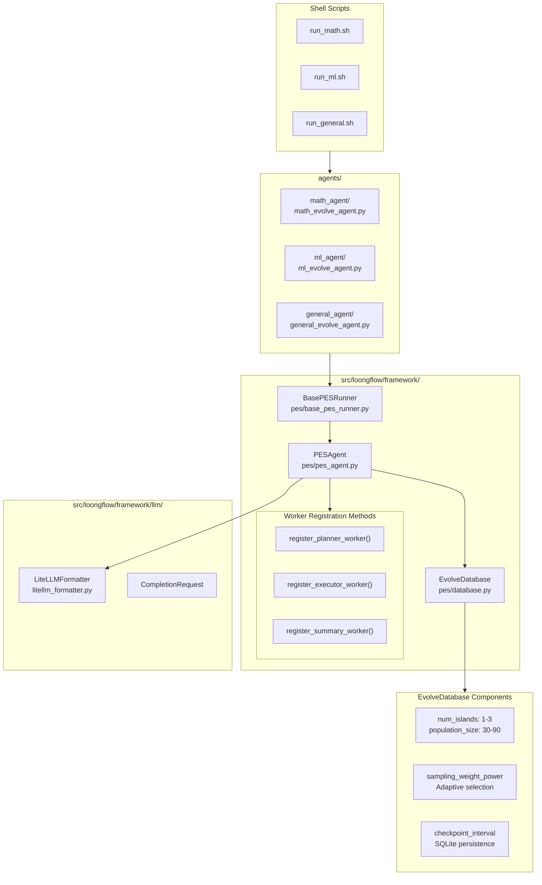
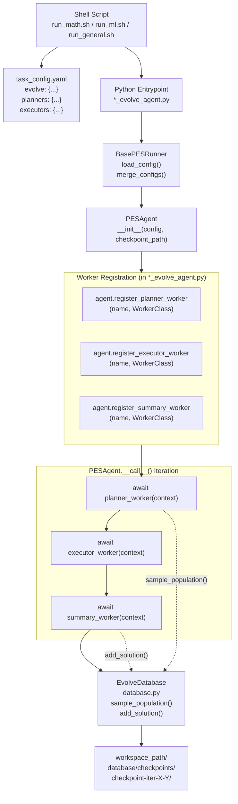
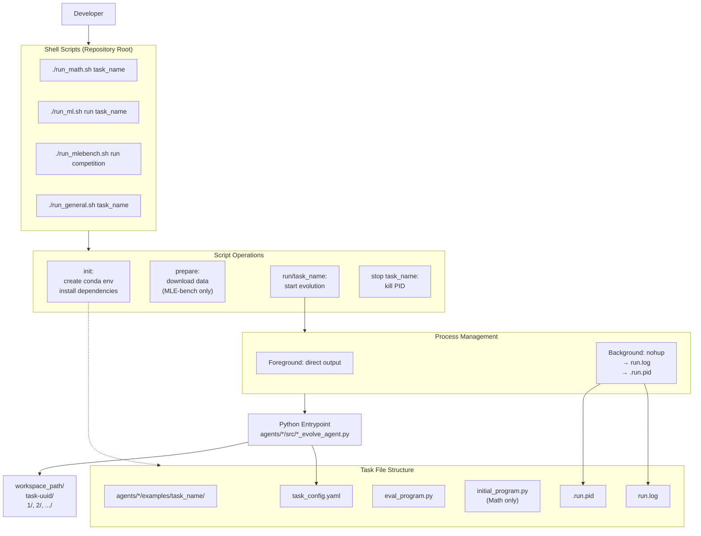
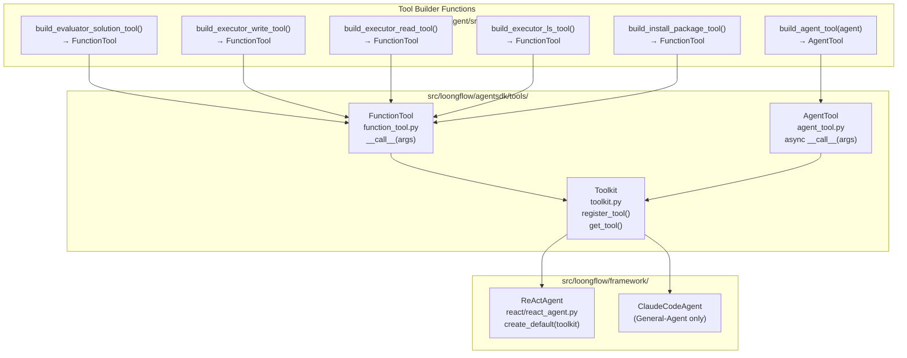
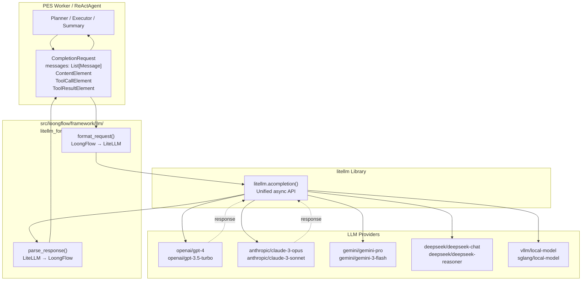

<!-- source: DeepWiki mcp.deepwiki.com · repo baidu-baige/LoongFlow · page 1 Overview · fetched 2026-10-26 -->

# Overview

<details>
<summary>Relevant source files</summary>

The following files were used as context for generating this wiki page:

- [README.md](README.md)
- [agents/ml_agent/README.md](agents/ml_agent/README.md)

</details>


This document provides a high-level introduction to the LoongFlow framework, its core PES (Plan-Execute-Summarize) paradigm, and the architectural components that enable expert-level agent development. For installation instructions, see [Installation & Setup](#2.1). For details on the PES paradigm implementation, see [PES Paradigm](#3.1). For information on specific agent types, see [General Agent](#4), [Math Agent](#5), and [ML Agent](#6).

## What is LoongFlow?

LoongFlow is an open-source framework for building expert-level AI agents that solve complex, long-horizon reasoning tasks through structured thinking and iterative learning. The framework implements a cognitive paradigm inspired by how human experts approach difficult problems: plan systematically, execute deliberately, and learn from both successes and failures.

The framework provides:
- A standardized **PES (Plan-Execute-Summary) thinking paradigm** implemented via the `PESAgent` class
- An **evolutionary memory system** using `EvolveDatabase` with multi-island architecture, MAP-Elites diversity preservation, and adaptive Boltzmann selection
- **Three specialized agent implementations** in `agents/math_agent/`, `agents/ml_agent/`, and `agents/general_agent/`
- **LLM-agnostic integration** via `LiteLLMFormatter` supporting OpenAI-compatible APIs

**Sources:** [README.md:1-110](), [README.md:125-140]()

## The PES Paradigm

The Plan-Execute-Summary (PES) paradigm is the central abstraction in LoongFlow. Each evolution cycle consists of three distinct phases implemented via worker registration in `PESAgent`:

| Phase | Worker Registration Method | Purpose | Key Activities |
|-------|---------------------------|---------|----------------|
| **Plan** | `register_planner_worker()` | Design deliberate approach | Sample parent solutions via `EvolveDatabase`, retrieve historical lineage, generate execution blueprint |
| **Execute** | `register_executor_worker()` | Perform controlled experiments | Set up iteration workspace, implement plan, invoke `Evaluator`, collect metrics |
| **Summary** | `register_summary_worker()` | Reflect and consolidate learning | Analyze results, extract insights, update `EvolveDatabase`, record parent-child lineage |

The `PESAgent` class orchestrates this cycle, managing concurrent evolution iterations and checkpointing state to `checkpoint-iter-X-Y/` directories.

**Sources:** [README.md:299-339](), [README.md:439-456]()

## Framework Architecture Overview

**Diagram: Core Framework Components and Code Entities**



The framework architecture consists of:

1. **Core Framework** (`src/loongflow/framework/pes/`)
   - `PESAgent`: Main orchestrator managing evolution cycles
   - `BasePESRunner`: Configuration validation and worker registration template
   - `EvolveDatabase`: SQLite-based persistent storage with checkpoint support

2. **LLM Integration** (`src/loongflow/framework/llm/`)
   - `LiteLLMFormatter`: Message format conversion for multiple providers
   - `CompletionRequest`: Internal message representation

3. **Specialized Agents** (`agents/`)
   - `math_evolve_agent.py`: Math optimization tasks
   - `ml_evolve_agent.py`: Machine learning competitions
   - `general_evolve_agent.py`: General-purpose task solving

4. **Entry Points**
   - Shell scripts: `run_math.sh`, `run_ml.sh`, `run_general.sh`
   - Each script invokes corresponding `*_evolve_agent.py` entrypoint

**Sources:** [README.md:35-90](), [README.md:439-477]()

## PESAgent and Worker System

**Diagram: PESAgent Worker Registration and Code Flow**



The `PESAgent` class implements a worker registry pattern where domain-specific agents register their worker implementations:

| Worker Type | Registration Method | Example Implementations | Purpose |
|-------------|---------------------|------------------------|---------|
| **Planner** | `register_planner_worker(name, Class)` | `GeneralPlanAgent`, `MathPlanner`, `MLPlanner` | Generate execution strategy based on task context and parent solutions |
| **Executor** | `register_executor_worker(name, Class)` | `GeneralExecuteAgent`, `MathExecutor`, `MLExecutor` | Execute plan, generate solution, invoke evaluator |
| **Summary** | `register_summary_worker(name, Class)` | `GeneralSummaryAgent`, `MathSummary`, `MLSummary` | Reflect on results, extract insights, update database |

Each worker receives a `Context` object containing:
- `trace_id`: Unique iteration identifier
- `iteration`: Current iteration number
- `task`: Task configuration and requirements
- `workspace`: Filesystem path for iteration artifacts

The `EvolveDatabase` maintains solution populations, lineage trees, and scores. Checkpoints are saved to `checkpoint-iter-{island}-{iteration}/` directories at intervals defined by `checkpoint_interval` in configuration.

**Sources:** [README.md:439-456](), [README.md:299-339]()

## Three Specialized Agent Types

LoongFlow provides three concrete agent implementations demonstrating different use cases of the PES paradigm.

**Diagram: Three Agent Implementations with Code Paths**

```mermaid
graph TB
    subgraph MathAgent["agents/math_agent/"]
        MathEntry["math_evolve_agent.py"]
        MathPlanner["MathPlanner (ReActAgent)"]
        MathExecutor["MathExecutor (ReActAgent)"]
        MathSummary["MathSummary (ReActAgent)"]
        MathTools["build_evaluator_solution_tool()<br/>build_executor_write_tool()<br/>build_executor_read_tool()<br/>build_install_package_tool()"]
        MathEval["eval_program.py<br/>(per task in examples)"]
    end
    
    subgraph MLAgent["agents/ml_agent/"]
        MLEntry["ml_evolve_agent.py"]
        MLPlanner["MLPlanner (ReActAgent)"]
        MLExecutor["MLExecutor (ReActAgent)"]
        MLSummary["MLSummary (ReActAgent)"]
        MLEBench["mlebench/<br/>prepare.py<br/>grade.py"]
        MLEval["eval_program.py<br/>(per competition)"]
    end
    
    subgraph GeneralAgent["agents/general_agent/"]
        GenEntry["general_evolve_agent.py"]
        GenPlanner["GeneralPlanAgent<br/>(ClaudeCodeAgent)"]
        GenExecutor["GeneralExecuteAgent<br/>(ClaudeCodeAgent)"]
        GenSummary["GeneralSummaryAgent<br/>(ClaudeCodeAgent)"]
        Skills[".claude/skills/<br/>code-analysis<br/>skill-creator"]
        GenEval["GeneralEvaluator<br/>eval_program.py"]
    end
    
    MathEntry --> MathPlanner
    MathEntry --> MathExecutor
    MathEntry --> MathSummary
    MathExecutor --> MathTools
    MathExecutor --> MathEval
    
    MLEntry --> MLPlanner
    MLEntry --> MLExecutor
    MLEntry --> MLSummary
    MLExecutor --> MLEBench
    MLExecutor --> MLEval
    
    GenEntry --> GenPlanner
    GenEntry --> GenExecutor
    GenEntry --> GenSummary
    GenExecutor --> Skills
    GenExecutor --> GenEval
```



| Agent Type | Entrypoint | Worker Classes | Execution Environment | Evaluation |
|------------|------------|----------------|----------------------|------------|
| **Math-Agent** | `math_evolve_agent.py` | `MathPlanner`, `MathExecutor`, `MathSummary` (all `ReActAgent`-based) | Tool-based: `evaluate_solution`, `write`, `read`, `ls`, `install_package` | Task-specific `eval_program.py` in each `examples/` subdirectory |
| **ML-Agent** | `ml_evolve_agent.py` | `MLPlanner`, `MLExecutor`, `MLSummary` (all `ReActAgent`-based) | MLE-bench integration: `prepare.py`, `grade.py`, Kaggle API | Competition-specific `eval_program.py` with metrics from MLE-bench |
| **General-Agent** | `general_evolve_agent.py` | `GeneralPlanAgent`, `GeneralExecuteAgent`, `GeneralSummaryAgent` (all `ClaudeCodeAgent`-based) | Skills system (`.claude/skills/`), solution packs, file I/O tools | `GeneralEvaluator` with optional tool-based or simple scoring |

Key differences:

- **Agent SDK**: Math and ML agents use `ReActAgent` (reasoning-action loop), General agent uses `ClaudeCodeAgent` (Claude SDK wrapper)
- **Tools**: Math/ML use explicit tool builders (`build_*_tool()`), General uses skills loaded from `.claude/skills/`
- **Evaluation**: Math/ML use subprocess-isolated `eval_program.py`, General supports both tool-based and simple evaluation modes

**Sources:** [README.md:35-90](), [README.md:360-432]()

## Execution Infrastructure

**Diagram: Shell Script Execution Flow and File Paths**



| Script | Primary Command | Additional Operations | Task Directory |
|--------|----------------|----------------------|----------------|
| `run_math.sh` | `./run_math.sh <task> [--background]` | `init`, `stop <task>` | `agents/math_agent/examples/<task>/` |
| `run_ml.sh` | `./run_ml.sh run <task> [--background]` | `init`, `stop <task>` | `agents/ml_agent/examples/<task>/` |
| `run_mlebench.sh` | `./run_mlebench.sh run <comp> [--background]` | `init`, `prepare <comp>`, `stop <comp>` | `agents/ml_agent/examples/mlebench/competitions/*/<comp>/` |
| `run_general.sh` | `./run_general.sh <task> [--background]` | `stop <task>` | `agents/general_agent/examples/<task>/` |

**Script Operations:**

1. **init**: Creates conda/mamba environment from `environment_gpu.yaml` or `environment_cpu.yaml` (with automatic GPU detection)
2. **prepare** (MLE-bench only): Downloads competition data via `mlebench prepare <competition-id>`
3. **run/task_name**: 
   - Validates `task_config.yaml` exists in task directory
   - Launches Python entrypoint (`*_evolve_agent.py`)
   - Foreground mode: direct console output
   - Background mode: `nohup ... > run.log 2>&1 &`, saves PID to `.run.pid`
4. **stop**: Reads PID from `.run.pid`, terminates process via `kill`

**Output Structure:**

Each run creates a workspace directory specified by `workspace_path` in `task_config.yaml`, containing:
- Numbered iteration directories: `1/`, `2/`, ...
- Database and checkpoints: `database/checkpoints/checkpoint-iter-X-Y/`
- Evaluation results: `evaluate/`

**Sources:** [README.md:156-263](), [agents/ml_agent/README.md:28-68]()

## Key Framework Components

### Core Classes

| Class | Location | Purpose |
|-------|----------|---------|
| `PESAgent` | `src/loongflow/framework/pes/` | Main orchestrator for evolution cycles, manages worker registry |
| `BasePESRunner` | `src/loongflow/framework/pes/` | Configuration loading, validation, and agent initialization |
| `ReActAgent` | `src/loongflow/framework/react/` | Reasoning-and-acting agent for tool-based execution |
| `EvolveDatabase` | `src/loongflow/framework/pes/` | SQLite-based persistent storage for solutions and lineage |
| `LiteLLMFormatter` | `src/loongflow/framework/llm/` | Unified interface to multiple LLM providers |

### Tool System

**Diagram: Tool System with Code Entities**



| Component | File Path | Purpose | Usage Example |
|-----------|-----------|---------|---------------|
| `FunctionTool` | `src/loongflow/agentsdk/tools/function_tool.py` | Wraps Python functions as tools | `build_executor_write_tool()` creates file writing tool |
| `AgentTool` | `src/loongflow/agentsdk/tools/agent_tool.py` | Wraps nested agent invocation | `build_agent_tool(evaluator_agent)` embeds evaluation agent |
| `Toolkit` | `src/loongflow/agentsdk/tools/toolkit.py` | Manages tool collections | `toolkit.register_tool(tool)`, `toolkit.get_tool(name)` |
| `ReActAgent` | `src/loongflow/framework/react/react_agent.py` | Reasoning-Action agent | `ReActAgent.create_default(model, sys_prompt, toolkit)` |

**Tool Builder Functions** (Math/ML Agents):
- `build_evaluator_solution_tool(eval_program_path, task_data_path)`: Creates tool for running `eval_program.py`
- `build_executor_write_tool(work_dir)`: File writing with path restrictions
- `build_executor_read_tool(work_dir)`: File reading
- `build_executor_ls_tool(work_dir)`: Directory listing
- `build_install_package_tool()`: Package installation via pip

**General-Agent Skills** (alternative to explicit tools):
- Skills loaded from `.claude/skills/` directory
- Formatted via `load_skills()` and `format_loaded_skills()`
- Injected into `ClaudeCodeAgent` system prompts

**Sources:** [README.md:460-477]()

### Utilities and Support

| Component | Purpose |
|-----------|---------|
| **Skills** | Reusable code snippets loaded via `load_skills()` and `format_loaded_skills()` |
| **Solution Packs** | Complete solution directories managed by `copy_solution_files()`, `ensure_manifest()`, `validate_manifest()` |
| **Checkpoints** | Named directories (`checkpoint-iter-X-Y`) for resumable evolution |
| **Visualizer** | Interactive web UI for viewing evolution trees and solution islands |

**Sources:** High-Level Diagrams (Diagram 5), [README.md:389-409](), [README_zh.md:399-420]()

## Evolutionary Memory System

The memory system combines multiple techniques for diversity preservation and intelligent selection:

| Component | Purpose | Implementation |
|-----------|---------|----------------|
| **Multi-Island Architecture** | Maintain diverse solution populations | Multiple independent archives with different selection pressures |
| **MAP-Elites** | Preserve solutions across behavior space | Grid-based archive organized by solution characteristics |
| **Adaptive Boltzmann Selection** | Balance exploration vs exploitation | Temperature-based sampling that adapts to progress |
| **Global Evolutionary Tree** | Track lineage and enable retrieval | Tree structure recording parent-child relationships |

The system allows agents to:
- Sample promising parent solutions for mutation
- Avoid redundant exploration of similar approaches
- Escape local optima through diverse population maintenance
- Learn from historical successes and failures

**Sources:** [README.md:283-295](), [README_zh.md:283-295](), High-Level Diagrams (Diagram 2, 4)

## LLM Integration

**Diagram: LiteLLMFormatter Message Flow**



**Configuration in task_config.yaml:**

```yaml
llm_config:
  url: "https://api.example.com/v1"
  api_key: "your-api-key"
  model: "openai/gpt-4"  # Provider prefix determines routing
  temperature: 0.8
  context_length: 128000
  max_tokens: 8192
  top_p: 1.0
```

**LiteLLMFormatter Responsibilities:**

1. **Message Format Conversion:**
   - `format_request()`: Converts `CompletionRequest` with typed message elements (`ContentElement`, `ToolCallElement`, `ToolResultElement`) to LiteLLM format
   - `parse_response()`: Converts LiteLLM response back to `CompletionRequest`

2. **Provider-Specific Handling:**
   - DeepSeek: Extracts `reasoning_content` field for chain-of-thought models
   - Tool calls: Maps between LoongFlow and provider-specific tool schemas
   - Context management: Handles `context_length` and token truncation

3. **Unified API:**
   - Model selection by prefix: `openai/`, `anthropic/`, `gemini/`, `deepseek/`
   - `litellm.acompletion()` routes to appropriate provider
   - Environment variable fallback: `ANTHROPIC_API_KEY`, `OPENAI_API_KEY`, etc.

**Sources:** [README.md:218-247](), [agents/ml_agent/README.md:94-103]()

## Performance and Results

LoongFlow has demonstrated expert-level performance on challenging benchmarks.

### Mathematical Optimization (Tao's & AlphaEvolve Sets)

Performance on 11 mathematical challenges from Terence Tao's collection and AlphaEvolve benchmark set:

| Problem | Metric | Previously Best | AlphaEvolve | LoongFlow | Example Directory |
|---------|--------|----------------|-------------|-----------|-------------------|
| Circle packing in square | Maximize density | 2.634 | 2.6358627564 | **2.6359829625** | `agents/math_agent/examples/packing_circle_in_unit_square/` |
| Circle packing in rectangle | Maximize density | 2.364 | 2.3658321334 | **2.365832229** | `agents/math_agent/examples/packing_circle_in_rectangle/` |
| Hexagons in hexagons | Minimize ratio | 3.943 | 3.930092 | **3.928906855** | `agents/math_agent/examples/packing_hexagons_in_hexagons/` |
| Max to min ratios | Minimize ratio | 12.89 | 12.88926611 | **12.889243547** | `agents/math_agent/examples/max_to_min_ratios/` |
| Minimum overlap | Minimize overlap | 0.380927 | 0.380924 | **0.380913756** | `agents/math_agent/examples/minimum_overlap_problem/` |
| Uncertainty inequality | Minimize bound | 0.3523 | 0.35209910 | **0.352099104** | `agents/math_agent/examples/uncertainty_inequality/` |
| 2nd autocorrelation | Maximize | 0.88922 | 0.896279944 | **0.902702108** | `agents/math_agent/examples/second_autocorrelation_inequality/` |

**Results Summary:**
- **11 problems** surpassed best known human results
- **7 problems** exceeded AlphaEvolve's performance
- State-of-the-art (SOTA) results in geometry optimization and inequality bounds

### Machine Learning (MLE-bench Kaggle Competitions)

Performance on 48 Kaggle competitions from MLE-bench benchmark:

| Medal Tier | Count | Representative Examples |
|------------|-------|-------------------------|
| 🥇 Gold | 26 | `stanford-covid-vaccine`, `iwildcam-2019-fgvc6`, `3d-object-detection-for-autonomous-vehicles` |
| 🥈 Silver | 17 | Multiple medium-difficulty competitions |
| 🥉 Bronze | 5 | Various simple competitions |

**Competition Difficulty Distribution:**
- Simple: `aerial-cactus-identification`, `dogs-vs-cats-redux-kernels-edition`
- Medium: `google-quest-challenge`, `learning-agency-lab-automated-essay-scoring-2`
- Hard: `rsna-miccai-brain-tumor-radiogenomic-classification`, `vinbigdata-chest-xray-abnormalities-detection`

Full competition results with score breakdowns available in `agents/ml_agent/examples/mlebench/competitions/`.

**Sources:** [README.md:142-427](), [agents/ml_agent/README.md:8-14]()

## Next Steps

To get started with LoongFlow:

1. **Installation**: Follow [Installation & Setup](#2.1) to configure your environment
2. **Quick Starts**: Try the guided tutorials for [Math Agent](#2.2), [ML Agent](#2.3), or [General Agent](#2.4)
3. **Deep Dives**: Learn about the [PES Paradigm](#3.1), [PESAgent Architecture](#3.2), and [Evolutionary Memory](#3.4)
4. **Build Custom Agents**: See [Building Custom Agents](#7) for implementing your own domain-specific agents

For visualization and monitoring, refer to [Visualization & Monitoring](#8).

**Sources:** [README.md:128-204](), [README_zh.md:129-206]()

---

