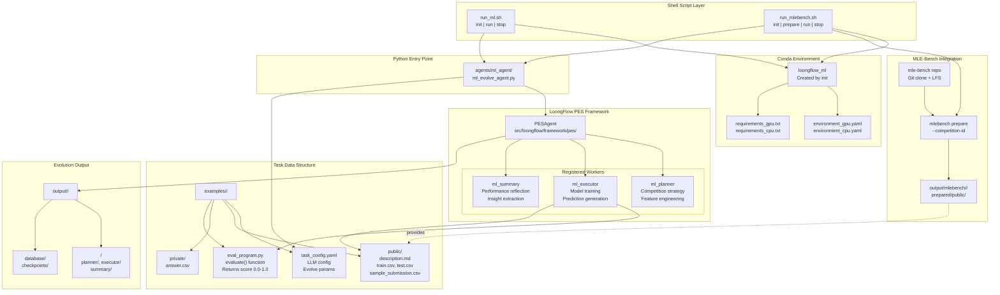
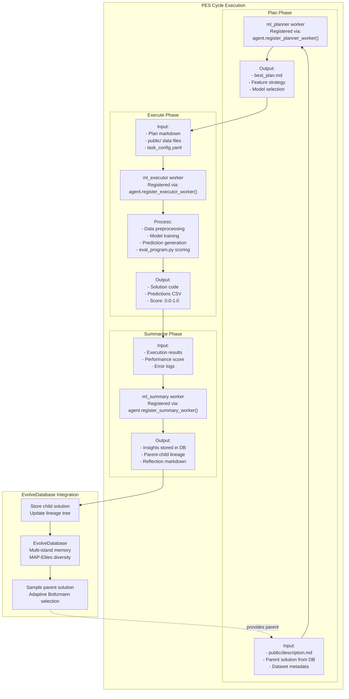
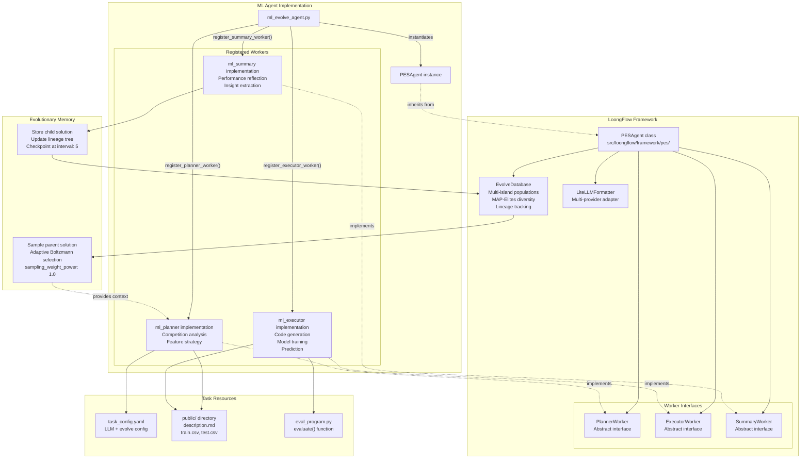

<!-- source: DeepWiki mcp.deepwiki.com · repo baidu-baige/LoongFlow · page 6 ML Agent · fetched 2026-10-26 -->

# ML Agent

<details>
<summary>Relevant source files</summary>

The following files were used as context for generating this wiki page:

- [README.md](README.md)
- [agents/ml_agent/README.md](agents/ml_agent/README.md)

</details>


The ML Agent is LoongFlow's domain-specific agent for autonomous machine learning pipeline construction and iterative optimization. It applies the PES (Plan-Execute-Summary) paradigm to compete in Kaggle-style challenges, achieving **26 Gold medals** across 48 MLE-bench competitions through full-process autonomous construction and continuous evolutionary breakthrough.

Unlike [Math Agent](#5) which optimizes mathematical objectives through algorithm evolution, ML Agent focuses on data-driven workflows including feature engineering, model selection, hyperparameter tuning, and ensemble construction. Unlike [General Agent](#4) which uses solution packs for general coding tasks, ML Agent specializes in competition-style ML problems with dataset files, prediction submissions, and metric-based evaluation.

This introduction page covers:
- ML Agent's MLE-bench performance and capabilities
- System architecture and PES component implementation
- Entry points and execution infrastructure
- File structure and task organization
- Integration with LoongFlow's evolutionary memory system

For detailed usage information, see child pages:
- **[ML Agent Overview](#6.1)** - Capabilities, autonomous ML pipeline construction, and medal breakdown
- **[Configuration Guide](#6.2)** - `task_config.yaml` structure, LLM settings, and evaluator timeouts
- **[Running ML Tasks](#6.3)** - `run_ml.sh` and `run_mlebench.sh` command reference
- **[MLE-Bench Integration](#6.4)** - Competition setup, data preparation, and grading system
- **[Examples & Results](#6.5)** - Competition walkthroughs and solution analysis

**Sources:** [README.md:75-88](), [agents/ml_agent/README.md:1-15]()

## MLE-Bench Performance

The ML Agent has been validated on the complete MLE-bench benchmark, a framework for evaluating ML agents on real Kaggle competitions. Across **48 total competitions**, ML Agent achieved:

| Medal Type | Count | Percentage |
|------------|-------|------------|
| 🥇 Gold    | 26    | 54.2%      |
| 🥈 Silver  | 17    | 35.4%      |
| 🥉 Bronze  | 5     | 10.4%      |

**Medal Distribution by Difficulty:**

| Difficulty | Total | Gold | Silver | Bronze |
|------------|-------|------|--------|--------|
| Simple     | 10    | 10   | 0      | 0      |
| Medium     | 32    | 10   | 17     | 5      |
| Hard       | 6     | 6    | 0      | 0      |

Notable achievements include:
- **100% medal rate** across all 48 competitions
- **Gold medals on all 6 hard-difficulty competitions**, including `stanford-covid-vaccine`, `3d-object-detection-for-autonomous-vehicles`, and `rsna-miccai-brain-tumor-radiogenomic-classification`
- **All 10 simple competitions** achieved Gold, demonstrating strong baseline performance
- Autonomous end-to-end pipeline construction from raw data to final predictions

Full competition results and solution code are available in [agents/ml_agent/examples/mlebench/competitions/](). See [Examples & Results](#6.5) for detailed walkthroughs.

**Sources:** [README.md:8-15](), [README.md:396-427](), [agents/ml_agent/README.md:8-14]()

## System Architecture

The ML Agent implements the PES paradigm with specialized workers for machine learning workflows. The system provides two execution paths: general ML tasks via `run_ml.sh` and MLE-bench competitions via `run_mlebench.sh`.



**ML Agent System Architecture**

The architecture follows a layered design:

**Execution Layer:** Shell scripts ([run_ml.sh](), [run_mlebench.sh]()) manage conda environment setup, process lifecycle (foreground/background), and PID tracking. The `run_mlebench.sh` script adds MLE-bench data preparation via `mlebench prepare` command.

**Agent Layer:** [agents/ml_agent/ml_evolve_agent.py]() instantiates `PESAgent` from the core framework and registers three ML-specific workers: `ml_planner`, `ml_executor`, and `ml_summary`. These workers implement the standard `PlannerWorker`, `ExecutorWorker`, and `SummaryWorker` interfaces with competition-specific logic.

**Task Layer:** Each task requires a directory structure with `task_config.yaml`, `public/` data directory (dataset files, description), `private/` ground truth, and `eval_program.py` for scoring. MLE-bench tasks use standardized formats from the competition definitions.

**Environment Layer:** The `loongflow_ml` conda environment provides ML libraries (scikit-learn, XGBoost, LightGBM, PyTorch, TensorFlow) via [environment_gpu.yaml:1-50]() or [environment_cpu.yaml:1-45]() with additional dependencies in [requirements_gpu.txt]() and [requirements_cpu.txt]().

**Sources:** [run_ml.sh:1-421](), [run_mlebench.sh:1-463](), [agents/ml_agent/README.md:142-167]()

## PES Component Implementation

The ML Agent implements three specialized workers that operate within the PES cycle. Each worker is registered with `PESAgent` during initialization in [agents/ml_agent/ml_evolve_agent.py]().



**ML Agent PES Worker Flow**

### Worker Configuration

Workers are configured in `task_config.yaml` with component-specific parameters:

```yaml
planners:
  ml_planner:
    react_max_steps: 10          # Max LLM interaction turns
    evo_coder_timeout: 3600      # Plan generation timeout (seconds)

executors:
  ml_executor:
    react_max_steps: 10
    evo_coder_timeout: 86400     # Execution timeout (24 hours)

summarizers:
  ml_summary:
    react_max_steps: 10

evolve:
  planner_name: "ml_planner"     # References planners section
  executor_name: "ml_executor"   # References executors section
  summary_name: "ml_summary"     # References summarizers section
```

The `evo_coder_timeout` for executors is set high (24 hours) to accommodate long model training times in competitions like `3d-object-detection-for-autonomous-vehicles`. The evaluator has a separate timeout configured in `evolve.evaluator.timeout` (default 1800 seconds) to prevent hanging evaluation scripts.

**Sources:** [agents/ml_agent/README.md:88-137](), [agents/ml_agent/README.md:104-117]()

### Evaluation Program Interface

Each task implements `eval_program.py` with a standardized `evaluate()` function:

```python
def evaluate(task_data_path, best_code_path, artifacts):
    """
    Args:
        task_data_path: Path to task directory (contains public/, private)
        best_code_path: Path to generated solution code
        artifacts: Dict for passing additional data
    
    Returns:
        dict with keys:
            - status: "success" or "failure"
            - summary: Human-readable description
            - score: Float between 0.0 and 1.0
            - metrics: Dict of additional metrics
            - artifacts: Updated artifacts dict
    """
```

The executor worker runs this function in a subprocess with timeout to score each generated solution. The returned `score` is used by `EvolveDatabase` for Adaptive Boltzmann selection of parent solutions in subsequent iterations.

**Sources:** [agents/ml_agent/README.md:168-177]()

## Entry Points and Execution

The ML Agent provides two shell scripts for different use cases, both managing conda environment setup, process lifecycle, and agent execution.

### Command Reference

**run_ml.sh** - For custom ML tasks:
```bash
# Initialize conda environment
./run_ml.sh init

# Run task in foreground (blocks terminal)
./run_ml.sh run <task_name>

# Run task in background (daemon mode)
./run_ml.sh run <task_name> --background

# Stop background task
./run_ml.sh stop <task_name>
```

**run_mlebench.sh** - For MLE-bench competitions:
```bash
# Initialize environment and clone mle-bench repo
./run_mlebench.sh init

# Download competition data
./run_mlebench.sh prepare <competition_id>

# Run competition
./run_mlebench.sh run <competition_id> [--background]

# Stop competition
./run_mlebench.sh stop <competition_id>
```

### Execution Flow

```mermaid
graph TB
    subgraph "init Command"
        init_start["./run_*.sh init"]
        detect_gpu["Detect GPU:<br/>nvidia-smi check"]
        select_env["Select environment:<br/>environment_gpu.yaml<br/>OR environment_cpu.yaml"]
        create_conda["Create conda env:<br/>loongflow_ml"]
        install_deps["Install dependencies:<br/>requirements_*.txt"]
        clone_mle["Clone mle-bench<br/>(mlebench.sh only)"]
        
        init_start --> detect_gpu
        detect_gpu --> select_env
        select_env --> create_conda
        create_conda --> install_deps
        install_deps --> clone_mle
    end
    
    subgraph "prepare Command (MLE-bench only)"
        prep_start["./run_mlebench.sh prepare<br/>&lt;competition_id&gt;"]
        run_mlebench_cmd["mlebench prepare<br/>--competition-id &lt;id&gt;"]
        download_data["Download from Git LFS:<br/>Competition datasets"]
        extract_data["Extract to:<br/>output/mlebench/&lt;id&gt;/<br/>prepared/public/"]
        
        prep_start --> run_mlebench_cmd
        run_mlebench_cmd --> download_data
        download_data --> extract_data
    end
    
    subgraph "run Command"
        run_start["./run_*.sh run<br/>&lt;task_name&gt; [--background]"]
        validate["Validate task files:<br/>task_config.yaml<br/>eval_program.py<br/>public/ directory"]
        activate["Activate loongflow_ml:<br/>Set PYTHONPATH<br/>Set LD_LIBRARY_PATH"]
        check_mode["Check execution mode"]
        foreground["Foreground:<br/>Block terminal<br/>Direct stdout/stderr"]
        background["Background:<br/>nohup command &<br/>Write .agent.pid<br/>Log to agent.log"]
        exec_python["Execute:<br/>python3 -u ml_evolve_agent.py<br/>--config &lt;yaml&gt;<br/>--task-data-path &lt;dir&gt;"]
        
        run_start --> validate
        validate --> activate
        activate --> check_mode
        check_mode -->|"default"| foreground
        check_mode -->|"--background"| background
        foreground --> exec_python
        background --> exec_python
    end
    
    subgraph "stop Command"
        stop_start["./run_*.sh stop<br/>&lt;task_name&gt;"]
        read_pid["Read .agent.pid file"]
        find_children["Find child processes:<br/>pgrep -P &lt;pid&gt;"]
        send_sigterm["Send SIGTERM<br/>to all processes"]
        wait_term["Wait 10 seconds"]
        check_alive["Check if alive"]
        send_sigkill["Force kill: SIGKILL"]
        cleanup["Remove .agent.pid"]
        
        stop_start --> read_pid
        read_pid --> find_children
        find_children --> send_sigterm
        send_sigterm --> wait_term
        wait_term --> check_alive
        check_alive -->|"still alive"| send_sigkill
        check_alive -->|"terminated"| cleanup
        send_sigkill --> cleanup
    end
```



**ML Agent Execution Commands**

### Process Management

Both scripts implement robust process management:

**PID Tracking** ([run_ml.sh:254-264](), [run_mlebench.sh:302-312]()):
- In background mode, writes process ID to `<task_dir>/.agent.pid`
- Used by `stop` command to locate and terminate processes
- Recursively finds child processes spawned during execution

**Graceful Shutdown** ([run_ml.sh:295-366](), [run_mlebench.sh:340-408]()):
- Sends `SIGTERM` to allow cleanup (close files, save checkpoints)
- Waits 10 seconds for graceful shutdown
- Falls back to `SIGKILL` if process doesn't terminate
- Cleans up PID file after termination

**Environment Variables:**
```bash
# Set by activate_env() function
export CONDA_PREFIX=/path/to/loongflow_ml
export LD_LIBRARY_PATH=$CONDA_PREFIX/lib:$LD_LIBRARY_PATH

# Set before executing Python
export PYTHONPATH=$SCRIPT_DIR:$SCRIPT_DIR/src:$PYTHONPATH
```

**Sources:** [run_ml.sh:40-90](), [run_ml.sh:172-293](), [run_mlebench.sh:42-92](), [run_mlebench.sh:233-338]()

## Directory Structure

The ML Agent organizes code into examples, environment definitions, and the main agent entry point.

```
agents/ml_agent/
├── examples/                          # Task directories
│   ├── ml_example/                   # Custom ML task template
│   │   ├── task_config.yaml         # LLM and evolution config
│   │   ├── public/                  # Visible to agent
│   │   │   ├── description.md       # Task description
│   │   │   ├── train.csv            # Training data
│   │   │   ├── test.csv             # Test features
│   │   │   └── sample_submission.csv # Format example
│   │   ├── private/                 # Hidden from agent
│   │   │   └── answer.csv           # Ground truth labels
│   │   ├── eval_program.py          # Scoring function
│   │   └── .agent.pid               # Runtime PID file
│   │
│   ├── mlebench/                    # MLE-bench competitions
│   │   ├── task_config.yaml         # Shared template
│   │   ├── eval_program.py          # Generic competition scorer
│   │   └── competitions/            # Results and examples
│   │       ├── simple/              # 10 competitions (all Gold)
│   │       │   ├── aerial-cactus-identification/
│   │       │   └── ...
│   │       ├── medium/              # 32 competitions
│   │       │   ├── chaii-hindi-and-tamil-question-answering/
│   │       │   └── ...
│   │       └── hard/                # 6 competitions (all Gold)
│   │           ├── stanford-covid-vaccine/
│   │           └── ...
│   │
│   ├── environment_gpu.yaml         # Conda spec with CUDA
│   ├── environment_cpu.yaml         # Conda spec without CUDA
│   ├── requirements_gpu.txt         # GPU-specific packages
│   └── requirements_cpu.txt         # CPU-only packages
│
├── ml_evolve_agent.py               # Main entry point
├── visualizer/
│   └── visualizer.py                # Web UI for evolution tree
└── README.md                        # Agent documentation

output/                              # Generated during execution
├── <task-uuid>/                     # Unique workspace per run
│   ├── 1/, 2/, .../                # Iteration directories
│   │   ├── planner/                # Plan markdown files
│   │   ├── executor/               # Generated code and results
│   │   └── summary/                # Reflection files
│   └── database/                   # Checkpoints and population
│       └── checkpoints/
│           └── checkpoint-iter-X-Y
└── logs/
    └── evolux.log                  # Global execution log
```

### File Roles

| Path | Type | Purpose |
|------|------|---------|
| **ml_evolve_agent.py** | Python script | Instantiates `PESAgent`, registers `ml_planner`, `ml_executor`, `ml_summary` workers |
| **task_config.yaml** | YAML config | Defines `llm_config` (API credentials, model), `evolve` (iterations, concurrency), worker settings |
| **public/description.md** | Markdown | Task description visible to agent, includes dataset info and evaluation metric |
| **public/*.csv** | Data files | Training data, test features, submission format example |
| **private/answer.csv** | Data file | Ground truth labels, used by `eval_program.py` but hidden from agent |
| **eval_program.py** | Python module | Implements `evaluate(task_data_path, best_code_path, artifacts)` function returning score 0.0-1.0 |
| **environment_*.yaml** | Conda spec | Defines Python 3.12, base ML libraries (scikit-learn, pandas, numpy, scipy) |
| **requirements_*.txt** | Pip deps | Advanced libraries (XGBoost, LightGBM, CatBoost, PyTorch, TensorFlow, transformers) |
| **.agent.pid** | PID file | Stores process ID in background mode, used by `stop` command |

**Sources:** [agents/ml_agent/README.md:70-85](), [agents/ml_agent/README.md:142-167]()

## Task Configuration Structure

Each ML task requires a `task_config.yaml` file that configures the agent's LLM provider, evolution parameters, and component settings.

### Configuration Schema

```yaml
# Workspace for storing iteration results
workspace_path: "./output"

# LLM provider configuration (required)
llm_config:
  url: "https://api.example.com/v1"      # API endpoint
  api_key: "your-api-key"                # Authentication key
  model: "openai/gemini-3-pro-preview"   # Model identifier (provider/name)
  temperature: 0.8                       # Sampling temperature
  context_length: 128000                 # Token context window
  max_tokens: 32768                      # Max tokens per response
  top_p: 1.0                            # Nucleus sampling parameter

# Planner component configuration
planners:
  ml_planner:
    react_max_steps: 10                  # Max ReAct iterations
    evo_coder_timeout: 3600              # Plan generation timeout (seconds)

# Executor component configuration
executors:
  ml_executor:
    react_max_steps: 10
    evo_coder_timeout: 86400             # 24-hour timeout for training

# Summary component configuration
summarizers:
  ml_summary:
    react_max_steps: 10

# Evolution loop configuration
evolve:
  planner_name: "ml_planner"             # References planners section
  executor_name: "ml_executor"           # References executors section
  summary_name: "ml_summary"             # References summarizers section
  max_iterations: 100                    # Stop after N iterations
  target_score: 1.0                      # Stop when score reached
  concurrency: 1                         # Parallel evolution workers
  
  # Evaluator subprocess configuration
  evaluator:
    timeout: 1800                        # eval_program.py timeout (30 min)
  
  # Evolution database configuration
  database:
    storage_type: "in_memory"            # Storage backend
    num_islands: 3                       # Population diversity
    population_size: 30                  # Solutions per island
    checkpoint_interval: 5               # Save every N iterations
    sampling_weight_power: 1.0           # Boltzmann selection exponent
```

### Key Parameters

**LLM Configuration:**
- `model`: Use format `provider/model-name`. Default provider is `openai` if omitted.
  - Recommended: `openai/gemini-3-pro-preview` for strong reasoning
  - Alternative: `deepseek-r1-250528` for cost-effectiveness
- `temperature`: Higher values (0.8-1.0) encourage exploration
- `context_length`: Should match model's context window (e.g., 128K for Gemini)

**Timeouts:**
- `evo_coder_timeout` in executors: Set high (86400 = 24 hours) for competitions with long training times
- `evaluator.timeout`: Controls `eval_program.py` execution time, prevents hanging on bad code

**Evolution Parameters:**
- `num_islands`: 3 islands create diversity while maintaining convergence
- `population_size`: 30 solutions per island balances memory and exploration
- `checkpoint_interval`: Save more frequently (e.g., 5) for expensive runs
- `sampling_weight_power`: Higher values (e.g., 2.0) bias toward high-scoring parents

See [Configuration Guide](#6.2) for detailed parameter tuning and [agents/ml_agent/README.md:88-137]() for complete examples.

**Sources:** [agents/ml_agent/README.md:88-137]()


## Integration with LoongFlow Core

The ML Agent builds on LoongFlow's PES framework and evolutionary memory system, implementing domain-specific workers while leveraging shared infrastructure.



**ML Agent Framework Integration**

The ML Agent leverages LoongFlow's evolutionary infrastructure:

**Worker Registration:** [ml_evolve_agent.py]() creates a `PESAgent` instance and registers three domain-specific workers via:
- `agent.register_planner_worker("ml_planner", MLPlannerClass)`
- `agent.register_executor_worker("ml_executor", MLExecutorClass)`
- `agent.register_summary_worker("ml_summary", MLSummaryClass)`

These workers implement the standard `PlannerWorker`, `ExecutorWorker`, and `SummaryWorker` interfaces but contain ML-specific logic for competition analysis, model training, and performance reflection.

**Evolutionary Memory:** The `EvolveDatabase` maintains:
- **Multi-island populations**: 3 islands × 30 solutions = 90 total solutions in memory
- **MAP-Elites diversity**: Discretizes behavior space to preserve diverse strategies
- **Adaptive Boltzmann selection**: Uses `sampling_weight_power: 1.0` to bias parent sampling toward high-scoring solutions while maintaining exploration
- **Global lineage tree**: Tracks parent-child relationships across all iterations for experience retrieval

**LLM Integration:** The `LiteLLMFormatter` provides provider-agnostic access to LLMs, converting between LoongFlow's message format and provider-specific APIs. Recommended models: `openai/gemini-3-pro-preview` or `deepseek-r1-250528`.

See [PES Paradigm](#3.1), [PESAgent Architecture](#3.2), and [Evolutionary Memory System](#3.4) for framework details.

**Sources:** [README.md:439-455](), Diagram 2 from high-level architecture

## Comparison with Other Agents

The three LoongFlow agents share the PES framework but differ in domain focus, execution environment, and evaluation methods.

| Aspect | ML Agent | Math Agent | General Agent |
|--------|----------|------------|---------------|
| **Domain** | Kaggle-style ML competitions | Mathematical optimization problems | General programming tasks |
| **Input Data** | Dataset files (CSV, images, audio) | `eval_program.py` + `initial_program.py` | Task description + skill packages |
| **Primary Workflow** | Data → feature engineering → model training → predictions → scoring | Algorithm design → iterative improvement → objective evaluation | Plan → solution pack generation → task completion |
| **Evaluation** | Competition metrics (accuracy, AUC, RMSE, F1) | Numerical objectives (min/max values) | Custom evaluators (simple or tool-based) |
| **Key Libraries** | scikit-learn, XGBoost, LightGBM, PyTorch, TensorFlow | NumPy, SciPy, math utilities | ClaudeCodeAgent with custom tools |
| **Output Artifacts** | Prediction CSV files + trained model code | Optimized algorithm implementation | Solution pack files (code + manifest) |
| **Environment** | `loongflow_ml` conda (GPU/CPU variants) | Standard Python environment | Agent SDK environment |
| **Shell Scripts** | `run_ml.sh`, `run_mlebench.sh` | `run_math.sh` | `run_general.sh` |
| **Special Features** | MLE-bench integration for standardized competitions | Initial solution seeding for warm start | Skills system for domain knowledge |
| **Typical Runtime** | Hours to days (model training) | Minutes to hours (algorithm iteration) | Minutes (code generation) |

**Key Architectural Differences:**

**ML Agent** ([agents/ml_agent/]()):
- Conda-based environment isolation with ML stack dependencies
- MLE-bench integration for standardized competition datasets
- Extended executor timeout (24 hours) to accommodate long training
- Evaluator runs `eval_program.py` in subprocess to score predictions

**Math Agent** ([agents/math_agent/]()):
- Requires `initial_program.py` to seed first solution
- Focuses on numerical optimization (circle packing, inequality bounds)
- Shorter iteration cycles (minutes) due to algorithm evaluation
- Achieves SOTA results on Tao's mathematical challenges

**General Agent** ([agents/general_agent/]()):
- Uses solution pack abstraction with manifest files
- Skills system provides reusable domain knowledge
- Progressive difficulty examples (⭐ to ⭐⭐⭐⭐)
- ClaudeCodeAgent integration for file operations and terminal access

All three agents share:
- PES (Plan-Execute-Summary) thinking paradigm
- Multi-island + MAP-Elites evolutionary memory
- Adaptive Boltzmann parent selection
- Checkpoint and resumption support
- Web-based visualization of evolution tree

**Sources:** [README.md:45-88](), Diagram 3 from high-level architecture, [agents/general_agent/TUTORIAL.md:1-50]()

## Next Steps

This page provides an overview of the ML Agent system. For detailed information on specific aspects:

- **[Configuration Guide](#6.2)** - Detailed `task_config.yaml` structure, parameter tuning, and LLM setup
- **[Running ML Tasks](#6.3)** - Step-by-step guide to running general ML tasks with `run_ml.sh`
- **[MLE-Bench Integration](#6.4)** - Complete MLE-bench workflow, competition setup, and data preparation
- **[Examples & Results](#6.5)** - Kaggle gold medal achievements, competition walkthroughs, and performance analysis

For framework-level details:
- **[PES Paradigm](#3.1)** - Understanding Plan-Execute-Summarize thinking
- **[PESAgent Architecture](#3.2)** - Core orchestration and worker registration
- **[Evolutionary Memory System](#3.4)** - How solutions are stored and selected

For developing custom ML agents:
- **[Custom PES Components](#7.2)** - Implementing custom Planner/Executor/Summary workers
- **[Custom Evaluators](#7.4)** - Creating competition-specific evaluation programs

**Sources:** JSON table of contents, [README.md:35]()

---

