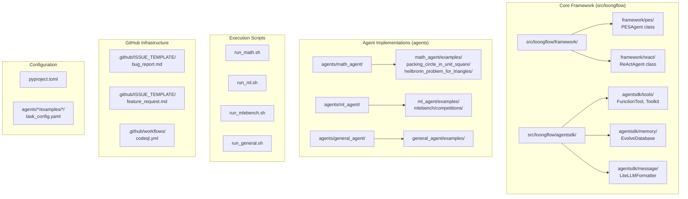
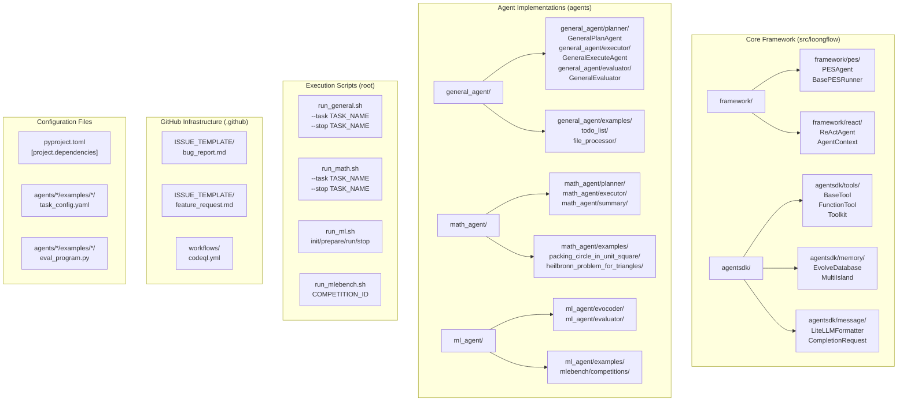
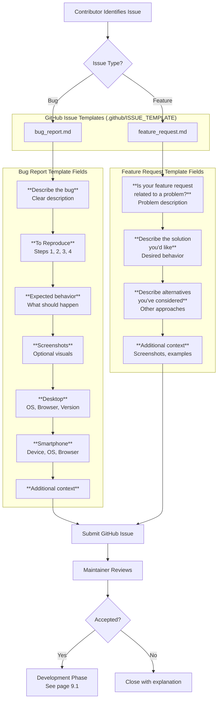

<!-- source: DeepWiki mcp.deepwiki.com · repo baidu-baige/LoongFlow · page 9 Contributing to LoongFlow · fetched 2026-10-26 -->

# Contributing to LoongFlow

<details>
<summary>Relevant source files</summary>

The following files were used as context for generating this wiki page:

- [.github/ISSUE_TEMPLATE/bug_report.md](.github/ISSUE_TEMPLATE/bug_report.md)
- [.github/ISSUE_TEMPLATE/feature_request.md](.github/ISSUE_TEMPLATE/feature_request.md)

</details>


LoongFlow is an open-source evolutionary agent development framework that welcomes community contributions. This page provides an overview of the contribution process, from setting up your development environment to submitting pull requests.

## Overview

Contributions to LoongFlow can take multiple forms:

- **Bug Reports & Feature Requests**: Submit issues using GitHub issue templates
- **Code Contributions**: Bug fixes, new features, or improvements via pull requests
- **Documentation**: Wiki updates, code comments, or example improvements
- **Agent Implementations**: New specialized agents or task examples

All contributions follow a structured workflow managed through GitHub's issue and pull request system, with automated validation via GitHub Actions.

## Quick Navigation

| Topic | Page | Description |
|-------|------|-------------|
| **Development Setup** | [9.1]() | Environment setup, architecture guidelines, coding standards |
| **Reporting Issues** | [9.2]() | Bug report and feature request templates |
| **Pull Requests** | [9.3]() | PR workflow, review process, and requirements |

**Sources:** [README.md:444-454]()
</thinking>

## Repository Structure for Contributors

Understanding the repository structure is essential for making targeted contributions. The codebase is organized into clear functional areas:

### Diagram: Repository Structure and Contribution Areas



**Sources:** [README.md:35-205](), Diagram 1 from high-level architecture

## Contribution Areas by Component

Different types of contributions target different parts of the codebase:

| Contribution Type | Target Location | Key Files/Classes | Considerations |
|-------------------|----------------|-------------------|----------------|
| **PES Framework** | `src/loongflow/framework/pes/` | `PESAgent`, `BasePESRunner` | Extend base worker classes, maintain async patterns |
| **ReAct Framework** | `src/loongflow/framework/react/` | `ReActAgent`, `AgentContext` | Follow ReAct paradigm, integrate with `Toolkit` |
| **Tool Development** | `src/loongflow/agentsdk/tools/` | `FunctionTool`, `Toolkit` | Keep agent-agnostic, implement `BaseTool` |
| **LLM Integration** | `src/loongflow/agentsdk/message/` | `LiteLLMFormatter` | Ensure compatibility with LiteLLM |
| **Math Agent** | `agents/math_agent/` | Planner, Executor, Summary workers | Follow PES paradigm, provide evaluator |
| **ML Agent** | `agents/ml_agent/` | `evocoder/`, `evaluator/` | Ensure MLE-Bench compatibility |
| **General Agent** | `agents/general_agent/` | `GeneralPlanAgent`, `GeneralExecuteAgent` | Use ClaudeCodeAgent, manage solution packs |
| **Task Example** | `agents/*/examples/*/` | `task_config.yaml`, `eval_program.py` | Complete task specification required |
| **Core Dependencies** | `pyproject.toml` | `[project.dependencies]` | Universal dependencies only |
| **Task Dependencies** | `agents/*/examples/*/requirements.txt` | Per-task requirements | Isolated from core |

**Sources:** [README.md:130-153](), [README.md:158-177](), [README.md:182-204]()
</old_str>
<new_str>
# Contributing to LoongFlow

LoongFlow is an open-source evolutionary agent development framework that welcomes community contributions. This page provides an overview of the contribution process, from setting up your development environment to submitting pull requests.

## Overview

Contributions to LoongFlow can take multiple forms:

- **Bug Reports & Feature Requests**: Submit issues using GitHub issue templates
- **Code Contributions**: Bug fixes, new features, or improvements via pull requests
- **Documentation**: Wiki updates, code comments, or example improvements
- **Agent Implementations**: New specialized agents or task examples

All contributions follow a structured workflow managed through GitHub's issue and pull request system, with automated validation via GitHub Actions.

## Quick Navigation

| Topic | Page | Description |
|-------|------|-------------|
| **Development Setup** | [9.1]() | Environment setup, architecture guidelines, coding standards |
| **Reporting Issues** | [9.2]() | Bug report and feature request templates |
| **Pull Requests** | [9.3]() | PR workflow, review process, and requirements |

**Sources:** [.github/ISSUE_TEMPLATE/bug_report.md:1-39](), [.github/ISSUE_TEMPLATE/feature_request.md:1-21]()

## Repository Structure for Contributors

Understanding the repository structure is essential for making targeted contributions. The codebase is organized into clear functional areas:

### Diagram: Repository Structure and Contribution Areas



**Sources:** [.github/ISSUE_TEMPLATE/bug_report.md:1-39](), [.github/ISSUE_TEMPLATE/feature_request.md:1-21]()

## Contribution Areas by Component

Different types of contributions target different parts of the codebase:

| Contribution Type | Target Location | Key Files/Classes | Considerations |
|-------------------|----------------|-------------------|----------------|
| **PES Framework** | `src/loongflow/framework/pes/` | `PESAgent`, `BasePESRunner` | Extend base worker classes, maintain async patterns |
| **ReAct Framework** | `src/loongflow/framework/react/` | `ReActAgent`, `AgentContext` | Follow ReAct paradigm, integrate with `Toolkit` |
| **Generic Tool** | `src/loongflow/agentsdk/tools/` | `BaseTool`, `FunctionTool`, `Toolkit` | Keep agent-agnostic, implement tool interface |
| **Memory System** | `src/loongflow/agentsdk/memory/` | `EvolveDatabase`, `MultiIsland` | Understand MAP-Elites and Boltzmann selection |
| **LLM Integration** | `src/loongflow/agentsdk/message/` | `LiteLLMFormatter`, `CompletionRequest` | Ensure LiteLLM compatibility |
| **General Agent** | `agents/general_agent/` | `GeneralPlanAgent`, `GeneralExecuteAgent`, `GeneralEvaluator` | Use ClaudeCodeAgent, manage solution packs |
| **Math Agent** | `agents/math_agent/` | Planner, Executor, Summary workers | Follow PES paradigm, provide evaluator |
| **ML Agent** | `agents/ml_agent/` | `evocoder/`, `evaluator/` | Ensure MLE-Bench compatibility |
| **New Task Example** | `agents/*/examples/*/` | `task_config.yaml`, `eval_program.py` | Provide complete task specification |
| **Shell Scripts** | Root directory | `run_general.sh`, `run_math.sh`, `run_ml.sh`, `run_mlebench.sh` | Maintain consistent CLI interface |
| **Core Dependency** | `pyproject.toml` | `[project.dependencies]` | Must be universally needed |
| **Task Dependency** | `agents/*/examples/*/requirements.txt` | Task-level requirements | Keep isolated from core |

**Sources:** [.github/ISSUE_TEMPLATE/bug_report.md:1-39](), [.github/ISSUE_TEMPLATE/feature_request.md:1-21]()

## Contribution Workflow Overview

The contribution process follows a structured lifecycle from issue creation through code review and merge:

### Diagram: GitHub Issue Template Usage



**Sources:** [.github/ISSUE_TEMPLATE/bug_report.md:1-39](), [.github/ISSUE_TEMPLATE/feature_request.md:1-21]()

## Key Contribution Guidelines

### Development Environment Setup

Before contributing, set up the development environment. See [9.1]() for detailed setup instructions. The basic process is:

```bash
# Clone repository
git clone https://github.com/baidu-baige/LoongFlow
cd LoongFlow

# Install with uv (recommended)
uv venv .venv --python 3.12
source .venv/bin/activate
uv pip install -e .
```

**Sources:** [.github/ISSUE_TEMPLATE/bug_report.md:26-29]()

### Code Organization Principles

The LoongFlow codebase follows a layered architecture:

| Layer | Location | Key Components |
|-------|----------|----------------|
| **Core Framework** | `src/loongflow/framework/` | `pes/PESAgent`, `react/ReActAgent` |
| **Agent SDK** | `src/loongflow/agentsdk/` | `tools/`, `memory/`, `message/` |
| **Agent Implementations** | `agents/*/` | `general_agent/`, `math_agent/`, `ml_agent/` |
| **Task Examples** | `agents/*/examples/*/` | `task_config.yaml`, `eval_program.py` |
| **Execution Scripts** | Root directory | `run_general.sh`, `run_math.sh`, `run_ml.sh` |
| **GitHub Infrastructure** | `.github/` | `ISSUE_TEMPLATE/`, `workflows/` |

Detailed development standards and guidelines are in [9.1]().

**Sources:** [.github/ISSUE_TEMPLATE/bug_report.md:1-39](), [.github/ISSUE_TEMPLATE/feature_request.md:1-21]()

## Types of Contributions

LoongFlow welcomes contributions in multiple forms:

### Bug Reports

Use the bug report template at [.github/ISSUE_TEMPLATE/bug_report.md:1-39]() to report issues. Required sections:

| Section | Description | Template Location |
|---------|-------------|-------------------|
| **Describe the bug** | Clear, concise description | [bug_report.md:10-11]() |
| **To Reproduce** | Numbered steps (1, 2, 3, 4) | [bug_report.md:13-18]() |
| **Expected behavior** | What should happen | [bug_report.md:20-21]() |
| **Screenshots** | Optional visual evidence | [bug_report.md:23-24]() |
| **Desktop** | OS, Browser, Version | [bug_report.md:26-29]() |
| **Smartphone** | Device, OS, Browser, Version | [bug_report.md:31-35]() |
| **Additional context** | Any other relevant info | [bug_report.md:37-38]() |

### Feature Requests

Use the feature request template at [.github/ISSUE_TEMPLATE/feature_request.md:1-21]() to suggest improvements. Required sections:

| Section | Description | Template Location |
|---------|-------------|-------------------|
| **Problem** | What problem does this solve? | [feature_request.md:10-11]() |
| **Solution** | Describe the desired behavior | [feature_request.md:13-14]() |
| **Alternatives** | Other approaches considered | [feature_request.md:16-17]() |
| **Additional context** | Screenshots, examples, use cases | [feature_request.md:19-20]() |

### Code Contributions

Code contributions follow a structured process detailed in [9.3](). Key requirements:

1. **Link to Issue**: Reference an existing GitHub Issue number
2. **Follow Standards**: Adhere to code organization and development standards
3. **Include Tests**: Add tests for new functionality
4. **Documentation**: Update relevant wiki pages and code comments
5. **Review Process**: Receive maintainer approval before merge

### Documentation Contributions

Documentation improvements are always welcome:

| Type | Location | Examples |
|------|----------|----------|
| **Wiki Pages** | GitHub Wiki | Add examples, clarify concepts, fix errors |
| **Code Comments** | Source files | Docstrings, inline explanations |
| **README Files** | Repository root | Installation, usage, examples |
| **Task Documentation** | `agents/*/examples/*/` | Task descriptions, configuration guides |

**Sources:** [.github/ISSUE_TEMPLATE/bug_report.md:1-39](), [.github/ISSUE_TEMPLATE/feature_request.md:1-21]()

## Getting Help

Contributors needing assistance can use the following resources:

| Resource | Purpose | When to Use |
|----------|---------|-------------|
| **GitHub Issues** | Bug reports, feature suggestions | Public discussion, searchable history |
| **Wiki Pages** | Documentation, guides | Setup, configuration, usage questions |
| **Issue Templates** | Structured reporting | Use templates for consistency |

Before requesting help:
1. Search existing GitHub Issues for similar problems
2. Review relevant wiki pages: [Getting Started](2), [Core Framework](3), [Agent Documentation](4-6)
3. Check issue templates for required information

**Sources:** [.github/ISSUE_TEMPLATE/bug_report.md:1-39](), [.github/ISSUE_TEMPLATE/feature_request.md:1-21]()

## Contribution Best Practices

Follow these practices for effective contributions:

### Before Submitting

| Practice | Description | Benefit |
|----------|-------------|---------|
| **Search First** | Check existing Issues before creating new ones | Avoid duplicates, find related work |
| **Read Templates** | Review issue/PR templates before filling | Ensure complete information |
| **Test Locally** | Verify changes in local environment | Catch errors before submission |
| **Follow Standards** | Use consistent naming, formatting, structure | Maintain code quality |

### During Submission

| Practice | Description | Location |
|----------|-------------|----------|
| **Use Templates** | Fill all required sections | [.github/ISSUE_TEMPLATE/bug_report.md:1-39]() |
| **Link Issues** | Reference Issue numbers in PRs | GitHub PR description |
| **Be Specific** | Provide detailed, actionable information | All sections of templates |
| **Include Context** | Add environment, version, configuration details | [bug_report.md:26-35]() |

### After Submission

| Practice | Description |
|----------|-------------|
| **Respond Promptly** | Address reviewer feedback quickly |
| **Update Documentation** | Revise wiki pages if needed |
| **Monitor CI** | Check automated validation results |

**Sources:** [.github/ISSUE_TEMPLATE/bug_report.md:1-39](), [.github/ISSUE_TEMPLATE/feature_request.md:1-21]()

## Summary

LoongFlow's contribution process balances open community participation with quality assurance through:
- **Structured Templates**: Issue and PR templates ensure complete information
- **Automated Validation**: CodeQL scanning catches security issues automatically
- **Human Review**: Multiple maintainer approvals provide architectural oversight
- **Clear Documentation**: CONTRIBUTING.md and wiki pages guide contributors

For detailed procedures, continue to:
- [Contribution Workflow](#5.1) for step-by-step fork/branch/commit instructions
- [Issue Reporting](#5.2) for template usage details
- [Code Quality & CI/CD](#5.3) for CI/CD pipeline specifics

**Sources:** [CONTRIBUTING.md:1-42](), Diagram 6 from high-level architecture

---

