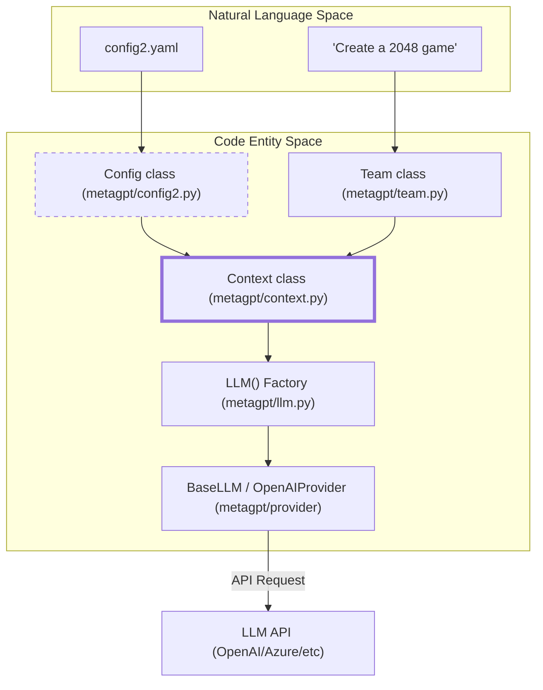
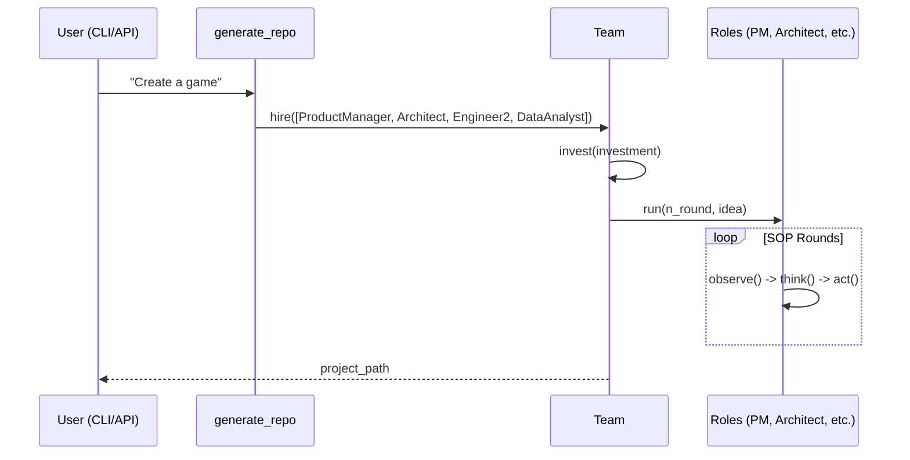

<!-- source: DeepWiki mcp.deepwiki.com · repo geekan/MetaGPT · page 1.1 Getting Started · fetched 2026-10-26 -->

# Getting Started

<details>
<summary>Relevant source files</summary>

The following files were used as context for generating this wiki page:

- [Dockerfile](Dockerfile)
- [README.md](README.md)
- [config/config2.example.yaml](config/config2.example.yaml)
- [docs/ACADEMIC_WORK.md](docs/ACADEMIC_WORK.md)
- [docs/FAQ-EN.md](docs/FAQ-EN.md)
- [docs/NEWS.md](docs/NEWS.md)
- [docs/README_CN.md](docs/README_CN.md)
- [docs/README_FR.md](docs/README_FR.md)
- [docs/README_JA.md](docs/README_JA.md)
- [docs/install/cli_install.md](docs/install/cli_install.md)
- [docs/install/cli_install_cn.md](docs/install/cli_install_cn.md)
- [docs/install/docker_install.md](docs/install/docker_install.md)
- [docs/install/docker_install_cn.md](docs/install/docker_install_cn.md)
- [docs/tutorial/usage.md](docs/tutorial/usage.md)
- [docs/tutorial/usage_cn.md](docs/tutorial/usage_cn.md)
- [examples/exp_pool/decorator.py](examples/exp_pool/decorator.py)
- [metagpt/config2.py](metagpt/config2.py)
- [metagpt/configs/exp_pool_config.py](metagpt/configs/exp_pool_config.py)
- [metagpt/context.py](metagpt/context.py)
- [metagpt/context_mixin.py](metagpt/context_mixin.py)
- [metagpt/exp_pool/__init__.py](metagpt/exp_pool/__init__.py)
- [metagpt/exp_pool/decorator.py](metagpt/exp_pool/decorator.py)
- [metagpt/exp_pool/manager.py](metagpt/exp_pool/manager.py)
- [metagpt/exp_pool/schema.py](metagpt/exp_pool/schema.py)
- [metagpt/llm.py](metagpt/llm.py)
- [metagpt/software_company.py](metagpt/software_company.py)
- [metagpt/utils/mermaid.py](metagpt/utils/mermaid.py)
- [metagpt/utils/reflection.py](metagpt/utils/reflection.py)
- [tests/metagpt/exp_pool/test_manager.py](tests/metagpt/exp_pool/test_manager.py)
- [tests/metagpt/test_config.py](tests/metagpt/test_config.py)
- [tests/metagpt/test_context.py](tests/metagpt/test_context.py)

</details>


MetaGPT is a multi-agent framework that materializes Standard Operating Procedures (SOPs) into LLM-based roles to form a collaborative software entity [README.md:40-44](). This page provides technical details for installing, configuring, and executing your first project using both the Command Line Interface (CLI) and the Python API.

## Installation

MetaGPT requires **Python 3.9 or later (but less than 3.12)** [README.md:54]().

### Standard Installation
The stable version can be installed via `pip`:
```bash
pip install --upgrade metagpt
```
[README.md:58-61]()

**Requirements:**
- **Node.js & pnpm:** Necessary for rendering Mermaid diagrams (SOP visualizations) [README.md:63]().
- **Mermaid Engines:** MetaGPT supports multiple engines for converting Mermaid code to images: `playwright`, `pyppeteer`, `nodejs` (via `mmdc`), or `ink` [metagpt/utils/mermaid.py:31-37]().

### Docker Installation
Docker is recommended for an isolated environment that includes all dependencies for browser-based actions and Mermaid rendering.

```bash
# 1. Pull the official image
docker pull metagpt/metagpt:latest

# 2. Prepare configuration
mkdir -p /opt/metagpt/config
docker run --rm metagpt/metagpt:latest cat /app/metagpt/config/config2.yaml > /opt/metagpt/config/config2.yaml

# 3. Run a project
docker run --rm \
    --privileged \
    -v /opt/metagpt/config/config2.yaml:/app/metagpt/config/config2.yaml \
    -v /opt/metagpt/workspace:/app/metagpt/workspace \
    metagpt/metagpt:latest \
    metagpt "Write a cli snake game"
```
[docs/README_CN.md:55-68]()

**Sources:** [README.md:52-67](), [docs/README_CN.md:29-70](), [metagpt/utils/mermaid.py:19-41]()

---

## Configuration

MetaGPT uses a centralized configuration system managed by the `Config` class [metagpt/config2.py:49-50]().

### The config2.yaml File
The primary configuration file is `config2.yaml`. MetaGPT searches for this file in the following order of priority:
1. `~/.metagpt/config2.yaml` (User home)
2. `config/config2.yaml` (Project root)
3. Environment variables

[metagpt/config2.py:112-118](), [docs/README_JA.md:204-205]()

To initialize a default configuration:
```bash
metagpt --init-config
```
[metagpt/software_company.py:138-153]()

### Key Configuration Parameters
The configuration is structured via Pydantic models, ensuring type safety and validation [metagpt/config2.py:12-27]().

| Parameter | Type | Description |
| :--- | :--- | :--- |
| `llm` | `LLMConfig` | Primary LLM settings (API Key, Model, Base URL). |
| `roles` | `List[RoleCustomConfig]` | Per-role LLM overrides (e.g., ProductManager uses GPT-4, Engineer uses GPT-3.5). |
| `mermaid` | `MermaidConfig` | Engine selection (`playwright`, `pyppeteer`, etc.) and path settings. |
| `workspace` | `WorkspaceConfig` | Directory for outputting code and documents. |
| `exp_pool` | `ExperiencePoolConfig` | Settings for caching and retrieving past agent experiences. |

[metagpt/config2.py:50-99](), [config/config2.example.yaml:1-98]()

**Sources:** [metagpt/config2.py:49-123](), [config/config2.example.yaml:1-130](), [metagpt/software_company.py:127-135]()

---

## Data Flow: Initialization to Execution

The following diagram illustrates how the `Context` object acts as a service locator, bridging configuration to active LLM instances.

### Configuration and LLM Initialization

**Sources:** [metagpt/config2.py:182](), [metagpt/context.py:58-92](), [metagpt/llm.py:15-21](), [metagpt/software_company.py:40-44]()

---

## Usage

### CLI Interface
The `metagpt` command invokes the `startup` function in `metagpt/software_company.py` [metagpt/software_company.py:78-101]().

```bash
# Basic usage
metagpt "Create a 2048 game"

# Advanced usage: specify project name and enable code review
metagpt "Create a 2048 game" --project_name "my_game" --code_review
```

### Python API
For programmatic integration, use the `generate_repo` function or instantiate a `Team` manually.

```python
import asyncio
from metagpt.software_company import generate_repo
from metagpt.roles.di.data_interpreter import DataInterpreter

# 1. Generate a full software project
repo_path = generate_repo("Create a 2048 game")

# 2. Run a specific agent (Data Interpreter)
async def run_di():
    di = DataInterpreter()
    await di.run("Analyze this data: [1, 2, 3]")

asyncio.run(run_di())
```
[README.md:96-115](), [metagpt/software_company.py:14-27]()

### Multi-Agent Lifecycle
When a project starts, the `Team` object is initialized and "hires" specific roles [metagpt/software_company.py:44-54]().


**Sources:** [metagpt/software_company.py:44-72](), [metagpt/team.py]()

---

## Environment Variables
Environment variables can override `config2.yaml` settings. Key variables include:
- `METAGPT_ROOT`: Path to the MetaGPT root directory.
- `CONFIG_ROOT`: Path where `config2.yaml` is stored (defaults to `~/.metagpt`) [metagpt/config2.py:26]().
- `OPENAI_API_KEY`: Direct LLM authentication.
- `PUPPETEER_SKIP_CHROMIUM_DOWNLOAD`: Skip Chromium download if using a local browser [docs/README_JA.md:72-73]().

**Sources:** [metagpt/config2.py:8-27](), [metagpt/context.py:70-75]()

---

