# Page: Overview

# Overview

<details>
<summary>Relevant source files</summary>

The following files were used as context for generating this wiki page:

- [Dockerfile](Dockerfile)
- [MANIFEST.in](MANIFEST.in)
- [README.md](README.md)
- [docs/ACADEMIC_WORK.md](docs/ACADEMIC_WORK.md)
- [docs/FAQ-EN.md](docs/FAQ-EN.md)
- [docs/NEWS.md](docs/NEWS.md)
- [docs/README_CN.md](docs/README_CN.md)
- [docs/README_FR.md](docs/README_FR.md)
- [docs/README_JA.md](docs/README_JA.md)
- [docs/install/cli_install.md](docs/install/cli_install.md)
- [docs/install/cli_install_cn.md](docs/install/cli_install_cn.md)
- [docs/install/docker_install.md](docs/install/docker_install.md)
- [docs/install/docker_install_cn.md](docs/install/docker_install_cn.md)
- [docs/tutorial/usage.md](docs/tutorial/usage.md)
- [docs/tutorial/usage_cn.md](docs/tutorial/usage_cn.md)
- [metagpt/__init__.py](metagpt/__init__.py)
- [metagpt/_compat.py](metagpt/_compat.py)
- [metagpt/utils/mermaid.py](metagpt/utils/mermaid.py)
- [requirements.txt](requirements.txt)
- [setup.py](setup.py)

</details>


MetaGPT is a multi-agent framework that enables coordination among multiple LLM-based agents to tackle complex tasks. By assigning different roles to these agents and establishing structured communication protocols, MetaGPT creates a collaborative system similar to a software company, where specialized roles work together following Standard Operating Procedures (SOPs).

The core philosophy of the framework is summarized by the formula: `Code = SOP(Team)`. This approach materializes SOPs and applies them to teams composed of Large Language Models (LLMs) to produce high-quality, structured outputs from single-line requirements.

Sources: [README.md:40-47](), [docs/README_CN.md:21-23]()

## Core Architecture

MetaGPT's architecture consists of several interconnected systems that enable agent collaboration, communication, and task execution. The framework bridges the gap between natural language requirements and executable code entities.

### System Architecture Diagram
The following diagram illustrates the high-level relationship between the core components, highlighting the code entities that manage them.

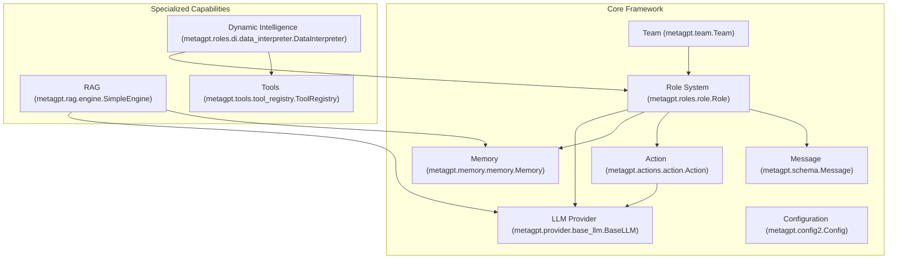
Sources: [README.md:40-47](), [metagpt/config2.py:49-102](), [metagpt/utils/mermaid.py:112-144]()

### Role System
The Role system is the foundation of MetaGPT. Each role represents an agent with specific responsibilities. Roles follow an `observe` -> `think` -> `act` cycle. In the context of a software company, MetaGPT includes specialized roles like `ProductManager`, `Architect`, `ProjectManager`, and `Engineer`.

For details, see [Software Company Metaphor](#1.2).

### Software Development Workflow
MetaGPT's flagship capability is its automated Software Development Life Cycle (SDLC). It transforms a one-line requirement into a complete software project (including user stories, competitive analysis, requirements, data structures, APIs, and documents).

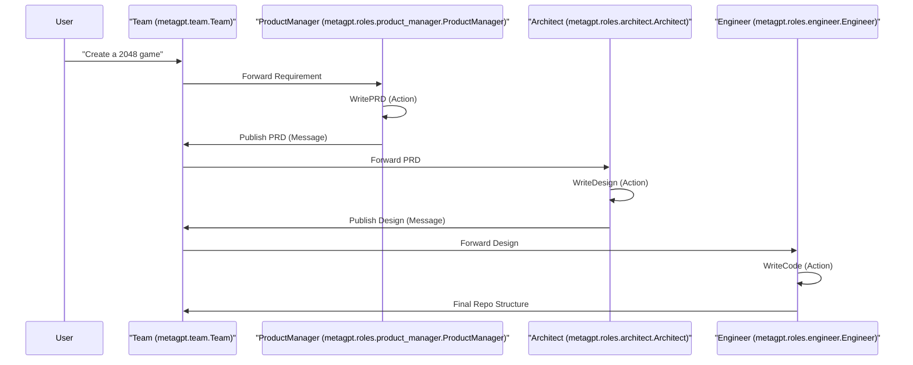
Sources: [README.md:41-47](), [metagpt/software_company.py:96-102](), [docs/README_JA.md:20-22]()

## Key Capabilities

### Multi-Agent Collaboration
The `Team` class manages the environment and the interaction rounds. It allows for "hiring" roles and providing "investment" to simulate a startup environment.
Sources: [metagpt/software_company.py:14-77](), [docs/tutorial/usage.md:37-60]()

### Dynamic Intelligence (DI)
MetaGPT features a `DataInterpreter` capable of data science tasks, including writing analysis code and generating plots using specialized tools.
Sources: [README.md:104-116](), [docs/README_FR.md:23-25]()

### RAG & Tool Integration
The framework supports Retrieval-Augmented Generation for document-based QA and a robust tool registry for extending agent capabilities with external APIs (e.g., Google Search, Web Scraping).
Sources: [requirements.txt:69-83](), [setup.py:31-47]()

## Getting Started

MetaGPT can be installed via `pip` and configured using a `config2.yaml` file to specify LLM providers like OpenAI, Azure, or Ollama.

```bash
pip install metagpt
metagpt --init-config
metagpt "Create a 2048 game"
```

For detailed installation and configuration steps, see [Getting Started](#1.1).

## Summary Table

| Feature | Description | Code Pointer |
| --- | --- | --- |
| **SOP Materialization** | Materializing human workflows into agent interactions. | `metagpt/actions/` |
| **Multi-Role Support** | PM, Architect, Engineer, QA, and more. | `metagpt/roles/` |
| **LLM Agnostic** | Support for OpenAI, Anthropic, Gemini, and local models. | `metagpt/provider/` |
| **Artifact Generation** | Outputs PRDs, Designs, and full Code Repositories. | `metagpt/utils/project_repo.py` |

Sources: [README.md:78-84](), [requirements.txt:1-90](), [setup.py:98-122]()

---

# Page: Getting Started

# Getting Started

<details>
<summary>Relevant source files</summary>

The following files were used as context for generating this wiki page:

- [Dockerfile](Dockerfile)
- [README.md](README.md)
- [config/config2.example.yaml](config/config2.example.yaml)
- [docs/ACADEMIC_WORK.md](docs/ACADEMIC_WORK.md)
- [docs/FAQ-EN.md](docs/FAQ-EN.md)
- [docs/NEWS.md](docs/NEWS.md)
- [docs/README_CN.md](docs/README_CN.md)
- [docs/README_FR.md](docs/README_FR.md)
- [docs/README_JA.md](docs/README_JA.md)
- [docs/install/cli_install.md](docs/install/cli_install.md)
- [docs/install/cli_install_cn.md](docs/install/cli_install_cn.md)
- [docs/install/docker_install.md](docs/install/docker_install.md)
- [docs/install/docker_install_cn.md](docs/install/docker_install_cn.md)
- [docs/tutorial/usage.md](docs/tutorial/usage.md)
- [docs/tutorial/usage_cn.md](docs/tutorial/usage_cn.md)
- [examples/exp_pool/decorator.py](examples/exp_pool/decorator.py)
- [metagpt/config2.py](metagpt/config2.py)
- [metagpt/configs/exp_pool_config.py](metagpt/configs/exp_pool_config.py)
- [metagpt/context.py](metagpt/context.py)
- [metagpt/context_mixin.py](metagpt/context_mixin.py)
- [metagpt/exp_pool/__init__.py](metagpt/exp_pool/__init__.py)
- [metagpt/exp_pool/decorator.py](metagpt/exp_pool/decorator.py)
- [metagpt/exp_pool/manager.py](metagpt/exp_pool/manager.py)
- [metagpt/exp_pool/schema.py](metagpt/exp_pool/schema.py)
- [metagpt/llm.py](metagpt/llm.py)
- [metagpt/software_company.py](metagpt/software_company.py)
- [metagpt/utils/mermaid.py](metagpt/utils/mermaid.py)
- [metagpt/utils/reflection.py](metagpt/utils/reflection.py)
- [tests/metagpt/exp_pool/test_manager.py](tests/metagpt/exp_pool/test_manager.py)
- [tests/metagpt/test_config.py](tests/metagpt/test_config.py)
- [tests/metagpt/test_context.py](tests/metagpt/test_context.py)

</details>


MetaGPT is a multi-agent framework that materializes Standard Operating Procedures (SOPs) into LLM-based roles to form a collaborative software entity [README.md:40-44](). This page provides technical details for installing, configuring, and executing your first project using both the Command Line Interface (CLI) and the Python API.

## Installation

MetaGPT requires **Python 3.9 or later (but less than 3.12)** [README.md:54]().

### Standard Installation
The stable version can be installed via `pip`:
```bash
pip install --upgrade metagpt
```
[README.md:58-61]()

**Requirements:**
- **Node.js & pnpm:** Necessary for rendering Mermaid diagrams (SOP visualizations) [README.md:63]().
- **Mermaid Engines:** MetaGPT supports multiple engines for converting Mermaid code to images: `playwright`, `pyppeteer`, `nodejs` (via `mmdc`), or `ink` [metagpt/utils/mermaid.py:31-37]().

### Docker Installation
Docker is recommended for an isolated environment that includes all dependencies for browser-based actions and Mermaid rendering.

```bash
# 1. Pull the official image
docker pull metagpt/metagpt:latest

# 2. Prepare configuration
mkdir -p /opt/metagpt/config
docker run --rm metagpt/metagpt:latest cat /app/metagpt/config/config2.yaml > /opt/metagpt/config/config2.yaml

# 3. Run a project
docker run --rm \
    --privileged \
    -v /opt/metagpt/config/config2.yaml:/app/metagpt/config/config2.yaml \
    -v /opt/metagpt/workspace:/app/metagpt/workspace \
    metagpt/metagpt:latest \
    metagpt "Write a cli snake game"
```
[docs/README_CN.md:55-68]()

**Sources:** [README.md:52-67](), [docs/README_CN.md:29-70](), [metagpt/utils/mermaid.py:19-41]()

---

## Configuration

MetaGPT uses a centralized configuration system managed by the `Config` class [metagpt/config2.py:49-50]().

### The config2.yaml File
The primary configuration file is `config2.yaml`. MetaGPT searches for this file in the following order of priority:
1. `~/.metagpt/config2.yaml` (User home)
2. `config/config2.yaml` (Project root)
3. Environment variables

[metagpt/config2.py:112-118](), [docs/README_JA.md:204-205]()

To initialize a default configuration:
```bash
metagpt --init-config
```
[metagpt/software_company.py:138-153]()

### Key Configuration Parameters
The configuration is structured via Pydantic models, ensuring type safety and validation [metagpt/config2.py:12-27]().

| Parameter | Type | Description |
| :--- | :--- | :--- |
| `llm` | `LLMConfig` | Primary LLM settings (API Key, Model, Base URL). |
| `roles` | `List[RoleCustomConfig]` | Per-role LLM overrides (e.g., ProductManager uses GPT-4, Engineer uses GPT-3.5). |
| `mermaid` | `MermaidConfig` | Engine selection (`playwright`, `pyppeteer`, etc.) and path settings. |
| `workspace` | `WorkspaceConfig` | Directory for outputting code and documents. |
| `exp_pool` | `ExperiencePoolConfig` | Settings for caching and retrieving past agent experiences. |

[metagpt/config2.py:50-99](), [config/config2.example.yaml:1-98]()

**Sources:** [metagpt/config2.py:49-123](), [config/config2.example.yaml:1-130](), [metagpt/software_company.py:127-135]()

---

## Data Flow: Initialization to Execution

The following diagram illustrates how the `Context` object acts as a service locator, bridging configuration to active LLM instances.

### Configuration and LLM Initialization
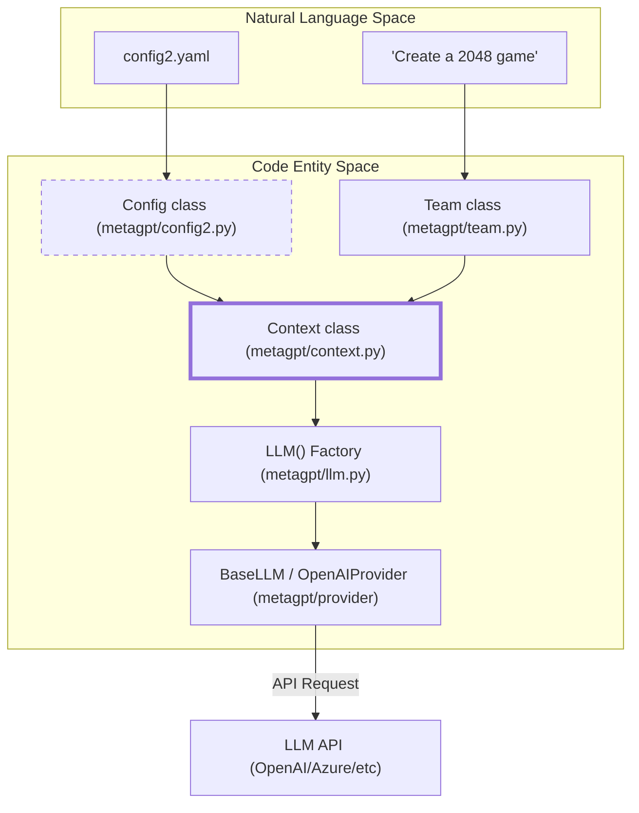
**Sources:** [metagpt/config2.py:182](), [metagpt/context.py:58-92](), [metagpt/llm.py:15-21](), [metagpt/software_company.py:40-44]()

---

## Usage

### CLI Interface
The `metagpt` command invokes the `startup` function in `metagpt/software_company.py` [metagpt/software_company.py:78-101]().

```bash
# Basic usage
metagpt "Create a 2048 game"

# Advanced usage: specify project name and enable code review
metagpt "Create a 2048 game" --project_name "my_game" --code_review
```

### Python API
For programmatic integration, use the `generate_repo` function or instantiate a `Team` manually.

```python
import asyncio
from metagpt.software_company import generate_repo
from metagpt.roles.di.data_interpreter import DataInterpreter

# 1. Generate a full software project
repo_path = generate_repo("Create a 2048 game")

# 2. Run a specific agent (Data Interpreter)
async def run_di():
    di = DataInterpreter()
    await di.run("Analyze this data: [1, 2, 3]")

asyncio.run(run_di())
```
[README.md:96-115](), [metagpt/software_company.py:14-27]()

### Multi-Agent Lifecycle
When a project starts, the `Team` object is initialized and "hires" specific roles [metagpt/software_company.py:44-54]().

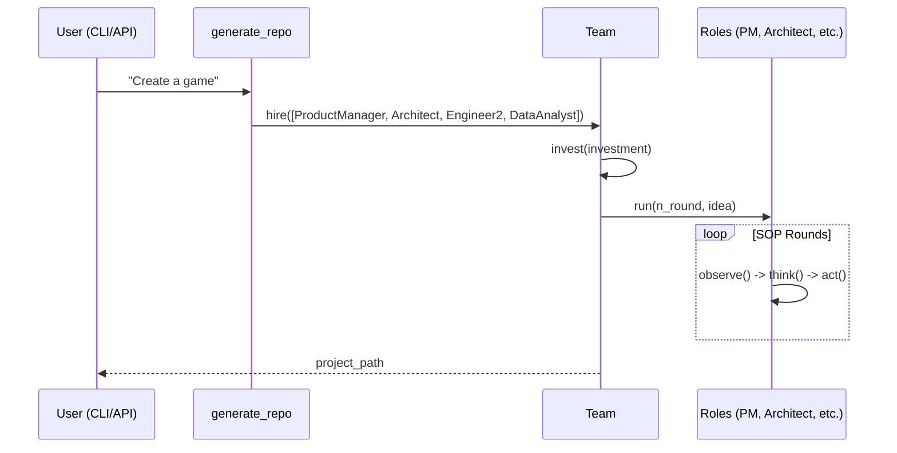
**Sources:** [metagpt/software_company.py:44-72](), [metagpt/team.py]()

---

## Environment Variables
Environment variables can override `config2.yaml` settings. Key variables include:
- `METAGPT_ROOT`: Path to the MetaGPT root directory.
- `CONFIG_ROOT`: Path where `config2.yaml` is stored (defaults to `~/.metagpt`) [metagpt/config2.py:26]().
- `OPENAI_API_KEY`: Direct LLM authentication.
- `PUPPETEER_SKIP_CHROMIUM_DOWNLOAD`: Skip Chromium download if using a local browser [docs/README_JA.md:72-73]().

**Sources:** [metagpt/config2.py:8-27](), [metagpt/context.py:70-75]()

---

# Page: Software Company Metaphor

# Software Company Metaphor

<details>
<summary>Relevant source files</summary>

The following files were used as context for generating this wiki page:

- [Dockerfile](Dockerfile)
- [README.md](README.md)
- [docs/ACADEMIC_WORK.md](docs/ACADEMIC_WORK.md)
- [docs/NEWS.md](docs/NEWS.md)
- [docs/README_CN.md](docs/README_CN.md)
- [docs/README_FR.md](docs/README_FR.md)
- [docs/README_JA.md](docs/README_JA.md)
- [metagpt/config2.py](metagpt/config2.py)
- [metagpt/context.py](metagpt/context.py)
- [metagpt/context_mixin.py](metagpt/context_mixin.py)
- [metagpt/llm.py](metagpt/llm.py)
- [metagpt/roles/architect.py](metagpt/roles/architect.py)
- [metagpt/roles/product_manager.py](metagpt/roles/product_manager.py)
- [metagpt/roles/project_manager.py](metagpt/roles/project_manager.py)
- [metagpt/software_company.py](metagpt/software_company.py)
- [metagpt/team.py](metagpt/team.py)
- [metagpt/utils/mermaid.py](metagpt/utils/mermaid.py)
- [tests/metagpt/test_config.py](tests/metagpt/test_config.py)
- [tests/metagpt/test_context.py](tests/metagpt/test_context.py)

</details>


The core philosophy of MetaGPT is encapsulated in the formula `Code = SOP(Team)` [README.md:44-44](). By materializing Standard Operating Procedures (SOPs) and applying them to teams composed of Large Language Model (LLM) agents, MetaGPT transforms a single natural language requirement into a comprehensive software repository [README.md:42-44]().

## The Team Class

The `Team` class is the primary orchestrator that simulates a software company's operations. It acts as a container for agents (roles), the environment they inhabit, and the financial resources (investment) allocated to a project [metagpt/team.py:32-36]().

### Key Attributes and Initialization
- **Environment (`env`)**: By default, a `Team` uses `MGXEnv` for hierarchical routing or a standard `Environment` for instant messaging between roles [metagpt/team.py:48-51]().
- **Investment**: Manages the budget via a `CostManager`. The system raises a `NoMoneyException` if the total cost of LLM calls exceeds this budget [metagpt/team.py:92-100]().
- **Roles**: Agents are added to the team using the `hire` method, which registers them within the team's environment [metagpt/team.py:83-85]().

### Data Flow: Idea to Project
When `run_project` is called, the initial "idea" is published as a `Message` to the environment [metagpt/team.py:102-108](). This triggers the "Software Company" lifecycle where roles observe the requirement and begin their SOP-driven tasks.

**Sources:** [metagpt/team.py:32-139](), [metagpt/environment/mgx/mgx_env.py]()

## SOP-Driven Lifecycle

MetaGPT mimics a traditional Waterfall-style SDLC (Software Development Life Cycle) through "carefully orchestrated SOPs" [README.md:43-43](). Each role is programmed to "watch" specific message types or previous actions, ensuring a sequential and logical progression.

### Team Execution Logic (`Team.run`)
The team operates in "rounds". In each round, the environment's `run` method is invoked, allowing all active roles to think and act [metagpt/team.py:123-134]().

| Step | Role | Action | Output |
| :--- | :--- | :--- | :--- |
| 1 | `ProductManager` | `WritePRD` | Product Requirement Document |
| 2 | `Architect` | `WriteDesign` | System Design & Data Structures |
| 3 | `ProjectManager` | `WriteTasks` | Task breakdown & Assignment |
| 4 | `Engineer` | `WriteCode` | Executable Code & Files |
| 5 | `QaEngineer` | `RunCode` / `WriteTest` | Test reports & Bug fixes |

**Sources:** [metagpt/team.py:123-139](), [metagpt/software_company.py:43-54](), [metagpt/roles/product_manager.py:41-47]()

## Hiring and Role Configuration

The `generate_repo` function demonstrates how a standard software company is "staffed" [metagpt/software_company.py:14-27]().

### Standard Staffing Pattern
```python
company = Team(context=ctx)
company.hire([
    TeamLeader(),
    ProductManager(),
    Architect(),
    Engineer2(),
    DataAnalyst(),
])
```
[metagpt/software_company.py:44-54]()

### Natural Language Space to Code Entity Space: Role Mapping
The following diagram illustrates how human-readable roles are mapped to specific Python classes and the specific `Action` entities they execute within the SOP.

**Role-Action Mapping Diagram**
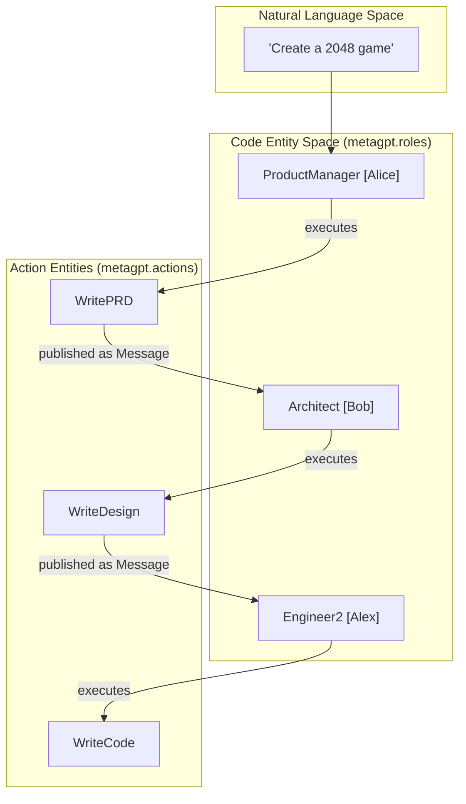
**Sources:** [metagpt/roles/product_manager.py:21-47](), [metagpt/roles/architect.py:17-52](), [metagpt/software_company.py:43-54]()

## Multi-Agent Round Execution

The system runs in a loop controlled by `n_round` [metagpt/team.py:128-132](). In each round, the `Environment` facilitates the `observe -> think -> act` cycle for all roles.

### Interaction Logic
1. **Observe**: Roles filter the `MessageQueue` for messages they are configured to `watch` [metagpt/roles/product_manager.py:46-46]().
2. **Think**: Roles decide the next action based on their internal state or `RoleReactMode` [metagpt/roles/product_manager.py:53-64]().
3. **Act**: Roles execute their `todo_action`, often involving LLM calls via `ActionNode` to generate structured documents or code [metagpt/roles/product_manager.py:39-39]().

### Operational Flow Diagram
This diagram bridges the conceptual "Software Company" workflow with the underlying code execution flow in `Team` and `Environment`.

**System Execution Flow**
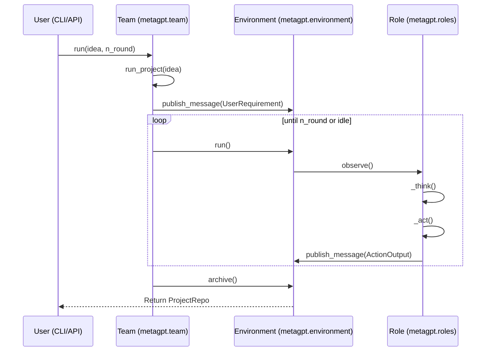
**Sources:** [metagpt/team.py:102-138](), [metagpt/software_company.py:71-72](), [metagpt/environment/mgx/mgx_env.py]()

## Configuration and Context
The "Company" relies on a `Context` object, which acts as a service locator for the `Config` (LLM settings, API keys) and the `CostManager` [metagpt/context.py:58-66]().

- **Config**: Loaded from `config2.yaml` [metagpt/config2.py:101-123]().
- **LLM Instance**: Created dynamically based on the `api_type` (e.g., OpenAI, Azure, Ollama) defined in the configuration [metagpt/context.py:86-92]().

**Sources:** [metagpt/context.py:58-100](), [metagpt/config2.py:49-100]()

---

# Page: Core Architecture

# Core Architecture

<details>
<summary>Relevant source files</summary>

The following files were used as context for generating this wiki page:

- [metagpt/actions/action.py](metagpt/actions/action.py)
- [metagpt/actions/design_api.py](metagpt/actions/design_api.py)
- [metagpt/actions/project_management.py](metagpt/actions/project_management.py)
- [metagpt/actions/summarize_code.py](metagpt/actions/summarize_code.py)
- [metagpt/actions/write_code.py](metagpt/actions/write_code.py)
- [metagpt/actions/write_code_review.py](metagpt/actions/write_code_review.py)
- [metagpt/actions/write_prd.py](metagpt/actions/write_prd.py)
- [metagpt/const.py](metagpt/const.py)
- [metagpt/environment/api/__init__.py](metagpt/environment/api/__init__.py)
- [metagpt/environment/api/env_api.py](metagpt/environment/api/env_api.py)
- [metagpt/environment/base_env.py](metagpt/environment/base_env.py)
- [metagpt/roles/engineer.py](metagpt/roles/engineer.py)
- [metagpt/roles/qa_engineer.py](metagpt/roles/qa_engineer.py)
- [metagpt/roles/role.py](metagpt/roles/role.py)
- [metagpt/schema.py](metagpt/schema.py)
- [metagpt/team.py](metagpt/team.py)
- [tests/metagpt/environment/android_env/__init__.py](tests/metagpt/environment/android_env/__init__.py)
- [tests/metagpt/environment/test_base_env.py](tests/metagpt/environment/test_base_env.py)

</details>


This document explains the fundamental architecture of MetaGPT, including its roles, actions, messages, and overall system design. It provides a technical overview of how MetaGPT implements a multi-agent framework for collaborative problem-solving based on Standard Operating Procedures (SOPs).

## High-Level Architecture Overview

MetaGPT follows a role-based architecture where specialized agents (`Role`) collaborate through message passing (`Message`) within a shared environment (`Environment`). The system relies on a flexible action framework, memory systems, and a `Team` class to orchestrate the software development lifecycle (SDLC).

```mermaid
graph TD
    subgraph "Core Components"
        [RoleSystem] -->|uses| [MemorySystem]
        [RoleSystem] -->|executes| [ActionFramework]
        [RoleSystem] -->|sends/receives| [MessageSystem]
        [Environment] -->|routes| [MessageSystem]
        [Environment] -->|contains| [RoleSystem]
        [Team] -->|manages| [Environment]
        [Team] -->|orchestrates| [RoleSystem]
        [ActionFramework] -->|generates| [MessageSystem]
    end
```

Sources:
- [metagpt/roles/role.py:125-153]()
- [metagpt/schema.py:232-240]()
- [metagpt/actions/action.py:29-38]()
- [metagpt/team.py:32-43]()

## Role System

The `Role` class [metagpt/roles/role.py:125]() serves as the foundation of MetaGPT's agent architecture. Roles are autonomous agents defined by a `profile`, `goal`, and `constraints`. They maintain a `RoleContext` [metagpt/roles/role.py:92]() which manages their private message buffer, memory, and current state.

For details, see [Role System](#2.1).

### Role Structure

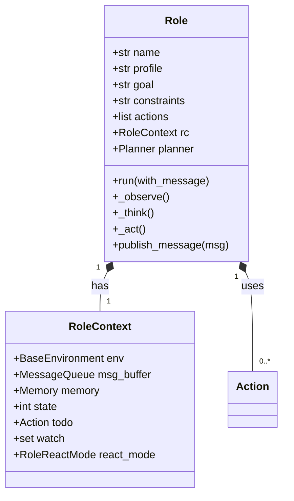

Sources:
- [metagpt/roles/role.py:125-153]()
- [metagpt/roles/role.py:92-114]()

### Role Lifecycle

Roles follow an observe-think-act cycle driven by the `_react` method [metagpt/roles/role.py:454-470](). The `RoleReactMode` [metagpt/roles/role.py:82]() determines if the agent selects actions dynamically (`REACT`), follows a fixed sequence (`BY_ORDER`), or uses a `Planner` (`PLAN_AND_ACT`).

1. **`_observe()`**: Pulls messages from the `msg_buffer` [metagpt/roles/role.py:399-428]().
2. **`_think()`**: Determines the next `Action` to perform, updating `rc.todo` [metagpt/roles/role.py:340-379]().
3. **`_act()`**: Executes the `Action` and returns a `Message` [metagpt/roles/role.py:381-397]().

Sources:
- [metagpt/roles/role.py:82-86]()
- [metagpt/roles/role.py:340-428]()

## Message Passing System

Messages are the primary communication medium. The `Message` class [metagpt/schema.py:232]() includes metadata for routing: `send_to`, `sent_from`, and `cause_by`.

For details, see [Message Passing System](#2.2).

### Message Routing

Messages are published to the `Environment` via `publish_message` [metagpt/roles/role.py:429](), which then routes them to the `msg_buffer` of subscriber roles based on their `watch` list [metagpt/roles/role.py:108]().

Key routing constants in [metagpt/const.py:77-83]():
- `MESSAGE_ROUTE_TO_ALL`: Broadcast to all roles.
- `MESSAGE_ROUTE_TO_SELF`: Internal feedback loop for a role.

Sources:
- [metagpt/schema.py:232-260]()
- [metagpt/roles/role.py:429-453]()
- [metagpt/const.py:77-83]()

## Action Framework

Actions define the atomic capabilities of agents. The `Action` base class [metagpt/actions/action.py:29]() handles LLM interactions via `_aask` [metagpt/actions/action.py:99]().

For details, see [Action Framework](#2.3).

### SDLC Actions

MetaGPT implements specific actions for the software development lifecycle:
- `WritePRD`: Generates requirements [metagpt/actions/write_prd.py:76]().
- `WriteDesign`: Creates system architecture and API designs [metagpt/actions/design_api.py:53]().
- `WriteTasks`: Breaks designs into a Work Breakdown Structure (WBS) [metagpt/actions/project_management.py:46]().
- `WriteCode`: Produces the actual implementation [metagpt/actions/write_code.py:88]().

Sources:
- [metagpt/actions/action.py:29-114]()
- [metagpt/actions/write_prd.py:76-85]()
- [metagpt/actions/write_code.py:88-92]()

## Environment System

The `Environment` [metagpt/environment/base_env.py]() acts as a container for `Role` objects and manages the message bus. The `Team` class [metagpt/team.py:32]() initializes the environment (often using `MGXEnv` [metagpt/team.py:50]() for hierarchical routing) and drives the execution rounds.

For details, see [Environment System](#2.4).

### Software Development Workflow

The collaboration typically follows this sequence:

```mermaid
graph LR
    [UserRequirement] --> [ProductManager]
    [ProductManager] -->|WritePRD| [PRD_Doc]
    [PRD_Doc] --> [Architect]
    [Architect] -->|WriteDesign| [Design_Doc]
    [Design_Doc] --> [ProjectManager]
    [ProjectManager] -->|WriteTasks| [Tasks_Doc]
    [Tasks_Doc] --> [Engineer]
    [Engineer] -->|WriteCode| [SourceCode]
    [SourceCode] --> [QAEngineer]
    [QAEngineer] -->|WriteTest| [TestResults]
```

Sources:
- [metagpt/team.py:123-138]()
- [metagpt/roles/engineer.py:102-110]()
- [metagpt/roles/qa_engineer.py:52-60]()

## Key Components and Relationships

| Component | Code Entity | Responsibility |
|-----------|-------------|----------------|
| **Agent** | `Role` [metagpt/roles/role.py:125]() | Orchestrates actions based on goal/profile. |
| **Task** | `Action` [metagpt/actions/action.py:29]() | Performs specific logic (e.g., coding, designing). |
| **Data** | `Message` [metagpt/schema.py:232]() | Transfers information between agents. |
| **Bus** | `Environment` [metagpt/environment/base_env.py]() | Manages agent membership and message routing. |
| **Memory** | `Memory` [metagpt/memory/memory.py:20]() | Stores local history for context-aware reasoning. |
| **Orchestrator** | `Team` [metagpt/team.py:32]() | Bootstraps the environment and manages investment/rounds. |

Sources:
- [metagpt/roles/role.py]()
- [metagpt/schema.py]()
- [metagpt/team.py]()
- [metagpt/actions/action.py]()

---

# Page: Role System

# Role System

<details>
<summary>Relevant source files</summary>

The following files were used as context for generating this wiki page:

- [examples/di/atomization_capacity_plan.py](examples/di/atomization_capacity_plan.py)
- [examples/di/automated_planning_of_tasks.py](examples/di/automated_planning_of_tasks.py)
- [examples/di/data_analyst_write_code.py](examples/di/data_analyst_write_code.py)
- [examples/di/interacting_with_human.py](examples/di/interacting_with_human.py)
- [examples/use_off_the_shelf_agent.py](examples/use_off_the_shelf_agent.py)
- [examples/write_design.py](examples/write_design.py)
- [examples/write_game_code.py](examples/write_game_code.py)
- [metagpt/actions/action.py](metagpt/actions/action.py)
- [metagpt/actions/design_api.py](metagpt/actions/design_api.py)
- [metagpt/actions/project_management.py](metagpt/actions/project_management.py)
- [metagpt/actions/summarize_code.py](metagpt/actions/summarize_code.py)
- [metagpt/actions/write_code.py](metagpt/actions/write_code.py)
- [metagpt/actions/write_code_review.py](metagpt/actions/write_code_review.py)
- [metagpt/actions/write_prd.py](metagpt/actions/write_prd.py)
- [metagpt/const.py](metagpt/const.py)
- [metagpt/roles/architect.py](metagpt/roles/architect.py)
- [metagpt/roles/engineer.py](metagpt/roles/engineer.py)
- [metagpt/roles/product_manager.py](metagpt/roles/product_manager.py)
- [metagpt/roles/project_manager.py](metagpt/roles/project_manager.py)
- [metagpt/roles/qa_engineer.py](metagpt/roles/qa_engineer.py)
- [metagpt/roles/role.py](metagpt/roles/role.py)
- [metagpt/schema.py](metagpt/schema.py)
- [tests/metagpt/actions/test_action.py](tests/metagpt/actions/test_action.py)
- [tests/metagpt/roles/test_architect.py](tests/metagpt/roles/test_architect.py)
- [tests/metagpt/roles/test_engineer.py](tests/metagpt/roles/test_engineer.py)
- [tests/metagpt/roles/test_role.py](tests/metagpt/roles/test_role.py)
- [tests/metagpt/test_environment.py](tests/metagpt/test_environment.py)
- [tests/metagpt/test_role.py](tests/metagpt/test_role.py)
- [tests/metagpt/test_schema.py](tests/metagpt/test_schema.py)
- [tests/metagpt/test_team.py](tests/metagpt/test_team.py)

</details>


The Role System in MetaGPT serves as the foundation for creating intelligent agents with specific capabilities, responsibilities, and behaviors. It provides the architecture for defining how agents perceive their environment, make decisions, and take actions, enabling collaborative problem-solving in multi-agent scenarios.

## Core Architecture

The Role System is built around the concept of agents as specialized entities with distinct responsibilities and capabilities. Each role is defined by its profile, goals, and constraints, and is equipped with specific actions it can perform.

### Role Entity Mapping
The following diagram bridges the conceptual "Role" to its implementation within the code structure.

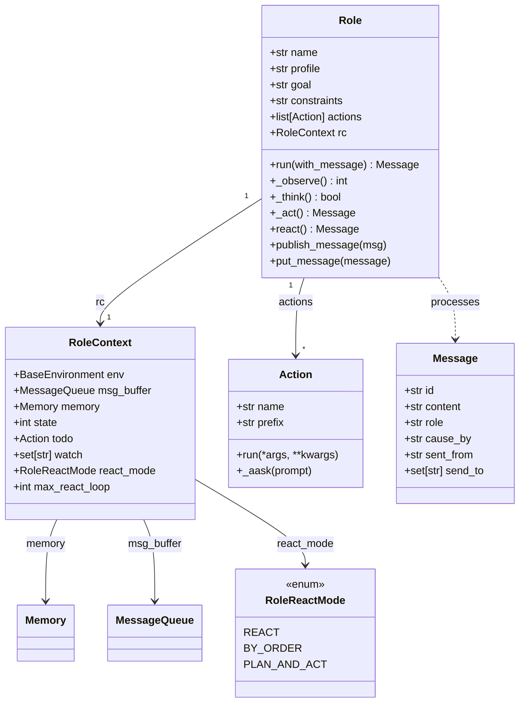
Sources: [metagpt/roles/role.py:82-153](), [metagpt/schema.py:232-260](), [metagpt/actions/action.py:29-41]()

## Role Lifecycle

The lifecycle of a role follows an **Observe-Think-Act** pattern. This structured loop allows roles to process asynchronous messages, decide on transitions between internal states (actions), and execute those actions.

### Natural Language to Code Entity Space: Lifecycle
This diagram maps the logical stages of an agent's life to the specific function calls and data structures in the MetaGPT codebase.

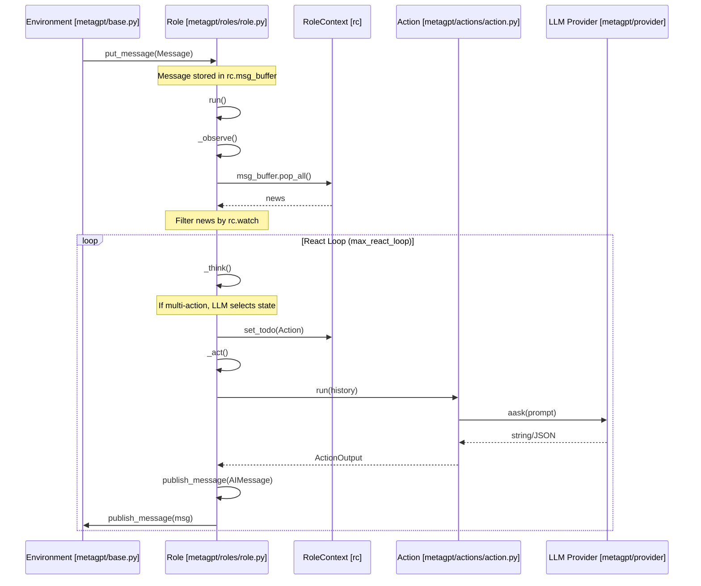
Sources: [metagpt/roles/role.py:381-429](), [metagpt/roles/role.py:454-523](), [metagpt/roles/role.py:530-554]()

### Observation Phase
During `_observe()`, a role retrieves messages from its private `msg_buffer`. It filters messages where the `cause_by` attribute matches the role's `watch` list or the `send_to` attribute includes the role's name/address [metagpt/roles/role.py:398-429]().

### Thinking Phase
In `_think()`, the role determines the next `Action` to execute. 
- If `react_mode` is `BY_ORDER`, it iterates through the `actions` list sequentially [metagpt/roles/role.py:353-357]().
- If multiple actions exist and no plan is active, it uses `STATE_TEMPLATE` to ask the LLM for a state number corresponding to the next action index [metagpt/roles/role.py:54-69](), [metagpt/roles/role.py:359-379]().

### Acting Phase
In `_act()`, the role calls the `run()` method of the `todo` action. The output (often an `ActionOutput` or `ActionNode`) is wrapped into a `Message` object, added to the role's memory, and prepared for publishing [metagpt/roles/role.py:381-397]().

## Reaction Modes

The `RoleReactMode` enum defines how roles handle the think-act loop:

| Mode | Implementation Logic |
| :--- | :--- |
| `REACT` | A standard loop where the role thinks and acts up to `max_react_loop` times [metagpt/roles/role.py:83](). |
| `BY_ORDER` | Executes actions in the predefined order of the `actions` list [metagpt/roles/role.py:84](). |
| `PLAN_AND_ACT` | Uses a `Planner` to generate a list of tasks, then executes them sequentially, updating the plan based on results [metagpt/roles/role.py:85](), [metagpt/roles/role.py:472-496](). |

Sources: [metagpt/roles/role.py:82-89](), [metagpt/roles/role.py:353-357]()

## Specialized Built-in Roles

MetaGPT provides specialized roles that follow Software Development Life Cycle (SDLC) Standard Operating Procedures (SOPs).

### ProductManager
- **Profile**: "Product Manager"
- **Actions**: `WritePRD`
- **Watch**: `UserRequirement`, `PrepareDocuments`
- **Responsibility**: Translates user requirements into a formal Product Requirement Document (PRD) [metagpt/roles/product_manager.py:21-47]().

### Architect
- **Profile**: "Architect"
- **Actions**: `WriteDesign`
- **Watch**: `WritePRD`
- **Responsibility**: Designs system architecture, APIs, and data structures based on the PRD [metagpt/roles/architect.py:17-58]().

### Engineer
- **Profile**: "Engineer"
- **Actions**: `WriteCode`, `WriteCodeReview`
- **Watch**: `WriteTasks`, `SummarizeCode`, `WriteCodeReview`, `FixBug`
- **Logic**: Operates on a per-file basis. It iterates through tasks provided by the `WriteTasks` action, writing code for each file and optionally performing code reviews [metagpt/roles/engineer.py:73-109]().

### QaEngineer
- **Profile**: "QaEngineer"
- **Actions**: `WriteTest`, `RunCode`, `DebugError`
- **Watch**: `SummarizeCode`, `WriteTest`, `RunCode`, `DebugError`
- **Responsibility**: Generates unit tests for new code, executes them, and provides debug feedback if tests fail [metagpt/roles/qa_engineer.py:39-60]().

Sources: [metagpt/roles/product_manager.py:21-65](), [metagpt/roles/engineer.py:73-109](), [metagpt/roles/qa_engineer.py:39-60](), [metagpt/roles/architect.py:17-58]()

## Message Subscription and Routing

Roles use a subscription model to manage message flow.
- **`_watch(actions)`**: Registers the role to listen for messages produced by specific `Action` classes [metagpt/roles/role.py:284-288]().
- **`publish_message(msg)`**: Sends a message to the `Environment`. If `send_to` contains `<self>`, the message is routed back to the role's own buffer [metagpt/roles/role.py:429-446]().
- **`put_message(msg)`**: Directly places a message into the role's private `msg_buffer` [metagpt/roles/role.py:448-452]().

Sources: [metagpt/roles/role.py:284-292](), [metagpt/roles/role.py:429-452](), [metagpt/const.py:83]()

---

# Page: Message Passing System

# Message Passing System

<details>
<summary>Relevant source files</summary>

The following files were used as context for generating this wiki page:

- [metagpt/actions/action.py](metagpt/actions/action.py)
- [metagpt/actions/action_output.py](metagpt/actions/action_output.py)
- [metagpt/actions/design_api.py](metagpt/actions/design_api.py)
- [metagpt/actions/project_management.py](metagpt/actions/project_management.py)
- [metagpt/actions/summarize_code.py](metagpt/actions/summarize_code.py)
- [metagpt/actions/write_code.py](metagpt/actions/write_code.py)
- [metagpt/actions/write_code_review.py](metagpt/actions/write_code_review.py)
- [metagpt/actions/write_prd.py](metagpt/actions/write_prd.py)
- [metagpt/const.py](metagpt/const.py)
- [metagpt/environment/api/__init__.py](metagpt/environment/api/__init__.py)
- [metagpt/environment/api/env_api.py](metagpt/environment/api/env_api.py)
- [metagpt/environment/base_env.py](metagpt/environment/base_env.py)
- [metagpt/memory/__init__.py](metagpt/memory/__init__.py)
- [metagpt/memory/memory.py](metagpt/memory/memory.py)
- [metagpt/roles/engineer.py](metagpt/roles/engineer.py)
- [metagpt/roles/qa_engineer.py](metagpt/roles/qa_engineer.py)
- [metagpt/roles/role.py](metagpt/roles/role.py)
- [metagpt/schema.py](metagpt/schema.py)
- [metagpt/utils/serialize.py](metagpt/utils/serialize.py)
- [tests/metagpt/actions/test_action.py](tests/metagpt/actions/test_action.py)
- [tests/metagpt/environment/android_env/__init__.py](tests/metagpt/environment/android_env/__init__.py)
- [tests/metagpt/environment/test_base_env.py](tests/metagpt/environment/test_base_env.py)
- [tests/metagpt/roles/test_role.py](tests/metagpt/roles/test_role.py)
- [tests/metagpt/test_environment.py](tests/metagpt/test_environment.py)
- [tests/metagpt/test_role.py](tests/metagpt/test_role.py)
- [tests/metagpt/test_schema.py](tests/metagpt/test_schema.py)
- [tests/metagpt/test_team.py](tests/metagpt/test_team.py)
- [tests/metagpt/utils/test_code_parser.py](tests/metagpt/utils/test_code_parser.py)
- [tests/metagpt/utils/test_output_parser.py](tests/metagpt/utils/test_output_parser.py)
- [tests/metagpt/utils/test_serialize.py](tests/metagpt/utils/test_serialize.py)

</details>


The Message Passing System is the core communication infrastructure that enables MetaGPT's multi-agent architecture. This system allows different roles (agents) to exchange information, coordinate actions, and collectively solve complex tasks through structured message exchanges. It relies on a subscription-based model where roles "watch" for specific actions or message tags to trigger their internal logic.

## Message Structure

Messages in MetaGPT are represented by the `Message` class, defined in `metagpt/schema.py` [metagpt/schema.py:232-232](). It serves as the fundamental unit of communication between agents.

### Entity Relationship: Natural Language to Code Space

This diagram maps the conceptual communication components to their specific implementation classes and attributes.

Title: Message Entity Mapping
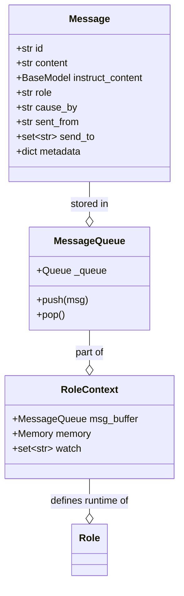
Sources: [metagpt/schema.py:232-284](), [metagpt/schema.py:713-713](), [metagpt/roles/role.py:92-124]()

### Key Message Attributes

| Attribute | Type | Description |
|-----------|------|-------------|
| `id` | str | Unique identifier, defaults to a UUID [metagpt/schema.py:237-237](). |
| `content` | str | The primary text content of the message [metagpt/schema.py:233-233](). |
| `instruct_content` | Optional[BaseModel] | Structured data used for passing complex objects between actions [metagpt/schema.py:234-234](). |
| `role` | str | The role type of the sender (e.g., "user", "assistant") [metagpt/schema.py:235-235](). |
| `cause_by` | str | The class name of the `Action` that generated this message [metagpt/schema.py:238-238](). |
| `sent_from` | str | The name or profile of the role that sent the message [metagpt/schema.py:239-239](). |
| `send_to` | set[str] | Specific recipients. Defaults to `MESSAGE_ROUTE_TO_ALL` [metagpt/schema.py:240-241](). |

Sources: [metagpt/schema.py:232-284](), [metagpt/const.py:77-81]()

### Message Types
MetaGPT provides specialized message classes:
*   **`UserMessage`**: Represents input from the user [metagpt/schema.py:419-423]().
*   **`AIMessage`**: Represents output from an agent, including the agent's name in metadata [metagpt/schema.py:431-455]().

## Message Routing and Filtering

Messages are routed between roles and environments using metadata. The primary mechanism for a role to receive a message is the "subscription" or "watch" mechanism.

### Routing Constants
The system uses reserved strings to control delivery:
*   `MESSAGE_ROUTE_TO_ALL` (`"<all>"`): Broadcasts to every role in the environment [metagpt/const.py:81-81]().
*   `MESSAGE_ROUTE_TO_SELF` (`"<self>"`): Routes the message back to the sender's own buffer [metagpt/const.py:83-83]().
*   `MESSAGE_ROUTE_TO_NONE` (`"<none>"`): Explicitly stops further routing [metagpt/const.py:82-82]().

Sources: [metagpt/const.py:77-83](), [metagpt/roles/role.py:34-34]()

### The Subscription Mechanism
A `Role` determines which messages to process by defining a `watch` list. When a message's `cause_by` attribute matches a string in the role's `watch` set, the message is pulled from the environment into the role's private `msg_buffer` [metagpt/roles/role.py:108-108](), [metagpt/roles/role.py:284-291]().

Title: Message Flow from Environment to Action
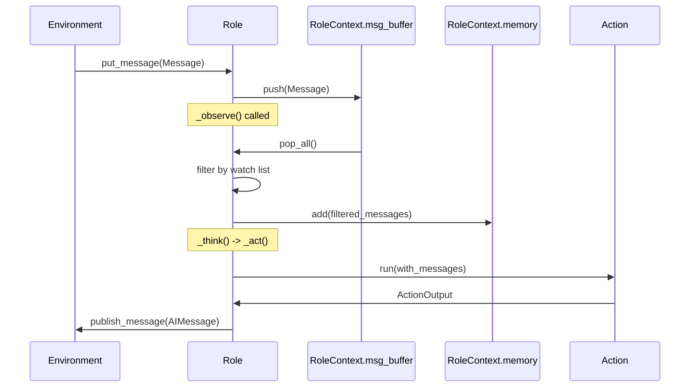
Sources: [metagpt/roles/role.py:399-427](), [metagpt/roles/role.py:429-452](), [metagpt/roles/role.py:529-553]()

## Implementation Details

### Message Queue (`MessageQueue`)
The `MessageQueue` class wraps `asyncio.Queue` to provide non-blocking message handling within roles [metagpt/schema.py:713-715]().
*   `push(msg)`: Adds a message to the queue [metagpt/schema.py:730-732]().
*   `pop_all()`: Retrieves all pending messages in the buffer at once [metagpt/schema.py:721-728]().

### Role Observation Logic
The `Role._observe()` method is the gateway for incoming data. It performs the following steps:
1.  Calls `self.rc.msg_buffer.pop_all()` to get new messages [metagpt/roles/role.py:406-406]().
2.  Filters messages based on `self.rc.watch` (which contains `Action` class names as strings) [metagpt/roles/role.py:410-413]().
3.  Adds relevant messages to `self.rc.memory` [metagpt/roles/role.py:414-414]().
4.  Returns the new messages to trigger the `_think` process [metagpt/roles/role.py:427-427]().

Sources: [metagpt/roles/role.py:399-427](), [metagpt/schema.py:713-784]()

### Memory Integration
The `Memory` class in `metagpt/memory/memory.py` maintains a history of messages [metagpt/memory/memory.py:20-20](). It indexes messages by `cause_by` [metagpt/memory/memory.py:35-35](), allowing roles to quickly retrieve context related to specific actions using `get_by_actions` [metagpt/memory/memory.py:99-107]().

## Examples of Message Flow

### Engineer Observation
The `Engineer` role watches for several actions, including `WriteTasks` and `SummarizeCode` [metagpt/roles/engineer.py:106-106](). When an `Architect` publishes a message `cause_by` `WriteTasks`, the `Engineer`'s `_observe` method will identify it and move it to memory for the next `_act` cycle.

### Self-Routing for Iteration
In the `QaEngineer` role, after writing a test, it publishes a message to `MESSAGE_ROUTE_TO_SELF` [metagpt/roles/qa_engineer.py:100-100](). This ensures the `QaEngineer` immediately "observes" its own output to trigger the next logical step (e.g., `RunCode`) in the next loop of `react` [metagpt/roles/qa_engineer.py:59-59]().

Sources: [metagpt/roles/engineer.py:102-110](), [metagpt/roles/qa_engineer.py:99-101](), [metagpt/roles/role.py:34-34]()

## Serialization and Persistence
Messages support JSON serialization through the `SerializationMixin` [metagpt/schema.py:72-72]().
*   `dump()`: Converts the message to a dictionary/JSON [metagpt/schema.py:336-339]().
*   `load()`: Reconstructs a `Message` from serialized data [metagpt/schema.py:341-356]().

This is critical for the `Team` class to save and restore state during long-running software development cycles.

Sources: [metagpt/schema.py:72-131](), [metagpt/schema.py:336-356]()

---

# Page: Action Framework

# Action Framework

<details>
<summary>Relevant source files</summary>

The following files were used as context for generating this wiki page:

- [metagpt/actions/__init__.py](metagpt/actions/__init__.py)
- [metagpt/actions/action.py](metagpt/actions/action.py)
- [metagpt/actions/action_node.py](metagpt/actions/action_node.py)
- [metagpt/actions/debug_error.py](metagpt/actions/debug_error.py)
- [metagpt/actions/design_api.py](metagpt/actions/design_api.py)
- [metagpt/actions/design_api_an.py](metagpt/actions/design_api_an.py)
- [metagpt/actions/project_management.py](metagpt/actions/project_management.py)
- [metagpt/actions/project_management_an.py](metagpt/actions/project_management_an.py)
- [metagpt/actions/run_code.py](metagpt/actions/run_code.py)
- [metagpt/actions/summarize_code.py](metagpt/actions/summarize_code.py)
- [metagpt/actions/write_code.py](metagpt/actions/write_code.py)
- [metagpt/actions/write_code_review.py](metagpt/actions/write_code_review.py)
- [metagpt/actions/write_prd.py](metagpt/actions/write_prd.py)
- [metagpt/actions/write_prd_an.py](metagpt/actions/write_prd_an.py)
- [metagpt/actions/write_test.py](metagpt/actions/write_test.py)
- [metagpt/const.py](metagpt/const.py)
- [metagpt/roles/engineer.py](metagpt/roles/engineer.py)
- [metagpt/roles/qa_engineer.py](metagpt/roles/qa_engineer.py)
- [metagpt/roles/role.py](metagpt/roles/role.py)
- [metagpt/schema.py](metagpt/schema.py)
- [metagpt/tools/ut_writer.py](metagpt/tools/ut_writer.py)
- [metagpt/utils/common.py](metagpt/utils/common.py)
- [metagpt/utils/human_interaction.py](metagpt/utils/human_interaction.py)
- [tests/metagpt/actions/test_action_node.py](tests/metagpt/actions/test_action_node.py)
- [tests/metagpt/utils/test_common.py](tests/metagpt/utils/test_common.py)
- [tests/metagpt/utils/test_human_interaction.py](tests/metagpt/utils/test_human_interaction.py)

</details>


This section explains the Action Framework in MetaGPT, which defines how actions are structured, executed, and composed within the agent architecture. This framework enables roles (agents) to perform tasks through a structured approach to action definition and execution.

## Overview

The Action Framework provides a way to define executable units of work that can be performed by roles. It consists of two main components:

1.  **Action**: The base class for all executable actions [metagpt/actions/action.py:29-29]().
2.  **ActionNode**: A tree-structured system for complex actions with validation [metagpt/actions/action_node.py:135-135]().

Together, these components enable MetaGPT to create sophisticated, multi-step workflows with strong typing and validation.

### Natural Language to Code Entity Mapping

The following diagram bridges the gap between natural language descriptions of the SDLC and the corresponding code entities within the Action Framework.

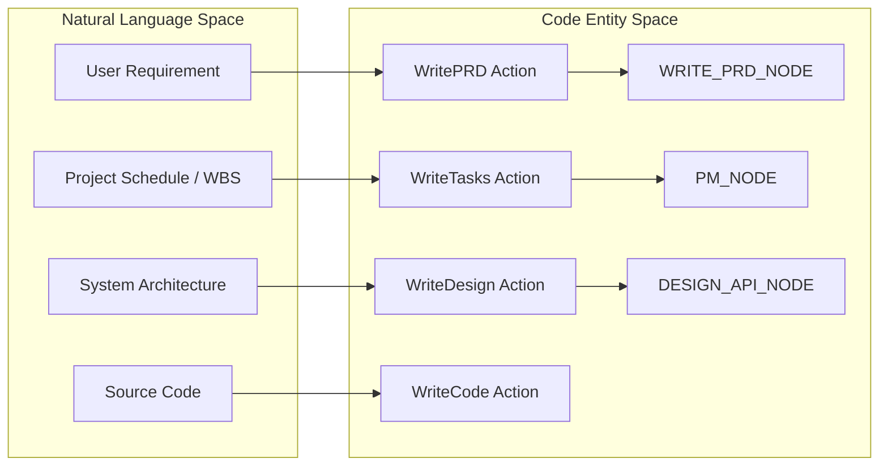

**Sources:** [metagpt/actions/write_prd.py:76-76](), [metagpt/actions/design_api.py:53-53](), [metagpt/actions/project_management.py:46-46](), [metagpt/actions/write_code.py:88-88](), [metagpt/actions/write_prd_an.py:32-32](), [metagpt/actions/project_management_an.py:21-21](), [metagpt/actions/design_api_an.py:22-22]()

## The Action Base Class

The `Action` class serves as the foundation for all executable actions in MetaGPT. It inherits from `SerializationMixin` for state persistence and `ContextMixin` for dependency injection [metagpt/actions/action.py:29-29]().

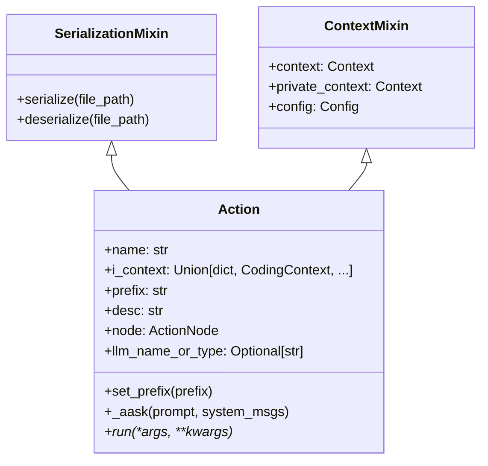

**Sources:** [metagpt/actions/action.py:29-41](), [metagpt/schema.py:72-72](), [metagpt/context_mixin.py:15-15]()

Key features of the `Action` class:
*   **LLM Integration**: Actions use `self.llm.aask()` to interact with models [metagpt/actions/action.py:99-101]().
*   **ActionNode Hosting**: An action can wrap an `ActionNode` via the `node` attribute to delegate execution to a structured node tree [metagpt/actions/action.py:103-108]().
*   **Context Management**: Access to global configurations and shared resources via `self.context` [metagpt/actions/action.py:17-17]().

## The ActionNode System

`ActionNode` is a recursive data structure designed to transform unstructured LLM output into structured data [metagpt/actions/action_node.py:135-135](). It manages a tree of nodes where each node represents a specific field in the expected output.

### Structured Output Flow

The `fill` method is the core of `ActionNode` execution. It compiles instructions, sends them to the LLM, and parses the response into the `expected_type` [metagpt/actions/action_node.py:469-484]().

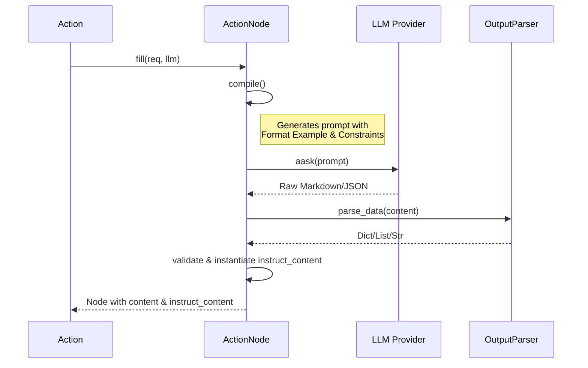

**Sources:** [metagpt/actions/action_node.py:469-500](), [metagpt/utils/common.py:73-73]()

### Composition and Templates
Nodes can be children of other nodes, allowing for complex schemas like a PRD [metagpt/actions/action_node.py:199-202](). The system uses templates like `SIMPLE_TEMPLATE` to guide the LLM [metagpt/actions/action_node.py:56-74]().

## SDLC Pipeline Actions

MetaGPT implements the standard software development lifecycle through specialized actions.

### WritePRD
Handles requirement analysis. It detects if a requirement is a new feature, a bugfix, or an update [metagpt/actions/write_prd.py:76-81]().
*   **Key Node**: `WRITE_PRD_NODE` contains children like `PROJECT_NAME`, `PRODUCT_GOALS`, and `USER_STORIES` [metagpt/actions/write_prd_an.py:210-294]().
*   **Incremental**: Uses `REFINED_PRD_NODE` for updates [metagpt/actions/write_prd.py:166-168]().

### WriteDesign
Translates PRD requirements into technical specifications [metagpt/actions/design_api.py:53-62]().
*   **Outputs**: Generates Mermaid diagrams for "Data structures and interfaces" and "Program call flow" [metagpt/actions/design_api_an.py:21-27]().
*   **File Storage**: Saves designs to `SYSTEM_DESIGN_FILE_REPO` [metagpt/actions/design_api.py:28-28]().

### WriteTasks
Performs project management by breaking down the design into a Work Breakdown Structure (WBS) [metagpt/actions/project_management.py:46-50]().
*   **Task List**: Produces a `TASK_LIST` or `REFINED_TASK_LIST` [metagpt/actions/project_management_an.py:32-33]().
*   **Dependencies**: Identifies `python_package_dependency` [metagpt/actions/project_management.py:122-122]().

### WriteCode
The final implementation step where an Engineer role writes the actual source code [metagpt/actions/write_code.py:88-92]().
*   **Context**: Takes `CodingContext` which includes design, tasks, and legacy code [metagpt/schema.py:756-764]().
*   **Validation**: Often followed by `WriteCodeReview` for quality assurance [metagpt/roles/engineer.py:128-137]().

## Action Execution in Roles

Roles manage the lifecycle of actions. The `Role._act()` method typically retrieves the `todo` action from `RoleContext` and calls its `run()` method [metagpt/roles/role.py:379-397]().

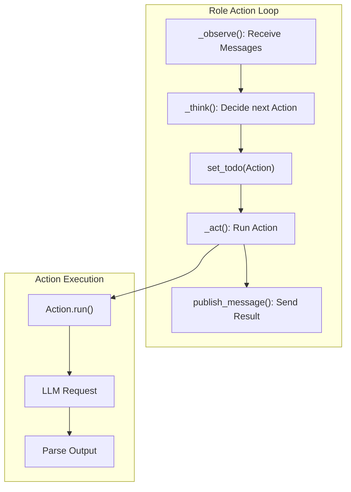

**Sources:** [metagpt/roles/role.py:340-340](), [metagpt/roles/role.py:356-356](), [metagpt/roles/role.py:379-379](), [metagpt/actions/action.py:110-114]()

### Example: Engineer Workflow
The `Engineer` role watches for `WriteTasks` or `SummarizeCode` messages [metagpt/roles/engineer.py:106-106](). Upon observation, it selects `WriteCode` to implement the tasks defined in the WBS [metagpt/roles/engineer.py:159-161]().

**Sources:** [metagpt/roles/role.py:125-125](), [metagpt/roles/engineer.py:73-73](), [metagpt/actions/action.py:29-29](), [metagpt/actions/action_node.py:135-135](), [metagpt/schema.py:232-232]()

---

# Page: Environment System

# Environment System

<details>
<summary>Relevant source files</summary>

The following files were used as context for generating this wiki page:

- [metagpt/base/__init__.py](metagpt/base/__init__.py)
- [metagpt/base/base_env.py](metagpt/base/base_env.py)
- [metagpt/base/base_env_space.py](metagpt/base/base_env_space.py)
- [metagpt/base/base_role.py](metagpt/base/base_role.py)
- [metagpt/base/base_serialization.py](metagpt/base/base_serialization.py)
- [metagpt/environment/android/android_ext_env.py](metagpt/environment/android/android_ext_env.py)
- [metagpt/environment/android/grounding_dino_config.py](metagpt/environment/android/grounding_dino_config.py)
- [metagpt/environment/android/text_icon_localization.py](metagpt/environment/android/text_icon_localization.py)
- [metagpt/environment/api/__init__.py](metagpt/environment/api/__init__.py)
- [metagpt/environment/api/env_api.py](metagpt/environment/api/env_api.py)
- [metagpt/environment/base_env.py](metagpt/environment/base_env.py)
- [metagpt/environment/mgx/mgx_env.py](metagpt/environment/mgx/mgx_env.py)
- [metagpt/environment/minecraft/minecraft_env.py](metagpt/environment/minecraft/minecraft_env.py)
- [metagpt/environment/minecraft/minecraft_ext_env.py](metagpt/environment/minecraft/minecraft_ext_env.py)
- [metagpt/environment/stanford_town/env_space.py](metagpt/environment/stanford_town/env_space.py)
- [metagpt/environment/werewolf/const.py](metagpt/environment/werewolf/const.py)
- [metagpt/environment/werewolf/werewolf_env.py](metagpt/environment/werewolf/werewolf_env.py)
- [metagpt/environment/werewolf/werewolf_ext_env.py](metagpt/environment/werewolf/werewolf_ext_env.py)
- [metagpt/ext/stanford_town/roles/st_role.py](metagpt/ext/stanford_town/roles/st_role.py)
- [metagpt/ext/stanford_town/utils/utils.py](metagpt/ext/stanford_town/utils/utils.py)
- [metagpt/ext/werewolf/actions/common_actions.py](metagpt/ext/werewolf/actions/common_actions.py)
- [metagpt/ext/werewolf/actions/moderator_actions.py](metagpt/ext/werewolf/actions/moderator_actions.py)
- [metagpt/ext/werewolf/roles/base_player.py](metagpt/ext/werewolf/roles/base_player.py)
- [metagpt/ext/werewolf/roles/human_player.py](metagpt/ext/werewolf/roles/human_player.py)
- [metagpt/ext/werewolf/roles/moderator.py](metagpt/ext/werewolf/roles/moderator.py)
- [metagpt/ext/werewolf/roles/werewolf.py](metagpt/ext/werewolf/roles/werewolf.py)
- [metagpt/ext/werewolf/roles/witch.py](metagpt/ext/werewolf/roles/witch.py)
- [metagpt/ext/werewolf/schema.py](metagpt/ext/werewolf/schema.py)
- [metagpt/ext/werewolf/werewolf_game.py](metagpt/ext/werewolf/werewolf_game.py)
- [metagpt/prompts/di/data_analyst.py](metagpt/prompts/di/data_analyst.py)
- [metagpt/prompts/di/engineer2.py](metagpt/prompts/di/engineer2.py)
- [metagpt/prompts/di/role_zero.py](metagpt/prompts/di/role_zero.py)
- [metagpt/prompts/di/team_leader.py](metagpt/prompts/di/team_leader.py)
- [metagpt/roles/di/data_analyst.py](metagpt/roles/di/data_analyst.py)
- [metagpt/roles/di/engineer2.py](metagpt/roles/di/engineer2.py)
- [metagpt/roles/di/role_zero.py](metagpt/roles/di/role_zero.py)
- [metagpt/roles/di/team_leader.py](metagpt/roles/di/team_leader.py)
- [metagpt/strategy/experience_retriever.py](metagpt/strategy/experience_retriever.py)
- [metagpt/strategy/thinking_command.py](metagpt/strategy/thinking_command.py)
- [tests/metagpt/environment/android_env/__init__.py](tests/metagpt/environment/android_env/__init__.py)
- [tests/metagpt/environment/mgx_env/run_mgx_env.py](tests/metagpt/environment/mgx_env/run_mgx_env.py)
- [tests/metagpt/environment/test_base_env.py](tests/metagpt/environment/test_base_env.py)
- [tests/metagpt/environment/werewolf_env/test_werewolf_ext_env.py](tests/metagpt/environment/werewolf_env/test_werewolf_ext_env.py)
- [tests/metagpt/roles/di/run_engineer2.py](tests/metagpt/roles/di/run_engineer2.py)

</details>


The Environment System in MetaGPT provides the shared space where `Role` entities interact, exchange messages, and interface with external simulations. It evolves from a simple message bus into a complex hierarchical routing and simulation engine capable of supporting diverse domains like software engineering, data science, and interactive games.

## Core Abstractions

The environment architecture is built on two primary base classes: `ExtEnv` and `Environment`.

### ExtEnv
`ExtEnv` is the foundation for integrating MetaGPT with external game engines or platforms (e.g., Android, Minecraft). It defines the interface for standard RL-like interactions:
- **Action/Observation Spaces**: Uses `gymnasium.spaces` to define valid inputs and outputs [metagpt/environment/base_env.py:58-59]().
- **API Registry**: Provides decorators `@mark_as_readable` and `@mark_as_writeable` to expose specific environment functions as accessible APIs for agents [metagpt/environment/base_env.py:41-50]().
- **Lifecycle Methods**: Defines `reset`, `observe`, and `step` for controlling the simulation flow [metagpt/environment/base_env.py:106-121]().

### Environment
Inheriting from `ExtEnv`, the `Environment` class adds multi-agent coordination features:
- **Role Management**: Hosts a collection of `Role` objects via `add_role` and `add_roles` [metagpt/environment/base_env.py:156-174]().
- **Message Distribution**: Implements `publish_message` to route `Message` objects to intended recipients based on their `send_to` metadata [metagpt/environment/base_env.py:175-184]().

**Sources:** [metagpt/environment/base_env.py:29-149]()

---

## Hierarchical Routing: MGXEnv

`MGXEnv` (MetaGPT X Environment) is a specialized environment designed for multi-agent teams, such as those led by a `TeamLeader`. It introduces a hierarchical routing mechanism where a central coordinator manages the flow of information.

### Message Flow in MGXEnv
In `MGXEnv`, messages do not always broadcast to all members. Instead, they are routed through the `TeamLeader` (default name: "Mike") [metagpt/environment/mgx/mgx_env.py:28]().

1.  **Interception**: Every regular message published in the environment is automatically routed to the `TeamLeader` by adding the leader's name to the `send_to` field [metagpt/environment/mgx/mgx_env.py:57-58]().
2.  **Context Conversion**: The environment uses `move_message_info_to_content` to embed sender and recipient metadata directly into the message text. This ensures the LLM-based leader is aware of the conversation context despite API limitations [metagpt/environment/mgx/mgx_env.py:73-89]().
3.  **Direct Chat**: If a user initiates a direct chat with a specific role, the environment tracks this in `direct_chat_roles` to allow the role to respond directly without leader intervention [metagpt/environment/mgx/mgx_env.py:30-47]().

### MGX Message Routing Logic
| Condition | Routing Behavior |
| :--- | :--- |
| **User Direct Chat** | Message sent to specific role; role added to `direct_chat_roles` [metagpt/environment/mgx/mgx_env.py:30-38](). |
| **Leader Output** | If `publicer` is `TeamLeader`, the message is published to the environment for the specified recipients [metagpt/environment/mgx/mgx_env.py:48-53](). |
| **Standard Role Msg** | Sent to `TeamLeader` for processing and further assignment [metagpt/environment/mgx/mgx_env.py:55-58](). |

**Sources:** [metagpt/environment/mgx/mgx_env.py:11-90](), [metagpt/roles/di/team_leader.py:64-74]()

---

## The RoleZero Ecosystem

`RoleZero` is a dynamic agent class that operates within these environments, capable of planning and tool execution. Specialized roles like `Engineer2` and `DataAnalyst` extend `RoleZero` to perform domain-specific tasks.

### Code Entity Space: RoleZero Architecture
The following diagram illustrates how `RoleZero` and its derivatives interact with the environment and tools.

Title: RoleZero and MGXEnv Interaction Architecture
```mermaid
graph TD
    subgraph ["Environment Space (MGXEnv)"]
        Env["MGXEnv"]
        TL["TeamLeader (Mike)"]
    end

    subgraph ["Role Space (metagpt/roles/di)"]
        RZ["RoleZero"]
        DA["DataAnalyst (David)"]
        E2["Engineer2 (Alex)"]
    end

    subgraph ["Execution Space"]
        Planner["Planner (metagpt/strategy/planner.py)"]
        Tools["ToolRegistry (metagpt/tools/tool_registry.py)"]
        NB["ExecuteNbCode (metagpt/actions/di/execute_nb_code.py)"]
    end

    Env -- "Routes to" --> TL
    TL -- "publish_team_message" --> RZ
    RZ -- "Inherits" --> DA
    RZ -- "Inherits" --> E2
    
    DA -- "write_and_exec_code" --> NB
    RZ -- "Uses" --> Planner
    RZ -- "Executes" --> Tools
    
    E2 -- "terminal.run_command" --> Tools
```
**Sources:** [metagpt/roles/di/role_zero.py:55-116](), [metagpt/roles/di/team_leader.py:23-40](), [metagpt/roles/di/data_analyst.py:26-60](), [metagpt/roles/di/engineer2.py:32-55]()

---

## Specialized Simulation Environments

MetaGPT provides several specialized environments that implement the `ExtEnv` interface for specific domains.

### 1. Android Environment (`AndroidExtEnv`)
Integrates with Android devices via ADB (Android Debug Bridge) [metagpt/environment/android/android_ext_env.py:46]().
- **Capabilities**: Captures screenshots, retrieves XML UI hierarchies, and performs system actions like `tap`, `longpress`, and `swipe` [metagpt/environment/android/android_ext_env.py:103-120]().
- **CV Integration**: Uses OCR (ResNet18) and GroundingDINO for icon and text localization on the screen [metagpt/environment/android/android_ext_env.py:36-43]().

### 2. Werewolf Environment (`WerewolfExtEnv`)
A game environment for the Werewolf social deduction game.
- **Role Interactions**: Manages game states (Day/Night) and specific role actions (e.g., Werewolf kill, Witch save) [metagpt/environment/werewolf/werewolf_env.py]().
- **Moderation**: A `Moderator` role coordinates the sequence of play through the environment [metagpt/ext/werewolf/roles/moderator.py]().

### 3. Minecraft & Stanford Town
- **Minecraft**: Interfaces with the game to allow agents to mine, craft, and explore using structured action spaces [metagpt/environment/minecraft/minecraft_ext_env.py]().
- **Stanford Town**: A simulation of "Generative Agents" in a town setting, focusing on social behaviors and memory-driven interactions [metagpt/ext/stanford_town/roles/st_role.py]().

---

## Data Flow: Action to Environment

The following diagram bridges the "Natural Language Space" (User Requirements) to the "Code Entity Space" (API Calls).

Title: Request to Environment Execution Flow
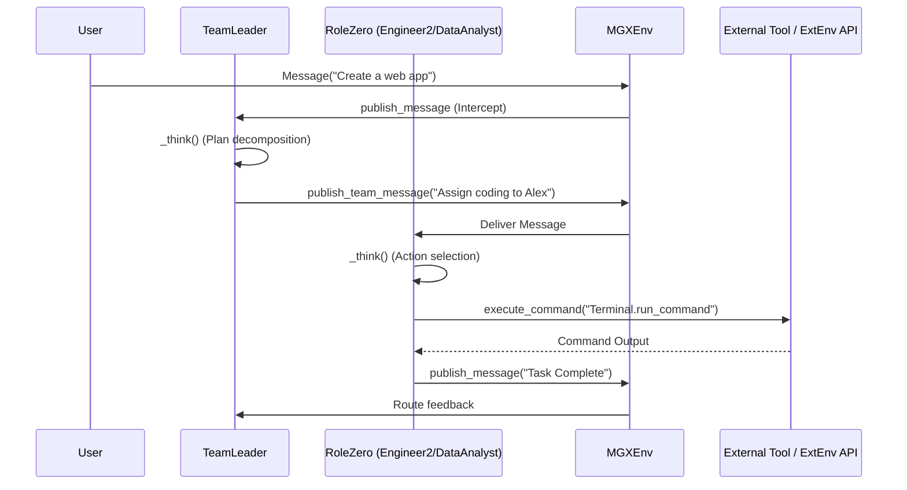
**Sources:** [metagpt/environment/mgx/mgx_env.py:24-62](), [metagpt/roles/di/role_zero.py:121-168](), [metagpt/roles/di/team_leader.py:75-86]()

---

# Page: LLM Integration

# LLM Integration

<details>
<summary>Relevant source files</summary>

The following files were used as context for generating this wiki page:

- [metagpt/configs/llm_config.py](metagpt/configs/llm_config.py)
- [metagpt/provider/__init__.py](metagpt/provider/__init__.py)
- [metagpt/provider/anthropic_api.py](metagpt/provider/anthropic_api.py)
- [metagpt/provider/base_llm.py](metagpt/provider/base_llm.py)
- [metagpt/provider/bedrock/base_provider.py](metagpt/provider/bedrock/base_provider.py)
- [metagpt/provider/bedrock/bedrock_provider.py](metagpt/provider/bedrock/bedrock_provider.py)
- [metagpt/provider/bedrock/utils.py](metagpt/provider/bedrock/utils.py)
- [metagpt/provider/bedrock_api.py](metagpt/provider/bedrock_api.py)
- [metagpt/provider/dashscope_api.py](metagpt/provider/dashscope_api.py)
- [metagpt/provider/human_provider.py](metagpt/provider/human_provider.py)
- [metagpt/provider/openai_api.py](metagpt/provider/openai_api.py)
- [metagpt/provider/qianfan_api.py](metagpt/provider/qianfan_api.py)
- [metagpt/utils/token_counter.py](metagpt/utils/token_counter.py)
- [tests/metagpt/provider/mock_llm_config.py](tests/metagpt/provider/mock_llm_config.py)
- [tests/metagpt/provider/req_resp_const.py](tests/metagpt/provider/req_resp_const.py)
- [tests/metagpt/provider/test_base_llm.py](tests/metagpt/provider/test_base_llm.py)
- [tests/metagpt/provider/test_bedrock_api.py](tests/metagpt/provider/test_bedrock_api.py)
- [tests/metagpt/provider/test_openai.py](tests/metagpt/provider/test_openai.py)
- [tests/metagpt/provider/test_qianfan_api.py](tests/metagpt/provider/test_qianfan_api.py)

</details>


This page explains how MetaGPT integrates with various Language Model providers, including the architecture, configuration options, and supported LLM services. It covers the underlying framework that enables communication with different AI models while maintaining a consistent interface for the rest of the system.

## Architecture Overview

MetaGPT employs a provider-based architecture centered around the `BaseLLM` abstract class, which defines a common interface that all LLM provider implementations must follow. This design allows the framework to easily switch between different LLM services while keeping the same API for higher-level components.

```mermaid
graph TD
    subgraph "Core Components"
        LLMFactory["metagpt.llm.LLM()"]
        BaseLLM["metagpt.provider.base_llm.BaseLLM"]
        LLMConfig["metagpt.configs.llm_config.LLMConfig"]
        TokenCounter["metagpt.utils.token_counter"]
        CostManager["metagpt.utils.cost_manager.CostManager"]
    end
    
    subgraph "Provider Implementations"
        OpenAILLM["metagpt.provider.openai_api.OpenAILLM"]
        AnthropicLLM["metagpt.provider.anthropic_api.AnthropicLLM"]
        BedrockLLM["metagpt.provider.bedrock_api.BedrockLLM"]
        GeminiLLM["metagpt.provider.google_gemini_api.GeminiLLM"]
        QianFanLLM["metagpt.provider.qianfan_api.QianFanLLM"]
        DashScopeLLM["metagpt.provider.dashscope_api.DashScopeLLM"]
    end
    
    subgraph "Framework Usage"
        Role["metagpt.roles.role.Role"]
        Action["metagpt.actions.action.Action"]
    end
    
    Role --"aask(prompt)"---> LLMFactory
    Action --"_aask(prompt)"---> LLMFactory
    
    LLMFactory --"creates"---> BaseLLM
    BaseLLM <|-- OpenAILLM
    BaseLLM <|-- AnthropicLLM
    BaseLLM <|-- BedrockLLM
    BaseLLM <|-- GeminiLLM
    BaseLLM <|-- QianFanLLM
    BaseLLM <|-- DashScopeLLM
    
    LLMConfig --"configures"---> BaseLLM
    CostManager --"tracks costs for"---> BaseLLM
```

Sources: [metagpt/provider/base_llm.py:35-49](), [metagpt/configs/llm_config.py:52-115](), [metagpt/provider/openai_api.py:58-65]()

## Provider Registration and Selection

MetaGPT uses a registry pattern to manage LLM providers. Each provider implementation is registered with its supported LLM types using the `@register_provider` decorator [metagpt/provider/openai_api.py:43-57](). When an LLM is requested, the system selects the appropriate provider based on the `LLMType` defined in the configuration [metagpt/configs/llm_config.py:19-46]().

```mermaid
sequenceDiagram
    participant Role as "Role/Action"
    participant LLMFactory as "metagpt.llm.LLM"
    participant Context as "metagpt.context.Context"
    participant Provider as "Provider Implementation (e.g., OpenAILLM)"
    participant API as "LLM Service API"

    Role->>LLMFactory: aask(prompt, system_msgs, images, stream)
    LLMFactory->>Context: llm() or llm_with_cost_manager_from_llm_config()
    Context->>Provider: Create provider instance based on LLMType
    
    Provider->>Provider: format_msg(messages)
    
    alt stream=True
        Provider->>API: _achat_completion_stream(messages)
        API-->>Provider: Stream response chunks
        Provider->>Provider: _update_costs(usage)
    else stream=False
        Provider->>API: _achat_completion(messages)
        API-->>Provider: Return ChatCompletion/Message
        Provider->>Provider: _update_costs(usage)
    end
    
    Provider-->>Role: Return text response
```

Sources: [metagpt/provider/openai_api.py:43-56](), [metagpt/provider/base_llm.py:94-116](), [metagpt/provider/base_llm.py:124-140]()

## BaseLLM Interface

The `BaseLLM` abstract base class [metagpt/provider/base_llm.py:35]() defines the common interface that all provider implementations must implement. It provides utility methods for message formatting, cost updating, and multimodal support.

| Method | Description |
|--------|-------------|
| `aask()` | Main method to request completions from an LLM [metagpt/provider/base_llm.py:179]() |
| `acompletion()` | Get raw completion object from the LLM [metagpt/provider/openai_api.py:162]() |
| `acompletion_text()` | Get text completion from the LLM [metagpt/provider/openai_api.py:172]() |
| `_achat_completion()` | Provider-specific implementation for chat completions [metagpt/provider/openai_api.py:156]() |
| `_achat_completion_stream()` | Provider-specific implementation for streaming [metagpt/provider/openai_api.py:92]() |

Sources: [metagpt/provider/base_llm.py:35-411]()

## LLM Configuration

The `LLMConfig` class [metagpt/configs/llm_config.py:52]() provides a flexible way to configure various aspects of LLM interactions, including API keys, model types, and cost control settings.

- **LLMType**: An Enum defining supported providers like `OPENAI`, `ANTHROPIC`, `BEDROCK`, `GEMINI`, etc. [metagpt/configs/llm_config.py:19-46]()
- **CompressType**: Defines strategies for message compression when nearing context limits [metagpt/configs/llm_config.py:107]().

Sources: [metagpt/configs/llm_config.py:9-135]()

## Supported LLM Providers

MetaGPT supports a wide range of LLM providers. For detailed implementation details, see the child pages:

- **OpenAI Integration**: Covers GPT-4o, GPT-4, and O1 series models, including tool calling and image generation. For details, see [OpenAI Integration](#3.1).
- **Alternative LLM Providers**: Explains support for Claude (Anthropic), AWS Bedrock, Google Gemini, and various local or domestic providers like Ollama and ZhiPuAI. For details, see [Alternative LLM Providers](#3.2).

Sources: [metagpt/provider/__init__.py:9-22](), [metagpt/provider/openai_api.py:43-56]()

## Token Management and Cost Tracking

MetaGPT includes a comprehensive system for tracking token usage and costs across different providers and models.

- **Token Counting**: The `metagpt.utils.token_counter` module provides utilities like `count_message_tokens` to estimate usage before sending requests [metagpt/utils/token_counter.py:37]().
- **Cost Tracking**: The `CostManager` class calculates monetary expenditure based on `TOKEN_COSTS` [metagpt/utils/token_counter.py:18-115]().
- **Message Compression**: When context limits are reached, `BaseLLM.compress_messages` can truncate or discard history based on the configured `CompressType` [metagpt/provider/base_llm.py:338-410]().

For details, see [Token Management and Cost Tracking](#3.3).

Sources: [metagpt/utils/token_counter.py:18-115](), [metagpt/provider/base_llm.py:124-140](), [metagpt/provider/base_llm.py:338-410]()

## Advanced Capabilities

### Multimodal and Reasoning
MetaGPT supports advanced model features:
- **Image Input**: Handled via `_user_msg_with_imgs` for models supporting multimodal input [metagpt/provider/base_llm.py:71-83]().
- **Reasoning Mode**: Support for "thinking" tokens in models like DeepSeek or Anthropic Claude 3.7, tracked via `reasoning_content` [metagpt/provider/base_llm.py:52-59](), [metagpt/provider/anthropic_api.py:44-50]().

### Resilience
The framework uses the `tenacity` library to implement retries with exponential backoff for handling API connection errors [metagpt/provider/openai_api.py:165-171]().

Sources: [metagpt/provider/base_llm.py:52-59](), [metagpt/provider/openai_api.py:165-171](), [metagpt/provider/anthropic_api.py:36-38]()

---

# Page: OpenAI Integration

# OpenAI Integration

<details>
<summary>Relevant source files</summary>

The following files were used as context for generating this wiki page:

- [examples/hello_world.py](examples/hello_world.py)
- [examples/ping.py](examples/ping.py)
- [metagpt/provider/base_llm.py](metagpt/provider/base_llm.py)
- [metagpt/provider/dashscope_api.py](metagpt/provider/dashscope_api.py)
- [metagpt/provider/human_provider.py](metagpt/provider/human_provider.py)
- [metagpt/provider/metagpt_api.py](metagpt/provider/metagpt_api.py)
- [metagpt/provider/openai_api.py](metagpt/provider/openai_api.py)
- [metagpt/provider/qianfan_api.py](metagpt/provider/qianfan_api.py)
- [metagpt/utils/cost_manager.py](metagpt/utils/cost_manager.py)
- [tests/metagpt/provider/mock_llm_config.py](tests/metagpt/provider/mock_llm_config.py)
- [tests/metagpt/provider/test_base_llm.py](tests/metagpt/provider/test_base_llm.py)
- [tests/metagpt/provider/test_openai.py](tests/metagpt/provider/test_openai.py)

</details>


This document explains how MetaGPT integrates with OpenAI's API services, including the implementation details of the `OpenAILLM` class, connection handling, request processing, and resilience mechanisms.

## Architecture Overview

The OpenAI integration in MetaGPT is primarily implemented through the `OpenAILLM` class, which inherits from the `BaseLLM` abstract class. This class provides a comprehensive interface to OpenAI's API services while handling authentication, request formatting, response processing, and error management.

```mermaid
classDiagram
    class BaseLLM {
        <<abstract>>
        +config: LLMConfig
        +aclient: AsyncOpenAI
        +aask(msg, system_msgs)
        +acompletion_text(messages, stream)
        +format_msg(messages)
        +_update_costs(usage)
    }
    
    class OpenAILLM {
        -model: str
        -pricing_plan: str
        -auto_max_tokens: bool
        -cost_manager: CostManager
        +_init_client()
        +_make_client_kwargs()
        +_achat_completion_stream(messages, timeout)
        +_achat_completion(messages, timeout)
        +acompletion(messages, timeout)
        +acompletion_text(messages, stream, timeout)
        +aask_code(messages, timeout)
        +amoderation(content)
        +atext_to_speech(kwargs)
        +aspeech_to_text(kwargs)
        +gen_image(prompt, model)
    }
    
    BaseLLM <|-- OpenAILLM
```

Sources: [metagpt/provider/openai_api.py:58-66](), [metagpt/provider/base_llm.py:35-50]()

## Provider Registration and Compatibility

The `OpenAILLM` class is registered as the implementation for multiple LLM providers that use OpenAI-compatible APIs, allowing MetaGPT to treat these services uniformly.

```mermaid
graph TD
    OpenAILLM["OpenAILLM [metagpt/provider/openai_api.py]"] --> OPENAI["LLMType.OPENAI"]
    OpenAILLM --> FIREWORKS["LLMType.FIREWORKS"]
    OpenAILLM --> DEEPSEEK["LLMType.DEEPSEEK"]
    OpenAILLM --> MISTRAL["LLMType.MISTRAL"]
    OpenAILLM --> MOONSHOT["LLMType.MOONSHOT"]
    OpenAILLM --> YI["LLMType.YI"]
    OpenAILLM --> SILICONFLOW["LLMType.SILICONFLOW"]
    OpenAILLM --> OPENROUTER["LLMType.OPENROUTER"]
```

Sources: [metagpt/provider/openai_api.py:43-57]()

## Initialization and Configuration

The `OpenAILLM` is initialized with a `LLMConfig` object. It uses the `_init_client` method to instantiate the `AsyncOpenAI` client, supporting proxy configurations via `AsyncHttpxClientWrapper`.

```mermaid
sequenceDiagram
    participant App as "Application"
    participant LLMF as "LLM Factory"
    participant OpenAILLM as "OpenAILLM"
    participant AsyncOpenAI as "openai.AsyncOpenAI"
    
    App->>LLMF: LLM()
    LLMF->>OpenAILLM: __init__(config)
    OpenAILLM->>OpenAILLM: _init_client()
    OpenAILLM->>OpenAILLM: _make_client_kwargs()
    Note over OpenAILLM: Sets api_key, base_url, http_client
    OpenAILLM->>AsyncOpenAI: AsyncOpenAI(**kwargs)
    OpenAILLM-->>LLMF: instance
    LLMF-->>App: instance
```

Sources: [metagpt/provider/openai_api.py:61-81](), [metagpt/provider/base_llm.py:43-44]()

### Configuration Options

| Parameter | Description | Source |
|-----------|-------------|--------|
| `api_key` | OpenAI API key | [metagpt/provider/openai_api.py:75]() |
| `base_url` | API base URL for the provider | [metagpt/provider/openai_api.py:75]() |
| `model` | The specific model identifier (e.g., gpt-4o) | [metagpt/provider/openai_api.py:69]() |
| `proxy` | Proxy URL for HTTP client | [metagpt/provider/openai_api.py:85-90]() |
| `pricing_plan` | Used for cost calculation if different from model | [metagpt/provider/openai_api.py:70]() |

## Core Request Handling

### Streaming and Reasoning
MetaGPT supports streaming responses via `_achat_completion_stream`. It handles specific metadata like `reasoning_content` (used by models like DeepSeek) and ensures usage statistics are captured even when providers return them in different chunk attributes.

```python
async for chunk in response:
    choice0 = chunk.choices[0]
    choice_delta = choice0.delta
    if hasattr(choice_delta, "reasoning_content") and choice_delta.reasoning_content:
        collected_reasoning_messages.append(choice_delta.reasoning_content)
        continue
    # ... handle content chunks ...
```

Sources: [metagpt/provider/openai_api.py:92-136]()

### Resilience and Retries
To handle transient network issues or API failures, MetaGPT uses `tenacity` to implement exponential backoff retries for text completion requests.

```python
@retry(
    wait=wait_random_exponential(min=1, max=60),
    stop=stop_after_attempt(6),
    retry=retry_if_exception_type(APIConnectionError),
    retry_error_callback=log_and_reraise,
)
async def acompletion_text(self, messages: list[dict], stream=False, timeout=USE_CONFIG_TIMEOUT) -> str:
    # ... implementation ...
```

Sources: [metagpt/provider/openai_api.py:165-172]()

## Specialized Capabilities

### Function/Tool Calling
The `aask_code` and `_achat_completion_function` methods leverage OpenAI's tool-calling capabilities. MetaGPT provides a `GENERAL_FUNCTION_SCHEMA` to prompt the model to return structured code blocks.

Sources: [metagpt/provider/openai_api.py:188-202](), [metagpt/provider/openai_api.py:228-262]()

### Multimodal Support
The base class `BaseLLM` includes logic to detect multimodal models via `MULTI_MODAL_MODELS` and formats messages to include `image_url` payloads when images are provided in the `Message` metadata.

Sources: [metagpt/provider/base_llm.py:65-83](), [metagpt/provider/base_llm.py:91-92]()

### Image, Speech, and Moderation
MetaGPT exposes OpenAI's auxiliary endpoints:
- **Image Generation**: `gen_image` calls `self.aclient.images.generate`. [metagpt/provider/openai_api.py:301-320]()
- **Text-to-Speech**: `atext_to_speech` calls `self.aclient.audio.speech.create`. [metagpt/provider/openai_api.py:293-295]()
- **Speech-to-Text**: `aspeech_to_text` calls `self.aclient.audio.transcriptions.create`. [metagpt/provider/openai_api.py:297-299]()
- **Moderation**: `amoderation` calls `self.aclient.moderations.create`. [metagpt/provider/openai_api.py:288-291]()

## Token Management and Cost Tracking

`OpenAILLM` tracks costs by calculating token usage per request. If the API response doesn't provide usage, it estimates it using `count_message_tokens` and `count_output_tokens`.

```python
def _update_costs(self, usage: Union[dict, BaseModel], model: str = None, local_calc_usage: bool = True):
    # ... updates cost_manager ...
    if calc_usage and self.cost_manager and usage:
        self.cost_manager.update_cost(prompt_tokens, completion_tokens, model)
```

Sources: [metagpt/provider/base_llm.py:124-141](), [metagpt/provider/openai_api.py:268-286](), [metagpt/utils/cost_manager.py:35-61]()

## Usage Example

```python
from metagpt.llm import LLM

async def main():
    llm = LLM() # Defaults to OpenAILLM if configured
    
    # Standard question
    response = await llm.aask("What is the SOP for software development?")
    
    # Structured code request
    code_response = await llm.aask_code([{"role": "user", "content": "Write a fast sort in Python"}])
    # Returns {'code': '...', 'language': 'python'}
```

Sources: [examples/hello_world.py:14-20](), [metagpt/provider/openai_api.py:188-202]()

---

# Page: Alternative LLM Providers

# Alternative LLM Providers

<details>
<summary>Relevant source files</summary>

The following files were used as context for generating this wiki page:

- [examples/llm_vision.py](examples/llm_vision.py)
- [metagpt/configs/llm_config.py](metagpt/configs/llm_config.py)
- [metagpt/provider/__init__.py](metagpt/provider/__init__.py)
- [metagpt/provider/anthropic_api.py](metagpt/provider/anthropic_api.py)
- [metagpt/provider/base_llm.py](metagpt/provider/base_llm.py)
- [metagpt/provider/bedrock/base_provider.py](metagpt/provider/bedrock/base_provider.py)
- [metagpt/provider/bedrock/bedrock_provider.py](metagpt/provider/bedrock/bedrock_provider.py)
- [metagpt/provider/bedrock/utils.py](metagpt/provider/bedrock/utils.py)
- [metagpt/provider/bedrock_api.py](metagpt/provider/bedrock_api.py)
- [metagpt/provider/dashscope_api.py](metagpt/provider/dashscope_api.py)
- [metagpt/provider/general_api_base.py](metagpt/provider/general_api_base.py)
- [metagpt/provider/general_api_requestor.py](metagpt/provider/general_api_requestor.py)
- [metagpt/provider/google_gemini_api.py](metagpt/provider/google_gemini_api.py)
- [metagpt/provider/human_provider.py](metagpt/provider/human_provider.py)
- [metagpt/provider/ollama_api.py](metagpt/provider/ollama_api.py)
- [metagpt/provider/openai_api.py](metagpt/provider/openai_api.py)
- [metagpt/provider/qianfan_api.py](metagpt/provider/qianfan_api.py)
- [metagpt/provider/spark_api.py](metagpt/provider/spark_api.py)
- [metagpt/provider/zhipuai/async_sse_client.py](metagpt/provider/zhipuai/async_sse_client.py)
- [metagpt/provider/zhipuai/zhipu_model_api.py](metagpt/provider/zhipuai/zhipu_model_api.py)
- [metagpt/provider/zhipuai_api.py](metagpt/provider/zhipuai_api.py)
- [metagpt/utils/token_counter.py](metagpt/utils/token_counter.py)
- [tests/metagpt/provider/mock_llm_config.py](tests/metagpt/provider/mock_llm_config.py)
- [tests/metagpt/provider/req_resp_const.py](tests/metagpt/provider/req_resp_const.py)
- [tests/metagpt/provider/test_anthropic_api.py](tests/metagpt/provider/test_anthropic_api.py)
- [tests/metagpt/provider/test_base_llm.py](tests/metagpt/provider/test_base_llm.py)
- [tests/metagpt/provider/test_bedrock_api.py](tests/metagpt/provider/test_bedrock_api.py)
- [tests/metagpt/provider/test_google_gemini_api.py](tests/metagpt/provider/test_google_gemini_api.py)
- [tests/metagpt/provider/test_ollama_api.py](tests/metagpt/provider/test_ollama_api.py)
- [tests/metagpt/provider/test_openai.py](tests/metagpt/provider/test_openai.py)
- [tests/metagpt/provider/test_qianfan_api.py](tests/metagpt/provider/test_qianfan_api.py)
- [tests/metagpt/provider/test_spark_api.py](tests/metagpt/provider/test_spark_api.py)
- [tests/metagpt/provider/test_zhipuai_api.py](tests/metagpt/provider/test_zhipuai_api.py)

</details>


This document explains how MetaGPT integrates with alternative large language model (LLM) providers beyond OpenAI. It covers the architecture, implementation details, and usage of LLM providers including Ollama, Google Gemini, ZhiPuAI, Anthropic, AWS Bedrock, and more. For information about OpenAI integration, see [OpenAI Integration](#3.1). For token management and cost tracking across all providers, see [Token Management and Cost Tracking](#3.3).

## Provider Architecture Overview

MetaGPT implements a consistent pattern for integrating with different LLM providers, making it easy to switch between them or add new ones. Each provider inherits from the `BaseLLM` class [metagpt/provider/base_llm.py:35-36]() and is registered with the system using a provider registry pattern [metagpt/provider/llm_provider_registry.py]().

### Class Hierarchy and Key Entities

```mermaid
classDiagram
    class "BaseLLM" {
        +config: LLMConfig
        +aclient: AsyncOpenAI
        +cost_manager: CostManager
        +aask(msg, system_msgs): str
        +acompletion(messages): dict
        +_update_costs(usage, model): void
        +format_msg(messages): list[dict]
    }
    
    class "OpenAILLM" {
        +_init_client()
        +_achat_completion(messages): ChatCompletion
        +_achat_completion_stream(messages): str
    }
    
    class "OllamaLLM" {
        +client: GeneralAPIRequestor
        +__init_ollama(config)
        +_llama_api_inuse: OllamaMessageAPI
    }
    
    class "GeminiLLM" {
        +llm: GeminiGenerativeModel
        +aget_usage(messages, resp_text): dict
        +_achat_completion(messages): AsyncGenerateContentResponse
    }
    
    class "BedrockLLM" {
        +__client: boto3.client
        +__provider: BaseBedrockProvider
        +invoke_model(request_body): dict
    }

    class "ZhiPuAILLM" {
        +llm: ZhiPuModelAPI
        +_achat_completion(messages): dict
    }
    
    "BaseLLM" <|-- "OpenAILLM"
    "BaseLLM" <|-- "OllamaLLM"
    "BaseLLM" <|-- "GeminiLLM"
    "BaseLLM" <|-- "BedrockLLM"
    "BaseLLM" <|-- "ZhiPuAILLM"
```

Sources: [metagpt/provider/base_llm.py:35-178](), [metagpt/provider/openai_api.py:58-163](), [metagpt/provider/ollama_api.py:190-253](), [metagpt/provider/google_gemini_api.py:43-157](), [metagpt/provider/bedrock_api.py:22-137](), [metagpt/provider/zhipuai_api.py:27-89]()

## Provider Registration Mechanism

MetaGPT uses a decorator-based registry pattern to register different LLM providers. The `@register_provider` decorator maps one or more `LLMType` enum values to a specific provider class [metagpt/provider/llm_provider_registry.py]().

```mermaid
flowchart TD
    subgraph "Provider Registration Pattern"
        REG["@register_provider(LLMType)"] -->|"Decorates"| CLASS["LLM Implementation Class"]
        CLASS -->|"Registry Entry"| MAP["LLM_REGISTRY Map"]
    end
    
    subgraph "Natural Language Space to Code Entity Mapping"
        OLL["'ollama'"] --- LLMType.OLLAMA
        GEM["'gemini'"] --- LLMType.GEMINI
        BED["'bedrock'"] --- LLMType.BEDROCK
        ZHI["'zhipuai'"] --- LLMType.ZHIPUAI
        ANT["'anthropic'"] --- LLMType.ANTHROPIC
    end

    LLMType.OLLAMA --> REG
    LLMType.GEMINI --> REG
    LLMType.BEDROCK --> REG
```

Sources: [metagpt/provider/openai_api.py:43-57](), [metagpt/provider/ollama_api.py:189](), [metagpt/provider/google_gemini_api.py:42](), [metagpt/provider/bedrock_api.py:21](), [metagpt/configs/llm_config.py:19-47]()

## Ollama Integration

Ollama provides a self-hosted alternative to cloud LLMs. MetaGPT integrates with Ollama's unique API endpoints (/chat, /generate, /embed) [metagpt/provider/ollama_api.py:18-23]().

### Ollama Message Handling
The implementation uses a `OllamaMessageBase` class and a metaclass `OllamaMessageMeta` to handle different API requirements for chat, generation, and embeddings [metagpt/provider/ollama_api.py:26-75]().

| Class | API Type | Endpoint | Role |
|-------|----------|----------|------|
| `OllamaMessageChat` | CHAT | `/chat` | Standard chat completion [metagpt/provider/ollama_api.py:76-112]() |
| `OllamaMessageGenerate` | GENERATE | `/generate` | Raw text generation [metagpt/provider/ollama_api.py:114-143]() |
| `OllamaMessageEmbed` | EMBED | `/embed` | Vector embedding generation [metagpt/provider/ollama_api.py:167-187]() |

Sources: [metagpt/provider/ollama_api.py:76-187]()

## Google Gemini Integration

`GeminiLLM` leverages the `google-generativeai` SDK. It overrides message formatting because Gemini expects a `parts` structure instead of a simple `content` string [metagpt/provider/google_gemini_api.py:64-99]().

- **System Prompts**: Gemini API typically doesn't support a "system" role in the same way OpenAI does; MetaGPT maps system messages to the "user" role or handles them via internal logic [metagpt/provider/google_gemini_api.py:49-73]().
- **Token Counting**: Uses `GeminiGenerativeModel.count_tokens_async` to accurately track usage [metagpt/provider/google_gemini_api.py:37-40]().

Sources: [metagpt/provider/google_gemini_api.py:27-120]()

## AWS Bedrock Integration

`BedrockLLM` provides a unified interface for models hosted on AWS Bedrock (Claude, Llama, Mistral, etc.) [metagpt/provider/bedrock_api.py:22-33]().

### Bedrock Provider Pattern
Because different models on Bedrock require different request bodies, MetaGPT uses a `get_provider` factory to return a specific provider implementation (e.g., `AnthropicProvider`, `MetaProvider`) [metagpt/provider/bedrock/bedrock_provider.py:11-167]().

```mermaid
flowchart LR
    subgraph "Bedrock Data Flow"
        A["BedrockLLM"] -->|"Calls"| B["Provider Factory"]
        B -->|"Returns"| C["AnthropicProvider"]
        B -->|"Returns"| D["MetaProvider"]
        B -->|"Returns"| E["MistralProvider"]
        C -->|"get_request_body()"| F["Boto3 Client"]
        F -->|"invoke_model()"| G["AWS Bedrock API"]
    end
```

Sources: [metagpt/provider/bedrock_api.py:27-29](), [metagpt/provider/bedrock/bedrock_provider.py:11-167]()

## Other Supported Providers

- **Anthropic**: Supports Claude models directly via the Anthropic SDK [metagpt/provider/anthropic_api.py]().
- **ZhiPuAI**: Supports GLM series models using `ZhiPuModelAPI` [metagpt/provider/zhipuai_api.py:27-43]().
- **QianFan**: Integration with Baidu's QianFan platform [metagpt/provider/qianfan_api.py]().
- **DashScope**: Integration with Alibaba's DashScope (Tongyi Qianwen) [metagpt/provider/dashscope_api.py]().
- **Spark AI**: Integration with iFlytek's Spark model [metagpt/provider/spark_api.py]().
- **HumanProvider**: A specialized provider that allows a human to provide responses, enabling human-in-the-loop workflows [metagpt/provider/human_provider.py]().

## Configuration Summary

Alternative providers are configured in `config2.yaml` by setting the `api_type` and relevant credentials in the `llm` section [metagpt/configs/llm_config.py:52-115]().

| Provider | `api_type` | Key Config Fields |
|----------|------------|-------------------|
| Ollama | `ollama` | `base_url`, `model` |
| Gemini | `gemini` | `api_key`, `model` |
| Bedrock | `bedrock` | `access_key`, `secret_key`, `region_name` |
| ZhiPuAI | `zhipuai` | `api_key`, `model` |
| Anthropic| `anthropic`| `api_key`, `model` |

Sources: [metagpt/configs/llm_config.py:19-115](), [metagpt/provider/ollama_api.py:195-202](), [metagpt/provider/bedrock_api.py:34-45]()

---

# Page: Token Management and Cost Tracking

# Token Management and Cost Tracking

<details>
<summary>Relevant source files</summary>

The following files were used as context for generating this wiki page:

- [examples/hello_world.py](examples/hello_world.py)
- [examples/ping.py](examples/ping.py)
- [metagpt/configs/llm_config.py](metagpt/configs/llm_config.py)
- [metagpt/provider/__init__.py](metagpt/provider/__init__.py)
- [metagpt/provider/anthropic_api.py](metagpt/provider/anthropic_api.py)
- [metagpt/provider/base_llm.py](metagpt/provider/base_llm.py)
- [metagpt/provider/bedrock/base_provider.py](metagpt/provider/bedrock/base_provider.py)
- [metagpt/provider/bedrock/bedrock_provider.py](metagpt/provider/bedrock/bedrock_provider.py)
- [metagpt/provider/bedrock/utils.py](metagpt/provider/bedrock/utils.py)
- [metagpt/provider/bedrock_api.py](metagpt/provider/bedrock_api.py)
- [metagpt/provider/dashscope_api.py](metagpt/provider/dashscope_api.py)
- [metagpt/provider/human_provider.py](metagpt/provider/human_provider.py)
- [metagpt/provider/metagpt_api.py](metagpt/provider/metagpt_api.py)
- [metagpt/provider/openai_api.py](metagpt/provider/openai_api.py)
- [metagpt/provider/qianfan_api.py](metagpt/provider/qianfan_api.py)
- [metagpt/utils/cost_manager.py](metagpt/utils/cost_manager.py)
- [metagpt/utils/token_counter.py](metagpt/utils/token_counter.py)
- [tests/metagpt/provider/mock_llm_config.py](tests/metagpt/provider/mock_llm_config.py)
- [tests/metagpt/provider/req_resp_const.py](tests/metagpt/provider/req_resp_const.py)
- [tests/metagpt/provider/test_base_llm.py](tests/metagpt/provider/test_base_llm.py)
- [tests/metagpt/provider/test_bedrock_api.py](tests/metagpt/provider/test_bedrock_api.py)
- [tests/metagpt/provider/test_openai.py](tests/metagpt/provider/test_openai.py)
- [tests/metagpt/provider/test_qianfan_api.py](tests/metagpt/provider/test_qianfan_api.py)

</details>


This page explains MetaGPT's token management and cost tracking systems, which are essential components for working with Large Language Models (LLMs). These systems handle token counting, cost calculation, message compression, and usage tracking across different LLM providers.

## Overview

MetaGPT's token management and cost tracking system provides:

1.  **Token counting** - Accurate measurement of token usage for both input and output.
2.  **Cost calculation** - Provider-specific pricing calculations based on token usage.
3.  **Token management** - Message compression to stay within context limits.
4.  **Cost tracking** - Aggregation of costs across multiple API calls via the `CostManager`.

### System Architecture and Code Entities

The following diagram bridges the natural language concepts of token management to the specific classes and functions implemented in the codebase.

```mermaid
flowchart TD
    subgraph "Token Management and Cost Tracking Flow"
        USER["User/Role"] -->|"aask(messages)"| BL["BaseLLM"]
        BL -->|"count_tokens(messages)"| TC["token_counter.py"]
        BL -->|"compress_messages(messages, compress_type)"| BL
        BL -->|"_achat_completion()"| Provider["Specific Provider (e.g., OpenAILLM)"]
        Provider -->|"API Request"| LLM["LLM Provider API"]
        LLM -->|"Response with usage"| Provider
        Provider -->|"_update_costs(usage)"| BL
        BL -->|"update_cost(prompt, completion, model)"| CM["CostManager"]
        CM -->|"Calculation"| TC_COSTS["TOKEN_COSTS"]
        BL -->|"Response"| USER
        USER -->|"get_costs()"| CM
    end
```

Sources: [metagpt/provider/base_llm.py:35-145](), [metagpt/utils/token_counter.py:1-40]()

## Token Counting System

The token counting system accurately measures token usage across different LLM providers and models. This is crucial both for cost tracking and ensuring messages don't exceed token limits.

### Token Cost and Limit Data

MetaGPT maintains comprehensive pricing and context limit information for various LLM providers in `metagpt/utils/token_counter.py`.

*   **TOKEN_COSTS**: A dictionary mapping model names to their prompt and completion prices per 1,000 tokens [metagpt/utils/token_counter.py:18-116]().
*   **TOKEN_MAX**: A dictionary defining the maximum context window for each model [metagpt/utils/token_counter.py:242-349]().
*   **Provider-Specific Costs**: Separate dictionaries exist for specialized providers like `BEDROCK_TOKEN_COSTS` [metagpt/utils/token_counter.py:354-401]() and `DOUBAO_TOKEN_COSTS` [metagpt/utils/token_counter.py:226-239]().

### Key Counting Functions

The `token_counter.py` module provides several utility functions used by the `BaseLLM` and its subclasses:

| Function | Purpose | Source |
| :--- | :--- | :--- |
| `count_message_tokens` | Counts tokens in a list of messages using model-specific tokenizers (e.g., `tiktoken` for OpenAI, `anthropic` for Claude). | [metagpt/utils/token_counter.py:412-475]() |
| `count_output_tokens` | Counts tokens in the generated response string. | [metagpt/utils/token_counter.py:478-497]() |
| `get_max_completion_tokens` | Calculates the remaining token budget for a completion given the current input. | [metagpt/utils/token_counter.py:500-516]() |

## Cost Manager

The `CostManager` class tracks and calculates costs based on token usage across multiple API calls. It is typically instantiated within the LLM provider class.

```mermaid
classDiagram
    class CostManager {
        +token_costs: dict
        +prompt_tokens: int
        +completion_tokens: int
        +total_cost: float
        +update_cost(prompt_tokens, completion_tokens, model): void
        +get_costs(): Costs
    }
    
    class Costs {
        +prompt_tokens: int
        +completion_tokens: int
        +total_tokens: int
        +total_cost: float
    }
    
    class BaseLLM {
        +cost_manager: CostManager
        +_update_costs(usage, model, local_calc_usage)
    }
    
    BaseLLM --> CostManager : uses
    CostManager --> Costs : produces
```

The `_update_costs` method in `BaseLLM` extracts `prompt_tokens` and `completion_tokens` from the LLM response (often a `dict` or `BaseModel` like OpenAI's `CompletionUsage`) and passes them to the `CostManager` [metagpt/provider/base_llm.py:124-141]().

Sources: [metagpt/utils/cost_manager.py:1-50](), [metagpt/provider/base_llm.py:124-141]()

## Token Management and Message Compression

When messages near context limits, MetaGPT applies compression strategies to ensure the request does not fail. This is controlled by the `compress_type` field in `LLMConfig` [metagpt/configs/llm_config.py:106-107]().

### Compression Strategies

Compression is handled in `BaseLLM.compress_messages` [metagpt/provider/base_llm.py:338-410](). The system supports several strategies defined in `CompressType`:

1.  **NO_COMPRESS**: No action taken.
2.  **PRE_CUT_BY_TOKEN / PRE_CUT_BY_MSG**: Preserves system messages and the *earliest* conversation history, removing the most recent messages.
3.  **POST_CUT_BY_TOKEN / POST_CUT_BY_MSG**: Preserves system messages and the *latest* conversation history, removing older messages (most common for maintaining current context).

### Compression Logic
The process always attempts to keep `system` messages intact, as they contain the role's instructions [metagpt/provider/base_llm.py:365-371](). If the total token count exceeds the `max_token` limit (or a calculated threshold), the chosen `CompressType` logic is applied to the non-system messages [metagpt/provider/base_llm.py:378-408]().

Sources: [metagpt/provider/base_llm.py:338-410](), [metagpt/configs/llm_config.py:106-107]()

## Provider-Specific Implementations

Different providers handle usage reporting and token calculation differently.

### OpenAI Integration
`OpenAILLM` uses `tiktoken` for precise counting [metagpt/utils/token_counter.py:14](). In streaming mode (`_achat_completion_stream`), it collects chunks and calculates usage manually if the provider does not return a usage block [metagpt/provider/openai_api.py:131-135]().

### Bedrock Integration
`BedrockLLM` uses the `BaseBedrockProvider` to handle different model requirements (e.g., Llama vs. Claude) [metagpt/provider/bedrock_api.py:27-29](). It extracts usage from AWS response headers like `x-amzn-bedrock-input-token-count` [metagpt/provider/bedrock_api.py:161-169]().

### Anthropic Integration
`AnthropicLLM` maps the `Usage` object from the Anthropic SDK to the internal format and updates costs using the model-specific pricing [metagpt/provider/anthropic_api.py:40-42]().

Sources: [metagpt/provider/openai_api.py:92-136](), [metagpt/provider/bedrock_api.py:161-169](), [metagpt/provider/anthropic_api.py:40-42]()

## Summary of Constants

*   **TOKEN_COSTS**: Prompt/Completion prices per 1k tokens [metagpt/utils/token_counter.py:18]().
*   **TOKEN_MAX**: Model context window limits [metagpt/utils/token_counter.py:242]().
*   **LLM_API_TIMEOUT**: Default timeout for LLM requests (600s) [metagpt/configs/llm_config.py:15]().

Sources: [metagpt/utils/token_counter.py:18-349](), [metagpt/configs/llm_config.py:15-94]()

---

# Page: Memory Systems

# Memory Systems

<details>
<summary>Relevant source files</summary>

The following files were used as context for generating this wiki page:

- [.gitignore](.gitignore)
- [docs/.agent-store-config.yaml.example](docs/.agent-store-config.yaml.example)
- [docs/.well-known/ai-plugin.json](docs/.well-known/ai-plugin.json)
- [metagpt/actions/action_output.py](metagpt/actions/action_output.py)
- [metagpt/actions/skill_action.py](metagpt/actions/skill_action.py)
- [metagpt/actions/talk_action.py](metagpt/actions/talk_action.py)
- [metagpt/document.py](metagpt/document.py)
- [metagpt/document_store/base_store.py](metagpt/document_store/base_store.py)
- [metagpt/document_store/chromadb_store.py](metagpt/document_store/chromadb_store.py)
- [metagpt/document_store/faiss_store.py](metagpt/document_store/faiss_store.py)
- [metagpt/learn/skill_loader.py](metagpt/learn/skill_loader.py)
- [metagpt/memory/__init__.py](metagpt/memory/__init__.py)
- [metagpt/memory/brain_memory.py](metagpt/memory/brain_memory.py)
- [metagpt/memory/longterm_memory.py](metagpt/memory/longterm_memory.py)
- [metagpt/memory/memory.py](metagpt/memory/memory.py)
- [metagpt/memory/memory_storage.py](metagpt/memory/memory_storage.py)
- [metagpt/roles/assistant.py](metagpt/roles/assistant.py)
- [metagpt/utils/embedding.py](metagpt/utils/embedding.py)
- [metagpt/utils/serialize.py](metagpt/utils/serialize.py)
- [tests/metagpt/document_store/test_chromadb_store.py](tests/metagpt/document_store/test_chromadb_store.py)
- [tests/metagpt/document_store/test_faiss_store.py](tests/metagpt/document_store/test_faiss_store.py)
- [tests/metagpt/memory/mock_text_embed.py](tests/metagpt/memory/mock_text_embed.py)
- [tests/metagpt/memory/test_brain_memory.py](tests/metagpt/memory/test_brain_memory.py)
- [tests/metagpt/memory/test_longterm_memory.py](tests/metagpt/memory/test_longterm_memory.py)
- [tests/metagpt/memory/test_memory_storage.py](tests/metagpt/memory/test_memory_storage.py)
- [tests/metagpt/roles/test_assistant.py](tests/metagpt/roles/test_assistant.py)
- [tests/metagpt/test_llm.py](tests/metagpt/test_llm.py)
- [tests/metagpt/utils/test_code_parser.py](tests/metagpt/utils/test_code_parser.py)
- [tests/metagpt/utils/test_output_parser.py](tests/metagpt/utils/test_output_parser.py)
- [tests/metagpt/utils/test_serialize.py](tests/metagpt/utils/test_serialize.py)

</details>


MetaGPT manages memory at multiple levels to enable agents to maintain context, store domain knowledge, and improve efficiency through computation reuse. This system spans from basic short-term message storage to sophisticated long-term persistent memory backed by vector databases and specialized conversational memory for interactive agents.

## Memory System Architecture

The memory architecture is designed to bridge natural language interactions with persistent data structures.

```mermaid
graph TD
    subgraph "Natural Language Space (Context)"
        UserMsg["User Message"]
        AssistantMsg["Assistant Response"]
        Context["Conversation Context"]
    end

    subgraph "Code Entity Space (Memory Logic)"
        M["Memory [metagpt/memory/memory.py]"]
        LTM["LongTermMemory [metagpt/memory/longterm_memory.py]"]
        BM["BrainMemory [metagpt/memory/brain_memory.py]"]
        MS["MemoryStorage [metagpt/memory/memory_storage.py]"]
        SE["SimpleEngine [metagpt/rag/engines/simple.py]"]
    end

    UserMsg --> M
    AssistantMsg --> M
    M -- "Inherited by" --> LTM
    LTM -- "Uses" --> MS
    MS -- "Uses" --> SE
    BM -- "Manages" --> Context
```

Sources: [metagpt/memory/memory.py:20-25](), [metagpt/memory/longterm_memory.py:18-28](), [metagpt/memory/brain_memory.py:26-35](), [metagpt/memory/memory_storage.py:19-33]()

## Core Memory Components

### Basic Memory
The `Memory` class [metagpt/memory/memory.py:20]() is the fundamental storage unit for `Role` objects. It maintains an internal `storage` list of `Message` objects and an `index` for fast retrieval by action type or role [metagpt/memory/memory.py:23-35]().

### Brain Memory
Specialized for conversational agents like the `Assistant` role [metagpt/roles/assistant.py:37](). `BrainMemory` manages:
- **Conversation History**: Tracks user talks and assistant answers [metagpt/memory/brain_memory.py:45-58]().
- **Recursive Summarization**: Automatically compresses long histories using LLMs to fit within context limits [metagpt/memory/brain_memory.py:130-151]().
- **Persistence**: Supports saving and loading from Redis for persistent agent sessions [metagpt/memory/brain_memory.py:63-86]().

For details, see [Brain Memory](#4.1).

### Long-term Memory (LTM)
The `LongTermMemory` class [metagpt/memory/longterm_memory.py:18]() provides persistent storage using vector databases. It integrates with `MemoryStorage` [metagpt/memory/memory_storage.py:19]() to perform:
- **Similarity Search**: Uses FAISS or other document stores to find relevant past experiences [metagpt/memory/memory_storage.py:61-69]().
- **Memory Recovery**: Restores an agent's state based on its `role_id` [metagpt/memory/memory_storage.py:38-54]().

For details, see [Long-term Memory and Document Stores](#4.3).

## Experience Pooling
The Experience Pool is a specialized caching system that allows agents to reuse successful past outputs. It uses the `@exp_cache` decorator to wrap functions, checking if a similar request has been handled before by querying a `SimpleEngine` backend [metagpt/rag/engines/simple.py:13]().

For details, see [Experience Pooling](#4.2).

## Memory Integration Flow

The following diagram illustrates how a `Role` interacts with the memory systems during its lifecycle.

```mermaid
sequenceDiagram
    participant R as Role (e.g. Assistant)
    participant M as Memory (Short-term)
    participant LTM as LongTermMemory
    participant MS as MemoryStorage
    participant FS as FaissStore [metagpt/document_store/faiss_store.py]

    R->>M: add(Message)
    Note over R,M: Basic message tracking

    R->>LTM: find_news(observed_msgs)
    LTM->>MS: search_similar(msg)
    MS->>FS: search(query)
    FS-->>LTM: relevant_memories
    LTM-->>R: filtered_news (fresh content)

    R->>R: _think() & _act()
    
    R->>LTM: add(result_msg)
    LTM->>MS: add(msg)
    MS->>FS: write() / persist()
```

Sources: [metagpt/memory/longterm_memory.py:50-67](), [metagpt/memory/memory_storage.py:56-69](), [metagpt/document_store/faiss_store.py:62-71](), [metagpt/roles/assistant.py:72-83]()

## Child Pages
- [Brain Memory](#4.1) — Detail the BrainMemory system for storing and retrieving conversation history, semantic relevance checking, recursive summarization, Redis persistence, and the Assistant role that uses it.
- [Experience Pooling](#4.2) — Explain the experience pool system for caching and reusing function outputs, the @exp_cache decorator, ExperienceManager, BM25/Chroma retrieval backends, scoring, and the RoleZero context builders.
- [Long-term Memory and Document Stores](#4.3) — Describe the LongTermMemory system backed by FAISS/Chroma/Milvus/Qdrant/LanceDB document stores, MemoryStorage for embedding-based retrieval, and how these integrate with the Role memory system.

Sources: [metagpt/memory/brain_memory.py](), [metagpt/memory/longterm_memory.py](), [metagpt/memory/memory_storage.py](), [metagpt/document_store/faiss_store.py]()

---

# Page: Brain Memory

# Brain Memory

<details>
<summary>Relevant source files</summary>

The following files were used as context for generating this wiki page:

- [docs/.agent-store-config.yaml.example](docs/.agent-store-config.yaml.example)
- [docs/.well-known/ai-plugin.json](docs/.well-known/ai-plugin.json)
- [metagpt/actions/skill_action.py](metagpt/actions/skill_action.py)
- [metagpt/actions/talk_action.py](metagpt/actions/talk_action.py)
- [metagpt/learn/skill_loader.py](metagpt/learn/skill_loader.py)
- [metagpt/memory/brain_memory.py](metagpt/memory/brain_memory.py)
- [metagpt/roles/assistant.py](metagpt/roles/assistant.py)
- [metagpt/utils/redis.py](metagpt/utils/redis.py)
- [metagpt/utils/s3.py](metagpt/utils/s3.py)
- [tests/metagpt/memory/test_brain_memory.py](tests/metagpt/memory/test_brain_memory.py)
- [tests/metagpt/roles/test_assistant.py](tests/metagpt/roles/test_assistant.py)
- [tests/metagpt/test_llm.py](tests/metagpt/test_llm.py)
- [tests/metagpt/utils/test_redis.py](tests/metagpt/utils/test_redis.py)
- [tests/metagpt/utils/test_s3.py](tests/metagpt/utils/test_s3.py)

</details>


The Brain Memory system in MetaGPT provides long-term storage and memory management capabilities for agents. It handles conversation history storage, knowledge retention, automatic memory summarization, and persistent storage using Redis. This system enables agents to maintain context across interactions, recall relevant information, and optimize memory usage through intelligent summarization.

For information about Experience Pooling, which is a separate memory system for caching function outputs, see [Experience Pooling](#4.2).

## Architecture Overview

`BrainMemory` is a core memory component defined in [metagpt/memory/brain_memory.py:26-36]() and is primarily used by the `Assistant` role to store conversation history, relevant knowledge, and generate summaries of past interactions.

### Code Entity Space to Natural Language Space

The following diagram bridges the code entities in `metagpt/memory/brain_memory.py` and `metagpt/roles/assistant.py` with their functional roles in the memory system.

```mermaid
classDiagram
    class BrainMemory ["BrainMemory (metagpt/memory/brain_memory.py)"] {
        +history: List[Message]
        +knowledge: List[Message]
        +historical_summary: str
        +last_history_id: str
        +is_dirty: bool
        +last_talk: Optional[str]
        +cacheable: bool
        +llm: Optional[BaseLLM]
        +config: Optional[_Config]
        +add_talk(msg: Message)
        +add_answer(msg: Message)
        +get_knowledge() str
        +loads(redis_key: str) BrainMemory
        +dumps(redis_key: str, timeout_sec: int)
        +summarize(llm, max_words, keep_language, limit)
        +get_title(llm, max_words) str
        +is_related(text1, text2, llm) bool
        +rewrite(sentence, context, llm) str
    }
    
    class Message ["Message (metagpt/schema.py)"] {
        +id: str
        +content: str
        +role: str
        +cause_by: str
        +sent_from: str
        +send_to: set[str]
    }
    
    class Redis ["Redis (metagpt/utils/redis.py)"] {
        +config: RedisConfig
        +_client
        +get(key: str) bytes|None
        +set(key: str, data: str, timeout_sec: int)
        +close()
    }
    
    class Assistant ["Assistant (metagpt/roles/assistant.py)"] {
        +name: str
        +profile: str
        +goal: str
        +constraints: str
        +memory: BrainMemory
        +think() bool
        +act() Message
        +talk(text)
        +refine_memory() str
    }
    
    BrainMemory "1" *-- "*" Message : "stores conversation items"
    BrainMemory --> Redis : "uses for persistence"
    Assistant "1" *-- "1" BrainMemory : "manages state via"
```
Sources: [metagpt/memory/brain_memory.py:26-259](), [metagpt/roles/assistant.py:37-45](), [metagpt/utils/redis.py:19-22]()

## Core Components

The `BrainMemory` class consists of several key components that work together to provide a comprehensive memory system:

| Component | Type | Purpose |
|-----------|------|---------|
| `history` | `List[Message]` | Stores recent conversation messages [metagpt/memory/brain_memory.py:27](). |
| `knowledge` | `List[Message]` | Stores knowledge/facts available to the agent [metagpt/memory/brain_memory.py:28](). |
| `historical_summary` | `str` | Compressed summary of older conversation history [metagpt/memory/brain_memory.py:29](). |
| `last_history_id` | `str` | ID of the most recent message to prevent duplicates [metagpt/memory/brain_memory.py:30](). |
| `is_dirty` | `bool` | Flag indicating if memory has been modified since last save [metagpt/memory/brain_memory.py:31](). |
| `last_talk` | `Optional[str]` | The most recent user message [metagpt/memory/brain_memory.py:32](). |
| `cacheable` | `bool` | Whether memory should be cached in Redis [metagpt/memory/brain_memory.py:33](). |
| `llm` | `Optional[BaseLLM]` | LLM instance used for summarization and semantic checks [metagpt/memory/brain_memory.py:34](). |

Sources: [metagpt/memory/brain_memory.py:26-36]()

## Memory Processing Flow

The interaction between the `Assistant` role and `BrainMemory` ensures that user input is refined and contextualized before being processed by an action.

```mermaid
sequenceDiagram
    participant User
    participant Assistant as "Assistant (assistant.py)"
    participant BM as "BrainMemory (brain_memory.py)"
    participant LLM as "BaseLLM (base_llm.py)"
    participant Redis as "Redis (redis.py)"

    User->>Assistant: Input message
    Assistant->>BM: add_talk(msg)
    BM->>BM: Update history & set is_dirty
    
    Assistant->>Assistant: think() calls refine_memory()
    Assistant->>BM: pop_last_talk()
    
    alt Context is large
        Assistant->>BM: summarize(llm)
        BM->>LLM: _openai_summarize / _metagpt_summarize
        LLM-->>BM: Return summary string
        BM->>BM: set_history_summary() & clear history
    end
    
    alt Check semantic relevance
        Assistant->>BM: is_related(last_talk, summary, llm)
        BM->>LLM: _openai_is_related
        LLM-->>BM: Return bool
        opt If relevant
            Assistant->>BM: rewrite(last_talk, summary, llm)
            BM->>LLM: _openai_rewrite
            LLM-->>BM: Return augmented sentence
        end
    end
    
    Assistant->>Assistant: act() runs TalkAction/SkillAction
    Assistant->>BM: add_answer(response_msg)
    
    BM->>Redis: dumps(redis_key) if is_dirty
    Redis-->>BM: Confirm SET
```
Sources: [metagpt/memory/brain_memory.py:45-110](), [metagpt/roles/assistant.py:53-70](), [metagpt/roles/assistant.py:118-130]()

## Message Management

### Adding Messages
- `add_talk(msg)`: Adds a message from the user, setting `msg.role = "user"` [metagpt/memory/brain_memory.py:45-51]().
- `add_answer(msg)`: Adds a message from the LLM, setting `msg.role = "assistant"` [metagpt/memory/brain_memory.py:53-57]().
- `add_history(msg)`: The internal method that appends to `self.history` while checking `msg.id` against `self.last_history_id` to ensure order and uniqueness [metagpt/memory/brain_memory.py:103-110]().

### Knowledge Management
The `knowledge` attribute stores facts. The `get_knowledge()` method concatenates all content in `self.knowledge` into a single string for prompt injection [metagpt/memory/brain_memory.py:59-61]().

## Memory Persistence with Redis

`BrainMemory` utilizes a `Redis` utility class for persistence, allowing agent state to survive across process restarts.

- **Dumping**: The `dumps` method serializes the object to JSON using `model_dump_json()` and stores it in Redis if `is_dirty` is `True` [metagpt/memory/brain_memory.py:75-86]().
- **Loading**: The `loads` method retrieves the JSON string from Redis and reconstructs the `BrainMemory` object using `parse_raw` [metagpt/memory/brain_memory.py:63-73]().
- **Key Generation**: Keys are structured as `prefix:user_id:chat_id` via `to_redis_key` [metagpt/memory/brain_memory.py:88-89]().

Sources: [metagpt/memory/brain_memory.py:63-89](), [metagpt/utils/redis.py:40-58]()

## Memory Optimization through Summarization

To stay within LLM context limits, `BrainMemory` implements recursive summarization.

### Summarization Strategies
1. **`_metagpt_summarize`**: A simpler truncation strategy that keeps messages within a `max_words` limit and converts them to a JSON format [metagpt/memory/brain_memory.py:152-175]().
2. **`_openai_summarize`**: A more complex strategy that combines `historical_summary` and current `history`. If the text exceeds the `limit`, it triggers the `_summarize` recursive process [metagpt/memory/brain_memory.py:137-150]().
3. **Recursive Windowing**: The `_summarize` method (referenced in logic) handles text larger than the model's token capacity by splitting it into windows, summarizing them, and re-summarizing the results [metagpt/memory/brain_memory.py:146]().

Sources: [metagpt/memory/brain_memory.py:130-175]()

## Semantic Analysis and Rewriting

The system provides tools to check if a new query is related to past conversations and to rewrite queries to include context.

- **Relevance**: `_openai_is_related` asks the LLM if two paragraphs are semantically relevant, returning a boolean [metagpt/memory/brain_memory.py:206-221]().
- **Rewriting**: `_openai_rewrite` uses the LLM to augment a user's sentence with information from the `historical_summary` to resolve coreferences or missing context [metagpt/memory/brain_memory.py:231-246]().

Sources: [metagpt/memory/brain_memory.py:198-246]()

## Integration in Assistant Role

The `Assistant` role (Lily) is the primary user of `BrainMemory`.

1. **Thinking Phase**: In `think()`, the role calls `refine_memory()` [metagpt/roles/assistant.py:55](). This method pops the `last_talk`, checks if history is available, and optionally merges history with the current query if they are semantically related [metagpt/roles/assistant.py:118-130]().
2. **Action Dispatching**: Based on the refined memory, the Assistant decides whether to use a `TalkAction` or a `SkillAction` [metagpt/roles/assistant.py:88-95]().
3. **Context Injection**: `TalkAction` accesses `memory.get_knowledge()` and `memory.history_text` to build its prompt [metagpt/roles/assistant.py:98-102]().

Sources: [metagpt/roles/assistant.py:53-130](), [metagpt/actions/talk_action.py:86-90]()

---

# Page: Experience Pooling

# Experience Pooling

<details>
<summary>Relevant source files</summary>

The following files were used as context for generating this wiki page:

- [config/config2.example.yaml](config/config2.example.yaml)
- [examples/data/exp_pool/team_leader_exps.json](examples/data/exp_pool/team_leader_exps.json)
- [examples/exp_pool/decorator.py](examples/exp_pool/decorator.py)
- [examples/exp_pool/manager.py](examples/exp_pool/manager.py)
- [examples/exp_pool/scorer.py](examples/exp_pool/scorer.py)
- [metagpt/configs/exp_pool_config.py](metagpt/configs/exp_pool_config.py)
- [metagpt/exp_pool/__init__.py](metagpt/exp_pool/__init__.py)
- [metagpt/exp_pool/context_builders/action_node.py](metagpt/exp_pool/context_builders/action_node.py)
- [metagpt/exp_pool/context_builders/base.py](metagpt/exp_pool/context_builders/base.py)
- [metagpt/exp_pool/context_builders/role_zero.py](metagpt/exp_pool/context_builders/role_zero.py)
- [metagpt/exp_pool/context_builders/simple.py](metagpt/exp_pool/context_builders/simple.py)
- [metagpt/exp_pool/decorator.py](metagpt/exp_pool/decorator.py)
- [metagpt/exp_pool/manager.py](metagpt/exp_pool/manager.py)
- [metagpt/exp_pool/schema.py](metagpt/exp_pool/schema.py)
- [metagpt/exp_pool/scorers/__init__.py](metagpt/exp_pool/scorers/__init__.py)
- [metagpt/exp_pool/scorers/base.py](metagpt/exp_pool/scorers/base.py)
- [metagpt/exp_pool/scorers/simple.py](metagpt/exp_pool/scorers/simple.py)
- [metagpt/exp_pool/serializers/base.py](metagpt/exp_pool/serializers/base.py)
- [metagpt/exp_pool/serializers/role_zero.py](metagpt/exp_pool/serializers/role_zero.py)
- [metagpt/exp_pool/serializers/simple.py](metagpt/exp_pool/serializers/simple.py)
- [metagpt/utils/reflection.py](metagpt/utils/reflection.py)
- [tests/metagpt/exp_pool/test_context_builders/test_rolezero_context_builder.py](tests/metagpt/exp_pool/test_context_builders/test_rolezero_context_builder.py)
- [tests/metagpt/exp_pool/test_context_builders/test_simple_context_builder.py](tests/metagpt/exp_pool/test_context_builders/test_simple_context_builder.py)
- [tests/metagpt/exp_pool/test_decorator.py](tests/metagpt/exp_pool/test_decorator.py)
- [tests/metagpt/exp_pool/test_manager.py](tests/metagpt/exp_pool/test_manager.py)
- [tests/metagpt/exp_pool/test_scorers/test_simple_scorer.py](tests/metagpt/exp_pool/test_scorers/test_simple_scorer.py)
- [tests/metagpt/exp_pool/test_serializers/test_role_zero.py](tests/metagpt/exp_pool/test_serializers/test_role_zero.py)
- [tests/metagpt/exp_pool/test_serializers/test_simple.py](tests/metagpt/exp_pool/test_serializers/test_simple.py)

</details>


Experience Pooling is a caching and retrieval system in MetaGPT that stores and reuses function outputs, particularly for LLM queries. By intelligently caching previous responses and evaluating their quality, the system can reduce API calls, lower costs, and improve response times while maintaining quality.

## Overview and Purpose

Experience Pooling functions as a sophisticated caching layer for function outputs in MetaGPT. Unlike simple caches that rely on exact matches, Experience Pooling can identify semantically similar requests and return previously successful responses.

### System Architecture

The following diagram bridges the high-level concepts to the specific code entities in the `metagpt.exp_pool` package.

```mermaid
flowchart TB
    subgraph "Experience Pooling System (metagpt/exp_pool)"
        ExpManager["ExperienceManager (manager.py)"]
        ExpCache["@exp_cache Decorator (decorator.py)"]
        ExpStorage["SimpleEngine (rag/engines.py)"]
        ExpScorer["BaseScorer (scorers/base.py)"]
        PerfectJudge["BasePerfectJudge (perfect_judges.py)"]
        ExpHandler["ExpCacheHandler (decorator.py)"]
    end
    
    subgraph "MetaGPT Core"
        Role["Role System"]
        Actions["Actions"]
        LLM["LLM API Calls (provider/base_llm.py)"]
    end
    
    ExpCache -->|"Wraps"| Role
    ExpCache -->|"Wraps"| Actions
    ExpCache -->|"Initializes"| ExpHandler
    ExpHandler -->|"Queries"| ExpManager
    ExpManager -->|"Retrieves from"| ExpStorage
    ExpHandler -->|"Evaluates with"| PerfectJudge
    
    ExpHandler -.->|"On Cache Miss"| LLM
    ExpHandler -->|"Scores via"| ExpScorer
    ExpHandler -->|"Persists via"| ExpManager
```

Sources: 
- [metagpt/exp_pool/manager.py:18-233]()
- [metagpt/exp_pool/decorator.py:29-94]()
- [metagpt/exp_pool/schema.py:1-77]()

## Core Data Model

At the heart of Experience Pooling is the `Experience` data structure, which encapsulates request-response pairs and metadata about them.

```mermaid
classDiagram
    class Experience {
        +str req
        +str resp
        +Metric metric
        +ExperienceType exp_type
        +EntryType entry_type
        +str tag
        +Trajectory traj
        +float timestamp
        +UUID uuid
        +rag_key()
    }
    
    class Metric {
        +float time_cost
        +float money_cost
        +Score score
    }
    
    class Score {
        +int val
        +str reason
    }
    
    class QueryType {
        <<enumeration>>
        EXACT
        SEMANTIC
    }
    
    Experience --> Metric
    Metric --> Score
```

Sources:
- [metagpt/exp_pool/schema.py:16-77]()

The `Experience` model stores:
- `req`: The original request text, used as the `rag_key` [metagpt/exp_pool/schema.py:75-76]().
- `resp`: The response content (string, JSON, or code).
- `metric`: Performance metrics including time cost, money cost, and a `Score` object [metagpt/exp_pool/schema.py:45-51]().
- `tag`: A categorization label, defaulting to `ClassName.method_name` or `function_name` [metagpt/exp_pool/decorator.py:57-57]().
- `traj`: Optional `Trajectory` for plan-action-observation sequences [metagpt/exp_pool/schema.py:53-60]().

## Experience Manager

The `ExperienceManager` class manages the lifecycle of experiences, including storage, retrieval, and querying. It abstracts the underlying RAG engines.

### Storage Resolution

The manager supports two retrieval backends defined in `ExperiencePoolRetrievalType`:
1. **BM25**: Text-based retrieval with keyword matching [metagpt/exp_pool/manager.py:145-189]().
2. **CHROMA**: Vector-based retrieval for semantic similarity [metagpt/exp_pool/manager.py:191-218]().

```mermaid
flowchart TD
    subgraph "ExperienceManager Logic"
        direction TB
        Init["Initialize (Config)"]
        Resolve["_resolve_storage()"]
        BM25_Store["_create_bm25_storage()"]
        Chroma_Store["_create_chroma_storage()"]
    end
    
    subgraph "RAG Module (metagpt/rag)"
        SimpleEngine["SimpleEngine"]
        BM25Config["BM25RetrieverConfig"]
        ChromaConfig["ChromaRetrieverConfig"]
    end
    
    Init --> Resolve
    Resolve -->|"retrieval_type == BM25"| BM25_Store
    Resolve -->|"retrieval_type == CHROMA"| Chroma_Store
    
    BM25_Store -->|"Uses"| SimpleEngine
    BM25_Store -->|"Configures"| BM25Config
    Chroma_Store -->|"Uses"| SimpleEngine
    Chroma_Store -->|"Configures"| ChromaConfig
```

Sources:
- [metagpt/exp_pool/manager.py:135-218]()
- [metagpt/configs/exp_pool_config.py:8-26]()

## Experience Cache Decorator

The `@exp_cache` decorator is the primary interface. It uses an `ExpCacheHandler` to manage the logic of checking the pool before executing the wrapped function.

### Execution Flow

1. **Initialization**: The `ExpCacheHandler` serializes the request using a `BaseSerializer` (default `SimpleSerializer`) [metagpt/exp_pool/decorator.py:133-133]().
2. **Retrieval**: It calls `exp_manager.query_exps` to find candidates [metagpt/exp_pool/decorator.py:140-140]().
3. **Judgment**: The `BasePerfectJudge` (default `SimplePerfectJudge`) determines if a retrieved experience is a sufficient match [metagpt/exp_pool/decorator.py:147-147]().
4. **Execution & Scoring**: If no perfect match exists, the function executes. If `enable_write` is true, the `BaseScorer` (default `SimpleScorer`) evaluates the new output [metagpt/exp_pool/decorator.py:173-173]().

Sources:
- [metagpt/exp_pool/decorator.py:29-180]()
- [metagpt/exp_pool/scorers/simple.py:47-65]()

## RoleZero Context Builders

Experience Pooling is also used to inject past experiences directly into LLM prompts via `ContextBuilders`. 

### RoleZeroContextBuilder
The `RoleZeroContextBuilder` is specialized for agentic workflows. It looks for a specific `EXPERIENCE_MASK` (defined in `metagpt.const`) within the prompt text and replaces it with formatted historical experiences [metagpt/exp_pool/context_builders/role_zero.py:33-39]().

### RoleZeroSerializer
To ensure efficient storage, the `RoleZeroSerializer` filters the request content. It specifically looks for "useful" content, such as file read operations (`Command Editor.read executed`), to avoid embedding overly lengthy and irrelevant context [metagpt/exp_pool/serializers/role_zero.py:52-58]().

Sources:
- [metagpt/exp_pool/context_builders/role_zero.py:10-40]()
- [metagpt/exp_pool/serializers/role_zero.py:9-59]()

## Configuration Reference

Experience Pooling is configured via the `exp_pool` section in `config2.yaml`.

| Key | Default | Description |
|-----|---------|-------------|
| `enabled` | `false` | Master switch. If false, decorator is a no-op [metagpt/configs/exp_pool_config.py:14-17](). |
| `enable_read` | `false` | Allows reading from the pool during queries. |
| `enable_write` | `false` | Allows saving new experiences to the pool. |
| `retrieval_type` | `bm25` | `bm25` or `chroma` [metagpt/configs/exp_pool_config.py:21-23](). |
| `use_llm_ranker` | `true` | Uses an LLM to rerank results for better precision [metagpt/configs/exp_pool_config.py:24-24](). |
| `persist_path` | `.chroma_exp_data` | Directory for persistent storage. |

Sources:
- [config/config2.example.yaml:84-91]()
- [metagpt/configs/exp_pool_config.py:13-26]()

## Implementation Example

### Basic Usage
```python
from metagpt.exp_pool import exp_cache

@exp_cache(tag="math_solver")
async def solve_problem(req: str):
    # LLM logic here
    return "result"
```

### Manual Management
You can interact with the `ExperienceManager` directly for CRUD operations.

```python
from metagpt.exp_pool import get_exp_manager
from metagpt.exp_pool.schema import Experience

manager = get_exp_manager()
exp = Experience(req="1+1", resp="2")
manager.create_exp(exp) # Persists to disk [metagpt/exp_pool/manager.py:91]
```

Sources:
- [examples/exp_pool/manager.py:14-27]()
- [metagpt/exp_pool/manager.py:71-92]()

---

# Page: Long-term Memory and Document Stores

# Long-term Memory and Document Stores

<details>
<summary>Relevant source files</summary>

The following files were used as context for generating this wiki page:

- [.gitignore](.gitignore)
- [metagpt/document.py](metagpt/document.py)
- [metagpt/document_store/base_store.py](metagpt/document_store/base_store.py)
- [metagpt/document_store/chromadb_store.py](metagpt/document_store/chromadb_store.py)
- [metagpt/document_store/faiss_store.py](metagpt/document_store/faiss_store.py)
- [metagpt/document_store/lancedb_store.py](metagpt/document_store/lancedb_store.py)
- [metagpt/document_store/milvus_store.py](metagpt/document_store/milvus_store.py)
- [metagpt/document_store/qdrant_store.py](metagpt/document_store/qdrant_store.py)
- [metagpt/memory/longterm_memory.py](metagpt/memory/longterm_memory.py)
- [metagpt/memory/memory_storage.py](metagpt/memory/memory_storage.py)
- [metagpt/prompts/summarize.py](metagpt/prompts/summarize.py)
- [metagpt/utils/embedding.py](metagpt/utils/embedding.py)
- [tests/metagpt/document_store/test_chromadb_store.py](tests/metagpt/document_store/test_chromadb_store.py)
- [tests/metagpt/document_store/test_faiss_store.py](tests/metagpt/document_store/test_faiss_store.py)
- [tests/metagpt/document_store/test_lancedb_store.py](tests/metagpt/document_store/test_lancedb_store.py)
- [tests/metagpt/document_store/test_milvus_store.py](tests/metagpt/document_store/test_milvus_store.py)
- [tests/metagpt/document_store/test_qdrant_store.py](tests/metagpt/document_store/test_qdrant_store.py)
- [tests/metagpt/memory/mock_text_embed.py](tests/metagpt/memory/mock_text_embed.py)
- [tests/metagpt/memory/test_longterm_memory.py](tests/metagpt/memory/test_longterm_memory.py)
- [tests/metagpt/memory/test_memory_storage.py](tests/metagpt/memory/test_memory_storage.py)
- [tests/metagpt/test_message.py](tests/metagpt/test_message.py)

</details>


The Long-term Memory (LTM) system in MetaGPT provides agents with persistent, semantic memory capabilities. Unlike short-term memory, which is limited to the immediate context of a conversation, LTM leverages vector databases (Document Stores) to store and retrieve information based on embedding similarity. This allows Roles to maintain consistency over long durations and filter redundant information by checking against historical interactions.

## Long-term Memory Architecture

The `LongTermMemory` class extends the standard `Memory` system by integrating `MemoryStorage`. It acts as a bridge between the reactive message stream of a `Role` and a persistent vector index.

### Key Components

- **LongTermMemory**: Manages the logic for recovering memory on startup and filtering "news" by comparing new messages against stored embeddings `[metagpt/memory/longterm_memory.py:18-30]()`.
- **MemoryStorage**: An abstraction layer that uses `SimpleEngine` (a RAG component) to handle the underlying vector operations, specifically using FAISS by default `[metagpt/memory/memory_storage.py:19-33]()`.
- **RoleContext Integration**: LTM uses the `RoleContext.watch` set to determine which messages are relevant enough to be persisted to long-term storage `[metagpt/memory/longterm_memory.py:44-48]()`.

### Data Flow: Message Observation to LTM
The following diagram illustrates how a `Role` processes an incoming `Message` through the `LongTermMemory` filter.

**Natural Language to Vector Space Flow**
```mermaid
graph TD
    subgraph "Natural Language Space (Message Entities)"
        MSG["Message (content, cause_by)"]
        OBS["observed: list[Message]"]
    end

    subgraph "Code Entity Space (Memory Logic)"
        LTM["LongTermMemory.find_news()"]
        STM["super().find_news() (Short-term)"]
        MS["MemoryStorage.search_similar()"]
        SE["SimpleEngine (FAISS/RAG)"]
    end

    subgraph "Vector Space (Storage)"
        VS["vector_store.json (FAISS Index)"]
    end

    OBS --> LTM
    LTM --> STM
    STM -- "Candidate News" --> MS
    MS --> SE
    SE -- "Embedding Search" --> VS
    VS -- "Similarity Score" --> SE
    SE -- "Top K Results" --> MS
    MS -- "Filtered Unique News" --> LTM
```
**Sources:** `[metagpt/memory/longterm_memory.py:50-67]()`, `[metagpt/memory/memory_storage.py:61-69]()`.

---

## Document Stores

MetaGPT supports multiple document store backends for persisting embeddings and performing semantic searches. These are categorized into `LocalStore` (filesystem-based) and remote/client-based stores.

### Supported Backends

| Class | Backend | Persistence Method | File Reference |
| :--- | :--- | :--- | :--- |
| `FaissStore` | FAISS | `storage_context.persist()` | `[metagpt/document_store/faiss_store.py:25]()` |
| `ChromaStore` | ChromaDB | Server-mode (recommended) | `[metagpt/document_store/chromadb_store.py:11]()` |
| `MilvusStore` | Milvus | `client.upsert()` | `[metagpt/document_store/milvus_store.py:19]()` |
| `QdrantStore` | Qdrant | Client-based | `[metagpt/document_store/qdrant_store.py]()` |
| `LanceDBStore`| LanceDB | Disk-based | `[metagpt/document_store/lancedb_store.py]()` |

### FaissStore Implementation
`FaissStore` is the primary implementation for local RAG and memory storage. It utilizes `llama-index` to manage `VectorStoreIndex` and `StorageContext` `[metagpt/document_store/faiss_store.py:41-45]()`. It can ingest various data types (JSON, XLSX, CSV) via the `IndexableDocument` utility `[metagpt/document.py:111-123]()`.

**Document Ingestion Process**
```mermaid
graph LR
    subgraph "Input Space"
        Path["Path (.xlsx, .json, .csv)"]
    end

    subgraph "Processing Space"
        ID["IndexableDocument.from_path()"]
        RD["read_data()"]
        FS["FaissStore._write()"]
    end

    subgraph "Storage Space"
        FVS["FaissVectorStore"]
        SC["StorageContext"]
    end

    Path --> ID
    ID --> RD
    RD -- "DataFrame/Docs" --> FS
    FS --> FVS
    FVS --> SC
```
**Sources:** `[metagpt/document_store/faiss_store.py:75-84]()`, `[metagpt/document.py:29-47]()`.

---

## MemoryStorage and Retrieval

`MemoryStorage` provides the interface for `LongTermMemory` to interact with vector indices. It defaults to using a `SimpleEngine` configured with a `FAISSIndexConfig` `[metagpt/memory/memory_storage.py:44-54]()`.

### Similarity Filtering
A key feature of the LTM system is the ability to filter out redundant information. When `find_news` is called, `MemoryStorage.search_similar` is invoked with a threshold (default 0.1). If a similar message is found in the vector store with a score below this threshold, the message is considered "seen" and filtered out of the role's current attention `[metagpt/memory/memory_storage.py:61-69]()`.

### Persistence Lifecycle
1.  **Recovery**: On `Role` startup, `recover_memory(role_id)` is called, which attempts to load a FAISS index from `DATA_PATH / role_mem / {role_id}` `[metagpt/memory/memory_storage.py:38-41]()`.
2.  **Addition**: When a `Role` generates or receives a message that matches its `watch` list, `LongTermMemory.add(message)` is triggered, which calls `MemoryStorage.add(message)` to update the index `[metagpt/memory/longterm_memory.py:42-49]()`.
3.  **Persistence**: The `persist()` method ensures that the in-memory vector index is written back to the local `cache_dir` `[metagpt/memory/memory_storage.py:75-78]()`.

**Sources:** `[metagpt/memory/longterm_memory.py:31-41]()`, `[metagpt/memory/memory_storage.py:56-59]()`, `[metagpt/const.py:11]()`.

---

# Page: Dynamic Intelligence (DI)

# Dynamic Intelligence (DI)

<details>
<summary>Relevant source files</summary>

The following files were used as context for generating this wiki page:

- [metagpt/actions/di/write_analysis_code.py](metagpt/actions/di/write_analysis_code.py)
- [metagpt/actions/di/write_plan.py](metagpt/actions/di/write_plan.py)
- [metagpt/environment/mgx/mgx_env.py](metagpt/environment/mgx/mgx_env.py)
- [metagpt/prompts/di/architect.py](metagpt/prompts/di/architect.py)
- [metagpt/prompts/di/data_analyst.py](metagpt/prompts/di/data_analyst.py)
- [metagpt/prompts/di/engineer2.py](metagpt/prompts/di/engineer2.py)
- [metagpt/prompts/di/role_zero.py](metagpt/prompts/di/role_zero.py)
- [metagpt/prompts/di/team_leader.py](metagpt/prompts/di/team_leader.py)
- [metagpt/prompts/di/write_analysis_code.py](metagpt/prompts/di/write_analysis_code.py)
- [metagpt/prompts/task_type.py](metagpt/prompts/task_type.py)
- [metagpt/roles/di/data_analyst.py](metagpt/roles/di/data_analyst.py)
- [metagpt/roles/di/data_interpreter.py](metagpt/roles/di/data_interpreter.py)
- [metagpt/roles/di/engineer2.py](metagpt/roles/di/engineer2.py)
- [metagpt/roles/di/role_zero.py](metagpt/roles/di/role_zero.py)
- [metagpt/roles/di/team_leader.py](metagpt/roles/di/team_leader.py)
- [metagpt/strategy/experience_retriever.py](metagpt/strategy/experience_retriever.py)
- [metagpt/strategy/planner.py](metagpt/strategy/planner.py)
- [metagpt/strategy/task_type.py](metagpt/strategy/task_type.py)
- [metagpt/strategy/thinking_command.py](metagpt/strategy/thinking_command.py)
- [metagpt/tools/libs/email_login.py](metagpt/tools/libs/email_login.py)
- [metagpt/tools/tool_recommend.py](metagpt/tools/tool_recommend.py)
- [tests/metagpt/actions/di/test_write_analysis_code.py](tests/metagpt/actions/di/test_write_analysis_code.py)
- [tests/metagpt/actions/di/test_write_plan.py](tests/metagpt/actions/di/test_write_plan.py)
- [tests/metagpt/environment/mgx_env/run_mgx_env.py](tests/metagpt/environment/mgx_env/run_mgx_env.py)
- [tests/metagpt/roles/di/run_engineer2.py](tests/metagpt/roles/di/run_engineer2.py)
- [tests/metagpt/roles/di/test_data_interpreter.py](tests/metagpt/roles/di/test_data_interpreter.py)
- [tests/metagpt/strategy/test_planner.py](tests/metagpt/strategy/test_planner.py)
- [tests/metagpt/tools/libs/test_email_login.py](tests/metagpt/tools/libs/test_email_login.py)

</details>


Dynamic Intelligence (DI) is a specialized subsystem within MetaGPT that enables roles to think and act dynamically in response to complex tasks. The core of this system is `RoleZero`, a versatile agent capable of adaptive reasoning, tool utilization, and human interaction. DI goes beyond standard predetermined behavior patterns to deliver adaptive problem-solving capabilities through observation, thinking, and action cycles.

For information about specific role implementations built on DI, see [Role System](#2.1).

## Core Architecture

The DI system is built around a central component called `RoleZero`, which serves as the foundation for specialized role implementations. `RoleZero` is designed to dynamically analyze situations, plan responses, execute actions using tools, and interact with humans when necessary.

### DI Class Hierarchy and Entity Mapping
The following diagram maps the high-level DI roles to their corresponding code entities, bridging the gap between natural language descriptions and the `metagpt.roles.di` namespace.

```mermaid
classDiagram
    class "Role" {
        [metagpt.roles.base.Role]
        +run(with_message)
        +_observe()
        +_think()
        +_act()
    }
    
    class "RoleZero" {
        [metagpt.roles.di.role_zero.RoleZero]
        +react_mode: Literal["react"]
        +planner: Planner
        +tool_execution_map: dict
        +_think()
        +_act()
        +_quick_think()
        +ask_human()
        +reply_to_human()
    }
    
    class "Engineer2" {
        [metagpt.roles.di.engineer2.Engineer2]
        +terminal: Terminal
        +editor: Editor
        +write_new_code()
    }
    
    class "DataAnalyst" {
        [metagpt.roles.di.data_analyst.DataAnalyst]
        +write_code: WriteAnalysisCode
        +execute_code: ExecuteNbCode
        +write_and_exec_code()
    }
    
    class "TeamLeader" {
        [metagpt.roles.di.team_leader.TeamLeader]
        +publish_team_message()
        +finish_current_task()
    }
    
    "Role" <|-- "RoleZero" : extends
    "RoleZero" <|-- "Engineer2" : extends
    "RoleZero" <|-- "DataAnalyst" : extends
    "RoleZero" <|-- "TeamLeader" : extends
```

Sources:
- [metagpt/roles/di/role_zero.py:55-56]()
- [metagpt/roles/di/engineer2.py:32-34]()
- [metagpt/roles/di/data_analyst.py:26-28]()
- [metagpt/roles/di/team_leader.py:23-25]()

## RoleZero: The Foundation of DI

`RoleZero` is the base class that provides dynamic intelligence capabilities. It implements the `react` paradigm (observe-think-act) and incorporates several advanced features:

1.  **Quick Thinking vs. Deep Thinking**: Uses `_quick_think` to determine if a response can be handled immediately (category `QUICK`) or requires the full `react` cycle (category `ACT`) [metagpt/roles/di/role_zero.py:372-413]().
2.  **Planner Integration**: Maintains a `Planner` instance to manage multi-step task decomposition and tracking [metagpt/roles/di/role_zero.py:114-114]().
3.  **Command Execution Map**: Maintains a `tool_execution_map` that maps string identifiers (e.g., `Editor.open_file`) to actual methods [metagpt/roles/di/role_zero.py:121-168]().
4.  **Experience Retrieval**: Utilizes an `experience_retriever` to inject relevant past examples into the prompt context [metagpt/roles/di/role_zero.py:91-91]().

For details on the RoleZero architecture, planning, and classification, see [RoleZero](#5.1).

## Tools System

DI agents interact with their environment through a sophisticated tools ecosystem. Tools are registered via the `@register_tool` decorator and converted into schemas that the LLM can understand.

### Tool-to-Code Mapping
This diagram illustrates how Natural Language tool requests are routed to specific code entities within the DI ecosystem.

```mermaid
graph TD
    subgraph "Natural Language Space"
        req["'Edit the main.py file'"]
        term_req["'Run pytest'"]
    end

    subgraph "Code Entity Space"
        RZ["RoleZero.tool_execution_map"]
        ED["metagpt.tools.libs.editor.Editor"]
        TR["metagpt.tools.libs.terminal.Terminal"]
    end

    req --> RZ
    term_req --> RZ
    RZ -- "Editor.edit_file_by_replace" --> ED
    RZ -- "Terminal.run_command" --> TR
```

- **Editor**: Provides `edit_file_by_replace`, `insert_content_at_line`, and `open_file` [metagpt/roles/di/role_zero.py:147-168]().
- **Terminal**: Handled via `RunCommand` action to execute shell instructions [metagpt/roles/di/role_zero.py:111-111]().
- **Browser**: Provides `goto`, `click`, and `type` for web interaction [metagpt/roles/di/role_zero.py:130-146]().

For details on the tool registry and specific utility capabilities, see [Tools System](#5.2).

## Data Interpreter

The `DataInterpreter` (and its variant `DataAnalyst`) is a specialized DI role designed for data science and analytical tasks. It utilizes a notebook-style execution environment to iterate on code.

- **WriteAnalysisCode**: An action to generate Python code for data processing [metagpt/roles/di/data_analyst.py:8-8]().
- **ExecuteNbCode**: Executes the generated code in a Jupyter-like persistent environment [metagpt/roles/di/data_analyst.py:7-7]().
- **TaskType Classification**: Tasks are categorized into types like `DATA_PREPROCESS`, `FEATURE_ENGINEERING`, or `MODEL_TRAIN` to provide specific guidance [metagpt/strategy/task_type.py:7-38]().

For details on the DataInterpreter's notebook execution and analysis flow, see [Data Interpreter](#5.3).

## Team Coordination and Environment

In multi-agent scenarios, the `TeamLeader` role (typically named "Mike") manages the team using `MGXEnv`.

- **Hierarchical Routing**: In `MGXEnv`, regular messages are routed to the `TeamLeader` first [metagpt/environment/mgx/mgx_env.py:56-58]().
- **Task Assignment**: `TeamLeader` uses `publish_team_message` to dispatch instructions to specific roles like `Engineer2` or `DataAnalyst` [metagpt/roles/di/team_leader.py:75-86]().
- **Human-in-the-Loop**: Roles use `ask_human` to pause execution and wait for user input via the environment [metagpt/environment/mgx/mgx_env.py:64-67]().

Sources:
- [metagpt/roles/di/role_zero.py:121-168]()
- [metagpt/roles/di/team_leader.py:75-86]()
- [metagpt/environment/mgx/mgx_env.py:24-62]()
- [metagpt/strategy/planner.py:58-63]()

---

# Page: RoleZero

# RoleZero

<details>
<summary>Relevant source files</summary>

The following files were used as context for generating this wiki page:

- [metagpt/configs/role_zero_config.py](metagpt/configs/role_zero_config.py)
- [metagpt/environment/mgx/mgx_env.py](metagpt/environment/mgx/mgx_env.py)
- [metagpt/memory/role_zero_memory.py](metagpt/memory/role_zero_memory.py)
- [metagpt/prompts/di/data_analyst.py](metagpt/prompts/di/data_analyst.py)
- [metagpt/prompts/di/engineer2.py](metagpt/prompts/di/engineer2.py)
- [metagpt/prompts/di/role_zero.py](metagpt/prompts/di/role_zero.py)
- [metagpt/prompts/di/team_leader.py](metagpt/prompts/di/team_leader.py)
- [metagpt/roles/di/data_analyst.py](metagpt/roles/di/data_analyst.py)
- [metagpt/roles/di/engineer2.py](metagpt/roles/di/engineer2.py)
- [metagpt/roles/di/role_zero.py](metagpt/roles/di/role_zero.py)
- [metagpt/roles/di/team_leader.py](metagpt/roles/di/team_leader.py)
- [metagpt/strategy/__init__.py](metagpt/strategy/__init__.py)
- [metagpt/strategy/base.py](metagpt/strategy/base.py)
- [metagpt/strategy/experience_retriever.py](metagpt/strategy/experience_retriever.py)
- [metagpt/strategy/thinking_command.py](metagpt/strategy/thinking_command.py)
- [metagpt/strategy/tot.py](metagpt/strategy/tot.py)
- [metagpt/strategy/tot_schema.py](metagpt/strategy/tot_schema.py)
- [tests/metagpt/environment/mgx_env/run_mgx_env.py](tests/metagpt/environment/mgx_env/run_mgx_env.py)
- [tests/metagpt/memory/test_role_zero_memory.py](tests/metagpt/memory/test_role_zero_memory.py)
- [tests/metagpt/roles/di/run_engineer2.py](tests/metagpt/roles/di/run_engineer2.py)
- [tests/metagpt/roles/di/test_data_analyst.py](tests/metagpt/roles/di/test_data_analyst.py)
- [tests/metagpt/roles/di/test_role_zero.py](tests/metagpt/roles/di/test_role_zero.py)
- [tests/metagpt/roles/di/test_swe_agent.py](tests/metagpt/roles/di/test_swe_agent.py)
- [tests/metagpt/roles/di/test_team_leader.py](tests/metagpt/roles/di/test_team_leader.py)
- [tests/metagpt/roles/test_project_manager.py](tests/metagpt/roles/test_project_manager.py)
- [tests/metagpt/roles/test_qa_engineer.py](tests/metagpt/roles/test_qa_engineer.py)
- [tests/metagpt/strategy/__init__.py](tests/metagpt/strategy/__init__.py)
- [tests/metagpt/strategy/examples/__init__.py](tests/metagpt/strategy/examples/__init__.py)
- [tests/metagpt/strategy/prompt_templates/__init__.py](tests/metagpt/strategy/prompt_templates/__init__.py)
- [tests/metagpt/strategy/prompt_templates/creative_writing.py](tests/metagpt/strategy/prompt_templates/creative_writing.py)
- [tests/metagpt/strategy/prompt_templates/game24.py](tests/metagpt/strategy/prompt_templates/game24.py)

</details>


RoleZero is the cornerstone of MetaGPT's Dynamic Intelligence (DI) system. It represents an advanced agent architecture capable of autonomous thinking and action through a reactive observe-think-act cycle. Unlike traditional roles with fixed Standard Operating Procedures (SOPs), RoleZero can dynamically adapt its behavior, use tools, manage plans, and interact with humans based on varying contexts [metagpt/roles/di/role_zero.py:54-56]().

## Architecture Overview

RoleZero extends the base `Role` class, enhancing it with dynamic intelligence capabilities that enable autonomous problem-solving through tool utilization, planning, and adaptive behavior.

### Code Entity Mapping
The following diagram bridges the high-level system concepts to specific classes and attributes in the codebase.

```mermaid
classDiagram
    class Role {
        +rc: RoleContext
        +_observe()
        +_think()
        +_act()
    }
    
    class RoleZero {
        +planner: Planner
        +tool_execution_map: dict
        +experience_retriever: ExpRetriever
        +react_mode: str = "react"
        +max_react_loop: int = 50
        +_quick_think()
        +_run_commands()
        +ask_human()
        +reply_to_human()
    }
    
    class Planner {
        +plan: Plan
        +working_memory: WorkingMemory
        +get_plan_status()
    }
    
    class Plan {
        +tasks: list[Task]
        +current_task: Task
        +append_task()
        +finish_current_task()
    }
    
    class MGXEnv {
        +publish_message()
        +direct_chat_roles: set
    }

    Role <|-- RoleZero
    RoleZero *-- Planner
    RoleZero ..> MGXEnv : "TeamLeader routes via"
    Planner *-- Plan
```

**Sources:**
- [metagpt/roles/di/role_zero.py:54-101]()
- [metagpt/roles/di/role_zero.py:113-115]()
- [metagpt/environment/mgx/mgx_env.py:11-14]()

## Reactive Cycle and Decision Making

RoleZero operates on a reactive architecture centered around the observe-think-act cycle, enhanced with dynamic intelligence capabilities.

```mermaid
flowchart TD
    subgraph "Natural Language Space"
        UserReq["User Requirement"]
        HumanFB["Human Feedback"]
    end

    subgraph "Code Entity Space"
        Observe["RoleZero._observe()
        [metagpt/roles/di/role_zero.py:201]"]
        QuickThink["RoleZero._quick_think()
        [metagpt/roles/di/role_zero.py:372]"]
        Think["RoleZero._think()
        [metagpt/roles/di/role_zero.py:216]"]
        Act["RoleZero._act()
        [metagpt/roles/di/role_zero.py:333]"]
        RunCmd["RoleZero._run_commands()
        [metagpt/roles/di/role_zero.py:494]"]
        ToolMap["tool_execution_map
        [metagpt/roles/di/role_zero.py:121]"]
    end

    UserReq --> Observe
    Observe --> QuickThink
    QuickThink -- "Simple Task" --> HumanFB
    QuickThink -- "Complex Task" --> Think
    Think --> Act
    Act --> RunCmd
    RunCmd --> ToolMap
    ToolMap --> HumanFB
```

**Sources:**
- [metagpt/roles/di/role_zero.py:201-264]()
- [metagpt/roles/di/role_zero.py:372-413]()
- [metagpt/roles/di/role_zero.py:494-522]()

### Quick vs. Deep Thinking
RoleZero employs a two-tiered thinking system via `_quick_think` [metagpt/roles/di/role_zero.py:372-413]():
1.  **QUICK**: For straightforward questions answered directly using `QUICK_RESPONSE_SYSTEM_PROMPT` [metagpt/prompts/di/role_zero.py:23]() and [metagpt/prompts/di/role_zero.py:153]().
2.  **TASK**: For complex requirements requiring the `Planner` and `tool_execution_map` [metagpt/roles/di/role_zero.py:108-115]().
3.  **SEARCH**: Triggers `SearchEnhancedQA` if configured [metagpt/roles/di/role_zero.py:392]().

**Sources:**
- [metagpt/roles/di/role_zero.py:372-413]()
- [metagpt/prompts/di/role_zero.py:148-160]()

## Planning and Tool Execution

RoleZero maintains a `tool_execution_map` that binds string-based command names to internal methods or external tool functions [metagpt/roles/di/role_zero.py:119-171]().

### Command Execution Map
| Command Category | Code Implementation |
| :--- | :--- |
| **Planning** | `Plan.append_task`, `Plan.finish_current_task` via `self.planner` [metagpt/roles/di/role_zero.py:122-124]() |
| **Interaction** | `RoleZero.ask_human`, `RoleZero.reply_to_human` [metagpt/roles/di/role_zero.py:125-126]() |
| **File System** | `Editor.write`, `Editor.read`, `Editor.edit_file_by_replace` [metagpt/roles/di/role_zero.py:148-167]() |
| **Web** | `Browser.goto`, `Browser.click`, `Browser.type` [metagpt/roles/di/role_zero.py:131-146]() |

**Sources:**
- [metagpt/roles/di/role_zero.py:119-171]()
- [metagpt/prompts/di/role_zero.py:80-93]()

## TeamLeader and MGXEnv Routing

In multi-agent scenarios, `TeamLeader` (Mike) manages task routing within `MGXEnv` [metagpt/roles/di/team_leader.py:23-27]().

1.  **Message Takeover**: `MGXEnv.publish_message` routes every regular message to the `TeamLeader` [metagpt/environment/mgx/mgx_env.py:56-58]().
2.  **Team Communication**: `TeamLeader.publish_team_message` explicitly sets `send_to` metadata to trigger specific roles [metagpt/roles/di/team_leader.py:75-86]().
3.  **Instruction Injection**: The `TeamLeader` uses `TL_INSTRUCTION` to decide between assigning tasks to `DataAnalyst` (for data-related tasks) or the standard software pipeline (ProductManager -> Architect -> Engineer) [metagpt/prompts/di/team_leader.py:16-18]().

**Sources:**
- [metagpt/environment/mgx/mgx_env.py:24-62]()
- [metagpt/roles/di/team_leader.py:75-86]()
- [metagpt/prompts/di/team_leader.py:3-40]()

## Specialized Extensions

### Engineer2
`Engineer2` (Alex) extends RoleZero for autonomous programming [metagpt/roles/di/engineer2.py:32]().
-   **New Tools**: Adds `git_create_pull`, `CodeReview`, and `Deployer` [metagpt/roles/di/engineer2.py:39-51]().
-   **Custom Action**: Implements `write_new_code` which uses `WRITE_CODE_PROMPT` to generate entire files [metagpt/roles/di/engineer2.py:112-142]().
-   **State Awareness**: Overrides `_think` to format current terminal and editor state into the prompt [metagpt/roles/di/engineer2.py:57-73]().

### DataAnalyst
`DataAnalyst` (David) extends RoleZero for data science [metagpt/roles/di/data_analyst.py:26]().
-   **Interactive Execution**: Uses `ExecuteNbCode` to run generated Python in a Jupyter-like environment [metagpt/roles/di/data_analyst.py:47]().
-   **Code-Act Cycle**: Implements `write_and_exec_code` which iterates up to 3 times to fix execution errors using reflection [metagpt/roles/di/data_analyst.py:61-125]().
-   **Data Checking**: Automatically triggers `CheckData` to inspect datasets during preprocessing or modeling tasks [metagpt/roles/di/data_analyst.py:127-143]().

**Sources:**
- [metagpt/roles/di/engineer2.py:32-56]()
- [metagpt/roles/di/data_analyst.py:26-48]()
- [metagpt/roles/di/data_analyst.py:93-115]()

## Memory Systems
RoleZero uses `RoleZeroLongTermMemory` which integrates a RAG engine [metagpt/memory/role_zero_memory.py:24-36]().
-   **Short-term Capacity**: Controlled by `memory_k` (default 200) [metagpt/memory/role_zero_memory.py:33]().
-   **RAG Transition**: When short-term memory exceeds `memory_k`, older messages are transferred to long-term storage using `Chroma` [metagpt/memory/role_zero_memory.py:76-79]() and [metagpt/memory/role_zero_memory.py:58-63]().
-   **Experience Retrieval**: Uses `RoleZeroContextBuilder` to inject past successful trajectories into the current prompt [metagpt/roles/di/role_zero.py:16]() and [metagpt/roles/di/role_zero.py:261-269]().

**Sources:**
- [metagpt/memory/role_zero_memory.py:24-95]()
- [metagpt/roles/di/role_zero.py:174-194]()

---

# Page: Tools System

# Tools System

<details>
<summary>Relevant source files</summary>

The following files were used as context for generating this wiki page:

- [examples/di/fix_github_issue.py](examples/di/fix_github_issue.py)
- [examples/di/run_flask.py](examples/di/run_flask.py)
- [examples/di/use_github_repo.py](examples/di/use_github_repo.py)
- [metagpt/actions/di/execute_nb_code.py](metagpt/actions/di/execute_nb_code.py)
- [metagpt/actions/di/write_analysis_code.py](metagpt/actions/di/write_analysis_code.py)
- [metagpt/actions/di/write_plan.py](metagpt/actions/di/write_plan.py)
- [metagpt/configs/role_custom_config.py](metagpt/configs/role_custom_config.py)
- [metagpt/logs.py](metagpt/logs.py)
- [metagpt/prompts/di/architect.py](metagpt/prompts/di/architect.py)
- [metagpt/prompts/di/write_analysis_code.py](metagpt/prompts/di/write_analysis_code.py)
- [metagpt/prompts/task_type.py](metagpt/prompts/task_type.py)
- [metagpt/roles/di/data_interpreter.py](metagpt/roles/di/data_interpreter.py)
- [metagpt/strategy/planner.py](metagpt/strategy/planner.py)
- [metagpt/strategy/task_type.py](metagpt/strategy/task_type.py)
- [metagpt/tools/libs/__init__.py](metagpt/tools/libs/__init__.py)
- [metagpt/tools/libs/browser.py](metagpt/tools/libs/browser.py)
- [metagpt/tools/libs/data_preprocess.py](metagpt/tools/libs/data_preprocess.py)
- [metagpt/tools/libs/editor.py](metagpt/tools/libs/editor.py)
- [metagpt/tools/libs/email_login.py](metagpt/tools/libs/email_login.py)
- [metagpt/tools/libs/env.py](metagpt/tools/libs/env.py)
- [metagpt/tools/libs/feature_engineering.py](metagpt/tools/libs/feature_engineering.py)
- [metagpt/tools/libs/gpt_v_generator.py](metagpt/tools/libs/gpt_v_generator.py)
- [metagpt/tools/libs/index_repo.py](metagpt/tools/libs/index_repo.py)
- [metagpt/tools/libs/linter.py](metagpt/tools/libs/linter.py)
- [metagpt/tools/libs/sd_engine.py](metagpt/tools/libs/sd_engine.py)
- [metagpt/tools/libs/terminal.py](metagpt/tools/libs/terminal.py)
- [metagpt/tools/libs/web_scraping.py](metagpt/tools/libs/web_scraping.py)
- [metagpt/tools/swe_agent_commands/setup_default.sh](metagpt/tools/swe_agent_commands/setup_default.sh)
- [metagpt/tools/tool_convert.py](metagpt/tools/tool_convert.py)
- [metagpt/tools/tool_data_type.py](metagpt/tools/tool_data_type.py)
- [metagpt/tools/tool_recommend.py](metagpt/tools/tool_recommend.py)
- [metagpt/tools/tool_registry.py](metagpt/tools/tool_registry.py)
- [metagpt/utils/file.py](metagpt/utils/file.py)
- [metagpt/utils/parse_docstring.py](metagpt/utils/parse_docstring.py)
- [tests/data/tools/test_script_for_file_manager.py](tests/data/tools/test_script_for_file_manager.py)
- [tests/metagpt/actions/di/test_write_analysis_code.py](tests/metagpt/actions/di/test_write_analysis_code.py)
- [tests/metagpt/actions/di/test_write_plan.py](tests/metagpt/actions/di/test_write_plan.py)
- [tests/metagpt/roles/di/test_data_interpreter.py](tests/metagpt/roles/di/test_data_interpreter.py)
- [tests/metagpt/strategy/test_planner.py](tests/metagpt/strategy/test_planner.py)
- [tests/metagpt/tools/libs/test_editor.py](tests/metagpt/tools/libs/test_editor.py)
- [tests/metagpt/tools/libs/test_email_login.py](tests/metagpt/tools/libs/test_email_login.py)
- [tests/metagpt/tools/libs/test_gpt_v_generator.py](tests/metagpt/tools/libs/test_gpt_v_generator.py)
- [tests/metagpt/tools/libs/test_index_repo.py](tests/metagpt/tools/libs/test_index_repo.py)
- [tests/metagpt/tools/libs/test_linter.py](tests/metagpt/tools/libs/test_linter.py)
- [tests/metagpt/tools/libs/test_sd_engine.py](tests/metagpt/tools/libs/test_sd_engine.py)
- [tests/metagpt/tools/libs/test_shell.py](tests/metagpt/tools/libs/test_shell.py)
- [tests/metagpt/tools/libs/test_terminal.py](tests/metagpt/tools/libs/test_terminal.py)
- [tests/metagpt/tools/libs/test_web_scraping.py](tests/metagpt/tools/libs/test_web_scraping.py)
- [tests/metagpt/tools/test_tool_convert.py](tests/metagpt/tools/test_tool_convert.py)
- [tests/metagpt/tools/test_tool_registry.py](tests/metagpt/tools/test_tool_registry.py)

</details>


The Tools System is a core component of MetaGPT that provides roles with capabilities to interact with external systems, manipulate files, browse the web, and execute commands. This system enables roles to perform concrete actions in their environment beyond just thinking and communicating. This page documents the architecture and usage of the Tools System, including the registration pattern, schema conversion, and specific utility libraries.

## Tool Registry and Recommendation

The Tools System is built around a registry pattern that allows tools to be registered, discovered, and recommended to roles based on task context.

### Tool Registration Pattern
Tools are registered using the `@register_tool` decorator [metagpt/tools/tool_registry.py:94-118](). This decorator captures the class/function source code and automatically generates a schema using `convert_code_to_tool_schema` [metagpt/tools/tool_convert.py:9-28]().

```mermaid
classDiagram
    class "ToolRegistry" {
        +tools: dict
        +tools_by_tags: dict
        +register_tool(tool_name, tool_path, schemas, tags)
        +get_tool(key) Tool
        +get_tools_by_tag(tag) dict
    }
    
    class "Tool" {
        +name: str
        +path: str
        +schemas: dict
        +code: str
        +tags: list
    }

    class "ToolSchema" {
        +type: str
        +description: str
        +signature: str
        +parameters: str
    }

    ToolRegistry *-- Tool
    Tool *-- ToolSchema
```
Sources: [metagpt/tools/tool_registry.py:27-88](), [metagpt/tools/tool_data_type.py:1-30]()

### Tool Recommendation System
The `ToolRecommender` [metagpt/tools/tool_recommend.py:54-109]() uses a two-stage process:
1.  **Recall**: Retrieves a subset of relevant tools from the registry (e.g., using `BM25Okapi` for text matching or `TypeMatchToolRecommender` for tag matching) [metagpt/tools/tool_recommend.py:123-127]().
2.  **Rank**: Uses the LLM to select the final candidates from the recalled set based on the `current_task` [metagpt/tools/tool_recommend.py:129-170]().

Sources: [metagpt/tools/tool_recommend.py:54-170](), [metagpt/tools/tool_recommend.py:173-186]()

## Core Tool Libraries

MetaGPT provides several core tools that are essential for roles to interact with their environment:

### Editor (File Management)
The `Editor` tool [metagpt/tools/libs/editor.py:102-702]() provides comprehensive file manipulation. It includes a `Linter` [metagpt/tools/libs/linter.py:28-40]() to validate code edits before applying them.

| Function | Description |
| :--- | :--- |
| `read(path)` | Reads file content, handling large files via `similarity_search` [metagpt/tools/libs/editor.py:133-158](). |
| `write(path, content)` | Writes full content to a file [metagpt/tools/libs/editor.py:116-131](). |
| `edit_file_by_replace` | Replaces specific lines with new content [metagpt/tools/libs/editor.py:343-406](). |
| `insert_content_at_line` | Inserts code at a specific line index [metagpt/tools/libs/editor.py:408-433](). |
| `search_dir(search_term)` | Recursively searches for strings in a directory [metagpt/tools/libs/editor.py:461-512](). |

Sources: [metagpt/tools/libs/editor.py:102-702](), [metagpt/tools/libs/linter.py:28-40]()

### Terminal (Bash/Shell)
The `Terminal` tool [metagpt/tools/libs/terminal.py:17-145]() manages a persistent subprocess (e.g., `bash` or `cmd.exe`).

*   **Persistent State**: Maintains the environment (like `cwd`) across multiple `run_command` calls [metagpt/tools/libs/terminal.py:67-107]().
*   **Conda Integration**: `execute_in_conda_env` allows running commands in specific environments [metagpt/tools/libs/terminal.py:109-132]().
*   **Safety**: Includes a `forbidden_commands` list to prevent dangerous operations [metagpt/tools/libs/terminal.py:41-45]().

Sources: [metagpt/tools/libs/terminal.py:17-145]()

### Browser (Web Interaction)
The `Browser` tool [metagpt/tools/libs/browser.py:47-212]() uses Playwright to interact with web pages. It provides an `accessibility_tree` to the LLM, allowing it to "see" page elements via IDs [metagpt/tools/libs/browser.py:162-167]().

```mermaid
sequenceDiagram
    participant LLM as "LLM/Role"
    participant B as "Browser Tool"
    participant PW as "Playwright Engine"
    
    LLM->>B: goto("https://github.com")
    B->>PW: page.goto()
    PW-->>B: Page Loaded
    B->>B: _wait_until_page_idle()
    B->>B: get_accessibility_tree()
    B-->>LLM: "SUCCESS, URL loaded" + Tree Data
```
Sources: [metagpt/tools/libs/browser.py:47-212](), [metagpt/utils/a11y_tree.py:1-27]()

## Data Interpreter Tools

For data science and analysis, the system uses specialized execution environments.

### ExecuteNbCode (Jupyter/IPython)
The `ExecuteNbCode` action [metagpt/actions/di/execute_nb_code.py:69-88]() wraps a `RealtimeOutputNotebookClient` [metagpt/actions/di/execute_nb_code.py:40-68]() to execute code in a Jupyter kernel.
*   **Real-time Reporting**: Uses `NotebookReporter` to stream execution results (stdout, stderr, display_data) [metagpt/actions/di/execute_nb_code.py:61-66]().
*   **Image Handling**: Captures `image/png` from `display_data` and encodes it for the LLM [metagpt/actions/di/execute_nb_code.py:171-177]().

Sources: [metagpt/actions/di/execute_nb_code.py:40-186]()

### IndexRepo (Semantic Search)
The `IndexRepo` [metagpt/tools/libs/index_repo.py:47-127]() provides RAG-based search over local files. It uses `FAISS` for indexing and `SimpleEngine` for retrieval [metagpt/tools/libs/index_repo.py:17-21]().

Sources: [metagpt/tools/libs/index_repo.py:47-171]()

## Tool Schema Conversion

The bridge between "Natural Language Space" (where the LLM operates) and "Code Entity Space" (where the Python functions reside) is managed by the `tool_convert` module.

```mermaid
flowchart LR
    subgraph "Natural Language Space"
        Doc["Google-style Docstring"]
        Desc["Overall Description"]
        Params["Parameter Descriptions"]
    end

    subgraph "Code Entity Space"
        Func["Python Function/Class"]
        Sig["inspect.signature()"]
        AST["ast.NodeVisitor"]
    end

    Func -->|inspect.getdoc| Doc
    Doc -->|GoogleDocstringParser| Desc
    Doc -->|GoogleDocstringParser| Params
    Func -->|inspect.signature| Sig
    
    Desc & Sig & Params -->|convert_code_to_tool_schema| JSON["ToolSchema (JSON)"]
    JSON -->|TOOL_REGISTRY| LLM["LLM Perception"]
```
Sources: [metagpt/tools/tool_convert.py:9-65](), [metagpt/utils/parse_docstring.py:4-6]()

## Implementation Details

### Data Flow for Tool Execution
When a Role (like `DataInterpreter`) executes a tool:
1.  **Requirement Analysis**: The `Planner` or `Role` determines the need for a tool [metagpt/strategy/planner.py]().
2.  **Tool Selection**: `ToolRecommender` provides the `ToolSchema` to the LLM [metagpt/tools/tool_recommend.py:111-121]().
3.  **Command Generation**: LLM outputs a code block or structured command.
4.  **Execution**: The command is executed via `Terminal`, `Editor`, or `ExecuteNbCode` [metagpt/actions/di/execute_nb_code.py:200-220]().
5.  **Output Processing**: Results are captured by `TerminalReporter`, `EditorReporter`, or `NotebookReporter` and fed back into the Role's memory [metagpt/utils/report.py]().

Sources: [metagpt/roles/di/data_interpreter.py](), [metagpt/actions/di/execute_nb_code.py:160-186](), [metagpt/tools/libs/terminal.py:147-167]()

---

# Page: Data Interpreter

# Data Interpreter

<details>
<summary>Relevant source files</summary>

The following files were used as context for generating this wiki page:

- [examples/di/InfiAgent-DABench/DABench.py](examples/di/InfiAgent-DABench/DABench.py)
- [examples/di/InfiAgent-DABench/README.md](examples/di/InfiAgent-DABench/README.md)
- [examples/di/InfiAgent-DABench/run_InfiAgent-DABench.py](examples/di/InfiAgent-DABench/run_InfiAgent-DABench.py)
- [examples/di/InfiAgent-DABench/run_InfiAgent-DABench_all.py](examples/di/InfiAgent-DABench/run_InfiAgent-DABench_all.py)
- [examples/di/InfiAgent-DABench/run_InfiAgent-DABench_single.py](examples/di/InfiAgent-DABench/run_InfiAgent-DABench_single.py)
- [examples/di/README.md](examples/di/README.md)
- [examples/di/machine_learning.py](examples/di/machine_learning.py)
- [examples/di/requirements_prompt.py](examples/di/requirements_prompt.py)
- [examples/di/run_ml_benchmark.py](examples/di/run_ml_benchmark.py)
- [examples/di/run_open_ended_tasks.py](examples/di/run_open_ended_tasks.py)
- [metagpt/actions/di/execute_nb_code.py](metagpt/actions/di/execute_nb_code.py)
- [metagpt/actions/di/write_analysis_code.py](metagpt/actions/di/write_analysis_code.py)
- [metagpt/actions/di/write_plan.py](metagpt/actions/di/write_plan.py)
- [metagpt/prompts/di/architect.py](metagpt/prompts/di/architect.py)
- [metagpt/prompts/di/write_analysis_code.py](metagpt/prompts/di/write_analysis_code.py)
- [metagpt/prompts/task_type.py](metagpt/prompts/task_type.py)
- [metagpt/roles/di/data_interpreter.py](metagpt/roles/di/data_interpreter.py)
- [metagpt/strategy/planner.py](metagpt/strategy/planner.py)
- [metagpt/strategy/task_type.py](metagpt/strategy/task_type.py)
- [metagpt/tools/libs/browser.py](metagpt/tools/libs/browser.py)
- [metagpt/tools/libs/email_login.py](metagpt/tools/libs/email_login.py)
- [metagpt/tools/tool_recommend.py](metagpt/tools/tool_recommend.py)
- [tests/metagpt/actions/di/test_write_analysis_code.py](tests/metagpt/actions/di/test_write_analysis_code.py)
- [tests/metagpt/actions/di/test_write_plan.py](tests/metagpt/actions/di/test_write_plan.py)
- [tests/metagpt/roles/di/test_data_interpreter.py](tests/metagpt/roles/di/test_data_interpreter.py)
- [tests/metagpt/strategy/test_planner.py](tests/metagpt/strategy/test_planner.py)
- [tests/metagpt/tools/libs/test_email_login.py](tests/metagpt/tools/libs/test_email_login.py)

</details>


The **Data Interpreter** is a specialized role within MetaGPT designed for autonomous data science and machine learning tasks. It bridges natural language requirements and executable code by combining iterative planning, automated code generation, and real-time execution within a Jupyter notebook environment.

## Overview and Architecture

The Data Interpreter operates by decomposing complex data requirements into a sequence of manageable tasks. It leverages a `Planner` to maintain state across these tasks and an `ExecuteNbCode` action to interact with a live Jupyter kernel.

### Natural Language to Code Entity Mapping

The following diagram illustrates how high-level data science concepts are mapped to specific classes and actions within the Data Interpreter framework.

**Natural Language to Code Mapping**
```mermaid
graph TD
    subgraph "Natural Language Space"
        A["'Analyze this CSV and train a model'"]
        B["'Data Preprocessing Step'"]
        C["'Fix the ModuleNotFoundError'"]
    end

    subgraph "Code Entity Space"
        A --> |"Role Init"| D["DataInterpreter Class"]
        D --> |"generates"| E["Plan / Task Objects"]
        B --> |"Task Classification"| F["TaskType.DATA_PREPROCESS"]
        E --> |"Action Execution"| G["WriteAnalysisCode.run()"]
        G --> |"Code Output"| H["ExecuteNbCode.run()"]
        H --> |"Error Feedback"| I["_debug_with_reflection()"]
        C --> I
    end

    style D stroke-width:2px
    style G stroke-width:2px
    style H stroke-width:2px
```
Sources: `metagpt/roles/di/data_interpreter.py:36-47`(), `metagpt/actions/di/write_analysis_code.py:22-63`(), `metagpt/actions/di/execute_nb_code.py:69-84`()

## Core Components

### 1. DataInterpreter Role
The `DataInterpreter` class (aliased as `David`) manages the lifecycle of a data task. It supports two primary interaction modes:
*   **plan_and_act**: The default mode where the agent first creates a comprehensive `Plan` and then executes tasks sequentially `[metagpt/roles/di/data_interpreter.py:45-54]()`.
*   **react**: A loop-based mode where the agent thinks and acts iteratively until the requirement is met `[metagpt/roles/di/data_interpreter.py:65-89]()`.

### 2. Planning and Task Classification
The `Planner` manages a `Plan` object consisting of multiple `Task` entities. Each task is classified into a `TaskType` to inject specific human priors (guidance) into the LLM prompt.

**Available Task Types and Guidance**
| Task Type | Description | Key Guidance/Priors |
| :--- | :--- | :--- |
| `EDA` | Exploratory Data Analysis | Use `select_dtypes`, import `numpy` `[metagpt/prompts/task_type.py:2-6]()` |
| `DATA_PREPROCESS` | Data Cleaning | Copy DataFrames, handle train/test separately `[metagpt/prompts/task_type.py:9-19]()` |
| `FEATURE_ENGINEERING`| Creating new columns | Avoid ID columns, don't use labels for features `[metagpt/prompts/task_type.py:22-32]()` |
| `MODEL_TRAIN` | Model fitting | Use XGBoost/CatBoost, avoid SVM for speed `[metagpt/prompts/task_type.py:35-45]()` |
| `WEB_SCRAPING` | Web data extraction | Analyze HTML structure before scraping `[metagpt/prompts/task_type.py:62-66]()` |

Sources: `metagpt/strategy/task_type.py:22-76`(), `metagpt/strategy/planner.py:58-76`()

### 3. Execution via ExecuteNbCode
The `ExecuteNbCode` action provides a persistent Jupyter environment. It uses `RealtimeOutputNotebookClient` (extending `nbclient`) to capture stream outputs, errors, and rich media (like PNG plots) in real-time `[metagpt/actions/di/execute_nb_code.py:40-69]()`.

Key features include:
*   **Persistence**: Variables and imports persist across multiple `run()` calls in the same session.
*   **Initialization**: Automatically runs `INI_CODE` to suppress warnings and set logging levels `[metagpt/actions/di/execute_nb_code.py:32-37]()`.
*   **Error Handling**: If execution fails, the traceback is captured and returned to the LLM for reflection `[metagpt/actions/di/execute_nb_code.py:180-185]()`.

## Data Flow and Execution Loop

The Data Interpreter follows a structured loop to ensure code correctness and task completion.

**Data Interpreter Execution Logic**
```mermaid
sequenceDiagram
    participant DI as DataInterpreter
    participant P as Planner
    participant WAC as WriteAnalysisCode
    participant ENB as ExecuteNbCode

    DI->>P: update_plan(goal)
    loop For each Task in Plan
        DI->>DI: _check_data() (Inspect variables)
        DI->>WAC: run(task_instruction, tool_info)
        WAC-->>DI: python_code
        DI->>ENB: run(python_code)
        ENB-->>DI: (result, success_bool)
        alt success_bool is False
            DI->>WAC: _debug_with_reflection(error_context)
            WAC-->>DI: improved_code
            DI->>ENB: run(improved_code)
        end
        DI->>P: confirm_task(task_result)
    end
```
Sources: `metagpt/roles/di/data_interpreter.py:107-148`(), `metagpt/actions/di/write_analysis_code.py:23-34`(), `metagpt/strategy/planner.py:102-118`()

## Tool Integration

The Data Interpreter can utilize external tools registered in the `TOOL_REGISTRY`. It uses a `ToolRecommender` to select relevant tools based on the current task.

*   **Recall & Rank**: The `ToolRecommender` first recalls a broad set of tools (e.g., via BM25) and then uses the LLM to rank the top-K candidates for the specific task `[metagpt/tools/tool_recommend.py:77-109]()`.
*   **Browser Tool**: For web-related tasks, the `Browser` tool (built on Playwright) allows the agent to navigate URLs, click elements, and retrieve accessibility trees `[metagpt/tools/libs/browser.py:47-81]()`.
*   **Terminal Tool**: Used for environment management, such as `pip install` when a `ModuleNotFoundError` is detected during reflection `[metagpt/prompts/di/write_analysis_code.py:31-34]()`.

## DataAnalyst Variant
While `DataInterpreter` is the primary role, the system also supports a `DataAnalyst` variant (often used in `RoleZero` contexts). The `DataAnalyst` typically focuses on high-level interpretation and reporting, whereas `DataInterpreter` is optimized for the end-to-end "Plan-Code-Execute-Reflect" cycle required for technical data science workflows.

Sources: `metagpt/roles/di/data_interpreter.py:36-38`(), `metagpt/strategy/task_type.py:72-75`()

---

# Page: Retrieval-Augmented Generation (RAG)

# Retrieval-Augmented Generation (RAG)

<details>
<summary>Relevant source files</summary>

The following files were used as context for generating this wiki page:

- [metagpt/rag/benchmark/base.py](metagpt/rag/benchmark/base.py)
- [metagpt/rag/engines/__init__.py](metagpt/rag/engines/__init__.py)
- [metagpt/rag/engines/simple.py](metagpt/rag/engines/simple.py)
- [metagpt/rag/factories/base.py](metagpt/rag/factories/base.py)
- [metagpt/rag/factories/index.py](metagpt/rag/factories/index.py)
- [metagpt/rag/factories/ranker.py](metagpt/rag/factories/ranker.py)
- [metagpt/rag/factories/retriever.py](metagpt/rag/factories/retriever.py)
- [metagpt/rag/interface.py](metagpt/rag/interface.py)
- [metagpt/rag/rankers/__init__.py](metagpt/rag/rankers/__init__.py)
- [metagpt/rag/retrievers/__init__.py](metagpt/rag/retrievers/__init__.py)
- [metagpt/rag/retrievers/base.py](metagpt/rag/retrievers/base.py)
- [metagpt/rag/retrievers/bm25_retriever.py](metagpt/rag/retrievers/bm25_retriever.py)
- [metagpt/rag/retrievers/faiss_retriever.py](metagpt/rag/retrievers/faiss_retriever.py)
- [metagpt/rag/retrievers/hybrid_retriever.py](metagpt/rag/retrievers/hybrid_retriever.py)
- [metagpt/rag/schema.py](metagpt/rag/schema.py)
- [tests/metagpt/rag/engines/test_simple.py](tests/metagpt/rag/engines/test_simple.py)
- [tests/metagpt/rag/factories/test_base.py](tests/metagpt/rag/factories/test_base.py)
- [tests/metagpt/rag/factories/test_index.py](tests/metagpt/rag/factories/test_index.py)
- [tests/metagpt/rag/factories/test_retriever.py](tests/metagpt/rag/factories/test_retriever.py)

</details>


This document describes the Retrieval-Augmented Generation (RAG) system of MetaGPT, which enhances language model responses by retrieving relevant information from external knowledge sources. The MetaGPT RAG implementation provides a flexible framework for creating, managing, and using retrieval-enhanced LLM applications.

## Overview

The RAG system in MetaGPT is built on top of LlamaIndex, providing a comprehensive set of tools to:

1. Index and store document collections and data objects.
2. Retrieve the most relevant information for a given query.
3. Augment LLM responses with the retrieved information.
4. Support various retrieval mechanisms and ranking methods.

```mermaid
flowchart LR
    U["User Query"] --> R["Retriever"]
    R --> LLM["Language Model"]
    KB["Knowledge Base"] --> R
    LLM --> A["Augmented Response"]
```

Sources: [metagpt/rag/engines/simple.py:64-71]()

## Architecture

The core architecture of MetaGPT's RAG system consists of several components that work together to provide a seamless retrieval and augmentation experience.

```mermaid
classDiagram
    class SimpleEngine {
        +from_docs()
        +from_objs()
        +from_index()
        +retrieve()
        +aretrieve()
        +add_docs()
        +add_objs()
        +persist()
    }
    
    class RAGRetriever {
        <<interface>>
        +_retrieve()
        +_aretrieve()
    }
    
    class BaseRetrieverConfig {
        +similarity_top_k
    }
    
    class RAGObject {
        <<interface>>
        +rag_key()
        +model_dump_json()
    }
    
    class BaseRankerConfig {
        +top_n
    }
    
    class ObjectNode {
        +text
        +metadata
        +get_obj_metadata()
    }
    
    SimpleEngine --> RAGRetriever : uses
    RAGRetriever <|-- ModifiableRAGRetriever : extends
    RAGRetriever <|-- PersistableRAGRetriever : extends
    RAGRetriever <|-- QueryableRAGRetriever : extends
    RAGRetriever <|-- DeletableRAGRetriever : extends
    SimpleEngine --> ObjectNode : processes
    SimpleEngine ..> BaseRetrieverConfig : configures
    SimpleEngine ..> BaseRankerConfig : configures
    SimpleEngine ..> RAGObject : indexes
```

Sources: [metagpt/rag/engines/simple.py:64-186](), [metagpt/rag/schema.py:21-159](), [metagpt/rag/retrievers/base.py:11-75](), [metagpt/rag/interface.py:7-24]()

### Main Components

The RAG system consists of these primary components:

1.  **SimpleEngine**: The main entry point that integrates document reading, embedding, indexing, and ranking. For details, see [RAG Engines](#6.1).
2.  **Retrievers**: Components that fetch relevant information. Supported types include BM25, FAISS, and Chroma.
3.  **Rankers**: Components that reorder retrieved documents by relevance (e.g., LLM-based or BGE).
4.  **Factories**: The `RetrieverFactory`, `RankerFactory`, and `RAGIndexFactory` manage the dynamic creation of these components based on configuration.
5.  **Schema**: Pydantic-based configuration classes like `BaseRetrieverConfig` and `BaseRankerConfig`. For details, see [RAG Configuration](#6.2).

#### SimpleEngine Workflow

The `SimpleEngine` class extends LlamaIndex's `RetrieverQueryEngine` [metagpt/rag/engines/simple.py:64](). It simplifies the workflow by providing factory methods to initialize from different sources.

```mermaid
flowchart TD
    subgraph "SimpleEngine Creation"
        FromDocs["SimpleEngine.from_docs()"]
        FromObjs["SimpleEngine.from_objs()"]
        FromIndex["SimpleEngine.from_index()"]
    end
    
    subgraph "Processing Pipeline"
        Transform["run_transformations\n(SentenceSplitter)"]
        Embed["get_rag_embedding"]
        Index["get_index"]
    end
    
    subgraph "Execution"
        Retrieve["aretrieve()"]
        Search["asearch()"]
        Persist["persist()"]
    end
    
    FromDocs --> Transform
    FromObjs --> Transform
    Transform --> Embed
    Embed --> Index
    Index --> Retrieve
    
    FromIndex --> Retrieve
    
    Retrieve --> Rank["get_rankers"]
    Rank --> Synthesis["get_response_synthesizer"]
    Search --> Synthesis
```

Sources: [metagpt/rag/engines/simple.py:91-185](), [metagpt/rag/factories/retriever.py:50-73]()

## Retrievers and Configuration

MetaGPT supports multiple retrieval methods. When multiple configurations are provided, the system defaults to a `SimpleHybridRetriever` [metagpt/rag/factories/retriever.py:73]().

### Supported Retrievers

| Retriever Type | Description | Config Class |
| :--- | :--- | :--- |
| **FAISS** | Vector-based retrieval using `faiss-cpu` | `FAISSRetrieverConfig` |
| **BM25** | Keyword-based retrieval using `rank_bm25` | `BM25RetrieverConfig` |
| **Chroma** | Vector-based retrieval with persistent storage | `ChromaRetrieverConfig` |
| **Elasticsearch** | Supports both vector and keyword text search | `ElasticsearchRetrieverConfig` |

Sources: [metagpt/rag/schema.py:31-109](), [metagpt/rag/factories/retriever.py:54-60]()

### Rankers and Reranking

Rankers are used as post-processors to improve result relevance. Supported rankers include `LLMRerank`, `ColbertRerank`, and `FlagEmbeddingReranker` (BGE) [metagpt/rag/factories/ranker.py:23-29]().

For details on how to configure these, see [RAG Configuration](#6.2).

## RAG Workflow

The typical workflow for using the RAG system involves:

```mermaid
sequenceDiagram
    participant User
    participant Engine as SimpleEngine
    participant Retriever as RAGRetriever
    participant Ranker as BaseNodePostprocessor
    participant LLM as RAGLLM
    
    User->>Engine: asearch(content)
    Engine->>Retriever: aretrieve(query)
    Retriever-->>Engine: list[NodeWithScore]
    Engine->>Ranker: postprocess_nodes(nodes)
    Ranker-->>Engine: reranked_nodes
    Engine->>LLM: aquery(synthesize)
    LLM-->>User: Final Response
```

Sources: [metagpt/rag/engines/simple.py:187-204](), [metagpt/rag/retrievers/hybrid_retriever.py:17-38]()

## Performance Evaluation

The `RAGBenchmark` class provides tools to evaluate retrieval and generation quality using standard metrics:
- **Retrieval Metrics**: `recall`, `hit_rate`, and `mean_reciprocal_rank` [metagpt/rag/benchmark/base.py:101-123]().
- **Generation Metrics**: `bleu_score`, `rougel_score`, and `semantic_similarity` [metagpt/rag/benchmark/base.py:75-131]().

## Child Pages

- **[RAG Engines](#6.1)**: Deep dive into `SimpleEngine`, object-based RAG via `RAGObject`, and advanced parsing with `OmniParse`.
- **[RAG Configuration](#6.2)**: Detailed explanation of the configuration schema, factory patterns, and embedding model integration.

---

# Page: RAG Engines

# RAG Engines

<details>
<summary>Relevant source files</summary>

The following files were used as context for generating this wiki page:

- [metagpt/configs/omniparse_config.py](metagpt/configs/omniparse_config.py)
- [metagpt/rag/engines/__init__.py](metagpt/rag/engines/__init__.py)
- [metagpt/rag/engines/simple.py](metagpt/rag/engines/simple.py)
- [metagpt/rag/interface.py](metagpt/rag/interface.py)
- [metagpt/rag/parsers/__init__.py](metagpt/rag/parsers/__init__.py)
- [metagpt/rag/parsers/omniparse.py](metagpt/rag/parsers/omniparse.py)
- [metagpt/rag/rankers/__init__.py](metagpt/rag/rankers/__init__.py)
- [metagpt/rag/retrievers/__init__.py](metagpt/rag/retrievers/__init__.py)
- [metagpt/rag/retrievers/base.py](metagpt/rag/retrievers/base.py)
- [metagpt/rag/retrievers/bm25_retriever.py](metagpt/rag/retrievers/bm25_retriever.py)
- [metagpt/rag/retrievers/faiss_retriever.py](metagpt/rag/retrievers/faiss_retriever.py)
- [metagpt/rag/retrievers/hybrid_retriever.py](metagpt/rag/retrievers/hybrid_retriever.py)
- [metagpt/tools/libs/editor.py](metagpt/tools/libs/editor.py)
- [metagpt/tools/libs/index_repo.py](metagpt/tools/libs/index_repo.py)
- [metagpt/tools/libs/linter.py](metagpt/tools/libs/linter.py)
- [metagpt/utils/file.py](metagpt/utils/file.py)
- [metagpt/utils/omniparse_client.py](metagpt/utils/omniparse_client.py)
- [tests/metagpt/rag/parser/test_omniparse.py](tests/metagpt/rag/parser/test_omniparse.py)
- [tests/metagpt/tools/libs/test_editor.py](tests/metagpt/tools/libs/test_editor.py)
- [tests/metagpt/tools/libs/test_index_repo.py](tests/metagpt/tools/libs/test_index_repo.py)
- [tests/metagpt/tools/libs/test_linter.py](tests/metagpt/tools/libs/test_linter.py)
- [tests/metagpt/tools/libs/test_shell.py](tests/metagpt/tools/libs/test_shell.py)
- [tests/metagpt/tools/libs/test_web_scraping.py](tests/metagpt/tools/libs/test_web_scraping.py)

</details>


This page documents the Retrieval-Augmented Generation (RAG) engine system in MetaGPT, which provides a framework for enhancing language model outputs by retrieving relevant information from a knowledge base. RAG engines coordinate document ingestion, transformation, retrieval, and response synthesis within the overall MetaGPT architecture.

For information about RAG Configuration, see [RAG Configuration](6.2).

## Overview

RAG Engines in MetaGPT serve as the entry point for retrieval-augmented generation functionality. They provide a streamlined interface to:

1. Ingest documents from files or structured objects.
2. Transform documents into searchable nodes.
3. Create and manage indexes for efficient retrieval.
4. Retrieve relevant information based on queries.
5. Synthesize responses that incorporate the retrieved information.

The primary RAG engine implementation is `SimpleEngine`, which leverages `llama-index` components to build robust retrieval pipelines.

Sources: [metagpt/rag/engines/__init__.py:1-7](), [metagpt/rag/engines/simple.py:64-71]()

## Architecture

The RAG system bridges the gap between raw data (Natural Language Space) and structured searchable entities (Code Entity Space).

### RAG Component Mapping
```mermaid
graph TD
    subgraph "Natural Language Space"
        Doc["Raw Documents (.pdf, .docx, .txt)"]
        Query["User Query"]
    end

    subgraph "Code Entity Space (metagpt.rag)"
        Engine["SimpleEngine"]
        Parser["OmniParse / SimpleDirectoryReader"]
        Nodes["BaseNode / ObjectNode"]
        Retriever["BaseRetriever (BM25, FAISS, Hybrid)"]
    end

    Doc -- "Parsed by" --> Parser
    Parser -- "Generates" --> Nodes
    Nodes -- "Stored in" --> Retriever
    Query -- "Processed by" --> Engine
    Engine -- "Calls" --> Retriever
    Retriever -- "Returns" --> Nodes
```
Sources: [metagpt/rag/engines/simple.py:64-135](), [metagpt/rag/retrievers/base.py:11-22](), [metagpt/utils/file.py:109-124]()

## SimpleEngine

`SimpleEngine` is the primary RAG engine in MetaGPT, designed to be a lightweight search engine that integrates document reading, embedding, indexing, retrieving, and ranking functionalities into a single workflow.

### Creation Methods

`SimpleEngine` provides three main factory methods for initialization:

1.  **`from_docs()`**: Creates an engine from document files. It uses `SimpleDirectoryReader` to load data and `run_transformations` to convert documents into nodes [metagpt/rag/engines/simple.py:91-135]().
2.  **`from_objs()`**: Creates an engine from RAG objects. It requires objects to implement the `RAGObject` protocol and uses `get_obj_nodes` for conversion [metagpt/rag/engines/simple.py:138-172]().
3.  **`from_index()`**: Loads an engine from a previously maintained index using `get_index` [metagpt/rag/engines/simple.py:175-185]().

### Core Functionality

- **Retrieval**: Supports both synchronous `retrieve` and asynchronous `aretrieve` methods, returning `NodeWithScore` objects [metagpt/rag/engines/simple.py:187-200]().
- **Persistence**: The `persist` method saves the current index to a directory for later use [metagpt/rag/engines/simple.py:242-246]().
- **Dynamic Updates**: Supports adding new documents via `add_docs` or objects via `add_objs` [metagpt/rag/engines/simple.py:207-224]().

Sources: [metagpt/rag/engines/simple.py:64-271]()

## Retriever Implementations

MetaGPT provides several specialized retrievers that implement the `RAGRetriever` interface.

| Retriever | Implementation Class | Key Feature | Source |
| :--- | :--- | :--- | :--- |
| **BM25** | `DynamicBM25Retriever` | Text-based retrieval without embeddings. | [metagpt/rag/retrievers/bm25_retriever.py:13-36]() |
| **FAISS** | `FAISSRetriever` | Vector-based similarity search using FAISS. | [metagpt/rag/retrievers/faiss_retriever.py:7-17]() |
| **Hybrid** | `SimpleHybridRetriever` | Aggregates results from multiple retrievers. | [metagpt/rag/retrievers/hybrid_retriever.py:10-39]() |
| **Chroma** | `ChromaRetriever` | Integration with ChromaDB vector store. | [metagpt/rag/retrievers/__init__.py]() |

### Retriever Capabilities
Retrievers can implement optional capability interfaces:
- `ModifiableRAGRetriever`: Adds `add_nodes` [metagpt/rag/retrievers/base.py:22-34]().
- `PersistableRAGRetriever`: Adds `persist` [metagpt/rag/retrievers/base.py:36-48]().
- `QueryableRAGRetriever`: Adds `query_total_count` [metagpt/rag/retrievers/base.py:50-62]().
- `DeletableRAGRetriever`: Adds `clear` [metagpt/rag/retrievers/base.py:64-76]().

## OmniParse Integration

MetaGPT integrates with **OmniParse** for high-quality document parsing, especially for complex PDFs and Word documents.

- **Client**: `OmniParseClient` handles requests to the OmniParse server for documents, media, and websites [metagpt/utils/omniparse_client.py:11-42]().
- **Engine Integration**: `SimpleEngine._get_file_extractor` checks for OmniParse configuration. If `base_url` is present, it initializes `OmniParse` as the parser for `.pdf`, `.docx`, and other supported formats [metagpt/rag/engines/simple.py:394-411]().
- **Fallback**: If OmniParse is unavailable, the system falls back to `PDFReader` or standard `docx` parsers [metagpt/utils/file.py:131-147]().

Sources: [metagpt/utils/omniparse_client.py:90-108](), [metagpt/rag/engines/simple.py:394-411](), [metagpt/utils/file.py:150-181]()

## IndexRepo Tool

The `IndexRepo` class is a specialized tool used by agents to perform semantic search over local workspaces or chat histories.

### Search Flow
```mermaid
sequenceDiagram
    participant Agent as "Agent/DataInterpreter"
    participant Repo as "IndexRepo"
    participant Engine as "SimpleEngine"
    
    Agent->>Repo: search(query, filenames)
    Repo->>Repo: _filter(filenames)
    Repo->>Repo: _is_buildable(token_count)
    Note right of Repo: If tokens < 10k, use raw text.
    Repo->>Engine: asearch(query)
    Engine-->>Repo: NodeWithScore
    Repo->>Repo: merge(query, results)
    Repo-->>Agent: List[NodeWithScore | TextScore]
```
Sources: [metagpt/tools/libs/index_repo.py:47-127](), [metagpt/tools/libs/index_repo.py:128-171]()

### Key Components of IndexRepo
- **Persistence**: Managed at `DEFAULT_INDEX_ROOT` (`/data/.index/uploads`) [metagpt/tools/libs/index_repo.py:24-27]().
- **Thresholds**: Uses `min_token_count` (default 10k) to decide whether to index a file or just read it directly [metagpt/tools/libs/index_repo.py:32-33]().
- **Fingerprinting**: Tracks file changes using `generate_fingerprint` to determine if re-indexing is required [metagpt/tools/libs/index_repo.py:113-118]().

Sources: [metagpt/tools/libs/index_repo.py:47-74](), [metagpt/tools/libs/index_repo.py:88-126]()

---

# Page: RAG Configuration

# RAG Configuration

<details>
<summary>Relevant source files</summary>

The following files were used as context for generating this wiki page:

- [config/config2.example.yaml](config/config2.example.yaml)
- [examples/exp_pool/decorator.py](examples/exp_pool/decorator.py)
- [metagpt/configs/exp_pool_config.py](metagpt/configs/exp_pool_config.py)
- [metagpt/exp_pool/__init__.py](metagpt/exp_pool/__init__.py)
- [metagpt/exp_pool/decorator.py](metagpt/exp_pool/decorator.py)
- [metagpt/exp_pool/manager.py](metagpt/exp_pool/manager.py)
- [metagpt/exp_pool/schema.py](metagpt/exp_pool/schema.py)
- [metagpt/rag/benchmark/base.py](metagpt/rag/benchmark/base.py)
- [metagpt/rag/factories/__init__.py](metagpt/rag/factories/__init__.py)
- [metagpt/rag/factories/base.py](metagpt/rag/factories/base.py)
- [metagpt/rag/factories/embedding.py](metagpt/rag/factories/embedding.py)
- [metagpt/rag/factories/index.py](metagpt/rag/factories/index.py)
- [metagpt/rag/factories/llm.py](metagpt/rag/factories/llm.py)
- [metagpt/rag/factories/ranker.py](metagpt/rag/factories/ranker.py)
- [metagpt/rag/factories/retriever.py](metagpt/rag/factories/retriever.py)
- [metagpt/rag/retrievers/chroma_retriever.py](metagpt/rag/retrievers/chroma_retriever.py)
- [metagpt/rag/schema.py](metagpt/rag/schema.py)
- [metagpt/utils/reflection.py](metagpt/utils/reflection.py)
- [tests/metagpt/exp_pool/test_manager.py](tests/metagpt/exp_pool/test_manager.py)
- [tests/metagpt/rag/engines/test_simple.py](tests/metagpt/rag/engines/test_simple.py)
- [tests/metagpt/rag/factories/test_base.py](tests/metagpt/rag/factories/test_base.py)
- [tests/metagpt/rag/factories/test_embedding.py](tests/metagpt/rag/factories/test_embedding.py)
- [tests/metagpt/rag/factories/test_index.py](tests/metagpt/rag/factories/test_index.py)
- [tests/metagpt/rag/factories/test_retriever.py](tests/metagpt/rag/factories/test_retriever.py)

</details>


This document provides a technical guide to the configuration system for Retrieval-Augmented Generation (RAG) in MetaGPT. The system is built on a modular factory pattern that abstracts the complexities of `llama-index` components, allowing for seamless integration of various retrievers, rankers, and storage backends.

## RAG Configuration Architecture

The RAG configuration system uses Pydantic models to define schemas for every component of the pipeline. These schemas are then consumed by specialized factories to produce functional instances.

### System Components and Code Entities

The following diagram maps the high-level RAG components to their specific class implementations within the codebase.

**Diagram: RAG Configuration to Code Entity Mapping**

```mermaid
graph TD
    subgraph "Configuration Schemas (metagpt/rag/schema.py)"
        BaseR["BaseRetrieverConfig"]
        BaseRank["BaseRankerConfig"]
        BaseIdx["BaseIndexConfig"]
        
        FAISSR["FAISSRetrieverConfig"]
        BM25R["BM25RetrieverConfig"]
        LLMRank["LLMRankerConfig"]
        FAISSIdx["FAISSIndexConfig"]
    end

    subgraph "Factory Logic (metagpt/rag/factories)"
        RFac["RetrieverFactory"]
        RankFac["RankerFactory"]
        IdxFac["RAGIndexFactory"]
    end

    subgraph "Runtime Instances (llama_index & metagpt)"
        FAISSInst["FaissVectorStore"]
        BM25Inst["DynamicBM25Retriever"]
        LLMRankInst["LLMRerank"]
        VIdxInst["VectorStoreIndex"]
    end

    BaseR -->|Extends| FAISSR
    BaseR -->|Extends| BM25R
    BaseRank -->|Extends| LLMRank
    BaseIdx -->|Extends| FAISSIdx

    FAISSR -.->|Input to| RFac
    BM25R -.->|Input to| RFac
    LLMRank -.->|Input to| RankFac
    FAISSIdx -.->|Input to| IdxFac

    RFac -->|Creates| FAISSInst
    RFac -->|Creates| BM25Inst
    RankFac -->|Creates| LLMRankInst
    IdxFac -->|Creates| VIdxInst
```

Sources: [metagpt/rag/schema.py:21-200](), [metagpt/rag/factories/retriever.py:50-60](), [metagpt/rag/factories/ranker.py:19-30](), [metagpt/rag/factories/index.py:23-32]()

## Configuration Schemas

### Retriever Configurations
Retrievers define how information is fetched. MetaGPT supports both vector-based and keyword-based retrieval.

*   **`BaseRetrieverConfig`**: Defines `similarity_top_k` (default 5) for all retrievers [metagpt/rag/schema.py:21-28]().
*   **`FAISSRetrieverConfig`**: Specifically handles vector dimensionality. It includes a validator `check_dimensions` that automatically assigns dimensions based on the `EmbeddingType` (e.g., 1536 for OpenAI, 768 for Gemini) if not explicitly provided [metagpt/rag/schema.py:37-58]().
*   **`BM25RetrieverConfig`**: Configures the BM25 algorithm. It includes a `create_index` flag to allow data persistence even when using non-vector search [metagpt/rag/schema.py:61-70]().
*   **`ElasticsearchRetrieverConfig`**: Manages connections via `ElasticsearchStoreConfig`, supporting `es_url`, `es_api_key`, and different `vector_store_query_mode` settings (e.g., `TEXT_SEARCH` for keywords) [metagpt/rag/schema.py:82-109]().

### Ranker Configurations
Rankers (or Rerankers) refine the initial retrieval results.

*   **`LLMRankerConfig`**: Uses an LLM to score relevance. It accepts a `choice_select_prompt` to guide the model's decision-making [metagpt/rag/schema.py:121-131]().
*   **`ColbertRerankConfig` / `BGERerankConfig`**: Configuration for specialized local reranking models, allowing settings for `device` (CPU/GPU) and `use_fp16` [metagpt/rag/schema.py:133-148]().
*   **`ObjectRankerConfig`**: A utility ranker that sorts retrieved `RAGObject` instances based on a specific field name and order [metagpt/rag/schema.py:149-153]().

### Index Configurations
Indexes define the persistence layer.

*   **`VectorIndexConfig`**: The base for vector stores, requiring an `embed_model` [metagpt/rag/schema.py:164-168]().
*   **`ChromaIndexConfig`**: Configures `collection_name` and `persist_path` for ChromaDB integration [metagpt/rag/schema.py:174-178]().

## The Factory Pattern

MetaGPT uses a `ConfigBasedFactory` to instantiate components. This allows the system to remain decoupled from specific `llama-index` implementations.

**Diagram: Data Flow in RetrieverFactory**

```mermaid
sequenceDiagram
    participant App as "SimpleEngine"
    participant RF as "RetrieverFactory"
    participant S as "Config Schema"
    participant LI as "LlamaIndex / MetaGPT Class"

    App->>RF: get_retriever(configs=[BM25RetrieverConfig, FAISSRetrieverConfig])
    RF->>RF: _extract_index()
    RF->>RF: _build_faiss_index(FAISSRetrieverConfig)
    RF->>LI: FaissVectorStore(faiss_index)
    RF->>LI: DynamicBM25Retriever(nodes)
    RF->>LI: SimpleHybridRetriever(retrievers)
    LI-->>App: Hybrid Retriever Instance
```

Sources: [metagpt/rag/factories/retriever.py:63-73](), [metagpt/rag/factories/retriever.py:80-95](), [metagpt/rag/factories/retriever.py:125-129]()

### Key Factory Methods
*   **`RetrieverFactory.get_retriever`**: If multiple configurations are passed, it automatically returns a `SimpleHybridRetriever` [metagpt/rag/factories/retriever.py:63-73]().
*   **`RankerFactory.get_rankers`**: Returns a list of `BaseNodePostprocessor` instances [metagpt/rag/factories/ranker.py:32-37]().
*   **`RAGIndexFactory.get_index`**: Loads or creates an index (e.g., `VectorStoreIndex`) from a `BaseIndexConfig` [metagpt/rag/factories/index.py:34-36]().

## LLM and Embedding Integration

### RAGLLM Wrapper
Since `llama-index` and MetaGPT use different LLM abstractions, the `RAGLLM` class inherits from `llama-index`'s `CustomLLM`. It wraps MetaGPT's `BaseLLM` and handles the `acomplete` method by calling `model_infer.aask` [metagpt/rag/factories/llm.py:21-73]().

### Embedding Configuration
Embeddings are configured globally via `config2.yaml` or passed explicitly. The `get_rag_embedding` function retrieves the configured model, supporting types like OpenAI, Azure, Gemini, and Ollama [metagpt/rag/factories/embedding.py:18-111]().

## Experience Pool Configuration
The `ExperienceManager` uses RAG configurations to manage long-term agent memory. It can be configured to use `BM25` or `Chroma` for storing and retrieving past `Experience` objects [metagpt/exp_pool/manager.py:135-143]().

*   **`exp_cache` Decorator**: Provides a high-level interface to use the RAG-backed experience pool. It uses `ExpCacheHandler` to fetch, evaluate (via `SimpleScorer`), and save experiences [metagpt/exp_pool/decorator.py:29-90]().
*   **`QueryType`**: Experiences can be queried via `EXACT` matching or `SEMANTIC` vector search [metagpt/exp_pool/schema.py:16-21]().

Sources: [metagpt/exp_pool/manager.py:18-40](), [metagpt/exp_pool/decorator.py:97-135](), [metagpt/exp_pool/schema.py:62-77]()

---

# Page: Specialized Capabilities

# Specialized Capabilities

<details>
<summary>Relevant source files</summary>

The following files were used as context for generating this wiki page:

- [examples/spo/README.md](examples/spo/README.md)
- [examples/spo/optimize.py](examples/spo/optimize.py)
- [metagpt/actions/prepare_documents.py](metagpt/actions/prepare_documents.py)
- [metagpt/actions/rebuild_class_view.py](metagpt/actions/rebuild_class_view.py)
- [metagpt/actions/rebuild_sequence_view.py](metagpt/actions/rebuild_sequence_view.py)
- [metagpt/ext/spo/app.py](metagpt/ext/spo/app.py)
- [metagpt/ext/spo/components/evaluator.py](metagpt/ext/spo/components/evaluator.py)
- [metagpt/ext/spo/components/optimizer.py](metagpt/ext/spo/components/optimizer.py)
- [metagpt/ext/spo/utils/data_utils.py](metagpt/ext/spo/utils/data_utils.py)
- [metagpt/ext/spo/utils/evaluation_utils.py](metagpt/ext/spo/utils/evaluation_utils.py)
- [metagpt/ext/spo/utils/llm_client.py](metagpt/ext/spo/utils/llm_client.py)
- [metagpt/ext/spo/utils/load.py](metagpt/ext/spo/utils/load.py)
- [metagpt/ext/spo/utils/prompt_utils.py](metagpt/ext/spo/utils/prompt_utils.py)
- [metagpt/prompts/di/swe_agent.py](metagpt/prompts/di/swe_agent.py)
- [metagpt/repo_parser.py](metagpt/repo_parser.py)
- [metagpt/roles/di/swe_agent.py](metagpt/roles/di/swe_agent.py)
- [metagpt/startup.py](metagpt/startup.py)
- [metagpt/tools/libs/git.py](metagpt/tools/libs/git.py)
- [metagpt/utils/di_graph_repository.py](metagpt/utils/di_graph_repository.py)
- [metagpt/utils/file_repository.py](metagpt/utils/file_repository.py)
- [metagpt/utils/git_repository.py](metagpt/utils/git_repository.py)
- [metagpt/utils/graph_repository.py](metagpt/utils/graph_repository.py)
- [metagpt/utils/visual_graph_repo.py](metagpt/utils/visual_graph_repo.py)
- [tests/metagpt/actions/test_rebuild_class_view.py](tests/metagpt/actions/test_rebuild_class_view.py)
- [tests/metagpt/actions/test_rebuild_sequence_view.py](tests/metagpt/actions/test_rebuild_sequence_view.py)
- [tests/metagpt/roles/di/run_swe_agent_for_benchmark.py](tests/metagpt/roles/di/run_swe_agent_for_benchmark.py)
- [tests/metagpt/roles/di/run_swe_agent_open_source_issue.py](tests/metagpt/roles/di/run_swe_agent_open_source_issue.py)
- [tests/metagpt/test_document.py](tests/metagpt/test_document.py)
- [tests/metagpt/test_repo_parser.py](tests/metagpt/test_repo_parser.py)
- [tests/metagpt/tools/libs/test_git.py](tests/metagpt/tools/libs/test_git.py)
- [tests/metagpt/tools/libs/test_image_getter.py](tests/metagpt/tools/libs/test_image_getter.py)
- [tests/metagpt/utils/test_visual_graph_repo.py](tests/metagpt/utils/test_visual_graph_repo.py)

</details>


This page documents the specialized capabilities within MetaGPT that extend beyond the core framework. These systems provide additional functionality for specific use cases including automated prompt engineering, machine learning workflows, autonomous issue resolution, and deep web research.

For information about the core architecture including roles, actions, and the message passing system, see [Core Architecture](#2).

## 1. Machine Learning Engineering (7.1)

MetaGPT provides specialized support for ML engineering, focusing on data science tasks, automated experimentation, and workflow optimization. This includes the `DataInterpreter` for analysis and the `AFlow` system for workflow optimization.

### ML Capabilities Architecture

```mermaid
graph TD
    subgraph "ML Engineering Stack"
        DI[DataInterpreter] -->|Writes| Code[Analysis Code]
        Code -->|Executes| NB[ExecuteNbCode]
        AFlow[AFlow Optimizer] -->|Refines| Workflow[Multi-Agent Workflow]
        SELA[SELA Extension] -->|Automates| Experiments[ML Experiments]
    end
    
    subgraph "Core Tools"
        NB -->|Uses| Jupyter[Jupyter Kernel]
        DI -->|Uses| TaskGuide[TaskGuide Action]
    end
```

For details, see [Machine Learning Engineering](#7.1).

Sources:
- [metagpt/actions/di/execute_nb_code.py:1-20]()
- [metagpt/roles/di/data_interpreter.py:1-50]()

## 2. Self-Supervised Prompt Optimization (SPO) (7.2)

SPO is a framework for automatically optimizing prompts for Large Language Models (LLMs) without requiring human feedback. It implements an iterative optimization approach that significantly improves prompt effectiveness while maintaining ultra-low costs (approx. $0.15 per task).

### SPO Architecture

```mermaid
classDiagram
    class PromptOptimizer {
        +name: str
        +root_path: Path
        +round: int
        +max_rounds: int
        +template: str
        +optimize()
        +_optimize_prompt()
        +_handle_first_round()
        +_evaluate_new_prompt()
    }
    
    class SPO_LLM {
        +evaluate_llm: LLM
        +optimize_llm: LLM
        +execute_llm: LLM
        +initialize()
        +get_instance()
        +responser()
    }
    
    class DataUtils {
        +root_path: Path
        +load_results()
        +get_best_round()
        +save_results()
    }
    
    class EvaluationUtils {
        +root_path: Path
        +execute_prompt()
        +evaluate_prompt()
    }
    
    PromptOptimizer --> SPO_LLM : uses
    PromptOptimizer --> DataUtils : uses
    PromptOptimizer --> EvaluationUtils : uses
```

For details, see [Self-Supervised Prompt Optimization](#7.2).

Sources:
- [metagpt/ext/spo/components/optimizer.py:19-39]()
- [metagpt/ext/spo/utils/llm_client.py:11-30]()
- [examples/spo/README.md:7-21]()

## 3. Git Repository Management (7.3)

MetaGPT includes a comprehensive Git management system that enables automated repository operations, file management, and autonomous issue resolution via the `SWEAgent`.

### Git Integration Architecture

```mermaid
classDiagram
    class GitRepository {
        -_repository: Repo
        +open(local_path, auto_init)
        +add_change(files)
        +commit(comments)
        +push(new_branch, access_token)
        +create_pull(base, head, base_repo_name)
    }
    
    class FileRepository {
        -_relative_path: Path
        -_git_repo: GitRepository
        +save(filename, content, dependencies)
        +get(filename)
        +get_all()
    }
    
    class SWEAgent {
        +name: str
        +profile: str
        +terminal: Bash
        +output_diff: str
        +_act()
    }
    
    class ProjectRepo {
        +docs: FileRepository
        +resources: FileRepository
        +tests: FileRepository
    }
    
    SWEAgent --> GitRepository : uses
    FileRepository --> GitRepository : uses
    ProjectRepo --> FileRepository : contains
```

For details, see [Git Repository Management](#7.3).

Sources:
- [metagpt/utils/git_repository.py:61-132]()
- [metagpt/utils/file_repository.py:23-45]()
- [metagpt/roles/di/swe_agent.py:17-31]()
- [metagpt/utils/project_repo.py:1-50]()

## 4. Web Research and Search (7.4)

The framework features advanced web research capabilities centered around the `Researcher` role. It integrates multiple search engines and browser engines to scrape and summarize information from the web.

### Search and Research Components

| Component | Code Entity | Description |
| :--- | :--- | :--- |
| **Role** | `Researcher` | Orchestrates search, browsing, and summarization. |
| **Action** | `SearchEnhancedQA` | Performs RAG-style QA using web search results. |
| **Search Engine** | `SearchEngine` | Abstract interface for Google, SerpAPI, DuckDuckGo, etc. |
| **Browser** | `WebBrowser` | Engine for scraping content using Playwright or Selenium. |

For details, see [Web Research and Search](#7.4).

Sources:
- [metagpt/roles/researcher.py:1-50]()
- [metagpt/tools/search_engine.py:1-30]()
- [metagpt/actions/research.py:1-40]()

## 5. Code Analysis and Visualization

MetaGPT provides tools to parse existing repositories into symbol-based structures, enabling agents to understand complex codebases through class and sequence diagrams.

- **Repo Parser**: The `RepoParser` class [metagpt/repo_parser.py:30-47]() extracts classes, functions, and globals from source files.
- **View Rebuilding**: Actions like `RebuildClassView` [metagpt/actions/rebuild_class_view.py]() and `RebuildSequenceView` [metagpt/actions/rebuild_sequence_view.py]() generate Mermaid diagrams from the parsed symbols to provide a structural overview of the code.

Sources:
- [metagpt/repo_parser.py:30-66]()
- [metagpt/actions/rebuild_class_view.py:1-20]()
- [metagpt/actions/rebuild_sequence_view.py:1-20]()

---

# Page: Machine Learning Engineering

# Machine Learning Engineering

<details>
<summary>Relevant source files</summary>

The following files were used as context for generating this wiki page:

- [examples/aflow/README.md](examples/aflow/README.md)
- [examples/aflow/optimize.py](examples/aflow/optimize.py)
- [metagpt/ext/aflow/scripts/evaluator.py](metagpt/ext/aflow/scripts/evaluator.py)
- [metagpt/ext/aflow/scripts/optimizer.py](metagpt/ext/aflow/scripts/optimizer.py)
- [metagpt/ext/aflow/scripts/optimizer_utils/convergence_utils.py](metagpt/ext/aflow/scripts/optimizer_utils/convergence_utils.py)
- [metagpt/ext/aflow/scripts/optimizer_utils/data_utils.py](metagpt/ext/aflow/scripts/optimizer_utils/data_utils.py)
- [metagpt/ext/aflow/scripts/optimizer_utils/experience_utils.py](metagpt/ext/aflow/scripts/optimizer_utils/experience_utils.py)
- [metagpt/ext/aflow/scripts/workflow.py](metagpt/ext/aflow/scripts/workflow.py)
- [metagpt/ext/sela/README.md](metagpt/ext/sela/README.md)
- [metagpt/ext/sela/data/custom_task.py](metagpt/ext/sela/data/custom_task.py)
- [metagpt/ext/sela/run_experiment.py](metagpt/ext/sela/run_experiment.py)
- [metagpt/ext/sela/runner/README.md](metagpt/ext/sela/runner/README.md)
- [metagpt/ext/sela/runner/__init__.py](metagpt/ext/sela/runner/__init__.py)
- [metagpt/ext/sela/runner/aide.py](metagpt/ext/sela/runner/aide.py)
- [metagpt/ext/sela/runner/autogluon.py](metagpt/ext/sela/runner/autogluon.py)
- [metagpt/ext/sela/runner/autosklearn.py](metagpt/ext/sela/runner/autosklearn.py)
- [metagpt/ext/sela/runner/custom.py](metagpt/ext/sela/runner/custom.py)
- [metagpt/ext/sela/runner/mcts.py](metagpt/ext/sela/runner/mcts.py)
- [metagpt/ext/sela/runner/mle_bench/instructions.py](metagpt/ext/sela/runner/mle_bench/instructions.py)
- [metagpt/tools/libs/data_preprocess.py](metagpt/tools/libs/data_preprocess.py)
- [metagpt/tools/libs/feature_engineering.py](metagpt/tools/libs/feature_engineering.py)
- [metagpt/tools/libs/gpt_v_generator.py](metagpt/tools/libs/gpt_v_generator.py)
- [metagpt/tools/libs/sd_engine.py](metagpt/tools/libs/sd_engine.py)
- [metagpt/tools/libs/web_scraping.py](metagpt/tools/libs/web_scraping.py)
- [metagpt/tools/tool_convert.py](metagpt/tools/tool_convert.py)
- [metagpt/tools/tool_data_type.py](metagpt/tools/tool_data_type.py)
- [metagpt/tools/tool_registry.py](metagpt/tools/tool_registry.py)
- [metagpt/utils/parse_docstring.py](metagpt/utils/parse_docstring.py)
- [tests/metagpt/tools/libs/test_gpt_v_generator.py](tests/metagpt/tools/libs/test_gpt_v_generator.py)
- [tests/metagpt/tools/libs/test_sd_engine.py](tests/metagpt/tools/libs/test_sd_engine.py)
- [tests/metagpt/tools/test_tool_convert.py](tests/metagpt/tools/test_tool_convert.py)
- [tests/metagpt/tools/test_tool_registry.py](tests/metagpt/tools/test_tool_registry.py)

</details>


## Purpose and Scope

Machine Learning (ML) Engineering in MetaGPT extends the core multi-agent framework to handle specialized data science and research tasks. It encompasses automated data preprocessing, feature engineering, and advanced optimization frameworks like **AFlow** (for agentic workflow optimization) and **SELA** (for tree-search enhanced AutoML). These tools allow agents to move beyond simple code generation into autonomous experimentation, model selection, and workflow refinement.

For information about the base roles using these tools, see [Data Interpreter](#5.3).

## Architecture Overview

The ML Engineering system bridges the gap between natural language requirements and executable code entities by providing a structured library of tools and specialized optimization extensions.

```mermaid
graph TD
    subgraph "Natural Language Space"
        Task["ML Task Description"]
        Insight["ML Insights/Feedback"]
    end

    subgraph "Code Entity Space (metagpt/tools/libs)"
        DP["DataPreprocessTool"]
        FE["MLProcess (Feature Engineering)"]
        SD["SDEngine (Stable Diffusion)"]
        GV["GPTvGenerator (Image2Web)"]
    end

    subgraph "Optimization Extensions"
        AFlow["AFlow (metagpt/ext/aflow)"]
        SELA["SELA (metagpt/ext/sela)"]
    end

    Task --> AFlow
    Task --> SELA
    AFlow -->|Generates Workflows| DP
    AFlow -->|Generates Workflows| FE
    SELA -->|Explores Pipeline Trees| DP
    SELA -->|Explores Pipeline Trees| FE
    DP -->|Implements| FillMissingValue["FillMissingValue"]
    FE -->|Implements| PolyExp["PolynomialExpansion"]
```

Sources: [metagpt/ext/aflow/README.md:1-20](), [metagpt/ext/sela/README.md:1-8](), [metagpt/tools/libs/data_preprocess.py:60-89](), [metagpt/tools/libs/feature_engineering.py:27-46]()

## Automated ML (AutoML) and Optimization

MetaGPT provides two primary extensions for high-level ML engineering optimization: **AFlow** and **SELA**.

### AFlow: Agentic Workflow Optimizer
AFlow automates the generation of agentic workflows using Monte Carlo Tree Search (MCTS) in a code-represented space. It treats workflows as sequences of `ActionNode` objects connected by execution logic.

*   **Optimizer**: Located in `metagpt/ext/aflow/scripts/optimizer.py`, it iteratively selects, expands, and updates workflows based on performance [examples/aflow/README.md:16-16]().
*   **Operators**: Predefined units like `Ensemble`, `Programmer`, and `Test` that encapsulate common ML operations [examples/aflow/README.md:14-14]().
*   **Workflow**: Represented as code, allowing for complex execution structures [examples/aflow/README.md:15-15]().

### SELA: Tree-Search Enhanced AutoML
SELA focuses on traditional AutoML tasks (model selection, ensembling) by representing pipeline configurations as trees. It uses MCTS to intelligently explore the solution space and refine strategies based on experimental feedback [metagpt/ext/sela/README.md:7-7]().

Sources: [examples/aflow/README.md:11-17](), [metagpt/ext/sela/README.md:4-7]()

## Data Preprocessing and Feature Engineering

MetaGPT includes a robust library of ML tools registered via the `TOOL_REGISTRY` [metagpt/tools/tool_registry.py:91-91](). These tools follow the `MLProcess` interface, providing `fit`, `transform`, and `fit_transform` methods [metagpt/tools/libs/data_preprocess.py:24-58]().

### Data Preprocessing Tools
Located in `metagpt/tools/libs/data_preprocess.py`, these tools handle common data cleaning tasks:

| Tool Class | Purpose | Implementation Detail |
| :--- | :--- | :--- |
| `FillMissingValue` | Imputation | Uses `sklearn.impute.SimpleImputer` [metagpt/tools/libs/data_preprocess.py:89-108]() |
| `MinMaxScale` | Scaling | Scales features to (0, 1) range [metagpt/tools/libs/data_preprocess.py:112-120]() |
| `OneHotEncode` | Encoding | Categorical to binary vectors; drops original columns [metagpt/tools/libs/data_preprocess.py:167-182]() |
| `LabelEncode` | Encoding | In-place integer encoding for categories [metagpt/tools/libs/data_preprocess.py:186-218]() |

### Feature Engineering Tools
Located in `metagpt/tools/libs/feature_engineering.py`, these tools generate new signals for models:

| Tool Class | Purpose | Implementation Detail |
| :--- | :--- | :--- |
| `PolynomialExpansion` | Interaction | Adds polynomial features; caps at top 10 by correlation [metagpt/tools/libs/feature_engineering.py:27-56]() |
| `CatCount` | Frequency | Adds value counts of a categorical column [metagpt/tools/libs/feature_engineering.py:70-91]() |
| `TargetMeanEncoder` | Target Encoding | Encodes categories by label mean [metagpt/tools/libs/feature_engineering.py:95-118]() |
| `KFoldTargetMeanEncoder` | Robust Encoding | K-fold mean encoding to prevent leakage [metagpt/tools/libs/feature_engineering.py:122-158]() |

Sources: [metagpt/tools/libs/data_preprocess.py:89-218](), [metagpt/tools/libs/feature_engineering.py:27-158]()

## Multimodal ML Capabilities

Beyond tabular data, the ML engineering suite includes tools for image generation and vision-to-code tasks.

### Stable Diffusion Integration
The `SDEngine` class provides a wrapper for text-to-image generation via the Stable Diffusion API [metagpt/tools/libs/sd_engine.py:59-63](). It handles payload construction (e.g., negative prompts, model checkpoints) and asynchronous execution [metagpt/tools/libs/sd_engine.py:77-103]().

### Vision-to-Webpage Generation
The `GPTvGenerator` utilizes vision models (e.g., `gpt-4-vision-preview`) to analyze UI/UX sketches and generate corresponding HTML, CSS, and JavaScript [metagpt/tools/libs/gpt_v_generator.py:33-46]().

```mermaid
sequenceDiagram
    participant Agent
    participant GV as GPTvGenerator
    participant LLM as Vision LLM
    
    Agent->>GV: generate_webpages(image_path)
    GV->>LLM: analyze_layout(image)
    LLM-->>GV: layout_description
    GV->>LLM: generate_code(layout + image)
    LLM-->>GV: html/css/js code
    GV->>GV: save_webpages()
    GV-->>Agent: output_folder_path
```

Sources: [metagpt/tools/libs/sd_engine.py:59-135](), [metagpt/tools/libs/gpt_v_generator.py:33-74]()

## Tool Registration and Conversion

ML tools are integrated into the agent's action space through the `tool_registry`. The system automatically converts Python code into schemas that LLMs can understand using docstring parsing [metagpt/tools/tool_convert.py:9-28]().

*   **`register_tool`**: A decorator that captures the file path, source code, and tags of a class/function and adds it to the `TOOL_REGISTRY` [metagpt/tools/tool_registry.py:94-118]().
*   **`convert_code_to_tool_schema`**: Uses `inspect` to extract function signatures and Google-style docstrings to build JSON schemas for the LLM [metagpt/tools/tool_convert.py:41-65]().

Sources: [metagpt/tools/tool_registry.py:94-118](), [metagpt/tools/tool_convert.py:9-65]()

---

# Page: Self-Supervised Prompt Optimization

# Self-Supervised Prompt Optimization

<details>
<summary>Relevant source files</summary>

The following files were used as context for generating this wiki page:

- [examples/spo/README.md](examples/spo/README.md)
- [examples/spo/optimize.py](examples/spo/optimize.py)
- [metagpt/ext/spo/app.py](metagpt/ext/spo/app.py)
- [metagpt/ext/spo/components/evaluator.py](metagpt/ext/spo/components/evaluator.py)
- [metagpt/ext/spo/components/optimizer.py](metagpt/ext/spo/components/optimizer.py)
- [metagpt/ext/spo/prompts/evaluate_prompt.py](metagpt/ext/spo/prompts/evaluate_prompt.py)
- [metagpt/ext/spo/prompts/optimize_prompt.py](metagpt/ext/spo/prompts/optimize_prompt.py)
- [metagpt/ext/spo/settings/Navigate.yaml](metagpt/ext/spo/settings/Navigate.yaml)
- [metagpt/ext/spo/settings/Poem.yaml](metagpt/ext/spo/settings/Poem.yaml)
- [metagpt/ext/spo/utils/data_utils.py](metagpt/ext/spo/utils/data_utils.py)
- [metagpt/ext/spo/utils/evaluation_utils.py](metagpt/ext/spo/utils/evaluation_utils.py)
- [metagpt/ext/spo/utils/llm_client.py](metagpt/ext/spo/utils/llm_client.py)
- [metagpt/ext/spo/utils/load.py](metagpt/ext/spo/utils/load.py)
- [metagpt/ext/spo/utils/prompt_utils.py](metagpt/ext/spo/utils/prompt_utils.py)

</details>


Self-Supervised Prompt Optimization (SPO) is an automated prompt engineering system within MetaGPT that optimizes prompts for Large Language Models (LLMs) without requiring human feedback or labeled data. This system uses LLMs themselves as judges to iteratively improve prompts through a self-evolving optimization process.

## Core Concepts and Advantages

SPO offers several key advantages over traditional prompt engineering approaches:

- **Zero Supervision Required**: No ground truth or human feedback needed [examples/spo/README.md:18-18]().
- **Ultra-Low Cost**: Approximately $0.15 per task optimization [examples/spo/README.md:17-17]().
- **Universal Adaptation**: Supports both closed-ended and open-ended tasks [examples/spo/README.md:19-19]().
- **Self-Evolution**: Automatically improves prompts through an LLM-as-judge mechanism [examples/spo/README.md:20-20]().

```mermaid
flowchart TD
    subgraph "SPO Conceptual Flow"
        I["Initial Prompt"] --> O["Optimization Process"]
        O --> E["Evaluation Process"]
        E --> D{"Improved?"}
        D -->|Yes| F["Final Optimized Prompt"]
        D -->|No| O
    end
```
Sources: [examples/spo/README.md:7-21]()

## System Architecture

The SPO system consists of several interconnected components organized around the central `PromptOptimizer` class. It bridges the natural language optimization goal with code entities that manage data, LLM requests, and evaluation logic.

### Code Entity Mapping
The following diagram maps high-level SPO components to their specific class implementations in the codebase.

```mermaid
graph LR
    subgraph "Natural Language Space"
        P_Goal["Prompt Improvement"]
        E_Goal["Self-Judgment"]
        D_Goal["Iteration Storage"]
    end

    subgraph "Code Entity Space (metagpt.ext.spo)"
        PO["PromptOptimizer (components/optimizer.py)"]
        SL["SPO_LLM (utils/llm_client.py)"]
        EU["EvaluationUtils (utils/evaluation_utils.py)"]
        DU["DataUtils (utils/data_utils.py)"]
        PU["PromptUtils (utils/prompt_utils.py)"]
    end

    P_Goal --> PO
    E_Goal --> EU
    D_Goal --> DU
    PO --> SL
    PO --> EU
    PO --> DU
    PO --> PU
```

### Class Definitions and Roles
- **`PromptOptimizer`**: The main controller that orchestrates the optimization rounds [metagpt/ext/spo/components/optimizer.py:19-38]().
- **`SPO_LLM`**: A singleton client managing three distinct LLM instances for optimization, evaluation, and execution [metagpt/ext/spo/utils/llm_client.py:17-28]().
- **`PromptUtils`**: Handles file I/O for prompt text and round directories [metagpt/ext/spo/utils/prompt_utils.py:6-8]().
- **`DataUtils`**: Manages the results JSON, score tracking, and formatting lists to Markdown [metagpt/ext/spo/utils/data_utils.py:11-14]().
- **`EvaluationUtils`**: High-level wrapper for executing and judging prompts [metagpt/ext/spo/utils/evaluation_utils.py:21-23]().
- **`QuickExecute`**: Performs the actual inference of a prompt against test questions [metagpt/ext/spo/components/evaluator.py:15-22]().
- **`QuickEvaluate`**: Implements the LLM-as-judge logic using `EVALUATE_PROMPT` [metagpt/ext/spo/components/evaluator.py:42-48]().

Sources: [metagpt/ext/spo/components/optimizer.py:19-48](), [metagpt/ext/spo/utils/llm_client.py:17-77](), [metagpt/ext/spo/utils/prompt_utils.py:6-34](), [metagpt/ext/spo/utils/data_utils.py:11-44](), [metagpt/ext/spo/utils/evaluation_utils.py:21-81](), [metagpt/ext/spo/components/evaluator.py:15-75]()

## Optimization Process Flow

The optimization process iterates through `max_rounds` [metagpt/ext/spo/components/optimizer.py:41-45](). Each round consists of generating a new prompt based on previous best results, executing it, and evaluating the output.

```mermaid
sequenceDiagram
    participant PO as PromptOptimizer
    participant LLM as SPO_LLM
    participant EU as EvaluationUtils
    participant QExec as QuickExecute
    participant QEval as QuickEvaluate
    participant DU as DataUtils
    
    PO->>PO: Initialize with template
    
    Note over PO: Round 1 (Baseline)
    PO->>EU: _handle_first_round()
    EU->>QExec: execute_prompt()
    QExec->>LLM: responser(EXECUTE)
    LLM-->>QExec: Baseline Answers
    EU->>QEval: evaluate_prompt(initial=True)
    PO->>DU: save_results()
    
    loop Round 2 to Max
        PO->>DU: get_best_round()
        PO->>LLM: responser(OPTIMIZE)
        Note right of LLM: Uses PROMPT_OPTIMIZE_PROMPT
        LLM-->>PO: Optimized Prompt & Modification tag
        
        PO->>EU: _evaluate_new_prompt()
        EU->>QExec: execute_prompt()
        QExec->>LLM: responser(EXECUTE)
        LLM-->>QExec: New Answers
        
        EU->>QEval: evaluate_prompt()
        QEval->>LLM: responser(EVALUATE)
        Note right of LLM: Compares Sample vs New Sample
        LLM-->>QEval: Boolean (Success/Failure)
        
        PO->>DU: Save results for round
    end
    
    PO->>PO: show_final_result()
```

Sources: [metagpt/ext/spo/components/optimizer.py:40-137](), [metagpt/ext/spo/utils/evaluation_utils.py:25-81](), [metagpt/ext/spo/components/evaluator.py:15-75](), [metagpt/ext/spo/utils/data_utils.py:25-32]()

## Multi-LLM Configuration

SPO leverages `SPO_LLM` to route requests to specific models configured for different behaviors. This is initialized via `SPO_LLM.initialize()` [metagpt/ext/spo/utils/llm_client.py:68-70]().

| Phase | Purpose | Default Model | Temp | `RequestType` |
|-------|---------|---------------|------|---------------|
| **Optimization** | Rewrite the prompt to meet requirements | `claude-3-5-sonnet-20240620` | 0.7 | `OPTIMIZE` |
| **Evaluation** | Compare two outputs and pick the better one | `gpt-4o-mini` | 0.3 | `EVALUATE` |
| **Execution** | Generate answers for test questions | `gpt-4o-mini` | 0.0 | `EXECUTE` |

Sources: [metagpt/ext/spo/utils/llm_client.py:11-65](), [examples/spo/optimize.py:11-16]()

## Template Configuration

SPO uses YAML files located in `metagpt/ext/spo/settings/` to define the task. These are loaded by `load_meta_data` [metagpt/ext/spo/utils/load.py:15-48]().

### YAML Structure
- **`prompt`**: The starting system instruction [metagpt/ext/spo/settings/Navigate.yaml:1]().
- **`requirements`**: Qualitative goals (e.g., "more humorous", "XML format") [metagpt/ext/spo/settings/Navigate.yaml:6]().
- **`count`**: Word count constraint for the optimizer [metagpt/ext/spo/utils/load.py:41-44]().
- **`qa`**: A list of `question` and `answer` pairs. The `answer` can be a "Golden Answer" or a description of the desired thinking process [metagpt/ext/spo/settings/Navigate.yaml:12-24]().

Sources: [metagpt/ext/spo/utils/load.py:15-48](), [examples/spo/README.md:53-82]()

## Execution Methods

### 1. Python API
Users can instantiate the `PromptOptimizer` directly. The `SPO_LLM` must be initialized before calling `optimize()` [metagpt/ext/spo/components/optimizer.py:38]().

```python
from metagpt.ext.spo.components.optimizer import PromptOptimizer
from metagpt.ext.spo.utils.llm_client import SPO_LLM

SPO_LLM.initialize(
    optimize_kwargs={"model": "gpt-4o", "temperature": 0.7},
    evaluate_kwargs={"model": "gpt-4o-mini", "temperature": 0.3},
    execute_kwargs={"model": "gpt-4o-mini", "temperature": 0}
)

optimizer = PromptOptimizer(optimized_path="workspace", name="TaskName", template="Task.yaml")
optimizer.optimize()
```
Sources: [metagpt/ext/spo/components/optimizer.py:20-40](), [examples/spo/README.md:89-111]()

### 2. Command-Line Interface
The `examples/spo/optimize.py` script provides a CLI for all parameters [examples/spo/optimize.py:7-25]().

```bash
python -m examples.spo.optimize --template "Poem.yaml" --max-rounds 5
```
Sources: [examples/spo/optimize.py:28-46]()

### 3. Streamlit Web Interface
A GUI for managing templates and viewing results in real-time is available via `metagpt/ext/spo/app.py` [metagpt/ext/spo/app.py:75-137](). It uses `st.session_state` to track optimization progress and `st.expander` to display round-by-round results [metagpt/ext/spo/app.py:38-62]().

Sources: [metagpt/ext/spo/app.py:1-301](), [examples/spo/README.md:138-152]()

## Output and Results

Results are persisted in the `optimized_path` (default: `workspace`) [metagpt/ext/spo/components/optimizer.py:29]().

- **`results.json`**: A list of dictionaries containing `round`, `answers`, `prompt`, `succeed`, `tokens`, and `time` [metagpt/ext/spo/utils/data_utils.py:37-39]().
- **`round_n/prompt.txt`**: The specific prompt used in round $n$ [metagpt/ext/spo/utils/prompt_utils.py:32-34]().
- **`round_n/answers.txt`**: The model responses for that round's test questions [metagpt/ext/spo/utils/prompt_utils.py:24-30]().

Sources: [examples/spo/README.md:154-177](), [metagpt/ext/spo/utils/data_utils.py:34-44]()

---

# Page: Git Repository Management

# Git Repository Management

<details>
<summary>Relevant source files</summary>

The following files were used as context for generating this wiki page:

- [metagpt/actions/prepare_documents.py](metagpt/actions/prepare_documents.py)
- [metagpt/actions/rebuild_class_view.py](metagpt/actions/rebuild_class_view.py)
- [metagpt/actions/rebuild_sequence_view.py](metagpt/actions/rebuild_sequence_view.py)
- [metagpt/prompts/di/swe_agent.py](metagpt/prompts/di/swe_agent.py)
- [metagpt/repo_parser.py](metagpt/repo_parser.py)
- [metagpt/roles/di/swe_agent.py](metagpt/roles/di/swe_agent.py)
- [metagpt/startup.py](metagpt/startup.py)
- [metagpt/tools/libs/git.py](metagpt/tools/libs/git.py)
- [metagpt/utils/dependency_file.py](metagpt/utils/dependency_file.py)
- [metagpt/utils/di_graph_repository.py](metagpt/utils/di_graph_repository.py)
- [metagpt/utils/file_repository.py](metagpt/utils/file_repository.py)
- [metagpt/utils/git_repository.py](metagpt/utils/git_repository.py)
- [metagpt/utils/graph_repository.py](metagpt/utils/graph_repository.py)
- [metagpt/utils/visual_graph_repo.py](metagpt/utils/visual_graph_repo.py)
- [tests/metagpt/actions/test_rebuild_class_view.py](tests/metagpt/actions/test_rebuild_class_view.py)
- [tests/metagpt/actions/test_rebuild_sequence_view.py](tests/metagpt/actions/test_rebuild_sequence_view.py)
- [tests/metagpt/roles/di/run_swe_agent_for_benchmark.py](tests/metagpt/roles/di/run_swe_agent_for_benchmark.py)
- [tests/metagpt/roles/di/run_swe_agent_open_source_issue.py](tests/metagpt/roles/di/run_swe_agent_open_source_issue.py)
- [tests/metagpt/test_document.py](tests/metagpt/test_document.py)
- [tests/metagpt/test_incremental_dev.py](tests/metagpt/test_incremental_dev.py)
- [tests/metagpt/test_repo_parser.py](tests/metagpt/test_repo_parser.py)
- [tests/metagpt/tools/libs/test_git.py](tests/metagpt/tools/libs/test_git.py)
- [tests/metagpt/tools/libs/test_image_getter.py](tests/metagpt/tools/libs/test_image_getter.py)
- [tests/metagpt/utils/test_git_repository.py](tests/metagpt/utils/test_git_repository.py)
- [tests/metagpt/utils/test_visual_graph_repo.py](tests/metagpt/utils/test_visual_graph_repo.py)

</details>


This page documents the Git repository management system in MetaGPT, which provides a comprehensive set of tools and classes for managing Git repositories, tracking changes, and interacting with GitHub. This system enables MetaGPT's agents to work with code repositories, implement changes, create pull requests, and resolve issues programmatically.

## Overview

The Git Repository Management system forms a key part of MetaGPT's specialized capabilities, providing the foundation for code management and version control operations. It enables agents to perform Git operations and interact with GitHub programmatically, facilitating automated software development workflows.

### System Architecture: Natural Language to Code Entity Space

The following diagram bridges the gap between the high-level Git management concepts and the specific classes and functions implemented in the codebase.

```mermaid
graph TD
    subgraph "Natural Language Space"
        UserReq["'Fix this GitHub Issue'"]
        PRReq["'Create a Pull Request'"]
        FileOp["'Save changes to code'"]
    end

    subgraph "Code Entity Space"
        SWE["SWEAgent (metagpt/roles/di/swe_agent.py)"]
        GitTool["git_create_pull (metagpt/tools/libs/git.py)"]
        GitRepo["GitRepository (metagpt/utils/git_repository.py)"]
        FileRepo["FileRepository (metagpt/utils/file_repository.py)"]
        DepFile["DependencyFile (metagpt/utils/dependency_file.py)"]
    end

    UserReq --> SWE
    SWE --> GitTool
    GitTool --> GitRepo
    FileOp --> FileRepo
    FileRepo --> DepFile
    GitRepo -->|"manages"| FileRepo
```

Sources: [metagpt/roles/di/swe_agent.py:17-31](), [metagpt/tools/libs/git.py:16-25](), [metagpt/utils/git_repository.py:61-70](), [metagpt/utils/file_repository.py:23-32](), [metagpt/utils/dependency_file.py:20-24]()

## Core Components

### GitRepository Class
The `GitRepository` class is the central component, encapsulating operations for managing Git repositories via `GitPython`. It handles initialization, cloning, and interaction with GitHub's API via `PyGithub`.

```mermaid
classDiagram
    class GitRepository {
        -_repository: Repo
        -_dependency: DependencyFile
        -_gitignore_rules: Function
        +open(local_path, auto_init)
        +add_change(files: Dict)
        +commit(comments: str)
        +status() str
        +changed_files() Dict
        +current_branch() str
        +push(new_branch, comments, access_token) GitBranch
        +clone_from(url, output_dir) GitRepository
        +create_pull(base, head, base_repo_name, ...) PullRequest
        +create_issue(repo_name, title, ...) Issue
    }
    class ChangeType {
        <<enumeration>>
        ADDED: A
        DELETED: D
        MODIFIED: M
        UNTRACTED: U
    }
    GitRepository --> ChangeType : tracks
```

Sources: [metagpt/utils/git_repository.py:61-167](), [metagpt/utils/git_repository.py:39-47](), [metagpt/utils/git_repository.py:417-440](), [metagpt/utils/git_repository.py:451-518]()

### FileRepository and Dependency Tracking
The `FileRepository` class manages files within a specific sub-directory of a `GitRepository`. It includes a `DependencyFile` mechanism (tracking `.dependencies.json`) to map relationships between source files, which is critical for incremental development.

| Method | Role | Source |
| :--- | :--- | :--- |
| `save` | Writes content and updates `.dependencies.json` | [metagpt/utils/file_repository.py:46-64]() |
| `get_changed_dependency` | Identifies which dependent files need updates based on git diff | [metagpt/utils/file_repository.py:76-89]() |
| `update` (DependencyFile) | Persists dependency sets to JSON | [metagpt/utils/dependency_file.py:48-78]() |

## Autonomous Issue Resolution: SWEAgent

The `SWEAgent` (Software Engineering Agent) is a specialized `RoleZero` implementation designed to resolve GitHub issues autonomously. It combines a terminal (`Bash`), a browser, and Git tools to navigate a codebase and apply patches.

```mermaid
sequenceDiagram
    participant SWE as "SWEAgent (Swen)"
    participant Bash as "Bash Tool"
    participant Git as "git_create_pull"
    participant Repo as "GitRepository"

    SWE->>Bash: run("find_file 'openai_api.py'")
    Bash-->>SWE: path/to/file
    SWE->>Bash: run("edit 93:95 <<EOF ...")
    Note over SWE, Bash: Applies fix via shell commands
    SWE->>Bash: run("git diff --cached")
    Bash-->>SWE: diff_output
    SWE->>Git: git_create_pull(base, head, ...)
    Git->>Repo: create_pull(...)
    Repo-->>SWE: PullRequest Object
```

Sources: [metagpt/roles/di/swe_agent.py:17-31](), [metagpt/roles/di/swe_agent.py:62-81](), [metagpt/prompts/di/swe_agent.py:7-113]()

### SWEAgent Key Features
- **Tool Map**: Overrides `_update_tool_execution` to map "Bash.run" to its internal terminal and "git_create_pull" to the Git utility. [metagpt/roles/di/swe_agent.py:38-44]()
- **Evaluation Support**: Includes `_parse_commands_for_eval` which uses `extract_patch` to generate clean unified diffs for benchmarks like SWE-bench. [metagpt/roles/di/swe_agent.py:62-81]()
- **Instruction Template**: Uses `NEXT_STEP_TEMPLATE` and `CURRENT_BASH_STATE` to maintain context of the current shell directory and open files. [metagpt/roles/di/swe_agent.py:6-10](), [metagpt/roles/di/swe_agent.py:46-54]()

## GitHub Integration Tools

MetaGPT provides high-level tools registered for agent use to interact with remote repositories.

### Pull Request Creation
The `git_create_pull` function attempts to find credentials in `~/.git-credentials` before calling the underlying `GitRepository.create_pull` method.
Sources: [metagpt/tools/libs/git.py:16-92]()

### Issue Creation
The `git_create_issue` tool allows agents to report bugs or request features programmatically using a GitHub access token.
Sources: [metagpt/tools/libs/git.py:96-131]()

## Incremental Development & Repository Initialization

During the initial phase of a software project, the `PrepareDocuments` action initializes the workspace as a Git repository.

1. **Initialization**: `PrepareDocuments._init_repo()` creates the directory and calls `ProjectRepo(path)`. [metagpt/actions/prepare_documents.py:40-51]()
2. **Git Init**: `GitRepository._init()` initializes the `.git` folder and creates a default `.gitignore`. [metagpt/utils/git_repository.py:99-113]()
3. **Requirement Tracking**: The user's requirement is saved into `docs/requirement.txt` using the `FileRepository` associated with the project. [metagpt/actions/prepare_documents.py:72-75]()

## Reverse Engineering and Visualization

The system can reconstruct sequence and class views from an existing Git repository using `RepoParser` and `RebuildSequenceView`.

- **RepoParser**: Parses source code into `CodeBlockInfo` and `RepoFileInfo` to build a symbol repository. [metagpt/repo_parser.py:30-66]()
- **RebuildSequenceView**: An action that searches for the `__main__` entry in a `GraphRepository` and uses LLM to translate code flows into Mermaid sequence diagrams. [metagpt/actions/rebuild_sequence_view.py:76-105]()
- **Graph Storage**: Relationships are stored in a `DiGraphRepository` (backed by JSON) located within the repository's `.graph_repo` directory. [metagpt/actions/rebuild_sequence_view.py:95-96]()

Sources: [metagpt/repo_parser.py:1-11](), [metagpt/actions/rebuild_sequence_view.py:7-9]()

---

# Page: Web Research and Search

# Web Research and Search

<details>
<summary>Relevant source files</summary>

The following files were used as context for generating this wiki page:

- [.dockerignore](.dockerignore)
- [examples/agent_creator.py](examples/agent_creator.py)
- [examples/build_customized_agent.py](examples/build_customized_agent.py)
- [examples/build_customized_multi_agents.py](examples/build_customized_multi_agents.py)
- [examples/debate.py](examples/debate.py)
- [examples/debate_simple.py](examples/debate_simple.py)
- [examples/search_enhanced_qa.py](examples/search_enhanced_qa.py)
- [examples/search_with_specific_engine.py](examples/search_with_specific_engine.py)
- [metagpt/actions/research.py](metagpt/actions/research.py)
- [metagpt/actions/search_enhanced_qa.py](metagpt/actions/search_enhanced_qa.py)
- [metagpt/configs/browser_config.py](metagpt/configs/browser_config.py)
- [metagpt/configs/search_config.py](metagpt/configs/search_config.py)
- [metagpt/prompts/product_manager.py](metagpt/prompts/product_manager.py)
- [metagpt/provider/azure_openai_api.py](metagpt/provider/azure_openai_api.py)
- [metagpt/roles/researcher.py](metagpt/roles/researcher.py)
- [metagpt/roles/searcher.py](metagpt/roles/searcher.py)
- [metagpt/tools/__init__.py](metagpt/tools/__init__.py)
- [metagpt/tools/search_engine.py](metagpt/tools/search_engine.py)
- [metagpt/tools/search_engine_ddg.py](metagpt/tools/search_engine_ddg.py)
- [metagpt/tools/search_engine_googleapi.py](metagpt/tools/search_engine_googleapi.py)
- [metagpt/tools/search_engine_serpapi.py](metagpt/tools/search_engine_serpapi.py)
- [metagpt/tools/search_engine_serper.py](metagpt/tools/search_engine_serper.py)
- [metagpt/tools/web_browser_engine.py](metagpt/tools/web_browser_engine.py)
- [metagpt/tools/web_browser_engine_playwright.py](metagpt/tools/web_browser_engine_playwright.py)
- [metagpt/tools/web_browser_engine_selenium.py](metagpt/tools/web_browser_engine_selenium.py)
- [metagpt/utils/make_sk_kernel.py](metagpt/utils/make_sk_kernel.py)
- [tests/metagpt/roles/di/run_architect.py](tests/metagpt/roles/di/run_architect.py)
- [tests/metagpt/roles/di/run_product_manager.py](tests/metagpt/roles/di/run_product_manager.py)
- [tests/metagpt/roles/di/run_project_manager.py](tests/metagpt/roles/di/run_project_manager.py)
- [tests/metagpt/roles/di/test_routing.py](tests/metagpt/roles/di/test_routing.py)
- [tests/metagpt/roles/test_product_manager.py](tests/metagpt/roles/test_product_manager.py)
- [tests/metagpt/tools/test_search_engine.py](tests/metagpt/tools/test_search_engine.py)
- [tests/metagpt/tools/test_web_browser_engine.py](tests/metagpt/tools/test_web_browser_engine.py)
- [tests/metagpt/tools/test_web_browser_engine_playwright.py](tests/metagpt/tools/test_web_browser_engine_playwright.py)
- [tests/metagpt/tools/test_web_browser_engine_selenium.py](tests/metagpt/tools/test_web_browser_engine_selenium.py)

</details>


MetaGPT provides a comprehensive web research and search suite that enables autonomous agents to interact with the live internet. This capability is built upon a layered architecture: high-level roles for research orchestration, specialized actions for search and synthesis, and a modular engine layer for multi-provider search and browser-based scraping.

## Researcher Role and Workflow

The `Researcher` role [metagpt/roles/researcher.py:28-34]() is a specialized agent designed to conduct in-depth, objective research on a given topic. It operates using a linear `RoleReactMode.BY_ORDER` pipeline [metagpt/roles/researcher.py:39](), executing three primary actions in sequence to produce a final Markdown report.

### Data Flow and Action Sequence

1.  **CollectLinks**: The role identifies search keywords and gathers relevant URLs from search engines.
2.  **WebBrowseAndSummarize**: It scrapes the content of the gathered URLs and generates concise summaries for each.
3.  **ConductResearch**: It synthesizes all summaries into a structured, APA-style research report.

The following diagram illustrates the transition from the user's natural language request to the internal code execution flow of the `Researcher`.

**Researcher Execution Flow**
```mermaid
graph TD
    User["User Requirement (Topic)"] --> Researcher["Researcher Role (metagpt.roles.researcher.Researcher)"]
    subgraph "Action Pipeline (BY_ORDER)"
        Researcher --> CL["CollectLinks Action (metagpt.actions.research.CollectLinks)"]
        CL --> WBS["WebBrowseAndSummarize Action (metagpt.actions.research.WebBrowseAndSummarize)"]
        WBS --> CR["ConductResearch Action (metagpt.actions.research.ConductResearch)"]
    end
    CR --> Report["Final Report (Markdown)"]
    
    CL -- "search_engine.run()" --> SE["SearchEngine (metagpt.tools.search_engine.SearchEngine)"]
    WBS -- "web_browser_engine.run()" --> WBE["WebBrowserEngine (metagpt.tools.web_browser_engine.WebBrowserEngine)"]
```
Sources: [metagpt/roles/researcher.py:38-43](), [metagpt/actions/research.py:80-113](), [metagpt/actions/research.py:592-613](), [metagpt/actions/research.py:734-754]()

## Search Engine Integrations

The `SearchEngine` class [metagpt/tools/search_engine.py:18]() acts as a unified interface for multiple search providers. It abstracts the underlying API complexities, allowing agents to switch between providers via configuration without changing action logic.

### Supported Search Engines
MetaGPT supports several search providers defined in `SearchEngineType` [metagpt/tools/search_engine.py:57-75]():

| Engine Type | Implementation Class | Description |
| --- | --- | --- |
| `SERPER_GOOGLE` | `SerperWrapper` | Google search via Serper.dev API. |
| `SERPAPI_GOOGLE` | `SerpAPIWrapper` | Google search via SerpAPI. |
| `DIRECT_GOOGLE` | `GoogleAPIWrapper` | Official Google Custom Search API. |
| `DUCK_DUCK_GO` | `DDGAPIWrapper` | Free search via DuckDuckGo. |
| `BING` | `BingAPIWrapper` | Microsoft Bing Search API. |
| `CUSTOM_ENGINE` | User-defined | Supports passing a custom coroutine. |

### Configuration and Initialization
The `SearchEngine` is typically initialized using `SearchConfig` [metagpt/tools/search_engine.py:79-89](). It dynamically loads the required wrapper using `importlib` based on the configured `engine` type [metagpt/tools/search_engine.py:57-75]().

Sources: [metagpt/tools/search_engine.py:18-77](), [metagpt/configs/search_config.py:1-20]()

## Web Browsing and Scraping

To extract data from search results, MetaGPT utilizes the `WebBrowserEngine` [metagpt/tools/web_browser_engine.py:15](). This component handles the complexities of modern web pages, including JavaScript rendering and proxy management.

### Browser Drivers
The engine supports two primary drivers through `WebBrowserEngineType` [metagpt/tools/web_browser_engine.py:67-77]():
1.  **Playwright**: Recommended for high-performance, asynchronous headless browsing [metagpt/tools/web_browser_engine.py:68]().
2.  **Selenium**: Supported for legacy requirements or specific browser compatibility [metagpt/tools/web_browser_engine.py:71]().

### WebBrowseAndSummarize Action
This action [metagpt/actions/research.py:592]() bridges search and research. It takes a URL, uses the `WebBrowserEngine` to fetch the `WebPage` object [metagpt/utils/parse_html.py](), and then applies LLM prompts to summarize the content based on its relevance to the research topic [metagpt/actions/research.py:660-685]().

**Browser Engine Architecture**
```mermaid
graph LR
    subgraph "Action Layer"
        WBS["WebBrowseAndSummarize"]
    end
    subgraph "Engine Layer"
        WBE["WebBrowserEngine"]
        WBE --> PW["PlaywrightWrapper"]
        WBE --> SL["SeleniumWrapper"]
    end
    subgraph "External"
        Web["Internet / Web Pages"]
    end

    WBS -- "run(url)" --> WBE
    PW -- "async fetch" --> Web
    SL -- "fetch" --> Web
```
Sources: [metagpt/tools/web_browser_engine.py:15-77](), [metagpt/actions/research.py:592-620]()

## SearchEnhancedQA

The `SearchEnhancedQA` action [metagpt/actions/search_enhanced_qa.py:62]() is a specialized tool for RAG (Retrieval-Augmented Generation) over the live web. Unlike the `Researcher` role which produces long-form reports, `SearchEnhancedQA` is optimized for providing concise, cited answers to specific questions.

### Key Components
*   **Query Rewriting**: Uses `REWRITE_QUERY_PROMPT` to transform user questions into optimized search queries [metagpt/actions/search_enhanced_qa.py:18-44]().
*   **Context Building**: Aggregates summaries from multiple search results into a single context window [metagpt/actions/search_enhanced_qa.py:192-219]().
*   **Thought Reporting**: Uses `ThoughtReporter` to provide telemetry on the search and synthesis stages [metagpt/actions/search_enhanced_qa.py:127-134]().

### Implementation Details
The `run` method [metagpt/actions/search_enhanced_qa.py:114-134]() orchestrates the process:
1.  **Validate**: Checks if the query is empty [metagpt/actions/search_enhanced_qa.py:136-147]().
2.  **Process**: Optionally rewrites the query for better engine performance [metagpt/actions/search_enhanced_qa.py:149-180]().
3.  **Build Context**: Executes `CollectLinks` and `WebBrowseAndSummarize` to gather information [metagpt/actions/search_enhanced_qa.py:192-219]().
4.  **Generate**: Uses `SEARCH_ENHANCED_QA_SYSTEM_PROMPT` to produce the final answer with internal citations [metagpt/actions/search_enhanced_qa.py:46-58]().

Sources: [metagpt/actions/search_enhanced_qa.py:62-134](), [metagpt/actions/search_enhanced_qa.py:192-219]()

---

# Page: Configuration and Context

# Configuration and Context

<details>
<summary>Relevant source files</summary>

The following files were used as context for generating this wiki page:

- [config/config2.example.yaml](config/config2.example.yaml)
- [config/config2.yaml](config/config2.yaml)
- [examples/di/crawl_webpage.py](examples/di/crawl_webpage.py)
- [examples/di/data_visualization.py](examples/di/data_visualization.py)
- [examples/di/email_summary.py](examples/di/email_summary.py)
- [examples/di/imitate_webpage.py](examples/di/imitate_webpage.py)
- [examples/di/machine_learning_with_tools.py](examples/di/machine_learning_with_tools.py)
- [examples/di/sd_tool_usage.py](examples/di/sd_tool_usage.py)
- [examples/di/solve_math_problems.py](examples/di/solve_math_problems.py)
- [examples/di/use_browser.py](examples/di/use_browser.py)
- [examples/exp_pool/decorator.py](examples/exp_pool/decorator.py)
- [metagpt/config2.py](metagpt/config2.py)
- [metagpt/configs/embedding_config.py](metagpt/configs/embedding_config.py)
- [metagpt/configs/exp_pool_config.py](metagpt/configs/exp_pool_config.py)
- [metagpt/context.py](metagpt/context.py)
- [metagpt/context_mixin.py](metagpt/context_mixin.py)
- [metagpt/exp_pool/__init__.py](metagpt/exp_pool/__init__.py)
- [metagpt/exp_pool/decorator.py](metagpt/exp_pool/decorator.py)
- [metagpt/exp_pool/manager.py](metagpt/exp_pool/manager.py)
- [metagpt/exp_pool/schema.py](metagpt/exp_pool/schema.py)
- [metagpt/llm.py](metagpt/llm.py)
- [metagpt/software_company.py](metagpt/software_company.py)
- [metagpt/utils/recovery_util.py](metagpt/utils/recovery_util.py)
- [metagpt/utils/reflection.py](metagpt/utils/reflection.py)
- [tests/metagpt/exp_pool/test_manager.py](tests/metagpt/exp_pool/test_manager.py)
- [tests/metagpt/test_config.py](tests/metagpt/test_config.py)
- [tests/metagpt/test_context.py](tests/metagpt/test_context.py)
- [tests/metagpt/tools/libs/test_browser.py](tests/metagpt/tools/libs/test_browser.py)

</details>


This page documents MetaGPT's configuration system and context management, which are essential components for customizing the framework and maintaining state during execution. The configuration system allows users to specify LLM settings, tool configurations, and various other parameters, while the context system provides runtime state management and access to resources.

## Overview

MetaGPT uses a hierarchical configuration system that loads settings from multiple sources and a context management system that maintains runtime state. These systems enable components to share configuration and state across the framework.

### System Interaction Diagram
The following diagram bridges the natural language concepts of "Settings" and "State" to the specific code entities that implement them.

```mermaid
flowchart TD
    subgraph ConfigSystem["[metagpt/config2.py] Configuration System"]
        config2["Config Class"]
        yaml_files["config2.yaml / config2.example.yaml"]
        env_vars["os.environ"]
        cli_args["CLIParams"]
    end
    
    subgraph ContextSystem["[metagpt/context.py] Context System"]
        context["Context Class"]
        attr_dict["AttrDict (Runtime State)"]
        cost_manager["CostManager"]
        context_mixin["ContextMixin [metagpt/context_mixin.py]"]
    end
    
    subgraph Components["MetaGPT Components"]
        roles["Role [metagpt/roles/role.py]"]
        actions["Action [metagpt/actions/action.py]"]
        exp_pool["ExperienceManager [metagpt/exp_pool/manager.py]"]
    end
    
    yaml_files --> config2
    env_vars --> config2
    cli_args --> config2
    
    config2 --> context
    context --> context_mixin
    
    roles --> context_mixin
    actions --> context_mixin
    exp_pool --> config2
```

Sources: [metagpt/config2.py:1-183](), [metagpt/context.py:1-128](), [metagpt/context_mixin.py:1-102]()

## Configuration System

### Config Class Structure

The `Config` class located in `metagpt/config2.py` is the foundation of MetaGPT's configuration system. It inherits from `CLIParams` for command-line parameters and `YamlModel` for YAML file parsing [metagpt/config2.py:49-50]().

```mermaid
classDiagram
    class YamlModel {
        +from_yaml_file(path)
        +read_yaml(path)
    }
    
    class CLIParams {
        +project_path: str
        +project_name: str
        +inc: bool
        +reqa_file: str
        +max_auto_summarize_code: int
    }
    
    class Config {
        +llm: LLMConfig
        +embedding: EmbeddingConfig
        +proxy: str
        +search: SearchConfig
        +browser: BrowserConfig
        +mermaid: MermaidConfig
        +s3: S3Config
        +redis: RedisConfig
        +exp_pool: ExperiencePoolConfig
        +roles: List[RoleCustomConfig]
        +role_zero: RoleZeroConfig
        +from_home(path): Config
        +default(reload): Config
        +from_llm_config(llm_config): Config
        +update_via_cli(...)
        +get_openai_llm(): LLMConfig
        +get_azure_llm(): LLMConfig
    }
    
    YamlModel <|-- Config
    CLIParams <|-- Config
```

Sources: [metagpt/config2.py:30-47](), [metagpt/config2.py:49-170]()

### Configuration Sources and Merging

MetaGPT loads configuration from multiple sources with a clear precedence order defined in `Config.default` [metagpt/config2.py:110-124]():

1. Environment variables (`os.environ`)
2. Repository default (`METAGPT_ROOT / "config/config2.yaml"`)
3. User custom config (`CONFIG_ROOT / "config2.yaml"`)
4. Explicit `kwargs` passed during initialization

The configuration sources are merged using the `merge_dict` function, where the latter dict overwrites the former [metagpt/config2.py:173-178]().

Sources: [metagpt/config2.py:102-123](), [metagpt/config2.py:173-178]()

### Key Configuration Sections

The configuration contains various sections for different components:

| Section | Purpose | Code Reference |
|---------|---------|---------------|
| `llm` | Primary LLM provider configuration | [metagpt/config2.py:53]() |
| `embedding` | Vector embedding settings | [metagpt/config2.py:56]() |
| `roles` | Per-role LLM overrides | [metagpt/config2.py:96]() |
| `exp_pool` | Experience pooling settings | [metagpt/config2.py:82]() |
| `role_zero` | RoleZero memory settings | [metagpt/config2.py:99]() |
| `proxy` | Global proxy for tools | [metagpt/config2.py:62]() |
| `search`, `browser` | Tool-specific configurations | [metagpt/config2.py:65-67]() |

Sources: [metagpt/config2.py:52-98](), [config/config2.example.yaml:1-130]()

## Context System

### Context Class as Service Locator

The `Context` class acts as a service locator and container for runtime state. It manages the lifecycle of the `BaseLLM` and `CostManager` instances [metagpt/context.py:58-68]().

```mermaid
classDiagram
    class Context {
        +kwargs: AttrDict
        +config: Config
        +cost_manager: CostManager
        -_llm: BaseLLM
        +new_environ()
        +llm(): BaseLLM
        +llm_with_cost_manager_from_llm_config(llm_config): BaseLLM
        +serialize(): Dict
        +deserialize(serialized_data)
    }
    
    class AttrDict {
        +__getattr__(key)
        +__setattr__(key, value)
        +set(key, val)
        +get(key, default)
    }
    
    Context --* AttrDict : manages state
    Context --* CostManager : tracks costs
```

The `Context` class provides:
- **LLM Factory**: The `llm()` method initializes a `BaseLLM` using `create_llm_instance` and attaches a `CostManager` [metagpt/context.py:86-92]().
- **State Storage**: `kwargs` (an `AttrDict`) allows storing arbitrary runtime data like `project_path` [metagpt/context.py:63]().
- **Cost Management**: Automatically selects between `FireworksCostManager`, `TokenCostManager`, or standard `CostManager` based on `LLMType` [metagpt/context.py:77-85]().

Sources: [metagpt/context.py:26-128](), [metagpt/llm.py:15-20]()

### ContextMixin: Dependency Injection Pattern

`ContextMixin` (defined in `metagpt/context_mixin.py`) is the primary mechanism for injecting `Context` into `Role` and `Action` objects. It ensures that every component has access to the global or specific `Config` and `LLM`.

- **Component-Specific LLM**: If a `Role` is initialized with a specific `llm_config`, `ContextMixin` allows that role to use its own LLM while sharing the global `CostManager` via `llm_with_cost_manager_from_llm_config` [metagpt/context.py:94-100]().
- **Hierarchy**: Roles pass their `Context` down to the `Action` objects they execute.

Sources: [metagpt/context_mixin.py:17-102](), [metagpt/context.py:94-100]()

## Using Configuration and Context

### Per-Role LLM Configuration

MetaGPT supports assigning different LLM models to different roles within the same team. This is configured in the `roles` section of `config2.yaml` [config/config2.example.yaml:24-52]().

```mermaid
flowchart TD
    subgraph ConfigYaml["config2.yaml"]
        Global["llm: {model: gpt-4-turbo}"]
        Overrides["roles:
          - role: ProductManager, llm: {model: gpt-4-turbo-1106}
          - role: Engineer, llm: {model: gpt-35-turbo-1106}"]
    end
    
    subgraph TeamLogic["Team Execution"]
        PM["ProductManager Role"]
        Eng["Engineer Role"]
        Arch["Architect Role"]
    end
    
    Global --> Arch
    Overrides --> PM
    Overrides --> Eng
```

Sources: [config/config2.example.yaml:23-52](), [metagpt/config2.py:96]()

### Experience Pool Configuration

The `ExperienceManager` uses the `Config` object to determine if retrieval is enabled and which backend (`BM25` or `CHROMA`) to use [metagpt/exp_pool/manager.py:135-143]().

- **Decorator Pattern**: The `@exp_cache` decorator reads `config.exp_pool.enabled` to decide whether to intercept function calls [metagpt/exp_pool/decorator.py:63-65]().
- **Persistence**: Storage paths for experiences are resolved via `config.exp_pool.persist_path` [metagpt/exp_pool/manager.py:165]().

Sources: [metagpt/exp_pool/manager.py:18-190](), [metagpt/exp_pool/decorator.py:29-94]()

### CLI Initialization Flow

When `metagpt` is run from the command line, `software_company.py` handles the setup of the global context [metagpt/software_company.py:40-41]().

1. **Update Config**: CLI arguments are applied to the `config` singleton via `update_via_cli` [metagpt/software_company.py:40]().
2. **Context Creation**: A new `Context` is instantiated with the updated config [metagpt/software_company.py:41]().
3. **Team Injection**: The `Team` is initialized with this `Context`, which is then propagated to all hired roles [metagpt/software_company.py:44]().

Sources: [metagpt/software_company.py:14-74](), [metagpt/config2.py:139-150]()

---

# Page: Testing Framework

# Testing Framework

<details>
<summary>Relevant source files</summary>

The following files were used as context for generating this wiki page:

- [.coveragerc](.coveragerc)
- [.gitattributes](.gitattributes)
- [.github/ISSUE_TEMPLATE/config.yaml](.github/ISSUE_TEMPLATE/config.yaml)
- [.github/ISSUE_TEMPLATE/request_new_features.md](.github/ISSUE_TEMPLATE/request_new_features.md)
- [.github/ISSUE_TEMPLATE/show_me_the_bug.md](.github/ISSUE_TEMPLATE/show_me_the_bug.md)
- [.github/PULL_REQUEST_TEMPLATE.md](.github/PULL_REQUEST_TEMPLATE.md)
- [.github/workflows/fulltest.yaml](.github/workflows/fulltest.yaml)
- [.github/workflows/stale.yaml](.github/workflows/stale.yaml)
- [.github/workflows/unittest.yaml](.github/workflows/unittest.yaml)
- [examples/data/rag/travel.txt](examples/data/rag/travel.txt)
- [pytest.ini](pytest.ini)
- [tests/conftest.py](tests/conftest.py)
- [tests/data/rsp_cache.json](tests/data/rsp_cache.json)
- [tests/metagpt/serialize_deserialize/test_action.py](tests/metagpt/serialize_deserialize/test_action.py)
- [tests/metagpt/serialize_deserialize/test_environment.py](tests/metagpt/serialize_deserialize/test_environment.py)
- [tests/metagpt/serialize_deserialize/test_memory.py](tests/metagpt/serialize_deserialize/test_memory.py)
- [tests/metagpt/serialize_deserialize/test_product_manager.py](tests/metagpt/serialize_deserialize/test_product_manager.py)
- [tests/metagpt/serialize_deserialize/test_project_manager.py](tests/metagpt/serialize_deserialize/test_project_manager.py)
- [tests/metagpt/serialize_deserialize/test_role.py](tests/metagpt/serialize_deserialize/test_role.py)
- [tests/metagpt/serialize_deserialize/test_schema.py](tests/metagpt/serialize_deserialize/test_schema.py)
- [tests/metagpt/serialize_deserialize/test_serdeser_base.py](tests/metagpt/serialize_deserialize/test_serdeser_base.py)
- [tests/metagpt/serialize_deserialize/test_team.py](tests/metagpt/serialize_deserialize/test_team.py)
- [tests/metagpt/serialize_deserialize/test_write_code.py](tests/metagpt/serialize_deserialize/test_write_code.py)
- [tests/metagpt/serialize_deserialize/test_write_design.py](tests/metagpt/serialize_deserialize/test_write_design.py)
- [tests/metagpt/test_software_company.py](tests/metagpt/test_software_company.py)
- [tests/mock/mock_llm.py](tests/mock/mock_llm.py)

</details>


The MetaGPT testing framework enables developers to verify multi-agent systems and individual components without incurring costs or latency from external LLM APIs. It utilizes a sophisticated mocking layer, a persistent response cache, and standardized `pytest` fixtures to ensure deterministic test outcomes.

## Overview

Reliable testing of LLM-based applications is challenging due to the non-deterministic nature of model outputs and the cost of API calls. MetaGPT addresses this through:

1.  **Mock LLM System**: Intercepts calls to `BaseLLM` and `OpenAILLM` to provide pre-recorded responses [tests/mock/mock_llm.py:16-126]().
2.  **Response Caching (`rsp_cache.json`)**: A persistent storage mechanism for request-response pairs, ensuring that once a scenario is run, it can be re-tested offline [tests/data/rsp_cache.json:1-11]().
3.  **Serialization Testing**: Specialized suites to ensure `Role`, `Action`, and `Team` objects can be saved and restored without state loss [tests/metagpt/serialize_deserialize/test_team.py:25-48]().
4.  **Automated CI/CD**: Workflows in GitHub Actions that enforce zero-API-call policies while maintaining high code coverage [.github/workflows/unittest.yaml:34-49]().

Sources: [tests/conftest.py](), [tests/mock/mock_llm.py](), [.github/workflows/unittest.yaml]()

## Architecture and Data Flow

The testing framework bridges the gap between high-level Agent logic and low-level API communication by patching the provider layer.

### Mock LLM Class Hierarchy

```mermaid
classDiagram
    class BaseLLM {
        <<abstract>>
        +aask(msg)
        +aask_batch(msgs)
    }
    
    class OpenAILLM {
        +aask_code(messages)
    }
    
    class AzureOpenAILLM {
        +acompletion_text(messages)
    }
    
    class MockLLM {
        -rsp_cache: dict
        -rsp_candidates: list
        -allow_open_api_call: bool
        +aask(msg)
        +aask_batch(msgs)
        +aask_code(messages)
        -_mock_rsp(msg_key, ask_func)
    }
    
    BaseLLM <|-- OpenAILLM
    BaseLLM <|-- AzureOpenAILLM
    OpenAILLM <|-- MockLLM
    AzureOpenAILLM <|-- MockLLM
```

`MockLLM` dynamically inherits from either `OpenAILLM` or `AzureOpenAILLM` based on the environment configuration `config.llm.api_type` [tests/mock/mock_llm.py:13-21]().

### LLM Interception Flow

The following diagram maps the relationship between the `pytest` execution space and the `MockLLM` code entities.

```mermaid
sequenceDiagram
    participant Test as "pytest Function"
    participant Fixture as "llm_mock (conftest.py)"
    participant Mock as "MockLLM (mock_llm.py)"
    participant Cache as "rsp_cache.json"
    participant Provider as "BaseLLM.aask"

    Test->>Fixture: Request llm_mock
    Fixture->>Mock: Instantiate(allow_open_api_call)
    Fixture->>Provider: mocker.patch("metagpt.provider.base_llm.BaseLLM.aask", Mock.aask)
    
    Test->>Mock: aask(prompt)
    Mock->>Mock: _mock_rsp(prompt_key)
    
    alt prompt_key in rsp_cache
        Mock->>Cache: Fetch response
        Cache-->>Mock: Return text
    else prompt_key NOT in cache
        alt ALLOW_OPENAI_API_CALL == 1
            Mock->>Provider: Call original_aask()
            Provider-->>Mock: Return LLM Output
            Mock->>Mock: Add to rsp_candidates
        else ALLOW_OPENAI_API_CALL == 0
            Mock-->>Test: Raise ValueError
        end
    end
    
    Mock-->>Test: Return response text
    
    Test->>Fixture: Test Passed
    Fixture->>Cache: Update rsp_cache with candidates
```

Sources: [tests/conftest.py:61-78](), [tests/mock/mock_llm.py:81-126]()

## Core Components

### Response Caching System
The cache is managed via the `rsp_cache` fixture. It reads from `tests/data/rsp_cache.json` at the start of a session and writes back any new successful interactions at the end [tests/conftest.py:36-50]().

*   **Key Generation**: For single prompts, the key is the string. For messages lists, it joins content with `#MSG_SEP#` [tests/mock/mock_llm.py:91-98]().
*   **Candidate Management**: New responses are stored in `rsp_candidates` during the test and only merged into the global cache if the test passes [tests/conftest.py:69-77]().

### Serialization Testing
MetaGPT places heavy emphasis on the ability to pause and resume multi-agent operations.
*   **`test_team_deserialize`**: Validates that a `Team` (hiring `ProductManager`, `Architect`, etc.) can be dumped to a dict and reconstructed with identical roles [tests/metagpt/serialize_deserialize/test_team.py:25-48]().
*   **`test_team_recover`**: Simulates an interruption in a project run and verifies that memory and environment state are preserved after recovery [tests/metagpt/serialize_deserialize/test_team.py:73-96]().

Sources: [tests/metagpt/serialize_deserialize/test_team.py:25-123](), [tests/metagpt/serialize_deserialize/test_role.py:54-74]()

### Global Fixtures (`conftest.py`)
| Fixture | Description | File:Lines |
| :--- | :--- | :--- |
| `llm_mock` | The primary fixture that patches `BaseLLM` methods with `MockLLM` logic. | [tests/conftest.py:61-78]() |
| `context` | Creates a `MetagptContext` and a temporary `GitRepository` for isolated file operations. | [tests/conftest.py:147-162]() |
| `aiohttp_mocker` | Intercepts `aiohttp.ClientSession` calls to simulate network responses. | [tests/conftest.py:199-212]() |
| `new_filename` | Mocks `FileRepository.new_filename` to return a static string ("20240101") for reproducible output paths. | [tests/conftest.py:169-174]() |

## CI/CD Workflows

MetaGPT uses GitHub Actions to ensure code quality across different environments.

### Unit Tests (`unittest.yaml`)
This workflow runs on every pull request.
*   **Environment**: Sets `ALLOW_OPENAI_API_CALL=0` to ensure no actual tokens are consumed [.github/workflows/unittest.yaml:36]().
*   **Setup**: Copies `tests/config2.yaml` to the default MetaGPT config location [.github/workflows/unittest.yaml:37]().
*   **Execution**: Runs `pytest` and generates a coverage report using `coverage report -m` [.github/workflows/unittest.yaml:38-41]().

### Full Tests (`fulltest.yaml`)
A more comprehensive suite that may include longer-running integration tests and specialized environment simulations.

Sources: [.github/workflows/unittest.yaml:1-60](), [.github/workflows/fulltest.yaml:1-87]()

## Implementation Details: Mocking LLM Responses

The `MockLLM._mock_rsp` method is the critical gatekeeper:

```python
async def _mock_rsp(self, msg_key, ask_func, *args, **kwargs):
    if msg_key not in self.rsp_cache:
        if not self.allow_open_api_call:
            raise ValueError("api call is not allowed... add response in rsp_cache.json")
        rsp = await ask_func(*args, **kwargs)
    else:
        logger.warning("Use response cache")
        rsp = self.rsp_cache[msg_key]
    self.rsp_candidates.append({msg_key: rsp})
    return rsp
```
[tests/mock/mock_llm.py:112-125]()

When `allow_open_api_call` is enabled (typically during local development), the framework calls `original_aask`, `original_aask_batch`, or `original_aask_code`. These methods are local copies of the provider's original logic to avoid infinite recursion when the base methods are patched [tests/mock/mock_llm.py:35-79]().

Sources: [tests/mock/mock_llm.py:16-126](), [tests/conftest.py:61-78]()

---

# Page: Extension Ecosystem

# Extension Ecosystem

<details>
<summary>Relevant source files</summary>

The following files were used as context for generating this wiki page:

- [examples/stanford_town/run_st_game.py](examples/stanford_town/run_st_game.py)
- [examples/stanford_town/storage/.gitignore](examples/stanford_town/storage/.gitignore)
- [metagpt/environment/android/env_space.py](metagpt/environment/android/env_space.py)
- [metagpt/environment/minecraft/minecraft_env.py](metagpt/environment/minecraft/minecraft_env.py)
- [metagpt/environment/werewolf/const.py](metagpt/environment/werewolf/const.py)
- [metagpt/environment/werewolf/werewolf_env.py](metagpt/environment/werewolf/werewolf_env.py)
- [metagpt/environment/werewolf/werewolf_ext_env.py](metagpt/environment/werewolf/werewolf_ext_env.py)
- [metagpt/ext/__init__.py](metagpt/ext/__init__.py)
- [metagpt/ext/android_assistant/README.md](metagpt/ext/android_assistant/README.md)
- [metagpt/ext/android_assistant/README_CN.md](metagpt/ext/android_assistant/README_CN.md)
- [metagpt/ext/android_assistant/__init__.py](metagpt/ext/android_assistant/__init__.py)
- [metagpt/ext/android_assistant/actions/__init__.py](metagpt/ext/android_assistant/actions/__init__.py)
- [metagpt/ext/android_assistant/actions/manual_record.py](metagpt/ext/android_assistant/actions/manual_record.py)
- [metagpt/ext/android_assistant/actions/parse_record.py](metagpt/ext/android_assistant/actions/parse_record.py)
- [metagpt/ext/android_assistant/actions/parse_record_an.py](metagpt/ext/android_assistant/actions/parse_record_an.py)
- [metagpt/ext/android_assistant/actions/screenshot_parse.py](metagpt/ext/android_assistant/actions/screenshot_parse.py)
- [metagpt/ext/android_assistant/actions/screenshot_parse_an.py](metagpt/ext/android_assistant/actions/screenshot_parse_an.py)
- [metagpt/ext/android_assistant/actions/self_learn_and_reflect.py](metagpt/ext/android_assistant/actions/self_learn_and_reflect.py)
- [metagpt/ext/android_assistant/prompts/assistant_prompt.py](metagpt/ext/android_assistant/prompts/assistant_prompt.py)
- [metagpt/ext/android_assistant/roles/android_assistant.py](metagpt/ext/android_assistant/roles/android_assistant.py)
- [metagpt/ext/android_assistant/utils/schema.py](metagpt/ext/android_assistant/utils/schema.py)
- [metagpt/ext/android_assistant/utils/utils.py](metagpt/ext/android_assistant/utils/utils.py)
- [metagpt/ext/cr/__init__.py](metagpt/ext/cr/__init__.py)
- [metagpt/ext/cr/actions/code_review.py](metagpt/ext/cr/actions/code_review.py)
- [metagpt/ext/cr/actions/modify_code.py](metagpt/ext/cr/actions/modify_code.py)
- [metagpt/ext/cr/points.json](metagpt/ext/cr/points.json)
- [metagpt/ext/cr/points_cn.json](metagpt/ext/cr/points_cn.json)
- [metagpt/ext/cr/utils/__init__.py](metagpt/ext/cr/utils/__init__.py)
- [metagpt/ext/cr/utils/cleaner.py](metagpt/ext/cr/utils/cleaner.py)
- [metagpt/ext/cr/utils/schema.py](metagpt/ext/cr/utils/schema.py)
- [metagpt/ext/stanford_town/README.md](metagpt/ext/stanford_town/README.md)
- [metagpt/ext/stanford_town/README_CN.md](metagpt/ext/stanford_town/README_CN.md)
- [metagpt/ext/stanford_town/__init__.py](metagpt/ext/stanford_town/__init__.py)
- [metagpt/ext/stanford_town/actions/__init__.py](metagpt/ext/stanford_town/actions/__init__.py)
- [metagpt/ext/stanford_town/actions/agent_chat_sum_rel.py](metagpt/ext/stanford_town/actions/agent_chat_sum_rel.py)
- [metagpt/ext/stanford_town/utils/utils.py](metagpt/ext/stanford_town/utils/utils.py)
- [metagpt/ext/werewolf/actions/common_actions.py](metagpt/ext/werewolf/actions/common_actions.py)
- [metagpt/ext/werewolf/actions/moderator_actions.py](metagpt/ext/werewolf/actions/moderator_actions.py)
- [metagpt/ext/werewolf/roles/base_player.py](metagpt/ext/werewolf/roles/base_player.py)
- [metagpt/ext/werewolf/roles/human_player.py](metagpt/ext/werewolf/roles/human_player.py)
- [metagpt/ext/werewolf/roles/moderator.py](metagpt/ext/werewolf/roles/moderator.py)
- [metagpt/ext/werewolf/roles/werewolf.py](metagpt/ext/werewolf/roles/werewolf.py)
- [metagpt/ext/werewolf/roles/witch.py](metagpt/ext/werewolf/roles/witch.py)
- [metagpt/ext/werewolf/schema.py](metagpt/ext/werewolf/schema.py)
- [metagpt/ext/werewolf/werewolf_game.py](metagpt/ext/werewolf/werewolf_game.py)
- [metagpt/tools/libs/cr.py](metagpt/tools/libs/cr.py)
- [metagpt/utils/report.py](metagpt/utils/report.py)
- [tests/metagpt/environment/werewolf_env/test_werewolf_ext_env.py](tests/metagpt/environment/werewolf_env/test_werewolf_ext_env.py)
- [tests/metagpt/test_reporter.py](tests/metagpt/test_reporter.py)

</details>


The MetaGPT Extension Ecosystem provides specialized environments, agents, and tools that extend the core framework into specific domains such as gaming simulations, mobile interaction, and automated software engineering. These extensions leverage the `ExtEnv` [metagpt/environment/base_env.py:12]() and `Role` [metagpt/roles/role.py:22]() abstractions to create complex, multi-agent interactions.

## Simulation Environments

MetaGPT supports high-fidelity simulations where agents interact with external world states. These environments typically extend `ExtEnv` to manage game logic, state transitions, and observation isolation.

### Werewolf Game
The Werewolf simulation implements a multi-agent game involving roles like `Werewolf`, `Witch`, and `Villager`. It uses a `WerewolfExtEnv` [metagpt/environment/werewolf/werewolf_ext_env.py:18]() to manage the game flow, including nighttime actions (hunts, poisons) and daytime voting. Agents use `Reflect` and `RetrieveExperiences` actions [metagpt/ext/werewolf/roles/base_player.py:7-15]() to improve their strategic play over multiple rounds.

### Stanford Town
A reproduction of generative agents in a sandbox environment. It allows agents to host parties, spread information, and interact within a town setting. The system integrates with the `generative_agents` frontend for visualization [metagpt/ext/stanford_town/README.md:4-33]().

### Minecraft Integration
Integration with the Minecraft environment via `MinecraftEnv` [metagpt/environment/minecraft/minecraft_env.py](), enabling agents to perceive the voxel world and execute embodied actions.

For details on game logic, observation spaces, and custom environment creation, see **[Simulation Environments](#10.1)**.

### Environment-Role Interaction Space
The following diagram illustrates how simulation logic in the "Code Entity Space" maps to the conceptual game loop.

```mermaid
graph TD
    subgraph "Natural Language Space (Game Concepts)"
        A["Game Rules"]
        B["Player Strategy"]
        C["World State"]
    end

    subgraph "Code Entity Space (MetaGPT)"
        direction LR
        D["WerewolfExtEnv"]
        E["BasePlayer"]
        F["InstructSpeak"]
        G["EnvAction"]
    end

    A -.-> D
    B -.-> E
    C -.-> D

    D -- "publishes" --> F
    F -- "triggers" --> E
    E -- "executes" --> G
    G -- "updates" --> D
```
**Sources:** [metagpt/environment/werewolf/werewolf_ext_env.py:18-100](), [metagpt/ext/werewolf/roles/base_player.py:22-90]()

---

## Android Assistant

The `AndroidAssistant` [metagpt/ext/android_assistant/roles/android_assistant.py:26]() is a multi-modal agent designed to operate mobile applications. It functions in two primary stages:
1.  **Learning Stage**: The agent learns app functionality through `ManualRecord` (human demonstration) or `SelfLearnAndReflect` (autonomous exploration) [metagpt/ext/android_assistant/actions/self_learn_and_reflect.py]().
2.  **Execution Stage**: The agent performs tasks based on user requirements by parsing screenshots via `ScreenshotParse` [metagpt/ext/android_assistant/actions/screenshot_parse.py]() and sending commands through the `Android Debug Bridge (ADB)` [metagpt/ext/android_assistant/README.md:55]().

**Sources:** [metagpt/ext/android_assistant/roles/android_assistant.py:53-75](), [metagpt/ext/android_assistant/README.md:1-50]()

---

## Code Review (CR) Extension

The CR extension automates the pull-request review process. It uses a specialized `CodeReview` action [metagpt/ext/cr/actions/code_review.py:92]() to compare code patches against a set of `Points` (standards) defined in `points.json` [metagpt/ext/cr/points.json:1]().

### Key Components
*   **Review Action**: Analyzes `PatchSet` objects to identify defects [metagpt/ext/cr/actions/code_review.py:95]().
*   **Modify Code Action**: Automatically generates a standard git patch to fix identified issues using `ModifyCode` [metagpt/ext/cr/actions/modify_code.py:49-53]().
*   **Tool Integration**: Exposed as a tool via `register_tool`, allowing other agents to call `review` and `fix` functions [metagpt/tools/libs/cr.py:19-28]().

### Automated PR Workflow
This diagram maps the code review symbols to the functional pipeline.

```mermaid
graph LR
    subgraph "Code Entity Space"
        P["PatchSet"]
        CR["CodeReview (Action)"]
        MC["ModifyCode (Action)"]
        PTS["points.json"]
        REP["EditorReporter"]
    end

    P --> CR
    PTS --> CR
    CR -- "generates comments" --> REP
    REP --> MC
    MC -- "outputs" --> DIFF[".patch file"]
```
**Sources:** [metagpt/ext/cr/actions/code_review.py:92-132](), [metagpt/ext/cr/actions/modify_code.py:53-112](), [metagpt/tools/libs/cr.py:23-75]()

---

## Custom Agents and Multi-Agent Patterns

The ecosystem provides a foundation for building bespoke agents and complex interaction patterns:
*   **Debate Patterns**: Implementing multi-agent debates to refine reasoning.
*   **Research & Search**: Specialized roles like `Researcher` that utilize web search engines and browser engines for deep information retrieval.
*   **Reporter System**: The `ResourceReporter` [metagpt/utils/report.py:49]() and `EditorReporter` [metagpt/utils/report.py:228]() classes allow agents to stream their internal state (thoughts, terminal output, browser activity) to external interfaces.

For details on building custom agents and implementing these patterns, see **[Custom Agents and Multi-Agent Patterns](#10.2)**.

**Sources:** [metagpt/utils/report.py:49-228](), [metagpt/tools/libs/cr.py:16]()

---

# Page: Simulation Environments

# Simulation Environments

<details>
<summary>Relevant source files</summary>

The following files were used as context for generating this wiki page:

- [examples/stanford_town/run_st_game.py](examples/stanford_town/run_st_game.py)
- [examples/stanford_town/storage/.gitignore](examples/stanford_town/storage/.gitignore)
- [metagpt/environment/minecraft/minecraft_env.py](metagpt/environment/minecraft/minecraft_env.py)
- [metagpt/environment/stanford_town/stanford_town_env.py](metagpt/environment/stanford_town/stanford_town_env.py)
- [metagpt/environment/werewolf/const.py](metagpt/environment/werewolf/const.py)
- [metagpt/environment/werewolf/werewolf_env.py](metagpt/environment/werewolf/werewolf_env.py)
- [metagpt/environment/werewolf/werewolf_ext_env.py](metagpt/environment/werewolf/werewolf_ext_env.py)
- [metagpt/ext/__init__.py](metagpt/ext/__init__.py)
- [metagpt/ext/android_assistant/README.md](metagpt/ext/android_assistant/README.md)
- [metagpt/ext/android_assistant/README_CN.md](metagpt/ext/android_assistant/README_CN.md)
- [metagpt/ext/android_assistant/__init__.py](metagpt/ext/android_assistant/__init__.py)
- [metagpt/ext/android_assistant/actions/__init__.py](metagpt/ext/android_assistant/actions/__init__.py)
- [metagpt/ext/android_assistant/actions/parse_record_an.py](metagpt/ext/android_assistant/actions/parse_record_an.py)
- [metagpt/ext/android_assistant/actions/screenshot_parse_an.py](metagpt/ext/android_assistant/actions/screenshot_parse_an.py)
- [metagpt/ext/stanford_town/README.md](metagpt/ext/stanford_town/README.md)
- [metagpt/ext/stanford_town/README_CN.md](metagpt/ext/stanford_town/README_CN.md)
- [metagpt/ext/stanford_town/__init__.py](metagpt/ext/stanford_town/__init__.py)
- [metagpt/ext/stanford_town/actions/__init__.py](metagpt/ext/stanford_town/actions/__init__.py)
- [metagpt/ext/stanford_town/actions/agent_chat_sum_rel.py](metagpt/ext/stanford_town/actions/agent_chat_sum_rel.py)
- [metagpt/ext/stanford_town/actions/gen_action_details.py](metagpt/ext/stanford_town/actions/gen_action_details.py)
- [metagpt/ext/stanford_town/actions/gen_iter_chat_utt.py](metagpt/ext/stanford_town/actions/gen_iter_chat_utt.py)
- [metagpt/ext/stanford_town/actions/task_decomp.py](metagpt/ext/stanford_town/actions/task_decomp.py)
- [metagpt/ext/stanford_town/memory/spatial_memory.py](metagpt/ext/stanford_town/memory/spatial_memory.py)
- [metagpt/ext/stanford_town/plan/st_plan.py](metagpt/ext/stanford_town/plan/st_plan.py)
- [metagpt/ext/stanford_town/utils/utils.py](metagpt/ext/stanford_town/utils/utils.py)
- [metagpt/ext/werewolf/actions/common_actions.py](metagpt/ext/werewolf/actions/common_actions.py)
- [metagpt/ext/werewolf/actions/moderator_actions.py](metagpt/ext/werewolf/actions/moderator_actions.py)
- [metagpt/ext/werewolf/roles/base_player.py](metagpt/ext/werewolf/roles/base_player.py)
- [metagpt/ext/werewolf/roles/human_player.py](metagpt/ext/werewolf/roles/human_player.py)
- [metagpt/ext/werewolf/roles/moderator.py](metagpt/ext/werewolf/roles/moderator.py)
- [metagpt/ext/werewolf/roles/werewolf.py](metagpt/ext/werewolf/roles/werewolf.py)
- [metagpt/ext/werewolf/roles/witch.py](metagpt/ext/werewolf/roles/witch.py)
- [metagpt/ext/werewolf/schema.py](metagpt/ext/werewolf/schema.py)
- [metagpt/ext/werewolf/werewolf_game.py](metagpt/ext/werewolf/werewolf_game.py)
- [tests/metagpt/environment/stanford_town_env/test_stanford_town_ext_env.py](tests/metagpt/environment/stanford_town_env/test_stanford_town_ext_env.py)
- [tests/metagpt/environment/werewolf_env/test_werewolf_ext_env.py](tests/metagpt/environment/werewolf_env/test_werewolf_ext_env.py)
- [tests/metagpt/ext/stanford_town/actions/test_gen_action_details.py](tests/metagpt/ext/stanford_town/actions/test_gen_action_details.py)
- [tests/metagpt/ext/stanford_town/memory/test_agent_memory.py](tests/metagpt/ext/stanford_town/memory/test_agent_memory.py)
- [tests/metagpt/ext/stanford_town/plan/test_st_plan.py](tests/metagpt/ext/stanford_town/plan/test_st_plan.py)

</details>


Simulation environments in MetaGPT provide specialized sandboxes for multi-agent interaction, ranging from game-theoretic social simulations to complex digital twins of software or physical worlds. These environments extend the base `Environment` system to handle specific domain logic, state transitions, and observation/action spaces.

## Core Abstractions

The foundation for all simulation environments is the `ExtEnv` class, which provides a standard interface for external integrations.

### ExtEnv Base Class
The `ExtEnv` class (extending `BaseEnv`) serves as the bridge between MetaGPT roles and external simulation engines. It defines the contract for how agents perceive the world (`observe`) and affect it (`step`).

- **`step(action)`**: Executes an action in the environment and returns a tuple of `(observation, reward, terminated, truncated, info)` [metagpt/environment/werewolf/werewolf_ext_env.py:76-100]().
- **`observe(obs_params)`**: Retrieves specific information from the environment state based on provided parameters [metagpt/environment/werewolf/werewolf_ext_env.py:58-60]().

### Action and Observation Spaces
Environments define structured spaces to validate interactions:
- **`EnvAction`**: Encapsulates the type of action and its targets (e.g., `WOLF_KILL` in Werewolf or `ADD_TILE_EVENT` in Stanford Town) [metagpt/environment/werewolf/env_space.py:13-14](), [metagpt/environment/stanford_town/env_space.py:7-12]().
- **`EnvObsParams`**: Defines filters for what an agent wants to see (e.g., specific coordinates or tile paths) [metagpt/environment/stanford_town/env_space.py:10-11]().

**Sources:** [metagpt/environment/base_env.py:12-12](), [metagpt/environment/werewolf/werewolf_ext_env.py:18-100]().

---

## Werewolf Game Simulation

The Werewolf simulation demonstrates social deduction and strategic deception. It uses a `Moderator` role to drive the game loop through `STEP_INSTRUCTIONS` [metagpt/environment/werewolf/const.py:36-121]().

### Environment Logic
`WerewolfExtEnv` tracks the `players_state` (Alive, Dead, Killed, etc.) and manages night/day cycles [metagpt/environment/werewolf/werewolf_ext_env.py:21-48]().

### Game Flow Diagram
This diagram shows how the `Moderator` uses `InstructSpeak` to trigger specific player `Actions`.

```mermaid
graph TD
    subgraph "Natural Language Space"
        Instruction["'Werewolves, please open your eyes!'"]
        VoteText["'I vote to eliminate Player2'"]
    end

    subgraph "Code Entity Space"
        MOD["Moderator Class"]
        ENV["WerewolfExtEnv"]
        INST["InstructSpeak Action"]
        PARSE["ParseSpeak Action"]
        WOLF["Werewolf Role"]
        HUNT["Hunt Action"]
    end

    MOD -- "calls" --> INST
    INST -- "generates" --> Instruction
    Instruction -- "observed by" --> WOLF
    WOLF -- "performs" --> HUNT
    HUNT -- "sends Message" --> MOD
    MOD -- "calls" --> PARSE
    PARSE -- "executes" --> ENV_STEP["WerewolfExtEnv.step()"]
    ENV_STEP -- "updates" --> ENV
```
**Sources:** [metagpt/ext/werewolf/roles/moderator.py:160-173](), [metagpt/ext/werewolf/roles/base_player.py:79-90](), [metagpt/environment/werewolf/werewolf_ext_env.py:76-95]().

### Key Classes
| Class | Responsibility |
| :--- | :--- |
| `WerewolfExtEnv` | Manages global game state, living players, and win conditions [metagpt/environment/werewolf/werewolf_ext_env.py:18-37](). |
| `Moderator` | Orchestrates the SOP, parses player natural language into environment actions [metagpt/ext/werewolf/roles/moderator.py:26-43](). |
| `BasePlayer` | Base role for all game participants, handles reflection and experience retrieval [metagpt/ext/werewolf/roles/base_player.py:22-34](). |
| `Witch` | Specialized role that routes between `Save` and `Poison` actions [metagpt/ext/werewolf/roles/witch.py:7-29](). |

---

## Stanford Town (Generative Agents)

MetaGPT includes a reproduction of the "Generative Agents" Stanford Town simulation, allowing agents to live in a virtual town called "the Ville".

### Spatial Memory and Environment
The `StanfordTownExtEnv` manages a tile-based maze. It tracks collisions and addresses for locations like "Isabella's apartment" [tests/metagpt/environment/stanford_town_env/test_stanford_town_ext_env.py:25-33]().

- **Tile System**: Converts coordinates to tiles and checks for collisions [tests/metagpt/environment/stanford_town_env/test_stanford_town_ext_env.py:25-29]().
- **Event Management**: Adds or removes events (e.g., "bed", "studio") to specific tiles to simulate object usage [tests/metagpt/environment/stanford_town_env/test_stanford_town_ext_env.py:35-42]().

### Integration with Frontend
The simulation can be docked with the original `generative_agents` frontend by pointing the `temp_storage_path` to the GA project's storage directory [metagpt/ext/stanford_town/README.md:4-18]().

**Sources:** [metagpt/environment/stanford_town/stanford_town_ext_env.py:13-13](), [metagpt/ext/stanford_town/README.md:22-34]().

---

## Android Assistant Simulation

The Android Assistant uses a simulation of a smartphone environment (via ADB and Emulator) to learn and execute app tasks.

### Operation Phases
1.  **Learning Stage (`learn`)**: The agent explores the app via `auto` exploration or `manual` human demonstration to generate operation documents [metagpt/ext/android_assistant/README.md:10-20]().
2.  **Automatic Execution Stage (`act`)**: The agent uses the generated documents to perform complex tasks like "Send a message on Messenger" [metagpt/ext/android_assistant/README.md:44-51]().

### Interaction Mapping
The environment maps UI elements to numeric tags, allowing the LLM to choose elements to `tap`, `text`, `long_press`, or `swipe` [metagpt/ext/android_assistant/README.md:30-42]().

```mermaid
graph LR
    subgraph "UI Space"
        Screenshot["XML/Screenshot with Numeric Tags"]
        UserReq["'Tap element 8'"]
    end

    subgraph "Android Assistant Code"
        Role["AndroidAssistant Role"]
        ADB["ADB Device Interface"]
        Parse["ParseRecordAn Action"]
        ScreenParse["ScreenshotParseAn Action"]
    end

    Screenshot -- "processed by" --> ScreenParse
    ScreenParse -- "provides context to" --> Role
    Role -- "decides action" --> Parse
    Parse -- "commands" --> ADB
    ADB -- "executes on" --> Device["Android Emulator"]
```
**Sources:** [metagpt/ext/android_assistant/README.md:67-102](), [metagpt/ext/android_assistant/actions/screenshot_parse_an.py:1-5]().

---

## Building Custom Environments

To build a custom environment in MetaGPT, follow this pattern:

1.  **Define Action/Observation Spaces**: Create enums for `EnvActionType` and classes for `EnvAction` and `EnvObsParams`.
2.  **Inherit from `ExtEnv`**: Implement the `step` logic to update your internal state.
3.  **Implement a Moderator/Controller Role**: If the environment requires a specific SOP (like Werewolf), create a role that watches for player messages and calls `env.step()`.
4.  **Register Roles**: Use `env.add_role()` to place agents within the simulation context.

**Sources:** [metagpt/environment/werewolf/werewolf_ext_env.py:18-100](), [metagpt/environment/werewolf/env_space.py:1-20]().

---

# Page: Custom Agents and Multi-Agent Patterns

# Custom Agents and Multi-Agent Patterns

<details>
<summary>Relevant source files</summary>

The following files were used as context for generating this wiki page:

- [examples/agent_creator.py](examples/agent_creator.py)
- [examples/build_customized_agent.py](examples/build_customized_agent.py)
- [examples/build_customized_multi_agents.py](examples/build_customized_multi_agents.py)
- [examples/debate.py](examples/debate.py)
- [examples/debate_simple.py](examples/debate_simple.py)
- [examples/write_tutorial.py](examples/write_tutorial.py)
- [metagpt/actions/design_api_review.py](metagpt/actions/design_api_review.py)
- [metagpt/actions/execute_task.py](metagpt/actions/execute_task.py)
- [metagpt/actions/search_and_summarize.py](metagpt/actions/search_and_summarize.py)
- [metagpt/actions/write_docstring.py](metagpt/actions/write_docstring.py)
- [metagpt/actions/write_review.py](metagpt/actions/write_review.py)
- [metagpt/actions/write_tutorial.py](metagpt/actions/write_tutorial.py)
- [metagpt/ext/cr/__init__.py](metagpt/ext/cr/__init__.py)
- [metagpt/ext/cr/actions/code_review.py](metagpt/ext/cr/actions/code_review.py)
- [metagpt/ext/cr/actions/modify_code.py](metagpt/ext/cr/actions/modify_code.py)
- [metagpt/ext/cr/points.json](metagpt/ext/cr/points.json)
- [metagpt/ext/cr/points_cn.json](metagpt/ext/cr/points_cn.json)
- [metagpt/ext/cr/utils/__init__.py](metagpt/ext/cr/utils/__init__.py)
- [metagpt/ext/cr/utils/cleaner.py](metagpt/ext/cr/utils/cleaner.py)
- [metagpt/ext/cr/utils/schema.py](metagpt/ext/cr/utils/schema.py)
- [metagpt/roles/customer_service.py](metagpt/roles/customer_service.py)
- [metagpt/roles/researcher.py](metagpt/roles/researcher.py)
- [metagpt/roles/sales.py](metagpt/roles/sales.py)
- [metagpt/roles/searcher.py](metagpt/roles/searcher.py)
- [metagpt/roles/tutorial_assistant.py](metagpt/roles/tutorial_assistant.py)
- [metagpt/tools/libs/cr.py](metagpt/tools/libs/cr.py)
- [metagpt/utils/report.py](metagpt/utils/report.py)
- [tests/metagpt/test_reporter.py](tests/metagpt/test_reporter.py)

</details>


This page details the technical implementation of customized agents and sophisticated multi-agent interaction patterns within MetaGPT. It covers the creation of specialized roles, the execution of competitive debate structures, the utility of research-oriented roles, and the automated code review extension.

## 1. Building Customized Agents

Customizing an agent in MetaGPT involves defining a new class inheriting from `Role` and associating it with specific `Action` objects. The agent's behavior is governed by its `react_mode` and how it handles its internal `memory`.

### Single-Action vs. Multi-Action Agents
Agents can be designed for simple, linear tasks or complex, multi-step workflows.

*   **Simple Agents**: Typically perform one action in response to a requirement. For example, a `SimpleCoder` might only perform a `SimpleWriteCode` action [examples/build_customized_agent.py:54-70]().
*   **Sequential Agents**: Use `RoleReactMode.BY_ORDER` to execute a list of actions in a predefined sequence [examples/build_customized_agent.py:73-94](). This is useful for "Think-then-Do" patterns, such as writing code and then immediately running it.
*   **Dynamic Agents**: Can dynamically update their action list during execution. The `TutorialAssistant` demonstrates this by first running `WriteDirectory` and then populating its action queue with multiple `WriteContent` actions based on the generated directory structure [metagpt/roles/tutorial_assistant.py:46-68]().

### Agent Creation Flow
The following diagram bridges the natural language requirement to the code entities involved in agent execution.

**Agent Execution Data Flow**
```mermaid
graph TD
    subgraph "Natural Language Space"
        REQ["User Requirement (str)"]
    end

    subgraph "Code Entity Space"
        Role["Role (e.g., RunnableCoder)"]
        RC["RoleContext (self.rc)"]
        Mem["Memory (MessageQueue)"]
        Act["Action (e.g., SimpleWriteCode)"]
        Todo["rc.todo"]
    end

    REQ -->|role.run(msg)| Mem
    Mem -->|self._observe()| RC
    RC -->|self._think()| Todo
    Todo -->|self._act()| Act
    Act -->|todo.run()| Result["Action Output (str)"]
    Result -->|Message(cause_by=Act)| Mem
```
**Sources:** [examples/build_customized_agent.py:73-94](), [metagpt/roles/role.py:17-17]()

---

## 2. Multi-Agent Debate Patterns

Multi-agent patterns allow roles to interact, compete, or collaborate. A common pattern is the **Debate**, where two or more agents observe each other's outputs and respond based on their specific profiles.

### Implementation Details
*   **Watching**: Roles use `self._watch()` to subscribe to specific message types or actions from other roles [examples/debate.py:54]().
*   **Filtering**: The `_observe` method is often overridden to filter messages specifically sent to the agent (`send_to`) or to ignore their own previous messages [examples/debate.py:56-60]().
*   **Contextual Response**: In `_act`, the agent retrieves recent history from `self.get_memories()` to construct a prompt that includes the opponent's arguments [examples/debate.py:66-70]().

### Debate Orchestration
The `Team` class acts as the environment where these roles are "hired" and initialized with specific goals and opponents [examples/debate.py:84-92]().

**Sources:** [examples/debate.py:22-81](), [examples/debate_simple.py:20-25]()

---

## 3. Researcher and Searcher Roles

MetaGPT provides specialized roles for information gathering and web-based QA, leveraging search engines and browser automation.

### Researcher
The `Researcher` role is a complex agent that executes a three-stage pipeline:
1.  **CollectLinks**: Uses a search engine to find relevant URLs based on a topic [metagpt/roles/researcher.py:54-58]().
2.  **WebBrowseAndSummarize**: Concurrently scrapes and summarizes the content of the collected links [metagpt/roles/researcher.py:59-71]().
3.  **ConductResearch**: Synthesizes the summaries into a final markdown report [metagpt/roles/researcher.py:72-81]().

### Searcher and Sales
The `Searcher` role provides a simpler interface for search-based Q&A using the `SearchAndSummarize` action [metagpt/roles/searcher.py:24-48](). The `Sales` role extends this by integrating a specific knowledge base (store) to answer customer inquiries professionally [metagpt/roles/sales.py:18-41]().

**Sources:** [metagpt/roles/researcher.py:28-83](), [metagpt/roles/searcher.py:24-70](), [metagpt/actions/search_and_summarize.py:104-147]()

---

## 4. Code Review (CR) Extension

The Code Review extension provides automated tools for reviewing Pull Requests (PRs) and suggesting fixes based on predefined coding standards.

### Key Components
*   **CodeReview Action**: The core logic that takes a PR patch and a list of `Point` objects (coding standards) and generates JSON comments [metagpt/ext/cr/actions/code_review.py:92-174]().
*   **Point System**: Standards are defined in `points.json`, including descriptions and examples of correct/incorrect code [metagpt/ext/cr/utils/schema.py:18-18]().
*   **Confirm Mechanism**: A validation step where the LLM acts as a senior engineer to judge if a generated comment is actually valid, reducing false positives [metagpt/ext/cr/actions/code_review.py:132-174]().
*   **ModifyCode Action**: Automatically applies fixes based on the generated review comments [metagpt/tools/libs/cr.py:58-75]().

### Data Flow for Code Review
**CR Extension Entity Mapping**
```mermaid
graph LR
    subgraph "Input"
        Patch["PatchSet (unidiff)"]
        Points["Point (List)"]
    end

    subgraph "Processing (metagpt/ext/cr/actions/code_review.py)"
        CR_Act["CodeReview.run()"]
        Confirm["confirm_comments()"]
    end

    subgraph "Output & Reporting"
        JSON["Review Comments (JSON)"]
        Reporter["EditorReporter"]
    end

    Patch --> CR_Act
    Points --> CR_Act
    CR_Act --> Confirm
    Confirm --> JSON
    JSON --> Reporter
```

**Sources:** [metagpt/ext/cr/actions/code_review.py:23-64](), [metagpt/tools/libs/cr.py:19-56](), [metagpt/utils/report.py:49-74]()

---

# Page: Glossary

# Glossary

<details>
<summary>Relevant source files</summary>

The following files were used as context for generating this wiki page:

- [Dockerfile](Dockerfile)
- [README.md](README.md)
- [config/config2.example.yaml](config/config2.example.yaml)
- [docs/ACADEMIC_WORK.md](docs/ACADEMIC_WORK.md)
- [docs/NEWS.md](docs/NEWS.md)
- [docs/README_CN.md](docs/README_CN.md)
- [docs/README_FR.md](docs/README_FR.md)
- [docs/README_JA.md](docs/README_JA.md)
- [examples/exp_pool/decorator.py](examples/exp_pool/decorator.py)
- [metagpt/actions/action.py](metagpt/actions/action.py)
- [metagpt/actions/action_node.py](metagpt/actions/action_node.py)
- [metagpt/actions/design_api.py](metagpt/actions/design_api.py)
- [metagpt/actions/design_api_an.py](metagpt/actions/design_api_an.py)
- [metagpt/actions/prepare_documents.py](metagpt/actions/prepare_documents.py)
- [metagpt/actions/project_management.py](metagpt/actions/project_management.py)
- [metagpt/actions/project_management_an.py](metagpt/actions/project_management_an.py)
- [metagpt/actions/summarize_code.py](metagpt/actions/summarize_code.py)
- [metagpt/actions/write_code.py](metagpt/actions/write_code.py)
- [metagpt/actions/write_code_review.py](metagpt/actions/write_code_review.py)
- [metagpt/actions/write_prd.py](metagpt/actions/write_prd.py)
- [metagpt/actions/write_prd_an.py](metagpt/actions/write_prd_an.py)
- [metagpt/config2.py](metagpt/config2.py)
- [metagpt/configs/exp_pool_config.py](metagpt/configs/exp_pool_config.py)
- [metagpt/const.py](metagpt/const.py)
- [metagpt/context.py](metagpt/context.py)
- [metagpt/context_mixin.py](metagpt/context_mixin.py)
- [metagpt/environment/mgx/mgx_env.py](metagpt/environment/mgx/mgx_env.py)
- [metagpt/exp_pool/__init__.py](metagpt/exp_pool/__init__.py)
- [metagpt/exp_pool/decorator.py](metagpt/exp_pool/decorator.py)
- [metagpt/exp_pool/manager.py](metagpt/exp_pool/manager.py)
- [metagpt/exp_pool/schema.py](metagpt/exp_pool/schema.py)
- [metagpt/llm.py](metagpt/llm.py)
- [metagpt/prompts/di/data_analyst.py](metagpt/prompts/di/data_analyst.py)
- [metagpt/prompts/di/engineer2.py](metagpt/prompts/di/engineer2.py)
- [metagpt/prompts/di/role_zero.py](metagpt/prompts/di/role_zero.py)
- [metagpt/prompts/di/swe_agent.py](metagpt/prompts/di/swe_agent.py)
- [metagpt/prompts/di/team_leader.py](metagpt/prompts/di/team_leader.py)
- [metagpt/rag/engines/__init__.py](metagpt/rag/engines/__init__.py)
- [metagpt/rag/engines/simple.py](metagpt/rag/engines/simple.py)
- [metagpt/rag/interface.py](metagpt/rag/interface.py)
- [metagpt/rag/rankers/__init__.py](metagpt/rag/rankers/__init__.py)
- [metagpt/rag/retrievers/__init__.py](metagpt/rag/retrievers/__init__.py)
- [metagpt/rag/retrievers/base.py](metagpt/rag/retrievers/base.py)
- [metagpt/rag/retrievers/bm25_retriever.py](metagpt/rag/retrievers/bm25_retriever.py)
- [metagpt/rag/retrievers/faiss_retriever.py](metagpt/rag/retrievers/faiss_retriever.py)
- [metagpt/rag/retrievers/hybrid_retriever.py](metagpt/rag/retrievers/hybrid_retriever.py)
- [metagpt/roles/di/data_analyst.py](metagpt/roles/di/data_analyst.py)
- [metagpt/roles/di/engineer2.py](metagpt/roles/di/engineer2.py)
- [metagpt/roles/di/role_zero.py](metagpt/roles/di/role_zero.py)
- [metagpt/roles/di/swe_agent.py](metagpt/roles/di/swe_agent.py)
- [metagpt/roles/di/team_leader.py](metagpt/roles/di/team_leader.py)
- [metagpt/roles/engineer.py](metagpt/roles/engineer.py)
- [metagpt/roles/qa_engineer.py](metagpt/roles/qa_engineer.py)
- [metagpt/roles/role.py](metagpt/roles/role.py)
- [metagpt/schema.py](metagpt/schema.py)
- [metagpt/software_company.py](metagpt/software_company.py)
- [metagpt/strategy/experience_retriever.py](metagpt/strategy/experience_retriever.py)
- [metagpt/strategy/thinking_command.py](metagpt/strategy/thinking_command.py)
- [metagpt/tools/libs/data_preprocess.py](metagpt/tools/libs/data_preprocess.py)
- [metagpt/tools/libs/feature_engineering.py](metagpt/tools/libs/feature_engineering.py)
- [metagpt/tools/libs/git.py](metagpt/tools/libs/git.py)
- [metagpt/tools/libs/gpt_v_generator.py](metagpt/tools/libs/gpt_v_generator.py)
- [metagpt/tools/libs/sd_engine.py](metagpt/tools/libs/sd_engine.py)
- [metagpt/tools/libs/web_scraping.py](metagpt/tools/libs/web_scraping.py)
- [metagpt/tools/tool_convert.py](metagpt/tools/tool_convert.py)
- [metagpt/tools/tool_data_type.py](metagpt/tools/tool_data_type.py)
- [metagpt/tools/tool_registry.py](metagpt/tools/tool_registry.py)
- [metagpt/tools/ut_writer.py](metagpt/tools/ut_writer.py)
- [metagpt/utils/common.py](metagpt/utils/common.py)
- [metagpt/utils/file_repository.py](metagpt/utils/file_repository.py)
- [metagpt/utils/git_repository.py](metagpt/utils/git_repository.py)
- [metagpt/utils/human_interaction.py](metagpt/utils/human_interaction.py)
- [metagpt/utils/mermaid.py](metagpt/utils/mermaid.py)
- [metagpt/utils/parse_docstring.py](metagpt/utils/parse_docstring.py)
- [metagpt/utils/reflection.py](metagpt/utils/reflection.py)
- [tests/metagpt/actions/test_action_node.py](tests/metagpt/actions/test_action_node.py)
- [tests/metagpt/environment/mgx_env/run_mgx_env.py](tests/metagpt/environment/mgx_env/run_mgx_env.py)
- [tests/metagpt/exp_pool/test_manager.py](tests/metagpt/exp_pool/test_manager.py)
- [tests/metagpt/roles/di/run_engineer2.py](tests/metagpt/roles/di/run_engineer2.py)
- [tests/metagpt/roles/di/run_swe_agent_for_benchmark.py](tests/metagpt/roles/di/run_swe_agent_for_benchmark.py)
- [tests/metagpt/roles/di/run_swe_agent_open_source_issue.py](tests/metagpt/roles/di/run_swe_agent_open_source_issue.py)
- [tests/metagpt/test_config.py](tests/metagpt/test_config.py)
- [tests/metagpt/test_context.py](tests/metagpt/test_context.py)
- [tests/metagpt/test_document.py](tests/metagpt/test_document.py)
- [tests/metagpt/tools/libs/test_git.py](tests/metagpt/tools/libs/test_git.py)
- [tests/metagpt/tools/libs/test_gpt_v_generator.py](tests/metagpt/tools/libs/test_gpt_v_generator.py)
- [tests/metagpt/tools/libs/test_image_getter.py](tests/metagpt/tools/libs/test_image_getter.py)
- [tests/metagpt/tools/libs/test_sd_engine.py](tests/metagpt/tools/libs/test_sd_engine.py)
- [tests/metagpt/tools/test_tool_convert.py](tests/metagpt/tools/test_tool_convert.py)
- [tests/metagpt/tools/test_tool_registry.py](tests/metagpt/tools/test_tool_registry.py)
- [tests/metagpt/utils/test_common.py](tests/metagpt/utils/test_common.py)
- [tests/metagpt/utils/test_human_interaction.py](tests/metagpt/utils/test_human_interaction.py)

</details>


This glossary defines technical terms, jargon, and domain concepts specific to the MetaGPT codebase. It serves as a reference for engineers to map conceptual terminology to concrete code entities.

## Core Concepts

### Role
A **Role** is the fundamental unit of agency in MetaGPT, representing a specific persona (e.g., Product Manager, Engineer). It encapsulates a set of **Actions**, a private **Memory**, and a lifecycle defined by the `observe` -> `think` -> `act` loop [metagpt/roles/role.py:125-152](). Roles interact with each other by publishing and subscribing to **Messages** within an **Environment** [metagpt/roles/role.py:19-21]().

### Action
An **Action** is a discrete task executed by a Role [metagpt/actions/action.py:25](). It typically involves an LLM call to transform inputs into structured outputs. Actions are often organized into a directed graph using **ActionNodes** to handle complex, multi-step generation tasks [metagpt/actions/action_node.py:135-161]().

### Message
The primary data carrier for communication. A `Message` contains the `content`, `role` (sender profile), and metadata for routing such as `cause_by` (the Action that generated it) and `send_to` [metagpt/schema.py:232-260]().

### SOP (Standard Operating Procedure)
In MetaGPT, SOP refers to the orchestrated workflow where Roles execute specific Actions in a predefined sequence to complete complex software engineering tasks [README.md:40-44](). The philosophy is expressed as `Code = SOP(Team)`.

---

## Technical Jargon & Abbreviations

| Term | Definition | Relevant Code Entities |
| :--- | :--- | :--- |
| **DI** | Dynamic Intelligence. Refers to agents capable of runtime planning and tool execution. | `metagpt/roles/di/` |
| **PRD** | Product Requirement Document. The first artifact in the software SOP. | `WritePRD` [metagpt/actions/write_prd.py:76](), `PRDS_FILE_REPO` [metagpt/const.py:91]() |
| **ActionNode** | A structured unit of LLM output, often used to parse Markdown into Pydantic objects. | `ActionNode` [metagpt/actions/action_node.py:135]() |
| **RoleZero** | A base role for dynamic thinking that uses a `Planner` and tool execution map. | `RoleZero` [metagpt/roles/di/role_zero.py:55]() |
| **React Mode** | A Role's behavior logic: `REACT` (think-act loop), `BY_ORDER` (sequential actions), or `PLAN_AND_ACT`. | `RoleReactMode` [metagpt/roles/role.py:82]() |
| **Memory** | Local storage for a Role's past messages and observations. | `Memory` [metagpt/memory/memory.py](), `rc.memory` [metagpt/roles/role.py:103]() |

---

## Code Entity Mapping

### Natural Language Space to Code Space: The SOP Lifecycle
This diagram bridges the conceptual "Software Company" metaphor to the actual classes and file repositories used to store the output.

**Software Development SOP Mapping**
```mermaid
graph TD
    subgraph "Natural Language Concept"
        Requirement["User Requirement"]
        Plan["Project Plan"]
        Design["System Design"]
        Code["Source Code"]
    end

    subgraph "Code Entity Space"
        UR["UserRequirement (Action)"]
        PM["ProjectManager (Role)"]
        WT["WriteTasks (Action)"]
        WD["WriteDesign (Action)"]
        WC["WriteCode (Action)"]
        
        RepoDocs["docs/prd/ (FileRepo)"]
        RepoDesign["docs/system_design/ (FileRepo)"]
        RepoCode["src/ (FileRepo)"]
    end

    Requirement --> UR
    UR --> PM
    PM -- executes --> WT
    WT -- saves to --> RepoDocs
    Design -- generated by --> WD
    WD -- saves to --> RepoDesign
    Code -- written by --> WC
    WC -- saves to --> RepoCode

    style Requirement stroke-dasharray: 5 5
    style Plan stroke-dasharray: 5 5
    style Design stroke-dasharray: 5 5
    style Code stroke-dasharray: 5 5
```
**Sources:** [metagpt/const.py:90-105](), [metagpt/actions/write_prd.py:76-81](), [metagpt/roles/engineer.py:73-100](), [README.md:40-46]()

---

### Dynamic Intelligence Architecture
This diagram maps the components of the "Dynamic Intelligence" (DI) system to the classes responsible for planning, tool execution, and memory.

**DI Agent Components**
```mermaid
graph LR
    subgraph "Agent Brain"
        RZ["RoleZero"]
        Planner["Planner"]
        QT["QuickThink"]
    end

    subgraph "Execution Layer"
        TEM["tool_execution_map"]
        Editor["Editor (Tool)"]
        Browser["Browser (Tool)"]
        Terminal["RunCommand (Action)"]
    end

    subgraph "Memory Layer"
        LTM["RoleZeroLongTermMemory"]
        Exp["ExpRetriever"]
    end

    RZ --> Planner
    RZ --> QT
    Planner --> TEM
    TEM --> Editor
    TEM --> Browser
    TEM --> Terminal
    RZ --> LTM
    RZ --> Exp
```
**Sources:** [metagpt/roles/di/role_zero.py:55-101](), [metagpt/roles/di/role_zero.py:119-168](), [metagpt/strategy/planner.py](), [metagpt/strategy/experience_retriever.py:6-10]()

---

## Detailed Definitions

### FileRepository
An abstraction for managing files within a project workspace. MetaGPT uses specialized repositories for different artifacts (e.g., `docs`, `prd`, `src`).
- **Implementation:** `FileRepository` class [metagpt/utils/file_repository.py]().
- **Usage:** Used by `ProjectRepo` to organize the `workspace` directory [metagpt/utils/project_repo.py]().

### ActionNode Context & Parsing
A system for structured LLM prompting and output parsing. It allows defining "nodes" that the LLM must fill, which are then parsed into Pydantic models.
- **Key Function:** `ActionNode.fill` executes the LLM call and populates the node tree [metagpt/actions/action_node.py:445-470]().
- **Output Handling:** Uses `OutputParser` to extract code blocks or JSON from Markdown [metagpt/utils/common.py:73-93]().

### Role Context (`RoleContext`)
The runtime state of a Role, including its environment reference, message buffer, and memory.
- **Class:** `RoleContext` [metagpt/roles/role.py:92-114]().
- **Attributes:**
    - `msg_buffer`: A `MessageQueue` for incoming messages [metagpt/roles/role.py:100]().
    - `memory`: The short-term memory of the role [metagpt/roles/role.py:103]().
    - `todo`: The current `Action` the role is performing [metagpt/roles/role.py:107]().

### Experience Retriever
A component within the DI system used to retrieve past successful trajectories or examples to guide the current task.
- **Interface:** `ExpRetriever` [metagpt/strategy/experience_retriever.py:6-10]().
- **RoleZero Integration:** `RoleZero` uses `experience_retriever` to inject past experiences into the prompt via the `<experience>` mask [metagpt/roles/di/role_zero.py:91](), [metagpt/prompts/di/role_zero.py:52-55]().

---
**Sources:** 
- [metagpt/roles/role.py]()
- [metagpt/roles/di/role_zero.py]()
- [metagpt/schema.py]()
- [metagpt/const.py]()
- [metagpt/actions/action_node.py]()
- [metagpt/actions/write_prd.py]()
- [metagpt/utils/common.py]()
- [metagpt/strategy/experience_retriever.py]()