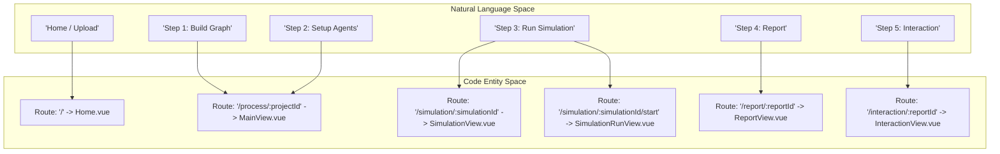
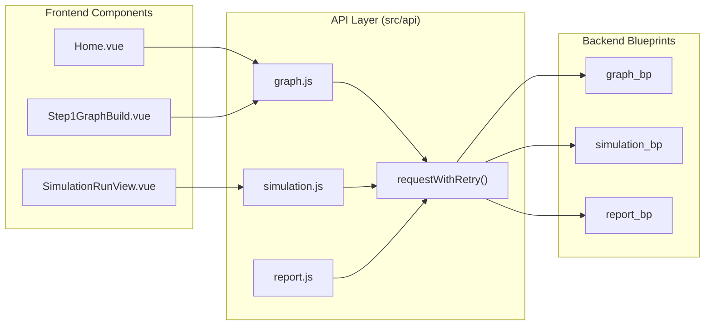

<!-- source: DeepWiki mcp.deepwiki.com · repo aaronjmars/MiroShark · page 6 Frontend Application · fetched 2026-10-26 -->

# Frontend Application

Relevant source files

The following files were used as context for generating this wiki page:

- [frontend/.gitignore](frontend/.gitignore)
- [frontend/index.html](frontend/index.html)
- [frontend/src/App.vue](frontend/src/App.vue)
- [frontend/src/api/graph.js](frontend/src/api/graph.js)
- [frontend/src/api/index.js](frontend/src/api/index.js)
- [frontend/src/api/report.js](frontend/src/api/report.js)
- [frontend/src/api/simulation.js](frontend/src/api/simulation.js)
- [frontend/src/router/index.js](frontend/src/router/index.js)
- [frontend/src/views/Home.vue](frontend/src/views/Home.vue)

The MiroShark frontend is a Vue 3 application that orchestrates a complex 5-step workflow, transforming static documents into dynamic, interactive simulations. It utilizes a custom design system called **Hyperstitions v2.0**, inspired by Evangelion aesthetics, and communicates with the Flask backend via a robust, retry-capable API layer.

## Workflow Progression

The application enforces a linear progression from document ingestion to post-simulation analysis. This sequence is reflected in the routing and UI states, ensuring that each stage has the necessary data dependencies met before proceeding.

| Step | Phase | Key Code Entity | Purpose |
| :--- | :--- | :--- | :--- |
| **01** | **Graph Construction** | `Step1GraphBuild.vue` | Reality seed extraction and GraphRAG construction. [frontend/src/views/Home.vue:60-66]() |
| **02** | **Agent Setup** | `Step2EnvSetup.vue` | Persona generation and environment configuration. [frontend/src/views/Home.vue:67-73]() |
| **03** | **Start Simulation** | `Step3Simulation.vue` | Parallel execution across Twitter, Reddit, and Polymarket. [frontend/src/views/Home.vue:74-80]() |
| **04** | **Report Generation** | `Step4Report.vue` | ReACT-based analysis of simulation outcomes. [frontend/src/views/Home.vue:81-87]() |
| **05** | **Deep Interaction** | `Step5Interaction.vue` | Direct chat with agents and the Report Agent. [frontend/src/views/Home.vue:88-94]() |

**Sources:** [frontend/src/views/Home.vue:54-96](), [frontend/src/router/index.js:9-45]()

## System Architecture & Routing

The frontend uses `vue-router` to manage the transition between these phases. The `MainView.vue` component acts as a primary container for the multi-step pipeline, while specific views like `SimulationRunView.vue` handle the high-intensity execution phase.

### Navigation & Code Mapping

The following diagram maps the logical workflow steps to their corresponding Vue components and route definitions.

**Workflow to Code Mapping**

**Sources:** [frontend/src/router/index.js:9-45](), [frontend/src/views/Home.vue:167-175]()

## Hyperstitions v2.0 Design System

The UI adheres to a strict visual identity defined in `App.vue`. It features a bicolor palette (Orange/Green), a 1.4x modular spacing scale, and technical decorative elements like warning stripes and background grids.

*   **Primary Palette:** Orange (`#FF6B1A`) for actions/warnings and Green (`#43C165`) for status/success. [frontend/src/App.vue:17-18]()
*   **Typography:** `Young Serif` for headings and `Space Mono` for technical data and buttons. [frontend/src/App.vue:48-49]()
*   **Visual Motifs:** 
    *   `.warning-stripes`: Repeating linear gradients used as dividers. [frontend/src/App.vue:110-119]()
    *   `.bg-grid`: A subtle 70px grid overlay. [frontend/src/App.vue:122-127]()
    *   **Animations:** Scanlines and shimmering borders to simulate a "live" terminal environment. [frontend/src/App.vue:130-155]()

**Sources:** [frontend/src/App.vue:10-155](), [frontend/index.html:4-6]()

## API Layer & Data Flow

Communication with the backend is centralized in `frontend/src/api/`. The system uses `axios` with a custom `requestWithRetry` wrapper to handle transient network issues or long-running LLM tasks (e.g., ontology generation).

### API Module Responsibilities
*   **`index.js`**: Base configuration, 5-minute timeouts, and exponential backoff retry logic. [frontend/src/api/index.js:4-65]()
*   **`graph.js`**: Handles `generateOntology`, `buildGraph`, and graph data retrieval. [frontend/src/api/graph.js:8-58]()
*   **`simulation.js`**: Manages simulation lifecycle (`create`, `prepare`, `start`, `stop`) and real-time status polling. [frontend/src/api/simulation.js:7-113]()
*   **`report.js`**: Triggers report generation and facilitates chat interactions with the `ReportAgent`. [frontend/src/api/report.js:7-51]()

**API Integration Diagram**

**Sources:** [frontend/src/api/index.js:54-65](), [frontend/src/api/graph.js:1-19](), [frontend/src/api/simulation.js:1-105]()

## Detailed Area Documentation

For deep dives into specific UI components and logic, see the following child pages:

*   **[Home, Routing & Design System](#6.1)**: Details on the landing page, file upload logic, and global CSS architecture.
*   **[Graph Build & Environment Setup Steps (Steps 1–2)](#6.2)**: Polling mechanisms for ontology generation and real-time agent profile streaming.
*   **[Simulation Execution UI (Step 3)](#6.3)**: The Dual Timeline view, platform counters, and simulation control logic.
*   **[Report & Interaction UI (Steps 4–5)](#6.4)**: Markdown rendering for reports and the multi-world chat interface.

---

