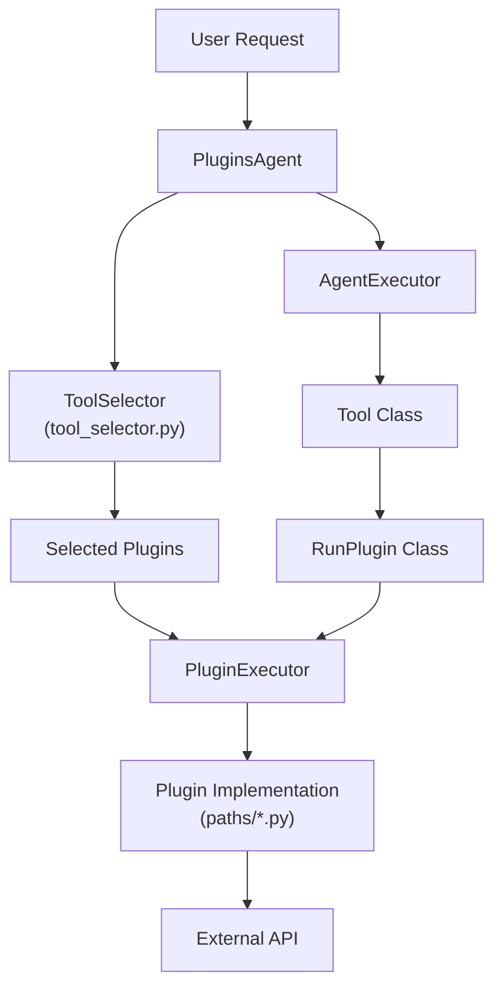
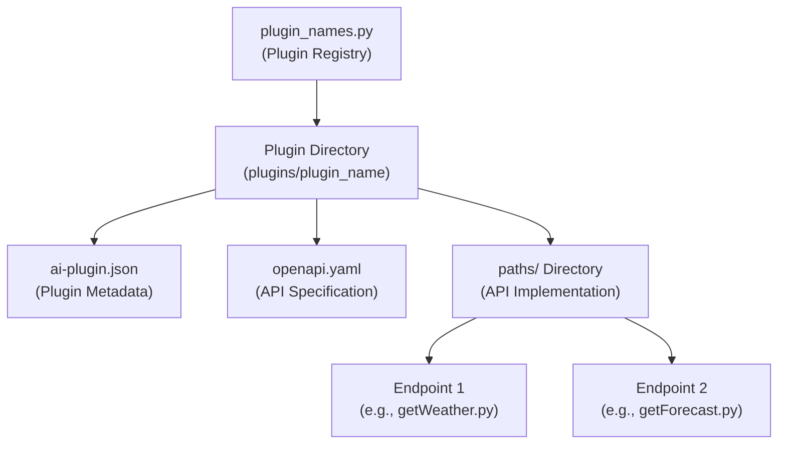
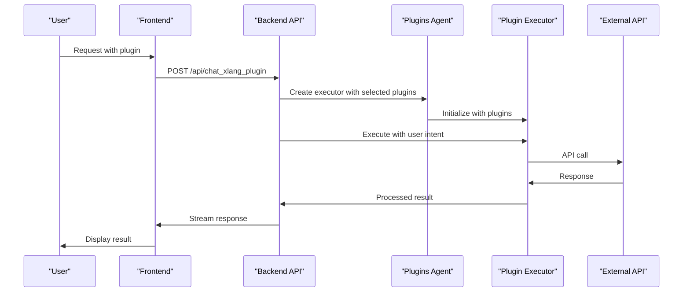
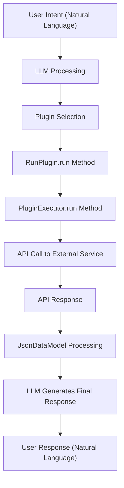
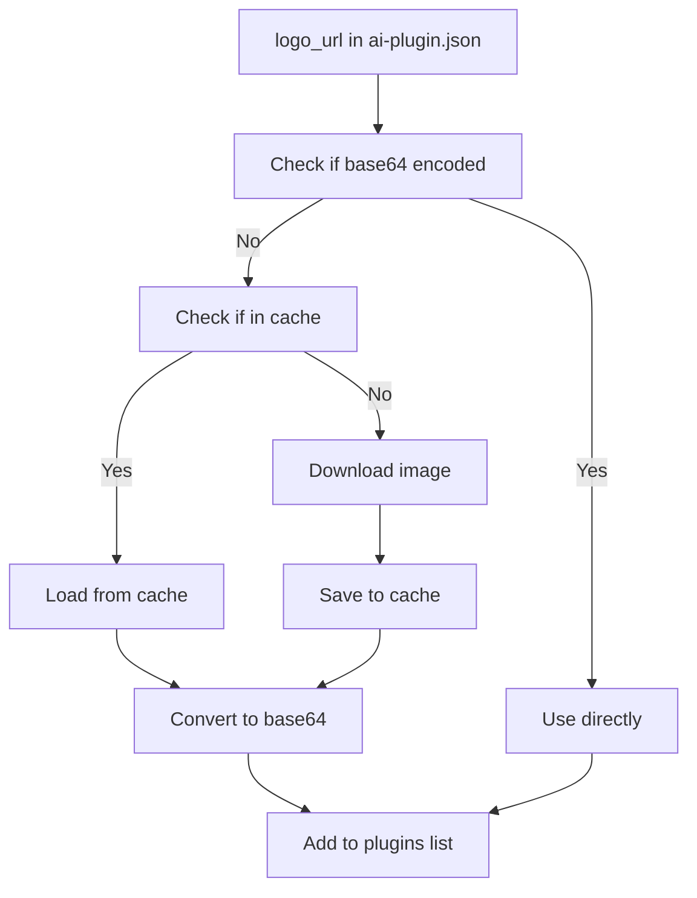
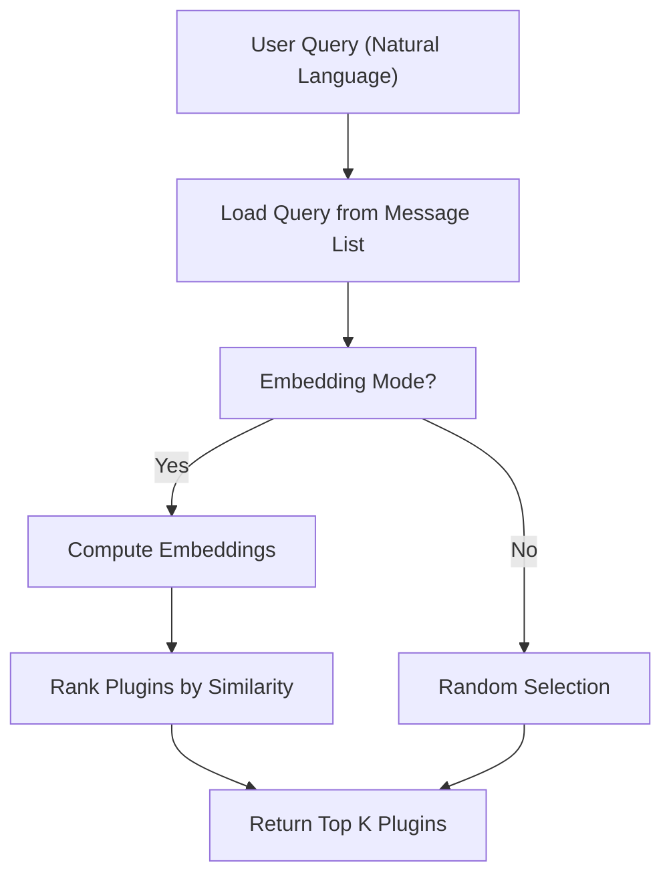

<!-- source: DeepWiki mcp.deepwiki.com · repo xlang-ai/OpenAgents · page 7.2 Adding New Plugins · fetched 2026-10-26 -->

# Adding New Plugins

<details>
<summary>Relevant source files</summary>

The following files were used as context for generating this wiki page:

- [CONTRIBUTING.md](CONTRIBUTING.md)
- [README.md](README.md)
- [README_ZH.md](README_ZH.md)
- [backend/api/chat_plugin.py](backend/api/chat_plugin.py)
- [frontend/pages/_document.tsx](frontend/pages/_document.tsx)

</details>


This document provides a technical guide on extending the OpenAgents platform by adding new plugins to the Plugins Agent. For information about using existing plugins, see [Plugins Agent](#5.2).

## Plugin System Architecture

The plugin system in OpenAgents follows a modular architecture that allows for easy integration of new capabilities. Each plugin is implemented as a tool that the Plugins Agent can use to fulfill user requests through API calls to external services.

Plugin System Architecture Diagram



Sources:
- [backend/api/chat_plugin.py:110-185]()
- [real_agents/plugins_agent/plugins/tool_selector.py]()
- [real_agents/adapters/agent_helpers.py]()

## Plugin Structure

A plugin in OpenAgents consists of several required components arranged in a specific directory structure:

Plugin Structure Diagram



Each plugin requires:
1. A dedicated directory in `real_agents/plugins_agent/plugins/`
2. An `ai-plugin.json` file containing metadata
3. An `openapi.yaml` file defining the API specification
4. Implementation files in a `paths/` directory
5. Registration in `plugin_names.py`

Sources:
- [README.md:282-286]()
- [real_agents/plugins_agent/plugins/]()

## Plugin Request Flow

When a user interacts with the Plugins Agent, the following sequence occurs:

Plugin Request Flow Diagram



Sources:
- [backend/api/chat_plugin.py:188-277]()

## Adding a New Plugin

Follow these steps to add a new plugin to the OpenAgents platform:

### 1. Create Plugin Directory

Create a new directory for your plugin within the plugins directory:

```
real_agents/plugins_agent/plugins/your_plugin_name/
```

### 2. Create Metadata File

Create an `ai-plugin.json` file in your plugin directory with the following structure:

```json
{
  "schema_version": "v1",
  "name_for_human": "Human-Readable Plugin Name",
  "name_for_model": "modelPluginName",
  "description_for_human": "Short description for users",
  "description_for_model": "Detailed description for the language model",
  "auth": {
    "type": "none"  // or "api_key" if required
  },
  "api": {
    "type": "openapi",
    "url": "PLUGIN_HOSTNAME/openapi.yaml"
  },
  "logo_url": "https://path.to/logo.png",
  "contact_email": "contact@example.com",
  "legal_info_url": "https://example.com/legal"
}
```

The `name_for_human` field appears in the plugin selection UI, while `description_for_human` provides context to users selecting plugins.

### 3. Define API Specification

Create an `openapi.yaml` file in your plugin directory:

```yaml
openapi: 3.0.1
info:
  title: Plugin API
  description: API for your plugin
  version: 'v1'
servers:
  - url: https://api.example.com
paths:
  /endpoint:
    get:
      operationId: functionName
      summary: Description of what this endpoint does
      parameters:
        - name: param_name
          in: query
          description: Parameter description
          required: true
          schema:
            type: string
      responses:
        "200":
          description: OK
          content:
            application/json:
              schema:
                type: object
                properties:
                  result:
                    type: string
```

The `operationId` in each path corresponds to a Python function in your implementation.

### 4. Implement API Endpoints

Create a `paths` directory in your plugin directory and add Python files for each API endpoint. The file name should match the `operationId` from your OpenAPI specification:

```python
# real_agents/plugins_agent/plugins/your_plugin_name/paths/functionName.py

def functionName(param_name: str, api_key: str = None):
    # Implementation of your API endpoint
    # If your plugin requires authentication, use the api_key parameter
    
    # Make API call to external service
    # Process and return the result
    return {"result": "some data"}
```

### 5. Register Your Plugin

Add your plugin name to the `PLUGINS` list in `real_agents/plugins_agent/plugins/plugin_names.py`:

```python
PLUGINS = [
    # Existing plugins...
    "your_plugin_name",
]
```

Sources:
- [README.md:282-286]()
- [real_agents/plugins_agent/plugins/plugin_names.py]()

## Plugin Data Processing Flow

This diagram illustrates how user requests are processed through the plugin system:

Plugin Data Processing Flow Diagram



Sources:
- [backend/api/chat_plugin.py:133-161]()
- [real_agents/adapters/data_model.py]()

## Authentication and API Keys

If your plugin requires authentication:

1. Set the `auth` field in `ai-plugin.json`:

```json
"auth": {
  "type": "api_key",
  "authorization_type": "bearer"
}
```

2. Add an `api_key` parameter to your endpoint functions:

```python
def functionName(param_name: str, api_key: str = None):
    headers = {"Authorization": f"Bearer {api_key}"} if api_key else {}
    # Make API call with headers
```

3. The user's API key will be stored in `api_key_pool` and passed to your plugin during execution.

The system will automatically detect that your plugin requires authentication and prompt users to enter their API keys in the frontend UI.

Sources:
- [backend/api/chat_plugin.py:169-173]()
- [backend/main.py]()

## Plugin Icon Loading

Plugin icons are loaded from the URL specified in the `logo_url` field of `ai-plugin.json`. The system supports both direct image URLs and base64-encoded images:



Sources:
- [backend/api/chat_plugin.py:42-107]()

## Example Plugin Implementation

Here's a complete example of a weather plugin:

### Directory Structure

```
real_agents/plugins_agent/plugins/
├── plugin_names.py  # Add "weather_plugin" to this file
└── weather_plugin/
    ├── ai-plugin.json
    ├── openapi.yaml
    └── paths/
        └── getWeather.py
```

### ai-plugin.json

```json
{
  "schema_version": "v1",
  "name_for_human": "Weather Plugin",
  "name_for_model": "weatherPlugin",
  "description_for_human": "Get weather information for any location.",
  "description_for_model": "This plugin provides current weather conditions for a specified location.",
  "auth": {
    "type": "api_key",
    "authorization_type": "bearer"
  },
  "api": {
    "type": "openapi",
    "url": "PLUGIN_HOSTNAME/openapi.yaml"
  },
  "logo_url": "https://example.com/weather-icon.png",
  "contact_email": "support@example.com",
  "legal_info_url": "https://example.com/legal"
}
```

### openapi.yaml

```yaml
openapi: 3.0.1
info:
  title: Weather Plugin
  description: Get weather information for any location
  version: 'v1'
servers:
  - url: https://api.weatherapi.com
paths:
  /current:
    get:
      operationId: getWeather
      summary: Get current weather for a location
      parameters:
        - name: location
          in: query
          description: The location to get weather for
          required: true
          schema:
            type: string
      responses:
        "200":
          description: OK
          content:
            application/json:
              schema:
                type: object
                properties:
                  temperature:
                    type: number
                  conditions:
                    type: string
```

### getWeather.py

```python
import requests

def getWeather(location: str, api_key: str = None):
    headers = {"Authorization": f"Bearer {api_key}"} if api_key else {}
    response = requests.get(
        f"https://api.weatherapi.com/v1/current.json?q={location}",
        headers=headers
    )
    data = response.json()
    return {
        "temperature": data["current"]["temp_c"],
        "conditions": data["current"]["condition"]["text"]
    }
```

## How Plugin Selection Works

When a user interacts with the Plugins Agent, plugins can be selected in two ways:

1. **Manual Selection**: The user explicitly chooses one or more plugins from the UI
2. **Auto Selection**: The system automatically selects relevant plugins based on the user query

For auto selection, the `ToolSelector` class analyzes the user's query and conversation history to select appropriate plugins:



Sources:
- [backend/api/chat_plugin.py:228-236]()
- [real_agents/plugins_agent/plugins/tool_selector.py]()

## Troubleshooting

| Issue | Possible Solution |
|-------|-------------------|
| Plugin not appearing in selection | Ensure the plugin name is correctly added to `plugin_names.py` |
| API errors | Check the implementation of your API endpoints and the external API status |
| Authentication issues | Verify that the API key is correctly passed and used in your implementation |
| Icon not displaying | Check the `logo_url` in `ai-plugin.json` and ensure the image is accessible |
| Plugin not being auto-selected | Improve the description in `ai-plugin.json` to better match potential user queries |

Sources:
- [backend/api/chat_plugin.py:83-85]()
- [README.md:282-286]()

## Plugin Execution Process

When a plugin is executed, the following components are involved:

1. `RunPlugin` class: Wraps the plugin execution and handles results
2. `PluginExecutor`: Manages the plugin life cycle and API calls
3. `Tool` class: Integrates the plugin into the agent framework
4. `JsonDataModel`: Formats the plugin output for display

The execution process follows these steps:

1. The user intent is passed to the plugin executor
2. The executor constructs appropriate API calls based on the OpenAPI specification
3. The API calls are made to the external service
4. The response is processed and formatted as a `JsonDataModel`
5. The formatted response is returned to the agent for final processing

Sources:
- [backend/api/chat_plugin.py:133-161]()
- [real_agents/adapters/data_model.py]()
- [real_agents/plugins_agent/PluginExecutor.py]()

---

