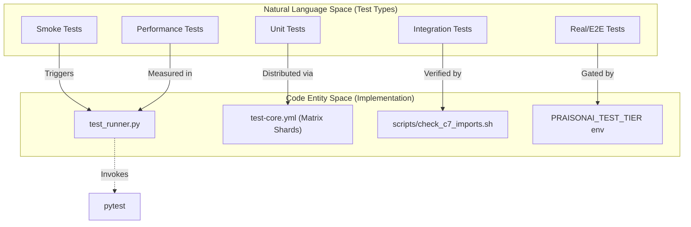
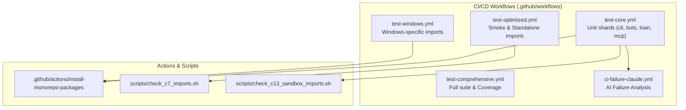
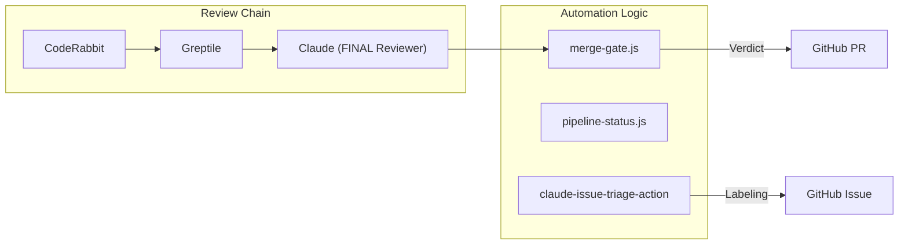

<!-- source: DeepWiki mcp.deepwiki.com · repo MervinPraison/PraisonAI · page 11 Testing and Quality Assurance · fetched 2026-10-26 -->

# Testing and Quality Assurance

Relevant source files

The following files were used as context for generating this wiki page:

- [.github/ISSUE_TEMPLATE/bug_report.md](.github/ISSUE_TEMPLATE/bug_report.md)
- [.github/actions/claude-code-action/action.yml](.github/actions/claude-code-action/action.yml)
- [.github/actions/claude-issue-triage-action/action.yml](.github/actions/claude-issue-triage-action/action.yml)
- [.github/scripts/ci-failure-claude-selftest.js](.github/scripts/ci-failure-claude-selftest.js)
- [.github/scripts/ci-failure-claude.js](.github/scripts/ci-failure-claude.js)
- [.github/scripts/merge-gate-selftest.js](.github/scripts/merge-gate-selftest.js)
- [.github/scripts/merge-gate.js](.github/scripts/merge-gate.js)
- [.github/scripts/pipeline-status-selftest.js](.github/scripts/pipeline-status-selftest.js)
- [.github/scripts/pipeline-status.js](.github/scripts/pipeline-status.js)
- [.github/scripts/pr-review-chain-selftest.js](.github/scripts/pr-review-chain-selftest.js)
- [.github/scripts/pr-review-chain.js](.github/scripts/pr-review-chain.js)
- [.github/workflows/auto-issue-comment.yml](.github/workflows/auto-issue-comment.yml)
- [.github/workflows/auto-pr-comment.yml](.github/workflows/auto-pr-comment.yml)
- [.github/workflows/build-image.yml](.github/workflows/build-image.yml)
- [.github/workflows/ci-failure-claude.yml](.github/workflows/ci-failure-claude.yml)
- [.github/workflows/claude-issue-triage.yml](.github/workflows/claude-issue-triage.yml)
- [.github/workflows/claude-merge-gate.yml](.github/workflows/claude-merge-gate.yml)
- [.github/workflows/claude.yml](.github/workflows/claude.yml)
- [.github/workflows/merge-conflict-claude.yml](.github/workflows/merge-conflict-claude.yml)
- [.github/workflows/pipeline-status-sync.yml](.github/workflows/pipeline-status-sync.yml)
- [.github/workflows/python-package.yml](.github/workflows/python-package.yml)
- [.github/workflows/python-publish.yml](.github/workflows/python-publish.yml)
- [.github/workflows/release.yml](.github/workflows/release.yml)
- [.github/workflows/test-comprehensive.yml](.github/workflows/test-comprehensive.yml)
- [.github/workflows/test-core.yml](.github/workflows/test-core.yml)
- [.github/workflows/test-extended.yml](.github/workflows/test-extended.yml)
- [.github/workflows/test-frameworks.yml](.github/workflows/test-frameworks.yml)
- [.github/workflows/test-optimized.yml](.github/workflows/test-optimized.yml)
- [.github/workflows/test-real.yml](.github/workflows/test-real.yml)
- [.github/workflows/test-windows.yml](.github/workflows/test-windows.yml)
- [src/praisonai-agents/autoagents-tavily.py](src/praisonai-agents/autoagents-tavily.py)

## Purpose and Scope

This document describes PraisonAI's testing framework, CI/CD pipeline, and quality assurance processes. It covers the tiered testing architecture, automated GitHub Actions workflows, AI-powered code review systems, and performance monitoring strategies.

**Related documentation:**
- For deployment infrastructure, see [Deployment and Infrastructure](#9)
- For package structure and dependencies, see [Package System](#10)
- For development environment setup, see [Development Environment](#9.3)

---

## Test Infrastructure Overview

PraisonAI uses a sophisticated testing infrastructure built around `pytest`, GitHub Actions, and AI-assisted automation. The system is designed to provide fast feedback for developers while protecting against API costs through tiered testing strategies.

### Test Runner and Category Mapping

The codebase utilizes a central `test_runner.py` to orchestrate various test suites based on patterns.

**Sources:** [src/praisonai/tests/test_runner.py:1-363](), [.github/workflows/test-core.yml:78-161]()

### Test Categories and Organization

Tests are categorized by their impact and requirements:

| Pattern | Target Files/Dirs | API Calls | Purpose |
|---------|-------------------|-----------|---------|
| `smoke` | `tests/unit/test_c*_boundaries.py` | None | Verify package boundaries and backward compat [test-optimized.yml:82-89]() |
| `unit` | `tests/unit/` | Mocked | Fast core logic verification [test-core.yml:78-161]() |
| `real` | `tests/e2e/` | **Yes** | Actual LLM integration validation [test_runner.py:177-191]() |
| `mcp` | `src/praisonai-mcp/tests/` | None | Model Context Protocol server tests [test-core.yml:109-115]() |
| `train` | `src/praisonai-train/tests/` | None | Agent training loop tests [test-core.yml:102-108]() |

---

## CI/CD Pipeline Architecture

The CI/CD system is implemented via a series of specialized GitHub Actions workflows that handle everything from core validation to multi-cloud deployment.

### Workflow Execution Strategy

**Sources:** [.github/workflows/test-core.yml:1-161](), [.github/workflows/test-optimized.yml:1-165](), [.github/workflows/test-windows.yml:1-42]()

### Key Pipeline Features
- **Sharded Execution**: Core tests are split into shards (`cli`, `bots-gateway`, `train`, `mcp`, `sandbox`, `deploy`) to run in parallel [test-core.yml:85-161]().
- **Standalone Import Verification**: The `smoke` job verifies that packages like `praisonai-code` and `praisonai-bot` can function independently without the full wrapper [test-optimized.yml:101-184]().
- **Boundary Enforcement**: Scripts like `check_c7_imports.sh` ensure that lower-tier packages do not import from higher-tier ones, maintaining the tiered architecture [test-optimized.yml:135]().

For details, see [CI/CD Pipeline](#11.2).

---

## GitHub AI Automation

PraisonAI integrates LLMs directly into the development lifecycle to automate maintenance tasks.

### Review and Triage Chain

**Sources:** [.github/workflows/auto-pr-comment.yml:3-13](), [.github/scripts/merge-gate.js:1-75]()

### Key Automation Components
- **Claude Assistant**: Handles issue triage, code fixes, and architectural reviews [claude.yml:1-127]().
- **Merge Gate**: A deterministic and LLM-based gate that assesses PR readiness based on test status, review sentiment, and conflict state [merge-gate.js:13-55]().
- **CI Failure Handler**: Automatically triggers Claude to analyze and suggest fixes when CI workflows fail [ci-failure-claude.yml:1-45]().

For details, see [GitHub AI Automation](#11.3).

---

## Performance and Evaluation

### Performance Monitoring
The system tracks execution metrics through a telemetry layer and specialized benchmarks.
- **Telemetry**: Collects metrics on tool usage, errors, and performance [test-comprehensive.yml:16-19]().
- **Benchmarks**: Nightly tests measure agent creation speed, import overhead, and memory consumption [.github/workflows/test-extended.yml:114-155]().

For details, see [Performance Monitoring](#11.4).

### Evaluation Framework
The `eval` subsystem provides tools for quantifying agent quality.
- **Harness & Runner**: Executes evaluation suites to measure accuracy and reliability.
- **Grader/Judge**: Uses LLM-as-a-judge patterns to score agent outputs.
- **AgentTrainer Integration**: Connects evaluation results back to the training loop in `praisonai-train` for iterative improvement [test-core.yml:102-108]().

For details, see [Evaluation Framework](#11.5).

---

## Summary of Testing Tools

| Tool | Role | Location |
|------|------|----------|
| `test_runner.py` | Local test orchestration | `src/praisonai/tests/test_runner.py` |
| `merge-gate.js` | PR merge readiness logic | `.github/scripts/merge-gate.js` |
| `Claude Code Action` | Automated code modification | `.github/actions/claude-code-action/` |
| `install-monorepo-packages` | Shared environment setup | `.github/actions/install-monorepo-packages/` |

**Sources:** [.github/scripts/merge-gate.js:1-55](), [.github/actions/claude-code-action/action.yml:1-70](), [src/praisonai/tests/test_runner.py:1-50]()

---

