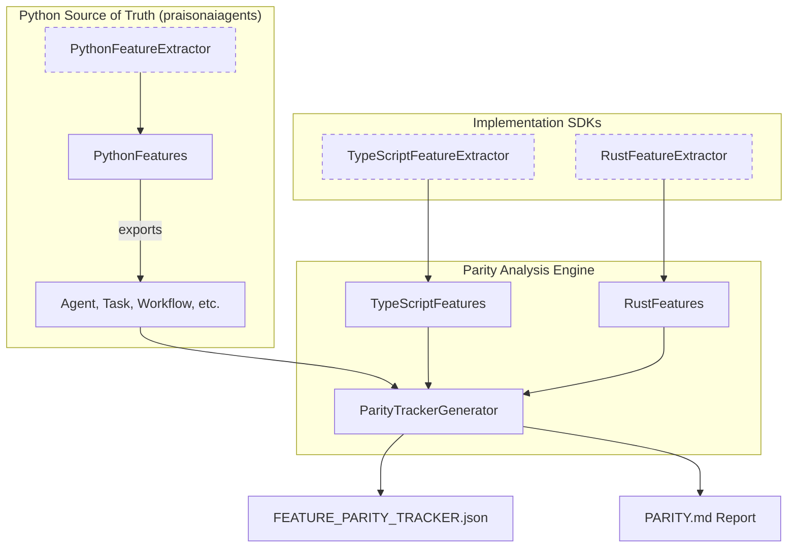
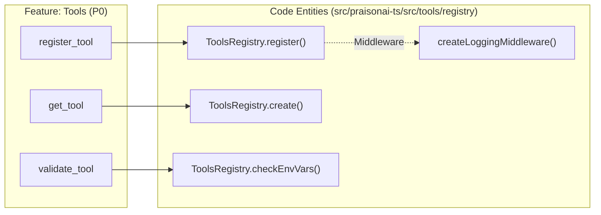

<!-- source: DeepWiki mcp.deepwiki.com · repo MervinPraison/PraisonAI · page 20.1 Feature Parity Tracker · fetched 2026-10-26 -->

# Feature Parity Tracker

<details>
<summary>Relevant source files</summary>

The following files were used as context for generating this wiki page:

- [src/praisonai-rust/FEATURE_PARITY_TRACKER.json](src/praisonai-rust/FEATURE_PARITY_TRACKER.json)
- [src/praisonai-rust/PARITY.md](src/praisonai-rust/PARITY.md)
- [src/praisonai-ts/FEATURE_PARITY_TRACKER.json](src/praisonai-ts/FEATURE_PARITY_TRACKER.json)
- [src/praisonai-ts/PARITY.md](src/praisonai-ts/PARITY.md)
- [src/praisonai-ts/src/tools/registry/index.ts](src/praisonai-ts/src/tools/registry/index.ts)
- [src/praisonai-ts/src/tools/registry/registry.ts](src/praisonai-ts/src/tools/registry/registry.ts)
- [src/praisonai-ts/src/tools/registry/types.ts](src/praisonai-ts/src/tools/registry/types.ts)
- [src/praisonai-ts/tests/tools/registry.test.ts](src/praisonai-ts/tests/tools/registry.test.ts)
- [src/praisonai/praisonai/_dev/parity/__init__.py](src/praisonai/praisonai/_dev/parity/__init__.py)
- [src/praisonai/praisonai/_dev/parity/generator.py](src/praisonai/praisonai/_dev/parity/generator.py)
- [src/praisonai/praisonai/_dev/parity/rust_extractor.py](src/praisonai/praisonai/_dev/parity/rust_extractor.py)
- [src/praisonai/praisonai/_dev/parity/typescript_extractor.py](src/praisonai/praisonai/_dev/parity/typescript_extractor.py)

</details>


The **Feature Parity Tracker** is an automated system designed to maintain functional consistency across the PraisonAI ecosystem, specifically between the **Python SDK** (the source of truth) and the **TypeScript** and **Rust** implementations. It utilizes automated extractors to perform gap analysis, calculate parity percentages, and generate human-readable reports.

## System Architecture

The parity tracking system is built into the `praisonai` package under the `_dev.parity` internal module. It operates by scanning source code across different repositories to identify exported classes, functions, and types.

### Data Flow and Extraction
The system follows a linear pipeline:
1.  **Extraction**: Language-specific extractors (`PythonFeatureExtractor`, `TypeScriptFeatureExtractor`, `RustFeatureExtractor`) parse source files using regex-based analysis to identify public exports [src/praisonai/praisonai/_dev/parity/__init__.py:16-20]().
2.  **Comparison**: The `ParityTrackerGenerator` compares the extracted feature sets against the Python "Source of Truth" [src/praisonai/praisonai/_dev/parity/generator.py:122-144]().
3.  **Prioritization**: Gaps are assigned priority levels (P0–P3) based on their functional category (e.g., `agent` and `tools` are P0) [src/praisonai/praisonai/_dev/parity/generator.py:65-86]().
4.  **Generation**: The system outputs `FEATURE_PARITY_TRACKER.json` for machine consumption and `PARITY.md` for developer documentation [src/praisonai/praisonai/_dev/parity/generator.py:108-111]().

### Parity Tracking Logic
"Natural Language Space" (Feature Concepts) to "Code Entity Space" (Implementation)


**Sources:** [src/praisonai/praisonai/_dev/parity/generator.py:56-62](), [src/praisonai/praisonai/_dev/parity/__init__.py:27-42]()

## Feature Extractors

Each supported language has a dedicated extractor class that implements logic specific to that language's export syntax.

### Python Extractor
The `PythonFeatureExtractor` serves as the baseline. It identifies all core classes and functions exported by the `praisonaiagents` package [src/praisonai/praisonai/_dev/parity/generator.py:103]().

### TypeScript Extractor
The `TypeScriptFeatureExtractor` parses `index.ts` files within the `praisonai-ts` package. It distinguishes between regular exports and `type` exports, categorizing them into modules like `agent`, `tools`, and `workflows` [src/praisonai/praisonai/_dev/parity/typescript_extractor.py:50-60]().

### Rust Extractor
The `RustFeatureExtractor` analyzes `lib.rs` and `Cargo.toml`. It handles Rust-specific nuances, such as re-exports (`pub use`) and name aliasing for reserved keywords (e.g., mapping Python's `loop` to Rust's `loop_step`) [src/praisonai/praisonai/_dev/parity/rust_extractor.py:15-31]().

**Sources:** [src/praisonai/praisonai/_dev/parity/rust_extractor.py:73-84](), [src/praisonai/praisonai/_dev/parity/typescript_extractor.py:50-60]()

## Priority Tiers (P0–P3)

The `ParityTrackerGenerator` uses a `PRIORITY_MAPPING` dictionary to categorize features by importance [src/praisonai/praisonai/_dev/parity/generator.py:65-86]():

| Tier | Category | Description |
| :--- | :--- | :--- |
| **P0** | `agent`, `tools` | Critical core functionality required for basic agent operation. |
| **P1** | `workflows`, `memory`, `knowledge`, `session` | Essential infrastructure for multi-agent coordination and persistence. |
| **P2** | `guardrails`, `eval`, `mcp`, `planning`, `rag` | Advanced features for safety, evaluation, and external tool protocols. |
| **P3** | `ui`, `config`, `plugins`, `trace` | Non-blocking features related to display, configuration, and observability. |

**Sources:** [src/praisonai/praisonai/_dev/parity/generator.py:65-86]()

## FEATURE_PARITY_TRACKER.json Format

The generated JSON file provides a structured view of the current state of parity.

```json
{
  "version": "1.5.87",
  "lastUpdated": "2026-08-17",
  "generatedBy": "praisonai._dev.parity.generator",
  "sourceOfTruth": "Python SDK (praisonaiagents)",
  "summary": {
    "pythonCoreFeatures": 411,
    "typescriptFeatures": 1190,
    "gapCount": 117,
    "parityPercentage": 71.5
  },
  "pythonCoreSDK": {
    "exports": ["Agent", "Task", "Workflow", "ToolsRegistry", "..."]
  }
}
```
**Sources:** [src/praisonai-ts/FEATURE_PARITY_TRACKER.json:1-15](), [src/praisonai-rust/FEATURE_PARITY_TRACKER.json:1-12]()

## Parity Percentage Calculation

The system calculates parity by comparing the set of Python exports ($S_{py}$) against the target SDK exports ($S_{target}$).

$$Parity \% = \frac{|S_{target} \cap S_{py}|}{|S_{py}|} \times 100$$

In the Rust implementation, certain features are marked as "N/A" due to language limitations (e.g., reserved keywords like `loop`), and these are accounted for in the summary [src/praisonai-rust/PARITY.md:12-13]().

## Parity Generator CLI

Developers can update the parity reports using the parity generator module.

```bash
# Generate and write new parity tracker files
python -m praisonai._dev.parity.generator --write

# Check parity without writing files (CI mode)
python -m praisonai._dev.parity.generator --check
```

The CLI utilizes the `ParityTrackerGenerator` class to perform the end-to-end scan and update `PARITY.md` files in each SDK directory [src/praisonai/praisonai/_dev/parity/generator.py:108-111]().

### Implementation Mapping: TypeScript Tools Registry
The following diagram bridges the abstract "Tools" feature to the specific TypeScript implementation entities.


**Sources:** [src/praisonai-ts/src/tools/registry/registry.ts:33-86](), [src/praisonai-ts/src/tools/registry/middleware.ts:1-56](), [src/praisonai-ts/PARITY.md:76-78]()

---

